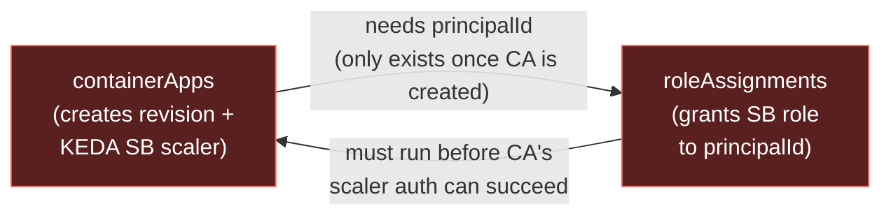
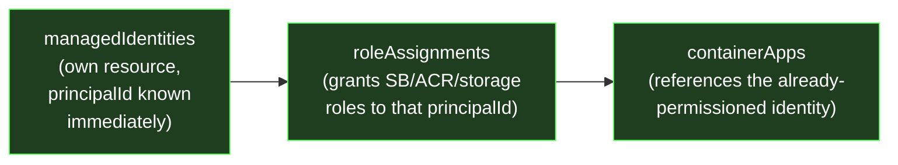

# Art Auction

A playground for MassTransit routing slips on Azure. You submit a bid on a piece of art. If it's at least 80% of the asking price, the bid is accepted and the art is acquired; otherwise it's rejected. Everything runs on Azure Container Apps, with Service Bus, Table Storage and Entra ID. You can run  locally with Aspire and opted to use Rabbit MQ locally over the Azure Service Bus Emulator. Due to Mass Transit abstraction outside of configuration in the program.cs  nothing else have to be updated 

## Project Structure

| Path | What it is |
| --- | --- |
| `src/ArtAuction.API` | Minimal API that accepts bids and publishes them to the bus. Secured with Entra ID. |
| `src/ArtAuction.Consumer` | Worker that consumes bids and runs the routing slip activities. |
| `src/ArtAuction.Contract` | Shared message contracts and Table Storage entities. |
| `src/ArtAuction.AppHost` | Aspire AppHost for running everything locally. |
| `src/Infra` | Bicep for all the Azure resources, deployed as a deployment stack. |

## Flow Diagram

`ArtAuction.API` accepts a bid and publishes `ArtWorkBid` onto the bus (Service Bus in Azure, RabbitMQ when running locally). `ArtAuction.Consumer` consumes it, records the bid in Table Storage, and then drives a MassTransit routing slip through Courier activities to accept or reject the bid. If a later activity in the slip faults, MassTransit walks back through the `Compensate` methods of the activities that already ran, updating the entity's state in Table Storage.


## Architecture Choice
I was planning to deploy the resources with private endpoints in a shared virtual network, but private networking on Service Bus needs the Premium SKU, which is too expensive. Instead, I was happy to experiment with Network Security Perimeter, which creates a logical network boundary around platform-as-a-service (PaaS) resources deployed outside your virtual networks. With my current profile settings, it only allows requests between resources in the same subscription.


## Generate Token from Identity Provider using PowerShell

```
$body = @{
    grant_type    = "client_credentials"
    client_id     = "345e735e-327c-429b-946b-39d7edaf4c9c"
    client_secret = ""
    scope         = "api://8036976b-35ee-4425-bebf-76ede18b97d0/.default"
}

$response = Invoke-RestMethod -Uri "https://login.microsoftonline.com/3853050a-07fd-4295-9fec-e56ecda64939/oauth2/v2.0/token" -Method Post -Body $body

$response.access_token
```

## Application Registration 

There are three application registrations:
- **Art-Auction-Github-Deployment**: The deployment identity, which uses OIDC federated credentials. It has the `Contributor` role on the subscription because it creates the resource group at subscription scope, and `Role Based Access Control Administrator` so it can assign roles to the managed identities.

- **Art-Auction-API**: Represents the API and defines the roles used for role-based access, such as `Bid.Submit`.

- **Art-Auction-Api-Client**: Used by the client, along with a secret, to generate the JWT. The API permission I granted lets it use the role defined in the Art-Auction-API registration.


## Container Registry
Allow the container app to pull from the container registry. This is now handled in Bicep, but I'm noting it here in case the resources are hand cranked.

```bash
az containerapp registry set --name ca-artauctionapi-neu-001 --resource-group RG-ARTAUCTION-NEU-001 --server crartauctionneu001.azurecr.io --identity <user-assigned-identity-resource-id>
```

## Why Container Apps Use User-Assigned Identities

The Container Apps scale rules need access to Service Bus to work. I had trouble using a system-assigned identity because this check ran before the identity was created. So I created a user-assigned managed identity ahead of time, gave it the permissions it needs on Service Bus, and associated it with the container app. Bicep sets the identity's client ID as an environment variable on the container app, and the app picks it up at runtime.

**Before (system-assigned) — circular deadlock:**


**After (user-assigned) — no deadlock:**

