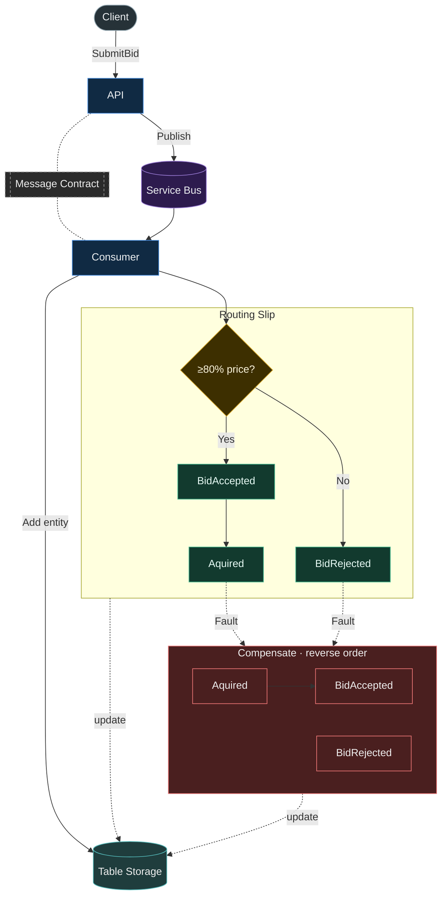
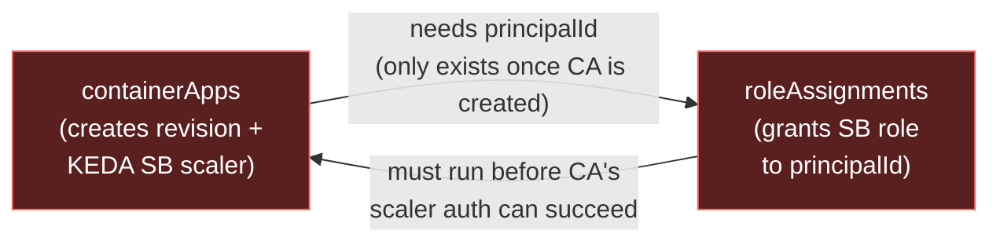
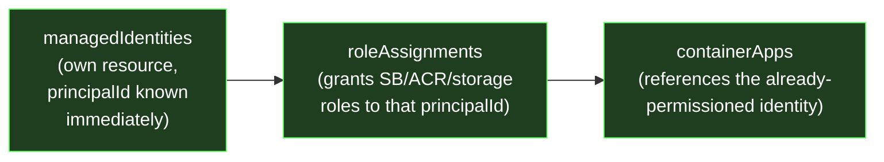

## Architecture

**Application & message flow** — `ArtAuction.API` accepts a bid and publishes `ArtWorkBid` onto Service Bus. `ArtAuction.Consumer` consumes it, records the bid in Table Storage, then drives a MassTransit routing slip through courier activities to accept or reject the bid. If a later activity in the slip faults, MassTransit walks back through the already-executed activities' `Compensate` methods, each of which writes a `*_Compensated` status back to Table Storage.



## Setup
Create identity used for deployment and sett the output JSON AZURE_CREDENTIALS in GitHub action secrets 
```bash
az ad sp create-for-rbac --name deployment-credentials  --json-auth --output json
```
Assign that identity to be an owner at the subscription level since it will be used to create: Resouce Group, Resources in the infra pipeline.
```
az role assignment create --assignee-object-id 04f2c0c7-8d8c-4b53-a66d-b94ba77a881f --assignee-principal-type ServicePrincipal --role "Owner" --scope /subscriptions/15cec3e2-1cd9-4276-b215-5370e2425b38
```

Assign as deployment stack contributor 
```
az role assignment create --assignee 04f2c0c7-8d8c-4b53-a66d-b94ba77a881f --role bf7f8882-3383-422a-806a-6526c631a88a --scope /subscriptions/15cec3e2-1cd9-4276-b215-5370e2425b38
```

## Container Registry
Allow the container app to pull from the container registry. This is done in my infra pipeline, but worth noting for the future. I was having issues setting this in the registry property in the AVM for the container.
```bash
az containerapp registry set --name art-auction-api --resource-group MassTransit-Playground --server masstransitcontainerregistry.azurecr.io --identity system
```

## Why Container Apps Use User-Assigned Identities

The container apps use a user-assigned managed identity (`Infra/Modules/managedIdentities.bicep`) instead of `systemAssigned: true`. This isn't a style choice — system-assigned identity caused a real deployment deadlock.

The consumer app's KEDA scale rule authenticates to Service Bus using the container app's identity:
```bicep
custom: {
  type: 'azure-servicebus'
  identity: 'system'
  metadata: { queueName: ..., namespace: serviceBusName, ... }
}
```

When Container Apps provisions a revision, it has to validate that scale rule's auth against Service Bus *as part of* bringing the revision online — not as a later step. With a system-assigned identity, the principal ID doesn't exist until the container app itself is created, so the role assignment (`Modules/roleAssignments.bicep`) can only run *after* the container app module finishes. But the container app can't finish until the scaler successfully authenticates, which needs the role assignment to already exist. That's a true circular dependency — no `dependsOn` ordering can resolve it, because the missing piece (the principal ID) is only produced by the exact step that's blocked waiting on something derived from it.

In practice this showed up as both container apps failing with `Operation expired` after ~20 minutes, with zero revisions ever created and zero RBAC role assignments ever granted on the ACR/Service Bus/Storage Account.

A user-assigned identity breaks the cycle: it's its own resource, so its principal ID is known immediately on creation, with no dependency on the container app. That makes the order a straight line — create identity, grant roles, then create the container app referencing the already-permissioned identity — instead of a cycle.

**Before (system-assigned) — circular, deadlocks forever:**


**After (user-assigned) — straight line, no cycle:**


## Delete Resources From Deployment Stack 

```
Remove-AzSubscriptionDeploymentStack -Name "Development" -ActionOnUnmanage DeleteAll -Force 
```

## Generate Token from Identity Provider using PowerShell

```
$body = @{
    grant_type    = "client_credentials"
    client_id     = "345e735e-327c-429b-946b-39d7edaf4c9c"
    client_secret = ""
    scope         = "api://8036976b-35ee-4425-bebf-76ede18b97d0/.default"
}

$response = Invoke-RestMethod -Uri "https://login.microsoftonline.com/3853050a-07fd-4295-9fec-e56ecda64939/oauth2/v2.0/token" -Method Post -Body $body

$response.access_token
```
