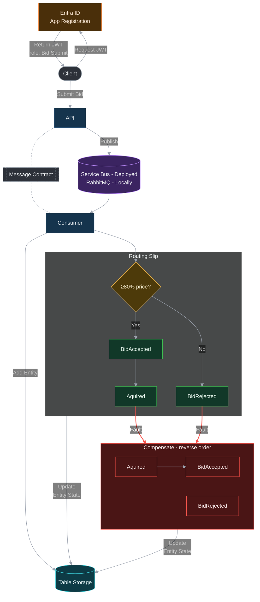

# Art Auction

A playground for MassTransit routing slips on Azure. You submit a bid on a piece of art. If it's at least 80% of the asking price, the bid is accepted and the art is acquired; otherwise it's rejected. Everything runs on Azure Container Apps, with Service Bus, Table Storage and Entra ID. You can run  locally with Aspire and opted to use Rabbit MQ locally over the Azure Service Bus Emulator. Due to Mass Transit abstraction outside of configuration in the program.cs  nothing else have to be updated 

## Project Structure

| Path | What it is |
| --- | --- |
| `src/ArtAuction.API` | Minimal API that accepts bids and publishes them to the bus. Secured with Entra ID. |
| `src/ArtAuction.Consumer` | Worker that consumes bids and runs the routing slip activities. |
| `src/ArtAuction.Contract` | Shared message contracts and Table Storage entities. |
| `src/ArtAuction.AppHost` | Aspire AppHost for running everything locally. |
| `src/Infra` | Bicep for all the Azure resources, deployed as a deployment stack. |

## Flow Diagram

`ArtAuction.API` accepts a bid and publishes `ArtWorkBid` onto the bus (Service Bus in Azure, RabbitMQ when running locally). `ArtAuction.Consumer` consumes it, records the bid in Table Storage, and then drives a MassTransit routing slip through Courier activities to accept or reject the bid. If a later activity in the slip faults, MassTransit walks back through the `Compensate` methods of the activities that already ran, updating the entity's state in Table Storage.



## Architecture Choice
I was planning to deploy the resources with private endpoints in a shared virtual network, but private networking on Service Bus needs the Premium SKU, which is too expensive. Instead, I was happy to experiment with Network Security Perimeter, which creates a logical network boundary around platform-as-a-service (PaaS) resources deployed outside your virtual networks. With my current profile settings, it only allows requests between resources in the same subscription.


<svg xmlns="http://www.w3.org/2000/svg" width="1585" height="650" viewBox="0 0 1585 650"><foreignObject width="100%" height="100%" x="0" y="0" externalResourcesRequired="true"><div xmlns="http://www.w3.org/1999/xhtml" class="react-flow__viewport xyflow__viewport react-flow__container" style="transform: translate(230px, -190px) scale(1); accent-color: auto; place-content: normal; place-items: normal; place-self: auto; alignment-baseline: auto; anchor-name: none; anchor-scope: none; animation-composition: replace; animation: 0s ease 0s 1 normal none running none; animation-trigger: none; app-region: none; appearance: none; aspect-ratio: auto; backdrop-filter: none; backface-visibility: visible; background: none 0% 0% / auto repeat scroll padding-box border-box rgba(0, 0, 0, 0); background-blend-mode: normal; baseline-shift: 0px; baseline-source: auto; block-size: 861px; border-block: 0px rgb(201, 201, 201); border: 0px rgb(201, 201, 201); border-radius: 0px; border-collapse: separate; border-end-end-radius: 0px; border-end-start-radius: 0px; border-inline: 0px rgb(201, 201, 201); border-shape: none; border-start-end-radius: 0px; border-start-start-radius: 0px; inset: 0px; box-decoration-break: slice; box-shadow: none; box-sizing: border-box; break-after: auto; break-before: auto; break-inside: auto; buffered-rendering: auto; caption-side: top; caret-animation: auto; caret-color: rgb(201, 201, 201); caret-shape: auto; clear: none; clip: auto; clip-path: none; clip-rule: nonzero; color: rgb(201, 201, 201); color-interpolation: srgb; color-interpolation-filters: linearrgb; color-rendering: auto; color-scheme: dark; columns: auto; column-fill: balance; gap: normal; rule-break: normal; rule: 3px rgb(201, 201, 201); rule-inset: 0px; rule-visibility-items: normal; column-span: none; contain: none; contain-intrinsic-block-size: none; contain-intrinsic-size: none; contain-intrinsic-inline-size: none; container: none; content: normal; content-visibility: visible; corner-shape: superellipse(1); corner-block-end-shape: superellipse(1); corner-block-start-shape: superellipse(1); counter-increment: none; counter-reset: none; counter-set: none; cursor: grab; cx: 0px; cy: 0px; d: none; direction: ltr; display: block; dominant-baseline: auto; dynamic-range-limit: no-limit; empty-cells: show; field-sizing: fixed; fill: rgb(0, 0, 0); fill-opacity: 1; fill-rule: nonzero; filter: none; flex: 0 1 auto; flex-flow: row; flex-line-count: 1; float: none; flood-color: rgb(0, 0, 0); flood-opacity: 1; font: 400 15.9px / 24.8px -apple-system, BlinkMacSystemFont, &quot;Segoe UI&quot;, Roboto, Helvetica, Arial, sans-serif, &quot;Apple Color Emoji&quot;, &quot;Segoe UI Emoji&quot;; font-palette: normal; font-synthesis: weight style small-caps; forced-color-adjust: auto; frame-sizing: auto; grid: none; grid-area: auto; hyphenate-character: auto; hyphenate-limit-chars: auto; hyphens: manual; image-orientation: from-image; image-rendering: auto; initial-letter: normal; inline-size: 1620px; inset-block: 0px; inset-inline: 0px; interactivity: auto; interest-delay: normal; interpolate-size: numeric-only; isolation: auto; letter-spacing: normal; lighting-color: rgb(255, 255, 255); line-break: auto; list-style: outside none disc; margin-block: 0px; margin: 0px; margin-inline: 0px; margin-trim: none; marker: none; mask: none; mask-type: luminance; math-depth: 0; math-shift: normal; math-style: normal; max-block-size: none; max-height: none; max-inline-size: none; max-width: none; min-block-size: 0px; min-height: 0px; min-inline-size: 0px; min-width: 0px; mix-blend-mode: normal; object-fit: fill; object-position: 50% 50%; object-view-box: none; offset: normal; opacity: 1; order: 0; orphans: 2; outline: rgb(201, 201, 201) none 3px; outline-offset: 0px; overflow-anchor: auto; overflow-block: visible; overflow-clip-margin: 0px; overflow-inline: visible; overflow-wrap: normal; overflow: visible; overlay: none; overscroll-behavior-block: auto; overscroll-behavior-inline: auto; overscroll-behavior: auto; padding-block: 0px; padding: 0px; padding-inline: 0px; paint-order: normal; perspective: none; perspective-origin: 810px 430.5px; pointer-events: none; position: absolute; position-anchor: normal; position-area: none; position-try: none; position-visibility: anchors-visible; print-color-adjust: economy; quotes: auto; r: 0px; reading-flow: normal; reading-order: 0; resize: none; rotate: none; ruby-align: space-around; ruby-overhang: auto; ruby-position: over; rule-overlap: row-over-column; rx: auto; ry: auto; scale: none; scroll-axis-lock: auto; scroll-behavior: auto; scroll-initial-target: none; scroll-margin-block: 0px; scroll-margin: 0px; scroll-margin-inline: 0px; scroll-marker-group: none; scroll-padding-block: auto; scroll-padding: auto; scroll-padding-inline: auto; scroll-snap-align: none; scroll-snap-stop: normal; scroll-snap-type: none; scroll-target-group: none; scroll-timeline: none; scrollbar-color: auto; scrollbar-gutter: auto; scrollbar-width: auto; shape-image-threshold: 0; shape-margin: 0px; shape-outside: none; shape-rendering: auto; speak: normal; stop-color: rgb(0, 0, 0); stop-opacity: 1; stroke: none; stroke-dasharray: none; stroke-dashoffset: 0px; stroke-linecap: butt; stroke-linejoin: miter; stroke-miterlimit: 4; stroke-opacity: 1; stroke-width: 1px; tab-size: 8; table-layout: auto; text-align: start; text-align-last: auto; text-anchor: start; text-autospace: no-autospace; text-box: normal; text-combine-upright: none; text-decoration: rgb(201, 201, 201); text-decoration-skip-ink: auto; text-decoration-skip-spaces: start end; text-emphasis: none rgb(201, 201, 201); text-emphasis-position: over; text-fit: none; text-indent: 0px; text-justify: auto; text-orientation: mixed; text-overflow: clip; text-rendering: auto; text-shadow: none; text-size-adjust: auto; text-spacing-trim: normal; text-transform: none; text-underline-offset: auto; text-underline-position: auto; text-wrap: wrap; timeline-scope: none; timeline-trigger: none; touch-action: auto; transform-box: view-box; transform-origin: 0px 0px; transform-style: flat; transition: all; translate: none; trigger-scope: none; unicode-bidi: isolate; user-select: auto; vector-effect: none; vertical-align: baseline; view-timeline: none; view-transition-class: none; view-transition-group: normal; view-transition-name: none; view-transition-scope: none; visibility: visible; white-space-collapse: collapse; widows: 2; width: 1585px; will-change: auto; window-drag: none; word-break: normal; word-spacing: 0px; writing-mode: horizontal-tb; x: 0px; y: 0px; z-index: 2; zoom: 1; border-spacing: 0px; -webkit-border-image: none; -webkit-box-align: stretch; -webkit-box-decoration-break: slice; -webkit-box-direction: normal; -webkit-box-flex: 0; -webkit-box-ordinal-group: 1; -webkit-box-orient: horizontal; -webkit-box-pack: start; -webkit-font-smoothing: antialiased; -webkit-line-break: auto; -webkit-line-clamp: none; -webkit-locale: &quot;en&quot;; -webkit-mask-box-image-source: none; -webkit-mask-box-image-slice: 0 fill; -webkit-mask-box-image-width: auto; -webkit-mask-box-image-outset: 0; -webkit-mask-box-image-repeat: stretch; -webkit-rtl-ordering: logical; -webkit-ruby-position: before; -webkit-tap-highlight-color: rgba(0, 0, 0, 0.18); -webkit-text-combine: none; -webkit-text-decorations-in-effect: none; -webkit-text-fill-color: rgb(201, 201, 201); -webkit-text-orientation: vertical-right; -webkit-text-security: none; -webkit-text-stroke: 0px rgb(201, 201, 201); -webkit-user-drag: auto; -webkit-user-modify: read-only; -webkit-writing-mode: horizontal-tb; --mantine-color-red-9: #c92a2a; --mantine-color-dark-9: #141414; --mantine-color-lime-1: #e9fac8; --mantine-color-dark-5: #3b3b3b; --mantine-color-violet-0: #f3f0ff; --mantine-color-pink-light: rgba(230, 73, 128, .15); --mantine-color-red-8: #e03131; --mantine-shadow-xs: 0 calc(.0625rem * 1) calc(.1875rem * 1) rgba(0, 0, 0, .05), 0 calc(.0625rem * 1) calc(.125rem * 1) rgba(0, 0, 0, .1); --mantine-color-violet-filled: #6741d9; --mantine-color-indigo-4: #748ffc; --mantine-color-indigo-6: #4c6ef5; --app-shell-navbar-width: calc(18.75rem * 1); --mantine-color-cyan-light-color: #66d9e8; --xy-attribution-background-color-default: rgba(255, 255, 255, .5); --mantine-color-pink-3: #faa2c1; --mantine-color-blue-7: #1c7ed6; --mantine-color-ad-canvas-background: #25262B; --mantine-color-teal-2: #96f2d7; --mantine-color-green-6: #40c057; --xy-node-group-background-color-default: rgba(240, 240, 240, .25); --mantine-color-grape-0: #f8f0fc; --mantine-color-green-filled: #2f9e44; --mantine-color-anchor: #4dabf7; --xy-background-pattern-lines-color-default: #eee; --mantine-color-red-2: #ffc9c9; --mantine-primary-color-light-hover: rgba(34, 139, 230, .2); --mantine-primary-color-1: #d0ebff; --mantine-shadow-sm: 0 calc(.0625rem * 1) calc(.1875rem * 1) rgba(0, 0, 0, .05), rgba(0, 0, 0, .05) 0 calc(.625rem * 1) calc(.9375rem * 1) calc(-.3125rem * 1), rgba(0, 0, 0, .04) 0 calc(.4375rem * 1) calc(.4375rem * 1) calc(-.3125rem * 1); --mantine-color-yellow-6: #fab005; --mantine-color-gray-filled-hover: #212529; --mantine-color-red-1: #ffe3e3; --mantine-heading-font-weight: 700; --mantine-color-lime-0: #f4fce3; --mantine-color-orange-9: #d9480f; --mantine-radius-md: calc(.5rem * 1); --xy-minimap-node-stroke-width-default: 2; --mantine-color-lime-6: #82c91e; --mantine-color-violet-light-hover: rgba(121, 80, 242, .2); --mantine-h1-font-size: calc(2.125rem * 1); --mantine-h4-font-size: calc(1.125rem * 1); --mantine-color-ad-accent-0: #909296; --mantine-color-indigo-1: #dbe4ff; --mantine-color-pink-6: #e64980; --mantine-color-dark-filled: #1f1f1f; --mantine-color-yellow-filled: #f08c00; --mantine-color-gray-0: #f8f9fa; --mantine-color-red-text: #ff8787; --mantine-breakpoint-xl: 88em; --mantine-radius-default: calc(.25rem * 1); --mantine-color-blue-5: #339af0; --xy-minimap-node-stroke-color-default: transparent; --mantine-color-yellow-0: #fff9db; --mantine-color-dark-filled-hover: #242424; --mantine-color-orange-1: #ffe8cc; --mantine-color-pink-5: #f06595; --mantine-h2-font-size: calc(1.625rem * 1); --mantine-color-blue-3: #74c0fc; --mantine-color-grape-6: #be4bdb; --mantine-color-cyan-outline: #3bc9db; --xy-minimap-mask-stroke-color-default: transparent; --mantine-color-cyan-7: #1098ad; --mantine-color-indigo-filled-hover: #364fc7; --mantine-h6-font-weight: 700; --mantine-color-ad-accent-2: #2C2E33; --mantine-spacing-sm: calc(.75rem * 1); --mantine-radius-xs: calc(.125rem * 1); --mantine-color-violet-9: #5f3dc4; --mantine-color-pink-outline-hover: rgba(247, 131, 172, .05); --mantine-color-teal-light-color: #63e6be; --sash-hover-transition-duration: .1s; --mantine-color-orange-outline: #ffa94d; --mantine-color-red-filled: #e03131; --mantine-color-cyan-0: #e3fafc; --mantine-font-family: -apple-system, BlinkMacSystemFont, Segoe UI, Roboto, Helvetica, Arial, sans-serif, Apple Color Emoji, Segoe UI Emoji; --mantine-color-orange-filled-hover: #d9480f; --mantine-color-pink-1: #ffdeeb; --mantine-moz-font-smoothing: grayscale; --mantine-color-orange-light: rgba(253, 126, 20, .15); --mantine-color-lime-5: #94d82d; --mantine-radius-lg: calc(1rem * 1); --mantine-h6-font-size: calc(.875rem * 1); --mantine-color-orange-light-color: #ffc078; --mantine-primary-color-7: #1c7ed6; --mantine-color-dark-light-hover: rgba(36, 36, 36, .2); --mantine-color-dark-1: #b8b8b8; --mantine-color-cyan-filled: #0c8599; --mantine-color-indigo-8: #3b5bdb; --mantine-color-violet-3: #b197fc; --mantine-color-orange-2: #ffd8a8; --mantine-color-cyan-6: #15aabf; --mantine-color-yellow-light-hover: rgba(250, 176, 5, .2); --mantine-color-lime-9: #5c940d; --mantine-color-default-border: #424242; --mantine-color-orange-8: #e8590c; --xy-minimap-mask-stroke-width-default: 1; --mantine-shadow-md: 0 calc(.0625rem * 1) calc(.1875rem * 1) rgba(0, 0, 0, .05), rgba(0, 0, 0, .05) 0 calc(1.25rem * 1) calc(1.5625rem * 1) calc(-.3125rem * 1), rgba(0, 0, 0, .04) 0 calc(.625rem * 1) calc(.625rem * 1) calc(-.3125rem * 1); --mantine-primary-color-6: #228be6; --mantine-color-lime-3: #c0eb75; --mantine-color-orange-5: #ff922b; --mantine-color-lime-light-color: #c0eb75; --mantine-color-error: #e03131; --mantine-color-green-8: #2f9e44; --mantine-color-ad-text-primary: #F1F3F5; --xy-edge-stroke-width-default: 1; --mantine-primary-color-filled-hover: #1864ab; --mantine-radius-xl: calc(2rem * 1); --mantine-color-indigo-9: #364fc7; --mantine-color-grape-2: #eebefa; --xy-controls-button-background-color-hover-default: #f4f4f4; --mantine-primary-color-contrast: #fff; --mantine-color-dimmed: #828282; --mantine-color-gray-light-hover: rgba(134, 142, 150, .2); --mantine-h5-font-weight: 700; --mantine-color-red-4: #ff8787; --xy-background-pattern-dots-color-default: #91919a; --mantine-color-yellow-4: #ffd43b; --mantine-color-lime-4: #a9e34b; --mantine-primary-color-light-color: #74c0fc; --mantine-h2-line-height: 1.35; --app-shell-navbar-offset: calc(18.75rem * 1); --mantine-color-lime-outline-hover: rgba(169, 227, 75, .05); --mantine-color-green-4: #69db7c; --mantine-spacing-xl: calc(2rem * 1); --mantine-shadow-lg: 0 calc(.0625rem * 1) calc(.1875rem * 1) rgba(0, 0, 0, .05), rgba(0, 0, 0, .05) 0 calc(1.75rem * 1) calc(1.4375rem * 1) calc(-.4375rem * 1), rgba(0, 0, 0, .04) 0 calc(.75rem * 1) calc(.75rem * 1) calc(-.4375rem * 1); --mantine-h3-font-size: calc(1.375rem * 1); --xy-minimap-node-background-color-default: #e2e2e2; --mantine-color-teal-light: rgba(18, 184, 134, .15); --mantine-color-green-0: #ebfbee; --mantine-color-dark-6: #2e2e2e; --mantine-line-height-xs: 1.4; --mantine-color-lime-7: #74b816; --mantine-color-blue-filled: #1971c2; --mantine-h5-line-height: 1.5; --mantine-color-indigo-3: #91a7ff; --separator-border: rgba(128, 128, 128, .35); --mantine-color-ad-button-icon-border: #424242; --mantine-h4-font-weight: 700; --mantine-color-red-light-color: #ffa8a8; --mantine-color-yellow-light: rgba(250, 176, 5, .15); --mantine-color-gray-3: #dee2e6; --mantine-color-pink-2: #fcc2d7; --mantine-color-gray-9: #212529; --mantine-color-teal-outline: #38d9a9; --mantine-font-size-sm: calc(.875rem * 1); --mantine-breakpoint-lg: 75em; --mantine-color-lime-filled-hover: #5c940d; --mantine-color-indigo-light-color: #91a7ff; --mantine-color-blue-outline-hover: rgba(77, 171, 247, .05); --mantine-color-cyan-outline-hover: rgba(59, 201, 219, .05); --mantine-color-green-7: #37b24d; --mantine-font-size-md: calc(1rem * 1); --xy-node-boxshadow-selected-default: 0 0 0 .5px #1a192b; --xy-edge-stroke-default: #b1b1b7; --mantine-h5-font-size: calc(1rem * 1); --mantine-color-gray-8: #343a40; --mantine-color-green-text: #69db7c; --mantine-color-indigo-text: #748ffc; --xy-selection-border-default: 1px dotted rgba(0, 89, 220, .8); --mantine-color-green-light-color: #8ce99a; --mantine-color-pink-filled: #c2255c; --mantine-color-dark-text: #424242; --mantine-spacing-lg: calc(1.25rem * 1); --xy-node-background-color-default: #fff; --mantine-primary-color-9: #1864ab; --mantine-color-blue-9: #1864ab; --mantine-color-red-filled-hover: #c92a2a; --mantine-color-cyan-filled-hover: #0b7285; --mantine-color-indigo-5: #5c7cfa; --mantine-color-lime-filled: #66a80f; --sash-hover-size: 4px; --mantine-cursor-type: default; --mantine-font-family-headings: -apple-system, BlinkMacSystemFont, Segoe UI, Roboto, Helvetica, Arial, sans-serif, Apple Color Emoji, Segoe UI Emoji; --mantine-color-grape-text: #da77f2; --mantine-color-red-outline: #ff8787; --mantine-color-orange-outline-hover: rgba(255, 169, 77, .05); --mantine-color-violet-light: rgba(121, 80, 242, .15); --mantine-scale: 1; --xy-controls-box-shadow-default: 0 0 2px 1px rgba(0, 0, 0, .08); --mantine-h4-line-height: 1.45; --mantine-color-violet-4: #9775fa; --mantine-color-white: #fff; --mantine-color-blue-6: #228be6; --mantine-color-ad-menu-item-hover: #373A40; --mantine-color-teal-light-hover: rgba(18, 184, 134, .2); --mantine-color-green-1: #d3f9d8; --mantine-color-teal-8: #099268; --xy-node-border-default: 1px solid #1a192b; --mantine-color-yellow-8: #f08c00; --mantine-color-indigo-outline-hover: rgba(116, 143, 252, .05); --mantine-color-cyan-3: #66d9e8; --xy-background-color-default: transparent; --mantine-color-grape-light: rgba(190, 75, 219, .15); --mantine-color-violet-light-color: #b197fc; --mantine-z-index-max: 9999; --mantine-color-yellow-2: #ffec99; --mantine-color-cyan-1: #c5f6fa; --mantine-color-green-outline-hover: rgba(105, 219, 124, .05); --mantine-color-cyan-4: #3bc9db; --mantine-color-violet-2: #d0bfff; --mantine-color-violet-8: #6741d9; --mantine-color-lime-2: #d8f5a2; --app-shell-transition-timing-function: ease; --mantine-color-ad-button-icon-color-disabled: #696969; --app-shell-header-height: calc(3rem * 1); --mantine-color-default: #2e2e2e; --mantine-primary-color-8: #1971c2; --mantine-color-grape-outline: #da77f2; --mantine-color-cyan-text: #3bc9db; --xy-node-boxshadow-hover-default: 0 1px 4px 1px rgba(0, 0, 0, .08); --mantine-color-violet-filled-hover: #5f3dc4; --mantine-color-orange-6: #fd7e14; --mantine-primary-color-0: #e7f5ff; --xy-edge-stroke-selected-default: #555; --sash-size: 8px; --mantine-color-gray-outline-hover: rgba(206, 212, 218, .05); --mantine-color-ad-accent-4: #25262B; --mantine-color-dark-8: #1f1f1f; --xy-node-border-radius-default: 3px; --mantine-color-indigo-7: #4263eb; --mantine-color-ad-accent-3: #373A40; --xy-connectionline-stroke-width-default: 1; --mantine-color-pink-9: #a61e4d; --mantine-color-grape-outline-hover: rgba(218, 119, 242, .05); --mantine-color-cyan-2: #99e9f2; --mantine-spacing-md: calc(1rem * 1); --mantine-color-body: #242424; --mantine-color-orange-light-hover: rgba(253, 126, 20, .2); --mantine-h2-font-weight: 700; --mantine-color-violet-1: #e5dbff; --mantine-color-grape-9: #862e9c; --mantine-color-gray-outline: #ced4da; --mantine-color-yellow-light-color: #ffe066; --mantine-color-gray-2: #e9ecef; --mantine-color-text: #c9c9c9; --xy-background-pattern-cross-color-default: #e2e2e2; --mantine-color-green-light-hover: rgba(64, 192, 87, .2); --mantine-color-yellow-outline: #ffd43b; --mantine-color-green-outline: #69db7c; --mantine-color-violet-text: #9775fa; --xy-minimap-background-color-default: #fff; --mantine-color-violet-6: #7950f2; --mantine-color-pink-8: #c2255c; --mantine-color-orange-filled: #e8590c; --mantine-color-teal-1: #c3fae8; --mantine-color-lime-8: #66a80f; --mantine-color-dark-2: #828282; --mantine-color-cyan-9: #0b7285; --mantine-color-orange-0: #fff4e6; --mantine-breakpoint-sm: 48em; --mantine-color-blue-1: #d0ebff; --mantine-font-size-xl: calc(1.25rem * 1); --mantine-color-cyan-light-hover: rgba(21, 170, 191, .2); --mantine-color-lime-light-hover: rgba(130, 201, 30, .2); --mantine-line-height-md: 1.55; --mantine-color-green-3: #8ce99a; --mantine-color-lime-light: rgba(130, 201, 30, .15); --mantine-color-teal-filled: #099268; --mantine-h1-line-height: 1.3; --mantine-color-ad-text-placeholder: #909296; --mantine-h3-line-height: 1.4; --mantine-z-index-popover: 300; --mantine-line-height-sm: 1.45; --app-shell-transition-duration: 200ms; --mantine-color-gray-6: #868e96; --mantine-color-yellow-5: #fcc419; --mantine-color-yellow-9: #e67700; --mantine-color-violet-5: #845ef7; --mantine-color-gray-filled: #343a40; --focus-border: #007fd4; --mantine-color-ad-accent-1: #5C5F66; --mantine-z-index-app: 100; --mantine-color-dark-0: #c9c9c9; --mantine-color-violet-7: #7048e8; --mantine-color-pink-filled-hover: #a61e4d; --mantine-color-yellow-7: #f59f00; --mantine-color-grape-filled: #9c36b5; --mantine-color-red-light: rgba(250, 82, 82, .15); --mantine-color-scheme: dark; --mantine-color-blue-2: #a5d8ff; --mantine-color-pink-light-hover: rgba(230, 73, 128, .2); --mantine-color-cyan-light: rgba(21, 170, 191, .15); --mantine-color-yellow-3: #ffe066; --mantine-h6-line-height: 1.5; --mantine-color-gray-light-color: #dee2e6; --mantine-color-green-filled-hover: #2b8a3e; --xy-handle-background-color-default: #1a192b; --mantine-color-teal-outline-hover: rgba(56, 217, 169, .05); --app-shell-padding: 0px; --mantine-color-red-light-hover: rgba(250, 82, 82, .2); --mantine-color-grape-8: #9c36b5; --mantine-primary-color-2: #a5d8ff; --app-shell-border-color: #424242; --mantine-color-grape-1: #f3d9fa; --mantine-color-grape-7: #ae3ec9; --mantine-color-blue-text: #4dabf7; --mantine-color-violet-outline-hover: rgba(151, 117, 250, .05); --mantine-color-teal-5: #20c997; --mantine-color-cyan-5: #22b8cf; --mantine-color-gray-text: #ced4da; --mantine-shadow-xl: 0 calc(.0625rem * 1) calc(.1875rem * 1) rgba(0, 0, 0, .05), rgba(0, 0, 0, .05) 0 calc(2.25rem * 1) calc(1.75rem * 1) calc(-.4375rem * 1), rgba(0, 0, 0, .04) 0 calc(1.0625rem * 1) calc(1.0625rem * 1) calc(-.4375rem * 1); --mantine-breakpoint-md: 62em; --mantine-color-gray-4: #ced4da; --mantine-color-blue-0: #e7f5ff; --mantine-color-teal-3: #63e6be; --xy-selection-background-color-default: rgba(0, 89, 220, .08); --mantine-primary-color-5: #339af0; --mantine-color-dark-outline: #424242; --mantine-h3-font-weight: 700; --mantine-color-red-5: #ff6b6b; --mantine-color-teal-6: #12b886; --mantine-color-indigo-filled: #3b5bdb; --xy-resize-background-color-default: #3367d9; --xy-minimap-mask-background-color-default: rgb(240, 240, 240, .6); --mantine-font-size-lg: calc(1.125rem * 1); --mantine-color-teal-4: #38d9a9; --mantine-color-red-6: #fa5252; --mantine-color-indigo-outline: #748ffc; --mantine-color-grape-light-color: #e599f7; --mantine-breakpoint-xs: 36em; --mantine-line-height-lg: 1.6; --mantine-color-cyan-8: #0c8599; --mantine-color-indigo-0: #edf2ff; --mantine-color-orange-3: #ffc078; --mantine-webkit-font-smoothing: antialiased; --mantine-color-red-0: #fff5f5; --mantine-color-green-light: rgba(64, 192, 87, .15); --mantine-line-height: 1.55; --mantine-font-family-monospace: ui-monospace, SFMono-Regular, Menlo, Monaco, Consolas, Liberation Mono, Courier New, monospace; --mantine-color-default-hover: #3b3b3b; --mantine-color-grape-4: #da77f2; --mantine-color-lime-outline: #a9e34b; --mantine-color-placeholder: #696969; --mantine-color-blue-light: rgba(34, 139, 230, .15); --mantine-color-blue-light-hover: rgba(34, 139, 230, .2); --mantine-color-grape-filled-hover: #862e9c; --mantine-color-dark-light-color: #696969; --mantine-color-yellow-text: #ffd43b; --mantine-color-bright: #fff; --xy-handle-border-color-default: #fff; --app-shell-header-offset: calc(3rem * 1); --mantine-color-black: #000; --mantine-primary-color-4: #4dabf7; --xy-connectionline-stroke-default: #b1b1b7; --mantine-primary-color-filled: #1971c2; --mantine-color-ad-accent-5: #1A1B1E; --mantine-color-yellow-1: #fff3bf; --mantine-color-blue-8: #1971c2; --mantine-color-dark-outline-hover: rgba(36, 36, 36, .05); --mantine-color-grape-3: #e599f7; --mantine-color-lime-text: #a9e34b; --mantine-z-index-overlay: 400; --mantine-color-indigo-light: rgba(76, 110, 245, .15); --mantine-color-green-2: #b2f2bb; --mantine-font-size-xs: calc(.75rem * 1); --mantine-color-orange-text: #ffa94d; --mantine-color-grape-light-hover: rgba(190, 75, 219, .2); --mantine-color-blue-4: #4dabf7; --mantine-color-dark-4: #424242; --mantine-color-teal-0: #e6fcf5; --mantine-color-dark-light: rgba(36, 36, 36, .15); --mantine-color-red-outline-hover: rgba(255, 135, 135, .05); --mantine-color-orange-4: #ffa94d; --mantine-z-index-modal: 200; --xy-edge-label-background-color-default: #ffffff; --mantine-color-blue-light-color: #74c0fc; --mantine-color-dark-7: #242424; --mantine-color-yellow-outline-hover: rgba(255, 212, 59, .05); --mantine-color-violet-outline: #9775fa; --mantine-primary-color-light: rgba(34, 139, 230, .15); --mantine-color-dark-3: #696969; --mantine-color-pink-7: #d6336c; --mantine-color-green-9: #2b8a3e; --mantine-color-red-7: #f03e3e; --xy-controls-button-border-color-default: #eee; --xy-controls-button-background-color-default: #fefefe; --mantine-color-pink-light-color: #faa2c1; --mantine-color-teal-filled-hover: #087f5b; --mantine-color-teal-9: #087f5b; --mantine-color-pink-0: #fff0f6; --mantine-color-grape-5: #cc5de8; --mantine-color-gray-1: #f1f3f5; --mantine-color-indigo-2: #bac8ff; --mantine-color-pink-text: #f783ac; --mantine-radius-sm: calc(.25rem * 1); --mantine-color-green-5: #51cf66; --mantine-color-gray-light: rgba(134, 142, 150, .15); --mantine-color-indigo-light-hover: rgba(76, 110, 245, .2); --mantine-color-red-3: #ffa8a8; --mantine-color-yellow-filled-hover: #e67700; --mantine-color-ad-button-icon-color: #BDBDBD; --mantine-line-height-xl: 1.65; --mantine-color-pink-4: #f783ac; --mantine-color-blue-outline: #4dabf7; --mantine-color-gray-7: #495057; --mantine-color-pink-outline: #f783ac; --mantine-spacing-xs: calc(.625rem * 1); --mantine-color-orange-7: #f76707; --mantine-color-teal-7: #0ca678; --mantine-color-gray-5: #adb5bd; --mantine-color-teal-text: #38d9a9; --mantine-primary-color-3: #74c0fc; --mantine-color-blue-filled-hover: #1864ab; --mantine-color-default-color: #fff; --mantine-h1-font-weight: 700; height: 650px;"><div class="react-flow__edges" style="accent-color: auto; place-content: normal; place-items: normal; place-self: auto; alignment-baseline: auto; anchor-name: none; anchor-scope: none; animation-composition: replace; animation: 0s ease 0s 1 normal none running none; animation-trigger: none; app-region: none; appearance: none; aspect-ratio: auto; backdrop-filter: none; backface-visibility: visible; background: none 0% 0% / auto repeat scroll padding-box border-box rgba(0, 0, 0, 0); background-blend-mode: normal; baseline-shift: 0px; baseline-source: auto; block-size: 0px; border-block: 0px rgb(201, 201, 201); border: 0px rgb(201, 201, 201); border-radius: 0px; border-collapse: separate; border-end-end-radius: 0px; border-end-start-radius: 0px; border-inline: 0px rgb(201, 201, 201); border-shape: none; border-start-end-radius: 0px; border-start-start-radius: 0px; inset: 0px 1620px 861px 0px; box-decoration-break: slice; box-shadow: none; box-sizing: border-box; break-after: auto; break-before: auto; break-inside: auto; buffered-rendering: auto; caption-side: top; caret-animation: auto; caret-color: rgb(201, 201, 201); caret-shape: auto; clear: none; clip: auto; clip-path: none; clip-rule: nonzero; color: rgb(201, 201, 201); color-interpolation: srgb; color-interpolation-filters: linearrgb; color-rendering: auto; color-scheme: dark; columns: auto; column-fill: balance; gap: normal; rule-break: normal; rule: 3px rgb(201, 201, 201); rule-inset: 0px; rule-visibility-items: normal; column-span: none; contain: none; contain-intrinsic-block-size: none; contain-intrinsic-size: none; contain-intrinsic-inline-size: none; container: none; content: normal; content-visibility: visible; corner-shape: superellipse(1); corner-block-end-shape: superellipse(1); corner-block-start-shape: superellipse(1); counter-increment: none; counter-reset: none; counter-set: none; cursor: grab; cx: 0px; cy: 0px; d: none; direction: ltr; display: block; dominant-baseline: auto; dynamic-range-limit: no-limit; empty-cells: show; field-sizing: fixed; fill: rgb(0, 0, 0); fill-opacity: 1; fill-rule: nonzero; filter: none; flex: 0 1 auto; flex-flow: row; flex-line-count: 1; float: none; flood-color: rgb(0, 0, 0); flood-opacity: 1; font: 400 15.9px / 24.8px -apple-system, BlinkMacSystemFont, &quot;Segoe UI&quot;, Roboto, Helvetica, Arial, sans-serif, &quot;Apple Color Emoji&quot;, &quot;Segoe UI Emoji&quot;; font-palette: normal; font-synthesis: weight style small-caps; forced-color-adjust: auto; frame-sizing: auto; grid: none; grid-area: auto; height: 0px; hyphenate-character: auto; hyphenate-limit-chars: auto; hyphens: manual; image-orientation: from-image; image-rendering: auto; initial-letter: normal; inline-size: 0px; inset-block: 0px 861px; inset-inline: 0px 1620px; interactivity: auto; interest-delay: normal; interpolate-size: numeric-only; isolation: auto; letter-spacing: normal; lighting-color: rgb(255, 255, 255); line-break: auto; list-style: outside none disc; margin-block: 0px; margin: 0px; margin-inline: 0px; margin-trim: none; marker: none; mask: none; mask-type: luminance; math-depth: 0; math-shift: normal; math-style: normal; max-block-size: none; max-height: none; max-inline-size: none; max-width: none; min-block-size: 0px; min-height: 0px; min-inline-size: 0px; min-width: 0px; mix-blend-mode: normal; object-fit: fill; object-position: 50% 50%; object-view-box: none; offset: normal; opacity: 1; order: 0; orphans: 2; outline: rgb(201, 201, 201) none 3px; outline-offset: 0px; overflow-anchor: auto; overflow-block: visible; overflow-clip-margin: 0px; overflow-inline: visible; overflow-wrap: normal; overflow: visible; overlay: none; overscroll-behavior-block: auto; overscroll-behavior-inline: auto; overscroll-behavior: auto; padding-block: 0px; padding: 0px; padding-inline: 0px; paint-order: normal; perspective: none; perspective-origin: 0px 0px; pointer-events: none; position: absolute; position-anchor: normal; position-area: none; position-try: none; position-visibility: anchors-visible; print-color-adjust: economy; quotes: auto; r: 0px; reading-flow: normal; reading-order: 0; resize: none; rotate: none; ruby-align: space-around; ruby-overhang: auto; ruby-position: over; rule-overlap: row-over-column; rx: auto; ry: auto; scale: none; scroll-axis-lock: auto; scroll-behavior: auto; scroll-initial-target: none; scroll-margin-block: 0px; scroll-margin: 0px; scroll-margin-inline: 0px; scroll-marker-group: none; scroll-padding-block: auto; scroll-padding: auto; scroll-padding-inline: auto; scroll-snap-align: none; scroll-snap-stop: normal; scroll-snap-type: none; scroll-target-group: none; scroll-timeline: none; scrollbar-color: auto; scrollbar-gutter: auto; scrollbar-width: auto; shape-image-threshold: 0; shape-margin: 0px; shape-outside: none; shape-rendering: auto; speak: normal; stop-color: rgb(0, 0, 0); stop-opacity: 1; stroke: none; stroke-dasharray: none; stroke-dashoffset: 0px; stroke-linecap: butt; stroke-linejoin: miter; stroke-miterlimit: 4; stroke-opacity: 1; stroke-width: 1px; tab-size: 8; table-layout: auto; text-align: start; text-align-last: auto; text-anchor: start; text-autospace: no-autospace; text-box: normal; text-combine-upright: none; text-decoration: rgb(201, 201, 201); text-decoration-skip-ink: auto; text-decoration-skip-spaces: start end; text-emphasis: none rgb(201, 201, 201); text-emphasis-position: over; text-fit: none; text-indent: 0px; text-justify: auto; text-orientation: mixed; text-overflow: clip; text-rendering: auto; text-shadow: none; text-size-adjust: auto; text-spacing-trim: normal; text-transform: none; text-underline-offset: auto; text-underline-position: auto; text-wrap: wrap; timeline-scope: none; timeline-trigger: none; touch-action: auto; transform: none; transform-box: view-box; transform-origin: 0px 0px; transform-style: flat; transition: all; translate: none; trigger-scope: none; unicode-bidi: isolate; user-select: auto; vector-effect: none; vertical-align: baseline; view-timeline: none; view-transition-class: none; view-transition-group: normal; view-transition-name: none; view-transition-scope: none; visibility: visible; white-space-collapse: collapse; widows: 2; width: 0px; will-change: auto; window-drag: none; word-break: normal; word-spacing: 0px; writing-mode: horizontal-tb; x: 0px; y: 0px; z-index: auto; zoom: 1; border-spacing: 0px; -webkit-border-image: none; -webkit-box-align: stretch; -webkit-box-decoration-break: slice; -webkit-box-direction: normal; -webkit-box-flex: 0; -webkit-box-ordinal-group: 1; -webkit-box-orient: horizontal; -webkit-box-pack: start; -webkit-font-smoothing: antialiased; -webkit-line-break: auto; -webkit-line-clamp: none; -webkit-locale: &quot;en&quot;; -webkit-mask-box-image-source: none; -webkit-mask-box-image-slice: 0 fill; -webkit-mask-box-image-width: auto; -webkit-mask-box-image-outset: 0; -webkit-mask-box-image-repeat: stretch; -webkit-rtl-ordering: logical; -webkit-ruby-position: before; -webkit-tap-highlight-color: rgba(0, 0, 0, 0.18); -webkit-text-combine: none; -webkit-text-decorations-in-effect: none; -webkit-text-fill-color: rgb(201, 201, 201); -webkit-text-orientation: vertical-right; -webkit-text-security: none; -webkit-text-stroke: 0px rgb(201, 201, 201); -webkit-user-drag: auto; -webkit-user-modify: read-only; -webkit-writing-mode: horizontal-tb; --mantine-color-red-9: #c92a2a; --mantine-color-dark-9: #141414; --mantine-color-lime-1: #e9fac8; --mantine-color-dark-5: #3b3b3b; --mantine-color-violet-0: #f3f0ff; --mantine-color-pink-light: rgba(230, 73, 128, .15); --mantine-color-red-8: #e03131; --mantine-shadow-xs: 0 calc(.0625rem * 1) calc(.1875rem * 1) rgba(0, 0, 0, .05), 0 calc(.0625rem * 1) calc(.125rem * 1) rgba(0, 0, 0, .1); --mantine-color-violet-filled: #6741d9; --mantine-color-indigo-4: #748ffc; --mantine-color-indigo-6: #4c6ef5; --app-shell-navbar-width: calc(18.75rem * 1); --mantine-color-cyan-light-color: #66d9e8; --xy-attribution-background-color-default: rgba(255, 255, 255, .5); --mantine-color-pink-3: #faa2c1; --mantine-color-blue-7: #1c7ed6; --mantine-color-ad-canvas-background: #25262B; --mantine-color-teal-2: #96f2d7; --mantine-color-green-6: #40c057; --xy-node-group-background-color-default: rgba(240, 240, 240, .25); --mantine-color-grape-0: #f8f0fc; --mantine-color-green-filled: #2f9e44; --mantine-color-anchor: #4dabf7; --xy-background-pattern-lines-color-default: #eee; --mantine-color-red-2: #ffc9c9; --mantine-primary-color-light-hover: rgba(34, 139, 230, .2); --mantine-primary-color-1: #d0ebff; --mantine-shadow-sm: 0 calc(.0625rem * 1) calc(.1875rem * 1) rgba(0, 0, 0, .05), rgba(0, 0, 0, .05) 0 calc(.625rem * 1) calc(.9375rem * 1) calc(-.3125rem * 1), rgba(0, 0, 0, .04) 0 calc(.4375rem * 1) calc(.4375rem * 1) calc(-.3125rem * 1); --mantine-color-yellow-6: #fab005; --mantine-color-gray-filled-hover: #212529; --mantine-color-red-1: #ffe3e3; --mantine-heading-font-weight: 700; --mantine-color-lime-0: #f4fce3; --mantine-color-orange-9: #d9480f; --mantine-radius-md: calc(.5rem * 1); --xy-minimap-node-stroke-width-default: 2; --mantine-color-lime-6: #82c91e; --mantine-color-violet-light-hover: rgba(121, 80, 242, .2); --mantine-h1-font-size: calc(2.125rem * 1); --mantine-h4-font-size: calc(1.125rem * 1); --mantine-color-ad-accent-0: #909296; --mantine-color-indigo-1: #dbe4ff; --mantine-color-pink-6: #e64980; --mantine-color-dark-filled: #1f1f1f; --mantine-color-yellow-filled: #f08c00; --mantine-color-gray-0: #f8f9fa; --mantine-color-red-text: #ff8787; --mantine-breakpoint-xl: 88em; --mantine-radius-default: calc(.25rem * 1); --mantine-color-blue-5: #339af0; --xy-minimap-node-stroke-color-default: transparent; --mantine-color-yellow-0: #fff9db; --mantine-color-dark-filled-hover: #242424; --mantine-color-orange-1: #ffe8cc; --mantine-color-pink-5: #f06595; --mantine-h2-font-size: calc(1.625rem * 1); --mantine-color-blue-3: #74c0fc; --mantine-color-grape-6: #be4bdb; --mantine-color-cyan-outline: #3bc9db; --xy-minimap-mask-stroke-color-default: transparent; --mantine-color-cyan-7: #1098ad; --mantine-color-indigo-filled-hover: #364fc7; --mantine-h6-font-weight: 700; --mantine-color-ad-accent-2: #2C2E33; --mantine-spacing-sm: calc(.75rem * 1); --mantine-radius-xs: calc(.125rem * 1); --mantine-color-violet-9: #5f3dc4; --mantine-color-pink-outline-hover: rgba(247, 131, 172, .05); --mantine-color-teal-light-color: #63e6be; --sash-hover-transition-duration: .1s; --mantine-color-orange-outline: #ffa94d; --mantine-color-red-filled: #e03131; --mantine-color-cyan-0: #e3fafc; --mantine-font-family: -apple-system, BlinkMacSystemFont, Segoe UI, Roboto, Helvetica, Arial, sans-serif, Apple Color Emoji, Segoe UI Emoji; --mantine-color-orange-filled-hover: #d9480f; --mantine-color-pink-1: #ffdeeb; --mantine-moz-font-smoothing: grayscale; --mantine-color-orange-light: rgba(253, 126, 20, .15); --mantine-color-lime-5: #94d82d; --mantine-radius-lg: calc(1rem * 1); --mantine-h6-font-size: calc(.875rem * 1); --mantine-color-orange-light-color: #ffc078; --mantine-primary-color-7: #1c7ed6; --mantine-color-dark-light-hover: rgba(36, 36, 36, .2); --mantine-color-dark-1: #b8b8b8; --mantine-color-cyan-filled: #0c8599; --mantine-color-indigo-8: #3b5bdb; --mantine-color-violet-3: #b197fc; --mantine-color-orange-2: #ffd8a8; --mantine-color-cyan-6: #15aabf; --mantine-color-yellow-light-hover: rgba(250, 176, 5, .2); --mantine-color-lime-9: #5c940d; --mantine-color-default-border: #424242; --mantine-color-orange-8: #e8590c; --xy-minimap-mask-stroke-width-default: 1; --mantine-shadow-md: 0 calc(.0625rem * 1) calc(.1875rem * 1) rgba(0, 0, 0, .05), rgba(0, 0, 0, .05) 0 calc(1.25rem * 1) calc(1.5625rem * 1) calc(-.3125rem * 1), rgba(0, 0, 0, .04) 0 calc(.625rem * 1) calc(.625rem * 1) calc(-.3125rem * 1); --mantine-primary-color-6: #228be6; --mantine-color-lime-3: #c0eb75; --mantine-color-orange-5: #ff922b; --mantine-color-lime-light-color: #c0eb75; --mantine-color-error: #e03131; --mantine-color-green-8: #2f9e44; --mantine-color-ad-text-primary: #F1F3F5; --xy-edge-stroke-width-default: 1; --mantine-primary-color-filled-hover: #1864ab; --mantine-radius-xl: calc(2rem * 1); --mantine-color-indigo-9: #364fc7; --mantine-color-grape-2: #eebefa; --xy-controls-button-background-color-hover-default: #f4f4f4; --mantine-primary-color-contrast: #fff; --mantine-color-dimmed: #828282; --mantine-color-gray-light-hover: rgba(134, 142, 150, .2); --mantine-h5-font-weight: 700; --mantine-color-red-4: #ff8787; --xy-background-pattern-dots-color-default: #91919a; --mantine-color-yellow-4: #ffd43b; --mantine-color-lime-4: #a9e34b; --mantine-primary-color-light-color: #74c0fc; --mantine-h2-line-height: 1.35; --app-shell-navbar-offset: calc(18.75rem * 1); --mantine-color-lime-outline-hover: rgba(169, 227, 75, .05); --mantine-color-green-4: #69db7c; --mantine-spacing-xl: calc(2rem * 1); --mantine-shadow-lg: 0 calc(.0625rem * 1) calc(.1875rem * 1) rgba(0, 0, 0, .05), rgba(0, 0, 0, .05) 0 calc(1.75rem * 1) calc(1.4375rem * 1) calc(-.4375rem * 1), rgba(0, 0, 0, .04) 0 calc(.75rem * 1) calc(.75rem * 1) calc(-.4375rem * 1); --mantine-h3-font-size: calc(1.375rem * 1); --xy-minimap-node-background-color-default: #e2e2e2; --mantine-color-teal-light: rgba(18, 184, 134, .15); --mantine-color-green-0: #ebfbee; --mantine-color-dark-6: #2e2e2e; --mantine-line-height-xs: 1.4; --mantine-color-lime-7: #74b816; --mantine-color-blue-filled: #1971c2; --mantine-h5-line-height: 1.5; --mantine-color-indigo-3: #91a7ff; --separator-border: rgba(128, 128, 128, .35); --mantine-color-ad-button-icon-border: #424242; --mantine-h4-font-weight: 700; --mantine-color-red-light-color: #ffa8a8; --mantine-color-yellow-light: rgba(250, 176, 5, .15); --mantine-color-gray-3: #dee2e6; --mantine-color-pink-2: #fcc2d7; --mantine-color-gray-9: #212529; --mantine-color-teal-outline: #38d9a9; --mantine-font-size-sm: calc(.875rem * 1); --mantine-breakpoint-lg: 75em; --mantine-color-lime-filled-hover: #5c940d; --mantine-color-indigo-light-color: #91a7ff; --mantine-color-blue-outline-hover: rgba(77, 171, 247, .05); --mantine-color-cyan-outline-hover: rgba(59, 201, 219, .05); --mantine-color-green-7: #37b24d; --mantine-font-size-md: calc(1rem * 1); --xy-node-boxshadow-selected-default: 0 0 0 .5px #1a192b; --xy-edge-stroke-default: #b1b1b7; --mantine-h5-font-size: calc(1rem * 1); --mantine-color-gray-8: #343a40; --mantine-color-green-text: #69db7c; --mantine-color-indigo-text: #748ffc; --xy-selection-border-default: 1px dotted rgba(0, 89, 220, .8); --mantine-color-green-light-color: #8ce99a; --mantine-color-pink-filled: #c2255c; --mantine-color-dark-text: #424242; --mantine-spacing-lg: calc(1.25rem * 1); --xy-node-background-color-default: #fff; --mantine-primary-color-9: #1864ab; --mantine-color-blue-9: #1864ab; --mantine-color-red-filled-hover: #c92a2a; --mantine-color-cyan-filled-hover: #0b7285; --mantine-color-indigo-5: #5c7cfa; --mantine-color-lime-filled: #66a80f; --sash-hover-size: 4px; --mantine-cursor-type: default; --mantine-font-family-headings: -apple-system, BlinkMacSystemFont, Segoe UI, Roboto, Helvetica, Arial, sans-serif, Apple Color Emoji, Segoe UI Emoji; --mantine-color-grape-text: #da77f2; --mantine-color-red-outline: #ff8787; --mantine-color-orange-outline-hover: rgba(255, 169, 77, .05); --mantine-color-violet-light: rgba(121, 80, 242, .15); --mantine-scale: 1; --xy-controls-box-shadow-default: 0 0 2px 1px rgba(0, 0, 0, .08); --mantine-h4-line-height: 1.45; --mantine-color-violet-4: #9775fa; --mantine-color-white: #fff; --mantine-color-blue-6: #228be6; --mantine-color-ad-menu-item-hover: #373A40; --mantine-color-teal-light-hover: rgba(18, 184, 134, .2); --mantine-color-green-1: #d3f9d8; --mantine-color-teal-8: #099268; --xy-node-border-default: 1px solid #1a192b; --mantine-color-yellow-8: #f08c00; --mantine-color-indigo-outline-hover: rgba(116, 143, 252, .05); --mantine-color-cyan-3: #66d9e8; --xy-background-color-default: transparent; --mantine-color-grape-light: rgba(190, 75, 219, .15); --mantine-color-violet-light-color: #b197fc; --mantine-z-index-max: 9999; --mantine-color-yellow-2: #ffec99; --mantine-color-cyan-1: #c5f6fa; --mantine-color-green-outline-hover: rgba(105, 219, 124, .05); --mantine-color-cyan-4: #3bc9db; --mantine-color-violet-2: #d0bfff; --mantine-color-violet-8: #6741d9; --mantine-color-lime-2: #d8f5a2; --app-shell-transition-timing-function: ease; --mantine-color-ad-button-icon-color-disabled: #696969; --app-shell-header-height: calc(3rem * 1); --mantine-color-default: #2e2e2e; --mantine-primary-color-8: #1971c2; --mantine-color-grape-outline: #da77f2; --mantine-color-cyan-text: #3bc9db; --xy-node-boxshadow-hover-default: 0 1px 4px 1px rgba(0, 0, 0, .08); --mantine-color-violet-filled-hover: #5f3dc4; --mantine-color-orange-6: #fd7e14; --mantine-primary-color-0: #e7f5ff; --xy-edge-stroke-selected-default: #555; --sash-size: 8px; --mantine-color-gray-outline-hover: rgba(206, 212, 218, .05); --mantine-color-ad-accent-4: #25262B; --mantine-color-dark-8: #1f1f1f; --xy-node-border-radius-default: 3px; --mantine-color-indigo-7: #4263eb; --mantine-color-ad-accent-3: #373A40; --xy-connectionline-stroke-width-default: 1; --mantine-color-pink-9: #a61e4d; --mantine-color-grape-outline-hover: rgba(218, 119, 242, .05); --mantine-color-cyan-2: #99e9f2; --mantine-spacing-md: calc(1rem * 1); --mantine-color-body: #242424; --mantine-color-orange-light-hover: rgba(253, 126, 20, .2); --mantine-h2-font-weight: 700; --mantine-color-violet-1: #e5dbff; --mantine-color-grape-9: #862e9c; --mantine-color-gray-outline: #ced4da; --mantine-color-yellow-light-color: #ffe066; --mantine-color-gray-2: #e9ecef; --mantine-color-text: #c9c9c9; --xy-background-pattern-cross-color-default: #e2e2e2; --mantine-color-green-light-hover: rgba(64, 192, 87, .2); --mantine-color-yellow-outline: #ffd43b; --mantine-color-green-outline: #69db7c; --mantine-color-violet-text: #9775fa; --xy-minimap-background-color-default: #fff; --mantine-color-violet-6: #7950f2; --mantine-color-pink-8: #c2255c; --mantine-color-orange-filled: #e8590c; --mantine-color-teal-1: #c3fae8; --mantine-color-lime-8: #66a80f; --mantine-color-dark-2: #828282; --mantine-color-cyan-9: #0b7285; --mantine-color-orange-0: #fff4e6; --mantine-breakpoint-sm: 48em; --mantine-color-blue-1: #d0ebff; --mantine-font-size-xl: calc(1.25rem * 1); --mantine-color-cyan-light-hover: rgba(21, 170, 191, .2); --mantine-color-lime-light-hover: rgba(130, 201, 30, .2); --mantine-line-height-md: 1.55; --mantine-color-green-3: #8ce99a; --mantine-color-lime-light: rgba(130, 201, 30, .15); --mantine-color-teal-filled: #099268; --mantine-h1-line-height: 1.3; --mantine-color-ad-text-placeholder: #909296; --mantine-h3-line-height: 1.4; --mantine-z-index-popover: 300; --mantine-line-height-sm: 1.45; --app-shell-transition-duration: 200ms; --mantine-color-gray-6: #868e96; --mantine-color-yellow-5: #fcc419; --mantine-color-yellow-9: #e67700; --mantine-color-violet-5: #845ef7; --mantine-color-gray-filled: #343a40; --focus-border: #007fd4; --mantine-color-ad-accent-1: #5C5F66; --mantine-z-index-app: 100; --mantine-color-dark-0: #c9c9c9; --mantine-color-violet-7: #7048e8; --mantine-color-pink-filled-hover: #a61e4d; --mantine-color-yellow-7: #f59f00; --mantine-color-grape-filled: #9c36b5; --mantine-color-red-light: rgba(250, 82, 82, .15); --mantine-color-scheme: dark; --mantine-color-blue-2: #a5d8ff; --mantine-color-pink-light-hover: rgba(230, 73, 128, .2); --mantine-color-cyan-light: rgba(21, 170, 191, .15); --mantine-color-yellow-3: #ffe066; --mantine-h6-line-height: 1.5; --mantine-color-gray-light-color: #dee2e6; --mantine-color-green-filled-hover: #2b8a3e; --xy-handle-background-color-default: #1a192b; --mantine-color-teal-outline-hover: rgba(56, 217, 169, .05); --app-shell-padding: 0px; --mantine-color-red-light-hover: rgba(250, 82, 82, .2); --mantine-color-grape-8: #9c36b5; --mantine-primary-color-2: #a5d8ff; --app-shell-border-color: #424242; --mantine-color-grape-1: #f3d9fa; --mantine-color-grape-7: #ae3ec9; --mantine-color-blue-text: #4dabf7; --mantine-color-violet-outline-hover: rgba(151, 117, 250, .05); --mantine-color-teal-5: #20c997; --mantine-color-cyan-5: #22b8cf; --mantine-color-gray-text: #ced4da; --mantine-shadow-xl: 0 calc(.0625rem * 1) calc(.1875rem * 1) rgba(0, 0, 0, .05), rgba(0, 0, 0, .05) 0 calc(2.25rem * 1) calc(1.75rem * 1) calc(-.4375rem * 1), rgba(0, 0, 0, .04) 0 calc(1.0625rem * 1) calc(1.0625rem * 1) calc(-.4375rem * 1); --mantine-breakpoint-md: 62em; --mantine-color-gray-4: #ced4da; --mantine-color-blue-0: #e7f5ff; --mantine-color-teal-3: #63e6be; --xy-selection-background-color-default: rgba(0, 89, 220, .08); --mantine-primary-color-5: #339af0; --mantine-color-dark-outline: #424242; --mantine-h3-font-weight: 700; --mantine-color-red-5: #ff6b6b; --mantine-color-teal-6: #12b886; --mantine-color-indigo-filled: #3b5bdb; --xy-resize-background-color-default: #3367d9; --xy-minimap-mask-background-color-default: rgb(240, 240, 240, .6); --mantine-font-size-lg: calc(1.125rem * 1); --mantine-color-teal-4: #38d9a9; --mantine-color-red-6: #fa5252; --mantine-color-indigo-outline: #748ffc; --mantine-color-grape-light-color: #e599f7; --mantine-breakpoint-xs: 36em; --mantine-line-height-lg: 1.6; --mantine-color-cyan-8: #0c8599; --mantine-color-indigo-0: #edf2ff; --mantine-color-orange-3: #ffc078; --mantine-webkit-font-smoothing: antialiased; --mantine-color-red-0: #fff5f5; --mantine-color-green-light: rgba(64, 192, 87, .15); --mantine-line-height: 1.55; --mantine-font-family-monospace: ui-monospace, SFMono-Regular, Menlo, Monaco, Consolas, Liberation Mono, Courier New, monospace; --mantine-color-default-hover: #3b3b3b; --mantine-color-grape-4: #da77f2; --mantine-color-lime-outline: #a9e34b; --mantine-color-placeholder: #696969; --mantine-color-blue-light: rgba(34, 139, 230, .15); --mantine-color-blue-light-hover: rgba(34, 139, 230, .2); --mantine-color-grape-filled-hover: #862e9c; --mantine-color-dark-light-color: #696969; --mantine-color-yellow-text: #ffd43b; --mantine-color-bright: #fff; --xy-handle-border-color-default: #fff; --app-shell-header-offset: calc(3rem * 1); --mantine-color-black: #000; --mantine-primary-color-4: #4dabf7; --xy-connectionline-stroke-default: #b1b1b7; --mantine-primary-color-filled: #1971c2; --mantine-color-ad-accent-5: #1A1B1E; --mantine-color-yellow-1: #fff3bf; --mantine-color-blue-8: #1971c2; --mantine-color-dark-outline-hover: rgba(36, 36, 36, .05); --mantine-color-grape-3: #e599f7; --mantine-color-lime-text: #a9e34b; --mantine-z-index-overlay: 400; --mantine-color-indigo-light: rgba(76, 110, 245, .15); --mantine-color-green-2: #b2f2bb; --mantine-font-size-xs: calc(.75rem * 1); --mantine-color-orange-text: #ffa94d; --mantine-color-grape-light-hover: rgba(190, 75, 219, .2); --mantine-color-blue-4: #4dabf7; --mantine-color-dark-4: #424242; --mantine-color-teal-0: #e6fcf5; --mantine-color-dark-light: rgba(36, 36, 36, .15); --mantine-color-red-outline-hover: rgba(255, 135, 135, .05); --mantine-color-orange-4: #ffa94d; --mantine-z-index-modal: 200; --xy-edge-label-background-color-default: #ffffff; --mantine-color-blue-light-color: #74c0fc; --mantine-color-dark-7: #242424; --mantine-color-yellow-outline-hover: rgba(255, 212, 59, .05); --mantine-color-violet-outline: #9775fa; --mantine-primary-color-light: rgba(34, 139, 230, .15); --mantine-color-dark-3: #696969; --mantine-color-pink-7: #d6336c; --mantine-color-green-9: #2b8a3e; --mantine-color-red-7: #f03e3e; --xy-controls-button-border-color-default: #eee; --xy-controls-button-background-color-default: #fefefe; --mantine-color-pink-light-color: #faa2c1; --mantine-color-teal-filled-hover: #087f5b; --mantine-color-teal-9: #087f5b; --mantine-color-pink-0: #fff0f6; --mantine-color-grape-5: #cc5de8; --mantine-color-gray-1: #f1f3f5; --mantine-color-indigo-2: #bac8ff; --mantine-color-pink-text: #f783ac; --mantine-radius-sm: calc(.25rem * 1); --mantine-color-green-5: #51cf66; --mantine-color-gray-light: rgba(134, 142, 150, .15); --mantine-color-indigo-light-hover: rgba(76, 110, 245, .2); --mantine-color-red-3: #ffa8a8; --mantine-color-yellow-filled-hover: #e67700; --mantine-color-ad-button-icon-color: #BDBDBD; --mantine-line-height-xl: 1.65; --mantine-color-pink-4: #f783ac; --mantine-color-blue-outline: #4dabf7; --mantine-color-gray-7: #495057; --mantine-color-pink-outline: #f783ac; --mantine-spacing-xs: calc(.625rem * 1); --mantine-color-orange-7: #f76707; --mantine-color-teal-7: #0ca678; --mantine-color-gray-5: #adb5bd; --mantine-color-teal-text: #38d9a9; --mantine-primary-color-3: #74c0fc; --mantine-color-blue-filled-hover: #1864ab; --mantine-color-default-color: #fff; --mantine-h1-font-weight: 700;"><svg xmlns="http://www.w3.org/2000/svg" class="react-flow__marker" style="accent-color: auto; place-content: normal; place-items: normal; place-self: auto; alignment-baseline: auto; anchor-name: none; anchor-scope: none; animation-composition: replace; animation: 0s ease 0s 1 normal none running none; animation-trigger: none; app-region: none; appearance: none; aspect-ratio: auto; backdrop-filter: none; backface-visibility: visible; background: none 0% 0% / auto repeat scroll padding-box border-box rgba(0, 0, 0, 0); background-blend-mode: normal; baseline-shift: 0px; baseline-source: auto; block-size: 150px; border-block: 0px rgb(201, 201, 201); border: 0px rgb(201, 201, 201); border-radius: 0px; border-collapse: separate; border-end-end-radius: 0px; border-end-start-radius: 0px; border-inline: 0px rgb(201, 201, 201); border-shape: none; border-start-end-radius: 0px; border-start-start-radius: 0px; inset: 0px -300px -150px 0px; box-decoration-break: slice; box-shadow: none; box-sizing: border-box; break-after: auto; break-before: auto; break-inside: auto; buffered-rendering: auto; caption-side: top; caret-animation: auto; caret-color: rgb(201, 201, 201); caret-shape: auto; clear: none; clip: auto; clip-path: none; clip-rule: nonzero; color: rgb(201, 201, 201); color-interpolation: srgb; color-interpolation-filters: linearrgb; color-rendering: auto; color-scheme: dark; columns: auto; column-fill: balance; gap: normal; rule-break: normal; rule: 3px rgb(201, 201, 201); rule-inset: 0px; rule-visibility-items: normal; column-span: none; contain: none; contain-intrinsic-block-size: none; contain-intrinsic-size: none; contain-intrinsic-inline-size: none; container: none; content: normal; content-visibility: visible; corner-shape: superellipse(1); corner-block-end-shape: superellipse(1); corner-block-start-shape: superellipse(1); counter-increment: none; counter-reset: none; counter-set: none; cursor: grab; cx: 0px; cy: 0px; d: none; direction: ltr; display: block; dominant-baseline: auto; dynamic-range-limit: no-limit; empty-cells: show; field-sizing: fixed; fill: rgb(0, 0, 0); fill-opacity: 1; fill-rule: nonzero; filter: none; flex: 0 1 auto; flex-flow: row; flex-line-count: 1; float: none; flood-color: rgb(0, 0, 0); flood-opacity: 1; font: 400 15.9px / 24.8px -apple-system, BlinkMacSystemFont, &quot;Segoe UI&quot;, Roboto, Helvetica, Arial, sans-serif, &quot;Apple Color Emoji&quot;, &quot;Segoe UI Emoji&quot;; font-palette: normal; font-synthesis: weight style small-caps; forced-color-adjust: auto; frame-sizing: auto; grid: none; grid-area: auto; height: 150px; hyphenate-character: auto; hyphenate-limit-chars: auto; hyphens: manual; image-orientation: from-image; image-rendering: auto; initial-letter: normal; inline-size: 300px; inset-block: 0px -150px; inset-inline: 0px -300px; interactivity: auto; interest-delay: normal; interpolate-size: numeric-only; isolation: auto; letter-spacing: normal; lighting-color: rgb(255, 255, 255); line-break: auto; list-style: outside none disc; margin-block: 0px; margin: 0px; margin-inline: 0px; margin-trim: none; marker: none; mask: none; mask-type: luminance; math-depth: 0; math-shift: normal; math-style: normal; max-block-size: none; max-height: none; max-inline-size: none; max-width: none; min-block-size: 0px; min-height: 0px; min-inline-size: 0px; min-width: 0px; mix-blend-mode: normal; object-fit: fill; object-position: 50% 50%; object-view-box: none; offset: normal; opacity: 1; order: 0; orphans: 2; outline: rgb(201, 201, 201) none 3px; outline-offset: 0px; overflow-anchor: auto; overflow-block: visible; overflow-clip-margin: content-box; overflow-inline: visible; overflow-wrap: normal; overflow: visible; overlay: none; overscroll-behavior-block: auto; overscroll-behavior-inline: auto; overscroll-behavior: auto; padding-block: 0px; padding: 0px; padding-inline: 0px; paint-order: normal; perspective: none; perspective-origin: 150px 75px; pointer-events: none; position: absolute; position-anchor: normal; position-area: none; position-try: none; position-visibility: anchors-visible; print-color-adjust: economy; quotes: auto; r: 0px; reading-flow: normal; reading-order: 0; resize: none; rotate: none; ruby-align: space-around; ruby-overhang: auto; ruby-position: over; rule-overlap: row-over-column; rx: auto; ry: auto; scale: none; scroll-axis-lock: auto; scroll-behavior: auto; scroll-initial-target: none; scroll-margin-block: 0px; scroll-margin: 0px; scroll-margin-inline: 0px; scroll-marker-group: none; scroll-padding-block: auto; scroll-padding: auto; scroll-padding-inline: auto; scroll-snap-align: none; scroll-snap-stop: normal; scroll-snap-type: none; scroll-target-group: none; scroll-timeline: none; scrollbar-color: auto; scrollbar-gutter: auto; scrollbar-width: auto; shape-image-threshold: 0; shape-margin: 0px; shape-outside: none; shape-rendering: auto; speak: normal; stop-color: rgb(0, 0, 0); stop-opacity: 1; stroke: none; stroke-dasharray: none; stroke-dashoffset: 0px; stroke-linecap: butt; stroke-linejoin: miter; stroke-miterlimit: 4; stroke-opacity: 1; stroke-width: 1px; tab-size: 8; table-layout: auto; text-align: start; text-align-last: auto; text-anchor: start; text-autospace: no-autospace; text-box: normal; text-combine-upright: none; text-decoration: rgb(201, 201, 201); text-decoration-skip-ink: auto; text-decoration-skip-spaces: start end; text-emphasis: none rgb(201, 201, 201); text-emphasis-position: over; text-fit: none; text-indent: 0px; text-justify: auto; text-orientation: mixed; text-overflow: clip; text-rendering: auto; text-shadow: none; text-size-adjust: auto; text-spacing-trim: normal; text-transform: none; text-underline-offset: auto; text-underline-position: auto; text-wrap: wrap; timeline-scope: none; timeline-trigger: none; touch-action: auto; transform: none; transform-box: view-box; transform-origin: 150px 75px; transform-style: flat; transition: all; translate: none; trigger-scope: none; unicode-bidi: normal; user-select: auto; vector-effect: none; vertical-align: baseline; view-timeline: none; view-transition-class: none; view-transition-group: normal; view-transition-name: none; view-transition-scope: none; visibility: visible; white-space-collapse: collapse; widows: 2; width: 300px; will-change: auto; window-drag: none; word-break: normal; word-spacing: 0px; writing-mode: horizontal-tb; x: 0px; y: 0px; z-index: auto; zoom: 1; border-spacing: 0px; -webkit-border-image: none; -webkit-box-align: stretch; -webkit-box-decoration-break: slice; -webkit-box-direction: normal; -webkit-box-flex: 0; -webkit-box-ordinal-group: 1; -webkit-box-orient: horizontal; -webkit-box-pack: start; -webkit-font-smoothing: antialiased; -webkit-line-break: auto; -webkit-line-clamp: none; -webkit-locale: &quot;en&quot;; -webkit-mask-box-image-source: none; -webkit-mask-box-image-slice: 0 fill; -webkit-mask-box-image-width: auto; -webkit-mask-box-image-outset: 0; -webkit-mask-box-image-repeat: stretch; -webkit-rtl-ordering: logical; -webkit-ruby-position: before; -webkit-tap-highlight-color: rgba(0, 0, 0, 0.18); -webkit-text-combine: none; -webkit-text-decorations-in-effect: none; -webkit-text-fill-color: rgb(201, 201, 201); -webkit-text-orientation: vertical-right; -webkit-text-security: none; -webkit-text-stroke: 0px rgb(201, 201, 201); -webkit-user-drag: auto; -webkit-user-modify: read-only; -webkit-writing-mode: horizontal-tb; --mantine-color-red-9: #c92a2a; --mantine-color-dark-9: #141414; --mantine-color-lime-1: #e9fac8; --mantine-color-dark-5: #3b3b3b; --mantine-color-violet-0: #f3f0ff; --mantine-color-pink-light: rgba(230, 73, 128, .15); --mantine-color-red-8: #e03131; --mantine-shadow-xs: 0 calc(.0625rem * 1) calc(.1875rem * 1) rgba(0, 0, 0, .05), 0 calc(.0625rem * 1) calc(.125rem * 1) rgba(0, 0, 0, .1); --mantine-color-violet-filled: #6741d9; --mantine-color-indigo-4: #748ffc; --mantine-color-indigo-6: #4c6ef5; --app-shell-navbar-width: calc(18.75rem * 1); --mantine-color-cyan-light-color: #66d9e8; --xy-attribution-background-color-default: rgba(255, 255, 255, .5); --mantine-color-pink-3: #faa2c1; --mantine-color-blue-7: #1c7ed6; --mantine-color-ad-canvas-background: #25262B; --mantine-color-teal-2: #96f2d7; --mantine-color-green-6: #40c057; --xy-node-group-background-color-default: rgba(240, 240, 240, .25); --mantine-color-grape-0: #f8f0fc; --mantine-color-green-filled: #2f9e44; --mantine-color-anchor: #4dabf7; --xy-background-pattern-lines-color-default: #eee; --mantine-color-red-2: #ffc9c9; --mantine-primary-color-light-hover: rgba(34, 139, 230, .2); --mantine-primary-color-1: #d0ebff; --mantine-shadow-sm: 0 calc(.0625rem * 1) calc(.1875rem * 1) rgba(0, 0, 0, .05), rgba(0, 0, 0, .05) 0 calc(.625rem * 1) calc(.9375rem * 1) calc(-.3125rem * 1), rgba(0, 0, 0, .04) 0 calc(.4375rem * 1) calc(.4375rem * 1) calc(-.3125rem * 1); --mantine-color-yellow-6: #fab005; --mantine-color-gray-filled-hover: #212529; --mantine-color-red-1: #ffe3e3; --mantine-heading-font-weight: 700; --mantine-color-lime-0: #f4fce3; --mantine-color-orange-9: #d9480f; --mantine-radius-md: calc(.5rem * 1); --xy-minimap-node-stroke-width-default: 2; --mantine-color-lime-6: #82c91e; --mantine-color-violet-light-hover: rgba(121, 80, 242, .2); --mantine-h1-font-size: calc(2.125rem * 1); --mantine-h4-font-size: calc(1.125rem * 1); --mantine-color-ad-accent-0: #909296; --mantine-color-indigo-1: #dbe4ff; --mantine-color-pink-6: #e64980; --mantine-color-dark-filled: #1f1f1f; --mantine-color-yellow-filled: #f08c00; --mantine-color-gray-0: #f8f9fa; --mantine-color-red-text: #ff8787; --mantine-breakpoint-xl: 88em; --mantine-radius-default: calc(.25rem * 1); --mantine-color-blue-5: #339af0; --xy-minimap-node-stroke-color-default: transparent; --mantine-color-yellow-0: #fff9db; --mantine-color-dark-filled-hover: #242424; --mantine-color-orange-1: #ffe8cc; --mantine-color-pink-5: #f06595; --mantine-h2-font-size: calc(1.625rem * 1); --mantine-color-blue-3: #74c0fc; --mantine-color-grape-6: #be4bdb; --mantine-color-cyan-outline: #3bc9db; --xy-minimap-mask-stroke-color-default: transparent; --mantine-color-cyan-7: #1098ad; --mantine-color-indigo-filled-hover: #364fc7; --mantine-h6-font-weight: 700; --mantine-color-ad-accent-2: #2C2E33; --mantine-spacing-sm: calc(.75rem * 1); --mantine-radius-xs: calc(.125rem * 1); --mantine-color-violet-9: #5f3dc4; --mantine-color-pink-outline-hover: rgba(247, 131, 172, .05); --mantine-color-teal-light-color: #63e6be; --sash-hover-transition-duration: .1s; --mantine-color-orange-outline: #ffa94d; --mantine-color-red-filled: #e03131; --mantine-color-cyan-0: #e3fafc; --mantine-font-family: -apple-system, BlinkMacSystemFont, Segoe UI, Roboto, Helvetica, Arial, sans-serif, Apple Color Emoji, Segoe UI Emoji; --mantine-color-orange-filled-hover: #d9480f; --mantine-color-pink-1: #ffdeeb; --mantine-moz-font-smoothing: grayscale; --mantine-color-orange-light: rgba(253, 126, 20, .15); --mantine-color-lime-5: #94d82d; --mantine-radius-lg: calc(1rem * 1); --mantine-h6-font-size: calc(.875rem * 1); --mantine-color-orange-light-color: #ffc078; --mantine-primary-color-7: #1c7ed6; --mantine-color-dark-light-hover: rgba(36, 36, 36, .2); --mantine-color-dark-1: #b8b8b8; --mantine-color-cyan-filled: #0c8599; --mantine-color-indigo-8: #3b5bdb; --mantine-color-violet-3: #b197fc; --mantine-color-orange-2: #ffd8a8; --mantine-color-cyan-6: #15aabf; --mantine-color-yellow-light-hover: rgba(250, 176, 5, .2); --mantine-color-lime-9: #5c940d; --mantine-color-default-border: #424242; --mantine-color-orange-8: #e8590c; --xy-minimap-mask-stroke-width-default: 1; --mantine-shadow-md: 0 calc(.0625rem * 1) calc(.1875rem * 1) rgba(0, 0, 0, .05), rgba(0, 0, 0, .05) 0 calc(1.25rem * 1) calc(1.5625rem * 1) calc(-.3125rem * 1), rgba(0, 0, 0, .04) 0 calc(.625rem * 1) calc(.625rem * 1) calc(-.3125rem * 1); --mantine-primary-color-6: #228be6; --mantine-color-lime-3: #c0eb75; --mantine-color-orange-5: #ff922b; --mantine-color-lime-light-color: #c0eb75; --mantine-color-error: #e03131; --mantine-color-green-8: #2f9e44; --mantine-color-ad-text-primary: #F1F3F5; --xy-edge-stroke-width-default: 1; --mantine-primary-color-filled-hover: #1864ab; --mantine-radius-xl: calc(2rem * 1); --mantine-color-indigo-9: #364fc7; --mantine-color-grape-2: #eebefa; --xy-controls-button-background-color-hover-default: #f4f4f4; --mantine-primary-color-contrast: #fff; --mantine-color-dimmed: #828282; --mantine-color-gray-light-hover: rgba(134, 142, 150, .2); --mantine-h5-font-weight: 700; --mantine-color-red-4: #ff8787; --xy-background-pattern-dots-color-default: #91919a; --mantine-color-yellow-4: #ffd43b; --mantine-color-lime-4: #a9e34b; --mantine-primary-color-light-color: #74c0fc; --mantine-h2-line-height: 1.35; --app-shell-navbar-offset: calc(18.75rem * 1); --mantine-color-lime-outline-hover: rgba(169, 227, 75, .05); --mantine-color-green-4: #69db7c; --mantine-spacing-xl: calc(2rem * 1); --mantine-shadow-lg: 0 calc(.0625rem * 1) calc(.1875rem * 1) rgba(0, 0, 0, .05), rgba(0, 0, 0, .05) 0 calc(1.75rem * 1) calc(1.4375rem * 1) calc(-.4375rem * 1), rgba(0, 0, 0, .04) 0 calc(.75rem * 1) calc(.75rem * 1) calc(-.4375rem * 1); --mantine-h3-font-size: calc(1.375rem * 1); --xy-minimap-node-background-color-default: #e2e2e2; --mantine-color-teal-light: rgba(18, 184, 134, .15); --mantine-color-green-0: #ebfbee; --mantine-color-dark-6: #2e2e2e; --mantine-line-height-xs: 1.4; --mantine-color-lime-7: #74b816; --mantine-color-blue-filled: #1971c2; --mantine-h5-line-height: 1.5; --mantine-color-indigo-3: #91a7ff; --separator-border: rgba(128, 128, 128, .35); --mantine-color-ad-button-icon-border: #424242; --mantine-h4-font-weight: 700; --mantine-color-red-light-color: #ffa8a8; --mantine-color-yellow-light: rgba(250, 176, 5, .15); --mantine-color-gray-3: #dee2e6; --mantine-color-pink-2: #fcc2d7; --mantine-color-gray-9: #212529; --mantine-color-teal-outline: #38d9a9; --mantine-font-size-sm: calc(.875rem * 1); --mantine-breakpoint-lg: 75em; --mantine-color-lime-filled-hover: #5c940d; --mantine-color-indigo-light-color: #91a7ff; --mantine-color-blue-outline-hover: rgba(77, 171, 247, .05); --mantine-color-cyan-outline-hover: rgba(59, 201, 219, .05); --mantine-color-green-7: #37b24d; --mantine-font-size-md: calc(1rem * 1); --xy-node-boxshadow-selected-default: 0 0 0 .5px #1a192b; --xy-edge-stroke-default: #b1b1b7; --mantine-h5-font-size: calc(1rem * 1); --mantine-color-gray-8: #343a40; --mantine-color-green-text: #69db7c; --mantine-color-indigo-text: #748ffc; --xy-selection-border-default: 1px dotted rgba(0, 89, 220, .8); --mantine-color-green-light-color: #8ce99a; --mantine-color-pink-filled: #c2255c; --mantine-color-dark-text: #424242; --mantine-spacing-lg: calc(1.25rem * 1); --xy-node-background-color-default: #fff; --mantine-primary-color-9: #1864ab; --mantine-color-blue-9: #1864ab; --mantine-color-red-filled-hover: #c92a2a; --mantine-color-cyan-filled-hover: #0b7285; --mantine-color-indigo-5: #5c7cfa; --mantine-color-lime-filled: #66a80f; --sash-hover-size: 4px; --mantine-cursor-type: default; --mantine-font-family-headings: -apple-system, BlinkMacSystemFont, Segoe UI, Roboto, Helvetica, Arial, sans-serif, Apple Color Emoji, Segoe UI Emoji; --mantine-color-grape-text: #da77f2; --mantine-color-red-outline: #ff8787; --mantine-color-orange-outline-hover: rgba(255, 169, 77, .05); --mantine-color-violet-light: rgba(121, 80, 242, .15); --mantine-scale: 1; --xy-controls-box-shadow-default: 0 0 2px 1px rgba(0, 0, 0, .08); --mantine-h4-line-height: 1.45; --mantine-color-violet-4: #9775fa; --mantine-color-white: #fff; --mantine-color-blue-6: #228be6; --mantine-color-ad-menu-item-hover: #373A40; --mantine-color-teal-light-hover: rgba(18, 184, 134, .2); --mantine-color-green-1: #d3f9d8; --mantine-color-teal-8: #099268; --xy-node-border-default: 1px solid #1a192b; --mantine-color-yellow-8: #f08c00; --mantine-color-indigo-outline-hover: rgba(116, 143, 252, .05); --mantine-color-cyan-3: #66d9e8; --xy-background-color-default: transparent; --mantine-color-grape-light: rgba(190, 75, 219, .15); --mantine-color-violet-light-color: #b197fc; --mantine-z-index-max: 9999; --mantine-color-yellow-2: #ffec99; --mantine-color-cyan-1: #c5f6fa; --mantine-color-green-outline-hover: rgba(105, 219, 124, .05); --mantine-color-cyan-4: #3bc9db; --mantine-color-violet-2: #d0bfff; --mantine-color-violet-8: #6741d9; --mantine-color-lime-2: #d8f5a2; --app-shell-transition-timing-function: ease; --mantine-color-ad-button-icon-color-disabled: #696969; --app-shell-header-height: calc(3rem * 1); --mantine-color-default: #2e2e2e; --mantine-primary-color-8: #1971c2; --mantine-color-grape-outline: #da77f2; --mantine-color-cyan-text: #3bc9db; --xy-node-boxshadow-hover-default: 0 1px 4px 1px rgba(0, 0, 0, .08); --mantine-color-violet-filled-hover: #5f3dc4; --mantine-color-orange-6: #fd7e14; --mantine-primary-color-0: #e7f5ff; --xy-edge-stroke-selected-default: #555; --sash-size: 8px; --mantine-color-gray-outline-hover: rgba(206, 212, 218, .05); --mantine-color-ad-accent-4: #25262B; --mantine-color-dark-8: #1f1f1f; --xy-node-border-radius-default: 3px; --mantine-color-indigo-7: #4263eb; --mantine-color-ad-accent-3: #373A40; --xy-connectionline-stroke-width-default: 1; --mantine-color-pink-9: #a61e4d; --mantine-color-grape-outline-hover: rgba(218, 119, 242, .05); --mantine-color-cyan-2: #99e9f2; --mantine-spacing-md: calc(1rem * 1); --mantine-color-body: #242424; --mantine-color-orange-light-hover: rgba(253, 126, 20, .2); --mantine-h2-font-weight: 700; --mantine-color-violet-1: #e5dbff; --mantine-color-grape-9: #862e9c; --mantine-color-gray-outline: #ced4da; --mantine-color-yellow-light-color: #ffe066; --mantine-color-gray-2: #e9ecef; --mantine-color-text: #c9c9c9; --xy-background-pattern-cross-color-default: #e2e2e2; --mantine-color-green-light-hover: rgba(64, 192, 87, .2); --mantine-color-yellow-outline: #ffd43b; --mantine-color-green-outline: #69db7c; --mantine-color-violet-text: #9775fa; --xy-minimap-background-color-default: #fff; --mantine-color-violet-6: #7950f2; --mantine-color-pink-8: #c2255c; --mantine-color-orange-filled: #e8590c; --mantine-color-teal-1: #c3fae8; --mantine-color-lime-8: #66a80f; --mantine-color-dark-2: #828282; --mantine-color-cyan-9: #0b7285; --mantine-color-orange-0: #fff4e6; --mantine-breakpoint-sm: 48em; --mantine-color-blue-1: #d0ebff; --mantine-font-size-xl: calc(1.25rem * 1); --mantine-color-cyan-light-hover: rgba(21, 170, 191, .2); --mantine-color-lime-light-hover: rgba(130, 201, 30, .2); --mantine-line-height-md: 1.55; --mantine-color-green-3: #8ce99a; --mantine-color-lime-light: rgba(130, 201, 30, .15); --mantine-color-teal-filled: #099268; --mantine-h1-line-height: 1.3; --mantine-color-ad-text-placeholder: #909296; --mantine-h3-line-height: 1.4; --mantine-z-index-popover: 300; --mantine-line-height-sm: 1.45; --app-shell-transition-duration: 200ms; --mantine-color-gray-6: #868e96; --mantine-color-yellow-5: #fcc419; --mantine-color-yellow-9: #e67700; --mantine-color-violet-5: #845ef7; --mantine-color-gray-filled: #343a40; --focus-border: #007fd4; --mantine-color-ad-accent-1: #5C5F66; --mantine-z-index-app: 100; --mantine-color-dark-0: #c9c9c9; --mantine-color-violet-7: #7048e8; --mantine-color-pink-filled-hover: #a61e4d; --mantine-color-yellow-7: #f59f00; --mantine-color-grape-filled: #9c36b5; --mantine-color-red-light: rgba(250, 82, 82, .15); --mantine-color-scheme: dark; --mantine-color-blue-2: #a5d8ff; --mantine-color-pink-light-hover: rgba(230, 73, 128, .2); --mantine-color-cyan-light: rgba(21, 170, 191, .15); --mantine-color-yellow-3: #ffe066; --mantine-h6-line-height: 1.5; --mantine-color-gray-light-color: #dee2e6; --mantine-color-green-filled-hover: #2b8a3e; --xy-handle-background-color-default: #1a192b; --mantine-color-teal-outline-hover: rgba(56, 217, 169, .05); --app-shell-padding: 0px; --mantine-color-red-light-hover: rgba(250, 82, 82, .2); --mantine-color-grape-8: #9c36b5; --mantine-primary-color-2: #a5d8ff; --app-shell-border-color: #424242; --mantine-color-grape-1: #f3d9fa; --mantine-color-grape-7: #ae3ec9; --mantine-color-blue-text: #4dabf7; --mantine-color-violet-outline-hover: rgba(151, 117, 250, .05); --mantine-color-teal-5: #20c997; --mantine-color-cyan-5: #22b8cf; --mantine-color-gray-text: #ced4da; --mantine-shadow-xl: 0 calc(.0625rem * 1) calc(.1875rem * 1) rgba(0, 0, 0, .05), rgba(0, 0, 0, .05) 0 calc(2.25rem * 1) calc(1.75rem * 1) calc(-.4375rem * 1), rgba(0, 0, 0, .04) 0 calc(1.0625rem * 1) calc(1.0625rem * 1) calc(-.4375rem * 1); --mantine-breakpoint-md: 62em; --mantine-color-gray-4: #ced4da; --mantine-color-blue-0: #e7f5ff; --mantine-color-teal-3: #63e6be; --xy-selection-background-color-default: rgba(0, 89, 220, .08); --mantine-primary-color-5: #339af0; --mantine-color-dark-outline: #424242; --mantine-h3-font-weight: 700; --mantine-color-red-5: #ff6b6b; --mantine-color-teal-6: #12b886; --mantine-color-indigo-filled: #3b5bdb; --xy-resize-background-color-default: #3367d9; --xy-minimap-mask-background-color-default: rgb(240, 240, 240, .6); --mantine-font-size-lg: calc(1.125rem * 1); --mantine-color-teal-4: #38d9a9; --mantine-color-red-6: #fa5252; --mantine-color-indigo-outline: #748ffc; --mantine-color-grape-light-color: #e599f7; --mantine-breakpoint-xs: 36em; --mantine-line-height-lg: 1.6; --mantine-color-cyan-8: #0c8599; --mantine-color-indigo-0: #edf2ff; --mantine-color-orange-3: #ffc078; --mantine-webkit-font-smoothing: antialiased; --mantine-color-red-0: #fff5f5; --mantine-color-green-light: rgba(64, 192, 87, .15); --mantine-line-height: 1.55; --mantine-font-family-monospace: ui-monospace, SFMono-Regular, Menlo, Monaco, Consolas, Liberation Mono, Courier New, monospace; --mantine-color-default-hover: #3b3b3b; --mantine-color-grape-4: #da77f2; --mantine-color-lime-outline: #a9e34b; --mantine-color-placeholder: #696969; --mantine-color-blue-light: rgba(34, 139, 230, .15); --mantine-color-blue-light-hover: rgba(34, 139, 230, .2); --mantine-color-grape-filled-hover: #862e9c; --mantine-color-dark-light-color: #696969; --mantine-color-yellow-text: #ffd43b; --mantine-color-bright: #fff; --xy-handle-border-color-default: #fff; --app-shell-header-offset: calc(3rem * 1); --mantine-color-black: #000; --mantine-primary-color-4: #4dabf7; --xy-connectionline-stroke-default: #b1b1b7; --mantine-primary-color-filled: #1971c2; --mantine-color-ad-accent-5: #1A1B1E; --mantine-color-yellow-1: #fff3bf; --mantine-color-blue-8: #1971c2; --mantine-color-dark-outline-hover: rgba(36, 36, 36, .05); --mantine-color-grape-3: #e599f7; --mantine-color-lime-text: #a9e34b; --mantine-z-index-overlay: 400; --mantine-color-indigo-light: rgba(76, 110, 245, .15); --mantine-color-green-2: #b2f2bb; --mantine-font-size-xs: calc(.75rem * 1); --mantine-color-orange-text: #ffa94d; --mantine-color-grape-light-hover: rgba(190, 75, 219, .2); --mantine-color-blue-4: #4dabf7; --mantine-color-dark-4: #424242; --mantine-color-teal-0: #e6fcf5; --mantine-color-dark-light: rgba(36, 36, 36, .15); --mantine-color-red-outline-hover: rgba(255, 135, 135, .05); --mantine-color-orange-4: #ffa94d; --mantine-z-index-modal: 200; --xy-edge-label-background-color-default: #ffffff; --mantine-color-blue-light-color: #74c0fc; --mantine-color-dark-7: #242424; --mantine-color-yellow-outline-hover: rgba(255, 212, 59, .05); --mantine-color-violet-outline: #9775fa; --mantine-primary-color-light: rgba(34, 139, 230, .15); --mantine-color-dark-3: #696969; --mantine-color-pink-7: #d6336c; --mantine-color-green-9: #2b8a3e; --mantine-color-red-7: #f03e3e; --xy-controls-button-border-color-default: #eee; --xy-controls-button-background-color-default: #fefefe; --mantine-color-pink-light-color: #faa2c1; --mantine-color-teal-filled-hover: #087f5b; --mantine-color-teal-9: #087f5b; --mantine-color-pink-0: #fff0f6; --mantine-color-grape-5: #cc5de8; --mantine-color-gray-1: #f1f3f5; --mantine-color-indigo-2: #bac8ff; --mantine-color-pink-text: #f783ac; --mantine-radius-sm: calc(.25rem * 1); --mantine-color-green-5: #51cf66; --mantine-color-gray-light: rgba(134, 142, 150, .15); --mantine-color-indigo-light-hover: rgba(76, 110, 245, .2); --mantine-color-red-3: #ffa8a8; --mantine-color-yellow-filled-hover: #e67700; --mantine-color-ad-button-icon-color: #BDBDBD; --mantine-line-height-xl: 1.65; --mantine-color-pink-4: #f783ac; --mantine-color-blue-outline: #4dabf7; --mantine-color-gray-7: #495057; --mantine-color-pink-outline: #f783ac; --mantine-spacing-xs: calc(.625rem * 1); --mantine-color-orange-7: #f76707; --mantine-color-teal-7: #0ca678; --mantine-color-gray-5: #adb5bd; --mantine-color-teal-text: #38d9a9; --mantine-primary-color-3: #74c0fc; --mantine-color-blue-filled-hover: #1864ab; --mantine-color-default-color: #fff; --mantine-h1-font-weight: 700;"><defs style="accent-color: auto; place-content: normal; place-items: normal; place-self: auto; alignment-baseline: auto; anchor-name: none; anchor-scope: none; animation-composition: replace; animation: 0s ease 0s 1 normal none running none; animation-trigger: none; app-region: none; appearance: none; aspect-ratio: auto; backdrop-filter: none; backface-visibility: visible; background: none 0% 0% / auto repeat scroll padding-box border-box rgba(0, 0, 0, 0); background-blend-mode: normal; baseline-shift: 0px; baseline-source: auto; block-size: auto; border-block: 0px rgb(201, 201, 201); border: 0px rgb(201, 201, 201); border-radius: 0px; border-collapse: separate; border-end-end-radius: 0px; border-end-start-radius: 0px; border-inline: 0px rgb(201, 201, 201); border-shape: none; border-start-end-radius: 0px; border-start-start-radius: 0px; inset: auto; box-decoration-break: slice; box-shadow: none; box-sizing: border-box; break-after: auto; break-before: auto; break-inside: auto; buffered-rendering: auto; caption-side: top; caret-animation: auto; caret-color: rgb(201, 201, 201); caret-shape: auto; clear: none; clip: auto; clip-path: none; clip-rule: nonzero; color: rgb(201, 201, 201); color-interpolation: srgb; color-interpolation-filters: linearrgb; color-rendering: auto; color-scheme: dark; columns: auto; column-fill: balance; gap: normal; rule-break: normal; rule: 3px rgb(201, 201, 201); rule-inset: 0px; rule-visibility-items: normal; column-span: none; contain: none; contain-intrinsic-block-size: none; contain-intrinsic-size: none; contain-intrinsic-inline-size: none; container: none; content: normal; content-visibility: visible; corner-shape: superellipse(1); corner-block-end-shape: superellipse(1); corner-block-start-shape: superellipse(1); counter-increment: none; counter-reset: none; counter-set: none; cursor: grab; cx: 0px; cy: 0px; d: none; direction: ltr; display: inline; dominant-baseline: auto; dynamic-range-limit: no-limit; empty-cells: show; field-sizing: fixed; fill: rgb(0, 0, 0); fill-opacity: 1; fill-rule: nonzero; filter: none; flex: 0 1 auto; flex-flow: row; flex-line-count: 1; float: none; flood-color: rgb(0, 0, 0); flood-opacity: 1; font: 400 15.9px / 24.8px -apple-system, BlinkMacSystemFont, &quot;Segoe UI&quot;, Roboto, Helvetica, Arial, sans-serif, &quot;Apple Color Emoji&quot;, &quot;Segoe UI Emoji&quot;; font-palette: normal; font-synthesis: weight style small-caps; forced-color-adjust: auto; frame-sizing: auto; grid: none; grid-area: auto; height: auto; hyphenate-character: auto; hyphenate-limit-chars: auto; hyphens: manual; image-orientation: from-image; image-rendering: auto; initial-letter: normal; inline-size: auto; inset-block: auto; inset-inline: auto; interactivity: auto; interest-delay: normal; interpolate-size: numeric-only; isolation: auto; letter-spacing: normal; lighting-color: rgb(255, 255, 255); line-break: auto; list-style: outside none disc; margin-block: 0px; margin: 0px; margin-inline: 0px; margin-trim: none; marker: none; mask: none; mask-type: luminance; math-depth: 0; math-shift: normal; math-style: normal; max-block-size: none; max-height: none; max-inline-size: none; max-width: none; min-block-size: 0px; min-height: 0px; min-inline-size: 0px; min-width: 0px; mix-blend-mode: normal; object-fit: fill; object-position: 50% 50%; object-view-box: none; offset: normal; opacity: 1; order: 0; orphans: 2; outline: rgb(201, 201, 201) none 3px; outline-offset: 0px; overflow-anchor: auto; overflow-block: visible; overflow-clip-margin: 0px; overflow-inline: visible; overflow-wrap: normal; overflow: visible; overlay: none; overscroll-behavior-block: auto; overscroll-behavior-inline: auto; overscroll-behavior: auto; padding-block: 0px; padding: 0px; padding-inline: 0px; paint-order: normal; perspective: none; perspective-origin: 0px 0px; pointer-events: none; position: static; position-anchor: normal; position-area: none; position-try: none; position-visibility: anchors-visible; print-color-adjust: economy; quotes: auto; r: 0px; reading-flow: normal; reading-order: 0; resize: none; rotate: none; ruby-align: space-around; ruby-overhang: auto; ruby-position: over; rule-overlap: row-over-column; rx: auto; ry: auto; scale: none; scroll-axis-lock: auto; scroll-behavior: auto; scroll-initial-target: none; scroll-margin-block: 0px; scroll-margin: 0px; scroll-margin-inline: 0px; scroll-marker-group: none; scroll-padding-block: auto; scroll-padding: auto; scroll-padding-inline: auto; scroll-snap-align: none; scroll-snap-stop: normal; scroll-snap-type: none; scroll-target-group: none; scroll-timeline: none; scrollbar-color: auto; scrollbar-gutter: auto; scrollbar-width: auto; shape-image-threshold: 0; shape-margin: 0px; shape-outside: none; shape-rendering: auto; speak: normal; stop-color: rgb(0, 0, 0); stop-opacity: 1; stroke: none; stroke-dasharray: none; stroke-dashoffset: 0px; stroke-linecap: butt; stroke-linejoin: miter; stroke-miterlimit: 4; stroke-opacity: 1; stroke-width: 1px; tab-size: 8; table-layout: auto; text-align: start; text-align-last: auto; text-anchor: start; text-autospace: no-autospace; text-box: normal; text-combine-upright: none; text-decoration: rgb(201, 201, 201); text-decoration-skip-ink: auto; text-decoration-skip-spaces: start end; text-emphasis: none rgb(201, 201, 201); text-emphasis-position: over; text-fit: none; text-indent: 0px; text-justify: auto; text-orientation: mixed; text-overflow: clip; text-rendering: auto; text-shadow: none; text-size-adjust: auto; text-spacing-trim: normal; text-transform: none; text-underline-offset: auto; text-underline-position: auto; text-wrap: wrap; timeline-scope: none; timeline-trigger: none; touch-action: auto; transform: none; transform-box: view-box; transform-origin: 0px 0px; transform-style: flat; transition: all; translate: none; trigger-scope: none; unicode-bidi: normal; user-select: auto; vector-effect: none; vertical-align: baseline; view-timeline: none; view-transition-class: none; view-transition-group: normal; view-transition-name: none; view-transition-scope: none; visibility: visible; white-space-collapse: collapse; widows: 2; width: auto; will-change: auto; window-drag: none; word-break: normal; word-spacing: 0px; writing-mode: horizontal-tb; x: 0px; y: 0px; z-index: auto; zoom: 1; border-spacing: 0px; -webkit-border-image: none; -webkit-box-align: stretch; -webkit-box-decoration-break: slice; -webkit-box-direction: normal; -webkit-box-flex: 0; -webkit-box-ordinal-group: 1; -webkit-box-orient: horizontal; -webkit-box-pack: start; -webkit-font-smoothing: antialiased; -webkit-line-break: auto; -webkit-line-clamp: none; -webkit-locale: &quot;en&quot;; -webkit-mask-box-image-source: none; -webkit-mask-box-image-slice: 0 fill; -webkit-mask-box-image-width: auto; -webkit-mask-box-image-outset: 0; -webkit-mask-box-image-repeat: stretch; -webkit-rtl-ordering: logical; -webkit-ruby-position: before; -webkit-tap-highlight-color: rgba(0, 0, 0, 0.18); -webkit-text-combine: none; -webkit-text-decorations-in-effect: none; -webkit-text-fill-color: rgb(201, 201, 201); -webkit-text-orientation: vertical-right; -webkit-text-security: none; -webkit-text-stroke: 0px rgb(201, 201, 201); -webkit-user-drag: auto; -webkit-user-modify: read-only; -webkit-writing-mode: horizontal-tb; --mantine-color-red-9: #c92a2a; --mantine-color-dark-9: #141414; --mantine-color-lime-1: #e9fac8; --mantine-color-dark-5: #3b3b3b; --mantine-color-violet-0: #f3f0ff; --mantine-color-pink-light: rgba(230, 73, 128, .15); --mantine-color-red-8: #e03131; --mantine-shadow-xs: 0 calc(.0625rem * 1) calc(.1875rem * 1) rgba(0, 0, 0, .05), 0 calc(.0625rem * 1) calc(.125rem * 1) rgba(0, 0, 0, .1); --mantine-color-violet-filled: #6741d9; --mantine-color-indigo-4: #748ffc; --mantine-color-indigo-6: #4c6ef5; --app-shell-navbar-width: calc(18.75rem * 1); --mantine-color-cyan-light-color: #66d9e8; --xy-attribution-background-color-default: rgba(255, 255, 255, .5); --mantine-color-pink-3: #faa2c1; --mantine-color-blue-7: #1c7ed6; --mantine-color-ad-canvas-background: #25262B; --mantine-color-teal-2: #96f2d7; --mantine-color-green-6: #40c057; --xy-node-group-background-color-default: rgba(240, 240, 240, .25); --mantine-color-grape-0: #f8f0fc; --mantine-color-green-filled: #2f9e44; --mantine-color-anchor: #4dabf7; --xy-background-pattern-lines-color-default: #eee; --mantine-color-red-2: #ffc9c9; --mantine-primary-color-light-hover: rgba(34, 139, 230, .2); --mantine-primary-color-1: #d0ebff; --mantine-shadow-sm: 0 calc(.0625rem * 1) calc(.1875rem * 1) rgba(0, 0, 0, .05), rgba(0, 0, 0, .05) 0 calc(.625rem * 1) calc(.9375rem * 1) calc(-.3125rem * 1), rgba(0, 0, 0, .04) 0 calc(.4375rem * 1) calc(.4375rem * 1) calc(-.3125rem * 1); --mantine-color-yellow-6: #fab005; --mantine-color-gray-filled-hover: #212529; --mantine-color-red-1: #ffe3e3; --mantine-heading-font-weight: 700; --mantine-color-lime-0: #f4fce3; --mantine-color-orange-9: #d9480f; --mantine-radius-md: calc(.5rem * 1); --xy-minimap-node-stroke-width-default: 2; --mantine-color-lime-6: #82c91e; --mantine-color-violet-light-hover: rgba(121, 80, 242, .2); --mantine-h1-font-size: calc(2.125rem * 1); --mantine-h4-font-size: calc(1.125rem * 1); --mantine-color-ad-accent-0: #909296; --mantine-color-indigo-1: #dbe4ff; --mantine-color-pink-6: #e64980; --mantine-color-dark-filled: #1f1f1f; --mantine-color-yellow-filled: #f08c00; --mantine-color-gray-0: #f8f9fa; --mantine-color-red-text: #ff8787; --mantine-breakpoint-xl: 88em; --mantine-radius-default: calc(.25rem * 1); --mantine-color-blue-5: #339af0; --xy-minimap-node-stroke-color-default: transparent; --mantine-color-yellow-0: #fff9db; --mantine-color-dark-filled-hover: #242424; --mantine-color-orange-1: #ffe8cc; --mantine-color-pink-5: #f06595; --mantine-h2-font-size: calc(1.625rem * 1); --mantine-color-blue-3: #74c0fc; --mantine-color-grape-6: #be4bdb; --mantine-color-cyan-outline: #3bc9db; --xy-minimap-mask-stroke-color-default: transparent; --mantine-color-cyan-7: #1098ad; --mantine-color-indigo-filled-hover: #364fc7; --mantine-h6-font-weight: 700; --mantine-color-ad-accent-2: #2C2E33; --mantine-spacing-sm: calc(.75rem * 1); --mantine-radius-xs: calc(.125rem * 1); --mantine-color-violet-9: #5f3dc4; --mantine-color-pink-outline-hover: rgba(247, 131, 172, .05); --mantine-color-teal-light-color: #63e6be; --sash-hover-transition-duration: .1s; --mantine-color-orange-outline: #ffa94d; --mantine-color-red-filled: #e03131; --mantine-color-cyan-0: #e3fafc; --mantine-font-family: -apple-system, BlinkMacSystemFont, Segoe UI, Roboto, Helvetica, Arial, sans-serif, Apple Color Emoji, Segoe UI Emoji; --mantine-color-orange-filled-hover: #d9480f; --mantine-color-pink-1: #ffdeeb; --mantine-moz-font-smoothing: grayscale; --mantine-color-orange-light: rgba(253, 126, 20, .15); --mantine-color-lime-5: #94d82d; --mantine-radius-lg: calc(1rem * 1); --mantine-h6-font-size: calc(.875rem * 1); --mantine-color-orange-light-color: #ffc078; --mantine-primary-color-7: #1c7ed6; --mantine-color-dark-light-hover: rgba(36, 36, 36, .2); --mantine-color-dark-1: #b8b8b8; --mantine-color-cyan-filled: #0c8599; --mantine-color-indigo-8: #3b5bdb; --mantine-color-violet-3: #b197fc; --mantine-color-orange-2: #ffd8a8; --mantine-color-cyan-6: #15aabf; --mantine-color-yellow-light-hover: rgba(250, 176, 5, .2); --mantine-color-lime-9: #5c940d; --mantine-color-default-border: #424242; --mantine-color-orange-8: #e8590c; --xy-minimap-mask-stroke-width-default: 1; --mantine-shadow-md: 0 calc(.0625rem * 1) calc(.1875rem * 1) rgba(0, 0, 0, .05), rgba(0, 0, 0, .05) 0 calc(1.25rem * 1) calc(1.5625rem * 1) calc(-.3125rem * 1), rgba(0, 0, 0, .04) 0 calc(.625rem * 1) calc(.625rem * 1) calc(-.3125rem * 1); --mantine-primary-color-6: #228be6; --mantine-color-lime-3: #c0eb75; --mantine-color-orange-5: #ff922b; --mantine-color-lime-light-color: #c0eb75; --mantine-color-error: #e03131; --mantine-color-green-8: #2f9e44; --mantine-color-ad-text-primary: #F1F3F5; --xy-edge-stroke-width-default: 1; --mantine-primary-color-filled-hover: #1864ab; --mantine-radius-xl: calc(2rem * 1); --mantine-color-indigo-9: #364fc7; --mantine-color-grape-2: #eebefa; --xy-controls-button-background-color-hover-default: #f4f4f4; --mantine-primary-color-contrast: #fff; --mantine-color-dimmed: #828282; --mantine-color-gray-light-hover: rgba(134, 142, 150, .2); --mantine-h5-font-weight: 700; --mantine-color-red-4: #ff8787; --xy-background-pattern-dots-color-default: #91919a; --mantine-color-yellow-4: #ffd43b; --mantine-color-lime-4: #a9e34b; --mantine-primary-color-light-color: #74c0fc; --mantine-h2-line-height: 1.35; --app-shell-navbar-offset: calc(18.75rem * 1); --mantine-color-lime-outline-hover: rgba(169, 227, 75, .05); --mantine-color-green-4: #69db7c; --mantine-spacing-xl: calc(2rem * 1); --mantine-shadow-lg: 0 calc(.0625rem * 1) calc(.1875rem * 1) rgba(0, 0, 0, .05), rgba(0, 0, 0, .05) 0 calc(1.75rem * 1) calc(1.4375rem * 1) calc(-.4375rem * 1), rgba(0, 0, 0, .04) 0 calc(.75rem * 1) calc(.75rem * 1) calc(-.4375rem * 1); --mantine-h3-font-size: calc(1.375rem * 1); --xy-minimap-node-background-color-default: #e2e2e2; --mantine-color-teal-light: rgba(18, 184, 134, .15); --mantine-color-green-0: #ebfbee; --mantine-color-dark-6: #2e2e2e; --mantine-line-height-xs: 1.4; --mantine-color-lime-7: #74b816; --mantine-color-blue-filled: #1971c2; --mantine-h5-line-height: 1.5; --mantine-color-indigo-3: #91a7ff; --separator-border: rgba(128, 128, 128, .35); --mantine-color-ad-button-icon-border: #424242; --mantine-h4-font-weight: 700; --mantine-color-red-light-color: #ffa8a8; --mantine-color-yellow-light: rgba(250, 176, 5, .15); --mantine-color-gray-3: #dee2e6; --mantine-color-pink-2: #fcc2d7; --mantine-color-gray-9: #212529; --mantine-color-teal-outline: #38d9a9; --mantine-font-size-sm: calc(.875rem * 1); --mantine-breakpoint-lg: 75em; --mantine-color-lime-filled-hover: #5c940d; --mantine-color-indigo-light-color: #91a7ff; --mantine-color-blue-outline-hover: rgba(77, 171, 247, .05); --mantine-color-cyan-outline-hover: rgba(59, 201, 219, .05); --mantine-color-green-7: #37b24d; --mantine-font-size-md: calc(1rem * 1); --xy-node-boxshadow-selected-default: 0 0 0 .5px #1a192b; --xy-edge-stroke-default: #b1b1b7; --mantine-h5-font-size: calc(1rem * 1); --mantine-color-gray-8: #343a40; --mantine-color-green-text: #69db7c; --mantine-color-indigo-text: #748ffc; --xy-selection-border-default: 1px dotted rgba(0, 89, 220, .8); --mantine-color-green-light-color: #8ce99a; --mantine-color-pink-filled: #c2255c; --mantine-color-dark-text: #424242; --mantine-spacing-lg: calc(1.25rem * 1); --xy-node-background-color-default: #fff; --mantine-primary-color-9: #1864ab; --mantine-color-blue-9: #1864ab; --mantine-color-red-filled-hover: #c92a2a; --mantine-color-cyan-filled-hover: #0b7285; --mantine-color-indigo-5: #5c7cfa; --mantine-color-lime-filled: #66a80f; --sash-hover-size: 4px; --mantine-cursor-type: default; --mantine-font-family-headings: -apple-system, BlinkMacSystemFont, Segoe UI, Roboto, Helvetica, Arial, sans-serif, Apple Color Emoji, Segoe UI Emoji; --mantine-color-grape-text: #da77f2; --mantine-color-red-outline: #ff8787; --mantine-color-orange-outline-hover: rgba(255, 169, 77, .05); --mantine-color-violet-light: rgba(121, 80, 242, .15); --mantine-scale: 1; --xy-controls-box-shadow-default: 0 0 2px 1px rgba(0, 0, 0, .08); --mantine-h4-line-height: 1.45; --mantine-color-violet-4: #9775fa; --mantine-color-white: #fff; --mantine-color-blue-6: #228be6; --mantine-color-ad-menu-item-hover: #373A40; --mantine-color-teal-light-hover: rgba(18, 184, 134, .2); --mantine-color-green-1: #d3f9d8; --mantine-color-teal-8: #099268; --xy-node-border-default: 1px solid #1a192b; --mantine-color-yellow-8: #f08c00; --mantine-color-indigo-outline-hover: rgba(116, 143, 252, .05); --mantine-color-cyan-3: #66d9e8; --xy-background-color-default: transparent; --mantine-color-grape-light: rgba(190, 75, 219, .15); --mantine-color-violet-light-color: #b197fc; --mantine-z-index-max: 9999; --mantine-color-yellow-2: #ffec99; --mantine-color-cyan-1: #c5f6fa; --mantine-color-green-outline-hover: rgba(105, 219, 124, .05); --mantine-color-cyan-4: #3bc9db; --mantine-color-violet-2: #d0bfff; --mantine-color-violet-8: #6741d9; --mantine-color-lime-2: #d8f5a2; --app-shell-transition-timing-function: ease; --mantine-color-ad-button-icon-color-disabled: #696969; --app-shell-header-height: calc(3rem * 1); --mantine-color-default: #2e2e2e; --mantine-primary-color-8: #1971c2; --mantine-color-grape-outline: #da77f2; --mantine-color-cyan-text: #3bc9db; --xy-node-boxshadow-hover-default: 0 1px 4px 1px rgba(0, 0, 0, .08); --mantine-color-violet-filled-hover: #5f3dc4; --mantine-color-orange-6: #fd7e14; --mantine-primary-color-0: #e7f5ff; --xy-edge-stroke-selected-default: #555; --sash-size: 8px; --mantine-color-gray-outline-hover: rgba(206, 212, 218, .05); --mantine-color-ad-accent-4: #25262B; --mantine-color-dark-8: #1f1f1f; --xy-node-border-radius-default: 3px; --mantine-color-indigo-7: #4263eb; --mantine-color-ad-accent-3: #373A40; --xy-connectionline-stroke-width-default: 1; --mantine-color-pink-9: #a61e4d; --mantine-color-grape-outline-hover: rgba(218, 119, 242, .05); --mantine-color-cyan-2: #99e9f2; --mantine-spacing-md: calc(1rem * 1); --mantine-color-body: #242424; --mantine-color-orange-light-hover: rgba(253, 126, 20, .2); --mantine-h2-font-weight: 700; --mantine-color-violet-1: #e5dbff; --mantine-color-grape-9: #862e9c; --mantine-color-gray-outline: #ced4da; --mantine-color-yellow-light-color: #ffe066; --mantine-color-gray-2: #e9ecef; --mantine-color-text: #c9c9c9; --xy-background-pattern-cross-color-default: #e2e2e2; --mantine-color-green-light-hover: rgba(64, 192, 87, .2); --mantine-color-yellow-outline: #ffd43b; --mantine-color-green-outline: #69db7c; --mantine-color-violet-text: #9775fa; --xy-minimap-background-color-default: #fff; --mantine-color-violet-6: #7950f2; --mantine-color-pink-8: #c2255c; --mantine-color-orange-filled: #e8590c; --mantine-color-teal-1: #c3fae8; --mantine-color-lime-8: #66a80f; --mantine-color-dark-2: #828282; --mantine-color-cyan-9: #0b7285; --mantine-color-orange-0: #fff4e6; --mantine-breakpoint-sm: 48em; --mantine-color-blue-1: #d0ebff; --mantine-font-size-xl: calc(1.25rem * 1); --mantine-color-cyan-light-hover: rgba(21, 170, 191, .2); --mantine-color-lime-light-hover: rgba(130, 201, 30, .2); --mantine-line-height-md: 1.55; --mantine-color-green-3: #8ce99a; --mantine-color-lime-light: rgba(130, 201, 30, .15); --mantine-color-teal-filled: #099268; --mantine-h1-line-height: 1.3; --mantine-color-ad-text-placeholder: #909296; --mantine-h3-line-height: 1.4; --mantine-z-index-popover: 300; --mantine-line-height-sm: 1.45; --app-shell-transition-duration: 200ms; --mantine-color-gray-6: #868e96; --mantine-color-yellow-5: #fcc419; --mantine-color-yellow-9: #e67700; --mantine-color-violet-5: #845ef7; --mantine-color-gray-filled: #343a40; --focus-border: #007fd4; --mantine-color-ad-accent-1: #5C5F66; --mantine-z-index-app: 100; --mantine-color-dark-0: #c9c9c9; --mantine-color-violet-7: #7048e8; --mantine-color-pink-filled-hover: #a61e4d; --mantine-color-yellow-7: #f59f00; --mantine-color-grape-filled: #9c36b5; --mantine-color-red-light: rgba(250, 82, 82, .15); --mantine-color-scheme: dark; --mantine-color-blue-2: #a5d8ff; --mantine-color-pink-light-hover: rgba(230, 73, 128, .2); --mantine-color-cyan-light: rgba(21, 170, 191, .15); --mantine-color-yellow-3: #ffe066; --mantine-h6-line-height: 1.5; --mantine-color-gray-light-color: #dee2e6; --mantine-color-green-filled-hover: #2b8a3e; --xy-handle-background-color-default: #1a192b; --mantine-color-teal-outline-hover: rgba(56, 217, 169, .05); --app-shell-padding: 0px; --mantine-color-red-light-hover: rgba(250, 82, 82, .2); --mantine-color-grape-8: #9c36b5; --mantine-primary-color-2: #a5d8ff; --app-shell-border-color: #424242; --mantine-color-grape-1: #f3d9fa; --mantine-color-grape-7: #ae3ec9; --mantine-color-blue-text: #4dabf7; --mantine-color-violet-outline-hover: rgba(151, 117, 250, .05); --mantine-color-teal-5: #20c997; --mantine-color-cyan-5: #22b8cf; --mantine-color-gray-text: #ced4da; --mantine-shadow-xl: 0 calc(.0625rem * 1) calc(.1875rem * 1) rgba(0, 0, 0, .05), rgba(0, 0, 0, .05) 0 calc(2.25rem * 1) calc(1.75rem * 1) calc(-.4375rem * 1), rgba(0, 0, 0, .04) 0 calc(1.0625rem * 1) calc(1.0625rem * 1) calc(-.4375rem * 1); --mantine-breakpoint-md: 62em; --mantine-color-gray-4: #ced4da; --mantine-color-blue-0: #e7f5ff; --mantine-color-teal-3: #63e6be; --xy-selection-background-color-default: rgba(0, 89, 220, .08); --mantine-primary-color-5: #339af0; --mantine-color-dark-outline: #424242; --mantine-h3-font-weight: 700; --mantine-color-red-5: #ff6b6b; --mantine-color-teal-6: #12b886; --mantine-color-indigo-filled: #3b5bdb; --xy-resize-background-color-default: #3367d9; --xy-minimap-mask-background-color-default: rgb(240, 240, 240, .6); --mantine-font-size-lg: calc(1.125rem * 1); --mantine-color-teal-4: #38d9a9; --mantine-color-red-6: #fa5252; --mantine-color-indigo-outline: #748ffc; --mantine-color-grape-light-color: #e599f7; --mantine-breakpoint-xs: 36em; --mantine-line-height-lg: 1.6; --mantine-color-cyan-8: #0c8599; --mantine-color-indigo-0: #edf2ff; --mantine-color-orange-3: #ffc078; --mantine-webkit-font-smoothing: antialiased; --mantine-color-red-0: #fff5f5; --mantine-color-green-light: rgba(64, 192, 87, .15); --mantine-line-height: 1.55; --mantine-font-family-monospace: ui-monospace, SFMono-Regular, Menlo, Monaco, Consolas, Liberation Mono, Courier New, monospace; --mantine-color-default-hover: #3b3b3b; --mantine-color-grape-4: #da77f2; --mantine-color-lime-outline: #a9e34b; --mantine-color-placeholder: #696969; --mantine-color-blue-light: rgba(34, 139, 230, .15); --mantine-color-blue-light-hover: rgba(34, 139, 230, .2); --mantine-color-grape-filled-hover: #862e9c; --mantine-color-dark-light-color: #696969; --mantine-color-yellow-text: #ffd43b; --mantine-color-bright: #fff; --xy-handle-border-color-default: #fff; --app-shell-header-offset: calc(3rem * 1); --mantine-color-black: #000; --mantine-primary-color-4: #4dabf7; --xy-connectionline-stroke-default: #b1b1b7; --mantine-primary-color-filled: #1971c2; --mantine-color-ad-accent-5: #1A1B1E; --mantine-color-yellow-1: #fff3bf; --mantine-color-blue-8: #1971c2; --mantine-color-dark-outline-hover: rgba(36, 36, 36, .05); --mantine-color-grape-3: #e599f7; --mantine-color-lime-text: #a9e34b; --mantine-z-index-overlay: 400; --mantine-color-indigo-light: rgba(76, 110, 245, .15); --mantine-color-green-2: #b2f2bb; --mantine-font-size-xs: calc(.75rem * 1); --mantine-color-orange-text: #ffa94d; --mantine-color-grape-light-hover: rgba(190, 75, 219, .2); --mantine-color-blue-4: #4dabf7; --mantine-color-dark-4: #424242; --mantine-color-teal-0: #e6fcf5; --mantine-color-dark-light: rgba(36, 36, 36, .15); --mantine-color-red-outline-hover: rgba(255, 135, 135, .05); --mantine-color-orange-4: #ffa94d; --mantine-z-index-modal: 200; --xy-edge-label-background-color-default: #ffffff; --mantine-color-blue-light-color: #74c0fc; --mantine-color-dark-7: #242424; --mantine-color-yellow-outline-hover: rgba(255, 212, 59, .05); --mantine-color-violet-outline: #9775fa; --mantine-primary-color-light: rgba(34, 139, 230, .15); --mantine-color-dark-3: #696969; --mantine-color-pink-7: #d6336c; --mantine-color-green-9: #2b8a3e; --mantine-color-red-7: #f03e3e; --xy-controls-button-border-color-default: #eee; --xy-controls-button-background-color-default: #fefefe; --mantine-color-pink-light-color: #faa2c1; --mantine-color-teal-filled-hover: #087f5b; --mantine-color-teal-9: #087f5b; --mantine-color-pink-0: #fff0f6; --mantine-color-grape-5: #cc5de8; --mantine-color-gray-1: #f1f3f5; --mantine-color-indigo-2: #bac8ff; --mantine-color-pink-text: #f783ac; --mantine-radius-sm: calc(.25rem * 1); --mantine-color-green-5: #51cf66; --mantine-color-gray-light: rgba(134, 142, 150, .15); --mantine-color-indigo-light-hover: rgba(76, 110, 245, .2); --mantine-color-red-3: #ffa8a8; --mantine-color-yellow-filled-hover: #e67700; --mantine-color-ad-button-icon-color: #BDBDBD; --mantine-line-height-xl: 1.65; --mantine-color-pink-4: #f783ac; --mantine-color-blue-outline: #4dabf7; --mantine-color-gray-7: #495057; --mantine-color-pink-outline: #f783ac; --mantine-spacing-xs: calc(.625rem * 1); --mantine-color-orange-7: #f76707; --mantine-color-teal-7: #0ca678; --mantine-color-gray-5: #adb5bd; --mantine-color-teal-text: #38d9a9; --mantine-primary-color-3: #74c0fc; --mantine-color-blue-filled-hover: #1864ab; --mantine-color-default-color: #fff; --mantine-h1-font-weight: 700;"><marker class="react-flow__arrowhead" id="1__color=#479EF5&amp;height=20&amp;type=arrowclosed&amp;width=20" markerWidth="20" markerHeight="20" viewBox="-10 -10 20 20" markerUnits="strokeWidth" orient="auto-start-reverse" refX="0" refY="0" style="accent-color: auto; place-content: normal; place-items: normal; place-self: auto; alignment-baseline: auto; anchor-name: none; anchor-scope: none; animation-composition: replace; animation: 0s ease 0s 1 normal none running none; animation-trigger: none; app-region: none; appearance: none; aspect-ratio: auto; backdrop-filter: none; backface-visibility: visible; background: none 0% 0% / auto repeat scroll padding-box border-box rgba(0, 0, 0, 0); background-blend-mode: normal; baseline-shift: 0px; baseline-source: auto; block-size: auto; border-block: 0px rgb(201, 201, 201); border: 0px rgb(201, 201, 201); border-radius: 0px; border-collapse: separate; border-end-end-radius: 0px; border-end-start-radius: 0px; border-inline: 0px rgb(201, 201, 201); border-shape: none; border-start-end-radius: 0px; border-start-start-radius: 0px; inset: auto; box-decoration-break: slice; box-shadow: none; box-sizing: border-box; break-after: auto; break-before: auto; break-inside: auto; buffered-rendering: auto; caption-side: top; caret-animation: auto; caret-color: rgb(201, 201, 201); caret-shape: auto; clear: none; clip: auto; clip-path: none; clip-rule: nonzero; color: rgb(201, 201, 201); color-interpolation: srgb; color-interpolation-filters: linearrgb; color-rendering: auto; color-scheme: dark; columns: auto; column-fill: balance; gap: normal; rule-break: normal; rule: 3px rgb(201, 201, 201); rule-inset: 0px; rule-visibility-items: normal; column-span: none; contain: none; contain-intrinsic-block-size: none; contain-intrinsic-size: none; contain-intrinsic-inline-size: none; container: none; content: normal; content-visibility: visible; corner-shape: superellipse(1); corner-block-end-shape: superellipse(1); corner-block-start-shape: superellipse(1); counter-increment: none; counter-reset: none; counter-set: none; cursor: grab; cx: 0px; cy: 0px; d: none; direction: ltr; display: inline; dominant-baseline: auto; dynamic-range-limit: no-limit; empty-cells: show; field-sizing: fixed; fill: rgb(0, 0, 0); fill-opacity: 1; fill-rule: nonzero; filter: none; flex: 0 1 auto; flex-flow: row; flex-line-count: 1; float: none; flood-color: rgb(0, 0, 0); flood-opacity: 1; font: 400 15.9px / 24.8px -apple-system, BlinkMacSystemFont, &quot;Segoe UI&quot;, Roboto, Helvetica, Arial, sans-serif, &quot;Apple Color Emoji&quot;, &quot;Segoe UI Emoji&quot;; font-palette: normal; font-synthesis: weight style small-caps; forced-color-adjust: auto; frame-sizing: auto; grid: none; grid-area: auto; height: auto; hyphenate-character: auto; hyphenate-limit-chars: auto; hyphens: manual; image-orientation: from-image; image-rendering: auto; initial-letter: normal; inline-size: auto; inset-block: auto; inset-inline: auto; interactivity: auto; interest-delay: normal; interpolate-size: numeric-only; isolation: auto; letter-spacing: normal; lighting-color: rgb(255, 255, 255); line-break: auto; list-style: outside none disc; margin-block: 0px; margin: 0px; margin-inline: 0px; margin-trim: none; marker: none; mask: none; mask-type: luminance; math-depth: 0; math-shift: normal; math-style: normal; max-block-size: none; max-height: none; max-inline-size: none; max-width: none; min-block-size: 0px; min-height: 0px; min-inline-size: 0px; min-width: 0px; mix-blend-mode: normal; object-fit: fill; object-position: 50% 50%; object-view-box: none; offset: normal; opacity: 1; order: 0; orphans: 2; outline: rgb(201, 201, 201) none 3px; outline-offset: 0px; overflow-anchor: auto; overflow-block: hidden; overflow-clip-margin: 0px; overflow-inline: hidden; overflow-wrap: normal; overflow: hidden; overlay: none; overscroll-behavior-block: auto; overscroll-behavior-inline: auto; overscroll-behavior: auto; padding-block: 0px; padding: 0px; padding-inline: 0px; paint-order: normal; perspective: none; perspective-origin: 0px 0px; pointer-events: none; position: static; position-anchor: normal; position-area: none; position-try: none; position-visibility: anchors-visible; print-color-adjust: economy; quotes: auto; r: 0px; reading-flow: normal; reading-order: 0; resize: none; rotate: none; ruby-align: space-around; ruby-overhang: auto; ruby-position: over; rule-overlap: row-over-column; rx: auto; ry: auto; scale: none; scroll-axis-lock: auto; scroll-behavior: auto; scroll-initial-target: none; scroll-margin-block: 0px; scroll-margin: 0px; scroll-margin-inline: 0px; scroll-marker-group: none; scroll-padding-block: auto; scroll-padding: auto; scroll-padding-inline: auto; scroll-snap-align: none; scroll-snap-stop: normal; scroll-snap-type: none; scroll-target-group: none; scroll-timeline: none; scrollbar-color: auto; scrollbar-gutter: auto; scrollbar-width: auto; shape-image-threshold: 0; shape-margin: 0px; shape-outside: none; shape-rendering: auto; speak: normal; stop-color: rgb(0, 0, 0); stop-opacity: 1; stroke: none; stroke-dasharray: none; stroke-dashoffset: 0px; stroke-linecap: butt; stroke-linejoin: miter; stroke-miterlimit: 4; stroke-opacity: 1; stroke-width: 1px; tab-size: 8; table-layout: auto; text-align: start; text-align-last: auto; text-anchor: start; text-autospace: no-autospace; text-box: normal; text-combine-upright: none; text-decoration: rgb(201, 201, 201); text-decoration-skip-ink: auto; text-decoration-skip-spaces: start end; text-emphasis: none rgb(201, 201, 201); text-emphasis-position: over; text-fit: none; text-indent: 0px; text-justify: auto; text-orientation: mixed; text-overflow: clip; text-rendering: auto; text-shadow: none; text-size-adjust: auto; text-spacing-trim: normal; text-transform: none; text-underline-offset: auto; text-underline-position: auto; text-wrap: wrap; timeline-scope: none; timeline-trigger: none; touch-action: auto; transform: none; transform-box: view-box; transform-origin: 0px 0px; transform-style: flat; transition: all; translate: none; trigger-scope: none; unicode-bidi: normal; user-select: auto; vector-effect: none; vertical-align: baseline; view-timeline: none; view-transition-class: none; view-transition-group: normal; view-transition-name: none; view-transition-scope: none; visibility: visible; white-space-collapse: collapse; widows: 2; width: auto; will-change: auto; window-drag: none; word-break: normal; word-spacing: 0px; writing-mode: horizontal-tb; x: 0px; y: 0px; z-index: auto; zoom: 1; border-spacing: 0px; -webkit-border-image: none; -webkit-box-align: stretch; -webkit-box-decoration-break: slice; -webkit-box-direction: normal; -webkit-box-flex: 0; -webkit-box-ordinal-group: 1; -webkit-box-orient: horizontal; -webkit-box-pack: start; -webkit-font-smoothing: antialiased; -webkit-line-break: auto; -webkit-line-clamp: none; -webkit-locale: &quot;en&quot;; -webkit-mask-box-image-source: none; -webkit-mask-box-image-slice: 0 fill; -webkit-mask-box-image-width: auto; -webkit-mask-box-image-outset: 0; -webkit-mask-box-image-repeat: stretch; -webkit-rtl-ordering: logical; -webkit-ruby-position: before; -webkit-tap-highlight-color: rgba(0, 0, 0, 0.18); -webkit-text-combine: none; -webkit-text-decorations-in-effect: none; -webkit-text-fill-color: rgb(201, 201, 201); -webkit-text-orientation: vertical-right; -webkit-text-security: none; -webkit-text-stroke: 0px rgb(201, 201, 201); -webkit-user-drag: auto; -webkit-user-modify: read-only; -webkit-writing-mode: horizontal-tb; --mantine-color-red-9: #c92a2a; --mantine-color-dark-9: #141414; --mantine-color-lime-1: #e9fac8; --mantine-color-dark-5: #3b3b3b; --mantine-color-violet-0: #f3f0ff; --mantine-color-pink-light: rgba(230, 73, 128, .15); --mantine-color-red-8: #e03131; --mantine-shadow-xs: 0 calc(.0625rem * 1) calc(.1875rem * 1) rgba(0, 0, 0, .05), 0 calc(.0625rem * 1) calc(.125rem * 1) rgba(0, 0, 0, .1); --mantine-color-violet-filled: #6741d9; --mantine-color-indigo-4: #748ffc; --mantine-color-indigo-6: #4c6ef5; --app-shell-navbar-width: calc(18.75rem * 1); --mantine-color-cyan-light-color: #66d9e8; --xy-attribution-background-color-default: rgba(255, 255, 255, .5); --mantine-color-pink-3: #faa2c1; --mantine-color-blue-7: #1c7ed6; --mantine-color-ad-canvas-background: #25262B; --mantine-color-teal-2: #96f2d7; --mantine-color-green-6: #40c057; --xy-node-group-background-color-default: rgba(240, 240, 240, .25); --mantine-color-grape-0: #f8f0fc; --mantine-color-green-filled: #2f9e44; --mantine-color-anchor: #4dabf7; --xy-background-pattern-lines-color-default: #eee; --mantine-color-red-2: #ffc9c9; --mantine-primary-color-light-hover: rgba(34, 139, 230, .2); --mantine-primary-color-1: #d0ebff; --mantine-shadow-sm: 0 calc(.0625rem * 1) calc(.1875rem * 1) rgba(0, 0, 0, .05), rgba(0, 0, 0, .05) 0 calc(.625rem * 1) calc(.9375rem * 1) calc(-.3125rem * 1), rgba(0, 0, 0, .04) 0 calc(.4375rem * 1) calc(.4375rem * 1) calc(-.3125rem * 1); --mantine-color-yellow-6: #fab005; --mantine-color-gray-filled-hover: #212529; --mantine-color-red-1: #ffe3e3; --mantine-heading-font-weight: 700; --mantine-color-lime-0: #f4fce3; --mantine-color-orange-9: #d9480f; --mantine-radius-md: calc(.5rem * 1); --xy-minimap-node-stroke-width-default: 2; --mantine-color-lime-6: #82c91e; --mantine-color-violet-light-hover: rgba(121, 80, 242, .2); --mantine-h1-font-size: calc(2.125rem * 1); --mantine-h4-font-size: calc(1.125rem * 1); --mantine-color-ad-accent-0: #909296; --mantine-color-indigo-1: #dbe4ff; --mantine-color-pink-6: #e64980; --mantine-color-dark-filled: #1f1f1f; --mantine-color-yellow-filled: #f08c00; --mantine-color-gray-0: #f8f9fa; --mantine-color-red-text: #ff8787; --mantine-breakpoint-xl: 88em; --mantine-radius-default: calc(.25rem * 1); --mantine-color-blue-5: #339af0; --xy-minimap-node-stroke-color-default: transparent; --mantine-color-yellow-0: #fff9db; --mantine-color-dark-filled-hover: #242424; --mantine-color-orange-1: #ffe8cc; --mantine-color-pink-5: #f06595; --mantine-h2-font-size: calc(1.625rem * 1); --mantine-color-blue-3: #74c0fc; --mantine-color-grape-6: #be4bdb; --mantine-color-cyan-outline: #3bc9db; --xy-minimap-mask-stroke-color-default: transparent; --mantine-color-cyan-7: #1098ad; --mantine-color-indigo-filled-hover: #364fc7; --mantine-h6-font-weight: 700; --mantine-color-ad-accent-2: #2C2E33; --mantine-spacing-sm: calc(.75rem * 1); --mantine-radius-xs: calc(.125rem * 1); --mantine-color-violet-9: #5f3dc4; --mantine-color-pink-outline-hover: rgba(247, 131, 172, .05); --mantine-color-teal-light-color: #63e6be; --sash-hover-transition-duration: .1s; --mantine-color-orange-outline: #ffa94d; --mantine-color-red-filled: #e03131; --mantine-color-cyan-0: #e3fafc; --mantine-font-family: -apple-system, BlinkMacSystemFont, Segoe UI, Roboto, Helvetica, Arial, sans-serif, Apple Color Emoji, Segoe UI Emoji; --mantine-color-orange-filled-hover: #d9480f; --mantine-color-pink-1: #ffdeeb; --mantine-moz-font-smoothing: grayscale; --mantine-color-orange-light: rgba(253, 126, 20, .15); --mantine-color-lime-5: #94d82d; --mantine-radius-lg: calc(1rem * 1); --mantine-h6-font-size: calc(.875rem * 1); --mantine-color-orange-light-color: #ffc078; --mantine-primary-color-7: #1c7ed6; --mantine-color-dark-light-hover: rgba(36, 36, 36, .2); --mantine-color-dark-1: #b8b8b8; --mantine-color-cyan-filled: #0c8599; --mantine-color-indigo-8: #3b5bdb; --mantine-color-violet-3: #b197fc; --mantine-color-orange-2: #ffd8a8; --mantine-color-cyan-6: #15aabf; --mantine-color-yellow-light-hover: rgba(250, 176, 5, .2); --mantine-color-lime-9: #5c940d; --mantine-color-default-border: #424242; --mantine-color-orange-8: #e8590c; --xy-minimap-mask-stroke-width-default: 1; --mantine-shadow-md: 0 calc(.0625rem * 1) calc(.1875rem * 1) rgba(0, 0, 0, .05), rgba(0, 0, 0, .05) 0 calc(1.25rem * 1) calc(1.5625rem * 1) calc(-.3125rem * 1), rgba(0, 0, 0, .04) 0 calc(.625rem * 1) calc(.625rem * 1) calc(-.3125rem * 1); --mantine-primary-color-6: #228be6; --mantine-color-lime-3: #c0eb75; --mantine-color-orange-5: #ff922b; --mantine-color-lime-light-color: #c0eb75; --mantine-color-error: #e03131; --mantine-color-green-8: #2f9e44; --mantine-color-ad-text-primary: #F1F3F5; --xy-edge-stroke-width-default: 1; --mantine-primary-color-filled-hover: #1864ab; --mantine-radius-xl: calc(2rem * 1); --mantine-color-indigo-9: #364fc7; --mantine-color-grape-2: #eebefa; --xy-controls-button-background-color-hover-default: #f4f4f4; --mantine-primary-color-contrast: #fff; --mantine-color-dimmed: #828282; --mantine-color-gray-light-hover: rgba(134, 142, 150, .2); --mantine-h5-font-weight: 700; --mantine-color-red-4: #ff8787; --xy-background-pattern-dots-color-default: #91919a; --mantine-color-yellow-4: #ffd43b; --mantine-color-lime-4: #a9e34b; --mantine-primary-color-light-color: #74c0fc; --mantine-h2-line-height: 1.35; --app-shell-navbar-offset: calc(18.75rem * 1); --mantine-color-lime-outline-hover: rgba(169, 227, 75, .05); --mantine-color-green-4: #69db7c; --mantine-spacing-xl: calc(2rem * 1); --mantine-shadow-lg: 0 calc(.0625rem * 1) calc(.1875rem * 1) rgba(0, 0, 0, .05), rgba(0, 0, 0, .05) 0 calc(1.75rem * 1) calc(1.4375rem * 1) calc(-.4375rem * 1), rgba(0, 0, 0, .04) 0 calc(.75rem * 1) calc(.75rem * 1) calc(-.4375rem * 1); --mantine-h3-font-size: calc(1.375rem * 1); --xy-minimap-node-background-color-default: #e2e2e2; --mantine-color-teal-light: rgba(18, 184, 134, .15); --mantine-color-green-0: #ebfbee; --mantine-color-dark-6: #2e2e2e; --mantine-line-height-xs: 1.4; --mantine-color-lime-7: #74b816; --mantine-color-blue-filled: #1971c2; --mantine-h5-line-height: 1.5; --mantine-color-indigo-3: #91a7ff; --separator-border: rgba(128, 128, 128, .35); --mantine-color-ad-button-icon-border: #424242; --mantine-h4-font-weight: 700; --mantine-color-red-light-color: #ffa8a8; --mantine-color-yellow-light: rgba(250, 176, 5, .15); --mantine-color-gray-3: #dee2e6; --mantine-color-pink-2: #fcc2d7; --mantine-color-gray-9: #212529; --mantine-color-teal-outline: #38d9a9; --mantine-font-size-sm: calc(.875rem * 1); --mantine-breakpoint-lg: 75em; --mantine-color-lime-filled-hover: #5c940d; --mantine-color-indigo-light-color: #91a7ff; --mantine-color-blue-outline-hover: rgba(77, 171, 247, .05); --mantine-color-cyan-outline-hover: rgba(59, 201, 219, .05); --mantine-color-green-7: #37b24d; --mantine-font-size-md: calc(1rem * 1); --xy-node-boxshadow-selected-default: 0 0 0 .5px #1a192b; --xy-edge-stroke-default: #b1b1b7; --mantine-h5-font-size: calc(1rem * 1); --mantine-color-gray-8: #343a40; --mantine-color-green-text: #69db7c; --mantine-color-indigo-text: #748ffc; --xy-selection-border-default: 1px dotted rgba(0, 89, 220, .8); --mantine-color-green-light-color: #8ce99a; --mantine-color-pink-filled: #c2255c; --mantine-color-dark-text: #424242; --mantine-spacing-lg: calc(1.25rem * 1); --xy-node-background-color-default: #fff; --mantine-primary-color-9: #1864ab; --mantine-color-blue-9: #1864ab; --mantine-color-red-filled-hover: #c92a2a; --mantine-color-cyan-filled-hover: #0b7285; --mantine-color-indigo-5: #5c7cfa; --mantine-color-lime-filled: #66a80f; --sash-hover-size: 4px; --mantine-cursor-type: default; --mantine-font-family-headings: -apple-system, BlinkMacSystemFont, Segoe UI, Roboto, Helvetica, Arial, sans-serif, Apple Color Emoji, Segoe UI Emoji; --mantine-color-grape-text: #da77f2; --mantine-color-red-outline: #ff8787; --mantine-color-orange-outline-hover: rgba(255, 169, 77, .05); --mantine-color-violet-light: rgba(121, 80, 242, .15); --mantine-scale: 1; --xy-controls-box-shadow-default: 0 0 2px 1px rgba(0, 0, 0, .08); --mantine-h4-line-height: 1.45; --mantine-color-violet-4: #9775fa; --mantine-color-white: #fff; --mantine-color-blue-6: #228be6; --mantine-color-ad-menu-item-hover: #373A40; --mantine-color-teal-light-hover: rgba(18, 184, 134, .2); --mantine-color-green-1: #d3f9d8; --mantine-color-teal-8: #099268; --xy-node-border-default: 1px solid #1a192b; --mantine-color-yellow-8: #f08c00; --mantine-color-indigo-outline-hover: rgba(116, 143, 252, .05); --mantine-color-cyan-3: #66d9e8; --xy-background-color-default: transparent; --mantine-color-grape-light: rgba(190, 75, 219, .15); --mantine-color-violet-light-color: #b197fc; --mantine-z-index-max: 9999; --mantine-color-yellow-2: #ffec99; --mantine-color-cyan-1: #c5f6fa; --mantine-color-green-outline-hover: rgba(105, 219, 124, .05); --mantine-color-cyan-4: #3bc9db; --mantine-color-violet-2: #d0bfff; --mantine-color-violet-8: #6741d9; --mantine-color-lime-2: #d8f5a2; --app-shell-transition-timing-function: ease; --mantine-color-ad-button-icon-color-disabled: #696969; --app-shell-header-height: calc(3rem * 1); --mantine-color-default: #2e2e2e; --mantine-primary-color-8: #1971c2; --mantine-color-grape-outline: #da77f2; --mantine-color-cyan-text: #3bc9db; --xy-node-boxshadow-hover-default: 0 1px 4px 1px rgba(0, 0, 0, .08); --mantine-color-violet-filled-hover: #5f3dc4; --mantine-color-orange-6: #fd7e14; --mantine-primary-color-0: #e7f5ff; --xy-edge-stroke-selected-default: #555; --sash-size: 8px; --mantine-color-gray-outline-hover: rgba(206, 212, 218, .05); --mantine-color-ad-accent-4: #25262B; --mantine-color-dark-8: #1f1f1f; --xy-node-border-radius-default: 3px; --mantine-color-indigo-7: #4263eb; --mantine-color-ad-accent-3: #373A40; --xy-connectionline-stroke-width-default: 1; --mantine-color-pink-9: #a61e4d; --mantine-color-grape-outline-hover: rgba(218, 119, 242, .05); --mantine-color-cyan-2: #99e9f2; --mantine-spacing-md: calc(1rem * 1); --mantine-color-body: #242424; --mantine-color-orange-light-hover: rgba(253, 126, 20, .2); --mantine-h2-font-weight: 700; --mantine-color-violet-1: #e5dbff; --mantine-color-grape-9: #862e9c; --mantine-color-gray-outline: #ced4da; --mantine-color-yellow-light-color: #ffe066; --mantine-color-gray-2: #e9ecef; --mantine-color-text: #c9c9c9; --xy-background-pattern-cross-color-default: #e2e2e2; --mantine-color-green-light-hover: rgba(64, 192, 87, .2); --mantine-color-yellow-outline: #ffd43b; --mantine-color-green-outline: #69db7c; --mantine-color-violet-text: #9775fa; --xy-minimap-background-color-default: #fff; --mantine-color-violet-6: #7950f2; --mantine-color-pink-8: #c2255c; --mantine-color-orange-filled: #e8590c; --mantine-color-teal-1: #c3fae8; --mantine-color-lime-8: #66a80f; --mantine-color-dark-2: #828282; --mantine-color-cyan-9: #0b7285; --mantine-color-orange-0: #fff4e6; --mantine-breakpoint-sm: 48em; --mantine-color-blue-1: #d0ebff; --mantine-font-size-xl: calc(1.25rem * 1); --mantine-color-cyan-light-hover: rgba(21, 170, 191, .2); --mantine-color-lime-light-hover: rgba(130, 201, 30, .2); --mantine-line-height-md: 1.55; --mantine-color-green-3: #8ce99a; --mantine-color-lime-light: rgba(130, 201, 30, .15); --mantine-color-teal-filled: #099268; --mantine-h1-line-height: 1.3; --mantine-color-ad-text-placeholder: #909296; --mantine-h3-line-height: 1.4; --mantine-z-index-popover: 300; --mantine-line-height-sm: 1.45; --app-shell-transition-duration: 200ms; --mantine-color-gray-6: #868e96; --mantine-color-yellow-5: #fcc419; --mantine-color-yellow-9: #e67700; --mantine-color-violet-5: #845ef7; --mantine-color-gray-filled: #343a40; --focus-border: #007fd4; --mantine-color-ad-accent-1: #5C5F66; --mantine-z-index-app: 100; --mantine-color-dark-0: #c9c9c9; --mantine-color-violet-7: #7048e8; --mantine-color-pink-filled-hover: #a61e4d; --mantine-color-yellow-7: #f59f00; --mantine-color-grape-filled: #9c36b5; --mantine-color-red-light: rgba(250, 82, 82, .15); --mantine-color-scheme: dark; --mantine-color-blue-2: #a5d8ff; --mantine-color-pink-light-hover: rgba(230, 73, 128, .2); --mantine-color-cyan-light: rgba(21, 170, 191, .15); --mantine-color-yellow-3: #ffe066; --mantine-h6-line-height: 1.5; --mantine-color-gray-light-color: #dee2e6; --mantine-color-green-filled-hover: #2b8a3e; --xy-handle-background-color-default: #1a192b; --mantine-color-teal-outline-hover: rgba(56, 217, 169, .05); --app-shell-padding: 0px; --mantine-color-red-light-hover: rgba(250, 82, 82, .2); --mantine-color-grape-8: #9c36b5; --mantine-primary-color-2: #a5d8ff; --app-shell-border-color: #424242; --mantine-color-grape-1: #f3d9fa; --mantine-color-grape-7: #ae3ec9; --mantine-color-blue-text: #4dabf7; --mantine-color-violet-outline-hover: rgba(151, 117, 250, .05); --mantine-color-teal-5: #20c997; --mantine-color-cyan-5: #22b8cf; --mantine-color-gray-text: #ced4da; --mantine-shadow-xl: 0 calc(.0625rem * 1) calc(.1875rem * 1) rgba(0, 0, 0, .05), rgba(0, 0, 0, .05) 0 calc(2.25rem * 1) calc(1.75rem * 1) calc(-.4375rem * 1), rgba(0, 0, 0, .04) 0 calc(1.0625rem * 1) calc(1.0625rem * 1) calc(-.4375rem * 1); --mantine-breakpoint-md: 62em; --mantine-color-gray-4: #ced4da; --mantine-color-blue-0: #e7f5ff; --mantine-color-teal-3: #63e6be; --xy-selection-background-color-default: rgba(0, 89, 220, .08); --mantine-primary-color-5: #339af0; --mantine-color-dark-outline: #424242; --mantine-h3-font-weight: 700; --mantine-color-red-5: #ff6b6b; --mantine-color-teal-6: #12b886; --mantine-color-indigo-filled: #3b5bdb; --xy-resize-background-color-default: #3367d9; --xy-minimap-mask-background-color-default: rgb(240, 240, 240, .6); --mantine-font-size-lg: calc(1.125rem * 1); --mantine-color-teal-4: #38d9a9; --mantine-color-red-6: #fa5252; --mantine-color-indigo-outline: #748ffc; --mantine-color-grape-light-color: #e599f7; --mantine-breakpoint-xs: 36em; --mantine-line-height-lg: 1.6; --mantine-color-cyan-8: #0c8599; --mantine-color-indigo-0: #edf2ff; --mantine-color-orange-3: #ffc078; --mantine-webkit-font-smoothing: antialiased; --mantine-color-red-0: #fff5f5; --mantine-color-green-light: rgba(64, 192, 87, .15); --mantine-line-height: 1.55; --mantine-font-family-monospace: ui-monospace, SFMono-Regular, Menlo, Monaco, Consolas, Liberation Mono, Courier New, monospace; --mantine-color-default-hover: #3b3b3b; --mantine-color-grape-4: #da77f2; --mantine-color-lime-outline: #a9e34b; --mantine-color-placeholder: #696969; --mantine-color-blue-light: rgba(34, 139, 230, .15); --mantine-color-blue-light-hover: rgba(34, 139, 230, .2); --mantine-color-grape-filled-hover: #862e9c; --mantine-color-dark-light-color: #696969; --mantine-color-yellow-text: #ffd43b; --mantine-color-bright: #fff; --xy-handle-border-color-default: #fff; --app-shell-header-offset: calc(3rem * 1); --mantine-color-black: #000; --mantine-primary-color-4: #4dabf7; --xy-connectionline-stroke-default: #b1b1b7; --mantine-primary-color-filled: #1971c2; --mantine-color-ad-accent-5: #1A1B1E; --mantine-color-yellow-1: #fff3bf; --mantine-color-blue-8: #1971c2; --mantine-color-dark-outline-hover: rgba(36, 36, 36, .05); --mantine-color-grape-3: #e599f7; --mantine-color-lime-text: #a9e34b; --mantine-z-index-overlay: 400; --mantine-color-indigo-light: rgba(76, 110, 245, .15); --mantine-color-green-2: #b2f2bb; --mantine-font-size-xs: calc(.75rem * 1); --mantine-color-orange-text: #ffa94d; --mantine-color-grape-light-hover: rgba(190, 75, 219, .2); --mantine-color-blue-4: #4dabf7; --mantine-color-dark-4: #424242; --mantine-color-teal-0: #e6fcf5; --mantine-color-dark-light: rgba(36, 36, 36, .15); --mantine-color-red-outline-hover: rgba(255, 135, 135, .05); --mantine-color-orange-4: #ffa94d; --mantine-z-index-modal: 200; --xy-edge-label-background-color-default: #ffffff; --mantine-color-blue-light-color: #74c0fc; --mantine-color-dark-7: #242424; --mantine-color-yellow-outline-hover: rgba(255, 212, 59, .05); --mantine-color-violet-outline: #9775fa; --mantine-primary-color-light: rgba(34, 139, 230, .15); --mantine-color-dark-3: #696969; --mantine-color-pink-7: #d6336c; --mantine-color-green-9: #2b8a3e; --mantine-color-red-7: #f03e3e; --xy-controls-button-border-color-default: #eee; --xy-controls-button-background-color-default: #fefefe; --mantine-color-pink-light-color: #faa2c1; --mantine-color-teal-filled-hover: #087f5b; --mantine-color-teal-9: #087f5b; --mantine-color-pink-0: #fff0f6; --mantine-color-grape-5: #cc5de8; --mantine-color-gray-1: #f1f3f5; --mantine-color-indigo-2: #bac8ff; --mantine-color-pink-text: #f783ac; --mantine-radius-sm: calc(.25rem * 1); --mantine-color-green-5: #51cf66; --mantine-color-gray-light: rgba(134, 142, 150, .15); --mantine-color-indigo-light-hover: rgba(76, 110, 245, .2); --mantine-color-red-3: #ffa8a8; --mantine-color-yellow-filled-hover: #e67700; --mantine-color-ad-button-icon-color: #BDBDBD; --mantine-line-height-xl: 1.65; --mantine-color-pink-4: #f783ac; --mantine-color-blue-outline: #4dabf7; --mantine-color-gray-7: #495057; --mantine-color-pink-outline: #f783ac; --mantine-spacing-xs: calc(.625rem * 1); --mantine-color-orange-7: #f76707; --mantine-color-teal-7: #0ca678; --mantine-color-gray-5: #adb5bd; --mantine-color-teal-text: #38d9a9; --mantine-primary-color-3: #74c0fc; --mantine-color-blue-filled-hover: #1864ab; --mantine-color-default-color: #fff; --mantine-h1-font-weight: 700;"><polyline stroke-linecap="round" stroke-linejoin="round" points="-5,-4 0,0 -5,4 -5,-4" style="stroke: rgb(71, 158, 245); fill: rgb(71, 158, 245); stroke-width: 1px; accent-color: auto; place-content: normal; place-items: normal; place-self: auto; alignment-baseline: auto; anchor-name: none; anchor-scope: none; animation-composition: replace; animation: 0s ease 0s 1 normal none running none; animation-trigger: none; app-region: none; appearance: none; aspect-ratio: auto; backdrop-filter: none; backface-visibility: visible; background: none 0% 0% / auto repeat scroll padding-box border-box rgba(0, 0, 0, 0); background-blend-mode: normal; baseline-shift: 0px; baseline-source: auto; block-size: auto; border-block: 0px rgb(201, 201, 201); border: 0px rgb(201, 201, 201); border-radius: 0px; border-collapse: separate; border-end-end-radius: 0px; border-end-start-radius: 0px; border-inline: 0px rgb(201, 201, 201); border-shape: none; border-start-end-radius: 0px; border-start-start-radius: 0px; inset: auto; box-decoration-break: slice; box-shadow: none; box-sizing: border-box; break-after: auto; break-before: auto; break-inside: auto; buffered-rendering: auto; caption-side: top; caret-animation: auto; caret-color: rgb(201, 201, 201); caret-shape: auto; clear: none; clip: auto; clip-path: none; clip-rule: nonzero; color: rgb(201, 201, 201); color-interpolation: srgb; color-interpolation-filters: linearrgb; color-rendering: auto; color-scheme: dark; columns: auto; column-fill: balance; gap: normal; rule-break: normal; rule: 3px rgb(201, 201, 201); rule-inset: 0px; rule-visibility-items: normal; column-span: none; contain: none; contain-intrinsic-block-size: none; contain-intrinsic-size: none; contain-intrinsic-inline-size: none; container: none; content: normal; content-visibility: visible; corner-shape: superellipse(1); corner-block-end-shape: superellipse(1); corner-block-start-shape: superellipse(1); counter-increment: none; counter-reset: none; counter-set: none; cursor: grab; cx: 0px; cy: 0px; d: none; direction: ltr; display: inline; dominant-baseline: auto; dynamic-range-limit: no-limit; empty-cells: show; field-sizing: fixed; fill-opacity: 1; fill-rule: nonzero; filter: none; flex: 0 1 auto; flex-flow: row; flex-line-count: 1; float: none; flood-color: rgb(0, 0, 0); flood-opacity: 1; font: 400 15.9px / 24.8px -apple-system, BlinkMacSystemFont, &quot;Segoe UI&quot;, Roboto, Helvetica, Arial, sans-serif, &quot;Apple Color Emoji&quot;, &quot;Segoe UI Emoji&quot;; font-palette: normal; font-synthesis: weight style small-caps; forced-color-adjust: auto; frame-sizing: auto; grid: none; grid-area: auto; height: auto; hyphenate-character: auto; hyphenate-limit-chars: auto; hyphens: manual; image-orientation: from-image; image-rendering: auto; initial-letter: normal; inline-size: auto; inset-block: auto; inset-inline: auto; interactivity: auto; interest-delay: normal; interpolate-size: numeric-only; isolation: auto; letter-spacing: normal; lighting-color: rgb(255, 255, 255); line-break: auto; list-style: outside none disc; margin-block: 0px; margin: 0px; margin-inline: 0px; margin-trim: none; marker: none; mask: none; mask-type: luminance; math-depth: 0; math-shift: normal; math-style: normal; max-block-size: none; max-height: none; max-inline-size: none; max-width: none; min-block-size: 0px; min-height: 0px; min-inline-size: 0px; min-width: 0px; mix-blend-mode: normal; object-fit: fill; object-position: 50% 50%; object-view-box: none; offset: normal; opacity: 1; order: 0; orphans: 2; outline: rgb(201, 201, 201) none 3px; outline-offset: 0px; overflow-anchor: auto; overflow-block: visible; overflow-clip-margin: 0px; overflow-inline: visible; overflow-wrap: normal; overflow: visible; overlay: none; overscroll-behavior-block: auto; overscroll-behavior-inline: auto; overscroll-behavior: auto; padding-block: 0px; padding: 0px; padding-inline: 0px; paint-order: normal; perspective: none; perspective-origin: 0px 0px; pointer-events: none; position: static; position-anchor: normal; position-area: none; position-try: none; position-visibility: anchors-visible; print-color-adjust: economy; quotes: auto; r: 0px; reading-flow: normal; reading-order: 0; resize: none; rotate: none; ruby-align: space-around; ruby-overhang: auto; ruby-position: over; rule-overlap: row-over-column; rx: auto; ry: auto; scale: none; scroll-axis-lock: auto; scroll-behavior: auto; scroll-initial-target: none; scroll-margin-block: 0px; scroll-margin: 0px; scroll-margin-inline: 0px; scroll-marker-group: none; scroll-padding-block: auto; scroll-padding: auto; scroll-padding-inline: auto; scroll-snap-align: none; scroll-snap-stop: normal; scroll-snap-type: none; scroll-target-group: none; scroll-timeline: none; scrollbar-color: auto; scrollbar-gutter: auto; scrollbar-width: auto; shape-image-threshold: 0; shape-margin: 0px; shape-outside: none; shape-rendering: auto; speak: normal; stop-color: rgb(0, 0, 0); stop-opacity: 1; stroke-dasharray: none; stroke-dashoffset: 0px; stroke-linecap: round; stroke-linejoin: round; stroke-miterlimit: 4; stroke-opacity: 1; tab-size: 8; table-layout: auto; text-align: start; text-align-last: auto; text-anchor: start; text-autospace: no-autospace; text-box: normal; text-combine-upright: none; text-decoration: rgb(201, 201, 201); text-decoration-skip-ink: auto; text-decoration-skip-spaces: start end; text-emphasis: none rgb(201, 201, 201); text-emphasis-position: over; text-fit: none; text-indent: 0px; text-justify: auto; text-orientation: mixed; text-overflow: clip; text-rendering: auto; text-shadow: none; text-size-adjust: auto; text-spacing-trim: normal; text-transform: none; text-underline-offset: auto; text-underline-position: auto; text-wrap: wrap; timeline-scope: none; timeline-trigger: none; touch-action: auto; transform: none; transform-box: view-box; transform-origin: 0px 0px; transform-style: flat; transition: all; translate: none; trigger-scope: none; unicode-bidi: normal; user-select: auto; vector-effect: none; vertical-align: baseline; view-timeline: none; view-transition-class: none; view-transition-group: normal; view-transition-name: none; view-transition-scope: none; visibility: visible; white-space-collapse: collapse; widows: 2; width: auto; will-change: auto; window-drag: none; word-break: normal; word-spacing: 0px; writing-mode: horizontal-tb; x: 0px; y: 0px; z-index: auto; zoom: 1; border-spacing: 0px; -webkit-border-image: none; -webkit-box-align: stretch; -webkit-box-decoration-break: slice; -webkit-box-direction: normal; -webkit-box-flex: 0; -webkit-box-ordinal-group: 1; -webkit-box-orient: horizontal; -webkit-box-pack: start; -webkit-font-smoothing: antialiased; -webkit-line-break: auto; -webkit-line-clamp: none; -webkit-locale: &quot;en&quot;; -webkit-mask-box-image-source: none; -webkit-mask-box-image-slice: 0 fill; -webkit-mask-box-image-width: auto; -webkit-mask-box-image-outset: 0; -webkit-mask-box-image-repeat: stretch; -webkit-rtl-ordering: logical; -webkit-ruby-position: before; -webkit-tap-highlight-color: rgba(0, 0, 0, 0.18); -webkit-text-combine: none; -webkit-text-decorations-in-effect: none; -webkit-text-fill-color: rgb(201, 201, 201); -webkit-text-orientation: vertical-right; -webkit-text-security: none; -webkit-text-stroke: 0px rgb(201, 201, 201); -webkit-user-drag: auto; -webkit-user-modify: read-only; -webkit-writing-mode: horizontal-tb; --mantine-color-red-9: #c92a2a; --mantine-color-dark-9: #141414; --mantine-color-lime-1: #e9fac8; --mantine-color-dark-5: #3b3b3b; --mantine-color-violet-0: #f3f0ff; --mantine-color-pink-light: rgba(230, 73, 128, .15); --mantine-color-red-8: #e03131; --mantine-shadow-xs: 0 calc(.0625rem * 1) calc(.1875rem * 1) rgba(0, 0, 0, .05), 0 calc(.0625rem * 1) calc(.125rem * 1) rgba(0, 0, 0, .1); --mantine-color-violet-filled: #6741d9; --mantine-color-indigo-4: #748ffc; --mantine-color-indigo-6: #4c6ef5; --app-shell-navbar-width: calc(18.75rem * 1); --mantine-color-cyan-light-color: #66d9e8; --xy-attribution-background-color-default: rgba(255, 255, 255, .5); --mantine-color-pink-3: #faa2c1; --mantine-color-blue-7: #1c7ed6; --mantine-color-ad-canvas-background: #25262B; --mantine-color-teal-2: #96f2d7; --mantine-color-green-6: #40c057; --xy-node-group-background-color-default: rgba(240, 240, 240, .25); --mantine-color-grape-0: #f8f0fc; --mantine-color-green-filled: #2f9e44; --mantine-color-anchor: #4dabf7; --xy-background-pattern-lines-color-default: #eee; --mantine-color-red-2: #ffc9c9; --mantine-primary-color-light-hover: rgba(34, 139, 230, .2); --mantine-primary-color-1: #d0ebff; --mantine-shadow-sm: 0 calc(.0625rem * 1) calc(.1875rem * 1) rgba(0, 0, 0, .05), rgba(0, 0, 0, .05) 0 calc(.625rem * 1) calc(.9375rem * 1) calc(-.3125rem * 1), rgba(0, 0, 0, .04) 0 calc(.4375rem * 1) calc(.4375rem * 1) calc(-.3125rem * 1); --mantine-color-yellow-6: #fab005; --mantine-color-gray-filled-hover: #212529; --mantine-color-red-1: #ffe3e3; --mantine-heading-font-weight: 700; --mantine-color-lime-0: #f4fce3; --mantine-color-orange-9: #d9480f; --mantine-radius-md: calc(.5rem * 1); --xy-minimap-node-stroke-width-default: 2; --mantine-color-lime-6: #82c91e; --mantine-color-violet-light-hover: rgba(121, 80, 242, .2); --mantine-h1-font-size: calc(2.125rem * 1); --mantine-h4-font-size: calc(1.125rem * 1); --mantine-color-ad-accent-0: #909296; --mantine-color-indigo-1: #dbe4ff; --mantine-color-pink-6: #e64980; --mantine-color-dark-filled: #1f1f1f; --mantine-color-yellow-filled: #f08c00; --mantine-color-gray-0: #f8f9fa; --mantine-color-red-text: #ff8787; --mantine-breakpoint-xl: 88em; --mantine-radius-default: calc(.25rem * 1); --mantine-color-blue-5: #339af0; --xy-minimap-node-stroke-color-default: transparent; --mantine-color-yellow-0: #fff9db; --mantine-color-dark-filled-hover: #242424; --mantine-color-orange-1: #ffe8cc; --mantine-color-pink-5: #f06595; --mantine-h2-font-size: calc(1.625rem * 1); --mantine-color-blue-3: #74c0fc; --mantine-color-grape-6: #be4bdb; --mantine-color-cyan-outline: #3bc9db; --xy-minimap-mask-stroke-color-default: transparent; --mantine-color-cyan-7: #1098ad; --mantine-color-indigo-filled-hover: #364fc7; --mantine-h6-font-weight: 700; --mantine-color-ad-accent-2: #2C2E33; --mantine-spacing-sm: calc(.75rem * 1); --mantine-radius-xs: calc(.125rem * 1); --mantine-color-violet-9: #5f3dc4; --mantine-color-pink-outline-hover: rgba(247, 131, 172, .05); --mantine-color-teal-light-color: #63e6be; --sash-hover-transition-duration: .1s; --mantine-color-orange-outline: #ffa94d; --mantine-color-red-filled: #e03131; --mantine-color-cyan-0: #e3fafc; --mantine-font-family: -apple-system, BlinkMacSystemFont, Segoe UI, Roboto, Helvetica, Arial, sans-serif, Apple Color Emoji, Segoe UI Emoji; --mantine-color-orange-filled-hover: #d9480f; --mantine-color-pink-1: #ffdeeb; --mantine-moz-font-smoothing: grayscale; --mantine-color-orange-light: rgba(253, 126, 20, .15); --mantine-color-lime-5: #94d82d; --mantine-radius-lg: calc(1rem * 1); --mantine-h6-font-size: calc(.875rem * 1); --mantine-color-orange-light-color: #ffc078; --mantine-primary-color-7: #1c7ed6; --mantine-color-dark-light-hover: rgba(36, 36, 36, .2); --mantine-color-dark-1: #b8b8b8; --mantine-color-cyan-filled: #0c8599; --mantine-color-indigo-8: #3b5bdb; --mantine-color-violet-3: #b197fc; --mantine-color-orange-2: #ffd8a8; --mantine-color-cyan-6: #15aabf; --mantine-color-yellow-light-hover: rgba(250, 176, 5, .2); --mantine-color-lime-9: #5c940d; --mantine-color-default-border: #424242; --mantine-color-orange-8: #e8590c; --xy-minimap-mask-stroke-width-default: 1; --mantine-shadow-md: 0 calc(.0625rem * 1) calc(.1875rem * 1) rgba(0, 0, 0, .05), rgba(0, 0, 0, .05) 0 calc(1.25rem * 1) calc(1.5625rem * 1) calc(-.3125rem * 1), rgba(0, 0, 0, .04) 0 calc(.625rem * 1) calc(.625rem * 1) calc(-.3125rem * 1); --mantine-primary-color-6: #228be6; --mantine-color-lime-3: #c0eb75; --mantine-color-orange-5: #ff922b; --mantine-color-lime-light-color: #c0eb75; --mantine-color-error: #e03131; --mantine-color-green-8: #2f9e44; --mantine-color-ad-text-primary: #F1F3F5; --xy-edge-stroke-width-default: 1; --mantine-primary-color-filled-hover: #1864ab; --mantine-radius-xl: calc(2rem * 1); --mantine-color-indigo-9: #364fc7; --mantine-color-grape-2: #eebefa; --xy-controls-button-background-color-hover-default: #f4f4f4; --mantine-primary-color-contrast: #fff; --mantine-color-dimmed: #828282; --mantine-color-gray-light-hover: rgba(134, 142, 150, .2); --mantine-h5-font-weight: 700; --mantine-color-red-4: #ff8787; --xy-background-pattern-dots-color-default: #91919a; --mantine-color-yellow-4: #ffd43b; --mantine-color-lime-4: #a9e34b; --mantine-primary-color-light-color: #74c0fc; --mantine-h2-line-height: 1.35; --app-shell-navbar-offset: calc(18.75rem * 1); --mantine-color-lime-outline-hover: rgba(169, 227, 75, .05); --mantine-color-green-4: #69db7c; --mantine-spacing-xl: calc(2rem * 1); --mantine-shadow-lg: 0 calc(.0625rem * 1) calc(.1875rem * 1) rgba(0, 0, 0, .05), rgba(0, 0, 0, .05) 0 calc(1.75rem * 1) calc(1.4375rem * 1) calc(-.4375rem * 1), rgba(0, 0, 0, .04) 0 calc(.75rem * 1) calc(.75rem * 1) calc(-.4375rem * 1); --mantine-h3-font-size: calc(1.375rem * 1); --xy-minimap-node-background-color-default: #e2e2e2; --mantine-color-teal-light: rgba(18, 184, 134, .15); --mantine-color-green-0: #ebfbee; --mantine-color-dark-6: #2e2e2e; --mantine-line-height-xs: 1.4; --mantine-color-lime-7: #74b816; --mantine-color-blue-filled: #1971c2; --mantine-h5-line-height: 1.5; --mantine-color-indigo-3: #91a7ff; --separator-border: rgba(128, 128, 128, .35); --mantine-color-ad-button-icon-border: #424242; --mantine-h4-font-weight: 700; --mantine-color-red-light-color: #ffa8a8; --mantine-color-yellow-light: rgba(250, 176, 5, .15); --mantine-color-gray-3: #dee2e6; --mantine-color-pink-2: #fcc2d7; --mantine-color-gray-9: #212529; --mantine-color-teal-outline: #38d9a9; --mantine-font-size-sm: calc(.875rem * 1); --mantine-breakpoint-lg: 75em; --mantine-color-lime-filled-hover: #5c940d; --mantine-color-indigo-light-color: #91a7ff; --mantine-color-blue-outline-hover: rgba(77, 171, 247, .05); --mantine-color-cyan-outline-hover: rgba(59, 201, 219, .05); --mantine-color-green-7: #37b24d; --mantine-font-size-md: calc(1rem * 1); --xy-node-boxshadow-selected-default: 0 0 0 .5px #1a192b; --xy-edge-stroke-default: #b1b1b7; --mantine-h5-font-size: calc(1rem * 1); --mantine-color-gray-8: #343a40; --mantine-color-green-text: #69db7c; --mantine-color-indigo-text: #748ffc; --xy-selection-border-default: 1px dotted rgba(0, 89, 220, .8); --mantine-color-green-light-color: #8ce99a; --mantine-color-pink-filled: #c2255c; --mantine-color-dark-text: #424242; --mantine-spacing-lg: calc(1.25rem * 1); --xy-node-background-color-default: #fff; --mantine-primary-color-9: #1864ab; --mantine-color-blue-9: #1864ab; --mantine-color-red-filled-hover: #c92a2a; --mantine-color-cyan-filled-hover: #0b7285; --mantine-color-indigo-5: #5c7cfa; --mantine-color-lime-filled: #66a80f; --sash-hover-size: 4px; --mantine-cursor-type: default; --mantine-font-family-headings: -apple-system, BlinkMacSystemFont, Segoe UI, Roboto, Helvetica, Arial, sans-serif, Apple Color Emoji, Segoe UI Emoji; --mantine-color-grape-text: #da77f2; --mantine-color-red-outline: #ff8787; --mantine-color-orange-outline-hover: rgba(255, 169, 77, .05); --mantine-color-violet-light: rgba(121, 80, 242, .15); --mantine-scale: 1; --xy-controls-box-shadow-default: 0 0 2px 1px rgba(0, 0, 0, .08); --mantine-h4-line-height: 1.45; --mantine-color-violet-4: #9775fa; --mantine-color-white: #fff; --mantine-color-blue-6: #228be6; --mantine-color-ad-menu-item-hover: #373A40; --mantine-color-teal-light-hover: rgba(18, 184, 134, .2); --mantine-color-green-1: #d3f9d8; --mantine-color-teal-8: #099268; --xy-node-border-default: 1px solid #1a192b; --mantine-color-yellow-8: #f08c00; --mantine-color-indigo-outline-hover: rgba(116, 143, 252, .05); --mantine-color-cyan-3: #66d9e8; --xy-background-color-default: transparent; --mantine-color-grape-light: rgba(190, 75, 219, .15); --mantine-color-violet-light-color: #b197fc; --mantine-z-index-max: 9999; --mantine-color-yellow-2: #ffec99; --mantine-color-cyan-1: #c5f6fa; --mantine-color-green-outline-hover: rgba(105, 219, 124, .05); --mantine-color-cyan-4: #3bc9db; --mantine-color-violet-2: #d0bfff; --mantine-color-violet-8: #6741d9; --mantine-color-lime-2: #d8f5a2; --app-shell-transition-timing-function: ease; --mantine-color-ad-button-icon-color-disabled: #696969; --app-shell-header-height: calc(3rem * 1); --mantine-color-default: #2e2e2e; --mantine-primary-color-8: #1971c2; --mantine-color-grape-outline: #da77f2; --mantine-color-cyan-text: #3bc9db; --xy-node-boxshadow-hover-default: 0 1px 4px 1px rgba(0, 0, 0, .08); --mantine-color-violet-filled-hover: #5f3dc4; --mantine-color-orange-6: #fd7e14; --mantine-primary-color-0: #e7f5ff; --xy-edge-stroke-selected-default: #555; --sash-size: 8px; --mantine-color-gray-outline-hover: rgba(206, 212, 218, .05); --mantine-color-ad-accent-4: #25262B; --mantine-color-dark-8: #1f1f1f; --xy-node-border-radius-default: 3px; --mantine-color-indigo-7: #4263eb; --mantine-color-ad-accent-3: #373A40; --xy-connectionline-stroke-width-default: 1; --mantine-color-pink-9: #a61e4d; --mantine-color-grape-outline-hover: rgba(218, 119, 242, .05); --mantine-color-cyan-2: #99e9f2; --mantine-spacing-md: calc(1rem * 1); --mantine-color-body: #242424; --mantine-color-orange-light-hover: rgba(253, 126, 20, .2); --mantine-h2-font-weight: 700; --mantine-color-violet-1: #e5dbff; --mantine-color-grape-9: #862e9c; --mantine-color-gray-outline: #ced4da; --mantine-color-yellow-light-color: #ffe066; --mantine-color-gray-2: #e9ecef; --mantine-color-text: #c9c9c9; --xy-background-pattern-cross-color-default: #e2e2e2; --mantine-color-green-light-hover: rgba(64, 192, 87, .2); --mantine-color-yellow-outline: #ffd43b; --mantine-color-green-outline: #69db7c; --mantine-color-violet-text: #9775fa; --xy-minimap-background-color-default: #fff; --mantine-color-violet-6: #7950f2; --mantine-color-pink-8: #c2255c; --mantine-color-orange-filled: #e8590c; --mantine-color-teal-1: #c3fae8; --mantine-color-lime-8: #66a80f; --mantine-color-dark-2: #828282; --mantine-color-cyan-9: #0b7285; --mantine-color-orange-0: #fff4e6; --mantine-breakpoint-sm: 48em; --mantine-color-blue-1: #d0ebff; --mantine-font-size-xl: calc(1.25rem * 1); --mantine-color-cyan-light-hover: rgba(21, 170, 191, .2); --mantine-color-lime-light-hover: rgba(130, 201, 30, .2); --mantine-line-height-md: 1.55; --mantine-color-green-3: #8ce99a; --mantine-color-lime-light: rgba(130, 201, 30, .15); --mantine-color-teal-filled: #099268; --mantine-h1-line-height: 1.3; --mantine-color-ad-text-placeholder: #909296; --mantine-h3-line-height: 1.4; --mantine-z-index-popover: 300; --mantine-line-height-sm: 1.45; --app-shell-transition-duration: 200ms; --mantine-color-gray-6: #868e96; --mantine-color-yellow-5: #fcc419; --mantine-color-yellow-9: #e67700; --mantine-color-violet-5: #845ef7; --mantine-color-gray-filled: #343a40; --focus-border: #007fd4; --mantine-color-ad-accent-1: #5C5F66; --mantine-z-index-app: 100; --mantine-color-dark-0: #c9c9c9; --mantine-color-violet-7: #7048e8; --mantine-color-pink-filled-hover: #a61e4d; --mantine-color-yellow-7: #f59f00; --mantine-color-grape-filled: #9c36b5; --mantine-color-red-light: rgba(250, 82, 82, .15); --mantine-color-scheme: dark; --mantine-color-blue-2: #a5d8ff; --mantine-color-pink-light-hover: rgba(230, 73, 128, .2); --mantine-color-cyan-light: rgba(21, 170, 191, .15); --mantine-color-yellow-3: #ffe066; --mantine-h6-line-height: 1.5; --mantine-color-gray-light-color: #dee2e6; --mantine-color-green-filled-hover: #2b8a3e; --xy-handle-background-color-default: #1a192b; --mantine-color-teal-outline-hover: rgba(56, 217, 169, .05); --app-shell-padding: 0px; --mantine-color-red-light-hover: rgba(250, 82, 82, .2); --mantine-color-grape-8: #9c36b5; --mantine-primary-color-2: #a5d8ff; --app-shell-border-color: #424242; --mantine-color-grape-1: #f3d9fa; --mantine-color-grape-7: #ae3ec9; --mantine-color-blue-text: #4dabf7; --mantine-color-violet-outline-hover: rgba(151, 117, 250, .05); --mantine-color-teal-5: #20c997; --mantine-color-cyan-5: #22b8cf; --mantine-color-gray-text: #ced4da; --mantine-shadow-xl: 0 calc(.0625rem * 1) calc(.1875rem * 1) rgba(0, 0, 0, .05), rgba(0, 0, 0, .05) 0 calc(2.25rem * 1) calc(1.75rem * 1) calc(-.4375rem * 1), rgba(0, 0, 0, .04) 0 calc(1.0625rem * 1) calc(1.0625rem * 1) calc(-.4375rem * 1); --mantine-breakpoint-md: 62em; --mantine-color-gray-4: #ced4da; --mantine-color-blue-0: #e7f5ff; --mantine-color-teal-3: #63e6be; --xy-selection-background-color-default: rgba(0, 89, 220, .08); --mantine-primary-color-5: #339af0; --mantine-color-dark-outline: #424242; --mantine-h3-font-weight: 700; --mantine-color-red-5: #ff6b6b; --mantine-color-teal-6: #12b886; --mantine-color-indigo-filled: #3b5bdb; --xy-resize-background-color-default: #3367d9; --xy-minimap-mask-background-color-default: rgb(240, 240, 240, .6); --mantine-font-size-lg: calc(1.125rem * 1); --mantine-color-teal-4: #38d9a9; --mantine-color-red-6: #fa5252; --mantine-color-indigo-outline: #748ffc; --mantine-color-grape-light-color: #e599f7; --mantine-breakpoint-xs: 36em; --mantine-line-height-lg: 1.6; --mantine-color-cyan-8: #0c8599; --mantine-color-indigo-0: #edf2ff; --mantine-color-orange-3: #ffc078; --mantine-webkit-font-smoothing: antialiased; --mantine-color-red-0: #fff5f5; --mantine-color-green-light: rgba(64, 192, 87, .15); --mantine-line-height: 1.55; --mantine-font-family-monospace: ui-monospace, SFMono-Regular, Menlo, Monaco, Consolas, Liberation Mono, Courier New, monospace; --mantine-color-default-hover: #3b3b3b; --mantine-color-grape-4: #da77f2; --mantine-color-lime-outline: #a9e34b; --mantine-color-placeholder: #696969; --mantine-color-blue-light: rgba(34, 139, 230, .15); --mantine-color-blue-light-hover: rgba(34, 139, 230, .2); --mantine-color-grape-filled-hover: #862e9c; --mantine-color-dark-light-color: #696969; --mantine-color-yellow-text: #ffd43b; --mantine-color-bright: #fff; --xy-handle-border-color-default: #fff; --app-shell-header-offset: calc(3rem * 1); --mantine-color-black: #000; --mantine-primary-color-4: #4dabf7; --xy-connectionline-stroke-default: #b1b1b7; --mantine-primary-color-filled: #1971c2; --mantine-color-ad-accent-5: #1A1B1E; --mantine-color-yellow-1: #fff3bf; --mantine-color-blue-8: #1971c2; --mantine-color-dark-outline-hover: rgba(36, 36, 36, .05); --mantine-color-grape-3: #e599f7; --mantine-color-lime-text: #a9e34b; --mantine-z-index-overlay: 400; --mantine-color-indigo-light: rgba(76, 110, 245, .15); --mantine-color-green-2: #b2f2bb; --mantine-font-size-xs: calc(.75rem * 1); --mantine-color-orange-text: #ffa94d; --mantine-color-grape-light-hover: rgba(190, 75, 219, .2); --mantine-color-blue-4: #4dabf7; --mantine-color-dark-4: #424242; --mantine-color-teal-0: #e6fcf5; --mantine-color-dark-light: rgba(36, 36, 36, .15); --mantine-color-red-outline-hover: rgba(255, 135, 135, .05); --mantine-color-orange-4: #ffa94d; --mantine-z-index-modal: 200; --xy-edge-label-background-color-default: #ffffff; --mantine-color-blue-light-color: #74c0fc; --mantine-color-dark-7: #242424; --mantine-color-yellow-outline-hover: rgba(255, 212, 59, .05); --mantine-color-violet-outline: #9775fa; --mantine-primary-color-light: rgba(34, 139, 230, .15); --mantine-color-dark-3: #696969; --mantine-color-pink-7: #d6336c; --mantine-color-green-9: #2b8a3e; --mantine-color-red-7: #f03e3e; --xy-controls-button-border-color-default: #eee; --xy-controls-button-background-color-default: #fefefe; --mantine-color-pink-light-color: #faa2c1; --mantine-color-teal-filled-hover: #087f5b; --mantine-color-teal-9: #087f5b; --mantine-color-pink-0: #fff0f6; --mantine-color-grape-5: #cc5de8; --mantine-color-gray-1: #f1f3f5; --mantine-color-indigo-2: #bac8ff; --mantine-color-pink-text: #f783ac; --mantine-radius-sm: calc(.25rem * 1); --mantine-color-green-5: #51cf66; --mantine-color-gray-light: rgba(134, 142, 150, .15); --mantine-color-indigo-light-hover: rgba(76, 110, 245, .2); --mantine-color-red-3: #ffa8a8; --mantine-color-yellow-filled-hover: #e67700; --mantine-color-ad-button-icon-color: #BDBDBD; --mantine-line-height-xl: 1.65; --mantine-color-pink-4: #f783ac; --mantine-color-blue-outline: #4dabf7; --mantine-color-gray-7: #495057; --mantine-color-pink-outline: #f783ac; --mantine-spacing-xs: calc(.625rem * 1); --mantine-color-orange-7: #f76707; --mantine-color-teal-7: #0ca678; --mantine-color-gray-5: #adb5bd; --mantine-color-teal-text: #38d9a9; --mantine-primary-color-3: #74c0fc; --mantine-color-blue-filled-hover: #1864ab; --mantine-color-default-color: #fff; --mantine-h1-font-weight: 700;"/></marker></defs></svg><svg xmlns="http://www.w3.org/2000/svg" style="z-index: 4; accent-color: auto; place-content: normal; place-items: normal; place-self: auto; alignment-baseline: auto; anchor-name: none; anchor-scope: none; animation-composition: replace; animation: 0s ease 0s 1 normal none running none; animation-trigger: none; app-region: none; appearance: none; aspect-ratio: auto; backdrop-filter: none; backface-visibility: visible; background: none 0% 0% / auto repeat scroll padding-box border-box rgba(0, 0, 0, 0); background-blend-mode: normal; baseline-shift: 0px; baseline-source: auto; block-size: 150px; border-block: 0px rgb(201, 201, 201); border: 0px rgb(201, 201, 201); border-radius: 0px; border-collapse: separate; border-end-end-radius: 0px; border-end-start-radius: 0px; border-inline: 0px rgb(201, 201, 201); border-shape: none; border-start-end-radius: 0px; border-start-start-radius: 0px; inset: 0px -300px -150px 0px; box-decoration-break: slice; box-shadow: none; box-sizing: border-box; break-after: auto; break-before: auto; break-inside: auto; buffered-rendering: auto; caption-side: top; caret-animation: auto; caret-color: rgb(201, 201, 201); caret-shape: auto; clear: none; clip: auto; clip-path: none; clip-rule: nonzero; color: rgb(201, 201, 201); color-interpolation: srgb; color-interpolation-filters: linearrgb; color-rendering: auto; color-scheme: dark; columns: auto; column-fill: balance; gap: normal; rule-break: normal; rule: 3px rgb(201, 201, 201); rule-inset: 0px; rule-visibility-items: normal; column-span: none; contain: none; contain-intrinsic-block-size: none; contain-intrinsic-size: none; contain-intrinsic-inline-size: none; container: none; content: normal; content-visibility: visible; corner-shape: superellipse(1); corner-block-end-shape: superellipse(1); corner-block-start-shape: superellipse(1); counter-increment: none; counter-reset: none; counter-set: none; cursor: grab; cx: 0px; cy: 0px; d: none; direction: ltr; display: block; dominant-baseline: auto; dynamic-range-limit: no-limit; empty-cells: show; field-sizing: fixed; fill: rgb(0, 0, 0); fill-opacity: 1; fill-rule: nonzero; filter: none; flex: 0 1 auto; flex-flow: row; flex-line-count: 1; float: none; flood-color: rgb(0, 0, 0); flood-opacity: 1; font: 400 15.9px / 24.8px -apple-system, BlinkMacSystemFont, &quot;Segoe UI&quot;, Roboto, Helvetica, Arial, sans-serif, &quot;Apple Color Emoji&quot;, &quot;Segoe UI Emoji&quot;; font-palette: normal; font-synthesis: weight style small-caps; forced-color-adjust: auto; frame-sizing: auto; grid: none; grid-area: auto; height: 150px; hyphenate-character: auto; hyphenate-limit-chars: auto; hyphens: manual; image-orientation: from-image; image-rendering: auto; initial-letter: normal; inline-size: 300px; inset-block: 0px -150px; inset-inline: 0px -300px; interactivity: auto; interest-delay: normal; interpolate-size: numeric-only; isolation: auto; letter-spacing: normal; lighting-color: rgb(255, 255, 255); line-break: auto; list-style: outside none disc; margin-block: 0px; margin: 0px; margin-inline: 0px; margin-trim: none; marker: none; mask: none; mask-type: luminance; math-depth: 0; math-shift: normal; math-style: normal; max-block-size: none; max-height: none; max-inline-size: none; max-width: none; min-block-size: 0px; min-height: 0px; min-inline-size: 0px; min-width: 0px; mix-blend-mode: normal; object-fit: fill; object-position: 50% 50%; object-view-box: none; offset: normal; opacity: 1; order: 0; orphans: 2; outline: rgb(201, 201, 201) none 3px; outline-offset: 0px; overflow-anchor: auto; overflow-block: visible; overflow-clip-margin: content-box; overflow-inline: visible; overflow-wrap: normal; overflow: visible; overlay: none; overscroll-behavior-block: auto; overscroll-behavior-inline: auto; overscroll-behavior: auto; padding-block: 0px; padding: 0px; padding-inline: 0px; paint-order: normal; perspective: none; perspective-origin: 150px 75px; pointer-events: none; position: absolute; position-anchor: normal; position-area: none; position-try: none; position-visibility: anchors-visible; print-color-adjust: economy; quotes: auto; r: 0px; reading-flow: normal; reading-order: 0; resize: none; rotate: none; ruby-align: space-around; ruby-overhang: auto; ruby-position: over; rule-overlap: row-over-column; rx: auto; ry: auto; scale: none; scroll-axis-lock: auto; scroll-behavior: auto; scroll-initial-target: none; scroll-margin-block: 0px; scroll-margin: 0px; scroll-margin-inline: 0px; scroll-marker-group: none; scroll-padding-block: auto; scroll-padding: auto; scroll-padding-inline: auto; scroll-snap-align: none; scroll-snap-stop: normal; scroll-snap-type: none; scroll-target-group: none; scroll-timeline: none; scrollbar-color: auto; scrollbar-gutter: auto; scrollbar-width: auto; shape-image-threshold: 0; shape-margin: 0px; shape-outside: none; shape-rendering: auto; speak: normal; stop-color: rgb(0, 0, 0); stop-opacity: 1; stroke: none; stroke-dasharray: none; stroke-dashoffset: 0px; stroke-linecap: butt; stroke-linejoin: miter; stroke-miterlimit: 4; stroke-opacity: 1; stroke-width: 1px; tab-size: 8; table-layout: auto; text-align: start; text-align-last: auto; text-anchor: start; text-autospace: no-autospace; text-box: normal; text-combine-upright: none; text-decoration: rgb(201, 201, 201); text-decoration-skip-ink: auto; text-decoration-skip-spaces: start end; text-emphasis: none rgb(201, 201, 201); text-emphasis-position: over; text-fit: none; text-indent: 0px; text-justify: auto; text-orientation: mixed; text-overflow: clip; text-rendering: auto; text-shadow: none; text-size-adjust: auto; text-spacing-trim: normal; text-transform: none; text-underline-offset: auto; text-underline-position: auto; text-wrap: wrap; timeline-scope: none; timeline-trigger: none; touch-action: auto; transform: none; transform-box: view-box; transform-origin: 150px 75px; transform-style: flat; transition: all; translate: none; trigger-scope: none; unicode-bidi: normal; user-select: auto; vector-effect: none; vertical-align: baseline; view-timeline: none; view-transition-class: none; view-transition-group: normal; view-transition-name: none; view-transition-scope: none; visibility: visible; white-space-collapse: collapse; widows: 2; width: 300px; will-change: auto; window-drag: none; word-break: normal; word-spacing: 0px; writing-mode: horizontal-tb; x: 0px; y: 0px; zoom: 1; border-spacing: 0px; -webkit-border-image: none; -webkit-box-align: stretch; -webkit-box-decoration-break: slice; -webkit-box-direction: normal; -webkit-box-flex: 0; -webkit-box-ordinal-group: 1; -webkit-box-orient: horizontal; -webkit-box-pack: start; -webkit-font-smoothing: antialiased; -webkit-line-break: auto; -webkit-line-clamp: none; -webkit-locale: &quot;en&quot;; -webkit-mask-box-image-source: none; -webkit-mask-box-image-slice: 0 fill; -webkit-mask-box-image-width: auto; -webkit-mask-box-image-outset: 0; -webkit-mask-box-image-repeat: stretch; -webkit-rtl-ordering: logical; -webkit-ruby-position: before; -webkit-tap-highlight-color: rgba(0, 0, 0, 0.18); -webkit-text-combine: none; -webkit-text-decorations-in-effect: none; -webkit-text-fill-color: rgb(201, 201, 201); -webkit-text-orientation: vertical-right; -webkit-text-security: none; -webkit-text-stroke: 0px rgb(201, 201, 201); -webkit-user-drag: auto; -webkit-user-modify: read-only; -webkit-writing-mode: horizontal-tb; --mantine-color-red-9: #c92a2a; --mantine-color-dark-9: #141414; --mantine-color-lime-1: #e9fac8; --mantine-color-dark-5: #3b3b3b; --mantine-color-violet-0: #f3f0ff; --mantine-color-pink-light: rgba(230, 73, 128, .15); --mantine-color-red-8: #e03131; --mantine-shadow-xs: 0 calc(.0625rem * 1) calc(.1875rem * 1) rgba(0, 0, 0, .05), 0 calc(.0625rem * 1) calc(.125rem * 1) rgba(0, 0, 0, .1); --mantine-color-violet-filled: #6741d9; --mantine-color-indigo-4: #748ffc; --mantine-color-indigo-6: #4c6ef5; --app-shell-navbar-width: calc(18.75rem * 1); --mantine-color-cyan-light-color: #66d9e8; --xy-attribution-background-color-default: rgba(255, 255, 255, .5); --mantine-color-pink-3: #faa2c1; --mantine-color-blue-7: #1c7ed6; --mantine-color-ad-canvas-background: #25262B; --mantine-color-teal-2: #96f2d7; --mantine-color-green-6: #40c057; --xy-node-group-background-color-default: rgba(240, 240, 240, .25); --mantine-color-grape-0: #f8f0fc; --mantine-color-green-filled: #2f9e44; --mantine-color-anchor: #4dabf7; --xy-background-pattern-lines-color-default: #eee; --mantine-color-red-2: #ffc9c9; --mantine-primary-color-light-hover: rgba(34, 139, 230, .2); --mantine-primary-color-1: #d0ebff; --mantine-shadow-sm: 0 calc(.0625rem * 1) calc(.1875rem * 1) rgba(0, 0, 0, .05), rgba(0, 0, 0, .05) 0 calc(.625rem * 1) calc(.9375rem * 1) calc(-.3125rem * 1), rgba(0, 0, 0, .04) 0 calc(.4375rem * 1) calc(.4375rem * 1) calc(-.3125rem * 1); --mantine-color-yellow-6: #fab005; --mantine-color-gray-filled-hover: #212529; --mantine-color-red-1: #ffe3e3; --mantine-heading-font-weight: 700; --mantine-color-lime-0: #f4fce3; --mantine-color-orange-9: #d9480f; --mantine-radius-md: calc(.5rem * 1); --xy-minimap-node-stroke-width-default: 2; --mantine-color-lime-6: #82c91e; --mantine-color-violet-light-hover: rgba(121, 80, 242, .2); --mantine-h1-font-size: calc(2.125rem * 1); --mantine-h4-font-size: calc(1.125rem * 1); --mantine-color-ad-accent-0: #909296; --mantine-color-indigo-1: #dbe4ff; --mantine-color-pink-6: #e64980; --mantine-color-dark-filled: #1f1f1f; --mantine-color-yellow-filled: #f08c00; --mantine-color-gray-0: #f8f9fa; --mantine-color-red-text: #ff8787; --mantine-breakpoint-xl: 88em; --mantine-radius-default: calc(.25rem * 1); --mantine-color-blue-5: #339af0; --xy-minimap-node-stroke-color-default: transparent; --mantine-color-yellow-0: #fff9db; --mantine-color-dark-filled-hover: #242424; --mantine-color-orange-1: #ffe8cc; --mantine-color-pink-5: #f06595; --mantine-h2-font-size: calc(1.625rem * 1); --mantine-color-blue-3: #74c0fc; --mantine-color-grape-6: #be4bdb; --mantine-color-cyan-outline: #3bc9db; --xy-minimap-mask-stroke-color-default: transparent; --mantine-color-cyan-7: #1098ad; --mantine-color-indigo-filled-hover: #364fc7; --mantine-h6-font-weight: 700; --mantine-color-ad-accent-2: #2C2E33; --mantine-spacing-sm: calc(.75rem * 1); --mantine-radius-xs: calc(.125rem * 1); --mantine-color-violet-9: #5f3dc4; --mantine-color-pink-outline-hover: rgba(247, 131, 172, .05); --mantine-color-teal-light-color: #63e6be; --sash-hover-transition-duration: .1s; --mantine-color-orange-outline: #ffa94d; --mantine-color-red-filled: #e03131; --mantine-color-cyan-0: #e3fafc; --mantine-font-family: -apple-system, BlinkMacSystemFont, Segoe UI, Roboto, Helvetica, Arial, sans-serif, Apple Color Emoji, Segoe UI Emoji; --mantine-color-orange-filled-hover: #d9480f; --mantine-color-pink-1: #ffdeeb; --mantine-moz-font-smoothing: grayscale; --mantine-color-orange-light: rgba(253, 126, 20, .15); --mantine-color-lime-5: #94d82d; --mantine-radius-lg: calc(1rem * 1); --mantine-h6-font-size: calc(.875rem * 1); --mantine-color-orange-light-color: #ffc078; --mantine-primary-color-7: #1c7ed6; --mantine-color-dark-light-hover: rgba(36, 36, 36, .2); --mantine-color-dark-1: #b8b8b8; --mantine-color-cyan-filled: #0c8599; --mantine-color-indigo-8: #3b5bdb; --mantine-color-violet-3: #b197fc; --mantine-color-orange-2: #ffd8a8; --mantine-color-cyan-6: #15aabf; --mantine-color-yellow-light-hover: rgba(250, 176, 5, .2); --mantine-color-lime-9: #5c940d; --mantine-color-default-border: #424242; --mantine-color-orange-8: #e8590c; --xy-minimap-mask-stroke-width-default: 1; --mantine-shadow-md: 0 calc(.0625rem * 1) calc(.1875rem * 1) rgba(0, 0, 0, .05), rgba(0, 0, 0, .05) 0 calc(1.25rem * 1) calc(1.5625rem * 1) calc(-.3125rem * 1), rgba(0, 0, 0, .04) 0 calc(.625rem * 1) calc(.625rem * 1) calc(-.3125rem * 1); --mantine-primary-color-6: #228be6; --mantine-color-lime-3: #c0eb75; --mantine-color-orange-5: #ff922b; --mantine-color-lime-light-color: #c0eb75; --mantine-color-error: #e03131; --mantine-color-green-8: #2f9e44; --mantine-color-ad-text-primary: #F1F3F5; --xy-edge-stroke-width-default: 1; --mantine-primary-color-filled-hover: #1864ab; --mantine-radius-xl: calc(2rem * 1); --mantine-color-indigo-9: #364fc7; --mantine-color-grape-2: #eebefa; --xy-controls-button-background-color-hover-default: #f4f4f4; --mantine-primary-color-contrast: #fff; --mantine-color-dimmed: #828282; --mantine-color-gray-light-hover: rgba(134, 142, 150, .2); --mantine-h5-font-weight: 700; --mantine-color-red-4: #ff8787; --xy-background-pattern-dots-color-default: #91919a; --mantine-color-yellow-4: #ffd43b; --mantine-color-lime-4: #a9e34b; --mantine-primary-color-light-color: #74c0fc; --mantine-h2-line-height: 1.35; --app-shell-navbar-offset: calc(18.75rem * 1); --mantine-color-lime-outline-hover: rgba(169, 227, 75, .05); --mantine-color-green-4: #69db7c; --mantine-spacing-xl: calc(2rem * 1); --mantine-shadow-lg: 0 calc(.0625rem * 1) calc(.1875rem * 1) rgba(0, 0, 0, .05), rgba(0, 0, 0, .05) 0 calc(1.75rem * 1) calc(1.4375rem * 1) calc(-.4375rem * 1), rgba(0, 0, 0, .04) 0 calc(.75rem * 1) calc(.75rem * 1) calc(-.4375rem * 1); --mantine-h3-font-size: calc(1.375rem * 1); --xy-minimap-node-background-color-default: #e2e2e2; --mantine-color-teal-light: rgba(18, 184, 134, .15); --mantine-color-green-0: #ebfbee; --mantine-color-dark-6: #2e2e2e; --mantine-line-height-xs: 1.4; --mantine-color-lime-7: #74b816; --mantine-color-blue-filled: #1971c2; --mantine-h5-line-height: 1.5; --mantine-color-indigo-3: #91a7ff; --separator-border: rgba(128, 128, 128, .35); --mantine-color-ad-button-icon-border: #424242; --mantine-h4-font-weight: 700; --mantine-color-red-light-color: #ffa8a8; --mantine-color-yellow-light: rgba(250, 176, 5, .15); --mantine-color-gray-3: #dee2e6; --mantine-color-pink-2: #fcc2d7; --mantine-color-gray-9: #212529; --mantine-color-teal-outline: #38d9a9; --mantine-font-size-sm: calc(.875rem * 1); --mantine-breakpoint-lg: 75em; --mantine-color-lime-filled-hover: #5c940d; --mantine-color-indigo-light-color: #91a7ff; --mantine-color-blue-outline-hover: rgba(77, 171, 247, .05); --mantine-color-cyan-outline-hover: rgba(59, 201, 219, .05); --mantine-color-green-7: #37b24d; --mantine-font-size-md: calc(1rem * 1); --xy-node-boxshadow-selected-default: 0 0 0 .5px #1a192b; --xy-edge-stroke-default: #b1b1b7; --mantine-h5-font-size: calc(1rem * 1); --mantine-color-gray-8: #343a40; --mantine-color-green-text: #69db7c; --mantine-color-indigo-text: #748ffc; --xy-selection-border-default: 1px dotted rgba(0, 89, 220, .8); --mantine-color-green-light-color: #8ce99a; --mantine-color-pink-filled: #c2255c; --mantine-color-dark-text: #424242; --mantine-spacing-lg: calc(1.25rem * 1); --xy-node-background-color-default: #fff; --mantine-primary-color-9: #1864ab; --mantine-color-blue-9: #1864ab; --mantine-color-red-filled-hover: #c92a2a; --mantine-color-cyan-filled-hover: #0b7285; --mantine-color-indigo-5: #5c7cfa; --mantine-color-lime-filled: #66a80f; --sash-hover-size: 4px; --mantine-cursor-type: default; --mantine-font-family-headings: -apple-system, BlinkMacSystemFont, Segoe UI, Roboto, Helvetica, Arial, sans-serif, Apple Color Emoji, Segoe UI Emoji; --mantine-color-grape-text: #da77f2; --mantine-color-red-outline: #ff8787; --mantine-color-orange-outline-hover: rgba(255, 169, 77, .05); --mantine-color-violet-light: rgba(121, 80, 242, .15); --mantine-scale: 1; --xy-controls-box-shadow-default: 0 0 2px 1px rgba(0, 0, 0, .08); --mantine-h4-line-height: 1.45; --mantine-color-violet-4: #9775fa; --mantine-color-white: #fff; --mantine-color-blue-6: #228be6; --mantine-color-ad-menu-item-hover: #373A40; --mantine-color-teal-light-hover: rgba(18, 184, 134, .2); --mantine-color-green-1: #d3f9d8; --mantine-color-teal-8: #099268; --xy-node-border-default: 1px solid #1a192b; --mantine-color-yellow-8: #f08c00; --mantine-color-indigo-outline-hover: rgba(116, 143, 252, .05); --mantine-color-cyan-3: #66d9e8; --xy-background-color-default: transparent; --mantine-color-grape-light: rgba(190, 75, 219, .15); --mantine-color-violet-light-color: #b197fc; --mantine-z-index-max: 9999; --mantine-color-yellow-2: #ffec99; --mantine-color-cyan-1: #c5f6fa; --mantine-color-green-outline-hover: rgba(105, 219, 124, .05); --mantine-color-cyan-4: #3bc9db; --mantine-color-violet-2: #d0bfff; --mantine-color-violet-8: #6741d9; --mantine-color-lime-2: #d8f5a2; --app-shell-transition-timing-function: ease; --mantine-color-ad-button-icon-color-disabled: #696969; --app-shell-header-height: calc(3rem * 1); --mantine-color-default: #2e2e2e; --mantine-primary-color-8: #1971c2; --mantine-color-grape-outline: #da77f2; --mantine-color-cyan-text: #3bc9db; --xy-node-boxshadow-hover-default: 0 1px 4px 1px rgba(0, 0, 0, .08); --mantine-color-violet-filled-hover: #5f3dc4; --mantine-color-orange-6: #fd7e14; --mantine-primary-color-0: #e7f5ff; --xy-edge-stroke-selected-default: #555; --sash-size: 8px; --mantine-color-gray-outline-hover: rgba(206, 212, 218, .05); --mantine-color-ad-accent-4: #25262B; --mantine-color-dark-8: #1f1f1f; --xy-node-border-radius-default: 3px; --mantine-color-indigo-7: #4263eb; --mantine-color-ad-accent-3: #373A40; --xy-connectionline-stroke-width-default: 1; --mantine-color-pink-9: #a61e4d; --mantine-color-grape-outline-hover: rgba(218, 119, 242, .05); --mantine-color-cyan-2: #99e9f2; --mantine-spacing-md: calc(1rem * 1); --mantine-color-body: #242424; --mantine-color-orange-light-hover: rgba(253, 126, 20, .2); --mantine-h2-font-weight: 700; --mantine-color-violet-1: #e5dbff; --mantine-color-grape-9: #862e9c; --mantine-color-gray-outline: #ced4da; --mantine-color-yellow-light-color: #ffe066; --mantine-color-gray-2: #e9ecef; --mantine-color-text: #c9c9c9; --xy-background-pattern-cross-color-default: #e2e2e2; --mantine-color-green-light-hover: rgba(64, 192, 87, .2); --mantine-color-yellow-outline: #ffd43b; --mantine-color-green-outline: #69db7c; --mantine-color-violet-text: #9775fa; --xy-minimap-background-color-default: #fff; --mantine-color-violet-6: #7950f2; --mantine-color-pink-8: #c2255c; --mantine-color-orange-filled: #e8590c; --mantine-color-teal-1: #c3fae8; --mantine-color-lime-8: #66a80f; --mantine-color-dark-2: #828282; --mantine-color-cyan-9: #0b7285; --mantine-color-orange-0: #fff4e6; --mantine-breakpoint-sm: 48em; --mantine-color-blue-1: #d0ebff; --mantine-font-size-xl: calc(1.25rem * 1); --mantine-color-cyan-light-hover: rgba(21, 170, 191, .2); --mantine-color-lime-light-hover: rgba(130, 201, 30, .2); --mantine-line-height-md: 1.55; --mantine-color-green-3: #8ce99a; --mantine-color-lime-light: rgba(130, 201, 30, .15); --mantine-color-teal-filled: #099268; --mantine-h1-line-height: 1.3; --mantine-color-ad-text-placeholder: #909296; --mantine-h3-line-height: 1.4; --mantine-z-index-popover: 300; --mantine-line-height-sm: 1.45; --app-shell-transition-duration: 200ms; --mantine-color-gray-6: #868e96; --mantine-color-yellow-5: #fcc419; --mantine-color-yellow-9: #e67700; --mantine-color-violet-5: #845ef7; --mantine-color-gray-filled: #343a40; --focus-border: #007fd4; --mantine-color-ad-accent-1: #5C5F66; --mantine-z-index-app: 100; --mantine-color-dark-0: #c9c9c9; --mantine-color-violet-7: #7048e8; --mantine-color-pink-filled-hover: #a61e4d; --mantine-color-yellow-7: #f59f00; --mantine-color-grape-filled: #9c36b5; --mantine-color-red-light: rgba(250, 82, 82, .15); --mantine-color-scheme: dark; --mantine-color-blue-2: #a5d8ff; --mantine-color-pink-light-hover: rgba(230, 73, 128, .2); --mantine-color-cyan-light: rgba(21, 170, 191, .15); --mantine-color-yellow-3: #ffe066; --mantine-h6-line-height: 1.5; --mantine-color-gray-light-color: #dee2e6; --mantine-color-green-filled-hover: #2b8a3e; --xy-handle-background-color-default: #1a192b; --mantine-color-teal-outline-hover: rgba(56, 217, 169, .05); --app-shell-padding: 0px; --mantine-color-red-light-hover: rgba(250, 82, 82, .2); --mantine-color-grape-8: #9c36b5; --mantine-primary-color-2: #a5d8ff; --app-shell-border-color: #424242; --mantine-color-grape-1: #f3d9fa; --mantine-color-grape-7: #ae3ec9; --mantine-color-blue-text: #4dabf7; --mantine-color-violet-outline-hover: rgba(151, 117, 250, .05); --mantine-color-teal-5: #20c997; --mantine-color-cyan-5: #22b8cf; --mantine-color-gray-text: #ced4da; --mantine-shadow-xl: 0 calc(.0625rem * 1) calc(.1875rem * 1) rgba(0, 0, 0, .05), rgba(0, 0, 0, .05) 0 calc(2.25rem * 1) calc(1.75rem * 1) calc(-.4375rem * 1), rgba(0, 0, 0, .04) 0 calc(1.0625rem * 1) calc(1.0625rem * 1) calc(-.4375rem * 1); --mantine-breakpoint-md: 62em; --mantine-color-gray-4: #ced4da; --mantine-color-blue-0: #e7f5ff; --mantine-color-teal-3: #63e6be; --xy-selection-background-color-default: rgba(0, 89, 220, .08); --mantine-primary-color-5: #339af0; --mantine-color-dark-outline: #424242; --mantine-h3-font-weight: 700; --mantine-color-red-5: #ff6b6b; --mantine-color-teal-6: #12b886; --mantine-color-indigo-filled: #3b5bdb; --xy-resize-background-color-default: #3367d9; --xy-minimap-mask-background-color-default: rgb(240, 240, 240, .6); --mantine-font-size-lg: calc(1.125rem * 1); --mantine-color-teal-4: #38d9a9; --mantine-color-red-6: #fa5252; --mantine-color-indigo-outline: #748ffc; --mantine-color-grape-light-color: #e599f7; --mantine-breakpoint-xs: 36em; --mantine-line-height-lg: 1.6; --mantine-color-cyan-8: #0c8599; --mantine-color-indigo-0: #edf2ff; --mantine-color-orange-3: #ffc078; --mantine-webkit-font-smoothing: antialiased; --mantine-color-red-0: #fff5f5; --mantine-color-green-light: rgba(64, 192, 87, .15); --mantine-line-height: 1.55; --mantine-font-family-monospace: ui-monospace, SFMono-Regular, Menlo, Monaco, Consolas, Liberation Mono, Courier New, monospace; --mantine-color-default-hover: #3b3b3b; --mantine-color-grape-4: #da77f2; --mantine-color-lime-outline: #a9e34b; --mantine-color-placeholder: #696969; --mantine-color-blue-light: rgba(34, 139, 230, .15); --mantine-color-blue-light-hover: rgba(34, 139, 230, .2); --mantine-color-grape-filled-hover: #862e9c; --mantine-color-dark-light-color: #696969; --mantine-color-yellow-text: #ffd43b; --mantine-color-bright: #fff; --xy-handle-border-color-default: #fff; --app-shell-header-offset: calc(3rem * 1); --mantine-color-black: #000; --mantine-primary-color-4: #4dabf7; --xy-connectionline-stroke-default: #b1b1b7; --mantine-primary-color-filled: #1971c2; --mantine-color-ad-accent-5: #1A1B1E; --mantine-color-yellow-1: #fff3bf; --mantine-color-blue-8: #1971c2; --mantine-color-dark-outline-hover: rgba(36, 36, 36, .05); --mantine-color-grape-3: #e599f7; --mantine-color-lime-text: #a9e34b; --mantine-z-index-overlay: 400; --mantine-color-indigo-light: rgba(76, 110, 245, .15); --mantine-color-green-2: #b2f2bb; --mantine-font-size-xs: calc(.75rem * 1); --mantine-color-orange-text: #ffa94d; --mantine-color-grape-light-hover: rgba(190, 75, 219, .2); --mantine-color-blue-4: #4dabf7; --mantine-color-dark-4: #424242; --mantine-color-teal-0: #e6fcf5; --mantine-color-dark-light: rgba(36, 36, 36, .15); --mantine-color-red-outline-hover: rgba(255, 135, 135, .05); --mantine-color-orange-4: #ffa94d; --mantine-z-index-modal: 200; --xy-edge-label-background-color-default: #ffffff; --mantine-color-blue-light-color: #74c0fc; --mantine-color-dark-7: #242424; --mantine-color-yellow-outline-hover: rgba(255, 212, 59, .05); --mantine-color-violet-outline: #9775fa; --mantine-primary-color-light: rgba(34, 139, 230, .15); --mantine-color-dark-3: #696969; --mantine-color-pink-7: #d6336c; --mantine-color-green-9: #2b8a3e; --mantine-color-red-7: #f03e3e; --xy-controls-button-border-color-default: #eee; --xy-controls-button-background-color-default: #fefefe; --mantine-color-pink-light-color: #faa2c1; --mantine-color-teal-filled-hover: #087f5b; --mantine-color-teal-9: #087f5b; --mantine-color-pink-0: #fff0f6; --mantine-color-grape-5: #cc5de8; --mantine-color-gray-1: #f1f3f5; --mantine-color-indigo-2: #bac8ff; --mantine-color-pink-text: #f783ac; --mantine-radius-sm: calc(.25rem * 1); --mantine-color-green-5: #51cf66; --mantine-color-gray-light: rgba(134, 142, 150, .15); --mantine-color-indigo-light-hover: rgba(76, 110, 245, .2); --mantine-color-red-3: #ffa8a8; --mantine-color-yellow-filled-hover: #e67700; --mantine-color-ad-button-icon-color: #BDBDBD; --mantine-line-height-xl: 1.65; --mantine-color-pink-4: #f783ac; --mantine-color-blue-outline: #4dabf7; --mantine-color-gray-7: #495057; --mantine-color-pink-outline: #f783ac; --mantine-spacing-xs: calc(.625rem * 1); --mantine-color-orange-7: #f76707; --mantine-color-teal-7: #0ca678; --mantine-color-gray-5: #adb5bd; --mantine-color-teal-text: #38d9a9; --mantine-primary-color-3: #74c0fc; --mantine-color-blue-filled-hover: #1864ab; --mantine-color-default-color: #fff; --mantine-h1-font-weight: 700;"><g class="react-flow__edge react-flow__edge-basicEdge dumbEdgeLight nopan selectable" tabindex="0" role="button" data-id="xy-edge__Shape-xjwi6ezxzqright-Service Bus-01fsgyzsu3left" data-testid="rf__edge-xy-edge__Shape-xjwi6ezxzqright-Service Bus-01fsgyzsu3left" aria-label="Edge from Shape-xjwi6ezxzq to Service Bus-01fsgyzsu3" aria-describedby="react-flow__edge-desc-1" style="accent-color: auto; place-content: normal; place-items: normal; place-self: auto; alignment-baseline: auto; anchor-name: none; anchor-scope: none; animation-composition: replace; animation: 0s ease 0s 1 normal none running none; animation-trigger: none; app-region: none; appearance: none; aspect-ratio: auto; backdrop-filter: none; backface-visibility: visible; background: none 0% 0% / auto repeat scroll padding-box border-box rgba(0, 0, 0, 0); background-blend-mode: normal; baseline-shift: 0px; baseline-source: auto; block-size: auto; border-block: 0px rgb(201, 201, 201); border: 0px rgb(201, 201, 201); border-radius: 0px; border-collapse: separate; border-end-end-radius: 0px; border-end-start-radius: 0px; border-inline: 0px rgb(201, 201, 201); border-shape: none; border-start-end-radius: 0px; border-start-start-radius: 0px; inset: auto; box-decoration-break: slice; box-shadow: none; box-sizing: border-box; break-after: auto; break-before: auto; break-inside: auto; buffered-rendering: auto; caption-side: top; caret-animation: auto; caret-color: rgb(201, 201, 201); caret-shape: auto; clear: none; clip: auto; clip-path: none; clip-rule: nonzero; color: rgb(201, 201, 201); color-interpolation: srgb; color-interpolation-filters: linearrgb; color-rendering: auto; color-scheme: dark; columns: auto; column-fill: balance; gap: normal; rule-break: normal; rule: 3px rgb(201, 201, 201); rule-inset: 0px; rule-visibility-items: normal; column-span: none; contain: none; contain-intrinsic-block-size: none; contain-intrinsic-size: none; contain-intrinsic-inline-size: none; container: none; content: normal; content-visibility: visible; corner-shape: superellipse(1); corner-block-end-shape: superellipse(1); corner-block-start-shape: superellipse(1); counter-increment: none; counter-reset: none; counter-set: none; cursor: pointer; cx: 0px; cy: 0px; d: none; direction: ltr; display: inline; dominant-baseline: auto; dynamic-range-limit: no-limit; empty-cells: show; field-sizing: fixed; fill: rgb(0, 0, 0); fill-opacity: 1; fill-rule: nonzero; filter: none; flex: 0 1 auto; flex-flow: row; flex-line-count: 1; float: none; flood-color: rgb(0, 0, 0); flood-opacity: 1; font: 400 15.9px / 24.8px -apple-system, BlinkMacSystemFont, &quot;Segoe UI&quot;, Roboto, Helvetica, Arial, sans-serif, &quot;Apple Color Emoji&quot;, &quot;Segoe UI Emoji&quot;; font-palette: normal; font-synthesis: weight style small-caps; forced-color-adjust: auto; frame-sizing: auto; grid: none; grid-area: auto; height: auto; hyphenate-character: auto; hyphenate-limit-chars: auto; hyphens: manual; image-orientation: from-image; image-rendering: auto; initial-letter: normal; inline-size: auto; inset-block: auto; inset-inline: auto; interactivity: auto; interest-delay: normal; interpolate-size: numeric-only; isolation: auto; letter-spacing: normal; lighting-color: rgb(255, 255, 255); line-break: auto; list-style: outside none disc; margin-block: 0px; margin: 0px; margin-inline: 0px; margin-trim: none; marker: none; mask: none; mask-type: luminance; math-depth: 0; math-shift: normal; math-style: normal; max-block-size: none; max-height: none; max-inline-size: none; max-width: none; min-block-size: 0px; min-height: 0px; min-inline-size: 0px; min-width: 0px; mix-blend-mode: normal; object-fit: fill; object-position: 50% 50%; object-view-box: none; offset: normal; opacity: 1; order: 0; orphans: 2; outline: rgb(201, 201, 201) none 3px; outline-offset: 0px; overflow-anchor: auto; overflow-block: visible; overflow-clip-margin: 0px; overflow-inline: visible; overflow-wrap: normal; overflow: visible; overlay: none; overscroll-behavior-block: auto; overscroll-behavior-inline: auto; overscroll-behavior: auto; padding-block: 0px; padding: 0px; padding-inline: 0px; paint-order: normal; perspective: none; perspective-origin: 0px 0px; pointer-events: visiblestroke; position: static; position-anchor: normal; position-area: none; position-try: none; position-visibility: anchors-visible; print-color-adjust: economy; quotes: auto; r: 0px; reading-flow: normal; reading-order: 0; resize: none; rotate: none; ruby-align: space-around; ruby-overhang: auto; ruby-position: over; rule-overlap: row-over-column; rx: auto; ry: auto; scale: none; scroll-axis-lock: auto; scroll-behavior: auto; scroll-initial-target: none; scroll-margin-block: 0px; scroll-margin: 0px; scroll-margin-inline: 0px; scroll-marker-group: none; scroll-padding-block: auto; scroll-padding: auto; scroll-padding-inline: auto; scroll-snap-align: none; scroll-snap-stop: normal; scroll-snap-type: none; scroll-target-group: none; scroll-timeline: none; scrollbar-color: auto; scrollbar-gutter: auto; scrollbar-width: auto; shape-image-threshold: 0; shape-margin: 0px; shape-outside: none; shape-rendering: auto; speak: normal; stop-color: rgb(0, 0, 0); stop-opacity: 1; stroke: none; stroke-dasharray: none; stroke-dashoffset: 0px; stroke-linecap: butt; stroke-linejoin: miter; stroke-miterlimit: 4; stroke-opacity: 1; stroke-width: 1px; tab-size: 8; table-layout: auto; text-align: start; text-align-last: auto; text-anchor: start; text-autospace: no-autospace; text-box: normal; text-combine-upright: none; text-decoration: rgb(201, 201, 201); text-decoration-skip-ink: auto; text-decoration-skip-spaces: start end; text-emphasis: none rgb(201, 201, 201); text-emphasis-position: over; text-fit: none; text-indent: 0px; text-justify: auto; text-orientation: mixed; text-overflow: clip; text-rendering: auto; text-shadow: none; text-size-adjust: auto; text-spacing-trim: normal; text-transform: none; text-underline-offset: auto; text-underline-position: auto; text-wrap: wrap; timeline-scope: none; timeline-trigger: none; touch-action: auto; transform: none; transform-box: view-box; transform-origin: 0px 0px; transform-style: flat; transition: all; translate: none; trigger-scope: none; unicode-bidi: normal; user-select: auto; vector-effect: none; vertical-align: baseline; view-timeline: none; view-transition-class: none; view-transition-group: normal; view-transition-name: none; view-transition-scope: none; visibility: visible; white-space-collapse: collapse; widows: 2; width: auto; will-change: auto; window-drag: none; word-break: normal; word-spacing: 0px; writing-mode: horizontal-tb; x: 0px; y: 0px; z-index: auto; zoom: 1; border-spacing: 0px; -webkit-border-image: none; -webkit-box-align: stretch; -webkit-box-decoration-break: slice; -webkit-box-direction: normal; -webkit-box-flex: 0; -webkit-box-ordinal-group: 1; -webkit-box-orient: horizontal; -webkit-box-pack: start; -webkit-font-smoothing: antialiased; -webkit-line-break: auto; -webkit-line-clamp: none; -webkit-locale: &quot;en&quot;; -webkit-mask-box-image-source: none; -webkit-mask-box-image-slice: 0 fill; -webkit-mask-box-image-width: auto; -webkit-mask-box-image-outset: 0; -webkit-mask-box-image-repeat: stretch; -webkit-rtl-ordering: logical; -webkit-ruby-position: before; -webkit-tap-highlight-color: rgba(0, 0, 0, 0.18); -webkit-text-combine: none; -webkit-text-decorations-in-effect: none; -webkit-text-fill-color: rgb(201, 201, 201); -webkit-text-orientation: vertical-right; -webkit-text-security: none; -webkit-text-stroke: 0px rgb(201, 201, 201); -webkit-user-drag: auto; -webkit-user-modify: read-only; -webkit-writing-mode: horizontal-tb; --mantine-color-red-9: #c92a2a; --mantine-color-dark-9: #141414; --mantine-color-lime-1: #e9fac8; --mantine-color-dark-5: #3b3b3b; --mantine-color-violet-0: #f3f0ff; --mantine-color-pink-light: rgba(230, 73, 128, .15); --mantine-color-red-8: #e03131; --mantine-shadow-xs: 0 calc(.0625rem * 1) calc(.1875rem * 1) rgba(0, 0, 0, .05), 0 calc(.0625rem * 1) calc(.125rem * 1) rgba(0, 0, 0, .1); --mantine-color-violet-filled: #6741d9; --mantine-color-indigo-4: #748ffc; --mantine-color-indigo-6: #4c6ef5; --app-shell-navbar-width: calc(18.75rem * 1); --mantine-color-cyan-light-color: #66d9e8; --xy-attribution-background-color-default: rgba(255, 255, 255, .5); --mantine-color-pink-3: #faa2c1; --mantine-color-blue-7: #1c7ed6; --mantine-color-ad-canvas-background: #25262B; --mantine-color-teal-2: #96f2d7; --mantine-color-green-6: #40c057; --xy-node-group-background-color-default: rgba(240, 240, 240, .25); --mantine-color-grape-0: #f8f0fc; --mantine-color-green-filled: #2f9e44; --mantine-color-anchor: #4dabf7; --xy-background-pattern-lines-color-default: #eee; --mantine-color-red-2: #ffc9c9; --mantine-primary-color-light-hover: rgba(34, 139, 230, .2); --mantine-primary-color-1: #d0ebff; --mantine-shadow-sm: 0 calc(.0625rem * 1) calc(.1875rem * 1) rgba(0, 0, 0, .05), rgba(0, 0, 0, .05) 0 calc(.625rem * 1) calc(.9375rem * 1) calc(-.3125rem * 1), rgba(0, 0, 0, .04) 0 calc(.4375rem * 1) calc(.4375rem * 1) calc(-.3125rem * 1); --mantine-color-yellow-6: #fab005; --mantine-color-gray-filled-hover: #212529; --mantine-color-red-1: #ffe3e3; --mantine-heading-font-weight: 700; --mantine-color-lime-0: #f4fce3; --mantine-color-orange-9: #d9480f; --mantine-radius-md: calc(.5rem * 1); --xy-minimap-node-stroke-width-default: 2; --mantine-color-lime-6: #82c91e; --mantine-color-violet-light-hover: rgba(121, 80, 242, .2); --mantine-h1-font-size: calc(2.125rem * 1); --mantine-h4-font-size: calc(1.125rem * 1); --mantine-color-ad-accent-0: #909296; --mantine-color-indigo-1: #dbe4ff; --mantine-color-pink-6: #e64980; --mantine-color-dark-filled: #1f1f1f; --mantine-color-yellow-filled: #f08c00; --mantine-color-gray-0: #f8f9fa; --mantine-color-red-text: #ff8787; --mantine-breakpoint-xl: 88em; --mantine-radius-default: calc(.25rem * 1); --mantine-color-blue-5: #339af0; --xy-minimap-node-stroke-color-default: transparent; --mantine-color-yellow-0: #fff9db; --mantine-color-dark-filled-hover: #242424; --mantine-color-orange-1: #ffe8cc; --mantine-color-pink-5: #f06595; --mantine-h2-font-size: calc(1.625rem * 1); --mantine-color-blue-3: #74c0fc; --mantine-color-grape-6: #be4bdb; --mantine-color-cyan-outline: #3bc9db; --xy-minimap-mask-stroke-color-default: transparent; --mantine-color-cyan-7: #1098ad; --mantine-color-indigo-filled-hover: #364fc7; --mantine-h6-font-weight: 700; --mantine-color-ad-accent-2: #2C2E33; --mantine-spacing-sm: calc(.75rem * 1); --mantine-radius-xs: calc(.125rem * 1); --mantine-color-violet-9: #5f3dc4; --mantine-color-pink-outline-hover: rgba(247, 131, 172, .05); --mantine-color-teal-light-color: #63e6be; --sash-hover-transition-duration: .1s; --mantine-color-orange-outline: #ffa94d; --mantine-color-red-filled: #e03131; --mantine-color-cyan-0: #e3fafc; --mantine-font-family: -apple-system, BlinkMacSystemFont, Segoe UI, Roboto, Helvetica, Arial, sans-serif, Apple Color Emoji, Segoe UI Emoji; --mantine-color-orange-filled-hover: #d9480f; --mantine-color-pink-1: #ffdeeb; --mantine-moz-font-smoothing: grayscale; --mantine-color-orange-light: rgba(253, 126, 20, .15); --mantine-color-lime-5: #94d82d; --mantine-radius-lg: calc(1rem * 1); --mantine-h6-font-size: calc(.875rem * 1); --mantine-color-orange-light-color: #ffc078; --mantine-primary-color-7: #1c7ed6; --mantine-color-dark-light-hover: rgba(36, 36, 36, .2); --mantine-color-dark-1: #b8b8b8; --mantine-color-cyan-filled: #0c8599; --mantine-color-indigo-8: #3b5bdb; --mantine-color-violet-3: #b197fc; --mantine-color-orange-2: #ffd8a8; --mantine-color-cyan-6: #15aabf; --mantine-color-yellow-light-hover: rgba(250, 176, 5, .2); --mantine-color-lime-9: #5c940d; --mantine-color-default-border: #424242; --mantine-color-orange-8: #e8590c; --xy-minimap-mask-stroke-width-default: 1; --mantine-shadow-md: 0 calc(.0625rem * 1) calc(.1875rem * 1) rgba(0, 0, 0, .05), rgba(0, 0, 0, .05) 0 calc(1.25rem * 1) calc(1.5625rem * 1) calc(-.3125rem * 1), rgba(0, 0, 0, .04) 0 calc(.625rem * 1) calc(.625rem * 1) calc(-.3125rem * 1); --mantine-primary-color-6: #228be6; --mantine-color-lime-3: #c0eb75; --mantine-color-orange-5: #ff922b; --mantine-color-lime-light-color: #c0eb75; --mantine-color-error: #e03131; --mantine-color-green-8: #2f9e44; --mantine-color-ad-text-primary: #F1F3F5; --xy-edge-stroke-width-default: 1; --mantine-primary-color-filled-hover: #1864ab; --mantine-radius-xl: calc(2rem * 1); --mantine-color-indigo-9: #364fc7; --mantine-color-grape-2: #eebefa; --xy-controls-button-background-color-hover-default: #f4f4f4; --mantine-primary-color-contrast: #fff; --mantine-color-dimmed: #828282; --mantine-color-gray-light-hover: rgba(134, 142, 150, .2); --mantine-h5-font-weight: 700; --mantine-color-red-4: #ff8787; --xy-background-pattern-dots-color-default: #91919a; --mantine-color-yellow-4: #ffd43b; --mantine-color-lime-4: #a9e34b; --mantine-primary-color-light-color: #74c0fc; --mantine-h2-line-height: 1.35; --app-shell-navbar-offset: calc(18.75rem * 1); --mantine-color-lime-outline-hover: rgba(169, 227, 75, .05); --mantine-color-green-4: #69db7c; --mantine-spacing-xl: calc(2rem * 1); --mantine-shadow-lg: 0 calc(.0625rem * 1) calc(.1875rem * 1) rgba(0, 0, 0, .05), rgba(0, 0, 0, .05) 0 calc(1.75rem * 1) calc(1.4375rem * 1) calc(-.4375rem * 1), rgba(0, 0, 0, .04) 0 calc(.75rem * 1) calc(.75rem * 1) calc(-.4375rem * 1); --mantine-h3-font-size: calc(1.375rem * 1); --xy-minimap-node-background-color-default: #e2e2e2; --mantine-color-teal-light: rgba(18, 184, 134, .15); --mantine-color-green-0: #ebfbee; --mantine-color-dark-6: #2e2e2e; --mantine-line-height-xs: 1.4; --mantine-color-lime-7: #74b816; --mantine-color-blue-filled: #1971c2; --mantine-h5-line-height: 1.5; --mantine-color-indigo-3: #91a7ff; --separator-border: rgba(128, 128, 128, .35); --mantine-color-ad-button-icon-border: #424242; --mantine-h4-font-weight: 700; --mantine-color-red-light-color: #ffa8a8; --mantine-color-yellow-light: rgba(250, 176, 5, .15); --mantine-color-gray-3: #dee2e6; --mantine-color-pink-2: #fcc2d7; --mantine-color-gray-9: #212529; --mantine-color-teal-outline: #38d9a9; --mantine-font-size-sm: calc(.875rem * 1); --mantine-breakpoint-lg: 75em; --mantine-color-lime-filled-hover: #5c940d; --mantine-color-indigo-light-color: #91a7ff; --mantine-color-blue-outline-hover: rgba(77, 171, 247, .05); --mantine-color-cyan-outline-hover: rgba(59, 201, 219, .05); --mantine-color-green-7: #37b24d; --mantine-font-size-md: calc(1rem * 1); --xy-node-boxshadow-selected-default: 0 0 0 .5px #1a192b; --xy-edge-stroke-default: #b1b1b7; --mantine-h5-font-size: calc(1rem * 1); --mantine-color-gray-8: #343a40; --mantine-color-green-text: #69db7c; --mantine-color-indigo-text: #748ffc; --xy-selection-border-default: 1px dotted rgba(0, 89, 220, .8); --mantine-color-green-light-color: #8ce99a; --mantine-color-pink-filled: #c2255c; --mantine-color-dark-text: #424242; --mantine-spacing-lg: calc(1.25rem * 1); --xy-node-background-color-default: #fff; --mantine-primary-color-9: #1864ab; --mantine-color-blue-9: #1864ab; --mantine-color-red-filled-hover: #c92a2a; --mantine-color-cyan-filled-hover: #0b7285; --mantine-color-indigo-5: #5c7cfa; --mantine-color-lime-filled: #66a80f; --sash-hover-size: 4px; --mantine-cursor-type: default; --mantine-font-family-headings: -apple-system, BlinkMacSystemFont, Segoe UI, Roboto, Helvetica, Arial, sans-serif, Apple Color Emoji, Segoe UI Emoji; --mantine-color-grape-text: #da77f2; --mantine-color-red-outline: #ff8787; --mantine-color-orange-outline-hover: rgba(255, 169, 77, .05); --mantine-color-violet-light: rgba(121, 80, 242, .15); --mantine-scale: 1; --xy-controls-box-shadow-default: 0 0 2px 1px rgba(0, 0, 0, .08); --mantine-h4-line-height: 1.45; --mantine-color-violet-4: #9775fa; --mantine-color-white: #fff; --mantine-color-blue-6: #228be6; --mantine-color-ad-menu-item-hover: #373A40; --mantine-color-teal-light-hover: rgba(18, 184, 134, .2); --mantine-color-green-1: #d3f9d8; --mantine-color-teal-8: #099268; --xy-node-border-default: 1px solid #1a192b; --mantine-color-yellow-8: #f08c00; --mantine-color-indigo-outline-hover: rgba(116, 143, 252, .05); --mantine-color-cyan-3: #66d9e8; --xy-background-color-default: transparent; --mantine-color-grape-light: rgba(190, 75, 219, .15); --mantine-color-violet-light-color: #b197fc; --mantine-z-index-max: 9999; --mantine-color-yellow-2: #ffec99; --mantine-color-cyan-1: #c5f6fa; --mantine-color-green-outline-hover: rgba(105, 219, 124, .05); --mantine-color-cyan-4: #3bc9db; --mantine-color-violet-2: #d0bfff; --mantine-color-violet-8: #6741d9; --mantine-color-lime-2: #d8f5a2; --app-shell-transition-timing-function: ease; --mantine-color-ad-button-icon-color-disabled: #696969; --app-shell-header-height: calc(3rem * 1); --mantine-color-default: #2e2e2e; --mantine-primary-color-8: #1971c2; --mantine-color-grape-outline: #da77f2; --mantine-color-cyan-text: #3bc9db; --xy-node-boxshadow-hover-default: 0 1px 4px 1px rgba(0, 0, 0, .08); --mantine-color-violet-filled-hover: #5f3dc4; --mantine-color-orange-6: #fd7e14; --mantine-primary-color-0: #e7f5ff; --xy-edge-stroke-selected-default: #555; --sash-size: 8px; --mantine-color-gray-outline-hover: rgba(206, 212, 218, .05); --mantine-color-ad-accent-4: #25262B; --mantine-color-dark-8: #1f1f1f; --xy-node-border-radius-default: 3px; --mantine-color-indigo-7: #4263eb; --mantine-color-ad-accent-3: #373A40; --xy-connectionline-stroke-width-default: 1; --mantine-color-pink-9: #a61e4d; --mantine-color-grape-outline-hover: rgba(218, 119, 242, .05); --mantine-color-cyan-2: #99e9f2; --mantine-spacing-md: calc(1rem * 1); --mantine-color-body: #242424; --mantine-color-orange-light-hover: rgba(253, 126, 20, .2); --mantine-h2-font-weight: 700; --mantine-color-violet-1: #e5dbff; --mantine-color-grape-9: #862e9c; --mantine-color-gray-outline: #ced4da; --mantine-color-yellow-light-color: #ffe066; --mantine-color-gray-2: #e9ecef; --mantine-color-text: #c9c9c9; --xy-background-pattern-cross-color-default: #e2e2e2; --mantine-color-green-light-hover: rgba(64, 192, 87, .2); --mantine-color-yellow-outline: #ffd43b; --mantine-color-green-outline: #69db7c; --mantine-color-violet-text: #9775fa; --xy-minimap-background-color-default: #fff; --mantine-color-violet-6: #7950f2; --mantine-color-pink-8: #c2255c; --mantine-color-orange-filled: #e8590c; --mantine-color-teal-1: #c3fae8; --mantine-color-lime-8: #66a80f; --mantine-color-dark-2: #828282; --mantine-color-cyan-9: #0b7285; --mantine-color-orange-0: #fff4e6; --mantine-breakpoint-sm: 48em; --mantine-color-blue-1: #d0ebff; --mantine-font-size-xl: calc(1.25rem * 1); --mantine-color-cyan-light-hover: rgba(21, 170, 191, .2); --mantine-color-lime-light-hover: rgba(130, 201, 30, .2); --mantine-line-height-md: 1.55; --mantine-color-green-3: #8ce99a; --mantine-color-lime-light: rgba(130, 201, 30, .15); --mantine-color-teal-filled: #099268; --mantine-h1-line-height: 1.3; --mantine-color-ad-text-placeholder: #909296; --mantine-h3-line-height: 1.4; --mantine-z-index-popover: 300; --mantine-line-height-sm: 1.45; --app-shell-transition-duration: 200ms; --mantine-color-gray-6: #868e96; --mantine-color-yellow-5: #fcc419; --mantine-color-yellow-9: #e67700; --mantine-color-violet-5: #845ef7; --mantine-color-gray-filled: #343a40; --focus-border: #007fd4; --mantine-color-ad-accent-1: #5C5F66; --mantine-z-index-app: 100; --mantine-color-dark-0: #c9c9c9; --mantine-color-violet-7: #7048e8; --mantine-color-pink-filled-hover: #a61e4d; --mantine-color-yellow-7: #f59f00; --mantine-color-grape-filled: #9c36b5; --mantine-color-red-light: rgba(250, 82, 82, .15); --mantine-color-scheme: dark; --mantine-color-blue-2: #a5d8ff; --mantine-color-pink-light-hover: rgba(230, 73, 128, .2); --mantine-color-cyan-light: rgba(21, 170, 191, .15); --mantine-color-yellow-3: #ffe066; --mantine-h6-line-height: 1.5; --mantine-color-gray-light-color: #dee2e6; --mantine-color-green-filled-hover: #2b8a3e; --xy-handle-background-color-default: #1a192b; --mantine-color-teal-outline-hover: rgba(56, 217, 169, .05); --app-shell-padding: 0px; --mantine-color-red-light-hover: rgba(250, 82, 82, .2); --mantine-color-grape-8: #9c36b5; --mantine-primary-color-2: #a5d8ff; --app-shell-border-color: #424242; --mantine-color-grape-1: #f3d9fa; --mantine-color-grape-7: #ae3ec9; --mantine-color-blue-text: #4dabf7; --mantine-color-violet-outline-hover: rgba(151, 117, 250, .05); --mantine-color-teal-5: #20c997; --mantine-color-cyan-5: #22b8cf; --mantine-color-gray-text: #ced4da; --mantine-shadow-xl: 0 calc(.0625rem * 1) calc(.1875rem * 1) rgba(0, 0, 0, .05), rgba(0, 0, 0, .05) 0 calc(2.25rem * 1) calc(1.75rem * 1) calc(-.4375rem * 1), rgba(0, 0, 0, .04) 0 calc(1.0625rem * 1) calc(1.0625rem * 1) calc(-.4375rem * 1); --mantine-breakpoint-md: 62em; --mantine-color-gray-4: #ced4da; --mantine-color-blue-0: #e7f5ff; --mantine-color-teal-3: #63e6be; --xy-selection-background-color-default: rgba(0, 89, 220, .08); --mantine-primary-color-5: #339af0; --mantine-color-dark-outline: #424242; --mantine-h3-font-weight: 700; --mantine-color-red-5: #ff6b6b; --mantine-color-teal-6: #12b886; --mantine-color-indigo-filled: #3b5bdb; --xy-resize-background-color-default: #3367d9; --xy-minimap-mask-background-color-default: rgb(240, 240, 240, .6); --mantine-font-size-lg: calc(1.125rem * 1); --mantine-color-teal-4: #38d9a9; --mantine-color-red-6: #fa5252; --mantine-color-indigo-outline: #748ffc; --mantine-color-grape-light-color: #e599f7; --mantine-breakpoint-xs: 36em; --mantine-line-height-lg: 1.6; --mantine-color-cyan-8: #0c8599; --mantine-color-indigo-0: #edf2ff; --mantine-color-orange-3: #ffc078; --mantine-webkit-font-smoothing: antialiased; --mantine-color-red-0: #fff5f5; --mantine-color-green-light: rgba(64, 192, 87, .15); --mantine-line-height: 1.55; --mantine-font-family-monospace: ui-monospace, SFMono-Regular, Menlo, Monaco, Consolas, Liberation Mono, Courier New, monospace; --mantine-color-default-hover: #3b3b3b; --mantine-color-grape-4: #da77f2; --mantine-color-lime-outline: #a9e34b; --mantine-color-placeholder: #696969; --mantine-color-blue-light: rgba(34, 139, 230, .15); --mantine-color-blue-light-hover: rgba(34, 139, 230, .2); --mantine-color-grape-filled-hover: #862e9c; --mantine-color-dark-light-color: #696969; --mantine-color-yellow-text: #ffd43b; --mantine-color-bright: #fff; --xy-handle-border-color-default: #fff; --app-shell-header-offset: calc(3rem * 1); --mantine-color-black: #000; --mantine-primary-color-4: #4dabf7; --xy-connectionline-stroke-default: #b1b1b7; --mantine-primary-color-filled: #1971c2; --mantine-color-ad-accent-5: #1A1B1E; --mantine-color-yellow-1: #fff3bf; --mantine-color-blue-8: #1971c2; --mantine-color-dark-outline-hover: rgba(36, 36, 36, .05); --mantine-color-grape-3: #e599f7; --mantine-color-lime-text: #a9e34b; --mantine-z-index-overlay: 400; --mantine-color-indigo-light: rgba(76, 110, 245, .15); --mantine-color-green-2: #b2f2bb; --mantine-font-size-xs: calc(.75rem * 1); --mantine-color-orange-text: #ffa94d; --mantine-color-grape-light-hover: rgba(190, 75, 219, .2); --mantine-color-blue-4: #4dabf7; --mantine-color-dark-4: #424242; --mantine-color-teal-0: #e6fcf5; --mantine-color-dark-light: rgba(36, 36, 36, .15); --mantine-color-red-outline-hover: rgba(255, 135, 135, .05); --mantine-color-orange-4: #ffa94d; --mantine-z-index-modal: 200; --xy-edge-label-background-color-default: #ffffff; --mantine-color-blue-light-color: #74c0fc; --mantine-color-dark-7: #242424; --mantine-color-yellow-outline-hover: rgba(255, 212, 59, .05); --mantine-color-violet-outline: #9775fa; --mantine-primary-color-light: rgba(34, 139, 230, .15); --mantine-color-dark-3: #696969; --mantine-color-pink-7: #d6336c; --mantine-color-green-9: #2b8a3e; --mantine-color-red-7: #f03e3e; --xy-controls-button-border-color-default: #eee; --xy-controls-button-background-color-default: #fefefe; --mantine-color-pink-light-color: #faa2c1; --mantine-color-teal-filled-hover: #087f5b; --mantine-color-teal-9: #087f5b; --mantine-color-pink-0: #fff0f6; --mantine-color-grape-5: #cc5de8; --mantine-color-gray-1: #f1f3f5; --mantine-color-indigo-2: #bac8ff; --mantine-color-pink-text: #f783ac; --mantine-radius-sm: calc(.25rem * 1); --mantine-color-green-5: #51cf66; --mantine-color-gray-light: rgba(134, 142, 150, .15); --mantine-color-indigo-light-hover: rgba(76, 110, 245, .2); --mantine-color-red-3: #ffa8a8; --mantine-color-yellow-filled-hover: #e67700; --mantine-color-ad-button-icon-color: #BDBDBD; --mantine-line-height-xl: 1.65; --mantine-color-pink-4: #f783ac; --mantine-color-blue-outline: #4dabf7; --mantine-color-gray-7: #495057; --mantine-color-pink-outline: #f783ac; --mantine-spacing-xs: calc(.625rem * 1); --mantine-color-orange-7: #f76707; --mantine-color-teal-7: #0ca678; --mantine-color-gray-5: #adb5bd; --mantine-color-teal-text: #38d9a9; --mantine-primary-color-3: #74c0fc; --mantine-color-blue-filled-hover: #1864ab; --mantine-color-default-color: #fff; --mantine-h1-font-weight: 700;"><path id="xy-edge__Shape-xjwi6ezxzqright-Service Bus-01fsgyzsu3left" class="react-flow__edge-path" d="M709.9987024687914,492.4997083273614 C809.9993512343957,492.4997083273614 809.9993512343957,503.5 910,503.5" marker-end="url('#1__color=#479EF5&amp;height=20&amp;type=arrowclosed&amp;width=20')" style="accent-color: auto; place-content: normal; place-items: normal; place-self: auto; alignment-baseline: auto; anchor-name: none; anchor-scope: none; animation-composition: replace; animation: 0s ease 0s 1 normal none running none; animation-trigger: none; app-region: none; appearance: none; aspect-ratio: auto; backdrop-filter: none; backface-visibility: visible; background: none 0% 0% / auto repeat scroll padding-box border-box rgba(0, 0, 0, 0); background-blend-mode: normal; baseline-shift: 0px; baseline-source: auto; block-size: auto; border-block: 0px rgb(201, 201, 201); border: 0px rgb(201, 201, 201); border-radius: 0px; border-collapse: separate; border-end-end-radius: 0px; border-end-start-radius: 0px; border-inline: 0px rgb(201, 201, 201); border-shape: none; border-start-end-radius: 0px; border-start-start-radius: 0px; inset: auto; box-decoration-break: slice; box-shadow: none; box-sizing: border-box; break-after: auto; break-before: auto; break-inside: auto; buffered-rendering: auto; caption-side: top; caret-animation: auto; caret-color: rgb(201, 201, 201); caret-shape: auto; clear: none; clip: auto; clip-path: none; clip-rule: nonzero; color: rgb(201, 201, 201); color-interpolation: srgb; color-interpolation-filters: linearrgb; color-rendering: auto; color-scheme: dark; columns: auto; column-fill: balance; gap: normal; rule-break: normal; rule: 3px rgb(201, 201, 201); rule-inset: 0px; rule-visibility-items: normal; column-span: none; contain: none; contain-intrinsic-block-size: none; contain-intrinsic-size: none; contain-intrinsic-inline-size: none; container: none; content: normal; content-visibility: visible; corner-shape: superellipse(1); corner-block-end-shape: superellipse(1); corner-block-start-shape: superellipse(1); counter-increment: none; counter-reset: none; counter-set: none; cursor: pointer; cx: 0px; cy: 0px; direction: ltr; display: inline; dominant-baseline: auto; dynamic-range-limit: no-limit; empty-cells: show; field-sizing: fixed; fill: none; fill-opacity: 1; fill-rule: nonzero; filter: none; flex: 0 1 auto; flex-flow: row; flex-line-count: 1; float: none; flood-color: rgb(0, 0, 0); flood-opacity: 1; font: 400 15.9px / 24.8px -apple-system, BlinkMacSystemFont, &quot;Segoe UI&quot;, Roboto, Helvetica, Arial, sans-serif, &quot;Apple Color Emoji&quot;, &quot;Segoe UI Emoji&quot;; font-palette: normal; font-synthesis: weight style small-caps; forced-color-adjust: auto; frame-sizing: auto; grid: none; grid-area: auto; height: auto; hyphenate-character: auto; hyphenate-limit-chars: auto; hyphens: manual; image-orientation: from-image; image-rendering: auto; initial-letter: normal; inline-size: auto; inset-block: auto; inset-inline: auto; interactivity: auto; interest-delay: normal; interpolate-size: numeric-only; isolation: auto; letter-spacing: normal; lighting-color: rgb(255, 255, 255); line-break: auto; list-style: outside none disc; margin-block: 0px; margin: 0px; margin-inline: 0px; margin-trim: none; marker-end: url(&quot;#1__color=#479EF5&amp;height=20&amp;type=arrowclosed&amp;width=20&quot;); marker-mid: none; marker-start: none; mask: none; mask-type: luminance; math-depth: 0; math-shift: normal; math-style: normal; max-block-size: none; max-height: none; max-inline-size: none; max-width: none; min-block-size: 0px; min-height: 0px; min-inline-size: 0px; min-width: 0px; mix-blend-mode: normal; object-fit: fill; object-position: 50% 50%; object-view-box: none; offset: normal; opacity: 1; order: 0; orphans: 2; outline: rgb(201, 201, 201) none 3px; outline-offset: 0px; overflow-anchor: auto; overflow-block: visible; overflow-clip-margin: 0px; overflow-inline: visible; overflow-wrap: normal; overflow: visible; overlay: none; overscroll-behavior-block: auto; overscroll-behavior-inline: auto; overscroll-behavior: auto; padding-block: 0px; padding: 0px; padding-inline: 0px; paint-order: normal; perspective: none; perspective-origin: 0px 0px; pointer-events: visiblestroke; position: static; position-anchor: normal; position-area: none; position-try: none; position-visibility: anchors-visible; print-color-adjust: economy; quotes: auto; r: 0px; reading-flow: normal; reading-order: 0; resize: none; rotate: none; ruby-align: space-around; ruby-overhang: auto; ruby-position: over; rule-overlap: row-over-column; rx: auto; ry: auto; scale: none; scroll-axis-lock: auto; scroll-behavior: auto; scroll-initial-target: none; scroll-margin-block: 0px; scroll-margin: 0px; scroll-margin-inline: 0px; scroll-marker-group: none; scroll-padding-block: auto; scroll-padding: auto; scroll-padding-inline: auto; scroll-snap-align: none; scroll-snap-stop: normal; scroll-snap-type: none; scroll-target-group: none; scroll-timeline: none; scrollbar-color: auto; scrollbar-gutter: auto; scrollbar-width: auto; shape-image-threshold: 0; shape-margin: 0px; shape-outside: none; shape-rendering: auto; speak: normal; stop-color: rgb(0, 0, 0); stop-opacity: 1; stroke: rgb(71, 158, 245); stroke-dasharray: 10px, 0px; stroke-dashoffset: 0px; stroke-linecap: butt; stroke-linejoin: miter; stroke-miterlimit: 4; stroke-opacity: 1; stroke-width: 2px; tab-size: 8; table-layout: auto; text-align: start; text-align-last: auto; text-anchor: start; text-autospace: no-autospace; text-box: normal; text-combine-upright: none; text-decoration: rgb(201, 201, 201); text-decoration-skip-ink: auto; text-decoration-skip-spaces: start end; text-emphasis: none rgb(201, 201, 201); text-emphasis-position: over; text-fit: none; text-indent: 0px; text-justify: auto; text-orientation: mixed; text-overflow: clip; text-rendering: auto; text-shadow: none; text-size-adjust: auto; text-spacing-trim: normal; text-transform: none; text-underline-offset: auto; text-underline-position: auto; text-wrap: wrap; timeline-scope: none; timeline-trigger: none; touch-action: auto; transform: none; transform-box: view-box; transform-origin: 0px 0px; transform-style: flat; transition: all; translate: none; trigger-scope: none; unicode-bidi: normal; user-select: auto; vector-effect: none; vertical-align: baseline; view-timeline: none; view-transition-class: none; view-transition-group: normal; view-transition-name: none; view-transition-scope: none; visibility: visible; white-space-collapse: collapse; widows: 2; width: auto; will-change: auto; window-drag: none; word-break: normal; word-spacing: 0px; writing-mode: horizontal-tb; x: 0px; y: 0px; z-index: auto; zoom: 1; border-spacing: 0px; -webkit-border-image: none; -webkit-box-align: stretch; -webkit-box-decoration-break: slice; -webkit-box-direction: normal; -webkit-box-flex: 0; -webkit-box-ordinal-group: 1; -webkit-box-orient: horizontal; -webkit-box-pack: start; -webkit-font-smoothing: antialiased; -webkit-line-break: auto; -webkit-line-clamp: none; -webkit-locale: &quot;en&quot;; -webkit-mask-box-image-source: none; -webkit-mask-box-image-slice: 0 fill; -webkit-mask-box-image-width: auto; -webkit-mask-box-image-outset: 0; -webkit-mask-box-image-repeat: stretch; -webkit-rtl-ordering: logical; -webkit-ruby-position: before; -webkit-tap-highlight-color: rgba(0, 0, 0, 0.18); -webkit-text-combine: none; -webkit-text-decorations-in-effect: none; -webkit-text-fill-color: rgb(201, 201, 201); -webkit-text-orientation: vertical-right; -webkit-text-security: none; -webkit-text-stroke: 0px rgb(201, 201, 201); -webkit-user-drag: auto; -webkit-user-modify: read-only; -webkit-writing-mode: horizontal-tb; --mantine-color-red-9: #c92a2a; --mantine-color-dark-9: #141414; --mantine-color-lime-1: #e9fac8; --mantine-color-dark-5: #3b3b3b; --mantine-color-violet-0: #f3f0ff; --mantine-color-pink-light: rgba(230, 73, 128, .15); --mantine-color-red-8: #e03131; --mantine-shadow-xs: 0 calc(.0625rem * 1) calc(.1875rem * 1) rgba(0, 0, 0, .05), 0 calc(.0625rem * 1) calc(.125rem * 1) rgba(0, 0, 0, .1); --mantine-color-violet-filled: #6741d9; --mantine-color-indigo-4: #748ffc; --mantine-color-indigo-6: #4c6ef5; --app-shell-navbar-width: calc(18.75rem * 1); --mantine-color-cyan-light-color: #66d9e8; --xy-attribution-background-color-default: rgba(255, 255, 255, .5); --mantine-color-pink-3: #faa2c1; --mantine-color-blue-7: #1c7ed6; --mantine-color-ad-canvas-background: #25262B; --mantine-color-teal-2: #96f2d7; --mantine-color-green-6: #40c057; --xy-node-group-background-color-default: rgba(240, 240, 240, .25); --mantine-color-grape-0: #f8f0fc; --mantine-color-green-filled: #2f9e44; --mantine-color-anchor: #4dabf7; --xy-background-pattern-lines-color-default: #eee; --mantine-color-red-2: #ffc9c9; --mantine-primary-color-light-hover: rgba(34, 139, 230, .2); --mantine-primary-color-1: #d0ebff; --mantine-shadow-sm: 0 calc(.0625rem * 1) calc(.1875rem * 1) rgba(0, 0, 0, .05), rgba(0, 0, 0, .05) 0 calc(.625rem * 1) calc(.9375rem * 1) calc(-.3125rem * 1), rgba(0, 0, 0, .04) 0 calc(.4375rem * 1) calc(.4375rem * 1) calc(-.3125rem * 1); --mantine-color-yellow-6: #fab005; --mantine-color-gray-filled-hover: #212529; --mantine-color-red-1: #ffe3e3; --mantine-heading-font-weight: 700; --mantine-color-lime-0: #f4fce3; --mantine-color-orange-9: #d9480f; --mantine-radius-md: calc(.5rem * 1); --xy-minimap-node-stroke-width-default: 2; --mantine-color-lime-6: #82c91e; --mantine-color-violet-light-hover: rgba(121, 80, 242, .2); --mantine-h1-font-size: calc(2.125rem * 1); --mantine-h4-font-size: calc(1.125rem * 1); --mantine-color-ad-accent-0: #909296; --mantine-color-indigo-1: #dbe4ff; --mantine-color-pink-6: #e64980; --mantine-color-dark-filled: #1f1f1f; --mantine-color-yellow-filled: #f08c00; --mantine-color-gray-0: #f8f9fa; --mantine-color-red-text: #ff8787; --mantine-breakpoint-xl: 88em; --mantine-radius-default: calc(.25rem * 1); --mantine-color-blue-5: #339af0; --xy-minimap-node-stroke-color-default: transparent; --mantine-color-yellow-0: #fff9db; --mantine-color-dark-filled-hover: #242424; --mantine-color-orange-1: #ffe8cc; --mantine-color-pink-5: #f06595; --mantine-h2-font-size: calc(1.625rem * 1); --mantine-color-blue-3: #74c0fc; --mantine-color-grape-6: #be4bdb; --mantine-color-cyan-outline: #3bc9db; --xy-minimap-mask-stroke-color-default: transparent; --mantine-color-cyan-7: #1098ad; --mantine-color-indigo-filled-hover: #364fc7; --mantine-h6-font-weight: 700; --mantine-color-ad-accent-2: #2C2E33; --mantine-spacing-sm: calc(.75rem * 1); --mantine-radius-xs: calc(.125rem * 1); --mantine-color-violet-9: #5f3dc4; --mantine-color-pink-outline-hover: rgba(247, 131, 172, .05); --mantine-color-teal-light-color: #63e6be; --sash-hover-transition-duration: .1s; --mantine-color-orange-outline: #ffa94d; --mantine-color-red-filled: #e03131; --mantine-color-cyan-0: #e3fafc; --mantine-font-family: -apple-system, BlinkMacSystemFont, Segoe UI, Roboto, Helvetica, Arial, sans-serif, Apple Color Emoji, Segoe UI Emoji; --mantine-color-orange-filled-hover: #d9480f; --mantine-color-pink-1: #ffdeeb; --mantine-moz-font-smoothing: grayscale; --mantine-color-orange-light: rgba(253, 126, 20, .15); --mantine-color-lime-5: #94d82d; --mantine-radius-lg: calc(1rem * 1); --mantine-h6-font-size: calc(.875rem * 1); --mantine-color-orange-light-color: #ffc078; --mantine-primary-color-7: #1c7ed6; --mantine-color-dark-light-hover: rgba(36, 36, 36, .2); --mantine-color-dark-1: #b8b8b8; --mantine-color-cyan-filled: #0c8599; --mantine-color-indigo-8: #3b5bdb; --mantine-color-violet-3: #b197fc; --mantine-color-orange-2: #ffd8a8; --mantine-color-cyan-6: #15aabf; --mantine-color-yellow-light-hover: rgba(250, 176, 5, .2); --mantine-color-lime-9: #5c940d; --mantine-color-default-border: #424242; --mantine-color-orange-8: #e8590c; --xy-minimap-mask-stroke-width-default: 1; --mantine-shadow-md: 0 calc(.0625rem * 1) calc(.1875rem * 1) rgba(0, 0, 0, .05), rgba(0, 0, 0, .05) 0 calc(1.25rem * 1) calc(1.5625rem * 1) calc(-.3125rem * 1), rgba(0, 0, 0, .04) 0 calc(.625rem * 1) calc(.625rem * 1) calc(-.3125rem * 1); --mantine-primary-color-6: #228be6; --mantine-color-lime-3: #c0eb75; --mantine-color-orange-5: #ff922b; --mantine-color-lime-light-color: #c0eb75; --mantine-color-error: #e03131; --mantine-color-green-8: #2f9e44; --mantine-color-ad-text-primary: #F1F3F5; --xy-edge-stroke-width-default: 1; --mantine-primary-color-filled-hover: #1864ab; --mantine-radius-xl: calc(2rem * 1); --mantine-color-indigo-9: #364fc7; --mantine-color-grape-2: #eebefa; --xy-controls-button-background-color-hover-default: #f4f4f4; --mantine-primary-color-contrast: #fff; --mantine-color-dimmed: #828282; --mantine-color-gray-light-hover: rgba(134, 142, 150, .2); --mantine-h5-font-weight: 700; --mantine-color-red-4: #ff8787; --xy-background-pattern-dots-color-default: #91919a; --mantine-color-yellow-4: #ffd43b; --mantine-color-lime-4: #a9e34b; --mantine-primary-color-light-color: #74c0fc; --mantine-h2-line-height: 1.35; --app-shell-navbar-offset: calc(18.75rem * 1); --mantine-color-lime-outline-hover: rgba(169, 227, 75, .05); --mantine-color-green-4: #69db7c; --mantine-spacing-xl: calc(2rem * 1); --mantine-shadow-lg: 0 calc(.0625rem * 1) calc(.1875rem * 1) rgba(0, 0, 0, .05), rgba(0, 0, 0, .05) 0 calc(1.75rem * 1) calc(1.4375rem * 1) calc(-.4375rem * 1), rgba(0, 0, 0, .04) 0 calc(.75rem * 1) calc(.75rem * 1) calc(-.4375rem * 1); --mantine-h3-font-size: calc(1.375rem * 1); --xy-minimap-node-background-color-default: #e2e2e2; --mantine-color-teal-light: rgba(18, 184, 134, .15); --mantine-color-green-0: #ebfbee; --mantine-color-dark-6: #2e2e2e; --mantine-line-height-xs: 1.4; --mantine-color-lime-7: #74b816; --mantine-color-blue-filled: #1971c2; --mantine-h5-line-height: 1.5; --mantine-color-indigo-3: #91a7ff; --separator-border: rgba(128, 128, 128, .35); --mantine-color-ad-button-icon-border: #424242; --mantine-h4-font-weight: 700; --mantine-color-red-light-color: #ffa8a8; --mantine-color-yellow-light: rgba(250, 176, 5, .15); --mantine-color-gray-3: #dee2e6; --mantine-color-pink-2: #fcc2d7; --mantine-color-gray-9: #212529; --mantine-color-teal-outline: #38d9a9; --mantine-font-size-sm: calc(.875rem * 1); --mantine-breakpoint-lg: 75em; --mantine-color-lime-filled-hover: #5c940d; --mantine-color-indigo-light-color: #91a7ff; --mantine-color-blue-outline-hover: rgba(77, 171, 247, .05); --mantine-color-cyan-outline-hover: rgba(59, 201, 219, .05); --mantine-color-green-7: #37b24d; --mantine-font-size-md: calc(1rem * 1); --xy-node-boxshadow-selected-default: 0 0 0 .5px #1a192b; --xy-edge-stroke-default: #b1b1b7; --mantine-h5-font-size: calc(1rem * 1); --mantine-color-gray-8: #343a40; --mantine-color-green-text: #69db7c; --mantine-color-indigo-text: #748ffc; --xy-selection-border-default: 1px dotted rgba(0, 89, 220, .8); --mantine-color-green-light-color: #8ce99a; --mantine-color-pink-filled: #c2255c; --mantine-color-dark-text: #424242; --mantine-spacing-lg: calc(1.25rem * 1); --xy-node-background-color-default: #fff; --mantine-primary-color-9: #1864ab; --mantine-color-blue-9: #1864ab; --mantine-color-red-filled-hover: #c92a2a; --mantine-color-cyan-filled-hover: #0b7285; --mantine-color-indigo-5: #5c7cfa; --mantine-color-lime-filled: #66a80f; --sash-hover-size: 4px; --mantine-cursor-type: default; --mantine-font-family-headings: -apple-system, BlinkMacSystemFont, Segoe UI, Roboto, Helvetica, Arial, sans-serif, Apple Color Emoji, Segoe UI Emoji; --mantine-color-grape-text: #da77f2; --mantine-color-red-outline: #ff8787; --mantine-color-orange-outline-hover: rgba(255, 169, 77, .05); --mantine-color-violet-light: rgba(121, 80, 242, .15); --mantine-scale: 1; --xy-controls-box-shadow-default: 0 0 2px 1px rgba(0, 0, 0, .08); --mantine-h4-line-height: 1.45; --mantine-color-violet-4: #9775fa; --mantine-color-white: #fff; --mantine-color-blue-6: #228be6; --mantine-color-ad-menu-item-hover: #373A40; --mantine-color-teal-light-hover: rgba(18, 184, 134, .2); --mantine-color-green-1: #d3f9d8; --mantine-color-teal-8: #099268; --xy-node-border-default: 1px solid #1a192b; --mantine-color-yellow-8: #f08c00; --mantine-color-indigo-outline-hover: rgba(116, 143, 252, .05); --mantine-color-cyan-3: #66d9e8; --xy-background-color-default: transparent; --mantine-color-grape-light: rgba(190, 75, 219, .15); --mantine-color-violet-light-color: #b197fc; --mantine-z-index-max: 9999; --mantine-color-yellow-2: #ffec99; --mantine-color-cyan-1: #c5f6fa; --mantine-color-green-outline-hover: rgba(105, 219, 124, .05); --mantine-color-cyan-4: #3bc9db; --mantine-color-violet-2: #d0bfff; --mantine-color-violet-8: #6741d9; --mantine-color-lime-2: #d8f5a2; --app-shell-transition-timing-function: ease; --mantine-color-ad-button-icon-color-disabled: #696969; --app-shell-header-height: calc(3rem * 1); --mantine-color-default: #2e2e2e; --mantine-primary-color-8: #1971c2; --mantine-color-grape-outline: #da77f2; --mantine-color-cyan-text: #3bc9db; --xy-node-boxshadow-hover-default: 0 1px 4px 1px rgba(0, 0, 0, .08); --mantine-color-violet-filled-hover: #5f3dc4; --mantine-color-orange-6: #fd7e14; --mantine-primary-color-0: #e7f5ff; --xy-edge-stroke-selected-default: #555; --sash-size: 8px; --mantine-color-gray-outline-hover: rgba(206, 212, 218, .05); --mantine-color-ad-accent-4: #25262B; --mantine-color-dark-8: #1f1f1f; --xy-node-border-radius-default: 3px; --mantine-color-indigo-7: #4263eb; --mantine-color-ad-accent-3: #373A40; --xy-connectionline-stroke-width-default: 1; --mantine-color-pink-9: #a61e4d; --mantine-color-grape-outline-hover: rgba(218, 119, 242, .05); --mantine-color-cyan-2: #99e9f2; --mantine-spacing-md: calc(1rem * 1); --mantine-color-body: #242424; --mantine-color-orange-light-hover: rgba(253, 126, 20, .2); --mantine-h2-font-weight: 700; --mantine-color-violet-1: #e5dbff; --mantine-color-grape-9: #862e9c; --mantine-color-gray-outline: #ced4da; --mantine-color-yellow-light-color: #ffe066; --mantine-color-gray-2: #e9ecef; --mantine-color-text: #c9c9c9; --xy-background-pattern-cross-color-default: #e2e2e2; --mantine-color-green-light-hover: rgba(64, 192, 87, .2); --mantine-color-yellow-outline: #ffd43b; --mantine-color-green-outline: #69db7c; --mantine-color-violet-text: #9775fa; --xy-minimap-background-color-default: #fff; --mantine-color-violet-6: #7950f2; --mantine-color-pink-8: #c2255c; --mantine-color-orange-filled: #e8590c; --mantine-color-teal-1: #c3fae8; --mantine-color-lime-8: #66a80f; --mantine-color-dark-2: #828282; --mantine-color-cyan-9: #0b7285; --mantine-color-orange-0: #fff4e6; --mantine-breakpoint-sm: 48em; --mantine-color-blue-1: #d0ebff; --mantine-font-size-xl: calc(1.25rem * 1); --mantine-color-cyan-light-hover: rgba(21, 170, 191, .2); --mantine-color-lime-light-hover: rgba(130, 201, 30, .2); --mantine-line-height-md: 1.55; --mantine-color-green-3: #8ce99a; --mantine-color-lime-light: rgba(130, 201, 30, .15); --mantine-color-teal-filled: #099268; --mantine-h1-line-height: 1.3; --mantine-color-ad-text-placeholder: #909296; --mantine-h3-line-height: 1.4; --mantine-z-index-popover: 300; --mantine-line-height-sm: 1.45; --app-shell-transition-duration: 200ms; --mantine-color-gray-6: #868e96; --mantine-color-yellow-5: #fcc419; --mantine-color-yellow-9: #e67700; --mantine-color-violet-5: #845ef7; --mantine-color-gray-filled: #343a40; --focus-border: #007fd4; --mantine-color-ad-accent-1: #5C5F66; --mantine-z-index-app: 100; --mantine-color-dark-0: #c9c9c9; --mantine-color-violet-7: #7048e8; --mantine-color-pink-filled-hover: #a61e4d; --mantine-color-yellow-7: #f59f00; --mantine-color-grape-filled: #9c36b5; --mantine-color-red-light: rgba(250, 82, 82, .15); --mantine-color-scheme: dark; --mantine-color-blue-2: #a5d8ff; --mantine-color-pink-light-hover: rgba(230, 73, 128, .2); --mantine-color-cyan-light: rgba(21, 170, 191, .15); --mantine-color-yellow-3: #ffe066; --mantine-h6-line-height: 1.5; --mantine-color-gray-light-color: #dee2e6; --mantine-color-green-filled-hover: #2b8a3e; --xy-handle-background-color-default: #1a192b; --mantine-color-teal-outline-hover: rgba(56, 217, 169, .05); --app-shell-padding: 0px; --mantine-color-red-light-hover: rgba(250, 82, 82, .2); --mantine-color-grape-8: #9c36b5; --mantine-primary-color-2: #a5d8ff; --app-shell-border-color: #424242; --mantine-color-grape-1: #f3d9fa; --mantine-color-grape-7: #ae3ec9; --mantine-color-blue-text: #4dabf7; --mantine-color-violet-outline-hover: rgba(151, 117, 250, .05); --mantine-color-teal-5: #20c997; --mantine-color-cyan-5: #22b8cf; --mantine-color-gray-text: #ced4da; --mantine-shadow-xl: 0 calc(.0625rem * 1) calc(.1875rem * 1) rgba(0, 0, 0, .05), rgba(0, 0, 0, .05) 0 calc(2.25rem * 1) calc(1.75rem * 1) calc(-.4375rem * 1), rgba(0, 0, 0, .04) 0 calc(1.0625rem * 1) calc(1.0625rem * 1) calc(-.4375rem * 1); --mantine-breakpoint-md: 62em; --mantine-color-gray-4: #ced4da; --mantine-color-blue-0: #e7f5ff; --mantine-color-teal-3: #63e6be; --xy-selection-background-color-default: rgba(0, 89, 220, .08); --mantine-primary-color-5: #339af0; --mantine-color-dark-outline: #424242; --mantine-h3-font-weight: 700; --mantine-color-red-5: #ff6b6b; --mantine-color-teal-6: #12b886; --mantine-color-indigo-filled: #3b5bdb; --xy-resize-background-color-default: #3367d9; --xy-minimap-mask-background-color-default: rgb(240, 240, 240, .6); --mantine-font-size-lg: calc(1.125rem * 1); --mantine-color-teal-4: #38d9a9; --mantine-color-red-6: #fa5252; --mantine-color-indigo-outline: #748ffc; --mantine-color-grape-light-color: #e599f7; --mantine-breakpoint-xs: 36em; --mantine-line-height-lg: 1.6; --mantine-color-cyan-8: #0c8599; --mantine-color-indigo-0: #edf2ff; --mantine-color-orange-3: #ffc078; --mantine-webkit-font-smoothing: antialiased; --mantine-color-red-0: #fff5f5; --mantine-color-green-light: rgba(64, 192, 87, .15); --mantine-line-height: 1.55; --mantine-font-family-monospace: ui-monospace, SFMono-Regular, Menlo, Monaco, Consolas, Liberation Mono, Courier New, monospace; --mantine-color-default-hover: #3b3b3b; --mantine-color-grape-4: #da77f2; --mantine-color-lime-outline: #a9e34b; --mantine-color-placeholder: #696969; --mantine-color-blue-light: rgba(34, 139, 230, .15); --mantine-color-blue-light-hover: rgba(34, 139, 230, .2); --mantine-color-grape-filled-hover: #862e9c; --mantine-color-dark-light-color: #696969; --mantine-color-yellow-text: #ffd43b; --mantine-color-bright: #fff; --xy-handle-border-color-default: #fff; --app-shell-header-offset: calc(3rem * 1); --mantine-color-black: #000; --mantine-primary-color-4: #4dabf7; --xy-connectionline-stroke-default: #b1b1b7; --mantine-primary-color-filled: #1971c2; --mantine-color-ad-accent-5: #1A1B1E; --mantine-color-yellow-1: #fff3bf; --mantine-color-blue-8: #1971c2; --mantine-color-dark-outline-hover: rgba(36, 36, 36, .05); --mantine-color-grape-3: #e599f7; --mantine-color-lime-text: #a9e34b; --mantine-z-index-overlay: 400; --mantine-color-indigo-light: rgba(76, 110, 245, .15); --mantine-color-green-2: #b2f2bb; --mantine-font-size-xs: calc(.75rem * 1); --mantine-color-orange-text: #ffa94d; --mantine-color-grape-light-hover: rgba(190, 75, 219, .2); --mantine-color-blue-4: #4dabf7; --mantine-color-dark-4: #424242; --mantine-color-teal-0: #e6fcf5; --mantine-color-dark-light: rgba(36, 36, 36, .15); --mantine-color-red-outline-hover: rgba(255, 135, 135, .05); --mantine-color-orange-4: #ffa94d; --mantine-z-index-modal: 200; --xy-edge-label-background-color-default: #ffffff; --mantine-color-blue-light-color: #74c0fc; --mantine-color-dark-7: #242424; --mantine-color-yellow-outline-hover: rgba(255, 212, 59, .05); --mantine-color-violet-outline: #9775fa; --mantine-primary-color-light: rgba(34, 139, 230, .15); --mantine-color-dark-3: #696969; --mantine-color-pink-7: #d6336c; --mantine-color-green-9: #2b8a3e; --mantine-color-red-7: #f03e3e; --xy-controls-button-border-color-default: #eee; --xy-controls-button-background-color-default: #fefefe; --mantine-color-pink-light-color: #faa2c1; --mantine-color-teal-filled-hover: #087f5b; --mantine-color-teal-9: #087f5b; --mantine-color-pink-0: #fff0f6; --mantine-color-grape-5: #cc5de8; --mantine-color-gray-1: #f1f3f5; --mantine-color-indigo-2: #bac8ff; --mantine-color-pink-text: #f783ac; --mantine-radius-sm: calc(.25rem * 1); --mantine-color-green-5: #51cf66; --mantine-color-gray-light: rgba(134, 142, 150, .15); --mantine-color-indigo-light-hover: rgba(76, 110, 245, .2); --mantine-color-red-3: #ffa8a8; --mantine-color-yellow-filled-hover: #e67700; --mantine-color-ad-button-icon-color: #BDBDBD; --mantine-line-height-xl: 1.65; --mantine-color-pink-4: #f783ac; --mantine-color-blue-outline: #4dabf7; --mantine-color-gray-7: #495057; --mantine-color-pink-outline: #f783ac; --mantine-spacing-xs: calc(.625rem * 1); --mantine-color-orange-7: #f76707; --mantine-color-teal-7: #0ca678; --mantine-color-gray-5: #adb5bd; --mantine-color-teal-text: #38d9a9; --mantine-primary-color-3: #74c0fc; --mantine-color-blue-filled-hover: #1864ab; --mantine-color-default-color: #fff; --mantine-h1-font-weight: 700;"/><foreignObject width="28" height="28" x="795.9993512343957" y="483.9998541636807" class="edgebutton-foreignobject" requiredExtensions="http://www.w3.org/1999/xhtml" style="accent-color: auto; place-content: normal; place-items: normal; place-self: auto; alignment-baseline: auto; anchor-name: none; anchor-scope: none; animation-composition: replace; animation: 0s ease 0s 1 normal none running none; animation-trigger: none; app-region: none; appearance: none; aspect-ratio: auto; backdrop-filter: none; backface-visibility: visible; background: none 0% 0% / auto repeat scroll padding-box border-box rgba(0, 0, 0, 0); background-blend-mode: normal; baseline-shift: 0px; baseline-source: auto; block-size: 28px; border-block: 0px rgb(201, 201, 201); border: 0px rgb(201, 201, 201); border-radius: 0px; border-collapse: separate; border-end-end-radius: 0px; border-end-start-radius: 0px; border-inline: 0px rgb(201, 201, 201); border-shape: none; border-start-end-radius: 0px; border-start-start-radius: 0px; inset: auto; box-decoration-break: slice; box-shadow: none; box-sizing: border-box; break-after: auto; break-before: auto; break-inside: auto; buffered-rendering: auto; caption-side: top; caret-animation: auto; caret-color: rgb(201, 201, 201); caret-shape: auto; clear: none; clip: auto; clip-path: none; clip-rule: nonzero; color: rgb(201, 201, 201); color-interpolation: srgb; color-interpolation-filters: linearrgb; color-rendering: auto; color-scheme: dark; columns: auto; column-fill: balance; gap: normal; rule-break: normal; rule: 3px rgb(201, 201, 201); rule-inset: 0px; rule-visibility-items: normal; column-span: none; contain: none; contain-intrinsic-block-size: none; contain-intrinsic-size: none; contain-intrinsic-inline-size: none; container: none; content: normal; content-visibility: visible; corner-shape: superellipse(1); corner-block-end-shape: superellipse(1); corner-block-start-shape: superellipse(1); counter-increment: none; counter-reset: none; counter-set: none; cursor: pointer; cx: 0px; cy: 0px; d: none; direction: ltr; display: block; dominant-baseline: auto; dynamic-range-limit: no-limit; empty-cells: show; field-sizing: fixed; fill: rgb(0, 0, 0); fill-opacity: 1; fill-rule: nonzero; filter: none; flex: 0 1 auto; flex-flow: row; flex-line-count: 1; float: none; flood-color: rgb(0, 0, 0); flood-opacity: 1; font: 400 15.9px / 24.8px -apple-system, BlinkMacSystemFont, &quot;Segoe UI&quot;, Roboto, Helvetica, Arial, sans-serif, &quot;Apple Color Emoji&quot;, &quot;Segoe UI Emoji&quot;; font-palette: normal; font-synthesis: weight style small-caps; forced-color-adjust: auto; frame-sizing: auto; grid: none; grid-area: auto; height: 28px; hyphenate-character: auto; hyphenate-limit-chars: auto; hyphens: manual; image-orientation: from-image; image-rendering: auto; initial-letter: normal; inline-size: 28px; inset-block: auto; inset-inline: auto; interactivity: auto; interest-delay: normal; interpolate-size: numeric-only; isolation: auto; letter-spacing: normal; lighting-color: rgb(255, 255, 255); line-break: auto; list-style: outside none disc; margin-block: 0px; margin: 0px; margin-inline: 0px; margin-trim: none; marker: none; mask: none; mask-type: luminance; math-depth: 0; math-shift: normal; math-style: normal; max-block-size: none; max-height: none; max-inline-size: none; max-width: none; min-block-size: 0px; min-height: 0px; min-inline-size: 0px; min-width: 0px; mix-blend-mode: normal; object-fit: fill; object-position: 50% 50%; object-view-box: none; offset: normal; opacity: 1; order: 0; orphans: 2; outline: rgb(201, 201, 201) none 3px; outline-offset: 0px; overflow-anchor: auto; overflow-block: hidden; overflow-clip-margin: 0px; overflow-inline: hidden; overflow-wrap: normal; overflow: hidden; overlay: none; overscroll-behavior-block: auto; overscroll-behavior-inline: auto; overscroll-behavior: auto; padding-block: 0px; padding: 0px; padding-inline: 0px; paint-order: normal; perspective: none; perspective-origin: 14px 14px; pointer-events: visiblestroke; position: static; position-anchor: normal; position-area: none; position-try: none; position-visibility: anchors-visible; print-color-adjust: economy; quotes: auto; r: 0px; reading-flow: normal; reading-order: 0; resize: none; rotate: none; ruby-align: space-around; ruby-overhang: auto; ruby-position: over; rule-overlap: row-over-column; rx: auto; ry: auto; scale: none; scroll-axis-lock: auto; scroll-behavior: auto; scroll-initial-target: none; scroll-margin-block: 0px; scroll-margin: 0px; scroll-margin-inline: 0px; scroll-marker-group: none; scroll-padding-block: auto; scroll-padding: auto; scroll-padding-inline: auto; scroll-snap-align: none; scroll-snap-stop: normal; scroll-snap-type: none; scroll-target-group: none; scroll-timeline: none; scrollbar-color: auto; scrollbar-gutter: auto; scrollbar-width: auto; shape-image-threshold: 0; shape-margin: 0px; shape-outside: none; shape-rendering: auto; speak: normal; stop-color: rgb(0, 0, 0); stop-opacity: 1; stroke: none; stroke-dasharray: none; stroke-dashoffset: 0px; stroke-linecap: butt; stroke-linejoin: miter; stroke-miterlimit: 4; stroke-opacity: 1; stroke-width: 1px; tab-size: 8; table-layout: auto; text-align: start; text-align-last: auto; text-anchor: start; text-autospace: no-autospace; text-box: normal; text-combine-upright: none; text-decoration: rgb(201, 201, 201); text-decoration-skip-ink: auto; text-decoration-skip-spaces: start end; text-emphasis: none rgb(201, 201, 201); text-emphasis-position: over; text-fit: none; text-indent: 0px; text-justify: auto; text-orientation: mixed; text-overflow: clip; text-rendering: auto; text-shadow: none; text-size-adjust: auto; text-spacing-trim: normal; text-transform: none; text-underline-offset: auto; text-underline-position: auto; text-wrap: wrap; timeline-scope: none; timeline-trigger: none; touch-action: auto; transform: none; transform-box: view-box; transform-origin: 0px 0px; transform-style: flat; transition: all; translate: none; trigger-scope: none; unicode-bidi: normal; user-select: auto; vector-effect: none; vertical-align: baseline; view-timeline: none; view-transition-class: none; view-transition-group: normal; view-transition-name: none; view-transition-scope: none; visibility: visible; white-space-collapse: collapse; widows: 2; width: 28px; will-change: auto; window-drag: none; word-break: normal; word-spacing: 0px; writing-mode: horizontal-tb; x: 795.999px; y: 484px; z-index: auto; zoom: 1; border-spacing: 0px; -webkit-border-image: none; -webkit-box-align: stretch; -webkit-box-decoration-break: slice; -webkit-box-direction: normal; -webkit-box-flex: 0; -webkit-box-ordinal-group: 1; -webkit-box-orient: horizontal; -webkit-box-pack: start; -webkit-font-smoothing: antialiased; -webkit-line-break: auto; -webkit-line-clamp: none; -webkit-locale: &quot;en&quot;; -webkit-mask-box-image-source: none; -webkit-mask-box-image-slice: 0 fill; -webkit-mask-box-image-width: auto; -webkit-mask-box-image-outset: 0; -webkit-mask-box-image-repeat: stretch; -webkit-rtl-ordering: logical; -webkit-ruby-position: before; -webkit-tap-highlight-color: rgba(0, 0, 0, 0.18); -webkit-text-combine: none; -webkit-text-decorations-in-effect: none; -webkit-text-fill-color: rgb(201, 201, 201); -webkit-text-orientation: vertical-right; -webkit-text-security: none; -webkit-text-stroke: 0px rgb(201, 201, 201); -webkit-user-drag: auto; -webkit-user-modify: read-only; -webkit-writing-mode: horizontal-tb; --mantine-color-red-9: #c92a2a; --mantine-color-dark-9: #141414; --mantine-color-lime-1: #e9fac8; --mantine-color-dark-5: #3b3b3b; --mantine-color-violet-0: #f3f0ff; --mantine-color-pink-light: rgba(230, 73, 128, .15); --mantine-color-red-8: #e03131; --mantine-shadow-xs: 0 calc(.0625rem * 1) calc(.1875rem * 1) rgba(0, 0, 0, .05), 0 calc(.0625rem * 1) calc(.125rem * 1) rgba(0, 0, 0, .1); --mantine-color-violet-filled: #6741d9; --mantine-color-indigo-4: #748ffc; --mantine-color-indigo-6: #4c6ef5; --app-shell-navbar-width: calc(18.75rem * 1); --mantine-color-cyan-light-color: #66d9e8; --xy-attribution-background-color-default: rgba(255, 255, 255, .5); --mantine-color-pink-3: #faa2c1; --mantine-color-blue-7: #1c7ed6; --mantine-color-ad-canvas-background: #25262B; --mantine-color-teal-2: #96f2d7; --mantine-color-green-6: #40c057; --xy-node-group-background-color-default: rgba(240, 240, 240, .25); --mantine-color-grape-0: #f8f0fc; --mantine-color-green-filled: #2f9e44; --mantine-color-anchor: #4dabf7; --xy-background-pattern-lines-color-default: #eee; --mantine-color-red-2: #ffc9c9; --mantine-primary-color-light-hover: rgba(34, 139, 230, .2); --mantine-primary-color-1: #d0ebff; --mantine-shadow-sm: 0 calc(.0625rem * 1) calc(.1875rem * 1) rgba(0, 0, 0, .05), rgba(0, 0, 0, .05) 0 calc(.625rem * 1) calc(.9375rem * 1) calc(-.3125rem * 1), rgba(0, 0, 0, .04) 0 calc(.4375rem * 1) calc(.4375rem * 1) calc(-.3125rem * 1); --mantine-color-yellow-6: #fab005; --mantine-color-gray-filled-hover: #212529; --mantine-color-red-1: #ffe3e3; --mantine-heading-font-weight: 700; --mantine-color-lime-0: #f4fce3; --mantine-color-orange-9: #d9480f; --mantine-radius-md: calc(.5rem * 1); --xy-minimap-node-stroke-width-default: 2; --mantine-color-lime-6: #82c91e; --mantine-color-violet-light-hover: rgba(121, 80, 242, .2); --mantine-h1-font-size: calc(2.125rem * 1); --mantine-h4-font-size: calc(1.125rem * 1); --mantine-color-ad-accent-0: #909296; --mantine-color-indigo-1: #dbe4ff; --mantine-color-pink-6: #e64980; --mantine-color-dark-filled: #1f1f1f; --mantine-color-yellow-filled: #f08c00; --mantine-color-gray-0: #f8f9fa; --mantine-color-red-text: #ff8787; --mantine-breakpoint-xl: 88em; --mantine-radius-default: calc(.25rem * 1); --mantine-color-blue-5: #339af0; --xy-minimap-node-stroke-color-default: transparent; --mantine-color-yellow-0: #fff9db; --mantine-color-dark-filled-hover: #242424; --mantine-color-orange-1: #ffe8cc; --mantine-color-pink-5: #f06595; --mantine-h2-font-size: calc(1.625rem * 1); --mantine-color-blue-3: #74c0fc; --mantine-color-grape-6: #be4bdb; --mantine-color-cyan-outline: #3bc9db; --xy-minimap-mask-stroke-color-default: transparent; --mantine-color-cyan-7: #1098ad; --mantine-color-indigo-filled-hover: #364fc7; --mantine-h6-font-weight: 700; --mantine-color-ad-accent-2: #2C2E33; --mantine-spacing-sm: calc(.75rem * 1); --mantine-radius-xs: calc(.125rem * 1); --mantine-color-violet-9: #5f3dc4; --mantine-color-pink-outline-hover: rgba(247, 131, 172, .05); --mantine-color-teal-light-color: #63e6be; --sash-hover-transition-duration: .1s; --mantine-color-orange-outline: #ffa94d; --mantine-color-red-filled: #e03131; --mantine-color-cyan-0: #e3fafc; --mantine-font-family: -apple-system, BlinkMacSystemFont, Segoe UI, Roboto, Helvetica, Arial, sans-serif, Apple Color Emoji, Segoe UI Emoji; --mantine-color-orange-filled-hover: #d9480f; --mantine-color-pink-1: #ffdeeb; --mantine-moz-font-smoothing: grayscale; --mantine-color-orange-light: rgba(253, 126, 20, .15); --mantine-color-lime-5: #94d82d; --mantine-radius-lg: calc(1rem * 1); --mantine-h6-font-size: calc(.875rem * 1); --mantine-color-orange-light-color: #ffc078; --mantine-primary-color-7: #1c7ed6; --mantine-color-dark-light-hover: rgba(36, 36, 36, .2); --mantine-color-dark-1: #b8b8b8; --mantine-color-cyan-filled: #0c8599; --mantine-color-indigo-8: #3b5bdb; --mantine-color-violet-3: #b197fc; --mantine-color-orange-2: #ffd8a8; --mantine-color-cyan-6: #15aabf; --mantine-color-yellow-light-hover: rgba(250, 176, 5, .2); --mantine-color-lime-9: #5c940d; --mantine-color-default-border: #424242; --mantine-color-orange-8: #e8590c; --xy-minimap-mask-stroke-width-default: 1; --mantine-shadow-md: 0 calc(.0625rem * 1) calc(.1875rem * 1) rgba(0, 0, 0, .05), rgba(0, 0, 0, .05) 0 calc(1.25rem * 1) calc(1.5625rem * 1) calc(-.3125rem * 1), rgba(0, 0, 0, .04) 0 calc(.625rem * 1) calc(.625rem * 1) calc(-.3125rem * 1); --mantine-primary-color-6: #228be6; --mantine-color-lime-3: #c0eb75; --mantine-color-orange-5: #ff922b; --mantine-color-lime-light-color: #c0eb75; --mantine-color-error: #e03131; --mantine-color-green-8: #2f9e44; --mantine-color-ad-text-primary: #F1F3F5; --xy-edge-stroke-width-default: 1; --mantine-primary-color-filled-hover: #1864ab; --mantine-radius-xl: calc(2rem * 1); --mantine-color-indigo-9: #364fc7; --mantine-color-grape-2: #eebefa; --xy-controls-button-background-color-hover-default: #f4f4f4; --mantine-primary-color-contrast: #fff; --mantine-color-dimmed: #828282; --mantine-color-gray-light-hover: rgba(134, 142, 150, .2); --mantine-h5-font-weight: 700; --mantine-color-red-4: #ff8787; --xy-background-pattern-dots-color-default: #91919a; --mantine-color-yellow-4: #ffd43b; --mantine-color-lime-4: #a9e34b; --mantine-primary-color-light-color: #74c0fc; --mantine-h2-line-height: 1.35; --app-shell-navbar-offset: calc(18.75rem * 1); --mantine-color-lime-outline-hover: rgba(169, 227, 75, .05); --mantine-color-green-4: #69db7c; --mantine-spacing-xl: calc(2rem * 1); --mantine-shadow-lg: 0 calc(.0625rem * 1) calc(.1875rem * 1) rgba(0, 0, 0, .05), rgba(0, 0, 0, .05) 0 calc(1.75rem * 1) calc(1.4375rem * 1) calc(-.4375rem * 1), rgba(0, 0, 0, .04) 0 calc(.75rem * 1) calc(.75rem * 1) calc(-.4375rem * 1); --mantine-h3-font-size: calc(1.375rem * 1); --xy-minimap-node-background-color-default: #e2e2e2; --mantine-color-teal-light: rgba(18, 184, 134, .15); --mantine-color-green-0: #ebfbee; --mantine-color-dark-6: #2e2e2e; --mantine-line-height-xs: 1.4; --mantine-color-lime-7: #74b816; --mantine-color-blue-filled: #1971c2; --mantine-h5-line-height: 1.5; --mantine-color-indigo-3: #91a7ff; --separator-border: rgba(128, 128, 128, .35); --mantine-color-ad-button-icon-border: #424242; --mantine-h4-font-weight: 700; --mantine-color-red-light-color: #ffa8a8; --mantine-color-yellow-light: rgba(250, 176, 5, .15); --mantine-color-gray-3: #dee2e6; --mantine-color-pink-2: #fcc2d7; --mantine-color-gray-9: #212529; --mantine-color-teal-outline: #38d9a9; --mantine-font-size-sm: calc(.875rem * 1); --mantine-breakpoint-lg: 75em; --mantine-color-lime-filled-hover: #5c940d; --mantine-color-indigo-light-color: #91a7ff; --mantine-color-blue-outline-hover: rgba(77, 171, 247, .05); --mantine-color-cyan-outline-hover: rgba(59, 201, 219, .05); --mantine-color-green-7: #37b24d; --mantine-font-size-md: calc(1rem * 1); --xy-node-boxshadow-selected-default: 0 0 0 .5px #1a192b; --xy-edge-stroke-default: #b1b1b7; --mantine-h5-font-size: calc(1rem * 1); --mantine-color-gray-8: #343a40; --mantine-color-green-text: #69db7c; --mantine-color-indigo-text: #748ffc; --xy-selection-border-default: 1px dotted rgba(0, 89, 220, .8); --mantine-color-green-light-color: #8ce99a; --mantine-color-pink-filled: #c2255c; --mantine-color-dark-text: #424242; --mantine-spacing-lg: calc(1.25rem * 1); --xy-node-background-color-default: #fff; --mantine-primary-color-9: #1864ab; --mantine-color-blue-9: #1864ab; --mantine-color-red-filled-hover: #c92a2a; --mantine-color-cyan-filled-hover: #0b7285; --mantine-color-indigo-5: #5c7cfa; --mantine-color-lime-filled: #66a80f; --sash-hover-size: 4px; --mantine-cursor-type: default; --mantine-font-family-headings: -apple-system, BlinkMacSystemFont, Segoe UI, Roboto, Helvetica, Arial, sans-serif, Apple Color Emoji, Segoe UI Emoji; --mantine-color-grape-text: #da77f2; --mantine-color-red-outline: #ff8787; --mantine-color-orange-outline-hover: rgba(255, 169, 77, .05); --mantine-color-violet-light: rgba(121, 80, 242, .15); --mantine-scale: 1; --xy-controls-box-shadow-default: 0 0 2px 1px rgba(0, 0, 0, .08); --mantine-h4-line-height: 1.45; --mantine-color-violet-4: #9775fa; --mantine-color-white: #fff; --mantine-color-blue-6: #228be6; --mantine-color-ad-menu-item-hover: #373A40; --mantine-color-teal-light-hover: rgba(18, 184, 134, .2); --mantine-color-green-1: #d3f9d8; --mantine-color-teal-8: #099268; --xy-node-border-default: 1px solid #1a192b; --mantine-color-yellow-8: #f08c00; --mantine-color-indigo-outline-hover: rgba(116, 143, 252, .05); --mantine-color-cyan-3: #66d9e8; --xy-background-color-default: transparent; --mantine-color-grape-light: rgba(190, 75, 219, .15); --mantine-color-violet-light-color: #b197fc; --mantine-z-index-max: 9999; --mantine-color-yellow-2: #ffec99; --mantine-color-cyan-1: #c5f6fa; --mantine-color-green-outline-hover: rgba(105, 219, 124, .05); --mantine-color-cyan-4: #3bc9db; --mantine-color-violet-2: #d0bfff; --mantine-color-violet-8: #6741d9; --mantine-color-lime-2: #d8f5a2; --app-shell-transition-timing-function: ease; --mantine-color-ad-button-icon-color-disabled: #696969; --app-shell-header-height: calc(3rem * 1); --mantine-color-default: #2e2e2e; --mantine-primary-color-8: #1971c2; --mantine-color-grape-outline: #da77f2; --mantine-color-cyan-text: #3bc9db; --xy-node-boxshadow-hover-default: 0 1px 4px 1px rgba(0, 0, 0, .08); --mantine-color-violet-filled-hover: #5f3dc4; --mantine-color-orange-6: #fd7e14; --mantine-primary-color-0: #e7f5ff; --xy-edge-stroke-selected-default: #555; --sash-size: 8px; --mantine-color-gray-outline-hover: rgba(206, 212, 218, .05); --mantine-color-ad-accent-4: #25262B; --mantine-color-dark-8: #1f1f1f; --xy-node-border-radius-default: 3px; --mantine-color-indigo-7: #4263eb; --mantine-color-ad-accent-3: #373A40; --xy-connectionline-stroke-width-default: 1; --mantine-color-pink-9: #a61e4d; --mantine-color-grape-outline-hover: rgba(218, 119, 242, .05); --mantine-color-cyan-2: #99e9f2; --mantine-spacing-md: calc(1rem * 1); --mantine-color-body: #242424; --mantine-color-orange-light-hover: rgba(253, 126, 20, .2); --mantine-h2-font-weight: 700; --mantine-color-violet-1: #e5dbff; --mantine-color-grape-9: #862e9c; --mantine-color-gray-outline: #ced4da; --mantine-color-yellow-light-color: #ffe066; --mantine-color-gray-2: #e9ecef; --mantine-color-text: #c9c9c9; --xy-background-pattern-cross-color-default: #e2e2e2; --mantine-color-green-light-hover: rgba(64, 192, 87, .2); --mantine-color-yellow-outline: #ffd43b; --mantine-color-green-outline: #69db7c; --mantine-color-violet-text: #9775fa; --xy-minimap-background-color-default: #fff; --mantine-color-violet-6: #7950f2; --mantine-color-pink-8: #c2255c; --mantine-color-orange-filled: #e8590c; --mantine-color-teal-1: #c3fae8; --mantine-color-lime-8: #66a80f; --mantine-color-dark-2: #828282; --mantine-color-cyan-9: #0b7285; --mantine-color-orange-0: #fff4e6; --mantine-breakpoint-sm: 48em; --mantine-color-blue-1: #d0ebff; --mantine-font-size-xl: calc(1.25rem * 1); --mantine-color-cyan-light-hover: rgba(21, 170, 191, .2); --mantine-color-lime-light-hover: rgba(130, 201, 30, .2); --mantine-line-height-md: 1.55; --mantine-color-green-3: #8ce99a; --mantine-color-lime-light: rgba(130, 201, 30, .15); --mantine-color-teal-filled: #099268; --mantine-h1-line-height: 1.3; --mantine-color-ad-text-placeholder: #909296; --mantine-h3-line-height: 1.4; --mantine-z-index-popover: 300; --mantine-line-height-sm: 1.45; --app-shell-transition-duration: 200ms; --mantine-color-gray-6: #868e96; --mantine-color-yellow-5: #fcc419; --mantine-color-yellow-9: #e67700; --mantine-color-violet-5: #845ef7; --mantine-color-gray-filled: #343a40; --focus-border: #007fd4; --mantine-color-ad-accent-1: #5C5F66; --mantine-z-index-app: 100; --mantine-color-dark-0: #c9c9c9; --mantine-color-violet-7: #7048e8; --mantine-color-pink-filled-hover: #a61e4d; --mantine-color-yellow-7: #f59f00; --mantine-color-grape-filled: #9c36b5; --mantine-color-red-light: rgba(250, 82, 82, .15); --mantine-color-scheme: dark; --mantine-color-blue-2: #a5d8ff; --mantine-color-pink-light-hover: rgba(230, 73, 128, .2); --mantine-color-cyan-light: rgba(21, 170, 191, .15); --mantine-color-yellow-3: #ffe066; --mantine-h6-line-height: 1.5; --mantine-color-gray-light-color: #dee2e6; --mantine-color-green-filled-hover: #2b8a3e; --xy-handle-background-color-default: #1a192b; --mantine-color-teal-outline-hover: rgba(56, 217, 169, .05); --app-shell-padding: 0px; --mantine-color-red-light-hover: rgba(250, 82, 82, .2); --mantine-color-grape-8: #9c36b5; --mantine-primary-color-2: #a5d8ff; --app-shell-border-color: #424242; --mantine-color-grape-1: #f3d9fa; --mantine-color-grape-7: #ae3ec9; --mantine-color-blue-text: #4dabf7; --mantine-color-violet-outline-hover: rgba(151, 117, 250, .05); --mantine-color-teal-5: #20c997; --mantine-color-cyan-5: #22b8cf; --mantine-color-gray-text: #ced4da; --mantine-shadow-xl: 0 calc(.0625rem * 1) calc(.1875rem * 1) rgba(0, 0, 0, .05), rgba(0, 0, 0, .05) 0 calc(2.25rem * 1) calc(1.75rem * 1) calc(-.4375rem * 1), rgba(0, 0, 0, .04) 0 calc(1.0625rem * 1) calc(1.0625rem * 1) calc(-.4375rem * 1); --mantine-breakpoint-md: 62em; --mantine-color-gray-4: #ced4da; --mantine-color-blue-0: #e7f5ff; --mantine-color-teal-3: #63e6be; --xy-selection-background-color-default: rgba(0, 89, 220, .08); --mantine-primary-color-5: #339af0; --mantine-color-dark-outline: #424242; --mantine-h3-font-weight: 700; --mantine-color-red-5: #ff6b6b; --mantine-color-teal-6: #12b886; --mantine-color-indigo-filled: #3b5bdb; --xy-resize-background-color-default: #3367d9; --xy-minimap-mask-background-color-default: rgb(240, 240, 240, .6); --mantine-font-size-lg: calc(1.125rem * 1); --mantine-color-teal-4: #38d9a9; --mantine-color-red-6: #fa5252; --mantine-color-indigo-outline: #748ffc; --mantine-color-grape-light-color: #e599f7; --mantine-breakpoint-xs: 36em; --mantine-line-height-lg: 1.6; --mantine-color-cyan-8: #0c8599; --mantine-color-indigo-0: #edf2ff; --mantine-color-orange-3: #ffc078; --mantine-webkit-font-smoothing: antialiased; --mantine-color-red-0: #fff5f5; --mantine-color-green-light: rgba(64, 192, 87, .15); --mantine-line-height: 1.55; --mantine-font-family-monospace: ui-monospace, SFMono-Regular, Menlo, Monaco, Consolas, Liberation Mono, Courier New, monospace; --mantine-color-default-hover: #3b3b3b; --mantine-color-grape-4: #da77f2; --mantine-color-lime-outline: #a9e34b; --mantine-color-placeholder: #696969; --mantine-color-blue-light: rgba(34, 139, 230, .15); --mantine-color-blue-light-hover: rgba(34, 139, 230, .2); --mantine-color-grape-filled-hover: #862e9c; --mantine-color-dark-light-color: #696969; --mantine-color-yellow-text: #ffd43b; --mantine-color-bright: #fff; --xy-handle-border-color-default: #fff; --app-shell-header-offset: calc(3rem * 1); --mantine-color-black: #000; --mantine-primary-color-4: #4dabf7; --xy-connectionline-stroke-default: #b1b1b7; --mantine-primary-color-filled: #1971c2; --mantine-color-ad-accent-5: #1A1B1E; --mantine-color-yellow-1: #fff3bf; --mantine-color-blue-8: #1971c2; --mantine-color-dark-outline-hover: rgba(36, 36, 36, .05); --mantine-color-grape-3: #e599f7; --mantine-color-lime-text: #a9e34b; --mantine-z-index-overlay: 400; --mantine-color-indigo-light: rgba(76, 110, 245, .15); --mantine-color-green-2: #b2f2bb; --mantine-font-size-xs: calc(.75rem * 1); --mantine-color-orange-text: #ffa94d; --mantine-color-grape-light-hover: rgba(190, 75, 219, .2); --mantine-color-blue-4: #4dabf7; --mantine-color-dark-4: #424242; --mantine-color-teal-0: #e6fcf5; --mantine-color-dark-light: rgba(36, 36, 36, .15); --mantine-color-red-outline-hover: rgba(255, 135, 135, .05); --mantine-color-orange-4: #ffa94d; --mantine-z-index-modal: 200; --xy-edge-label-background-color-default: #ffffff; --mantine-color-blue-light-color: #74c0fc; --mantine-color-dark-7: #242424; --mantine-color-yellow-outline-hover: rgba(255, 212, 59, .05); --mantine-color-violet-outline: #9775fa; --mantine-primary-color-light: rgba(34, 139, 230, .15); --mantine-color-dark-3: #696969; --mantine-color-pink-7: #d6336c; --mantine-color-green-9: #2b8a3e; --mantine-color-red-7: #f03e3e; --xy-controls-button-border-color-default: #eee; --xy-controls-button-background-color-default: #fefefe; --mantine-color-pink-light-color: #faa2c1; --mantine-color-teal-filled-hover: #087f5b; --mantine-color-teal-9: #087f5b; --mantine-color-pink-0: #fff0f6; --mantine-color-grape-5: #cc5de8; --mantine-color-gray-1: #f1f3f5; --mantine-color-indigo-2: #bac8ff; --mantine-color-pink-text: #f783ac; --mantine-radius-sm: calc(.25rem * 1); --mantine-color-green-5: #51cf66; --mantine-color-gray-light: rgba(134, 142, 150, .15); --mantine-color-indigo-light-hover: rgba(76, 110, 245, .2); --mantine-color-red-3: #ffa8a8; --mantine-color-yellow-filled-hover: #e67700; --mantine-color-ad-button-icon-color: #BDBDBD; --mantine-line-height-xl: 1.65; --mantine-color-pink-4: #f783ac; --mantine-color-blue-outline: #4dabf7; --mantine-color-gray-7: #495057; --mantine-color-pink-outline: #f783ac; --mantine-spacing-xs: calc(.625rem * 1); --mantine-color-orange-7: #f76707; --mantine-color-teal-7: #0ca678; --mantine-color-gray-5: #adb5bd; --mantine-color-teal-text: #38d9a9; --mantine-primary-color-3: #74c0fc; --mantine-color-blue-filled-hover: #1864ab; --mantine-color-default-color: #fff; --mantine-h1-font-weight: 700;"/></g></svg><svg xmlns="http://www.w3.org/2000/svg" style="z-index: 3; accent-color: auto; place-content: normal; place-items: normal; place-self: auto; alignment-baseline: auto; anchor-name: none; anchor-scope: none; animation-composition: replace; animation: 0s ease 0s 1 normal none running none; animation-trigger: none; app-region: none; appearance: none; aspect-ratio: auto; backdrop-filter: none; backface-visibility: visible; background: none 0% 0% / auto repeat scroll padding-box border-box rgba(0, 0, 0, 0); background-blend-mode: normal; baseline-shift: 0px; baseline-source: auto; block-size: 150px; border-block: 0px rgb(201, 201, 201); border: 0px rgb(201, 201, 201); border-radius: 0px; border-collapse: separate; border-end-end-radius: 0px; border-end-start-radius: 0px; border-inline: 0px rgb(201, 201, 201); border-shape: none; border-start-end-radius: 0px; border-start-start-radius: 0px; inset: 0px -300px -150px 0px; box-decoration-break: slice; box-shadow: none; box-sizing: border-box; break-after: auto; break-before: auto; break-inside: auto; buffered-rendering: auto; caption-side: top; caret-animation: auto; caret-color: rgb(201, 201, 201); caret-shape: auto; clear: none; clip: auto; clip-path: none; clip-rule: nonzero; color: rgb(201, 201, 201); color-interpolation: srgb; color-interpolation-filters: linearrgb; color-rendering: auto; color-scheme: dark; columns: auto; column-fill: balance; gap: normal; rule-break: normal; rule: 3px rgb(201, 201, 201); rule-inset: 0px; rule-visibility-items: normal; column-span: none; contain: none; contain-intrinsic-block-size: none; contain-intrinsic-size: none; contain-intrinsic-inline-size: none; container: none; content: normal; content-visibility: visible; corner-shape: superellipse(1); corner-block-end-shape: superellipse(1); corner-block-start-shape: superellipse(1); counter-increment: none; counter-reset: none; counter-set: none; cursor: grab; cx: 0px; cy: 0px; d: none; direction: ltr; display: block; dominant-baseline: auto; dynamic-range-limit: no-limit; empty-cells: show; field-sizing: fixed; fill: rgb(0, 0, 0); fill-opacity: 1; fill-rule: nonzero; filter: none; flex: 0 1 auto; flex-flow: row; flex-line-count: 1; float: none; flood-color: rgb(0, 0, 0); flood-opacity: 1; font: 400 15.9px / 24.8px -apple-system, BlinkMacSystemFont, &quot;Segoe UI&quot;, Roboto, Helvetica, Arial, sans-serif, &quot;Apple Color Emoji&quot;, &quot;Segoe UI Emoji&quot;; font-palette: normal; font-synthesis: weight style small-caps; forced-color-adjust: auto; frame-sizing: auto; grid: none; grid-area: auto; height: 150px; hyphenate-character: auto; hyphenate-limit-chars: auto; hyphens: manual; image-orientation: from-image; image-rendering: auto; initial-letter: normal; inline-size: 300px; inset-block: 0px -150px; inset-inline: 0px -300px; interactivity: auto; interest-delay: normal; interpolate-size: numeric-only; isolation: auto; letter-spacing: normal; lighting-color: rgb(255, 255, 255); line-break: auto; list-style: outside none disc; margin-block: 0px; margin: 0px; margin-inline: 0px; margin-trim: none; marker: none; mask: none; mask-type: luminance; math-depth: 0; math-shift: normal; math-style: normal; max-block-size: none; max-height: none; max-inline-size: none; max-width: none; min-block-size: 0px; min-height: 0px; min-inline-size: 0px; min-width: 0px; mix-blend-mode: normal; object-fit: fill; object-position: 50% 50%; object-view-box: none; offset: normal; opacity: 1; order: 0; orphans: 2; outline: rgb(201, 201, 201) none 3px; outline-offset: 0px; overflow-anchor: auto; overflow-block: visible; overflow-clip-margin: content-box; overflow-inline: visible; overflow-wrap: normal; overflow: visible; overlay: none; overscroll-behavior-block: auto; overscroll-behavior-inline: auto; overscroll-behavior: auto; padding-block: 0px; padding: 0px; padding-inline: 0px; paint-order: normal; perspective: none; perspective-origin: 150px 75px; pointer-events: none; position: absolute; position-anchor: normal; position-area: none; position-try: none; position-visibility: anchors-visible; print-color-adjust: economy; quotes: auto; r: 0px; reading-flow: normal; reading-order: 0; resize: none; rotate: none; ruby-align: space-around; ruby-overhang: auto; ruby-position: over; rule-overlap: row-over-column; rx: auto; ry: auto; scale: none; scroll-axis-lock: auto; scroll-behavior: auto; scroll-initial-target: none; scroll-margin-block: 0px; scroll-margin: 0px; scroll-margin-inline: 0px; scroll-marker-group: none; scroll-padding-block: auto; scroll-padding: auto; scroll-padding-inline: auto; scroll-snap-align: none; scroll-snap-stop: normal; scroll-snap-type: none; scroll-target-group: none; scroll-timeline: none; scrollbar-color: auto; scrollbar-gutter: auto; scrollbar-width: auto; shape-image-threshold: 0; shape-margin: 0px; shape-outside: none; shape-rendering: auto; speak: normal; stop-color: rgb(0, 0, 0); stop-opacity: 1; stroke: none; stroke-dasharray: none; stroke-dashoffset: 0px; stroke-linecap: butt; stroke-linejoin: miter; stroke-miterlimit: 4; stroke-opacity: 1; stroke-width: 1px; tab-size: 8; table-layout: auto; text-align: start; text-align-last: auto; text-anchor: start; text-autospace: no-autospace; text-box: normal; text-combine-upright: none; text-decoration: rgb(201, 201, 201); text-decoration-skip-ink: auto; text-decoration-skip-spaces: start end; text-emphasis: none rgb(201, 201, 201); text-emphasis-position: over; text-fit: none; text-indent: 0px; text-justify: auto; text-orientation: mixed; text-overflow: clip; text-rendering: auto; text-shadow: none; text-size-adjust: auto; text-spacing-trim: normal; text-transform: none; text-underline-offset: auto; text-underline-position: auto; text-wrap: wrap; timeline-scope: none; timeline-trigger: none; touch-action: auto; transform: none; transform-box: view-box; transform-origin: 150px 75px; transform-style: flat; transition: all; translate: none; trigger-scope: none; unicode-bidi: normal; user-select: auto; vector-effect: none; vertical-align: baseline; view-timeline: none; view-transition-class: none; view-transition-group: normal; view-transition-name: none; view-transition-scope: none; visibility: visible; white-space-collapse: collapse; widows: 2; width: 300px; will-change: auto; window-drag: none; word-break: normal; word-spacing: 0px; writing-mode: horizontal-tb; x: 0px; y: 0px; zoom: 1; border-spacing: 0px; -webkit-border-image: none; -webkit-box-align: stretch; -webkit-box-decoration-break: slice; -webkit-box-direction: normal; -webkit-box-flex: 0; -webkit-box-ordinal-group: 1; -webkit-box-orient: horizontal; -webkit-box-pack: start; -webkit-font-smoothing: antialiased; -webkit-line-break: auto; -webkit-line-clamp: none; -webkit-locale: &quot;en&quot;; -webkit-mask-box-image-source: none; -webkit-mask-box-image-slice: 0 fill; -webkit-mask-box-image-width: auto; -webkit-mask-box-image-outset: 0; -webkit-mask-box-image-repeat: stretch; -webkit-rtl-ordering: logical; -webkit-ruby-position: before; -webkit-tap-highlight-color: rgba(0, 0, 0, 0.18); -webkit-text-combine: none; -webkit-text-decorations-in-effect: none; -webkit-text-fill-color: rgb(201, 201, 201); -webkit-text-orientation: vertical-right; -webkit-text-security: none; -webkit-text-stroke: 0px rgb(201, 201, 201); -webkit-user-drag: auto; -webkit-user-modify: read-only; -webkit-writing-mode: horizontal-tb; --mantine-color-red-9: #c92a2a; --mantine-color-dark-9: #141414; --mantine-color-lime-1: #e9fac8; --mantine-color-dark-5: #3b3b3b; --mantine-color-violet-0: #f3f0ff; --mantine-color-pink-light: rgba(230, 73, 128, .15); --mantine-color-red-8: #e03131; --mantine-shadow-xs: 0 calc(.0625rem * 1) calc(.1875rem * 1) rgba(0, 0, 0, .05), 0 calc(.0625rem * 1) calc(.125rem * 1) rgba(0, 0, 0, .1); --mantine-color-violet-filled: #6741d9; --mantine-color-indigo-4: #748ffc; --mantine-color-indigo-6: #4c6ef5; --app-shell-navbar-width: calc(18.75rem * 1); --mantine-color-cyan-light-color: #66d9e8; --xy-attribution-background-color-default: rgba(255, 255, 255, .5); --mantine-color-pink-3: #faa2c1; --mantine-color-blue-7: #1c7ed6; --mantine-color-ad-canvas-background: #25262B; --mantine-color-teal-2: #96f2d7; --mantine-color-green-6: #40c057; --xy-node-group-background-color-default: rgba(240, 240, 240, .25); --mantine-color-grape-0: #f8f0fc; --mantine-color-green-filled: #2f9e44; --mantine-color-anchor: #4dabf7; --xy-background-pattern-lines-color-default: #eee; --mantine-color-red-2: #ffc9c9; --mantine-primary-color-light-hover: rgba(34, 139, 230, .2); --mantine-primary-color-1: #d0ebff; --mantine-shadow-sm: 0 calc(.0625rem * 1) calc(.1875rem * 1) rgba(0, 0, 0, .05), rgba(0, 0, 0, .05) 0 calc(.625rem * 1) calc(.9375rem * 1) calc(-.3125rem * 1), rgba(0, 0, 0, .04) 0 calc(.4375rem * 1) calc(.4375rem * 1) calc(-.3125rem * 1); --mantine-color-yellow-6: #fab005; --mantine-color-gray-filled-hover: #212529; --mantine-color-red-1: #ffe3e3; --mantine-heading-font-weight: 700; --mantine-color-lime-0: #f4fce3; --mantine-color-orange-9: #d9480f; --mantine-radius-md: calc(.5rem * 1); --xy-minimap-node-stroke-width-default: 2; --mantine-color-lime-6: #82c91e; --mantine-color-violet-light-hover: rgba(121, 80, 242, .2); --mantine-h1-font-size: calc(2.125rem * 1); --mantine-h4-font-size: calc(1.125rem * 1); --mantine-color-ad-accent-0: #909296; --mantine-color-indigo-1: #dbe4ff; --mantine-color-pink-6: #e64980; --mantine-color-dark-filled: #1f1f1f; --mantine-color-yellow-filled: #f08c00; --mantine-color-gray-0: #f8f9fa; --mantine-color-red-text: #ff8787; --mantine-breakpoint-xl: 88em; --mantine-radius-default: calc(.25rem * 1); --mantine-color-blue-5: #339af0; --xy-minimap-node-stroke-color-default: transparent; --mantine-color-yellow-0: #fff9db; --mantine-color-dark-filled-hover: #242424; --mantine-color-orange-1: #ffe8cc; --mantine-color-pink-5: #f06595; --mantine-h2-font-size: calc(1.625rem * 1); --mantine-color-blue-3: #74c0fc; --mantine-color-grape-6: #be4bdb; --mantine-color-cyan-outline: #3bc9db; --xy-minimap-mask-stroke-color-default: transparent; --mantine-color-cyan-7: #1098ad; --mantine-color-indigo-filled-hover: #364fc7; --mantine-h6-font-weight: 700; --mantine-color-ad-accent-2: #2C2E33; --mantine-spacing-sm: calc(.75rem * 1); --mantine-radius-xs: calc(.125rem * 1); --mantine-color-violet-9: #5f3dc4; --mantine-color-pink-outline-hover: rgba(247, 131, 172, .05); --mantine-color-teal-light-color: #63e6be; --sash-hover-transition-duration: .1s; --mantine-color-orange-outline: #ffa94d; --mantine-color-red-filled: #e03131; --mantine-color-cyan-0: #e3fafc; --mantine-font-family: -apple-system, BlinkMacSystemFont, Segoe UI, Roboto, Helvetica, Arial, sans-serif, Apple Color Emoji, Segoe UI Emoji; --mantine-color-orange-filled-hover: #d9480f; --mantine-color-pink-1: #ffdeeb; --mantine-moz-font-smoothing: grayscale; --mantine-color-orange-light: rgba(253, 126, 20, .15); --mantine-color-lime-5: #94d82d; --mantine-radius-lg: calc(1rem * 1); --mantine-h6-font-size: calc(.875rem * 1); --mantine-color-orange-light-color: #ffc078; --mantine-primary-color-7: #1c7ed6; --mantine-color-dark-light-hover: rgba(36, 36, 36, .2); --mantine-color-dark-1: #b8b8b8; --mantine-color-cyan-filled: #0c8599; --mantine-color-indigo-8: #3b5bdb; --mantine-color-violet-3: #b197fc; --mantine-color-orange-2: #ffd8a8; --mantine-color-cyan-6: #15aabf; --mantine-color-yellow-light-hover: rgba(250, 176, 5, .2); --mantine-color-lime-9: #5c940d; --mantine-color-default-border: #424242; --mantine-color-orange-8: #e8590c; --xy-minimap-mask-stroke-width-default: 1; --mantine-shadow-md: 0 calc(.0625rem * 1) calc(.1875rem * 1) rgba(0, 0, 0, .05), rgba(0, 0, 0, .05) 0 calc(1.25rem * 1) calc(1.5625rem * 1) calc(-.3125rem * 1), rgba(0, 0, 0, .04) 0 calc(.625rem * 1) calc(.625rem * 1) calc(-.3125rem * 1); --mantine-primary-color-6: #228be6; --mantine-color-lime-3: #c0eb75; --mantine-color-orange-5: #ff922b; --mantine-color-lime-light-color: #c0eb75; --mantine-color-error: #e03131; --mantine-color-green-8: #2f9e44; --mantine-color-ad-text-primary: #F1F3F5; --xy-edge-stroke-width-default: 1; --mantine-primary-color-filled-hover: #1864ab; --mantine-radius-xl: calc(2rem * 1); --mantine-color-indigo-9: #364fc7; --mantine-color-grape-2: #eebefa; --xy-controls-button-background-color-hover-default: #f4f4f4; --mantine-primary-color-contrast: #fff; --mantine-color-dimmed: #828282; --mantine-color-gray-light-hover: rgba(134, 142, 150, .2); --mantine-h5-font-weight: 700; --mantine-color-red-4: #ff8787; --xy-background-pattern-dots-color-default: #91919a; --mantine-color-yellow-4: #ffd43b; --mantine-color-lime-4: #a9e34b; --mantine-primary-color-light-color: #74c0fc; --mantine-h2-line-height: 1.35; --app-shell-navbar-offset: calc(18.75rem * 1); --mantine-color-lime-outline-hover: rgba(169, 227, 75, .05); --mantine-color-green-4: #69db7c; --mantine-spacing-xl: calc(2rem * 1); --mantine-shadow-lg: 0 calc(.0625rem * 1) calc(.1875rem * 1) rgba(0, 0, 0, .05), rgba(0, 0, 0, .05) 0 calc(1.75rem * 1) calc(1.4375rem * 1) calc(-.4375rem * 1), rgba(0, 0, 0, .04) 0 calc(.75rem * 1) calc(.75rem * 1) calc(-.4375rem * 1); --mantine-h3-font-size: calc(1.375rem * 1); --xy-minimap-node-background-color-default: #e2e2e2; --mantine-color-teal-light: rgba(18, 184, 134, .15); --mantine-color-green-0: #ebfbee; --mantine-color-dark-6: #2e2e2e; --mantine-line-height-xs: 1.4; --mantine-color-lime-7: #74b816; --mantine-color-blue-filled: #1971c2; --mantine-h5-line-height: 1.5; --mantine-color-indigo-3: #91a7ff; --separator-border: rgba(128, 128, 128, .35); --mantine-color-ad-button-icon-border: #424242; --mantine-h4-font-weight: 700; --mantine-color-red-light-color: #ffa8a8; --mantine-color-yellow-light: rgba(250, 176, 5, .15); --mantine-color-gray-3: #dee2e6; --mantine-color-pink-2: #fcc2d7; --mantine-color-gray-9: #212529; --mantine-color-teal-outline: #38d9a9; --mantine-font-size-sm: calc(.875rem * 1); --mantine-breakpoint-lg: 75em; --mantine-color-lime-filled-hover: #5c940d; --mantine-color-indigo-light-color: #91a7ff; --mantine-color-blue-outline-hover: rgba(77, 171, 247, .05); --mantine-color-cyan-outline-hover: rgba(59, 201, 219, .05); --mantine-color-green-7: #37b24d; --mantine-font-size-md: calc(1rem * 1); --xy-node-boxshadow-selected-default: 0 0 0 .5px #1a192b; --xy-edge-stroke-default: #b1b1b7; --mantine-h5-font-size: calc(1rem * 1); --mantine-color-gray-8: #343a40; --mantine-color-green-text: #69db7c; --mantine-color-indigo-text: #748ffc; --xy-selection-border-default: 1px dotted rgba(0, 89, 220, .8); --mantine-color-green-light-color: #8ce99a; --mantine-color-pink-filled: #c2255c; --mantine-color-dark-text: #424242; --mantine-spacing-lg: calc(1.25rem * 1); --xy-node-background-color-default: #fff; --mantine-primary-color-9: #1864ab; --mantine-color-blue-9: #1864ab; --mantine-color-red-filled-hover: #c92a2a; --mantine-color-cyan-filled-hover: #0b7285; --mantine-color-indigo-5: #5c7cfa; --mantine-color-lime-filled: #66a80f; --sash-hover-size: 4px; --mantine-cursor-type: default; --mantine-font-family-headings: -apple-system, BlinkMacSystemFont, Segoe UI, Roboto, Helvetica, Arial, sans-serif, Apple Color Emoji, Segoe UI Emoji; --mantine-color-grape-text: #da77f2; --mantine-color-red-outline: #ff8787; --mantine-color-orange-outline-hover: rgba(255, 169, 77, .05); --mantine-color-violet-light: rgba(121, 80, 242, .15); --mantine-scale: 1; --xy-controls-box-shadow-default: 0 0 2px 1px rgba(0, 0, 0, .08); --mantine-h4-line-height: 1.45; --mantine-color-violet-4: #9775fa; --mantine-color-white: #fff; --mantine-color-blue-6: #228be6; --mantine-color-ad-menu-item-hover: #373A40; --mantine-color-teal-light-hover: rgba(18, 184, 134, .2); --mantine-color-green-1: #d3f9d8; --mantine-color-teal-8: #099268; --xy-node-border-default: 1px solid #1a192b; --mantine-color-yellow-8: #f08c00; --mantine-color-indigo-outline-hover: rgba(116, 143, 252, .05); --mantine-color-cyan-3: #66d9e8; --xy-background-color-default: transparent; --mantine-color-grape-light: rgba(190, 75, 219, .15); --mantine-color-violet-light-color: #b197fc; --mantine-z-index-max: 9999; --mantine-color-yellow-2: #ffec99; --mantine-color-cyan-1: #c5f6fa; --mantine-color-green-outline-hover: rgba(105, 219, 124, .05); --mantine-color-cyan-4: #3bc9db; --mantine-color-violet-2: #d0bfff; --mantine-color-violet-8: #6741d9; --mantine-color-lime-2: #d8f5a2; --app-shell-transition-timing-function: ease; --mantine-color-ad-button-icon-color-disabled: #696969; --app-shell-header-height: calc(3rem * 1); --mantine-color-default: #2e2e2e; --mantine-primary-color-8: #1971c2; --mantine-color-grape-outline: #da77f2; --mantine-color-cyan-text: #3bc9db; --xy-node-boxshadow-hover-default: 0 1px 4px 1px rgba(0, 0, 0, .08); --mantine-color-violet-filled-hover: #5f3dc4; --mantine-color-orange-6: #fd7e14; --mantine-primary-color-0: #e7f5ff; --xy-edge-stroke-selected-default: #555; --sash-size: 8px; --mantine-color-gray-outline-hover: rgba(206, 212, 218, .05); --mantine-color-ad-accent-4: #25262B; --mantine-color-dark-8: #1f1f1f; --xy-node-border-radius-default: 3px; --mantine-color-indigo-7: #4263eb; --mantine-color-ad-accent-3: #373A40; --xy-connectionline-stroke-width-default: 1; --mantine-color-pink-9: #a61e4d; --mantine-color-grape-outline-hover: rgba(218, 119, 242, .05); --mantine-color-cyan-2: #99e9f2; --mantine-spacing-md: calc(1rem * 1); --mantine-color-body: #242424; --mantine-color-orange-light-hover: rgba(253, 126, 20, .2); --mantine-h2-font-weight: 700; --mantine-color-violet-1: #e5dbff; --mantine-color-grape-9: #862e9c; --mantine-color-gray-outline: #ced4da; --mantine-color-yellow-light-color: #ffe066; --mantine-color-gray-2: #e9ecef; --mantine-color-text: #c9c9c9; --xy-background-pattern-cross-color-default: #e2e2e2; --mantine-color-green-light-hover: rgba(64, 192, 87, .2); --mantine-color-yellow-outline: #ffd43b; --mantine-color-green-outline: #69db7c; --mantine-color-violet-text: #9775fa; --xy-minimap-background-color-default: #fff; --mantine-color-violet-6: #7950f2; --mantine-color-pink-8: #c2255c; --mantine-color-orange-filled: #e8590c; --mantine-color-teal-1: #c3fae8; --mantine-color-lime-8: #66a80f; --mantine-color-dark-2: #828282; --mantine-color-cyan-9: #0b7285; --mantine-color-orange-0: #fff4e6; --mantine-breakpoint-sm: 48em; --mantine-color-blue-1: #d0ebff; --mantine-font-size-xl: calc(1.25rem * 1); --mantine-color-cyan-light-hover: rgba(21, 170, 191, .2); --mantine-color-lime-light-hover: rgba(130, 201, 30, .2); --mantine-line-height-md: 1.55; --mantine-color-green-3: #8ce99a; --mantine-color-lime-light: rgba(130, 201, 30, .15); --mantine-color-teal-filled: #099268; --mantine-h1-line-height: 1.3; --mantine-color-ad-text-placeholder: #909296; --mantine-h3-line-height: 1.4; --mantine-z-index-popover: 300; --mantine-line-height-sm: 1.45; --app-shell-transition-duration: 200ms; --mantine-color-gray-6: #868e96; --mantine-color-yellow-5: #fcc419; --mantine-color-yellow-9: #e67700; --mantine-color-violet-5: #845ef7; --mantine-color-gray-filled: #343a40; --focus-border: #007fd4; --mantine-color-ad-accent-1: #5C5F66; --mantine-z-index-app: 100; --mantine-color-dark-0: #c9c9c9; --mantine-color-violet-7: #7048e8; --mantine-color-pink-filled-hover: #a61e4d; --mantine-color-yellow-7: #f59f00; --mantine-color-grape-filled: #9c36b5; --mantine-color-red-light: rgba(250, 82, 82, .15); --mantine-color-scheme: dark; --mantine-color-blue-2: #a5d8ff; --mantine-color-pink-light-hover: rgba(230, 73, 128, .2); --mantine-color-cyan-light: rgba(21, 170, 191, .15); --mantine-color-yellow-3: #ffe066; --mantine-h6-line-height: 1.5; --mantine-color-gray-light-color: #dee2e6; --mantine-color-green-filled-hover: #2b8a3e; --xy-handle-background-color-default: #1a192b; --mantine-color-teal-outline-hover: rgba(56, 217, 169, .05); --app-shell-padding: 0px; --mantine-color-red-light-hover: rgba(250, 82, 82, .2); --mantine-color-grape-8: #9c36b5; --mantine-primary-color-2: #a5d8ff; --app-shell-border-color: #424242; --mantine-color-grape-1: #f3d9fa; --mantine-color-grape-7: #ae3ec9; --mantine-color-blue-text: #4dabf7; --mantine-color-violet-outline-hover: rgba(151, 117, 250, .05); --mantine-color-teal-5: #20c997; --mantine-color-cyan-5: #22b8cf; --mantine-color-gray-text: #ced4da; --mantine-shadow-xl: 0 calc(.0625rem * 1) calc(.1875rem * 1) rgba(0, 0, 0, .05), rgba(0, 0, 0, .05) 0 calc(2.25rem * 1) calc(1.75rem * 1) calc(-.4375rem * 1), rgba(0, 0, 0, .04) 0 calc(1.0625rem * 1) calc(1.0625rem * 1) calc(-.4375rem * 1); --mantine-breakpoint-md: 62em; --mantine-color-gray-4: #ced4da; --mantine-color-blue-0: #e7f5ff; --mantine-color-teal-3: #63e6be; --xy-selection-background-color-default: rgba(0, 89, 220, .08); --mantine-primary-color-5: #339af0; --mantine-color-dark-outline: #424242; --mantine-h3-font-weight: 700; --mantine-color-red-5: #ff6b6b; --mantine-color-teal-6: #12b886; --mantine-color-indigo-filled: #3b5bdb; --xy-resize-background-color-default: #3367d9; --xy-minimap-mask-background-color-default: rgb(240, 240, 240, .6); --mantine-font-size-lg: calc(1.125rem * 1); --mantine-color-teal-4: #38d9a9; --mantine-color-red-6: #fa5252; --mantine-color-indigo-outline: #748ffc; --mantine-color-grape-light-color: #e599f7; --mantine-breakpoint-xs: 36em; --mantine-line-height-lg: 1.6; --mantine-color-cyan-8: #0c8599; --mantine-color-indigo-0: #edf2ff; --mantine-color-orange-3: #ffc078; --mantine-webkit-font-smoothing: antialiased; --mantine-color-red-0: #fff5f5; --mantine-color-green-light: rgba(64, 192, 87, .15); --mantine-line-height: 1.55; --mantine-font-family-monospace: ui-monospace, SFMono-Regular, Menlo, Monaco, Consolas, Liberation Mono, Courier New, monospace; --mantine-color-default-hover: #3b3b3b; --mantine-color-grape-4: #da77f2; --mantine-color-lime-outline: #a9e34b; --mantine-color-placeholder: #696969; --mantine-color-blue-light: rgba(34, 139, 230, .15); --mantine-color-blue-light-hover: rgba(34, 139, 230, .2); --mantine-color-grape-filled-hover: #862e9c; --mantine-color-dark-light-color: #696969; --mantine-color-yellow-text: #ffd43b; --mantine-color-bright: #fff; --xy-handle-border-color-default: #fff; --app-shell-header-offset: calc(3rem * 1); --mantine-color-black: #000; --mantine-primary-color-4: #4dabf7; --xy-connectionline-stroke-default: #b1b1b7; --mantine-primary-color-filled: #1971c2; --mantine-color-ad-accent-5: #1A1B1E; --mantine-color-yellow-1: #fff3bf; --mantine-color-blue-8: #1971c2; --mantine-color-dark-outline-hover: rgba(36, 36, 36, .05); --mantine-color-grape-3: #e599f7; --mantine-color-lime-text: #a9e34b; --mantine-z-index-overlay: 400; --mantine-color-indigo-light: rgba(76, 110, 245, .15); --mantine-color-green-2: #b2f2bb; --mantine-font-size-xs: calc(.75rem * 1); --mantine-color-orange-text: #ffa94d; --mantine-color-grape-light-hover: rgba(190, 75, 219, .2); --mantine-color-blue-4: #4dabf7; --mantine-color-dark-4: #424242; --mantine-color-teal-0: #e6fcf5; --mantine-color-dark-light: rgba(36, 36, 36, .15); --mantine-color-red-outline-hover: rgba(255, 135, 135, .05); --mantine-color-orange-4: #ffa94d; --mantine-z-index-modal: 200; --xy-edge-label-background-color-default: #ffffff; --mantine-color-blue-light-color: #74c0fc; --mantine-color-dark-7: #242424; --mantine-color-yellow-outline-hover: rgba(255, 212, 59, .05); --mantine-color-violet-outline: #9775fa; --mantine-primary-color-light: rgba(34, 139, 230, .15); --mantine-color-dark-3: #696969; --mantine-color-pink-7: #d6336c; --mantine-color-green-9: #2b8a3e; --mantine-color-red-7: #f03e3e; --xy-controls-button-border-color-default: #eee; --xy-controls-button-background-color-default: #fefefe; --mantine-color-pink-light-color: #faa2c1; --mantine-color-teal-filled-hover: #087f5b; --mantine-color-teal-9: #087f5b; --mantine-color-pink-0: #fff0f6; --mantine-color-grape-5: #cc5de8; --mantine-color-gray-1: #f1f3f5; --mantine-color-indigo-2: #bac8ff; --mantine-color-pink-text: #f783ac; --mantine-radius-sm: calc(.25rem * 1); --mantine-color-green-5: #51cf66; --mantine-color-gray-light: rgba(134, 142, 150, .15); --mantine-color-indigo-light-hover: rgba(76, 110, 245, .2); --mantine-color-red-3: #ffa8a8; --mantine-color-yellow-filled-hover: #e67700; --mantine-color-ad-button-icon-color: #BDBDBD; --mantine-line-height-xl: 1.65; --mantine-color-pink-4: #f783ac; --mantine-color-blue-outline: #4dabf7; --mantine-color-gray-7: #495057; --mantine-color-pink-outline: #f783ac; --mantine-spacing-xs: calc(.625rem * 1); --mantine-color-orange-7: #f76707; --mantine-color-teal-7: #0ca678; --mantine-color-gray-5: #adb5bd; --mantine-color-teal-text: #38d9a9; --mantine-primary-color-3: #74c0fc; --mantine-color-blue-filled-hover: #1864ab; --mantine-color-default-color: #fff; --mantine-h1-font-weight: 700;"><g class="react-flow__edge react-flow__edge-basicEdge dumbEdgeLight nopan selectable" tabindex="0" role="button" data-id="xy-edge__Shape-xjwi6ezxzqright-Azure Storage-6flaretfnhleft" data-testid="rf__edge-xy-edge__Shape-xjwi6ezxzqright-Azure Storage-6flaretfnhleft" aria-label="Edge from Shape-xjwi6ezxzq to Azure Storage-6flaretfnh" aria-describedby="react-flow__edge-desc-1" style="accent-color: auto; place-content: normal; place-items: normal; place-self: auto; alignment-baseline: auto; anchor-name: none; anchor-scope: none; animation-composition: replace; animation: 0s ease 0s 1 normal none running none; animation-trigger: none; app-region: none; appearance: none; aspect-ratio: auto; backdrop-filter: none; backface-visibility: visible; background: none 0% 0% / auto repeat scroll padding-box border-box rgba(0, 0, 0, 0); background-blend-mode: normal; baseline-shift: 0px; baseline-source: auto; block-size: auto; border-block: 0px rgb(201, 201, 201); border: 0px rgb(201, 201, 201); border-radius: 0px; border-collapse: separate; border-end-end-radius: 0px; border-end-start-radius: 0px; border-inline: 0px rgb(201, 201, 201); border-shape: none; border-start-end-radius: 0px; border-start-start-radius: 0px; inset: auto; box-decoration-break: slice; box-shadow: none; box-sizing: border-box; break-after: auto; break-before: auto; break-inside: auto; buffered-rendering: auto; caption-side: top; caret-animation: auto; caret-color: rgb(201, 201, 201); caret-shape: auto; clear: none; clip: auto; clip-path: none; clip-rule: nonzero; color: rgb(201, 201, 201); color-interpolation: srgb; color-interpolation-filters: linearrgb; color-rendering: auto; color-scheme: dark; columns: auto; column-fill: balance; gap: normal; rule-break: normal; rule: 3px rgb(201, 201, 201); rule-inset: 0px; rule-visibility-items: normal; column-span: none; contain: none; contain-intrinsic-block-size: none; contain-intrinsic-size: none; contain-intrinsic-inline-size: none; container: none; content: normal; content-visibility: visible; corner-shape: superellipse(1); corner-block-end-shape: superellipse(1); corner-block-start-shape: superellipse(1); counter-increment: none; counter-reset: none; counter-set: none; cursor: pointer; cx: 0px; cy: 0px; d: none; direction: ltr; display: inline; dominant-baseline: auto; dynamic-range-limit: no-limit; empty-cells: show; field-sizing: fixed; fill: rgb(0, 0, 0); fill-opacity: 1; fill-rule: nonzero; filter: none; flex: 0 1 auto; flex-flow: row; flex-line-count: 1; float: none; flood-color: rgb(0, 0, 0); flood-opacity: 1; font: 400 15.9px / 24.8px -apple-system, BlinkMacSystemFont, &quot;Segoe UI&quot;, Roboto, Helvetica, Arial, sans-serif, &quot;Apple Color Emoji&quot;, &quot;Segoe UI Emoji&quot;; font-palette: normal; font-synthesis: weight style small-caps; forced-color-adjust: auto; frame-sizing: auto; grid: none; grid-area: auto; height: auto; hyphenate-character: auto; hyphenate-limit-chars: auto; hyphens: manual; image-orientation: from-image; image-rendering: auto; initial-letter: normal; inline-size: auto; inset-block: auto; inset-inline: auto; interactivity: auto; interest-delay: normal; interpolate-size: numeric-only; isolation: auto; letter-spacing: normal; lighting-color: rgb(255, 255, 255); line-break: auto; list-style: outside none disc; margin-block: 0px; margin: 0px; margin-inline: 0px; margin-trim: none; marker: none; mask: none; mask-type: luminance; math-depth: 0; math-shift: normal; math-style: normal; max-block-size: none; max-height: none; max-inline-size: none; max-width: none; min-block-size: 0px; min-height: 0px; min-inline-size: 0px; min-width: 0px; mix-blend-mode: normal; object-fit: fill; object-position: 50% 50%; object-view-box: none; offset: normal; opacity: 1; order: 0; orphans: 2; outline: rgb(201, 201, 201) none 3px; outline-offset: 0px; overflow-anchor: auto; overflow-block: visible; overflow-clip-margin: 0px; overflow-inline: visible; overflow-wrap: normal; overflow: visible; overlay: none; overscroll-behavior-block: auto; overscroll-behavior-inline: auto; overscroll-behavior: auto; padding-block: 0px; padding: 0px; padding-inline: 0px; paint-order: normal; perspective: none; perspective-origin: 0px 0px; pointer-events: visiblestroke; position: static; position-anchor: normal; position-area: none; position-try: none; position-visibility: anchors-visible; print-color-adjust: economy; quotes: auto; r: 0px; reading-flow: normal; reading-order: 0; resize: none; rotate: none; ruby-align: space-around; ruby-overhang: auto; ruby-position: over; rule-overlap: row-over-column; rx: auto; ry: auto; scale: none; scroll-axis-lock: auto; scroll-behavior: auto; scroll-initial-target: none; scroll-margin-block: 0px; scroll-margin: 0px; scroll-margin-inline: 0px; scroll-marker-group: none; scroll-padding-block: auto; scroll-padding: auto; scroll-padding-inline: auto; scroll-snap-align: none; scroll-snap-stop: normal; scroll-snap-type: none; scroll-target-group: none; scroll-timeline: none; scrollbar-color: auto; scrollbar-gutter: auto; scrollbar-width: auto; shape-image-threshold: 0; shape-margin: 0px; shape-outside: none; shape-rendering: auto; speak: normal; stop-color: rgb(0, 0, 0); stop-opacity: 1; stroke: none; stroke-dasharray: none; stroke-dashoffset: 0px; stroke-linecap: butt; stroke-linejoin: miter; stroke-miterlimit: 4; stroke-opacity: 1; stroke-width: 1px; tab-size: 8; table-layout: auto; text-align: start; text-align-last: auto; text-anchor: start; text-autospace: no-autospace; text-box: normal; text-combine-upright: none; text-decoration: rgb(201, 201, 201); text-decoration-skip-ink: auto; text-decoration-skip-spaces: start end; text-emphasis: none rgb(201, 201, 201); text-emphasis-position: over; text-fit: none; text-indent: 0px; text-justify: auto; text-orientation: mixed; text-overflow: clip; text-rendering: auto; text-shadow: none; text-size-adjust: auto; text-spacing-trim: normal; text-transform: none; text-underline-offset: auto; text-underline-position: auto; text-wrap: wrap; timeline-scope: none; timeline-trigger: none; touch-action: auto; transform: none; transform-box: view-box; transform-origin: 0px 0px; transform-style: flat; transition: all; translate: none; trigger-scope: none; unicode-bidi: normal; user-select: auto; vector-effect: none; vertical-align: baseline; view-timeline: none; view-transition-class: none; view-transition-group: normal; view-transition-name: none; view-transition-scope: none; visibility: visible; white-space-collapse: collapse; widows: 2; width: auto; will-change: auto; window-drag: none; word-break: normal; word-spacing: 0px; writing-mode: horizontal-tb; x: 0px; y: 0px; z-index: auto; zoom: 1; border-spacing: 0px; -webkit-border-image: none; -webkit-box-align: stretch; -webkit-box-decoration-break: slice; -webkit-box-direction: normal; -webkit-box-flex: 0; -webkit-box-ordinal-group: 1; -webkit-box-orient: horizontal; -webkit-box-pack: start; -webkit-font-smoothing: antialiased; -webkit-line-break: auto; -webkit-line-clamp: none; -webkit-locale: &quot;en&quot;; -webkit-mask-box-image-source: none; -webkit-mask-box-image-slice: 0 fill; -webkit-mask-box-image-width: auto; -webkit-mask-box-image-outset: 0; -webkit-mask-box-image-repeat: stretch; -webkit-rtl-ordering: logical; -webkit-ruby-position: before; -webkit-tap-highlight-color: rgba(0, 0, 0, 0.18); -webkit-text-combine: none; -webkit-text-decorations-in-effect: none; -webkit-text-fill-color: rgb(201, 201, 201); -webkit-text-orientation: vertical-right; -webkit-text-security: none; -webkit-text-stroke: 0px rgb(201, 201, 201); -webkit-user-drag: auto; -webkit-user-modify: read-only; -webkit-writing-mode: horizontal-tb; --mantine-color-red-9: #c92a2a; --mantine-color-dark-9: #141414; --mantine-color-lime-1: #e9fac8; --mantine-color-dark-5: #3b3b3b; --mantine-color-violet-0: #f3f0ff; --mantine-color-pink-light: rgba(230, 73, 128, .15); --mantine-color-red-8: #e03131; --mantine-shadow-xs: 0 calc(.0625rem * 1) calc(.1875rem * 1) rgba(0, 0, 0, .05), 0 calc(.0625rem * 1) calc(.125rem * 1) rgba(0, 0, 0, .1); --mantine-color-violet-filled: #6741d9; --mantine-color-indigo-4: #748ffc; --mantine-color-indigo-6: #4c6ef5; --app-shell-navbar-width: calc(18.75rem * 1); --mantine-color-cyan-light-color: #66d9e8; --xy-attribution-background-color-default: rgba(255, 255, 255, .5); --mantine-color-pink-3: #faa2c1; --mantine-color-blue-7: #1c7ed6; --mantine-color-ad-canvas-background: #25262B; --mantine-color-teal-2: #96f2d7; --mantine-color-green-6: #40c057; --xy-node-group-background-color-default: rgba(240, 240, 240, .25); --mantine-color-grape-0: #f8f0fc; --mantine-color-green-filled: #2f9e44; --mantine-color-anchor: #4dabf7; --xy-background-pattern-lines-color-default: #eee; --mantine-color-red-2: #ffc9c9; --mantine-primary-color-light-hover: rgba(34, 139, 230, .2); --mantine-primary-color-1: #d0ebff; --mantine-shadow-sm: 0 calc(.0625rem * 1) calc(.1875rem * 1) rgba(0, 0, 0, .05), rgba(0, 0, 0, .05) 0 calc(.625rem * 1) calc(.9375rem * 1) calc(-.3125rem * 1), rgba(0, 0, 0, .04) 0 calc(.4375rem * 1) calc(.4375rem * 1) calc(-.3125rem * 1); --mantine-color-yellow-6: #fab005; --mantine-color-gray-filled-hover: #212529; --mantine-color-red-1: #ffe3e3; --mantine-heading-font-weight: 700; --mantine-color-lime-0: #f4fce3; --mantine-color-orange-9: #d9480f; --mantine-radius-md: calc(.5rem * 1); --xy-minimap-node-stroke-width-default: 2; --mantine-color-lime-6: #82c91e; --mantine-color-violet-light-hover: rgba(121, 80, 242, .2); --mantine-h1-font-size: calc(2.125rem * 1); --mantine-h4-font-size: calc(1.125rem * 1); --mantine-color-ad-accent-0: #909296; --mantine-color-indigo-1: #dbe4ff; --mantine-color-pink-6: #e64980; --mantine-color-dark-filled: #1f1f1f; --mantine-color-yellow-filled: #f08c00; --mantine-color-gray-0: #f8f9fa; --mantine-color-red-text: #ff8787; --mantine-breakpoint-xl: 88em; --mantine-radius-default: calc(.25rem * 1); --mantine-color-blue-5: #339af0; --xy-minimap-node-stroke-color-default: transparent; --mantine-color-yellow-0: #fff9db; --mantine-color-dark-filled-hover: #242424; --mantine-color-orange-1: #ffe8cc; --mantine-color-pink-5: #f06595; --mantine-h2-font-size: calc(1.625rem * 1); --mantine-color-blue-3: #74c0fc; --mantine-color-grape-6: #be4bdb; --mantine-color-cyan-outline: #3bc9db; --xy-minimap-mask-stroke-color-default: transparent; --mantine-color-cyan-7: #1098ad; --mantine-color-indigo-filled-hover: #364fc7; --mantine-h6-font-weight: 700; --mantine-color-ad-accent-2: #2C2E33; --mantine-spacing-sm: calc(.75rem * 1); --mantine-radius-xs: calc(.125rem * 1); --mantine-color-violet-9: #5f3dc4; --mantine-color-pink-outline-hover: rgba(247, 131, 172, .05); --mantine-color-teal-light-color: #63e6be; --sash-hover-transition-duration: .1s; --mantine-color-orange-outline: #ffa94d; --mantine-color-red-filled: #e03131; --mantine-color-cyan-0: #e3fafc; --mantine-font-family: -apple-system, BlinkMacSystemFont, Segoe UI, Roboto, Helvetica, Arial, sans-serif, Apple Color Emoji, Segoe UI Emoji; --mantine-color-orange-filled-hover: #d9480f; --mantine-color-pink-1: #ffdeeb; --mantine-moz-font-smoothing: grayscale; --mantine-color-orange-light: rgba(253, 126, 20, .15); --mantine-color-lime-5: #94d82d; --mantine-radius-lg: calc(1rem * 1); --mantine-h6-font-size: calc(.875rem * 1); --mantine-color-orange-light-color: #ffc078; --mantine-primary-color-7: #1c7ed6; --mantine-color-dark-light-hover: rgba(36, 36, 36, .2); --mantine-color-dark-1: #b8b8b8; --mantine-color-cyan-filled: #0c8599; --mantine-color-indigo-8: #3b5bdb; --mantine-color-violet-3: #b197fc; --mantine-color-orange-2: #ffd8a8; --mantine-color-cyan-6: #15aabf; --mantine-color-yellow-light-hover: rgba(250, 176, 5, .2); --mantine-color-lime-9: #5c940d; --mantine-color-default-border: #424242; --mantine-color-orange-8: #e8590c; --xy-minimap-mask-stroke-width-default: 1; --mantine-shadow-md: 0 calc(.0625rem * 1) calc(.1875rem * 1) rgba(0, 0, 0, .05), rgba(0, 0, 0, .05) 0 calc(1.25rem * 1) calc(1.5625rem * 1) calc(-.3125rem * 1), rgba(0, 0, 0, .04) 0 calc(.625rem * 1) calc(.625rem * 1) calc(-.3125rem * 1); --mantine-primary-color-6: #228be6; --mantine-color-lime-3: #c0eb75; --mantine-color-orange-5: #ff922b; --mantine-color-lime-light-color: #c0eb75; --mantine-color-error: #e03131; --mantine-color-green-8: #2f9e44; --mantine-color-ad-text-primary: #F1F3F5; --xy-edge-stroke-width-default: 1; --mantine-primary-color-filled-hover: #1864ab; --mantine-radius-xl: calc(2rem * 1); --mantine-color-indigo-9: #364fc7; --mantine-color-grape-2: #eebefa; --xy-controls-button-background-color-hover-default: #f4f4f4; --mantine-primary-color-contrast: #fff; --mantine-color-dimmed: #828282; --mantine-color-gray-light-hover: rgba(134, 142, 150, .2); --mantine-h5-font-weight: 700; --mantine-color-red-4: #ff8787; --xy-background-pattern-dots-color-default: #91919a; --mantine-color-yellow-4: #ffd43b; --mantine-color-lime-4: #a9e34b; --mantine-primary-color-light-color: #74c0fc; --mantine-h2-line-height: 1.35; --app-shell-navbar-offset: calc(18.75rem * 1); --mantine-color-lime-outline-hover: rgba(169, 227, 75, .05); --mantine-color-green-4: #69db7c; --mantine-spacing-xl: calc(2rem * 1); --mantine-shadow-lg: 0 calc(.0625rem * 1) calc(.1875rem * 1) rgba(0, 0, 0, .05), rgba(0, 0, 0, .05) 0 calc(1.75rem * 1) calc(1.4375rem * 1) calc(-.4375rem * 1), rgba(0, 0, 0, .04) 0 calc(.75rem * 1) calc(.75rem * 1) calc(-.4375rem * 1); --mantine-h3-font-size: calc(1.375rem * 1); --xy-minimap-node-background-color-default: #e2e2e2; --mantine-color-teal-light: rgba(18, 184, 134, .15); --mantine-color-green-0: #ebfbee; --mantine-color-dark-6: #2e2e2e; --mantine-line-height-xs: 1.4; --mantine-color-lime-7: #74b816; --mantine-color-blue-filled: #1971c2; --mantine-h5-line-height: 1.5; --mantine-color-indigo-3: #91a7ff; --separator-border: rgba(128, 128, 128, .35); --mantine-color-ad-button-icon-border: #424242; --mantine-h4-font-weight: 700; --mantine-color-red-light-color: #ffa8a8; --mantine-color-yellow-light: rgba(250, 176, 5, .15); --mantine-color-gray-3: #dee2e6; --mantine-color-pink-2: #fcc2d7; --mantine-color-gray-9: #212529; --mantine-color-teal-outline: #38d9a9; --mantine-font-size-sm: calc(.875rem * 1); --mantine-breakpoint-lg: 75em; --mantine-color-lime-filled-hover: #5c940d; --mantine-color-indigo-light-color: #91a7ff; --mantine-color-blue-outline-hover: rgba(77, 171, 247, .05); --mantine-color-cyan-outline-hover: rgba(59, 201, 219, .05); --mantine-color-green-7: #37b24d; --mantine-font-size-md: calc(1rem * 1); --xy-node-boxshadow-selected-default: 0 0 0 .5px #1a192b; --xy-edge-stroke-default: #b1b1b7; --mantine-h5-font-size: calc(1rem * 1); --mantine-color-gray-8: #343a40; --mantine-color-green-text: #69db7c; --mantine-color-indigo-text: #748ffc; --xy-selection-border-default: 1px dotted rgba(0, 89, 220, .8); --mantine-color-green-light-color: #8ce99a; --mantine-color-pink-filled: #c2255c; --mantine-color-dark-text: #424242; --mantine-spacing-lg: calc(1.25rem * 1); --xy-node-background-color-default: #fff; --mantine-primary-color-9: #1864ab; --mantine-color-blue-9: #1864ab; --mantine-color-red-filled-hover: #c92a2a; --mantine-color-cyan-filled-hover: #0b7285; --mantine-color-indigo-5: #5c7cfa; --mantine-color-lime-filled: #66a80f; --sash-hover-size: 4px; --mantine-cursor-type: default; --mantine-font-family-headings: -apple-system, BlinkMacSystemFont, Segoe UI, Roboto, Helvetica, Arial, sans-serif, Apple Color Emoji, Segoe UI Emoji; --mantine-color-grape-text: #da77f2; --mantine-color-red-outline: #ff8787; --mantine-color-orange-outline-hover: rgba(255, 169, 77, .05); --mantine-color-violet-light: rgba(121, 80, 242, .15); --mantine-scale: 1; --xy-controls-box-shadow-default: 0 0 2px 1px rgba(0, 0, 0, .08); --mantine-h4-line-height: 1.45; --mantine-color-violet-4: #9775fa; --mantine-color-white: #fff; --mantine-color-blue-6: #228be6; --mantine-color-ad-menu-item-hover: #373A40; --mantine-color-teal-light-hover: rgba(18, 184, 134, .2); --mantine-color-green-1: #d3f9d8; --mantine-color-teal-8: #099268; --xy-node-border-default: 1px solid #1a192b; --mantine-color-yellow-8: #f08c00; --mantine-color-indigo-outline-hover: rgba(116, 143, 252, .05); --mantine-color-cyan-3: #66d9e8; --xy-background-color-default: transparent; --mantine-color-grape-light: rgba(190, 75, 219, .15); --mantine-color-violet-light-color: #b197fc; --mantine-z-index-max: 9999; --mantine-color-yellow-2: #ffec99; --mantine-color-cyan-1: #c5f6fa; --mantine-color-green-outline-hover: rgba(105, 219, 124, .05); --mantine-color-cyan-4: #3bc9db; --mantine-color-violet-2: #d0bfff; --mantine-color-violet-8: #6741d9; --mantine-color-lime-2: #d8f5a2; --app-shell-transition-timing-function: ease; --mantine-color-ad-button-icon-color-disabled: #696969; --app-shell-header-height: calc(3rem * 1); --mantine-color-default: #2e2e2e; --mantine-primary-color-8: #1971c2; --mantine-color-grape-outline: #da77f2; --mantine-color-cyan-text: #3bc9db; --xy-node-boxshadow-hover-default: 0 1px 4px 1px rgba(0, 0, 0, .08); --mantine-color-violet-filled-hover: #5f3dc4; --mantine-color-orange-6: #fd7e14; --mantine-primary-color-0: #e7f5ff; --xy-edge-stroke-selected-default: #555; --sash-size: 8px; --mantine-color-gray-outline-hover: rgba(206, 212, 218, .05); --mantine-color-ad-accent-4: #25262B; --mantine-color-dark-8: #1f1f1f; --xy-node-border-radius-default: 3px; --mantine-color-indigo-7: #4263eb; --mantine-color-ad-accent-3: #373A40; --xy-connectionline-stroke-width-default: 1; --mantine-color-pink-9: #a61e4d; --mantine-color-grape-outline-hover: rgba(218, 119, 242, .05); --mantine-color-cyan-2: #99e9f2; --mantine-spacing-md: calc(1rem * 1); --mantine-color-body: #242424; --mantine-color-orange-light-hover: rgba(253, 126, 20, .2); --mantine-h2-font-weight: 700; --mantine-color-violet-1: #e5dbff; --mantine-color-grape-9: #862e9c; --mantine-color-gray-outline: #ced4da; --mantine-color-yellow-light-color: #ffe066; --mantine-color-gray-2: #e9ecef; --mantine-color-text: #c9c9c9; --xy-background-pattern-cross-color-default: #e2e2e2; --mantine-color-green-light-hover: rgba(64, 192, 87, .2); --mantine-color-yellow-outline: #ffd43b; --mantine-color-green-outline: #69db7c; --mantine-color-violet-text: #9775fa; --xy-minimap-background-color-default: #fff; --mantine-color-violet-6: #7950f2; --mantine-color-pink-8: #c2255c; --mantine-color-orange-filled: #e8590c; --mantine-color-teal-1: #c3fae8; --mantine-color-lime-8: #66a80f; --mantine-color-dark-2: #828282; --mantine-color-cyan-9: #0b7285; --mantine-color-orange-0: #fff4e6; --mantine-breakpoint-sm: 48em; --mantine-color-blue-1: #d0ebff; --mantine-font-size-xl: calc(1.25rem * 1); --mantine-color-cyan-light-hover: rgba(21, 170, 191, .2); --mantine-color-lime-light-hover: rgba(130, 201, 30, .2); --mantine-line-height-md: 1.55; --mantine-color-green-3: #8ce99a; --mantine-color-lime-light: rgba(130, 201, 30, .15); --mantine-color-teal-filled: #099268; --mantine-h1-line-height: 1.3; --mantine-color-ad-text-placeholder: #909296; --mantine-h3-line-height: 1.4; --mantine-z-index-popover: 300; --mantine-line-height-sm: 1.45; --app-shell-transition-duration: 200ms; --mantine-color-gray-6: #868e96; --mantine-color-yellow-5: #fcc419; --mantine-color-yellow-9: #e67700; --mantine-color-violet-5: #845ef7; --mantine-color-gray-filled: #343a40; --focus-border: #007fd4; --mantine-color-ad-accent-1: #5C5F66; --mantine-z-index-app: 100; --mantine-color-dark-0: #c9c9c9; --mantine-color-violet-7: #7048e8; --mantine-color-pink-filled-hover: #a61e4d; --mantine-color-yellow-7: #f59f00; --mantine-color-grape-filled: #9c36b5; --mantine-color-red-light: rgba(250, 82, 82, .15); --mantine-color-scheme: dark; --mantine-color-blue-2: #a5d8ff; --mantine-color-pink-light-hover: rgba(230, 73, 128, .2); --mantine-color-cyan-light: rgba(21, 170, 191, .15); --mantine-color-yellow-3: #ffe066; --mantine-h6-line-height: 1.5; --mantine-color-gray-light-color: #dee2e6; --mantine-color-green-filled-hover: #2b8a3e; --xy-handle-background-color-default: #1a192b; --mantine-color-teal-outline-hover: rgba(56, 217, 169, .05); --app-shell-padding: 0px; --mantine-color-red-light-hover: rgba(250, 82, 82, .2); --mantine-color-grape-8: #9c36b5; --mantine-primary-color-2: #a5d8ff; --app-shell-border-color: #424242; --mantine-color-grape-1: #f3d9fa; --mantine-color-grape-7: #ae3ec9; --mantine-color-blue-text: #4dabf7; --mantine-color-violet-outline-hover: rgba(151, 117, 250, .05); --mantine-color-teal-5: #20c997; --mantine-color-cyan-5: #22b8cf; --mantine-color-gray-text: #ced4da; --mantine-shadow-xl: 0 calc(.0625rem * 1) calc(.1875rem * 1) rgba(0, 0, 0, .05), rgba(0, 0, 0, .05) 0 calc(2.25rem * 1) calc(1.75rem * 1) calc(-.4375rem * 1), rgba(0, 0, 0, .04) 0 calc(1.0625rem * 1) calc(1.0625rem * 1) calc(-.4375rem * 1); --mantine-breakpoint-md: 62em; --mantine-color-gray-4: #ced4da; --mantine-color-blue-0: #e7f5ff; --mantine-color-teal-3: #63e6be; --xy-selection-background-color-default: rgba(0, 89, 220, .08); --mantine-primary-color-5: #339af0; --mantine-color-dark-outline: #424242; --mantine-h3-font-weight: 700; --mantine-color-red-5: #ff6b6b; --mantine-color-teal-6: #12b886; --mantine-color-indigo-filled: #3b5bdb; --xy-resize-background-color-default: #3367d9; --xy-minimap-mask-background-color-default: rgb(240, 240, 240, .6); --mantine-font-size-lg: calc(1.125rem * 1); --mantine-color-teal-4: #38d9a9; --mantine-color-red-6: #fa5252; --mantine-color-indigo-outline: #748ffc; --mantine-color-grape-light-color: #e599f7; --mantine-breakpoint-xs: 36em; --mantine-line-height-lg: 1.6; --mantine-color-cyan-8: #0c8599; --mantine-color-indigo-0: #edf2ff; --mantine-color-orange-3: #ffc078; --mantine-webkit-font-smoothing: antialiased; --mantine-color-red-0: #fff5f5; --mantine-color-green-light: rgba(64, 192, 87, .15); --mantine-line-height: 1.55; --mantine-font-family-monospace: ui-monospace, SFMono-Regular, Menlo, Monaco, Consolas, Liberation Mono, Courier New, monospace; --mantine-color-default-hover: #3b3b3b; --mantine-color-grape-4: #da77f2; --mantine-color-lime-outline: #a9e34b; --mantine-color-placeholder: #696969; --mantine-color-blue-light: rgba(34, 139, 230, .15); --mantine-color-blue-light-hover: rgba(34, 139, 230, .2); --mantine-color-grape-filled-hover: #862e9c; --mantine-color-dark-light-color: #696969; --mantine-color-yellow-text: #ffd43b; --mantine-color-bright: #fff; --xy-handle-border-color-default: #fff; --app-shell-header-offset: calc(3rem * 1); --mantine-color-black: #000; --mantine-primary-color-4: #4dabf7; --xy-connectionline-stroke-default: #b1b1b7; --mantine-primary-color-filled: #1971c2; --mantine-color-ad-accent-5: #1A1B1E; --mantine-color-yellow-1: #fff3bf; --mantine-color-blue-8: #1971c2; --mantine-color-dark-outline-hover: rgba(36, 36, 36, .05); --mantine-color-grape-3: #e599f7; --mantine-color-lime-text: #a9e34b; --mantine-z-index-overlay: 400; --mantine-color-indigo-light: rgba(76, 110, 245, .15); --mantine-color-green-2: #b2f2bb; --mantine-font-size-xs: calc(.75rem * 1); --mantine-color-orange-text: #ffa94d; --mantine-color-grape-light-hover: rgba(190, 75, 219, .2); --mantine-color-blue-4: #4dabf7; --mantine-color-dark-4: #424242; --mantine-color-teal-0: #e6fcf5; --mantine-color-dark-light: rgba(36, 36, 36, .15); --mantine-color-red-outline-hover: rgba(255, 135, 135, .05); --mantine-color-orange-4: #ffa94d; --mantine-z-index-modal: 200; --xy-edge-label-background-color-default: #ffffff; --mantine-color-blue-light-color: #74c0fc; --mantine-color-dark-7: #242424; --mantine-color-yellow-outline-hover: rgba(255, 212, 59, .05); --mantine-color-violet-outline: #9775fa; --mantine-primary-color-light: rgba(34, 139, 230, .15); --mantine-color-dark-3: #696969; --mantine-color-pink-7: #d6336c; --mantine-color-green-9: #2b8a3e; --mantine-color-red-7: #f03e3e; --xy-controls-button-border-color-default: #eee; --xy-controls-button-background-color-default: #fefefe; --mantine-color-pink-light-color: #faa2c1; --mantine-color-teal-filled-hover: #087f5b; --mantine-color-teal-9: #087f5b; --mantine-color-pink-0: #fff0f6; --mantine-color-grape-5: #cc5de8; --mantine-color-gray-1: #f1f3f5; --mantine-color-indigo-2: #bac8ff; --mantine-color-pink-text: #f783ac; --mantine-radius-sm: calc(.25rem * 1); --mantine-color-green-5: #51cf66; --mantine-color-gray-light: rgba(134, 142, 150, .15); --mantine-color-indigo-light-hover: rgba(76, 110, 245, .2); --mantine-color-red-3: #ffa8a8; --mantine-color-yellow-filled-hover: #e67700; --mantine-color-ad-button-icon-color: #BDBDBD; --mantine-line-height-xl: 1.65; --mantine-color-pink-4: #f783ac; --mantine-color-blue-outline: #4dabf7; --mantine-color-gray-7: #495057; --mantine-color-pink-outline: #f783ac; --mantine-spacing-xs: calc(.625rem * 1); --mantine-color-orange-7: #f76707; --mantine-color-teal-7: #0ca678; --mantine-color-gray-5: #adb5bd; --mantine-color-teal-text: #38d9a9; --mantine-primary-color-3: #74c0fc; --mantine-color-blue-filled-hover: #1864ab; --mantine-color-default-color: #fff; --mantine-h1-font-weight: 700;"><path id="xy-edge__Shape-xjwi6ezxzqright-Azure Storage-6flaretfnhleft" class="react-flow__edge-path" d="M709.9987024687914,492.4997083273614 C809.9993512343957,492.4997083273614 809.9993512343957,418.5 910,418.5" marker-end="url('#1__color=#479EF5&amp;height=20&amp;type=arrowclosed&amp;width=20')" style="accent-color: auto; place-content: normal; place-items: normal; place-self: auto; alignment-baseline: auto; anchor-name: none; anchor-scope: none; animation-composition: replace; animation: 0s ease 0s 1 normal none running none; animation-trigger: none; app-region: none; appearance: none; aspect-ratio: auto; backdrop-filter: none; backface-visibility: visible; background: none 0% 0% / auto repeat scroll padding-box border-box rgba(0, 0, 0, 0); background-blend-mode: normal; baseline-shift: 0px; baseline-source: auto; block-size: auto; border-block: 0px rgb(201, 201, 201); border: 0px rgb(201, 201, 201); border-radius: 0px; border-collapse: separate; border-end-end-radius: 0px; border-end-start-radius: 0px; border-inline: 0px rgb(201, 201, 201); border-shape: none; border-start-end-radius: 0px; border-start-start-radius: 0px; inset: auto; box-decoration-break: slice; box-shadow: none; box-sizing: border-box; break-after: auto; break-before: auto; break-inside: auto; buffered-rendering: auto; caption-side: top; caret-animation: auto; caret-color: rgb(201, 201, 201); caret-shape: auto; clear: none; clip: auto; clip-path: none; clip-rule: nonzero; color: rgb(201, 201, 201); color-interpolation: srgb; color-interpolation-filters: linearrgb; color-rendering: auto; color-scheme: dark; columns: auto; column-fill: balance; gap: normal; rule-break: normal; rule: 3px rgb(201, 201, 201); rule-inset: 0px; rule-visibility-items: normal; column-span: none; contain: none; contain-intrinsic-block-size: none; contain-intrinsic-size: none; contain-intrinsic-inline-size: none; container: none; content: normal; content-visibility: visible; corner-shape: superellipse(1); corner-block-end-shape: superellipse(1); corner-block-start-shape: superellipse(1); counter-increment: none; counter-reset: none; counter-set: none; cursor: pointer; cx: 0px; cy: 0px; direction: ltr; display: inline; dominant-baseline: auto; dynamic-range-limit: no-limit; empty-cells: show; field-sizing: fixed; fill: none; fill-opacity: 1; fill-rule: nonzero; filter: none; flex: 0 1 auto; flex-flow: row; flex-line-count: 1; float: none; flood-color: rgb(0, 0, 0); flood-opacity: 1; font: 400 15.9px / 24.8px -apple-system, BlinkMacSystemFont, &quot;Segoe UI&quot;, Roboto, Helvetica, Arial, sans-serif, &quot;Apple Color Emoji&quot;, &quot;Segoe UI Emoji&quot;; font-palette: normal; font-synthesis: weight style small-caps; forced-color-adjust: auto; frame-sizing: auto; grid: none; grid-area: auto; height: auto; hyphenate-character: auto; hyphenate-limit-chars: auto; hyphens: manual; image-orientation: from-image; image-rendering: auto; initial-letter: normal; inline-size: auto; inset-block: auto; inset-inline: auto; interactivity: auto; interest-delay: normal; interpolate-size: numeric-only; isolation: auto; letter-spacing: normal; lighting-color: rgb(255, 255, 255); line-break: auto; list-style: outside none disc; margin-block: 0px; margin: 0px; margin-inline: 0px; margin-trim: none; marker-end: url(&quot;#1__color=#479EF5&amp;height=20&amp;type=arrowclosed&amp;width=20&quot;); marker-mid: none; marker-start: none; mask: none; mask-type: luminance; math-depth: 0; math-shift: normal; math-style: normal; max-block-size: none; max-height: none; max-inline-size: none; max-width: none; min-block-size: 0px; min-height: 0px; min-inline-size: 0px; min-width: 0px; mix-blend-mode: normal; object-fit: fill; object-position: 50% 50%; object-view-box: none; offset: normal; opacity: 1; order: 0; orphans: 2; outline: rgb(201, 201, 201) none 3px; outline-offset: 0px; overflow-anchor: auto; overflow-block: visible; overflow-clip-margin: 0px; overflow-inline: visible; overflow-wrap: normal; overflow: visible; overlay: none; overscroll-behavior-block: auto; overscroll-behavior-inline: auto; overscroll-behavior: auto; padding-block: 0px; padding: 0px; padding-inline: 0px; paint-order: normal; perspective: none; perspective-origin: 0px 0px; pointer-events: visiblestroke; position: static; position-anchor: normal; position-area: none; position-try: none; position-visibility: anchors-visible; print-color-adjust: economy; quotes: auto; r: 0px; reading-flow: normal; reading-order: 0; resize: none; rotate: none; ruby-align: space-around; ruby-overhang: auto; ruby-position: over; rule-overlap: row-over-column; rx: auto; ry: auto; scale: none; scroll-axis-lock: auto; scroll-behavior: auto; scroll-initial-target: none; scroll-margin-block: 0px; scroll-margin: 0px; scroll-margin-inline: 0px; scroll-marker-group: none; scroll-padding-block: auto; scroll-padding: auto; scroll-padding-inline: auto; scroll-snap-align: none; scroll-snap-stop: normal; scroll-snap-type: none; scroll-target-group: none; scroll-timeline: none; scrollbar-color: auto; scrollbar-gutter: auto; scrollbar-width: auto; shape-image-threshold: 0; shape-margin: 0px; shape-outside: none; shape-rendering: auto; speak: normal; stop-color: rgb(0, 0, 0); stop-opacity: 1; stroke: rgb(71, 158, 245); stroke-dasharray: 10px, 0px; stroke-dashoffset: 0px; stroke-linecap: butt; stroke-linejoin: miter; stroke-miterlimit: 4; stroke-opacity: 1; stroke-width: 2px; tab-size: 8; table-layout: auto; text-align: start; text-align-last: auto; text-anchor: start; text-autospace: no-autospace; text-box: normal; text-combine-upright: none; text-decoration: rgb(201, 201, 201); text-decoration-skip-ink: auto; text-decoration-skip-spaces: start end; text-emphasis: none rgb(201, 201, 201); text-emphasis-position: over; text-fit: none; text-indent: 0px; text-justify: auto; text-orientation: mixed; text-overflow: clip; text-rendering: auto; text-shadow: none; text-size-adjust: auto; text-spacing-trim: normal; text-transform: none; text-underline-offset: auto; text-underline-position: auto; text-wrap: wrap; timeline-scope: none; timeline-trigger: none; touch-action: auto; transform: none; transform-box: view-box; transform-origin: 0px 0px; transform-style: flat; transition: all; translate: none; trigger-scope: none; unicode-bidi: normal; user-select: auto; vector-effect: none; vertical-align: baseline; view-timeline: none; view-transition-class: none; view-transition-group: normal; view-transition-name: none; view-transition-scope: none; visibility: visible; white-space-collapse: collapse; widows: 2; width: auto; will-change: auto; window-drag: none; word-break: normal; word-spacing: 0px; writing-mode: horizontal-tb; x: 0px; y: 0px; z-index: auto; zoom: 1; border-spacing: 0px; -webkit-border-image: none; -webkit-box-align: stretch; -webkit-box-decoration-break: slice; -webkit-box-direction: normal; -webkit-box-flex: 0; -webkit-box-ordinal-group: 1; -webkit-box-orient: horizontal; -webkit-box-pack: start; -webkit-font-smoothing: antialiased; -webkit-line-break: auto; -webkit-line-clamp: none; -webkit-locale: &quot;en&quot;; -webkit-mask-box-image-source: none; -webkit-mask-box-image-slice: 0 fill; -webkit-mask-box-image-width: auto; -webkit-mask-box-image-outset: 0; -webkit-mask-box-image-repeat: stretch; -webkit-rtl-ordering: logical; -webkit-ruby-position: before; -webkit-tap-highlight-color: rgba(0, 0, 0, 0.18); -webkit-text-combine: none; -webkit-text-decorations-in-effect: none; -webkit-text-fill-color: rgb(201, 201, 201); -webkit-text-orientation: vertical-right; -webkit-text-security: none; -webkit-text-stroke: 0px rgb(201, 201, 201); -webkit-user-drag: auto; -webkit-user-modify: read-only; -webkit-writing-mode: horizontal-tb; --mantine-color-red-9: #c92a2a; --mantine-color-dark-9: #141414; --mantine-color-lime-1: #e9fac8; --mantine-color-dark-5: #3b3b3b; --mantine-color-violet-0: #f3f0ff; --mantine-color-pink-light: rgba(230, 73, 128, .15); --mantine-color-red-8: #e03131; --mantine-shadow-xs: 0 calc(.0625rem * 1) calc(.1875rem * 1) rgba(0, 0, 0, .05), 0 calc(.0625rem * 1) calc(.125rem * 1) rgba(0, 0, 0, .1); --mantine-color-violet-filled: #6741d9; --mantine-color-indigo-4: #748ffc; --mantine-color-indigo-6: #4c6ef5; --app-shell-navbar-width: calc(18.75rem * 1); --mantine-color-cyan-light-color: #66d9e8; --xy-attribution-background-color-default: rgba(255, 255, 255, .5); --mantine-color-pink-3: #faa2c1; --mantine-color-blue-7: #1c7ed6; --mantine-color-ad-canvas-background: #25262B; --mantine-color-teal-2: #96f2d7; --mantine-color-green-6: #40c057; --xy-node-group-background-color-default: rgba(240, 240, 240, .25); --mantine-color-grape-0: #f8f0fc; --mantine-color-green-filled: #2f9e44; --mantine-color-anchor: #4dabf7; --xy-background-pattern-lines-color-default: #eee; --mantine-color-red-2: #ffc9c9; --mantine-primary-color-light-hover: rgba(34, 139, 230, .2); --mantine-primary-color-1: #d0ebff; --mantine-shadow-sm: 0 calc(.0625rem * 1) calc(.1875rem * 1) rgba(0, 0, 0, .05), rgba(0, 0, 0, .05) 0 calc(.625rem * 1) calc(.9375rem * 1) calc(-.3125rem * 1), rgba(0, 0, 0, .04) 0 calc(.4375rem * 1) calc(.4375rem * 1) calc(-.3125rem * 1); --mantine-color-yellow-6: #fab005; --mantine-color-gray-filled-hover: #212529; --mantine-color-red-1: #ffe3e3; --mantine-heading-font-weight: 700; --mantine-color-lime-0: #f4fce3; --mantine-color-orange-9: #d9480f; --mantine-radius-md: calc(.5rem * 1); --xy-minimap-node-stroke-width-default: 2; --mantine-color-lime-6: #82c91e; --mantine-color-violet-light-hover: rgba(121, 80, 242, .2); --mantine-h1-font-size: calc(2.125rem * 1); --mantine-h4-font-size: calc(1.125rem * 1); --mantine-color-ad-accent-0: #909296; --mantine-color-indigo-1: #dbe4ff; --mantine-color-pink-6: #e64980; --mantine-color-dark-filled: #1f1f1f; --mantine-color-yellow-filled: #f08c00; --mantine-color-gray-0: #f8f9fa; --mantine-color-red-text: #ff8787; --mantine-breakpoint-xl: 88em; --mantine-radius-default: calc(.25rem * 1); --mantine-color-blue-5: #339af0; --xy-minimap-node-stroke-color-default: transparent; --mantine-color-yellow-0: #fff9db; --mantine-color-dark-filled-hover: #242424; --mantine-color-orange-1: #ffe8cc; --mantine-color-pink-5: #f06595; --mantine-h2-font-size: calc(1.625rem * 1); --mantine-color-blue-3: #74c0fc; --mantine-color-grape-6: #be4bdb; --mantine-color-cyan-outline: #3bc9db; --xy-minimap-mask-stroke-color-default: transparent; --mantine-color-cyan-7: #1098ad; --mantine-color-indigo-filled-hover: #364fc7; --mantine-h6-font-weight: 700; --mantine-color-ad-accent-2: #2C2E33; --mantine-spacing-sm: calc(.75rem * 1); --mantine-radius-xs: calc(.125rem * 1); --mantine-color-violet-9: #5f3dc4; --mantine-color-pink-outline-hover: rgba(247, 131, 172, .05); --mantine-color-teal-light-color: #63e6be; --sash-hover-transition-duration: .1s; --mantine-color-orange-outline: #ffa94d; --mantine-color-red-filled: #e03131; --mantine-color-cyan-0: #e3fafc; --mantine-font-family: -apple-system, BlinkMacSystemFont, Segoe UI, Roboto, Helvetica, Arial, sans-serif, Apple Color Emoji, Segoe UI Emoji; --mantine-color-orange-filled-hover: #d9480f; --mantine-color-pink-1: #ffdeeb; --mantine-moz-font-smoothing: grayscale; --mantine-color-orange-light: rgba(253, 126, 20, .15); --mantine-color-lime-5: #94d82d; --mantine-radius-lg: calc(1rem * 1); --mantine-h6-font-size: calc(.875rem * 1); --mantine-color-orange-light-color: #ffc078; --mantine-primary-color-7: #1c7ed6; --mantine-color-dark-light-hover: rgba(36, 36, 36, .2); --mantine-color-dark-1: #b8b8b8; --mantine-color-cyan-filled: #0c8599; --mantine-color-indigo-8: #3b5bdb; --mantine-color-violet-3: #b197fc; --mantine-color-orange-2: #ffd8a8; --mantine-color-cyan-6: #15aabf; --mantine-color-yellow-light-hover: rgba(250, 176, 5, .2); --mantine-color-lime-9: #5c940d; --mantine-color-default-border: #424242; --mantine-color-orange-8: #e8590c; --xy-minimap-mask-stroke-width-default: 1; --mantine-shadow-md: 0 calc(.0625rem * 1) calc(.1875rem * 1) rgba(0, 0, 0, .05), rgba(0, 0, 0, .05) 0 calc(1.25rem * 1) calc(1.5625rem * 1) calc(-.3125rem * 1), rgba(0, 0, 0, .04) 0 calc(.625rem * 1) calc(.625rem * 1) calc(-.3125rem * 1); --mantine-primary-color-6: #228be6; --mantine-color-lime-3: #c0eb75; --mantine-color-orange-5: #ff922b; --mantine-color-lime-light-color: #c0eb75; --mantine-color-error: #e03131; --mantine-color-green-8: #2f9e44; --mantine-color-ad-text-primary: #F1F3F5; --xy-edge-stroke-width-default: 1; --mantine-primary-color-filled-hover: #1864ab; --mantine-radius-xl: calc(2rem * 1); --mantine-color-indigo-9: #364fc7; --mantine-color-grape-2: #eebefa; --xy-controls-button-background-color-hover-default: #f4f4f4; --mantine-primary-color-contrast: #fff; --mantine-color-dimmed: #828282; --mantine-color-gray-light-hover: rgba(134, 142, 150, .2); --mantine-h5-font-weight: 700; --mantine-color-red-4: #ff8787; --xy-background-pattern-dots-color-default: #91919a; --mantine-color-yellow-4: #ffd43b; --mantine-color-lime-4: #a9e34b; --mantine-primary-color-light-color: #74c0fc; --mantine-h2-line-height: 1.35; --app-shell-navbar-offset: calc(18.75rem * 1); --mantine-color-lime-outline-hover: rgba(169, 227, 75, .05); --mantine-color-green-4: #69db7c; --mantine-spacing-xl: calc(2rem * 1); --mantine-shadow-lg: 0 calc(.0625rem * 1) calc(.1875rem * 1) rgba(0, 0, 0, .05), rgba(0, 0, 0, .05) 0 calc(1.75rem * 1) calc(1.4375rem * 1) calc(-.4375rem * 1), rgba(0, 0, 0, .04) 0 calc(.75rem * 1) calc(.75rem * 1) calc(-.4375rem * 1); --mantine-h3-font-size: calc(1.375rem * 1); --xy-minimap-node-background-color-default: #e2e2e2; --mantine-color-teal-light: rgba(18, 184, 134, .15); --mantine-color-green-0: #ebfbee; --mantine-color-dark-6: #2e2e2e; --mantine-line-height-xs: 1.4; --mantine-color-lime-7: #74b816; --mantine-color-blue-filled: #1971c2; --mantine-h5-line-height: 1.5; --mantine-color-indigo-3: #91a7ff; --separator-border: rgba(128, 128, 128, .35); --mantine-color-ad-button-icon-border: #424242; --mantine-h4-font-weight: 700; --mantine-color-red-light-color: #ffa8a8; --mantine-color-yellow-light: rgba(250, 176, 5, .15); --mantine-color-gray-3: #dee2e6; --mantine-color-pink-2: #fcc2d7; --mantine-color-gray-9: #212529; --mantine-color-teal-outline: #38d9a9; --mantine-font-size-sm: calc(.875rem * 1); --mantine-breakpoint-lg: 75em; --mantine-color-lime-filled-hover: #5c940d; --mantine-color-indigo-light-color: #91a7ff; --mantine-color-blue-outline-hover: rgba(77, 171, 247, .05); --mantine-color-cyan-outline-hover: rgba(59, 201, 219, .05); --mantine-color-green-7: #37b24d; --mantine-font-size-md: calc(1rem * 1); --xy-node-boxshadow-selected-default: 0 0 0 .5px #1a192b; --xy-edge-stroke-default: #b1b1b7; --mantine-h5-font-size: calc(1rem * 1); --mantine-color-gray-8: #343a40; --mantine-color-green-text: #69db7c; --mantine-color-indigo-text: #748ffc; --xy-selection-border-default: 1px dotted rgba(0, 89, 220, .8); --mantine-color-green-light-color: #8ce99a; --mantine-color-pink-filled: #c2255c; --mantine-color-dark-text: #424242; --mantine-spacing-lg: calc(1.25rem * 1); --xy-node-background-color-default: #fff; --mantine-primary-color-9: #1864ab; --mantine-color-blue-9: #1864ab; --mantine-color-red-filled-hover: #c92a2a; --mantine-color-cyan-filled-hover: #0b7285; --mantine-color-indigo-5: #5c7cfa; --mantine-color-lime-filled: #66a80f; --sash-hover-size: 4px; --mantine-cursor-type: default; --mantine-font-family-headings: -apple-system, BlinkMacSystemFont, Segoe UI, Roboto, Helvetica, Arial, sans-serif, Apple Color Emoji, Segoe UI Emoji; --mantine-color-grape-text: #da77f2; --mantine-color-red-outline: #ff8787; --mantine-color-orange-outline-hover: rgba(255, 169, 77, .05); --mantine-color-violet-light: rgba(121, 80, 242, .15); --mantine-scale: 1; --xy-controls-box-shadow-default: 0 0 2px 1px rgba(0, 0, 0, .08); --mantine-h4-line-height: 1.45; --mantine-color-violet-4: #9775fa; --mantine-color-white: #fff; --mantine-color-blue-6: #228be6; --mantine-color-ad-menu-item-hover: #373A40; --mantine-color-teal-light-hover: rgba(18, 184, 134, .2); --mantine-color-green-1: #d3f9d8; --mantine-color-teal-8: #099268; --xy-node-border-default: 1px solid #1a192b; --mantine-color-yellow-8: #f08c00; --mantine-color-indigo-outline-hover: rgba(116, 143, 252, .05); --mantine-color-cyan-3: #66d9e8; --xy-background-color-default: transparent; --mantine-color-grape-light: rgba(190, 75, 219, .15); --mantine-color-violet-light-color: #b197fc; --mantine-z-index-max: 9999; --mantine-color-yellow-2: #ffec99; --mantine-color-cyan-1: #c5f6fa; --mantine-color-green-outline-hover: rgba(105, 219, 124, .05); --mantine-color-cyan-4: #3bc9db; --mantine-color-violet-2: #d0bfff; --mantine-color-violet-8: #6741d9; --mantine-color-lime-2: #d8f5a2; --app-shell-transition-timing-function: ease; --mantine-color-ad-button-icon-color-disabled: #696969; --app-shell-header-height: calc(3rem * 1); --mantine-color-default: #2e2e2e; --mantine-primary-color-8: #1971c2; --mantine-color-grape-outline: #da77f2; --mantine-color-cyan-text: #3bc9db; --xy-node-boxshadow-hover-default: 0 1px 4px 1px rgba(0, 0, 0, .08); --mantine-color-violet-filled-hover: #5f3dc4; --mantine-color-orange-6: #fd7e14; --mantine-primary-color-0: #e7f5ff; --xy-edge-stroke-selected-default: #555; --sash-size: 8px; --mantine-color-gray-outline-hover: rgba(206, 212, 218, .05); --mantine-color-ad-accent-4: #25262B; --mantine-color-dark-8: #1f1f1f; --xy-node-border-radius-default: 3px; --mantine-color-indigo-7: #4263eb; --mantine-color-ad-accent-3: #373A40; --xy-connectionline-stroke-width-default: 1; --mantine-color-pink-9: #a61e4d; --mantine-color-grape-outline-hover: rgba(218, 119, 242, .05); --mantine-color-cyan-2: #99e9f2; --mantine-spacing-md: calc(1rem * 1); --mantine-color-body: #242424; --mantine-color-orange-light-hover: rgba(253, 126, 20, .2); --mantine-h2-font-weight: 700; --mantine-color-violet-1: #e5dbff; --mantine-color-grape-9: #862e9c; --mantine-color-gray-outline: #ced4da; --mantine-color-yellow-light-color: #ffe066; --mantine-color-gray-2: #e9ecef; --mantine-color-text: #c9c9c9; --xy-background-pattern-cross-color-default: #e2e2e2; --mantine-color-green-light-hover: rgba(64, 192, 87, .2); --mantine-color-yellow-outline: #ffd43b; --mantine-color-green-outline: #69db7c; --mantine-color-violet-text: #9775fa; --xy-minimap-background-color-default: #fff; --mantine-color-violet-6: #7950f2; --mantine-color-pink-8: #c2255c; --mantine-color-orange-filled: #e8590c; --mantine-color-teal-1: #c3fae8; --mantine-color-lime-8: #66a80f; --mantine-color-dark-2: #828282; --mantine-color-cyan-9: #0b7285; --mantine-color-orange-0: #fff4e6; --mantine-breakpoint-sm: 48em; --mantine-color-blue-1: #d0ebff; --mantine-font-size-xl: calc(1.25rem * 1); --mantine-color-cyan-light-hover: rgba(21, 170, 191, .2); --mantine-color-lime-light-hover: rgba(130, 201, 30, .2); --mantine-line-height-md: 1.55; --mantine-color-green-3: #8ce99a; --mantine-color-lime-light: rgba(130, 201, 30, .15); --mantine-color-teal-filled: #099268; --mantine-h1-line-height: 1.3; --mantine-color-ad-text-placeholder: #909296; --mantine-h3-line-height: 1.4; --mantine-z-index-popover: 300; --mantine-line-height-sm: 1.45; --app-shell-transition-duration: 200ms; --mantine-color-gray-6: #868e96; --mantine-color-yellow-5: #fcc419; --mantine-color-yellow-9: #e67700; --mantine-color-violet-5: #845ef7; --mantine-color-gray-filled: #343a40; --focus-border: #007fd4; --mantine-color-ad-accent-1: #5C5F66; --mantine-z-index-app: 100; --mantine-color-dark-0: #c9c9c9; --mantine-color-violet-7: #7048e8; --mantine-color-pink-filled-hover: #a61e4d; --mantine-color-yellow-7: #f59f00; --mantine-color-grape-filled: #9c36b5; --mantine-color-red-light: rgba(250, 82, 82, .15); --mantine-color-scheme: dark; --mantine-color-blue-2: #a5d8ff; --mantine-color-pink-light-hover: rgba(230, 73, 128, .2); --mantine-color-cyan-light: rgba(21, 170, 191, .15); --mantine-color-yellow-3: #ffe066; --mantine-h6-line-height: 1.5; --mantine-color-gray-light-color: #dee2e6; --mantine-color-green-filled-hover: #2b8a3e; --xy-handle-background-color-default: #1a192b; --mantine-color-teal-outline-hover: rgba(56, 217, 169, .05); --app-shell-padding: 0px; --mantine-color-red-light-hover: rgba(250, 82, 82, .2); --mantine-color-grape-8: #9c36b5; --mantine-primary-color-2: #a5d8ff; --app-shell-border-color: #424242; --mantine-color-grape-1: #f3d9fa; --mantine-color-grape-7: #ae3ec9; --mantine-color-blue-text: #4dabf7; --mantine-color-violet-outline-hover: rgba(151, 117, 250, .05); --mantine-color-teal-5: #20c997; --mantine-color-cyan-5: #22b8cf; --mantine-color-gray-text: #ced4da; --mantine-shadow-xl: 0 calc(.0625rem * 1) calc(.1875rem * 1) rgba(0, 0, 0, .05), rgba(0, 0, 0, .05) 0 calc(2.25rem * 1) calc(1.75rem * 1) calc(-.4375rem * 1), rgba(0, 0, 0, .04) 0 calc(1.0625rem * 1) calc(1.0625rem * 1) calc(-.4375rem * 1); --mantine-breakpoint-md: 62em; --mantine-color-gray-4: #ced4da; --mantine-color-blue-0: #e7f5ff; --mantine-color-teal-3: #63e6be; --xy-selection-background-color-default: rgba(0, 89, 220, .08); --mantine-primary-color-5: #339af0; --mantine-color-dark-outline: #424242; --mantine-h3-font-weight: 700; --mantine-color-red-5: #ff6b6b; --mantine-color-teal-6: #12b886; --mantine-color-indigo-filled: #3b5bdb; --xy-resize-background-color-default: #3367d9; --xy-minimap-mask-background-color-default: rgb(240, 240, 240, .6); --mantine-font-size-lg: calc(1.125rem * 1); --mantine-color-teal-4: #38d9a9; --mantine-color-red-6: #fa5252; --mantine-color-indigo-outline: #748ffc; --mantine-color-grape-light-color: #e599f7; --mantine-breakpoint-xs: 36em; --mantine-line-height-lg: 1.6; --mantine-color-cyan-8: #0c8599; --mantine-color-indigo-0: #edf2ff; --mantine-color-orange-3: #ffc078; --mantine-webkit-font-smoothing: antialiased; --mantine-color-red-0: #fff5f5; --mantine-color-green-light: rgba(64, 192, 87, .15); --mantine-line-height: 1.55; --mantine-font-family-monospace: ui-monospace, SFMono-Regular, Menlo, Monaco, Consolas, Liberation Mono, Courier New, monospace; --mantine-color-default-hover: #3b3b3b; --mantine-color-grape-4: #da77f2; --mantine-color-lime-outline: #a9e34b; --mantine-color-placeholder: #696969; --mantine-color-blue-light: rgba(34, 139, 230, .15); --mantine-color-blue-light-hover: rgba(34, 139, 230, .2); --mantine-color-grape-filled-hover: #862e9c; --mantine-color-dark-light-color: #696969; --mantine-color-yellow-text: #ffd43b; --mantine-color-bright: #fff; --xy-handle-border-color-default: #fff; --app-shell-header-offset: calc(3rem * 1); --mantine-color-black: #000; --mantine-primary-color-4: #4dabf7; --xy-connectionline-stroke-default: #b1b1b7; --mantine-primary-color-filled: #1971c2; --mantine-color-ad-accent-5: #1A1B1E; --mantine-color-yellow-1: #fff3bf; --mantine-color-blue-8: #1971c2; --mantine-color-dark-outline-hover: rgba(36, 36, 36, .05); --mantine-color-grape-3: #e599f7; --mantine-color-lime-text: #a9e34b; --mantine-z-index-overlay: 400; --mantine-color-indigo-light: rgba(76, 110, 245, .15); --mantine-color-green-2: #b2f2bb; --mantine-font-size-xs: calc(.75rem * 1); --mantine-color-orange-text: #ffa94d; --mantine-color-grape-light-hover: rgba(190, 75, 219, .2); --mantine-color-blue-4: #4dabf7; --mantine-color-dark-4: #424242; --mantine-color-teal-0: #e6fcf5; --mantine-color-dark-light: rgba(36, 36, 36, .15); --mantine-color-red-outline-hover: rgba(255, 135, 135, .05); --mantine-color-orange-4: #ffa94d; --mantine-z-index-modal: 200; --xy-edge-label-background-color-default: #ffffff; --mantine-color-blue-light-color: #74c0fc; --mantine-color-dark-7: #242424; --mantine-color-yellow-outline-hover: rgba(255, 212, 59, .05); --mantine-color-violet-outline: #9775fa; --mantine-primary-color-light: rgba(34, 139, 230, .15); --mantine-color-dark-3: #696969; --mantine-color-pink-7: #d6336c; --mantine-color-green-9: #2b8a3e; --mantine-color-red-7: #f03e3e; --xy-controls-button-border-color-default: #eee; --xy-controls-button-background-color-default: #fefefe; --mantine-color-pink-light-color: #faa2c1; --mantine-color-teal-filled-hover: #087f5b; --mantine-color-teal-9: #087f5b; --mantine-color-pink-0: #fff0f6; --mantine-color-grape-5: #cc5de8; --mantine-color-gray-1: #f1f3f5; --mantine-color-indigo-2: #bac8ff; --mantine-color-pink-text: #f783ac; --mantine-radius-sm: calc(.25rem * 1); --mantine-color-green-5: #51cf66; --mantine-color-gray-light: rgba(134, 142, 150, .15); --mantine-color-indigo-light-hover: rgba(76, 110, 245, .2); --mantine-color-red-3: #ffa8a8; --mantine-color-yellow-filled-hover: #e67700; --mantine-color-ad-button-icon-color: #BDBDBD; --mantine-line-height-xl: 1.65; --mantine-color-pink-4: #f783ac; --mantine-color-blue-outline: #4dabf7; --mantine-color-gray-7: #495057; --mantine-color-pink-outline: #f783ac; --mantine-spacing-xs: calc(.625rem * 1); --mantine-color-orange-7: #f76707; --mantine-color-teal-7: #0ca678; --mantine-color-gray-5: #adb5bd; --mantine-color-teal-text: #38d9a9; --mantine-primary-color-3: #74c0fc; --mantine-color-blue-filled-hover: #1864ab; --mantine-color-default-color: #fff; --mantine-h1-font-weight: 700;"/><foreignObject width="28" height="28" x="795.9993512343957" y="441.4998541636807" class="edgebutton-foreignobject" requiredExtensions="http://www.w3.org/1999/xhtml" style="accent-color: auto; place-content: normal; place-items: normal; place-self: auto; alignment-baseline: auto; anchor-name: none; anchor-scope: none; animation-composition: replace; animation: 0s ease 0s 1 normal none running none; animation-trigger: none; app-region: none; appearance: none; aspect-ratio: auto; backdrop-filter: none; backface-visibility: visible; background: none 0% 0% / auto repeat scroll padding-box border-box rgba(0, 0, 0, 0); background-blend-mode: normal; baseline-shift: 0px; baseline-source: auto; block-size: 28px; border-block: 0px rgb(201, 201, 201); border: 0px rgb(201, 201, 201); border-radius: 0px; border-collapse: separate; border-end-end-radius: 0px; border-end-start-radius: 0px; border-inline: 0px rgb(201, 201, 201); border-shape: none; border-start-end-radius: 0px; border-start-start-radius: 0px; inset: auto; box-decoration-break: slice; box-shadow: none; box-sizing: border-box; break-after: auto; break-before: auto; break-inside: auto; buffered-rendering: auto; caption-side: top; caret-animation: auto; caret-color: rgb(201, 201, 201); caret-shape: auto; clear: none; clip: auto; clip-path: none; clip-rule: nonzero; color: rgb(201, 201, 201); color-interpolation: srgb; color-interpolation-filters: linearrgb; color-rendering: auto; color-scheme: dark; columns: auto; column-fill: balance; gap: normal; rule-break: normal; rule: 3px rgb(201, 201, 201); rule-inset: 0px; rule-visibility-items: normal; column-span: none; contain: none; contain-intrinsic-block-size: none; contain-intrinsic-size: none; contain-intrinsic-inline-size: none; container: none; content: normal; content-visibility: visible; corner-shape: superellipse(1); corner-block-end-shape: superellipse(1); corner-block-start-shape: superellipse(1); counter-increment: none; counter-reset: none; counter-set: none; cursor: pointer; cx: 0px; cy: 0px; d: none; direction: ltr; display: block; dominant-baseline: auto; dynamic-range-limit: no-limit; empty-cells: show; field-sizing: fixed; fill: rgb(0, 0, 0); fill-opacity: 1; fill-rule: nonzero; filter: none; flex: 0 1 auto; flex-flow: row; flex-line-count: 1; float: none; flood-color: rgb(0, 0, 0); flood-opacity: 1; font: 400 15.9px / 24.8px -apple-system, BlinkMacSystemFont, &quot;Segoe UI&quot;, Roboto, Helvetica, Arial, sans-serif, &quot;Apple Color Emoji&quot;, &quot;Segoe UI Emoji&quot;; font-palette: normal; font-synthesis: weight style small-caps; forced-color-adjust: auto; frame-sizing: auto; grid: none; grid-area: auto; height: 28px; hyphenate-character: auto; hyphenate-limit-chars: auto; hyphens: manual; image-orientation: from-image; image-rendering: auto; initial-letter: normal; inline-size: 28px; inset-block: auto; inset-inline: auto; interactivity: auto; interest-delay: normal; interpolate-size: numeric-only; isolation: auto; letter-spacing: normal; lighting-color: rgb(255, 255, 255); line-break: auto; list-style: outside none disc; margin-block: 0px; margin: 0px; margin-inline: 0px; margin-trim: none; marker: none; mask: none; mask-type: luminance; math-depth: 0; math-shift: normal; math-style: normal; max-block-size: none; max-height: none; max-inline-size: none; max-width: none; min-block-size: 0px; min-height: 0px; min-inline-size: 0px; min-width: 0px; mix-blend-mode: normal; object-fit: fill; object-position: 50% 50%; object-view-box: none; offset: normal; opacity: 1; order: 0; orphans: 2; outline: rgb(201, 201, 201) none 3px; outline-offset: 0px; overflow-anchor: auto; overflow-block: hidden; overflow-clip-margin: 0px; overflow-inline: hidden; overflow-wrap: normal; overflow: hidden; overlay: none; overscroll-behavior-block: auto; overscroll-behavior-inline: auto; overscroll-behavior: auto; padding-block: 0px; padding: 0px; padding-inline: 0px; paint-order: normal; perspective: none; perspective-origin: 14px 14px; pointer-events: visiblestroke; position: static; position-anchor: normal; position-area: none; position-try: none; position-visibility: anchors-visible; print-color-adjust: economy; quotes: auto; r: 0px; reading-flow: normal; reading-order: 0; resize: none; rotate: none; ruby-align: space-around; ruby-overhang: auto; ruby-position: over; rule-overlap: row-over-column; rx: auto; ry: auto; scale: none; scroll-axis-lock: auto; scroll-behavior: auto; scroll-initial-target: none; scroll-margin-block: 0px; scroll-margin: 0px; scroll-margin-inline: 0px; scroll-marker-group: none; scroll-padding-block: auto; scroll-padding: auto; scroll-padding-inline: auto; scroll-snap-align: none; scroll-snap-stop: normal; scroll-snap-type: none; scroll-target-group: none; scroll-timeline: none; scrollbar-color: auto; scrollbar-gutter: auto; scrollbar-width: auto; shape-image-threshold: 0; shape-margin: 0px; shape-outside: none; shape-rendering: auto; speak: normal; stop-color: rgb(0, 0, 0); stop-opacity: 1; stroke: none; stroke-dasharray: none; stroke-dashoffset: 0px; stroke-linecap: butt; stroke-linejoin: miter; stroke-miterlimit: 4; stroke-opacity: 1; stroke-width: 1px; tab-size: 8; table-layout: auto; text-align: start; text-align-last: auto; text-anchor: start; text-autospace: no-autospace; text-box: normal; text-combine-upright: none; text-decoration: rgb(201, 201, 201); text-decoration-skip-ink: auto; text-decoration-skip-spaces: start end; text-emphasis: none rgb(201, 201, 201); text-emphasis-position: over; text-fit: none; text-indent: 0px; text-justify: auto; text-orientation: mixed; text-overflow: clip; text-rendering: auto; text-shadow: none; text-size-adjust: auto; text-spacing-trim: normal; text-transform: none; text-underline-offset: auto; text-underline-position: auto; text-wrap: wrap; timeline-scope: none; timeline-trigger: none; touch-action: auto; transform: none; transform-box: view-box; transform-origin: 0px 0px; transform-style: flat; transition: all; translate: none; trigger-scope: none; unicode-bidi: normal; user-select: auto; vector-effect: none; vertical-align: baseline; view-timeline: none; view-transition-class: none; view-transition-group: normal; view-transition-name: none; view-transition-scope: none; visibility: visible; white-space-collapse: collapse; widows: 2; width: 28px; will-change: auto; window-drag: none; word-break: normal; word-spacing: 0px; writing-mode: horizontal-tb; x: 795.999px; y: 441.5px; z-index: auto; zoom: 1; border-spacing: 0px; -webkit-border-image: none; -webkit-box-align: stretch; -webkit-box-decoration-break: slice; -webkit-box-direction: normal; -webkit-box-flex: 0; -webkit-box-ordinal-group: 1; -webkit-box-orient: horizontal; -webkit-box-pack: start; -webkit-font-smoothing: antialiased; -webkit-line-break: auto; -webkit-line-clamp: none; -webkit-locale: &quot;en&quot;; -webkit-mask-box-image-source: none; -webkit-mask-box-image-slice: 0 fill; -webkit-mask-box-image-width: auto; -webkit-mask-box-image-outset: 0; -webkit-mask-box-image-repeat: stretch; -webkit-rtl-ordering: logical; -webkit-ruby-position: before; -webkit-tap-highlight-color: rgba(0, 0, 0, 0.18); -webkit-text-combine: none; -webkit-text-decorations-in-effect: none; -webkit-text-fill-color: rgb(201, 201, 201); -webkit-text-orientation: vertical-right; -webkit-text-security: none; -webkit-text-stroke: 0px rgb(201, 201, 201); -webkit-user-drag: auto; -webkit-user-modify: read-only; -webkit-writing-mode: horizontal-tb; --mantine-color-red-9: #c92a2a; --mantine-color-dark-9: #141414; --mantine-color-lime-1: #e9fac8; --mantine-color-dark-5: #3b3b3b; --mantine-color-violet-0: #f3f0ff; --mantine-color-pink-light: rgba(230, 73, 128, .15); --mantine-color-red-8: #e03131; --mantine-shadow-xs: 0 calc(.0625rem * 1) calc(.1875rem * 1) rgba(0, 0, 0, .05), 0 calc(.0625rem * 1) calc(.125rem * 1) rgba(0, 0, 0, .1); --mantine-color-violet-filled: #6741d9; --mantine-color-indigo-4: #748ffc; --mantine-color-indigo-6: #4c6ef5; --app-shell-navbar-width: calc(18.75rem * 1); --mantine-color-cyan-light-color: #66d9e8; --xy-attribution-background-color-default: rgba(255, 255, 255, .5); --mantine-color-pink-3: #faa2c1; --mantine-color-blue-7: #1c7ed6; --mantine-color-ad-canvas-background: #25262B; --mantine-color-teal-2: #96f2d7; --mantine-color-green-6: #40c057; --xy-node-group-background-color-default: rgba(240, 240, 240, .25); --mantine-color-grape-0: #f8f0fc; --mantine-color-green-filled: #2f9e44; --mantine-color-anchor: #4dabf7; --xy-background-pattern-lines-color-default: #eee; --mantine-color-red-2: #ffc9c9; --mantine-primary-color-light-hover: rgba(34, 139, 230, .2); --mantine-primary-color-1: #d0ebff; --mantine-shadow-sm: 0 calc(.0625rem * 1) calc(.1875rem * 1) rgba(0, 0, 0, .05), rgba(0, 0, 0, .05) 0 calc(.625rem * 1) calc(.9375rem * 1) calc(-.3125rem * 1), rgba(0, 0, 0, .04) 0 calc(.4375rem * 1) calc(.4375rem * 1) calc(-.3125rem * 1); --mantine-color-yellow-6: #fab005; --mantine-color-gray-filled-hover: #212529; --mantine-color-red-1: #ffe3e3; --mantine-heading-font-weight: 700; --mantine-color-lime-0: #f4fce3; --mantine-color-orange-9: #d9480f; --mantine-radius-md: calc(.5rem * 1); --xy-minimap-node-stroke-width-default: 2; --mantine-color-lime-6: #82c91e; --mantine-color-violet-light-hover: rgba(121, 80, 242, .2); --mantine-h1-font-size: calc(2.125rem * 1); --mantine-h4-font-size: calc(1.125rem * 1); --mantine-color-ad-accent-0: #909296; --mantine-color-indigo-1: #dbe4ff; --mantine-color-pink-6: #e64980; --mantine-color-dark-filled: #1f1f1f; --mantine-color-yellow-filled: #f08c00; --mantine-color-gray-0: #f8f9fa; --mantine-color-red-text: #ff8787; --mantine-breakpoint-xl: 88em; --mantine-radius-default: calc(.25rem * 1); --mantine-color-blue-5: #339af0; --xy-minimap-node-stroke-color-default: transparent; --mantine-color-yellow-0: #fff9db; --mantine-color-dark-filled-hover: #242424; --mantine-color-orange-1: #ffe8cc; --mantine-color-pink-5: #f06595; --mantine-h2-font-size: calc(1.625rem * 1); --mantine-color-blue-3: #74c0fc; --mantine-color-grape-6: #be4bdb; --mantine-color-cyan-outline: #3bc9db; --xy-minimap-mask-stroke-color-default: transparent; --mantine-color-cyan-7: #1098ad; --mantine-color-indigo-filled-hover: #364fc7; --mantine-h6-font-weight: 700; --mantine-color-ad-accent-2: #2C2E33; --mantine-spacing-sm: calc(.75rem * 1); --mantine-radius-xs: calc(.125rem * 1); --mantine-color-violet-9: #5f3dc4; --mantine-color-pink-outline-hover: rgba(247, 131, 172, .05); --mantine-color-teal-light-color: #63e6be; --sash-hover-transition-duration: .1s; --mantine-color-orange-outline: #ffa94d; --mantine-color-red-filled: #e03131; --mantine-color-cyan-0: #e3fafc; --mantine-font-family: -apple-system, BlinkMacSystemFont, Segoe UI, Roboto, Helvetica, Arial, sans-serif, Apple Color Emoji, Segoe UI Emoji; --mantine-color-orange-filled-hover: #d9480f; --mantine-color-pink-1: #ffdeeb; --mantine-moz-font-smoothing: grayscale; --mantine-color-orange-light: rgba(253, 126, 20, .15); --mantine-color-lime-5: #94d82d; --mantine-radius-lg: calc(1rem * 1); --mantine-h6-font-size: calc(.875rem * 1); --mantine-color-orange-light-color: #ffc078; --mantine-primary-color-7: #1c7ed6; --mantine-color-dark-light-hover: rgba(36, 36, 36, .2); --mantine-color-dark-1: #b8b8b8; --mantine-color-cyan-filled: #0c8599; --mantine-color-indigo-8: #3b5bdb; --mantine-color-violet-3: #b197fc; --mantine-color-orange-2: #ffd8a8; --mantine-color-cyan-6: #15aabf; --mantine-color-yellow-light-hover: rgba(250, 176, 5, .2); --mantine-color-lime-9: #5c940d; --mantine-color-default-border: #424242; --mantine-color-orange-8: #e8590c; --xy-minimap-mask-stroke-width-default: 1; --mantine-shadow-md: 0 calc(.0625rem * 1) calc(.1875rem * 1) rgba(0, 0, 0, .05), rgba(0, 0, 0, .05) 0 calc(1.25rem * 1) calc(1.5625rem * 1) calc(-.3125rem * 1), rgba(0, 0, 0, .04) 0 calc(.625rem * 1) calc(.625rem * 1) calc(-.3125rem * 1); --mantine-primary-color-6: #228be6; --mantine-color-lime-3: #c0eb75; --mantine-color-orange-5: #ff922b; --mantine-color-lime-light-color: #c0eb75; --mantine-color-error: #e03131; --mantine-color-green-8: #2f9e44; --mantine-color-ad-text-primary: #F1F3F5; --xy-edge-stroke-width-default: 1; --mantine-primary-color-filled-hover: #1864ab; --mantine-radius-xl: calc(2rem * 1); --mantine-color-indigo-9: #364fc7; --mantine-color-grape-2: #eebefa; --xy-controls-button-background-color-hover-default: #f4f4f4; --mantine-primary-color-contrast: #fff; --mantine-color-dimmed: #828282; --mantine-color-gray-light-hover: rgba(134, 142, 150, .2); --mantine-h5-font-weight: 700; --mantine-color-red-4: #ff8787; --xy-background-pattern-dots-color-default: #91919a; --mantine-color-yellow-4: #ffd43b; --mantine-color-lime-4: #a9e34b; --mantine-primary-color-light-color: #74c0fc; --mantine-h2-line-height: 1.35; --app-shell-navbar-offset: calc(18.75rem * 1); --mantine-color-lime-outline-hover: rgba(169, 227, 75, .05); --mantine-color-green-4: #69db7c; --mantine-spacing-xl: calc(2rem * 1); --mantine-shadow-lg: 0 calc(.0625rem * 1) calc(.1875rem * 1) rgba(0, 0, 0, .05), rgba(0, 0, 0, .05) 0 calc(1.75rem * 1) calc(1.4375rem * 1) calc(-.4375rem * 1), rgba(0, 0, 0, .04) 0 calc(.75rem * 1) calc(.75rem * 1) calc(-.4375rem * 1); --mantine-h3-font-size: calc(1.375rem * 1); --xy-minimap-node-background-color-default: #e2e2e2; --mantine-color-teal-light: rgba(18, 184, 134, .15); --mantine-color-green-0: #ebfbee; --mantine-color-dark-6: #2e2e2e; --mantine-line-height-xs: 1.4; --mantine-color-lime-7: #74b816; --mantine-color-blue-filled: #1971c2; --mantine-h5-line-height: 1.5; --mantine-color-indigo-3: #91a7ff; --separator-border: rgba(128, 128, 128, .35); --mantine-color-ad-button-icon-border: #424242; --mantine-h4-font-weight: 700; --mantine-color-red-light-color: #ffa8a8; --mantine-color-yellow-light: rgba(250, 176, 5, .15); --mantine-color-gray-3: #dee2e6; --mantine-color-pink-2: #fcc2d7; --mantine-color-gray-9: #212529; --mantine-color-teal-outline: #38d9a9; --mantine-font-size-sm: calc(.875rem * 1); --mantine-breakpoint-lg: 75em; --mantine-color-lime-filled-hover: #5c940d; --mantine-color-indigo-light-color: #91a7ff; --mantine-color-blue-outline-hover: rgba(77, 171, 247, .05); --mantine-color-cyan-outline-hover: rgba(59, 201, 219, .05); --mantine-color-green-7: #37b24d; --mantine-font-size-md: calc(1rem * 1); --xy-node-boxshadow-selected-default: 0 0 0 .5px #1a192b; --xy-edge-stroke-default: #b1b1b7; --mantine-h5-font-size: calc(1rem * 1); --mantine-color-gray-8: #343a40; --mantine-color-green-text: #69db7c; --mantine-color-indigo-text: #748ffc; --xy-selection-border-default: 1px dotted rgba(0, 89, 220, .8); --mantine-color-green-light-color: #8ce99a; --mantine-color-pink-filled: #c2255c; --mantine-color-dark-text: #424242; --mantine-spacing-lg: calc(1.25rem * 1); --xy-node-background-color-default: #fff; --mantine-primary-color-9: #1864ab; --mantine-color-blue-9: #1864ab; --mantine-color-red-filled-hover: #c92a2a; --mantine-color-cyan-filled-hover: #0b7285; --mantine-color-indigo-5: #5c7cfa; --mantine-color-lime-filled: #66a80f; --sash-hover-size: 4px; --mantine-cursor-type: default; --mantine-font-family-headings: -apple-system, BlinkMacSystemFont, Segoe UI, Roboto, Helvetica, Arial, sans-serif, Apple Color Emoji, Segoe UI Emoji; --mantine-color-grape-text: #da77f2; --mantine-color-red-outline: #ff8787; --mantine-color-orange-outline-hover: rgba(255, 169, 77, .05); --mantine-color-violet-light: rgba(121, 80, 242, .15); --mantine-scale: 1; --xy-controls-box-shadow-default: 0 0 2px 1px rgba(0, 0, 0, .08); --mantine-h4-line-height: 1.45; --mantine-color-violet-4: #9775fa; --mantine-color-white: #fff; --mantine-color-blue-6: #228be6; --mantine-color-ad-menu-item-hover: #373A40; --mantine-color-teal-light-hover: rgba(18, 184, 134, .2); --mantine-color-green-1: #d3f9d8; --mantine-color-teal-8: #099268; --xy-node-border-default: 1px solid #1a192b; --mantine-color-yellow-8: #f08c00; --mantine-color-indigo-outline-hover: rgba(116, 143, 252, .05); --mantine-color-cyan-3: #66d9e8; --xy-background-color-default: transparent; --mantine-color-grape-light: rgba(190, 75, 219, .15); --mantine-color-violet-light-color: #b197fc; --mantine-z-index-max: 9999; --mantine-color-yellow-2: #ffec99; --mantine-color-cyan-1: #c5f6fa; --mantine-color-green-outline-hover: rgba(105, 219, 124, .05); --mantine-color-cyan-4: #3bc9db; --mantine-color-violet-2: #d0bfff; --mantine-color-violet-8: #6741d9; --mantine-color-lime-2: #d8f5a2; --app-shell-transition-timing-function: ease; --mantine-color-ad-button-icon-color-disabled: #696969; --app-shell-header-height: calc(3rem * 1); --mantine-color-default: #2e2e2e; --mantine-primary-color-8: #1971c2; --mantine-color-grape-outline: #da77f2; --mantine-color-cyan-text: #3bc9db; --xy-node-boxshadow-hover-default: 0 1px 4px 1px rgba(0, 0, 0, .08); --mantine-color-violet-filled-hover: #5f3dc4; --mantine-color-orange-6: #fd7e14; --mantine-primary-color-0: #e7f5ff; --xy-edge-stroke-selected-default: #555; --sash-size: 8px; --mantine-color-gray-outline-hover: rgba(206, 212, 218, .05); --mantine-color-ad-accent-4: #25262B; --mantine-color-dark-8: #1f1f1f; --xy-node-border-radius-default: 3px; --mantine-color-indigo-7: #4263eb; --mantine-color-ad-accent-3: #373A40; --xy-connectionline-stroke-width-default: 1; --mantine-color-pink-9: #a61e4d; --mantine-color-grape-outline-hover: rgba(218, 119, 242, .05); --mantine-color-cyan-2: #99e9f2; --mantine-spacing-md: calc(1rem * 1); --mantine-color-body: #242424; --mantine-color-orange-light-hover: rgba(253, 126, 20, .2); --mantine-h2-font-weight: 700; --mantine-color-violet-1: #e5dbff; --mantine-color-grape-9: #862e9c; --mantine-color-gray-outline: #ced4da; --mantine-color-yellow-light-color: #ffe066; --mantine-color-gray-2: #e9ecef; --mantine-color-text: #c9c9c9; --xy-background-pattern-cross-color-default: #e2e2e2; --mantine-color-green-light-hover: rgba(64, 192, 87, .2); --mantine-color-yellow-outline: #ffd43b; --mantine-color-green-outline: #69db7c; --mantine-color-violet-text: #9775fa; --xy-minimap-background-color-default: #fff; --mantine-color-violet-6: #7950f2; --mantine-color-pink-8: #c2255c; --mantine-color-orange-filled: #e8590c; --mantine-color-teal-1: #c3fae8; --mantine-color-lime-8: #66a80f; --mantine-color-dark-2: #828282; --mantine-color-cyan-9: #0b7285; --mantine-color-orange-0: #fff4e6; --mantine-breakpoint-sm: 48em; --mantine-color-blue-1: #d0ebff; --mantine-font-size-xl: calc(1.25rem * 1); --mantine-color-cyan-light-hover: rgba(21, 170, 191, .2); --mantine-color-lime-light-hover: rgba(130, 201, 30, .2); --mantine-line-height-md: 1.55; --mantine-color-green-3: #8ce99a; --mantine-color-lime-light: rgba(130, 201, 30, .15); --mantine-color-teal-filled: #099268; --mantine-h1-line-height: 1.3; --mantine-color-ad-text-placeholder: #909296; --mantine-h3-line-height: 1.4; --mantine-z-index-popover: 300; --mantine-line-height-sm: 1.45; --app-shell-transition-duration: 200ms; --mantine-color-gray-6: #868e96; --mantine-color-yellow-5: #fcc419; --mantine-color-yellow-9: #e67700; --mantine-color-violet-5: #845ef7; --mantine-color-gray-filled: #343a40; --focus-border: #007fd4; --mantine-color-ad-accent-1: #5C5F66; --mantine-z-index-app: 100; --mantine-color-dark-0: #c9c9c9; --mantine-color-violet-7: #7048e8; --mantine-color-pink-filled-hover: #a61e4d; --mantine-color-yellow-7: #f59f00; --mantine-color-grape-filled: #9c36b5; --mantine-color-red-light: rgba(250, 82, 82, .15); --mantine-color-scheme: dark; --mantine-color-blue-2: #a5d8ff; --mantine-color-pink-light-hover: rgba(230, 73, 128, .2); --mantine-color-cyan-light: rgba(21, 170, 191, .15); --mantine-color-yellow-3: #ffe066; --mantine-h6-line-height: 1.5; --mantine-color-gray-light-color: #dee2e6; --mantine-color-green-filled-hover: #2b8a3e; --xy-handle-background-color-default: #1a192b; --mantine-color-teal-outline-hover: rgba(56, 217, 169, .05); --app-shell-padding: 0px; --mantine-color-red-light-hover: rgba(250, 82, 82, .2); --mantine-color-grape-8: #9c36b5; --mantine-primary-color-2: #a5d8ff; --app-shell-border-color: #424242; --mantine-color-grape-1: #f3d9fa; --mantine-color-grape-7: #ae3ec9; --mantine-color-blue-text: #4dabf7; --mantine-color-violet-outline-hover: rgba(151, 117, 250, .05); --mantine-color-teal-5: #20c997; --mantine-color-cyan-5: #22b8cf; --mantine-color-gray-text: #ced4da; --mantine-shadow-xl: 0 calc(.0625rem * 1) calc(.1875rem * 1) rgba(0, 0, 0, .05), rgba(0, 0, 0, .05) 0 calc(2.25rem * 1) calc(1.75rem * 1) calc(-.4375rem * 1), rgba(0, 0, 0, .04) 0 calc(1.0625rem * 1) calc(1.0625rem * 1) calc(-.4375rem * 1); --mantine-breakpoint-md: 62em; --mantine-color-gray-4: #ced4da; --mantine-color-blue-0: #e7f5ff; --mantine-color-teal-3: #63e6be; --xy-selection-background-color-default: rgba(0, 89, 220, .08); --mantine-primary-color-5: #339af0; --mantine-color-dark-outline: #424242; --mantine-h3-font-weight: 700; --mantine-color-red-5: #ff6b6b; --mantine-color-teal-6: #12b886; --mantine-color-indigo-filled: #3b5bdb; --xy-resize-background-color-default: #3367d9; --xy-minimap-mask-background-color-default: rgb(240, 240, 240, .6); --mantine-font-size-lg: calc(1.125rem * 1); --mantine-color-teal-4: #38d9a9; --mantine-color-red-6: #fa5252; --mantine-color-indigo-outline: #748ffc; --mantine-color-grape-light-color: #e599f7; --mantine-breakpoint-xs: 36em; --mantine-line-height-lg: 1.6; --mantine-color-cyan-8: #0c8599; --mantine-color-indigo-0: #edf2ff; --mantine-color-orange-3: #ffc078; --mantine-webkit-font-smoothing: antialiased; --mantine-color-red-0: #fff5f5; --mantine-color-green-light: rgba(64, 192, 87, .15); --mantine-line-height: 1.55; --mantine-font-family-monospace: ui-monospace, SFMono-Regular, Menlo, Monaco, Consolas, Liberation Mono, Courier New, monospace; --mantine-color-default-hover: #3b3b3b; --mantine-color-grape-4: #da77f2; --mantine-color-lime-outline: #a9e34b; --mantine-color-placeholder: #696969; --mantine-color-blue-light: rgba(34, 139, 230, .15); --mantine-color-blue-light-hover: rgba(34, 139, 230, .2); --mantine-color-grape-filled-hover: #862e9c; --mantine-color-dark-light-color: #696969; --mantine-color-yellow-text: #ffd43b; --mantine-color-bright: #fff; --xy-handle-border-color-default: #fff; --app-shell-header-offset: calc(3rem * 1); --mantine-color-black: #000; --mantine-primary-color-4: #4dabf7; --xy-connectionline-stroke-default: #b1b1b7; --mantine-primary-color-filled: #1971c2; --mantine-color-ad-accent-5: #1A1B1E; --mantine-color-yellow-1: #fff3bf; --mantine-color-blue-8: #1971c2; --mantine-color-dark-outline-hover: rgba(36, 36, 36, .05); --mantine-color-grape-3: #e599f7; --mantine-color-lime-text: #a9e34b; --mantine-z-index-overlay: 400; --mantine-color-indigo-light: rgba(76, 110, 245, .15); --mantine-color-green-2: #b2f2bb; --mantine-font-size-xs: calc(.75rem * 1); --mantine-color-orange-text: #ffa94d; --mantine-color-grape-light-hover: rgba(190, 75, 219, .2); --mantine-color-blue-4: #4dabf7; --mantine-color-dark-4: #424242; --mantine-color-teal-0: #e6fcf5; --mantine-color-dark-light: rgba(36, 36, 36, .15); --mantine-color-red-outline-hover: rgba(255, 135, 135, .05); --mantine-color-orange-4: #ffa94d; --mantine-z-index-modal: 200; --xy-edge-label-background-color-default: #ffffff; --mantine-color-blue-light-color: #74c0fc; --mantine-color-dark-7: #242424; --mantine-color-yellow-outline-hover: rgba(255, 212, 59, .05); --mantine-color-violet-outline: #9775fa; --mantine-primary-color-light: rgba(34, 139, 230, .15); --mantine-color-dark-3: #696969; --mantine-color-pink-7: #d6336c; --mantine-color-green-9: #2b8a3e; --mantine-color-red-7: #f03e3e; --xy-controls-button-border-color-default: #eee; --xy-controls-button-background-color-default: #fefefe; --mantine-color-pink-light-color: #faa2c1; --mantine-color-teal-filled-hover: #087f5b; --mantine-color-teal-9: #087f5b; --mantine-color-pink-0: #fff0f6; --mantine-color-grape-5: #cc5de8; --mantine-color-gray-1: #f1f3f5; --mantine-color-indigo-2: #bac8ff; --mantine-color-pink-text: #f783ac; --mantine-radius-sm: calc(.25rem * 1); --mantine-color-green-5: #51cf66; --mantine-color-gray-light: rgba(134, 142, 150, .15); --mantine-color-indigo-light-hover: rgba(76, 110, 245, .2); --mantine-color-red-3: #ffa8a8; --mantine-color-yellow-filled-hover: #e67700; --mantine-color-ad-button-icon-color: #BDBDBD; --mantine-line-height-xl: 1.65; --mantine-color-pink-4: #f783ac; --mantine-color-blue-outline: #4dabf7; --mantine-color-gray-7: #495057; --mantine-color-pink-outline: #f783ac; --mantine-spacing-xs: calc(.625rem * 1); --mantine-color-orange-7: #f76707; --mantine-color-teal-7: #0ca678; --mantine-color-gray-5: #adb5bd; --mantine-color-teal-text: #38d9a9; --mantine-primary-color-3: #74c0fc; --mantine-color-blue-filled-hover: #1864ab; --mantine-color-default-color: #fff; --mantine-h1-font-weight: 700;"/></g></svg><svg xmlns="http://www.w3.org/2000/svg" style="z-index: 1; accent-color: auto; place-content: normal; place-items: normal; place-self: auto; alignment-baseline: auto; anchor-name: none; anchor-scope: none; animation-composition: replace; animation: 0s ease 0s 1 normal none running none; animation-trigger: none; app-region: none; appearance: none; aspect-ratio: auto; backdrop-filter: none; backface-visibility: visible; background: none 0% 0% / auto repeat scroll padding-box border-box rgba(0, 0, 0, 0); background-blend-mode: normal; baseline-shift: 0px; baseline-source: auto; block-size: 150px; border-block: 0px rgb(201, 201, 201); border: 0px rgb(201, 201, 201); border-radius: 0px; border-collapse: separate; border-end-end-radius: 0px; border-end-start-radius: 0px; border-inline: 0px rgb(201, 201, 201); border-shape: none; border-start-end-radius: 0px; border-start-start-radius: 0px; inset: 0px -300px -150px 0px; box-decoration-break: slice; box-shadow: none; box-sizing: border-box; break-after: auto; break-before: auto; break-inside: auto; buffered-rendering: auto; caption-side: top; caret-animation: auto; caret-color: rgb(201, 201, 201); caret-shape: auto; clear: none; clip: auto; clip-path: none; clip-rule: nonzero; color: rgb(201, 201, 201); color-interpolation: srgb; color-interpolation-filters: linearrgb; color-rendering: auto; color-scheme: dark; columns: auto; column-fill: balance; gap: normal; rule-break: normal; rule: 3px rgb(201, 201, 201); rule-inset: 0px; rule-visibility-items: normal; column-span: none; contain: none; contain-intrinsic-block-size: none; contain-intrinsic-size: none; contain-intrinsic-inline-size: none; container: none; content: normal; content-visibility: visible; corner-shape: superellipse(1); corner-block-end-shape: superellipse(1); corner-block-start-shape: superellipse(1); counter-increment: none; counter-reset: none; counter-set: none; cursor: grab; cx: 0px; cy: 0px; d: none; direction: ltr; display: block; dominant-baseline: auto; dynamic-range-limit: no-limit; empty-cells: show; field-sizing: fixed; fill: rgb(0, 0, 0); fill-opacity: 1; fill-rule: nonzero; filter: none; flex: 0 1 auto; flex-flow: row; flex-line-count: 1; float: none; flood-color: rgb(0, 0, 0); flood-opacity: 1; font: 400 15.9px / 24.8px -apple-system, BlinkMacSystemFont, &quot;Segoe UI&quot;, Roboto, Helvetica, Arial, sans-serif, &quot;Apple Color Emoji&quot;, &quot;Segoe UI Emoji&quot;; font-palette: normal; font-synthesis: weight style small-caps; forced-color-adjust: auto; frame-sizing: auto; grid: none; grid-area: auto; height: 150px; hyphenate-character: auto; hyphenate-limit-chars: auto; hyphens: manual; image-orientation: from-image; image-rendering: auto; initial-letter: normal; inline-size: 300px; inset-block: 0px -150px; inset-inline: 0px -300px; interactivity: auto; interest-delay: normal; interpolate-size: numeric-only; isolation: auto; letter-spacing: normal; lighting-color: rgb(255, 255, 255); line-break: auto; list-style: outside none disc; margin-block: 0px; margin: 0px; margin-inline: 0px; margin-trim: none; marker: none; mask: none; mask-type: luminance; math-depth: 0; math-shift: normal; math-style: normal; max-block-size: none; max-height: none; max-inline-size: none; max-width: none; min-block-size: 0px; min-height: 0px; min-inline-size: 0px; min-width: 0px; mix-blend-mode: normal; object-fit: fill; object-position: 50% 50%; object-view-box: none; offset: normal; opacity: 1; order: 0; orphans: 2; outline: rgb(201, 201, 201) none 3px; outline-offset: 0px; overflow-anchor: auto; overflow-block: visible; overflow-clip-margin: content-box; overflow-inline: visible; overflow-wrap: normal; overflow: visible; overlay: none; overscroll-behavior-block: auto; overscroll-behavior-inline: auto; overscroll-behavior: auto; padding-block: 0px; padding: 0px; padding-inline: 0px; paint-order: normal; perspective: none; perspective-origin: 150px 75px; pointer-events: none; position: absolute; position-anchor: normal; position-area: none; position-try: none; position-visibility: anchors-visible; print-color-adjust: economy; quotes: auto; r: 0px; reading-flow: normal; reading-order: 0; resize: none; rotate: none; ruby-align: space-around; ruby-overhang: auto; ruby-position: over; rule-overlap: row-over-column; rx: auto; ry: auto; scale: none; scroll-axis-lock: auto; scroll-behavior: auto; scroll-initial-target: none; scroll-margin-block: 0px; scroll-margin: 0px; scroll-margin-inline: 0px; scroll-marker-group: none; scroll-padding-block: auto; scroll-padding: auto; scroll-padding-inline: auto; scroll-snap-align: none; scroll-snap-stop: normal; scroll-snap-type: none; scroll-target-group: none; scroll-timeline: none; scrollbar-color: auto; scrollbar-gutter: auto; scrollbar-width: auto; shape-image-threshold: 0; shape-margin: 0px; shape-outside: none; shape-rendering: auto; speak: normal; stop-color: rgb(0, 0, 0); stop-opacity: 1; stroke: none; stroke-dasharray: none; stroke-dashoffset: 0px; stroke-linecap: butt; stroke-linejoin: miter; stroke-miterlimit: 4; stroke-opacity: 1; stroke-width: 1px; tab-size: 8; table-layout: auto; text-align: start; text-align-last: auto; text-anchor: start; text-autospace: no-autospace; text-box: normal; text-combine-upright: none; text-decoration: rgb(201, 201, 201); text-decoration-skip-ink: auto; text-decoration-skip-spaces: start end; text-emphasis: none rgb(201, 201, 201); text-emphasis-position: over; text-fit: none; text-indent: 0px; text-justify: auto; text-orientation: mixed; text-overflow: clip; text-rendering: auto; text-shadow: none; text-size-adjust: auto; text-spacing-trim: normal; text-transform: none; text-underline-offset: auto; text-underline-position: auto; text-wrap: wrap; timeline-scope: none; timeline-trigger: none; touch-action: auto; transform: none; transform-box: view-box; transform-origin: 150px 75px; transform-style: flat; transition: all; translate: none; trigger-scope: none; unicode-bidi: normal; user-select: auto; vector-effect: none; vertical-align: baseline; view-timeline: none; view-transition-class: none; view-transition-group: normal; view-transition-name: none; view-transition-scope: none; visibility: visible; white-space-collapse: collapse; widows: 2; width: 300px; will-change: auto; window-drag: none; word-break: normal; word-spacing: 0px; writing-mode: horizontal-tb; x: 0px; y: 0px; zoom: 1; border-spacing: 0px; -webkit-border-image: none; -webkit-box-align: stretch; -webkit-box-decoration-break: slice; -webkit-box-direction: normal; -webkit-box-flex: 0; -webkit-box-ordinal-group: 1; -webkit-box-orient: horizontal; -webkit-box-pack: start; -webkit-font-smoothing: antialiased; -webkit-line-break: auto; -webkit-line-clamp: none; -webkit-locale: &quot;en&quot;; -webkit-mask-box-image-source: none; -webkit-mask-box-image-slice: 0 fill; -webkit-mask-box-image-width: auto; -webkit-mask-box-image-outset: 0; -webkit-mask-box-image-repeat: stretch; -webkit-rtl-ordering: logical; -webkit-ruby-position: before; -webkit-tap-highlight-color: rgba(0, 0, 0, 0.18); -webkit-text-combine: none; -webkit-text-decorations-in-effect: none; -webkit-text-fill-color: rgb(201, 201, 201); -webkit-text-orientation: vertical-right; -webkit-text-security: none; -webkit-text-stroke: 0px rgb(201, 201, 201); -webkit-user-drag: auto; -webkit-user-modify: read-only; -webkit-writing-mode: horizontal-tb; --mantine-color-red-9: #c92a2a; --mantine-color-dark-9: #141414; --mantine-color-lime-1: #e9fac8; --mantine-color-dark-5: #3b3b3b; --mantine-color-violet-0: #f3f0ff; --mantine-color-pink-light: rgba(230, 73, 128, .15); --mantine-color-red-8: #e03131; --mantine-shadow-xs: 0 calc(.0625rem * 1) calc(.1875rem * 1) rgba(0, 0, 0, .05), 0 calc(.0625rem * 1) calc(.125rem * 1) rgba(0, 0, 0, .1); --mantine-color-violet-filled: #6741d9; --mantine-color-indigo-4: #748ffc; --mantine-color-indigo-6: #4c6ef5; --app-shell-navbar-width: calc(18.75rem * 1); --mantine-color-cyan-light-color: #66d9e8; --xy-attribution-background-color-default: rgba(255, 255, 255, .5); --mantine-color-pink-3: #faa2c1; --mantine-color-blue-7: #1c7ed6; --mantine-color-ad-canvas-background: #25262B; --mantine-color-teal-2: #96f2d7; --mantine-color-green-6: #40c057; --xy-node-group-background-color-default: rgba(240, 240, 240, .25); --mantine-color-grape-0: #f8f0fc; --mantine-color-green-filled: #2f9e44; --mantine-color-anchor: #4dabf7; --xy-background-pattern-lines-color-default: #eee; --mantine-color-red-2: #ffc9c9; --mantine-primary-color-light-hover: rgba(34, 139, 230, .2); --mantine-primary-color-1: #d0ebff; --mantine-shadow-sm: 0 calc(.0625rem * 1) calc(.1875rem * 1) rgba(0, 0, 0, .05), rgba(0, 0, 0, .05) 0 calc(.625rem * 1) calc(.9375rem * 1) calc(-.3125rem * 1), rgba(0, 0, 0, .04) 0 calc(.4375rem * 1) calc(.4375rem * 1) calc(-.3125rem * 1); --mantine-color-yellow-6: #fab005; --mantine-color-gray-filled-hover: #212529; --mantine-color-red-1: #ffe3e3; --mantine-heading-font-weight: 700; --mantine-color-lime-0: #f4fce3; --mantine-color-orange-9: #d9480f; --mantine-radius-md: calc(.5rem * 1); --xy-minimap-node-stroke-width-default: 2; --mantine-color-lime-6: #82c91e; --mantine-color-violet-light-hover: rgba(121, 80, 242, .2); --mantine-h1-font-size: calc(2.125rem * 1); --mantine-h4-font-size: calc(1.125rem * 1); --mantine-color-ad-accent-0: #909296; --mantine-color-indigo-1: #dbe4ff; --mantine-color-pink-6: #e64980; --mantine-color-dark-filled: #1f1f1f; --mantine-color-yellow-filled: #f08c00; --mantine-color-gray-0: #f8f9fa; --mantine-color-red-text: #ff8787; --mantine-breakpoint-xl: 88em; --mantine-radius-default: calc(.25rem * 1); --mantine-color-blue-5: #339af0; --xy-minimap-node-stroke-color-default: transparent; --mantine-color-yellow-0: #fff9db; --mantine-color-dark-filled-hover: #242424; --mantine-color-orange-1: #ffe8cc; --mantine-color-pink-5: #f06595; --mantine-h2-font-size: calc(1.625rem * 1); --mantine-color-blue-3: #74c0fc; --mantine-color-grape-6: #be4bdb; --mantine-color-cyan-outline: #3bc9db; --xy-minimap-mask-stroke-color-default: transparent; --mantine-color-cyan-7: #1098ad; --mantine-color-indigo-filled-hover: #364fc7; --mantine-h6-font-weight: 700; --mantine-color-ad-accent-2: #2C2E33; --mantine-spacing-sm: calc(.75rem * 1); --mantine-radius-xs: calc(.125rem * 1); --mantine-color-violet-9: #5f3dc4; --mantine-color-pink-outline-hover: rgba(247, 131, 172, .05); --mantine-color-teal-light-color: #63e6be; --sash-hover-transition-duration: .1s; --mantine-color-orange-outline: #ffa94d; --mantine-color-red-filled: #e03131; --mantine-color-cyan-0: #e3fafc; --mantine-font-family: -apple-system, BlinkMacSystemFont, Segoe UI, Roboto, Helvetica, Arial, sans-serif, Apple Color Emoji, Segoe UI Emoji; --mantine-color-orange-filled-hover: #d9480f; --mantine-color-pink-1: #ffdeeb; --mantine-moz-font-smoothing: grayscale; --mantine-color-orange-light: rgba(253, 126, 20, .15); --mantine-color-lime-5: #94d82d; --mantine-radius-lg: calc(1rem * 1); --mantine-h6-font-size: calc(.875rem * 1); --mantine-color-orange-light-color: #ffc078; --mantine-primary-color-7: #1c7ed6; --mantine-color-dark-light-hover: rgba(36, 36, 36, .2); --mantine-color-dark-1: #b8b8b8; --mantine-color-cyan-filled: #0c8599; --mantine-color-indigo-8: #3b5bdb; --mantine-color-violet-3: #b197fc; --mantine-color-orange-2: #ffd8a8; --mantine-color-cyan-6: #15aabf; --mantine-color-yellow-light-hover: rgba(250, 176, 5, .2); --mantine-color-lime-9: #5c940d; --mantine-color-default-border: #424242; --mantine-color-orange-8: #e8590c; --xy-minimap-mask-stroke-width-default: 1; --mantine-shadow-md: 0 calc(.0625rem * 1) calc(.1875rem * 1) rgba(0, 0, 0, .05), rgba(0, 0, 0, .05) 0 calc(1.25rem * 1) calc(1.5625rem * 1) calc(-.3125rem * 1), rgba(0, 0, 0, .04) 0 calc(.625rem * 1) calc(.625rem * 1) calc(-.3125rem * 1); --mantine-primary-color-6: #228be6; --mantine-color-lime-3: #c0eb75; --mantine-color-orange-5: #ff922b; --mantine-color-lime-light-color: #c0eb75; --mantine-color-error: #e03131; --mantine-color-green-8: #2f9e44; --mantine-color-ad-text-primary: #F1F3F5; --xy-edge-stroke-width-default: 1; --mantine-primary-color-filled-hover: #1864ab; --mantine-radius-xl: calc(2rem * 1); --mantine-color-indigo-9: #364fc7; --mantine-color-grape-2: #eebefa; --xy-controls-button-background-color-hover-default: #f4f4f4; --mantine-primary-color-contrast: #fff; --mantine-color-dimmed: #828282; --mantine-color-gray-light-hover: rgba(134, 142, 150, .2); --mantine-h5-font-weight: 700; --mantine-color-red-4: #ff8787; --xy-background-pattern-dots-color-default: #91919a; --mantine-color-yellow-4: #ffd43b; --mantine-color-lime-4: #a9e34b; --mantine-primary-color-light-color: #74c0fc; --mantine-h2-line-height: 1.35; --app-shell-navbar-offset: calc(18.75rem * 1); --mantine-color-lime-outline-hover: rgba(169, 227, 75, .05); --mantine-color-green-4: #69db7c; --mantine-spacing-xl: calc(2rem * 1); --mantine-shadow-lg: 0 calc(.0625rem * 1) calc(.1875rem * 1) rgba(0, 0, 0, .05), rgba(0, 0, 0, .05) 0 calc(1.75rem * 1) calc(1.4375rem * 1) calc(-.4375rem * 1), rgba(0, 0, 0, .04) 0 calc(.75rem * 1) calc(.75rem * 1) calc(-.4375rem * 1); --mantine-h3-font-size: calc(1.375rem * 1); --xy-minimap-node-background-color-default: #e2e2e2; --mantine-color-teal-light: rgba(18, 184, 134, .15); --mantine-color-green-0: #ebfbee; --mantine-color-dark-6: #2e2e2e; --mantine-line-height-xs: 1.4; --mantine-color-lime-7: #74b816; --mantine-color-blue-filled: #1971c2; --mantine-h5-line-height: 1.5; --mantine-color-indigo-3: #91a7ff; --separator-border: rgba(128, 128, 128, .35); --mantine-color-ad-button-icon-border: #424242; --mantine-h4-font-weight: 700; --mantine-color-red-light-color: #ffa8a8; --mantine-color-yellow-light: rgba(250, 176, 5, .15); --mantine-color-gray-3: #dee2e6; --mantine-color-pink-2: #fcc2d7; --mantine-color-gray-9: #212529; --mantine-color-teal-outline: #38d9a9; --mantine-font-size-sm: calc(.875rem * 1); --mantine-breakpoint-lg: 75em; --mantine-color-lime-filled-hover: #5c940d; --mantine-color-indigo-light-color: #91a7ff; --mantine-color-blue-outline-hover: rgba(77, 171, 247, .05); --mantine-color-cyan-outline-hover: rgba(59, 201, 219, .05); --mantine-color-green-7: #37b24d; --mantine-font-size-md: calc(1rem * 1); --xy-node-boxshadow-selected-default: 0 0 0 .5px #1a192b; --xy-edge-stroke-default: #b1b1b7; --mantine-h5-font-size: calc(1rem * 1); --mantine-color-gray-8: #343a40; --mantine-color-green-text: #69db7c; --mantine-color-indigo-text: #748ffc; --xy-selection-border-default: 1px dotted rgba(0, 89, 220, .8); --mantine-color-green-light-color: #8ce99a; --mantine-color-pink-filled: #c2255c; --mantine-color-dark-text: #424242; --mantine-spacing-lg: calc(1.25rem * 1); --xy-node-background-color-default: #fff; --mantine-primary-color-9: #1864ab; --mantine-color-blue-9: #1864ab; --mantine-color-red-filled-hover: #c92a2a; --mantine-color-cyan-filled-hover: #0b7285; --mantine-color-indigo-5: #5c7cfa; --mantine-color-lime-filled: #66a80f; --sash-hover-size: 4px; --mantine-cursor-type: default; --mantine-font-family-headings: -apple-system, BlinkMacSystemFont, Segoe UI, Roboto, Helvetica, Arial, sans-serif, Apple Color Emoji, Segoe UI Emoji; --mantine-color-grape-text: #da77f2; --mantine-color-red-outline: #ff8787; --mantine-color-orange-outline-hover: rgba(255, 169, 77, .05); --mantine-color-violet-light: rgba(121, 80, 242, .15); --mantine-scale: 1; --xy-controls-box-shadow-default: 0 0 2px 1px rgba(0, 0, 0, .08); --mantine-h4-line-height: 1.45; --mantine-color-violet-4: #9775fa; --mantine-color-white: #fff; --mantine-color-blue-6: #228be6; --mantine-color-ad-menu-item-hover: #373A40; --mantine-color-teal-light-hover: rgba(18, 184, 134, .2); --mantine-color-green-1: #d3f9d8; --mantine-color-teal-8: #099268; --xy-node-border-default: 1px solid #1a192b; --mantine-color-yellow-8: #f08c00; --mantine-color-indigo-outline-hover: rgba(116, 143, 252, .05); --mantine-color-cyan-3: #66d9e8; --xy-background-color-default: transparent; --mantine-color-grape-light: rgba(190, 75, 219, .15); --mantine-color-violet-light-color: #b197fc; --mantine-z-index-max: 9999; --mantine-color-yellow-2: #ffec99; --mantine-color-cyan-1: #c5f6fa; --mantine-color-green-outline-hover: rgba(105, 219, 124, .05); --mantine-color-cyan-4: #3bc9db; --mantine-color-violet-2: #d0bfff; --mantine-color-violet-8: #6741d9; --mantine-color-lime-2: #d8f5a2; --app-shell-transition-timing-function: ease; --mantine-color-ad-button-icon-color-disabled: #696969; --app-shell-header-height: calc(3rem * 1); --mantine-color-default: #2e2e2e; --mantine-primary-color-8: #1971c2; --mantine-color-grape-outline: #da77f2; --mantine-color-cyan-text: #3bc9db; --xy-node-boxshadow-hover-default: 0 1px 4px 1px rgba(0, 0, 0, .08); --mantine-color-violet-filled-hover: #5f3dc4; --mantine-color-orange-6: #fd7e14; --mantine-primary-color-0: #e7f5ff; --xy-edge-stroke-selected-default: #555; --sash-size: 8px; --mantine-color-gray-outline-hover: rgba(206, 212, 218, .05); --mantine-color-ad-accent-4: #25262B; --mantine-color-dark-8: #1f1f1f; --xy-node-border-radius-default: 3px; --mantine-color-indigo-7: #4263eb; --mantine-color-ad-accent-3: #373A40; --xy-connectionline-stroke-width-default: 1; --mantine-color-pink-9: #a61e4d; --mantine-color-grape-outline-hover: rgba(218, 119, 242, .05); --mantine-color-cyan-2: #99e9f2; --mantine-spacing-md: calc(1rem * 1); --mantine-color-body: #242424; --mantine-color-orange-light-hover: rgba(253, 126, 20, .2); --mantine-h2-font-weight: 700; --mantine-color-violet-1: #e5dbff; --mantine-color-grape-9: #862e9c; --mantine-color-gray-outline: #ced4da; --mantine-color-yellow-light-color: #ffe066; --mantine-color-gray-2: #e9ecef; --mantine-color-text: #c9c9c9; --xy-background-pattern-cross-color-default: #e2e2e2; --mantine-color-green-light-hover: rgba(64, 192, 87, .2); --mantine-color-yellow-outline: #ffd43b; --mantine-color-green-outline: #69db7c; --mantine-color-violet-text: #9775fa; --xy-minimap-background-color-default: #fff; --mantine-color-violet-6: #7950f2; --mantine-color-pink-8: #c2255c; --mantine-color-orange-filled: #e8590c; --mantine-color-teal-1: #c3fae8; --mantine-color-lime-8: #66a80f; --mantine-color-dark-2: #828282; --mantine-color-cyan-9: #0b7285; --mantine-color-orange-0: #fff4e6; --mantine-breakpoint-sm: 48em; --mantine-color-blue-1: #d0ebff; --mantine-font-size-xl: calc(1.25rem * 1); --mantine-color-cyan-light-hover: rgba(21, 170, 191, .2); --mantine-color-lime-light-hover: rgba(130, 201, 30, .2); --mantine-line-height-md: 1.55; --mantine-color-green-3: #8ce99a; --mantine-color-lime-light: rgba(130, 201, 30, .15); --mantine-color-teal-filled: #099268; --mantine-h1-line-height: 1.3; --mantine-color-ad-text-placeholder: #909296; --mantine-h3-line-height: 1.4; --mantine-z-index-popover: 300; --mantine-line-height-sm: 1.45; --app-shell-transition-duration: 200ms; --mantine-color-gray-6: #868e96; --mantine-color-yellow-5: #fcc419; --mantine-color-yellow-9: #e67700; --mantine-color-violet-5: #845ef7; --mantine-color-gray-filled: #343a40; --focus-border: #007fd4; --mantine-color-ad-accent-1: #5C5F66; --mantine-z-index-app: 100; --mantine-color-dark-0: #c9c9c9; --mantine-color-violet-7: #7048e8; --mantine-color-pink-filled-hover: #a61e4d; --mantine-color-yellow-7: #f59f00; --mantine-color-grape-filled: #9c36b5; --mantine-color-red-light: rgba(250, 82, 82, .15); --mantine-color-scheme: dark; --mantine-color-blue-2: #a5d8ff; --mantine-color-pink-light-hover: rgba(230, 73, 128, .2); --mantine-color-cyan-light: rgba(21, 170, 191, .15); --mantine-color-yellow-3: #ffe066; --mantine-h6-line-height: 1.5; --mantine-color-gray-light-color: #dee2e6; --mantine-color-green-filled-hover: #2b8a3e; --xy-handle-background-color-default: #1a192b; --mantine-color-teal-outline-hover: rgba(56, 217, 169, .05); --app-shell-padding: 0px; --mantine-color-red-light-hover: rgba(250, 82, 82, .2); --mantine-color-grape-8: #9c36b5; --mantine-primary-color-2: #a5d8ff; --app-shell-border-color: #424242; --mantine-color-grape-1: #f3d9fa; --mantine-color-grape-7: #ae3ec9; --mantine-color-blue-text: #4dabf7; --mantine-color-violet-outline-hover: rgba(151, 117, 250, .05); --mantine-color-teal-5: #20c997; --mantine-color-cyan-5: #22b8cf; --mantine-color-gray-text: #ced4da; --mantine-shadow-xl: 0 calc(.0625rem * 1) calc(.1875rem * 1) rgba(0, 0, 0, .05), rgba(0, 0, 0, .05) 0 calc(2.25rem * 1) calc(1.75rem * 1) calc(-.4375rem * 1), rgba(0, 0, 0, .04) 0 calc(1.0625rem * 1) calc(1.0625rem * 1) calc(-.4375rem * 1); --mantine-breakpoint-md: 62em; --mantine-color-gray-4: #ced4da; --mantine-color-blue-0: #e7f5ff; --mantine-color-teal-3: #63e6be; --xy-selection-background-color-default: rgba(0, 89, 220, .08); --mantine-primary-color-5: #339af0; --mantine-color-dark-outline: #424242; --mantine-h3-font-weight: 700; --mantine-color-red-5: #ff6b6b; --mantine-color-teal-6: #12b886; --mantine-color-indigo-filled: #3b5bdb; --xy-resize-background-color-default: #3367d9; --xy-minimap-mask-background-color-default: rgb(240, 240, 240, .6); --mantine-font-size-lg: calc(1.125rem * 1); --mantine-color-teal-4: #38d9a9; --mantine-color-red-6: #fa5252; --mantine-color-indigo-outline: #748ffc; --mantine-color-grape-light-color: #e599f7; --mantine-breakpoint-xs: 36em; --mantine-line-height-lg: 1.6; --mantine-color-cyan-8: #0c8599; --mantine-color-indigo-0: #edf2ff; --mantine-color-orange-3: #ffc078; --mantine-webkit-font-smoothing: antialiased; --mantine-color-red-0: #fff5f5; --mantine-color-green-light: rgba(64, 192, 87, .15); --mantine-line-height: 1.55; --mantine-font-family-monospace: ui-monospace, SFMono-Regular, Menlo, Monaco, Consolas, Liberation Mono, Courier New, monospace; --mantine-color-default-hover: #3b3b3b; --mantine-color-grape-4: #da77f2; --mantine-color-lime-outline: #a9e34b; --mantine-color-placeholder: #696969; --mantine-color-blue-light: rgba(34, 139, 230, .15); --mantine-color-blue-light-hover: rgba(34, 139, 230, .2); --mantine-color-grape-filled-hover: #862e9c; --mantine-color-dark-light-color: #696969; --mantine-color-yellow-text: #ffd43b; --mantine-color-bright: #fff; --xy-handle-border-color-default: #fff; --app-shell-header-offset: calc(3rem * 1); --mantine-color-black: #000; --mantine-primary-color-4: #4dabf7; --xy-connectionline-stroke-default: #b1b1b7; --mantine-primary-color-filled: #1971c2; --mantine-color-ad-accent-5: #1A1B1E; --mantine-color-yellow-1: #fff3bf; --mantine-color-blue-8: #1971c2; --mantine-color-dark-outline-hover: rgba(36, 36, 36, .05); --mantine-color-grape-3: #e599f7; --mantine-color-lime-text: #a9e34b; --mantine-z-index-overlay: 400; --mantine-color-indigo-light: rgba(76, 110, 245, .15); --mantine-color-green-2: #b2f2bb; --mantine-font-size-xs: calc(.75rem * 1); --mantine-color-orange-text: #ffa94d; --mantine-color-grape-light-hover: rgba(190, 75, 219, .2); --mantine-color-blue-4: #4dabf7; --mantine-color-dark-4: #424242; --mantine-color-teal-0: #e6fcf5; --mantine-color-dark-light: rgba(36, 36, 36, .15); --mantine-color-red-outline-hover: rgba(255, 135, 135, .05); --mantine-color-orange-4: #ffa94d; --mantine-z-index-modal: 200; --xy-edge-label-background-color-default: #ffffff; --mantine-color-blue-light-color: #74c0fc; --mantine-color-dark-7: #242424; --mantine-color-yellow-outline-hover: rgba(255, 212, 59, .05); --mantine-color-violet-outline: #9775fa; --mantine-primary-color-light: rgba(34, 139, 230, .15); --mantine-color-dark-3: #696969; --mantine-color-pink-7: #d6336c; --mantine-color-green-9: #2b8a3e; --mantine-color-red-7: #f03e3e; --xy-controls-button-border-color-default: #eee; --xy-controls-button-background-color-default: #fefefe; --mantine-color-pink-light-color: #faa2c1; --mantine-color-teal-filled-hover: #087f5b; --mantine-color-teal-9: #087f5b; --mantine-color-pink-0: #fff0f6; --mantine-color-grape-5: #cc5de8; --mantine-color-gray-1: #f1f3f5; --mantine-color-indigo-2: #bac8ff; --mantine-color-pink-text: #f783ac; --mantine-radius-sm: calc(.25rem * 1); --mantine-color-green-5: #51cf66; --mantine-color-gray-light: rgba(134, 142, 150, .15); --mantine-color-indigo-light-hover: rgba(76, 110, 245, .2); --mantine-color-red-3: #ffa8a8; --mantine-color-yellow-filled-hover: #e67700; --mantine-color-ad-button-icon-color: #BDBDBD; --mantine-line-height-xl: 1.65; --mantine-color-pink-4: #f783ac; --mantine-color-blue-outline: #4dabf7; --mantine-color-gray-7: #495057; --mantine-color-pink-outline: #f783ac; --mantine-spacing-xs: calc(.625rem * 1); --mantine-color-orange-7: #f76707; --mantine-color-teal-7: #0ca678; --mantine-color-gray-5: #adb5bd; --mantine-color-teal-text: #38d9a9; --mantine-primary-color-3: #74c0fc; --mantine-color-blue-filled-hover: #1864ab; --mantine-color-default-color: #fff; --mantine-h1-font-weight: 700;"><g class="react-flow__edge react-flow__edge-basicEdge dumbEdgeLight nopan selectable" tabindex="0" role="button" data-id="xy-edge__Shape-xjwi6ezxzqbottom-Application Insights-wf3y35s4xotop" data-testid="rf__edge-xy-edge__Shape-xjwi6ezxzqbottom-Application Insights-wf3y35s4xotop" aria-label="Edge from Shape-xjwi6ezxzq to Application Insights-wf3y35s4xo" aria-describedby="react-flow__edge-desc-1" style="accent-color: auto; place-content: normal; place-items: normal; place-self: auto; alignment-baseline: auto; anchor-name: none; anchor-scope: none; animation-composition: replace; animation: 0s ease 0s 1 normal none running none; animation-trigger: none; app-region: none; appearance: none; aspect-ratio: auto; backdrop-filter: none; backface-visibility: visible; background: none 0% 0% / auto repeat scroll padding-box border-box rgba(0, 0, 0, 0); background-blend-mode: normal; baseline-shift: 0px; baseline-source: auto; block-size: auto; border-block: 0px rgb(201, 201, 201); border: 0px rgb(201, 201, 201); border-radius: 0px; border-collapse: separate; border-end-end-radius: 0px; border-end-start-radius: 0px; border-inline: 0px rgb(201, 201, 201); border-shape: none; border-start-end-radius: 0px; border-start-start-radius: 0px; inset: auto; box-decoration-break: slice; box-shadow: none; box-sizing: border-box; break-after: auto; break-before: auto; break-inside: auto; buffered-rendering: auto; caption-side: top; caret-animation: auto; caret-color: rgb(201, 201, 201); caret-shape: auto; clear: none; clip: auto; clip-path: none; clip-rule: nonzero; color: rgb(201, 201, 201); color-interpolation: srgb; color-interpolation-filters: linearrgb; color-rendering: auto; color-scheme: dark; columns: auto; column-fill: balance; gap: normal; rule-break: normal; rule: 3px rgb(201, 201, 201); rule-inset: 0px; rule-visibility-items: normal; column-span: none; contain: none; contain-intrinsic-block-size: none; contain-intrinsic-size: none; contain-intrinsic-inline-size: none; container: none; content: normal; content-visibility: visible; corner-shape: superellipse(1); corner-block-end-shape: superellipse(1); corner-block-start-shape: superellipse(1); counter-increment: none; counter-reset: none; counter-set: none; cursor: pointer; cx: 0px; cy: 0px; d: none; direction: ltr; display: inline; dominant-baseline: auto; dynamic-range-limit: no-limit; empty-cells: show; field-sizing: fixed; fill: rgb(0, 0, 0); fill-opacity: 1; fill-rule: nonzero; filter: none; flex: 0 1 auto; flex-flow: row; flex-line-count: 1; float: none; flood-color: rgb(0, 0, 0); flood-opacity: 1; font: 400 15.9px / 24.8px -apple-system, BlinkMacSystemFont, &quot;Segoe UI&quot;, Roboto, Helvetica, Arial, sans-serif, &quot;Apple Color Emoji&quot;, &quot;Segoe UI Emoji&quot;; font-palette: normal; font-synthesis: weight style small-caps; forced-color-adjust: auto; frame-sizing: auto; grid: none; grid-area: auto; height: auto; hyphenate-character: auto; hyphenate-limit-chars: auto; hyphens: manual; image-orientation: from-image; image-rendering: auto; initial-letter: normal; inline-size: auto; inset-block: auto; inset-inline: auto; interactivity: auto; interest-delay: normal; interpolate-size: numeric-only; isolation: auto; letter-spacing: normal; lighting-color: rgb(255, 255, 255); line-break: auto; list-style: outside none disc; margin-block: 0px; margin: 0px; margin-inline: 0px; margin-trim: none; marker: none; mask: none; mask-type: luminance; math-depth: 0; math-shift: normal; math-style: normal; max-block-size: none; max-height: none; max-inline-size: none; max-width: none; min-block-size: 0px; min-height: 0px; min-inline-size: 0px; min-width: 0px; mix-blend-mode: normal; object-fit: fill; object-position: 50% 50%; object-view-box: none; offset: normal; opacity: 1; order: 0; orphans: 2; outline: rgb(201, 201, 201) none 3px; outline-offset: 0px; overflow-anchor: auto; overflow-block: visible; overflow-clip-margin: 0px; overflow-inline: visible; overflow-wrap: normal; overflow: visible; overlay: none; overscroll-behavior-block: auto; overscroll-behavior-inline: auto; overscroll-behavior: auto; padding-block: 0px; padding: 0px; padding-inline: 0px; paint-order: normal; perspective: none; perspective-origin: 0px 0px; pointer-events: visiblestroke; position: static; position-anchor: normal; position-area: none; position-try: none; position-visibility: anchors-visible; print-color-adjust: economy; quotes: auto; r: 0px; reading-flow: normal; reading-order: 0; resize: none; rotate: none; ruby-align: space-around; ruby-overhang: auto; ruby-position: over; rule-overlap: row-over-column; rx: auto; ry: auto; scale: none; scroll-axis-lock: auto; scroll-behavior: auto; scroll-initial-target: none; scroll-margin-block: 0px; scroll-margin: 0px; scroll-margin-inline: 0px; scroll-marker-group: none; scroll-padding-block: auto; scroll-padding: auto; scroll-padding-inline: auto; scroll-snap-align: none; scroll-snap-stop: normal; scroll-snap-type: none; scroll-target-group: none; scroll-timeline: none; scrollbar-color: auto; scrollbar-gutter: auto; scrollbar-width: auto; shape-image-threshold: 0; shape-margin: 0px; shape-outside: none; shape-rendering: auto; speak: normal; stop-color: rgb(0, 0, 0); stop-opacity: 1; stroke: none; stroke-dasharray: none; stroke-dashoffset: 0px; stroke-linecap: butt; stroke-linejoin: miter; stroke-miterlimit: 4; stroke-opacity: 1; stroke-width: 1px; tab-size: 8; table-layout: auto; text-align: start; text-align-last: auto; text-anchor: start; text-autospace: no-autospace; text-box: normal; text-combine-upright: none; text-decoration: rgb(201, 201, 201); text-decoration-skip-ink: auto; text-decoration-skip-spaces: start end; text-emphasis: none rgb(201, 201, 201); text-emphasis-position: over; text-fit: none; text-indent: 0px; text-justify: auto; text-orientation: mixed; text-overflow: clip; text-rendering: auto; text-shadow: none; text-size-adjust: auto; text-spacing-trim: normal; text-transform: none; text-underline-offset: auto; text-underline-position: auto; text-wrap: wrap; timeline-scope: none; timeline-trigger: none; touch-action: auto; transform: none; transform-box: view-box; transform-origin: 0px 0px; transform-style: flat; transition: all; translate: none; trigger-scope: none; unicode-bidi: normal; user-select: auto; vector-effect: none; vertical-align: baseline; view-timeline: none; view-transition-class: none; view-transition-group: normal; view-transition-name: none; view-transition-scope: none; visibility: visible; white-space-collapse: collapse; widows: 2; width: auto; will-change: auto; window-drag: none; word-break: normal; word-spacing: 0px; writing-mode: horizontal-tb; x: 0px; y: 0px; z-index: auto; zoom: 1; border-spacing: 0px; -webkit-border-image: none; -webkit-box-align: stretch; -webkit-box-decoration-break: slice; -webkit-box-direction: normal; -webkit-box-flex: 0; -webkit-box-ordinal-group: 1; -webkit-box-orient: horizontal; -webkit-box-pack: start; -webkit-font-smoothing: antialiased; -webkit-line-break: auto; -webkit-line-clamp: none; -webkit-locale: &quot;en&quot;; -webkit-mask-box-image-source: none; -webkit-mask-box-image-slice: 0 fill; -webkit-mask-box-image-width: auto; -webkit-mask-box-image-outset: 0; -webkit-mask-box-image-repeat: stretch; -webkit-rtl-ordering: logical; -webkit-ruby-position: before; -webkit-tap-highlight-color: rgba(0, 0, 0, 0.18); -webkit-text-combine: none; -webkit-text-decorations-in-effect: none; -webkit-text-fill-color: rgb(201, 201, 201); -webkit-text-orientation: vertical-right; -webkit-text-security: none; -webkit-text-stroke: 0px rgb(201, 201, 201); -webkit-user-drag: auto; -webkit-user-modify: read-only; -webkit-writing-mode: horizontal-tb; --mantine-color-red-9: #c92a2a; --mantine-color-dark-9: #141414; --mantine-color-lime-1: #e9fac8; --mantine-color-dark-5: #3b3b3b; --mantine-color-violet-0: #f3f0ff; --mantine-color-pink-light: rgba(230, 73, 128, .15); --mantine-color-red-8: #e03131; --mantine-shadow-xs: 0 calc(.0625rem * 1) calc(.1875rem * 1) rgba(0, 0, 0, .05), 0 calc(.0625rem * 1) calc(.125rem * 1) rgba(0, 0, 0, .1); --mantine-color-violet-filled: #6741d9; --mantine-color-indigo-4: #748ffc; --mantine-color-indigo-6: #4c6ef5; --app-shell-navbar-width: calc(18.75rem * 1); --mantine-color-cyan-light-color: #66d9e8; --xy-attribution-background-color-default: rgba(255, 255, 255, .5); --mantine-color-pink-3: #faa2c1; --mantine-color-blue-7: #1c7ed6; --mantine-color-ad-canvas-background: #25262B; --mantine-color-teal-2: #96f2d7; --mantine-color-green-6: #40c057; --xy-node-group-background-color-default: rgba(240, 240, 240, .25); --mantine-color-grape-0: #f8f0fc; --mantine-color-green-filled: #2f9e44; --mantine-color-anchor: #4dabf7; --xy-background-pattern-lines-color-default: #eee; --mantine-color-red-2: #ffc9c9; --mantine-primary-color-light-hover: rgba(34, 139, 230, .2); --mantine-primary-color-1: #d0ebff; --mantine-shadow-sm: 0 calc(.0625rem * 1) calc(.1875rem * 1) rgba(0, 0, 0, .05), rgba(0, 0, 0, .05) 0 calc(.625rem * 1) calc(.9375rem * 1) calc(-.3125rem * 1), rgba(0, 0, 0, .04) 0 calc(.4375rem * 1) calc(.4375rem * 1) calc(-.3125rem * 1); --mantine-color-yellow-6: #fab005; --mantine-color-gray-filled-hover: #212529; --mantine-color-red-1: #ffe3e3; --mantine-heading-font-weight: 700; --mantine-color-lime-0: #f4fce3; --mantine-color-orange-9: #d9480f; --mantine-radius-md: calc(.5rem * 1); --xy-minimap-node-stroke-width-default: 2; --mantine-color-lime-6: #82c91e; --mantine-color-violet-light-hover: rgba(121, 80, 242, .2); --mantine-h1-font-size: calc(2.125rem * 1); --mantine-h4-font-size: calc(1.125rem * 1); --mantine-color-ad-accent-0: #909296; --mantine-color-indigo-1: #dbe4ff; --mantine-color-pink-6: #e64980; --mantine-color-dark-filled: #1f1f1f; --mantine-color-yellow-filled: #f08c00; --mantine-color-gray-0: #f8f9fa; --mantine-color-red-text: #ff8787; --mantine-breakpoint-xl: 88em; --mantine-radius-default: calc(.25rem * 1); --mantine-color-blue-5: #339af0; --xy-minimap-node-stroke-color-default: transparent; --mantine-color-yellow-0: #fff9db; --mantine-color-dark-filled-hover: #242424; --mantine-color-orange-1: #ffe8cc; --mantine-color-pink-5: #f06595; --mantine-h2-font-size: calc(1.625rem * 1); --mantine-color-blue-3: #74c0fc; --mantine-color-grape-6: #be4bdb; --mantine-color-cyan-outline: #3bc9db; --xy-minimap-mask-stroke-color-default: transparent; --mantine-color-cyan-7: #1098ad; --mantine-color-indigo-filled-hover: #364fc7; --mantine-h6-font-weight: 700; --mantine-color-ad-accent-2: #2C2E33; --mantine-spacing-sm: calc(.75rem * 1); --mantine-radius-xs: calc(.125rem * 1); --mantine-color-violet-9: #5f3dc4; --mantine-color-pink-outline-hover: rgba(247, 131, 172, .05); --mantine-color-teal-light-color: #63e6be; --sash-hover-transition-duration: .1s; --mantine-color-orange-outline: #ffa94d; --mantine-color-red-filled: #e03131; --mantine-color-cyan-0: #e3fafc; --mantine-font-family: -apple-system, BlinkMacSystemFont, Segoe UI, Roboto, Helvetica, Arial, sans-serif, Apple Color Emoji, Segoe UI Emoji; --mantine-color-orange-filled-hover: #d9480f; --mantine-color-pink-1: #ffdeeb; --mantine-moz-font-smoothing: grayscale; --mantine-color-orange-light: rgba(253, 126, 20, .15); --mantine-color-lime-5: #94d82d; --mantine-radius-lg: calc(1rem * 1); --mantine-h6-font-size: calc(.875rem * 1); --mantine-color-orange-light-color: #ffc078; --mantine-primary-color-7: #1c7ed6; --mantine-color-dark-light-hover: rgba(36, 36, 36, .2); --mantine-color-dark-1: #b8b8b8; --mantine-color-cyan-filled: #0c8599; --mantine-color-indigo-8: #3b5bdb; --mantine-color-violet-3: #b197fc; --mantine-color-orange-2: #ffd8a8; --mantine-color-cyan-6: #15aabf; --mantine-color-yellow-light-hover: rgba(250, 176, 5, .2); --mantine-color-lime-9: #5c940d; --mantine-color-default-border: #424242; --mantine-color-orange-8: #e8590c; --xy-minimap-mask-stroke-width-default: 1; --mantine-shadow-md: 0 calc(.0625rem * 1) calc(.1875rem * 1) rgba(0, 0, 0, .05), rgba(0, 0, 0, .05) 0 calc(1.25rem * 1) calc(1.5625rem * 1) calc(-.3125rem * 1), rgba(0, 0, 0, .04) 0 calc(.625rem * 1) calc(.625rem * 1) calc(-.3125rem * 1); --mantine-primary-color-6: #228be6; --mantine-color-lime-3: #c0eb75; --mantine-color-orange-5: #ff922b; --mantine-color-lime-light-color: #c0eb75; --mantine-color-error: #e03131; --mantine-color-green-8: #2f9e44; --mantine-color-ad-text-primary: #F1F3F5; --xy-edge-stroke-width-default: 1; --mantine-primary-color-filled-hover: #1864ab; --mantine-radius-xl: calc(2rem * 1); --mantine-color-indigo-9: #364fc7; --mantine-color-grape-2: #eebefa; --xy-controls-button-background-color-hover-default: #f4f4f4; --mantine-primary-color-contrast: #fff; --mantine-color-dimmed: #828282; --mantine-color-gray-light-hover: rgba(134, 142, 150, .2); --mantine-h5-font-weight: 700; --mantine-color-red-4: #ff8787; --xy-background-pattern-dots-color-default: #91919a; --mantine-color-yellow-4: #ffd43b; --mantine-color-lime-4: #a9e34b; --mantine-primary-color-light-color: #74c0fc; --mantine-h2-line-height: 1.35; --app-shell-navbar-offset: calc(18.75rem * 1); --mantine-color-lime-outline-hover: rgba(169, 227, 75, .05); --mantine-color-green-4: #69db7c; --mantine-spacing-xl: calc(2rem * 1); --mantine-shadow-lg: 0 calc(.0625rem * 1) calc(.1875rem * 1) rgba(0, 0, 0, .05), rgba(0, 0, 0, .05) 0 calc(1.75rem * 1) calc(1.4375rem * 1) calc(-.4375rem * 1), rgba(0, 0, 0, .04) 0 calc(.75rem * 1) calc(.75rem * 1) calc(-.4375rem * 1); --mantine-h3-font-size: calc(1.375rem * 1); --xy-minimap-node-background-color-default: #e2e2e2; --mantine-color-teal-light: rgba(18, 184, 134, .15); --mantine-color-green-0: #ebfbee; --mantine-color-dark-6: #2e2e2e; --mantine-line-height-xs: 1.4; --mantine-color-lime-7: #74b816; --mantine-color-blue-filled: #1971c2; --mantine-h5-line-height: 1.5; --mantine-color-indigo-3: #91a7ff; --separator-border: rgba(128, 128, 128, .35); --mantine-color-ad-button-icon-border: #424242; --mantine-h4-font-weight: 700; --mantine-color-red-light-color: #ffa8a8; --mantine-color-yellow-light: rgba(250, 176, 5, .15); --mantine-color-gray-3: #dee2e6; --mantine-color-pink-2: #fcc2d7; --mantine-color-gray-9: #212529; --mantine-color-teal-outline: #38d9a9; --mantine-font-size-sm: calc(.875rem * 1); --mantine-breakpoint-lg: 75em; --mantine-color-lime-filled-hover: #5c940d; --mantine-color-indigo-light-color: #91a7ff; --mantine-color-blue-outline-hover: rgba(77, 171, 247, .05); --mantine-color-cyan-outline-hover: rgba(59, 201, 219, .05); --mantine-color-green-7: #37b24d; --mantine-font-size-md: calc(1rem * 1); --xy-node-boxshadow-selected-default: 0 0 0 .5px #1a192b; --xy-edge-stroke-default: #b1b1b7; --mantine-h5-font-size: calc(1rem * 1); --mantine-color-gray-8: #343a40; --mantine-color-green-text: #69db7c; --mantine-color-indigo-text: #748ffc; --xy-selection-border-default: 1px dotted rgba(0, 89, 220, .8); --mantine-color-green-light-color: #8ce99a; --mantine-color-pink-filled: #c2255c; --mantine-color-dark-text: #424242; --mantine-spacing-lg: calc(1.25rem * 1); --xy-node-background-color-default: #fff; --mantine-primary-color-9: #1864ab; --mantine-color-blue-9: #1864ab; --mantine-color-red-filled-hover: #c92a2a; --mantine-color-cyan-filled-hover: #0b7285; --mantine-color-indigo-5: #5c7cfa; --mantine-color-lime-filled: #66a80f; --sash-hover-size: 4px; --mantine-cursor-type: default; --mantine-font-family-headings: -apple-system, BlinkMacSystemFont, Segoe UI, Roboto, Helvetica, Arial, sans-serif, Apple Color Emoji, Segoe UI Emoji; --mantine-color-grape-text: #da77f2; --mantine-color-red-outline: #ff8787; --mantine-color-orange-outline-hover: rgba(255, 169, 77, .05); --mantine-color-violet-light: rgba(121, 80, 242, .15); --mantine-scale: 1; --xy-controls-box-shadow-default: 0 0 2px 1px rgba(0, 0, 0, .08); --mantine-h4-line-height: 1.45; --mantine-color-violet-4: #9775fa; --mantine-color-white: #fff; --mantine-color-blue-6: #228be6; --mantine-color-ad-menu-item-hover: #373A40; --mantine-color-teal-light-hover: rgba(18, 184, 134, .2); --mantine-color-green-1: #d3f9d8; --mantine-color-teal-8: #099268; --xy-node-border-default: 1px solid #1a192b; --mantine-color-yellow-8: #f08c00; --mantine-color-indigo-outline-hover: rgba(116, 143, 252, .05); --mantine-color-cyan-3: #66d9e8; --xy-background-color-default: transparent; --mantine-color-grape-light: rgba(190, 75, 219, .15); --mantine-color-violet-light-color: #b197fc; --mantine-z-index-max: 9999; --mantine-color-yellow-2: #ffec99; --mantine-color-cyan-1: #c5f6fa; --mantine-color-green-outline-hover: rgba(105, 219, 124, .05); --mantine-color-cyan-4: #3bc9db; --mantine-color-violet-2: #d0bfff; --mantine-color-violet-8: #6741d9; --mantine-color-lime-2: #d8f5a2; --app-shell-transition-timing-function: ease; --mantine-color-ad-button-icon-color-disabled: #696969; --app-shell-header-height: calc(3rem * 1); --mantine-color-default: #2e2e2e; --mantine-primary-color-8: #1971c2; --mantine-color-grape-outline: #da77f2; --mantine-color-cyan-text: #3bc9db; --xy-node-boxshadow-hover-default: 0 1px 4px 1px rgba(0, 0, 0, .08); --mantine-color-violet-filled-hover: #5f3dc4; --mantine-color-orange-6: #fd7e14; --mantine-primary-color-0: #e7f5ff; --xy-edge-stroke-selected-default: #555; --sash-size: 8px; --mantine-color-gray-outline-hover: rgba(206, 212, 218, .05); --mantine-color-ad-accent-4: #25262B; --mantine-color-dark-8: #1f1f1f; --xy-node-border-radius-default: 3px; --mantine-color-indigo-7: #4263eb; --mantine-color-ad-accent-3: #373A40; --xy-connectionline-stroke-width-default: 1; --mantine-color-pink-9: #a61e4d; --mantine-color-grape-outline-hover: rgba(218, 119, 242, .05); --mantine-color-cyan-2: #99e9f2; --mantine-spacing-md: calc(1rem * 1); --mantine-color-body: #242424; --mantine-color-orange-light-hover: rgba(253, 126, 20, .2); --mantine-h2-font-weight: 700; --mantine-color-violet-1: #e5dbff; --mantine-color-grape-9: #862e9c; --mantine-color-gray-outline: #ced4da; --mantine-color-yellow-light-color: #ffe066; --mantine-color-gray-2: #e9ecef; --mantine-color-text: #c9c9c9; --xy-background-pattern-cross-color-default: #e2e2e2; --mantine-color-green-light-hover: rgba(64, 192, 87, .2); --mantine-color-yellow-outline: #ffd43b; --mantine-color-green-outline: #69db7c; --mantine-color-violet-text: #9775fa; --xy-minimap-background-color-default: #fff; --mantine-color-violet-6: #7950f2; --mantine-color-pink-8: #c2255c; --mantine-color-orange-filled: #e8590c; --mantine-color-teal-1: #c3fae8; --mantine-color-lime-8: #66a80f; --mantine-color-dark-2: #828282; --mantine-color-cyan-9: #0b7285; --mantine-color-orange-0: #fff4e6; --mantine-breakpoint-sm: 48em; --mantine-color-blue-1: #d0ebff; --mantine-font-size-xl: calc(1.25rem * 1); --mantine-color-cyan-light-hover: rgba(21, 170, 191, .2); --mantine-color-lime-light-hover: rgba(130, 201, 30, .2); --mantine-line-height-md: 1.55; --mantine-color-green-3: #8ce99a; --mantine-color-lime-light: rgba(130, 201, 30, .15); --mantine-color-teal-filled: #099268; --mantine-h1-line-height: 1.3; --mantine-color-ad-text-placeholder: #909296; --mantine-h3-line-height: 1.4; --mantine-z-index-popover: 300; --mantine-line-height-sm: 1.45; --app-shell-transition-duration: 200ms; --mantine-color-gray-6: #868e96; --mantine-color-yellow-5: #fcc419; --mantine-color-yellow-9: #e67700; --mantine-color-violet-5: #845ef7; --mantine-color-gray-filled: #343a40; --focus-border: #007fd4; --mantine-color-ad-accent-1: #5C5F66; --mantine-z-index-app: 100; --mantine-color-dark-0: #c9c9c9; --mantine-color-violet-7: #7048e8; --mantine-color-pink-filled-hover: #a61e4d; --mantine-color-yellow-7: #f59f00; --mantine-color-grape-filled: #9c36b5; --mantine-color-red-light: rgba(250, 82, 82, .15); --mantine-color-scheme: dark; --mantine-color-blue-2: #a5d8ff; --mantine-color-pink-light-hover: rgba(230, 73, 128, .2); --mantine-color-cyan-light: rgba(21, 170, 191, .15); --mantine-color-yellow-3: #ffe066; --mantine-h6-line-height: 1.5; --mantine-color-gray-light-color: #dee2e6; --mantine-color-green-filled-hover: #2b8a3e; --xy-handle-background-color-default: #1a192b; --mantine-color-teal-outline-hover: rgba(56, 217, 169, .05); --app-shell-padding: 0px; --mantine-color-red-light-hover: rgba(250, 82, 82, .2); --mantine-color-grape-8: #9c36b5; --mantine-primary-color-2: #a5d8ff; --app-shell-border-color: #424242; --mantine-color-grape-1: #f3d9fa; --mantine-color-grape-7: #ae3ec9; --mantine-color-blue-text: #4dabf7; --mantine-color-violet-outline-hover: rgba(151, 117, 250, .05); --mantine-color-teal-5: #20c997; --mantine-color-cyan-5: #22b8cf; --mantine-color-gray-text: #ced4da; --mantine-shadow-xl: 0 calc(.0625rem * 1) calc(.1875rem * 1) rgba(0, 0, 0, .05), rgba(0, 0, 0, .05) 0 calc(2.25rem * 1) calc(1.75rem * 1) calc(-.4375rem * 1), rgba(0, 0, 0, .04) 0 calc(1.0625rem * 1) calc(1.0625rem * 1) calc(-.4375rem * 1); --mantine-breakpoint-md: 62em; --mantine-color-gray-4: #ced4da; --mantine-color-blue-0: #e7f5ff; --mantine-color-teal-3: #63e6be; --xy-selection-background-color-default: rgba(0, 89, 220, .08); --mantine-primary-color-5: #339af0; --mantine-color-dark-outline: #424242; --mantine-h3-font-weight: 700; --mantine-color-red-5: #ff6b6b; --mantine-color-teal-6: #12b886; --mantine-color-indigo-filled: #3b5bdb; --xy-resize-background-color-default: #3367d9; --xy-minimap-mask-background-color-default: rgb(240, 240, 240, .6); --mantine-font-size-lg: calc(1.125rem * 1); --mantine-color-teal-4: #38d9a9; --mantine-color-red-6: #fa5252; --mantine-color-indigo-outline: #748ffc; --mantine-color-grape-light-color: #e599f7; --mantine-breakpoint-xs: 36em; --mantine-line-height-lg: 1.6; --mantine-color-cyan-8: #0c8599; --mantine-color-indigo-0: #edf2ff; --mantine-color-orange-3: #ffc078; --mantine-webkit-font-smoothing: antialiased; --mantine-color-red-0: #fff5f5; --mantine-color-green-light: rgba(64, 192, 87, .15); --mantine-line-height: 1.55; --mantine-font-family-monospace: ui-monospace, SFMono-Regular, Menlo, Monaco, Consolas, Liberation Mono, Courier New, monospace; --mantine-color-default-hover: #3b3b3b; --mantine-color-grape-4: #da77f2; --mantine-color-lime-outline: #a9e34b; --mantine-color-placeholder: #696969; --mantine-color-blue-light: rgba(34, 139, 230, .15); --mantine-color-blue-light-hover: rgba(34, 139, 230, .2); --mantine-color-grape-filled-hover: #862e9c; --mantine-color-dark-light-color: #696969; --mantine-color-yellow-text: #ffd43b; --mantine-color-bright: #fff; --xy-handle-border-color-default: #fff; --app-shell-header-offset: calc(3rem * 1); --mantine-color-black: #000; --mantine-primary-color-4: #4dabf7; --xy-connectionline-stroke-default: #b1b1b7; --mantine-primary-color-filled: #1971c2; --mantine-color-ad-accent-5: #1A1B1E; --mantine-color-yellow-1: #fff3bf; --mantine-color-blue-8: #1971c2; --mantine-color-dark-outline-hover: rgba(36, 36, 36, .05); --mantine-color-grape-3: #e599f7; --mantine-color-lime-text: #a9e34b; --mantine-z-index-overlay: 400; --mantine-color-indigo-light: rgba(76, 110, 245, .15); --mantine-color-green-2: #b2f2bb; --mantine-font-size-xs: calc(.75rem * 1); --mantine-color-orange-text: #ffa94d; --mantine-color-grape-light-hover: rgba(190, 75, 219, .2); --mantine-color-blue-4: #4dabf7; --mantine-color-dark-4: #424242; --mantine-color-teal-0: #e6fcf5; --mantine-color-dark-light: rgba(36, 36, 36, .15); --mantine-color-red-outline-hover: rgba(255, 135, 135, .05); --mantine-color-orange-4: #ffa94d; --mantine-z-index-modal: 200; --xy-edge-label-background-color-default: #ffffff; --mantine-color-blue-light-color: #74c0fc; --mantine-color-dark-7: #242424; --mantine-color-yellow-outline-hover: rgba(255, 212, 59, .05); --mantine-color-violet-outline: #9775fa; --mantine-primary-color-light: rgba(34, 139, 230, .15); --mantine-color-dark-3: #696969; --mantine-color-pink-7: #d6336c; --mantine-color-green-9: #2b8a3e; --mantine-color-red-7: #f03e3e; --xy-controls-button-border-color-default: #eee; --xy-controls-button-background-color-default: #fefefe; --mantine-color-pink-light-color: #faa2c1; --mantine-color-teal-filled-hover: #087f5b; --mantine-color-teal-9: #087f5b; --mantine-color-pink-0: #fff0f6; --mantine-color-grape-5: #cc5de8; --mantine-color-gray-1: #f1f3f5; --mantine-color-indigo-2: #bac8ff; --mantine-color-pink-text: #f783ac; --mantine-radius-sm: calc(.25rem * 1); --mantine-color-green-5: #51cf66; --mantine-color-gray-light: rgba(134, 142, 150, .15); --mantine-color-indigo-light-hover: rgba(76, 110, 245, .2); --mantine-color-red-3: #ffa8a8; --mantine-color-yellow-filled-hover: #e67700; --mantine-color-ad-button-icon-color: #BDBDBD; --mantine-line-height-xl: 1.65; --mantine-color-pink-4: #f783ac; --mantine-color-blue-outline: #4dabf7; --mantine-color-gray-7: #495057; --mantine-color-pink-outline: #f783ac; --mantine-spacing-xs: calc(.625rem * 1); --mantine-color-orange-7: #f76707; --mantine-color-teal-7: #0ca678; --mantine-color-gray-5: #adb5bd; --mantine-color-teal-text: #38d9a9; --mantine-primary-color-3: #74c0fc; --mantine-color-blue-filled-hover: #1864ab; --mantine-color-default-color: #fff; --mantine-h1-font-weight: 700;"><path id="xy-edge__Shape-xjwi6ezxzqbottom-Application Insights-wf3y35s4xotop" class="react-flow__edge-path" d="M497.49942392934025,609.9992712648337 C497.49942392934025,652.4996356324168 497,652.4996356324168 497,695" marker-end="url('#1__color=#479EF5&amp;height=20&amp;type=arrowclosed&amp;width=20')" style="accent-color: auto; place-content: normal; place-items: normal; place-self: auto; alignment-baseline: auto; anchor-name: none; anchor-scope: none; animation-composition: replace; animation: 0s ease 0s 1 normal none running none; animation-trigger: none; app-region: none; appearance: none; aspect-ratio: auto; backdrop-filter: none; backface-visibility: visible; background: none 0% 0% / auto repeat scroll padding-box border-box rgba(0, 0, 0, 0); background-blend-mode: normal; baseline-shift: 0px; baseline-source: auto; block-size: auto; border-block: 0px rgb(201, 201, 201); border: 0px rgb(201, 201, 201); border-radius: 0px; border-collapse: separate; border-end-end-radius: 0px; border-end-start-radius: 0px; border-inline: 0px rgb(201, 201, 201); border-shape: none; border-start-end-radius: 0px; border-start-start-radius: 0px; inset: auto; box-decoration-break: slice; box-shadow: none; box-sizing: border-box; break-after: auto; break-before: auto; break-inside: auto; buffered-rendering: auto; caption-side: top; caret-animation: auto; caret-color: rgb(201, 201, 201); caret-shape: auto; clear: none; clip: auto; clip-path: none; clip-rule: nonzero; color: rgb(201, 201, 201); color-interpolation: srgb; color-interpolation-filters: linearrgb; color-rendering: auto; color-scheme: dark; columns: auto; column-fill: balance; gap: normal; rule-break: normal; rule: 3px rgb(201, 201, 201); rule-inset: 0px; rule-visibility-items: normal; column-span: none; contain: none; contain-intrinsic-block-size: none; contain-intrinsic-size: none; contain-intrinsic-inline-size: none; container: none; content: normal; content-visibility: visible; corner-shape: superellipse(1); corner-block-end-shape: superellipse(1); corner-block-start-shape: superellipse(1); counter-increment: none; counter-reset: none; counter-set: none; cursor: pointer; cx: 0px; cy: 0px; direction: ltr; display: inline; dominant-baseline: auto; dynamic-range-limit: no-limit; empty-cells: show; field-sizing: fixed; fill: none; fill-opacity: 1; fill-rule: nonzero; filter: none; flex: 0 1 auto; flex-flow: row; flex-line-count: 1; float: none; flood-color: rgb(0, 0, 0); flood-opacity: 1; font: 400 15.9px / 24.8px -apple-system, BlinkMacSystemFont, &quot;Segoe UI&quot;, Roboto, Helvetica, Arial, sans-serif, &quot;Apple Color Emoji&quot;, &quot;Segoe UI Emoji&quot;; font-palette: normal; font-synthesis: weight style small-caps; forced-color-adjust: auto; frame-sizing: auto; grid: none; grid-area: auto; height: auto; hyphenate-character: auto; hyphenate-limit-chars: auto; hyphens: manual; image-orientation: from-image; image-rendering: auto; initial-letter: normal; inline-size: auto; inset-block: auto; inset-inline: auto; interactivity: auto; interest-delay: normal; interpolate-size: numeric-only; isolation: auto; letter-spacing: normal; lighting-color: rgb(255, 255, 255); line-break: auto; list-style: outside none disc; margin-block: 0px; margin: 0px; margin-inline: 0px; margin-trim: none; marker-end: url(&quot;#1__color=#479EF5&amp;height=20&amp;type=arrowclosed&amp;width=20&quot;); marker-mid: none; marker-start: none; mask: none; mask-type: luminance; math-depth: 0; math-shift: normal; math-style: normal; max-block-size: none; max-height: none; max-inline-size: none; max-width: none; min-block-size: 0px; min-height: 0px; min-inline-size: 0px; min-width: 0px; mix-blend-mode: normal; object-fit: fill; object-position: 50% 50%; object-view-box: none; offset: normal; opacity: 1; order: 0; orphans: 2; outline: rgb(201, 201, 201) none 3px; outline-offset: 0px; overflow-anchor: auto; overflow-block: visible; overflow-clip-margin: 0px; overflow-inline: visible; overflow-wrap: normal; overflow: visible; overlay: none; overscroll-behavior-block: auto; overscroll-behavior-inline: auto; overscroll-behavior: auto; padding-block: 0px; padding: 0px; padding-inline: 0px; paint-order: normal; perspective: none; perspective-origin: 0px 0px; pointer-events: visiblestroke; position: static; position-anchor: normal; position-area: none; position-try: none; position-visibility: anchors-visible; print-color-adjust: economy; quotes: auto; r: 0px; reading-flow: normal; reading-order: 0; resize: none; rotate: none; ruby-align: space-around; ruby-overhang: auto; ruby-position: over; rule-overlap: row-over-column; rx: auto; ry: auto; scale: none; scroll-axis-lock: auto; scroll-behavior: auto; scroll-initial-target: none; scroll-margin-block: 0px; scroll-margin: 0px; scroll-margin-inline: 0px; scroll-marker-group: none; scroll-padding-block: auto; scroll-padding: auto; scroll-padding-inline: auto; scroll-snap-align: none; scroll-snap-stop: normal; scroll-snap-type: none; scroll-target-group: none; scroll-timeline: none; scrollbar-color: auto; scrollbar-gutter: auto; scrollbar-width: auto; shape-image-threshold: 0; shape-margin: 0px; shape-outside: none; shape-rendering: auto; speak: normal; stop-color: rgb(0, 0, 0); stop-opacity: 1; stroke: rgb(71, 158, 245); stroke-dasharray: 10px, 0px; stroke-dashoffset: 0px; stroke-linecap: butt; stroke-linejoin: miter; stroke-miterlimit: 4; stroke-opacity: 1; stroke-width: 2px; tab-size: 8; table-layout: auto; text-align: start; text-align-last: auto; text-anchor: start; text-autospace: no-autospace; text-box: normal; text-combine-upright: none; text-decoration: rgb(201, 201, 201); text-decoration-skip-ink: auto; text-decoration-skip-spaces: start end; text-emphasis: none rgb(201, 201, 201); text-emphasis-position: over; text-fit: none; text-indent: 0px; text-justify: auto; text-orientation: mixed; text-overflow: clip; text-rendering: auto; text-shadow: none; text-size-adjust: auto; text-spacing-trim: normal; text-transform: none; text-underline-offset: auto; text-underline-position: auto; text-wrap: wrap; timeline-scope: none; timeline-trigger: none; touch-action: auto; transform: none; transform-box: view-box; transform-origin: 0px 0px; transform-style: flat; transition: all; translate: none; trigger-scope: none; unicode-bidi: normal; user-select: auto; vector-effect: none; vertical-align: baseline; view-timeline: none; view-transition-class: none; view-transition-group: normal; view-transition-name: none; view-transition-scope: none; visibility: visible; white-space-collapse: collapse; widows: 2; width: auto; will-change: auto; window-drag: none; word-break: normal; word-spacing: 0px; writing-mode: horizontal-tb; x: 0px; y: 0px; z-index: auto; zoom: 1; border-spacing: 0px; -webkit-border-image: none; -webkit-box-align: stretch; -webkit-box-decoration-break: slice; -webkit-box-direction: normal; -webkit-box-flex: 0; -webkit-box-ordinal-group: 1; -webkit-box-orient: horizontal; -webkit-box-pack: start; -webkit-font-smoothing: antialiased; -webkit-line-break: auto; -webkit-line-clamp: none; -webkit-locale: &quot;en&quot;; -webkit-mask-box-image-source: none; -webkit-mask-box-image-slice: 0 fill; -webkit-mask-box-image-width: auto; -webkit-mask-box-image-outset: 0; -webkit-mask-box-image-repeat: stretch; -webkit-rtl-ordering: logical; -webkit-ruby-position: before; -webkit-tap-highlight-color: rgba(0, 0, 0, 0.18); -webkit-text-combine: none; -webkit-text-decorations-in-effect: none; -webkit-text-fill-color: rgb(201, 201, 201); -webkit-text-orientation: vertical-right; -webkit-text-security: none; -webkit-text-stroke: 0px rgb(201, 201, 201); -webkit-user-drag: auto; -webkit-user-modify: read-only; -webkit-writing-mode: horizontal-tb; --mantine-color-red-9: #c92a2a; --mantine-color-dark-9: #141414; --mantine-color-lime-1: #e9fac8; --mantine-color-dark-5: #3b3b3b; --mantine-color-violet-0: #f3f0ff; --mantine-color-pink-light: rgba(230, 73, 128, .15); --mantine-color-red-8: #e03131; --mantine-shadow-xs: 0 calc(.0625rem * 1) calc(.1875rem * 1) rgba(0, 0, 0, .05), 0 calc(.0625rem * 1) calc(.125rem * 1) rgba(0, 0, 0, .1); --mantine-color-violet-filled: #6741d9; --mantine-color-indigo-4: #748ffc; --mantine-color-indigo-6: #4c6ef5; --app-shell-navbar-width: calc(18.75rem * 1); --mantine-color-cyan-light-color: #66d9e8; --xy-attribution-background-color-default: rgba(255, 255, 255, .5); --mantine-color-pink-3: #faa2c1; --mantine-color-blue-7: #1c7ed6; --mantine-color-ad-canvas-background: #25262B; --mantine-color-teal-2: #96f2d7; --mantine-color-green-6: #40c057; --xy-node-group-background-color-default: rgba(240, 240, 240, .25); --mantine-color-grape-0: #f8f0fc; --mantine-color-green-filled: #2f9e44; --mantine-color-anchor: #4dabf7; --xy-background-pattern-lines-color-default: #eee; --mantine-color-red-2: #ffc9c9; --mantine-primary-color-light-hover: rgba(34, 139, 230, .2); --mantine-primary-color-1: #d0ebff; --mantine-shadow-sm: 0 calc(.0625rem * 1) calc(.1875rem * 1) rgba(0, 0, 0, .05), rgba(0, 0, 0, .05) 0 calc(.625rem * 1) calc(.9375rem * 1) calc(-.3125rem * 1), rgba(0, 0, 0, .04) 0 calc(.4375rem * 1) calc(.4375rem * 1) calc(-.3125rem * 1); --mantine-color-yellow-6: #fab005; --mantine-color-gray-filled-hover: #212529; --mantine-color-red-1: #ffe3e3; --mantine-heading-font-weight: 700; --mantine-color-lime-0: #f4fce3; --mantine-color-orange-9: #d9480f; --mantine-radius-md: calc(.5rem * 1); --xy-minimap-node-stroke-width-default: 2; --mantine-color-lime-6: #82c91e; --mantine-color-violet-light-hover: rgba(121, 80, 242, .2); --mantine-h1-font-size: calc(2.125rem * 1); --mantine-h4-font-size: calc(1.125rem * 1); --mantine-color-ad-accent-0: #909296; --mantine-color-indigo-1: #dbe4ff; --mantine-color-pink-6: #e64980; --mantine-color-dark-filled: #1f1f1f; --mantine-color-yellow-filled: #f08c00; --mantine-color-gray-0: #f8f9fa; --mantine-color-red-text: #ff8787; --mantine-breakpoint-xl: 88em; --mantine-radius-default: calc(.25rem * 1); --mantine-color-blue-5: #339af0; --xy-minimap-node-stroke-color-default: transparent; --mantine-color-yellow-0: #fff9db; --mantine-color-dark-filled-hover: #242424; --mantine-color-orange-1: #ffe8cc; --mantine-color-pink-5: #f06595; --mantine-h2-font-size: calc(1.625rem * 1); --mantine-color-blue-3: #74c0fc; --mantine-color-grape-6: #be4bdb; --mantine-color-cyan-outline: #3bc9db; --xy-minimap-mask-stroke-color-default: transparent; --mantine-color-cyan-7: #1098ad; --mantine-color-indigo-filled-hover: #364fc7; --mantine-h6-font-weight: 700; --mantine-color-ad-accent-2: #2C2E33; --mantine-spacing-sm: calc(.75rem * 1); --mantine-radius-xs: calc(.125rem * 1); --mantine-color-violet-9: #5f3dc4; --mantine-color-pink-outline-hover: rgba(247, 131, 172, .05); --mantine-color-teal-light-color: #63e6be; --sash-hover-transition-duration: .1s; --mantine-color-orange-outline: #ffa94d; --mantine-color-red-filled: #e03131; --mantine-color-cyan-0: #e3fafc; --mantine-font-family: -apple-system, BlinkMacSystemFont, Segoe UI, Roboto, Helvetica, Arial, sans-serif, Apple Color Emoji, Segoe UI Emoji; --mantine-color-orange-filled-hover: #d9480f; --mantine-color-pink-1: #ffdeeb; --mantine-moz-font-smoothing: grayscale; --mantine-color-orange-light: rgba(253, 126, 20, .15); --mantine-color-lime-5: #94d82d; --mantine-radius-lg: calc(1rem * 1); --mantine-h6-font-size: calc(.875rem * 1); --mantine-color-orange-light-color: #ffc078; --mantine-primary-color-7: #1c7ed6; --mantine-color-dark-light-hover: rgba(36, 36, 36, .2); --mantine-color-dark-1: #b8b8b8; --mantine-color-cyan-filled: #0c8599; --mantine-color-indigo-8: #3b5bdb; --mantine-color-violet-3: #b197fc; --mantine-color-orange-2: #ffd8a8; --mantine-color-cyan-6: #15aabf; --mantine-color-yellow-light-hover: rgba(250, 176, 5, .2); --mantine-color-lime-9: #5c940d; --mantine-color-default-border: #424242; --mantine-color-orange-8: #e8590c; --xy-minimap-mask-stroke-width-default: 1; --mantine-shadow-md: 0 calc(.0625rem * 1) calc(.1875rem * 1) rgba(0, 0, 0, .05), rgba(0, 0, 0, .05) 0 calc(1.25rem * 1) calc(1.5625rem * 1) calc(-.3125rem * 1), rgba(0, 0, 0, .04) 0 calc(.625rem * 1) calc(.625rem * 1) calc(-.3125rem * 1); --mantine-primary-color-6: #228be6; --mantine-color-lime-3: #c0eb75; --mantine-color-orange-5: #ff922b; --mantine-color-lime-light-color: #c0eb75; --mantine-color-error: #e03131; --mantine-color-green-8: #2f9e44; --mantine-color-ad-text-primary: #F1F3F5; --xy-edge-stroke-width-default: 1; --mantine-primary-color-filled-hover: #1864ab; --mantine-radius-xl: calc(2rem * 1); --mantine-color-indigo-9: #364fc7; --mantine-color-grape-2: #eebefa; --xy-controls-button-background-color-hover-default: #f4f4f4; --mantine-primary-color-contrast: #fff; --mantine-color-dimmed: #828282; --mantine-color-gray-light-hover: rgba(134, 142, 150, .2); --mantine-h5-font-weight: 700; --mantine-color-red-4: #ff8787; --xy-background-pattern-dots-color-default: #91919a; --mantine-color-yellow-4: #ffd43b; --mantine-color-lime-4: #a9e34b; --mantine-primary-color-light-color: #74c0fc; --mantine-h2-line-height: 1.35; --app-shell-navbar-offset: calc(18.75rem * 1); --mantine-color-lime-outline-hover: rgba(169, 227, 75, .05); --mantine-color-green-4: #69db7c; --mantine-spacing-xl: calc(2rem * 1); --mantine-shadow-lg: 0 calc(.0625rem * 1) calc(.1875rem * 1) rgba(0, 0, 0, .05), rgba(0, 0, 0, .05) 0 calc(1.75rem * 1) calc(1.4375rem * 1) calc(-.4375rem * 1), rgba(0, 0, 0, .04) 0 calc(.75rem * 1) calc(.75rem * 1) calc(-.4375rem * 1); --mantine-h3-font-size: calc(1.375rem * 1); --xy-minimap-node-background-color-default: #e2e2e2; --mantine-color-teal-light: rgba(18, 184, 134, .15); --mantine-color-green-0: #ebfbee; --mantine-color-dark-6: #2e2e2e; --mantine-line-height-xs: 1.4; --mantine-color-lime-7: #74b816; --mantine-color-blue-filled: #1971c2; --mantine-h5-line-height: 1.5; --mantine-color-indigo-3: #91a7ff; --separator-border: rgba(128, 128, 128, .35); --mantine-color-ad-button-icon-border: #424242; --mantine-h4-font-weight: 700; --mantine-color-red-light-color: #ffa8a8; --mantine-color-yellow-light: rgba(250, 176, 5, .15); --mantine-color-gray-3: #dee2e6; --mantine-color-pink-2: #fcc2d7; --mantine-color-gray-9: #212529; --mantine-color-teal-outline: #38d9a9; --mantine-font-size-sm: calc(.875rem * 1); --mantine-breakpoint-lg: 75em; --mantine-color-lime-filled-hover: #5c940d; --mantine-color-indigo-light-color: #91a7ff; --mantine-color-blue-outline-hover: rgba(77, 171, 247, .05); --mantine-color-cyan-outline-hover: rgba(59, 201, 219, .05); --mantine-color-green-7: #37b24d; --mantine-font-size-md: calc(1rem * 1); --xy-node-boxshadow-selected-default: 0 0 0 .5px #1a192b; --xy-edge-stroke-default: #b1b1b7; --mantine-h5-font-size: calc(1rem * 1); --mantine-color-gray-8: #343a40; --mantine-color-green-text: #69db7c; --mantine-color-indigo-text: #748ffc; --xy-selection-border-default: 1px dotted rgba(0, 89, 220, .8); --mantine-color-green-light-color: #8ce99a; --mantine-color-pink-filled: #c2255c; --mantine-color-dark-text: #424242; --mantine-spacing-lg: calc(1.25rem * 1); --xy-node-background-color-default: #fff; --mantine-primary-color-9: #1864ab; --mantine-color-blue-9: #1864ab; --mantine-color-red-filled-hover: #c92a2a; --mantine-color-cyan-filled-hover: #0b7285; --mantine-color-indigo-5: #5c7cfa; --mantine-color-lime-filled: #66a80f; --sash-hover-size: 4px; --mantine-cursor-type: default; --mantine-font-family-headings: -apple-system, BlinkMacSystemFont, Segoe UI, Roboto, Helvetica, Arial, sans-serif, Apple Color Emoji, Segoe UI Emoji; --mantine-color-grape-text: #da77f2; --mantine-color-red-outline: #ff8787; --mantine-color-orange-outline-hover: rgba(255, 169, 77, .05); --mantine-color-violet-light: rgba(121, 80, 242, .15); --mantine-scale: 1; --xy-controls-box-shadow-default: 0 0 2px 1px rgba(0, 0, 0, .08); --mantine-h4-line-height: 1.45; --mantine-color-violet-4: #9775fa; --mantine-color-white: #fff; --mantine-color-blue-6: #228be6; --mantine-color-ad-menu-item-hover: #373A40; --mantine-color-teal-light-hover: rgba(18, 184, 134, .2); --mantine-color-green-1: #d3f9d8; --mantine-color-teal-8: #099268; --xy-node-border-default: 1px solid #1a192b; --mantine-color-yellow-8: #f08c00; --mantine-color-indigo-outline-hover: rgba(116, 143, 252, .05); --mantine-color-cyan-3: #66d9e8; --xy-background-color-default: transparent; --mantine-color-grape-light: rgba(190, 75, 219, .15); --mantine-color-violet-light-color: #b197fc; --mantine-z-index-max: 9999; --mantine-color-yellow-2: #ffec99; --mantine-color-cyan-1: #c5f6fa; --mantine-color-green-outline-hover: rgba(105, 219, 124, .05); --mantine-color-cyan-4: #3bc9db; --mantine-color-violet-2: #d0bfff; --mantine-color-violet-8: #6741d9; --mantine-color-lime-2: #d8f5a2; --app-shell-transition-timing-function: ease; --mantine-color-ad-button-icon-color-disabled: #696969; --app-shell-header-height: calc(3rem * 1); --mantine-color-default: #2e2e2e; --mantine-primary-color-8: #1971c2; --mantine-color-grape-outline: #da77f2; --mantine-color-cyan-text: #3bc9db; --xy-node-boxshadow-hover-default: 0 1px 4px 1px rgba(0, 0, 0, .08); --mantine-color-violet-filled-hover: #5f3dc4; --mantine-color-orange-6: #fd7e14; --mantine-primary-color-0: #e7f5ff; --xy-edge-stroke-selected-default: #555; --sash-size: 8px; --mantine-color-gray-outline-hover: rgba(206, 212, 218, .05); --mantine-color-ad-accent-4: #25262B; --mantine-color-dark-8: #1f1f1f; --xy-node-border-radius-default: 3px; --mantine-color-indigo-7: #4263eb; --mantine-color-ad-accent-3: #373A40; --xy-connectionline-stroke-width-default: 1; --mantine-color-pink-9: #a61e4d; --mantine-color-grape-outline-hover: rgba(218, 119, 242, .05); --mantine-color-cyan-2: #99e9f2; --mantine-spacing-md: calc(1rem * 1); --mantine-color-body: #242424; --mantine-color-orange-light-hover: rgba(253, 126, 20, .2); --mantine-h2-font-weight: 700; --mantine-color-violet-1: #e5dbff; --mantine-color-grape-9: #862e9c; --mantine-color-gray-outline: #ced4da; --mantine-color-yellow-light-color: #ffe066; --mantine-color-gray-2: #e9ecef; --mantine-color-text: #c9c9c9; --xy-background-pattern-cross-color-default: #e2e2e2; --mantine-color-green-light-hover: rgba(64, 192, 87, .2); --mantine-color-yellow-outline: #ffd43b; --mantine-color-green-outline: #69db7c; --mantine-color-violet-text: #9775fa; --xy-minimap-background-color-default: #fff; --mantine-color-violet-6: #7950f2; --mantine-color-pink-8: #c2255c; --mantine-color-orange-filled: #e8590c; --mantine-color-teal-1: #c3fae8; --mantine-color-lime-8: #66a80f; --mantine-color-dark-2: #828282; --mantine-color-cyan-9: #0b7285; --mantine-color-orange-0: #fff4e6; --mantine-breakpoint-sm: 48em; --mantine-color-blue-1: #d0ebff; --mantine-font-size-xl: calc(1.25rem * 1); --mantine-color-cyan-light-hover: rgba(21, 170, 191, .2); --mantine-color-lime-light-hover: rgba(130, 201, 30, .2); --mantine-line-height-md: 1.55; --mantine-color-green-3: #8ce99a; --mantine-color-lime-light: rgba(130, 201, 30, .15); --mantine-color-teal-filled: #099268; --mantine-h1-line-height: 1.3; --mantine-color-ad-text-placeholder: #909296; --mantine-h3-line-height: 1.4; --mantine-z-index-popover: 300; --mantine-line-height-sm: 1.45; --app-shell-transition-duration: 200ms; --mantine-color-gray-6: #868e96; --mantine-color-yellow-5: #fcc419; --mantine-color-yellow-9: #e67700; --mantine-color-violet-5: #845ef7; --mantine-color-gray-filled: #343a40; --focus-border: #007fd4; --mantine-color-ad-accent-1: #5C5F66; --mantine-z-index-app: 100; --mantine-color-dark-0: #c9c9c9; --mantine-color-violet-7: #7048e8; --mantine-color-pink-filled-hover: #a61e4d; --mantine-color-yellow-7: #f59f00; --mantine-color-grape-filled: #9c36b5; --mantine-color-red-light: rgba(250, 82, 82, .15); --mantine-color-scheme: dark; --mantine-color-blue-2: #a5d8ff; --mantine-color-pink-light-hover: rgba(230, 73, 128, .2); --mantine-color-cyan-light: rgba(21, 170, 191, .15); --mantine-color-yellow-3: #ffe066; --mantine-h6-line-height: 1.5; --mantine-color-gray-light-color: #dee2e6; --mantine-color-green-filled-hover: #2b8a3e; --xy-handle-background-color-default: #1a192b; --mantine-color-teal-outline-hover: rgba(56, 217, 169, .05); --app-shell-padding: 0px; --mantine-color-red-light-hover: rgba(250, 82, 82, .2); --mantine-color-grape-8: #9c36b5; --mantine-primary-color-2: #a5d8ff; --app-shell-border-color: #424242; --mantine-color-grape-1: #f3d9fa; --mantine-color-grape-7: #ae3ec9; --mantine-color-blue-text: #4dabf7; --mantine-color-violet-outline-hover: rgba(151, 117, 250, .05); --mantine-color-teal-5: #20c997; --mantine-color-cyan-5: #22b8cf; --mantine-color-gray-text: #ced4da; --mantine-shadow-xl: 0 calc(.0625rem * 1) calc(.1875rem * 1) rgba(0, 0, 0, .05), rgba(0, 0, 0, .05) 0 calc(2.25rem * 1) calc(1.75rem * 1) calc(-.4375rem * 1), rgba(0, 0, 0, .04) 0 calc(1.0625rem * 1) calc(1.0625rem * 1) calc(-.4375rem * 1); --mantine-breakpoint-md: 62em; --mantine-color-gray-4: #ced4da; --mantine-color-blue-0: #e7f5ff; --mantine-color-teal-3: #63e6be; --xy-selection-background-color-default: rgba(0, 89, 220, .08); --mantine-primary-color-5: #339af0; --mantine-color-dark-outline: #424242; --mantine-h3-font-weight: 700; --mantine-color-red-5: #ff6b6b; --mantine-color-teal-6: #12b886; --mantine-color-indigo-filled: #3b5bdb; --xy-resize-background-color-default: #3367d9; --xy-minimap-mask-background-color-default: rgb(240, 240, 240, .6); --mantine-font-size-lg: calc(1.125rem * 1); --mantine-color-teal-4: #38d9a9; --mantine-color-red-6: #fa5252; --mantine-color-indigo-outline: #748ffc; --mantine-color-grape-light-color: #e599f7; --mantine-breakpoint-xs: 36em; --mantine-line-height-lg: 1.6; --mantine-color-cyan-8: #0c8599; --mantine-color-indigo-0: #edf2ff; --mantine-color-orange-3: #ffc078; --mantine-webkit-font-smoothing: antialiased; --mantine-color-red-0: #fff5f5; --mantine-color-green-light: rgba(64, 192, 87, .15); --mantine-line-height: 1.55; --mantine-font-family-monospace: ui-monospace, SFMono-Regular, Menlo, Monaco, Consolas, Liberation Mono, Courier New, monospace; --mantine-color-default-hover: #3b3b3b; --mantine-color-grape-4: #da77f2; --mantine-color-lime-outline: #a9e34b; --mantine-color-placeholder: #696969; --mantine-color-blue-light: rgba(34, 139, 230, .15); --mantine-color-blue-light-hover: rgba(34, 139, 230, .2); --mantine-color-grape-filled-hover: #862e9c; --mantine-color-dark-light-color: #696969; --mantine-color-yellow-text: #ffd43b; --mantine-color-bright: #fff; --xy-handle-border-color-default: #fff; --app-shell-header-offset: calc(3rem * 1); --mantine-color-black: #000; --mantine-primary-color-4: #4dabf7; --xy-connectionline-stroke-default: #b1b1b7; --mantine-primary-color-filled: #1971c2; --mantine-color-ad-accent-5: #1A1B1E; --mantine-color-yellow-1: #fff3bf; --mantine-color-blue-8: #1971c2; --mantine-color-dark-outline-hover: rgba(36, 36, 36, .05); --mantine-color-grape-3: #e599f7; --mantine-color-lime-text: #a9e34b; --mantine-z-index-overlay: 400; --mantine-color-indigo-light: rgba(76, 110, 245, .15); --mantine-color-green-2: #b2f2bb; --mantine-font-size-xs: calc(.75rem * 1); --mantine-color-orange-text: #ffa94d; --mantine-color-grape-light-hover: rgba(190, 75, 219, .2); --mantine-color-blue-4: #4dabf7; --mantine-color-dark-4: #424242; --mantine-color-teal-0: #e6fcf5; --mantine-color-dark-light: rgba(36, 36, 36, .15); --mantine-color-red-outline-hover: rgba(255, 135, 135, .05); --mantine-color-orange-4: #ffa94d; --mantine-z-index-modal: 200; --xy-edge-label-background-color-default: #ffffff; --mantine-color-blue-light-color: #74c0fc; --mantine-color-dark-7: #242424; --mantine-color-yellow-outline-hover: rgba(255, 212, 59, .05); --mantine-color-violet-outline: #9775fa; --mantine-primary-color-light: rgba(34, 139, 230, .15); --mantine-color-dark-3: #696969; --mantine-color-pink-7: #d6336c; --mantine-color-green-9: #2b8a3e; --mantine-color-red-7: #f03e3e; --xy-controls-button-border-color-default: #eee; --xy-controls-button-background-color-default: #fefefe; --mantine-color-pink-light-color: #faa2c1; --mantine-color-teal-filled-hover: #087f5b; --mantine-color-teal-9: #087f5b; --mantine-color-pink-0: #fff0f6; --mantine-color-grape-5: #cc5de8; --mantine-color-gray-1: #f1f3f5; --mantine-color-indigo-2: #bac8ff; --mantine-color-pink-text: #f783ac; --mantine-radius-sm: calc(.25rem * 1); --mantine-color-green-5: #51cf66; --mantine-color-gray-light: rgba(134, 142, 150, .15); --mantine-color-indigo-light-hover: rgba(76, 110, 245, .2); --mantine-color-red-3: #ffa8a8; --mantine-color-yellow-filled-hover: #e67700; --mantine-color-ad-button-icon-color: #BDBDBD; --mantine-line-height-xl: 1.65; --mantine-color-pink-4: #f783ac; --mantine-color-blue-outline: #4dabf7; --mantine-color-gray-7: #495057; --mantine-color-pink-outline: #f783ac; --mantine-spacing-xs: calc(.625rem * 1); --mantine-color-orange-7: #f76707; --mantine-color-teal-7: #0ca678; --mantine-color-gray-5: #adb5bd; --mantine-color-teal-text: #38d9a9; --mantine-primary-color-3: #74c0fc; --mantine-color-blue-filled-hover: #1864ab; --mantine-color-default-color: #fff; --mantine-h1-font-weight: 700;"/><foreignObject width="28" height="28" x="483.24971196467015" y="638.4996356324168" class="edgebutton-foreignobject" requiredExtensions="http://www.w3.org/1999/xhtml" style="accent-color: auto; place-content: normal; place-items: normal; place-self: auto; alignment-baseline: auto; anchor-name: none; anchor-scope: none; animation-composition: replace; animation: 0s ease 0s 1 normal none running none; animation-trigger: none; app-region: none; appearance: none; aspect-ratio: auto; backdrop-filter: none; backface-visibility: visible; background: none 0% 0% / auto repeat scroll padding-box border-box rgba(0, 0, 0, 0); background-blend-mode: normal; baseline-shift: 0px; baseline-source: auto; block-size: 28px; border-block: 0px rgb(201, 201, 201); border: 0px rgb(201, 201, 201); border-radius: 0px; border-collapse: separate; border-end-end-radius: 0px; border-end-start-radius: 0px; border-inline: 0px rgb(201, 201, 201); border-shape: none; border-start-end-radius: 0px; border-start-start-radius: 0px; inset: auto; box-decoration-break: slice; box-shadow: none; box-sizing: border-box; break-after: auto; break-before: auto; break-inside: auto; buffered-rendering: auto; caption-side: top; caret-animation: auto; caret-color: rgb(201, 201, 201); caret-shape: auto; clear: none; clip: auto; clip-path: none; clip-rule: nonzero; color: rgb(201, 201, 201); color-interpolation: srgb; color-interpolation-filters: linearrgb; color-rendering: auto; color-scheme: dark; columns: auto; column-fill: balance; gap: normal; rule-break: normal; rule: 3px rgb(201, 201, 201); rule-inset: 0px; rule-visibility-items: normal; column-span: none; contain: none; contain-intrinsic-block-size: none; contain-intrinsic-size: none; contain-intrinsic-inline-size: none; container: none; content: normal; content-visibility: visible; corner-shape: superellipse(1); corner-block-end-shape: superellipse(1); corner-block-start-shape: superellipse(1); counter-increment: none; counter-reset: none; counter-set: none; cursor: pointer; cx: 0px; cy: 0px; d: none; direction: ltr; display: block; dominant-baseline: auto; dynamic-range-limit: no-limit; empty-cells: show; field-sizing: fixed; fill: rgb(0, 0, 0); fill-opacity: 1; fill-rule: nonzero; filter: none; flex: 0 1 auto; flex-flow: row; flex-line-count: 1; float: none; flood-color: rgb(0, 0, 0); flood-opacity: 1; font: 400 15.9px / 24.8px -apple-system, BlinkMacSystemFont, &quot;Segoe UI&quot;, Roboto, Helvetica, Arial, sans-serif, &quot;Apple Color Emoji&quot;, &quot;Segoe UI Emoji&quot;; font-palette: normal; font-synthesis: weight style small-caps; forced-color-adjust: auto; frame-sizing: auto; grid: none; grid-area: auto; height: 28px; hyphenate-character: auto; hyphenate-limit-chars: auto; hyphens: manual; image-orientation: from-image; image-rendering: auto; initial-letter: normal; inline-size: 28px; inset-block: auto; inset-inline: auto; interactivity: auto; interest-delay: normal; interpolate-size: numeric-only; isolation: auto; letter-spacing: normal; lighting-color: rgb(255, 255, 255); line-break: auto; list-style: outside none disc; margin-block: 0px; margin: 0px; margin-inline: 0px; margin-trim: none; marker: none; mask: none; mask-type: luminance; math-depth: 0; math-shift: normal; math-style: normal; max-block-size: none; max-height: none; max-inline-size: none; max-width: none; min-block-size: 0px; min-height: 0px; min-inline-size: 0px; min-width: 0px; mix-blend-mode: normal; object-fit: fill; object-position: 50% 50%; object-view-box: none; offset: normal; opacity: 1; order: 0; orphans: 2; outline: rgb(201, 201, 201) none 3px; outline-offset: 0px; overflow-anchor: auto; overflow-block: hidden; overflow-clip-margin: 0px; overflow-inline: hidden; overflow-wrap: normal; overflow: hidden; overlay: none; overscroll-behavior-block: auto; overscroll-behavior-inline: auto; overscroll-behavior: auto; padding-block: 0px; padding: 0px; padding-inline: 0px; paint-order: normal; perspective: none; perspective-origin: 14px 14px; pointer-events: visiblestroke; position: static; position-anchor: normal; position-area: none; position-try: none; position-visibility: anchors-visible; print-color-adjust: economy; quotes: auto; r: 0px; reading-flow: normal; reading-order: 0; resize: none; rotate: none; ruby-align: space-around; ruby-overhang: auto; ruby-position: over; rule-overlap: row-over-column; rx: auto; ry: auto; scale: none; scroll-axis-lock: auto; scroll-behavior: auto; scroll-initial-target: none; scroll-margin-block: 0px; scroll-margin: 0px; scroll-margin-inline: 0px; scroll-marker-group: none; scroll-padding-block: auto; scroll-padding: auto; scroll-padding-inline: auto; scroll-snap-align: none; scroll-snap-stop: normal; scroll-snap-type: none; scroll-target-group: none; scroll-timeline: none; scrollbar-color: auto; scrollbar-gutter: auto; scrollbar-width: auto; shape-image-threshold: 0; shape-margin: 0px; shape-outside: none; shape-rendering: auto; speak: normal; stop-color: rgb(0, 0, 0); stop-opacity: 1; stroke: none; stroke-dasharray: none; stroke-dashoffset: 0px; stroke-linecap: butt; stroke-linejoin: miter; stroke-miterlimit: 4; stroke-opacity: 1; stroke-width: 1px; tab-size: 8; table-layout: auto; text-align: start; text-align-last: auto; text-anchor: start; text-autospace: no-autospace; text-box: normal; text-combine-upright: none; text-decoration: rgb(201, 201, 201); text-decoration-skip-ink: auto; text-decoration-skip-spaces: start end; text-emphasis: none rgb(201, 201, 201); text-emphasis-position: over; text-fit: none; text-indent: 0px; text-justify: auto; text-orientation: mixed; text-overflow: clip; text-rendering: auto; text-shadow: none; text-size-adjust: auto; text-spacing-trim: normal; text-transform: none; text-underline-offset: auto; text-underline-position: auto; text-wrap: wrap; timeline-scope: none; timeline-trigger: none; touch-action: auto; transform: none; transform-box: view-box; transform-origin: 0px 0px; transform-style: flat; transition: all; translate: none; trigger-scope: none; unicode-bidi: normal; user-select: auto; vector-effect: none; vertical-align: baseline; view-timeline: none; view-transition-class: none; view-transition-group: normal; view-transition-name: none; view-transition-scope: none; visibility: visible; white-space-collapse: collapse; widows: 2; width: 28px; will-change: auto; window-drag: none; word-break: normal; word-spacing: 0px; writing-mode: horizontal-tb; x: 483.25px; y: 638.5px; z-index: auto; zoom: 1; border-spacing: 0px; -webkit-border-image: none; -webkit-box-align: stretch; -webkit-box-decoration-break: slice; -webkit-box-direction: normal; -webkit-box-flex: 0; -webkit-box-ordinal-group: 1; -webkit-box-orient: horizontal; -webkit-box-pack: start; -webkit-font-smoothing: antialiased; -webkit-line-break: auto; -webkit-line-clamp: none; -webkit-locale: &quot;en&quot;; -webkit-mask-box-image-source: none; -webkit-mask-box-image-slice: 0 fill; -webkit-mask-box-image-width: auto; -webkit-mask-box-image-outset: 0; -webkit-mask-box-image-repeat: stretch; -webkit-rtl-ordering: logical; -webkit-ruby-position: before; -webkit-tap-highlight-color: rgba(0, 0, 0, 0.18); -webkit-text-combine: none; -webkit-text-decorations-in-effect: none; -webkit-text-fill-color: rgb(201, 201, 201); -webkit-text-orientation: vertical-right; -webkit-text-security: none; -webkit-text-stroke: 0px rgb(201, 201, 201); -webkit-user-drag: auto; -webkit-user-modify: read-only; -webkit-writing-mode: horizontal-tb; --mantine-color-red-9: #c92a2a; --mantine-color-dark-9: #141414; --mantine-color-lime-1: #e9fac8; --mantine-color-dark-5: #3b3b3b; --mantine-color-violet-0: #f3f0ff; --mantine-color-pink-light: rgba(230, 73, 128, .15); --mantine-color-red-8: #e03131; --mantine-shadow-xs: 0 calc(.0625rem * 1) calc(.1875rem * 1) rgba(0, 0, 0, .05), 0 calc(.0625rem * 1) calc(.125rem * 1) rgba(0, 0, 0, .1); --mantine-color-violet-filled: #6741d9; --mantine-color-indigo-4: #748ffc; --mantine-color-indigo-6: #4c6ef5; --app-shell-navbar-width: calc(18.75rem * 1); --mantine-color-cyan-light-color: #66d9e8; --xy-attribution-background-color-default: rgba(255, 255, 255, .5); --mantine-color-pink-3: #faa2c1; --mantine-color-blue-7: #1c7ed6; --mantine-color-ad-canvas-background: #25262B; --mantine-color-teal-2: #96f2d7; --mantine-color-green-6: #40c057; --xy-node-group-background-color-default: rgba(240, 240, 240, .25); --mantine-color-grape-0: #f8f0fc; --mantine-color-green-filled: #2f9e44; --mantine-color-anchor: #4dabf7; --xy-background-pattern-lines-color-default: #eee; --mantine-color-red-2: #ffc9c9; --mantine-primary-color-light-hover: rgba(34, 139, 230, .2); --mantine-primary-color-1: #d0ebff; --mantine-shadow-sm: 0 calc(.0625rem * 1) calc(.1875rem * 1) rgba(0, 0, 0, .05), rgba(0, 0, 0, .05) 0 calc(.625rem * 1) calc(.9375rem * 1) calc(-.3125rem * 1), rgba(0, 0, 0, .04) 0 calc(.4375rem * 1) calc(.4375rem * 1) calc(-.3125rem * 1); --mantine-color-yellow-6: #fab005; --mantine-color-gray-filled-hover: #212529; --mantine-color-red-1: #ffe3e3; --mantine-heading-font-weight: 700; --mantine-color-lime-0: #f4fce3; --mantine-color-orange-9: #d9480f; --mantine-radius-md: calc(.5rem * 1); --xy-minimap-node-stroke-width-default: 2; --mantine-color-lime-6: #82c91e; --mantine-color-violet-light-hover: rgba(121, 80, 242, .2); --mantine-h1-font-size: calc(2.125rem * 1); --mantine-h4-font-size: calc(1.125rem * 1); --mantine-color-ad-accent-0: #909296; --mantine-color-indigo-1: #dbe4ff; --mantine-color-pink-6: #e64980; --mantine-color-dark-filled: #1f1f1f; --mantine-color-yellow-filled: #f08c00; --mantine-color-gray-0: #f8f9fa; --mantine-color-red-text: #ff8787; --mantine-breakpoint-xl: 88em; --mantine-radius-default: calc(.25rem * 1); --mantine-color-blue-5: #339af0; --xy-minimap-node-stroke-color-default: transparent; --mantine-color-yellow-0: #fff9db; --mantine-color-dark-filled-hover: #242424; --mantine-color-orange-1: #ffe8cc; --mantine-color-pink-5: #f06595; --mantine-h2-font-size: calc(1.625rem * 1); --mantine-color-blue-3: #74c0fc; --mantine-color-grape-6: #be4bdb; --mantine-color-cyan-outline: #3bc9db; --xy-minimap-mask-stroke-color-default: transparent; --mantine-color-cyan-7: #1098ad; --mantine-color-indigo-filled-hover: #364fc7; --mantine-h6-font-weight: 700; --mantine-color-ad-accent-2: #2C2E33; --mantine-spacing-sm: calc(.75rem * 1); --mantine-radius-xs: calc(.125rem * 1); --mantine-color-violet-9: #5f3dc4; --mantine-color-pink-outline-hover: rgba(247, 131, 172, .05); --mantine-color-teal-light-color: #63e6be; --sash-hover-transition-duration: .1s; --mantine-color-orange-outline: #ffa94d; --mantine-color-red-filled: #e03131; --mantine-color-cyan-0: #e3fafc; --mantine-font-family: -apple-system, BlinkMacSystemFont, Segoe UI, Roboto, Helvetica, Arial, sans-serif, Apple Color Emoji, Segoe UI Emoji; --mantine-color-orange-filled-hover: #d9480f; --mantine-color-pink-1: #ffdeeb; --mantine-moz-font-smoothing: grayscale; --mantine-color-orange-light: rgba(253, 126, 20, .15); --mantine-color-lime-5: #94d82d; --mantine-radius-lg: calc(1rem * 1); --mantine-h6-font-size: calc(.875rem * 1); --mantine-color-orange-light-color: #ffc078; --mantine-primary-color-7: #1c7ed6; --mantine-color-dark-light-hover: rgba(36, 36, 36, .2); --mantine-color-dark-1: #b8b8b8; --mantine-color-cyan-filled: #0c8599; --mantine-color-indigo-8: #3b5bdb; --mantine-color-violet-3: #b197fc; --mantine-color-orange-2: #ffd8a8; --mantine-color-cyan-6: #15aabf; --mantine-color-yellow-light-hover: rgba(250, 176, 5, .2); --mantine-color-lime-9: #5c940d; --mantine-color-default-border: #424242; --mantine-color-orange-8: #e8590c; --xy-minimap-mask-stroke-width-default: 1; --mantine-shadow-md: 0 calc(.0625rem * 1) calc(.1875rem * 1) rgba(0, 0, 0, .05), rgba(0, 0, 0, .05) 0 calc(1.25rem * 1) calc(1.5625rem * 1) calc(-.3125rem * 1), rgba(0, 0, 0, .04) 0 calc(.625rem * 1) calc(.625rem * 1) calc(-.3125rem * 1); --mantine-primary-color-6: #228be6; --mantine-color-lime-3: #c0eb75; --mantine-color-orange-5: #ff922b; --mantine-color-lime-light-color: #c0eb75; --mantine-color-error: #e03131; --mantine-color-green-8: #2f9e44; --mantine-color-ad-text-primary: #F1F3F5; --xy-edge-stroke-width-default: 1; --mantine-primary-color-filled-hover: #1864ab; --mantine-radius-xl: calc(2rem * 1); --mantine-color-indigo-9: #364fc7; --mantine-color-grape-2: #eebefa; --xy-controls-button-background-color-hover-default: #f4f4f4; --mantine-primary-color-contrast: #fff; --mantine-color-dimmed: #828282; --mantine-color-gray-light-hover: rgba(134, 142, 150, .2); --mantine-h5-font-weight: 700; --mantine-color-red-4: #ff8787; --xy-background-pattern-dots-color-default: #91919a; --mantine-color-yellow-4: #ffd43b; --mantine-color-lime-4: #a9e34b; --mantine-primary-color-light-color: #74c0fc; --mantine-h2-line-height: 1.35; --app-shell-navbar-offset: calc(18.75rem * 1); --mantine-color-lime-outline-hover: rgba(169, 227, 75, .05); --mantine-color-green-4: #69db7c; --mantine-spacing-xl: calc(2rem * 1); --mantine-shadow-lg: 0 calc(.0625rem * 1) calc(.1875rem * 1) rgba(0, 0, 0, .05), rgba(0, 0, 0, .05) 0 calc(1.75rem * 1) calc(1.4375rem * 1) calc(-.4375rem * 1), rgba(0, 0, 0, .04) 0 calc(.75rem * 1) calc(.75rem * 1) calc(-.4375rem * 1); --mantine-h3-font-size: calc(1.375rem * 1); --xy-minimap-node-background-color-default: #e2e2e2; --mantine-color-teal-light: rgba(18, 184, 134, .15); --mantine-color-green-0: #ebfbee; --mantine-color-dark-6: #2e2e2e; --mantine-line-height-xs: 1.4; --mantine-color-lime-7: #74b816; --mantine-color-blue-filled: #1971c2; --mantine-h5-line-height: 1.5; --mantine-color-indigo-3: #91a7ff; --separator-border: rgba(128, 128, 128, .35); --mantine-color-ad-button-icon-border: #424242; --mantine-h4-font-weight: 700; --mantine-color-red-light-color: #ffa8a8; --mantine-color-yellow-light: rgba(250, 176, 5, .15); --mantine-color-gray-3: #dee2e6; --mantine-color-pink-2: #fcc2d7; --mantine-color-gray-9: #212529; --mantine-color-teal-outline: #38d9a9; --mantine-font-size-sm: calc(.875rem * 1); --mantine-breakpoint-lg: 75em; --mantine-color-lime-filled-hover: #5c940d; --mantine-color-indigo-light-color: #91a7ff; --mantine-color-blue-outline-hover: rgba(77, 171, 247, .05); --mantine-color-cyan-outline-hover: rgba(59, 201, 219, .05); --mantine-color-green-7: #37b24d; --mantine-font-size-md: calc(1rem * 1); --xy-node-boxshadow-selected-default: 0 0 0 .5px #1a192b; --xy-edge-stroke-default: #b1b1b7; --mantine-h5-font-size: calc(1rem * 1); --mantine-color-gray-8: #343a40; --mantine-color-green-text: #69db7c; --mantine-color-indigo-text: #748ffc; --xy-selection-border-default: 1px dotted rgba(0, 89, 220, .8); --mantine-color-green-light-color: #8ce99a; --mantine-color-pink-filled: #c2255c; --mantine-color-dark-text: #424242; --mantine-spacing-lg: calc(1.25rem * 1); --xy-node-background-color-default: #fff; --mantine-primary-color-9: #1864ab; --mantine-color-blue-9: #1864ab; --mantine-color-red-filled-hover: #c92a2a; --mantine-color-cyan-filled-hover: #0b7285; --mantine-color-indigo-5: #5c7cfa; --mantine-color-lime-filled: #66a80f; --sash-hover-size: 4px; --mantine-cursor-type: default; --mantine-font-family-headings: -apple-system, BlinkMacSystemFont, Segoe UI, Roboto, Helvetica, Arial, sans-serif, Apple Color Emoji, Segoe UI Emoji; --mantine-color-grape-text: #da77f2; --mantine-color-red-outline: #ff8787; --mantine-color-orange-outline-hover: rgba(255, 169, 77, .05); --mantine-color-violet-light: rgba(121, 80, 242, .15); --mantine-scale: 1; --xy-controls-box-shadow-default: 0 0 2px 1px rgba(0, 0, 0, .08); --mantine-h4-line-height: 1.45; --mantine-color-violet-4: #9775fa; --mantine-color-white: #fff; --mantine-color-blue-6: #228be6; --mantine-color-ad-menu-item-hover: #373A40; --mantine-color-teal-light-hover: rgba(18, 184, 134, .2); --mantine-color-green-1: #d3f9d8; --mantine-color-teal-8: #099268; --xy-node-border-default: 1px solid #1a192b; --mantine-color-yellow-8: #f08c00; --mantine-color-indigo-outline-hover: rgba(116, 143, 252, .05); --mantine-color-cyan-3: #66d9e8; --xy-background-color-default: transparent; --mantine-color-grape-light: rgba(190, 75, 219, .15); --mantine-color-violet-light-color: #b197fc; --mantine-z-index-max: 9999; --mantine-color-yellow-2: #ffec99; --mantine-color-cyan-1: #c5f6fa; --mantine-color-green-outline-hover: rgba(105, 219, 124, .05); --mantine-color-cyan-4: #3bc9db; --mantine-color-violet-2: #d0bfff; --mantine-color-violet-8: #6741d9; --mantine-color-lime-2: #d8f5a2; --app-shell-transition-timing-function: ease; --mantine-color-ad-button-icon-color-disabled: #696969; --app-shell-header-height: calc(3rem * 1); --mantine-color-default: #2e2e2e; --mantine-primary-color-8: #1971c2; --mantine-color-grape-outline: #da77f2; --mantine-color-cyan-text: #3bc9db; --xy-node-boxshadow-hover-default: 0 1px 4px 1px rgba(0, 0, 0, .08); --mantine-color-violet-filled-hover: #5f3dc4; --mantine-color-orange-6: #fd7e14; --mantine-primary-color-0: #e7f5ff; --xy-edge-stroke-selected-default: #555; --sash-size: 8px; --mantine-color-gray-outline-hover: rgba(206, 212, 218, .05); --mantine-color-ad-accent-4: #25262B; --mantine-color-dark-8: #1f1f1f; --xy-node-border-radius-default: 3px; --mantine-color-indigo-7: #4263eb; --mantine-color-ad-accent-3: #373A40; --xy-connectionline-stroke-width-default: 1; --mantine-color-pink-9: #a61e4d; --mantine-color-grape-outline-hover: rgba(218, 119, 242, .05); --mantine-color-cyan-2: #99e9f2; --mantine-spacing-md: calc(1rem * 1); --mantine-color-body: #242424; --mantine-color-orange-light-hover: rgba(253, 126, 20, .2); --mantine-h2-font-weight: 700; --mantine-color-violet-1: #e5dbff; --mantine-color-grape-9: #862e9c; --mantine-color-gray-outline: #ced4da; --mantine-color-yellow-light-color: #ffe066; --mantine-color-gray-2: #e9ecef; --mantine-color-text: #c9c9c9; --xy-background-pattern-cross-color-default: #e2e2e2; --mantine-color-green-light-hover: rgba(64, 192, 87, .2); --mantine-color-yellow-outline: #ffd43b; --mantine-color-green-outline: #69db7c; --mantine-color-violet-text: #9775fa; --xy-minimap-background-color-default: #fff; --mantine-color-violet-6: #7950f2; --mantine-color-pink-8: #c2255c; --mantine-color-orange-filled: #e8590c; --mantine-color-teal-1: #c3fae8; --mantine-color-lime-8: #66a80f; --mantine-color-dark-2: #828282; --mantine-color-cyan-9: #0b7285; --mantine-color-orange-0: #fff4e6; --mantine-breakpoint-sm: 48em; --mantine-color-blue-1: #d0ebff; --mantine-font-size-xl: calc(1.25rem * 1); --mantine-color-cyan-light-hover: rgba(21, 170, 191, .2); --mantine-color-lime-light-hover: rgba(130, 201, 30, .2); --mantine-line-height-md: 1.55; --mantine-color-green-3: #8ce99a; --mantine-color-lime-light: rgba(130, 201, 30, .15); --mantine-color-teal-filled: #099268; --mantine-h1-line-height: 1.3; --mantine-color-ad-text-placeholder: #909296; --mantine-h3-line-height: 1.4; --mantine-z-index-popover: 300; --mantine-line-height-sm: 1.45; --app-shell-transition-duration: 200ms; --mantine-color-gray-6: #868e96; --mantine-color-yellow-5: #fcc419; --mantine-color-yellow-9: #e67700; --mantine-color-violet-5: #845ef7; --mantine-color-gray-filled: #343a40; --focus-border: #007fd4; --mantine-color-ad-accent-1: #5C5F66; --mantine-z-index-app: 100; --mantine-color-dark-0: #c9c9c9; --mantine-color-violet-7: #7048e8; --mantine-color-pink-filled-hover: #a61e4d; --mantine-color-yellow-7: #f59f00; --mantine-color-grape-filled: #9c36b5; --mantine-color-red-light: rgba(250, 82, 82, .15); --mantine-color-scheme: dark; --mantine-color-blue-2: #a5d8ff; --mantine-color-pink-light-hover: rgba(230, 73, 128, .2); --mantine-color-cyan-light: rgba(21, 170, 191, .15); --mantine-color-yellow-3: #ffe066; --mantine-h6-line-height: 1.5; --mantine-color-gray-light-color: #dee2e6; --mantine-color-green-filled-hover: #2b8a3e; --xy-handle-background-color-default: #1a192b; --mantine-color-teal-outline-hover: rgba(56, 217, 169, .05); --app-shell-padding: 0px; --mantine-color-red-light-hover: rgba(250, 82, 82, .2); --mantine-color-grape-8: #9c36b5; --mantine-primary-color-2: #a5d8ff; --app-shell-border-color: #424242; --mantine-color-grape-1: #f3d9fa; --mantine-color-grape-7: #ae3ec9; --mantine-color-blue-text: #4dabf7; --mantine-color-violet-outline-hover: rgba(151, 117, 250, .05); --mantine-color-teal-5: #20c997; --mantine-color-cyan-5: #22b8cf; --mantine-color-gray-text: #ced4da; --mantine-shadow-xl: 0 calc(.0625rem * 1) calc(.1875rem * 1) rgba(0, 0, 0, .05), rgba(0, 0, 0, .05) 0 calc(2.25rem * 1) calc(1.75rem * 1) calc(-.4375rem * 1), rgba(0, 0, 0, .04) 0 calc(1.0625rem * 1) calc(1.0625rem * 1) calc(-.4375rem * 1); --mantine-breakpoint-md: 62em; --mantine-color-gray-4: #ced4da; --mantine-color-blue-0: #e7f5ff; --mantine-color-teal-3: #63e6be; --xy-selection-background-color-default: rgba(0, 89, 220, .08); --mantine-primary-color-5: #339af0; --mantine-color-dark-outline: #424242; --mantine-h3-font-weight: 700; --mantine-color-red-5: #ff6b6b; --mantine-color-teal-6: #12b886; --mantine-color-indigo-filled: #3b5bdb; --xy-resize-background-color-default: #3367d9; --xy-minimap-mask-background-color-default: rgb(240, 240, 240, .6); --mantine-font-size-lg: calc(1.125rem * 1); --mantine-color-teal-4: #38d9a9; --mantine-color-red-6: #fa5252; --mantine-color-indigo-outline: #748ffc; --mantine-color-grape-light-color: #e599f7; --mantine-breakpoint-xs: 36em; --mantine-line-height-lg: 1.6; --mantine-color-cyan-8: #0c8599; --mantine-color-indigo-0: #edf2ff; --mantine-color-orange-3: #ffc078; --mantine-webkit-font-smoothing: antialiased; --mantine-color-red-0: #fff5f5; --mantine-color-green-light: rgba(64, 192, 87, .15); --mantine-line-height: 1.55; --mantine-font-family-monospace: ui-monospace, SFMono-Regular, Menlo, Monaco, Consolas, Liberation Mono, Courier New, monospace; --mantine-color-default-hover: #3b3b3b; --mantine-color-grape-4: #da77f2; --mantine-color-lime-outline: #a9e34b; --mantine-color-placeholder: #696969; --mantine-color-blue-light: rgba(34, 139, 230, .15); --mantine-color-blue-light-hover: rgba(34, 139, 230, .2); --mantine-color-grape-filled-hover: #862e9c; --mantine-color-dark-light-color: #696969; --mantine-color-yellow-text: #ffd43b; --mantine-color-bright: #fff; --xy-handle-border-color-default: #fff; --app-shell-header-offset: calc(3rem * 1); --mantine-color-black: #000; --mantine-primary-color-4: #4dabf7; --xy-connectionline-stroke-default: #b1b1b7; --mantine-primary-color-filled: #1971c2; --mantine-color-ad-accent-5: #1A1B1E; --mantine-color-yellow-1: #fff3bf; --mantine-color-blue-8: #1971c2; --mantine-color-dark-outline-hover: rgba(36, 36, 36, .05); --mantine-color-grape-3: #e599f7; --mantine-color-lime-text: #a9e34b; --mantine-z-index-overlay: 400; --mantine-color-indigo-light: rgba(76, 110, 245, .15); --mantine-color-green-2: #b2f2bb; --mantine-font-size-xs: calc(.75rem * 1); --mantine-color-orange-text: #ffa94d; --mantine-color-grape-light-hover: rgba(190, 75, 219, .2); --mantine-color-blue-4: #4dabf7; --mantine-color-dark-4: #424242; --mantine-color-teal-0: #e6fcf5; --mantine-color-dark-light: rgba(36, 36, 36, .15); --mantine-color-red-outline-hover: rgba(255, 135, 135, .05); --mantine-color-orange-4: #ffa94d; --mantine-z-index-modal: 200; --xy-edge-label-background-color-default: #ffffff; --mantine-color-blue-light-color: #74c0fc; --mantine-color-dark-7: #242424; --mantine-color-yellow-outline-hover: rgba(255, 212, 59, .05); --mantine-color-violet-outline: #9775fa; --mantine-primary-color-light: rgba(34, 139, 230, .15); --mantine-color-dark-3: #696969; --mantine-color-pink-7: #d6336c; --mantine-color-green-9: #2b8a3e; --mantine-color-red-7: #f03e3e; --xy-controls-button-border-color-default: #eee; --xy-controls-button-background-color-default: #fefefe; --mantine-color-pink-light-color: #faa2c1; --mantine-color-teal-filled-hover: #087f5b; --mantine-color-teal-9: #087f5b; --mantine-color-pink-0: #fff0f6; --mantine-color-grape-5: #cc5de8; --mantine-color-gray-1: #f1f3f5; --mantine-color-indigo-2: #bac8ff; --mantine-color-pink-text: #f783ac; --mantine-radius-sm: calc(.25rem * 1); --mantine-color-green-5: #51cf66; --mantine-color-gray-light: rgba(134, 142, 150, .15); --mantine-color-indigo-light-hover: rgba(76, 110, 245, .2); --mantine-color-red-3: #ffa8a8; --mantine-color-yellow-filled-hover: #e67700; --mantine-color-ad-button-icon-color: #BDBDBD; --mantine-line-height-xl: 1.65; --mantine-color-pink-4: #f783ac; --mantine-color-blue-outline: #4dabf7; --mantine-color-gray-7: #495057; --mantine-color-pink-outline: #f783ac; --mantine-spacing-xs: calc(.625rem * 1); --mantine-color-orange-7: #f76707; --mantine-color-teal-7: #0ca678; --mantine-color-gray-5: #adb5bd; --mantine-color-teal-text: #38d9a9; --mantine-primary-color-3: #74c0fc; --mantine-color-blue-filled-hover: #1864ab; --mantine-color-default-color: #fff; --mantine-h1-font-weight: 700;"/></g></svg><svg xmlns="http://www.w3.org/2000/svg" style="z-index: 6; accent-color: auto; place-content: normal; place-items: normal; place-self: auto; alignment-baseline: auto; anchor-name: none; anchor-scope: none; animation-composition: replace; animation: 0s ease 0s 1 normal none running none; animation-trigger: none; app-region: none; appearance: none; aspect-ratio: auto; backdrop-filter: none; backface-visibility: visible; background: none 0% 0% / auto repeat scroll padding-box border-box rgba(0, 0, 0, 0); background-blend-mode: normal; baseline-shift: 0px; baseline-source: auto; block-size: 150px; border-block: 0px rgb(201, 201, 201); border: 0px rgb(201, 201, 201); border-radius: 0px; border-collapse: separate; border-end-end-radius: 0px; border-end-start-radius: 0px; border-inline: 0px rgb(201, 201, 201); border-shape: none; border-start-end-radius: 0px; border-start-start-radius: 0px; inset: 0px -300px -150px 0px; box-decoration-break: slice; box-shadow: none; box-sizing: border-box; break-after: auto; break-before: auto; break-inside: auto; buffered-rendering: auto; caption-side: top; caret-animation: auto; caret-color: rgb(201, 201, 201); caret-shape: auto; clear: none; clip: auto; clip-path: none; clip-rule: nonzero; color: rgb(201, 201, 201); color-interpolation: srgb; color-interpolation-filters: linearrgb; color-rendering: auto; color-scheme: dark; columns: auto; column-fill: balance; gap: normal; rule-break: normal; rule: 3px rgb(201, 201, 201); rule-inset: 0px; rule-visibility-items: normal; column-span: none; contain: none; contain-intrinsic-block-size: none; contain-intrinsic-size: none; contain-intrinsic-inline-size: none; container: none; content: normal; content-visibility: visible; corner-shape: superellipse(1); corner-block-end-shape: superellipse(1); corner-block-start-shape: superellipse(1); counter-increment: none; counter-reset: none; counter-set: none; cursor: grab; cx: 0px; cy: 0px; d: none; direction: ltr; display: block; dominant-baseline: auto; dynamic-range-limit: no-limit; empty-cells: show; field-sizing: fixed; fill: rgb(0, 0, 0); fill-opacity: 1; fill-rule: nonzero; filter: none; flex: 0 1 auto; flex-flow: row; flex-line-count: 1; float: none; flood-color: rgb(0, 0, 0); flood-opacity: 1; font: 400 15.9px / 24.8px -apple-system, BlinkMacSystemFont, &quot;Segoe UI&quot;, Roboto, Helvetica, Arial, sans-serif, &quot;Apple Color Emoji&quot;, &quot;Segoe UI Emoji&quot;; font-palette: normal; font-synthesis: weight style small-caps; forced-color-adjust: auto; frame-sizing: auto; grid: none; grid-area: auto; height: 150px; hyphenate-character: auto; hyphenate-limit-chars: auto; hyphens: manual; image-orientation: from-image; image-rendering: auto; initial-letter: normal; inline-size: 300px; inset-block: 0px -150px; inset-inline: 0px -300px; interactivity: auto; interest-delay: normal; interpolate-size: numeric-only; isolation: auto; letter-spacing: normal; lighting-color: rgb(255, 255, 255); line-break: auto; list-style: outside none disc; margin-block: 0px; margin: 0px; margin-inline: 0px; margin-trim: none; marker: none; mask: none; mask-type: luminance; math-depth: 0; math-shift: normal; math-style: normal; max-block-size: none; max-height: none; max-inline-size: none; max-width: none; min-block-size: 0px; min-height: 0px; min-inline-size: 0px; min-width: 0px; mix-blend-mode: normal; object-fit: fill; object-position: 50% 50%; object-view-box: none; offset: normal; opacity: 1; order: 0; orphans: 2; outline: rgb(201, 201, 201) none 3px; outline-offset: 0px; overflow-anchor: auto; overflow-block: visible; overflow-clip-margin: content-box; overflow-inline: visible; overflow-wrap: normal; overflow: visible; overlay: none; overscroll-behavior-block: auto; overscroll-behavior-inline: auto; overscroll-behavior: auto; padding-block: 0px; padding: 0px; padding-inline: 0px; paint-order: normal; perspective: none; perspective-origin: 150px 75px; pointer-events: none; position: absolute; position-anchor: normal; position-area: none; position-try: none; position-visibility: anchors-visible; print-color-adjust: economy; quotes: auto; r: 0px; reading-flow: normal; reading-order: 0; resize: none; rotate: none; ruby-align: space-around; ruby-overhang: auto; ruby-position: over; rule-overlap: row-over-column; rx: auto; ry: auto; scale: none; scroll-axis-lock: auto; scroll-behavior: auto; scroll-initial-target: none; scroll-margin-block: 0px; scroll-margin: 0px; scroll-margin-inline: 0px; scroll-marker-group: none; scroll-padding-block: auto; scroll-padding: auto; scroll-padding-inline: auto; scroll-snap-align: none; scroll-snap-stop: normal; scroll-snap-type: none; scroll-target-group: none; scroll-timeline: none; scrollbar-color: auto; scrollbar-gutter: auto; scrollbar-width: auto; shape-image-threshold: 0; shape-margin: 0px; shape-outside: none; shape-rendering: auto; speak: normal; stop-color: rgb(0, 0, 0); stop-opacity: 1; stroke: none; stroke-dasharray: none; stroke-dashoffset: 0px; stroke-linecap: butt; stroke-linejoin: miter; stroke-miterlimit: 4; stroke-opacity: 1; stroke-width: 1px; tab-size: 8; table-layout: auto; text-align: start; text-align-last: auto; text-anchor: start; text-autospace: no-autospace; text-box: normal; text-combine-upright: none; text-decoration: rgb(201, 201, 201); text-decoration-skip-ink: auto; text-decoration-skip-spaces: start end; text-emphasis: none rgb(201, 201, 201); text-emphasis-position: over; text-fit: none; text-indent: 0px; text-justify: auto; text-orientation: mixed; text-overflow: clip; text-rendering: auto; text-shadow: none; text-size-adjust: auto; text-spacing-trim: normal; text-transform: none; text-underline-offset: auto; text-underline-position: auto; text-wrap: wrap; timeline-scope: none; timeline-trigger: none; touch-action: auto; transform: none; transform-box: view-box; transform-origin: 150px 75px; transform-style: flat; transition: all; translate: none; trigger-scope: none; unicode-bidi: normal; user-select: auto; vector-effect: none; vertical-align: baseline; view-timeline: none; view-transition-class: none; view-transition-group: normal; view-transition-name: none; view-transition-scope: none; visibility: visible; white-space-collapse: collapse; widows: 2; width: 300px; will-change: auto; window-drag: none; word-break: normal; word-spacing: 0px; writing-mode: horizontal-tb; x: 0px; y: 0px; zoom: 1; border-spacing: 0px; -webkit-border-image: none; -webkit-box-align: stretch; -webkit-box-decoration-break: slice; -webkit-box-direction: normal; -webkit-box-flex: 0; -webkit-box-ordinal-group: 1; -webkit-box-orient: horizontal; -webkit-box-pack: start; -webkit-font-smoothing: antialiased; -webkit-line-break: auto; -webkit-line-clamp: none; -webkit-locale: &quot;en&quot;; -webkit-mask-box-image-source: none; -webkit-mask-box-image-slice: 0 fill; -webkit-mask-box-image-width: auto; -webkit-mask-box-image-outset: 0; -webkit-mask-box-image-repeat: stretch; -webkit-rtl-ordering: logical; -webkit-ruby-position: before; -webkit-tap-highlight-color: rgba(0, 0, 0, 0.18); -webkit-text-combine: none; -webkit-text-decorations-in-effect: none; -webkit-text-fill-color: rgb(201, 201, 201); -webkit-text-orientation: vertical-right; -webkit-text-security: none; -webkit-text-stroke: 0px rgb(201, 201, 201); -webkit-user-drag: auto; -webkit-user-modify: read-only; -webkit-writing-mode: horizontal-tb; --mantine-color-red-9: #c92a2a; --mantine-color-dark-9: #141414; --mantine-color-lime-1: #e9fac8; --mantine-color-dark-5: #3b3b3b; --mantine-color-violet-0: #f3f0ff; --mantine-color-pink-light: rgba(230, 73, 128, .15); --mantine-color-red-8: #e03131; --mantine-shadow-xs: 0 calc(.0625rem * 1) calc(.1875rem * 1) rgba(0, 0, 0, .05), 0 calc(.0625rem * 1) calc(.125rem * 1) rgba(0, 0, 0, .1); --mantine-color-violet-filled: #6741d9; --mantine-color-indigo-4: #748ffc; --mantine-color-indigo-6: #4c6ef5; --app-shell-navbar-width: calc(18.75rem * 1); --mantine-color-cyan-light-color: #66d9e8; --xy-attribution-background-color-default: rgba(255, 255, 255, .5); --mantine-color-pink-3: #faa2c1; --mantine-color-blue-7: #1c7ed6; --mantine-color-ad-canvas-background: #25262B; --mantine-color-teal-2: #96f2d7; --mantine-color-green-6: #40c057; --xy-node-group-background-color-default: rgba(240, 240, 240, .25); --mantine-color-grape-0: #f8f0fc; --mantine-color-green-filled: #2f9e44; --mantine-color-anchor: #4dabf7; --xy-background-pattern-lines-color-default: #eee; --mantine-color-red-2: #ffc9c9; --mantine-primary-color-light-hover: rgba(34, 139, 230, .2); --mantine-primary-color-1: #d0ebff; --mantine-shadow-sm: 0 calc(.0625rem * 1) calc(.1875rem * 1) rgba(0, 0, 0, .05), rgba(0, 0, 0, .05) 0 calc(.625rem * 1) calc(.9375rem * 1) calc(-.3125rem * 1), rgba(0, 0, 0, .04) 0 calc(.4375rem * 1) calc(.4375rem * 1) calc(-.3125rem * 1); --mantine-color-yellow-6: #fab005; --mantine-color-gray-filled-hover: #212529; --mantine-color-red-1: #ffe3e3; --mantine-heading-font-weight: 700; --mantine-color-lime-0: #f4fce3; --mantine-color-orange-9: #d9480f; --mantine-radius-md: calc(.5rem * 1); --xy-minimap-node-stroke-width-default: 2; --mantine-color-lime-6: #82c91e; --mantine-color-violet-light-hover: rgba(121, 80, 242, .2); --mantine-h1-font-size: calc(2.125rem * 1); --mantine-h4-font-size: calc(1.125rem * 1); --mantine-color-ad-accent-0: #909296; --mantine-color-indigo-1: #dbe4ff; --mantine-color-pink-6: #e64980; --mantine-color-dark-filled: #1f1f1f; --mantine-color-yellow-filled: #f08c00; --mantine-color-gray-0: #f8f9fa; --mantine-color-red-text: #ff8787; --mantine-breakpoint-xl: 88em; --mantine-radius-default: calc(.25rem * 1); --mantine-color-blue-5: #339af0; --xy-minimap-node-stroke-color-default: transparent; --mantine-color-yellow-0: #fff9db; --mantine-color-dark-filled-hover: #242424; --mantine-color-orange-1: #ffe8cc; --mantine-color-pink-5: #f06595; --mantine-h2-font-size: calc(1.625rem * 1); --mantine-color-blue-3: #74c0fc; --mantine-color-grape-6: #be4bdb; --mantine-color-cyan-outline: #3bc9db; --xy-minimap-mask-stroke-color-default: transparent; --mantine-color-cyan-7: #1098ad; --mantine-color-indigo-filled-hover: #364fc7; --mantine-h6-font-weight: 700; --mantine-color-ad-accent-2: #2C2E33; --mantine-spacing-sm: calc(.75rem * 1); --mantine-radius-xs: calc(.125rem * 1); --mantine-color-violet-9: #5f3dc4; --mantine-color-pink-outline-hover: rgba(247, 131, 172, .05); --mantine-color-teal-light-color: #63e6be; --sash-hover-transition-duration: .1s; --mantine-color-orange-outline: #ffa94d; --mantine-color-red-filled: #e03131; --mantine-color-cyan-0: #e3fafc; --mantine-font-family: -apple-system, BlinkMacSystemFont, Segoe UI, Roboto, Helvetica, Arial, sans-serif, Apple Color Emoji, Segoe UI Emoji; --mantine-color-orange-filled-hover: #d9480f; --mantine-color-pink-1: #ffdeeb; --mantine-moz-font-smoothing: grayscale; --mantine-color-orange-light: rgba(253, 126, 20, .15); --mantine-color-lime-5: #94d82d; --mantine-radius-lg: calc(1rem * 1); --mantine-h6-font-size: calc(.875rem * 1); --mantine-color-orange-light-color: #ffc078; --mantine-primary-color-7: #1c7ed6; --mantine-color-dark-light-hover: rgba(36, 36, 36, .2); --mantine-color-dark-1: #b8b8b8; --mantine-color-cyan-filled: #0c8599; --mantine-color-indigo-8: #3b5bdb; --mantine-color-violet-3: #b197fc; --mantine-color-orange-2: #ffd8a8; --mantine-color-cyan-6: #15aabf; --mantine-color-yellow-light-hover: rgba(250, 176, 5, .2); --mantine-color-lime-9: #5c940d; --mantine-color-default-border: #424242; --mantine-color-orange-8: #e8590c; --xy-minimap-mask-stroke-width-default: 1; --mantine-shadow-md: 0 calc(.0625rem * 1) calc(.1875rem * 1) rgba(0, 0, 0, .05), rgba(0, 0, 0, .05) 0 calc(1.25rem * 1) calc(1.5625rem * 1) calc(-.3125rem * 1), rgba(0, 0, 0, .04) 0 calc(.625rem * 1) calc(.625rem * 1) calc(-.3125rem * 1); --mantine-primary-color-6: #228be6; --mantine-color-lime-3: #c0eb75; --mantine-color-orange-5: #ff922b; --mantine-color-lime-light-color: #c0eb75; --mantine-color-error: #e03131; --mantine-color-green-8: #2f9e44; --mantine-color-ad-text-primary: #F1F3F5; --xy-edge-stroke-width-default: 1; --mantine-primary-color-filled-hover: #1864ab; --mantine-radius-xl: calc(2rem * 1); --mantine-color-indigo-9: #364fc7; --mantine-color-grape-2: #eebefa; --xy-controls-button-background-color-hover-default: #f4f4f4; --mantine-primary-color-contrast: #fff; --mantine-color-dimmed: #828282; --mantine-color-gray-light-hover: rgba(134, 142, 150, .2); --mantine-h5-font-weight: 700; --mantine-color-red-4: #ff8787; --xy-background-pattern-dots-color-default: #91919a; --mantine-color-yellow-4: #ffd43b; --mantine-color-lime-4: #a9e34b; --mantine-primary-color-light-color: #74c0fc; --mantine-h2-line-height: 1.35; --app-shell-navbar-offset: calc(18.75rem * 1); --mantine-color-lime-outline-hover: rgba(169, 227, 75, .05); --mantine-color-green-4: #69db7c; --mantine-spacing-xl: calc(2rem * 1); --mantine-shadow-lg: 0 calc(.0625rem * 1) calc(.1875rem * 1) rgba(0, 0, 0, .05), rgba(0, 0, 0, .05) 0 calc(1.75rem * 1) calc(1.4375rem * 1) calc(-.4375rem * 1), rgba(0, 0, 0, .04) 0 calc(.75rem * 1) calc(.75rem * 1) calc(-.4375rem * 1); --mantine-h3-font-size: calc(1.375rem * 1); --xy-minimap-node-background-color-default: #e2e2e2; --mantine-color-teal-light: rgba(18, 184, 134, .15); --mantine-color-green-0: #ebfbee; --mantine-color-dark-6: #2e2e2e; --mantine-line-height-xs: 1.4; --mantine-color-lime-7: #74b816; --mantine-color-blue-filled: #1971c2; --mantine-h5-line-height: 1.5; --mantine-color-indigo-3: #91a7ff; --separator-border: rgba(128, 128, 128, .35); --mantine-color-ad-button-icon-border: #424242; --mantine-h4-font-weight: 700; --mantine-color-red-light-color: #ffa8a8; --mantine-color-yellow-light: rgba(250, 176, 5, .15); --mantine-color-gray-3: #dee2e6; --mantine-color-pink-2: #fcc2d7; --mantine-color-gray-9: #212529; --mantine-color-teal-outline: #38d9a9; --mantine-font-size-sm: calc(.875rem * 1); --mantine-breakpoint-lg: 75em; --mantine-color-lime-filled-hover: #5c940d; --mantine-color-indigo-light-color: #91a7ff; --mantine-color-blue-outline-hover: rgba(77, 171, 247, .05); --mantine-color-cyan-outline-hover: rgba(59, 201, 219, .05); --mantine-color-green-7: #37b24d; --mantine-font-size-md: calc(1rem * 1); --xy-node-boxshadow-selected-default: 0 0 0 .5px #1a192b; --xy-edge-stroke-default: #b1b1b7; --mantine-h5-font-size: calc(1rem * 1); --mantine-color-gray-8: #343a40; --mantine-color-green-text: #69db7c; --mantine-color-indigo-text: #748ffc; --xy-selection-border-default: 1px dotted rgba(0, 89, 220, .8); --mantine-color-green-light-color: #8ce99a; --mantine-color-pink-filled: #c2255c; --mantine-color-dark-text: #424242; --mantine-spacing-lg: calc(1.25rem * 1); --xy-node-background-color-default: #fff; --mantine-primary-color-9: #1864ab; --mantine-color-blue-9: #1864ab; --mantine-color-red-filled-hover: #c92a2a; --mantine-color-cyan-filled-hover: #0b7285; --mantine-color-indigo-5: #5c7cfa; --mantine-color-lime-filled: #66a80f; --sash-hover-size: 4px; --mantine-cursor-type: default; --mantine-font-family-headings: -apple-system, BlinkMacSystemFont, Segoe UI, Roboto, Helvetica, Arial, sans-serif, Apple Color Emoji, Segoe UI Emoji; --mantine-color-grape-text: #da77f2; --mantine-color-red-outline: #ff8787; --mantine-color-orange-outline-hover: rgba(255, 169, 77, .05); --mantine-color-violet-light: rgba(121, 80, 242, .15); --mantine-scale: 1; --xy-controls-box-shadow-default: 0 0 2px 1px rgba(0, 0, 0, .08); --mantine-h4-line-height: 1.45; --mantine-color-violet-4: #9775fa; --mantine-color-white: #fff; --mantine-color-blue-6: #228be6; --mantine-color-ad-menu-item-hover: #373A40; --mantine-color-teal-light-hover: rgba(18, 184, 134, .2); --mantine-color-green-1: #d3f9d8; --mantine-color-teal-8: #099268; --xy-node-border-default: 1px solid #1a192b; --mantine-color-yellow-8: #f08c00; --mantine-color-indigo-outline-hover: rgba(116, 143, 252, .05); --mantine-color-cyan-3: #66d9e8; --xy-background-color-default: transparent; --mantine-color-grape-light: rgba(190, 75, 219, .15); --mantine-color-violet-light-color: #b197fc; --mantine-z-index-max: 9999; --mantine-color-yellow-2: #ffec99; --mantine-color-cyan-1: #c5f6fa; --mantine-color-green-outline-hover: rgba(105, 219, 124, .05); --mantine-color-cyan-4: #3bc9db; --mantine-color-violet-2: #d0bfff; --mantine-color-violet-8: #6741d9; --mantine-color-lime-2: #d8f5a2; --app-shell-transition-timing-function: ease; --mantine-color-ad-button-icon-color-disabled: #696969; --app-shell-header-height: calc(3rem * 1); --mantine-color-default: #2e2e2e; --mantine-primary-color-8: #1971c2; --mantine-color-grape-outline: #da77f2; --mantine-color-cyan-text: #3bc9db; --xy-node-boxshadow-hover-default: 0 1px 4px 1px rgba(0, 0, 0, .08); --mantine-color-violet-filled-hover: #5f3dc4; --mantine-color-orange-6: #fd7e14; --mantine-primary-color-0: #e7f5ff; --xy-edge-stroke-selected-default: #555; --sash-size: 8px; --mantine-color-gray-outline-hover: rgba(206, 212, 218, .05); --mantine-color-ad-accent-4: #25262B; --mantine-color-dark-8: #1f1f1f; --xy-node-border-radius-default: 3px; --mantine-color-indigo-7: #4263eb; --mantine-color-ad-accent-3: #373A40; --xy-connectionline-stroke-width-default: 1; --mantine-color-pink-9: #a61e4d; --mantine-color-grape-outline-hover: rgba(218, 119, 242, .05); --mantine-color-cyan-2: #99e9f2; --mantine-spacing-md: calc(1rem * 1); --mantine-color-body: #242424; --mantine-color-orange-light-hover: rgba(253, 126, 20, .2); --mantine-h2-font-weight: 700; --mantine-color-violet-1: #e5dbff; --mantine-color-grape-9: #862e9c; --mantine-color-gray-outline: #ced4da; --mantine-color-yellow-light-color: #ffe066; --mantine-color-gray-2: #e9ecef; --mantine-color-text: #c9c9c9; --xy-background-pattern-cross-color-default: #e2e2e2; --mantine-color-green-light-hover: rgba(64, 192, 87, .2); --mantine-color-yellow-outline: #ffd43b; --mantine-color-green-outline: #69db7c; --mantine-color-violet-text: #9775fa; --xy-minimap-background-color-default: #fff; --mantine-color-violet-6: #7950f2; --mantine-color-pink-8: #c2255c; --mantine-color-orange-filled: #e8590c; --mantine-color-teal-1: #c3fae8; --mantine-color-lime-8: #66a80f; --mantine-color-dark-2: #828282; --mantine-color-cyan-9: #0b7285; --mantine-color-orange-0: #fff4e6; --mantine-breakpoint-sm: 48em; --mantine-color-blue-1: #d0ebff; --mantine-font-size-xl: calc(1.25rem * 1); --mantine-color-cyan-light-hover: rgba(21, 170, 191, .2); --mantine-color-lime-light-hover: rgba(130, 201, 30, .2); --mantine-line-height-md: 1.55; --mantine-color-green-3: #8ce99a; --mantine-color-lime-light: rgba(130, 201, 30, .15); --mantine-color-teal-filled: #099268; --mantine-h1-line-height: 1.3; --mantine-color-ad-text-placeholder: #909296; --mantine-h3-line-height: 1.4; --mantine-z-index-popover: 300; --mantine-line-height-sm: 1.45; --app-shell-transition-duration: 200ms; --mantine-color-gray-6: #868e96; --mantine-color-yellow-5: #fcc419; --mantine-color-yellow-9: #e67700; --mantine-color-violet-5: #845ef7; --mantine-color-gray-filled: #343a40; --focus-border: #007fd4; --mantine-color-ad-accent-1: #5C5F66; --mantine-z-index-app: 100; --mantine-color-dark-0: #c9c9c9; --mantine-color-violet-7: #7048e8; --mantine-color-pink-filled-hover: #a61e4d; --mantine-color-yellow-7: #f59f00; --mantine-color-grape-filled: #9c36b5; --mantine-color-red-light: rgba(250, 82, 82, .15); --mantine-color-scheme: dark; --mantine-color-blue-2: #a5d8ff; --mantine-color-pink-light-hover: rgba(230, 73, 128, .2); --mantine-color-cyan-light: rgba(21, 170, 191, .15); --mantine-color-yellow-3: #ffe066; --mantine-h6-line-height: 1.5; --mantine-color-gray-light-color: #dee2e6; --mantine-color-green-filled-hover: #2b8a3e; --xy-handle-background-color-default: #1a192b; --mantine-color-teal-outline-hover: rgba(56, 217, 169, .05); --app-shell-padding: 0px; --mantine-color-red-light-hover: rgba(250, 82, 82, .2); --mantine-color-grape-8: #9c36b5; --mantine-primary-color-2: #a5d8ff; --app-shell-border-color: #424242; --mantine-color-grape-1: #f3d9fa; --mantine-color-grape-7: #ae3ec9; --mantine-color-blue-text: #4dabf7; --mantine-color-violet-outline-hover: rgba(151, 117, 250, .05); --mantine-color-teal-5: #20c997; --mantine-color-cyan-5: #22b8cf; --mantine-color-gray-text: #ced4da; --mantine-shadow-xl: 0 calc(.0625rem * 1) calc(.1875rem * 1) rgba(0, 0, 0, .05), rgba(0, 0, 0, .05) 0 calc(2.25rem * 1) calc(1.75rem * 1) calc(-.4375rem * 1), rgba(0, 0, 0, .04) 0 calc(1.0625rem * 1) calc(1.0625rem * 1) calc(-.4375rem * 1); --mantine-breakpoint-md: 62em; --mantine-color-gray-4: #ced4da; --mantine-color-blue-0: #e7f5ff; --mantine-color-teal-3: #63e6be; --xy-selection-background-color-default: rgba(0, 89, 220, .08); --mantine-primary-color-5: #339af0; --mantine-color-dark-outline: #424242; --mantine-h3-font-weight: 700; --mantine-color-red-5: #ff6b6b; --mantine-color-teal-6: #12b886; --mantine-color-indigo-filled: #3b5bdb; --xy-resize-background-color-default: #3367d9; --xy-minimap-mask-background-color-default: rgb(240, 240, 240, .6); --mantine-font-size-lg: calc(1.125rem * 1); --mantine-color-teal-4: #38d9a9; --mantine-color-red-6: #fa5252; --mantine-color-indigo-outline: #748ffc; --mantine-color-grape-light-color: #e599f7; --mantine-breakpoint-xs: 36em; --mantine-line-height-lg: 1.6; --mantine-color-cyan-8: #0c8599; --mantine-color-indigo-0: #edf2ff; --mantine-color-orange-3: #ffc078; --mantine-webkit-font-smoothing: antialiased; --mantine-color-red-0: #fff5f5; --mantine-color-green-light: rgba(64, 192, 87, .15); --mantine-line-height: 1.55; --mantine-font-family-monospace: ui-monospace, SFMono-Regular, Menlo, Monaco, Consolas, Liberation Mono, Courier New, monospace; --mantine-color-default-hover: #3b3b3b; --mantine-color-grape-4: #da77f2; --mantine-color-lime-outline: #a9e34b; --mantine-color-placeholder: #696969; --mantine-color-blue-light: rgba(34, 139, 230, .15); --mantine-color-blue-light-hover: rgba(34, 139, 230, .2); --mantine-color-grape-filled-hover: #862e9c; --mantine-color-dark-light-color: #696969; --mantine-color-yellow-text: #ffd43b; --mantine-color-bright: #fff; --xy-handle-border-color-default: #fff; --app-shell-header-offset: calc(3rem * 1); --mantine-color-black: #000; --mantine-primary-color-4: #4dabf7; --xy-connectionline-stroke-default: #b1b1b7; --mantine-primary-color-filled: #1971c2; --mantine-color-ad-accent-5: #1A1B1E; --mantine-color-yellow-1: #fff3bf; --mantine-color-blue-8: #1971c2; --mantine-color-dark-outline-hover: rgba(36, 36, 36, .05); --mantine-color-grape-3: #e599f7; --mantine-color-lime-text: #a9e34b; --mantine-z-index-overlay: 400; --mantine-color-indigo-light: rgba(76, 110, 245, .15); --mantine-color-green-2: #b2f2bb; --mantine-font-size-xs: calc(.75rem * 1); --mantine-color-orange-text: #ffa94d; --mantine-color-grape-light-hover: rgba(190, 75, 219, .2); --mantine-color-blue-4: #4dabf7; --mantine-color-dark-4: #424242; --mantine-color-teal-0: #e6fcf5; --mantine-color-dark-light: rgba(36, 36, 36, .15); --mantine-color-red-outline-hover: rgba(255, 135, 135, .05); --mantine-color-orange-4: #ffa94d; --mantine-z-index-modal: 200; --xy-edge-label-background-color-default: #ffffff; --mantine-color-blue-light-color: #74c0fc; --mantine-color-dark-7: #242424; --mantine-color-yellow-outline-hover: rgba(255, 212, 59, .05); --mantine-color-violet-outline: #9775fa; --mantine-primary-color-light: rgba(34, 139, 230, .15); --mantine-color-dark-3: #696969; --mantine-color-pink-7: #d6336c; --mantine-color-green-9: #2b8a3e; --mantine-color-red-7: #f03e3e; --xy-controls-button-border-color-default: #eee; --xy-controls-button-background-color-default: #fefefe; --mantine-color-pink-light-color: #faa2c1; --mantine-color-teal-filled-hover: #087f5b; --mantine-color-teal-9: #087f5b; --mantine-color-pink-0: #fff0f6; --mantine-color-grape-5: #cc5de8; --mantine-color-gray-1: #f1f3f5; --mantine-color-indigo-2: #bac8ff; --mantine-color-pink-text: #f783ac; --mantine-radius-sm: calc(.25rem * 1); --mantine-color-green-5: #51cf66; --mantine-color-gray-light: rgba(134, 142, 150, .15); --mantine-color-indigo-light-hover: rgba(76, 110, 245, .2); --mantine-color-red-3: #ffa8a8; --mantine-color-yellow-filled-hover: #e67700; --mantine-color-ad-button-icon-color: #BDBDBD; --mantine-line-height-xl: 1.65; --mantine-color-pink-4: #f783ac; --mantine-color-blue-outline: #4dabf7; --mantine-color-gray-7: #495057; --mantine-color-pink-outline: #f783ac; --mantine-spacing-xs: calc(.625rem * 1); --mantine-color-orange-7: #f76707; --mantine-color-teal-7: #0ca678; --mantine-color-gray-5: #adb5bd; --mantine-color-teal-text: #38d9a9; --mantine-primary-color-3: #74c0fc; --mantine-color-blue-filled-hover: #1864ab; --mantine-color-default-color: #fff; --mantine-h1-font-weight: 700;"><g class="react-flow__edge react-flow__edge-basicEdge dumbEdgeLight nopan selectable" tabindex="0" role="button" data-id="xy-edge__Container Registry-jy9rhuwf94right-Shape-xjwi6ezxzqleft" data-testid="rf__edge-xy-edge__Container Registry-jy9rhuwf94right-Shape-xjwi6ezxzqleft" aria-label="Edge from Container Registry-jy9rhuwf94 to Shape-xjwi6ezxzq" aria-describedby="react-flow__edge-desc-1" style="accent-color: auto; place-content: normal; place-items: normal; place-self: auto; alignment-baseline: auto; anchor-name: none; anchor-scope: none; animation-composition: replace; animation: 0s ease 0s 1 normal none running none; animation-trigger: none; app-region: none; appearance: none; aspect-ratio: auto; backdrop-filter: none; backface-visibility: visible; background: none 0% 0% / auto repeat scroll padding-box border-box rgba(0, 0, 0, 0); background-blend-mode: normal; baseline-shift: 0px; baseline-source: auto; block-size: auto; border-block: 0px rgb(201, 201, 201); border: 0px rgb(201, 201, 201); border-radius: 0px; border-collapse: separate; border-end-end-radius: 0px; border-end-start-radius: 0px; border-inline: 0px rgb(201, 201, 201); border-shape: none; border-start-end-radius: 0px; border-start-start-radius: 0px; inset: auto; box-decoration-break: slice; box-shadow: none; box-sizing: border-box; break-after: auto; break-before: auto; break-inside: auto; buffered-rendering: auto; caption-side: top; caret-animation: auto; caret-color: rgb(201, 201, 201); caret-shape: auto; clear: none; clip: auto; clip-path: none; clip-rule: nonzero; color: rgb(201, 201, 201); color-interpolation: srgb; color-interpolation-filters: linearrgb; color-rendering: auto; color-scheme: dark; columns: auto; column-fill: balance; gap: normal; rule-break: normal; rule: 3px rgb(201, 201, 201); rule-inset: 0px; rule-visibility-items: normal; column-span: none; contain: none; contain-intrinsic-block-size: none; contain-intrinsic-size: none; contain-intrinsic-inline-size: none; container: none; content: normal; content-visibility: visible; corner-shape: superellipse(1); corner-block-end-shape: superellipse(1); corner-block-start-shape: superellipse(1); counter-increment: none; counter-reset: none; counter-set: none; cursor: pointer; cx: 0px; cy: 0px; d: none; direction: ltr; display: inline; dominant-baseline: auto; dynamic-range-limit: no-limit; empty-cells: show; field-sizing: fixed; fill: rgb(0, 0, 0); fill-opacity: 1; fill-rule: nonzero; filter: none; flex: 0 1 auto; flex-flow: row; flex-line-count: 1; float: none; flood-color: rgb(0, 0, 0); flood-opacity: 1; font: 400 15.9px / 24.8px -apple-system, BlinkMacSystemFont, &quot;Segoe UI&quot;, Roboto, Helvetica, Arial, sans-serif, &quot;Apple Color Emoji&quot;, &quot;Segoe UI Emoji&quot;; font-palette: normal; font-synthesis: weight style small-caps; forced-color-adjust: auto; frame-sizing: auto; grid: none; grid-area: auto; height: auto; hyphenate-character: auto; hyphenate-limit-chars: auto; hyphens: manual; image-orientation: from-image; image-rendering: auto; initial-letter: normal; inline-size: auto; inset-block: auto; inset-inline: auto; interactivity: auto; interest-delay: normal; interpolate-size: numeric-only; isolation: auto; letter-spacing: normal; lighting-color: rgb(255, 255, 255); line-break: auto; list-style: outside none disc; margin-block: 0px; margin: 0px; margin-inline: 0px; margin-trim: none; marker: none; mask: none; mask-type: luminance; math-depth: 0; math-shift: normal; math-style: normal; max-block-size: none; max-height: none; max-inline-size: none; max-width: none; min-block-size: 0px; min-height: 0px; min-inline-size: 0px; min-width: 0px; mix-blend-mode: normal; object-fit: fill; object-position: 50% 50%; object-view-box: none; offset: normal; opacity: 1; order: 0; orphans: 2; outline: rgb(201, 201, 201) none 3px; outline-offset: 0px; overflow-anchor: auto; overflow-block: visible; overflow-clip-margin: 0px; overflow-inline: visible; overflow-wrap: normal; overflow: visible; overlay: none; overscroll-behavior-block: auto; overscroll-behavior-inline: auto; overscroll-behavior: auto; padding-block: 0px; padding: 0px; padding-inline: 0px; paint-order: normal; perspective: none; perspective-origin: 0px 0px; pointer-events: visiblestroke; position: static; position-anchor: normal; position-area: none; position-try: none; position-visibility: anchors-visible; print-color-adjust: economy; quotes: auto; r: 0px; reading-flow: normal; reading-order: 0; resize: none; rotate: none; ruby-align: space-around; ruby-overhang: auto; ruby-position: over; rule-overlap: row-over-column; rx: auto; ry: auto; scale: none; scroll-axis-lock: auto; scroll-behavior: auto; scroll-initial-target: none; scroll-margin-block: 0px; scroll-margin: 0px; scroll-margin-inline: 0px; scroll-marker-group: none; scroll-padding-block: auto; scroll-padding: auto; scroll-padding-inline: auto; scroll-snap-align: none; scroll-snap-stop: normal; scroll-snap-type: none; scroll-target-group: none; scroll-timeline: none; scrollbar-color: auto; scrollbar-gutter: auto; scrollbar-width: auto; shape-image-threshold: 0; shape-margin: 0px; shape-outside: none; shape-rendering: auto; speak: normal; stop-color: rgb(0, 0, 0); stop-opacity: 1; stroke: none; stroke-dasharray: none; stroke-dashoffset: 0px; stroke-linecap: butt; stroke-linejoin: miter; stroke-miterlimit: 4; stroke-opacity: 1; stroke-width: 1px; tab-size: 8; table-layout: auto; text-align: start; text-align-last: auto; text-anchor: start; text-autospace: no-autospace; text-box: normal; text-combine-upright: none; text-decoration: rgb(201, 201, 201); text-decoration-skip-ink: auto; text-decoration-skip-spaces: start end; text-emphasis: none rgb(201, 201, 201); text-emphasis-position: over; text-fit: none; text-indent: 0px; text-justify: auto; text-orientation: mixed; text-overflow: clip; text-rendering: auto; text-shadow: none; text-size-adjust: auto; text-spacing-trim: normal; text-transform: none; text-underline-offset: auto; text-underline-position: auto; text-wrap: wrap; timeline-scope: none; timeline-trigger: none; touch-action: auto; transform: none; transform-box: view-box; transform-origin: 0px 0px; transform-style: flat; transition: all; translate: none; trigger-scope: none; unicode-bidi: normal; user-select: auto; vector-effect: none; vertical-align: baseline; view-timeline: none; view-transition-class: none; view-transition-group: normal; view-transition-name: none; view-transition-scope: none; visibility: visible; white-space-collapse: collapse; widows: 2; width: auto; will-change: auto; window-drag: none; word-break: normal; word-spacing: 0px; writing-mode: horizontal-tb; x: 0px; y: 0px; z-index: auto; zoom: 1; border-spacing: 0px; -webkit-border-image: none; -webkit-box-align: stretch; -webkit-box-decoration-break: slice; -webkit-box-direction: normal; -webkit-box-flex: 0; -webkit-box-ordinal-group: 1; -webkit-box-orient: horizontal; -webkit-box-pack: start; -webkit-font-smoothing: antialiased; -webkit-line-break: auto; -webkit-line-clamp: none; -webkit-locale: &quot;en&quot;; -webkit-mask-box-image-source: none; -webkit-mask-box-image-slice: 0 fill; -webkit-mask-box-image-width: auto; -webkit-mask-box-image-outset: 0; -webkit-mask-box-image-repeat: stretch; -webkit-rtl-ordering: logical; -webkit-ruby-position: before; -webkit-tap-highlight-color: rgba(0, 0, 0, 0.18); -webkit-text-combine: none; -webkit-text-decorations-in-effect: none; -webkit-text-fill-color: rgb(201, 201, 201); -webkit-text-orientation: vertical-right; -webkit-text-security: none; -webkit-text-stroke: 0px rgb(201, 201, 201); -webkit-user-drag: auto; -webkit-user-modify: read-only; -webkit-writing-mode: horizontal-tb; --mantine-color-red-9: #c92a2a; --mantine-color-dark-9: #141414; --mantine-color-lime-1: #e9fac8; --mantine-color-dark-5: #3b3b3b; --mantine-color-violet-0: #f3f0ff; --mantine-color-pink-light: rgba(230, 73, 128, .15); --mantine-color-red-8: #e03131; --mantine-shadow-xs: 0 calc(.0625rem * 1) calc(.1875rem * 1) rgba(0, 0, 0, .05), 0 calc(.0625rem * 1) calc(.125rem * 1) rgba(0, 0, 0, .1); --mantine-color-violet-filled: #6741d9; --mantine-color-indigo-4: #748ffc; --mantine-color-indigo-6: #4c6ef5; --app-shell-navbar-width: calc(18.75rem * 1); --mantine-color-cyan-light-color: #66d9e8; --xy-attribution-background-color-default: rgba(255, 255, 255, .5); --mantine-color-pink-3: #faa2c1; --mantine-color-blue-7: #1c7ed6; --mantine-color-ad-canvas-background: #25262B; --mantine-color-teal-2: #96f2d7; --mantine-color-green-6: #40c057; --xy-node-group-background-color-default: rgba(240, 240, 240, .25); --mantine-color-grape-0: #f8f0fc; --mantine-color-green-filled: #2f9e44; --mantine-color-anchor: #4dabf7; --xy-background-pattern-lines-color-default: #eee; --mantine-color-red-2: #ffc9c9; --mantine-primary-color-light-hover: rgba(34, 139, 230, .2); --mantine-primary-color-1: #d0ebff; --mantine-shadow-sm: 0 calc(.0625rem * 1) calc(.1875rem * 1) rgba(0, 0, 0, .05), rgba(0, 0, 0, .05) 0 calc(.625rem * 1) calc(.9375rem * 1) calc(-.3125rem * 1), rgba(0, 0, 0, .04) 0 calc(.4375rem * 1) calc(.4375rem * 1) calc(-.3125rem * 1); --mantine-color-yellow-6: #fab005; --mantine-color-gray-filled-hover: #212529; --mantine-color-red-1: #ffe3e3; --mantine-heading-font-weight: 700; --mantine-color-lime-0: #f4fce3; --mantine-color-orange-9: #d9480f; --mantine-radius-md: calc(.5rem * 1); --xy-minimap-node-stroke-width-default: 2; --mantine-color-lime-6: #82c91e; --mantine-color-violet-light-hover: rgba(121, 80, 242, .2); --mantine-h1-font-size: calc(2.125rem * 1); --mantine-h4-font-size: calc(1.125rem * 1); --mantine-color-ad-accent-0: #909296; --mantine-color-indigo-1: #dbe4ff; --mantine-color-pink-6: #e64980; --mantine-color-dark-filled: #1f1f1f; --mantine-color-yellow-filled: #f08c00; --mantine-color-gray-0: #f8f9fa; --mantine-color-red-text: #ff8787; --mantine-breakpoint-xl: 88em; --mantine-radius-default: calc(.25rem * 1); --mantine-color-blue-5: #339af0; --xy-minimap-node-stroke-color-default: transparent; --mantine-color-yellow-0: #fff9db; --mantine-color-dark-filled-hover: #242424; --mantine-color-orange-1: #ffe8cc; --mantine-color-pink-5: #f06595; --mantine-h2-font-size: calc(1.625rem * 1); --mantine-color-blue-3: #74c0fc; --mantine-color-grape-6: #be4bdb; --mantine-color-cyan-outline: #3bc9db; --xy-minimap-mask-stroke-color-default: transparent; --mantine-color-cyan-7: #1098ad; --mantine-color-indigo-filled-hover: #364fc7; --mantine-h6-font-weight: 700; --mantine-color-ad-accent-2: #2C2E33; --mantine-spacing-sm: calc(.75rem * 1); --mantine-radius-xs: calc(.125rem * 1); --mantine-color-violet-9: #5f3dc4; --mantine-color-pink-outline-hover: rgba(247, 131, 172, .05); --mantine-color-teal-light-color: #63e6be; --sash-hover-transition-duration: .1s; --mantine-color-orange-outline: #ffa94d; --mantine-color-red-filled: #e03131; --mantine-color-cyan-0: #e3fafc; --mantine-font-family: -apple-system, BlinkMacSystemFont, Segoe UI, Roboto, Helvetica, Arial, sans-serif, Apple Color Emoji, Segoe UI Emoji; --mantine-color-orange-filled-hover: #d9480f; --mantine-color-pink-1: #ffdeeb; --mantine-moz-font-smoothing: grayscale; --mantine-color-orange-light: rgba(253, 126, 20, .15); --mantine-color-lime-5: #94d82d; --mantine-radius-lg: calc(1rem * 1); --mantine-h6-font-size: calc(.875rem * 1); --mantine-color-orange-light-color: #ffc078; --mantine-primary-color-7: #1c7ed6; --mantine-color-dark-light-hover: rgba(36, 36, 36, .2); --mantine-color-dark-1: #b8b8b8; --mantine-color-cyan-filled: #0c8599; --mantine-color-indigo-8: #3b5bdb; --mantine-color-violet-3: #b197fc; --mantine-color-orange-2: #ffd8a8; --mantine-color-cyan-6: #15aabf; --mantine-color-yellow-light-hover: rgba(250, 176, 5, .2); --mantine-color-lime-9: #5c940d; --mantine-color-default-border: #424242; --mantine-color-orange-8: #e8590c; --xy-minimap-mask-stroke-width-default: 1; --mantine-shadow-md: 0 calc(.0625rem * 1) calc(.1875rem * 1) rgba(0, 0, 0, .05), rgba(0, 0, 0, .05) 0 calc(1.25rem * 1) calc(1.5625rem * 1) calc(-.3125rem * 1), rgba(0, 0, 0, .04) 0 calc(.625rem * 1) calc(.625rem * 1) calc(-.3125rem * 1); --mantine-primary-color-6: #228be6; --mantine-color-lime-3: #c0eb75; --mantine-color-orange-5: #ff922b; --mantine-color-lime-light-color: #c0eb75; --mantine-color-error: #e03131; --mantine-color-green-8: #2f9e44; --mantine-color-ad-text-primary: #F1F3F5; --xy-edge-stroke-width-default: 1; --mantine-primary-color-filled-hover: #1864ab; --mantine-radius-xl: calc(2rem * 1); --mantine-color-indigo-9: #364fc7; --mantine-color-grape-2: #eebefa; --xy-controls-button-background-color-hover-default: #f4f4f4; --mantine-primary-color-contrast: #fff; --mantine-color-dimmed: #828282; --mantine-color-gray-light-hover: rgba(134, 142, 150, .2); --mantine-h5-font-weight: 700; --mantine-color-red-4: #ff8787; --xy-background-pattern-dots-color-default: #91919a; --mantine-color-yellow-4: #ffd43b; --mantine-color-lime-4: #a9e34b; --mantine-primary-color-light-color: #74c0fc; --mantine-h2-line-height: 1.35; --app-shell-navbar-offset: calc(18.75rem * 1); --mantine-color-lime-outline-hover: rgba(169, 227, 75, .05); --mantine-color-green-4: #69db7c; --mantine-spacing-xl: calc(2rem * 1); --mantine-shadow-lg: 0 calc(.0625rem * 1) calc(.1875rem * 1) rgba(0, 0, 0, .05), rgba(0, 0, 0, .05) 0 calc(1.75rem * 1) calc(1.4375rem * 1) calc(-.4375rem * 1), rgba(0, 0, 0, .04) 0 calc(.75rem * 1) calc(.75rem * 1) calc(-.4375rem * 1); --mantine-h3-font-size: calc(1.375rem * 1); --xy-minimap-node-background-color-default: #e2e2e2; --mantine-color-teal-light: rgba(18, 184, 134, .15); --mantine-color-green-0: #ebfbee; --mantine-color-dark-6: #2e2e2e; --mantine-line-height-xs: 1.4; --mantine-color-lime-7: #74b816; --mantine-color-blue-filled: #1971c2; --mantine-h5-line-height: 1.5; --mantine-color-indigo-3: #91a7ff; --separator-border: rgba(128, 128, 128, .35); --mantine-color-ad-button-icon-border: #424242; --mantine-h4-font-weight: 700; --mantine-color-red-light-color: #ffa8a8; --mantine-color-yellow-light: rgba(250, 176, 5, .15); --mantine-color-gray-3: #dee2e6; --mantine-color-pink-2: #fcc2d7; --mantine-color-gray-9: #212529; --mantine-color-teal-outline: #38d9a9; --mantine-font-size-sm: calc(.875rem * 1); --mantine-breakpoint-lg: 75em; --mantine-color-lime-filled-hover: #5c940d; --mantine-color-indigo-light-color: #91a7ff; --mantine-color-blue-outline-hover: rgba(77, 171, 247, .05); --mantine-color-cyan-outline-hover: rgba(59, 201, 219, .05); --mantine-color-green-7: #37b24d; --mantine-font-size-md: calc(1rem * 1); --xy-node-boxshadow-selected-default: 0 0 0 .5px #1a192b; --xy-edge-stroke-default: #b1b1b7; --mantine-h5-font-size: calc(1rem * 1); --mantine-color-gray-8: #343a40; --mantine-color-green-text: #69db7c; --mantine-color-indigo-text: #748ffc; --xy-selection-border-default: 1px dotted rgba(0, 89, 220, .8); --mantine-color-green-light-color: #8ce99a; --mantine-color-pink-filled: #c2255c; --mantine-color-dark-text: #424242; --mantine-spacing-lg: calc(1.25rem * 1); --xy-node-background-color-default: #fff; --mantine-primary-color-9: #1864ab; --mantine-color-blue-9: #1864ab; --mantine-color-red-filled-hover: #c92a2a; --mantine-color-cyan-filled-hover: #0b7285; --mantine-color-indigo-5: #5c7cfa; --mantine-color-lime-filled: #66a80f; --sash-hover-size: 4px; --mantine-cursor-type: default; --mantine-font-family-headings: -apple-system, BlinkMacSystemFont, Segoe UI, Roboto, Helvetica, Arial, sans-serif, Apple Color Emoji, Segoe UI Emoji; --mantine-color-grape-text: #da77f2; --mantine-color-red-outline: #ff8787; --mantine-color-orange-outline-hover: rgba(255, 169, 77, .05); --mantine-color-violet-light: rgba(121, 80, 242, .15); --mantine-scale: 1; --xy-controls-box-shadow-default: 0 0 2px 1px rgba(0, 0, 0, .08); --mantine-h4-line-height: 1.45; --mantine-color-violet-4: #9775fa; --mantine-color-white: #fff; --mantine-color-blue-6: #228be6; --mantine-color-ad-menu-item-hover: #373A40; --mantine-color-teal-light-hover: rgba(18, 184, 134, .2); --mantine-color-green-1: #d3f9d8; --mantine-color-teal-8: #099268; --xy-node-border-default: 1px solid #1a192b; --mantine-color-yellow-8: #f08c00; --mantine-color-indigo-outline-hover: rgba(116, 143, 252, .05); --mantine-color-cyan-3: #66d9e8; --xy-background-color-default: transparent; --mantine-color-grape-light: rgba(190, 75, 219, .15); --mantine-color-violet-light-color: #b197fc; --mantine-z-index-max: 9999; --mantine-color-yellow-2: #ffec99; --mantine-color-cyan-1: #c5f6fa; --mantine-color-green-outline-hover: rgba(105, 219, 124, .05); --mantine-color-cyan-4: #3bc9db; --mantine-color-violet-2: #d0bfff; --mantine-color-violet-8: #6741d9; --mantine-color-lime-2: #d8f5a2; --app-shell-transition-timing-function: ease; --mantine-color-ad-button-icon-color-disabled: #696969; --app-shell-header-height: calc(3rem * 1); --mantine-color-default: #2e2e2e; --mantine-primary-color-8: #1971c2; --mantine-color-grape-outline: #da77f2; --mantine-color-cyan-text: #3bc9db; --xy-node-boxshadow-hover-default: 0 1px 4px 1px rgba(0, 0, 0, .08); --mantine-color-violet-filled-hover: #5f3dc4; --mantine-color-orange-6: #fd7e14; --mantine-primary-color-0: #e7f5ff; --xy-edge-stroke-selected-default: #555; --sash-size: 8px; --mantine-color-gray-outline-hover: rgba(206, 212, 218, .05); --mantine-color-ad-accent-4: #25262B; --mantine-color-dark-8: #1f1f1f; --xy-node-border-radius-default: 3px; --mantine-color-indigo-7: #4263eb; --mantine-color-ad-accent-3: #373A40; --xy-connectionline-stroke-width-default: 1; --mantine-color-pink-9: #a61e4d; --mantine-color-grape-outline-hover: rgba(218, 119, 242, .05); --mantine-color-cyan-2: #99e9f2; --mantine-spacing-md: calc(1rem * 1); --mantine-color-body: #242424; --mantine-color-orange-light-hover: rgba(253, 126, 20, .2); --mantine-h2-font-weight: 700; --mantine-color-violet-1: #e5dbff; --mantine-color-grape-9: #862e9c; --mantine-color-gray-outline: #ced4da; --mantine-color-yellow-light-color: #ffe066; --mantine-color-gray-2: #e9ecef; --mantine-color-text: #c9c9c9; --xy-background-pattern-cross-color-default: #e2e2e2; --mantine-color-green-light-hover: rgba(64, 192, 87, .2); --mantine-color-yellow-outline: #ffd43b; --mantine-color-green-outline: #69db7c; --mantine-color-violet-text: #9775fa; --xy-minimap-background-color-default: #fff; --mantine-color-violet-6: #7950f2; --mantine-color-pink-8: #c2255c; --mantine-color-orange-filled: #e8590c; --mantine-color-teal-1: #c3fae8; --mantine-color-lime-8: #66a80f; --mantine-color-dark-2: #828282; --mantine-color-cyan-9: #0b7285; --mantine-color-orange-0: #fff4e6; --mantine-breakpoint-sm: 48em; --mantine-color-blue-1: #d0ebff; --mantine-font-size-xl: calc(1.25rem * 1); --mantine-color-cyan-light-hover: rgba(21, 170, 191, .2); --mantine-color-lime-light-hover: rgba(130, 201, 30, .2); --mantine-line-height-md: 1.55; --mantine-color-green-3: #8ce99a; --mantine-color-lime-light: rgba(130, 201, 30, .15); --mantine-color-teal-filled: #099268; --mantine-h1-line-height: 1.3; --mantine-color-ad-text-placeholder: #909296; --mantine-h3-line-height: 1.4; --mantine-z-index-popover: 300; --mantine-line-height-sm: 1.45; --app-shell-transition-duration: 200ms; --mantine-color-gray-6: #868e96; --mantine-color-yellow-5: #fcc419; --mantine-color-yellow-9: #e67700; --mantine-color-violet-5: #845ef7; --mantine-color-gray-filled: #343a40; --focus-border: #007fd4; --mantine-color-ad-accent-1: #5C5F66; --mantine-z-index-app: 100; --mantine-color-dark-0: #c9c9c9; --mantine-color-violet-7: #7048e8; --mantine-color-pink-filled-hover: #a61e4d; --mantine-color-yellow-7: #f59f00; --mantine-color-grape-filled: #9c36b5; --mantine-color-red-light: rgba(250, 82, 82, .15); --mantine-color-scheme: dark; --mantine-color-blue-2: #a5d8ff; --mantine-color-pink-light-hover: rgba(230, 73, 128, .2); --mantine-color-cyan-light: rgba(21, 170, 191, .15); --mantine-color-yellow-3: #ffe066; --mantine-h6-line-height: 1.5; --mantine-color-gray-light-color: #dee2e6; --mantine-color-green-filled-hover: #2b8a3e; --xy-handle-background-color-default: #1a192b; --mantine-color-teal-outline-hover: rgba(56, 217, 169, .05); --app-shell-padding: 0px; --mantine-color-red-light-hover: rgba(250, 82, 82, .2); --mantine-color-grape-8: #9c36b5; --mantine-primary-color-2: #a5d8ff; --app-shell-border-color: #424242; --mantine-color-grape-1: #f3d9fa; --mantine-color-grape-7: #ae3ec9; --mantine-color-blue-text: #4dabf7; --mantine-color-violet-outline-hover: rgba(151, 117, 250, .05); --mantine-color-teal-5: #20c997; --mantine-color-cyan-5: #22b8cf; --mantine-color-gray-text: #ced4da; --mantine-shadow-xl: 0 calc(.0625rem * 1) calc(.1875rem * 1) rgba(0, 0, 0, .05), rgba(0, 0, 0, .05) 0 calc(2.25rem * 1) calc(1.75rem * 1) calc(-.4375rem * 1), rgba(0, 0, 0, .04) 0 calc(1.0625rem * 1) calc(1.0625rem * 1) calc(-.4375rem * 1); --mantine-breakpoint-md: 62em; --mantine-color-gray-4: #ced4da; --mantine-color-blue-0: #e7f5ff; --mantine-color-teal-3: #63e6be; --xy-selection-background-color-default: rgba(0, 89, 220, .08); --mantine-primary-color-5: #339af0; --mantine-color-dark-outline: #424242; --mantine-h3-font-weight: 700; --mantine-color-red-5: #ff6b6b; --mantine-color-teal-6: #12b886; --mantine-color-indigo-filled: #3b5bdb; --xy-resize-background-color-default: #3367d9; --xy-minimap-mask-background-color-default: rgb(240, 240, 240, .6); --mantine-font-size-lg: calc(1.125rem * 1); --mantine-color-teal-4: #38d9a9; --mantine-color-red-6: #fa5252; --mantine-color-indigo-outline: #748ffc; --mantine-color-grape-light-color: #e599f7; --mantine-breakpoint-xs: 36em; --mantine-line-height-lg: 1.6; --mantine-color-cyan-8: #0c8599; --mantine-color-indigo-0: #edf2ff; --mantine-color-orange-3: #ffc078; --mantine-webkit-font-smoothing: antialiased; --mantine-color-red-0: #fff5f5; --mantine-color-green-light: rgba(64, 192, 87, .15); --mantine-line-height: 1.55; --mantine-font-family-monospace: ui-monospace, SFMono-Regular, Menlo, Monaco, Consolas, Liberation Mono, Courier New, monospace; --mantine-color-default-hover: #3b3b3b; --mantine-color-grape-4: #da77f2; --mantine-color-lime-outline: #a9e34b; --mantine-color-placeholder: #696969; --mantine-color-blue-light: rgba(34, 139, 230, .15); --mantine-color-blue-light-hover: rgba(34, 139, 230, .2); --mantine-color-grape-filled-hover: #862e9c; --mantine-color-dark-light-color: #696969; --mantine-color-yellow-text: #ffd43b; --mantine-color-bright: #fff; --xy-handle-border-color-default: #fff; --app-shell-header-offset: calc(3rem * 1); --mantine-color-black: #000; --mantine-primary-color-4: #4dabf7; --xy-connectionline-stroke-default: #b1b1b7; --mantine-primary-color-filled: #1971c2; --mantine-color-ad-accent-5: #1A1B1E; --mantine-color-yellow-1: #fff3bf; --mantine-color-blue-8: #1971c2; --mantine-color-dark-outline-hover: rgba(36, 36, 36, .05); --mantine-color-grape-3: #e599f7; --mantine-color-lime-text: #a9e34b; --mantine-z-index-overlay: 400; --mantine-color-indigo-light: rgba(76, 110, 245, .15); --mantine-color-green-2: #b2f2bb; --mantine-font-size-xs: calc(.75rem * 1); --mantine-color-orange-text: #ffa94d; --mantine-color-grape-light-hover: rgba(190, 75, 219, .2); --mantine-color-blue-4: #4dabf7; --mantine-color-dark-4: #424242; --mantine-color-teal-0: #e6fcf5; --mantine-color-dark-light: rgba(36, 36, 36, .15); --mantine-color-red-outline-hover: rgba(255, 135, 135, .05); --mantine-color-orange-4: #ffa94d; --mantine-z-index-modal: 200; --xy-edge-label-background-color-default: #ffffff; --mantine-color-blue-light-color: #74c0fc; --mantine-color-dark-7: #242424; --mantine-color-yellow-outline-hover: rgba(255, 212, 59, .05); --mantine-color-violet-outline: #9775fa; --mantine-primary-color-light: rgba(34, 139, 230, .15); --mantine-color-dark-3: #696969; --mantine-color-pink-7: #d6336c; --mantine-color-green-9: #2b8a3e; --mantine-color-red-7: #f03e3e; --xy-controls-button-border-color-default: #eee; --xy-controls-button-background-color-default: #fefefe; --mantine-color-pink-light-color: #faa2c1; --mantine-color-teal-filled-hover: #087f5b; --mantine-color-teal-9: #087f5b; --mantine-color-pink-0: #fff0f6; --mantine-color-grape-5: #cc5de8; --mantine-color-gray-1: #f1f3f5; --mantine-color-indigo-2: #bac8ff; --mantine-color-pink-text: #f783ac; --mantine-radius-sm: calc(.25rem * 1); --mantine-color-green-5: #51cf66; --mantine-color-gray-light: rgba(134, 142, 150, .15); --mantine-color-indigo-light-hover: rgba(76, 110, 245, .2); --mantine-color-red-3: #ffa8a8; --mantine-color-yellow-filled-hover: #e67700; --mantine-color-ad-button-icon-color: #BDBDBD; --mantine-line-height-xl: 1.65; --mantine-color-pink-4: #f783ac; --mantine-color-blue-outline: #4dabf7; --mantine-color-gray-7: #495057; --mantine-color-pink-outline: #f783ac; --mantine-spacing-xs: calc(.625rem * 1); --mantine-color-orange-7: #f76707; --mantine-color-teal-7: #0ca678; --mantine-color-gray-5: #adb5bd; --mantine-color-teal-text: #38d9a9; --mantine-primary-color-3: #74c0fc; --mantine-color-blue-filled-hover: #1864ab; --mantine-color-default-color: #fff; --mantine-h1-font-weight: 700;"><path id="xy-edge__Container Registry-jy9rhuwf94right-Shape-xjwi6ezxzqleft" class="react-flow__edge-path" d="M204,493.5 C244.5,493.5 244.5,492.4997083273614 285,492.4997083273614" marker-end="url('#1__color=#479EF5&amp;height=20&amp;type=arrowclosed&amp;width=20')" style="accent-color: auto; place-content: normal; place-items: normal; place-self: auto; alignment-baseline: auto; anchor-name: none; anchor-scope: none; animation-composition: replace; animation: 0s ease 0s 1 normal none running none; animation-trigger: none; app-region: none; appearance: none; aspect-ratio: auto; backdrop-filter: none; backface-visibility: visible; background: none 0% 0% / auto repeat scroll padding-box border-box rgba(0, 0, 0, 0); background-blend-mode: normal; baseline-shift: 0px; baseline-source: auto; block-size: auto; border-block: 0px rgb(201, 201, 201); border: 0px rgb(201, 201, 201); border-radius: 0px; border-collapse: separate; border-end-end-radius: 0px; border-end-start-radius: 0px; border-inline: 0px rgb(201, 201, 201); border-shape: none; border-start-end-radius: 0px; border-start-start-radius: 0px; inset: auto; box-decoration-break: slice; box-shadow: none; box-sizing: border-box; break-after: auto; break-before: auto; break-inside: auto; buffered-rendering: auto; caption-side: top; caret-animation: auto; caret-color: rgb(201, 201, 201); caret-shape: auto; clear: none; clip: auto; clip-path: none; clip-rule: nonzero; color: rgb(201, 201, 201); color-interpolation: srgb; color-interpolation-filters: linearrgb; color-rendering: auto; color-scheme: dark; columns: auto; column-fill: balance; gap: normal; rule-break: normal; rule: 3px rgb(201, 201, 201); rule-inset: 0px; rule-visibility-items: normal; column-span: none; contain: none; contain-intrinsic-block-size: none; contain-intrinsic-size: none; contain-intrinsic-inline-size: none; container: none; content: normal; content-visibility: visible; corner-shape: superellipse(1); corner-block-end-shape: superellipse(1); corner-block-start-shape: superellipse(1); counter-increment: none; counter-reset: none; counter-set: none; cursor: pointer; cx: 0px; cy: 0px; direction: ltr; display: inline; dominant-baseline: auto; dynamic-range-limit: no-limit; empty-cells: show; field-sizing: fixed; fill: none; fill-opacity: 1; fill-rule: nonzero; filter: none; flex: 0 1 auto; flex-flow: row; flex-line-count: 1; float: none; flood-color: rgb(0, 0, 0); flood-opacity: 1; font: 400 15.9px / 24.8px -apple-system, BlinkMacSystemFont, &quot;Segoe UI&quot;, Roboto, Helvetica, Arial, sans-serif, &quot;Apple Color Emoji&quot;, &quot;Segoe UI Emoji&quot;; font-palette: normal; font-synthesis: weight style small-caps; forced-color-adjust: auto; frame-sizing: auto; grid: none; grid-area: auto; height: auto; hyphenate-character: auto; hyphenate-limit-chars: auto; hyphens: manual; image-orientation: from-image; image-rendering: auto; initial-letter: normal; inline-size: auto; inset-block: auto; inset-inline: auto; interactivity: auto; interest-delay: normal; interpolate-size: numeric-only; isolation: auto; letter-spacing: normal; lighting-color: rgb(255, 255, 255); line-break: auto; list-style: outside none disc; margin-block: 0px; margin: 0px; margin-inline: 0px; margin-trim: none; marker-end: url(&quot;#1__color=#479EF5&amp;height=20&amp;type=arrowclosed&amp;width=20&quot;); marker-mid: none; marker-start: none; mask: none; mask-type: luminance; math-depth: 0; math-shift: normal; math-style: normal; max-block-size: none; max-height: none; max-inline-size: none; max-width: none; min-block-size: 0px; min-height: 0px; min-inline-size: 0px; min-width: 0px; mix-blend-mode: normal; object-fit: fill; object-position: 50% 50%; object-view-box: none; offset: normal; opacity: 1; order: 0; orphans: 2; outline: rgb(201, 201, 201) none 3px; outline-offset: 0px; overflow-anchor: auto; overflow-block: visible; overflow-clip-margin: 0px; overflow-inline: visible; overflow-wrap: normal; overflow: visible; overlay: none; overscroll-behavior-block: auto; overscroll-behavior-inline: auto; overscroll-behavior: auto; padding-block: 0px; padding: 0px; padding-inline: 0px; paint-order: normal; perspective: none; perspective-origin: 0px 0px; pointer-events: visiblestroke; position: static; position-anchor: normal; position-area: none; position-try: none; position-visibility: anchors-visible; print-color-adjust: economy; quotes: auto; r: 0px; reading-flow: normal; reading-order: 0; resize: none; rotate: none; ruby-align: space-around; ruby-overhang: auto; ruby-position: over; rule-overlap: row-over-column; rx: auto; ry: auto; scale: none; scroll-axis-lock: auto; scroll-behavior: auto; scroll-initial-target: none; scroll-margin-block: 0px; scroll-margin: 0px; scroll-margin-inline: 0px; scroll-marker-group: none; scroll-padding-block: auto; scroll-padding: auto; scroll-padding-inline: auto; scroll-snap-align: none; scroll-snap-stop: normal; scroll-snap-type: none; scroll-target-group: none; scroll-timeline: none; scrollbar-color: auto; scrollbar-gutter: auto; scrollbar-width: auto; shape-image-threshold: 0; shape-margin: 0px; shape-outside: none; shape-rendering: auto; speak: normal; stop-color: rgb(0, 0, 0); stop-opacity: 1; stroke: rgb(71, 158, 245); stroke-dasharray: 10px, 0px; stroke-dashoffset: 0px; stroke-linecap: butt; stroke-linejoin: miter; stroke-miterlimit: 4; stroke-opacity: 1; stroke-width: 2px; tab-size: 8; table-layout: auto; text-align: start; text-align-last: auto; text-anchor: start; text-autospace: no-autospace; text-box: normal; text-combine-upright: none; text-decoration: rgb(201, 201, 201); text-decoration-skip-ink: auto; text-decoration-skip-spaces: start end; text-emphasis: none rgb(201, 201, 201); text-emphasis-position: over; text-fit: none; text-indent: 0px; text-justify: auto; text-orientation: mixed; text-overflow: clip; text-rendering: auto; text-shadow: none; text-size-adjust: auto; text-spacing-trim: normal; text-transform: none; text-underline-offset: auto; text-underline-position: auto; text-wrap: wrap; timeline-scope: none; timeline-trigger: none; touch-action: auto; transform: none; transform-box: view-box; transform-origin: 0px 0px; transform-style: flat; transition: all; translate: none; trigger-scope: none; unicode-bidi: normal; user-select: auto; vector-effect: none; vertical-align: baseline; view-timeline: none; view-transition-class: none; view-transition-group: normal; view-transition-name: none; view-transition-scope: none; visibility: visible; white-space-collapse: collapse; widows: 2; width: auto; will-change: auto; window-drag: none; word-break: normal; word-spacing: 0px; writing-mode: horizontal-tb; x: 0px; y: 0px; z-index: auto; zoom: 1; border-spacing: 0px; -webkit-border-image: none; -webkit-box-align: stretch; -webkit-box-decoration-break: slice; -webkit-box-direction: normal; -webkit-box-flex: 0; -webkit-box-ordinal-group: 1; -webkit-box-orient: horizontal; -webkit-box-pack: start; -webkit-font-smoothing: antialiased; -webkit-line-break: auto; -webkit-line-clamp: none; -webkit-locale: &quot;en&quot;; -webkit-mask-box-image-source: none; -webkit-mask-box-image-slice: 0 fill; -webkit-mask-box-image-width: auto; -webkit-mask-box-image-outset: 0; -webkit-mask-box-image-repeat: stretch; -webkit-rtl-ordering: logical; -webkit-ruby-position: before; -webkit-tap-highlight-color: rgba(0, 0, 0, 0.18); -webkit-text-combine: none; -webkit-text-decorations-in-effect: none; -webkit-text-fill-color: rgb(201, 201, 201); -webkit-text-orientation: vertical-right; -webkit-text-security: none; -webkit-text-stroke: 0px rgb(201, 201, 201); -webkit-user-drag: auto; -webkit-user-modify: read-only; -webkit-writing-mode: horizontal-tb; --mantine-color-red-9: #c92a2a; --mantine-color-dark-9: #141414; --mantine-color-lime-1: #e9fac8; --mantine-color-dark-5: #3b3b3b; --mantine-color-violet-0: #f3f0ff; --mantine-color-pink-light: rgba(230, 73, 128, .15); --mantine-color-red-8: #e03131; --mantine-shadow-xs: 0 calc(.0625rem * 1) calc(.1875rem * 1) rgba(0, 0, 0, .05), 0 calc(.0625rem * 1) calc(.125rem * 1) rgba(0, 0, 0, .1); --mantine-color-violet-filled: #6741d9; --mantine-color-indigo-4: #748ffc; --mantine-color-indigo-6: #4c6ef5; --app-shell-navbar-width: calc(18.75rem * 1); --mantine-color-cyan-light-color: #66d9e8; --xy-attribution-background-color-default: rgba(255, 255, 255, .5); --mantine-color-pink-3: #faa2c1; --mantine-color-blue-7: #1c7ed6; --mantine-color-ad-canvas-background: #25262B; --mantine-color-teal-2: #96f2d7; --mantine-color-green-6: #40c057; --xy-node-group-background-color-default: rgba(240, 240, 240, .25); --mantine-color-grape-0: #f8f0fc; --mantine-color-green-filled: #2f9e44; --mantine-color-anchor: #4dabf7; --xy-background-pattern-lines-color-default: #eee; --mantine-color-red-2: #ffc9c9; --mantine-primary-color-light-hover: rgba(34, 139, 230, .2); --mantine-primary-color-1: #d0ebff; --mantine-shadow-sm: 0 calc(.0625rem * 1) calc(.1875rem * 1) rgba(0, 0, 0, .05), rgba(0, 0, 0, .05) 0 calc(.625rem * 1) calc(.9375rem * 1) calc(-.3125rem * 1), rgba(0, 0, 0, .04) 0 calc(.4375rem * 1) calc(.4375rem * 1) calc(-.3125rem * 1); --mantine-color-yellow-6: #fab005; --mantine-color-gray-filled-hover: #212529; --mantine-color-red-1: #ffe3e3; --mantine-heading-font-weight: 700; --mantine-color-lime-0: #f4fce3; --mantine-color-orange-9: #d9480f; --mantine-radius-md: calc(.5rem * 1); --xy-minimap-node-stroke-width-default: 2; --mantine-color-lime-6: #82c91e; --mantine-color-violet-light-hover: rgba(121, 80, 242, .2); --mantine-h1-font-size: calc(2.125rem * 1); --mantine-h4-font-size: calc(1.125rem * 1); --mantine-color-ad-accent-0: #909296; --mantine-color-indigo-1: #dbe4ff; --mantine-color-pink-6: #e64980; --mantine-color-dark-filled: #1f1f1f; --mantine-color-yellow-filled: #f08c00; --mantine-color-gray-0: #f8f9fa; --mantine-color-red-text: #ff8787; --mantine-breakpoint-xl: 88em; --mantine-radius-default: calc(.25rem * 1); --mantine-color-blue-5: #339af0; --xy-minimap-node-stroke-color-default: transparent; --mantine-color-yellow-0: #fff9db; --mantine-color-dark-filled-hover: #242424; --mantine-color-orange-1: #ffe8cc; --mantine-color-pink-5: #f06595; --mantine-h2-font-size: calc(1.625rem * 1); --mantine-color-blue-3: #74c0fc; --mantine-color-grape-6: #be4bdb; --mantine-color-cyan-outline: #3bc9db; --xy-minimap-mask-stroke-color-default: transparent; --mantine-color-cyan-7: #1098ad; --mantine-color-indigo-filled-hover: #364fc7; --mantine-h6-font-weight: 700; --mantine-color-ad-accent-2: #2C2E33; --mantine-spacing-sm: calc(.75rem * 1); --mantine-radius-xs: calc(.125rem * 1); --mantine-color-violet-9: #5f3dc4; --mantine-color-pink-outline-hover: rgba(247, 131, 172, .05); --mantine-color-teal-light-color: #63e6be; --sash-hover-transition-duration: .1s; --mantine-color-orange-outline: #ffa94d; --mantine-color-red-filled: #e03131; --mantine-color-cyan-0: #e3fafc; --mantine-font-family: -apple-system, BlinkMacSystemFont, Segoe UI, Roboto, Helvetica, Arial, sans-serif, Apple Color Emoji, Segoe UI Emoji; --mantine-color-orange-filled-hover: #d9480f; --mantine-color-pink-1: #ffdeeb; --mantine-moz-font-smoothing: grayscale; --mantine-color-orange-light: rgba(253, 126, 20, .15); --mantine-color-lime-5: #94d82d; --mantine-radius-lg: calc(1rem * 1); --mantine-h6-font-size: calc(.875rem * 1); --mantine-color-orange-light-color: #ffc078; --mantine-primary-color-7: #1c7ed6; --mantine-color-dark-light-hover: rgba(36, 36, 36, .2); --mantine-color-dark-1: #b8b8b8; --mantine-color-cyan-filled: #0c8599; --mantine-color-indigo-8: #3b5bdb; --mantine-color-violet-3: #b197fc; --mantine-color-orange-2: #ffd8a8; --mantine-color-cyan-6: #15aabf; --mantine-color-yellow-light-hover: rgba(250, 176, 5, .2); --mantine-color-lime-9: #5c940d; --mantine-color-default-border: #424242; --mantine-color-orange-8: #e8590c; --xy-minimap-mask-stroke-width-default: 1; --mantine-shadow-md: 0 calc(.0625rem * 1) calc(.1875rem * 1) rgba(0, 0, 0, .05), rgba(0, 0, 0, .05) 0 calc(1.25rem * 1) calc(1.5625rem * 1) calc(-.3125rem * 1), rgba(0, 0, 0, .04) 0 calc(.625rem * 1) calc(.625rem * 1) calc(-.3125rem * 1); --mantine-primary-color-6: #228be6; --mantine-color-lime-3: #c0eb75; --mantine-color-orange-5: #ff922b; --mantine-color-lime-light-color: #c0eb75; --mantine-color-error: #e03131; --mantine-color-green-8: #2f9e44; --mantine-color-ad-text-primary: #F1F3F5; --xy-edge-stroke-width-default: 1; --mantine-primary-color-filled-hover: #1864ab; --mantine-radius-xl: calc(2rem * 1); --mantine-color-indigo-9: #364fc7; --mantine-color-grape-2: #eebefa; --xy-controls-button-background-color-hover-default: #f4f4f4; --mantine-primary-color-contrast: #fff; --mantine-color-dimmed: #828282; --mantine-color-gray-light-hover: rgba(134, 142, 150, .2); --mantine-h5-font-weight: 700; --mantine-color-red-4: #ff8787; --xy-background-pattern-dots-color-default: #91919a; --mantine-color-yellow-4: #ffd43b; --mantine-color-lime-4: #a9e34b; --mantine-primary-color-light-color: #74c0fc; --mantine-h2-line-height: 1.35; --app-shell-navbar-offset: calc(18.75rem * 1); --mantine-color-lime-outline-hover: rgba(169, 227, 75, .05); --mantine-color-green-4: #69db7c; --mantine-spacing-xl: calc(2rem * 1); --mantine-shadow-lg: 0 calc(.0625rem * 1) calc(.1875rem * 1) rgba(0, 0, 0, .05), rgba(0, 0, 0, .05) 0 calc(1.75rem * 1) calc(1.4375rem * 1) calc(-.4375rem * 1), rgba(0, 0, 0, .04) 0 calc(.75rem * 1) calc(.75rem * 1) calc(-.4375rem * 1); --mantine-h3-font-size: calc(1.375rem * 1); --xy-minimap-node-background-color-default: #e2e2e2; --mantine-color-teal-light: rgba(18, 184, 134, .15); --mantine-color-green-0: #ebfbee; --mantine-color-dark-6: #2e2e2e; --mantine-line-height-xs: 1.4; --mantine-color-lime-7: #74b816; --mantine-color-blue-filled: #1971c2; --mantine-h5-line-height: 1.5; --mantine-color-indigo-3: #91a7ff; --separator-border: rgba(128, 128, 128, .35); --mantine-color-ad-button-icon-border: #424242; --mantine-h4-font-weight: 700; --mantine-color-red-light-color: #ffa8a8; --mantine-color-yellow-light: rgba(250, 176, 5, .15); --mantine-color-gray-3: #dee2e6; --mantine-color-pink-2: #fcc2d7; --mantine-color-gray-9: #212529; --mantine-color-teal-outline: #38d9a9; --mantine-font-size-sm: calc(.875rem * 1); --mantine-breakpoint-lg: 75em; --mantine-color-lime-filled-hover: #5c940d; --mantine-color-indigo-light-color: #91a7ff; --mantine-color-blue-outline-hover: rgba(77, 171, 247, .05); --mantine-color-cyan-outline-hover: rgba(59, 201, 219, .05); --mantine-color-green-7: #37b24d; --mantine-font-size-md: calc(1rem * 1); --xy-node-boxshadow-selected-default: 0 0 0 .5px #1a192b; --xy-edge-stroke-default: #b1b1b7; --mantine-h5-font-size: calc(1rem * 1); --mantine-color-gray-8: #343a40; --mantine-color-green-text: #69db7c; --mantine-color-indigo-text: #748ffc; --xy-selection-border-default: 1px dotted rgba(0, 89, 220, .8); --mantine-color-green-light-color: #8ce99a; --mantine-color-pink-filled: #c2255c; --mantine-color-dark-text: #424242; --mantine-spacing-lg: calc(1.25rem * 1); --xy-node-background-color-default: #fff; --mantine-primary-color-9: #1864ab; --mantine-color-blue-9: #1864ab; --mantine-color-red-filled-hover: #c92a2a; --mantine-color-cyan-filled-hover: #0b7285; --mantine-color-indigo-5: #5c7cfa; --mantine-color-lime-filled: #66a80f; --sash-hover-size: 4px; --mantine-cursor-type: default; --mantine-font-family-headings: -apple-system, BlinkMacSystemFont, Segoe UI, Roboto, Helvetica, Arial, sans-serif, Apple Color Emoji, Segoe UI Emoji; --mantine-color-grape-text: #da77f2; --mantine-color-red-outline: #ff8787; --mantine-color-orange-outline-hover: rgba(255, 169, 77, .05); --mantine-color-violet-light: rgba(121, 80, 242, .15); --mantine-scale: 1; --xy-controls-box-shadow-default: 0 0 2px 1px rgba(0, 0, 0, .08); --mantine-h4-line-height: 1.45; --mantine-color-violet-4: #9775fa; --mantine-color-white: #fff; --mantine-color-blue-6: #228be6; --mantine-color-ad-menu-item-hover: #373A40; --mantine-color-teal-light-hover: rgba(18, 184, 134, .2); --mantine-color-green-1: #d3f9d8; --mantine-color-teal-8: #099268; --xy-node-border-default: 1px solid #1a192b; --mantine-color-yellow-8: #f08c00; --mantine-color-indigo-outline-hover: rgba(116, 143, 252, .05); --mantine-color-cyan-3: #66d9e8; --xy-background-color-default: transparent; --mantine-color-grape-light: rgba(190, 75, 219, .15); --mantine-color-violet-light-color: #b197fc; --mantine-z-index-max: 9999; --mantine-color-yellow-2: #ffec99; --mantine-color-cyan-1: #c5f6fa; --mantine-color-green-outline-hover: rgba(105, 219, 124, .05); --mantine-color-cyan-4: #3bc9db; --mantine-color-violet-2: #d0bfff; --mantine-color-violet-8: #6741d9; --mantine-color-lime-2: #d8f5a2; --app-shell-transition-timing-function: ease; --mantine-color-ad-button-icon-color-disabled: #696969; --app-shell-header-height: calc(3rem * 1); --mantine-color-default: #2e2e2e; --mantine-primary-color-8: #1971c2; --mantine-color-grape-outline: #da77f2; --mantine-color-cyan-text: #3bc9db; --xy-node-boxshadow-hover-default: 0 1px 4px 1px rgba(0, 0, 0, .08); --mantine-color-violet-filled-hover: #5f3dc4; --mantine-color-orange-6: #fd7e14; --mantine-primary-color-0: #e7f5ff; --xy-edge-stroke-selected-default: #555; --sash-size: 8px; --mantine-color-gray-outline-hover: rgba(206, 212, 218, .05); --mantine-color-ad-accent-4: #25262B; --mantine-color-dark-8: #1f1f1f; --xy-node-border-radius-default: 3px; --mantine-color-indigo-7: #4263eb; --mantine-color-ad-accent-3: #373A40; --xy-connectionline-stroke-width-default: 1; --mantine-color-pink-9: #a61e4d; --mantine-color-grape-outline-hover: rgba(218, 119, 242, .05); --mantine-color-cyan-2: #99e9f2; --mantine-spacing-md: calc(1rem * 1); --mantine-color-body: #242424; --mantine-color-orange-light-hover: rgba(253, 126, 20, .2); --mantine-h2-font-weight: 700; --mantine-color-violet-1: #e5dbff; --mantine-color-grape-9: #862e9c; --mantine-color-gray-outline: #ced4da; --mantine-color-yellow-light-color: #ffe066; --mantine-color-gray-2: #e9ecef; --mantine-color-text: #c9c9c9; --xy-background-pattern-cross-color-default: #e2e2e2; --mantine-color-green-light-hover: rgba(64, 192, 87, .2); --mantine-color-yellow-outline: #ffd43b; --mantine-color-green-outline: #69db7c; --mantine-color-violet-text: #9775fa; --xy-minimap-background-color-default: #fff; --mantine-color-violet-6: #7950f2; --mantine-color-pink-8: #c2255c; --mantine-color-orange-filled: #e8590c; --mantine-color-teal-1: #c3fae8; --mantine-color-lime-8: #66a80f; --mantine-color-dark-2: #828282; --mantine-color-cyan-9: #0b7285; --mantine-color-orange-0: #fff4e6; --mantine-breakpoint-sm: 48em; --mantine-color-blue-1: #d0ebff; --mantine-font-size-xl: calc(1.25rem * 1); --mantine-color-cyan-light-hover: rgba(21, 170, 191, .2); --mantine-color-lime-light-hover: rgba(130, 201, 30, .2); --mantine-line-height-md: 1.55; --mantine-color-green-3: #8ce99a; --mantine-color-lime-light: rgba(130, 201, 30, .15); --mantine-color-teal-filled: #099268; --mantine-h1-line-height: 1.3; --mantine-color-ad-text-placeholder: #909296; --mantine-h3-line-height: 1.4; --mantine-z-index-popover: 300; --mantine-line-height-sm: 1.45; --app-shell-transition-duration: 200ms; --mantine-color-gray-6: #868e96; --mantine-color-yellow-5: #fcc419; --mantine-color-yellow-9: #e67700; --mantine-color-violet-5: #845ef7; --mantine-color-gray-filled: #343a40; --focus-border: #007fd4; --mantine-color-ad-accent-1: #5C5F66; --mantine-z-index-app: 100; --mantine-color-dark-0: #c9c9c9; --mantine-color-violet-7: #7048e8; --mantine-color-pink-filled-hover: #a61e4d; --mantine-color-yellow-7: #f59f00; --mantine-color-grape-filled: #9c36b5; --mantine-color-red-light: rgba(250, 82, 82, .15); --mantine-color-scheme: dark; --mantine-color-blue-2: #a5d8ff; --mantine-color-pink-light-hover: rgba(230, 73, 128, .2); --mantine-color-cyan-light: rgba(21, 170, 191, .15); --mantine-color-yellow-3: #ffe066; --mantine-h6-line-height: 1.5; --mantine-color-gray-light-color: #dee2e6; --mantine-color-green-filled-hover: #2b8a3e; --xy-handle-background-color-default: #1a192b; --mantine-color-teal-outline-hover: rgba(56, 217, 169, .05); --app-shell-padding: 0px; --mantine-color-red-light-hover: rgba(250, 82, 82, .2); --mantine-color-grape-8: #9c36b5; --mantine-primary-color-2: #a5d8ff; --app-shell-border-color: #424242; --mantine-color-grape-1: #f3d9fa; --mantine-color-grape-7: #ae3ec9; --mantine-color-blue-text: #4dabf7; --mantine-color-violet-outline-hover: rgba(151, 117, 250, .05); --mantine-color-teal-5: #20c997; --mantine-color-cyan-5: #22b8cf; --mantine-color-gray-text: #ced4da; --mantine-shadow-xl: 0 calc(.0625rem * 1) calc(.1875rem * 1) rgba(0, 0, 0, .05), rgba(0, 0, 0, .05) 0 calc(2.25rem * 1) calc(1.75rem * 1) calc(-.4375rem * 1), rgba(0, 0, 0, .04) 0 calc(1.0625rem * 1) calc(1.0625rem * 1) calc(-.4375rem * 1); --mantine-breakpoint-md: 62em; --mantine-color-gray-4: #ced4da; --mantine-color-blue-0: #e7f5ff; --mantine-color-teal-3: #63e6be; --xy-selection-background-color-default: rgba(0, 89, 220, .08); --mantine-primary-color-5: #339af0; --mantine-color-dark-outline: #424242; --mantine-h3-font-weight: 700; --mantine-color-red-5: #ff6b6b; --mantine-color-teal-6: #12b886; --mantine-color-indigo-filled: #3b5bdb; --xy-resize-background-color-default: #3367d9; --xy-minimap-mask-background-color-default: rgb(240, 240, 240, .6); --mantine-font-size-lg: calc(1.125rem * 1); --mantine-color-teal-4: #38d9a9; --mantine-color-red-6: #fa5252; --mantine-color-indigo-outline: #748ffc; --mantine-color-grape-light-color: #e599f7; --mantine-breakpoint-xs: 36em; --mantine-line-height-lg: 1.6; --mantine-color-cyan-8: #0c8599; --mantine-color-indigo-0: #edf2ff; --mantine-color-orange-3: #ffc078; --mantine-webkit-font-smoothing: antialiased; --mantine-color-red-0: #fff5f5; --mantine-color-green-light: rgba(64, 192, 87, .15); --mantine-line-height: 1.55; --mantine-font-family-monospace: ui-monospace, SFMono-Regular, Menlo, Monaco, Consolas, Liberation Mono, Courier New, monospace; --mantine-color-default-hover: #3b3b3b; --mantine-color-grape-4: #da77f2; --mantine-color-lime-outline: #a9e34b; --mantine-color-placeholder: #696969; --mantine-color-blue-light: rgba(34, 139, 230, .15); --mantine-color-blue-light-hover: rgba(34, 139, 230, .2); --mantine-color-grape-filled-hover: #862e9c; --mantine-color-dark-light-color: #696969; --mantine-color-yellow-text: #ffd43b; --mantine-color-bright: #fff; --xy-handle-border-color-default: #fff; --app-shell-header-offset: calc(3rem * 1); --mantine-color-black: #000; --mantine-primary-color-4: #4dabf7; --xy-connectionline-stroke-default: #b1b1b7; --mantine-primary-color-filled: #1971c2; --mantine-color-ad-accent-5: #1A1B1E; --mantine-color-yellow-1: #fff3bf; --mantine-color-blue-8: #1971c2; --mantine-color-dark-outline-hover: rgba(36, 36, 36, .05); --mantine-color-grape-3: #e599f7; --mantine-color-lime-text: #a9e34b; --mantine-z-index-overlay: 400; --mantine-color-indigo-light: rgba(76, 110, 245, .15); --mantine-color-green-2: #b2f2bb; --mantine-font-size-xs: calc(.75rem * 1); --mantine-color-orange-text: #ffa94d; --mantine-color-grape-light-hover: rgba(190, 75, 219, .2); --mantine-color-blue-4: #4dabf7; --mantine-color-dark-4: #424242; --mantine-color-teal-0: #e6fcf5; --mantine-color-dark-light: rgba(36, 36, 36, .15); --mantine-color-red-outline-hover: rgba(255, 135, 135, .05); --mantine-color-orange-4: #ffa94d; --mantine-z-index-modal: 200; --xy-edge-label-background-color-default: #ffffff; --mantine-color-blue-light-color: #74c0fc; --mantine-color-dark-7: #242424; --mantine-color-yellow-outline-hover: rgba(255, 212, 59, .05); --mantine-color-violet-outline: #9775fa; --mantine-primary-color-light: rgba(34, 139, 230, .15); --mantine-color-dark-3: #696969; --mantine-color-pink-7: #d6336c; --mantine-color-green-9: #2b8a3e; --mantine-color-red-7: #f03e3e; --xy-controls-button-border-color-default: #eee; --xy-controls-button-background-color-default: #fefefe; --mantine-color-pink-light-color: #faa2c1; --mantine-color-teal-filled-hover: #087f5b; --mantine-color-teal-9: #087f5b; --mantine-color-pink-0: #fff0f6; --mantine-color-grape-5: #cc5de8; --mantine-color-gray-1: #f1f3f5; --mantine-color-indigo-2: #bac8ff; --mantine-color-pink-text: #f783ac; --mantine-radius-sm: calc(.25rem * 1); --mantine-color-green-5: #51cf66; --mantine-color-gray-light: rgba(134, 142, 150, .15); --mantine-color-indigo-light-hover: rgba(76, 110, 245, .2); --mantine-color-red-3: #ffa8a8; --mantine-color-yellow-filled-hover: #e67700; --mantine-color-ad-button-icon-color: #BDBDBD; --mantine-line-height-xl: 1.65; --mantine-color-pink-4: #f783ac; --mantine-color-blue-outline: #4dabf7; --mantine-color-gray-7: #495057; --mantine-color-pink-outline: #f783ac; --mantine-spacing-xs: calc(.625rem * 1); --mantine-color-orange-7: #f76707; --mantine-color-teal-7: #0ca678; --mantine-color-gray-5: #adb5bd; --mantine-color-teal-text: #38d9a9; --mantine-primary-color-3: #74c0fc; --mantine-color-blue-filled-hover: #1864ab; --mantine-color-default-color: #fff; --mantine-h1-font-weight: 700;"/><foreignObject width="28" height="28" x="230.5" y="478.9998541636807" class="edgebutton-foreignobject" requiredExtensions="http://www.w3.org/1999/xhtml" style="accent-color: auto; place-content: normal; place-items: normal; place-self: auto; alignment-baseline: auto; anchor-name: none; anchor-scope: none; animation-composition: replace; animation: 0s ease 0s 1 normal none running none; animation-trigger: none; app-region: none; appearance: none; aspect-ratio: auto; backdrop-filter: none; backface-visibility: visible; background: none 0% 0% / auto repeat scroll padding-box border-box rgba(0, 0, 0, 0); background-blend-mode: normal; baseline-shift: 0px; baseline-source: auto; block-size: 28px; border-block: 0px rgb(201, 201, 201); border: 0px rgb(201, 201, 201); border-radius: 0px; border-collapse: separate; border-end-end-radius: 0px; border-end-start-radius: 0px; border-inline: 0px rgb(201, 201, 201); border-shape: none; border-start-end-radius: 0px; border-start-start-radius: 0px; inset: auto; box-decoration-break: slice; box-shadow: none; box-sizing: border-box; break-after: auto; break-before: auto; break-inside: auto; buffered-rendering: auto; caption-side: top; caret-animation: auto; caret-color: rgb(201, 201, 201); caret-shape: auto; clear: none; clip: auto; clip-path: none; clip-rule: nonzero; color: rgb(201, 201, 201); color-interpolation: srgb; color-interpolation-filters: linearrgb; color-rendering: auto; color-scheme: dark; columns: auto; column-fill: balance; gap: normal; rule-break: normal; rule: 3px rgb(201, 201, 201); rule-inset: 0px; rule-visibility-items: normal; column-span: none; contain: none; contain-intrinsic-block-size: none; contain-intrinsic-size: none; contain-intrinsic-inline-size: none; container: none; content: normal; content-visibility: visible; corner-shape: superellipse(1); corner-block-end-shape: superellipse(1); corner-block-start-shape: superellipse(1); counter-increment: none; counter-reset: none; counter-set: none; cursor: pointer; cx: 0px; cy: 0px; d: none; direction: ltr; display: block; dominant-baseline: auto; dynamic-range-limit: no-limit; empty-cells: show; field-sizing: fixed; fill: rgb(0, 0, 0); fill-opacity: 1; fill-rule: nonzero; filter: none; flex: 0 1 auto; flex-flow: row; flex-line-count: 1; float: none; flood-color: rgb(0, 0, 0); flood-opacity: 1; font: 400 15.9px / 24.8px -apple-system, BlinkMacSystemFont, &quot;Segoe UI&quot;, Roboto, Helvetica, Arial, sans-serif, &quot;Apple Color Emoji&quot;, &quot;Segoe UI Emoji&quot;; font-palette: normal; font-synthesis: weight style small-caps; forced-color-adjust: auto; frame-sizing: auto; grid: none; grid-area: auto; height: 28px; hyphenate-character: auto; hyphenate-limit-chars: auto; hyphens: manual; image-orientation: from-image; image-rendering: auto; initial-letter: normal; inline-size: 28px; inset-block: auto; inset-inline: auto; interactivity: auto; interest-delay: normal; interpolate-size: numeric-only; isolation: auto; letter-spacing: normal; lighting-color: rgb(255, 255, 255); line-break: auto; list-style: outside none disc; margin-block: 0px; margin: 0px; margin-inline: 0px; margin-trim: none; marker: none; mask: none; mask-type: luminance; math-depth: 0; math-shift: normal; math-style: normal; max-block-size: none; max-height: none; max-inline-size: none; max-width: none; min-block-size: 0px; min-height: 0px; min-inline-size: 0px; min-width: 0px; mix-blend-mode: normal; object-fit: fill; object-position: 50% 50%; object-view-box: none; offset: normal; opacity: 1; order: 0; orphans: 2; outline: rgb(201, 201, 201) none 3px; outline-offset: 0px; overflow-anchor: auto; overflow-block: hidden; overflow-clip-margin: 0px; overflow-inline: hidden; overflow-wrap: normal; overflow: hidden; overlay: none; overscroll-behavior-block: auto; overscroll-behavior-inline: auto; overscroll-behavior: auto; padding-block: 0px; padding: 0px; padding-inline: 0px; paint-order: normal; perspective: none; perspective-origin: 14px 14px; pointer-events: visiblestroke; position: static; position-anchor: normal; position-area: none; position-try: none; position-visibility: anchors-visible; print-color-adjust: economy; quotes: auto; r: 0px; reading-flow: normal; reading-order: 0; resize: none; rotate: none; ruby-align: space-around; ruby-overhang: auto; ruby-position: over; rule-overlap: row-over-column; rx: auto; ry: auto; scale: none; scroll-axis-lock: auto; scroll-behavior: auto; scroll-initial-target: none; scroll-margin-block: 0px; scroll-margin: 0px; scroll-margin-inline: 0px; scroll-marker-group: none; scroll-padding-block: auto; scroll-padding: auto; scroll-padding-inline: auto; scroll-snap-align: none; scroll-snap-stop: normal; scroll-snap-type: none; scroll-target-group: none; scroll-timeline: none; scrollbar-color: auto; scrollbar-gutter: auto; scrollbar-width: auto; shape-image-threshold: 0; shape-margin: 0px; shape-outside: none; shape-rendering: auto; speak: normal; stop-color: rgb(0, 0, 0); stop-opacity: 1; stroke: none; stroke-dasharray: none; stroke-dashoffset: 0px; stroke-linecap: butt; stroke-linejoin: miter; stroke-miterlimit: 4; stroke-opacity: 1; stroke-width: 1px; tab-size: 8; table-layout: auto; text-align: start; text-align-last: auto; text-anchor: start; text-autospace: no-autospace; text-box: normal; text-combine-upright: none; text-decoration: rgb(201, 201, 201); text-decoration-skip-ink: auto; text-decoration-skip-spaces: start end; text-emphasis: none rgb(201, 201, 201); text-emphasis-position: over; text-fit: none; text-indent: 0px; text-justify: auto; text-orientation: mixed; text-overflow: clip; text-rendering: auto; text-shadow: none; text-size-adjust: auto; text-spacing-trim: normal; text-transform: none; text-underline-offset: auto; text-underline-position: auto; text-wrap: wrap; timeline-scope: none; timeline-trigger: none; touch-action: auto; transform: none; transform-box: view-box; transform-origin: 0px 0px; transform-style: flat; transition: all; translate: none; trigger-scope: none; unicode-bidi: normal; user-select: auto; vector-effect: none; vertical-align: baseline; view-timeline: none; view-transition-class: none; view-transition-group: normal; view-transition-name: none; view-transition-scope: none; visibility: visible; white-space-collapse: collapse; widows: 2; width: 28px; will-change: auto; window-drag: none; word-break: normal; word-spacing: 0px; writing-mode: horizontal-tb; x: 230.5px; y: 479px; z-index: auto; zoom: 1; border-spacing: 0px; -webkit-border-image: none; -webkit-box-align: stretch; -webkit-box-decoration-break: slice; -webkit-box-direction: normal; -webkit-box-flex: 0; -webkit-box-ordinal-group: 1; -webkit-box-orient: horizontal; -webkit-box-pack: start; -webkit-font-smoothing: antialiased; -webkit-line-break: auto; -webkit-line-clamp: none; -webkit-locale: &quot;en&quot;; -webkit-mask-box-image-source: none; -webkit-mask-box-image-slice: 0 fill; -webkit-mask-box-image-width: auto; -webkit-mask-box-image-outset: 0; -webkit-mask-box-image-repeat: stretch; -webkit-rtl-ordering: logical; -webkit-ruby-position: before; -webkit-tap-highlight-color: rgba(0, 0, 0, 0.18); -webkit-text-combine: none; -webkit-text-decorations-in-effect: none; -webkit-text-fill-color: rgb(201, 201, 201); -webkit-text-orientation: vertical-right; -webkit-text-security: none; -webkit-text-stroke: 0px rgb(201, 201, 201); -webkit-user-drag: auto; -webkit-user-modify: read-only; -webkit-writing-mode: horizontal-tb; --mantine-color-red-9: #c92a2a; --mantine-color-dark-9: #141414; --mantine-color-lime-1: #e9fac8; --mantine-color-dark-5: #3b3b3b; --mantine-color-violet-0: #f3f0ff; --mantine-color-pink-light: rgba(230, 73, 128, .15); --mantine-color-red-8: #e03131; --mantine-shadow-xs: 0 calc(.0625rem * 1) calc(.1875rem * 1) rgba(0, 0, 0, .05), 0 calc(.0625rem * 1) calc(.125rem * 1) rgba(0, 0, 0, .1); --mantine-color-violet-filled: #6741d9; --mantine-color-indigo-4: #748ffc; --mantine-color-indigo-6: #4c6ef5; --app-shell-navbar-width: calc(18.75rem * 1); --mantine-color-cyan-light-color: #66d9e8; --xy-attribution-background-color-default: rgba(255, 255, 255, .5); --mantine-color-pink-3: #faa2c1; --mantine-color-blue-7: #1c7ed6; --mantine-color-ad-canvas-background: #25262B; --mantine-color-teal-2: #96f2d7; --mantine-color-green-6: #40c057; --xy-node-group-background-color-default: rgba(240, 240, 240, .25); --mantine-color-grape-0: #f8f0fc; --mantine-color-green-filled: #2f9e44; --mantine-color-anchor: #4dabf7; --xy-background-pattern-lines-color-default: #eee; --mantine-color-red-2: #ffc9c9; --mantine-primary-color-light-hover: rgba(34, 139, 230, .2); --mantine-primary-color-1: #d0ebff; --mantine-shadow-sm: 0 calc(.0625rem * 1) calc(.1875rem * 1) rgba(0, 0, 0, .05), rgba(0, 0, 0, .05) 0 calc(.625rem * 1) calc(.9375rem * 1) calc(-.3125rem * 1), rgba(0, 0, 0, .04) 0 calc(.4375rem * 1) calc(.4375rem * 1) calc(-.3125rem * 1); --mantine-color-yellow-6: #fab005; --mantine-color-gray-filled-hover: #212529; --mantine-color-red-1: #ffe3e3; --mantine-heading-font-weight: 700; --mantine-color-lime-0: #f4fce3; --mantine-color-orange-9: #d9480f; --mantine-radius-md: calc(.5rem * 1); --xy-minimap-node-stroke-width-default: 2; --mantine-color-lime-6: #82c91e; --mantine-color-violet-light-hover: rgba(121, 80, 242, .2); --mantine-h1-font-size: calc(2.125rem * 1); --mantine-h4-font-size: calc(1.125rem * 1); --mantine-color-ad-accent-0: #909296; --mantine-color-indigo-1: #dbe4ff; --mantine-color-pink-6: #e64980; --mantine-color-dark-filled: #1f1f1f; --mantine-color-yellow-filled: #f08c00; --mantine-color-gray-0: #f8f9fa; --mantine-color-red-text: #ff8787; --mantine-breakpoint-xl: 88em; --mantine-radius-default: calc(.25rem * 1); --mantine-color-blue-5: #339af0; --xy-minimap-node-stroke-color-default: transparent; --mantine-color-yellow-0: #fff9db; --mantine-color-dark-filled-hover: #242424; --mantine-color-orange-1: #ffe8cc; --mantine-color-pink-5: #f06595; --mantine-h2-font-size: calc(1.625rem * 1); --mantine-color-blue-3: #74c0fc; --mantine-color-grape-6: #be4bdb; --mantine-color-cyan-outline: #3bc9db; --xy-minimap-mask-stroke-color-default: transparent; --mantine-color-cyan-7: #1098ad; --mantine-color-indigo-filled-hover: #364fc7; --mantine-h6-font-weight: 700; --mantine-color-ad-accent-2: #2C2E33; --mantine-spacing-sm: calc(.75rem * 1); --mantine-radius-xs: calc(.125rem * 1); --mantine-color-violet-9: #5f3dc4; --mantine-color-pink-outline-hover: rgba(247, 131, 172, .05); --mantine-color-teal-light-color: #63e6be; --sash-hover-transition-duration: .1s; --mantine-color-orange-outline: #ffa94d; --mantine-color-red-filled: #e03131; --mantine-color-cyan-0: #e3fafc; --mantine-font-family: -apple-system, BlinkMacSystemFont, Segoe UI, Roboto, Helvetica, Arial, sans-serif, Apple Color Emoji, Segoe UI Emoji; --mantine-color-orange-filled-hover: #d9480f; --mantine-color-pink-1: #ffdeeb; --mantine-moz-font-smoothing: grayscale; --mantine-color-orange-light: rgba(253, 126, 20, .15); --mantine-color-lime-5: #94d82d; --mantine-radius-lg: calc(1rem * 1); --mantine-h6-font-size: calc(.875rem * 1); --mantine-color-orange-light-color: #ffc078; --mantine-primary-color-7: #1c7ed6; --mantine-color-dark-light-hover: rgba(36, 36, 36, .2); --mantine-color-dark-1: #b8b8b8; --mantine-color-cyan-filled: #0c8599; --mantine-color-indigo-8: #3b5bdb; --mantine-color-violet-3: #b197fc; --mantine-color-orange-2: #ffd8a8; --mantine-color-cyan-6: #15aabf; --mantine-color-yellow-light-hover: rgba(250, 176, 5, .2); --mantine-color-lime-9: #5c940d; --mantine-color-default-border: #424242; --mantine-color-orange-8: #e8590c; --xy-minimap-mask-stroke-width-default: 1; --mantine-shadow-md: 0 calc(.0625rem * 1) calc(.1875rem * 1) rgba(0, 0, 0, .05), rgba(0, 0, 0, .05) 0 calc(1.25rem * 1) calc(1.5625rem * 1) calc(-.3125rem * 1), rgba(0, 0, 0, .04) 0 calc(.625rem * 1) calc(.625rem * 1) calc(-.3125rem * 1); --mantine-primary-color-6: #228be6; --mantine-color-lime-3: #c0eb75; --mantine-color-orange-5: #ff922b; --mantine-color-lime-light-color: #c0eb75; --mantine-color-error: #e03131; --mantine-color-green-8: #2f9e44; --mantine-color-ad-text-primary: #F1F3F5; --xy-edge-stroke-width-default: 1; --mantine-primary-color-filled-hover: #1864ab; --mantine-radius-xl: calc(2rem * 1); --mantine-color-indigo-9: #364fc7; --mantine-color-grape-2: #eebefa; --xy-controls-button-background-color-hover-default: #f4f4f4; --mantine-primary-color-contrast: #fff; --mantine-color-dimmed: #828282; --mantine-color-gray-light-hover: rgba(134, 142, 150, .2); --mantine-h5-font-weight: 700; --mantine-color-red-4: #ff8787; --xy-background-pattern-dots-color-default: #91919a; --mantine-color-yellow-4: #ffd43b; --mantine-color-lime-4: #a9e34b; --mantine-primary-color-light-color: #74c0fc; --mantine-h2-line-height: 1.35; --app-shell-navbar-offset: calc(18.75rem * 1); --mantine-color-lime-outline-hover: rgba(169, 227, 75, .05); --mantine-color-green-4: #69db7c; --mantine-spacing-xl: calc(2rem * 1); --mantine-shadow-lg: 0 calc(.0625rem * 1) calc(.1875rem * 1) rgba(0, 0, 0, .05), rgba(0, 0, 0, .05) 0 calc(1.75rem * 1) calc(1.4375rem * 1) calc(-.4375rem * 1), rgba(0, 0, 0, .04) 0 calc(.75rem * 1) calc(.75rem * 1) calc(-.4375rem * 1); --mantine-h3-font-size: calc(1.375rem * 1); --xy-minimap-node-background-color-default: #e2e2e2; --mantine-color-teal-light: rgba(18, 184, 134, .15); --mantine-color-green-0: #ebfbee; --mantine-color-dark-6: #2e2e2e; --mantine-line-height-xs: 1.4; --mantine-color-lime-7: #74b816; --mantine-color-blue-filled: #1971c2; --mantine-h5-line-height: 1.5; --mantine-color-indigo-3: #91a7ff; --separator-border: rgba(128, 128, 128, .35); --mantine-color-ad-button-icon-border: #424242; --mantine-h4-font-weight: 700; --mantine-color-red-light-color: #ffa8a8; --mantine-color-yellow-light: rgba(250, 176, 5, .15); --mantine-color-gray-3: #dee2e6; --mantine-color-pink-2: #fcc2d7; --mantine-color-gray-9: #212529; --mantine-color-teal-outline: #38d9a9; --mantine-font-size-sm: calc(.875rem * 1); --mantine-breakpoint-lg: 75em; --mantine-color-lime-filled-hover: #5c940d; --mantine-color-indigo-light-color: #91a7ff; --mantine-color-blue-outline-hover: rgba(77, 171, 247, .05); --mantine-color-cyan-outline-hover: rgba(59, 201, 219, .05); --mantine-color-green-7: #37b24d; --mantine-font-size-md: calc(1rem * 1); --xy-node-boxshadow-selected-default: 0 0 0 .5px #1a192b; --xy-edge-stroke-default: #b1b1b7; --mantine-h5-font-size: calc(1rem * 1); --mantine-color-gray-8: #343a40; --mantine-color-green-text: #69db7c; --mantine-color-indigo-text: #748ffc; --xy-selection-border-default: 1px dotted rgba(0, 89, 220, .8); --mantine-color-green-light-color: #8ce99a; --mantine-color-pink-filled: #c2255c; --mantine-color-dark-text: #424242; --mantine-spacing-lg: calc(1.25rem * 1); --xy-node-background-color-default: #fff; --mantine-primary-color-9: #1864ab; --mantine-color-blue-9: #1864ab; --mantine-color-red-filled-hover: #c92a2a; --mantine-color-cyan-filled-hover: #0b7285; --mantine-color-indigo-5: #5c7cfa; --mantine-color-lime-filled: #66a80f; --sash-hover-size: 4px; --mantine-cursor-type: default; --mantine-font-family-headings: -apple-system, BlinkMacSystemFont, Segoe UI, Roboto, Helvetica, Arial, sans-serif, Apple Color Emoji, Segoe UI Emoji; --mantine-color-grape-text: #da77f2; --mantine-color-red-outline: #ff8787; --mantine-color-orange-outline-hover: rgba(255, 169, 77, .05); --mantine-color-violet-light: rgba(121, 80, 242, .15); --mantine-scale: 1; --xy-controls-box-shadow-default: 0 0 2px 1px rgba(0, 0, 0, .08); --mantine-h4-line-height: 1.45; --mantine-color-violet-4: #9775fa; --mantine-color-white: #fff; --mantine-color-blue-6: #228be6; --mantine-color-ad-menu-item-hover: #373A40; --mantine-color-teal-light-hover: rgba(18, 184, 134, .2); --mantine-color-green-1: #d3f9d8; --mantine-color-teal-8: #099268; --xy-node-border-default: 1px solid #1a192b; --mantine-color-yellow-8: #f08c00; --mantine-color-indigo-outline-hover: rgba(116, 143, 252, .05); --mantine-color-cyan-3: #66d9e8; --xy-background-color-default: transparent; --mantine-color-grape-light: rgba(190, 75, 219, .15); --mantine-color-violet-light-color: #b197fc; --mantine-z-index-max: 9999; --mantine-color-yellow-2: #ffec99; --mantine-color-cyan-1: #c5f6fa; --mantine-color-green-outline-hover: rgba(105, 219, 124, .05); --mantine-color-cyan-4: #3bc9db; --mantine-color-violet-2: #d0bfff; --mantine-color-violet-8: #6741d9; --mantine-color-lime-2: #d8f5a2; --app-shell-transition-timing-function: ease; --mantine-color-ad-button-icon-color-disabled: #696969; --app-shell-header-height: calc(3rem * 1); --mantine-color-default: #2e2e2e; --mantine-primary-color-8: #1971c2; --mantine-color-grape-outline: #da77f2; --mantine-color-cyan-text: #3bc9db; --xy-node-boxshadow-hover-default: 0 1px 4px 1px rgba(0, 0, 0, .08); --mantine-color-violet-filled-hover: #5f3dc4; --mantine-color-orange-6: #fd7e14; --mantine-primary-color-0: #e7f5ff; --xy-edge-stroke-selected-default: #555; --sash-size: 8px; --mantine-color-gray-outline-hover: rgba(206, 212, 218, .05); --mantine-color-ad-accent-4: #25262B; --mantine-color-dark-8: #1f1f1f; --xy-node-border-radius-default: 3px; --mantine-color-indigo-7: #4263eb; --mantine-color-ad-accent-3: #373A40; --xy-connectionline-stroke-width-default: 1; --mantine-color-pink-9: #a61e4d; --mantine-color-grape-outline-hover: rgba(218, 119, 242, .05); --mantine-color-cyan-2: #99e9f2; --mantine-spacing-md: calc(1rem * 1); --mantine-color-body: #242424; --mantine-color-orange-light-hover: rgba(253, 126, 20, .2); --mantine-h2-font-weight: 700; --mantine-color-violet-1: #e5dbff; --mantine-color-grape-9: #862e9c; --mantine-color-gray-outline: #ced4da; --mantine-color-yellow-light-color: #ffe066; --mantine-color-gray-2: #e9ecef; --mantine-color-text: #c9c9c9; --xy-background-pattern-cross-color-default: #e2e2e2; --mantine-color-green-light-hover: rgba(64, 192, 87, .2); --mantine-color-yellow-outline: #ffd43b; --mantine-color-green-outline: #69db7c; --mantine-color-violet-text: #9775fa; --xy-minimap-background-color-default: #fff; --mantine-color-violet-6: #7950f2; --mantine-color-pink-8: #c2255c; --mantine-color-orange-filled: #e8590c; --mantine-color-teal-1: #c3fae8; --mantine-color-lime-8: #66a80f; --mantine-color-dark-2: #828282; --mantine-color-cyan-9: #0b7285; --mantine-color-orange-0: #fff4e6; --mantine-breakpoint-sm: 48em; --mantine-color-blue-1: #d0ebff; --mantine-font-size-xl: calc(1.25rem * 1); --mantine-color-cyan-light-hover: rgba(21, 170, 191, .2); --mantine-color-lime-light-hover: rgba(130, 201, 30, .2); --mantine-line-height-md: 1.55; --mantine-color-green-3: #8ce99a; --mantine-color-lime-light: rgba(130, 201, 30, .15); --mantine-color-teal-filled: #099268; --mantine-h1-line-height: 1.3; --mantine-color-ad-text-placeholder: #909296; --mantine-h3-line-height: 1.4; --mantine-z-index-popover: 300; --mantine-line-height-sm: 1.45; --app-shell-transition-duration: 200ms; --mantine-color-gray-6: #868e96; --mantine-color-yellow-5: #fcc419; --mantine-color-yellow-9: #e67700; --mantine-color-violet-5: #845ef7; --mantine-color-gray-filled: #343a40; --focus-border: #007fd4; --mantine-color-ad-accent-1: #5C5F66; --mantine-z-index-app: 100; --mantine-color-dark-0: #c9c9c9; --mantine-color-violet-7: #7048e8; --mantine-color-pink-filled-hover: #a61e4d; --mantine-color-yellow-7: #f59f00; --mantine-color-grape-filled: #9c36b5; --mantine-color-red-light: rgba(250, 82, 82, .15); --mantine-color-scheme: dark; --mantine-color-blue-2: #a5d8ff; --mantine-color-pink-light-hover: rgba(230, 73, 128, .2); --mantine-color-cyan-light: rgba(21, 170, 191, .15); --mantine-color-yellow-3: #ffe066; --mantine-h6-line-height: 1.5; --mantine-color-gray-light-color: #dee2e6; --mantine-color-green-filled-hover: #2b8a3e; --xy-handle-background-color-default: #1a192b; --mantine-color-teal-outline-hover: rgba(56, 217, 169, .05); --app-shell-padding: 0px; --mantine-color-red-light-hover: rgba(250, 82, 82, .2); --mantine-color-grape-8: #9c36b5; --mantine-primary-color-2: #a5d8ff; --app-shell-border-color: #424242; --mantine-color-grape-1: #f3d9fa; --mantine-color-grape-7: #ae3ec9; --mantine-color-blue-text: #4dabf7; --mantine-color-violet-outline-hover: rgba(151, 117, 250, .05); --mantine-color-teal-5: #20c997; --mantine-color-cyan-5: #22b8cf; --mantine-color-gray-text: #ced4da; --mantine-shadow-xl: 0 calc(.0625rem * 1) calc(.1875rem * 1) rgba(0, 0, 0, .05), rgba(0, 0, 0, .05) 0 calc(2.25rem * 1) calc(1.75rem * 1) calc(-.4375rem * 1), rgba(0, 0, 0, .04) 0 calc(1.0625rem * 1) calc(1.0625rem * 1) calc(-.4375rem * 1); --mantine-breakpoint-md: 62em; --mantine-color-gray-4: #ced4da; --mantine-color-blue-0: #e7f5ff; --mantine-color-teal-3: #63e6be; --xy-selection-background-color-default: rgba(0, 89, 220, .08); --mantine-primary-color-5: #339af0; --mantine-color-dark-outline: #424242; --mantine-h3-font-weight: 700; --mantine-color-red-5: #ff6b6b; --mantine-color-teal-6: #12b886; --mantine-color-indigo-filled: #3b5bdb; --xy-resize-background-color-default: #3367d9; --xy-minimap-mask-background-color-default: rgb(240, 240, 240, .6); --mantine-font-size-lg: calc(1.125rem * 1); --mantine-color-teal-4: #38d9a9; --mantine-color-red-6: #fa5252; --mantine-color-indigo-outline: #748ffc; --mantine-color-grape-light-color: #e599f7; --mantine-breakpoint-xs: 36em; --mantine-line-height-lg: 1.6; --mantine-color-cyan-8: #0c8599; --mantine-color-indigo-0: #edf2ff; --mantine-color-orange-3: #ffc078; --mantine-webkit-font-smoothing: antialiased; --mantine-color-red-0: #fff5f5; --mantine-color-green-light: rgba(64, 192, 87, .15); --mantine-line-height: 1.55; --mantine-font-family-monospace: ui-monospace, SFMono-Regular, Menlo, Monaco, Consolas, Liberation Mono, Courier New, monospace; --mantine-color-default-hover: #3b3b3b; --mantine-color-grape-4: #da77f2; --mantine-color-lime-outline: #a9e34b; --mantine-color-placeholder: #696969; --mantine-color-blue-light: rgba(34, 139, 230, .15); --mantine-color-blue-light-hover: rgba(34, 139, 230, .2); --mantine-color-grape-filled-hover: #862e9c; --mantine-color-dark-light-color: #696969; --mantine-color-yellow-text: #ffd43b; --mantine-color-bright: #fff; --xy-handle-border-color-default: #fff; --app-shell-header-offset: calc(3rem * 1); --mantine-color-black: #000; --mantine-primary-color-4: #4dabf7; --xy-connectionline-stroke-default: #b1b1b7; --mantine-primary-color-filled: #1971c2; --mantine-color-ad-accent-5: #1A1B1E; --mantine-color-yellow-1: #fff3bf; --mantine-color-blue-8: #1971c2; --mantine-color-dark-outline-hover: rgba(36, 36, 36, .05); --mantine-color-grape-3: #e599f7; --mantine-color-lime-text: #a9e34b; --mantine-z-index-overlay: 400; --mantine-color-indigo-light: rgba(76, 110, 245, .15); --mantine-color-green-2: #b2f2bb; --mantine-font-size-xs: calc(.75rem * 1); --mantine-color-orange-text: #ffa94d; --mantine-color-grape-light-hover: rgba(190, 75, 219, .2); --mantine-color-blue-4: #4dabf7; --mantine-color-dark-4: #424242; --mantine-color-teal-0: #e6fcf5; --mantine-color-dark-light: rgba(36, 36, 36, .15); --mantine-color-red-outline-hover: rgba(255, 135, 135, .05); --mantine-color-orange-4: #ffa94d; --mantine-z-index-modal: 200; --xy-edge-label-background-color-default: #ffffff; --mantine-color-blue-light-color: #74c0fc; --mantine-color-dark-7: #242424; --mantine-color-yellow-outline-hover: rgba(255, 212, 59, .05); --mantine-color-violet-outline: #9775fa; --mantine-primary-color-light: rgba(34, 139, 230, .15); --mantine-color-dark-3: #696969; --mantine-color-pink-7: #d6336c; --mantine-color-green-9: #2b8a3e; --mantine-color-red-7: #f03e3e; --xy-controls-button-border-color-default: #eee; --xy-controls-button-background-color-default: #fefefe; --mantine-color-pink-light-color: #faa2c1; --mantine-color-teal-filled-hover: #087f5b; --mantine-color-teal-9: #087f5b; --mantine-color-pink-0: #fff0f6; --mantine-color-grape-5: #cc5de8; --mantine-color-gray-1: #f1f3f5; --mantine-color-indigo-2: #bac8ff; --mantine-color-pink-text: #f783ac; --mantine-radius-sm: calc(.25rem * 1); --mantine-color-green-5: #51cf66; --mantine-color-gray-light: rgba(134, 142, 150, .15); --mantine-color-indigo-light-hover: rgba(76, 110, 245, .2); --mantine-color-red-3: #ffa8a8; --mantine-color-yellow-filled-hover: #e67700; --mantine-color-ad-button-icon-color: #BDBDBD; --mantine-line-height-xl: 1.65; --mantine-color-pink-4: #f783ac; --mantine-color-blue-outline: #4dabf7; --mantine-color-gray-7: #495057; --mantine-color-pink-outline: #f783ac; --mantine-spacing-xs: calc(.625rem * 1); --mantine-color-orange-7: #f76707; --mantine-color-teal-7: #0ca678; --mantine-color-gray-5: #adb5bd; --mantine-color-teal-text: #38d9a9; --mantine-primary-color-3: #74c0fc; --mantine-color-blue-filled-hover: #1864ab; --mantine-color-default-color: #fff; --mantine-h1-font-weight: 700;"/></g></svg></div><div class="react-flow__edgelabel-renderer" style="accent-color: auto; place-content: normal; place-items: normal; place-self: auto; alignment-baseline: auto; anchor-name: none; anchor-scope: none; animation-composition: replace; animation: 0s ease 0s 1 normal none running none; animation-trigger: none; app-region: none; appearance: none; aspect-ratio: auto; backdrop-filter: none; backface-visibility: visible; background: none 0% 0% / auto repeat scroll padding-box border-box rgba(0, 0, 0, 0); background-blend-mode: normal; baseline-shift: 0px; baseline-source: auto; block-size: 861px; border-block: 0px rgb(201, 201, 201); border: 0px rgb(201, 201, 201); border-radius: 0px; border-collapse: separate; border-end-end-radius: 0px; border-end-start-radius: 0px; border-inline: 0px rgb(201, 201, 201); border-shape: none; border-start-end-radius: 0px; border-start-start-radius: 0px; inset: 0px; box-decoration-break: slice; box-shadow: none; box-sizing: border-box; break-after: auto; break-before: auto; break-inside: auto; buffered-rendering: auto; caption-side: top; caret-animation: auto; caret-color: rgb(201, 201, 201); caret-shape: auto; clear: none; clip: auto; clip-path: none; clip-rule: nonzero; color: rgb(201, 201, 201); color-interpolation: srgb; color-interpolation-filters: linearrgb; color-rendering: auto; color-scheme: dark; columns: auto; column-fill: balance; gap: normal; rule-break: normal; rule: 3px rgb(201, 201, 201); rule-inset: 0px; rule-visibility-items: normal; column-span: none; contain: none; contain-intrinsic-block-size: none; contain-intrinsic-size: none; contain-intrinsic-inline-size: none; container: none; content: normal; content-visibility: visible; corner-shape: superellipse(1); corner-block-end-shape: superellipse(1); corner-block-start-shape: superellipse(1); counter-increment: none; counter-reset: none; counter-set: none; cursor: grab; cx: 0px; cy: 0px; d: none; direction: ltr; display: block; dominant-baseline: auto; dynamic-range-limit: no-limit; empty-cells: show; field-sizing: fixed; fill: rgb(0, 0, 0); fill-opacity: 1; fill-rule: nonzero; filter: none; flex: 0 1 auto; flex-flow: row; flex-line-count: 1; float: none; flood-color: rgb(0, 0, 0); flood-opacity: 1; font: 400 15.9px / 24.8px -apple-system, BlinkMacSystemFont, &quot;Segoe UI&quot;, Roboto, Helvetica, Arial, sans-serif, &quot;Apple Color Emoji&quot;, &quot;Segoe UI Emoji&quot;; font-palette: normal; font-synthesis: weight style small-caps; forced-color-adjust: auto; frame-sizing: auto; grid: none; grid-area: auto; height: 861px; hyphenate-character: auto; hyphenate-limit-chars: auto; hyphens: manual; image-orientation: from-image; image-rendering: auto; initial-letter: normal; inline-size: 1620px; inset-block: 0px; inset-inline: 0px; interactivity: auto; interest-delay: normal; interpolate-size: numeric-only; isolation: auto; letter-spacing: normal; lighting-color: rgb(255, 255, 255); line-break: auto; list-style: outside none disc; margin-block: 0px; margin: 0px; margin-inline: 0px; margin-trim: none; marker: none; mask: none; mask-type: luminance; math-depth: 0; math-shift: normal; math-style: normal; max-block-size: none; max-height: none; max-inline-size: none; max-width: none; min-block-size: 0px; min-height: 0px; min-inline-size: 0px; min-width: 0px; mix-blend-mode: normal; object-fit: fill; object-position: 50% 50%; object-view-box: none; offset: normal; opacity: 1; order: 0; orphans: 2; outline: rgb(201, 201, 201) none 3px; outline-offset: 0px; overflow-anchor: auto; overflow-block: visible; overflow-clip-margin: 0px; overflow-inline: visible; overflow-wrap: normal; overflow: visible; overlay: none; overscroll-behavior-block: auto; overscroll-behavior-inline: auto; overscroll-behavior: auto; padding-block: 0px; padding: 0px; padding-inline: 0px; paint-order: normal; perspective: none; perspective-origin: 810px 430.5px; pointer-events: none; position: absolute; position-anchor: normal; position-area: none; position-try: none; position-visibility: anchors-visible; print-color-adjust: economy; quotes: auto; r: 0px; reading-flow: normal; reading-order: 0; resize: none; rotate: none; ruby-align: space-around; ruby-overhang: auto; ruby-position: over; rule-overlap: row-over-column; rx: auto; ry: auto; scale: none; scroll-axis-lock: auto; scroll-behavior: auto; scroll-initial-target: none; scroll-margin-block: 0px; scroll-margin: 0px; scroll-margin-inline: 0px; scroll-marker-group: none; scroll-padding-block: auto; scroll-padding: auto; scroll-padding-inline: auto; scroll-snap-align: none; scroll-snap-stop: normal; scroll-snap-type: none; scroll-target-group: none; scroll-timeline: none; scrollbar-color: auto; scrollbar-gutter: auto; scrollbar-width: auto; shape-image-threshold: 0; shape-margin: 0px; shape-outside: none; shape-rendering: auto; speak: normal; stop-color: rgb(0, 0, 0); stop-opacity: 1; stroke: none; stroke-dasharray: none; stroke-dashoffset: 0px; stroke-linecap: butt; stroke-linejoin: miter; stroke-miterlimit: 4; stroke-opacity: 1; stroke-width: 1px; tab-size: 8; table-layout: auto; text-align: start; text-align-last: auto; text-anchor: start; text-autospace: no-autospace; text-box: normal; text-combine-upright: none; text-decoration: rgb(201, 201, 201); text-decoration-skip-ink: auto; text-decoration-skip-spaces: start end; text-emphasis: none rgb(201, 201, 201); text-emphasis-position: over; text-fit: none; text-indent: 0px; text-justify: auto; text-orientation: mixed; text-overflow: clip; text-rendering: auto; text-shadow: none; text-size-adjust: auto; text-spacing-trim: normal; text-transform: none; text-underline-offset: auto; text-underline-position: auto; text-wrap: wrap; timeline-scope: none; timeline-trigger: none; touch-action: auto; transform: none; transform-box: view-box; transform-origin: 810px 430.5px; transform-style: flat; transition: all; translate: none; trigger-scope: none; unicode-bidi: isolate; user-select: none; vector-effect: none; vertical-align: baseline; view-timeline: none; view-transition-class: none; view-transition-group: normal; view-transition-name: none; view-transition-scope: none; visibility: visible; white-space-collapse: collapse; widows: 2; width: 1620px; will-change: auto; window-drag: none; word-break: normal; word-spacing: 0px; writing-mode: horizontal-tb; x: 0px; y: 0px; z-index: auto; zoom: 1; border-spacing: 0px; -webkit-border-image: none; -webkit-box-align: stretch; -webkit-box-decoration-break: slice; -webkit-box-direction: normal; -webkit-box-flex: 0; -webkit-box-ordinal-group: 1; -webkit-box-orient: horizontal; -webkit-box-pack: start; -webkit-font-smoothing: antialiased; -webkit-line-break: auto; -webkit-line-clamp: none; -webkit-locale: &quot;en&quot;; -webkit-mask-box-image-source: none; -webkit-mask-box-image-slice: 0 fill; -webkit-mask-box-image-width: auto; -webkit-mask-box-image-outset: 0; -webkit-mask-box-image-repeat: stretch; -webkit-rtl-ordering: logical; -webkit-ruby-position: before; -webkit-tap-highlight-color: rgba(0, 0, 0, 0.18); -webkit-text-combine: none; -webkit-text-decorations-in-effect: none; -webkit-text-fill-color: rgb(201, 201, 201); -webkit-text-orientation: vertical-right; -webkit-text-security: none; -webkit-text-stroke: 0px rgb(201, 201, 201); -webkit-user-drag: auto; -webkit-user-modify: read-only; -webkit-writing-mode: horizontal-tb; --mantine-color-red-9: #c92a2a; --mantine-color-dark-9: #141414; --mantine-color-lime-1: #e9fac8; --mantine-color-dark-5: #3b3b3b; --mantine-color-violet-0: #f3f0ff; --mantine-color-pink-light: rgba(230, 73, 128, .15); --mantine-color-red-8: #e03131; --mantine-shadow-xs: 0 calc(.0625rem * 1) calc(.1875rem * 1) rgba(0, 0, 0, .05), 0 calc(.0625rem * 1) calc(.125rem * 1) rgba(0, 0, 0, .1); --mantine-color-violet-filled: #6741d9; --mantine-color-indigo-4: #748ffc; --mantine-color-indigo-6: #4c6ef5; --app-shell-navbar-width: calc(18.75rem * 1); --mantine-color-cyan-light-color: #66d9e8; --xy-attribution-background-color-default: rgba(255, 255, 255, .5); --mantine-color-pink-3: #faa2c1; --mantine-color-blue-7: #1c7ed6; --mantine-color-ad-canvas-background: #25262B; --mantine-color-teal-2: #96f2d7; --mantine-color-green-6: #40c057; --xy-node-group-background-color-default: rgba(240, 240, 240, .25); --mantine-color-grape-0: #f8f0fc; --mantine-color-green-filled: #2f9e44; --mantine-color-anchor: #4dabf7; --xy-background-pattern-lines-color-default: #eee; --mantine-color-red-2: #ffc9c9; --mantine-primary-color-light-hover: rgba(34, 139, 230, .2); --mantine-primary-color-1: #d0ebff; --mantine-shadow-sm: 0 calc(.0625rem * 1) calc(.1875rem * 1) rgba(0, 0, 0, .05), rgba(0, 0, 0, .05) 0 calc(.625rem * 1) calc(.9375rem * 1) calc(-.3125rem * 1), rgba(0, 0, 0, .04) 0 calc(.4375rem * 1) calc(.4375rem * 1) calc(-.3125rem * 1); --mantine-color-yellow-6: #fab005; --mantine-color-gray-filled-hover: #212529; --mantine-color-red-1: #ffe3e3; --mantine-heading-font-weight: 700; --mantine-color-lime-0: #f4fce3; --mantine-color-orange-9: #d9480f; --mantine-radius-md: calc(.5rem * 1); --xy-minimap-node-stroke-width-default: 2; --mantine-color-lime-6: #82c91e; --mantine-color-violet-light-hover: rgba(121, 80, 242, .2); --mantine-h1-font-size: calc(2.125rem * 1); --mantine-h4-font-size: calc(1.125rem * 1); --mantine-color-ad-accent-0: #909296; --mantine-color-indigo-1: #dbe4ff; --mantine-color-pink-6: #e64980; --mantine-color-dark-filled: #1f1f1f; --mantine-color-yellow-filled: #f08c00; --mantine-color-gray-0: #f8f9fa; --mantine-color-red-text: #ff8787; --mantine-breakpoint-xl: 88em; --mantine-radius-default: calc(.25rem * 1); --mantine-color-blue-5: #339af0; --xy-minimap-node-stroke-color-default: transparent; --mantine-color-yellow-0: #fff9db; --mantine-color-dark-filled-hover: #242424; --mantine-color-orange-1: #ffe8cc; --mantine-color-pink-5: #f06595; --mantine-h2-font-size: calc(1.625rem * 1); --mantine-color-blue-3: #74c0fc; --mantine-color-grape-6: #be4bdb; --mantine-color-cyan-outline: #3bc9db; --xy-minimap-mask-stroke-color-default: transparent; --mantine-color-cyan-7: #1098ad; --mantine-color-indigo-filled-hover: #364fc7; --mantine-h6-font-weight: 700; --mantine-color-ad-accent-2: #2C2E33; --mantine-spacing-sm: calc(.75rem * 1); --mantine-radius-xs: calc(.125rem * 1); --mantine-color-violet-9: #5f3dc4; --mantine-color-pink-outline-hover: rgba(247, 131, 172, .05); --mantine-color-teal-light-color: #63e6be; --sash-hover-transition-duration: .1s; --mantine-color-orange-outline: #ffa94d; --mantine-color-red-filled: #e03131; --mantine-color-cyan-0: #e3fafc; --mantine-font-family: -apple-system, BlinkMacSystemFont, Segoe UI, Roboto, Helvetica, Arial, sans-serif, Apple Color Emoji, Segoe UI Emoji; --mantine-color-orange-filled-hover: #d9480f; --mantine-color-pink-1: #ffdeeb; --mantine-moz-font-smoothing: grayscale; --mantine-color-orange-light: rgba(253, 126, 20, .15); --mantine-color-lime-5: #94d82d; --mantine-radius-lg: calc(1rem * 1); --mantine-h6-font-size: calc(.875rem * 1); --mantine-color-orange-light-color: #ffc078; --mantine-primary-color-7: #1c7ed6; --mantine-color-dark-light-hover: rgba(36, 36, 36, .2); --mantine-color-dark-1: #b8b8b8; --mantine-color-cyan-filled: #0c8599; --mantine-color-indigo-8: #3b5bdb; --mantine-color-violet-3: #b197fc; --mantine-color-orange-2: #ffd8a8; --mantine-color-cyan-6: #15aabf; --mantine-color-yellow-light-hover: rgba(250, 176, 5, .2); --mantine-color-lime-9: #5c940d; --mantine-color-default-border: #424242; --mantine-color-orange-8: #e8590c; --xy-minimap-mask-stroke-width-default: 1; --mantine-shadow-md: 0 calc(.0625rem * 1) calc(.1875rem * 1) rgba(0, 0, 0, .05), rgba(0, 0, 0, .05) 0 calc(1.25rem * 1) calc(1.5625rem * 1) calc(-.3125rem * 1), rgba(0, 0, 0, .04) 0 calc(.625rem * 1) calc(.625rem * 1) calc(-.3125rem * 1); --mantine-primary-color-6: #228be6; --mantine-color-lime-3: #c0eb75; --mantine-color-orange-5: #ff922b; --mantine-color-lime-light-color: #c0eb75; --mantine-color-error: #e03131; --mantine-color-green-8: #2f9e44; --mantine-color-ad-text-primary: #F1F3F5; --xy-edge-stroke-width-default: 1; --mantine-primary-color-filled-hover: #1864ab; --mantine-radius-xl: calc(2rem * 1); --mantine-color-indigo-9: #364fc7; --mantine-color-grape-2: #eebefa; --xy-controls-button-background-color-hover-default: #f4f4f4; --mantine-primary-color-contrast: #fff; --mantine-color-dimmed: #828282; --mantine-color-gray-light-hover: rgba(134, 142, 150, .2); --mantine-h5-font-weight: 700; --mantine-color-red-4: #ff8787; --xy-background-pattern-dots-color-default: #91919a; --mantine-color-yellow-4: #ffd43b; --mantine-color-lime-4: #a9e34b; --mantine-primary-color-light-color: #74c0fc; --mantine-h2-line-height: 1.35; --app-shell-navbar-offset: calc(18.75rem * 1); --mantine-color-lime-outline-hover: rgba(169, 227, 75, .05); --mantine-color-green-4: #69db7c; --mantine-spacing-xl: calc(2rem * 1); --mantine-shadow-lg: 0 calc(.0625rem * 1) calc(.1875rem * 1) rgba(0, 0, 0, .05), rgba(0, 0, 0, .05) 0 calc(1.75rem * 1) calc(1.4375rem * 1) calc(-.4375rem * 1), rgba(0, 0, 0, .04) 0 calc(.75rem * 1) calc(.75rem * 1) calc(-.4375rem * 1); --mantine-h3-font-size: calc(1.375rem * 1); --xy-minimap-node-background-color-default: #e2e2e2; --mantine-color-teal-light: rgba(18, 184, 134, .15); --mantine-color-green-0: #ebfbee; --mantine-color-dark-6: #2e2e2e; --mantine-line-height-xs: 1.4; --mantine-color-lime-7: #74b816; --mantine-color-blue-filled: #1971c2; --mantine-h5-line-height: 1.5; --mantine-color-indigo-3: #91a7ff; --separator-border: rgba(128, 128, 128, .35); --mantine-color-ad-button-icon-border: #424242; --mantine-h4-font-weight: 700; --mantine-color-red-light-color: #ffa8a8; --mantine-color-yellow-light: rgba(250, 176, 5, .15); --mantine-color-gray-3: #dee2e6; --mantine-color-pink-2: #fcc2d7; --mantine-color-gray-9: #212529; --mantine-color-teal-outline: #38d9a9; --mantine-font-size-sm: calc(.875rem * 1); --mantine-breakpoint-lg: 75em; --mantine-color-lime-filled-hover: #5c940d; --mantine-color-indigo-light-color: #91a7ff; --mantine-color-blue-outline-hover: rgba(77, 171, 247, .05); --mantine-color-cyan-outline-hover: rgba(59, 201, 219, .05); --mantine-color-green-7: #37b24d; --mantine-font-size-md: calc(1rem * 1); --xy-node-boxshadow-selected-default: 0 0 0 .5px #1a192b; --xy-edge-stroke-default: #b1b1b7; --mantine-h5-font-size: calc(1rem * 1); --mantine-color-gray-8: #343a40; --mantine-color-green-text: #69db7c; --mantine-color-indigo-text: #748ffc; --xy-selection-border-default: 1px dotted rgba(0, 89, 220, .8); --mantine-color-green-light-color: #8ce99a; --mantine-color-pink-filled: #c2255c; --mantine-color-dark-text: #424242; --mantine-spacing-lg: calc(1.25rem * 1); --xy-node-background-color-default: #fff; --mantine-primary-color-9: #1864ab; --mantine-color-blue-9: #1864ab; --mantine-color-red-filled-hover: #c92a2a; --mantine-color-cyan-filled-hover: #0b7285; --mantine-color-indigo-5: #5c7cfa; --mantine-color-lime-filled: #66a80f; --sash-hover-size: 4px; --mantine-cursor-type: default; --mantine-font-family-headings: -apple-system, BlinkMacSystemFont, Segoe UI, Roboto, Helvetica, Arial, sans-serif, Apple Color Emoji, Segoe UI Emoji; --mantine-color-grape-text: #da77f2; --mantine-color-red-outline: #ff8787; --mantine-color-orange-outline-hover: rgba(255, 169, 77, .05); --mantine-color-violet-light: rgba(121, 80, 242, .15); --mantine-scale: 1; --xy-controls-box-shadow-default: 0 0 2px 1px rgba(0, 0, 0, .08); --mantine-h4-line-height: 1.45; --mantine-color-violet-4: #9775fa; --mantine-color-white: #fff; --mantine-color-blue-6: #228be6; --mantine-color-ad-menu-item-hover: #373A40; --mantine-color-teal-light-hover: rgba(18, 184, 134, .2); --mantine-color-green-1: #d3f9d8; --mantine-color-teal-8: #099268; --xy-node-border-default: 1px solid #1a192b; --mantine-color-yellow-8: #f08c00; --mantine-color-indigo-outline-hover: rgba(116, 143, 252, .05); --mantine-color-cyan-3: #66d9e8; --xy-background-color-default: transparent; --mantine-color-grape-light: rgba(190, 75, 219, .15); --mantine-color-violet-light-color: #b197fc; --mantine-z-index-max: 9999; --mantine-color-yellow-2: #ffec99; --mantine-color-cyan-1: #c5f6fa; --mantine-color-green-outline-hover: rgba(105, 219, 124, .05); --mantine-color-cyan-4: #3bc9db; --mantine-color-violet-2: #d0bfff; --mantine-color-violet-8: #6741d9; --mantine-color-lime-2: #d8f5a2; --app-shell-transition-timing-function: ease; --mantine-color-ad-button-icon-color-disabled: #696969; --app-shell-header-height: calc(3rem * 1); --mantine-color-default: #2e2e2e; --mantine-primary-color-8: #1971c2; --mantine-color-grape-outline: #da77f2; --mantine-color-cyan-text: #3bc9db; --xy-node-boxshadow-hover-default: 0 1px 4px 1px rgba(0, 0, 0, .08); --mantine-color-violet-filled-hover: #5f3dc4; --mantine-color-orange-6: #fd7e14; --mantine-primary-color-0: #e7f5ff; --xy-edge-stroke-selected-default: #555; --sash-size: 8px; --mantine-color-gray-outline-hover: rgba(206, 212, 218, .05); --mantine-color-ad-accent-4: #25262B; --mantine-color-dark-8: #1f1f1f; --xy-node-border-radius-default: 3px; --mantine-color-indigo-7: #4263eb; --mantine-color-ad-accent-3: #373A40; --xy-connectionline-stroke-width-default: 1; --mantine-color-pink-9: #a61e4d; --mantine-color-grape-outline-hover: rgba(218, 119, 242, .05); --mantine-color-cyan-2: #99e9f2; --mantine-spacing-md: calc(1rem * 1); --mantine-color-body: #242424; --mantine-color-orange-light-hover: rgba(253, 126, 20, .2); --mantine-h2-font-weight: 700; --mantine-color-violet-1: #e5dbff; --mantine-color-grape-9: #862e9c; --mantine-color-gray-outline: #ced4da; --mantine-color-yellow-light-color: #ffe066; --mantine-color-gray-2: #e9ecef; --mantine-color-text: #c9c9c9; --xy-background-pattern-cross-color-default: #e2e2e2; --mantine-color-green-light-hover: rgba(64, 192, 87, .2); --mantine-color-yellow-outline: #ffd43b; --mantine-color-green-outline: #69db7c; --mantine-color-violet-text: #9775fa; --xy-minimap-background-color-default: #fff; --mantine-color-violet-6: #7950f2; --mantine-color-pink-8: #c2255c; --mantine-color-orange-filled: #e8590c; --mantine-color-teal-1: #c3fae8; --mantine-color-lime-8: #66a80f; --mantine-color-dark-2: #828282; --mantine-color-cyan-9: #0b7285; --mantine-color-orange-0: #fff4e6; --mantine-breakpoint-sm: 48em; --mantine-color-blue-1: #d0ebff; --mantine-font-size-xl: calc(1.25rem * 1); --mantine-color-cyan-light-hover: rgba(21, 170, 191, .2); --mantine-color-lime-light-hover: rgba(130, 201, 30, .2); --mantine-line-height-md: 1.55; --mantine-color-green-3: #8ce99a; --mantine-color-lime-light: rgba(130, 201, 30, .15); --mantine-color-teal-filled: #099268; --mantine-h1-line-height: 1.3; --mantine-color-ad-text-placeholder: #909296; --mantine-h3-line-height: 1.4; --mantine-z-index-popover: 300; --mantine-line-height-sm: 1.45; --app-shell-transition-duration: 200ms; --mantine-color-gray-6: #868e96; --mantine-color-yellow-5: #fcc419; --mantine-color-yellow-9: #e67700; --mantine-color-violet-5: #845ef7; --mantine-color-gray-filled: #343a40; --focus-border: #007fd4; --mantine-color-ad-accent-1: #5C5F66; --mantine-z-index-app: 100; --mantine-color-dark-0: #c9c9c9; --mantine-color-violet-7: #7048e8; --mantine-color-pink-filled-hover: #a61e4d; --mantine-color-yellow-7: #f59f00; --mantine-color-grape-filled: #9c36b5; --mantine-color-red-light: rgba(250, 82, 82, .15); --mantine-color-scheme: dark; --mantine-color-blue-2: #a5d8ff; --mantine-color-pink-light-hover: rgba(230, 73, 128, .2); --mantine-color-cyan-light: rgba(21, 170, 191, .15); --mantine-color-yellow-3: #ffe066; --mantine-h6-line-height: 1.5; --mantine-color-gray-light-color: #dee2e6; --mantine-color-green-filled-hover: #2b8a3e; --xy-handle-background-color-default: #1a192b; --mantine-color-teal-outline-hover: rgba(56, 217, 169, .05); --app-shell-padding: 0px; --mantine-color-red-light-hover: rgba(250, 82, 82, .2); --mantine-color-grape-8: #9c36b5; --mantine-primary-color-2: #a5d8ff; --app-shell-border-color: #424242; --mantine-color-grape-1: #f3d9fa; --mantine-color-grape-7: #ae3ec9; --mantine-color-blue-text: #4dabf7; --mantine-color-violet-outline-hover: rgba(151, 117, 250, .05); --mantine-color-teal-5: #20c997; --mantine-color-cyan-5: #22b8cf; --mantine-color-gray-text: #ced4da; --mantine-shadow-xl: 0 calc(.0625rem * 1) calc(.1875rem * 1) rgba(0, 0, 0, .05), rgba(0, 0, 0, .05) 0 calc(2.25rem * 1) calc(1.75rem * 1) calc(-.4375rem * 1), rgba(0, 0, 0, .04) 0 calc(1.0625rem * 1) calc(1.0625rem * 1) calc(-.4375rem * 1); --mantine-breakpoint-md: 62em; --mantine-color-gray-4: #ced4da; --mantine-color-blue-0: #e7f5ff; --mantine-color-teal-3: #63e6be; --xy-selection-background-color-default: rgba(0, 89, 220, .08); --mantine-primary-color-5: #339af0; --mantine-color-dark-outline: #424242; --mantine-h3-font-weight: 700; --mantine-color-red-5: #ff6b6b; --mantine-color-teal-6: #12b886; --mantine-color-indigo-filled: #3b5bdb; --xy-resize-background-color-default: #3367d9; --xy-minimap-mask-background-color-default: rgb(240, 240, 240, .6); --mantine-font-size-lg: calc(1.125rem * 1); --mantine-color-teal-4: #38d9a9; --mantine-color-red-6: #fa5252; --mantine-color-indigo-outline: #748ffc; --mantine-color-grape-light-color: #e599f7; --mantine-breakpoint-xs: 36em; --mantine-line-height-lg: 1.6; --mantine-color-cyan-8: #0c8599; --mantine-color-indigo-0: #edf2ff; --mantine-color-orange-3: #ffc078; --mantine-webkit-font-smoothing: antialiased; --mantine-color-red-0: #fff5f5; --mantine-color-green-light: rgba(64, 192, 87, .15); --mantine-line-height: 1.55; --mantine-font-family-monospace: ui-monospace, SFMono-Regular, Menlo, Monaco, Consolas, Liberation Mono, Courier New, monospace; --mantine-color-default-hover: #3b3b3b; --mantine-color-grape-4: #da77f2; --mantine-color-lime-outline: #a9e34b; --mantine-color-placeholder: #696969; --mantine-color-blue-light: rgba(34, 139, 230, .15); --mantine-color-blue-light-hover: rgba(34, 139, 230, .2); --mantine-color-grape-filled-hover: #862e9c; --mantine-color-dark-light-color: #696969; --mantine-color-yellow-text: #ffd43b; --mantine-color-bright: #fff; --xy-handle-border-color-default: #fff; --app-shell-header-offset: calc(3rem * 1); --mantine-color-black: #000; --mantine-primary-color-4: #4dabf7; --xy-connectionline-stroke-default: #b1b1b7; --mantine-primary-color-filled: #1971c2; --mantine-color-ad-accent-5: #1A1B1E; --mantine-color-yellow-1: #fff3bf; --mantine-color-blue-8: #1971c2; --mantine-color-dark-outline-hover: rgba(36, 36, 36, .05); --mantine-color-grape-3: #e599f7; --mantine-color-lime-text: #a9e34b; --mantine-z-index-overlay: 400; --mantine-color-indigo-light: rgba(76, 110, 245, .15); --mantine-color-green-2: #b2f2bb; --mantine-font-size-xs: calc(.75rem * 1); --mantine-color-orange-text: #ffa94d; --mantine-color-grape-light-hover: rgba(190, 75, 219, .2); --mantine-color-blue-4: #4dabf7; --mantine-color-dark-4: #424242; --mantine-color-teal-0: #e6fcf5; --mantine-color-dark-light: rgba(36, 36, 36, .15); --mantine-color-red-outline-hover: rgba(255, 135, 135, .05); --mantine-color-orange-4: #ffa94d; --mantine-z-index-modal: 200; --xy-edge-label-background-color-default: #ffffff; --mantine-color-blue-light-color: #74c0fc; --mantine-color-dark-7: #242424; --mantine-color-yellow-outline-hover: rgba(255, 212, 59, .05); --mantine-color-violet-outline: #9775fa; --mantine-primary-color-light: rgba(34, 139, 230, .15); --mantine-color-dark-3: #696969; --mantine-color-pink-7: #d6336c; --mantine-color-green-9: #2b8a3e; --mantine-color-red-7: #f03e3e; --xy-controls-button-border-color-default: #eee; --xy-controls-button-background-color-default: #fefefe; --mantine-color-pink-light-color: #faa2c1; --mantine-color-teal-filled-hover: #087f5b; --mantine-color-teal-9: #087f5b; --mantine-color-pink-0: #fff0f6; --mantine-color-grape-5: #cc5de8; --mantine-color-gray-1: #f1f3f5; --mantine-color-indigo-2: #bac8ff; --mantine-color-pink-text: #f783ac; --mantine-radius-sm: calc(.25rem * 1); --mantine-color-green-5: #51cf66; --mantine-color-gray-light: rgba(134, 142, 150, .15); --mantine-color-indigo-light-hover: rgba(76, 110, 245, .2); --mantine-color-red-3: #ffa8a8; --mantine-color-yellow-filled-hover: #e67700; --mantine-color-ad-button-icon-color: #BDBDBD; --mantine-line-height-xl: 1.65; --mantine-color-pink-4: #f783ac; --mantine-color-blue-outline: #4dabf7; --mantine-color-gray-7: #495057; --mantine-color-pink-outline: #f783ac; --mantine-spacing-xs: calc(.625rem * 1); --mantine-color-orange-7: #f76707; --mantine-color-teal-7: #0ca678; --mantine-color-gray-5: #adb5bd; --mantine-color-teal-text: #38d9a9; --mantine-primary-color-3: #74c0fc; --mantine-color-blue-filled-hover: #1864ab; --mantine-color-default-color: #fff; --mantine-h1-font-weight: 700;"></div><div class="react-flow__nodes" style="position: absolute; accent-color: auto; place-content: normal; place-items: normal; place-self: auto; alignment-baseline: auto; anchor-name: none; anchor-scope: none; animation-composition: replace; animation: 0s ease 0s 1 normal none running none; animation-trigger: none; app-region: none; appearance: none; aspect-ratio: auto; backdrop-filter: none; backface-visibility: visible; background: none 0% 0% / auto repeat scroll padding-box border-box rgba(0, 0, 0, 0); background-blend-mode: normal; baseline-shift: 0px; baseline-source: auto; block-size: 861px; border-block: 0px rgb(201, 201, 201); border: 0px rgb(201, 201, 201); border-radius: 0px; border-collapse: separate; border-end-end-radius: 0px; border-end-start-radius: 0px; border-inline: 0px rgb(201, 201, 201); border-shape: none; border-start-end-radius: 0px; border-start-start-radius: 0px; inset: 0px; box-decoration-break: slice; box-shadow: none; box-sizing: border-box; break-after: auto; break-before: auto; break-inside: auto; buffered-rendering: auto; caption-side: top; caret-animation: auto; caret-color: rgb(201, 201, 201); caret-shape: auto; clear: none; clip: auto; clip-path: none; clip-rule: nonzero; color: rgb(201, 201, 201); color-interpolation: srgb; color-interpolation-filters: linearrgb; color-rendering: auto; color-scheme: dark; columns: auto; column-fill: balance; gap: normal; rule-break: normal; rule: 3px rgb(201, 201, 201); rule-inset: 0px; rule-visibility-items: normal; column-span: none; contain: none; contain-intrinsic-block-size: none; contain-intrinsic-size: none; contain-intrinsic-inline-size: none; container: none; content: normal; content-visibility: visible; corner-shape: superellipse(1); corner-block-end-shape: superellipse(1); corner-block-start-shape: superellipse(1); counter-increment: none; counter-reset: none; counter-set: none; cursor: grab; cx: 0px; cy: 0px; d: none; direction: ltr; display: block; dominant-baseline: auto; dynamic-range-limit: no-limit; empty-cells: show; field-sizing: fixed; fill: rgb(0, 0, 0); fill-opacity: 1; fill-rule: nonzero; filter: none; flex: 0 1 auto; flex-flow: row; flex-line-count: 1; float: none; flood-color: rgb(0, 0, 0); flood-opacity: 1; font: 400 15.9px / 24.8px -apple-system, BlinkMacSystemFont, &quot;Segoe UI&quot;, Roboto, Helvetica, Arial, sans-serif, &quot;Apple Color Emoji&quot;, &quot;Segoe UI Emoji&quot;; font-palette: normal; font-synthesis: weight style small-caps; forced-color-adjust: auto; frame-sizing: auto; grid: none; grid-area: auto; height: 861px; hyphenate-character: auto; hyphenate-limit-chars: auto; hyphens: manual; image-orientation: from-image; image-rendering: auto; initial-letter: normal; inline-size: 1620px; inset-block: 0px; inset-inline: 0px; interactivity: auto; interest-delay: normal; interpolate-size: numeric-only; isolation: auto; letter-spacing: normal; lighting-color: rgb(255, 255, 255); line-break: auto; list-style: outside none disc; margin-block: 0px; margin: 0px; margin-inline: 0px; margin-trim: none; marker: none; mask: none; mask-type: luminance; math-depth: 0; math-shift: normal; math-style: normal; max-block-size: none; max-height: none; max-inline-size: none; max-width: none; min-block-size: 0px; min-height: 0px; min-inline-size: 0px; min-width: 0px; mix-blend-mode: normal; object-fit: fill; object-position: 50% 50%; object-view-box: none; offset: normal; opacity: 1; order: 0; orphans: 2; outline: rgb(201, 201, 201) none 3px; outline-offset: 0px; overflow-anchor: auto; overflow-block: visible; overflow-clip-margin: 0px; overflow-inline: visible; overflow-wrap: normal; overflow: visible; overlay: none; overscroll-behavior-block: auto; overscroll-behavior-inline: auto; overscroll-behavior: auto; padding-block: 0px; padding: 0px; padding-inline: 0px; paint-order: normal; perspective: none; perspective-origin: 810px 430.5px; pointer-events: none; position-anchor: normal; position-area: none; position-try: none; position-visibility: anchors-visible; print-color-adjust: economy; quotes: auto; r: 0px; reading-flow: normal; reading-order: 0; resize: none; rotate: none; ruby-align: space-around; ruby-overhang: auto; ruby-position: over; rule-overlap: row-over-column; rx: auto; ry: auto; scale: none; scroll-axis-lock: auto; scroll-behavior: auto; scroll-initial-target: none; scroll-margin-block: 0px; scroll-margin: 0px; scroll-margin-inline: 0px; scroll-marker-group: none; scroll-padding-block: auto; scroll-padding: auto; scroll-padding-inline: auto; scroll-snap-align: none; scroll-snap-stop: normal; scroll-snap-type: none; scroll-target-group: none; scroll-timeline: none; scrollbar-color: auto; scrollbar-gutter: auto; scrollbar-width: auto; shape-image-threshold: 0; shape-margin: 0px; shape-outside: none; shape-rendering: auto; speak: normal; stop-color: rgb(0, 0, 0); stop-opacity: 1; stroke: none; stroke-dasharray: none; stroke-dashoffset: 0px; stroke-linecap: butt; stroke-linejoin: miter; stroke-miterlimit: 4; stroke-opacity: 1; stroke-width: 1px; tab-size: 8; table-layout: auto; text-align: start; text-align-last: auto; text-anchor: start; text-autospace: no-autospace; text-box: normal; text-combine-upright: none; text-decoration: rgb(201, 201, 201); text-decoration-skip-ink: auto; text-decoration-skip-spaces: start end; text-emphasis: none rgb(201, 201, 201); text-emphasis-position: over; text-fit: none; text-indent: 0px; text-justify: auto; text-orientation: mixed; text-overflow: clip; text-rendering: auto; text-shadow: none; text-size-adjust: auto; text-spacing-trim: normal; text-transform: none; text-underline-offset: auto; text-underline-position: auto; text-wrap: wrap; timeline-scope: none; timeline-trigger: none; touch-action: auto; transform: none; transform-box: view-box; transform-origin: 0px 0px; transform-style: flat; transition: all; translate: none; trigger-scope: none; unicode-bidi: isolate; user-select: auto; vector-effect: none; vertical-align: baseline; view-timeline: none; view-transition-class: none; view-transition-group: normal; view-transition-name: none; view-transition-scope: none; visibility: visible; white-space-collapse: collapse; widows: 2; width: 1620px; will-change: auto; window-drag: none; word-break: normal; word-spacing: 0px; writing-mode: horizontal-tb; x: 0px; y: 0px; z-index: auto; zoom: 1; border-spacing: 0px; -webkit-border-image: none; -webkit-box-align: stretch; -webkit-box-decoration-break: slice; -webkit-box-direction: normal; -webkit-box-flex: 0; -webkit-box-ordinal-group: 1; -webkit-box-orient: horizontal; -webkit-box-pack: start; -webkit-font-smoothing: antialiased; -webkit-line-break: auto; -webkit-line-clamp: none; -webkit-locale: &quot;en&quot;; -webkit-mask-box-image-source: none; -webkit-mask-box-image-slice: 0 fill; -webkit-mask-box-image-width: auto; -webkit-mask-box-image-outset: 0; -webkit-mask-box-image-repeat: stretch; -webkit-rtl-ordering: logical; -webkit-ruby-position: before; -webkit-tap-highlight-color: rgba(0, 0, 0, 0.18); -webkit-text-combine: none; -webkit-text-decorations-in-effect: none; -webkit-text-fill-color: rgb(201, 201, 201); -webkit-text-orientation: vertical-right; -webkit-text-security: none; -webkit-text-stroke: 0px rgb(201, 201, 201); -webkit-user-drag: auto; -webkit-user-modify: read-only; -webkit-writing-mode: horizontal-tb; --mantine-color-red-9: #c92a2a; --mantine-color-dark-9: #141414; --mantine-color-lime-1: #e9fac8; --mantine-color-dark-5: #3b3b3b; --mantine-color-violet-0: #f3f0ff; --mantine-color-pink-light: rgba(230, 73, 128, .15); --mantine-color-red-8: #e03131; --mantine-shadow-xs: 0 calc(.0625rem * 1) calc(.1875rem * 1) rgba(0, 0, 0, .05), 0 calc(.0625rem * 1) calc(.125rem * 1) rgba(0, 0, 0, .1); --mantine-color-violet-filled: #6741d9; --mantine-color-indigo-4: #748ffc; --mantine-color-indigo-6: #4c6ef5; --app-shell-navbar-width: calc(18.75rem * 1); --mantine-color-cyan-light-color: #66d9e8; --xy-attribution-background-color-default: rgba(255, 255, 255, .5); --mantine-color-pink-3: #faa2c1; --mantine-color-blue-7: #1c7ed6; --mantine-color-ad-canvas-background: #25262B; --mantine-color-teal-2: #96f2d7; --mantine-color-green-6: #40c057; --xy-node-group-background-color-default: rgba(240, 240, 240, .25); --mantine-color-grape-0: #f8f0fc; --mantine-color-green-filled: #2f9e44; --mantine-color-anchor: #4dabf7; --xy-background-pattern-lines-color-default: #eee; --mantine-color-red-2: #ffc9c9; --mantine-primary-color-light-hover: rgba(34, 139, 230, .2); --mantine-primary-color-1: #d0ebff; --mantine-shadow-sm: 0 calc(.0625rem * 1) calc(.1875rem * 1) rgba(0, 0, 0, .05), rgba(0, 0, 0, .05) 0 calc(.625rem * 1) calc(.9375rem * 1) calc(-.3125rem * 1), rgba(0, 0, 0, .04) 0 calc(.4375rem * 1) calc(.4375rem * 1) calc(-.3125rem * 1); --mantine-color-yellow-6: #fab005; --mantine-color-gray-filled-hover: #212529; --mantine-color-red-1: #ffe3e3; --mantine-heading-font-weight: 700; --mantine-color-lime-0: #f4fce3; --mantine-color-orange-9: #d9480f; --mantine-radius-md: calc(.5rem * 1); --xy-minimap-node-stroke-width-default: 2; --mantine-color-lime-6: #82c91e; --mantine-color-violet-light-hover: rgba(121, 80, 242, .2); --mantine-h1-font-size: calc(2.125rem * 1); --mantine-h4-font-size: calc(1.125rem * 1); --mantine-color-ad-accent-0: #909296; --mantine-color-indigo-1: #dbe4ff; --mantine-color-pink-6: #e64980; --mantine-color-dark-filled: #1f1f1f; --mantine-color-yellow-filled: #f08c00; --mantine-color-gray-0: #f8f9fa; --mantine-color-red-text: #ff8787; --mantine-breakpoint-xl: 88em; --mantine-radius-default: calc(.25rem * 1); --mantine-color-blue-5: #339af0; --xy-minimap-node-stroke-color-default: transparent; --mantine-color-yellow-0: #fff9db; --mantine-color-dark-filled-hover: #242424; --mantine-color-orange-1: #ffe8cc; --mantine-color-pink-5: #f06595; --mantine-h2-font-size: calc(1.625rem * 1); --mantine-color-blue-3: #74c0fc; --mantine-color-grape-6: #be4bdb; --mantine-color-cyan-outline: #3bc9db; --xy-minimap-mask-stroke-color-default: transparent; --mantine-color-cyan-7: #1098ad; --mantine-color-indigo-filled-hover: #364fc7; --mantine-h6-font-weight: 700; --mantine-color-ad-accent-2: #2C2E33; --mantine-spacing-sm: calc(.75rem * 1); --mantine-radius-xs: calc(.125rem * 1); --mantine-color-violet-9: #5f3dc4; --mantine-color-pink-outline-hover: rgba(247, 131, 172, .05); --mantine-color-teal-light-color: #63e6be; --sash-hover-transition-duration: .1s; --mantine-color-orange-outline: #ffa94d; --mantine-color-red-filled: #e03131; --mantine-color-cyan-0: #e3fafc; --mantine-font-family: -apple-system, BlinkMacSystemFont, Segoe UI, Roboto, Helvetica, Arial, sans-serif, Apple Color Emoji, Segoe UI Emoji; --mantine-color-orange-filled-hover: #d9480f; --mantine-color-pink-1: #ffdeeb; --mantine-moz-font-smoothing: grayscale; --mantine-color-orange-light: rgba(253, 126, 20, .15); --mantine-color-lime-5: #94d82d; --mantine-radius-lg: calc(1rem * 1); --mantine-h6-font-size: calc(.875rem * 1); --mantine-color-orange-light-color: #ffc078; --mantine-primary-color-7: #1c7ed6; --mantine-color-dark-light-hover: rgba(36, 36, 36, .2); --mantine-color-dark-1: #b8b8b8; --mantine-color-cyan-filled: #0c8599; --mantine-color-indigo-8: #3b5bdb; --mantine-color-violet-3: #b197fc; --mantine-color-orange-2: #ffd8a8; --mantine-color-cyan-6: #15aabf; --mantine-color-yellow-light-hover: rgba(250, 176, 5, .2); --mantine-color-lime-9: #5c940d; --mantine-color-default-border: #424242; --mantine-color-orange-8: #e8590c; --xy-minimap-mask-stroke-width-default: 1; --mantine-shadow-md: 0 calc(.0625rem * 1) calc(.1875rem * 1) rgba(0, 0, 0, .05), rgba(0, 0, 0, .05) 0 calc(1.25rem * 1) calc(1.5625rem * 1) calc(-.3125rem * 1), rgba(0, 0, 0, .04) 0 calc(.625rem * 1) calc(.625rem * 1) calc(-.3125rem * 1); --mantine-primary-color-6: #228be6; --mantine-color-lime-3: #c0eb75; --mantine-color-orange-5: #ff922b; --mantine-color-lime-light-color: #c0eb75; --mantine-color-error: #e03131; --mantine-color-green-8: #2f9e44; --mantine-color-ad-text-primary: #F1F3F5; --xy-edge-stroke-width-default: 1; --mantine-primary-color-filled-hover: #1864ab; --mantine-radius-xl: calc(2rem * 1); --mantine-color-indigo-9: #364fc7; --mantine-color-grape-2: #eebefa; --xy-controls-button-background-color-hover-default: #f4f4f4; --mantine-primary-color-contrast: #fff; --mantine-color-dimmed: #828282; --mantine-color-gray-light-hover: rgba(134, 142, 150, .2); --mantine-h5-font-weight: 700; --mantine-color-red-4: #ff8787; --xy-background-pattern-dots-color-default: #91919a; --mantine-color-yellow-4: #ffd43b; --mantine-color-lime-4: #a9e34b; --mantine-primary-color-light-color: #74c0fc; --mantine-h2-line-height: 1.35; --app-shell-navbar-offset: calc(18.75rem * 1); --mantine-color-lime-outline-hover: rgba(169, 227, 75, .05); --mantine-color-green-4: #69db7c; --mantine-spacing-xl: calc(2rem * 1); --mantine-shadow-lg: 0 calc(.0625rem * 1) calc(.1875rem * 1) rgba(0, 0, 0, .05), rgba(0, 0, 0, .05) 0 calc(1.75rem * 1) calc(1.4375rem * 1) calc(-.4375rem * 1), rgba(0, 0, 0, .04) 0 calc(.75rem * 1) calc(.75rem * 1) calc(-.4375rem * 1); --mantine-h3-font-size: calc(1.375rem * 1); --xy-minimap-node-background-color-default: #e2e2e2; --mantine-color-teal-light: rgba(18, 184, 134, .15); --mantine-color-green-0: #ebfbee; --mantine-color-dark-6: #2e2e2e; --mantine-line-height-xs: 1.4; --mantine-color-lime-7: #74b816; --mantine-color-blue-filled: #1971c2; --mantine-h5-line-height: 1.5; --mantine-color-indigo-3: #91a7ff; --separator-border: rgba(128, 128, 128, .35); --mantine-color-ad-button-icon-border: #424242; --mantine-h4-font-weight: 700; --mantine-color-red-light-color: #ffa8a8; --mantine-color-yellow-light: rgba(250, 176, 5, .15); --mantine-color-gray-3: #dee2e6; --mantine-color-pink-2: #fcc2d7; --mantine-color-gray-9: #212529; --mantine-color-teal-outline: #38d9a9; --mantine-font-size-sm: calc(.875rem * 1); --mantine-breakpoint-lg: 75em; --mantine-color-lime-filled-hover: #5c940d; --mantine-color-indigo-light-color: #91a7ff; --mantine-color-blue-outline-hover: rgba(77, 171, 247, .05); --mantine-color-cyan-outline-hover: rgba(59, 201, 219, .05); --mantine-color-green-7: #37b24d; --mantine-font-size-md: calc(1rem * 1); --xy-node-boxshadow-selected-default: 0 0 0 .5px #1a192b; --xy-edge-stroke-default: #b1b1b7; --mantine-h5-font-size: calc(1rem * 1); --mantine-color-gray-8: #343a40; --mantine-color-green-text: #69db7c; --mantine-color-indigo-text: #748ffc; --xy-selection-border-default: 1px dotted rgba(0, 89, 220, .8); --mantine-color-green-light-color: #8ce99a; --mantine-color-pink-filled: #c2255c; --mantine-color-dark-text: #424242; --mantine-spacing-lg: calc(1.25rem * 1); --xy-node-background-color-default: #fff; --mantine-primary-color-9: #1864ab; --mantine-color-blue-9: #1864ab; --mantine-color-red-filled-hover: #c92a2a; --mantine-color-cyan-filled-hover: #0b7285; --mantine-color-indigo-5: #5c7cfa; --mantine-color-lime-filled: #66a80f; --sash-hover-size: 4px; --mantine-cursor-type: default; --mantine-font-family-headings: -apple-system, BlinkMacSystemFont, Segoe UI, Roboto, Helvetica, Arial, sans-serif, Apple Color Emoji, Segoe UI Emoji; --mantine-color-grape-text: #da77f2; --mantine-color-red-outline: #ff8787; --mantine-color-orange-outline-hover: rgba(255, 169, 77, .05); --mantine-color-violet-light: rgba(121, 80, 242, .15); --mantine-scale: 1; --xy-controls-box-shadow-default: 0 0 2px 1px rgba(0, 0, 0, .08); --mantine-h4-line-height: 1.45; --mantine-color-violet-4: #9775fa; --mantine-color-white: #fff; --mantine-color-blue-6: #228be6; --mantine-color-ad-menu-item-hover: #373A40; --mantine-color-teal-light-hover: rgba(18, 184, 134, .2); --mantine-color-green-1: #d3f9d8; --mantine-color-teal-8: #099268; --xy-node-border-default: 1px solid #1a192b; --mantine-color-yellow-8: #f08c00; --mantine-color-indigo-outline-hover: rgba(116, 143, 252, .05); --mantine-color-cyan-3: #66d9e8; --xy-background-color-default: transparent; --mantine-color-grape-light: rgba(190, 75, 219, .15); --mantine-color-violet-light-color: #b197fc; --mantine-z-index-max: 9999; --mantine-color-yellow-2: #ffec99; --mantine-color-cyan-1: #c5f6fa; --mantine-color-green-outline-hover: rgba(105, 219, 124, .05); --mantine-color-cyan-4: #3bc9db; --mantine-color-violet-2: #d0bfff; --mantine-color-violet-8: #6741d9; --mantine-color-lime-2: #d8f5a2; --app-shell-transition-timing-function: ease; --mantine-color-ad-button-icon-color-disabled: #696969; --app-shell-header-height: calc(3rem * 1); --mantine-color-default: #2e2e2e; --mantine-primary-color-8: #1971c2; --mantine-color-grape-outline: #da77f2; --mantine-color-cyan-text: #3bc9db; --xy-node-boxshadow-hover-default: 0 1px 4px 1px rgba(0, 0, 0, .08); --mantine-color-violet-filled-hover: #5f3dc4; --mantine-color-orange-6: #fd7e14; --mantine-primary-color-0: #e7f5ff; --xy-edge-stroke-selected-default: #555; --sash-size: 8px; --mantine-color-gray-outline-hover: rgba(206, 212, 218, .05); --mantine-color-ad-accent-4: #25262B; --mantine-color-dark-8: #1f1f1f; --xy-node-border-radius-default: 3px; --mantine-color-indigo-7: #4263eb; --mantine-color-ad-accent-3: #373A40; --xy-connectionline-stroke-width-default: 1; --mantine-color-pink-9: #a61e4d; --mantine-color-grape-outline-hover: rgba(218, 119, 242, .05); --mantine-color-cyan-2: #99e9f2; --mantine-spacing-md: calc(1rem * 1); --mantine-color-body: #242424; --mantine-color-orange-light-hover: rgba(253, 126, 20, .2); --mantine-h2-font-weight: 700; --mantine-color-violet-1: #e5dbff; --mantine-color-grape-9: #862e9c; --mantine-color-gray-outline: #ced4da; --mantine-color-yellow-light-color: #ffe066; --mantine-color-gray-2: #e9ecef; --mantine-color-text: #c9c9c9; --xy-background-pattern-cross-color-default: #e2e2e2; --mantine-color-green-light-hover: rgba(64, 192, 87, .2); --mantine-color-yellow-outline: #ffd43b; --mantine-color-green-outline: #69db7c; --mantine-color-violet-text: #9775fa; --xy-minimap-background-color-default: #fff; --mantine-color-violet-6: #7950f2; --mantine-color-pink-8: #c2255c; --mantine-color-orange-filled: #e8590c; --mantine-color-teal-1: #c3fae8; --mantine-color-lime-8: #66a80f; --mantine-color-dark-2: #828282; --mantine-color-cyan-9: #0b7285; --mantine-color-orange-0: #fff4e6; --mantine-breakpoint-sm: 48em; --mantine-color-blue-1: #d0ebff; --mantine-font-size-xl: calc(1.25rem * 1); --mantine-color-cyan-light-hover: rgba(21, 170, 191, .2); --mantine-color-lime-light-hover: rgba(130, 201, 30, .2); --mantine-line-height-md: 1.55; --mantine-color-green-3: #8ce99a; --mantine-color-lime-light: rgba(130, 201, 30, .15); --mantine-color-teal-filled: #099268; --mantine-h1-line-height: 1.3; --mantine-color-ad-text-placeholder: #909296; --mantine-h3-line-height: 1.4; --mantine-z-index-popover: 300; --mantine-line-height-sm: 1.45; --app-shell-transition-duration: 200ms; --mantine-color-gray-6: #868e96; --mantine-color-yellow-5: #fcc419; --mantine-color-yellow-9: #e67700; --mantine-color-violet-5: #845ef7; --mantine-color-gray-filled: #343a40; --focus-border: #007fd4; --mantine-color-ad-accent-1: #5C5F66; --mantine-z-index-app: 100; --mantine-color-dark-0: #c9c9c9; --mantine-color-violet-7: #7048e8; --mantine-color-pink-filled-hover: #a61e4d; --mantine-color-yellow-7: #f59f00; --mantine-color-grape-filled: #9c36b5; --mantine-color-red-light: rgba(250, 82, 82, .15); --mantine-color-scheme: dark; --mantine-color-blue-2: #a5d8ff; --mantine-color-pink-light-hover: rgba(230, 73, 128, .2); --mantine-color-cyan-light: rgba(21, 170, 191, .15); --mantine-color-yellow-3: #ffe066; --mantine-h6-line-height: 1.5; --mantine-color-gray-light-color: #dee2e6; --mantine-color-green-filled-hover: #2b8a3e; --xy-handle-background-color-default: #1a192b; --mantine-color-teal-outline-hover: rgba(56, 217, 169, .05); --app-shell-padding: 0px; --mantine-color-red-light-hover: rgba(250, 82, 82, .2); --mantine-color-grape-8: #9c36b5; --mantine-primary-color-2: #a5d8ff; --app-shell-border-color: #424242; --mantine-color-grape-1: #f3d9fa; --mantine-color-grape-7: #ae3ec9; --mantine-color-blue-text: #4dabf7; --mantine-color-violet-outline-hover: rgba(151, 117, 250, .05); --mantine-color-teal-5: #20c997; --mantine-color-cyan-5: #22b8cf; --mantine-color-gray-text: #ced4da; --mantine-shadow-xl: 0 calc(.0625rem * 1) calc(.1875rem * 1) rgba(0, 0, 0, .05), rgba(0, 0, 0, .05) 0 calc(2.25rem * 1) calc(1.75rem * 1) calc(-.4375rem * 1), rgba(0, 0, 0, .04) 0 calc(1.0625rem * 1) calc(1.0625rem * 1) calc(-.4375rem * 1); --mantine-breakpoint-md: 62em; --mantine-color-gray-4: #ced4da; --mantine-color-blue-0: #e7f5ff; --mantine-color-teal-3: #63e6be; --xy-selection-background-color-default: rgba(0, 89, 220, .08); --mantine-primary-color-5: #339af0; --mantine-color-dark-outline: #424242; --mantine-h3-font-weight: 700; --mantine-color-red-5: #ff6b6b; --mantine-color-teal-6: #12b886; --mantine-color-indigo-filled: #3b5bdb; --xy-resize-background-color-default: #3367d9; --xy-minimap-mask-background-color-default: rgb(240, 240, 240, .6); --mantine-font-size-lg: calc(1.125rem * 1); --mantine-color-teal-4: #38d9a9; --mantine-color-red-6: #fa5252; --mantine-color-indigo-outline: #748ffc; --mantine-color-grape-light-color: #e599f7; --mantine-breakpoint-xs: 36em; --mantine-line-height-lg: 1.6; --mantine-color-cyan-8: #0c8599; --mantine-color-indigo-0: #edf2ff; --mantine-color-orange-3: #ffc078; --mantine-webkit-font-smoothing: antialiased; --mantine-color-red-0: #fff5f5; --mantine-color-green-light: rgba(64, 192, 87, .15); --mantine-line-height: 1.55; --mantine-font-family-monospace: ui-monospace, SFMono-Regular, Menlo, Monaco, Consolas, Liberation Mono, Courier New, monospace; --mantine-color-default-hover: #3b3b3b; --mantine-color-grape-4: #da77f2; --mantine-color-lime-outline: #a9e34b; --mantine-color-placeholder: #696969; --mantine-color-blue-light: rgba(34, 139, 230, .15); --mantine-color-blue-light-hover: rgba(34, 139, 230, .2); --mantine-color-grape-filled-hover: #862e9c; --mantine-color-dark-light-color: #696969; --mantine-color-yellow-text: #ffd43b; --mantine-color-bright: #fff; --xy-handle-border-color-default: #fff; --app-shell-header-offset: calc(3rem * 1); --mantine-color-black: #000; --mantine-primary-color-4: #4dabf7; --xy-connectionline-stroke-default: #b1b1b7; --mantine-primary-color-filled: #1971c2; --mantine-color-ad-accent-5: #1A1B1E; --mantine-color-yellow-1: #fff3bf; --mantine-color-blue-8: #1971c2; --mantine-color-dark-outline-hover: rgba(36, 36, 36, .05); --mantine-color-grape-3: #e599f7; --mantine-color-lime-text: #a9e34b; --mantine-z-index-overlay: 400; --mantine-color-indigo-light: rgba(76, 110, 245, .15); --mantine-color-green-2: #b2f2bb; --mantine-font-size-xs: calc(.75rem * 1); --mantine-color-orange-text: #ffa94d; --mantine-color-grape-light-hover: rgba(190, 75, 219, .2); --mantine-color-blue-4: #4dabf7; --mantine-color-dark-4: #424242; --mantine-color-teal-0: #e6fcf5; --mantine-color-dark-light: rgba(36, 36, 36, .15); --mantine-color-red-outline-hover: rgba(255, 135, 135, .05); --mantine-color-orange-4: #ffa94d; --mantine-z-index-modal: 200; --xy-edge-label-background-color-default: #ffffff; --mantine-color-blue-light-color: #74c0fc; --mantine-color-dark-7: #242424; --mantine-color-yellow-outline-hover: rgba(255, 212, 59, .05); --mantine-color-violet-outline: #9775fa; --mantine-primary-color-light: rgba(34, 139, 230, .15); --mantine-color-dark-3: #696969; --mantine-color-pink-7: #d6336c; --mantine-color-green-9: #2b8a3e; --mantine-color-red-7: #f03e3e; --xy-controls-button-border-color-default: #eee; --xy-controls-button-background-color-default: #fefefe; --mantine-color-pink-light-color: #faa2c1; --mantine-color-teal-filled-hover: #087f5b; --mantine-color-teal-9: #087f5b; --mantine-color-pink-0: #fff0f6; --mantine-color-grape-5: #cc5de8; --mantine-color-gray-1: #f1f3f5; --mantine-color-indigo-2: #bac8ff; --mantine-color-pink-text: #f783ac; --mantine-radius-sm: calc(.25rem * 1); --mantine-color-green-5: #51cf66; --mantine-color-gray-light: rgba(134, 142, 150, .15); --mantine-color-indigo-light-hover: rgba(76, 110, 245, .2); --mantine-color-red-3: #ffa8a8; --mantine-color-yellow-filled-hover: #e67700; --mantine-color-ad-button-icon-color: #BDBDBD; --mantine-line-height-xl: 1.65; --mantine-color-pink-4: #f783ac; --mantine-color-blue-outline: #4dabf7; --mantine-color-gray-7: #495057; --mantine-color-pink-outline: #f783ac; --mantine-spacing-xs: calc(.625rem * 1); --mantine-color-orange-7: #f76707; --mantine-color-teal-7: #0ca678; --mantine-color-gray-5: #adb5bd; --mantine-color-teal-text: #38d9a9; --mantine-primary-color-3: #74c0fc; --mantine-color-blue-filled-hover: #1864ab; --mantine-color-default-color: #fff; --mantine-h1-font-weight: 700;"><div class="react-flow__node react-flow__node-customResourceNode nopan selectable draggable" data-id="Custom Resource-t8tf39aadb" data-testid="rf__node-Custom Resource-t8tf39aadb" tabindex="0" role="button" aria-describedby="react-flow__node-desc-1" style="z-index: 6; transform: matrix(1, 0, 0, 1, 305, 290); pointer-events: all; visibility: visible; accent-color: auto; place-content: normal; place-items: normal; place-self: auto; alignment-baseline: auto; anchor-name: none; anchor-scope: none; animation-composition: replace; animation: 0s ease 0s 1 normal none running none; animation-trigger: none; app-region: none; appearance: none; aspect-ratio: auto; backdrop-filter: none; backface-visibility: visible; background: none 0% 0% / auto repeat scroll padding-box border-box rgba(0, 0, 0, 0); background-blend-mode: normal; baseline-shift: 0px; baseline-source: auto; block-size: 97px; border-block: 0px rgb(85, 85, 85); border: 0px rgb(85, 85, 85); border-radius: 0px; border-collapse: separate; border-end-end-radius: 0px; border-end-start-radius: 0px; border-inline: 0px rgb(85, 85, 85); border-shape: none; border-start-end-radius: 0px; border-start-start-radius: 0px; inset: 0px 1236px 764px 0px; box-decoration-break: slice; box-shadow: none; box-sizing: border-box; break-after: auto; break-before: auto; break-inside: auto; buffered-rendering: auto; caption-side: top; caret-animation: auto; caret-color: rgb(85, 85, 85); caret-shape: auto; clear: none; clip: auto; clip-path: none; clip-rule: nonzero; color: rgb(85, 85, 85); color-interpolation: srgb; color-interpolation-filters: linearrgb; color-rendering: auto; color-scheme: dark; columns: auto; column-fill: balance; gap: normal; rule-break: normal; rule: 3px rgb(85, 85, 85); rule-inset: 0px; rule-visibility-items: normal; column-span: none; contain: none; contain-intrinsic-block-size: none; contain-intrinsic-size: none; contain-intrinsic-inline-size: none; container: none; content: normal; content-visibility: visible; corner-shape: superellipse(1); corner-block-end-shape: superellipse(1); corner-block-start-shape: superellipse(1); counter-increment: none; counter-reset: none; counter-set: none; cursor: grab; cx: 0px; cy: 0px; d: none; direction: ltr; display: block; dominant-baseline: auto; dynamic-range-limit: no-limit; empty-cells: show; field-sizing: fixed; fill: rgb(0, 0, 0); fill-opacity: 1; fill-rule: nonzero; filter: none; flex: 0 1 auto; flex-flow: row; flex-line-count: 1; float: none; flood-color: rgb(0, 0, 0); flood-opacity: 1; font: 400 11.9px / 18.6px -apple-system, BlinkMacSystemFont, &quot;Segoe UI&quot;, Roboto, Helvetica, Arial, sans-serif, &quot;Apple Color Emoji&quot;, &quot;Segoe UI Emoji&quot;; font-palette: normal; font-synthesis: weight style small-caps; forced-color-adjust: auto; frame-sizing: auto; grid: none; grid-area: auto; height: 97px; hyphenate-character: auto; hyphenate-limit-chars: auto; hyphens: manual; image-orientation: from-image; image-rendering: auto; initial-letter: normal; inline-size: 384px; inset-block: 0px 764px; inset-inline: 0px 1236px; interactivity: auto; interest-delay: normal; interpolate-size: numeric-only; isolation: auto; letter-spacing: normal; lighting-color: rgb(255, 255, 255); line-break: auto; list-style: outside none disc; margin-block: 0px; margin: 0px; margin-inline: 0px; margin-trim: none; marker: none; mask: none; mask-type: luminance; math-depth: 0; math-shift: normal; math-style: normal; max-block-size: none; max-height: none; max-inline-size: none; max-width: none; min-block-size: 0px; min-height: 0px; min-inline-size: 0px; min-width: 0px; mix-blend-mode: normal; object-fit: fill; object-position: 50% 50%; object-view-box: none; offset: normal; opacity: 1; order: 0; orphans: 2; outline: rgb(85, 85, 85) none 3px; outline-offset: 0px; overflow-anchor: auto; overflow-block: visible; overflow-clip-margin: 0px; overflow-inline: visible; overflow-wrap: normal; overflow: visible; overlay: none; overscroll-behavior-block: auto; overscroll-behavior-inline: auto; overscroll-behavior: auto; padding-block: 12px; padding: 12px; padding-inline: 12px; paint-order: normal; perspective: none; perspective-origin: 192px 48.5px; position: absolute; position-anchor: normal; position-area: none; position-try: none; position-visibility: anchors-visible; print-color-adjust: economy; quotes: auto; r: 0px; reading-flow: normal; reading-order: 0; resize: none; rotate: none; ruby-align: space-around; ruby-overhang: auto; ruby-position: over; rule-overlap: row-over-column; rx: auto; ry: auto; scale: none; scroll-axis-lock: auto; scroll-behavior: auto; scroll-initial-target: none; scroll-margin-block: 0px; scroll-margin: 0px; scroll-margin-inline: 0px; scroll-marker-group: none; scroll-padding-block: auto; scroll-padding: auto; scroll-padding-inline: auto; scroll-snap-align: none; scroll-snap-stop: normal; scroll-snap-type: none; scroll-target-group: none; scroll-timeline: none; scrollbar-color: auto; scrollbar-gutter: auto; scrollbar-width: auto; shape-image-threshold: 0; shape-margin: 0px; shape-outside: none; shape-rendering: auto; speak: normal; stop-color: rgb(0, 0, 0); stop-opacity: 1; stroke: none; stroke-dasharray: none; stroke-dashoffset: 0px; stroke-linecap: butt; stroke-linejoin: miter; stroke-miterlimit: 4; stroke-opacity: 1; stroke-width: 1px; tab-size: 8; table-layout: auto; text-align: start; text-align-last: auto; text-anchor: start; text-autospace: no-autospace; text-box: normal; text-combine-upright: none; text-decoration: rgb(85, 85, 85); text-decoration-skip-ink: auto; text-decoration-skip-spaces: start end; text-emphasis: none rgb(85, 85, 85); text-emphasis-position: over; text-fit: none; text-indent: 0px; text-justify: auto; text-orientation: mixed; text-overflow: clip; text-rendering: auto; text-shadow: none; text-size-adjust: auto; text-spacing-trim: normal; text-transform: none; text-underline-offset: auto; text-underline-position: auto; text-wrap: wrap; timeline-scope: none; timeline-trigger: none; touch-action: auto; transform-box: view-box; transform-origin: 0px 0px; transform-style: flat; transition: all; translate: none; trigger-scope: none; unicode-bidi: isolate; user-select: none; vector-effect: none; vertical-align: baseline; view-timeline: none; view-transition-class: none; view-transition-group: normal; view-transition-name: none; view-transition-scope: none; white-space-collapse: collapse; widows: 2; width: 384px; will-change: auto; window-drag: none; word-break: normal; word-spacing: 0px; writing-mode: horizontal-tb; x: 0px; y: 0px; zoom: 1; border-spacing: 0px; -webkit-border-image: none; -webkit-box-align: stretch; -webkit-box-decoration-break: slice; -webkit-box-direction: normal; -webkit-box-flex: 0; -webkit-box-ordinal-group: 1; -webkit-box-orient: horizontal; -webkit-box-pack: start; -webkit-font-smoothing: antialiased; -webkit-line-break: auto; -webkit-line-clamp: none; -webkit-locale: &quot;en&quot;; -webkit-mask-box-image-source: none; -webkit-mask-box-image-slice: 0 fill; -webkit-mask-box-image-width: auto; -webkit-mask-box-image-outset: 0; -webkit-mask-box-image-repeat: stretch; -webkit-rtl-ordering: logical; -webkit-ruby-position: before; -webkit-tap-highlight-color: rgba(0, 0, 0, 0.18); -webkit-text-combine: none; -webkit-text-decorations-in-effect: none; -webkit-text-fill-color: rgb(85, 85, 85); -webkit-text-orientation: vertical-right; -webkit-text-security: none; -webkit-text-stroke: 0px rgb(85, 85, 85); -webkit-user-drag: auto; -webkit-user-modify: read-only; -webkit-writing-mode: horizontal-tb; --mantine-color-red-9: #c92a2a; --mantine-color-dark-9: #141414; --mantine-color-lime-1: #e9fac8; --mantine-color-dark-5: #3b3b3b; --mantine-color-violet-0: #f3f0ff; --mantine-color-pink-light: rgba(230, 73, 128, .15); --mantine-color-red-8: #e03131; --mantine-shadow-xs: 0 calc(.0625rem * 1) calc(.1875rem * 1) rgba(0, 0, 0, .05), 0 calc(.0625rem * 1) calc(.125rem * 1) rgba(0, 0, 0, .1); --mantine-color-violet-filled: #6741d9; --mantine-color-indigo-4: #748ffc; --mantine-color-indigo-6: #4c6ef5; --app-shell-navbar-width: calc(18.75rem * 1); --mantine-color-cyan-light-color: #66d9e8; --xy-attribution-background-color-default: rgba(255, 255, 255, .5); --mantine-color-pink-3: #faa2c1; --mantine-color-blue-7: #1c7ed6; --mantine-color-ad-canvas-background: #25262B; --mantine-color-teal-2: #96f2d7; --mantine-color-green-6: #40c057; --xy-node-group-background-color-default: rgba(240, 240, 240, .25); --mantine-color-grape-0: #f8f0fc; --mantine-color-green-filled: #2f9e44; --mantine-color-anchor: #4dabf7; --xy-background-pattern-lines-color-default: #eee; --mantine-color-red-2: #ffc9c9; --mantine-primary-color-light-hover: rgba(34, 139, 230, .2); --mantine-primary-color-1: #d0ebff; --mantine-shadow-sm: 0 calc(.0625rem * 1) calc(.1875rem * 1) rgba(0, 0, 0, .05), rgba(0, 0, 0, .05) 0 calc(.625rem * 1) calc(.9375rem * 1) calc(-.3125rem * 1), rgba(0, 0, 0, .04) 0 calc(.4375rem * 1) calc(.4375rem * 1) calc(-.3125rem * 1); --mantine-color-yellow-6: #fab005; --mantine-color-gray-filled-hover: #212529; --mantine-color-red-1: #ffe3e3; --mantine-heading-font-weight: 700; --mantine-color-lime-0: #f4fce3; --mantine-color-orange-9: #d9480f; --mantine-radius-md: calc(.5rem * 1); --xy-minimap-node-stroke-width-default: 2; --mantine-color-lime-6: #82c91e; --mantine-color-violet-light-hover: rgba(121, 80, 242, .2); --mantine-h1-font-size: calc(2.125rem * 1); --mantine-h4-font-size: calc(1.125rem * 1); --mantine-color-ad-accent-0: #909296; --mantine-color-indigo-1: #dbe4ff; --mantine-color-pink-6: #e64980; --mantine-color-dark-filled: #1f1f1f; --mantine-color-yellow-filled: #f08c00; --mantine-color-gray-0: #f8f9fa; --mantine-color-red-text: #ff8787; --mantine-breakpoint-xl: 88em; --mantine-radius-default: calc(.25rem * 1); --mantine-color-blue-5: #339af0; --xy-minimap-node-stroke-color-default: transparent; --mantine-color-yellow-0: #fff9db; --mantine-color-dark-filled-hover: #242424; --mantine-color-orange-1: #ffe8cc; --mantine-color-pink-5: #f06595; --mantine-h2-font-size: calc(1.625rem * 1); --mantine-color-blue-3: #74c0fc; --mantine-color-grape-6: #be4bdb; --mantine-color-cyan-outline: #3bc9db; --xy-minimap-mask-stroke-color-default: transparent; --mantine-color-cyan-7: #1098ad; --mantine-color-indigo-filled-hover: #364fc7; --mantine-h6-font-weight: 700; --mantine-color-ad-accent-2: #2C2E33; --mantine-spacing-sm: calc(.75rem * 1); --mantine-radius-xs: calc(.125rem * 1); --mantine-color-violet-9: #5f3dc4; --mantine-color-pink-outline-hover: rgba(247, 131, 172, .05); --mantine-color-teal-light-color: #63e6be; --sash-hover-transition-duration: .1s; --mantine-color-orange-outline: #ffa94d; --mantine-color-red-filled: #e03131; --mantine-color-cyan-0: #e3fafc; --mantine-font-family: -apple-system, BlinkMacSystemFont, Segoe UI, Roboto, Helvetica, Arial, sans-serif, Apple Color Emoji, Segoe UI Emoji; --mantine-color-orange-filled-hover: #d9480f; --mantine-color-pink-1: #ffdeeb; --mantine-moz-font-smoothing: grayscale; --mantine-color-orange-light: rgba(253, 126, 20, .15); --mantine-color-lime-5: #94d82d; --mantine-radius-lg: calc(1rem * 1); --mantine-h6-font-size: calc(.875rem * 1); --mantine-color-orange-light-color: #ffc078; --mantine-primary-color-7: #1c7ed6; --mantine-color-dark-light-hover: rgba(36, 36, 36, .2); --mantine-color-dark-1: #b8b8b8; --mantine-color-cyan-filled: #0c8599; --mantine-color-indigo-8: #3b5bdb; --mantine-color-violet-3: #b197fc; --mantine-color-orange-2: #ffd8a8; --mantine-color-cyan-6: #15aabf; --mantine-color-yellow-light-hover: rgba(250, 176, 5, .2); --mantine-color-lime-9: #5c940d; --mantine-color-default-border: #424242; --mantine-color-orange-8: #e8590c; --xy-minimap-mask-stroke-width-default: 1; --mantine-shadow-md: 0 calc(.0625rem * 1) calc(.1875rem * 1) rgba(0, 0, 0, .05), rgba(0, 0, 0, .05) 0 calc(1.25rem * 1) calc(1.5625rem * 1) calc(-.3125rem * 1), rgba(0, 0, 0, .04) 0 calc(.625rem * 1) calc(.625rem * 1) calc(-.3125rem * 1); --mantine-primary-color-6: #228be6; --mantine-color-lime-3: #c0eb75; --mantine-color-orange-5: #ff922b; --mantine-color-lime-light-color: #c0eb75; --mantine-color-error: #e03131; --mantine-color-green-8: #2f9e44; --mantine-color-ad-text-primary: #F1F3F5; --xy-edge-stroke-width-default: 1; --mantine-primary-color-filled-hover: #1864ab; --mantine-radius-xl: calc(2rem * 1); --mantine-color-indigo-9: #364fc7; --mantine-color-grape-2: #eebefa; --xy-controls-button-background-color-hover-default: #f4f4f4; --mantine-primary-color-contrast: #fff; --mantine-color-dimmed: #828282; --mantine-color-gray-light-hover: rgba(134, 142, 150, .2); --mantine-h5-font-weight: 700; --mantine-color-red-4: #ff8787; --xy-background-pattern-dots-color-default: #91919a; --mantine-color-yellow-4: #ffd43b; --mantine-color-lime-4: #a9e34b; --mantine-primary-color-light-color: #74c0fc; --mantine-h2-line-height: 1.35; --app-shell-navbar-offset: calc(18.75rem * 1); --mantine-color-lime-outline-hover: rgba(169, 227, 75, .05); --mantine-color-green-4: #69db7c; --mantine-spacing-xl: calc(2rem * 1); --mantine-shadow-lg: 0 calc(.0625rem * 1) calc(.1875rem * 1) rgba(0, 0, 0, .05), rgba(0, 0, 0, .05) 0 calc(1.75rem * 1) calc(1.4375rem * 1) calc(-.4375rem * 1), rgba(0, 0, 0, .04) 0 calc(.75rem * 1) calc(.75rem * 1) calc(-.4375rem * 1); --mantine-h3-font-size: calc(1.375rem * 1); --xy-minimap-node-background-color-default: #e2e2e2; --mantine-color-teal-light: rgba(18, 184, 134, .15); --mantine-color-green-0: #ebfbee; --mantine-color-dark-6: #2e2e2e; --mantine-line-height-xs: 1.4; --mantine-color-lime-7: #74b816; --mantine-color-blue-filled: #1971c2; --mantine-h5-line-height: 1.5; --mantine-color-indigo-3: #91a7ff; --separator-border: rgba(128, 128, 128, .35); --mantine-color-ad-button-icon-border: #424242; --mantine-h4-font-weight: 700; --mantine-color-red-light-color: #ffa8a8; --mantine-color-yellow-light: rgba(250, 176, 5, .15); --mantine-color-gray-3: #dee2e6; --mantine-color-pink-2: #fcc2d7; --mantine-color-gray-9: #212529; --mantine-color-teal-outline: #38d9a9; --mantine-font-size-sm: calc(.875rem * 1); --mantine-breakpoint-lg: 75em; --mantine-color-lime-filled-hover: #5c940d; --mantine-color-indigo-light-color: #91a7ff; --mantine-color-blue-outline-hover: rgba(77, 171, 247, .05); --mantine-color-cyan-outline-hover: rgba(59, 201, 219, .05); --mantine-color-green-7: #37b24d; --mantine-font-size-md: calc(1rem * 1); --xy-node-boxshadow-selected-default: 0 0 0 .5px #1a192b; --xy-edge-stroke-default: #b1b1b7; --mantine-h5-font-size: calc(1rem * 1); --mantine-color-gray-8: #343a40; --mantine-color-green-text: #69db7c; --mantine-color-indigo-text: #748ffc; --xy-selection-border-default: 1px dotted rgba(0, 89, 220, .8); --mantine-color-green-light-color: #8ce99a; --mantine-color-pink-filled: #c2255c; --mantine-color-dark-text: #424242; --mantine-spacing-lg: calc(1.25rem * 1); --xy-node-background-color-default: #fff; --mantine-primary-color-9: #1864ab; --mantine-color-blue-9: #1864ab; --mantine-color-red-filled-hover: #c92a2a; --mantine-color-cyan-filled-hover: #0b7285; --mantine-color-indigo-5: #5c7cfa; --mantine-color-lime-filled: #66a80f; --sash-hover-size: 4px; --mantine-cursor-type: default; --mantine-font-family-headings: -apple-system, BlinkMacSystemFont, Segoe UI, Roboto, Helvetica, Arial, sans-serif, Apple Color Emoji, Segoe UI Emoji; --mantine-color-grape-text: #da77f2; --mantine-color-red-outline: #ff8787; --mantine-color-orange-outline-hover: rgba(255, 169, 77, .05); --mantine-color-violet-light: rgba(121, 80, 242, .15); --mantine-scale: 1; --xy-controls-box-shadow-default: 0 0 2px 1px rgba(0, 0, 0, .08); --mantine-h4-line-height: 1.45; --mantine-color-violet-4: #9775fa; --mantine-color-white: #fff; --mantine-color-blue-6: #228be6; --mantine-color-ad-menu-item-hover: #373A40; --mantine-color-teal-light-hover: rgba(18, 184, 134, .2); --mantine-color-green-1: #d3f9d8; --mantine-color-teal-8: #099268; --xy-node-border-default: 1px solid #1a192b; --mantine-color-yellow-8: #f08c00; --mantine-color-indigo-outline-hover: rgba(116, 143, 252, .05); --mantine-color-cyan-3: #66d9e8; --xy-background-color-default: transparent; --mantine-color-grape-light: rgba(190, 75, 219, .15); --mantine-color-violet-light-color: #b197fc; --mantine-z-index-max: 9999; --mantine-color-yellow-2: #ffec99; --mantine-color-cyan-1: #c5f6fa; --mantine-color-green-outline-hover: rgba(105, 219, 124, .05); --mantine-color-cyan-4: #3bc9db; --mantine-color-violet-2: #d0bfff; --mantine-color-violet-8: #6741d9; --mantine-color-lime-2: #d8f5a2; --app-shell-transition-timing-function: ease; --mantine-color-ad-button-icon-color-disabled: #696969; --app-shell-header-height: calc(3rem * 1); --mantine-color-default: #2e2e2e; --mantine-primary-color-8: #1971c2; --mantine-color-grape-outline: #da77f2; --mantine-color-cyan-text: #3bc9db; --xy-node-boxshadow-hover-default: 0 1px 4px 1px rgba(0, 0, 0, .08); --mantine-color-violet-filled-hover: #5f3dc4; --mantine-color-orange-6: #fd7e14; --mantine-primary-color-0: #e7f5ff; --xy-edge-stroke-selected-default: #555; --sash-size: 8px; --mantine-color-gray-outline-hover: rgba(206, 212, 218, .05); --mantine-color-ad-accent-4: #25262B; --mantine-color-dark-8: #1f1f1f; --xy-node-border-radius-default: 3px; --mantine-color-indigo-7: #4263eb; --mantine-color-ad-accent-3: #373A40; --xy-connectionline-stroke-width-default: 1; --mantine-color-pink-9: #a61e4d; --mantine-color-grape-outline-hover: rgba(218, 119, 242, .05); --mantine-color-cyan-2: #99e9f2; --mantine-spacing-md: calc(1rem * 1); --mantine-color-body: #242424; --mantine-color-orange-light-hover: rgba(253, 126, 20, .2); --mantine-h2-font-weight: 700; --mantine-color-violet-1: #e5dbff; --mantine-color-grape-9: #862e9c; --mantine-color-gray-outline: #ced4da; --mantine-color-yellow-light-color: #ffe066; --mantine-color-gray-2: #e9ecef; --mantine-color-text: #c9c9c9; --xy-background-pattern-cross-color-default: #e2e2e2; --mantine-color-green-light-hover: rgba(64, 192, 87, .2); --mantine-color-yellow-outline: #ffd43b; --mantine-color-green-outline: #69db7c; --mantine-color-violet-text: #9775fa; --xy-minimap-background-color-default: #fff; --mantine-color-violet-6: #7950f2; --mantine-color-pink-8: #c2255c; --mantine-color-orange-filled: #e8590c; --mantine-color-teal-1: #c3fae8; --mantine-color-lime-8: #66a80f; --mantine-color-dark-2: #828282; --mantine-color-cyan-9: #0b7285; --mantine-color-orange-0: #fff4e6; --mantine-breakpoint-sm: 48em; --mantine-color-blue-1: #d0ebff; --mantine-font-size-xl: calc(1.25rem * 1); --mantine-color-cyan-light-hover: rgba(21, 170, 191, .2); --mantine-color-lime-light-hover: rgba(130, 201, 30, .2); --mantine-line-height-md: 1.55; --mantine-color-green-3: #8ce99a; --mantine-color-lime-light: rgba(130, 201, 30, .15); --mantine-color-teal-filled: #099268; --mantine-h1-line-height: 1.3; --mantine-color-ad-text-placeholder: #909296; --mantine-h3-line-height: 1.4; --mantine-z-index-popover: 300; --mantine-line-height-sm: 1.45; --app-shell-transition-duration: 200ms; --mantine-color-gray-6: #868e96; --mantine-color-yellow-5: #fcc419; --mantine-color-yellow-9: #e67700; --mantine-color-violet-5: #845ef7; --mantine-color-gray-filled: #343a40; --focus-border: #007fd4; --mantine-color-ad-accent-1: #5C5F66; --mantine-z-index-app: 100; --mantine-color-dark-0: #c9c9c9; --mantine-color-violet-7: #7048e8; --mantine-color-pink-filled-hover: #a61e4d; --mantine-color-yellow-7: #f59f00; --mantine-color-grape-filled: #9c36b5; --mantine-color-red-light: rgba(250, 82, 82, .15); --mantine-color-scheme: dark; --mantine-color-blue-2: #a5d8ff; --mantine-color-pink-light-hover: rgba(230, 73, 128, .2); --mantine-color-cyan-light: rgba(21, 170, 191, .15); --mantine-color-yellow-3: #ffe066; --mantine-h6-line-height: 1.5; --mantine-color-gray-light-color: #dee2e6; --mantine-color-green-filled-hover: #2b8a3e; --xy-handle-background-color-default: #1a192b; --mantine-color-teal-outline-hover: rgba(56, 217, 169, .05); --app-shell-padding: 0px; --mantine-color-red-light-hover: rgba(250, 82, 82, .2); --mantine-color-grape-8: #9c36b5; --mantine-primary-color-2: #a5d8ff; --app-shell-border-color: #424242; --mantine-color-grape-1: #f3d9fa; --mantine-color-grape-7: #ae3ec9; --mantine-color-blue-text: #4dabf7; --mantine-color-violet-outline-hover: rgba(151, 117, 250, .05); --mantine-color-teal-5: #20c997; --mantine-color-cyan-5: #22b8cf; --mantine-color-gray-text: #ced4da; --mantine-shadow-xl: 0 calc(.0625rem * 1) calc(.1875rem * 1) rgba(0, 0, 0, .05), rgba(0, 0, 0, .05) 0 calc(2.25rem * 1) calc(1.75rem * 1) calc(-.4375rem * 1), rgba(0, 0, 0, .04) 0 calc(1.0625rem * 1) calc(1.0625rem * 1) calc(-.4375rem * 1); --mantine-breakpoint-md: 62em; --mantine-color-gray-4: #ced4da; --mantine-color-blue-0: #e7f5ff; --mantine-color-teal-3: #63e6be; --xy-selection-background-color-default: rgba(0, 89, 220, .08); --mantine-primary-color-5: #339af0; --mantine-color-dark-outline: #424242; --mantine-h3-font-weight: 700; --mantine-color-red-5: #ff6b6b; --mantine-color-teal-6: #12b886; --mantine-color-indigo-filled: #3b5bdb; --xy-resize-background-color-default: #3367d9; --xy-minimap-mask-background-color-default: rgb(240, 240, 240, .6); --mantine-font-size-lg: calc(1.125rem * 1); --mantine-color-teal-4: #38d9a9; --mantine-color-red-6: #fa5252; --mantine-color-indigo-outline: #748ffc; --mantine-color-grape-light-color: #e599f7; --mantine-breakpoint-xs: 36em; --mantine-line-height-lg: 1.6; --mantine-color-cyan-8: #0c8599; --mantine-color-indigo-0: #edf2ff; --mantine-color-orange-3: #ffc078; --mantine-webkit-font-smoothing: antialiased; --mantine-color-red-0: #fff5f5; --mantine-color-green-light: rgba(64, 192, 87, .15); --mantine-line-height: 1.55; --mantine-font-family-monospace: ui-monospace, SFMono-Regular, Menlo, Monaco, Consolas, Liberation Mono, Courier New, monospace; --mantine-color-default-hover: #3b3b3b; --mantine-color-grape-4: #da77f2; --mantine-color-lime-outline: #a9e34b; --mantine-color-placeholder: #696969; --mantine-color-blue-light: rgba(34, 139, 230, .15); --mantine-color-blue-light-hover: rgba(34, 139, 230, .2); --mantine-color-grape-filled-hover: #862e9c; --mantine-color-dark-light-color: #696969; --mantine-color-yellow-text: #ffd43b; --mantine-color-bright: #fff; --xy-handle-border-color-default: #fff; --app-shell-header-offset: calc(3rem * 1); --mantine-color-black: #000; --mantine-primary-color-4: #4dabf7; --xy-connectionline-stroke-default: #b1b1b7; --mantine-primary-color-filled: #1971c2; --mantine-color-ad-accent-5: #1A1B1E; --mantine-color-yellow-1: #fff3bf; --mantine-color-blue-8: #1971c2; --mantine-color-dark-outline-hover: rgba(36, 36, 36, .05); --mantine-color-grape-3: #e599f7; --mantine-color-lime-text: #a9e34b; --mantine-z-index-overlay: 400; --mantine-color-indigo-light: rgba(76, 110, 245, .15); --mantine-color-green-2: #b2f2bb; --mantine-font-size-xs: calc(.75rem * 1); --mantine-color-orange-text: #ffa94d; --mantine-color-grape-light-hover: rgba(190, 75, 219, .2); --mantine-color-blue-4: #4dabf7; --mantine-color-dark-4: #424242; --mantine-color-teal-0: #e6fcf5; --mantine-color-dark-light: rgba(36, 36, 36, .15); --mantine-color-red-outline-hover: rgba(255, 135, 135, .05); --mantine-color-orange-4: #ffa94d; --mantine-z-index-modal: 200; --xy-edge-label-background-color-default: #ffffff; --mantine-color-blue-light-color: #74c0fc; --mantine-color-dark-7: #242424; --mantine-color-yellow-outline-hover: rgba(255, 212, 59, .05); --mantine-color-violet-outline: #9775fa; --mantine-primary-color-light: rgba(34, 139, 230, .15); --mantine-color-dark-3: #696969; --mantine-color-pink-7: #d6336c; --mantine-color-green-9: #2b8a3e; --mantine-color-red-7: #f03e3e; --xy-controls-button-border-color-default: #eee; --xy-controls-button-background-color-default: #fefefe; --mantine-color-pink-light-color: #faa2c1; --mantine-color-teal-filled-hover: #087f5b; --mantine-color-teal-9: #087f5b; --mantine-color-pink-0: #fff0f6; --mantine-color-grape-5: #cc5de8; --mantine-color-gray-1: #f1f3f5; --mantine-color-indigo-2: #bac8ff; --mantine-color-pink-text: #f783ac; --mantine-radius-sm: calc(.25rem * 1); --mantine-color-green-5: #51cf66; --mantine-color-gray-light: rgba(134, 142, 150, .15); --mantine-color-indigo-light-hover: rgba(76, 110, 245, .2); --mantine-color-red-3: #ffa8a8; --mantine-color-yellow-filled-hover: #e67700; --mantine-color-ad-button-icon-color: #BDBDBD; --mantine-line-height-xl: 1.65; --mantine-color-pink-4: #f783ac; --mantine-color-blue-outline: #4dabf7; --mantine-color-gray-7: #495057; --mantine-color-pink-outline: #f783ac; --mantine-spacing-xs: calc(.625rem * 1); --mantine-color-orange-7: #f76707; --mantine-color-teal-7: #0ca678; --mantine-color-gray-5: #adb5bd; --mantine-color-teal-text: #38d9a9; --mantine-primary-color-3: #74c0fc; --mantine-color-blue-filled-hover: #1864ab; --mantine-color-default-color: #fff; --mantine-h1-font-weight: 700;"><div data-handleid="left" data-nodeid="Custom Resource-t8tf39aadb" data-handlepos="left" data-id="1-Custom Resource-t8tf39aadb-left-source" class="react-flow__handle react-flow__handle-left nodrag nopan source connectable connectablestart connectableend connectionindicator" style="accent-color: auto; place-content: normal; place-items: normal; place-self: auto; alignment-baseline: auto; anchor-name: none; anchor-scope: none; animation-composition: replace; animation: 0s ease 0s 1 normal none running none; animation-trigger: none; app-region: none; appearance: none; aspect-ratio: auto; backdrop-filter: none; backface-visibility: visible; background: none 0% 0% / auto repeat scroll padding-box border-box rgb(230, 230, 233); background-blend-mode: normal; baseline-shift: 0px; baseline-source: auto; block-size: 44px; border-block: 2px solid rgb(255, 255, 255); border-color: rgb(255, 255, 255) rgb(85, 85, 85) rgb(255, 255, 255) rgb(255, 255, 255); border-radius: 6px 0px 0px 6px; border-style: solid none solid solid; border-width: 2px 0px 2px 2px; border-collapse: separate; border-end-end-radius: 0px; border-end-start-radius: 6px; border-image: none; border-inline-end: 0px none rgb(85, 85, 85); border-inline-start: 2px solid rgb(255, 255, 255); border-shape: none; border-start-end-radius: 0px; border-start-start-radius: 6px; inset: 48.5px 366px 4.5px 6px; box-decoration-break: slice; box-shadow: rgba(0, 0, 0, 0.2) 0px 0px 3.2px 0px; box-sizing: border-box; break-after: auto; break-before: auto; break-inside: auto; buffered-rendering: auto; caption-side: top; caret-animation: auto; caret-color: rgb(85, 85, 85); caret-shape: auto; clear: none; clip: auto; clip-path: none; clip-rule: nonzero; color: rgb(85, 85, 85); color-interpolation: srgb; color-interpolation-filters: linearrgb; color-rendering: auto; color-scheme: dark; columns: auto; column-fill: balance; gap: normal; rule-break: normal; rule: 3px rgb(85, 85, 85); rule-inset: 0px; rule-visibility-items: normal; column-span: none; contain: none; contain-intrinsic-block-size: none; contain-intrinsic-size: none; contain-intrinsic-inline-size: none; container: none; content: normal; content-visibility: visible; corner-shape: superellipse(1); corner-block-end-shape: superellipse(1); corner-block-start-shape: superellipse(1); counter-increment: none; counter-reset: none; counter-set: none; cursor: crosshair; cx: 0px; cy: 0px; d: none; direction: ltr; display: block; dominant-baseline: auto; dynamic-range-limit: no-limit; empty-cells: show; field-sizing: fixed; fill: rgb(0, 0, 0); fill-opacity: 1; fill-rule: nonzero; filter: none; flex: 0 1 auto; flex-flow: row; flex-line-count: 1; float: none; flood-color: rgb(0, 0, 0); flood-opacity: 1; font: 400 11.9px / 18.6px -apple-system, BlinkMacSystemFont, &quot;Segoe UI&quot;, Roboto, Helvetica, Arial, sans-serif, &quot;Apple Color Emoji&quot;, &quot;Segoe UI Emoji&quot;; font-palette: normal; font-synthesis: weight style small-caps; forced-color-adjust: auto; frame-sizing: auto; grid: none; grid-area: auto; height: 44px; hyphenate-character: auto; hyphenate-limit-chars: auto; hyphens: manual; image-orientation: from-image; image-rendering: auto; initial-letter: normal; inline-size: 12px; inset-block: 48.5px 4.5px; inset-inline: 6px 366px; interactivity: auto; interest-delay: normal; interpolate-size: numeric-only; isolation: auto; letter-spacing: normal; lighting-color: rgb(255, 255, 255); line-break: auto; list-style: outside none disc; margin-block: 0px; margin: 0px; margin-inline: 0px; margin-trim: none; marker: none; mask: none; mask-type: luminance; math-depth: 0; math-shift: normal; math-style: normal; max-block-size: none; max-height: none; max-inline-size: none; max-width: none; min-block-size: 5px; min-height: 5px; min-inline-size: 5px; min-width: 5px; mix-blend-mode: normal; object-fit: fill; object-position: 50% 50%; object-view-box: none; offset: normal; opacity: 1; order: 0; orphans: 2; outline: rgb(85, 85, 85) none 3px; outline-offset: 0px; overflow-anchor: auto; overflow-block: visible; overflow-clip-margin: 0px; overflow-inline: visible; overflow-wrap: normal; overflow: visible; overlay: none; overscroll-behavior-block: auto; overscroll-behavior-inline: auto; overscroll-behavior: auto; padding-block: 0px; padding: 0px; padding-inline: 0px; paint-order: normal; perspective: none; perspective-origin: 6px 22px; pointer-events: all; position: absolute; position-anchor: normal; position-area: none; position-try: none; position-visibility: anchors-visible; print-color-adjust: economy; quotes: auto; r: 0px; reading-flow: normal; reading-order: 0; resize: none; rotate: none; ruby-align: space-around; ruby-overhang: auto; ruby-position: over; rule-overlap: row-over-column; rx: auto; ry: auto; scale: none; scroll-axis-lock: auto; scroll-behavior: auto; scroll-initial-target: none; scroll-margin-block: 0px; scroll-margin: 0px; scroll-margin-inline: 0px; scroll-marker-group: none; scroll-padding-block: auto; scroll-padding: auto; scroll-padding-inline: auto; scroll-snap-align: none; scroll-snap-stop: normal; scroll-snap-type: none; scroll-target-group: none; scroll-timeline: none; scrollbar-color: auto; scrollbar-gutter: auto; scrollbar-width: auto; shape-image-threshold: 0; shape-margin: 0px; shape-outside: none; shape-rendering: auto; speak: normal; stop-color: rgb(0, 0, 0); stop-opacity: 1; stroke: none; stroke-dasharray: none; stroke-dashoffset: 0px; stroke-linecap: butt; stroke-linejoin: miter; stroke-miterlimit: 4; stroke-opacity: 1; stroke-width: 1px; tab-size: 8; table-layout: auto; text-align: start; text-align-last: auto; text-anchor: start; text-autospace: no-autospace; text-box: normal; text-combine-upright: none; text-decoration: rgb(85, 85, 85); text-decoration-skip-ink: auto; text-decoration-skip-spaces: start end; text-emphasis: none rgb(85, 85, 85); text-emphasis-position: over; text-fit: none; text-indent: 0px; text-justify: auto; text-orientation: mixed; text-overflow: clip; text-rendering: auto; text-shadow: none; text-size-adjust: auto; text-spacing-trim: normal; text-transform: none; text-underline-offset: auto; text-underline-position: auto; text-wrap: wrap; timeline-scope: none; timeline-trigger: none; touch-action: auto; transform: matrix(1, 0, 0, 1, -6, -22); transform-box: view-box; transform-origin: 6px 22px; transform-style: flat; transition: all; translate: none; trigger-scope: none; unicode-bidi: isolate; user-select: none; vector-effect: none; vertical-align: baseline; view-timeline: none; view-transition-class: none; view-transition-group: normal; view-transition-name: none; view-transition-scope: none; visibility: hidden; white-space-collapse: collapse; widows: 2; width: 12px; will-change: auto; window-drag: none; word-break: normal; word-spacing: 0px; writing-mode: horizontal-tb; x: 0px; y: 0px; z-index: 1; zoom: 1; border-spacing: 0px; -webkit-border-image: none; -webkit-box-align: stretch; -webkit-box-decoration-break: slice; -webkit-box-direction: normal; -webkit-box-flex: 0; -webkit-box-ordinal-group: 1; -webkit-box-orient: horizontal; -webkit-box-pack: start; -webkit-font-smoothing: antialiased; -webkit-line-break: auto; -webkit-line-clamp: none; -webkit-locale: &quot;en&quot;; -webkit-mask-box-image-source: none; -webkit-mask-box-image-slice: 0 fill; -webkit-mask-box-image-width: auto; -webkit-mask-box-image-outset: 0; -webkit-mask-box-image-repeat: stretch; -webkit-rtl-ordering: logical; -webkit-ruby-position: before; -webkit-tap-highlight-color: rgba(0, 0, 0, 0.18); -webkit-text-combine: none; -webkit-text-decorations-in-effect: none; -webkit-text-fill-color: rgb(85, 85, 85); -webkit-text-orientation: vertical-right; -webkit-text-security: none; -webkit-text-stroke: 0px rgb(85, 85, 85); -webkit-user-drag: auto; -webkit-user-modify: read-only; -webkit-writing-mode: horizontal-tb; --mantine-color-red-9: #c92a2a; --mantine-color-dark-9: #141414; --mantine-color-lime-1: #e9fac8; --mantine-color-dark-5: #3b3b3b; --mantine-color-violet-0: #f3f0ff; --mantine-color-pink-light: rgba(230, 73, 128, .15); --mantine-color-red-8: #e03131; --mantine-shadow-xs: 0 calc(.0625rem * 1) calc(.1875rem * 1) rgba(0, 0, 0, .05), 0 calc(.0625rem * 1) calc(.125rem * 1) rgba(0, 0, 0, .1); --mantine-color-violet-filled: #6741d9; --mantine-color-indigo-4: #748ffc; --mantine-color-indigo-6: #4c6ef5; --app-shell-navbar-width: calc(18.75rem * 1); --mantine-color-cyan-light-color: #66d9e8; --xy-attribution-background-color-default: rgba(255, 255, 255, .5); --mantine-color-pink-3: #faa2c1; --mantine-color-blue-7: #1c7ed6; --mantine-color-ad-canvas-background: #25262B; --mantine-color-teal-2: #96f2d7; --mantine-color-green-6: #40c057; --xy-node-group-background-color-default: rgba(240, 240, 240, .25); --mantine-color-grape-0: #f8f0fc; --mantine-color-green-filled: #2f9e44; --mantine-color-anchor: #4dabf7; --xy-background-pattern-lines-color-default: #eee; --mantine-color-red-2: #ffc9c9; --mantine-primary-color-light-hover: rgba(34, 139, 230, .2); --mantine-primary-color-1: #d0ebff; --mantine-shadow-sm: 0 calc(.0625rem * 1) calc(.1875rem * 1) rgba(0, 0, 0, .05), rgba(0, 0, 0, .05) 0 calc(.625rem * 1) calc(.9375rem * 1) calc(-.3125rem * 1), rgba(0, 0, 0, .04) 0 calc(.4375rem * 1) calc(.4375rem * 1) calc(-.3125rem * 1); --mantine-color-yellow-6: #fab005; --mantine-color-gray-filled-hover: #212529; --mantine-color-red-1: #ffe3e3; --mantine-heading-font-weight: 700; --mantine-color-lime-0: #f4fce3; --mantine-color-orange-9: #d9480f; --mantine-radius-md: calc(.5rem * 1); --xy-minimap-node-stroke-width-default: 2; --mantine-color-lime-6: #82c91e; --mantine-color-violet-light-hover: rgba(121, 80, 242, .2); --mantine-h1-font-size: calc(2.125rem * 1); --mantine-h4-font-size: calc(1.125rem * 1); --mantine-color-ad-accent-0: #909296; --mantine-color-indigo-1: #dbe4ff; --mantine-color-pink-6: #e64980; --mantine-color-dark-filled: #1f1f1f; --mantine-color-yellow-filled: #f08c00; --mantine-color-gray-0: #f8f9fa; --mantine-color-red-text: #ff8787; --mantine-breakpoint-xl: 88em; --mantine-radius-default: calc(.25rem * 1); --mantine-color-blue-5: #339af0; --xy-minimap-node-stroke-color-default: transparent; --mantine-color-yellow-0: #fff9db; --mantine-color-dark-filled-hover: #242424; --mantine-color-orange-1: #ffe8cc; --mantine-color-pink-5: #f06595; --mantine-h2-font-size: calc(1.625rem * 1); --mantine-color-blue-3: #74c0fc; --mantine-color-grape-6: #be4bdb; --mantine-color-cyan-outline: #3bc9db; --xy-minimap-mask-stroke-color-default: transparent; --mantine-color-cyan-7: #1098ad; --mantine-color-indigo-filled-hover: #364fc7; --mantine-h6-font-weight: 700; --mantine-color-ad-accent-2: #2C2E33; --mantine-spacing-sm: calc(.75rem * 1); --mantine-radius-xs: calc(.125rem * 1); --mantine-color-violet-9: #5f3dc4; --mantine-color-pink-outline-hover: rgba(247, 131, 172, .05); --mantine-color-teal-light-color: #63e6be; --sash-hover-transition-duration: .1s; --mantine-color-orange-outline: #ffa94d; --mantine-color-red-filled: #e03131; --mantine-color-cyan-0: #e3fafc; --mantine-font-family: -apple-system, BlinkMacSystemFont, Segoe UI, Roboto, Helvetica, Arial, sans-serif, Apple Color Emoji, Segoe UI Emoji; --mantine-color-orange-filled-hover: #d9480f; --mantine-color-pink-1: #ffdeeb; --mantine-moz-font-smoothing: grayscale; --mantine-color-orange-light: rgba(253, 126, 20, .15); --mantine-color-lime-5: #94d82d; --mantine-radius-lg: calc(1rem * 1); --mantine-h6-font-size: calc(.875rem * 1); --mantine-color-orange-light-color: #ffc078; --mantine-primary-color-7: #1c7ed6; --mantine-color-dark-light-hover: rgba(36, 36, 36, .2); --mantine-color-dark-1: #b8b8b8; --mantine-color-cyan-filled: #0c8599; --mantine-color-indigo-8: #3b5bdb; --mantine-color-violet-3: #b197fc; --mantine-color-orange-2: #ffd8a8; --mantine-color-cyan-6: #15aabf; --mantine-color-yellow-light-hover: rgba(250, 176, 5, .2); --mantine-color-lime-9: #5c940d; --mantine-color-default-border: #424242; --mantine-color-orange-8: #e8590c; --xy-minimap-mask-stroke-width-default: 1; --mantine-shadow-md: 0 calc(.0625rem * 1) calc(.1875rem * 1) rgba(0, 0, 0, .05), rgba(0, 0, 0, .05) 0 calc(1.25rem * 1) calc(1.5625rem * 1) calc(-.3125rem * 1), rgba(0, 0, 0, .04) 0 calc(.625rem * 1) calc(.625rem * 1) calc(-.3125rem * 1); --mantine-primary-color-6: #228be6; --mantine-color-lime-3: #c0eb75; --mantine-color-orange-5: #ff922b; --mantine-color-lime-light-color: #c0eb75; --mantine-color-error: #e03131; --mantine-color-green-8: #2f9e44; --mantine-color-ad-text-primary: #F1F3F5; --xy-edge-stroke-width-default: 1; --mantine-primary-color-filled-hover: #1864ab; --mantine-radius-xl: calc(2rem * 1); --mantine-color-indigo-9: #364fc7; --mantine-color-grape-2: #eebefa; --xy-controls-button-background-color-hover-default: #f4f4f4; --mantine-primary-color-contrast: #fff; --mantine-color-dimmed: #828282; --mantine-color-gray-light-hover: rgba(134, 142, 150, .2); --mantine-h5-font-weight: 700; --mantine-color-red-4: #ff8787; --xy-background-pattern-dots-color-default: #91919a; --mantine-color-yellow-4: #ffd43b; --mantine-color-lime-4: #a9e34b; --mantine-primary-color-light-color: #74c0fc; --mantine-h2-line-height: 1.35; --app-shell-navbar-offset: calc(18.75rem * 1); --mantine-color-lime-outline-hover: rgba(169, 227, 75, .05); --mantine-color-green-4: #69db7c; --mantine-spacing-xl: calc(2rem * 1); --mantine-shadow-lg: 0 calc(.0625rem * 1) calc(.1875rem * 1) rgba(0, 0, 0, .05), rgba(0, 0, 0, .05) 0 calc(1.75rem * 1) calc(1.4375rem * 1) calc(-.4375rem * 1), rgba(0, 0, 0, .04) 0 calc(.75rem * 1) calc(.75rem * 1) calc(-.4375rem * 1); --mantine-h3-font-size: calc(1.375rem * 1); --xy-minimap-node-background-color-default: #e2e2e2; --mantine-color-teal-light: rgba(18, 184, 134, .15); --mantine-color-green-0: #ebfbee; --mantine-color-dark-6: #2e2e2e; --mantine-line-height-xs: 1.4; --mantine-color-lime-7: #74b816; --mantine-color-blue-filled: #1971c2; --mantine-h5-line-height: 1.5; --mantine-color-indigo-3: #91a7ff; --separator-border: rgba(128, 128, 128, .35); --mantine-color-ad-button-icon-border: #424242; --mantine-h4-font-weight: 700; --mantine-color-red-light-color: #ffa8a8; --mantine-color-yellow-light: rgba(250, 176, 5, .15); --mantine-color-gray-3: #dee2e6; --mantine-color-pink-2: #fcc2d7; --mantine-color-gray-9: #212529; --mantine-color-teal-outline: #38d9a9; --mantine-font-size-sm: calc(.875rem * 1); --mantine-breakpoint-lg: 75em; --mantine-color-lime-filled-hover: #5c940d; --mantine-color-indigo-light-color: #91a7ff; --mantine-color-blue-outline-hover: rgba(77, 171, 247, .05); --mantine-color-cyan-outline-hover: rgba(59, 201, 219, .05); --mantine-color-green-7: #37b24d; --mantine-font-size-md: calc(1rem * 1); --xy-node-boxshadow-selected-default: 0 0 0 .5px #1a192b; --xy-edge-stroke-default: #b1b1b7; --mantine-h5-font-size: calc(1rem * 1); --mantine-color-gray-8: #343a40; --mantine-color-green-text: #69db7c; --mantine-color-indigo-text: #748ffc; --xy-selection-border-default: 1px dotted rgba(0, 89, 220, .8); --mantine-color-green-light-color: #8ce99a; --mantine-color-pink-filled: #c2255c; --mantine-color-dark-text: #424242; --mantine-spacing-lg: calc(1.25rem * 1); --xy-node-background-color-default: #fff; --mantine-primary-color-9: #1864ab; --mantine-color-blue-9: #1864ab; --mantine-color-red-filled-hover: #c92a2a; --mantine-color-cyan-filled-hover: #0b7285; --mantine-color-indigo-5: #5c7cfa; --mantine-color-lime-filled: #66a80f; --sash-hover-size: 4px; --mantine-cursor-type: default; --mantine-font-family-headings: -apple-system, BlinkMacSystemFont, Segoe UI, Roboto, Helvetica, Arial, sans-serif, Apple Color Emoji, Segoe UI Emoji; --mantine-color-grape-text: #da77f2; --mantine-color-red-outline: #ff8787; --mantine-color-orange-outline-hover: rgba(255, 169, 77, .05); --mantine-color-violet-light: rgba(121, 80, 242, .15); --mantine-scale: 1; --xy-controls-box-shadow-default: 0 0 2px 1px rgba(0, 0, 0, .08); --mantine-h4-line-height: 1.45; --mantine-color-violet-4: #9775fa; --mantine-color-white: #fff; --mantine-color-blue-6: #228be6; --mantine-color-ad-menu-item-hover: #373A40; --mantine-color-teal-light-hover: rgba(18, 184, 134, .2); --mantine-color-green-1: #d3f9d8; --mantine-color-teal-8: #099268; --xy-node-border-default: 1px solid #1a192b; --mantine-color-yellow-8: #f08c00; --mantine-color-indigo-outline-hover: rgba(116, 143, 252, .05); --mantine-color-cyan-3: #66d9e8; --xy-background-color-default: transparent; --mantine-color-grape-light: rgba(190, 75, 219, .15); --mantine-color-violet-light-color: #b197fc; --mantine-z-index-max: 9999; --mantine-color-yellow-2: #ffec99; --mantine-color-cyan-1: #c5f6fa; --mantine-color-green-outline-hover: rgba(105, 219, 124, .05); --mantine-color-cyan-4: #3bc9db; --mantine-color-violet-2: #d0bfff; --mantine-color-violet-8: #6741d9; --mantine-color-lime-2: #d8f5a2; --app-shell-transition-timing-function: ease; --mantine-color-ad-button-icon-color-disabled: #696969; --app-shell-header-height: calc(3rem * 1); --mantine-color-default: #2e2e2e; --mantine-primary-color-8: #1971c2; --mantine-color-grape-outline: #da77f2; --mantine-color-cyan-text: #3bc9db; --xy-node-boxshadow-hover-default: 0 1px 4px 1px rgba(0, 0, 0, .08); --mantine-color-violet-filled-hover: #5f3dc4; --mantine-color-orange-6: #fd7e14; --mantine-primary-color-0: #e7f5ff; --xy-edge-stroke-selected-default: #555; --sash-size: 8px; --mantine-color-gray-outline-hover: rgba(206, 212, 218, .05); --mantine-color-ad-accent-4: #25262B; --mantine-color-dark-8: #1f1f1f; --xy-node-border-radius-default: 3px; --mantine-color-indigo-7: #4263eb; --mantine-color-ad-accent-3: #373A40; --xy-connectionline-stroke-width-default: 1; --mantine-color-pink-9: #a61e4d; --mantine-color-grape-outline-hover: rgba(218, 119, 242, .05); --mantine-color-cyan-2: #99e9f2; --mantine-spacing-md: calc(1rem * 1); --mantine-color-body: #242424; --mantine-color-orange-light-hover: rgba(253, 126, 20, .2); --mantine-h2-font-weight: 700; --mantine-color-violet-1: #e5dbff; --mantine-color-grape-9: #862e9c; --mantine-color-gray-outline: #ced4da; --mantine-color-yellow-light-color: #ffe066; --mantine-color-gray-2: #e9ecef; --mantine-color-text: #c9c9c9; --xy-background-pattern-cross-color-default: #e2e2e2; --mantine-color-green-light-hover: rgba(64, 192, 87, .2); --mantine-color-yellow-outline: #ffd43b; --mantine-color-green-outline: #69db7c; --mantine-color-violet-text: #9775fa; --xy-minimap-background-color-default: #fff; --mantine-color-violet-6: #7950f2; --mantine-color-pink-8: #c2255c; --mantine-color-orange-filled: #e8590c; --mantine-color-teal-1: #c3fae8; --mantine-color-lime-8: #66a80f; --mantine-color-dark-2: #828282; --mantine-color-cyan-9: #0b7285; --mantine-color-orange-0: #fff4e6; --mantine-breakpoint-sm: 48em; --mantine-color-blue-1: #d0ebff; --mantine-font-size-xl: calc(1.25rem * 1); --mantine-color-cyan-light-hover: rgba(21, 170, 191, .2); --mantine-color-lime-light-hover: rgba(130, 201, 30, .2); --mantine-line-height-md: 1.55; --mantine-color-green-3: #8ce99a; --mantine-color-lime-light: rgba(130, 201, 30, .15); --mantine-color-teal-filled: #099268; --mantine-h1-line-height: 1.3; --mantine-color-ad-text-placeholder: #909296; --mantine-h3-line-height: 1.4; --mantine-z-index-popover: 300; --mantine-line-height-sm: 1.45; --app-shell-transition-duration: 200ms; --mantine-color-gray-6: #868e96; --mantine-color-yellow-5: #fcc419; --mantine-color-yellow-9: #e67700; --mantine-color-violet-5: #845ef7; --mantine-color-gray-filled: #343a40; --focus-border: #007fd4; --mantine-color-ad-accent-1: #5C5F66; --mantine-z-index-app: 100; --mantine-color-dark-0: #c9c9c9; --mantine-color-violet-7: #7048e8; --mantine-color-pink-filled-hover: #a61e4d; --mantine-color-yellow-7: #f59f00; --mantine-color-grape-filled: #9c36b5; --mantine-color-red-light: rgba(250, 82, 82, .15); --mantine-color-scheme: dark; --mantine-color-blue-2: #a5d8ff; --mantine-color-pink-light-hover: rgba(230, 73, 128, .2); --mantine-color-cyan-light: rgba(21, 170, 191, .15); --mantine-color-yellow-3: #ffe066; --mantine-h6-line-height: 1.5; --mantine-color-gray-light-color: #dee2e6; --mantine-color-green-filled-hover: #2b8a3e; --xy-handle-background-color-default: #1a192b; --mantine-color-teal-outline-hover: rgba(56, 217, 169, .05); --app-shell-padding: 0px; --mantine-color-red-light-hover: rgba(250, 82, 82, .2); --mantine-color-grape-8: #9c36b5; --mantine-primary-color-2: #a5d8ff; --app-shell-border-color: #424242; --mantine-color-grape-1: #f3d9fa; --mantine-color-grape-7: #ae3ec9; --mantine-color-blue-text: #4dabf7; --mantine-color-violet-outline-hover: rgba(151, 117, 250, .05); --mantine-color-teal-5: #20c997; --mantine-color-cyan-5: #22b8cf; --mantine-color-gray-text: #ced4da; --mantine-shadow-xl: 0 calc(.0625rem * 1) calc(.1875rem * 1) rgba(0, 0, 0, .05), rgba(0, 0, 0, .05) 0 calc(2.25rem * 1) calc(1.75rem * 1) calc(-.4375rem * 1), rgba(0, 0, 0, .04) 0 calc(1.0625rem * 1) calc(1.0625rem * 1) calc(-.4375rem * 1); --mantine-breakpoint-md: 62em; --mantine-color-gray-4: #ced4da; --mantine-color-blue-0: #e7f5ff; --mantine-color-teal-3: #63e6be; --xy-selection-background-color-default: rgba(0, 89, 220, .08); --mantine-primary-color-5: #339af0; --mantine-color-dark-outline: #424242; --mantine-h3-font-weight: 700; --mantine-color-red-5: #ff6b6b; --mantine-color-teal-6: #12b886; --mantine-color-indigo-filled: #3b5bdb; --xy-resize-background-color-default: #3367d9; --xy-minimap-mask-background-color-default: rgb(240, 240, 240, .6); --mantine-font-size-lg: calc(1.125rem * 1); --mantine-color-teal-4: #38d9a9; --mantine-color-red-6: #fa5252; --mantine-color-indigo-outline: #748ffc; --mantine-color-grape-light-color: #e599f7; --mantine-breakpoint-xs: 36em; --mantine-line-height-lg: 1.6; --mantine-color-cyan-8: #0c8599; --mantine-color-indigo-0: #edf2ff; --mantine-color-orange-3: #ffc078; --mantine-webkit-font-smoothing: antialiased; --mantine-color-red-0: #fff5f5; --mantine-color-green-light: rgba(64, 192, 87, .15); --mantine-line-height: 1.55; --mantine-font-family-monospace: ui-monospace, SFMono-Regular, Menlo, Monaco, Consolas, Liberation Mono, Courier New, monospace; --mantine-color-default-hover: #3b3b3b; --mantine-color-grape-4: #da77f2; --mantine-color-lime-outline: #a9e34b; --mantine-color-placeholder: #696969; --mantine-color-blue-light: rgba(34, 139, 230, .15); --mantine-color-blue-light-hover: rgba(34, 139, 230, .2); --mantine-color-grape-filled-hover: #862e9c; --mantine-color-dark-light-color: #696969; --mantine-color-yellow-text: #ffd43b; --mantine-color-bright: #fff; --xy-handle-border-color-default: #fff; --app-shell-header-offset: calc(3rem * 1); --mantine-color-black: #000; --mantine-primary-color-4: #4dabf7; --xy-connectionline-stroke-default: #b1b1b7; --mantine-primary-color-filled: #1971c2; --mantine-color-ad-accent-5: #1A1B1E; --mantine-color-yellow-1: #fff3bf; --mantine-color-blue-8: #1971c2; --mantine-color-dark-outline-hover: rgba(36, 36, 36, .05); --mantine-color-grape-3: #e599f7; --mantine-color-lime-text: #a9e34b; --mantine-z-index-overlay: 400; --mantine-color-indigo-light: rgba(76, 110, 245, .15); --mantine-color-green-2: #b2f2bb; --mantine-font-size-xs: calc(.75rem * 1); --mantine-color-orange-text: #ffa94d; --mantine-color-grape-light-hover: rgba(190, 75, 219, .2); --mantine-color-blue-4: #4dabf7; --mantine-color-dark-4: #424242; --mantine-color-teal-0: #e6fcf5; --mantine-color-dark-light: rgba(36, 36, 36, .15); --mantine-color-red-outline-hover: rgba(255, 135, 135, .05); --mantine-color-orange-4: #ffa94d; --mantine-z-index-modal: 200; --xy-edge-label-background-color-default: #ffffff; --mantine-color-blue-light-color: #74c0fc; --mantine-color-dark-7: #242424; --mantine-color-yellow-outline-hover: rgba(255, 212, 59, .05); --mantine-color-violet-outline: #9775fa; --mantine-primary-color-light: rgba(34, 139, 230, .15); --mantine-color-dark-3: #696969; --mantine-color-pink-7: #d6336c; --mantine-color-green-9: #2b8a3e; --mantine-color-red-7: #f03e3e; --xy-controls-button-border-color-default: #eee; --xy-controls-button-background-color-default: #fefefe; --mantine-color-pink-light-color: #faa2c1; --mantine-color-teal-filled-hover: #087f5b; --mantine-color-teal-9: #087f5b; --mantine-color-pink-0: #fff0f6; --mantine-color-grape-5: #cc5de8; --mantine-color-gray-1: #f1f3f5; --mantine-color-indigo-2: #bac8ff; --mantine-color-pink-text: #f783ac; --mantine-radius-sm: calc(.25rem * 1); --mantine-color-green-5: #51cf66; --mantine-color-gray-light: rgba(134, 142, 150, .15); --mantine-color-indigo-light-hover: rgba(76, 110, 245, .2); --mantine-color-red-3: #ffa8a8; --mantine-color-yellow-filled-hover: #e67700; --mantine-color-ad-button-icon-color: #BDBDBD; --mantine-line-height-xl: 1.65; --mantine-color-pink-4: #f783ac; --mantine-color-blue-outline: #4dabf7; --mantine-color-gray-7: #495057; --mantine-color-pink-outline: #f783ac; --mantine-spacing-xs: calc(.625rem * 1); --mantine-color-orange-7: #f76707; --mantine-color-teal-7: #0ca678; --mantine-color-gray-5: #adb5bd; --mantine-color-teal-text: #38d9a9; --mantine-primary-color-3: #74c0fc; --mantine-color-blue-filled-hover: #1864ab; --mantine-color-default-color: #fff; --mantine-h1-font-weight: 700;"></div><div data-handleid="top" data-nodeid="Custom Resource-t8tf39aadb" data-handlepos="top" data-id="1-Custom Resource-t8tf39aadb-top-source" class="react-flow__handle react-flow__handle-top nodrag nopan source connectable connectablestart connectableend connectionindicator" style="accent-color: auto; place-content: normal; place-items: normal; place-self: auto; alignment-baseline: auto; anchor-name: none; anchor-scope: none; animation-composition: replace; animation: 0s ease 0s 1 normal none running none; animation-trigger: none; app-region: none; appearance: none; aspect-ratio: auto; backdrop-filter: none; backface-visibility: visible; background: none 0% 0% / auto repeat scroll padding-box border-box rgb(230, 230, 233); background-blend-mode: normal; baseline-shift: 0px; baseline-source: auto; block-size: 12px; border-block-end: 0px none rgb(85, 85, 85); border-block-start: 2px solid rgb(255, 255, 255); border-color: rgb(255, 255, 255) rgb(255, 255, 255) rgb(85, 85, 85); border-radius: 6px 6px 0px 0px; border-style: solid solid none; border-width: 2px 2px 0px; border-collapse: separate; border-end-end-radius: 0px; border-end-start-radius: 0px; border-image: none; border-inline: 2px solid rgb(255, 255, 255); border-shape: none; border-start-end-radius: 6px; border-start-start-radius: 6px; inset: 6px 148px 79px 192px; box-decoration-break: slice; box-shadow: rgba(0, 0, 0, 0.2) 0px 0px 3.2px 0px; box-sizing: border-box; break-after: auto; break-before: auto; break-inside: auto; buffered-rendering: auto; caption-side: top; caret-animation: auto; caret-color: rgb(85, 85, 85); caret-shape: auto; clear: none; clip: auto; clip-path: none; clip-rule: nonzero; color: rgb(85, 85, 85); color-interpolation: srgb; color-interpolation-filters: linearrgb; color-rendering: auto; color-scheme: dark; columns: auto; column-fill: balance; gap: normal; rule-break: normal; rule: 3px rgb(85, 85, 85); rule-inset: 0px; rule-visibility-items: normal; column-span: none; contain: none; contain-intrinsic-block-size: none; contain-intrinsic-size: none; contain-intrinsic-inline-size: none; container: none; content: normal; content-visibility: visible; corner-shape: superellipse(1); corner-block-end-shape: superellipse(1); corner-block-start-shape: superellipse(1); counter-increment: none; counter-reset: none; counter-set: none; cursor: crosshair; cx: 0px; cy: 0px; d: none; direction: ltr; display: block; dominant-baseline: auto; dynamic-range-limit: no-limit; empty-cells: show; field-sizing: fixed; fill: rgb(0, 0, 0); fill-opacity: 1; fill-rule: nonzero; filter: none; flex: 0 1 auto; flex-flow: row; flex-line-count: 1; float: none; flood-color: rgb(0, 0, 0); flood-opacity: 1; font: 400 11.9px / 18.6px -apple-system, BlinkMacSystemFont, &quot;Segoe UI&quot;, Roboto, Helvetica, Arial, sans-serif, &quot;Apple Color Emoji&quot;, &quot;Segoe UI Emoji&quot;; font-palette: normal; font-synthesis: weight style small-caps; forced-color-adjust: auto; frame-sizing: auto; grid: none; grid-area: auto; height: 12px; hyphenate-character: auto; hyphenate-limit-chars: auto; hyphens: manual; image-orientation: from-image; image-rendering: auto; initial-letter: normal; inline-size: 44px; inset-block: 6px 79px; inset-inline: 192px 148px; interactivity: auto; interest-delay: normal; interpolate-size: numeric-only; isolation: auto; letter-spacing: normal; lighting-color: rgb(255, 255, 255); line-break: auto; list-style: outside none disc; margin-block: 0px; margin: 0px; margin-inline: 0px; margin-trim: none; marker: none; mask: none; mask-type: luminance; math-depth: 0; math-shift: normal; math-style: normal; max-block-size: none; max-height: none; max-inline-size: none; max-width: none; min-block-size: 5px; min-height: 5px; min-inline-size: 5px; min-width: 5px; mix-blend-mode: normal; object-fit: fill; object-position: 50% 50%; object-view-box: none; offset: normal; opacity: 1; order: 0; orphans: 2; outline: rgb(85, 85, 85) none 3px; outline-offset: 0px; overflow-anchor: auto; overflow-block: visible; overflow-clip-margin: 0px; overflow-inline: visible; overflow-wrap: normal; overflow: visible; overlay: none; overscroll-behavior-block: auto; overscroll-behavior-inline: auto; overscroll-behavior: auto; padding-block: 0px; padding: 0px; padding-inline: 0px; paint-order: normal; perspective: none; perspective-origin: 22px 6px; pointer-events: all; position: absolute; position-anchor: normal; position-area: none; position-try: none; position-visibility: anchors-visible; print-color-adjust: economy; quotes: auto; r: 0px; reading-flow: normal; reading-order: 0; resize: none; rotate: none; ruby-align: space-around; ruby-overhang: auto; ruby-position: over; rule-overlap: row-over-column; rx: auto; ry: auto; scale: none; scroll-axis-lock: auto; scroll-behavior: auto; scroll-initial-target: none; scroll-margin-block: 0px; scroll-margin: 0px; scroll-margin-inline: 0px; scroll-marker-group: none; scroll-padding-block: auto; scroll-padding: auto; scroll-padding-inline: auto; scroll-snap-align: none; scroll-snap-stop: normal; scroll-snap-type: none; scroll-target-group: none; scroll-timeline: none; scrollbar-color: auto; scrollbar-gutter: auto; scrollbar-width: auto; shape-image-threshold: 0; shape-margin: 0px; shape-outside: none; shape-rendering: auto; speak: normal; stop-color: rgb(0, 0, 0); stop-opacity: 1; stroke: none; stroke-dasharray: none; stroke-dashoffset: 0px; stroke-linecap: butt; stroke-linejoin: miter; stroke-miterlimit: 4; stroke-opacity: 1; stroke-width: 1px; tab-size: 8; table-layout: auto; text-align: start; text-align-last: auto; text-anchor: start; text-autospace: no-autospace; text-box: normal; text-combine-upright: none; text-decoration: rgb(85, 85, 85); text-decoration-skip-ink: auto; text-decoration-skip-spaces: start end; text-emphasis: none rgb(85, 85, 85); text-emphasis-position: over; text-fit: none; text-indent: 0px; text-justify: auto; text-orientation: mixed; text-overflow: clip; text-rendering: auto; text-shadow: none; text-size-adjust: auto; text-spacing-trim: normal; text-transform: none; text-underline-offset: auto; text-underline-position: auto; text-wrap: wrap; timeline-scope: none; timeline-trigger: none; touch-action: auto; transform: matrix(1, 0, 0, 1, -22, -6); transform-box: view-box; transform-origin: 22px 6px; transform-style: flat; transition: all; translate: none; trigger-scope: none; unicode-bidi: isolate; user-select: none; vector-effect: none; vertical-align: baseline; view-timeline: none; view-transition-class: none; view-transition-group: normal; view-transition-name: none; view-transition-scope: none; visibility: hidden; white-space-collapse: collapse; widows: 2; width: 44px; will-change: auto; window-drag: none; word-break: normal; word-spacing: 0px; writing-mode: horizontal-tb; x: 0px; y: 0px; z-index: 1; zoom: 1; border-spacing: 0px; -webkit-border-image: none; -webkit-box-align: stretch; -webkit-box-decoration-break: slice; -webkit-box-direction: normal; -webkit-box-flex: 0; -webkit-box-ordinal-group: 1; -webkit-box-orient: horizontal; -webkit-box-pack: start; -webkit-font-smoothing: antialiased; -webkit-line-break: auto; -webkit-line-clamp: none; -webkit-locale: &quot;en&quot;; -webkit-mask-box-image-source: none; -webkit-mask-box-image-slice: 0 fill; -webkit-mask-box-image-width: auto; -webkit-mask-box-image-outset: 0; -webkit-mask-box-image-repeat: stretch; -webkit-rtl-ordering: logical; -webkit-ruby-position: before; -webkit-tap-highlight-color: rgba(0, 0, 0, 0.18); -webkit-text-combine: none; -webkit-text-decorations-in-effect: none; -webkit-text-fill-color: rgb(85, 85, 85); -webkit-text-orientation: vertical-right; -webkit-text-security: none; -webkit-text-stroke: 0px rgb(85, 85, 85); -webkit-user-drag: auto; -webkit-user-modify: read-only; -webkit-writing-mode: horizontal-tb; --mantine-color-red-9: #c92a2a; --mantine-color-dark-9: #141414; --mantine-color-lime-1: #e9fac8; --mantine-color-dark-5: #3b3b3b; --mantine-color-violet-0: #f3f0ff; --mantine-color-pink-light: rgba(230, 73, 128, .15); --mantine-color-red-8: #e03131; --mantine-shadow-xs: 0 calc(.0625rem * 1) calc(.1875rem * 1) rgba(0, 0, 0, .05), 0 calc(.0625rem * 1) calc(.125rem * 1) rgba(0, 0, 0, .1); --mantine-color-violet-filled: #6741d9; --mantine-color-indigo-4: #748ffc; --mantine-color-indigo-6: #4c6ef5; --app-shell-navbar-width: calc(18.75rem * 1); --mantine-color-cyan-light-color: #66d9e8; --xy-attribution-background-color-default: rgba(255, 255, 255, .5); --mantine-color-pink-3: #faa2c1; --mantine-color-blue-7: #1c7ed6; --mantine-color-ad-canvas-background: #25262B; --mantine-color-teal-2: #96f2d7; --mantine-color-green-6: #40c057; --xy-node-group-background-color-default: rgba(240, 240, 240, .25); --mantine-color-grape-0: #f8f0fc; --mantine-color-green-filled: #2f9e44; --mantine-color-anchor: #4dabf7; --xy-background-pattern-lines-color-default: #eee; --mantine-color-red-2: #ffc9c9; --mantine-primary-color-light-hover: rgba(34, 139, 230, .2); --mantine-primary-color-1: #d0ebff; --mantine-shadow-sm: 0 calc(.0625rem * 1) calc(.1875rem * 1) rgba(0, 0, 0, .05), rgba(0, 0, 0, .05) 0 calc(.625rem * 1) calc(.9375rem * 1) calc(-.3125rem * 1), rgba(0, 0, 0, .04) 0 calc(.4375rem * 1) calc(.4375rem * 1) calc(-.3125rem * 1); --mantine-color-yellow-6: #fab005; --mantine-color-gray-filled-hover: #212529; --mantine-color-red-1: #ffe3e3; --mantine-heading-font-weight: 700; --mantine-color-lime-0: #f4fce3; --mantine-color-orange-9: #d9480f; --mantine-radius-md: calc(.5rem * 1); --xy-minimap-node-stroke-width-default: 2; --mantine-color-lime-6: #82c91e; --mantine-color-violet-light-hover: rgba(121, 80, 242, .2); --mantine-h1-font-size: calc(2.125rem * 1); --mantine-h4-font-size: calc(1.125rem * 1); --mantine-color-ad-accent-0: #909296; --mantine-color-indigo-1: #dbe4ff; --mantine-color-pink-6: #e64980; --mantine-color-dark-filled: #1f1f1f; --mantine-color-yellow-filled: #f08c00; --mantine-color-gray-0: #f8f9fa; --mantine-color-red-text: #ff8787; --mantine-breakpoint-xl: 88em; --mantine-radius-default: calc(.25rem * 1); --mantine-color-blue-5: #339af0; --xy-minimap-node-stroke-color-default: transparent; --mantine-color-yellow-0: #fff9db; --mantine-color-dark-filled-hover: #242424; --mantine-color-orange-1: #ffe8cc; --mantine-color-pink-5: #f06595; --mantine-h2-font-size: calc(1.625rem * 1); --mantine-color-blue-3: #74c0fc; --mantine-color-grape-6: #be4bdb; --mantine-color-cyan-outline: #3bc9db; --xy-minimap-mask-stroke-color-default: transparent; --mantine-color-cyan-7: #1098ad; --mantine-color-indigo-filled-hover: #364fc7; --mantine-h6-font-weight: 700; --mantine-color-ad-accent-2: #2C2E33; --mantine-spacing-sm: calc(.75rem * 1); --mantine-radius-xs: calc(.125rem * 1); --mantine-color-violet-9: #5f3dc4; --mantine-color-pink-outline-hover: rgba(247, 131, 172, .05); --mantine-color-teal-light-color: #63e6be; --sash-hover-transition-duration: .1s; --mantine-color-orange-outline: #ffa94d; --mantine-color-red-filled: #e03131; --mantine-color-cyan-0: #e3fafc; --mantine-font-family: -apple-system, BlinkMacSystemFont, Segoe UI, Roboto, Helvetica, Arial, sans-serif, Apple Color Emoji, Segoe UI Emoji; --mantine-color-orange-filled-hover: #d9480f; --mantine-color-pink-1: #ffdeeb; --mantine-moz-font-smoothing: grayscale; --mantine-color-orange-light: rgba(253, 126, 20, .15); --mantine-color-lime-5: #94d82d; --mantine-radius-lg: calc(1rem * 1); --mantine-h6-font-size: calc(.875rem * 1); --mantine-color-orange-light-color: #ffc078; --mantine-primary-color-7: #1c7ed6; --mantine-color-dark-light-hover: rgba(36, 36, 36, .2); --mantine-color-dark-1: #b8b8b8; --mantine-color-cyan-filled: #0c8599; --mantine-color-indigo-8: #3b5bdb; --mantine-color-violet-3: #b197fc; --mantine-color-orange-2: #ffd8a8; --mantine-color-cyan-6: #15aabf; --mantine-color-yellow-light-hover: rgba(250, 176, 5, .2); --mantine-color-lime-9: #5c940d; --mantine-color-default-border: #424242; --mantine-color-orange-8: #e8590c; --xy-minimap-mask-stroke-width-default: 1; --mantine-shadow-md: 0 calc(.0625rem * 1) calc(.1875rem * 1) rgba(0, 0, 0, .05), rgba(0, 0, 0, .05) 0 calc(1.25rem * 1) calc(1.5625rem * 1) calc(-.3125rem * 1), rgba(0, 0, 0, .04) 0 calc(.625rem * 1) calc(.625rem * 1) calc(-.3125rem * 1); --mantine-primary-color-6: #228be6; --mantine-color-lime-3: #c0eb75; --mantine-color-orange-5: #ff922b; --mantine-color-lime-light-color: #c0eb75; --mantine-color-error: #e03131; --mantine-color-green-8: #2f9e44; --mantine-color-ad-text-primary: #F1F3F5; --xy-edge-stroke-width-default: 1; --mantine-primary-color-filled-hover: #1864ab; --mantine-radius-xl: calc(2rem * 1); --mantine-color-indigo-9: #364fc7; --mantine-color-grape-2: #eebefa; --xy-controls-button-background-color-hover-default: #f4f4f4; --mantine-primary-color-contrast: #fff; --mantine-color-dimmed: #828282; --mantine-color-gray-light-hover: rgba(134, 142, 150, .2); --mantine-h5-font-weight: 700; --mantine-color-red-4: #ff8787; --xy-background-pattern-dots-color-default: #91919a; --mantine-color-yellow-4: #ffd43b; --mantine-color-lime-4: #a9e34b; --mantine-primary-color-light-color: #74c0fc; --mantine-h2-line-height: 1.35; --app-shell-navbar-offset: calc(18.75rem * 1); --mantine-color-lime-outline-hover: rgba(169, 227, 75, .05); --mantine-color-green-4: #69db7c; --mantine-spacing-xl: calc(2rem * 1); --mantine-shadow-lg: 0 calc(.0625rem * 1) calc(.1875rem * 1) rgba(0, 0, 0, .05), rgba(0, 0, 0, .05) 0 calc(1.75rem * 1) calc(1.4375rem * 1) calc(-.4375rem * 1), rgba(0, 0, 0, .04) 0 calc(.75rem * 1) calc(.75rem * 1) calc(-.4375rem * 1); --mantine-h3-font-size: calc(1.375rem * 1); --xy-minimap-node-background-color-default: #e2e2e2; --mantine-color-teal-light: rgba(18, 184, 134, .15); --mantine-color-green-0: #ebfbee; --mantine-color-dark-6: #2e2e2e; --mantine-line-height-xs: 1.4; --mantine-color-lime-7: #74b816; --mantine-color-blue-filled: #1971c2; --mantine-h5-line-height: 1.5; --mantine-color-indigo-3: #91a7ff; --separator-border: rgba(128, 128, 128, .35); --mantine-color-ad-button-icon-border: #424242; --mantine-h4-font-weight: 700; --mantine-color-red-light-color: #ffa8a8; --mantine-color-yellow-light: rgba(250, 176, 5, .15); --mantine-color-gray-3: #dee2e6; --mantine-color-pink-2: #fcc2d7; --mantine-color-gray-9: #212529; --mantine-color-teal-outline: #38d9a9; --mantine-font-size-sm: calc(.875rem * 1); --mantine-breakpoint-lg: 75em; --mantine-color-lime-filled-hover: #5c940d; --mantine-color-indigo-light-color: #91a7ff; --mantine-color-blue-outline-hover: rgba(77, 171, 247, .05); --mantine-color-cyan-outline-hover: rgba(59, 201, 219, .05); --mantine-color-green-7: #37b24d; --mantine-font-size-md: calc(1rem * 1); --xy-node-boxshadow-selected-default: 0 0 0 .5px #1a192b; --xy-edge-stroke-default: #b1b1b7; --mantine-h5-font-size: calc(1rem * 1); --mantine-color-gray-8: #343a40; --mantine-color-green-text: #69db7c; --mantine-color-indigo-text: #748ffc; --xy-selection-border-default: 1px dotted rgba(0, 89, 220, .8); --mantine-color-green-light-color: #8ce99a; --mantine-color-pink-filled: #c2255c; --mantine-color-dark-text: #424242; --mantine-spacing-lg: calc(1.25rem * 1); --xy-node-background-color-default: #fff; --mantine-primary-color-9: #1864ab; --mantine-color-blue-9: #1864ab; --mantine-color-red-filled-hover: #c92a2a; --mantine-color-cyan-filled-hover: #0b7285; --mantine-color-indigo-5: #5c7cfa; --mantine-color-lime-filled: #66a80f; --sash-hover-size: 4px; --mantine-cursor-type: default; --mantine-font-family-headings: -apple-system, BlinkMacSystemFont, Segoe UI, Roboto, Helvetica, Arial, sans-serif, Apple Color Emoji, Segoe UI Emoji; --mantine-color-grape-text: #da77f2; --mantine-color-red-outline: #ff8787; --mantine-color-orange-outline-hover: rgba(255, 169, 77, .05); --mantine-color-violet-light: rgba(121, 80, 242, .15); --mantine-scale: 1; --xy-controls-box-shadow-default: 0 0 2px 1px rgba(0, 0, 0, .08); --mantine-h4-line-height: 1.45; --mantine-color-violet-4: #9775fa; --mantine-color-white: #fff; --mantine-color-blue-6: #228be6; --mantine-color-ad-menu-item-hover: #373A40; --mantine-color-teal-light-hover: rgba(18, 184, 134, .2); --mantine-color-green-1: #d3f9d8; --mantine-color-teal-8: #099268; --xy-node-border-default: 1px solid #1a192b; --mantine-color-yellow-8: #f08c00; --mantine-color-indigo-outline-hover: rgba(116, 143, 252, .05); --mantine-color-cyan-3: #66d9e8; --xy-background-color-default: transparent; --mantine-color-grape-light: rgba(190, 75, 219, .15); --mantine-color-violet-light-color: #b197fc; --mantine-z-index-max: 9999; --mantine-color-yellow-2: #ffec99; --mantine-color-cyan-1: #c5f6fa; --mantine-color-green-outline-hover: rgba(105, 219, 124, .05); --mantine-color-cyan-4: #3bc9db; --mantine-color-violet-2: #d0bfff; --mantine-color-violet-8: #6741d9; --mantine-color-lime-2: #d8f5a2; --app-shell-transition-timing-function: ease; --mantine-color-ad-button-icon-color-disabled: #696969; --app-shell-header-height: calc(3rem * 1); --mantine-color-default: #2e2e2e; --mantine-primary-color-8: #1971c2; --mantine-color-grape-outline: #da77f2; --mantine-color-cyan-text: #3bc9db; --xy-node-boxshadow-hover-default: 0 1px 4px 1px rgba(0, 0, 0, .08); --mantine-color-violet-filled-hover: #5f3dc4; --mantine-color-orange-6: #fd7e14; --mantine-primary-color-0: #e7f5ff; --xy-edge-stroke-selected-default: #555; --sash-size: 8px; --mantine-color-gray-outline-hover: rgba(206, 212, 218, .05); --mantine-color-ad-accent-4: #25262B; --mantine-color-dark-8: #1f1f1f; --xy-node-border-radius-default: 3px; --mantine-color-indigo-7: #4263eb; --mantine-color-ad-accent-3: #373A40; --xy-connectionline-stroke-width-default: 1; --mantine-color-pink-9: #a61e4d; --mantine-color-grape-outline-hover: rgba(218, 119, 242, .05); --mantine-color-cyan-2: #99e9f2; --mantine-spacing-md: calc(1rem * 1); --mantine-color-body: #242424; --mantine-color-orange-light-hover: rgba(253, 126, 20, .2); --mantine-h2-font-weight: 700; --mantine-color-violet-1: #e5dbff; --mantine-color-grape-9: #862e9c; --mantine-color-gray-outline: #ced4da; --mantine-color-yellow-light-color: #ffe066; --mantine-color-gray-2: #e9ecef; --mantine-color-text: #c9c9c9; --xy-background-pattern-cross-color-default: #e2e2e2; --mantine-color-green-light-hover: rgba(64, 192, 87, .2); --mantine-color-yellow-outline: #ffd43b; --mantine-color-green-outline: #69db7c; --mantine-color-violet-text: #9775fa; --xy-minimap-background-color-default: #fff; --mantine-color-violet-6: #7950f2; --mantine-color-pink-8: #c2255c; --mantine-color-orange-filled: #e8590c; --mantine-color-teal-1: #c3fae8; --mantine-color-lime-8: #66a80f; --mantine-color-dark-2: #828282; --mantine-color-cyan-9: #0b7285; --mantine-color-orange-0: #fff4e6; --mantine-breakpoint-sm: 48em; --mantine-color-blue-1: #d0ebff; --mantine-font-size-xl: calc(1.25rem * 1); --mantine-color-cyan-light-hover: rgba(21, 170, 191, .2); --mantine-color-lime-light-hover: rgba(130, 201, 30, .2); --mantine-line-height-md: 1.55; --mantine-color-green-3: #8ce99a; --mantine-color-lime-light: rgba(130, 201, 30, .15); --mantine-color-teal-filled: #099268; --mantine-h1-line-height: 1.3; --mantine-color-ad-text-placeholder: #909296; --mantine-h3-line-height: 1.4; --mantine-z-index-popover: 300; --mantine-line-height-sm: 1.45; --app-shell-transition-duration: 200ms; --mantine-color-gray-6: #868e96; --mantine-color-yellow-5: #fcc419; --mantine-color-yellow-9: #e67700; --mantine-color-violet-5: #845ef7; --mantine-color-gray-filled: #343a40; --focus-border: #007fd4; --mantine-color-ad-accent-1: #5C5F66; --mantine-z-index-app: 100; --mantine-color-dark-0: #c9c9c9; --mantine-color-violet-7: #7048e8; --mantine-color-pink-filled-hover: #a61e4d; --mantine-color-yellow-7: #f59f00; --mantine-color-grape-filled: #9c36b5; --mantine-color-red-light: rgba(250, 82, 82, .15); --mantine-color-scheme: dark; --mantine-color-blue-2: #a5d8ff; --mantine-color-pink-light-hover: rgba(230, 73, 128, .2); --mantine-color-cyan-light: rgba(21, 170, 191, .15); --mantine-color-yellow-3: #ffe066; --mantine-h6-line-height: 1.5; --mantine-color-gray-light-color: #dee2e6; --mantine-color-green-filled-hover: #2b8a3e; --xy-handle-background-color-default: #1a192b; --mantine-color-teal-outline-hover: rgba(56, 217, 169, .05); --app-shell-padding: 0px; --mantine-color-red-light-hover: rgba(250, 82, 82, .2); --mantine-color-grape-8: #9c36b5; --mantine-primary-color-2: #a5d8ff; --app-shell-border-color: #424242; --mantine-color-grape-1: #f3d9fa; --mantine-color-grape-7: #ae3ec9; --mantine-color-blue-text: #4dabf7; --mantine-color-violet-outline-hover: rgba(151, 117, 250, .05); --mantine-color-teal-5: #20c997; --mantine-color-cyan-5: #22b8cf; --mantine-color-gray-text: #ced4da; --mantine-shadow-xl: 0 calc(.0625rem * 1) calc(.1875rem * 1) rgba(0, 0, 0, .05), rgba(0, 0, 0, .05) 0 calc(2.25rem * 1) calc(1.75rem * 1) calc(-.4375rem * 1), rgba(0, 0, 0, .04) 0 calc(1.0625rem * 1) calc(1.0625rem * 1) calc(-.4375rem * 1); --mantine-breakpoint-md: 62em; --mantine-color-gray-4: #ced4da; --mantine-color-blue-0: #e7f5ff; --mantine-color-teal-3: #63e6be; --xy-selection-background-color-default: rgba(0, 89, 220, .08); --mantine-primary-color-5: #339af0; --mantine-color-dark-outline: #424242; --mantine-h3-font-weight: 700; --mantine-color-red-5: #ff6b6b; --mantine-color-teal-6: #12b886; --mantine-color-indigo-filled: #3b5bdb; --xy-resize-background-color-default: #3367d9; --xy-minimap-mask-background-color-default: rgb(240, 240, 240, .6); --mantine-font-size-lg: calc(1.125rem * 1); --mantine-color-teal-4: #38d9a9; --mantine-color-red-6: #fa5252; --mantine-color-indigo-outline: #748ffc; --mantine-color-grape-light-color: #e599f7; --mantine-breakpoint-xs: 36em; --mantine-line-height-lg: 1.6; --mantine-color-cyan-8: #0c8599; --mantine-color-indigo-0: #edf2ff; --mantine-color-orange-3: #ffc078; --mantine-webkit-font-smoothing: antialiased; --mantine-color-red-0: #fff5f5; --mantine-color-green-light: rgba(64, 192, 87, .15); --mantine-line-height: 1.55; --mantine-font-family-monospace: ui-monospace, SFMono-Regular, Menlo, Monaco, Consolas, Liberation Mono, Courier New, monospace; --mantine-color-default-hover: #3b3b3b; --mantine-color-grape-4: #da77f2; --mantine-color-lime-outline: #a9e34b; --mantine-color-placeholder: #696969; --mantine-color-blue-light: rgba(34, 139, 230, .15); --mantine-color-blue-light-hover: rgba(34, 139, 230, .2); --mantine-color-grape-filled-hover: #862e9c; --mantine-color-dark-light-color: #696969; --mantine-color-yellow-text: #ffd43b; --mantine-color-bright: #fff; --xy-handle-border-color-default: #fff; --app-shell-header-offset: calc(3rem * 1); --mantine-color-black: #000; --mantine-primary-color-4: #4dabf7; --xy-connectionline-stroke-default: #b1b1b7; --mantine-primary-color-filled: #1971c2; --mantine-color-ad-accent-5: #1A1B1E; --mantine-color-yellow-1: #fff3bf; --mantine-color-blue-8: #1971c2; --mantine-color-dark-outline-hover: rgba(36, 36, 36, .05); --mantine-color-grape-3: #e599f7; --mantine-color-lime-text: #a9e34b; --mantine-z-index-overlay: 400; --mantine-color-indigo-light: rgba(76, 110, 245, .15); --mantine-color-green-2: #b2f2bb; --mantine-font-size-xs: calc(.75rem * 1); --mantine-color-orange-text: #ffa94d; --mantine-color-grape-light-hover: rgba(190, 75, 219, .2); --mantine-color-blue-4: #4dabf7; --mantine-color-dark-4: #424242; --mantine-color-teal-0: #e6fcf5; --mantine-color-dark-light: rgba(36, 36, 36, .15); --mantine-color-red-outline-hover: rgba(255, 135, 135, .05); --mantine-color-orange-4: #ffa94d; --mantine-z-index-modal: 200; --xy-edge-label-background-color-default: #ffffff; --mantine-color-blue-light-color: #74c0fc; --mantine-color-dark-7: #242424; --mantine-color-yellow-outline-hover: rgba(255, 212, 59, .05); --mantine-color-violet-outline: #9775fa; --mantine-primary-color-light: rgba(34, 139, 230, .15); --mantine-color-dark-3: #696969; --mantine-color-pink-7: #d6336c; --mantine-color-green-9: #2b8a3e; --mantine-color-red-7: #f03e3e; --xy-controls-button-border-color-default: #eee; --xy-controls-button-background-color-default: #fefefe; --mantine-color-pink-light-color: #faa2c1; --mantine-color-teal-filled-hover: #087f5b; --mantine-color-teal-9: #087f5b; --mantine-color-pink-0: #fff0f6; --mantine-color-grape-5: #cc5de8; --mantine-color-gray-1: #f1f3f5; --mantine-color-indigo-2: #bac8ff; --mantine-color-pink-text: #f783ac; --mantine-radius-sm: calc(.25rem * 1); --mantine-color-green-5: #51cf66; --mantine-color-gray-light: rgba(134, 142, 150, .15); --mantine-color-indigo-light-hover: rgba(76, 110, 245, .2); --mantine-color-red-3: #ffa8a8; --mantine-color-yellow-filled-hover: #e67700; --mantine-color-ad-button-icon-color: #BDBDBD; --mantine-line-height-xl: 1.65; --mantine-color-pink-4: #f783ac; --mantine-color-blue-outline: #4dabf7; --mantine-color-gray-7: #495057; --mantine-color-pink-outline: #f783ac; --mantine-spacing-xs: calc(.625rem * 1); --mantine-color-orange-7: #f76707; --mantine-color-teal-7: #0ca678; --mantine-color-gray-5: #adb5bd; --mantine-color-teal-text: #38d9a9; --mantine-primary-color-3: #74c0fc; --mantine-color-blue-filled-hover: #1864ab; --mantine-color-default-color: #fff; --mantine-h1-font-weight: 700;"></div><div data-handleid="bottom" data-nodeid="Custom Resource-t8tf39aadb" data-handlepos="bottom" data-id="1-Custom Resource-t8tf39aadb-bottom-source" class="react-flow__handle react-flow__handle-bottom nodrag nopan source connectable connectablestart connectableend connectionindicator" style="accent-color: auto; place-content: normal; place-items: normal; place-self: auto; alignment-baseline: auto; anchor-name: none; anchor-scope: none; animation-composition: replace; animation: 0s ease 0s 1 normal none running none; animation-trigger: none; app-region: none; appearance: none; aspect-ratio: auto; backdrop-filter: none; backface-visibility: visible; background: none 0% 0% / auto repeat scroll padding-box border-box rgb(230, 230, 233); background-blend-mode: normal; baseline-shift: 0px; baseline-source: auto; block-size: 12px; border-block-end: 2px solid rgb(255, 255, 255); border-block-start: 0px none rgb(85, 85, 85); border-color: rgb(85, 85, 85) rgb(255, 255, 255) rgb(255, 255, 255); border-radius: 0px 0px 6px 6px; border-style: none solid solid; border-width: 0px 2px 2px; border-collapse: separate; border-end-end-radius: 6px; border-end-start-radius: 6px; border-image: none; border-inline: 2px solid rgb(255, 255, 255); border-shape: none; border-start-end-radius: 0px; border-start-start-radius: 0px; inset: 79px 148px 6px 192px; box-decoration-break: slice; box-shadow: rgba(0, 0, 0, 0.2) 0px 0px 3.2px 0px; box-sizing: border-box; break-after: auto; break-before: auto; break-inside: auto; buffered-rendering: auto; caption-side: top; caret-animation: auto; caret-color: rgb(85, 85, 85); caret-shape: auto; clear: none; clip: auto; clip-path: none; clip-rule: nonzero; color: rgb(85, 85, 85); color-interpolation: srgb; color-interpolation-filters: linearrgb; color-rendering: auto; color-scheme: dark; columns: auto; column-fill: balance; gap: normal; rule-break: normal; rule: 3px rgb(85, 85, 85); rule-inset: 0px; rule-visibility-items: normal; column-span: none; contain: none; contain-intrinsic-block-size: none; contain-intrinsic-size: none; contain-intrinsic-inline-size: none; container: none; content: normal; content-visibility: visible; corner-shape: superellipse(1); corner-block-end-shape: superellipse(1); corner-block-start-shape: superellipse(1); counter-increment: none; counter-reset: none; counter-set: none; cursor: crosshair; cx: 0px; cy: 0px; d: none; direction: ltr; display: block; dominant-baseline: auto; dynamic-range-limit: no-limit; empty-cells: show; field-sizing: fixed; fill: rgb(0, 0, 0); fill-opacity: 1; fill-rule: nonzero; filter: none; flex: 0 1 auto; flex-flow: row; flex-line-count: 1; float: none; flood-color: rgb(0, 0, 0); flood-opacity: 1; font: 400 11.9px / 18.6px -apple-system, BlinkMacSystemFont, &quot;Segoe UI&quot;, Roboto, Helvetica, Arial, sans-serif, &quot;Apple Color Emoji&quot;, &quot;Segoe UI Emoji&quot;; font-palette: normal; font-synthesis: weight style small-caps; forced-color-adjust: auto; frame-sizing: auto; grid: none; grid-area: auto; height: 12px; hyphenate-character: auto; hyphenate-limit-chars: auto; hyphens: manual; image-orientation: from-image; image-rendering: auto; initial-letter: normal; inline-size: 44px; inset-block: 79px 6px; inset-inline: 192px 148px; interactivity: auto; interest-delay: normal; interpolate-size: numeric-only; isolation: auto; letter-spacing: normal; lighting-color: rgb(255, 255, 255); line-break: auto; list-style: outside none disc; margin-block: 0px; margin: 0px; margin-inline: 0px; margin-trim: none; marker: none; mask: none; mask-type: luminance; math-depth: 0; math-shift: normal; math-style: normal; max-block-size: none; max-height: none; max-inline-size: none; max-width: none; min-block-size: 5px; min-height: 5px; min-inline-size: 5px; min-width: 5px; mix-blend-mode: normal; object-fit: fill; object-position: 50% 50%; object-view-box: none; offset: normal; opacity: 1; order: 0; orphans: 2; outline: rgb(85, 85, 85) none 3px; outline-offset: 0px; overflow-anchor: auto; overflow-block: visible; overflow-clip-margin: 0px; overflow-inline: visible; overflow-wrap: normal; overflow: visible; overlay: none; overscroll-behavior-block: auto; overscroll-behavior-inline: auto; overscroll-behavior: auto; padding-block: 0px; padding: 0px; padding-inline: 0px; paint-order: normal; perspective: none; perspective-origin: 22px 6px; pointer-events: all; position: absolute; position-anchor: normal; position-area: none; position-try: none; position-visibility: anchors-visible; print-color-adjust: economy; quotes: auto; r: 0px; reading-flow: normal; reading-order: 0; resize: none; rotate: none; ruby-align: space-around; ruby-overhang: auto; ruby-position: over; rule-overlap: row-over-column; rx: auto; ry: auto; scale: none; scroll-axis-lock: auto; scroll-behavior: auto; scroll-initial-target: none; scroll-margin-block: 0px; scroll-margin: 0px; scroll-margin-inline: 0px; scroll-marker-group: none; scroll-padding-block: auto; scroll-padding: auto; scroll-padding-inline: auto; scroll-snap-align: none; scroll-snap-stop: normal; scroll-snap-type: none; scroll-target-group: none; scroll-timeline: none; scrollbar-color: auto; scrollbar-gutter: auto; scrollbar-width: auto; shape-image-threshold: 0; shape-margin: 0px; shape-outside: none; shape-rendering: auto; speak: normal; stop-color: rgb(0, 0, 0); stop-opacity: 1; stroke: none; stroke-dasharray: none; stroke-dashoffset: 0px; stroke-linecap: butt; stroke-linejoin: miter; stroke-miterlimit: 4; stroke-opacity: 1; stroke-width: 1px; tab-size: 8; table-layout: auto; text-align: start; text-align-last: auto; text-anchor: start; text-autospace: no-autospace; text-box: normal; text-combine-upright: none; text-decoration: rgb(85, 85, 85); text-decoration-skip-ink: auto; text-decoration-skip-spaces: start end; text-emphasis: none rgb(85, 85, 85); text-emphasis-position: over; text-fit: none; text-indent: 0px; text-justify: auto; text-orientation: mixed; text-overflow: clip; text-rendering: auto; text-shadow: none; text-size-adjust: auto; text-spacing-trim: normal; text-transform: none; text-underline-offset: auto; text-underline-position: auto; text-wrap: wrap; timeline-scope: none; timeline-trigger: none; touch-action: auto; transform: matrix(1, 0, 0, 1, -22, 6); transform-box: view-box; transform-origin: 22px 6px; transform-style: flat; transition: all; translate: none; trigger-scope: none; unicode-bidi: isolate; user-select: none; vector-effect: none; vertical-align: baseline; view-timeline: none; view-transition-class: none; view-transition-group: normal; view-transition-name: none; view-transition-scope: none; visibility: hidden; white-space-collapse: collapse; widows: 2; width: 44px; will-change: auto; window-drag: none; word-break: normal; word-spacing: 0px; writing-mode: horizontal-tb; x: 0px; y: 0px; z-index: 1; zoom: 1; border-spacing: 0px; -webkit-border-image: none; -webkit-box-align: stretch; -webkit-box-decoration-break: slice; -webkit-box-direction: normal; -webkit-box-flex: 0; -webkit-box-ordinal-group: 1; -webkit-box-orient: horizontal; -webkit-box-pack: start; -webkit-font-smoothing: antialiased; -webkit-line-break: auto; -webkit-line-clamp: none; -webkit-locale: &quot;en&quot;; -webkit-mask-box-image-source: none; -webkit-mask-box-image-slice: 0 fill; -webkit-mask-box-image-width: auto; -webkit-mask-box-image-outset: 0; -webkit-mask-box-image-repeat: stretch; -webkit-rtl-ordering: logical; -webkit-ruby-position: before; -webkit-tap-highlight-color: rgba(0, 0, 0, 0.18); -webkit-text-combine: none; -webkit-text-decorations-in-effect: none; -webkit-text-fill-color: rgb(85, 85, 85); -webkit-text-orientation: vertical-right; -webkit-text-security: none; -webkit-text-stroke: 0px rgb(85, 85, 85); -webkit-user-drag: auto; -webkit-user-modify: read-only; -webkit-writing-mode: horizontal-tb; --mantine-color-red-9: #c92a2a; --mantine-color-dark-9: #141414; --mantine-color-lime-1: #e9fac8; --mantine-color-dark-5: #3b3b3b; --mantine-color-violet-0: #f3f0ff; --mantine-color-pink-light: rgba(230, 73, 128, .15); --mantine-color-red-8: #e03131; --mantine-shadow-xs: 0 calc(.0625rem * 1) calc(.1875rem * 1) rgba(0, 0, 0, .05), 0 calc(.0625rem * 1) calc(.125rem * 1) rgba(0, 0, 0, .1); --mantine-color-violet-filled: #6741d9; --mantine-color-indigo-4: #748ffc; --mantine-color-indigo-6: #4c6ef5; --app-shell-navbar-width: calc(18.75rem * 1); --mantine-color-cyan-light-color: #66d9e8; --xy-attribution-background-color-default: rgba(255, 255, 255, .5); --mantine-color-pink-3: #faa2c1; --mantine-color-blue-7: #1c7ed6; --mantine-color-ad-canvas-background: #25262B; --mantine-color-teal-2: #96f2d7; --mantine-color-green-6: #40c057; --xy-node-group-background-color-default: rgba(240, 240, 240, .25); --mantine-color-grape-0: #f8f0fc; --mantine-color-green-filled: #2f9e44; --mantine-color-anchor: #4dabf7; --xy-background-pattern-lines-color-default: #eee; --mantine-color-red-2: #ffc9c9; --mantine-primary-color-light-hover: rgba(34, 139, 230, .2); --mantine-primary-color-1: #d0ebff; --mantine-shadow-sm: 0 calc(.0625rem * 1) calc(.1875rem * 1) rgba(0, 0, 0, .05), rgba(0, 0, 0, .05) 0 calc(.625rem * 1) calc(.9375rem * 1) calc(-.3125rem * 1), rgba(0, 0, 0, .04) 0 calc(.4375rem * 1) calc(.4375rem * 1) calc(-.3125rem * 1); --mantine-color-yellow-6: #fab005; --mantine-color-gray-filled-hover: #212529; --mantine-color-red-1: #ffe3e3; --mantine-heading-font-weight: 700; --mantine-color-lime-0: #f4fce3; --mantine-color-orange-9: #d9480f; --mantine-radius-md: calc(.5rem * 1); --xy-minimap-node-stroke-width-default: 2; --mantine-color-lime-6: #82c91e; --mantine-color-violet-light-hover: rgba(121, 80, 242, .2); --mantine-h1-font-size: calc(2.125rem * 1); --mantine-h4-font-size: calc(1.125rem * 1); --mantine-color-ad-accent-0: #909296; --mantine-color-indigo-1: #dbe4ff; --mantine-color-pink-6: #e64980; --mantine-color-dark-filled: #1f1f1f; --mantine-color-yellow-filled: #f08c00; --mantine-color-gray-0: #f8f9fa; --mantine-color-red-text: #ff8787; --mantine-breakpoint-xl: 88em; --mantine-radius-default: calc(.25rem * 1); --mantine-color-blue-5: #339af0; --xy-minimap-node-stroke-color-default: transparent; --mantine-color-yellow-0: #fff9db; --mantine-color-dark-filled-hover: #242424; --mantine-color-orange-1: #ffe8cc; --mantine-color-pink-5: #f06595; --mantine-h2-font-size: calc(1.625rem * 1); --mantine-color-blue-3: #74c0fc; --mantine-color-grape-6: #be4bdb; --mantine-color-cyan-outline: #3bc9db; --xy-minimap-mask-stroke-color-default: transparent; --mantine-color-cyan-7: #1098ad; --mantine-color-indigo-filled-hover: #364fc7; --mantine-h6-font-weight: 700; --mantine-color-ad-accent-2: #2C2E33; --mantine-spacing-sm: calc(.75rem * 1); --mantine-radius-xs: calc(.125rem * 1); --mantine-color-violet-9: #5f3dc4; --mantine-color-pink-outline-hover: rgba(247, 131, 172, .05); --mantine-color-teal-light-color: #63e6be; --sash-hover-transition-duration: .1s; --mantine-color-orange-outline: #ffa94d; --mantine-color-red-filled: #e03131; --mantine-color-cyan-0: #e3fafc; --mantine-font-family: -apple-system, BlinkMacSystemFont, Segoe UI, Roboto, Helvetica, Arial, sans-serif, Apple Color Emoji, Segoe UI Emoji; --mantine-color-orange-filled-hover: #d9480f; --mantine-color-pink-1: #ffdeeb; --mantine-moz-font-smoothing: grayscale; --mantine-color-orange-light: rgba(253, 126, 20, .15); --mantine-color-lime-5: #94d82d; --mantine-radius-lg: calc(1rem * 1); --mantine-h6-font-size: calc(.875rem * 1); --mantine-color-orange-light-color: #ffc078; --mantine-primary-color-7: #1c7ed6; --mantine-color-dark-light-hover: rgba(36, 36, 36, .2); --mantine-color-dark-1: #b8b8b8; --mantine-color-cyan-filled: #0c8599; --mantine-color-indigo-8: #3b5bdb; --mantine-color-violet-3: #b197fc; --mantine-color-orange-2: #ffd8a8; --mantine-color-cyan-6: #15aabf; --mantine-color-yellow-light-hover: rgba(250, 176, 5, .2); --mantine-color-lime-9: #5c940d; --mantine-color-default-border: #424242; --mantine-color-orange-8: #e8590c; --xy-minimap-mask-stroke-width-default: 1; --mantine-shadow-md: 0 calc(.0625rem * 1) calc(.1875rem * 1) rgba(0, 0, 0, .05), rgba(0, 0, 0, .05) 0 calc(1.25rem * 1) calc(1.5625rem * 1) calc(-.3125rem * 1), rgba(0, 0, 0, .04) 0 calc(.625rem * 1) calc(.625rem * 1) calc(-.3125rem * 1); --mantine-primary-color-6: #228be6; --mantine-color-lime-3: #c0eb75; --mantine-color-orange-5: #ff922b; --mantine-color-lime-light-color: #c0eb75; --mantine-color-error: #e03131; --mantine-color-green-8: #2f9e44; --mantine-color-ad-text-primary: #F1F3F5; --xy-edge-stroke-width-default: 1; --mantine-primary-color-filled-hover: #1864ab; --mantine-radius-xl: calc(2rem * 1); --mantine-color-indigo-9: #364fc7; --mantine-color-grape-2: #eebefa; --xy-controls-button-background-color-hover-default: #f4f4f4; --mantine-primary-color-contrast: #fff; --mantine-color-dimmed: #828282; --mantine-color-gray-light-hover: rgba(134, 142, 150, .2); --mantine-h5-font-weight: 700; --mantine-color-red-4: #ff8787; --xy-background-pattern-dots-color-default: #91919a; --mantine-color-yellow-4: #ffd43b; --mantine-color-lime-4: #a9e34b; --mantine-primary-color-light-color: #74c0fc; --mantine-h2-line-height: 1.35; --app-shell-navbar-offset: calc(18.75rem * 1); --mantine-color-lime-outline-hover: rgba(169, 227, 75, .05); --mantine-color-green-4: #69db7c; --mantine-spacing-xl: calc(2rem * 1); --mantine-shadow-lg: 0 calc(.0625rem * 1) calc(.1875rem * 1) rgba(0, 0, 0, .05), rgba(0, 0, 0, .05) 0 calc(1.75rem * 1) calc(1.4375rem * 1) calc(-.4375rem * 1), rgba(0, 0, 0, .04) 0 calc(.75rem * 1) calc(.75rem * 1) calc(-.4375rem * 1); --mantine-h3-font-size: calc(1.375rem * 1); --xy-minimap-node-background-color-default: #e2e2e2; --mantine-color-teal-light: rgba(18, 184, 134, .15); --mantine-color-green-0: #ebfbee; --mantine-color-dark-6: #2e2e2e; --mantine-line-height-xs: 1.4; --mantine-color-lime-7: #74b816; --mantine-color-blue-filled: #1971c2; --mantine-h5-line-height: 1.5; --mantine-color-indigo-3: #91a7ff; --separator-border: rgba(128, 128, 128, .35); --mantine-color-ad-button-icon-border: #424242; --mantine-h4-font-weight: 700; --mantine-color-red-light-color: #ffa8a8; --mantine-color-yellow-light: rgba(250, 176, 5, .15); --mantine-color-gray-3: #dee2e6; --mantine-color-pink-2: #fcc2d7; --mantine-color-gray-9: #212529; --mantine-color-teal-outline: #38d9a9; --mantine-font-size-sm: calc(.875rem * 1); --mantine-breakpoint-lg: 75em; --mantine-color-lime-filled-hover: #5c940d; --mantine-color-indigo-light-color: #91a7ff; --mantine-color-blue-outline-hover: rgba(77, 171, 247, .05); --mantine-color-cyan-outline-hover: rgba(59, 201, 219, .05); --mantine-color-green-7: #37b24d; --mantine-font-size-md: calc(1rem * 1); --xy-node-boxshadow-selected-default: 0 0 0 .5px #1a192b; --xy-edge-stroke-default: #b1b1b7; --mantine-h5-font-size: calc(1rem * 1); --mantine-color-gray-8: #343a40; --mantine-color-green-text: #69db7c; --mantine-color-indigo-text: #748ffc; --xy-selection-border-default: 1px dotted rgba(0, 89, 220, .8); --mantine-color-green-light-color: #8ce99a; --mantine-color-pink-filled: #c2255c; --mantine-color-dark-text: #424242; --mantine-spacing-lg: calc(1.25rem * 1); --xy-node-background-color-default: #fff; --mantine-primary-color-9: #1864ab; --mantine-color-blue-9: #1864ab; --mantine-color-red-filled-hover: #c92a2a; --mantine-color-cyan-filled-hover: #0b7285; --mantine-color-indigo-5: #5c7cfa; --mantine-color-lime-filled: #66a80f; --sash-hover-size: 4px; --mantine-cursor-type: default; --mantine-font-family-headings: -apple-system, BlinkMacSystemFont, Segoe UI, Roboto, Helvetica, Arial, sans-serif, Apple Color Emoji, Segoe UI Emoji; --mantine-color-grape-text: #da77f2; --mantine-color-red-outline: #ff8787; --mantine-color-orange-outline-hover: rgba(255, 169, 77, .05); --mantine-color-violet-light: rgba(121, 80, 242, .15); --mantine-scale: 1; --xy-controls-box-shadow-default: 0 0 2px 1px rgba(0, 0, 0, .08); --mantine-h4-line-height: 1.45; --mantine-color-violet-4: #9775fa; --mantine-color-white: #fff; --mantine-color-blue-6: #228be6; --mantine-color-ad-menu-item-hover: #373A40; --mantine-color-teal-light-hover: rgba(18, 184, 134, .2); --mantine-color-green-1: #d3f9d8; --mantine-color-teal-8: #099268; --xy-node-border-default: 1px solid #1a192b; --mantine-color-yellow-8: #f08c00; --mantine-color-indigo-outline-hover: rgba(116, 143, 252, .05); --mantine-color-cyan-3: #66d9e8; --xy-background-color-default: transparent; --mantine-color-grape-light: rgba(190, 75, 219, .15); --mantine-color-violet-light-color: #b197fc; --mantine-z-index-max: 9999; --mantine-color-yellow-2: #ffec99; --mantine-color-cyan-1: #c5f6fa; --mantine-color-green-outline-hover: rgba(105, 219, 124, .05); --mantine-color-cyan-4: #3bc9db; --mantine-color-violet-2: #d0bfff; --mantine-color-violet-8: #6741d9; --mantine-color-lime-2: #d8f5a2; --app-shell-transition-timing-function: ease; --mantine-color-ad-button-icon-color-disabled: #696969; --app-shell-header-height: calc(3rem * 1); --mantine-color-default: #2e2e2e; --mantine-primary-color-8: #1971c2; --mantine-color-grape-outline: #da77f2; --mantine-color-cyan-text: #3bc9db; --xy-node-boxshadow-hover-default: 0 1px 4px 1px rgba(0, 0, 0, .08); --mantine-color-violet-filled-hover: #5f3dc4; --mantine-color-orange-6: #fd7e14; --mantine-primary-color-0: #e7f5ff; --xy-edge-stroke-selected-default: #555; --sash-size: 8px; --mantine-color-gray-outline-hover: rgba(206, 212, 218, .05); --mantine-color-ad-accent-4: #25262B; --mantine-color-dark-8: #1f1f1f; --xy-node-border-radius-default: 3px; --mantine-color-indigo-7: #4263eb; --mantine-color-ad-accent-3: #373A40; --xy-connectionline-stroke-width-default: 1; --mantine-color-pink-9: #a61e4d; --mantine-color-grape-outline-hover: rgba(218, 119, 242, .05); --mantine-color-cyan-2: #99e9f2; --mantine-spacing-md: calc(1rem * 1); --mantine-color-body: #242424; --mantine-color-orange-light-hover: rgba(253, 126, 20, .2); --mantine-h2-font-weight: 700; --mantine-color-violet-1: #e5dbff; --mantine-color-grape-9: #862e9c; --mantine-color-gray-outline: #ced4da; --mantine-color-yellow-light-color: #ffe066; --mantine-color-gray-2: #e9ecef; --mantine-color-text: #c9c9c9; --xy-background-pattern-cross-color-default: #e2e2e2; --mantine-color-green-light-hover: rgba(64, 192, 87, .2); --mantine-color-yellow-outline: #ffd43b; --mantine-color-green-outline: #69db7c; --mantine-color-violet-text: #9775fa; --xy-minimap-background-color-default: #fff; --mantine-color-violet-6: #7950f2; --mantine-color-pink-8: #c2255c; --mantine-color-orange-filled: #e8590c; --mantine-color-teal-1: #c3fae8; --mantine-color-lime-8: #66a80f; --mantine-color-dark-2: #828282; --mantine-color-cyan-9: #0b7285; --mantine-color-orange-0: #fff4e6; --mantine-breakpoint-sm: 48em; --mantine-color-blue-1: #d0ebff; --mantine-font-size-xl: calc(1.25rem * 1); --mantine-color-cyan-light-hover: rgba(21, 170, 191, .2); --mantine-color-lime-light-hover: rgba(130, 201, 30, .2); --mantine-line-height-md: 1.55; --mantine-color-green-3: #8ce99a; --mantine-color-lime-light: rgba(130, 201, 30, .15); --mantine-color-teal-filled: #099268; --mantine-h1-line-height: 1.3; --mantine-color-ad-text-placeholder: #909296; --mantine-h3-line-height: 1.4; --mantine-z-index-popover: 300; --mantine-line-height-sm: 1.45; --app-shell-transition-duration: 200ms; --mantine-color-gray-6: #868e96; --mantine-color-yellow-5: #fcc419; --mantine-color-yellow-9: #e67700; --mantine-color-violet-5: #845ef7; --mantine-color-gray-filled: #343a40; --focus-border: #007fd4; --mantine-color-ad-accent-1: #5C5F66; --mantine-z-index-app: 100; --mantine-color-dark-0: #c9c9c9; --mantine-color-violet-7: #7048e8; --mantine-color-pink-filled-hover: #a61e4d; --mantine-color-yellow-7: #f59f00; --mantine-color-grape-filled: #9c36b5; --mantine-color-red-light: rgba(250, 82, 82, .15); --mantine-color-scheme: dark; --mantine-color-blue-2: #a5d8ff; --mantine-color-pink-light-hover: rgba(230, 73, 128, .2); --mantine-color-cyan-light: rgba(21, 170, 191, .15); --mantine-color-yellow-3: #ffe066; --mantine-h6-line-height: 1.5; --mantine-color-gray-light-color: #dee2e6; --mantine-color-green-filled-hover: #2b8a3e; --xy-handle-background-color-default: #1a192b; --mantine-color-teal-outline-hover: rgba(56, 217, 169, .05); --app-shell-padding: 0px; --mantine-color-red-light-hover: rgba(250, 82, 82, .2); --mantine-color-grape-8: #9c36b5; --mantine-primary-color-2: #a5d8ff; --app-shell-border-color: #424242; --mantine-color-grape-1: #f3d9fa; --mantine-color-grape-7: #ae3ec9; --mantine-color-blue-text: #4dabf7; --mantine-color-violet-outline-hover: rgba(151, 117, 250, .05); --mantine-color-teal-5: #20c997; --mantine-color-cyan-5: #22b8cf; --mantine-color-gray-text: #ced4da; --mantine-shadow-xl: 0 calc(.0625rem * 1) calc(.1875rem * 1) rgba(0, 0, 0, .05), rgba(0, 0, 0, .05) 0 calc(2.25rem * 1) calc(1.75rem * 1) calc(-.4375rem * 1), rgba(0, 0, 0, .04) 0 calc(1.0625rem * 1) calc(1.0625rem * 1) calc(-.4375rem * 1); --mantine-breakpoint-md: 62em; --mantine-color-gray-4: #ced4da; --mantine-color-blue-0: #e7f5ff; --mantine-color-teal-3: #63e6be; --xy-selection-background-color-default: rgba(0, 89, 220, .08); --mantine-primary-color-5: #339af0; --mantine-color-dark-outline: #424242; --mantine-h3-font-weight: 700; --mantine-color-red-5: #ff6b6b; --mantine-color-teal-6: #12b886; --mantine-color-indigo-filled: #3b5bdb; --xy-resize-background-color-default: #3367d9; --xy-minimap-mask-background-color-default: rgb(240, 240, 240, .6); --mantine-font-size-lg: calc(1.125rem * 1); --mantine-color-teal-4: #38d9a9; --mantine-color-red-6: #fa5252; --mantine-color-indigo-outline: #748ffc; --mantine-color-grape-light-color: #e599f7; --mantine-breakpoint-xs: 36em; --mantine-line-height-lg: 1.6; --mantine-color-cyan-8: #0c8599; --mantine-color-indigo-0: #edf2ff; --mantine-color-orange-3: #ffc078; --mantine-webkit-font-smoothing: antialiased; --mantine-color-red-0: #fff5f5; --mantine-color-green-light: rgba(64, 192, 87, .15); --mantine-line-height: 1.55; --mantine-font-family-monospace: ui-monospace, SFMono-Regular, Menlo, Monaco, Consolas, Liberation Mono, Courier New, monospace; --mantine-color-default-hover: #3b3b3b; --mantine-color-grape-4: #da77f2; --mantine-color-lime-outline: #a9e34b; --mantine-color-placeholder: #696969; --mantine-color-blue-light: rgba(34, 139, 230, .15); --mantine-color-blue-light-hover: rgba(34, 139, 230, .2); --mantine-color-grape-filled-hover: #862e9c; --mantine-color-dark-light-color: #696969; --mantine-color-yellow-text: #ffd43b; --mantine-color-bright: #fff; --xy-handle-border-color-default: #fff; --app-shell-header-offset: calc(3rem * 1); --mantine-color-black: #000; --mantine-primary-color-4: #4dabf7; --xy-connectionline-stroke-default: #b1b1b7; --mantine-primary-color-filled: #1971c2; --mantine-color-ad-accent-5: #1A1B1E; --mantine-color-yellow-1: #fff3bf; --mantine-color-blue-8: #1971c2; --mantine-color-dark-outline-hover: rgba(36, 36, 36, .05); --mantine-color-grape-3: #e599f7; --mantine-color-lime-text: #a9e34b; --mantine-z-index-overlay: 400; --mantine-color-indigo-light: rgba(76, 110, 245, .15); --mantine-color-green-2: #b2f2bb; --mantine-font-size-xs: calc(.75rem * 1); --mantine-color-orange-text: #ffa94d; --mantine-color-grape-light-hover: rgba(190, 75, 219, .2); --mantine-color-blue-4: #4dabf7; --mantine-color-dark-4: #424242; --mantine-color-teal-0: #e6fcf5; --mantine-color-dark-light: rgba(36, 36, 36, .15); --mantine-color-red-outline-hover: rgba(255, 135, 135, .05); --mantine-color-orange-4: #ffa94d; --mantine-z-index-modal: 200; --xy-edge-label-background-color-default: #ffffff; --mantine-color-blue-light-color: #74c0fc; --mantine-color-dark-7: #242424; --mantine-color-yellow-outline-hover: rgba(255, 212, 59, .05); --mantine-color-violet-outline: #9775fa; --mantine-primary-color-light: rgba(34, 139, 230, .15); --mantine-color-dark-3: #696969; --mantine-color-pink-7: #d6336c; --mantine-color-green-9: #2b8a3e; --mantine-color-red-7: #f03e3e; --xy-controls-button-border-color-default: #eee; --xy-controls-button-background-color-default: #fefefe; --mantine-color-pink-light-color: #faa2c1; --mantine-color-teal-filled-hover: #087f5b; --mantine-color-teal-9: #087f5b; --mantine-color-pink-0: #fff0f6; --mantine-color-grape-5: #cc5de8; --mantine-color-gray-1: #f1f3f5; --mantine-color-indigo-2: #bac8ff; --mantine-color-pink-text: #f783ac; --mantine-radius-sm: calc(.25rem * 1); --mantine-color-green-5: #51cf66; --mantine-color-gray-light: rgba(134, 142, 150, .15); --mantine-color-indigo-light-hover: rgba(76, 110, 245, .2); --mantine-color-red-3: #ffa8a8; --mantine-color-yellow-filled-hover: #e67700; --mantine-color-ad-button-icon-color: #BDBDBD; --mantine-line-height-xl: 1.65; --mantine-color-pink-4: #f783ac; --mantine-color-blue-outline: #4dabf7; --mantine-color-gray-7: #495057; --mantine-color-pink-outline: #f783ac; --mantine-spacing-xs: calc(.625rem * 1); --mantine-color-orange-7: #f76707; --mantine-color-teal-7: #0ca678; --mantine-color-gray-5: #adb5bd; --mantine-color-teal-text: #38d9a9; --mantine-primary-color-3: #74c0fc; --mantine-color-blue-filled-hover: #1864ab; --mantine-color-default-color: #fff; --mantine-h1-font-weight: 700;"></div><div style="accent-color: auto; place-content: normal; place-items: normal; place-self: auto; alignment-baseline: auto; anchor-name: none; anchor-scope: none; animation-composition: replace; animation: 0s ease 0s 1 normal none running none; animation-trigger: none; app-region: none; appearance: none; aspect-ratio: auto; backdrop-filter: none; backface-visibility: visible; background: none 0% 0% / auto repeat scroll padding-box border-box rgba(0, 0, 0, 0); background-blend-mode: normal; baseline-shift: 0px; baseline-source: auto; block-size: 73px; border-block: 0px rgb(85, 85, 85); border: 0px rgb(85, 85, 85); border-radius: 0px; border-collapse: separate; border-end-end-radius: 0px; border-end-start-radius: 0px; border-inline: 0px rgb(85, 85, 85); border-shape: none; border-start-end-radius: 0px; border-start-start-radius: 0px; inset: auto; box-decoration-break: slice; box-shadow: none; box-sizing: border-box; break-after: auto; break-before: auto; break-inside: auto; buffered-rendering: auto; caption-side: top; caret-animation: auto; caret-color: rgb(85, 85, 85); caret-shape: auto; clear: none; clip: auto; clip-path: none; clip-rule: nonzero; color: rgb(85, 85, 85); color-interpolation: srgb; color-interpolation-filters: linearrgb; color-rendering: auto; color-scheme: dark; columns: auto; column-fill: balance; gap: normal; rule-break: normal; rule: 3px rgb(85, 85, 85); rule-inset: 0px; rule-visibility-items: normal; column-span: none; contain: none; contain-intrinsic-block-size: none; contain-intrinsic-size: none; contain-intrinsic-inline-size: none; container: none; content: normal; content-visibility: visible; corner-shape: superellipse(1); corner-block-end-shape: superellipse(1); corner-block-start-shape: superellipse(1); counter-increment: none; counter-reset: none; counter-set: none; cursor: grab; cx: 0px; cy: 0px; d: none; direction: ltr; display: block; dominant-baseline: auto; dynamic-range-limit: no-limit; empty-cells: show; field-sizing: fixed; fill: rgb(0, 0, 0); fill-opacity: 1; fill-rule: nonzero; filter: none; flex: 0 1 auto; flex-flow: row; flex-line-count: 1; float: none; flood-color: rgb(0, 0, 0); flood-opacity: 1; font: 400 11.9px / 18.6px -apple-system, BlinkMacSystemFont, &quot;Segoe UI&quot;, Roboto, Helvetica, Arial, sans-serif, &quot;Apple Color Emoji&quot;, &quot;Segoe UI Emoji&quot;; font-palette: normal; font-synthesis: weight style small-caps; forced-color-adjust: auto; frame-sizing: auto; grid: none; grid-area: auto; height: 73px; hyphenate-character: auto; hyphenate-limit-chars: auto; hyphens: manual; image-orientation: from-image; image-rendering: auto; initial-letter: normal; inline-size: 360px; inset-block: auto; inset-inline: auto; interactivity: auto; interest-delay: normal; interpolate-size: numeric-only; isolation: auto; letter-spacing: normal; lighting-color: rgb(255, 255, 255); line-break: auto; list-style: outside none disc; margin-block: 0px; margin: 0px; margin-inline: 0px; margin-trim: none; marker: none; mask: none; mask-type: luminance; math-depth: 0; math-shift: normal; math-style: normal; max-block-size: none; max-height: none; max-inline-size: none; max-width: none; min-block-size: 0px; min-height: 0px; min-inline-size: 0px; min-width: 0px; mix-blend-mode: normal; object-fit: fill; object-position: 50% 50%; object-view-box: none; offset: normal; opacity: 1; order: 0; orphans: 2; outline: rgb(85, 85, 85) none 3px; outline-offset: 0px; overflow-anchor: auto; overflow-block: visible; overflow-clip-margin: 0px; overflow-inline: visible; overflow-wrap: normal; overflow: visible; overlay: none; overscroll-behavior-block: auto; overscroll-behavior-inline: auto; overscroll-behavior: auto; padding-block: 0px; padding: 0px; padding-inline: 0px; paint-order: normal; perspective: none; perspective-origin: 180px 36.5px; pointer-events: all; position: static; position-anchor: normal; position-area: none; position-try: none; position-visibility: anchors-visible; print-color-adjust: economy; quotes: auto; r: 0px; reading-flow: normal; reading-order: 0; resize: none; rotate: none; ruby-align: space-around; ruby-overhang: auto; ruby-position: over; rule-overlap: row-over-column; rx: auto; ry: auto; scale: none; scroll-axis-lock: auto; scroll-behavior: auto; scroll-initial-target: none; scroll-margin-block: 0px; scroll-margin: 0px; scroll-margin-inline: 0px; scroll-marker-group: none; scroll-padding-block: auto; scroll-padding: auto; scroll-padding-inline: auto; scroll-snap-align: none; scroll-snap-stop: normal; scroll-snap-type: none; scroll-target-group: none; scroll-timeline: none; scrollbar-color: auto; scrollbar-gutter: auto; scrollbar-width: auto; shape-image-threshold: 0; shape-margin: 0px; shape-outside: none; shape-rendering: auto; speak: normal; stop-color: rgb(0, 0, 0); stop-opacity: 1; stroke: none; stroke-dasharray: none; stroke-dashoffset: 0px; stroke-linecap: butt; stroke-linejoin: miter; stroke-miterlimit: 4; stroke-opacity: 1; stroke-width: 1px; tab-size: 8; table-layout: auto; text-align: start; text-align-last: auto; text-anchor: start; text-autospace: no-autospace; text-box: normal; text-combine-upright: none; text-decoration: rgb(85, 85, 85); text-decoration-skip-ink: auto; text-decoration-skip-spaces: start end; text-emphasis: none rgb(85, 85, 85); text-emphasis-position: over; text-fit: none; text-indent: 0px; text-justify: auto; text-orientation: mixed; text-overflow: clip; text-rendering: auto; text-shadow: none; text-size-adjust: auto; text-spacing-trim: normal; text-transform: none; text-underline-offset: auto; text-underline-position: auto; text-wrap: wrap; timeline-scope: none; timeline-trigger: none; touch-action: auto; transform: none; transform-box: view-box; transform-origin: 180px 36.5px; transform-style: flat; transition: all; translate: none; trigger-scope: none; unicode-bidi: isolate; user-select: none; vector-effect: none; vertical-align: baseline; view-timeline: none; view-transition-class: none; view-transition-group: normal; view-transition-name: none; view-transition-scope: none; visibility: visible; white-space-collapse: collapse; widows: 2; width: 360px; will-change: auto; window-drag: none; word-break: normal; word-spacing: 0px; writing-mode: horizontal-tb; x: 0px; y: 0px; z-index: auto; zoom: 1; border-spacing: 0px; -webkit-border-image: none; -webkit-box-align: stretch; -webkit-box-decoration-break: slice; -webkit-box-direction: normal; -webkit-box-flex: 0; -webkit-box-ordinal-group: 1; -webkit-box-orient: horizontal; -webkit-box-pack: start; -webkit-font-smoothing: antialiased; -webkit-line-break: auto; -webkit-line-clamp: none; -webkit-locale: &quot;en&quot;; -webkit-mask-box-image-source: none; -webkit-mask-box-image-slice: 0 fill; -webkit-mask-box-image-width: auto; -webkit-mask-box-image-outset: 0; -webkit-mask-box-image-repeat: stretch; -webkit-rtl-ordering: logical; -webkit-ruby-position: before; -webkit-tap-highlight-color: rgba(0, 0, 0, 0.18); -webkit-text-combine: none; -webkit-text-decorations-in-effect: none; -webkit-text-fill-color: rgb(85, 85, 85); -webkit-text-orientation: vertical-right; -webkit-text-security: none; -webkit-text-stroke: 0px rgb(85, 85, 85); -webkit-user-drag: auto; -webkit-user-modify: read-only; -webkit-writing-mode: horizontal-tb; --mantine-color-red-9: #c92a2a; --mantine-color-dark-9: #141414; --mantine-color-lime-1: #e9fac8; --mantine-color-dark-5: #3b3b3b; --mantine-color-violet-0: #f3f0ff; --mantine-color-pink-light: rgba(230, 73, 128, .15); --mantine-color-red-8: #e03131; --mantine-shadow-xs: 0 calc(.0625rem * 1) calc(.1875rem * 1) rgba(0, 0, 0, .05), 0 calc(.0625rem * 1) calc(.125rem * 1) rgba(0, 0, 0, .1); --mantine-color-violet-filled: #6741d9; --mantine-color-indigo-4: #748ffc; --mantine-color-indigo-6: #4c6ef5; --app-shell-navbar-width: calc(18.75rem * 1); --mantine-color-cyan-light-color: #66d9e8; --xy-attribution-background-color-default: rgba(255, 255, 255, .5); --mantine-color-pink-3: #faa2c1; --mantine-color-blue-7: #1c7ed6; --mantine-color-ad-canvas-background: #25262B; --mantine-color-teal-2: #96f2d7; --mantine-color-green-6: #40c057; --xy-node-group-background-color-default: rgba(240, 240, 240, .25); --mantine-color-grape-0: #f8f0fc; --mantine-color-green-filled: #2f9e44; --mantine-color-anchor: #4dabf7; --xy-background-pattern-lines-color-default: #eee; --mantine-color-red-2: #ffc9c9; --mantine-primary-color-light-hover: rgba(34, 139, 230, .2); --mantine-primary-color-1: #d0ebff; --mantine-shadow-sm: 0 calc(.0625rem * 1) calc(.1875rem * 1) rgba(0, 0, 0, .05), rgba(0, 0, 0, .05) 0 calc(.625rem * 1) calc(.9375rem * 1) calc(-.3125rem * 1), rgba(0, 0, 0, .04) 0 calc(.4375rem * 1) calc(.4375rem * 1) calc(-.3125rem * 1); --mantine-color-yellow-6: #fab005; --mantine-color-gray-filled-hover: #212529; --mantine-color-red-1: #ffe3e3; --mantine-heading-font-weight: 700; --mantine-color-lime-0: #f4fce3; --mantine-color-orange-9: #d9480f; --mantine-radius-md: calc(.5rem * 1); --xy-minimap-node-stroke-width-default: 2; --mantine-color-lime-6: #82c91e; --mantine-color-violet-light-hover: rgba(121, 80, 242, .2); --mantine-h1-font-size: calc(2.125rem * 1); --mantine-h4-font-size: calc(1.125rem * 1); --mantine-color-ad-accent-0: #909296; --mantine-color-indigo-1: #dbe4ff; --mantine-color-pink-6: #e64980; --mantine-color-dark-filled: #1f1f1f; --mantine-color-yellow-filled: #f08c00; --mantine-color-gray-0: #f8f9fa; --mantine-color-red-text: #ff8787; --mantine-breakpoint-xl: 88em; --mantine-radius-default: calc(.25rem * 1); --mantine-color-blue-5: #339af0; --xy-minimap-node-stroke-color-default: transparent; --mantine-color-yellow-0: #fff9db; --mantine-color-dark-filled-hover: #242424; --mantine-color-orange-1: #ffe8cc; --mantine-color-pink-5: #f06595; --mantine-h2-font-size: calc(1.625rem * 1); --mantine-color-blue-3: #74c0fc; --mantine-color-grape-6: #be4bdb; --mantine-color-cyan-outline: #3bc9db; --xy-minimap-mask-stroke-color-default: transparent; --mantine-color-cyan-7: #1098ad; --mantine-color-indigo-filled-hover: #364fc7; --mantine-h6-font-weight: 700; --mantine-color-ad-accent-2: #2C2E33; --mantine-spacing-sm: calc(.75rem * 1); --mantine-radius-xs: calc(.125rem * 1); --mantine-color-violet-9: #5f3dc4; --mantine-color-pink-outline-hover: rgba(247, 131, 172, .05); --mantine-color-teal-light-color: #63e6be; --sash-hover-transition-duration: .1s; --mantine-color-orange-outline: #ffa94d; --mantine-color-red-filled: #e03131; --mantine-color-cyan-0: #e3fafc; --mantine-font-family: -apple-system, BlinkMacSystemFont, Segoe UI, Roboto, Helvetica, Arial, sans-serif, Apple Color Emoji, Segoe UI Emoji; --mantine-color-orange-filled-hover: #d9480f; --mantine-color-pink-1: #ffdeeb; --mantine-moz-font-smoothing: grayscale; --mantine-color-orange-light: rgba(253, 126, 20, .15); --mantine-color-lime-5: #94d82d; --mantine-radius-lg: calc(1rem * 1); --mantine-h6-font-size: calc(.875rem * 1); --mantine-color-orange-light-color: #ffc078; --mantine-primary-color-7: #1c7ed6; --mantine-color-dark-light-hover: rgba(36, 36, 36, .2); --mantine-color-dark-1: #b8b8b8; --mantine-color-cyan-filled: #0c8599; --mantine-color-indigo-8: #3b5bdb; --mantine-color-violet-3: #b197fc; --mantine-color-orange-2: #ffd8a8; --mantine-color-cyan-6: #15aabf; --mantine-color-yellow-light-hover: rgba(250, 176, 5, .2); --mantine-color-lime-9: #5c940d; --mantine-color-default-border: #424242; --mantine-color-orange-8: #e8590c; --xy-minimap-mask-stroke-width-default: 1; --mantine-shadow-md: 0 calc(.0625rem * 1) calc(.1875rem * 1) rgba(0, 0, 0, .05), rgba(0, 0, 0, .05) 0 calc(1.25rem * 1) calc(1.5625rem * 1) calc(-.3125rem * 1), rgba(0, 0, 0, .04) 0 calc(.625rem * 1) calc(.625rem * 1) calc(-.3125rem * 1); --mantine-primary-color-6: #228be6; --mantine-color-lime-3: #c0eb75; --mantine-color-orange-5: #ff922b; --mantine-color-lime-light-color: #c0eb75; --mantine-color-error: #e03131; --mantine-color-green-8: #2f9e44; --mantine-color-ad-text-primary: #F1F3F5; --xy-edge-stroke-width-default: 1; --mantine-primary-color-filled-hover: #1864ab; --mantine-radius-xl: calc(2rem * 1); --mantine-color-indigo-9: #364fc7; --mantine-color-grape-2: #eebefa; --xy-controls-button-background-color-hover-default: #f4f4f4; --mantine-primary-color-contrast: #fff; --mantine-color-dimmed: #828282; --mantine-color-gray-light-hover: rgba(134, 142, 150, .2); --mantine-h5-font-weight: 700; --mantine-color-red-4: #ff8787; --xy-background-pattern-dots-color-default: #91919a; --mantine-color-yellow-4: #ffd43b; --mantine-color-lime-4: #a9e34b; --mantine-primary-color-light-color: #74c0fc; --mantine-h2-line-height: 1.35; --app-shell-navbar-offset: calc(18.75rem * 1); --mantine-color-lime-outline-hover: rgba(169, 227, 75, .05); --mantine-color-green-4: #69db7c; --mantine-spacing-xl: calc(2rem * 1); --mantine-shadow-lg: 0 calc(.0625rem * 1) calc(.1875rem * 1) rgba(0, 0, 0, .05), rgba(0, 0, 0, .05) 0 calc(1.75rem * 1) calc(1.4375rem * 1) calc(-.4375rem * 1), rgba(0, 0, 0, .04) 0 calc(.75rem * 1) calc(.75rem * 1) calc(-.4375rem * 1); --mantine-h3-font-size: calc(1.375rem * 1); --xy-minimap-node-background-color-default: #e2e2e2; --mantine-color-teal-light: rgba(18, 184, 134, .15); --mantine-color-green-0: #ebfbee; --mantine-color-dark-6: #2e2e2e; --mantine-line-height-xs: 1.4; --mantine-color-lime-7: #74b816; --mantine-color-blue-filled: #1971c2; --mantine-h5-line-height: 1.5; --mantine-color-indigo-3: #91a7ff; --separator-border: rgba(128, 128, 128, .35); --mantine-color-ad-button-icon-border: #424242; --mantine-h4-font-weight: 700; --mantine-color-red-light-color: #ffa8a8; --mantine-color-yellow-light: rgba(250, 176, 5, .15); --mantine-color-gray-3: #dee2e6; --mantine-color-pink-2: #fcc2d7; --mantine-color-gray-9: #212529; --mantine-color-teal-outline: #38d9a9; --mantine-font-size-sm: calc(.875rem * 1); --mantine-breakpoint-lg: 75em; --mantine-color-lime-filled-hover: #5c940d; --mantine-color-indigo-light-color: #91a7ff; --mantine-color-blue-outline-hover: rgba(77, 171, 247, .05); --mantine-color-cyan-outline-hover: rgba(59, 201, 219, .05); --mantine-color-green-7: #37b24d; --mantine-font-size-md: calc(1rem * 1); --xy-node-boxshadow-selected-default: 0 0 0 .5px #1a192b; --xy-edge-stroke-default: #b1b1b7; --mantine-h5-font-size: calc(1rem * 1); --mantine-color-gray-8: #343a40; --mantine-color-green-text: #69db7c; --mantine-color-indigo-text: #748ffc; --xy-selection-border-default: 1px dotted rgba(0, 89, 220, .8); --mantine-color-green-light-color: #8ce99a; --mantine-color-pink-filled: #c2255c; --mantine-color-dark-text: #424242; --mantine-spacing-lg: calc(1.25rem * 1); --xy-node-background-color-default: #fff; --mantine-primary-color-9: #1864ab; --mantine-color-blue-9: #1864ab; --mantine-color-red-filled-hover: #c92a2a; --mantine-color-cyan-filled-hover: #0b7285; --mantine-color-indigo-5: #5c7cfa; --mantine-color-lime-filled: #66a80f; --sash-hover-size: 4px; --mantine-cursor-type: default; --mantine-font-family-headings: -apple-system, BlinkMacSystemFont, Segoe UI, Roboto, Helvetica, Arial, sans-serif, Apple Color Emoji, Segoe UI Emoji; --mantine-color-grape-text: #da77f2; --mantine-color-red-outline: #ff8787; --mantine-color-orange-outline-hover: rgba(255, 169, 77, .05); --mantine-color-violet-light: rgba(121, 80, 242, .15); --mantine-scale: 1; --xy-controls-box-shadow-default: 0 0 2px 1px rgba(0, 0, 0, .08); --mantine-h4-line-height: 1.45; --mantine-color-violet-4: #9775fa; --mantine-color-white: #fff; --mantine-color-blue-6: #228be6; --mantine-color-ad-menu-item-hover: #373A40; --mantine-color-teal-light-hover: rgba(18, 184, 134, .2); --mantine-color-green-1: #d3f9d8; --mantine-color-teal-8: #099268; --xy-node-border-default: 1px solid #1a192b; --mantine-color-yellow-8: #f08c00; --mantine-color-indigo-outline-hover: rgba(116, 143, 252, .05); --mantine-color-cyan-3: #66d9e8; --xy-background-color-default: transparent; --mantine-color-grape-light: rgba(190, 75, 219, .15); --mantine-color-violet-light-color: #b197fc; --mantine-z-index-max: 9999; --mantine-color-yellow-2: #ffec99; --mantine-color-cyan-1: #c5f6fa; --mantine-color-green-outline-hover: rgba(105, 219, 124, .05); --mantine-color-cyan-4: #3bc9db; --mantine-color-violet-2: #d0bfff; --mantine-color-violet-8: #6741d9; --mantine-color-lime-2: #d8f5a2; --app-shell-transition-timing-function: ease; --mantine-color-ad-button-icon-color-disabled: #696969; --app-shell-header-height: calc(3rem * 1); --mantine-color-default: #2e2e2e; --mantine-primary-color-8: #1971c2; --mantine-color-grape-outline: #da77f2; --mantine-color-cyan-text: #3bc9db; --xy-node-boxshadow-hover-default: 0 1px 4px 1px rgba(0, 0, 0, .08); --mantine-color-violet-filled-hover: #5f3dc4; --mantine-color-orange-6: #fd7e14; --mantine-primary-color-0: #e7f5ff; --xy-edge-stroke-selected-default: #555; --sash-size: 8px; --mantine-color-gray-outline-hover: rgba(206, 212, 218, .05); --mantine-color-ad-accent-4: #25262B; --mantine-color-dark-8: #1f1f1f; --xy-node-border-radius-default: 3px; --mantine-color-indigo-7: #4263eb; --mantine-color-ad-accent-3: #373A40; --xy-connectionline-stroke-width-default: 1; --mantine-color-pink-9: #a61e4d; --mantine-color-grape-outline-hover: rgba(218, 119, 242, .05); --mantine-color-cyan-2: #99e9f2; --mantine-spacing-md: calc(1rem * 1); --mantine-color-body: #242424; --mantine-color-orange-light-hover: rgba(253, 126, 20, .2); --mantine-h2-font-weight: 700; --mantine-color-violet-1: #e5dbff; --mantine-color-grape-9: #862e9c; --mantine-color-gray-outline: #ced4da; --mantine-color-yellow-light-color: #ffe066; --mantine-color-gray-2: #e9ecef; --mantine-color-text: #c9c9c9; --xy-background-pattern-cross-color-default: #e2e2e2; --mantine-color-green-light-hover: rgba(64, 192, 87, .2); --mantine-color-yellow-outline: #ffd43b; --mantine-color-green-outline: #69db7c; --mantine-color-violet-text: #9775fa; --xy-minimap-background-color-default: #fff; --mantine-color-violet-6: #7950f2; --mantine-color-pink-8: #c2255c; --mantine-color-orange-filled: #e8590c; --mantine-color-teal-1: #c3fae8; --mantine-color-lime-8: #66a80f; --mantine-color-dark-2: #828282; --mantine-color-cyan-9: #0b7285; --mantine-color-orange-0: #fff4e6; --mantine-breakpoint-sm: 48em; --mantine-color-blue-1: #d0ebff; --mantine-font-size-xl: calc(1.25rem * 1); --mantine-color-cyan-light-hover: rgba(21, 170, 191, .2); --mantine-color-lime-light-hover: rgba(130, 201, 30, .2); --mantine-line-height-md: 1.55; --mantine-color-green-3: #8ce99a; --mantine-color-lime-light: rgba(130, 201, 30, .15); --mantine-color-teal-filled: #099268; --mantine-h1-line-height: 1.3; --mantine-color-ad-text-placeholder: #909296; --mantine-h3-line-height: 1.4; --mantine-z-index-popover: 300; --mantine-line-height-sm: 1.45; --app-shell-transition-duration: 200ms; --mantine-color-gray-6: #868e96; --mantine-color-yellow-5: #fcc419; --mantine-color-yellow-9: #e67700; --mantine-color-violet-5: #845ef7; --mantine-color-gray-filled: #343a40; --focus-border: #007fd4; --mantine-color-ad-accent-1: #5C5F66; --mantine-z-index-app: 100; --mantine-color-dark-0: #c9c9c9; --mantine-color-violet-7: #7048e8; --mantine-color-pink-filled-hover: #a61e4d; --mantine-color-yellow-7: #f59f00; --mantine-color-grape-filled: #9c36b5; --mantine-color-red-light: rgba(250, 82, 82, .15); --mantine-color-scheme: dark; --mantine-color-blue-2: #a5d8ff; --mantine-color-pink-light-hover: rgba(230, 73, 128, .2); --mantine-color-cyan-light: rgba(21, 170, 191, .15); --mantine-color-yellow-3: #ffe066; --mantine-h6-line-height: 1.5; --mantine-color-gray-light-color: #dee2e6; --mantine-color-green-filled-hover: #2b8a3e; --xy-handle-background-color-default: #1a192b; --mantine-color-teal-outline-hover: rgba(56, 217, 169, .05); --app-shell-padding: 0px; --mantine-color-red-light-hover: rgba(250, 82, 82, .2); --mantine-color-grape-8: #9c36b5; --mantine-primary-color-2: #a5d8ff; --app-shell-border-color: #424242; --mantine-color-grape-1: #f3d9fa; --mantine-color-grape-7: #ae3ec9; --mantine-color-blue-text: #4dabf7; --mantine-color-violet-outline-hover: rgba(151, 117, 250, .05); --mantine-color-teal-5: #20c997; --mantine-color-cyan-5: #22b8cf; --mantine-color-gray-text: #ced4da; --mantine-shadow-xl: 0 calc(.0625rem * 1) calc(.1875rem * 1) rgba(0, 0, 0, .05), rgba(0, 0, 0, .05) 0 calc(2.25rem * 1) calc(1.75rem * 1) calc(-.4375rem * 1), rgba(0, 0, 0, .04) 0 calc(1.0625rem * 1) calc(1.0625rem * 1) calc(-.4375rem * 1); --mantine-breakpoint-md: 62em; --mantine-color-gray-4: #ced4da; --mantine-color-blue-0: #e7f5ff; --mantine-color-teal-3: #63e6be; --xy-selection-background-color-default: rgba(0, 89, 220, .08); --mantine-primary-color-5: #339af0; --mantine-color-dark-outline: #424242; --mantine-h3-font-weight: 700; --mantine-color-red-5: #ff6b6b; --mantine-color-teal-6: #12b886; --mantine-color-indigo-filled: #3b5bdb; --xy-resize-background-color-default: #3367d9; --xy-minimap-mask-background-color-default: rgb(240, 240, 240, .6); --mantine-font-size-lg: calc(1.125rem * 1); --mantine-color-teal-4: #38d9a9; --mantine-color-red-6: #fa5252; --mantine-color-indigo-outline: #748ffc; --mantine-color-grape-light-color: #e599f7; --mantine-breakpoint-xs: 36em; --mantine-line-height-lg: 1.6; --mantine-color-cyan-8: #0c8599; --mantine-color-indigo-0: #edf2ff; --mantine-color-orange-3: #ffc078; --mantine-webkit-font-smoothing: antialiased; --mantine-color-red-0: #fff5f5; --mantine-color-green-light: rgba(64, 192, 87, .15); --mantine-line-height: 1.55; --mantine-font-family-monospace: ui-monospace, SFMono-Regular, Menlo, Monaco, Consolas, Liberation Mono, Courier New, monospace; --mantine-color-default-hover: #3b3b3b; --mantine-color-grape-4: #da77f2; --mantine-color-lime-outline: #a9e34b; --mantine-color-placeholder: #696969; --mantine-color-blue-light: rgba(34, 139, 230, .15); --mantine-color-blue-light-hover: rgba(34, 139, 230, .2); --mantine-color-grape-filled-hover: #862e9c; --mantine-color-dark-light-color: #696969; --mantine-color-yellow-text: #ffd43b; --mantine-color-bright: #fff; --xy-handle-border-color-default: #fff; --app-shell-header-offset: calc(3rem * 1); --mantine-color-black: #000; --mantine-primary-color-4: #4dabf7; --xy-connectionline-stroke-default: #b1b1b7; --mantine-primary-color-filled: #1971c2; --mantine-color-ad-accent-5: #1A1B1E; --mantine-color-yellow-1: #fff3bf; --mantine-color-blue-8: #1971c2; --mantine-color-dark-outline-hover: rgba(36, 36, 36, .05); --mantine-color-grape-3: #e599f7; --mantine-color-lime-text: #a9e34b; --mantine-z-index-overlay: 400; --mantine-color-indigo-light: rgba(76, 110, 245, .15); --mantine-color-green-2: #b2f2bb; --mantine-font-size-xs: calc(.75rem * 1); --mantine-color-orange-text: #ffa94d; --mantine-color-grape-light-hover: rgba(190, 75, 219, .2); --mantine-color-blue-4: #4dabf7; --mantine-color-dark-4: #424242; --mantine-color-teal-0: #e6fcf5; --mantine-color-dark-light: rgba(36, 36, 36, .15); --mantine-color-red-outline-hover: rgba(255, 135, 135, .05); --mantine-color-orange-4: #ffa94d; --mantine-z-index-modal: 200; --xy-edge-label-background-color-default: #ffffff; --mantine-color-blue-light-color: #74c0fc; --mantine-color-dark-7: #242424; --mantine-color-yellow-outline-hover: rgba(255, 212, 59, .05); --mantine-color-violet-outline: #9775fa; --mantine-primary-color-light: rgba(34, 139, 230, .15); --mantine-color-dark-3: #696969; --mantine-color-pink-7: #d6336c; --mantine-color-green-9: #2b8a3e; --mantine-color-red-7: #f03e3e; --xy-controls-button-border-color-default: #eee; --xy-controls-button-background-color-default: #fefefe; --mantine-color-pink-light-color: #faa2c1; --mantine-color-teal-filled-hover: #087f5b; --mantine-color-teal-9: #087f5b; --mantine-color-pink-0: #fff0f6; --mantine-color-grape-5: #cc5de8; --mantine-color-gray-1: #f1f3f5; --mantine-color-indigo-2: #bac8ff; --mantine-color-pink-text: #f783ac; --mantine-radius-sm: calc(.25rem * 1); --mantine-color-green-5: #51cf66; --mantine-color-gray-light: rgba(134, 142, 150, .15); --mantine-color-indigo-light-hover: rgba(76, 110, 245, .2); --mantine-color-red-3: #ffa8a8; --mantine-color-yellow-filled-hover: #e67700; --mantine-color-ad-button-icon-color: #BDBDBD; --mantine-line-height-xl: 1.65; --mantine-color-pink-4: #f783ac; --mantine-color-blue-outline: #4dabf7; --mantine-color-gray-7: #495057; --mantine-color-pink-outline: #f783ac; --mantine-spacing-xs: calc(.625rem * 1); --mantine-color-orange-7: #f76707; --mantine-color-teal-7: #0ca678; --mantine-color-gray-5: #adb5bd; --mantine-color-teal-text: #38d9a9; --mantine-primary-color-3: #74c0fc; --mantine-color-blue-filled-hover: #1864ab; --mantine-color-default-color: #fff; --mantine-h1-font-weight: 700;"><div class="_customResourceNode_9msfy_1 null m_e615b15f mantine-Card-root m_1b7284a3 mantine-Paper-root" data-with-border="true" id="Custom Resource-t8tf39aadb" style="--paper-shadow: 0 calc(.0625rem * 1) calc(.1875rem * 1) rgba(0, 0, 0, .05), rgba(0, 0, 0, .05) 0 calc(.625rem * 1) calc(.9375rem * 1) calc(-.3125rem * 1), rgba(0, 0, 0, .04) 0 calc(.4375rem * 1) calc(.4375rem * 1) calc(-.3125rem * 1); accent-color: auto; place-content: normal; place-items: normal; place-self: auto; alignment-baseline: auto; anchor-name: none; anchor-scope: none; animation-composition: replace; animation: 0s ease 0s 1 normal none running none; animation-trigger: none; app-region: none; appearance: none; aspect-ratio: auto; backdrop-filter: none; backface-visibility: visible; background: none 0% 0% / auto repeat scroll padding-box border-box rgb(55, 58, 64); background-blend-mode: normal; baseline-shift: 0px; baseline-source: auto; block-size: 73px; border-block: 1px solid rgb(144, 146, 150); border: 1px solid rgb(144, 146, 150); border-radius: 4px; border-collapse: separate; border-end-end-radius: 4px; border-end-start-radius: 4px; border-inline: 1px solid rgb(144, 146, 150); border-shape: none; border-start-end-radius: 4px; border-start-start-radius: 4px; inset: 0px; box-decoration-break: slice; box-shadow: rgba(0, 0, 0, 0.05) 0px 1px 3px 0px, rgba(0, 0, 0, 0.05) 0px 10px 15px -5px, rgba(0, 0, 0, 0.04) 0px 7px 7px -5px; box-sizing: border-box; break-after: auto; break-before: auto; break-inside: auto; buffered-rendering: auto; caption-side: top; caret-animation: auto; caret-color: rgb(201, 201, 201); caret-shape: auto; clear: none; clip: auto; clip-path: none; clip-rule: nonzero; color: rgb(201, 201, 201); color-interpolation: srgb; color-interpolation-filters: linearrgb; color-rendering: auto; color-scheme: dark; columns: auto; column-fill: balance; gap: normal; rule-break: normal; rule: 3px rgb(201, 201, 201); rule-inset: 0px; rule-visibility-items: normal; column-span: none; contain: none; contain-intrinsic-block-size: none; contain-intrinsic-size: none; contain-intrinsic-inline-size: none; container: none; content: normal; content-visibility: visible; corner-shape: superellipse(1); corner-block-end-shape: superellipse(1); corner-block-start-shape: superellipse(1); counter-increment: none; counter-reset: none; counter-set: none; cursor: grab; cx: 0px; cy: 0px; d: none; direction: ltr; display: flex; dominant-baseline: auto; dynamic-range-limit: no-limit; empty-cells: show; field-sizing: fixed; fill: rgb(0, 0, 0); fill-opacity: 1; fill-rule: nonzero; filter: none; flex: 0 1 auto; flex-flow: column; flex-line-count: 1; float: none; flood-color: rgb(0, 0, 0); flood-opacity: 1; font: 400 11.9px / 18.6px -apple-system, BlinkMacSystemFont, &quot;Segoe UI&quot;, Roboto, Helvetica, Arial, sans-serif, &quot;Apple Color Emoji&quot;, &quot;Segoe UI Emoji&quot;; font-palette: normal; font-synthesis: weight style small-caps; forced-color-adjust: auto; frame-sizing: auto; grid: none; grid-area: auto; height: 73px; hyphenate-character: auto; hyphenate-limit-chars: auto; hyphens: manual; image-orientation: from-image; image-rendering: auto; initial-letter: normal; inline-size: 360px; inset-block: 0px; inset-inline: 0px; interactivity: auto; interest-delay: normal; interpolate-size: numeric-only; isolation: auto; letter-spacing: normal; lighting-color: rgb(255, 255, 255); line-break: auto; list-style: outside none disc; margin-block: 0px; margin: 0px; margin-inline: 0px; margin-trim: none; marker: none; mask: none; mask-type: luminance; math-depth: 0; math-shift: normal; math-style: normal; max-block-size: none; max-height: none; max-inline-size: none; max-width: none; min-block-size: 0px; min-height: 0px; min-inline-size: 0px; min-width: 0px; mix-blend-mode: normal; object-fit: fill; object-position: 50% 50%; object-view-box: none; offset: normal; opacity: 1; order: 0; orphans: 2; outline: rgb(201, 201, 201) none 0px; outline-offset: 0px; overflow-anchor: auto; overflow-block: hidden; overflow-clip-margin: 0px; overflow-inline: hidden; overflow-wrap: normal; overflow: hidden; overlay: none; overscroll-behavior-block: auto; overscroll-behavior-inline: auto; overscroll-behavior: auto; padding-block: 0px; padding: 0px; padding-inline: 0px; paint-order: normal; perspective: none; perspective-origin: 180px 36.5px; pointer-events: all; position: relative; position-anchor: normal; position-area: none; position-try: none; position-visibility: anchors-visible; print-color-adjust: economy; quotes: auto; r: 0px; reading-flow: normal; reading-order: 0; resize: none; rotate: none; ruby-align: space-around; ruby-overhang: auto; ruby-position: over; rule-overlap: row-over-column; rx: auto; ry: auto; scale: none; scroll-axis-lock: auto; scroll-behavior: auto; scroll-initial-target: none; scroll-margin-block: 0px; scroll-margin: 0px; scroll-margin-inline: 0px; scroll-marker-group: none; scroll-padding-block: auto; scroll-padding: auto; scroll-padding-inline: auto; scroll-snap-align: none; scroll-snap-stop: normal; scroll-snap-type: none; scroll-target-group: none; scroll-timeline: none; scrollbar-color: auto; scrollbar-gutter: auto; scrollbar-width: auto; shape-image-threshold: 0; shape-margin: 0px; shape-outside: none; shape-rendering: auto; speak: normal; stop-color: rgb(0, 0, 0); stop-opacity: 1; stroke: none; stroke-dasharray: none; stroke-dashoffset: 0px; stroke-linecap: butt; stroke-linejoin: miter; stroke-miterlimit: 4; stroke-opacity: 1; stroke-width: 1px; tab-size: 8; table-layout: auto; text-align: start; text-align-last: auto; text-anchor: start; text-autospace: no-autospace; text-box: normal; text-combine-upright: none; text-decoration: rgb(201, 201, 201); text-decoration-skip-ink: auto; text-decoration-skip-spaces: start end; text-emphasis: none rgb(201, 201, 201); text-emphasis-position: over; text-fit: none; text-indent: 0px; text-justify: auto; text-orientation: mixed; text-overflow: clip; text-rendering: auto; text-shadow: none; text-size-adjust: auto; text-spacing-trim: normal; text-transform: none; text-underline-offset: auto; text-underline-position: auto; text-wrap: wrap; timeline-scope: none; timeline-trigger: none; touch-action: manipulation; transform: none; transform-box: view-box; transform-origin: 180px 36.5px; transform-style: flat; transition: all; translate: none; trigger-scope: none; unicode-bidi: isolate; user-select: none; vector-effect: none; vertical-align: baseline; view-timeline: none; view-transition-class: none; view-transition-group: normal; view-transition-name: none; view-transition-scope: none; visibility: visible; white-space-collapse: collapse; widows: 2; width: 360px; will-change: auto; window-drag: none; word-break: normal; word-spacing: 0px; writing-mode: horizontal-tb; x: 0px; y: 0px; z-index: auto; zoom: 1; border-spacing: 0px; -webkit-border-image: none; -webkit-box-align: stretch; -webkit-box-decoration-break: slice; -webkit-box-direction: normal; -webkit-box-flex: 0; -webkit-box-ordinal-group: 1; -webkit-box-orient: horizontal; -webkit-box-pack: start; -webkit-font-smoothing: antialiased; -webkit-line-break: auto; -webkit-line-clamp: none; -webkit-locale: &quot;en&quot;; -webkit-mask-box-image-source: none; -webkit-mask-box-image-slice: 0 fill; -webkit-mask-box-image-width: auto; -webkit-mask-box-image-outset: 0; -webkit-mask-box-image-repeat: stretch; -webkit-rtl-ordering: logical; -webkit-ruby-position: before; -webkit-tap-highlight-color: rgba(0, 0, 0, 0); -webkit-text-combine: none; -webkit-text-decorations-in-effect: none; -webkit-text-fill-color: rgb(201, 201, 201); -webkit-text-orientation: vertical-right; -webkit-text-security: none; -webkit-text-stroke: 0px rgb(201, 201, 201); -webkit-user-drag: auto; -webkit-user-modify: read-only; -webkit-writing-mode: horizontal-tb; --mantine-color-red-9: #c92a2a; --mantine-color-dark-9: #141414; --mantine-color-lime-1: #e9fac8; --mantine-color-dark-5: #3b3b3b; --mantine-color-violet-0: #f3f0ff; --mantine-color-pink-light: rgba(230, 73, 128, .15); --mantine-color-red-8: #e03131; --mantine-shadow-xs: 0 calc(.0625rem * 1) calc(.1875rem * 1) rgba(0, 0, 0, .05), 0 calc(.0625rem * 1) calc(.125rem * 1) rgba(0, 0, 0, .1); --mantine-color-violet-filled: #6741d9; --mantine-color-indigo-4: #748ffc; --mantine-color-indigo-6: #4c6ef5; --app-shell-navbar-width: calc(18.75rem * 1); --mantine-color-cyan-light-color: #66d9e8; --xy-attribution-background-color-default: rgba(255, 255, 255, .5); --mantine-color-pink-3: #faa2c1; --mantine-color-blue-7: #1c7ed6; --mantine-color-ad-canvas-background: #25262B; --mantine-color-teal-2: #96f2d7; --mantine-color-green-6: #40c057; --xy-node-group-background-color-default: rgba(240, 240, 240, .25); --mantine-color-grape-0: #f8f0fc; --mantine-color-green-filled: #2f9e44; --mantine-color-anchor: #4dabf7; --xy-background-pattern-lines-color-default: #eee; --mantine-color-red-2: #ffc9c9; --mantine-primary-color-light-hover: rgba(34, 139, 230, .2); --mantine-primary-color-1: #d0ebff; --mantine-shadow-sm: 0 calc(.0625rem * 1) calc(.1875rem * 1) rgba(0, 0, 0, .05), rgba(0, 0, 0, .05) 0 calc(.625rem * 1) calc(.9375rem * 1) calc(-.3125rem * 1), rgba(0, 0, 0, .04) 0 calc(.4375rem * 1) calc(.4375rem * 1) calc(-.3125rem * 1); --mantine-color-yellow-6: #fab005; --mantine-color-gray-filled-hover: #212529; --mantine-color-red-1: #ffe3e3; --mantine-heading-font-weight: 700; --mantine-color-lime-0: #f4fce3; --mantine-color-orange-9: #d9480f; --mantine-radius-md: calc(.5rem * 1); --xy-minimap-node-stroke-width-default: 2; --mantine-color-lime-6: #82c91e; --mantine-color-violet-light-hover: rgba(121, 80, 242, .2); --mantine-h1-font-size: calc(2.125rem * 1); --mantine-h4-font-size: calc(1.125rem * 1); --mantine-color-ad-accent-0: #909296; --mantine-color-indigo-1: #dbe4ff; --mantine-color-pink-6: #e64980; --mantine-color-dark-filled: #1f1f1f; --mantine-color-yellow-filled: #f08c00; --mantine-color-gray-0: #f8f9fa; --mantine-color-red-text: #ff8787; --mantine-breakpoint-xl: 88em; --mantine-radius-default: calc(.25rem * 1); --mantine-color-blue-5: #339af0; --xy-minimap-node-stroke-color-default: transparent; --mantine-color-yellow-0: #fff9db; --mantine-color-dark-filled-hover: #242424; --mantine-color-orange-1: #ffe8cc; --mantine-color-pink-5: #f06595; --mantine-h2-font-size: calc(1.625rem * 1); --mantine-color-blue-3: #74c0fc; --mantine-color-grape-6: #be4bdb; --mantine-color-cyan-outline: #3bc9db; --xy-minimap-mask-stroke-color-default: transparent; --mantine-color-cyan-7: #1098ad; --mantine-color-indigo-filled-hover: #364fc7; --mantine-h6-font-weight: 700; --mantine-color-ad-accent-2: #2C2E33; --mantine-spacing-sm: calc(.75rem * 1); --mantine-radius-xs: calc(.125rem * 1); --mantine-color-violet-9: #5f3dc4; --mantine-color-pink-outline-hover: rgba(247, 131, 172, .05); --mantine-color-teal-light-color: #63e6be; --sash-hover-transition-duration: .1s; --mantine-color-orange-outline: #ffa94d; --mantine-color-red-filled: #e03131; --mantine-color-cyan-0: #e3fafc; --mantine-font-family: -apple-system, BlinkMacSystemFont, Segoe UI, Roboto, Helvetica, Arial, sans-serif, Apple Color Emoji, Segoe UI Emoji; --mantine-color-orange-filled-hover: #d9480f; --mantine-color-pink-1: #ffdeeb; --mantine-moz-font-smoothing: grayscale; --mantine-color-orange-light: rgba(253, 126, 20, .15); --mantine-color-lime-5: #94d82d; --mantine-radius-lg: calc(1rem * 1); --mantine-h6-font-size: calc(.875rem * 1); --mantine-color-orange-light-color: #ffc078; --mantine-primary-color-7: #1c7ed6; --mantine-color-dark-light-hover: rgba(36, 36, 36, .2); --mantine-color-dark-1: #b8b8b8; --mantine-color-cyan-filled: #0c8599; --mantine-color-indigo-8: #3b5bdb; --mantine-color-violet-3: #b197fc; --mantine-color-orange-2: #ffd8a8; --mantine-color-cyan-6: #15aabf; --mantine-color-yellow-light-hover: rgba(250, 176, 5, .2); --mantine-color-lime-9: #5c940d; --mantine-color-default-border: #424242; --mantine-color-orange-8: #e8590c; --xy-minimap-mask-stroke-width-default: 1; --mantine-shadow-md: 0 calc(.0625rem * 1) calc(.1875rem * 1) rgba(0, 0, 0, .05), rgba(0, 0, 0, .05) 0 calc(1.25rem * 1) calc(1.5625rem * 1) calc(-.3125rem * 1), rgba(0, 0, 0, .04) 0 calc(.625rem * 1) calc(.625rem * 1) calc(-.3125rem * 1); --mantine-primary-color-6: #228be6; --mantine-color-lime-3: #c0eb75; --mantine-color-orange-5: #ff922b; --mantine-color-lime-light-color: #c0eb75; --mantine-color-error: #e03131; --mantine-color-green-8: #2f9e44; --mantine-color-ad-text-primary: #F1F3F5; --xy-edge-stroke-width-default: 1; --mantine-primary-color-filled-hover: #1864ab; --mantine-radius-xl: calc(2rem * 1); --mantine-color-indigo-9: #364fc7; --mantine-color-grape-2: #eebefa; --xy-controls-button-background-color-hover-default: #f4f4f4; --mantine-primary-color-contrast: #fff; --mantine-color-dimmed: #828282; --mantine-color-gray-light-hover: rgba(134, 142, 150, .2); --mantine-h5-font-weight: 700; --mantine-color-red-4: #ff8787; --xy-background-pattern-dots-color-default: #91919a; --mantine-color-yellow-4: #ffd43b; --mantine-color-lime-4: #a9e34b; --mantine-primary-color-light-color: #74c0fc; --mantine-h2-line-height: 1.35; --app-shell-navbar-offset: calc(18.75rem * 1); --mantine-color-lime-outline-hover: rgba(169, 227, 75, .05); --mantine-color-green-4: #69db7c; --mantine-spacing-xl: calc(2rem * 1); --mantine-shadow-lg: 0 calc(.0625rem * 1) calc(.1875rem * 1) rgba(0, 0, 0, .05), rgba(0, 0, 0, .05) 0 calc(1.75rem * 1) calc(1.4375rem * 1) calc(-.4375rem * 1), rgba(0, 0, 0, .04) 0 calc(.75rem * 1) calc(.75rem * 1) calc(-.4375rem * 1); --mantine-h3-font-size: calc(1.375rem * 1); --xy-minimap-node-background-color-default: #e2e2e2; --mantine-color-teal-light: rgba(18, 184, 134, .15); --mantine-color-green-0: #ebfbee; --mantine-color-dark-6: #2e2e2e; --mantine-line-height-xs: 1.4; --mantine-color-lime-7: #74b816; --mantine-color-blue-filled: #1971c2; --mantine-h5-line-height: 1.5; --mantine-color-indigo-3: #91a7ff; --separator-border: rgba(128, 128, 128, .35); --mantine-color-ad-button-icon-border: #424242; --mantine-h4-font-weight: 700; --mantine-color-red-light-color: #ffa8a8; --mantine-color-yellow-light: rgba(250, 176, 5, .15); --mantine-color-gray-3: #dee2e6; --mantine-color-pink-2: #fcc2d7; --mantine-color-gray-9: #212529; --mantine-color-teal-outline: #38d9a9; --mantine-font-size-sm: calc(.875rem * 1); --mantine-breakpoint-lg: 75em; --mantine-color-lime-filled-hover: #5c940d; --mantine-color-indigo-light-color: #91a7ff; --mantine-color-blue-outline-hover: rgba(77, 171, 247, .05); --mantine-color-cyan-outline-hover: rgba(59, 201, 219, .05); --mantine-color-green-7: #37b24d; --mantine-font-size-md: calc(1rem * 1); --xy-node-boxshadow-selected-default: 0 0 0 .5px #1a192b; --xy-edge-stroke-default: #b1b1b7; --mantine-h5-font-size: calc(1rem * 1); --mantine-color-gray-8: #343a40; --mantine-color-green-text: #69db7c; --mantine-color-indigo-text: #748ffc; --xy-selection-border-default: 1px dotted rgba(0, 89, 220, .8); --mantine-color-green-light-color: #8ce99a; --mantine-color-pink-filled: #c2255c; --mantine-color-dark-text: #424242; --mantine-spacing-lg: calc(1.25rem * 1); --xy-node-background-color-default: #fff; --mantine-primary-color-9: #1864ab; --mantine-color-blue-9: #1864ab; --mantine-color-red-filled-hover: #c92a2a; --mantine-color-cyan-filled-hover: #0b7285; --mantine-color-indigo-5: #5c7cfa; --mantine-color-lime-filled: #66a80f; --sash-hover-size: 4px; --mantine-cursor-type: default; --mantine-font-family-headings: -apple-system, BlinkMacSystemFont, Segoe UI, Roboto, Helvetica, Arial, sans-serif, Apple Color Emoji, Segoe UI Emoji; --mantine-color-grape-text: #da77f2; --mantine-color-red-outline: #ff8787; --mantine-color-orange-outline-hover: rgba(255, 169, 77, .05); --mantine-color-violet-light: rgba(121, 80, 242, .15); --mantine-scale: 1; --xy-controls-box-shadow-default: 0 0 2px 1px rgba(0, 0, 0, .08); --mantine-h4-line-height: 1.45; --mantine-color-violet-4: #9775fa; --mantine-color-white: #fff; --mantine-color-blue-6: #228be6; --mantine-color-ad-menu-item-hover: #373A40; --mantine-color-teal-light-hover: rgba(18, 184, 134, .2); --mantine-color-green-1: #d3f9d8; --mantine-color-teal-8: #099268; --xy-node-border-default: 1px solid #1a192b; --mantine-color-yellow-8: #f08c00; --mantine-color-indigo-outline-hover: rgba(116, 143, 252, .05); --mantine-color-cyan-3: #66d9e8; --xy-background-color-default: transparent; --mantine-color-grape-light: rgba(190, 75, 219, .15); --mantine-color-violet-light-color: #b197fc; --mantine-z-index-max: 9999; --mantine-color-yellow-2: #ffec99; --mantine-color-cyan-1: #c5f6fa; --mantine-color-green-outline-hover: rgba(105, 219, 124, .05); --mantine-color-cyan-4: #3bc9db; --mantine-color-violet-2: #d0bfff; --mantine-color-violet-8: #6741d9; --card-padding: calc(1rem * 1); --mantine-color-lime-2: #d8f5a2; --mantine-color-ad-button-icon-color-disabled: #696969; --app-shell-transition-timing-function: ease; --app-shell-header-height: calc(3rem * 1); --mantine-color-default: #2e2e2e; --mantine-primary-color-8: #1971c2; --mantine-color-grape-outline: #da77f2; --mantine-color-cyan-text: #3bc9db; --xy-node-boxshadow-hover-default: 0 1px 4px 1px rgba(0, 0, 0, .08); --mantine-color-violet-filled-hover: #5f3dc4; --mantine-color-orange-6: #fd7e14; --mantine-primary-color-0: #e7f5ff; --xy-edge-stroke-selected-default: #555; --sash-size: 8px; --mantine-color-gray-outline-hover: rgba(206, 212, 218, .05); --mantine-color-ad-accent-4: #25262B; --mantine-color-dark-8: #1f1f1f; --xy-node-border-radius-default: 3px; --mantine-color-indigo-7: #4263eb; --mantine-color-ad-accent-3: #373A40; --xy-connectionline-stroke-width-default: 1; --mantine-color-pink-9: #a61e4d; --mantine-color-grape-outline-hover: rgba(218, 119, 242, .05); --mantine-color-cyan-2: #99e9f2; --mantine-spacing-md: calc(1rem * 1); --mantine-color-body: #242424; --mantine-color-orange-light-hover: rgba(253, 126, 20, .2); --mantine-h2-font-weight: 700; --mantine-color-violet-1: #e5dbff; --mantine-color-grape-9: #862e9c; --mantine-color-gray-outline: #ced4da; --mantine-color-yellow-light-color: #ffe066; --mantine-color-gray-2: #e9ecef; --mantine-color-text: #c9c9c9; --xy-background-pattern-cross-color-default: #e2e2e2; --mantine-color-green-light-hover: rgba(64, 192, 87, .2); --mantine-color-yellow-outline: #ffd43b; --mantine-color-green-outline: #69db7c; --mantine-color-violet-text: #9775fa; --xy-minimap-background-color-default: #fff; --mantine-color-violet-6: #7950f2; --mantine-color-pink-8: #c2255c; --mantine-color-orange-filled: #e8590c; --mantine-color-teal-1: #c3fae8; --mantine-color-lime-8: #66a80f; --mantine-color-dark-2: #828282; --mantine-color-cyan-9: #0b7285; --mantine-color-orange-0: #fff4e6; --mantine-breakpoint-sm: 48em; --mantine-color-blue-1: #d0ebff; --mantine-font-size-xl: calc(1.25rem * 1); --mantine-color-cyan-light-hover: rgba(21, 170, 191, .2); --mantine-color-lime-light-hover: rgba(130, 201, 30, .2); --mantine-line-height-md: 1.55; --mantine-color-green-3: #8ce99a; --mantine-color-lime-light: rgba(130, 201, 30, .15); --mantine-color-teal-filled: #099268; --mantine-h1-line-height: 1.3; --mantine-color-ad-text-placeholder: #909296; --mantine-h3-line-height: 1.4; --mantine-z-index-popover: 300; --mantine-line-height-sm: 1.45; --app-shell-transition-duration: 200ms; --mantine-color-gray-6: #868e96; --mantine-color-yellow-5: #fcc419; --mantine-color-yellow-9: #e67700; --mantine-color-violet-5: #845ef7; --mantine-color-gray-filled: #343a40; --focus-border: #007fd4; --mantine-color-ad-accent-1: #5C5F66; --mantine-z-index-app: 100; --mantine-color-dark-0: #c9c9c9; --mantine-color-violet-7: #7048e8; --mantine-color-pink-filled-hover: #a61e4d; --mantine-color-yellow-7: #f59f00; --mantine-color-grape-filled: #9c36b5; --mantine-color-red-light: rgba(250, 82, 82, .15); --mantine-color-scheme: dark; --mantine-color-blue-2: #a5d8ff; --mantine-color-pink-light-hover: rgba(230, 73, 128, .2); --mantine-color-cyan-light: rgba(21, 170, 191, .15); --mantine-color-yellow-3: #ffe066; --mantine-h6-line-height: 1.5; --mantine-color-gray-light-color: #dee2e6; --mantine-color-green-filled-hover: #2b8a3e; --xy-handle-background-color-default: #1a192b; --mantine-color-teal-outline-hover: rgba(56, 217, 169, .05); --app-shell-padding: 0px; --mantine-color-red-light-hover: rgba(250, 82, 82, .2); --mantine-color-grape-8: #9c36b5; --mantine-primary-color-2: #a5d8ff; --app-shell-border-color: #424242; --mantine-color-grape-1: #f3d9fa; --mantine-color-grape-7: #ae3ec9; --mantine-color-blue-text: #4dabf7; --mantine-color-violet-outline-hover: rgba(151, 117, 250, .05); --mantine-color-teal-5: #20c997; --mantine-color-cyan-5: #22b8cf; --mantine-color-gray-text: #ced4da; --mantine-shadow-xl: 0 calc(.0625rem * 1) calc(.1875rem * 1) rgba(0, 0, 0, .05), rgba(0, 0, 0, .05) 0 calc(2.25rem * 1) calc(1.75rem * 1) calc(-.4375rem * 1), rgba(0, 0, 0, .04) 0 calc(1.0625rem * 1) calc(1.0625rem * 1) calc(-.4375rem * 1); --mantine-breakpoint-md: 62em; --mantine-color-gray-4: #ced4da; --mantine-color-blue-0: #e7f5ff; --mantine-color-teal-3: #63e6be; --xy-selection-background-color-default: rgba(0, 89, 220, .08); --mantine-primary-color-5: #339af0; --mantine-color-dark-outline: #424242; --mantine-h3-font-weight: 700; --mantine-color-red-5: #ff6b6b; --mantine-color-teal-6: #12b886; --mantine-color-indigo-filled: #3b5bdb; --xy-resize-background-color-default: #3367d9; --xy-minimap-mask-background-color-default: rgb(240, 240, 240, .6); --mantine-font-size-lg: calc(1.125rem * 1); --mantine-color-teal-4: #38d9a9; --mantine-color-red-6: #fa5252; --mantine-color-indigo-outline: #748ffc; --mantine-color-grape-light-color: #e599f7; --mantine-breakpoint-xs: 36em; --mantine-line-height-lg: 1.6; --mantine-color-cyan-8: #0c8599; --mantine-color-indigo-0: #edf2ff; --mantine-color-orange-3: #ffc078; --mantine-webkit-font-smoothing: antialiased; --mantine-color-red-0: #fff5f5; --mantine-color-green-light: rgba(64, 192, 87, .15); --mantine-line-height: 1.55; --mantine-font-family-monospace: ui-monospace, SFMono-Regular, Menlo, Monaco, Consolas, Liberation Mono, Courier New, monospace; --mantine-color-default-hover: #3b3b3b; --mantine-color-grape-4: #da77f2; --mantine-color-lime-outline: #a9e34b; --mantine-color-placeholder: #696969; --mantine-color-blue-light: rgba(34, 139, 230, .15); --mantine-color-blue-light-hover: rgba(34, 139, 230, .2); --mantine-color-grape-filled-hover: #862e9c; --mantine-color-dark-light-color: #696969; --mantine-color-yellow-text: #ffd43b; --mantine-color-bright: #fff; --xy-handle-border-color-default: #fff; --app-shell-header-offset: calc(3rem * 1); --mantine-color-black: #000; --mantine-primary-color-4: #4dabf7; --xy-connectionline-stroke-default: #b1b1b7; --mantine-primary-color-filled: #1971c2; --mantine-color-ad-accent-5: #1A1B1E; --mantine-color-yellow-1: #fff3bf; --mantine-color-blue-8: #1971c2; --mantine-color-dark-outline-hover: rgba(36, 36, 36, .05); --mantine-color-grape-3: #e599f7; --mantine-color-lime-text: #a9e34b; --mantine-z-index-overlay: 400; --mantine-color-indigo-light: rgba(76, 110, 245, .15); --mantine-color-green-2: #b2f2bb; --mantine-font-size-xs: calc(.75rem * 1); --mantine-color-orange-text: #ffa94d; --mantine-color-grape-light-hover: rgba(190, 75, 219, .2); --mantine-color-blue-4: #4dabf7; --mantine-color-dark-4: #424242; --mantine-color-teal-0: #e6fcf5; --mantine-color-dark-light: rgba(36, 36, 36, .15); --mantine-color-red-outline-hover: rgba(255, 135, 135, .05); --mantine-color-orange-4: #ffa94d; --mantine-z-index-modal: 200; --xy-edge-label-background-color-default: #ffffff; --mantine-color-blue-light-color: #74c0fc; --mantine-color-dark-7: #242424; --mantine-color-yellow-outline-hover: rgba(255, 212, 59, .05); --mantine-color-violet-outline: #9775fa; --mantine-primary-color-light: rgba(34, 139, 230, .15); --mantine-color-dark-3: #696969; --mantine-color-pink-7: #d6336c; --mantine-color-green-9: #2b8a3e; --mantine-color-red-7: #f03e3e; --paper-radius: calc(.25rem * 1); --xy-controls-button-border-color-default: #eee; --xy-controls-button-background-color-default: #fefefe; --mantine-color-pink-light-color: #faa2c1; --mantine-color-teal-filled-hover: #087f5b; --mantine-color-teal-9: #087f5b; --mantine-color-pink-0: #fff0f6; --mantine-color-grape-5: #cc5de8; --mantine-color-gray-1: #f1f3f5; --mantine-color-indigo-2: #bac8ff; --mantine-color-pink-text: #f783ac; --mantine-radius-sm: calc(.25rem * 1); --mantine-color-green-5: #51cf66; --mantine-color-gray-light: rgba(134, 142, 150, .15); --mantine-color-indigo-light-hover: rgba(76, 110, 245, .2); --mantine-color-red-3: #ffa8a8; --mantine-color-yellow-filled-hover: #e67700; --mantine-color-ad-button-icon-color: #BDBDBD; --mantine-line-height-xl: 1.65; --mantine-color-pink-4: #f783ac; --mantine-color-blue-outline: #4dabf7; --mantine-color-gray-7: #495057; --mantine-color-pink-outline: #f783ac; --mantine-spacing-xs: calc(.625rem * 1); --mantine-color-orange-7: #f76707; --mantine-color-teal-7: #0ca678; --mantine-color-gray-5: #adb5bd; --mantine-color-teal-text: #38d9a9; --mantine-primary-color-3: #74c0fc; --mantine-color-blue-filled-hover: #1864ab; --mantine-color-default-color: #fff; --mantine-h1-font-weight: 700;"><div class="" style="accent-color: auto; place-content: normal; place-items: normal; place-self: auto; alignment-baseline: auto; anchor-name: none; anchor-scope: none; animation-composition: replace; animation: 0s ease 0s 1 normal none running none; animation-trigger: none; app-region: none; appearance: none; aspect-ratio: auto; backdrop-filter: none; backface-visibility: visible; background: none 0% 0% / auto repeat scroll padding-box border-box rgba(0, 0, 0, 0); background-blend-mode: normal; baseline-shift: 0px; baseline-source: auto; block-size: 71px; border-block: 0px rgb(201, 201, 201); border: 0px rgb(201, 201, 201); border-radius: 0px; border-collapse: separate; border-end-end-radius: 0px; border-end-start-radius: 0px; border-inline: 0px rgb(201, 201, 201); border-shape: none; border-start-end-radius: 0px; border-start-start-radius: 0px; inset: auto; box-decoration-break: slice; box-shadow: none; box-sizing: border-box; break-after: auto; break-before: auto; break-inside: auto; buffered-rendering: auto; caption-side: top; caret-animation: auto; caret-color: rgb(201, 201, 201); caret-shape: auto; clear: none; clip: auto; clip-path: none; clip-rule: nonzero; color: rgb(201, 201, 201); color-interpolation: srgb; color-interpolation-filters: linearrgb; color-rendering: auto; color-scheme: dark; columns: auto; column-fill: balance; gap: normal; rule-break: normal; rule: 3px rgb(201, 201, 201); rule-inset: 0px; rule-visibility-items: normal; column-span: none; contain: none; contain-intrinsic-block-size: none; contain-intrinsic-size: none; contain-intrinsic-inline-size: none; container: none; content: normal; content-visibility: visible; corner-shape: superellipse(1); corner-block-end-shape: superellipse(1); corner-block-start-shape: superellipse(1); counter-increment: none; counter-reset: none; counter-set: none; cursor: grab; cx: 0px; cy: 0px; d: none; direction: ltr; display: block; dominant-baseline: auto; dynamic-range-limit: no-limit; empty-cells: show; field-sizing: fixed; fill: rgb(0, 0, 0); fill-opacity: 1; fill-rule: nonzero; filter: none; flex: 0 1 auto; flex-flow: row; flex-line-count: 1; float: none; flood-color: rgb(0, 0, 0); flood-opacity: 1; font: 400 11.9px / 18.6px -apple-system, BlinkMacSystemFont, &quot;Segoe UI&quot;, Roboto, Helvetica, Arial, sans-serif, &quot;Apple Color Emoji&quot;, &quot;Segoe UI Emoji&quot;; font-palette: normal; font-synthesis: weight style small-caps; forced-color-adjust: auto; frame-sizing: auto; grid: none; grid-area: auto; height: 71px; hyphenate-character: auto; hyphenate-limit-chars: auto; hyphens: manual; image-orientation: from-image; image-rendering: auto; initial-letter: normal; inline-size: 358px; inset-block: auto; inset-inline: auto; interactivity: auto; interest-delay: normal; interpolate-size: numeric-only; isolation: auto; letter-spacing: normal; lighting-color: rgb(255, 255, 255); line-break: auto; list-style: outside none disc; margin-block: 0px; margin: 0px; margin-inline: 0px; margin-trim: none; marker: none; mask: none; mask-type: luminance; math-depth: 0; math-shift: normal; math-style: normal; max-block-size: none; max-height: none; max-inline-size: none; max-width: none; min-block-size: auto; min-height: auto; min-inline-size: auto; min-width: auto; mix-blend-mode: normal; object-fit: fill; object-position: 50% 50%; object-view-box: none; offset: normal; opacity: 1; order: 0; orphans: 2; outline: rgb(201, 201, 201) none 3px; outline-offset: 0px; overflow-anchor: auto; overflow-block: visible; overflow-clip-margin: 0px; overflow-inline: visible; overflow-wrap: normal; overflow: visible; overlay: none; overscroll-behavior-block: auto; overscroll-behavior-inline: auto; overscroll-behavior: auto; padding-block: 12px; padding: 12px; padding-inline: 12px; paint-order: normal; perspective: none; perspective-origin: 179px 35.5px; pointer-events: all; position: static; position-anchor: normal; position-area: none; position-try: none; position-visibility: anchors-visible; print-color-adjust: economy; quotes: auto; r: 0px; reading-flow: normal; reading-order: 0; resize: none; rotate: none; ruby-align: space-around; ruby-overhang: auto; ruby-position: over; rule-overlap: row-over-column; rx: auto; ry: auto; scale: none; scroll-axis-lock: auto; scroll-behavior: auto; scroll-initial-target: none; scroll-margin-block: 0px; scroll-margin: 0px; scroll-margin-inline: 0px; scroll-marker-group: none; scroll-padding-block: auto; scroll-padding: auto; scroll-padding-inline: auto; scroll-snap-align: none; scroll-snap-stop: normal; scroll-snap-type: none; scroll-target-group: none; scroll-timeline: none; scrollbar-color: auto; scrollbar-gutter: auto; scrollbar-width: auto; shape-image-threshold: 0; shape-margin: 0px; shape-outside: none; shape-rendering: auto; speak: normal; stop-color: rgb(0, 0, 0); stop-opacity: 1; stroke: none; stroke-dasharray: none; stroke-dashoffset: 0px; stroke-linecap: butt; stroke-linejoin: miter; stroke-miterlimit: 4; stroke-opacity: 1; stroke-width: 1px; tab-size: 8; table-layout: auto; text-align: start; text-align-last: auto; text-anchor: start; text-autospace: no-autospace; text-box: normal; text-combine-upright: none; text-decoration: rgb(201, 201, 201); text-decoration-skip-ink: auto; text-decoration-skip-spaces: start end; text-emphasis: none rgb(201, 201, 201); text-emphasis-position: over; text-fit: none; text-indent: 0px; text-justify: auto; text-orientation: mixed; text-overflow: clip; text-rendering: auto; text-shadow: none; text-size-adjust: auto; text-spacing-trim: normal; text-transform: none; text-underline-offset: auto; text-underline-position: auto; text-wrap: wrap; timeline-scope: none; timeline-trigger: none; touch-action: auto; transform: none; transform-box: view-box; transform-origin: 179px 35.5px; transform-style: flat; transition: all; translate: none; trigger-scope: none; unicode-bidi: isolate; user-select: none; vector-effect: none; vertical-align: baseline; view-timeline: none; view-transition-class: none; view-transition-group: normal; view-transition-name: none; view-transition-scope: none; visibility: visible; white-space-collapse: collapse; widows: 2; width: 358px; will-change: auto; window-drag: none; word-break: normal; word-spacing: 0px; writing-mode: horizontal-tb; x: 0px; y: 0px; z-index: auto; zoom: 1; border-spacing: 0px; -webkit-border-image: none; -webkit-box-align: stretch; -webkit-box-decoration-break: slice; -webkit-box-direction: normal; -webkit-box-flex: 0; -webkit-box-ordinal-group: 1; -webkit-box-orient: horizontal; -webkit-box-pack: start; -webkit-font-smoothing: antialiased; -webkit-line-break: auto; -webkit-line-clamp: none; -webkit-locale: &quot;en&quot;; -webkit-mask-box-image-source: none; -webkit-mask-box-image-slice: 0 fill; -webkit-mask-box-image-width: auto; -webkit-mask-box-image-outset: 0; -webkit-mask-box-image-repeat: stretch; -webkit-rtl-ordering: logical; -webkit-ruby-position: before; -webkit-tap-highlight-color: rgba(0, 0, 0, 0); -webkit-text-combine: none; -webkit-text-decorations-in-effect: none; -webkit-text-fill-color: rgb(201, 201, 201); -webkit-text-orientation: vertical-right; -webkit-text-security: none; -webkit-text-stroke: 0px rgb(201, 201, 201); -webkit-user-drag: auto; -webkit-user-modify: read-only; -webkit-writing-mode: horizontal-tb; --mantine-color-red-9: #c92a2a; --mantine-color-dark-9: #141414; --mantine-color-lime-1: #e9fac8; --mantine-color-dark-5: #3b3b3b; --mantine-color-violet-0: #f3f0ff; --mantine-color-pink-light: rgba(230, 73, 128, .15); --mantine-color-red-8: #e03131; --mantine-shadow-xs: 0 calc(.0625rem * 1) calc(.1875rem * 1) rgba(0, 0, 0, .05), 0 calc(.0625rem * 1) calc(.125rem * 1) rgba(0, 0, 0, .1); --mantine-color-violet-filled: #6741d9; --mantine-color-indigo-4: #748ffc; --mantine-color-indigo-6: #4c6ef5; --app-shell-navbar-width: calc(18.75rem * 1); --mantine-color-cyan-light-color: #66d9e8; --xy-attribution-background-color-default: rgba(255, 255, 255, .5); --mantine-color-pink-3: #faa2c1; --mantine-color-blue-7: #1c7ed6; --mantine-color-ad-canvas-background: #25262B; --mantine-color-teal-2: #96f2d7; --mantine-color-green-6: #40c057; --xy-node-group-background-color-default: rgba(240, 240, 240, .25); --mantine-color-grape-0: #f8f0fc; --mantine-color-green-filled: #2f9e44; --mantine-color-anchor: #4dabf7; --xy-background-pattern-lines-color-default: #eee; --mantine-color-red-2: #ffc9c9; --mantine-primary-color-light-hover: rgba(34, 139, 230, .2); --mantine-primary-color-1: #d0ebff; --mantine-shadow-sm: 0 calc(.0625rem * 1) calc(.1875rem * 1) rgba(0, 0, 0, .05), rgba(0, 0, 0, .05) 0 calc(.625rem * 1) calc(.9375rem * 1) calc(-.3125rem * 1), rgba(0, 0, 0, .04) 0 calc(.4375rem * 1) calc(.4375rem * 1) calc(-.3125rem * 1); --mantine-color-yellow-6: #fab005; --mantine-color-gray-filled-hover: #212529; --mantine-color-red-1: #ffe3e3; --mantine-heading-font-weight: 700; --mantine-color-lime-0: #f4fce3; --mantine-color-orange-9: #d9480f; --mantine-radius-md: calc(.5rem * 1); --xy-minimap-node-stroke-width-default: 2; --mantine-color-lime-6: #82c91e; --mantine-color-violet-light-hover: rgba(121, 80, 242, .2); --mantine-h1-font-size: calc(2.125rem * 1); --mantine-h4-font-size: calc(1.125rem * 1); --mantine-color-ad-accent-0: #909296; --mantine-color-indigo-1: #dbe4ff; --mantine-color-pink-6: #e64980; --mantine-color-dark-filled: #1f1f1f; --mantine-color-yellow-filled: #f08c00; --mantine-color-gray-0: #f8f9fa; --mantine-color-red-text: #ff8787; --mantine-breakpoint-xl: 88em; --mantine-radius-default: calc(.25rem * 1); --mantine-color-blue-5: #339af0; --xy-minimap-node-stroke-color-default: transparent; --mantine-color-yellow-0: #fff9db; --mantine-color-dark-filled-hover: #242424; --mantine-color-orange-1: #ffe8cc; --mantine-color-pink-5: #f06595; --mantine-h2-font-size: calc(1.625rem * 1); --mantine-color-blue-3: #74c0fc; --mantine-color-grape-6: #be4bdb; --mantine-color-cyan-outline: #3bc9db; --xy-minimap-mask-stroke-color-default: transparent; --mantine-color-cyan-7: #1098ad; --mantine-color-indigo-filled-hover: #364fc7; --mantine-h6-font-weight: 700; --mantine-color-ad-accent-2: #2C2E33; --mantine-spacing-sm: calc(.75rem * 1); --mantine-radius-xs: calc(.125rem * 1); --mantine-color-violet-9: #5f3dc4; --mantine-color-pink-outline-hover: rgba(247, 131, 172, .05); --mantine-color-teal-light-color: #63e6be; --sash-hover-transition-duration: .1s; --mantine-color-orange-outline: #ffa94d; --mantine-color-red-filled: #e03131; --mantine-color-cyan-0: #e3fafc; --mantine-font-family: -apple-system, BlinkMacSystemFont, Segoe UI, Roboto, Helvetica, Arial, sans-serif, Apple Color Emoji, Segoe UI Emoji; --mantine-color-orange-filled-hover: #d9480f; --mantine-color-pink-1: #ffdeeb; --mantine-moz-font-smoothing: grayscale; --mantine-color-orange-light: rgba(253, 126, 20, .15); --mantine-color-lime-5: #94d82d; --mantine-radius-lg: calc(1rem * 1); --mantine-h6-font-size: calc(.875rem * 1); --mantine-color-orange-light-color: #ffc078; --mantine-primary-color-7: #1c7ed6; --mantine-color-dark-light-hover: rgba(36, 36, 36, .2); --mantine-color-dark-1: #b8b8b8; --mantine-color-cyan-filled: #0c8599; --mantine-color-indigo-8: #3b5bdb; --mantine-color-violet-3: #b197fc; --mantine-color-orange-2: #ffd8a8; --mantine-color-cyan-6: #15aabf; --mantine-color-yellow-light-hover: rgba(250, 176, 5, .2); --mantine-color-lime-9: #5c940d; --mantine-color-default-border: #424242; --mantine-color-orange-8: #e8590c; --xy-minimap-mask-stroke-width-default: 1; --mantine-shadow-md: 0 calc(.0625rem * 1) calc(.1875rem * 1) rgba(0, 0, 0, .05), rgba(0, 0, 0, .05) 0 calc(1.25rem * 1) calc(1.5625rem * 1) calc(-.3125rem * 1), rgba(0, 0, 0, .04) 0 calc(.625rem * 1) calc(.625rem * 1) calc(-.3125rem * 1); --mantine-primary-color-6: #228be6; --mantine-color-lime-3: #c0eb75; --mantine-color-orange-5: #ff922b; --mantine-color-lime-light-color: #c0eb75; --mantine-color-error: #e03131; --mantine-color-green-8: #2f9e44; --mantine-color-ad-text-primary: #F1F3F5; --xy-edge-stroke-width-default: 1; --mantine-primary-color-filled-hover: #1864ab; --mantine-radius-xl: calc(2rem * 1); --mantine-color-indigo-9: #364fc7; --mantine-color-grape-2: #eebefa; --xy-controls-button-background-color-hover-default: #f4f4f4; --mantine-primary-color-contrast: #fff; --mantine-color-dimmed: #828282; --mantine-color-gray-light-hover: rgba(134, 142, 150, .2); --mantine-h5-font-weight: 700; --mantine-color-red-4: #ff8787; --xy-background-pattern-dots-color-default: #91919a; --mantine-color-yellow-4: #ffd43b; --mantine-color-lime-4: #a9e34b; --mantine-primary-color-light-color: #74c0fc; --mantine-h2-line-height: 1.35; --app-shell-navbar-offset: calc(18.75rem * 1); --mantine-color-lime-outline-hover: rgba(169, 227, 75, .05); --mantine-color-green-4: #69db7c; --mantine-spacing-xl: calc(2rem * 1); --mantine-shadow-lg: 0 calc(.0625rem * 1) calc(.1875rem * 1) rgba(0, 0, 0, .05), rgba(0, 0, 0, .05) 0 calc(1.75rem * 1) calc(1.4375rem * 1) calc(-.4375rem * 1), rgba(0, 0, 0, .04) 0 calc(.75rem * 1) calc(.75rem * 1) calc(-.4375rem * 1); --mantine-h3-font-size: calc(1.375rem * 1); --xy-minimap-node-background-color-default: #e2e2e2; --mantine-color-teal-light: rgba(18, 184, 134, .15); --mantine-color-green-0: #ebfbee; --mantine-color-dark-6: #2e2e2e; --mantine-line-height-xs: 1.4; --mantine-color-lime-7: #74b816; --mantine-color-blue-filled: #1971c2; --mantine-h5-line-height: 1.5; --mantine-color-indigo-3: #91a7ff; --separator-border: rgba(128, 128, 128, .35); --mantine-color-ad-button-icon-border: #424242; --mantine-h4-font-weight: 700; --mantine-color-red-light-color: #ffa8a8; --mantine-color-yellow-light: rgba(250, 176, 5, .15); --mantine-color-gray-3: #dee2e6; --mantine-color-pink-2: #fcc2d7; --mantine-color-gray-9: #212529; --mantine-color-teal-outline: #38d9a9; --mantine-font-size-sm: calc(.875rem * 1); --mantine-breakpoint-lg: 75em; --mantine-color-lime-filled-hover: #5c940d; --mantine-color-indigo-light-color: #91a7ff; --mantine-color-blue-outline-hover: rgba(77, 171, 247, .05); --mantine-color-cyan-outline-hover: rgba(59, 201, 219, .05); --mantine-color-green-7: #37b24d; --mantine-font-size-md: calc(1rem * 1); --xy-node-boxshadow-selected-default: 0 0 0 .5px #1a192b; --xy-edge-stroke-default: #b1b1b7; --mantine-h5-font-size: calc(1rem * 1); --mantine-color-gray-8: #343a40; --mantine-color-green-text: #69db7c; --mantine-color-indigo-text: #748ffc; --xy-selection-border-default: 1px dotted rgba(0, 89, 220, .8); --mantine-color-green-light-color: #8ce99a; --mantine-color-pink-filled: #c2255c; --mantine-color-dark-text: #424242; --mantine-spacing-lg: calc(1.25rem * 1); --xy-node-background-color-default: #fff; --mantine-primary-color-9: #1864ab; --mantine-color-blue-9: #1864ab; --mantine-color-red-filled-hover: #c92a2a; --mantine-color-cyan-filled-hover: #0b7285; --mantine-color-indigo-5: #5c7cfa; --mantine-color-lime-filled: #66a80f; --sash-hover-size: 4px; --mantine-cursor-type: default; --mantine-font-family-headings: -apple-system, BlinkMacSystemFont, Segoe UI, Roboto, Helvetica, Arial, sans-serif, Apple Color Emoji, Segoe UI Emoji; --mantine-color-grape-text: #da77f2; --mantine-color-red-outline: #ff8787; --mantine-color-orange-outline-hover: rgba(255, 169, 77, .05); --mantine-color-violet-light: rgba(121, 80, 242, .15); --mantine-scale: 1; --xy-controls-box-shadow-default: 0 0 2px 1px rgba(0, 0, 0, .08); --mantine-h4-line-height: 1.45; --mantine-color-violet-4: #9775fa; --mantine-color-white: #fff; --mantine-color-blue-6: #228be6; --mantine-color-ad-menu-item-hover: #373A40; --mantine-color-teal-light-hover: rgba(18, 184, 134, .2); --mantine-color-green-1: #d3f9d8; --mantine-color-teal-8: #099268; --xy-node-border-default: 1px solid #1a192b; --mantine-color-yellow-8: #f08c00; --mantine-color-indigo-outline-hover: rgba(116, 143, 252, .05); --mantine-color-cyan-3: #66d9e8; --xy-background-color-default: transparent; --mantine-color-grape-light: rgba(190, 75, 219, .15); --mantine-color-violet-light-color: #b197fc; --mantine-z-index-max: 9999; --mantine-color-yellow-2: #ffec99; --mantine-color-cyan-1: #c5f6fa; --mantine-color-green-outline-hover: rgba(105, 219, 124, .05); --mantine-color-cyan-4: #3bc9db; --mantine-color-violet-2: #d0bfff; --mantine-color-violet-8: #6741d9; --card-padding: calc(1rem * 1); --mantine-color-lime-2: #d8f5a2; --mantine-color-ad-button-icon-color-disabled: #696969; --app-shell-transition-timing-function: ease; --app-shell-header-height: calc(3rem * 1); --mantine-color-default: #2e2e2e; --mantine-primary-color-8: #1971c2; --mantine-color-grape-outline: #da77f2; --mantine-color-cyan-text: #3bc9db; --xy-node-boxshadow-hover-default: 0 1px 4px 1px rgba(0, 0, 0, .08); --mantine-color-violet-filled-hover: #5f3dc4; --mantine-color-orange-6: #fd7e14; --mantine-primary-color-0: #e7f5ff; --xy-edge-stroke-selected-default: #555; --sash-size: 8px; --mantine-color-gray-outline-hover: rgba(206, 212, 218, .05); --mantine-color-ad-accent-4: #25262B; --mantine-color-dark-8: #1f1f1f; --xy-node-border-radius-default: 3px; --mantine-color-indigo-7: #4263eb; --mantine-color-ad-accent-3: #373A40; --xy-connectionline-stroke-width-default: 1; --mantine-color-pink-9: #a61e4d; --mantine-color-grape-outline-hover: rgba(218, 119, 242, .05); --mantine-color-cyan-2: #99e9f2; --mantine-spacing-md: calc(1rem * 1); --mantine-color-body: #242424; --mantine-color-orange-light-hover: rgba(253, 126, 20, .2); --mantine-h2-font-weight: 700; --mantine-color-violet-1: #e5dbff; --mantine-color-grape-9: #862e9c; --mantine-color-gray-outline: #ced4da; --mantine-color-yellow-light-color: #ffe066; --mantine-color-gray-2: #e9ecef; --mantine-color-text: #c9c9c9; --xy-background-pattern-cross-color-default: #e2e2e2; --mantine-color-green-light-hover: rgba(64, 192, 87, .2); --mantine-color-yellow-outline: #ffd43b; --mantine-color-green-outline: #69db7c; --mantine-color-violet-text: #9775fa; --xy-minimap-background-color-default: #fff; --mantine-color-violet-6: #7950f2; --mantine-color-pink-8: #c2255c; --mantine-color-orange-filled: #e8590c; --mantine-color-teal-1: #c3fae8; --mantine-color-lime-8: #66a80f; --mantine-color-dark-2: #828282; --mantine-color-cyan-9: #0b7285; --mantine-color-orange-0: #fff4e6; --mantine-breakpoint-sm: 48em; --mantine-color-blue-1: #d0ebff; --mantine-font-size-xl: calc(1.25rem * 1); --mantine-color-cyan-light-hover: rgba(21, 170, 191, .2); --mantine-color-lime-light-hover: rgba(130, 201, 30, .2); --mantine-line-height-md: 1.55; --mantine-color-green-3: #8ce99a; --mantine-color-lime-light: rgba(130, 201, 30, .15); --mantine-color-teal-filled: #099268; --mantine-h1-line-height: 1.3; --mantine-color-ad-text-placeholder: #909296; --mantine-h3-line-height: 1.4; --mantine-z-index-popover: 300; --mantine-line-height-sm: 1.45; --app-shell-transition-duration: 200ms; --mantine-color-gray-6: #868e96; --mantine-color-yellow-5: #fcc419; --mantine-color-yellow-9: #e67700; --mantine-color-violet-5: #845ef7; --mantine-color-gray-filled: #343a40; --focus-border: #007fd4; --mantine-color-ad-accent-1: #5C5F66; --mantine-z-index-app: 100; --mantine-color-dark-0: #c9c9c9; --mantine-color-violet-7: #7048e8; --mantine-color-pink-filled-hover: #a61e4d; --mantine-color-yellow-7: #f59f00; --mantine-color-grape-filled: #9c36b5; --mantine-color-red-light: rgba(250, 82, 82, .15); --mantine-color-scheme: dark; --mantine-color-blue-2: #a5d8ff; --mantine-color-pink-light-hover: rgba(230, 73, 128, .2); --mantine-color-cyan-light: rgba(21, 170, 191, .15); --mantine-color-yellow-3: #ffe066; --mantine-h6-line-height: 1.5; --mantine-color-gray-light-color: #dee2e6; --mantine-color-green-filled-hover: #2b8a3e; --xy-handle-background-color-default: #1a192b; --mantine-color-teal-outline-hover: rgba(56, 217, 169, .05); --app-shell-padding: 0px; --mantine-color-red-light-hover: rgba(250, 82, 82, .2); --mantine-color-grape-8: #9c36b5; --mantine-primary-color-2: #a5d8ff; --app-shell-border-color: #424242; --mantine-color-grape-1: #f3d9fa; --mantine-color-grape-7: #ae3ec9; --mantine-color-blue-text: #4dabf7; --mantine-color-violet-outline-hover: rgba(151, 117, 250, .05); --mantine-color-teal-5: #20c997; --mantine-color-cyan-5: #22b8cf; --mantine-color-gray-text: #ced4da; --mantine-shadow-xl: 0 calc(.0625rem * 1) calc(.1875rem * 1) rgba(0, 0, 0, .05), rgba(0, 0, 0, .05) 0 calc(2.25rem * 1) calc(1.75rem * 1) calc(-.4375rem * 1), rgba(0, 0, 0, .04) 0 calc(1.0625rem * 1) calc(1.0625rem * 1) calc(-.4375rem * 1); --mantine-breakpoint-md: 62em; --mantine-color-gray-4: #ced4da; --mantine-color-blue-0: #e7f5ff; --mantine-color-teal-3: #63e6be; --xy-selection-background-color-default: rgba(0, 89, 220, .08); --mantine-primary-color-5: #339af0; --mantine-color-dark-outline: #424242; --mantine-h3-font-weight: 700; --mantine-color-red-5: #ff6b6b; --mantine-color-teal-6: #12b886; --mantine-color-indigo-filled: #3b5bdb; --xy-resize-background-color-default: #3367d9; --xy-minimap-mask-background-color-default: rgb(240, 240, 240, .6); --mantine-font-size-lg: calc(1.125rem * 1); --mantine-color-teal-4: #38d9a9; --mantine-color-red-6: #fa5252; --mantine-color-indigo-outline: #748ffc; --mantine-color-grape-light-color: #e599f7; --mantine-breakpoint-xs: 36em; --mantine-line-height-lg: 1.6; --mantine-color-cyan-8: #0c8599; --mantine-color-indigo-0: #edf2ff; --mantine-color-orange-3: #ffc078; --mantine-webkit-font-smoothing: antialiased; --mantine-color-red-0: #fff5f5; --mantine-color-green-light: rgba(64, 192, 87, .15); --mantine-line-height: 1.55; --mantine-font-family-monospace: ui-monospace, SFMono-Regular, Menlo, Monaco, Consolas, Liberation Mono, Courier New, monospace; --mantine-color-default-hover: #3b3b3b; --mantine-color-grape-4: #da77f2; --mantine-color-lime-outline: #a9e34b; --mantine-color-placeholder: #696969; --mantine-color-blue-light: rgba(34, 139, 230, .15); --mantine-color-blue-light-hover: rgba(34, 139, 230, .2); --mantine-color-grape-filled-hover: #862e9c; --mantine-color-dark-light-color: #696969; --mantine-color-yellow-text: #ffd43b; --mantine-color-bright: #fff; --xy-handle-border-color-default: #fff; --app-shell-header-offset: calc(3rem * 1); --mantine-color-black: #000; --mantine-primary-color-4: #4dabf7; --xy-connectionline-stroke-default: #b1b1b7; --mantine-primary-color-filled: #1971c2; --mantine-color-ad-accent-5: #1A1B1E; --paper-shadow: 0 calc(.0625rem * 1) calc(.1875rem * 1) rgba(0, 0, 0, .05), rgba(0, 0, 0, .05) 0 calc(.625rem * 1) calc(.9375rem * 1) calc(-.3125rem * 1), rgba(0, 0, 0, .04) 0 calc(.4375rem * 1) calc(.4375rem * 1) calc(-.3125rem * 1); --mantine-color-yellow-1: #fff3bf; --mantine-color-blue-8: #1971c2; --mantine-color-dark-outline-hover: rgba(36, 36, 36, .05); --mantine-color-grape-3: #e599f7; --mantine-color-lime-text: #a9e34b; --mantine-z-index-overlay: 400; --mantine-color-indigo-light: rgba(76, 110, 245, .15); --mantine-color-green-2: #b2f2bb; --mantine-font-size-xs: calc(.75rem * 1); --mantine-color-orange-text: #ffa94d; --mantine-color-grape-light-hover: rgba(190, 75, 219, .2); --mantine-color-blue-4: #4dabf7; --mantine-color-dark-4: #424242; --mantine-color-teal-0: #e6fcf5; --mantine-color-dark-light: rgba(36, 36, 36, .15); --mantine-color-red-outline-hover: rgba(255, 135, 135, .05); --mantine-color-orange-4: #ffa94d; --mantine-z-index-modal: 200; --xy-edge-label-background-color-default: #ffffff; --mantine-color-blue-light-color: #74c0fc; --mantine-color-dark-7: #242424; --mantine-color-yellow-outline-hover: rgba(255, 212, 59, .05); --mantine-color-violet-outline: #9775fa; --mantine-primary-color-light: rgba(34, 139, 230, .15); --mantine-color-dark-3: #696969; --mantine-color-pink-7: #d6336c; --mantine-color-green-9: #2b8a3e; --mantine-color-red-7: #f03e3e; --paper-radius: calc(.25rem * 1); --xy-controls-button-border-color-default: #eee; --xy-controls-button-background-color-default: #fefefe; --mantine-color-pink-light-color: #faa2c1; --mantine-color-teal-filled-hover: #087f5b; --mantine-color-teal-9: #087f5b; --mantine-color-pink-0: #fff0f6; --mantine-color-grape-5: #cc5de8; --mantine-color-gray-1: #f1f3f5; --mantine-color-indigo-2: #bac8ff; --mantine-color-pink-text: #f783ac; --mantine-radius-sm: calc(.25rem * 1); --mantine-color-green-5: #51cf66; --mantine-color-gray-light: rgba(134, 142, 150, .15); --mantine-color-indigo-light-hover: rgba(76, 110, 245, .2); --mantine-color-red-3: #ffa8a8; --mantine-color-yellow-filled-hover: #e67700; --mantine-color-ad-button-icon-color: #BDBDBD; --mantine-line-height-xl: 1.65; --mantine-color-pink-4: #f783ac; --mantine-color-blue-outline: #4dabf7; --mantine-color-gray-7: #495057; --mantine-color-pink-outline: #f783ac; --mantine-spacing-xs: calc(.625rem * 1); --mantine-color-orange-7: #f76707; --mantine-color-teal-7: #0ca678; --mantine-color-gray-5: #adb5bd; --mantine-color-teal-text: #38d9a9; --mantine-primary-color-3: #74c0fc; --mantine-color-blue-filled-hover: #1864ab; --mantine-color-default-color: #fff; --mantine-h1-font-weight: 700;"><div class="m_4081bf90 mantine-Group-root" style="--group-gap: calc(1rem * 1); --group-align: center; --group-justify: flex-start; --group-wrap: nowrap; accent-color: auto; place-content: normal flex-start; place-items: center normal; place-self: auto; alignment-baseline: auto; anchor-name: none; anchor-scope: none; animation-composition: replace; animation: 0s ease 0s 1 normal none running none; animation-trigger: none; app-region: none; appearance: none; aspect-ratio: auto; backdrop-filter: none; backface-visibility: visible; background: none 0% 0% / auto repeat scroll padding-box border-box rgba(0, 0, 0, 0); background-blend-mode: normal; baseline-shift: 0px; baseline-source: auto; block-size: 47px; border-block: 0px rgb(201, 201, 201); border: 0px rgb(201, 201, 201); border-radius: 0px; border-collapse: separate; border-end-end-radius: 0px; border-end-start-radius: 0px; border-inline: 0px rgb(201, 201, 201); border-shape: none; border-start-end-radius: 0px; border-start-start-radius: 0px; inset: auto; box-decoration-break: slice; box-shadow: none; box-sizing: border-box; break-after: auto; break-before: auto; break-inside: auto; buffered-rendering: auto; caption-side: top; caret-animation: auto; caret-color: rgb(201, 201, 201); caret-shape: auto; clear: none; clip: auto; clip-path: none; clip-rule: nonzero; color: rgb(201, 201, 201); color-interpolation: srgb; color-interpolation-filters: linearrgb; color-rendering: auto; color-scheme: dark; columns: auto; column-fill: balance; gap: 16px; rule-break: normal; rule: 3px rgb(201, 201, 201); rule-inset: 0px; rule-visibility-items: normal; column-span: none; contain: none; contain-intrinsic-block-size: none; contain-intrinsic-size: none; contain-intrinsic-inline-size: none; container: none; content: normal; content-visibility: visible; corner-shape: superellipse(1); corner-block-end-shape: superellipse(1); corner-block-start-shape: superellipse(1); counter-increment: none; counter-reset: none; counter-set: none; cursor: grab; cx: 0px; cy: 0px; d: none; direction: ltr; display: flex; dominant-baseline: auto; dynamic-range-limit: no-limit; empty-cells: show; field-sizing: fixed; fill: rgb(0, 0, 0); fill-opacity: 1; fill-rule: nonzero; filter: none; flex: 0 1 auto; flex-flow: row; flex-line-count: 1; float: none; flood-color: rgb(0, 0, 0); flood-opacity: 1; font: 400 11.9px / 18.6px -apple-system, BlinkMacSystemFont, &quot;Segoe UI&quot;, Roboto, Helvetica, Arial, sans-serif, &quot;Apple Color Emoji&quot;, &quot;Segoe UI Emoji&quot;; font-palette: normal; font-synthesis: weight style small-caps; forced-color-adjust: auto; frame-sizing: auto; grid: none; grid-area: auto; height: 47px; hyphenate-character: auto; hyphenate-limit-chars: auto; hyphens: manual; image-orientation: from-image; image-rendering: auto; initial-letter: normal; inline-size: 334px; inset-block: auto; inset-inline: auto; interactivity: auto; interest-delay: normal; interpolate-size: numeric-only; isolation: auto; letter-spacing: normal; lighting-color: rgb(255, 255, 255); line-break: auto; list-style: outside none disc; margin-block: 0px; margin: 0px; margin-inline: 0px; margin-trim: none; marker: none; mask: none; mask-type: luminance; math-depth: 0; math-shift: normal; math-style: normal; max-block-size: none; max-height: none; max-inline-size: none; max-width: none; min-block-size: 0px; min-height: 0px; min-inline-size: 0px; min-width: 0px; mix-blend-mode: normal; object-fit: fill; object-position: 50% 50%; object-view-box: none; offset: normal; opacity: 1; order: 0; orphans: 2; outline: rgb(201, 201, 201) none 3px; outline-offset: 0px; overflow-anchor: auto; overflow-block: visible; overflow-clip-margin: 0px; overflow-inline: visible; overflow-wrap: normal; overflow: visible; overlay: none; overscroll-behavior-block: auto; overscroll-behavior-inline: auto; overscroll-behavior: auto; padding-block: 0px; padding: 0px; padding-inline: 0px; paint-order: normal; perspective: none; perspective-origin: 167px 23.5px; pointer-events: all; position: static; position-anchor: normal; position-area: none; position-try: none; position-visibility: anchors-visible; print-color-adjust: economy; quotes: auto; r: 0px; reading-flow: normal; reading-order: 0; resize: none; rotate: none; ruby-align: space-around; ruby-overhang: auto; ruby-position: over; rule-overlap: row-over-column; rx: auto; ry: auto; scale: none; scroll-axis-lock: auto; scroll-behavior: auto; scroll-initial-target: none; scroll-margin-block: 0px; scroll-margin: 0px; scroll-margin-inline: 0px; scroll-marker-group: none; scroll-padding-block: auto; scroll-padding: auto; scroll-padding-inline: auto; scroll-snap-align: none; scroll-snap-stop: normal; scroll-snap-type: none; scroll-target-group: none; scroll-timeline: none; scrollbar-color: auto; scrollbar-gutter: auto; scrollbar-width: auto; shape-image-threshold: 0; shape-margin: 0px; shape-outside: none; shape-rendering: auto; speak: normal; stop-color: rgb(0, 0, 0); stop-opacity: 1; stroke: none; stroke-dasharray: none; stroke-dashoffset: 0px; stroke-linecap: butt; stroke-linejoin: miter; stroke-miterlimit: 4; stroke-opacity: 1; stroke-width: 1px; tab-size: 8; table-layout: auto; text-align: start; text-align-last: auto; text-anchor: start; text-autospace: no-autospace; text-box: normal; text-combine-upright: none; text-decoration: rgb(201, 201, 201); text-decoration-skip-ink: auto; text-decoration-skip-spaces: start end; text-emphasis: none rgb(201, 201, 201); text-emphasis-position: over; text-fit: none; text-indent: 0px; text-justify: auto; text-orientation: mixed; text-overflow: clip; text-rendering: auto; text-shadow: none; text-size-adjust: auto; text-spacing-trim: normal; text-transform: none; text-underline-offset: auto; text-underline-position: auto; text-wrap: wrap; timeline-scope: none; timeline-trigger: none; touch-action: auto; transform: none; transform-box: view-box; transform-origin: 167px 23.5px; transform-style: flat; transition: all; translate: none; trigger-scope: none; unicode-bidi: isolate; user-select: none; vector-effect: none; vertical-align: baseline; view-timeline: none; view-transition-class: none; view-transition-group: normal; view-transition-name: none; view-transition-scope: none; visibility: visible; white-space-collapse: collapse; widows: 2; width: 334px; will-change: auto; window-drag: none; word-break: normal; word-spacing: 0px; writing-mode: horizontal-tb; x: 0px; y: 0px; z-index: auto; zoom: 1; border-spacing: 0px; -webkit-border-image: none; -webkit-box-align: stretch; -webkit-box-decoration-break: slice; -webkit-box-direction: normal; -webkit-box-flex: 0; -webkit-box-ordinal-group: 1; -webkit-box-orient: horizontal; -webkit-box-pack: start; -webkit-font-smoothing: antialiased; -webkit-line-break: auto; -webkit-line-clamp: none; -webkit-locale: &quot;en&quot;; -webkit-mask-box-image-source: none; -webkit-mask-box-image-slice: 0 fill; -webkit-mask-box-image-width: auto; -webkit-mask-box-image-outset: 0; -webkit-mask-box-image-repeat: stretch; -webkit-rtl-ordering: logical; -webkit-ruby-position: before; -webkit-tap-highlight-color: rgba(0, 0, 0, 0); -webkit-text-combine: none; -webkit-text-decorations-in-effect: none; -webkit-text-fill-color: rgb(201, 201, 201); -webkit-text-orientation: vertical-right; -webkit-text-security: none; -webkit-text-stroke: 0px rgb(201, 201, 201); -webkit-user-drag: auto; -webkit-user-modify: read-only; -webkit-writing-mode: horizontal-tb; --mantine-color-red-9: #c92a2a; --mantine-color-dark-9: #141414; --mantine-color-lime-1: #e9fac8; --mantine-color-dark-5: #3b3b3b; --mantine-color-violet-0: #f3f0ff; --mantine-color-pink-light: rgba(230, 73, 128, .15); --mantine-color-red-8: #e03131; --mantine-shadow-xs: 0 calc(.0625rem * 1) calc(.1875rem * 1) rgba(0, 0, 0, .05), 0 calc(.0625rem * 1) calc(.125rem * 1) rgba(0, 0, 0, .1); --mantine-color-violet-filled: #6741d9; --mantine-color-indigo-4: #748ffc; --mantine-color-indigo-6: #4c6ef5; --app-shell-navbar-width: calc(18.75rem * 1); --mantine-color-cyan-light-color: #66d9e8; --xy-attribution-background-color-default: rgba(255, 255, 255, .5); --mantine-color-pink-3: #faa2c1; --mantine-color-blue-7: #1c7ed6; --mantine-color-ad-canvas-background: #25262B; --mantine-color-teal-2: #96f2d7; --mantine-color-green-6: #40c057; --xy-node-group-background-color-default: rgba(240, 240, 240, .25); --mantine-color-green-filled: #2f9e44; --mantine-color-grape-0: #f8f0fc; --mantine-color-anchor: #4dabf7; --xy-background-pattern-lines-color-default: #eee; --mantine-color-red-2: #ffc9c9; --mantine-primary-color-light-hover: rgba(34, 139, 230, .2); --mantine-primary-color-1: #d0ebff; --mantine-shadow-sm: 0 calc(.0625rem * 1) calc(.1875rem * 1) rgba(0, 0, 0, .05), rgba(0, 0, 0, .05) 0 calc(.625rem * 1) calc(.9375rem * 1) calc(-.3125rem * 1), rgba(0, 0, 0, .04) 0 calc(.4375rem * 1) calc(.4375rem * 1) calc(-.3125rem * 1); --mantine-color-yellow-6: #fab005; --mantine-color-gray-filled-hover: #212529; --mantine-color-red-1: #ffe3e3; --mantine-heading-font-weight: 700; --mantine-color-lime-0: #f4fce3; --mantine-color-orange-9: #d9480f; --mantine-radius-md: calc(.5rem * 1); --xy-minimap-node-stroke-width-default: 2; --mantine-color-lime-6: #82c91e; --mantine-color-violet-light-hover: rgba(121, 80, 242, .2); --mantine-h1-font-size: calc(2.125rem * 1); --mantine-h4-font-size: calc(1.125rem * 1); --mantine-color-ad-accent-0: #909296; --mantine-color-indigo-1: #dbe4ff; --mantine-color-pink-6: #e64980; --mantine-color-dark-filled: #1f1f1f; --mantine-color-yellow-filled: #f08c00; --mantine-color-gray-0: #f8f9fa; --mantine-color-red-text: #ff8787; --mantine-breakpoint-xl: 88em; --mantine-radius-default: calc(.25rem * 1); --mantine-color-blue-5: #339af0; --xy-minimap-node-stroke-color-default: transparent; --mantine-color-yellow-0: #fff9db; --mantine-color-dark-filled-hover: #242424; --mantine-color-orange-1: #ffe8cc; --mantine-color-pink-5: #f06595; --mantine-h2-font-size: calc(1.625rem * 1); --mantine-color-blue-3: #74c0fc; --mantine-color-grape-6: #be4bdb; --mantine-color-cyan-outline: #3bc9db; --xy-minimap-mask-stroke-color-default: transparent; --mantine-color-cyan-7: #1098ad; --mantine-color-indigo-filled-hover: #364fc7; --mantine-h6-font-weight: 700; --mantine-color-ad-accent-2: #2C2E33; --mantine-spacing-sm: calc(.75rem * 1); --mantine-radius-xs: calc(.125rem * 1); --mantine-color-violet-9: #5f3dc4; --mantine-color-pink-outline-hover: rgba(247, 131, 172, .05); --mantine-color-teal-light-color: #63e6be; --sash-hover-transition-duration: .1s; --mantine-color-orange-outline: #ffa94d; --mantine-color-red-filled: #e03131; --mantine-color-cyan-0: #e3fafc; --mantine-font-family: -apple-system, BlinkMacSystemFont, Segoe UI, Roboto, Helvetica, Arial, sans-serif, Apple Color Emoji, Segoe UI Emoji; --mantine-color-orange-filled-hover: #d9480f; --mantine-color-pink-1: #ffdeeb; --mantine-moz-font-smoothing: grayscale; --mantine-color-orange-light: rgba(253, 126, 20, .15); --mantine-color-lime-5: #94d82d; --mantine-radius-lg: calc(1rem * 1); --mantine-h6-font-size: calc(.875rem * 1); --mantine-color-orange-light-color: #ffc078; --mantine-primary-color-7: #1c7ed6; --mantine-color-dark-light-hover: rgba(36, 36, 36, .2); --mantine-color-dark-1: #b8b8b8; --mantine-color-cyan-filled: #0c8599; --mantine-color-indigo-8: #3b5bdb; --mantine-color-violet-3: #b197fc; --mantine-color-orange-2: #ffd8a8; --mantine-color-cyan-6: #15aabf; --mantine-color-yellow-light-hover: rgba(250, 176, 5, .2); --mantine-color-default-border: #424242; --mantine-color-lime-9: #5c940d; --mantine-shadow-md: 0 calc(.0625rem * 1) calc(.1875rem * 1) rgba(0, 0, 0, .05), rgba(0, 0, 0, .05) 0 calc(1.25rem * 1) calc(1.5625rem * 1) calc(-.3125rem * 1), rgba(0, 0, 0, .04) 0 calc(.625rem * 1) calc(.625rem * 1) calc(-.3125rem * 1); --mantine-color-orange-8: #e8590c; --xy-minimap-mask-stroke-width-default: 1; --mantine-primary-color-6: #228be6; --mantine-color-lime-3: #c0eb75; --mantine-color-orange-5: #ff922b; --mantine-color-lime-light-color: #c0eb75; --mantine-color-error: #e03131; --mantine-color-green-8: #2f9e44; --mantine-color-ad-text-primary: #F1F3F5; --xy-edge-stroke-width-default: 1; --mantine-primary-color-filled-hover: #1864ab; --mantine-radius-xl: calc(2rem * 1); --mantine-color-indigo-9: #364fc7; --mantine-color-grape-2: #eebefa; --xy-controls-button-background-color-hover-default: #f4f4f4; --mantine-primary-color-contrast: #fff; --mantine-color-dimmed: #828282; --mantine-color-gray-light-hover: rgba(134, 142, 150, .2); --mantine-h5-font-weight: 700; --mantine-color-red-4: #ff8787; --xy-background-pattern-dots-color-default: #91919a; --mantine-color-yellow-4: #ffd43b; --mantine-color-lime-4: #a9e34b; --mantine-primary-color-light-color: #74c0fc; --mantine-h2-line-height: 1.35; --app-shell-navbar-offset: calc(18.75rem * 1); --mantine-color-lime-outline-hover: rgba(169, 227, 75, .05); --mantine-color-green-4: #69db7c; --mantine-spacing-xl: calc(2rem * 1); --mantine-shadow-lg: 0 calc(.0625rem * 1) calc(.1875rem * 1) rgba(0, 0, 0, .05), rgba(0, 0, 0, .05) 0 calc(1.75rem * 1) calc(1.4375rem * 1) calc(-.4375rem * 1), rgba(0, 0, 0, .04) 0 calc(.75rem * 1) calc(.75rem * 1) calc(-.4375rem * 1); --mantine-h3-font-size: calc(1.375rem * 1); --xy-minimap-node-background-color-default: #e2e2e2; --mantine-color-teal-light: rgba(18, 184, 134, .15); --mantine-color-green-0: #ebfbee; --mantine-color-dark-6: #2e2e2e; --mantine-line-height-xs: 1.4; --mantine-color-lime-7: #74b816; --mantine-color-blue-filled: #1971c2; --mantine-h5-line-height: 1.5; --mantine-color-indigo-3: #91a7ff; --separator-border: rgba(128, 128, 128, .35); --mantine-color-ad-button-icon-border: #424242; --mantine-h4-font-weight: 700; --mantine-color-red-light-color: #ffa8a8; --mantine-color-yellow-light: rgba(250, 176, 5, .15); --mantine-color-gray-3: #dee2e6; --mantine-color-pink-2: #fcc2d7; --mantine-color-gray-9: #212529; --mantine-color-teal-outline: #38d9a9; --mantine-font-size-sm: calc(.875rem * 1); --mantine-breakpoint-lg: 75em; --mantine-color-lime-filled-hover: #5c940d; --mantine-color-indigo-light-color: #91a7ff; --mantine-color-blue-outline-hover: rgba(77, 171, 247, .05); --mantine-color-cyan-outline-hover: rgba(59, 201, 219, .05); --mantine-color-green-7: #37b24d; --mantine-font-size-md: calc(1rem * 1); --xy-node-boxshadow-selected-default: 0 0 0 .5px #1a192b; --xy-edge-stroke-default: #b1b1b7; --mantine-h5-font-size: calc(1rem * 1); --mantine-color-gray-8: #343a40; --mantine-color-green-text: #69db7c; --mantine-color-indigo-text: #748ffc; --xy-selection-border-default: 1px dotted rgba(0, 89, 220, .8); --mantine-color-green-light-color: #8ce99a; --mantine-color-pink-filled: #c2255c; --mantine-color-dark-text: #424242; --mantine-spacing-lg: calc(1.25rem * 1); --xy-node-background-color-default: #fff; --mantine-primary-color-9: #1864ab; --mantine-color-blue-9: #1864ab; --mantine-color-red-filled-hover: #c92a2a; --mantine-color-cyan-filled-hover: #0b7285; --mantine-color-indigo-5: #5c7cfa; --mantine-color-lime-filled: #66a80f; --sash-hover-size: 4px; --mantine-cursor-type: default; --mantine-font-family-headings: -apple-system, BlinkMacSystemFont, Segoe UI, Roboto, Helvetica, Arial, sans-serif, Apple Color Emoji, Segoe UI Emoji; --mantine-color-grape-text: #da77f2; --mantine-color-red-outline: #ff8787; --mantine-color-orange-outline-hover: rgba(255, 169, 77, .05); --mantine-color-violet-light: rgba(121, 80, 242, .15); --mantine-scale: 1; --xy-controls-box-shadow-default: 0 0 2px 1px rgba(0, 0, 0, .08); --mantine-h4-line-height: 1.45; --mantine-color-violet-4: #9775fa; --mantine-color-white: #fff; --mantine-color-blue-6: #228be6; --mantine-color-ad-menu-item-hover: #373A40; --mantine-color-teal-light-hover: rgba(18, 184, 134, .2); --mantine-color-green-1: #d3f9d8; --mantine-color-teal-8: #099268; --xy-node-border-default: 1px solid #1a192b; --mantine-color-yellow-8: #f08c00; --mantine-color-indigo-outline-hover: rgba(116, 143, 252, .05); --mantine-color-cyan-3: #66d9e8; --xy-background-color-default: transparent; --mantine-color-grape-light: rgba(190, 75, 219, .15); --mantine-color-violet-light-color: #b197fc; --mantine-z-index-max: 9999; --mantine-color-yellow-2: #ffec99; --mantine-color-cyan-1: #c5f6fa; --mantine-color-green-outline-hover: rgba(105, 219, 124, .05); --mantine-color-cyan-4: #3bc9db; --mantine-color-violet-2: #d0bfff; --mantine-color-violet-8: #6741d9; --card-padding: calc(1rem * 1); --mantine-color-lime-2: #d8f5a2; --mantine-color-ad-button-icon-color-disabled: #696969; --app-shell-transition-timing-function: ease; --app-shell-header-height: calc(3rem * 1); --mantine-color-default: #2e2e2e; --mantine-primary-color-8: #1971c2; --mantine-color-grape-outline: #da77f2; --mantine-color-cyan-text: #3bc9db; --xy-node-boxshadow-hover-default: 0 1px 4px 1px rgba(0, 0, 0, .08); --mantine-color-violet-filled-hover: #5f3dc4; --mantine-color-orange-6: #fd7e14; --mantine-primary-color-0: #e7f5ff; --xy-edge-stroke-selected-default: #555; --sash-size: 8px; --mantine-color-gray-outline-hover: rgba(206, 212, 218, .05); --mantine-color-ad-accent-4: #25262B; --mantine-color-dark-8: #1f1f1f; --xy-node-border-radius-default: 3px; --mantine-color-indigo-7: #4263eb; --mantine-color-ad-accent-3: #373A40; --xy-connectionline-stroke-width-default: 1; --mantine-color-pink-9: #a61e4d; --mantine-color-grape-outline-hover: rgba(218, 119, 242, .05); --mantine-color-cyan-2: #99e9f2; --mantine-spacing-md: calc(1rem * 1); --mantine-color-body: #242424; --mantine-color-orange-light-hover: rgba(253, 126, 20, .2); --mantine-h2-font-weight: 700; --mantine-color-violet-1: #e5dbff; --mantine-color-grape-9: #862e9c; --mantine-color-gray-outline: #ced4da; --mantine-color-yellow-light-color: #ffe066; --mantine-color-gray-2: #e9ecef; --mantine-color-text: #c9c9c9; --xy-background-pattern-cross-color-default: #e2e2e2; --mantine-color-green-light-hover: rgba(64, 192, 87, .2); --mantine-color-yellow-outline: #ffd43b; --mantine-color-green-outline: #69db7c; --mantine-color-violet-text: #9775fa; --xy-minimap-background-color-default: #fff; --mantine-color-violet-6: #7950f2; --mantine-color-pink-8: #c2255c; --mantine-color-orange-filled: #e8590c; --mantine-color-teal-1: #c3fae8; --mantine-color-lime-8: #66a80f; --mantine-color-dark-2: #828282; --mantine-color-cyan-9: #0b7285; --mantine-color-orange-0: #fff4e6; --mantine-breakpoint-sm: 48em; --mantine-color-blue-1: #d0ebff; --mantine-font-size-xl: calc(1.25rem * 1); --mantine-color-cyan-light-hover: rgba(21, 170, 191, .2); --mantine-color-lime-light-hover: rgba(130, 201, 30, .2); --mantine-line-height-md: 1.55; --mantine-color-green-3: #8ce99a; --mantine-color-lime-light: rgba(130, 201, 30, .15); --mantine-color-teal-filled: #099268; --mantine-h1-line-height: 1.3; --mantine-color-ad-text-placeholder: #909296; --mantine-h3-line-height: 1.4; --mantine-z-index-popover: 300; --mantine-line-height-sm: 1.45; --app-shell-transition-duration: 200ms; --mantine-color-gray-6: #868e96; --mantine-color-yellow-5: #fcc419; --mantine-color-yellow-9: #e67700; --mantine-color-violet-5: #845ef7; --mantine-color-gray-filled: #343a40; --focus-border: #007fd4; --mantine-color-ad-accent-1: #5C5F66; --mantine-z-index-app: 100; --mantine-color-dark-0: #c9c9c9; --mantine-color-violet-7: #7048e8; --mantine-color-pink-filled-hover: #a61e4d; --mantine-color-yellow-7: #f59f00; --mantine-color-grape-filled: #9c36b5; --mantine-color-red-light: rgba(250, 82, 82, .15); --mantine-color-scheme: dark; --mantine-color-blue-2: #a5d8ff; --mantine-color-pink-light-hover: rgba(230, 73, 128, .2); --mantine-color-cyan-light: rgba(21, 170, 191, .15); --mantine-color-yellow-3: #ffe066; --mantine-h6-line-height: 1.5; --mantine-color-gray-light-color: #dee2e6; --mantine-color-green-filled-hover: #2b8a3e; --xy-handle-background-color-default: #1a192b; --mantine-color-teal-outline-hover: rgba(56, 217, 169, .05); --app-shell-padding: 0px; --mantine-color-red-light-hover: rgba(250, 82, 82, .2); --mantine-color-grape-8: #9c36b5; --mantine-primary-color-2: #a5d8ff; --app-shell-border-color: #424242; --mantine-color-grape-1: #f3d9fa; --mantine-color-grape-7: #ae3ec9; --mantine-color-blue-text: #4dabf7; --mantine-color-violet-outline-hover: rgba(151, 117, 250, .05); --mantine-color-teal-5: #20c997; --mantine-color-cyan-5: #22b8cf; --mantine-color-gray-text: #ced4da; --mantine-shadow-xl: 0 calc(.0625rem * 1) calc(.1875rem * 1) rgba(0, 0, 0, .05), rgba(0, 0, 0, .05) 0 calc(2.25rem * 1) calc(1.75rem * 1) calc(-.4375rem * 1), rgba(0, 0, 0, .04) 0 calc(1.0625rem * 1) calc(1.0625rem * 1) calc(-.4375rem * 1); --mantine-breakpoint-md: 62em; --mantine-color-gray-4: #ced4da; --mantine-color-blue-0: #e7f5ff; --mantine-color-teal-3: #63e6be; --xy-selection-background-color-default: rgba(0, 89, 220, .08); --mantine-primary-color-5: #339af0; --mantine-color-dark-outline: #424242; --mantine-h3-font-weight: 700; --mantine-color-red-5: #ff6b6b; --mantine-color-teal-6: #12b886; --mantine-color-indigo-filled: #3b5bdb; --xy-resize-background-color-default: #3367d9; --xy-minimap-mask-background-color-default: rgb(240, 240, 240, .6); --mantine-font-size-lg: calc(1.125rem * 1); --mantine-color-teal-4: #38d9a9; --mantine-color-red-6: #fa5252; --mantine-color-indigo-outline: #748ffc; --mantine-color-grape-light-color: #e599f7; --mantine-breakpoint-xs: 36em; --mantine-line-height-lg: 1.6; --mantine-color-cyan-8: #0c8599; --mantine-color-indigo-0: #edf2ff; --mantine-color-orange-3: #ffc078; --mantine-webkit-font-smoothing: antialiased; --mantine-color-red-0: #fff5f5; --mantine-color-green-light: rgba(64, 192, 87, .15); --mantine-line-height: 1.55; --mantine-font-family-monospace: ui-monospace, SFMono-Regular, Menlo, Monaco, Consolas, Liberation Mono, Courier New, monospace; --mantine-color-default-hover: #3b3b3b; --mantine-color-grape-4: #da77f2; --mantine-color-lime-outline: #a9e34b; --mantine-color-placeholder: #696969; --mantine-color-blue-light: rgba(34, 139, 230, .15); --mantine-color-blue-light-hover: rgba(34, 139, 230, .2); --mantine-color-grape-filled-hover: #862e9c; --mantine-color-dark-light-color: #696969; --mantine-color-yellow-text: #ffd43b; --mantine-color-bright: #fff; --xy-handle-border-color-default: #fff; --app-shell-header-offset: calc(3rem * 1); --mantine-color-black: #000; --mantine-primary-color-4: #4dabf7; --xy-connectionline-stroke-default: #b1b1b7; --mantine-primary-color-filled: #1971c2; --mantine-color-ad-accent-5: #1A1B1E; --paper-shadow: 0 calc(.0625rem * 1) calc(.1875rem * 1) rgba(0, 0, 0, .05), rgba(0, 0, 0, .05) 0 calc(.625rem * 1) calc(.9375rem * 1) calc(-.3125rem * 1), rgba(0, 0, 0, .04) 0 calc(.4375rem * 1) calc(.4375rem * 1) calc(-.3125rem * 1); --mantine-color-yellow-1: #fff3bf; --mantine-color-blue-8: #1971c2; --mantine-color-dark-outline-hover: rgba(36, 36, 36, .05); --mantine-color-grape-3: #e599f7; --mantine-color-lime-text: #a9e34b; --mantine-z-index-overlay: 400; --mantine-color-indigo-light: rgba(76, 110, 245, .15); --mantine-color-green-2: #b2f2bb; --mantine-font-size-xs: calc(.75rem * 1); --mantine-color-orange-text: #ffa94d; --mantine-color-grape-light-hover: rgba(190, 75, 219, .2); --mantine-color-blue-4: #4dabf7; --mantine-color-dark-4: #424242; --mantine-color-teal-0: #e6fcf5; --mantine-color-dark-light: rgba(36, 36, 36, .15); --mantine-color-red-outline-hover: rgba(255, 135, 135, .05); --mantine-color-orange-4: #ffa94d; --mantine-z-index-modal: 200; --xy-edge-label-background-color-default: #ffffff; --mantine-color-blue-light-color: #74c0fc; --mantine-color-dark-7: #242424; --mantine-color-yellow-outline-hover: rgba(255, 212, 59, .05); --mantine-color-violet-outline: #9775fa; --mantine-primary-color-light: rgba(34, 139, 230, .15); --mantine-color-dark-3: #696969; --mantine-color-pink-7: #d6336c; --mantine-color-green-9: #2b8a3e; --mantine-color-red-7: #f03e3e; --paper-radius: calc(.25rem * 1); --xy-controls-button-border-color-default: #eee; --xy-controls-button-background-color-default: #fefefe; --mantine-color-pink-light-color: #faa2c1; --mantine-color-teal-filled-hover: #087f5b; --mantine-color-teal-9: #087f5b; --mantine-color-pink-0: #fff0f6; --mantine-color-grape-5: #cc5de8; --mantine-color-gray-1: #f1f3f5; --mantine-color-indigo-2: #bac8ff; --mantine-color-pink-text: #f783ac; --mantine-radius-sm: calc(.25rem * 1); --mantine-color-green-5: #51cf66; --mantine-color-gray-light: rgba(134, 142, 150, .15); --mantine-color-indigo-light-hover: rgba(76, 110, 245, .2); --mantine-color-red-3: #ffa8a8; --mantine-color-yellow-filled-hover: #e67700; --mantine-color-ad-button-icon-color: #BDBDBD; --mantine-line-height-xl: 1.65; --mantine-color-pink-4: #f783ac; --mantine-color-blue-outline: #4dabf7; --mantine-color-gray-7: #495057; --mantine-color-pink-outline: #f783ac; --mantine-spacing-xs: calc(.625rem * 1); --mantine-color-orange-7: #f76707; --mantine-color-teal-7: #0ca678; --mantine-color-gray-5: #adb5bd; --mantine-color-teal-text: #38d9a9; --mantine-primary-color-3: #74c0fc; --mantine-color-blue-filled-hover: #1864ab; --mantine-color-default-color: #fff; --mantine-h1-font-weight: 700;"><img class="m_9e117634 mantine-Image-root" src="data:image/svg+xml;base64,PHN2ZyB4bWxucz0iaHR0cDovL3d3dy53My5vcmcvMjAwMC9zdmciIHdpZHRoPSIxOCIgaGVpZ2h0PSIxOCIgdmlld0JveD0iMCAwIDE4IDE4Ij48ZGVmcz48bGluZWFyR3JhZGllbnQgaWQ9ImEzYTQ0MDkzLWIxNTctNDI2ZS1hOGZlLWNlYzlmOWMyMzk3OCIgeDE9IjExLjcyOSIgeTE9IjQuODgiIHgyPSIxMS43MjkiIHkyPSIxMy4wOTkiIGdyYWRpZW50VW5pdHM9InVzZXJTcGFjZU9uVXNlIj48c3RvcCBvZmZzZXQ9IjAuMDAxIiBzdG9wLWNvbG9yPSIjNzczYWRjIiAvPjxzdG9wIG9mZnNldD0iMC41MjgiIHN0b3AtY29sb3I9IiM2NjM1YmIiIC8+PHN0b3Agb2Zmc2V0PSIxIiBzdG9wLWNvbG9yPSIjNTUyZjk5IiAvPjwvbGluZWFyR3JhZGllbnQ+PGxpbmVhckdyYWRpZW50IGlkPSJhZDgzODg1OS0wM2Y0LTQ3MmYtODFiYy1lYmM5MjFkNzEzMzUiIHgxPSI2LjM1IiB5MT0iMTMuOTE0IiB4Mj0iNi4zNSIgeTI9IjQuMTk4IiBncmFkaWVudFVuaXRzPSJ1c2VyU3BhY2VPblVzZSI+PHN0b3Agb2Zmc2V0PSIwLjAwMSIgc3RvcC1jb2xvcj0iIzc3M2FkYyIgLz48c3RvcCBvZmZzZXQ9IjAuMzA3IiBzdG9wLWNvbG9yPSIjNzkzZGRkIiAvPjxzdG9wIG9mZnNldD0iMC41MzIiIHN0b3AtY29sb3I9IiM4MDQ2ZTEiIC8+PHN0b3Agb2Zmc2V0PSIwLjczMSIgc3RvcC1jb2xvcj0iIzhjNTZlNyIgLz48c3RvcCBvZmZzZXQ9IjAuOTE1IiBzdG9wLWNvbG9yPSIjOWM2ZGVmIiAvPjxzdG9wIG9mZnNldD0iMSIgc3RvcC1jb2xvcj0iI2E2N2FmNCIgLz48L2xpbmVhckdyYWRpZW50PjwvZGVmcz48ZyBpZD0iYWU4MjQ3MGQtN2E2Yy00ZGZlLTg1MzMtNTlkOGZmOTQ4NjI5Ij48Zz48cGF0aCBkPSJNOC42MTcsOC42NDRILjYzOVYxLjc4NEExLjE2LDEuMTYsMCwwLDEsMS43ODguNjI0SDguNjE3Wk0xLjYzLDcuNjUzaDZWMS41OTRIMS43ODhhLjE1OC4xNTgsMCwwLDAtLjE1OC4xNThoMFoiIGZpbGw9IiM5NDk0OTQiIC8+PHBhdGggZD0iTTE3LjUsOC42NDRIOS41MjNWLjYyNGg2LjgyOEExLjE2LDEuMTYsMCwwLDEsMTcuNSwxLjc4NFptLTYuOTg3LS45OTFoNlYxLjc4NGEuMTU3LjE1NywwLDAsMC0uMTIzLS4xODcuMi4yLDAsMCwwLS4wMzUsMEgxMC41MTNaIiBmaWxsPSIjOTQ5NDk0IiAvPjxwYXRoIGQ9Ik04LjYxNywxNy40ODVIMS43ODhBMS4xNDksMS4xNDksMCwwLDEsLjYzOSwxNi4zNDdWOS40NzZIOC42MTdaTTEuNjMsMTAuNDY3djUuODhhLjE1OC4xNTgsMCwwLDAsLjE1OC4xNThINy42MjZWMTAuNDY3WiIgZmlsbD0iIzk0OTQ5NCIgLz48cGF0aCBkPSJNMTYuMzUxLDE3LjQ4NUg5LjUyM1Y5LjQ3NkgxNy41djYuODcxQTEuMTQ5LDEuMTQ5LDAsMCwxLDE2LjM1MSwxNy40ODVabS01LjgzOC0uOTkxaDUuODM4YS4xNTcuMTU3LDAsMCwwLC4xNTgtLjE1OFYxMC40NjdoLTZaIiBmaWxsPSIjOTQ5NDk0IiAvPjxwYXRoIGQ9Ik0xNC42LDYuMjk0YS4yOTQuMjk0LDAsMCwwLS4yLS4yNzhMOS4wNDQsNC4yMDVBLjEyOC4xMjgsMCwwLDAsOSw0LjJIOWEuMTMyLjEzMiwwLDAsMC0uMTMzLjEzM3Y5LjQ0NUEuMTMzLjEzMywwLDAsMCw5LDEzLjkxMUg5YS4xMzguMTM4LDAsMCwwLC4wNDktLjAxbDUuMzY1LTIuMTQ1YS4yOTIuMjkyLDAsMCwwLC4xODQtLjI3MloiIGZpbGw9InVybCgjYTNhNDQwOTMtYjE1Ny00MjZlLWE4ZmUtY2VjOWY5YzIzOTc4KSIgLz48cGF0aCBkPSJNOC45NjYsNC4ybC01LjI5My45NjZhLjE2MS4xNjEsMCwwLDAtLjEzLjE1OFYxMi42M2EuMTYuMTYsMCwwLDAsLjEyNi4xNTdMOC45NjIsMTMuOTFhLjE2MS4xNjEsMCwwLDAsLjE5MS0uMTIxLjIyLjIyLDAsMCwwLDAtLjAzNlY0LjM1OEEuMTYuMTYsMCwwLDAsOSw0LjIuMTYzLjE2MywwLDAsMCw4Ljk2Niw0LjJaIiBmaWxsPSJ1cmwoI2FkODM4ODU5LTAzZjQtNDcyZi04MWJjLWViYzkyMWQ3MTMzNSkiIC8+PHBhdGggZD0iTTYuNTIsNS42NTZ2Ni44bDEuODQyLjNWNS4zMzVabS0yLjI2Mi4zNjd2NS45NTVsMS42LjMyNlY1Ljc1NFoiIGZpbGw9IiNiNzk2ZjkiIG9wYWNpdHk9IjAuNSIgLz48L2c+PC9nPjwvc3ZnPg==" width="32" height="32" style="--image-object-fit: contain; accent-color: auto; place-content: normal; place-items: normal; place-self: auto; alignment-baseline: auto; anchor-name: none; anchor-scope: none; animation-composition: replace; animation: 0s ease 0s 1 normal none running none; animation-trigger: none; app-region: none; appearance: none; aspect-ratio: auto 32 / 32; backdrop-filter: none; backface-visibility: visible; background: none 0% 0% / auto repeat scroll padding-box border-box rgba(0, 0, 0, 0); background-blend-mode: normal; baseline-shift: 0px; baseline-source: auto; block-size: 32px; border-block: 0px rgb(201, 201, 201); border: 0px rgb(201, 201, 201); border-radius: 0px; border-collapse: separate; border-end-end-radius: 0px; border-end-start-radius: 0px; border-inline: 0px rgb(201, 201, 201); border-shape: none; border-start-end-radius: 0px; border-start-start-radius: 0px; inset: auto; box-decoration-break: slice; box-shadow: none; box-sizing: border-box; break-after: auto; break-before: auto; break-inside: auto; buffered-rendering: auto; caption-side: top; caret-animation: auto; caret-color: rgb(201, 201, 201); caret-shape: auto; clear: none; clip: auto; clip-path: none; clip-rule: nonzero; color: rgb(201, 201, 201); color-interpolation: srgb; color-interpolation-filters: linearrgb; color-rendering: auto; color-scheme: dark; columns: auto; column-fill: balance; gap: normal; rule-break: normal; rule: 3px rgb(201, 201, 201); rule-inset: 0px; rule-visibility-items: normal; column-span: none; contain: none; contain-intrinsic-block-size: none; contain-intrinsic-size: none; contain-intrinsic-inline-size: none; container: none; content: normal; content-visibility: visible; corner-shape: superellipse(1); corner-block-end-shape: superellipse(1); corner-block-start-shape: superellipse(1); counter-increment: none; counter-reset: none; counter-set: none; cursor: grab; cx: 0px; cy: 0px; d: none; direction: ltr; display: block; dominant-baseline: auto; dynamic-range-limit: no-limit; empty-cells: show; field-sizing: fixed; fill: rgb(0, 0, 0); fill-opacity: 1; fill-rule: nonzero; filter: none; flex: 0 1 0%; flex-flow: row; flex-line-count: 1; float: none; flood-color: rgb(0, 0, 0); flood-opacity: 1; font: 400 11.9px / 18.6px -apple-system, BlinkMacSystemFont, &quot;Segoe UI&quot;, Roboto, Helvetica, Arial, sans-serif, &quot;Apple Color Emoji&quot;, &quot;Segoe UI Emoji&quot;; font-palette: normal; font-synthesis: weight style small-caps; forced-color-adjust: auto; frame-sizing: auto; grid: none; grid-area: auto; height: 32px; hyphenate-character: auto; hyphenate-limit-chars: auto; hyphens: manual; image-orientation: from-image; image-rendering: auto; initial-letter: normal; inline-size: 32px; inset-block: auto; inset-inline: auto; interactivity: auto; interest-delay: normal; interpolate-size: numeric-only; isolation: auto; letter-spacing: normal; lighting-color: rgb(255, 255, 255); line-break: auto; list-style: outside none disc; margin-block: 0px; margin: 0px; margin-inline: 0px; margin-trim: none; marker: none; mask: none; mask-type: luminance; math-depth: 0; math-shift: normal; math-style: normal; max-block-size: none; max-height: none; max-inline-size: none; max-width: none; min-block-size: auto; min-height: auto; min-inline-size: auto; min-width: auto; mix-blend-mode: normal; object-fit: contain; object-position: 50% 50%; object-view-box: none; offset: normal; opacity: 1; order: 0; orphans: 2; outline: rgb(201, 201, 201) none 3px; outline-offset: 0px; overflow-anchor: auto; overflow-block: clip; overflow-clip-margin: content-box; overflow-inline: clip; overflow-wrap: normal; overflow: clip; overlay: none; overscroll-behavior-block: auto; overscroll-behavior-inline: auto; overscroll-behavior: auto; padding-block: 0px; padding: 0px; padding-inline: 0px; paint-order: normal; perspective: none; perspective-origin: 16px 16px; pointer-events: all; position: static; position-anchor: normal; position-area: none; position-try: none; position-visibility: anchors-visible; print-color-adjust: economy; quotes: auto; r: 0px; reading-flow: normal; reading-order: 0; resize: none; rotate: none; ruby-align: space-around; ruby-overhang: auto; ruby-position: over; rule-overlap: row-over-column; rx: auto; ry: auto; scale: none; scroll-axis-lock: auto; scroll-behavior: auto; scroll-initial-target: none; scroll-margin-block: 0px; scroll-margin: 0px; scroll-margin-inline: 0px; scroll-marker-group: none; scroll-padding-block: auto; scroll-padding: auto; scroll-padding-inline: auto; scroll-snap-align: none; scroll-snap-stop: normal; scroll-snap-type: none; scroll-target-group: none; scroll-timeline: none; scrollbar-color: auto; scrollbar-gutter: auto; scrollbar-width: auto; shape-image-threshold: 0; shape-margin: 0px; shape-outside: none; shape-rendering: auto; speak: normal; stop-color: rgb(0, 0, 0); stop-opacity: 1; stroke: none; stroke-dasharray: none; stroke-dashoffset: 0px; stroke-linecap: butt; stroke-linejoin: miter; stroke-miterlimit: 4; stroke-opacity: 1; stroke-width: 1px; tab-size: 8; table-layout: auto; text-align: start; text-align-last: auto; text-anchor: start; text-autospace: no-autospace; text-box: normal; text-combine-upright: none; text-decoration: rgb(201, 201, 201); text-decoration-skip-ink: auto; text-decoration-skip-spaces: start end; text-emphasis: none rgb(201, 201, 201); text-emphasis-position: over; text-fit: none; text-indent: 0px; text-justify: auto; text-orientation: mixed; text-overflow: clip; text-rendering: auto; text-shadow: none; text-size-adjust: auto; text-spacing-trim: normal; text-transform: none; text-underline-offset: auto; text-underline-position: auto; text-wrap: wrap; timeline-scope: none; timeline-trigger: none; touch-action: auto; transform: none; transform-box: view-box; transform-origin: 16px 16px; transform-style: flat; transition: all; translate: none; trigger-scope: none; unicode-bidi: normal; user-select: none; vector-effect: none; vertical-align: baseline; view-timeline: none; view-transition-class: none; view-transition-group: normal; view-transition-name: none; view-transition-scope: none; visibility: visible; white-space-collapse: collapse; widows: 2; width: 32px; will-change: auto; window-drag: none; word-break: normal; word-spacing: 0px; writing-mode: horizontal-tb; x: 0px; y: 0px; z-index: auto; zoom: 1; border-spacing: 0px; -webkit-border-image: none; -webkit-box-align: stretch; -webkit-box-decoration-break: slice; -webkit-box-direction: normal; -webkit-box-flex: 0; -webkit-box-ordinal-group: 1; -webkit-box-orient: horizontal; -webkit-box-pack: start; -webkit-font-smoothing: antialiased; -webkit-line-break: auto; -webkit-line-clamp: none; -webkit-locale: &quot;en&quot;; -webkit-mask-box-image-source: none; -webkit-mask-box-image-slice: 0 fill; -webkit-mask-box-image-width: auto; -webkit-mask-box-image-outset: 0; -webkit-mask-box-image-repeat: stretch; -webkit-rtl-ordering: logical; -webkit-ruby-position: before; -webkit-tap-highlight-color: rgba(0, 0, 0, 0); -webkit-text-combine: none; -webkit-text-decorations-in-effect: none; -webkit-text-fill-color: rgb(201, 201, 201); -webkit-text-orientation: vertical-right; -webkit-text-security: none; -webkit-text-stroke: 0px rgb(201, 201, 201); -webkit-user-drag: auto; -webkit-user-modify: read-only; -webkit-writing-mode: horizontal-tb; --mantine-color-red-9: #c92a2a; --mantine-color-dark-9: #141414; --mantine-color-lime-1: #e9fac8; --mantine-color-dark-5: #3b3b3b; --mantine-color-violet-0: #f3f0ff; --mantine-color-pink-light: rgba(230, 73, 128, .15); --mantine-color-red-8: #e03131; --mantine-shadow-xs: 0 calc(.0625rem * 1) calc(.1875rem * 1) rgba(0, 0, 0, .05), 0 calc(.0625rem * 1) calc(.125rem * 1) rgba(0, 0, 0, .1); --mantine-color-violet-filled: #6741d9; --mantine-color-indigo-4: #748ffc; --mantine-color-indigo-6: #4c6ef5; --app-shell-navbar-width: calc(18.75rem * 1); --mantine-color-cyan-light-color: #66d9e8; --xy-attribution-background-color-default: rgba(255, 255, 255, .5); --mantine-color-pink-3: #faa2c1; --mantine-color-blue-7: #1c7ed6; --mantine-color-ad-canvas-background: #25262B; --mantine-color-teal-2: #96f2d7; --mantine-color-green-6: #40c057; --xy-node-group-background-color-default: rgba(240, 240, 240, .25); --group-justify: flex-start; --mantine-color-green-filled: #2f9e44; --mantine-color-grape-0: #f8f0fc; --mantine-color-anchor: #4dabf7; --xy-background-pattern-lines-color-default: #eee; --mantine-color-red-2: #ffc9c9; --mantine-primary-color-light-hover: rgba(34, 139, 230, .2); --mantine-primary-color-1: #d0ebff; --mantine-shadow-sm: 0 calc(.0625rem * 1) calc(.1875rem * 1) rgba(0, 0, 0, .05), rgba(0, 0, 0, .05) 0 calc(.625rem * 1) calc(.9375rem * 1) calc(-.3125rem * 1), rgba(0, 0, 0, .04) 0 calc(.4375rem * 1) calc(.4375rem * 1) calc(-.3125rem * 1); --mantine-color-yellow-6: #fab005; --mantine-color-gray-filled-hover: #212529; --mantine-color-red-1: #ffe3e3; --mantine-heading-font-weight: 700; --mantine-color-lime-0: #f4fce3; --mantine-color-orange-9: #d9480f; --mantine-radius-md: calc(.5rem * 1); --xy-minimap-node-stroke-width-default: 2; --mantine-color-lime-6: #82c91e; --mantine-color-violet-light-hover: rgba(121, 80, 242, .2); --mantine-h1-font-size: calc(2.125rem * 1); --mantine-h4-font-size: calc(1.125rem * 1); --mantine-color-ad-accent-0: #909296; --mantine-color-indigo-1: #dbe4ff; --mantine-color-pink-6: #e64980; --mantine-color-dark-filled: #1f1f1f; --mantine-color-yellow-filled: #f08c00; --mantine-color-gray-0: #f8f9fa; --mantine-color-red-text: #ff8787; --mantine-breakpoint-xl: 88em; --mantine-radius-default: calc(.25rem * 1); --mantine-color-blue-5: #339af0; --xy-minimap-node-stroke-color-default: transparent; --mantine-color-yellow-0: #fff9db; --mantine-color-dark-filled-hover: #242424; --mantine-color-orange-1: #ffe8cc; --mantine-color-pink-5: #f06595; --mantine-h2-font-size: calc(1.625rem * 1); --mantine-color-blue-3: #74c0fc; --mantine-color-grape-6: #be4bdb; --mantine-color-cyan-outline: #3bc9db; --xy-minimap-mask-stroke-color-default: transparent; --mantine-color-cyan-7: #1098ad; --mantine-color-indigo-filled-hover: #364fc7; --mantine-h6-font-weight: 700; --mantine-color-ad-accent-2: #2C2E33; --mantine-spacing-sm: calc(.75rem * 1); --mantine-radius-xs: calc(.125rem * 1); --mantine-color-violet-9: #5f3dc4; --mantine-color-pink-outline-hover: rgba(247, 131, 172, .05); --mantine-color-teal-light-color: #63e6be; --sash-hover-transition-duration: .1s; --mantine-color-orange-outline: #ffa94d; --mantine-color-red-filled: #e03131; --mantine-color-cyan-0: #e3fafc; --mantine-font-family: -apple-system, BlinkMacSystemFont, Segoe UI, Roboto, Helvetica, Arial, sans-serif, Apple Color Emoji, Segoe UI Emoji; --mantine-color-orange-filled-hover: #d9480f; --mantine-color-pink-1: #ffdeeb; --mantine-moz-font-smoothing: grayscale; --mantine-color-orange-light: rgba(253, 126, 20, .15); --mantine-color-lime-5: #94d82d; --mantine-radius-lg: calc(1rem * 1); --mantine-h6-font-size: calc(.875rem * 1); --mantine-color-orange-light-color: #ffc078; --mantine-primary-color-7: #1c7ed6; --mantine-color-dark-light-hover: rgba(36, 36, 36, .2); --mantine-color-dark-1: #b8b8b8; --mantine-color-cyan-filled: #0c8599; --mantine-color-indigo-8: #3b5bdb; --mantine-color-violet-3: #b197fc; --mantine-color-orange-2: #ffd8a8; --mantine-color-cyan-6: #15aabf; --mantine-color-yellow-light-hover: rgba(250, 176, 5, .2); --mantine-color-default-border: #424242; --mantine-color-lime-9: #5c940d; --mantine-shadow-md: 0 calc(.0625rem * 1) calc(.1875rem * 1) rgba(0, 0, 0, .05), rgba(0, 0, 0, .05) 0 calc(1.25rem * 1) calc(1.5625rem * 1) calc(-.3125rem * 1), rgba(0, 0, 0, .04) 0 calc(.625rem * 1) calc(.625rem * 1) calc(-.3125rem * 1); --mantine-color-orange-8: #e8590c; --xy-minimap-mask-stroke-width-default: 1; --mantine-primary-color-6: #228be6; --mantine-color-lime-3: #c0eb75; --mantine-color-orange-5: #ff922b; --mantine-color-lime-light-color: #c0eb75; --mantine-color-error: #e03131; --mantine-color-green-8: #2f9e44; --mantine-color-ad-text-primary: #F1F3F5; --xy-edge-stroke-width-default: 1; --mantine-primary-color-filled-hover: #1864ab; --mantine-radius-xl: calc(2rem * 1); --mantine-color-indigo-9: #364fc7; --mantine-color-grape-2: #eebefa; --xy-controls-button-background-color-hover-default: #f4f4f4; --mantine-primary-color-contrast: #fff; --mantine-color-dimmed: #828282; --mantine-color-gray-light-hover: rgba(134, 142, 150, .2); --mantine-h5-font-weight: 700; --mantine-color-red-4: #ff8787; --xy-background-pattern-dots-color-default: #91919a; --mantine-color-yellow-4: #ffd43b; --mantine-color-lime-4: #a9e34b; --mantine-primary-color-light-color: #74c0fc; --mantine-h2-line-height: 1.35; --app-shell-navbar-offset: calc(18.75rem * 1); --mantine-color-lime-outline-hover: rgba(169, 227, 75, .05); --mantine-color-green-4: #69db7c; --mantine-spacing-xl: calc(2rem * 1); --mantine-shadow-lg: 0 calc(.0625rem * 1) calc(.1875rem * 1) rgba(0, 0, 0, .05), rgba(0, 0, 0, .05) 0 calc(1.75rem * 1) calc(1.4375rem * 1) calc(-.4375rem * 1), rgba(0, 0, 0, .04) 0 calc(.75rem * 1) calc(.75rem * 1) calc(-.4375rem * 1); --mantine-h3-font-size: calc(1.375rem * 1); --xy-minimap-node-background-color-default: #e2e2e2; --mantine-color-teal-light: rgba(18, 184, 134, .15); --group-gap: calc(1rem * 1); --mantine-color-green-0: #ebfbee; --mantine-color-dark-6: #2e2e2e; --mantine-line-height-xs: 1.4; --mantine-color-lime-7: #74b816; --mantine-color-blue-filled: #1971c2; --mantine-h5-line-height: 1.5; --mantine-color-indigo-3: #91a7ff; --separator-border: rgba(128, 128, 128, .35); --mantine-color-ad-button-icon-border: #424242; --mantine-h4-font-weight: 700; --mantine-color-red-light-color: #ffa8a8; --mantine-color-yellow-light: rgba(250, 176, 5, .15); --mantine-color-gray-3: #dee2e6; --mantine-color-pink-2: #fcc2d7; --mantine-color-gray-9: #212529; --mantine-color-teal-outline: #38d9a9; --mantine-font-size-sm: calc(.875rem * 1); --mantine-breakpoint-lg: 75em; --mantine-color-lime-filled-hover: #5c940d; --mantine-color-indigo-light-color: #91a7ff; --mantine-color-blue-outline-hover: rgba(77, 171, 247, .05); --mantine-color-cyan-outline-hover: rgba(59, 201, 219, .05); --mantine-color-green-7: #37b24d; --mantine-font-size-md: calc(1rem * 1); --xy-node-boxshadow-selected-default: 0 0 0 .5px #1a192b; --xy-edge-stroke-default: #b1b1b7; --mantine-h5-font-size: calc(1rem * 1); --mantine-color-gray-8: #343a40; --mantine-color-green-text: #69db7c; --mantine-color-indigo-text: #748ffc; --xy-selection-border-default: 1px dotted rgba(0, 89, 220, .8); --mantine-color-green-light-color: #8ce99a; --mantine-color-pink-filled: #c2255c; --mantine-color-dark-text: #424242; --mantine-spacing-lg: calc(1.25rem * 1); --xy-node-background-color-default: #fff; --mantine-primary-color-9: #1864ab; --mantine-color-blue-9: #1864ab; --mantine-color-red-filled-hover: #c92a2a; --mantine-color-cyan-filled-hover: #0b7285; --mantine-color-indigo-5: #5c7cfa; --mantine-color-lime-filled: #66a80f; --sash-hover-size: 4px; --mantine-cursor-type: default; --mantine-font-family-headings: -apple-system, BlinkMacSystemFont, Segoe UI, Roboto, Helvetica, Arial, sans-serif, Apple Color Emoji, Segoe UI Emoji; --mantine-color-grape-text: #da77f2; --mantine-color-red-outline: #ff8787; --mantine-color-orange-outline-hover: rgba(255, 169, 77, .05); --mantine-color-violet-light: rgba(121, 80, 242, .15); --mantine-scale: 1; --xy-controls-box-shadow-default: 0 0 2px 1px rgba(0, 0, 0, .08); --mantine-h4-line-height: 1.45; --mantine-color-violet-4: #9775fa; --mantine-color-white: #fff; --mantine-color-blue-6: #228be6; --mantine-color-ad-menu-item-hover: #373A40; --mantine-color-teal-light-hover: rgba(18, 184, 134, .2); --mantine-color-green-1: #d3f9d8; --mantine-color-teal-8: #099268; --xy-node-border-default: 1px solid #1a192b; --mantine-color-yellow-8: #f08c00; --mantine-color-indigo-outline-hover: rgba(116, 143, 252, .05); --mantine-color-cyan-3: #66d9e8; --xy-background-color-default: transparent; --mantine-color-grape-light: rgba(190, 75, 219, .15); --mantine-color-violet-light-color: #b197fc; --mantine-z-index-max: 9999; --mantine-color-yellow-2: #ffec99; --mantine-color-cyan-1: #c5f6fa; --mantine-color-green-outline-hover: rgba(105, 219, 124, .05); --mantine-color-cyan-4: #3bc9db; --mantine-color-violet-2: #d0bfff; --mantine-color-violet-8: #6741d9; --card-padding: calc(1rem * 1); --mantine-color-lime-2: #d8f5a2; --mantine-color-ad-button-icon-color-disabled: #696969; --app-shell-transition-timing-function: ease; --app-shell-header-height: calc(3rem * 1); --mantine-color-default: #2e2e2e; --mantine-primary-color-8: #1971c2; --mantine-color-grape-outline: #da77f2; --mantine-color-cyan-text: #3bc9db; --xy-node-boxshadow-hover-default: 0 1px 4px 1px rgba(0, 0, 0, .08); --mantine-color-violet-filled-hover: #5f3dc4; --mantine-color-orange-6: #fd7e14; --mantine-primary-color-0: #e7f5ff; --xy-edge-stroke-selected-default: #555; --sash-size: 8px; --mantine-color-gray-outline-hover: rgba(206, 212, 218, .05); --mantine-color-ad-accent-4: #25262B; --mantine-color-dark-8: #1f1f1f; --xy-node-border-radius-default: 3px; --mantine-color-indigo-7: #4263eb; --mantine-color-ad-accent-3: #373A40; --xy-connectionline-stroke-width-default: 1; --mantine-color-pink-9: #a61e4d; --mantine-color-grape-outline-hover: rgba(218, 119, 242, .05); --mantine-color-cyan-2: #99e9f2; --mantine-spacing-md: calc(1rem * 1); --mantine-color-body: #242424; --mantine-color-orange-light-hover: rgba(253, 126, 20, .2); --mantine-h2-font-weight: 700; --mantine-color-violet-1: #e5dbff; --mantine-color-grape-9: #862e9c; --mantine-color-gray-outline: #ced4da; --mantine-color-yellow-light-color: #ffe066; --mantine-color-gray-2: #e9ecef; --mantine-color-text: #c9c9c9; --xy-background-pattern-cross-color-default: #e2e2e2; --mantine-color-green-light-hover: rgba(64, 192, 87, .2); --mantine-color-yellow-outline: #ffd43b; --mantine-color-green-outline: #69db7c; --mantine-color-violet-text: #9775fa; --xy-minimap-background-color-default: #fff; --mantine-color-violet-6: #7950f2; --mantine-color-pink-8: #c2255c; --mantine-color-orange-filled: #e8590c; --mantine-color-teal-1: #c3fae8; --mantine-color-lime-8: #66a80f; --mantine-color-dark-2: #828282; --mantine-color-cyan-9: #0b7285; --mantine-color-orange-0: #fff4e6; --mantine-breakpoint-sm: 48em; --mantine-color-blue-1: #d0ebff; --mantine-font-size-xl: calc(1.25rem * 1); --mantine-color-cyan-light-hover: rgba(21, 170, 191, .2); --mantine-color-lime-light-hover: rgba(130, 201, 30, .2); --mantine-line-height-md: 1.55; --mantine-color-green-3: #8ce99a; --mantine-color-lime-light: rgba(130, 201, 30, .15); --mantine-color-teal-filled: #099268; --mantine-h1-line-height: 1.3; --mantine-color-ad-text-placeholder: #909296; --mantine-h3-line-height: 1.4; --mantine-z-index-popover: 300; --mantine-line-height-sm: 1.45; --app-shell-transition-duration: 200ms; --mantine-color-gray-6: #868e96; --mantine-color-yellow-5: #fcc419; --mantine-color-yellow-9: #e67700; --group-align: center; --mantine-color-violet-5: #845ef7; --mantine-color-gray-filled: #343a40; --focus-border: #007fd4; --mantine-color-ad-accent-1: #5C5F66; --mantine-z-index-app: 100; --mantine-color-dark-0: #c9c9c9; --mantine-color-violet-7: #7048e8; --mantine-color-pink-filled-hover: #a61e4d; --mantine-color-yellow-7: #f59f00; --mantine-color-grape-filled: #9c36b5; --mantine-color-red-light: rgba(250, 82, 82, .15); --mantine-color-scheme: dark; --mantine-color-blue-2: #a5d8ff; --mantine-color-pink-light-hover: rgba(230, 73, 128, .2); --mantine-color-cyan-light: rgba(21, 170, 191, .15); --mantine-color-yellow-3: #ffe066; --mantine-h6-line-height: 1.5; --mantine-color-gray-light-color: #dee2e6; --mantine-color-green-filled-hover: #2b8a3e; --xy-handle-background-color-default: #1a192b; --mantine-color-teal-outline-hover: rgba(56, 217, 169, .05); --app-shell-padding: 0px; --mantine-color-red-light-hover: rgba(250, 82, 82, .2); --mantine-color-grape-8: #9c36b5; --mantine-primary-color-2: #a5d8ff; --app-shell-border-color: #424242; --mantine-color-grape-1: #f3d9fa; --mantine-color-grape-7: #ae3ec9; --mantine-color-blue-text: #4dabf7; --mantine-color-violet-outline-hover: rgba(151, 117, 250, .05); --mantine-color-teal-5: #20c997; --mantine-color-cyan-5: #22b8cf; --mantine-color-gray-text: #ced4da; --mantine-shadow-xl: 0 calc(.0625rem * 1) calc(.1875rem * 1) rgba(0, 0, 0, .05), rgba(0, 0, 0, .05) 0 calc(2.25rem * 1) calc(1.75rem * 1) calc(-.4375rem * 1), rgba(0, 0, 0, .04) 0 calc(1.0625rem * 1) calc(1.0625rem * 1) calc(-.4375rem * 1); --mantine-breakpoint-md: 62em; --mantine-color-gray-4: #ced4da; --mantine-color-blue-0: #e7f5ff; --mantine-color-teal-3: #63e6be; --xy-selection-background-color-default: rgba(0, 89, 220, .08); --mantine-primary-color-5: #339af0; --mantine-color-dark-outline: #424242; --mantine-h3-font-weight: 700; --mantine-color-red-5: #ff6b6b; --mantine-color-teal-6: #12b886; --mantine-color-indigo-filled: #3b5bdb; --xy-resize-background-color-default: #3367d9; --xy-minimap-mask-background-color-default: rgb(240, 240, 240, .6); --mantine-font-size-lg: calc(1.125rem * 1); --mantine-color-teal-4: #38d9a9; --mantine-color-red-6: #fa5252; --mantine-color-indigo-outline: #748ffc; --mantine-color-grape-light-color: #e599f7; --mantine-breakpoint-xs: 36em; --mantine-line-height-lg: 1.6; --mantine-color-cyan-8: #0c8599; --mantine-color-indigo-0: #edf2ff; --mantine-color-orange-3: #ffc078; --mantine-webkit-font-smoothing: antialiased; --mantine-color-red-0: #fff5f5; --mantine-color-green-light: rgba(64, 192, 87, .15); --mantine-line-height: 1.55; --mantine-font-family-monospace: ui-monospace, SFMono-Regular, Menlo, Monaco, Consolas, Liberation Mono, Courier New, monospace; --mantine-color-default-hover: #3b3b3b; --mantine-color-grape-4: #da77f2; --mantine-color-lime-outline: #a9e34b; --mantine-color-placeholder: #696969; --mantine-color-blue-light: rgba(34, 139, 230, .15); --mantine-color-blue-light-hover: rgba(34, 139, 230, .2); --mantine-color-grape-filled-hover: #862e9c; --mantine-color-dark-light-color: #696969; --mantine-color-yellow-text: #ffd43b; --mantine-color-bright: #fff; --xy-handle-border-color-default: #fff; --app-shell-header-offset: calc(3rem * 1); --group-wrap: nowrap; --mantine-color-black: #000; --mantine-primary-color-4: #4dabf7; --xy-connectionline-stroke-default: #b1b1b7; --mantine-primary-color-filled: #1971c2; --mantine-color-ad-accent-5: #1A1B1E; --paper-shadow: 0 calc(.0625rem * 1) calc(.1875rem * 1) rgba(0, 0, 0, .05), rgba(0, 0, 0, .05) 0 calc(.625rem * 1) calc(.9375rem * 1) calc(-.3125rem * 1), rgba(0, 0, 0, .04) 0 calc(.4375rem * 1) calc(.4375rem * 1) calc(-.3125rem * 1); --mantine-color-yellow-1: #fff3bf; --mantine-color-blue-8: #1971c2; --mantine-color-dark-outline-hover: rgba(36, 36, 36, .05); --mantine-color-grape-3: #e599f7; --mantine-color-lime-text: #a9e34b; --mantine-z-index-overlay: 400; --mantine-color-indigo-light: rgba(76, 110, 245, .15); --mantine-color-green-2: #b2f2bb; --mantine-font-size-xs: calc(.75rem * 1); --mantine-color-orange-text: #ffa94d; --mantine-color-grape-light-hover: rgba(190, 75, 219, .2); --mantine-color-blue-4: #4dabf7; --mantine-color-dark-4: #424242; --mantine-color-teal-0: #e6fcf5; --mantine-color-dark-light: rgba(36, 36, 36, .15); --mantine-color-red-outline-hover: rgba(255, 135, 135, .05); --mantine-color-orange-4: #ffa94d; --mantine-z-index-modal: 200; --xy-edge-label-background-color-default: #ffffff; --mantine-color-blue-light-color: #74c0fc; --mantine-color-dark-7: #242424; --mantine-color-yellow-outline-hover: rgba(255, 212, 59, .05); --mantine-color-violet-outline: #9775fa; --mantine-primary-color-light: rgba(34, 139, 230, .15); --mantine-color-dark-3: #696969; --mantine-color-pink-7: #d6336c; --mantine-color-green-9: #2b8a3e; --mantine-color-red-7: #f03e3e; --paper-radius: calc(.25rem * 1); --xy-controls-button-border-color-default: #eee; --xy-controls-button-background-color-default: #fefefe; --mantine-color-pink-light-color: #faa2c1; --mantine-color-teal-filled-hover: #087f5b; --mantine-color-teal-9: #087f5b; --mantine-color-pink-0: #fff0f6; --mantine-color-grape-5: #cc5de8; --mantine-color-gray-1: #f1f3f5; --mantine-color-indigo-2: #bac8ff; --mantine-color-pink-text: #f783ac; --mantine-radius-sm: calc(.25rem * 1); --mantine-color-green-5: #51cf66; --mantine-color-gray-light: rgba(134, 142, 150, .15); --mantine-color-indigo-light-hover: rgba(76, 110, 245, .2); --mantine-color-red-3: #ffa8a8; --mantine-color-yellow-filled-hover: #e67700; --mantine-color-ad-button-icon-color: #BDBDBD; --mantine-line-height-xl: 1.65; --mantine-color-pink-4: #f783ac; --mantine-color-blue-outline: #4dabf7; --mantine-color-gray-7: #495057; --mantine-color-pink-outline: #f783ac; --mantine-spacing-xs: calc(.625rem * 1); --mantine-color-orange-7: #f76707; --mantine-color-teal-7: #0ca678; --mantine-color-gray-5: #adb5bd; --mantine-color-teal-text: #38d9a9; --mantine-primary-color-3: #74c0fc; --mantine-color-blue-filled-hover: #1864ab; --mantine-color-default-color: #fff; --mantine-h1-font-weight: 700;" srcset="" /><div style="accent-color: auto; place-content: normal; place-items: normal; place-self: auto; alignment-baseline: auto; anchor-name: none; anchor-scope: none; animation-composition: replace; animation: 0s ease 0s 1 normal none running none; animation-trigger: none; app-region: none; appearance: none; aspect-ratio: auto; backdrop-filter: none; backface-visibility: visible; background: none 0% 0% / auto repeat scroll padding-box border-box rgba(0, 0, 0, 0); background-blend-mode: normal; baseline-shift: 0px; baseline-source: auto; block-size: 47px; border-block: 0px rgb(201, 201, 201); border: 0px rgb(201, 201, 201); border-radius: 0px; border-collapse: separate; border-end-end-radius: 0px; border-end-start-radius: 0px; border-inline: 0px rgb(201, 201, 201); border-shape: none; border-start-end-radius: 0px; border-start-start-radius: 0px; inset: auto; box-decoration-break: slice; box-shadow: none; box-sizing: border-box; break-after: auto; break-before: auto; break-inside: auto; buffered-rendering: auto; caption-side: top; caret-animation: auto; caret-color: rgb(201, 201, 201); caret-shape: auto; clear: none; clip: auto; clip-path: none; clip-rule: nonzero; color: rgb(201, 201, 201); color-interpolation: srgb; color-interpolation-filters: linearrgb; color-rendering: auto; color-scheme: dark; columns: auto; column-fill: balance; gap: normal; rule-break: normal; rule: 3px rgb(201, 201, 201); rule-inset: 0px; rule-visibility-items: normal; column-span: none; contain: none; contain-intrinsic-block-size: none; contain-intrinsic-size: none; contain-intrinsic-inline-size: none; container: none; content: normal; content-visibility: visible; corner-shape: superellipse(1); corner-block-end-shape: superellipse(1); corner-block-start-shape: superellipse(1); counter-increment: none; counter-reset: none; counter-set: none; cursor: grab; cx: 0px; cy: 0px; d: none; direction: ltr; display: block; dominant-baseline: auto; dynamic-range-limit: no-limit; empty-cells: show; field-sizing: fixed; fill: rgb(0, 0, 0); fill-opacity: 1; fill-rule: nonzero; filter: none; flex: 0 1 auto; flex-flow: row; flex-line-count: 1; float: none; flood-color: rgb(0, 0, 0); flood-opacity: 1; font: 400 11.9px / 18.6px -apple-system, BlinkMacSystemFont, &quot;Segoe UI&quot;, Roboto, Helvetica, Arial, sans-serif, &quot;Apple Color Emoji&quot;, &quot;Segoe UI Emoji&quot;; font-palette: normal; font-synthesis: weight style small-caps; forced-color-adjust: auto; frame-sizing: auto; grid: none; grid-area: auto; height: 47px; hyphenate-character: auto; hyphenate-limit-chars: auto; hyphens: manual; image-orientation: from-image; image-rendering: auto; initial-letter: normal; inline-size: 286px; inset-block: auto; inset-inline: auto; interactivity: auto; interest-delay: normal; interpolate-size: numeric-only; isolation: auto; letter-spacing: normal; lighting-color: rgb(255, 255, 255); line-break: auto; list-style: outside none disc; margin-block: 0px; margin: 0px; margin-inline: 0px; margin-trim: none; marker: none; mask: none; mask-type: luminance; math-depth: 0; math-shift: normal; math-style: normal; max-block-size: none; max-height: none; max-inline-size: none; max-width: none; min-block-size: auto; min-height: auto; min-inline-size: auto; min-width: auto; mix-blend-mode: normal; object-fit: fill; object-position: 50% 50%; object-view-box: none; offset: normal; opacity: 1; order: 0; orphans: 2; outline: rgb(201, 201, 201) none 3px; outline-offset: 0px; overflow-anchor: auto; overflow-block: visible; overflow-clip-margin: 0px; overflow-inline: visible; overflow-wrap: normal; overflow: visible; overlay: none; overscroll-behavior-block: auto; overscroll-behavior-inline: auto; overscroll-behavior: auto; padding-block: 0px; padding: 0px; padding-inline: 0px; paint-order: normal; perspective: none; perspective-origin: 143px 23.5px; pointer-events: all; position: static; position-anchor: normal; position-area: none; position-try: none; position-visibility: anchors-visible; print-color-adjust: economy; quotes: auto; r: 0px; reading-flow: normal; reading-order: 0; resize: none; rotate: none; ruby-align: space-around; ruby-overhang: auto; ruby-position: over; rule-overlap: row-over-column; rx: auto; ry: auto; scale: none; scroll-axis-lock: auto; scroll-behavior: auto; scroll-initial-target: none; scroll-margin-block: 0px; scroll-margin: 0px; scroll-margin-inline: 0px; scroll-marker-group: none; scroll-padding-block: auto; scroll-padding: auto; scroll-padding-inline: auto; scroll-snap-align: none; scroll-snap-stop: normal; scroll-snap-type: none; scroll-target-group: none; scroll-timeline: none; scrollbar-color: auto; scrollbar-gutter: auto; scrollbar-width: auto; shape-image-threshold: 0; shape-margin: 0px; shape-outside: none; shape-rendering: auto; speak: normal; stop-color: rgb(0, 0, 0); stop-opacity: 1; stroke: none; stroke-dasharray: none; stroke-dashoffset: 0px; stroke-linecap: butt; stroke-linejoin: miter; stroke-miterlimit: 4; stroke-opacity: 1; stroke-width: 1px; tab-size: 8; table-layout: auto; text-align: start; text-align-last: auto; text-anchor: start; text-autospace: no-autospace; text-box: normal; text-combine-upright: none; text-decoration: rgb(201, 201, 201); text-decoration-skip-ink: auto; text-decoration-skip-spaces: start end; text-emphasis: none rgb(201, 201, 201); text-emphasis-position: over; text-fit: none; text-indent: 0px; text-justify: auto; text-orientation: mixed; text-overflow: clip; text-rendering: auto; text-shadow: none; text-size-adjust: auto; text-spacing-trim: normal; text-transform: none; text-underline-offset: auto; text-underline-position: auto; text-wrap: wrap; timeline-scope: none; timeline-trigger: none; touch-action: auto; transform: none; transform-box: view-box; transform-origin: 143px 23.5px; transform-style: flat; transition: all; translate: none; trigger-scope: none; unicode-bidi: isolate; user-select: none; vector-effect: none; vertical-align: baseline; view-timeline: none; view-transition-class: none; view-transition-group: normal; view-transition-name: none; view-transition-scope: none; visibility: visible; white-space-collapse: collapse; widows: 2; width: 286px; will-change: auto; window-drag: none; word-break: normal; word-spacing: 0px; writing-mode: horizontal-tb; x: 0px; y: 0px; z-index: auto; zoom: 1; border-spacing: 0px; -webkit-border-image: none; -webkit-box-align: stretch; -webkit-box-decoration-break: slice; -webkit-box-direction: normal; -webkit-box-flex: 0; -webkit-box-ordinal-group: 1; -webkit-box-orient: horizontal; -webkit-box-pack: start; -webkit-font-smoothing: antialiased; -webkit-line-break: auto; -webkit-line-clamp: none; -webkit-locale: &quot;en&quot;; -webkit-mask-box-image-source: none; -webkit-mask-box-image-slice: 0 fill; -webkit-mask-box-image-width: auto; -webkit-mask-box-image-outset: 0; -webkit-mask-box-image-repeat: stretch; -webkit-rtl-ordering: logical; -webkit-ruby-position: before; -webkit-tap-highlight-color: rgba(0, 0, 0, 0); -webkit-text-combine: none; -webkit-text-decorations-in-effect: none; -webkit-text-fill-color: rgb(201, 201, 201); -webkit-text-orientation: vertical-right; -webkit-text-security: none; -webkit-text-stroke: 0px rgb(201, 201, 201); -webkit-user-drag: auto; -webkit-user-modify: read-only; -webkit-writing-mode: horizontal-tb; --mantine-color-red-9: #c92a2a; --mantine-color-dark-9: #141414; --mantine-color-lime-1: #e9fac8; --mantine-color-dark-5: #3b3b3b; --mantine-color-violet-0: #f3f0ff; --mantine-color-pink-light: rgba(230, 73, 128, .15); --mantine-color-red-8: #e03131; --mantine-shadow-xs: 0 calc(.0625rem * 1) calc(.1875rem * 1) rgba(0, 0, 0, .05), 0 calc(.0625rem * 1) calc(.125rem * 1) rgba(0, 0, 0, .1); --mantine-color-violet-filled: #6741d9; --mantine-color-indigo-4: #748ffc; --mantine-color-indigo-6: #4c6ef5; --app-shell-navbar-width: calc(18.75rem * 1); --mantine-color-cyan-light-color: #66d9e8; --xy-attribution-background-color-default: rgba(255, 255, 255, .5); --mantine-color-pink-3: #faa2c1; --mantine-color-blue-7: #1c7ed6; --mantine-color-ad-canvas-background: #25262B; --mantine-color-teal-2: #96f2d7; --mantine-color-green-6: #40c057; --xy-node-group-background-color-default: rgba(240, 240, 240, .25); --group-justify: flex-start; --mantine-color-green-filled: #2f9e44; --mantine-color-grape-0: #f8f0fc; --mantine-color-anchor: #4dabf7; --xy-background-pattern-lines-color-default: #eee; --mantine-color-red-2: #ffc9c9; --mantine-primary-color-light-hover: rgba(34, 139, 230, .2); --mantine-primary-color-1: #d0ebff; --mantine-shadow-sm: 0 calc(.0625rem * 1) calc(.1875rem * 1) rgba(0, 0, 0, .05), rgba(0, 0, 0, .05) 0 calc(.625rem * 1) calc(.9375rem * 1) calc(-.3125rem * 1), rgba(0, 0, 0, .04) 0 calc(.4375rem * 1) calc(.4375rem * 1) calc(-.3125rem * 1); --mantine-color-yellow-6: #fab005; --mantine-color-gray-filled-hover: #212529; --mantine-color-red-1: #ffe3e3; --mantine-heading-font-weight: 700; --mantine-color-lime-0: #f4fce3; --mantine-color-orange-9: #d9480f; --mantine-radius-md: calc(.5rem * 1); --xy-minimap-node-stroke-width-default: 2; --mantine-color-lime-6: #82c91e; --mantine-color-violet-light-hover: rgba(121, 80, 242, .2); --mantine-h1-font-size: calc(2.125rem * 1); --mantine-h4-font-size: calc(1.125rem * 1); --mantine-color-ad-accent-0: #909296; --mantine-color-indigo-1: #dbe4ff; --mantine-color-pink-6: #e64980; --mantine-color-dark-filled: #1f1f1f; --mantine-color-yellow-filled: #f08c00; --mantine-color-gray-0: #f8f9fa; --mantine-color-red-text: #ff8787; --mantine-breakpoint-xl: 88em; --mantine-radius-default: calc(.25rem * 1); --mantine-color-blue-5: #339af0; --xy-minimap-node-stroke-color-default: transparent; --mantine-color-yellow-0: #fff9db; --mantine-color-dark-filled-hover: #242424; --mantine-color-orange-1: #ffe8cc; --mantine-color-pink-5: #f06595; --mantine-h2-font-size: calc(1.625rem * 1); --mantine-color-blue-3: #74c0fc; --mantine-color-grape-6: #be4bdb; --mantine-color-cyan-outline: #3bc9db; --xy-minimap-mask-stroke-color-default: transparent; --mantine-color-cyan-7: #1098ad; --mantine-color-indigo-filled-hover: #364fc7; --mantine-h6-font-weight: 700; --mantine-color-ad-accent-2: #2C2E33; --mantine-spacing-sm: calc(.75rem * 1); --mantine-radius-xs: calc(.125rem * 1); --mantine-color-violet-9: #5f3dc4; --mantine-color-pink-outline-hover: rgba(247, 131, 172, .05); --mantine-color-teal-light-color: #63e6be; --sash-hover-transition-duration: .1s; --mantine-color-orange-outline: #ffa94d; --mantine-color-red-filled: #e03131; --mantine-color-cyan-0: #e3fafc; --mantine-font-family: -apple-system, BlinkMacSystemFont, Segoe UI, Roboto, Helvetica, Arial, sans-serif, Apple Color Emoji, Segoe UI Emoji; --mantine-color-orange-filled-hover: #d9480f; --mantine-color-pink-1: #ffdeeb; --mantine-moz-font-smoothing: grayscale; --mantine-color-orange-light: rgba(253, 126, 20, .15); --mantine-color-lime-5: #94d82d; --mantine-radius-lg: calc(1rem * 1); --mantine-h6-font-size: calc(.875rem * 1); --mantine-color-orange-light-color: #ffc078; --mantine-primary-color-7: #1c7ed6; --mantine-color-dark-light-hover: rgba(36, 36, 36, .2); --mantine-color-dark-1: #b8b8b8; --mantine-color-cyan-filled: #0c8599; --mantine-color-indigo-8: #3b5bdb; --mantine-color-violet-3: #b197fc; --mantine-color-orange-2: #ffd8a8; --mantine-color-cyan-6: #15aabf; --mantine-color-yellow-light-hover: rgba(250, 176, 5, .2); --mantine-color-default-border: #424242; --mantine-color-lime-9: #5c940d; --mantine-shadow-md: 0 calc(.0625rem * 1) calc(.1875rem * 1) rgba(0, 0, 0, .05), rgba(0, 0, 0, .05) 0 calc(1.25rem * 1) calc(1.5625rem * 1) calc(-.3125rem * 1), rgba(0, 0, 0, .04) 0 calc(.625rem * 1) calc(.625rem * 1) calc(-.3125rem * 1); --mantine-color-orange-8: #e8590c; --xy-minimap-mask-stroke-width-default: 1; --mantine-primary-color-6: #228be6; --mantine-color-lime-3: #c0eb75; --mantine-color-orange-5: #ff922b; --mantine-color-lime-light-color: #c0eb75; --mantine-color-error: #e03131; --mantine-color-green-8: #2f9e44; --mantine-color-ad-text-primary: #F1F3F5; --xy-edge-stroke-width-default: 1; --mantine-primary-color-filled-hover: #1864ab; --mantine-radius-xl: calc(2rem * 1); --mantine-color-indigo-9: #364fc7; --mantine-color-grape-2: #eebefa; --xy-controls-button-background-color-hover-default: #f4f4f4; --mantine-primary-color-contrast: #fff; --mantine-color-dimmed: #828282; --mantine-color-gray-light-hover: rgba(134, 142, 150, .2); --mantine-h5-font-weight: 700; --mantine-color-red-4: #ff8787; --xy-background-pattern-dots-color-default: #91919a; --mantine-color-yellow-4: #ffd43b; --mantine-color-lime-4: #a9e34b; --mantine-primary-color-light-color: #74c0fc; --mantine-h2-line-height: 1.35; --app-shell-navbar-offset: calc(18.75rem * 1); --mantine-color-lime-outline-hover: rgba(169, 227, 75, .05); --mantine-color-green-4: #69db7c; --mantine-spacing-xl: calc(2rem * 1); --mantine-shadow-lg: 0 calc(.0625rem * 1) calc(.1875rem * 1) rgba(0, 0, 0, .05), rgba(0, 0, 0, .05) 0 calc(1.75rem * 1) calc(1.4375rem * 1) calc(-.4375rem * 1), rgba(0, 0, 0, .04) 0 calc(.75rem * 1) calc(.75rem * 1) calc(-.4375rem * 1); --mantine-h3-font-size: calc(1.375rem * 1); --xy-minimap-node-background-color-default: #e2e2e2; --mantine-color-teal-light: rgba(18, 184, 134, .15); --group-gap: calc(1rem * 1); --mantine-color-green-0: #ebfbee; --mantine-color-dark-6: #2e2e2e; --mantine-line-height-xs: 1.4; --mantine-color-lime-7: #74b816; --mantine-color-blue-filled: #1971c2; --mantine-h5-line-height: 1.5; --mantine-color-indigo-3: #91a7ff; --separator-border: rgba(128, 128, 128, .35); --mantine-color-ad-button-icon-border: #424242; --mantine-h4-font-weight: 700; --mantine-color-red-light-color: #ffa8a8; --mantine-color-yellow-light: rgba(250, 176, 5, .15); --mantine-color-gray-3: #dee2e6; --mantine-color-pink-2: #fcc2d7; --mantine-color-gray-9: #212529; --mantine-color-teal-outline: #38d9a9; --mantine-font-size-sm: calc(.875rem * 1); --mantine-breakpoint-lg: 75em; --mantine-color-lime-filled-hover: #5c940d; --mantine-color-indigo-light-color: #91a7ff; --mantine-color-blue-outline-hover: rgba(77, 171, 247, .05); --mantine-color-cyan-outline-hover: rgba(59, 201, 219, .05); --mantine-color-green-7: #37b24d; --mantine-font-size-md: calc(1rem * 1); --xy-node-boxshadow-selected-default: 0 0 0 .5px #1a192b; --xy-edge-stroke-default: #b1b1b7; --mantine-h5-font-size: calc(1rem * 1); --mantine-color-gray-8: #343a40; --mantine-color-green-text: #69db7c; --mantine-color-indigo-text: #748ffc; --xy-selection-border-default: 1px dotted rgba(0, 89, 220, .8); --mantine-color-green-light-color: #8ce99a; --mantine-color-pink-filled: #c2255c; --mantine-color-dark-text: #424242; --mantine-spacing-lg: calc(1.25rem * 1); --xy-node-background-color-default: #fff; --mantine-primary-color-9: #1864ab; --mantine-color-blue-9: #1864ab; --mantine-color-red-filled-hover: #c92a2a; --mantine-color-cyan-filled-hover: #0b7285; --mantine-color-indigo-5: #5c7cfa; --mantine-color-lime-filled: #66a80f; --sash-hover-size: 4px; --mantine-cursor-type: default; --mantine-font-family-headings: -apple-system, BlinkMacSystemFont, Segoe UI, Roboto, Helvetica, Arial, sans-serif, Apple Color Emoji, Segoe UI Emoji; --mantine-color-grape-text: #da77f2; --mantine-color-red-outline: #ff8787; --mantine-color-orange-outline-hover: rgba(255, 169, 77, .05); --mantine-color-violet-light: rgba(121, 80, 242, .15); --mantine-scale: 1; --xy-controls-box-shadow-default: 0 0 2px 1px rgba(0, 0, 0, .08); --mantine-h4-line-height: 1.45; --mantine-color-violet-4: #9775fa; --mantine-color-white: #fff; --mantine-color-blue-6: #228be6; --mantine-color-ad-menu-item-hover: #373A40; --mantine-color-teal-light-hover: rgba(18, 184, 134, .2); --mantine-color-green-1: #d3f9d8; --mantine-color-teal-8: #099268; --xy-node-border-default: 1px solid #1a192b; --mantine-color-yellow-8: #f08c00; --mantine-color-indigo-outline-hover: rgba(116, 143, 252, .05); --mantine-color-cyan-3: #66d9e8; --xy-background-color-default: transparent; --mantine-color-grape-light: rgba(190, 75, 219, .15); --mantine-color-violet-light-color: #b197fc; --mantine-z-index-max: 9999; --mantine-color-yellow-2: #ffec99; --mantine-color-cyan-1: #c5f6fa; --mantine-color-green-outline-hover: rgba(105, 219, 124, .05); --mantine-color-cyan-4: #3bc9db; --mantine-color-violet-2: #d0bfff; --mantine-color-violet-8: #6741d9; --card-padding: calc(1rem * 1); --mantine-color-lime-2: #d8f5a2; --mantine-color-ad-button-icon-color-disabled: #696969; --app-shell-transition-timing-function: ease; --app-shell-header-height: calc(3rem * 1); --mantine-color-default: #2e2e2e; --mantine-primary-color-8: #1971c2; --mantine-color-grape-outline: #da77f2; --mantine-color-cyan-text: #3bc9db; --xy-node-boxshadow-hover-default: 0 1px 4px 1px rgba(0, 0, 0, .08); --mantine-color-violet-filled-hover: #5f3dc4; --mantine-color-orange-6: #fd7e14; --mantine-primary-color-0: #e7f5ff; --xy-edge-stroke-selected-default: #555; --sash-size: 8px; --mantine-color-gray-outline-hover: rgba(206, 212, 218, .05); --mantine-color-ad-accent-4: #25262B; --mantine-color-dark-8: #1f1f1f; --xy-node-border-radius-default: 3px; --mantine-color-indigo-7: #4263eb; --mantine-color-ad-accent-3: #373A40; --xy-connectionline-stroke-width-default: 1; --mantine-color-pink-9: #a61e4d; --mantine-color-grape-outline-hover: rgba(218, 119, 242, .05); --mantine-color-cyan-2: #99e9f2; --mantine-spacing-md: calc(1rem * 1); --mantine-color-body: #242424; --mantine-color-orange-light-hover: rgba(253, 126, 20, .2); --mantine-h2-font-weight: 700; --mantine-color-violet-1: #e5dbff; --mantine-color-grape-9: #862e9c; --mantine-color-gray-outline: #ced4da; --mantine-color-yellow-light-color: #ffe066; --mantine-color-gray-2: #e9ecef; --mantine-color-text: #c9c9c9; --xy-background-pattern-cross-color-default: #e2e2e2; --mantine-color-green-light-hover: rgba(64, 192, 87, .2); --mantine-color-yellow-outline: #ffd43b; --mantine-color-green-outline: #69db7c; --mantine-color-violet-text: #9775fa; --xy-minimap-background-color-default: #fff; --mantine-color-violet-6: #7950f2; --mantine-color-pink-8: #c2255c; --mantine-color-orange-filled: #e8590c; --mantine-color-teal-1: #c3fae8; --mantine-color-lime-8: #66a80f; --mantine-color-dark-2: #828282; --mantine-color-cyan-9: #0b7285; --mantine-color-orange-0: #fff4e6; --mantine-breakpoint-sm: 48em; --mantine-color-blue-1: #d0ebff; --mantine-font-size-xl: calc(1.25rem * 1); --mantine-color-cyan-light-hover: rgba(21, 170, 191, .2); --mantine-color-lime-light-hover: rgba(130, 201, 30, .2); --mantine-line-height-md: 1.55; --mantine-color-green-3: #8ce99a; --mantine-color-lime-light: rgba(130, 201, 30, .15); --mantine-color-teal-filled: #099268; --mantine-h1-line-height: 1.3; --mantine-color-ad-text-placeholder: #909296; --mantine-h3-line-height: 1.4; --mantine-z-index-popover: 300; --mantine-line-height-sm: 1.45; --app-shell-transition-duration: 200ms; --mantine-color-gray-6: #868e96; --mantine-color-yellow-5: #fcc419; --mantine-color-yellow-9: #e67700; --group-align: center; --mantine-color-violet-5: #845ef7; --mantine-color-gray-filled: #343a40; --focus-border: #007fd4; --mantine-color-ad-accent-1: #5C5F66; --mantine-z-index-app: 100; --mantine-color-dark-0: #c9c9c9; --mantine-color-violet-7: #7048e8; --mantine-color-pink-filled-hover: #a61e4d; --mantine-color-yellow-7: #f59f00; --mantine-color-grape-filled: #9c36b5; --mantine-color-red-light: rgba(250, 82, 82, .15); --mantine-color-scheme: dark; --mantine-color-blue-2: #a5d8ff; --mantine-color-pink-light-hover: rgba(230, 73, 128, .2); --mantine-color-cyan-light: rgba(21, 170, 191, .15); --mantine-color-yellow-3: #ffe066; --mantine-h6-line-height: 1.5; --mantine-color-gray-light-color: #dee2e6; --mantine-color-green-filled-hover: #2b8a3e; --xy-handle-background-color-default: #1a192b; --mantine-color-teal-outline-hover: rgba(56, 217, 169, .05); --app-shell-padding: 0px; --mantine-color-red-light-hover: rgba(250, 82, 82, .2); --mantine-color-grape-8: #9c36b5; --mantine-primary-color-2: #a5d8ff; --app-shell-border-color: #424242; --mantine-color-grape-1: #f3d9fa; --mantine-color-grape-7: #ae3ec9; --mantine-color-blue-text: #4dabf7; --mantine-color-violet-outline-hover: rgba(151, 117, 250, .05); --mantine-color-teal-5: #20c997; --mantine-color-cyan-5: #22b8cf; --mantine-color-gray-text: #ced4da; --mantine-shadow-xl: 0 calc(.0625rem * 1) calc(.1875rem * 1) rgba(0, 0, 0, .05), rgba(0, 0, 0, .05) 0 calc(2.25rem * 1) calc(1.75rem * 1) calc(-.4375rem * 1), rgba(0, 0, 0, .04) 0 calc(1.0625rem * 1) calc(1.0625rem * 1) calc(-.4375rem * 1); --mantine-breakpoint-md: 62em; --mantine-color-gray-4: #ced4da; --mantine-color-blue-0: #e7f5ff; --mantine-color-teal-3: #63e6be; --xy-selection-background-color-default: rgba(0, 89, 220, .08); --mantine-primary-color-5: #339af0; --mantine-color-dark-outline: #424242; --mantine-h3-font-weight: 700; --mantine-color-red-5: #ff6b6b; --mantine-color-teal-6: #12b886; --mantine-color-indigo-filled: #3b5bdb; --xy-resize-background-color-default: #3367d9; --xy-minimap-mask-background-color-default: rgb(240, 240, 240, .6); --mantine-font-size-lg: calc(1.125rem * 1); --mantine-color-teal-4: #38d9a9; --mantine-color-red-6: #fa5252; --mantine-color-indigo-outline: #748ffc; --mantine-color-grape-light-color: #e599f7; --mantine-breakpoint-xs: 36em; --mantine-line-height-lg: 1.6; --mantine-color-cyan-8: #0c8599; --mantine-color-indigo-0: #edf2ff; --mantine-color-orange-3: #ffc078; --mantine-webkit-font-smoothing: antialiased; --mantine-color-red-0: #fff5f5; --mantine-color-green-light: rgba(64, 192, 87, .15); --mantine-line-height: 1.55; --mantine-font-family-monospace: ui-monospace, SFMono-Regular, Menlo, Monaco, Consolas, Liberation Mono, Courier New, monospace; --mantine-color-default-hover: #3b3b3b; --mantine-color-grape-4: #da77f2; --mantine-color-lime-outline: #a9e34b; --mantine-color-placeholder: #696969; --mantine-color-blue-light: rgba(34, 139, 230, .15); --mantine-color-blue-light-hover: rgba(34, 139, 230, .2); --mantine-color-grape-filled-hover: #862e9c; --mantine-color-dark-light-color: #696969; --mantine-color-yellow-text: #ffd43b; --mantine-color-bright: #fff; --xy-handle-border-color-default: #fff; --app-shell-header-offset: calc(3rem * 1); --group-wrap: nowrap; --mantine-color-black: #000; --mantine-primary-color-4: #4dabf7; --xy-connectionline-stroke-default: #b1b1b7; --mantine-primary-color-filled: #1971c2; --mantine-color-ad-accent-5: #1A1B1E; --paper-shadow: 0 calc(.0625rem * 1) calc(.1875rem * 1) rgba(0, 0, 0, .05), rgba(0, 0, 0, .05) 0 calc(.625rem * 1) calc(.9375rem * 1) calc(-.3125rem * 1), rgba(0, 0, 0, .04) 0 calc(.4375rem * 1) calc(.4375rem * 1) calc(-.3125rem * 1); --mantine-color-yellow-1: #fff3bf; --mantine-color-blue-8: #1971c2; --mantine-color-dark-outline-hover: rgba(36, 36, 36, .05); --mantine-color-grape-3: #e599f7; --mantine-color-lime-text: #a9e34b; --mantine-z-index-overlay: 400; --mantine-color-indigo-light: rgba(76, 110, 245, .15); --mantine-color-green-2: #b2f2bb; --mantine-font-size-xs: calc(.75rem * 1); --mantine-color-orange-text: #ffa94d; --mantine-color-grape-light-hover: rgba(190, 75, 219, .2); --mantine-color-blue-4: #4dabf7; --mantine-color-dark-4: #424242; --mantine-color-teal-0: #e6fcf5; --mantine-color-dark-light: rgba(36, 36, 36, .15); --mantine-color-red-outline-hover: rgba(255, 135, 135, .05); --mantine-color-orange-4: #ffa94d; --mantine-z-index-modal: 200; --xy-edge-label-background-color-default: #ffffff; --mantine-color-blue-light-color: #74c0fc; --mantine-color-dark-7: #242424; --mantine-color-yellow-outline-hover: rgba(255, 212, 59, .05); --mantine-color-violet-outline: #9775fa; --mantine-primary-color-light: rgba(34, 139, 230, .15); --mantine-color-dark-3: #696969; --mantine-color-pink-7: #d6336c; --mantine-color-green-9: #2b8a3e; --mantine-color-red-7: #f03e3e; --paper-radius: calc(.25rem * 1); --xy-controls-button-border-color-default: #eee; --xy-controls-button-background-color-default: #fefefe; --mantine-color-pink-light-color: #faa2c1; --mantine-color-teal-filled-hover: #087f5b; --mantine-color-teal-9: #087f5b; --mantine-color-pink-0: #fff0f6; --mantine-color-grape-5: #cc5de8; --mantine-color-gray-1: #f1f3f5; --mantine-color-indigo-2: #bac8ff; --mantine-color-pink-text: #f783ac; --mantine-radius-sm: calc(.25rem * 1); --mantine-color-green-5: #51cf66; --mantine-color-gray-light: rgba(134, 142, 150, .15); --mantine-color-indigo-light-hover: rgba(76, 110, 245, .2); --mantine-color-red-3: #ffa8a8; --mantine-color-yellow-filled-hover: #e67700; --mantine-color-ad-button-icon-color: #BDBDBD; --mantine-line-height-xl: 1.65; --mantine-color-pink-4: #f783ac; --mantine-color-blue-outline: #4dabf7; --mantine-color-gray-7: #495057; --mantine-color-pink-outline: #f783ac; --mantine-spacing-xs: calc(.625rem * 1); --mantine-color-orange-7: #f76707; --mantine-color-teal-7: #0ca678; --mantine-color-gray-5: #adb5bd; --mantine-color-teal-text: #38d9a9; --mantine-primary-color-3: #74c0fc; --mantine-color-blue-filled-hover: #1864ab; --mantine-color-default-color: #fff; --mantine-h1-font-weight: 700;"><div class="m_46b77525 mantine-InputWrapper-root mantine-Textarea-root" data-variant="unstyled" style="accent-color: auto; place-content: normal; place-items: normal; place-self: auto; alignment-baseline: auto; anchor-name: none; anchor-scope: none; animation-composition: replace; animation: 0s ease 0s 1 normal none running none; animation-trigger: none; app-region: none; appearance: none; aspect-ratio: auto; backdrop-filter: none; backface-visibility: visible; background: none 0% 0% / auto repeat scroll padding-box border-box rgba(0, 0, 0, 0); background-blend-mode: normal; baseline-shift: 0px; baseline-source: auto; block-size: 28px; border-block: 0px rgb(201, 201, 201); border: 0px rgb(201, 201, 201); border-radius: 0px; border-collapse: separate; border-end-end-radius: 0px; border-end-start-radius: 0px; border-inline: 0px rgb(201, 201, 201); border-shape: none; border-start-end-radius: 0px; border-start-start-radius: 0px; inset: auto; box-decoration-break: slice; box-shadow: none; box-sizing: border-box; break-after: auto; break-before: auto; break-inside: auto; buffered-rendering: auto; caption-side: top; caret-animation: auto; caret-color: rgb(201, 201, 201); caret-shape: auto; clear: none; clip: auto; clip-path: none; clip-rule: nonzero; color: rgb(201, 201, 201); color-interpolation: srgb; color-interpolation-filters: linearrgb; color-rendering: auto; color-scheme: dark; columns: auto; column-fill: balance; gap: normal; rule-break: normal; rule: 3px rgb(201, 201, 201); rule-inset: 0px; rule-visibility-items: normal; column-span: none; contain: none; contain-intrinsic-block-size: none; contain-intrinsic-size: none; contain-intrinsic-inline-size: none; container: none; content: normal; content-visibility: visible; corner-shape: superellipse(1); corner-block-end-shape: superellipse(1); corner-block-start-shape: superellipse(1); counter-increment: none; counter-reset: none; counter-set: none; cursor: grab; cx: 0px; cy: 0px; d: none; direction: ltr; display: block; dominant-baseline: auto; dynamic-range-limit: no-limit; empty-cells: show; field-sizing: fixed; fill: rgb(0, 0, 0); fill-opacity: 1; fill-rule: nonzero; filter: none; flex: 0 1 auto; flex-flow: row; flex-line-count: 1; float: none; flood-color: rgb(0, 0, 0); flood-opacity: 1; font: 400 11.9px / 18.6px -apple-system, BlinkMacSystemFont, &quot;Segoe UI&quot;, Roboto, Helvetica, Arial, sans-serif, &quot;Apple Color Emoji&quot;, &quot;Segoe UI Emoji&quot;; font-palette: normal; font-synthesis: weight style small-caps; forced-color-adjust: auto; frame-sizing: auto; grid: none; grid-area: auto; height: 28px; hyphenate-character: auto; hyphenate-limit-chars: auto; hyphens: manual; image-orientation: from-image; image-rendering: auto; initial-letter: normal; inline-size: 286px; inset-block: auto; inset-inline: auto; interactivity: auto; interest-delay: normal; interpolate-size: numeric-only; isolation: auto; letter-spacing: normal; lighting-color: rgb(255, 255, 255); line-break: auto; list-style: outside none disc; margin-block: 0px; margin: 0px; margin-inline: 0px; margin-trim: none; marker: none; mask: none; mask-type: luminance; math-depth: 0; math-shift: normal; math-style: normal; max-block-size: none; max-height: none; max-inline-size: none; max-width: none; min-block-size: 0px; min-height: 0px; min-inline-size: 0px; min-width: 0px; mix-blend-mode: normal; object-fit: fill; object-position: 50% 50%; object-view-box: none; offset: normal; opacity: 1; order: 0; orphans: 2; outline: rgb(201, 201, 201) none 3px; outline-offset: 0px; overflow-anchor: auto; overflow-block: visible; overflow-clip-margin: 0px; overflow-inline: visible; overflow-wrap: normal; overflow: visible; overlay: none; overscroll-behavior-block: auto; overscroll-behavior-inline: auto; overscroll-behavior: auto; padding-block: 0px; padding: 0px; padding-inline: 0px; paint-order: normal; perspective: none; perspective-origin: 143px 14px; pointer-events: all; position: static; position-anchor: normal; position-area: none; position-try: none; position-visibility: anchors-visible; print-color-adjust: economy; quotes: auto; r: 0px; reading-flow: normal; reading-order: 0; resize: none; rotate: none; ruby-align: space-around; ruby-overhang: auto; ruby-position: over; rule-overlap: row-over-column; rx: auto; ry: auto; scale: none; scroll-axis-lock: auto; scroll-behavior: auto; scroll-initial-target: none; scroll-margin-block: 0px; scroll-margin: 0px; scroll-margin-inline: 0px; scroll-marker-group: none; scroll-padding-block: auto; scroll-padding: auto; scroll-padding-inline: auto; scroll-snap-align: none; scroll-snap-stop: normal; scroll-snap-type: none; scroll-target-group: none; scroll-timeline: none; scrollbar-color: auto; scrollbar-gutter: auto; scrollbar-width: auto; shape-image-threshold: 0; shape-margin: 0px; shape-outside: none; shape-rendering: auto; speak: normal; stop-color: rgb(0, 0, 0); stop-opacity: 1; stroke: none; stroke-dasharray: none; stroke-dashoffset: 0px; stroke-linecap: butt; stroke-linejoin: miter; stroke-miterlimit: 4; stroke-opacity: 1; stroke-width: 1px; tab-size: 8; table-layout: auto; text-align: start; text-align-last: auto; text-anchor: start; text-autospace: no-autospace; text-box: normal; text-combine-upright: none; text-decoration: rgb(201, 201, 201); text-decoration-skip-ink: auto; text-decoration-skip-spaces: start end; text-emphasis: none rgb(201, 201, 201); text-emphasis-position: over; text-fit: none; text-indent: 0px; text-justify: auto; text-orientation: mixed; text-overflow: clip; text-rendering: auto; text-shadow: none; text-size-adjust: auto; text-spacing-trim: normal; text-transform: none; text-underline-offset: auto; text-underline-position: auto; text-wrap: wrap; timeline-scope: none; timeline-trigger: none; touch-action: auto; transform: none; transform-box: view-box; transform-origin: 143px 14px; transform-style: flat; transition: all; translate: none; trigger-scope: none; unicode-bidi: isolate; user-select: none; vector-effect: none; vertical-align: baseline; view-timeline: none; view-transition-class: none; view-transition-group: normal; view-transition-name: none; view-transition-scope: none; visibility: visible; white-space-collapse: collapse; widows: 2; width: 286px; will-change: auto; window-drag: none; word-break: normal; word-spacing: 0px; writing-mode: horizontal-tb; x: 0px; y: 0px; z-index: auto; zoom: 1; border-spacing: 0px; -webkit-border-image: none; -webkit-box-align: stretch; -webkit-box-decoration-break: slice; -webkit-box-direction: normal; -webkit-box-flex: 0; -webkit-box-ordinal-group: 1; -webkit-box-orient: horizontal; -webkit-box-pack: start; -webkit-font-smoothing: antialiased; -webkit-line-break: auto; -webkit-line-clamp: none; -webkit-locale: &quot;en&quot;; -webkit-mask-box-image-source: none; -webkit-mask-box-image-slice: 0 fill; -webkit-mask-box-image-width: auto; -webkit-mask-box-image-outset: 0; -webkit-mask-box-image-repeat: stretch; -webkit-rtl-ordering: logical; -webkit-ruby-position: before; -webkit-tap-highlight-color: rgba(0, 0, 0, 0); -webkit-text-combine: none; -webkit-text-decorations-in-effect: none; -webkit-text-fill-color: rgb(201, 201, 201); -webkit-text-orientation: vertical-right; -webkit-text-security: none; -webkit-text-stroke: 0px rgb(201, 201, 201); -webkit-user-drag: auto; -webkit-user-modify: read-only; -webkit-writing-mode: horizontal-tb; --mantine-color-red-9: #c92a2a; --mantine-color-dark-9: #141414; --mantine-color-lime-1: #e9fac8; --mantine-color-dark-5: #3b3b3b; --mantine-color-violet-0: #f3f0ff; --mantine-color-pink-light: rgba(230, 73, 128, .15); --mantine-color-red-8: #e03131; --mantine-shadow-xs: 0 calc(.0625rem * 1) calc(.1875rem * 1) rgba(0, 0, 0, .05), 0 calc(.0625rem * 1) calc(.125rem * 1) rgba(0, 0, 0, .1); --mantine-color-violet-filled: #6741d9; --mantine-color-indigo-4: #748ffc; --mantine-color-indigo-6: #4c6ef5; --app-shell-navbar-width: calc(18.75rem * 1); --mantine-color-cyan-light-color: #66d9e8; --xy-attribution-background-color-default: rgba(255, 255, 255, .5); --mantine-color-pink-3: #faa2c1; --mantine-color-blue-7: #1c7ed6; --mantine-color-ad-canvas-background: #25262B; --mantine-color-teal-2: #96f2d7; --mantine-color-green-6: #40c057; --xy-node-group-background-color-default: rgba(240, 240, 240, .25); --group-justify: flex-start; --mantine-color-green-filled: #2f9e44; --mantine-color-grape-0: #f8f0fc; --mantine-color-anchor: #4dabf7; --xy-background-pattern-lines-color-default: #eee; --mantine-color-red-2: #ffc9c9; --mantine-primary-color-light-hover: rgba(34, 139, 230, .2); --mantine-primary-color-1: #d0ebff; --mantine-shadow-sm: 0 calc(.0625rem * 1) calc(.1875rem * 1) rgba(0, 0, 0, .05), rgba(0, 0, 0, .05) 0 calc(.625rem * 1) calc(.9375rem * 1) calc(-.3125rem * 1), rgba(0, 0, 0, .04) 0 calc(.4375rem * 1) calc(.4375rem * 1) calc(-.3125rem * 1); --mantine-color-yellow-6: #fab005; --mantine-color-gray-filled-hover: #212529; --mantine-color-red-1: #ffe3e3; --mantine-heading-font-weight: 700; --mantine-color-lime-0: #f4fce3; --mantine-color-orange-9: #d9480f; --mantine-radius-md: calc(.5rem * 1); --xy-minimap-node-stroke-width-default: 2; --mantine-color-lime-6: #82c91e; --mantine-color-violet-light-hover: rgba(121, 80, 242, .2); --mantine-h1-font-size: calc(2.125rem * 1); --mantine-h4-font-size: calc(1.125rem * 1); --mantine-color-ad-accent-0: #909296; --mantine-color-indigo-1: #dbe4ff; --mantine-color-pink-6: #e64980; --mantine-color-dark-filled: #1f1f1f; --mantine-color-yellow-filled: #f08c00; --mantine-color-gray-0: #f8f9fa; --mantine-color-red-text: #ff8787; --mantine-breakpoint-xl: 88em; --mantine-radius-default: calc(.25rem * 1); --mantine-color-blue-5: #339af0; --xy-minimap-node-stroke-color-default: transparent; --mantine-color-yellow-0: #fff9db; --mantine-color-dark-filled-hover: #242424; --mantine-color-orange-1: #ffe8cc; --mantine-color-pink-5: #f06595; --mantine-h2-font-size: calc(1.625rem * 1); --mantine-color-blue-3: #74c0fc; --mantine-color-grape-6: #be4bdb; --mantine-color-cyan-outline: #3bc9db; --xy-minimap-mask-stroke-color-default: transparent; --mantine-color-cyan-7: #1098ad; --mantine-color-indigo-filled-hover: #364fc7; --mantine-h6-font-weight: 700; --mantine-color-ad-accent-2: #2C2E33; --mantine-spacing-sm: calc(.75rem * 1); --mantine-radius-xs: calc(.125rem * 1); --mantine-color-violet-9: #5f3dc4; --mantine-color-pink-outline-hover: rgba(247, 131, 172, .05); --mantine-color-teal-light-color: #63e6be; --sash-hover-transition-duration: .1s; --mantine-color-orange-outline: #ffa94d; --mantine-color-red-filled: #e03131; --mantine-color-cyan-0: #e3fafc; --mantine-font-family: -apple-system, BlinkMacSystemFont, Segoe UI, Roboto, Helvetica, Arial, sans-serif, Apple Color Emoji, Segoe UI Emoji; --mantine-color-orange-filled-hover: #d9480f; --mantine-color-pink-1: #ffdeeb; --mantine-moz-font-smoothing: grayscale; --mantine-color-orange-light: rgba(253, 126, 20, .15); --mantine-color-lime-5: #94d82d; --mantine-radius-lg: calc(1rem * 1); --mantine-h6-font-size: calc(.875rem * 1); --mantine-color-orange-light-color: #ffc078; --mantine-primary-color-7: #1c7ed6; --mantine-color-dark-light-hover: rgba(36, 36, 36, .2); --mantine-color-dark-1: #b8b8b8; --mantine-color-cyan-filled: #0c8599; --mantine-color-indigo-8: #3b5bdb; --mantine-color-violet-3: #b197fc; --mantine-color-orange-2: #ffd8a8; --mantine-color-cyan-6: #15aabf; --mantine-color-yellow-light-hover: rgba(250, 176, 5, .2); --mantine-color-default-border: #424242; --mantine-color-lime-9: #5c940d; --mantine-shadow-md: 0 calc(.0625rem * 1) calc(.1875rem * 1) rgba(0, 0, 0, .05), rgba(0, 0, 0, .05) 0 calc(1.25rem * 1) calc(1.5625rem * 1) calc(-.3125rem * 1), rgba(0, 0, 0, .04) 0 calc(.625rem * 1) calc(.625rem * 1) calc(-.3125rem * 1); --mantine-color-orange-8: #e8590c; --xy-minimap-mask-stroke-width-default: 1; --mantine-primary-color-6: #228be6; --mantine-color-lime-3: #c0eb75; --mantine-color-orange-5: #ff922b; --mantine-color-lime-light-color: #c0eb75; --mantine-color-error: #e03131; --mantine-color-green-8: #2f9e44; --mantine-color-ad-text-primary: #F1F3F5; --xy-edge-stroke-width-default: 1; --mantine-primary-color-filled-hover: #1864ab; --mantine-radius-xl: calc(2rem * 1); --mantine-color-indigo-9: #364fc7; --mantine-color-grape-2: #eebefa; --xy-controls-button-background-color-hover-default: #f4f4f4; --mantine-primary-color-contrast: #fff; --mantine-color-dimmed: #828282; --mantine-color-gray-light-hover: rgba(134, 142, 150, .2); --mantine-h5-font-weight: 700; --mantine-color-red-4: #ff8787; --xy-background-pattern-dots-color-default: #91919a; --mantine-color-yellow-4: #ffd43b; --mantine-color-lime-4: #a9e34b; --mantine-primary-color-light-color: #74c0fc; --mantine-h2-line-height: 1.35; --app-shell-navbar-offset: calc(18.75rem * 1); --mantine-color-lime-outline-hover: rgba(169, 227, 75, .05); --mantine-color-green-4: #69db7c; --mantine-spacing-xl: calc(2rem * 1); --mantine-shadow-lg: 0 calc(.0625rem * 1) calc(.1875rem * 1) rgba(0, 0, 0, .05), rgba(0, 0, 0, .05) 0 calc(1.75rem * 1) calc(1.4375rem * 1) calc(-.4375rem * 1), rgba(0, 0, 0, .04) 0 calc(.75rem * 1) calc(.75rem * 1) calc(-.4375rem * 1); --mantine-h3-font-size: calc(1.375rem * 1); --xy-minimap-node-background-color-default: #e2e2e2; --mantine-color-teal-light: rgba(18, 184, 134, .15); --group-gap: calc(1rem * 1); --mantine-color-green-0: #ebfbee; --mantine-color-dark-6: #2e2e2e; --mantine-line-height-xs: 1.4; --mantine-color-lime-7: #74b816; --mantine-color-blue-filled: #1971c2; --mantine-h5-line-height: 1.5; --mantine-color-indigo-3: #91a7ff; --separator-border: rgba(128, 128, 128, .35); --mantine-color-ad-button-icon-border: #424242; --mantine-h4-font-weight: 700; --mantine-color-red-light-color: #ffa8a8; --mantine-color-yellow-light: rgba(250, 176, 5, .15); --mantine-color-gray-3: #dee2e6; --mantine-color-pink-2: #fcc2d7; --mantine-color-gray-9: #212529; --mantine-color-teal-outline: #38d9a9; --mantine-font-size-sm: calc(.875rem * 1); --mantine-breakpoint-lg: 75em; --mantine-color-lime-filled-hover: #5c940d; --mantine-color-indigo-light-color: #91a7ff; --mantine-color-blue-outline-hover: rgba(77, 171, 247, .05); --mantine-color-cyan-outline-hover: rgba(59, 201, 219, .05); --mantine-color-green-7: #37b24d; --mantine-font-size-md: calc(1rem * 1); --xy-node-boxshadow-selected-default: 0 0 0 .5px #1a192b; --xy-edge-stroke-default: #b1b1b7; --mantine-h5-font-size: calc(1rem * 1); --mantine-color-gray-8: #343a40; --mantine-color-green-text: #69db7c; --mantine-color-indigo-text: #748ffc; --xy-selection-border-default: 1px dotted rgba(0, 89, 220, .8); --mantine-color-green-light-color: #8ce99a; --mantine-color-pink-filled: #c2255c; --mantine-color-dark-text: #424242; --mantine-spacing-lg: calc(1.25rem * 1); --xy-node-background-color-default: #fff; --mantine-primary-color-9: #1864ab; --mantine-color-blue-9: #1864ab; --mantine-color-red-filled-hover: #c92a2a; --mantine-color-cyan-filled-hover: #0b7285; --mantine-color-indigo-5: #5c7cfa; --mantine-color-lime-filled: #66a80f; --sash-hover-size: 4px; --mantine-cursor-type: default; --mantine-font-family-headings: -apple-system, BlinkMacSystemFont, Segoe UI, Roboto, Helvetica, Arial, sans-serif, Apple Color Emoji, Segoe UI Emoji; --mantine-color-grape-text: #da77f2; --mantine-color-red-outline: #ff8787; --mantine-color-orange-outline-hover: rgba(255, 169, 77, .05); --mantine-color-violet-light: rgba(121, 80, 242, .15); --mantine-scale: 1; --xy-controls-box-shadow-default: 0 0 2px 1px rgba(0, 0, 0, .08); --mantine-h4-line-height: 1.45; --mantine-color-violet-4: #9775fa; --mantine-color-white: #fff; --mantine-color-blue-6: #228be6; --mantine-color-ad-menu-item-hover: #373A40; --mantine-color-teal-light-hover: rgba(18, 184, 134, .2); --mantine-color-green-1: #d3f9d8; --mantine-color-teal-8: #099268; --xy-node-border-default: 1px solid #1a192b; --mantine-color-yellow-8: #f08c00; --mantine-color-indigo-outline-hover: rgba(116, 143, 252, .05); --mantine-color-cyan-3: #66d9e8; --xy-background-color-default: transparent; --mantine-color-grape-light: rgba(190, 75, 219, .15); --mantine-color-violet-light-color: #b197fc; --mantine-z-index-max: 9999; --mantine-color-yellow-2: #ffec99; --mantine-color-cyan-1: #c5f6fa; --mantine-color-green-outline-hover: rgba(105, 219, 124, .05); --mantine-color-cyan-4: #3bc9db; --mantine-color-violet-2: #d0bfff; --mantine-color-violet-8: #6741d9; --card-padding: calc(1rem * 1); --mantine-color-lime-2: #d8f5a2; --mantine-color-ad-button-icon-color-disabled: #696969; --app-shell-transition-timing-function: ease; --app-shell-header-height: calc(3rem * 1); --mantine-color-default: #2e2e2e; --mantine-primary-color-8: #1971c2; --mantine-color-grape-outline: #da77f2; --mantine-color-cyan-text: #3bc9db; --xy-node-boxshadow-hover-default: 0 1px 4px 1px rgba(0, 0, 0, .08); --mantine-color-violet-filled-hover: #5f3dc4; --mantine-color-orange-6: #fd7e14; --mantine-primary-color-0: #e7f5ff; --xy-edge-stroke-selected-default: #555; --sash-size: 8px; --mantine-color-gray-outline-hover: rgba(206, 212, 218, .05); --mantine-color-ad-accent-4: #25262B; --mantine-color-dark-8: #1f1f1f; --xy-node-border-radius-default: 3px; --mantine-color-indigo-7: #4263eb; --mantine-color-ad-accent-3: #373A40; --xy-connectionline-stroke-width-default: 1; --mantine-color-pink-9: #a61e4d; --mantine-color-grape-outline-hover: rgba(218, 119, 242, .05); --mantine-color-cyan-2: #99e9f2; --mantine-spacing-md: calc(1rem * 1); --mantine-color-body: #242424; --mantine-color-orange-light-hover: rgba(253, 126, 20, .2); --mantine-h2-font-weight: 700; --mantine-color-violet-1: #e5dbff; --mantine-color-grape-9: #862e9c; --mantine-color-gray-outline: #ced4da; --mantine-color-yellow-light-color: #ffe066; --mantine-color-gray-2: #e9ecef; --mantine-color-text: #c9c9c9; --xy-background-pattern-cross-color-default: #e2e2e2; --mantine-color-green-light-hover: rgba(64, 192, 87, .2); --mantine-color-yellow-outline: #ffd43b; --mantine-color-green-outline: #69db7c; --mantine-color-violet-text: #9775fa; --xy-minimap-background-color-default: #fff; --mantine-color-violet-6: #7950f2; --mantine-color-pink-8: #c2255c; --mantine-color-orange-filled: #e8590c; --mantine-color-teal-1: #c3fae8; --mantine-color-lime-8: #66a80f; --mantine-color-dark-2: #828282; --mantine-color-cyan-9: #0b7285; --mantine-color-orange-0: #fff4e6; --mantine-breakpoint-sm: 48em; --mantine-color-blue-1: #d0ebff; --mantine-font-size-xl: calc(1.25rem * 1); --mantine-color-cyan-light-hover: rgba(21, 170, 191, .2); --mantine-color-lime-light-hover: rgba(130, 201, 30, .2); --mantine-line-height-md: 1.55; --mantine-color-green-3: #8ce99a; --mantine-color-lime-light: rgba(130, 201, 30, .15); --mantine-color-teal-filled: #099268; --mantine-h1-line-height: 1.3; --mantine-color-ad-text-placeholder: #909296; --mantine-h3-line-height: 1.4; --mantine-z-index-popover: 300; --mantine-line-height-sm: 1.45; --app-shell-transition-duration: 200ms; --mantine-color-gray-6: #868e96; --mantine-color-yellow-5: #fcc419; --mantine-color-yellow-9: #e67700; --group-align: center; --mantine-color-violet-5: #845ef7; --mantine-color-gray-filled: #343a40; --focus-border: #007fd4; --mantine-color-ad-accent-1: #5C5F66; --mantine-z-index-app: 100; --mantine-color-dark-0: #c9c9c9; --mantine-color-violet-7: #7048e8; --mantine-color-pink-filled-hover: #a61e4d; --mantine-color-yellow-7: #f59f00; --mantine-color-grape-filled: #9c36b5; --mantine-color-red-light: rgba(250, 82, 82, .15); --mantine-color-scheme: dark; --mantine-color-blue-2: #a5d8ff; --mantine-color-pink-light-hover: rgba(230, 73, 128, .2); --mantine-color-cyan-light: rgba(21, 170, 191, .15); --mantine-color-yellow-3: #ffe066; --mantine-h6-line-height: 1.5; --mantine-color-gray-light-color: #dee2e6; --mantine-color-green-filled-hover: #2b8a3e; --xy-handle-background-color-default: #1a192b; --mantine-color-teal-outline-hover: rgba(56, 217, 169, .05); --app-shell-padding: 0px; --mantine-color-red-light-hover: rgba(250, 82, 82, .2); --mantine-color-grape-8: #9c36b5; --mantine-primary-color-2: #a5d8ff; --app-shell-border-color: #424242; --mantine-color-grape-1: #f3d9fa; --mantine-color-grape-7: #ae3ec9; --mantine-color-blue-text: #4dabf7; --mantine-color-violet-outline-hover: rgba(151, 117, 250, .05); --mantine-color-teal-5: #20c997; --mantine-color-cyan-5: #22b8cf; --mantine-color-gray-text: #ced4da; --mantine-shadow-xl: 0 calc(.0625rem * 1) calc(.1875rem * 1) rgba(0, 0, 0, .05), rgba(0, 0, 0, .05) 0 calc(2.25rem * 1) calc(1.75rem * 1) calc(-.4375rem * 1), rgba(0, 0, 0, .04) 0 calc(1.0625rem * 1) calc(1.0625rem * 1) calc(-.4375rem * 1); --mantine-breakpoint-md: 62em; --mantine-color-gray-4: #ced4da; --mantine-color-blue-0: #e7f5ff; --mantine-color-teal-3: #63e6be; --xy-selection-background-color-default: rgba(0, 89, 220, .08); --mantine-primary-color-5: #339af0; --mantine-color-dark-outline: #424242; --mantine-h3-font-weight: 700; --mantine-color-red-5: #ff6b6b; --mantine-color-teal-6: #12b886; --mantine-color-indigo-filled: #3b5bdb; --xy-resize-background-color-default: #3367d9; --xy-minimap-mask-background-color-default: rgb(240, 240, 240, .6); --mantine-font-size-lg: calc(1.125rem * 1); --mantine-color-teal-4: #38d9a9; --mantine-color-red-6: #fa5252; --mantine-color-indigo-outline: #748ffc; --mantine-color-grape-light-color: #e599f7; --mantine-breakpoint-xs: 36em; --mantine-line-height-lg: 1.6; --mantine-color-cyan-8: #0c8599; --mantine-color-indigo-0: #edf2ff; --mantine-color-orange-3: #ffc078; --mantine-webkit-font-smoothing: antialiased; --mantine-color-red-0: #fff5f5; --mantine-color-green-light: rgba(64, 192, 87, .15); --mantine-line-height: 1.55; --mantine-font-family-monospace: ui-monospace, SFMono-Regular, Menlo, Monaco, Consolas, Liberation Mono, Courier New, monospace; --mantine-color-default-hover: #3b3b3b; --mantine-color-grape-4: #da77f2; --mantine-color-lime-outline: #a9e34b; --mantine-color-placeholder: #696969; --mantine-color-blue-light: rgba(34, 139, 230, .15); --mantine-color-blue-light-hover: rgba(34, 139, 230, .2); --mantine-color-grape-filled-hover: #862e9c; --mantine-color-dark-light-color: #696969; --mantine-color-yellow-text: #ffd43b; --mantine-color-bright: #fff; --xy-handle-border-color-default: #fff; --app-shell-header-offset: calc(3rem * 1); --group-wrap: nowrap; --mantine-color-black: #000; --mantine-primary-color-4: #4dabf7; --xy-connectionline-stroke-default: #b1b1b7; --mantine-primary-color-filled: #1971c2; --mantine-color-ad-accent-5: #1A1B1E; --paper-shadow: 0 calc(.0625rem * 1) calc(.1875rem * 1) rgba(0, 0, 0, .05), rgba(0, 0, 0, .05) 0 calc(.625rem * 1) calc(.9375rem * 1) calc(-.3125rem * 1), rgba(0, 0, 0, .04) 0 calc(.4375rem * 1) calc(.4375rem * 1) calc(-.3125rem * 1); --mantine-color-yellow-1: #fff3bf; --mantine-color-blue-8: #1971c2; --mantine-color-dark-outline-hover: rgba(36, 36, 36, .05); --mantine-color-grape-3: #e599f7; --mantine-color-lime-text: #a9e34b; --mantine-z-index-overlay: 400; --mantine-color-indigo-light: rgba(76, 110, 245, .15); --mantine-color-green-2: #b2f2bb; --mantine-font-size-xs: calc(.75rem * 1); --mantine-color-orange-text: #ffa94d; --mantine-color-grape-light-hover: rgba(190, 75, 219, .2); --mantine-color-blue-4: #4dabf7; --mantine-color-dark-4: #424242; --mantine-color-teal-0: #e6fcf5; --mantine-color-dark-light: rgba(36, 36, 36, .15); --mantine-color-red-outline-hover: rgba(255, 135, 135, .05); --mantine-color-orange-4: #ffa94d; --mantine-z-index-modal: 200; --xy-edge-label-background-color-default: #ffffff; --mantine-color-blue-light-color: #74c0fc; --mantine-color-dark-7: #242424; --mantine-color-yellow-outline-hover: rgba(255, 212, 59, .05); --mantine-color-violet-outline: #9775fa; --mantine-primary-color-light: rgba(34, 139, 230, .15); --mantine-color-dark-3: #696969; --mantine-color-pink-7: #d6336c; --mantine-color-green-9: #2b8a3e; --mantine-color-red-7: #f03e3e; --paper-radius: calc(.25rem * 1); --xy-controls-button-border-color-default: #eee; --xy-controls-button-background-color-default: #fefefe; --mantine-color-pink-light-color: #faa2c1; --mantine-color-teal-filled-hover: #087f5b; --mantine-color-teal-9: #087f5b; --mantine-color-pink-0: #fff0f6; --mantine-color-grape-5: #cc5de8; --mantine-color-gray-1: #f1f3f5; --mantine-color-indigo-2: #bac8ff; --mantine-color-pink-text: #f783ac; --mantine-radius-sm: calc(.25rem * 1); --mantine-color-green-5: #51cf66; --mantine-color-gray-light: rgba(134, 142, 150, .15); --mantine-color-indigo-light-hover: rgba(76, 110, 245, .2); --mantine-color-red-3: #ffa8a8; --mantine-color-yellow-filled-hover: #e67700; --mantine-color-ad-button-icon-color: #BDBDBD; --mantine-line-height-xl: 1.65; --mantine-color-pink-4: #f783ac; --mantine-color-blue-outline: #4dabf7; --mantine-color-gray-7: #495057; --mantine-color-pink-outline: #f783ac; --mantine-spacing-xs: calc(.625rem * 1); --mantine-color-orange-7: #f76707; --mantine-color-teal-7: #0ca678; --mantine-color-gray-5: #adb5bd; --mantine-color-teal-text: #38d9a9; --mantine-primary-color-3: #74c0fc; --mantine-color-blue-filled-hover: #1864ab; --mantine-color-default-color: #fff; --mantine-h1-font-weight: 700;"><div class="m_6c018570 mantine-Input-wrapper mantine-Textarea-wrapper" data-variant="unstyled" data-multiline="true" style="accent-color: auto; place-content: normal; place-items: normal; place-self: auto; alignment-baseline: auto; anchor-name: none; anchor-scope: none; animation-composition: replace; animation: 0s ease 0s 1 normal none running none; animation-trigger: none; app-region: none; appearance: none; aspect-ratio: auto; backdrop-filter: none; backface-visibility: visible; background: none 0% 0% / auto repeat scroll padding-box border-box rgba(0, 0, 0, 0); background-blend-mode: normal; baseline-shift: 0px; baseline-source: auto; block-size: 28px; border-block: 0px rgb(201, 201, 201); border: 0px rgb(201, 201, 201); border-radius: 0px; border-collapse: separate; border-end-end-radius: 0px; border-end-start-radius: 0px; border-inline: 0px rgb(201, 201, 201); border-shape: none; border-start-end-radius: 0px; border-start-start-radius: 0px; inset: 0px; box-decoration-break: slice; box-shadow: none; box-sizing: border-box; break-after: auto; break-before: auto; break-inside: auto; buffered-rendering: auto; caption-side: top; caret-animation: auto; caret-color: rgb(201, 201, 201); caret-shape: auto; clear: none; clip: auto; clip-path: none; clip-rule: nonzero; color: rgb(201, 201, 201); color-interpolation: srgb; color-interpolation-filters: linearrgb; color-rendering: auto; color-scheme: dark; columns: auto; column-fill: balance; gap: normal; rule-break: normal; rule: 3px rgb(201, 201, 201); rule-inset: 0px; rule-visibility-items: normal; column-span: none; contain: none; contain-intrinsic-block-size: none; contain-intrinsic-size: none; contain-intrinsic-inline-size: none; container: none; content: normal; content-visibility: visible; corner-shape: superellipse(1); corner-block-end-shape: superellipse(1); corner-block-start-shape: superellipse(1); counter-increment: none; counter-reset: none; counter-set: none; cursor: grab; cx: 0px; cy: 0px; d: none; direction: ltr; display: block; dominant-baseline: auto; dynamic-range-limit: no-limit; empty-cells: show; field-sizing: fixed; fill: rgb(0, 0, 0); fill-opacity: 1; fill-rule: nonzero; filter: none; flex: 0 1 auto; flex-flow: row; flex-line-count: 1; float: none; flood-color: rgb(0, 0, 0); flood-opacity: 1; font: 400 11.9px / 18.6px -apple-system, BlinkMacSystemFont, &quot;Segoe UI&quot;, Roboto, Helvetica, Arial, sans-serif, &quot;Apple Color Emoji&quot;, &quot;Segoe UI Emoji&quot;; font-palette: normal; font-synthesis: weight style small-caps; forced-color-adjust: auto; frame-sizing: auto; grid: none; grid-area: auto; height: 28px; hyphenate-character: auto; hyphenate-limit-chars: auto; hyphens: manual; image-orientation: from-image; image-rendering: auto; initial-letter: normal; inline-size: 286px; inset-block: 0px; inset-inline: 0px; interactivity: auto; interest-delay: normal; interpolate-size: numeric-only; isolation: auto; letter-spacing: normal; lighting-color: rgb(255, 255, 255); line-break: auto; list-style: outside none disc; margin-block: 0px; margin: 0px; margin-inline: 0px; margin-trim: none; marker: none; mask: none; mask-type: luminance; math-depth: 0; math-shift: normal; math-style: normal; max-block-size: none; max-height: none; max-inline-size: none; max-width: none; min-block-size: 0px; min-height: 0px; min-inline-size: 0px; min-width: 0px; mix-blend-mode: normal; object-fit: fill; object-position: 50% 50%; object-view-box: none; offset: normal; opacity: 1; order: 0; orphans: 2; outline: rgb(201, 201, 201) none 3px; outline-offset: 0px; overflow-anchor: auto; overflow-block: visible; overflow-clip-margin: 0px; overflow-inline: visible; overflow-wrap: normal; overflow: visible; overlay: none; overscroll-behavior-block: auto; overscroll-behavior-inline: auto; overscroll-behavior: auto; padding-block: 0px; padding: 0px; padding-inline: 0px; paint-order: normal; perspective: none; perspective-origin: 143px 14px; pointer-events: all; position: relative; position-anchor: normal; position-area: none; position-try: none; position-visibility: anchors-visible; print-color-adjust: economy; quotes: auto; r: 0px; reading-flow: normal; reading-order: 0; resize: none; rotate: none; ruby-align: space-around; ruby-overhang: auto; ruby-position: over; rule-overlap: row-over-column; rx: auto; ry: auto; scale: none; scroll-axis-lock: auto; scroll-behavior: auto; scroll-initial-target: none; scroll-margin-block: 0px; scroll-margin: 0px; scroll-margin-inline: 0px; scroll-marker-group: none; scroll-padding-block: auto; scroll-padding: auto; scroll-padding-inline: auto; scroll-snap-align: none; scroll-snap-stop: normal; scroll-snap-type: none; scroll-target-group: none; scroll-timeline: none; scrollbar-color: auto; scrollbar-gutter: auto; scrollbar-width: auto; shape-image-threshold: 0; shape-margin: 0px; shape-outside: none; shape-rendering: auto; speak: normal; stop-color: rgb(0, 0, 0); stop-opacity: 1; stroke: none; stroke-dasharray: none; stroke-dashoffset: 0px; stroke-linecap: butt; stroke-linejoin: miter; stroke-miterlimit: 4; stroke-opacity: 1; stroke-width: 1px; tab-size: 8; table-layout: auto; text-align: start; text-align-last: auto; text-anchor: start; text-autospace: no-autospace; text-box: normal; text-combine-upright: none; text-decoration: rgb(201, 201, 201); text-decoration-skip-ink: auto; text-decoration-skip-spaces: start end; text-emphasis: none rgb(201, 201, 201); text-emphasis-position: over; text-fit: none; text-indent: 0px; text-justify: auto; text-orientation: mixed; text-overflow: clip; text-rendering: auto; text-shadow: none; text-size-adjust: auto; text-spacing-trim: normal; text-transform: none; text-underline-offset: auto; text-underline-position: auto; text-wrap: wrap; timeline-scope: none; timeline-trigger: none; touch-action: auto; transform: none; transform-box: view-box; transform-origin: 143px 14px; transform-style: flat; transition: all; translate: none; trigger-scope: none; unicode-bidi: isolate; user-select: none; vector-effect: none; vertical-align: baseline; view-timeline: none; view-transition-class: none; view-transition-group: normal; view-transition-name: none; view-transition-scope: none; visibility: visible; white-space-collapse: collapse; widows: 2; width: 286px; will-change: auto; window-drag: none; word-break: normal; word-spacing: 0px; writing-mode: horizontal-tb; x: 0px; y: 0px; z-index: auto; zoom: 1; border-spacing: 0px; -webkit-border-image: none; -webkit-box-align: stretch; -webkit-box-decoration-break: slice; -webkit-box-direction: normal; -webkit-box-flex: 0; -webkit-box-ordinal-group: 1; -webkit-box-orient: horizontal; -webkit-box-pack: start; -webkit-font-smoothing: antialiased; -webkit-line-break: auto; -webkit-line-clamp: none; -webkit-locale: &quot;en&quot;; -webkit-mask-box-image-source: none; -webkit-mask-box-image-slice: 0 fill; -webkit-mask-box-image-width: auto; -webkit-mask-box-image-outset: 0; -webkit-mask-box-image-repeat: stretch; -webkit-rtl-ordering: logical; -webkit-ruby-position: before; -webkit-tap-highlight-color: rgba(0, 0, 0, 0); -webkit-text-combine: none; -webkit-text-decorations-in-effect: none; -webkit-text-fill-color: rgb(201, 201, 201); -webkit-text-orientation: vertical-right; -webkit-text-security: none; -webkit-text-stroke: 0px rgb(201, 201, 201); -webkit-user-drag: auto; -webkit-user-modify: read-only; -webkit-writing-mode: horizontal-tb; --mantine-color-red-9: #c92a2a; --mantine-color-dark-9: #141414; --mantine-color-lime-1: #e9fac8; --mantine-color-dark-5: #3b3b3b; --mantine-color-violet-0: #f3f0ff; --mantine-color-pink-light: rgba(230, 73, 128, .15); --mantine-color-red-8: #e03131; --mantine-shadow-xs: 0 calc(.0625rem * 1) calc(.1875rem * 1) rgba(0, 0, 0, .05), 0 calc(.0625rem * 1) calc(.125rem * 1) rgba(0, 0, 0, .1); --mantine-color-violet-filled: #6741d9; --right-section-border-radius: 0 calc(.25rem * 1) calc(.25rem * 1) 0; --mantine-color-indigo-4: #748ffc; --mantine-color-indigo-6: #4c6ef5; --app-shell-navbar-width: calc(18.75rem * 1); --mantine-color-cyan-light-color: #66d9e8; --input-line-height: 1.55; --xy-attribution-background-color-default: rgba(255, 255, 255, .5); --mantine-color-pink-3: #faa2c1; --mantine-color-blue-7: #1c7ed6; --mantine-color-ad-canvas-background: #25262B; --input-placeholder-color: #696969; --mantine-color-teal-2: #96f2d7; --mantine-color-green-6: #40c057; --xy-node-group-background-color-default: rgba(240, 240, 240, .25); --group-justify: flex-start; --mantine-color-green-filled: #2f9e44; --mantine-color-grape-0: #f8f0fc; --mantine-color-anchor: #4dabf7; --xy-background-pattern-lines-color-default: #eee; --mantine-color-red-2: #ffc9c9; --mantine-primary-color-light-hover: rgba(34, 139, 230, .2); --mantine-primary-color-1: #d0ebff; --mantine-shadow-sm: 0 calc(.0625rem * 1) calc(.1875rem * 1) rgba(0, 0, 0, .05), rgba(0, 0, 0, .05) 0 calc(.625rem * 1) calc(.9375rem * 1) calc(-.3125rem * 1), rgba(0, 0, 0, .04) 0 calc(.4375rem * 1) calc(.4375rem * 1) calc(-.3125rem * 1); --mantine-color-yellow-6: #fab005; --mantine-color-gray-filled-hover: #212529; --mantine-color-red-1: #ffe3e3; --mantine-heading-font-weight: 700; --mantine-color-lime-0: #f4fce3; --mantine-color-orange-9: #d9480f; --mantine-radius-md: calc(.5rem * 1); --xy-minimap-node-stroke-width-default: 2; --mantine-color-lime-6: #82c91e; --mantine-color-violet-light-hover: rgba(121, 80, 242, .2); --mantine-h1-font-size: calc(2.125rem * 1); --mantine-h4-font-size: calc(1.125rem * 1); --mantine-color-ad-accent-0: #909296; --mantine-color-indigo-1: #dbe4ff; --mantine-color-pink-6: #e64980; --mantine-color-dark-filled: #1f1f1f; --mantine-color-yellow-filled: #f08c00; --mantine-color-gray-0: #f8f9fa; --mantine-color-red-text: #ff8787; --mantine-breakpoint-xl: 88em; --mantine-radius-default: calc(.25rem * 1); --mantine-color-blue-5: #339af0; --xy-minimap-node-stroke-color-default: transparent; --mantine-color-yellow-0: #fff9db; --mantine-color-dark-filled-hover: #242424; --mantine-color-orange-1: #ffe8cc; --mantine-color-pink-5: #f06595; --mantine-h2-font-size: calc(1.625rem * 1); --mantine-color-blue-3: #74c0fc; --mantine-color-grape-6: #be4bdb; --mantine-color-cyan-outline: #3bc9db; --xy-minimap-mask-stroke-color-default: transparent; --mantine-color-cyan-7: #1098ad; --mantine-color-indigo-filled-hover: #364fc7; --mantine-h6-font-weight: 700; --mantine-color-ad-accent-2: #2C2E33; --mantine-spacing-sm: calc(.75rem * 1); --mantine-radius-xs: calc(.125rem * 1); --mantine-color-violet-9: #5f3dc4; --input-text-align: left; --mantine-color-pink-outline-hover: rgba(247, 131, 172, .05); --mantine-color-teal-light-color: #63e6be; --sash-hover-transition-duration: .1s; --mantine-color-orange-outline: #ffa94d; --mantine-color-red-filled: #e03131; --mantine-color-cyan-0: #e3fafc; --mantine-font-family: -apple-system, BlinkMacSystemFont, Segoe UI, Roboto, Helvetica, Arial, sans-serif, Apple Color Emoji, Segoe UI Emoji; --mantine-color-orange-filled-hover: #d9480f; --mantine-color-pink-1: #ffdeeb; --mantine-moz-font-smoothing: grayscale; --input-bg: transparent; --mantine-color-orange-light: rgba(253, 126, 20, .15); --mantine-color-lime-5: #94d82d; --mantine-radius-lg: calc(1rem * 1); --mantine-h6-font-size: calc(.875rem * 1); --mantine-color-orange-light-color: #ffc078; --mantine-primary-color-7: #1c7ed6; --input-disabled-color: #828282; --input-padding-y: calc(.34375rem * 1); --mantine-color-dark-light-hover: rgba(36, 36, 36, .2); --mantine-color-dark-1: #b8b8b8; --mantine-color-cyan-filled: #0c8599; --mantine-color-indigo-8: #3b5bdb; --mantine-color-violet-3: #b197fc; --mantine-color-orange-2: #ffd8a8; --mantine-color-cyan-6: #15aabf; --mantine-color-yellow-light-hover: rgba(250, 176, 5, .2); --mantine-color-default-border: #424242; --mantine-color-lime-9: #5c940d; --mantine-shadow-md: 0 calc(.0625rem * 1) calc(.1875rem * 1) rgba(0, 0, 0, .05), rgba(0, 0, 0, .05) 0 calc(1.25rem * 1) calc(1.5625rem * 1) calc(-.3125rem * 1), rgba(0, 0, 0, .04) 0 calc(.625rem * 1) calc(.625rem * 1) calc(-.3125rem * 1); --mantine-color-orange-8: #e8590c; --xy-minimap-mask-stroke-width-default: 1; --mantine-primary-color-6: #228be6; --mantine-color-lime-3: #c0eb75; --input-height-md: calc(2.625rem * 1); --mantine-color-lime-light-color: #c0eb75; --mantine-color-error: #e03131; --mantine-color-green-8: #2f9e44; --mantine-color-orange-5: #ff922b; --mantine-color-ad-text-primary: #F1F3F5; --section-y: calc(.0625rem * 1); --xy-edge-stroke-width-default: 1; --mantine-primary-color-filled-hover: #1864ab; --mantine-radius-xl: calc(2rem * 1); --mantine-color-indigo-9: #364fc7; --input-height-xs: calc(1.875rem * 1); --mantine-color-grape-2: #eebefa; --xy-controls-button-background-color-hover-default: #f4f4f4; --mantine-primary-color-contrast: #fff; --mantine-color-dimmed: #828282; --mantine-color-gray-light-hover: rgba(134, 142, 150, .2); --mantine-h5-font-weight: 700; --mantine-color-red-4: #ff8787; --xy-background-pattern-dots-color-default: #91919a; --mantine-color-yellow-4: #ffd43b; --mantine-color-lime-4: #a9e34b; --mantine-primary-color-light-color: #74c0fc; --mantine-h2-line-height: 1.35; --app-shell-navbar-offset: calc(18.75rem * 1); --mantine-color-lime-outline-hover: rgba(169, 227, 75, .05); --mantine-color-green-4: #69db7c; --mantine-spacing-xl: calc(2rem * 1); --mantine-shadow-lg: 0 calc(.0625rem * 1) calc(.1875rem * 1) rgba(0, 0, 0, .05), rgba(0, 0, 0, .05) 0 calc(1.75rem * 1) calc(1.4375rem * 1) calc(-.4375rem * 1), rgba(0, 0, 0, .04) 0 calc(.75rem * 1) calc(.75rem * 1) calc(-.4375rem * 1); --mantine-h3-font-size: calc(1.375rem * 1); --xy-minimap-node-background-color-default: #e2e2e2; --mantine-color-teal-light: rgba(18, 184, 134, .15); --input-left-section-size: calc(calc(2.25rem * 1) - calc(.125rem * 1)); --group-gap: calc(1rem * 1); --mantine-color-green-0: #ebfbee; --mantine-color-dark-6: #2e2e2e; --mantine-line-height-xs: 1.4; --mantine-color-lime-7: #74b816; --mantine-color-blue-filled: #1971c2; --mantine-h5-line-height: 1.5; --mantine-color-indigo-3: #91a7ff; --separator-border: rgba(128, 128, 128, .35); --mantine-color-ad-button-icon-border: #424242; --mantine-h4-font-weight: 700; --mantine-color-red-light-color: #ffa8a8; --mantine-color-yellow-light: rgba(250, 176, 5, .15); --mantine-color-gray-3: #dee2e6; --mantine-color-pink-2: #fcc2d7; --input-height: calc(2.25rem * 1); --mantine-color-gray-9: #212529; --mantine-color-teal-outline: #38d9a9; --mantine-font-size-sm: calc(.875rem * 1); --input-padding: 0; --mantine-breakpoint-lg: 75em; --mantine-color-lime-filled-hover: #5c940d; --mantine-color-indigo-light-color: #91a7ff; --mantine-color-blue-outline-hover: rgba(77, 171, 247, .05); --mantine-color-cyan-outline-hover: rgba(59, 201, 219, .05); --mantine-color-green-7: #37b24d; --mantine-font-size-md: calc(1rem * 1); --xy-node-boxshadow-selected-default: 0 0 0 .5px #1a192b; --xy-edge-stroke-default: #b1b1b7; --mantine-h5-font-size: calc(1rem * 1); --mantine-color-gray-8: #343a40; --right-section-end: calc(.0625rem * 1); --mantine-color-green-text: #69db7c; --mantine-color-indigo-text: #748ffc; --xy-selection-border-default: 1px dotted rgba(0, 89, 220, .8); --mantine-color-green-light-color: #8ce99a; --mantine-color-pink-filled: #c2255c; --mantine-color-dark-text: #424242; --mantine-spacing-lg: calc(1.25rem * 1); --xy-node-background-color-default: #fff; --mantine-primary-color-9: #1864ab; --mantine-color-blue-9: #1864ab; --mantine-color-red-filled-hover: #c92a2a; --mantine-color-cyan-filled-hover: #0b7285; --mantine-color-indigo-5: #5c7cfa; --mantine-color-lime-filled: #66a80f; --sash-hover-size: 4px; --mantine-cursor-type: default; --mantine-font-family-headings: -apple-system, BlinkMacSystemFont, Segoe UI, Roboto, Helvetica, Arial, sans-serif, Apple Color Emoji, Segoe UI Emoji; --mantine-color-grape-text: #da77f2; --mantine-color-red-outline: #ff8787; --mantine-color-orange-outline-hover: rgba(255, 169, 77, .05); --mantine-color-violet-light: rgba(121, 80, 242, .15); --mantine-scale: 1; --xy-controls-box-shadow-default: 0 0 2px 1px rgba(0, 0, 0, .08); --mantine-h4-line-height: 1.45; --mantine-color-violet-4: #9775fa; --mantine-color-white: #fff; --input-padding-inline-start: 0; --mantine-color-blue-6: #228be6; --mantine-color-ad-menu-item-hover: #373A40; --mantine-color-teal-light-hover: rgba(18, 184, 134, .2); --input-padding-y-xs: calc(.28125rem * 1); --mantine-color-green-1: #d3f9d8; --mantine-color-teal-8: #099268; --xy-node-border-default: 1px solid #1a192b; --mantine-color-yellow-8: #f08c00; --mantine-color-indigo-outline-hover: rgba(116, 143, 252, .05); --mantine-color-cyan-3: #66d9e8; --xy-background-color-default: transparent; --mantine-color-grape-light: rgba(190, 75, 219, .15); --mantine-color-violet-light-color: #b197fc; --mantine-z-index-max: 9999; --mantine-color-yellow-2: #ffec99; --input-size: auto; --mantine-color-cyan-1: #c5f6fa; --mantine-color-green-outline-hover: rgba(105, 219, 124, .05); --mantine-color-cyan-4: #3bc9db; --mantine-color-violet-2: #d0bfff; --left-section-start: calc(.0625rem * 1); --card-padding: calc(1rem * 1); --mantine-color-lime-2: #d8f5a2; --mantine-color-violet-8: #6741d9; --mantine-color-ad-button-icon-color-disabled: #696969; --app-shell-transition-timing-function: ease; --input-padding-y-sm: calc(.34375rem * 1); --input-color: #c9c9c9; --mantine-color-default: #2e2e2e; --mantine-primary-color-8: #1971c2; --app-shell-header-height: calc(3rem * 1); --mantine-color-grape-outline: #da77f2; --input-bd-focus: transparent; --mantine-color-cyan-text: #3bc9db; --xy-node-boxshadow-hover-default: 0 1px 4px 1px rgba(0, 0, 0, .08); --input-disabled-bg: #2e2e2e; --mantine-color-violet-filled-hover: #5f3dc4; --mantine-color-orange-6: #fd7e14; --mantine-primary-color-0: #e7f5ff; --xy-edge-stroke-selected-default: #555; --sash-size: 8px; --mantine-color-gray-outline-hover: rgba(206, 212, 218, .05); --mantine-color-ad-accent-4: #25262B; --mantine-color-dark-8: #1f1f1f; --xy-node-border-radius-default: 3px; --mantine-color-indigo-7: #4263eb; --mantine-color-ad-accent-3: #373A40; --xy-connectionline-stroke-width-default: 1; --mantine-color-pink-9: #a61e4d; --mantine-color-grape-outline-hover: rgba(218, 119, 242, .05); --mantine-color-cyan-2: #99e9f2; --mantine-spacing-md: calc(1rem * 1); --mantine-color-body: #242424; --mantine-color-orange-light-hover: rgba(253, 126, 20, .2); --mantine-h2-font-weight: 700; --mantine-color-violet-1: #e5dbff; --mantine-color-grape-9: #862e9c; --mantine-color-gray-outline: #ced4da; --mantine-color-yellow-light-color: #ffe066; --mantine-color-gray-2: #e9ecef; --input-radius: calc(.25rem * 1); --mantine-color-text: #c9c9c9; --input-padding-y-lg: calc(.59375rem * 1); --xy-background-pattern-cross-color-default: #e2e2e2; --mantine-color-green-light-hover: rgba(64, 192, 87, .2); --mantine-color-yellow-outline: #ffd43b; --mantine-color-green-outline: #69db7c; --mantine-color-violet-text: #9775fa; --xy-minimap-background-color-default: #fff; --mantine-color-violet-6: #7950f2; --mantine-color-pink-8: #c2255c; --mantine-color-orange-filled: #e8590c; --mantine-color-teal-1: #c3fae8; --mantine-color-lime-8: #66a80f; --mantine-color-dark-2: #828282; --mantine-color-cyan-9: #0b7285; --mantine-color-orange-0: #fff4e6; --mantine-breakpoint-sm: 48em; --mantine-color-blue-1: #d0ebff; --mantine-font-size-xl: calc(1.25rem * 1); --mantine-color-cyan-light-hover: rgba(21, 170, 191, .2); --mantine-color-lime-light-hover: rgba(130, 201, 30, .2); --mantine-line-height-md: 1.55; --mantine-color-green-3: #8ce99a; --mantine-color-lime-light: rgba(130, 201, 30, .15); --mantine-color-teal-filled: #099268; --mantine-h1-line-height: 1.3; --mantine-color-ad-text-placeholder: #909296; --mantine-h3-line-height: 1.4; --mantine-z-index-popover: 300; --mantine-line-height-sm: 1.45; --app-shell-transition-duration: 200ms; --mantine-color-gray-6: #868e96; --mantine-color-yellow-5: #fcc419; --mantine-color-yellow-9: #e67700; --group-align: center; --mantine-color-violet-5: #845ef7; --mantine-color-gray-filled: #343a40; --focus-border: #007fd4; --mantine-color-ad-accent-1: #5C5F66; --mantine-z-index-app: 100; --mantine-color-dark-0: #c9c9c9; --mantine-color-violet-7: #7048e8; --mantine-color-pink-filled-hover: #a61e4d; --mantine-color-yellow-7: #f59f00; --mantine-color-grape-filled: #9c36b5; --mantine-color-red-light: rgba(250, 82, 82, .15); --mantine-color-scheme: dark; --input-cursor: text; --mantine-color-blue-2: #a5d8ff; --mantine-color-pink-light-hover: rgba(230, 73, 128, .2); --mantine-color-cyan-light: rgba(21, 170, 191, .15); --mantine-color-yellow-3: #ffe066; --mantine-h6-line-height: 1.5; --mantine-color-gray-light-color: #dee2e6; --mantine-color-green-filled-hover: #2b8a3e; --xy-handle-background-color-default: #1a192b; --mantine-color-teal-outline-hover: rgba(56, 217, 169, .05); --app-shell-padding: 0px; --input-padding-inline-end: 0; --mantine-color-grape-8: #9c36b5; --mantine-primary-color-2: #a5d8ff; --mantine-color-red-light-hover: rgba(250, 82, 82, .2); --app-shell-border-color: #424242; --mantine-color-grape-1: #f3d9fa; --mantine-color-grape-7: #ae3ec9; --mantine-color-blue-text: #4dabf7; --mantine-color-violet-outline-hover: rgba(151, 117, 250, .05); --mantine-color-teal-5: #20c997; --mantine-color-cyan-5: #22b8cf; --mantine-color-gray-text: #ced4da; --mantine-shadow-xl: 0 calc(.0625rem * 1) calc(.1875rem * 1) rgba(0, 0, 0, .05), rgba(0, 0, 0, .05) 0 calc(2.25rem * 1) calc(1.75rem * 1) calc(-.4375rem * 1), rgba(0, 0, 0, .04) 0 calc(1.0625rem * 1) calc(1.0625rem * 1) calc(-.4375rem * 1); --mantine-breakpoint-md: 62em; --mantine-color-gray-4: #ced4da; --mantine-color-blue-0: #e7f5ff; --mantine-color-teal-3: #63e6be; --xy-selection-background-color-default: rgba(0, 89, 220, .08); --mantine-primary-color-5: #339af0; --mantine-color-dark-outline: #424242; --mantine-h3-font-weight: 700; --mantine-color-red-5: #ff6b6b; --mantine-color-teal-6: #12b886; --mantine-color-indigo-filled: #3b5bdb; --xy-resize-background-color-default: #3367d9; --left-section-border-radius: calc(.25rem * 1) 0 0 calc(.25rem * 1); --mantine-font-size-lg: calc(1.125rem * 1); --mantine-color-teal-4: #38d9a9; --xy-minimap-mask-background-color-default: rgb(240, 240, 240, .6); --mantine-color-red-6: #fa5252; --mantine-color-indigo-outline: #748ffc; --mantine-color-grape-light-color: #e599f7; --mantine-breakpoint-xs: 36em; --mantine-line-height-lg: 1.6; --mantine-color-cyan-8: #0c8599; --mantine-color-indigo-0: #edf2ff; --mantine-color-orange-3: #ffc078; --mantine-webkit-font-smoothing: antialiased; --mantine-color-red-0: #fff5f5; --mantine-color-green-light: rgba(64, 192, 87, .15); --mantine-line-height: 1.55; --mantine-font-family-monospace: ui-monospace, SFMono-Regular, Menlo, Monaco, Consolas, Liberation Mono, Courier New, monospace; --mantine-color-default-hover: #3b3b3b; --mantine-color-grape-4: #da77f2; --mantine-color-lime-outline: #a9e34b; --input-padding-y-md: calc(.4375rem * 1); --mantine-color-placeholder: #696969; --mantine-color-blue-light: rgba(34, 139, 230, .15); --mantine-color-blue-light-hover: rgba(34, 139, 230, .2); --mantine-color-grape-filled-hover: #862e9c; --mantine-color-dark-light-color: #696969; --mantine-color-yellow-text: #ffd43b; --mantine-color-bright: #fff; --xy-handle-border-color-default: #fff; --input-height-sm: calc(2.25rem * 1); --app-shell-header-offset: calc(3rem * 1); --input-height-xl: calc(3.75rem * 1); --group-wrap: nowrap; --mantine-color-black: #000; --mantine-primary-color-4: #4dabf7; --xy-connectionline-stroke-default: #b1b1b7; --mantine-primary-color-filled: #1971c2; --mantine-color-ad-accent-5: #1A1B1E; --paper-shadow: 0 calc(.0625rem * 1) calc(.1875rem * 1) rgba(0, 0, 0, .05), rgba(0, 0, 0, .05) 0 calc(.625rem * 1) calc(.9375rem * 1) calc(-.3125rem * 1), rgba(0, 0, 0, .04) 0 calc(.4375rem * 1) calc(.4375rem * 1) calc(-.3125rem * 1); --mantine-color-yellow-1: #fff3bf; --mantine-color-blue-8: #1971c2; --mantine-color-dark-outline-hover: rgba(36, 36, 36, .05); --mantine-color-grape-3: #e599f7; --mantine-color-lime-text: #a9e34b; --mantine-z-index-overlay: 400; --mantine-color-indigo-light: rgba(76, 110, 245, .15); --mantine-color-green-2: #b2f2bb; --mantine-font-size-xs: calc(.75rem * 1); --mantine-color-orange-text: #ffa94d; --mantine-color-grape-light-hover: rgba(190, 75, 219, .2); --mantine-color-blue-4: #4dabf7; --mantine-color-dark-4: #424242; --mantine-color-teal-0: #e6fcf5; --mantine-color-dark-light: rgba(36, 36, 36, .15); --mantine-color-red-outline-hover: rgba(255, 135, 135, .05); --mantine-color-orange-4: #ffa94d; --mantine-z-index-modal: 200; --xy-edge-label-background-color-default: #ffffff; --mantine-color-blue-light-color: #74c0fc; --mantine-color-dark-7: #242424; --mantine-color-yellow-outline-hover: rgba(255, 212, 59, .05); --mantine-color-violet-outline: #9775fa; --mantine-primary-color-light: rgba(34, 139, 230, .15); --mantine-color-dark-3: #696969; --mantine-color-pink-7: #d6336c; --mantine-color-green-9: #2b8a3e; --mantine-color-red-7: #f03e3e; --input-right-section-size: calc(calc(2.25rem * 1) - calc(.125rem * 1)); --paper-radius: calc(.25rem * 1); --xy-controls-button-border-color-default: #eee; --xy-controls-button-background-color-default: #fefefe; --mantine-color-pink-light-color: #faa2c1; --mantine-color-teal-filled-hover: #087f5b; --mantine-color-teal-9: #087f5b; --mantine-color-pink-0: #fff0f6; --mantine-color-grape-5: #cc5de8; --input-height-lg: calc(3.125rem * 1); --mantine-color-gray-1: #f1f3f5; --mantine-color-indigo-2: #bac8ff; --mantine-color-pink-text: #f783ac; --mantine-radius-sm: calc(.25rem * 1); --mantine-color-green-5: #51cf66; --mantine-color-gray-light: rgba(134, 142, 150, .15); --mantine-color-indigo-light-hover: rgba(76, 110, 245, .2); --mantine-color-red-3: #ffa8a8; --mantine-color-yellow-filled-hover: #e67700; --mantine-color-ad-button-icon-color: #BDBDBD; --mantine-line-height-xl: 1.65; --mantine-color-pink-4: #f783ac; --mantine-color-blue-outline: #4dabf7; --mantine-color-gray-7: #495057; --mantine-color-pink-outline: #f783ac; --mantine-spacing-xs: calc(.625rem * 1); --mantine-color-orange-7: #f76707; --mantine-color-teal-7: #0ca678; --mantine-color-gray-5: #adb5bd; --input-padding-y-xl: calc(.8125rem * 1); --mantine-color-teal-text: #38d9a9; --mantine-primary-color-3: #74c0fc; --mantine-color-blue-filled-hover: #1864ab; --input-bd: transparent; --mantine-color-default-color: #fff; --mantine-h1-font-weight: 700;"><textarea class="_resourceName_9msfy_71 m_8fb7ebe7 mantine-Input-input mantine-Textarea-input" data-variant="unstyled" placeholder="Resource Name" spellcheck="false" data-no-overflow="true" aria-invalid="false" id="resourceName" style="accent-color: auto; place-content: normal; place-items: normal; place-self: auto; alignment-baseline: auto; anchor-name: none; anchor-scope: none; animation-composition: replace; animation: 0s ease 0s 1 normal none running none; animation-trigger: none; app-region: none; appearance: none; aspect-ratio: auto; backdrop-filter: none; backface-visibility: visible; background: none 0% 0% / auto repeat scroll padding-box border-box rgba(0, 0, 0, 0); background-blend-mode: normal; baseline-shift: 0px; baseline-source: auto; block-size: 28px; border-block: 0px rgb(241, 243, 245); border: 0px rgb(241, 243, 245); border-radius: 4px; border-collapse: separate; border-end-end-radius: 4px; border-end-start-radius: 4px; border-inline: 0px rgb(241, 243, 245); border-shape: none; border-start-end-radius: 4px; border-start-start-radius: 4px; inset: auto; box-decoration-break: slice; box-shadow: none; box-sizing: border-box; break-after: auto; break-before: auto; break-inside: auto; buffered-rendering: auto; caption-side: top; caret-animation: auto; caret-color: rgb(241, 243, 245); caret-shape: auto; clear: none; clip: auto; clip-path: none; clip-rule: nonzero; color: rgb(241, 243, 245); color-interpolation: srgb; color-interpolation-filters: linearrgb; color-rendering: auto; color-scheme: dark; columns: auto; column-fill: balance; gap: normal; rule-break: normal; rule: 3px rgb(241, 243, 245); rule-inset: 0px; rule-visibility-items: normal; column-span: none; contain: none; contain-intrinsic-block-size: none; contain-intrinsic-size: none; contain-intrinsic-inline-size: none; container: none; content: normal; content-visibility: visible; corner-shape: superellipse(1); corner-block-end-shape: superellipse(1); corner-block-start-shape: superellipse(1); counter-increment: none; counter-reset: none; counter-set: none; cursor: text; cx: 0px; cy: 0px; d: none; direction: ltr; display: block; dominant-baseline: auto; dynamic-range-limit: no-limit; empty-cells: show; field-sizing: fixed; fill: rgb(0, 0, 0); fill-opacity: 1; fill-rule: nonzero; filter: none; flex: 0 1 auto; flex-flow: row; flex-line-count: 1; float: none; flood-color: rgb(0, 0, 0); flood-opacity: 1; font: 500 17.9px / 27.9px -apple-system, BlinkMacSystemFont, &quot;Segoe UI&quot;, Roboto, Helvetica, Arial, sans-serif, &quot;Apple Color Emoji&quot;, &quot;Segoe UI Emoji&quot;; font-palette: normal; font-synthesis: weight style small-caps; forced-color-adjust: auto; frame-sizing: auto; grid: none; grid-area: auto; height: 28px; hyphenate-character: auto; hyphenate-limit-chars: auto; hyphens: manual; image-orientation: from-image; image-rendering: auto; initial-letter: normal; inline-size: 286px; inset-block: auto; inset-inline: auto; interactivity: auto; interest-delay: normal; interpolate-size: numeric-only; isolation: auto; letter-spacing: normal; lighting-color: rgb(255, 255, 255); line-break: auto; list-style: outside none disc; margin-block: 0px; margin: 0px; margin-inline: 0px; margin-trim: none; marker: none; mask: none; mask-type: luminance; math-depth: 0; math-shift: normal; math-style: normal; max-block-size: none; max-height: none; max-inline-size: none; max-width: none; min-block-size: 0px; min-height: 0px; min-inline-size: 0px; min-width: 0px; mix-blend-mode: normal; object-fit: fill; object-position: 50% 50%; object-view-box: none; offset: normal; opacity: 1; order: 0; orphans: 2; outline: rgb(241, 243, 245) none 3px; outline-offset: 0px; overflow-anchor: auto; overflow-block: hidden; overflow-clip-margin: 0px; overflow-inline: hidden; overflow-wrap: break-word; overflow: hidden; overlay: none; overscroll-behavior-block: auto; overscroll-behavior-inline: auto; overscroll-behavior: auto; padding-block: 0px; padding: 0px; padding-inline: 0px; paint-order: normal; perspective: none; perspective-origin: 143px 14px; pointer-events: all; position: static; position-anchor: normal; position-area: none; position-try: none; position-visibility: anchors-visible; print-color-adjust: economy; quotes: auto; r: 0px; reading-flow: normal; reading-order: 0; resize: none; rotate: none; ruby-align: space-around; ruby-overhang: auto; ruby-position: over; rule-overlap: row-over-column; rx: auto; ry: auto; scale: none; scroll-axis-lock: auto; scroll-behavior: auto; scroll-initial-target: none; scroll-margin-block: 0px; scroll-margin: 0px; scroll-margin-inline: 0px; scroll-marker-group: none; scroll-padding-block: auto; scroll-padding: auto; scroll-padding-inline: auto; scroll-snap-align: none; scroll-snap-stop: normal; scroll-snap-type: none; scroll-target-group: none; scroll-timeline: none; scrollbar-color: auto; scrollbar-gutter: auto; scrollbar-width: auto; shape-image-threshold: 0; shape-margin: 0px; shape-outside: none; shape-rendering: auto; speak: normal; stop-color: rgb(0, 0, 0); stop-opacity: 1; stroke: none; stroke-dasharray: none; stroke-dashoffset: 0px; stroke-linecap: butt; stroke-linejoin: miter; stroke-miterlimit: 4; stroke-opacity: 1; stroke-width: 1px; tab-size: 8; table-layout: auto; text-align: left; text-align-last: auto; text-anchor: start; text-autospace: no-autospace; text-box: normal; text-combine-upright: none; text-decoration: rgb(241, 243, 245); text-decoration-skip-ink: auto; text-decoration-skip-spaces: start end; text-emphasis: none rgb(241, 243, 245); text-emphasis-position: over; text-fit: none; text-indent: 0px; text-justify: auto; text-orientation: mixed; text-overflow: clip; text-rendering: auto; text-shadow: none; text-size-adjust: auto; text-spacing-trim: normal; text-transform: none; text-underline-offset: auto; text-underline-position: auto; text-wrap: wrap; timeline-scope: none; timeline-trigger: none; touch-action: auto; transform: none; transform-box: view-box; transform-origin: 143px 14px; transform-style: flat; transition: border-color 0.1s; translate: none; trigger-scope: none; unicode-bidi: normal; user-select: none; vector-effect: none; vertical-align: baseline; view-timeline: none; view-transition-class: none; view-transition-group: normal; view-transition-name: none; view-transition-scope: none; visibility: visible; white-space-collapse: preserve; widows: 2; width: 286px; will-change: auto; window-drag: none; word-break: normal; word-spacing: 0px; writing-mode: horizontal-tb; x: 0px; y: 0px; z-index: auto; zoom: 1; border-spacing: 0px; -webkit-border-image: none; -webkit-box-align: stretch; -webkit-box-decoration-break: slice; -webkit-box-direction: normal; -webkit-box-flex: 0; -webkit-box-ordinal-group: 1; -webkit-box-orient: horizontal; -webkit-box-pack: start; -webkit-font-smoothing: antialiased; -webkit-line-break: auto; -webkit-line-clamp: none; -webkit-locale: &quot;en&quot;; -webkit-mask-box-image-source: none; -webkit-mask-box-image-slice: 0 fill; -webkit-mask-box-image-width: auto; -webkit-mask-box-image-outset: 0; -webkit-mask-box-image-repeat: stretch; -webkit-rtl-ordering: logical; -webkit-ruby-position: before; -webkit-tap-highlight-color: rgba(0, 0, 0, 0); -webkit-text-combine: none; -webkit-text-decorations-in-effect: none; -webkit-text-fill-color: rgb(241, 243, 245); -webkit-text-orientation: vertical-right; -webkit-text-security: none; -webkit-text-stroke: 0px rgb(241, 243, 245); -webkit-user-drag: auto; -webkit-user-modify: read-only; -webkit-writing-mode: horizontal-tb; --mantine-color-red-9: #c92a2a; --mantine-color-dark-9: #141414; --mantine-color-lime-1: #e9fac8; --mantine-color-dark-5: #3b3b3b; --mantine-color-violet-0: #f3f0ff; --mantine-color-pink-light: rgba(230, 73, 128, .15); --mantine-color-red-8: #e03131; --mantine-shadow-xs: 0 calc(.0625rem * 1) calc(.1875rem * 1) rgba(0, 0, 0, .05), 0 calc(.0625rem * 1) calc(.125rem * 1) rgba(0, 0, 0, .1); --mantine-color-violet-filled: #6741d9; --right-section-border-radius: 0 calc(.25rem * 1) calc(.25rem * 1) 0; --mantine-color-indigo-4: #748ffc; --mantine-color-indigo-6: #4c6ef5; --app-shell-navbar-width: calc(18.75rem * 1); --mantine-color-cyan-light-color: #66d9e8; --input-line-height: 1.55; --xy-attribution-background-color-default: rgba(255, 255, 255, .5); --mantine-color-pink-3: #faa2c1; --mantine-color-blue-7: #1c7ed6; --mantine-color-ad-canvas-background: #25262B; --input-placeholder-color: #696969; --mantine-color-teal-2: #96f2d7; --mantine-color-green-6: #40c057; --xy-node-group-background-color-default: rgba(240, 240, 240, .25); --group-justify: flex-start; --mantine-color-green-filled: #2f9e44; --mantine-color-grape-0: #f8f0fc; --mantine-color-anchor: #4dabf7; --xy-background-pattern-lines-color-default: #eee; --mantine-color-red-2: #ffc9c9; --mantine-primary-color-light-hover: rgba(34, 139, 230, .2); --mantine-primary-color-1: #d0ebff; --mantine-shadow-sm: 0 calc(.0625rem * 1) calc(.1875rem * 1) rgba(0, 0, 0, .05), rgba(0, 0, 0, .05) 0 calc(.625rem * 1) calc(.9375rem * 1) calc(-.3125rem * 1), rgba(0, 0, 0, .04) 0 calc(.4375rem * 1) calc(.4375rem * 1) calc(-.3125rem * 1); --mantine-color-yellow-6: #fab005; --mantine-color-gray-filled-hover: #212529; --mantine-color-red-1: #ffe3e3; --mantine-heading-font-weight: 700; --mantine-color-lime-0: #f4fce3; --mantine-color-orange-9: #d9480f; --mantine-radius-md: calc(.5rem * 1); --xy-minimap-node-stroke-width-default: 2; --mantine-color-lime-6: #82c91e; --mantine-color-violet-light-hover: rgba(121, 80, 242, .2); --mantine-h1-font-size: calc(2.125rem * 1); --mantine-h4-font-size: calc(1.125rem * 1); --mantine-color-ad-accent-0: #909296; --mantine-color-indigo-1: #dbe4ff; --mantine-color-pink-6: #e64980; --mantine-color-dark-filled: #1f1f1f; --mantine-color-yellow-filled: #f08c00; --mantine-color-gray-0: #f8f9fa; --mantine-color-red-text: #ff8787; --mantine-breakpoint-xl: 88em; --mantine-radius-default: calc(.25rem * 1); --mantine-color-blue-5: #339af0; --xy-minimap-node-stroke-color-default: transparent; --mantine-color-yellow-0: #fff9db; --mantine-color-dark-filled-hover: #242424; --mantine-color-orange-1: #ffe8cc; --mantine-color-pink-5: #f06595; --mantine-h2-font-size: calc(1.625rem * 1); --mantine-color-blue-3: #74c0fc; --mantine-color-grape-6: #be4bdb; --mantine-color-cyan-outline: #3bc9db; --xy-minimap-mask-stroke-color-default: transparent; --mantine-color-cyan-7: #1098ad; --mantine-color-indigo-filled-hover: #364fc7; --mantine-h6-font-weight: 700; --mantine-color-ad-accent-2: #2C2E33; --mantine-spacing-sm: calc(.75rem * 1); --mantine-radius-xs: calc(.125rem * 1); --mantine-color-violet-9: #5f3dc4; --input-text-align: left; --mantine-color-pink-outline-hover: rgba(247, 131, 172, .05); --mantine-color-teal-light-color: #63e6be; --sash-hover-transition-duration: .1s; --mantine-color-orange-outline: #ffa94d; --mantine-color-red-filled: #e03131; --mantine-color-cyan-0: #e3fafc; --mantine-font-family: -apple-system, BlinkMacSystemFont, Segoe UI, Roboto, Helvetica, Arial, sans-serif, Apple Color Emoji, Segoe UI Emoji; --mantine-color-orange-filled-hover: #d9480f; --mantine-color-pink-1: #ffdeeb; --mantine-moz-font-smoothing: grayscale; --input-bg: transparent; --mantine-color-orange-light: rgba(253, 126, 20, .15); --mantine-color-lime-5: #94d82d; --mantine-radius-lg: calc(1rem * 1); --mantine-h6-font-size: calc(.875rem * 1); --mantine-color-orange-light-color: #ffc078; --mantine-primary-color-7: #1c7ed6; --input-disabled-color: #828282; --input-padding-y: calc(.34375rem * 1); --mantine-color-dark-light-hover: rgba(36, 36, 36, .2); --mantine-color-dark-1: #b8b8b8; --mantine-color-cyan-filled: #0c8599; --mantine-color-indigo-8: #3b5bdb; --mantine-color-violet-3: #b197fc; --mantine-color-orange-2: #ffd8a8; --mantine-color-cyan-6: #15aabf; --mantine-color-yellow-light-hover: rgba(250, 176, 5, .2); --mantine-color-default-border: #424242; --mantine-color-lime-9: #5c940d; --mantine-shadow-md: 0 calc(.0625rem * 1) calc(.1875rem * 1) rgba(0, 0, 0, .05), rgba(0, 0, 0, .05) 0 calc(1.25rem * 1) calc(1.5625rem * 1) calc(-.3125rem * 1), rgba(0, 0, 0, .04) 0 calc(.625rem * 1) calc(.625rem * 1) calc(-.3125rem * 1); --mantine-color-orange-8: #e8590c; --xy-minimap-mask-stroke-width-default: 1; --mantine-primary-color-6: #228be6; --mantine-color-lime-3: #c0eb75; --input-height-md: calc(2.625rem * 1); --mantine-color-lime-light-color: #c0eb75; --mantine-color-error: #e03131; --mantine-color-green-8: #2f9e44; --mantine-color-orange-5: #ff922b; --mantine-color-ad-text-primary: #F1F3F5; --section-y: calc(.0625rem * 1); --xy-edge-stroke-width-default: 1; --mantine-primary-color-filled-hover: #1864ab; --mantine-radius-xl: calc(2rem * 1); --mantine-color-indigo-9: #364fc7; --input-height-xs: calc(1.875rem * 1); --mantine-color-grape-2: #eebefa; --xy-controls-button-background-color-hover-default: #f4f4f4; --mantine-primary-color-contrast: #fff; --mantine-color-dimmed: #828282; --mantine-color-gray-light-hover: rgba(134, 142, 150, .2); --mantine-h5-font-weight: 700; --mantine-color-red-4: #ff8787; --xy-background-pattern-dots-color-default: #91919a; --mantine-color-yellow-4: #ffd43b; --mantine-color-lime-4: #a9e34b; --mantine-primary-color-light-color: #74c0fc; --mantine-h2-line-height: 1.35; --app-shell-navbar-offset: calc(18.75rem * 1); --mantine-color-lime-outline-hover: rgba(169, 227, 75, .05); --mantine-color-green-4: #69db7c; --mantine-spacing-xl: calc(2rem * 1); --mantine-shadow-lg: 0 calc(.0625rem * 1) calc(.1875rem * 1) rgba(0, 0, 0, .05), rgba(0, 0, 0, .05) 0 calc(1.75rem * 1) calc(1.4375rem * 1) calc(-.4375rem * 1), rgba(0, 0, 0, .04) 0 calc(.75rem * 1) calc(.75rem * 1) calc(-.4375rem * 1); --mantine-h3-font-size: calc(1.375rem * 1); --xy-minimap-node-background-color-default: #e2e2e2; --mantine-color-teal-light: rgba(18, 184, 134, .15); --input-left-section-size: calc(calc(2.25rem * 1) - calc(.125rem * 1)); --group-gap: calc(1rem * 1); --mantine-color-green-0: #ebfbee; --mantine-color-dark-6: #2e2e2e; --mantine-line-height-xs: 1.4; --mantine-color-lime-7: #74b816; --mantine-color-blue-filled: #1971c2; --mantine-h5-line-height: 1.5; --mantine-color-indigo-3: #91a7ff; --separator-border: rgba(128, 128, 128, .35); --mantine-color-ad-button-icon-border: #424242; --mantine-h4-font-weight: 700; --mantine-color-red-light-color: #ffa8a8; --mantine-color-yellow-light: rgba(250, 176, 5, .15); --mantine-color-gray-3: #dee2e6; --mantine-color-pink-2: #fcc2d7; --input-height: calc(2.25rem * 1); --mantine-color-gray-9: #212529; --mantine-color-teal-outline: #38d9a9; --mantine-font-size-sm: calc(.875rem * 1); --input-padding: 0; --mantine-breakpoint-lg: 75em; --mantine-color-lime-filled-hover: #5c940d; --mantine-color-indigo-light-color: #91a7ff; --mantine-color-blue-outline-hover: rgba(77, 171, 247, .05); --mantine-color-cyan-outline-hover: rgba(59, 201, 219, .05); --mantine-color-green-7: #37b24d; --mantine-font-size-md: calc(1rem * 1); --xy-node-boxshadow-selected-default: 0 0 0 .5px #1a192b; --xy-edge-stroke-default: #b1b1b7; --mantine-h5-font-size: calc(1rem * 1); --mantine-color-gray-8: #343a40; --right-section-end: calc(.0625rem * 1); --mantine-color-green-text: #69db7c; --mantine-color-indigo-text: #748ffc; --xy-selection-border-default: 1px dotted rgba(0, 89, 220, .8); --mantine-color-green-light-color: #8ce99a; --mantine-color-pink-filled: #c2255c; --mantine-color-dark-text: #424242; --mantine-spacing-lg: calc(1.25rem * 1); --xy-node-background-color-default: #fff; --mantine-primary-color-9: #1864ab; --mantine-color-blue-9: #1864ab; --mantine-color-red-filled-hover: #c92a2a; --mantine-color-cyan-filled-hover: #0b7285; --mantine-color-indigo-5: #5c7cfa; --mantine-color-lime-filled: #66a80f; --sash-hover-size: 4px; --mantine-cursor-type: default; --mantine-font-family-headings: -apple-system, BlinkMacSystemFont, Segoe UI, Roboto, Helvetica, Arial, sans-serif, Apple Color Emoji, Segoe UI Emoji; --mantine-color-grape-text: #da77f2; --mantine-color-red-outline: #ff8787; --mantine-color-orange-outline-hover: rgba(255, 169, 77, .05); --mantine-color-violet-light: rgba(121, 80, 242, .15); --mantine-scale: 1; --xy-controls-box-shadow-default: 0 0 2px 1px rgba(0, 0, 0, .08); --mantine-h4-line-height: 1.45; --mantine-color-violet-4: #9775fa; --mantine-color-white: #fff; --input-padding-inline-start: 0; --mantine-color-blue-6: #228be6; --mantine-color-ad-menu-item-hover: #373A40; --mantine-color-teal-light-hover: rgba(18, 184, 134, .2); --input-padding-y-xs: calc(.28125rem * 1); --mantine-color-green-1: #d3f9d8; --mantine-color-teal-8: #099268; --xy-node-border-default: 1px solid #1a192b; --mantine-color-yellow-8: #f08c00; --mantine-color-indigo-outline-hover: rgba(116, 143, 252, .05); --mantine-color-cyan-3: #66d9e8; --xy-background-color-default: transparent; --mantine-color-grape-light: rgba(190, 75, 219, .15); --mantine-color-violet-light-color: #b197fc; --mantine-z-index-max: 9999; --mantine-color-yellow-2: #ffec99; --input-size: auto; --mantine-color-cyan-1: #c5f6fa; --mantine-color-green-outline-hover: rgba(105, 219, 124, .05); --mantine-color-cyan-4: #3bc9db; --mantine-color-violet-2: #d0bfff; --left-section-start: calc(.0625rem * 1); --card-padding: calc(1rem * 1); --mantine-color-lime-2: #d8f5a2; --mantine-color-violet-8: #6741d9; --mantine-color-ad-button-icon-color-disabled: #696969; --app-shell-transition-timing-function: ease; --input-padding-y-sm: calc(.34375rem * 1); --input-color: #c9c9c9; --mantine-color-default: #2e2e2e; --mantine-primary-color-8: #1971c2; --app-shell-header-height: calc(3rem * 1); --mantine-color-grape-outline: #da77f2; --input-bd-focus: transparent; --mantine-color-cyan-text: #3bc9db; --xy-node-boxshadow-hover-default: 0 1px 4px 1px rgba(0, 0, 0, .08); --input-disabled-bg: #2e2e2e; --mantine-color-violet-filled-hover: #5f3dc4; --mantine-color-orange-6: #fd7e14; --mantine-primary-color-0: #e7f5ff; --xy-edge-stroke-selected-default: #555; --sash-size: 8px; --mantine-color-gray-outline-hover: rgba(206, 212, 218, .05); --mantine-color-ad-accent-4: #25262B; --mantine-color-dark-8: #1f1f1f; --xy-node-border-radius-default: 3px; --mantine-color-indigo-7: #4263eb; --mantine-color-ad-accent-3: #373A40; --xy-connectionline-stroke-width-default: 1; --mantine-color-pink-9: #a61e4d; --mantine-color-grape-outline-hover: rgba(218, 119, 242, .05); --mantine-color-cyan-2: #99e9f2; --mantine-spacing-md: calc(1rem * 1); --mantine-color-body: #242424; --mantine-color-orange-light-hover: rgba(253, 126, 20, .2); --mantine-h2-font-weight: 700; --input-overflow: hidden; --mantine-color-violet-1: #e5dbff; --mantine-color-grape-9: #862e9c; --mantine-color-gray-outline: #ced4da; --mantine-color-yellow-light-color: #ffe066; --mantine-color-gray-2: #e9ecef; --input-radius: calc(.25rem * 1); --mantine-color-text: #c9c9c9; --input-padding-y-lg: calc(.59375rem * 1); --xy-background-pattern-cross-color-default: #e2e2e2; --mantine-color-green-light-hover: rgba(64, 192, 87, .2); --mantine-color-yellow-outline: #ffd43b; --mantine-color-green-outline: #69db7c; --mantine-color-violet-text: #9775fa; --xy-minimap-background-color-default: #fff; --mantine-color-violet-6: #7950f2; --mantine-color-pink-8: #c2255c; --mantine-color-orange-filled: #e8590c; --mantine-color-teal-1: #c3fae8; --mantine-color-lime-8: #66a80f; --mantine-color-dark-2: #828282; --mantine-color-cyan-9: #0b7285; --mantine-color-orange-0: #fff4e6; --mantine-breakpoint-sm: 48em; --mantine-color-blue-1: #d0ebff; --mantine-font-size-xl: calc(1.25rem * 1); --mantine-color-cyan-light-hover: rgba(21, 170, 191, .2); --mantine-color-lime-light-hover: rgba(130, 201, 30, .2); --mantine-line-height-md: 1.55; --mantine-color-green-3: #8ce99a; --mantine-color-lime-light: rgba(130, 201, 30, .15); --mantine-color-teal-filled: #099268; --mantine-h1-line-height: 1.3; --mantine-color-ad-text-placeholder: #909296; --mantine-h3-line-height: 1.4; --mantine-z-index-popover: 300; --mantine-line-height-sm: 1.45; --app-shell-transition-duration: 200ms; --mantine-color-gray-6: #868e96; --mantine-color-yellow-5: #fcc419; --mantine-color-yellow-9: #e67700; --group-align: center; --mantine-color-violet-5: #845ef7; --mantine-color-gray-filled: #343a40; --focus-border: #007fd4; --mantine-color-ad-accent-1: #5C5F66; --mantine-z-index-app: 100; --mantine-color-dark-0: #c9c9c9; --mantine-color-violet-7: #7048e8; --mantine-color-pink-filled-hover: #a61e4d; --mantine-color-yellow-7: #f59f00; --mantine-color-grape-filled: #9c36b5; --mantine-color-red-light: rgba(250, 82, 82, .15); --mantine-color-scheme: dark; --input-cursor: text; --mantine-color-blue-2: #a5d8ff; --mantine-color-pink-light-hover: rgba(230, 73, 128, .2); --mantine-color-cyan-light: rgba(21, 170, 191, .15); --mantine-color-yellow-3: #ffe066; --mantine-h6-line-height: 1.5; --mantine-color-gray-light-color: #dee2e6; --mantine-color-green-filled-hover: #2b8a3e; --xy-handle-background-color-default: #1a192b; --mantine-color-teal-outline-hover: rgba(56, 217, 169, .05); --app-shell-padding: 0px; --input-padding-inline-end: 0; --mantine-color-grape-8: #9c36b5; --mantine-primary-color-2: #a5d8ff; --mantine-color-red-light-hover: rgba(250, 82, 82, .2); --app-shell-border-color: #424242; --mantine-color-grape-1: #f3d9fa; --mantine-color-grape-7: #ae3ec9; --mantine-color-blue-text: #4dabf7; --mantine-color-violet-outline-hover: rgba(151, 117, 250, .05); --mantine-color-teal-5: #20c997; --mantine-color-cyan-5: #22b8cf; --mantine-color-gray-text: #ced4da; --mantine-shadow-xl: 0 calc(.0625rem * 1) calc(.1875rem * 1) rgba(0, 0, 0, .05), rgba(0, 0, 0, .05) 0 calc(2.25rem * 1) calc(1.75rem * 1) calc(-.4375rem * 1), rgba(0, 0, 0, .04) 0 calc(1.0625rem * 1) calc(1.0625rem * 1) calc(-.4375rem * 1); --mantine-breakpoint-md: 62em; --mantine-color-gray-4: #ced4da; --mantine-color-blue-0: #e7f5ff; --mantine-color-teal-3: #63e6be; --xy-selection-background-color-default: rgba(0, 89, 220, .08); --mantine-primary-color-5: #339af0; --mantine-color-dark-outline: #424242; --mantine-h3-font-weight: 700; --mantine-color-red-5: #ff6b6b; --mantine-color-teal-6: #12b886; --mantine-color-indigo-filled: #3b5bdb; --xy-resize-background-color-default: #3367d9; --left-section-border-radius: calc(.25rem * 1) 0 0 calc(.25rem * 1); --mantine-font-size-lg: calc(1.125rem * 1); --mantine-color-teal-4: #38d9a9; --xy-minimap-mask-background-color-default: rgb(240, 240, 240, .6); --mantine-color-red-6: #fa5252; --mantine-color-indigo-outline: #748ffc; --mantine-color-grape-light-color: #e599f7; --mantine-breakpoint-xs: 36em; --mantine-line-height-lg: 1.6; --mantine-color-cyan-8: #0c8599; --mantine-color-indigo-0: #edf2ff; --mantine-color-orange-3: #ffc078; --mantine-webkit-font-smoothing: antialiased; --mantine-color-red-0: #fff5f5; --mantine-color-green-light: rgba(64, 192, 87, .15); --mantine-line-height: 1.55; --mantine-font-family-monospace: ui-monospace, SFMono-Regular, Menlo, Monaco, Consolas, Liberation Mono, Courier New, monospace; --mantine-color-default-hover: #3b3b3b; --mantine-color-grape-4: #da77f2; --mantine-color-lime-outline: #a9e34b; --input-padding-y-md: calc(.4375rem * 1); --mantine-color-placeholder: #696969; --mantine-color-blue-light: rgba(34, 139, 230, .15); --mantine-color-blue-light-hover: rgba(34, 139, 230, .2); --mantine-color-grape-filled-hover: #862e9c; --mantine-color-dark-light-color: #696969; --mantine-color-yellow-text: #ffd43b; --mantine-color-bright: #fff; --xy-handle-border-color-default: #fff; --input-height-sm: calc(2.25rem * 1); --app-shell-header-offset: calc(3rem * 1); --input-height-xl: calc(3.75rem * 1); --group-wrap: nowrap; --mantine-color-black: #000; --mantine-primary-color-4: #4dabf7; --xy-connectionline-stroke-default: #b1b1b7; --mantine-primary-color-filled: #1971c2; --mantine-color-ad-accent-5: #1A1B1E; --paper-shadow: 0 calc(.0625rem * 1) calc(.1875rem * 1) rgba(0, 0, 0, .05), rgba(0, 0, 0, .05) 0 calc(.625rem * 1) calc(.9375rem * 1) calc(-.3125rem * 1), rgba(0, 0, 0, .04) 0 calc(.4375rem * 1) calc(.4375rem * 1) calc(-.3125rem * 1); --mantine-color-yellow-1: #fff3bf; --mantine-color-blue-8: #1971c2; --mantine-color-dark-outline-hover: rgba(36, 36, 36, .05); --mantine-color-grape-3: #e599f7; --mantine-color-lime-text: #a9e34b; --mantine-z-index-overlay: 400; --mantine-color-indigo-light: rgba(76, 110, 245, .15); --mantine-color-green-2: #b2f2bb; --mantine-font-size-xs: calc(.75rem * 1); --mantine-color-orange-text: #ffa94d; --mantine-color-grape-light-hover: rgba(190, 75, 219, .2); --mantine-color-blue-4: #4dabf7; --mantine-color-dark-4: #424242; --mantine-color-teal-0: #e6fcf5; --mantine-color-dark-light: rgba(36, 36, 36, .15); --mantine-color-red-outline-hover: rgba(255, 135, 135, .05); --mantine-color-orange-4: #ffa94d; --mantine-z-index-modal: 200; --xy-edge-label-background-color-default: #ffffff; --mantine-color-blue-light-color: #74c0fc; --mantine-color-dark-7: #242424; --mantine-color-yellow-outline-hover: rgba(255, 212, 59, .05); --mantine-color-violet-outline: #9775fa; --mantine-primary-color-light: rgba(34, 139, 230, .15); --mantine-color-dark-3: #696969; --mantine-color-pink-7: #d6336c; --mantine-color-green-9: #2b8a3e; --mantine-color-red-7: #f03e3e; --input-right-section-size: calc(calc(2.25rem * 1) - calc(.125rem * 1)); --paper-radius: calc(.25rem * 1); --xy-controls-button-border-color-default: #eee; --xy-controls-button-background-color-default: #fefefe; --mantine-color-pink-light-color: #faa2c1; --mantine-color-teal-filled-hover: #087f5b; --mantine-color-teal-9: #087f5b; --mantine-color-pink-0: #fff0f6; --mantine-color-grape-5: #cc5de8; --input-height-lg: calc(3.125rem * 1); --mantine-color-gray-1: #f1f3f5; --mantine-color-indigo-2: #bac8ff; --mantine-color-pink-text: #f783ac; --mantine-radius-sm: calc(.25rem * 1); --mantine-color-green-5: #51cf66; --mantine-color-gray-light: rgba(134, 142, 150, .15); --mantine-color-indigo-light-hover: rgba(76, 110, 245, .2); --mantine-color-red-3: #ffa8a8; --mantine-color-yellow-filled-hover: #e67700; --mantine-color-ad-button-icon-color: #BDBDBD; --mantine-line-height-xl: 1.65; --mantine-color-pink-4: #f783ac; --mantine-color-blue-outline: #4dabf7; --mantine-color-gray-7: #495057; --mantine-color-pink-outline: #f783ac; --mantine-spacing-xs: calc(.625rem * 1); --mantine-color-orange-7: #f76707; --mantine-color-teal-7: #0ca678; --mantine-color-gray-5: #adb5bd; --input-padding-y-xl: calc(.8125rem * 1); --mantine-color-teal-text: #38d9a9; --mantine-primary-color-3: #74c0fc; --mantine-color-blue-filled-hover: #1864ab; --input-bd: transparent; --mantine-color-default-color: #fff; --mantine-h1-font-weight: 700;">CAE-ARTAUCTION-NEU-001</textarea></div></div><div class="m_46b77525 mantine-InputWrapper-root mantine-Textarea-root" data-variant="unstyled" style="accent-color: auto; place-content: normal; place-items: normal; place-self: auto; alignment-baseline: auto; anchor-name: none; anchor-scope: none; animation-composition: replace; animation: 0s ease 0s 1 normal none running none; animation-trigger: none; app-region: none; appearance: none; aspect-ratio: auto; backdrop-filter: none; backface-visibility: visible; background: none 0% 0% / auto repeat scroll padding-box border-box rgba(0, 0, 0, 0); background-blend-mode: normal; baseline-shift: 0px; baseline-source: auto; block-size: 19px; border-block: 0px rgb(201, 201, 201); border: 0px rgb(201, 201, 201); border-radius: 0px; border-collapse: separate; border-end-end-radius: 0px; border-end-start-radius: 0px; border-inline: 0px rgb(201, 201, 201); border-shape: none; border-start-end-radius: 0px; border-start-start-radius: 0px; inset: auto; box-decoration-break: slice; box-shadow: none; box-sizing: border-box; break-after: auto; break-before: auto; break-inside: auto; buffered-rendering: auto; caption-side: top; caret-animation: auto; caret-color: rgb(201, 201, 201); caret-shape: auto; clear: none; clip: auto; clip-path: none; clip-rule: nonzero; color: rgb(201, 201, 201); color-interpolation: srgb; color-interpolation-filters: linearrgb; color-rendering: auto; color-scheme: dark; columns: auto; column-fill: balance; gap: normal; rule-break: normal; rule: 3px rgb(201, 201, 201); rule-inset: 0px; rule-visibility-items: normal; column-span: none; contain: none; contain-intrinsic-block-size: none; contain-intrinsic-size: none; contain-intrinsic-inline-size: none; container: none; content: normal; content-visibility: visible; corner-shape: superellipse(1); corner-block-end-shape: superellipse(1); corner-block-start-shape: superellipse(1); counter-increment: none; counter-reset: none; counter-set: none; cursor: grab; cx: 0px; cy: 0px; d: none; direction: ltr; display: block; dominant-baseline: auto; dynamic-range-limit: no-limit; empty-cells: show; field-sizing: fixed; fill: rgb(0, 0, 0); fill-opacity: 1; fill-rule: nonzero; filter: none; flex: 0 1 auto; flex-flow: row; flex-line-count: 1; float: none; flood-color: rgb(0, 0, 0); flood-opacity: 1; font: 400 11.9px / 18.6px -apple-system, BlinkMacSystemFont, &quot;Segoe UI&quot;, Roboto, Helvetica, Arial, sans-serif, &quot;Apple Color Emoji&quot;, &quot;Segoe UI Emoji&quot;; font-palette: normal; font-synthesis: weight style small-caps; forced-color-adjust: auto; frame-sizing: auto; grid: none; grid-area: auto; height: 19px; hyphenate-character: auto; hyphenate-limit-chars: auto; hyphens: manual; image-orientation: from-image; image-rendering: auto; initial-letter: normal; inline-size: 286px; inset-block: auto; inset-inline: auto; interactivity: auto; interest-delay: normal; interpolate-size: numeric-only; isolation: auto; letter-spacing: normal; lighting-color: rgb(255, 255, 255); line-break: auto; list-style: outside none disc; margin-block: 0px; margin: 0px; margin-inline: 0px; margin-trim: none; marker: none; mask: none; mask-type: luminance; math-depth: 0; math-shift: normal; math-style: normal; max-block-size: none; max-height: none; max-inline-size: none; max-width: none; min-block-size: 0px; min-height: 0px; min-inline-size: 0px; min-width: 0px; mix-blend-mode: normal; object-fit: fill; object-position: 50% 50%; object-view-box: none; offset: normal; opacity: 1; order: 0; orphans: 2; outline: rgb(201, 201, 201) none 3px; outline-offset: 0px; overflow-anchor: auto; overflow-block: visible; overflow-clip-margin: 0px; overflow-inline: visible; overflow-wrap: normal; overflow: visible; overlay: none; overscroll-behavior-block: auto; overscroll-behavior-inline: auto; overscroll-behavior: auto; padding-block: 0px; padding: 0px; padding-inline: 0px; paint-order: normal; perspective: none; perspective-origin: 143px 9.5px; pointer-events: all; position: static; position-anchor: normal; position-area: none; position-try: none; position-visibility: anchors-visible; print-color-adjust: economy; quotes: auto; r: 0px; reading-flow: normal; reading-order: 0; resize: none; rotate: none; ruby-align: space-around; ruby-overhang: auto; ruby-position: over; rule-overlap: row-over-column; rx: auto; ry: auto; scale: none; scroll-axis-lock: auto; scroll-behavior: auto; scroll-initial-target: none; scroll-margin-block: 0px; scroll-margin: 0px; scroll-margin-inline: 0px; scroll-marker-group: none; scroll-padding-block: auto; scroll-padding: auto; scroll-padding-inline: auto; scroll-snap-align: none; scroll-snap-stop: normal; scroll-snap-type: none; scroll-target-group: none; scroll-timeline: none; scrollbar-color: auto; scrollbar-gutter: auto; scrollbar-width: auto; shape-image-threshold: 0; shape-margin: 0px; shape-outside: none; shape-rendering: auto; speak: normal; stop-color: rgb(0, 0, 0); stop-opacity: 1; stroke: none; stroke-dasharray: none; stroke-dashoffset: 0px; stroke-linecap: butt; stroke-linejoin: miter; stroke-miterlimit: 4; stroke-opacity: 1; stroke-width: 1px; tab-size: 8; table-layout: auto; text-align: start; text-align-last: auto; text-anchor: start; text-autospace: no-autospace; text-box: normal; text-combine-upright: none; text-decoration: rgb(201, 201, 201); text-decoration-skip-ink: auto; text-decoration-skip-spaces: start end; text-emphasis: none rgb(201, 201, 201); text-emphasis-position: over; text-fit: none; text-indent: 0px; text-justify: auto; text-orientation: mixed; text-overflow: clip; text-rendering: auto; text-shadow: none; text-size-adjust: auto; text-spacing-trim: normal; text-transform: none; text-underline-offset: auto; text-underline-position: auto; text-wrap: wrap; timeline-scope: none; timeline-trigger: none; touch-action: auto; transform: none; transform-box: view-box; transform-origin: 143px 9.5px; transform-style: flat; transition: all; translate: none; trigger-scope: none; unicode-bidi: isolate; user-select: none; vector-effect: none; vertical-align: baseline; view-timeline: none; view-transition-class: none; view-transition-group: normal; view-transition-name: none; view-transition-scope: none; visibility: visible; white-space-collapse: collapse; widows: 2; width: 286px; will-change: auto; window-drag: none; word-break: normal; word-spacing: 0px; writing-mode: horizontal-tb; x: 0px; y: 0px; z-index: auto; zoom: 1; border-spacing: 0px; -webkit-border-image: none; -webkit-box-align: stretch; -webkit-box-decoration-break: slice; -webkit-box-direction: normal; -webkit-box-flex: 0; -webkit-box-ordinal-group: 1; -webkit-box-orient: horizontal; -webkit-box-pack: start; -webkit-font-smoothing: antialiased; -webkit-line-break: auto; -webkit-line-clamp: none; -webkit-locale: &quot;en&quot;; -webkit-mask-box-image-source: none; -webkit-mask-box-image-slice: 0 fill; -webkit-mask-box-image-width: auto; -webkit-mask-box-image-outset: 0; -webkit-mask-box-image-repeat: stretch; -webkit-rtl-ordering: logical; -webkit-ruby-position: before; -webkit-tap-highlight-color: rgba(0, 0, 0, 0); -webkit-text-combine: none; -webkit-text-decorations-in-effect: none; -webkit-text-fill-color: rgb(201, 201, 201); -webkit-text-orientation: vertical-right; -webkit-text-security: none; -webkit-text-stroke: 0px rgb(201, 201, 201); -webkit-user-drag: auto; -webkit-user-modify: read-only; -webkit-writing-mode: horizontal-tb; --mantine-color-red-9: #c92a2a; --mantine-color-dark-9: #141414; --mantine-color-lime-1: #e9fac8; --mantine-color-dark-5: #3b3b3b; --mantine-color-violet-0: #f3f0ff; --mantine-color-pink-light: rgba(230, 73, 128, .15); --mantine-color-red-8: #e03131; --mantine-shadow-xs: 0 calc(.0625rem * 1) calc(.1875rem * 1) rgba(0, 0, 0, .05), 0 calc(.0625rem * 1) calc(.125rem * 1) rgba(0, 0, 0, .1); --mantine-color-violet-filled: #6741d9; --mantine-color-indigo-4: #748ffc; --mantine-color-indigo-6: #4c6ef5; --app-shell-navbar-width: calc(18.75rem * 1); --mantine-color-cyan-light-color: #66d9e8; --xy-attribution-background-color-default: rgba(255, 255, 255, .5); --mantine-color-pink-3: #faa2c1; --mantine-color-blue-7: #1c7ed6; --mantine-color-ad-canvas-background: #25262B; --mantine-color-teal-2: #96f2d7; --mantine-color-green-6: #40c057; --xy-node-group-background-color-default: rgba(240, 240, 240, .25); --group-justify: flex-start; --mantine-color-green-filled: #2f9e44; --mantine-color-grape-0: #f8f0fc; --mantine-color-anchor: #4dabf7; --xy-background-pattern-lines-color-default: #eee; --mantine-color-red-2: #ffc9c9; --mantine-primary-color-light-hover: rgba(34, 139, 230, .2); --mantine-primary-color-1: #d0ebff; --mantine-shadow-sm: 0 calc(.0625rem * 1) calc(.1875rem * 1) rgba(0, 0, 0, .05), rgba(0, 0, 0, .05) 0 calc(.625rem * 1) calc(.9375rem * 1) calc(-.3125rem * 1), rgba(0, 0, 0, .04) 0 calc(.4375rem * 1) calc(.4375rem * 1) calc(-.3125rem * 1); --mantine-color-yellow-6: #fab005; --mantine-color-gray-filled-hover: #212529; --mantine-color-red-1: #ffe3e3; --mantine-heading-font-weight: 700; --mantine-color-lime-0: #f4fce3; --mantine-color-orange-9: #d9480f; --mantine-radius-md: calc(.5rem * 1); --xy-minimap-node-stroke-width-default: 2; --mantine-color-lime-6: #82c91e; --mantine-color-violet-light-hover: rgba(121, 80, 242, .2); --mantine-h1-font-size: calc(2.125rem * 1); --mantine-h4-font-size: calc(1.125rem * 1); --mantine-color-ad-accent-0: #909296; --mantine-color-indigo-1: #dbe4ff; --mantine-color-pink-6: #e64980; --mantine-color-dark-filled: #1f1f1f; --mantine-color-yellow-filled: #f08c00; --mantine-color-gray-0: #f8f9fa; --mantine-color-red-text: #ff8787; --mantine-breakpoint-xl: 88em; --mantine-radius-default: calc(.25rem * 1); --mantine-color-blue-5: #339af0; --xy-minimap-node-stroke-color-default: transparent; --mantine-color-yellow-0: #fff9db; --mantine-color-dark-filled-hover: #242424; --mantine-color-orange-1: #ffe8cc; --mantine-color-pink-5: #f06595; --mantine-h2-font-size: calc(1.625rem * 1); --mantine-color-blue-3: #74c0fc; --mantine-color-grape-6: #be4bdb; --mantine-color-cyan-outline: #3bc9db; --xy-minimap-mask-stroke-color-default: transparent; --mantine-color-cyan-7: #1098ad; --mantine-color-indigo-filled-hover: #364fc7; --mantine-h6-font-weight: 700; --mantine-color-ad-accent-2: #2C2E33; --mantine-spacing-sm: calc(.75rem * 1); --mantine-radius-xs: calc(.125rem * 1); --mantine-color-violet-9: #5f3dc4; --mantine-color-pink-outline-hover: rgba(247, 131, 172, .05); --mantine-color-teal-light-color: #63e6be; --sash-hover-transition-duration: .1s; --mantine-color-orange-outline: #ffa94d; --mantine-color-red-filled: #e03131; --mantine-color-cyan-0: #e3fafc; --mantine-font-family: -apple-system, BlinkMacSystemFont, Segoe UI, Roboto, Helvetica, Arial, sans-serif, Apple Color Emoji, Segoe UI Emoji; --mantine-color-orange-filled-hover: #d9480f; --mantine-color-pink-1: #ffdeeb; --mantine-moz-font-smoothing: grayscale; --mantine-color-orange-light: rgba(253, 126, 20, .15); --mantine-color-lime-5: #94d82d; --mantine-radius-lg: calc(1rem * 1); --mantine-h6-font-size: calc(.875rem * 1); --mantine-color-orange-light-color: #ffc078; --mantine-primary-color-7: #1c7ed6; --mantine-color-dark-light-hover: rgba(36, 36, 36, .2); --mantine-color-dark-1: #b8b8b8; --mantine-color-cyan-filled: #0c8599; --mantine-color-indigo-8: #3b5bdb; --mantine-color-violet-3: #b197fc; --mantine-color-orange-2: #ffd8a8; --mantine-color-cyan-6: #15aabf; --mantine-color-yellow-light-hover: rgba(250, 176, 5, .2); --mantine-color-default-border: #424242; --mantine-color-lime-9: #5c940d; --mantine-shadow-md: 0 calc(.0625rem * 1) calc(.1875rem * 1) rgba(0, 0, 0, .05), rgba(0, 0, 0, .05) 0 calc(1.25rem * 1) calc(1.5625rem * 1) calc(-.3125rem * 1), rgba(0, 0, 0, .04) 0 calc(.625rem * 1) calc(.625rem * 1) calc(-.3125rem * 1); --mantine-color-orange-8: #e8590c; --xy-minimap-mask-stroke-width-default: 1; --mantine-primary-color-6: #228be6; --mantine-color-lime-3: #c0eb75; --mantine-color-orange-5: #ff922b; --mantine-color-lime-light-color: #c0eb75; --mantine-color-error: #e03131; --mantine-color-green-8: #2f9e44; --mantine-color-ad-text-primary: #F1F3F5; --xy-edge-stroke-width-default: 1; --mantine-primary-color-filled-hover: #1864ab; --mantine-radius-xl: calc(2rem * 1); --mantine-color-indigo-9: #364fc7; --mantine-color-grape-2: #eebefa; --xy-controls-button-background-color-hover-default: #f4f4f4; --mantine-primary-color-contrast: #fff; --mantine-color-dimmed: #828282; --mantine-color-gray-light-hover: rgba(134, 142, 150, .2); --mantine-h5-font-weight: 700; --mantine-color-red-4: #ff8787; --xy-background-pattern-dots-color-default: #91919a; --mantine-color-yellow-4: #ffd43b; --mantine-color-lime-4: #a9e34b; --mantine-primary-color-light-color: #74c0fc; --mantine-h2-line-height: 1.35; --app-shell-navbar-offset: calc(18.75rem * 1); --mantine-color-lime-outline-hover: rgba(169, 227, 75, .05); --mantine-color-green-4: #69db7c; --mantine-spacing-xl: calc(2rem * 1); --mantine-shadow-lg: 0 calc(.0625rem * 1) calc(.1875rem * 1) rgba(0, 0, 0, .05), rgba(0, 0, 0, .05) 0 calc(1.75rem * 1) calc(1.4375rem * 1) calc(-.4375rem * 1), rgba(0, 0, 0, .04) 0 calc(.75rem * 1) calc(.75rem * 1) calc(-.4375rem * 1); --mantine-h3-font-size: calc(1.375rem * 1); --xy-minimap-node-background-color-default: #e2e2e2; --mantine-color-teal-light: rgba(18, 184, 134, .15); --group-gap: calc(1rem * 1); --mantine-color-green-0: #ebfbee; --mantine-color-dark-6: #2e2e2e; --mantine-line-height-xs: 1.4; --mantine-color-lime-7: #74b816; --mantine-color-blue-filled: #1971c2; --mantine-h5-line-height: 1.5; --mantine-color-indigo-3: #91a7ff; --separator-border: rgba(128, 128, 128, .35); --mantine-color-ad-button-icon-border: #424242; --mantine-h4-font-weight: 700; --mantine-color-red-light-color: #ffa8a8; --mantine-color-yellow-light: rgba(250, 176, 5, .15); --mantine-color-gray-3: #dee2e6; --mantine-color-pink-2: #fcc2d7; --mantine-color-gray-9: #212529; --mantine-color-teal-outline: #38d9a9; --mantine-font-size-sm: calc(.875rem * 1); --mantine-breakpoint-lg: 75em; --mantine-color-lime-filled-hover: #5c940d; --mantine-color-indigo-light-color: #91a7ff; --mantine-color-blue-outline-hover: rgba(77, 171, 247, .05); --mantine-color-cyan-outline-hover: rgba(59, 201, 219, .05); --mantine-color-green-7: #37b24d; --mantine-font-size-md: calc(1rem * 1); --xy-node-boxshadow-selected-default: 0 0 0 .5px #1a192b; --xy-edge-stroke-default: #b1b1b7; --mantine-h5-font-size: calc(1rem * 1); --mantine-color-gray-8: #343a40; --mantine-color-green-text: #69db7c; --mantine-color-indigo-text: #748ffc; --xy-selection-border-default: 1px dotted rgba(0, 89, 220, .8); --mantine-color-green-light-color: #8ce99a; --mantine-color-pink-filled: #c2255c; --mantine-color-dark-text: #424242; --mantine-spacing-lg: calc(1.25rem * 1); --xy-node-background-color-default: #fff; --mantine-primary-color-9: #1864ab; --mantine-color-blue-9: #1864ab; --mantine-color-red-filled-hover: #c92a2a; --mantine-color-cyan-filled-hover: #0b7285; --mantine-color-indigo-5: #5c7cfa; --mantine-color-lime-filled: #66a80f; --sash-hover-size: 4px; --mantine-cursor-type: default; --mantine-font-family-headings: -apple-system, BlinkMacSystemFont, Segoe UI, Roboto, Helvetica, Arial, sans-serif, Apple Color Emoji, Segoe UI Emoji; --mantine-color-grape-text: #da77f2; --mantine-color-red-outline: #ff8787; --mantine-color-orange-outline-hover: rgba(255, 169, 77, .05); --mantine-color-violet-light: rgba(121, 80, 242, .15); --mantine-scale: 1; --xy-controls-box-shadow-default: 0 0 2px 1px rgba(0, 0, 0, .08); --mantine-h4-line-height: 1.45; --mantine-color-violet-4: #9775fa; --mantine-color-white: #fff; --mantine-color-blue-6: #228be6; --mantine-color-ad-menu-item-hover: #373A40; --mantine-color-teal-light-hover: rgba(18, 184, 134, .2); --mantine-color-green-1: #d3f9d8; --mantine-color-teal-8: #099268; --xy-node-border-default: 1px solid #1a192b; --mantine-color-yellow-8: #f08c00; --mantine-color-indigo-outline-hover: rgba(116, 143, 252, .05); --mantine-color-cyan-3: #66d9e8; --xy-background-color-default: transparent; --mantine-color-grape-light: rgba(190, 75, 219, .15); --mantine-color-violet-light-color: #b197fc; --mantine-z-index-max: 9999; --mantine-color-yellow-2: #ffec99; --mantine-color-cyan-1: #c5f6fa; --mantine-color-green-outline-hover: rgba(105, 219, 124, .05); --mantine-color-cyan-4: #3bc9db; --mantine-color-violet-2: #d0bfff; --mantine-color-violet-8: #6741d9; --card-padding: calc(1rem * 1); --mantine-color-lime-2: #d8f5a2; --mantine-color-ad-button-icon-color-disabled: #696969; --app-shell-transition-timing-function: ease; --app-shell-header-height: calc(3rem * 1); --mantine-color-default: #2e2e2e; --mantine-primary-color-8: #1971c2; --mantine-color-grape-outline: #da77f2; --mantine-color-cyan-text: #3bc9db; --xy-node-boxshadow-hover-default: 0 1px 4px 1px rgba(0, 0, 0, .08); --mantine-color-violet-filled-hover: #5f3dc4; --mantine-color-orange-6: #fd7e14; --mantine-primary-color-0: #e7f5ff; --xy-edge-stroke-selected-default: #555; --sash-size: 8px; --mantine-color-gray-outline-hover: rgba(206, 212, 218, .05); --mantine-color-ad-accent-4: #25262B; --mantine-color-dark-8: #1f1f1f; --xy-node-border-radius-default: 3px; --mantine-color-indigo-7: #4263eb; --mantine-color-ad-accent-3: #373A40; --xy-connectionline-stroke-width-default: 1; --mantine-color-pink-9: #a61e4d; --mantine-color-grape-outline-hover: rgba(218, 119, 242, .05); --mantine-color-cyan-2: #99e9f2; --mantine-spacing-md: calc(1rem * 1); --mantine-color-body: #242424; --mantine-color-orange-light-hover: rgba(253, 126, 20, .2); --mantine-h2-font-weight: 700; --mantine-color-violet-1: #e5dbff; --mantine-color-grape-9: #862e9c; --mantine-color-gray-outline: #ced4da; --mantine-color-yellow-light-color: #ffe066; --mantine-color-gray-2: #e9ecef; --mantine-color-text: #c9c9c9; --xy-background-pattern-cross-color-default: #e2e2e2; --mantine-color-green-light-hover: rgba(64, 192, 87, .2); --mantine-color-yellow-outline: #ffd43b; --mantine-color-green-outline: #69db7c; --mantine-color-violet-text: #9775fa; --xy-minimap-background-color-default: #fff; --mantine-color-violet-6: #7950f2; --mantine-color-pink-8: #c2255c; --mantine-color-orange-filled: #e8590c; --mantine-color-teal-1: #c3fae8; --mantine-color-lime-8: #66a80f; --mantine-color-dark-2: #828282; --mantine-color-cyan-9: #0b7285; --mantine-color-orange-0: #fff4e6; --mantine-breakpoint-sm: 48em; --mantine-color-blue-1: #d0ebff; --mantine-font-size-xl: calc(1.25rem * 1); --mantine-color-cyan-light-hover: rgba(21, 170, 191, .2); --mantine-color-lime-light-hover: rgba(130, 201, 30, .2); --mantine-line-height-md: 1.55; --mantine-color-green-3: #8ce99a; --mantine-color-lime-light: rgba(130, 201, 30, .15); --mantine-color-teal-filled: #099268; --mantine-h1-line-height: 1.3; --mantine-color-ad-text-placeholder: #909296; --mantine-h3-line-height: 1.4; --mantine-z-index-popover: 300; --mantine-line-height-sm: 1.45; --app-shell-transition-duration: 200ms; --mantine-color-gray-6: #868e96; --mantine-color-yellow-5: #fcc419; --mantine-color-yellow-9: #e67700; --group-align: center; --mantine-color-violet-5: #845ef7; --mantine-color-gray-filled: #343a40; --focus-border: #007fd4; --mantine-color-ad-accent-1: #5C5F66; --mantine-z-index-app: 100; --mantine-color-dark-0: #c9c9c9; --mantine-color-violet-7: #7048e8; --mantine-color-pink-filled-hover: #a61e4d; --mantine-color-yellow-7: #f59f00; --mantine-color-grape-filled: #9c36b5; --mantine-color-red-light: rgba(250, 82, 82, .15); --mantine-color-scheme: dark; --mantine-color-blue-2: #a5d8ff; --mantine-color-pink-light-hover: rgba(230, 73, 128, .2); --mantine-color-cyan-light: rgba(21, 170, 191, .15); --mantine-color-yellow-3: #ffe066; --mantine-h6-line-height: 1.5; --mantine-color-gray-light-color: #dee2e6; --mantine-color-green-filled-hover: #2b8a3e; --xy-handle-background-color-default: #1a192b; --mantine-color-teal-outline-hover: rgba(56, 217, 169, .05); --app-shell-padding: 0px; --mantine-color-red-light-hover: rgba(250, 82, 82, .2); --mantine-color-grape-8: #9c36b5; --mantine-primary-color-2: #a5d8ff; --app-shell-border-color: #424242; --mantine-color-grape-1: #f3d9fa; --mantine-color-grape-7: #ae3ec9; --mantine-color-blue-text: #4dabf7; --mantine-color-violet-outline-hover: rgba(151, 117, 250, .05); --mantine-color-teal-5: #20c997; --mantine-color-cyan-5: #22b8cf; --mantine-color-gray-text: #ced4da; --mantine-shadow-xl: 0 calc(.0625rem * 1) calc(.1875rem * 1) rgba(0, 0, 0, .05), rgba(0, 0, 0, .05) 0 calc(2.25rem * 1) calc(1.75rem * 1) calc(-.4375rem * 1), rgba(0, 0, 0, .04) 0 calc(1.0625rem * 1) calc(1.0625rem * 1) calc(-.4375rem * 1); --mantine-breakpoint-md: 62em; --mantine-color-gray-4: #ced4da; --mantine-color-blue-0: #e7f5ff; --mantine-color-teal-3: #63e6be; --xy-selection-background-color-default: rgba(0, 89, 220, .08); --mantine-primary-color-5: #339af0; --mantine-color-dark-outline: #424242; --mantine-h3-font-weight: 700; --mantine-color-red-5: #ff6b6b; --mantine-color-teal-6: #12b886; --mantine-color-indigo-filled: #3b5bdb; --xy-resize-background-color-default: #3367d9; --xy-minimap-mask-background-color-default: rgb(240, 240, 240, .6); --mantine-font-size-lg: calc(1.125rem * 1); --mantine-color-teal-4: #38d9a9; --mantine-color-red-6: #fa5252; --mantine-color-indigo-outline: #748ffc; --mantine-color-grape-light-color: #e599f7; --mantine-breakpoint-xs: 36em; --mantine-line-height-lg: 1.6; --mantine-color-cyan-8: #0c8599; --mantine-color-indigo-0: #edf2ff; --mantine-color-orange-3: #ffc078; --mantine-webkit-font-smoothing: antialiased; --mantine-color-red-0: #fff5f5; --mantine-color-green-light: rgba(64, 192, 87, .15); --mantine-line-height: 1.55; --mantine-font-family-monospace: ui-monospace, SFMono-Regular, Menlo, Monaco, Consolas, Liberation Mono, Courier New, monospace; --mantine-color-default-hover: #3b3b3b; --mantine-color-grape-4: #da77f2; --mantine-color-lime-outline: #a9e34b; --mantine-color-placeholder: #696969; --mantine-color-blue-light: rgba(34, 139, 230, .15); --mantine-color-blue-light-hover: rgba(34, 139, 230, .2); --mantine-color-grape-filled-hover: #862e9c; --mantine-color-dark-light-color: #696969; --mantine-color-yellow-text: #ffd43b; --mantine-color-bright: #fff; --xy-handle-border-color-default: #fff; --app-shell-header-offset: calc(3rem * 1); --group-wrap: nowrap; --mantine-color-black: #000; --mantine-primary-color-4: #4dabf7; --xy-connectionline-stroke-default: #b1b1b7; --mantine-primary-color-filled: #1971c2; --mantine-color-ad-accent-5: #1A1B1E; --paper-shadow: 0 calc(.0625rem * 1) calc(.1875rem * 1) rgba(0, 0, 0, .05), rgba(0, 0, 0, .05) 0 calc(.625rem * 1) calc(.9375rem * 1) calc(-.3125rem * 1), rgba(0, 0, 0, .04) 0 calc(.4375rem * 1) calc(.4375rem * 1) calc(-.3125rem * 1); --mantine-color-yellow-1: #fff3bf; --mantine-color-blue-8: #1971c2; --mantine-color-dark-outline-hover: rgba(36, 36, 36, .05); --mantine-color-grape-3: #e599f7; --mantine-color-lime-text: #a9e34b; --mantine-z-index-overlay: 400; --mantine-color-indigo-light: rgba(76, 110, 245, .15); --mantine-color-green-2: #b2f2bb; --mantine-font-size-xs: calc(.75rem * 1); --mantine-color-orange-text: #ffa94d; --mantine-color-grape-light-hover: rgba(190, 75, 219, .2); --mantine-color-blue-4: #4dabf7; --mantine-color-dark-4: #424242; --mantine-color-teal-0: #e6fcf5; --mantine-color-dark-light: rgba(36, 36, 36, .15); --mantine-color-red-outline-hover: rgba(255, 135, 135, .05); --mantine-color-orange-4: #ffa94d; --mantine-z-index-modal: 200; --xy-edge-label-background-color-default: #ffffff; --mantine-color-blue-light-color: #74c0fc; --mantine-color-dark-7: #242424; --mantine-color-yellow-outline-hover: rgba(255, 212, 59, .05); --mantine-color-violet-outline: #9775fa; --mantine-primary-color-light: rgba(34, 139, 230, .15); --mantine-color-dark-3: #696969; --mantine-color-pink-7: #d6336c; --mantine-color-green-9: #2b8a3e; --mantine-color-red-7: #f03e3e; --paper-radius: calc(.25rem * 1); --xy-controls-button-border-color-default: #eee; --xy-controls-button-background-color-default: #fefefe; --mantine-color-pink-light-color: #faa2c1; --mantine-color-teal-filled-hover: #087f5b; --mantine-color-teal-9: #087f5b; --mantine-color-pink-0: #fff0f6; --mantine-color-grape-5: #cc5de8; --mantine-color-gray-1: #f1f3f5; --mantine-color-indigo-2: #bac8ff; --mantine-color-pink-text: #f783ac; --mantine-radius-sm: calc(.25rem * 1); --mantine-color-green-5: #51cf66; --mantine-color-gray-light: rgba(134, 142, 150, .15); --mantine-color-indigo-light-hover: rgba(76, 110, 245, .2); --mantine-color-red-3: #ffa8a8; --mantine-color-yellow-filled-hover: #e67700; --mantine-color-ad-button-icon-color: #BDBDBD; --mantine-line-height-xl: 1.65; --mantine-color-pink-4: #f783ac; --mantine-color-blue-outline: #4dabf7; --mantine-color-gray-7: #495057; --mantine-color-pink-outline: #f783ac; --mantine-spacing-xs: calc(.625rem * 1); --mantine-color-orange-7: #f76707; --mantine-color-teal-7: #0ca678; --mantine-color-gray-5: #adb5bd; --mantine-color-teal-text: #38d9a9; --mantine-primary-color-3: #74c0fc; --mantine-color-blue-filled-hover: #1864ab; --mantine-color-default-color: #fff; --mantine-h1-font-weight: 700;"><div class="m_6c018570 mantine-Input-wrapper mantine-Textarea-wrapper" data-variant="unstyled" data-multiline="true" style="accent-color: auto; place-content: normal; place-items: normal; place-self: auto; alignment-baseline: auto; anchor-name: none; anchor-scope: none; animation-composition: replace; animation: 0s ease 0s 1 normal none running none; animation-trigger: none; app-region: none; appearance: none; aspect-ratio: auto; backdrop-filter: none; backface-visibility: visible; background: none 0% 0% / auto repeat scroll padding-box border-box rgba(0, 0, 0, 0); background-blend-mode: normal; baseline-shift: 0px; baseline-source: auto; block-size: 19px; border-block: 0px rgb(201, 201, 201); border: 0px rgb(201, 201, 201); border-radius: 0px; border-collapse: separate; border-end-end-radius: 0px; border-end-start-radius: 0px; border-inline: 0px rgb(201, 201, 201); border-shape: none; border-start-end-radius: 0px; border-start-start-radius: 0px; inset: 0px; box-decoration-break: slice; box-shadow: none; box-sizing: border-box; break-after: auto; break-before: auto; break-inside: auto; buffered-rendering: auto; caption-side: top; caret-animation: auto; caret-color: rgb(201, 201, 201); caret-shape: auto; clear: none; clip: auto; clip-path: none; clip-rule: nonzero; color: rgb(201, 201, 201); color-interpolation: srgb; color-interpolation-filters: linearrgb; color-rendering: auto; color-scheme: dark; columns: auto; column-fill: balance; gap: normal; rule-break: normal; rule: 3px rgb(201, 201, 201); rule-inset: 0px; rule-visibility-items: normal; column-span: none; contain: none; contain-intrinsic-block-size: none; contain-intrinsic-size: none; contain-intrinsic-inline-size: none; container: none; content: normal; content-visibility: visible; corner-shape: superellipse(1); corner-block-end-shape: superellipse(1); corner-block-start-shape: superellipse(1); counter-increment: none; counter-reset: none; counter-set: none; cursor: grab; cx: 0px; cy: 0px; d: none; direction: ltr; display: block; dominant-baseline: auto; dynamic-range-limit: no-limit; empty-cells: show; field-sizing: fixed; fill: rgb(0, 0, 0); fill-opacity: 1; fill-rule: nonzero; filter: none; flex: 0 1 auto; flex-flow: row; flex-line-count: 1; float: none; flood-color: rgb(0, 0, 0); flood-opacity: 1; font: 400 11.9px / 18.6px -apple-system, BlinkMacSystemFont, &quot;Segoe UI&quot;, Roboto, Helvetica, Arial, sans-serif, &quot;Apple Color Emoji&quot;, &quot;Segoe UI Emoji&quot;; font-palette: normal; font-synthesis: weight style small-caps; forced-color-adjust: auto; frame-sizing: auto; grid: none; grid-area: auto; height: 19px; hyphenate-character: auto; hyphenate-limit-chars: auto; hyphens: manual; image-orientation: from-image; image-rendering: auto; initial-letter: normal; inline-size: 286px; inset-block: 0px; inset-inline: 0px; interactivity: auto; interest-delay: normal; interpolate-size: numeric-only; isolation: auto; letter-spacing: normal; lighting-color: rgb(255, 255, 255); line-break: auto; list-style: outside none disc; margin-block: 0px; margin: 0px; margin-inline: 0px; margin-trim: none; marker: none; mask: none; mask-type: luminance; math-depth: 0; math-shift: normal; math-style: normal; max-block-size: none; max-height: none; max-inline-size: none; max-width: none; min-block-size: 0px; min-height: 0px; min-inline-size: 0px; min-width: 0px; mix-blend-mode: normal; object-fit: fill; object-position: 50% 50%; object-view-box: none; offset: normal; opacity: 1; order: 0; orphans: 2; outline: rgb(201, 201, 201) none 3px; outline-offset: 0px; overflow-anchor: auto; overflow-block: visible; overflow-clip-margin: 0px; overflow-inline: visible; overflow-wrap: normal; overflow: visible; overlay: none; overscroll-behavior-block: auto; overscroll-behavior-inline: auto; overscroll-behavior: auto; padding-block: 0px; padding: 0px; padding-inline: 0px; paint-order: normal; perspective: none; perspective-origin: 143px 9.5px; pointer-events: all; position: relative; position-anchor: normal; position-area: none; position-try: none; position-visibility: anchors-visible; print-color-adjust: economy; quotes: auto; r: 0px; reading-flow: normal; reading-order: 0; resize: none; rotate: none; ruby-align: space-around; ruby-overhang: auto; ruby-position: over; rule-overlap: row-over-column; rx: auto; ry: auto; scale: none; scroll-axis-lock: auto; scroll-behavior: auto; scroll-initial-target: none; scroll-margin-block: 0px; scroll-margin: 0px; scroll-margin-inline: 0px; scroll-marker-group: none; scroll-padding-block: auto; scroll-padding: auto; scroll-padding-inline: auto; scroll-snap-align: none; scroll-snap-stop: normal; scroll-snap-type: none; scroll-target-group: none; scroll-timeline: none; scrollbar-color: auto; scrollbar-gutter: auto; scrollbar-width: auto; shape-image-threshold: 0; shape-margin: 0px; shape-outside: none; shape-rendering: auto; speak: normal; stop-color: rgb(0, 0, 0); stop-opacity: 1; stroke: none; stroke-dasharray: none; stroke-dashoffset: 0px; stroke-linecap: butt; stroke-linejoin: miter; stroke-miterlimit: 4; stroke-opacity: 1; stroke-width: 1px; tab-size: 8; table-layout: auto; text-align: start; text-align-last: auto; text-anchor: start; text-autospace: no-autospace; text-box: normal; text-combine-upright: none; text-decoration: rgb(201, 201, 201); text-decoration-skip-ink: auto; text-decoration-skip-spaces: start end; text-emphasis: none rgb(201, 201, 201); text-emphasis-position: over; text-fit: none; text-indent: 0px; text-justify: auto; text-orientation: mixed; text-overflow: clip; text-rendering: auto; text-shadow: none; text-size-adjust: auto; text-spacing-trim: normal; text-transform: none; text-underline-offset: auto; text-underline-position: auto; text-wrap: wrap; timeline-scope: none; timeline-trigger: none; touch-action: auto; transform: none; transform-box: view-box; transform-origin: 143px 9.5px; transform-style: flat; transition: all; translate: none; trigger-scope: none; unicode-bidi: isolate; user-select: none; vector-effect: none; vertical-align: baseline; view-timeline: none; view-transition-class: none; view-transition-group: normal; view-transition-name: none; view-transition-scope: none; visibility: visible; white-space-collapse: collapse; widows: 2; width: 286px; will-change: auto; window-drag: none; word-break: normal; word-spacing: 0px; writing-mode: horizontal-tb; x: 0px; y: 0px; z-index: auto; zoom: 1; border-spacing: 0px; -webkit-border-image: none; -webkit-box-align: stretch; -webkit-box-decoration-break: slice; -webkit-box-direction: normal; -webkit-box-flex: 0; -webkit-box-ordinal-group: 1; -webkit-box-orient: horizontal; -webkit-box-pack: start; -webkit-font-smoothing: antialiased; -webkit-line-break: auto; -webkit-line-clamp: none; -webkit-locale: &quot;en&quot;; -webkit-mask-box-image-source: none; -webkit-mask-box-image-slice: 0 fill; -webkit-mask-box-image-width: auto; -webkit-mask-box-image-outset: 0; -webkit-mask-box-image-repeat: stretch; -webkit-rtl-ordering: logical; -webkit-ruby-position: before; -webkit-tap-highlight-color: rgba(0, 0, 0, 0); -webkit-text-combine: none; -webkit-text-decorations-in-effect: none; -webkit-text-fill-color: rgb(201, 201, 201); -webkit-text-orientation: vertical-right; -webkit-text-security: none; -webkit-text-stroke: 0px rgb(201, 201, 201); -webkit-user-drag: auto; -webkit-user-modify: read-only; -webkit-writing-mode: horizontal-tb; --mantine-color-red-9: #c92a2a; --mantine-color-dark-9: #141414; --mantine-color-lime-1: #e9fac8; --mantine-color-dark-5: #3b3b3b; --mantine-color-violet-0: #f3f0ff; --mantine-color-pink-light: rgba(230, 73, 128, .15); --mantine-color-red-8: #e03131; --mantine-shadow-xs: 0 calc(.0625rem * 1) calc(.1875rem * 1) rgba(0, 0, 0, .05), 0 calc(.0625rem * 1) calc(.125rem * 1) rgba(0, 0, 0, .1); --mantine-color-violet-filled: #6741d9; --right-section-border-radius: 0 calc(.25rem * 1) calc(.25rem * 1) 0; --mantine-color-indigo-4: #748ffc; --mantine-color-indigo-6: #4c6ef5; --app-shell-navbar-width: calc(18.75rem * 1); --mantine-color-cyan-light-color: #66d9e8; --input-line-height: 1.55; --xy-attribution-background-color-default: rgba(255, 255, 255, .5); --mantine-color-pink-3: #faa2c1; --mantine-color-blue-7: #1c7ed6; --mantine-color-ad-canvas-background: #25262B; --input-placeholder-color: #696969; --mantine-color-teal-2: #96f2d7; --mantine-color-green-6: #40c057; --xy-node-group-background-color-default: rgba(240, 240, 240, .25); --group-justify: flex-start; --mantine-color-green-filled: #2f9e44; --mantine-color-grape-0: #f8f0fc; --mantine-color-anchor: #4dabf7; --xy-background-pattern-lines-color-default: #eee; --mantine-color-red-2: #ffc9c9; --mantine-primary-color-light-hover: rgba(34, 139, 230, .2); --mantine-primary-color-1: #d0ebff; --mantine-shadow-sm: 0 calc(.0625rem * 1) calc(.1875rem * 1) rgba(0, 0, 0, .05), rgba(0, 0, 0, .05) 0 calc(.625rem * 1) calc(.9375rem * 1) calc(-.3125rem * 1), rgba(0, 0, 0, .04) 0 calc(.4375rem * 1) calc(.4375rem * 1) calc(-.3125rem * 1); --mantine-color-yellow-6: #fab005; --mantine-color-gray-filled-hover: #212529; --mantine-color-red-1: #ffe3e3; --mantine-heading-font-weight: 700; --mantine-color-lime-0: #f4fce3; --mantine-color-orange-9: #d9480f; --mantine-radius-md: calc(.5rem * 1); --xy-minimap-node-stroke-width-default: 2; --mantine-color-lime-6: #82c91e; --mantine-color-violet-light-hover: rgba(121, 80, 242, .2); --mantine-h1-font-size: calc(2.125rem * 1); --mantine-h4-font-size: calc(1.125rem * 1); --mantine-color-ad-accent-0: #909296; --mantine-color-indigo-1: #dbe4ff; --mantine-color-pink-6: #e64980; --mantine-color-dark-filled: #1f1f1f; --mantine-color-yellow-filled: #f08c00; --mantine-color-gray-0: #f8f9fa; --mantine-color-red-text: #ff8787; --mantine-breakpoint-xl: 88em; --mantine-radius-default: calc(.25rem * 1); --mantine-color-blue-5: #339af0; --xy-minimap-node-stroke-color-default: transparent; --mantine-color-yellow-0: #fff9db; --mantine-color-dark-filled-hover: #242424; --mantine-color-orange-1: #ffe8cc; --mantine-color-pink-5: #f06595; --mantine-h2-font-size: calc(1.625rem * 1); --mantine-color-blue-3: #74c0fc; --mantine-color-grape-6: #be4bdb; --mantine-color-cyan-outline: #3bc9db; --xy-minimap-mask-stroke-color-default: transparent; --mantine-color-cyan-7: #1098ad; --mantine-color-indigo-filled-hover: #364fc7; --mantine-h6-font-weight: 700; --mantine-color-ad-accent-2: #2C2E33; --mantine-spacing-sm: calc(.75rem * 1); --mantine-radius-xs: calc(.125rem * 1); --mantine-color-violet-9: #5f3dc4; --input-text-align: left; --mantine-color-pink-outline-hover: rgba(247, 131, 172, .05); --mantine-color-teal-light-color: #63e6be; --sash-hover-transition-duration: .1s; --mantine-color-orange-outline: #ffa94d; --mantine-color-red-filled: #e03131; --mantine-color-cyan-0: #e3fafc; --mantine-font-family: -apple-system, BlinkMacSystemFont, Segoe UI, Roboto, Helvetica, Arial, sans-serif, Apple Color Emoji, Segoe UI Emoji; --mantine-color-orange-filled-hover: #d9480f; --mantine-color-pink-1: #ffdeeb; --mantine-moz-font-smoothing: grayscale; --input-bg: transparent; --mantine-color-orange-light: rgba(253, 126, 20, .15); --mantine-color-lime-5: #94d82d; --mantine-radius-lg: calc(1rem * 1); --mantine-h6-font-size: calc(.875rem * 1); --mantine-color-orange-light-color: #ffc078; --mantine-primary-color-7: #1c7ed6; --input-disabled-color: #828282; --input-padding-y: calc(.34375rem * 1); --mantine-color-dark-light-hover: rgba(36, 36, 36, .2); --mantine-color-dark-1: #b8b8b8; --mantine-color-cyan-filled: #0c8599; --mantine-color-indigo-8: #3b5bdb; --mantine-color-violet-3: #b197fc; --mantine-color-orange-2: #ffd8a8; --mantine-color-cyan-6: #15aabf; --mantine-color-yellow-light-hover: rgba(250, 176, 5, .2); --mantine-color-default-border: #424242; --mantine-color-lime-9: #5c940d; --mantine-shadow-md: 0 calc(.0625rem * 1) calc(.1875rem * 1) rgba(0, 0, 0, .05), rgba(0, 0, 0, .05) 0 calc(1.25rem * 1) calc(1.5625rem * 1) calc(-.3125rem * 1), rgba(0, 0, 0, .04) 0 calc(.625rem * 1) calc(.625rem * 1) calc(-.3125rem * 1); --mantine-color-orange-8: #e8590c; --xy-minimap-mask-stroke-width-default: 1; --mantine-primary-color-6: #228be6; --mantine-color-lime-3: #c0eb75; --input-height-md: calc(2.625rem * 1); --mantine-color-lime-light-color: #c0eb75; --mantine-color-error: #e03131; --mantine-color-green-8: #2f9e44; --mantine-color-orange-5: #ff922b; --mantine-color-ad-text-primary: #F1F3F5; --section-y: calc(.0625rem * 1); --xy-edge-stroke-width-default: 1; --mantine-primary-color-filled-hover: #1864ab; --mantine-radius-xl: calc(2rem * 1); --mantine-color-indigo-9: #364fc7; --input-height-xs: calc(1.875rem * 1); --mantine-color-grape-2: #eebefa; --xy-controls-button-background-color-hover-default: #f4f4f4; --mantine-primary-color-contrast: #fff; --mantine-color-dimmed: #828282; --mantine-color-gray-light-hover: rgba(134, 142, 150, .2); --mantine-h5-font-weight: 700; --mantine-color-red-4: #ff8787; --xy-background-pattern-dots-color-default: #91919a; --mantine-color-yellow-4: #ffd43b; --mantine-color-lime-4: #a9e34b; --mantine-primary-color-light-color: #74c0fc; --mantine-h2-line-height: 1.35; --app-shell-navbar-offset: calc(18.75rem * 1); --mantine-color-lime-outline-hover: rgba(169, 227, 75, .05); --mantine-color-green-4: #69db7c; --mantine-spacing-xl: calc(2rem * 1); --mantine-shadow-lg: 0 calc(.0625rem * 1) calc(.1875rem * 1) rgba(0, 0, 0, .05), rgba(0, 0, 0, .05) 0 calc(1.75rem * 1) calc(1.4375rem * 1) calc(-.4375rem * 1), rgba(0, 0, 0, .04) 0 calc(.75rem * 1) calc(.75rem * 1) calc(-.4375rem * 1); --mantine-h3-font-size: calc(1.375rem * 1); --xy-minimap-node-background-color-default: #e2e2e2; --mantine-color-teal-light: rgba(18, 184, 134, .15); --input-left-section-size: calc(calc(2.25rem * 1) - calc(.125rem * 1)); --group-gap: calc(1rem * 1); --mantine-color-green-0: #ebfbee; --mantine-color-dark-6: #2e2e2e; --mantine-line-height-xs: 1.4; --mantine-color-lime-7: #74b816; --mantine-color-blue-filled: #1971c2; --mantine-h5-line-height: 1.5; --mantine-color-indigo-3: #91a7ff; --separator-border: rgba(128, 128, 128, .35); --mantine-color-ad-button-icon-border: #424242; --mantine-h4-font-weight: 700; --mantine-color-red-light-color: #ffa8a8; --mantine-color-yellow-light: rgba(250, 176, 5, .15); --mantine-color-gray-3: #dee2e6; --mantine-color-pink-2: #fcc2d7; --input-height: calc(2.25rem * 1); --mantine-color-gray-9: #212529; --mantine-color-teal-outline: #38d9a9; --mantine-font-size-sm: calc(.875rem * 1); --input-padding: 0; --mantine-breakpoint-lg: 75em; --mantine-color-lime-filled-hover: #5c940d; --mantine-color-indigo-light-color: #91a7ff; --mantine-color-blue-outline-hover: rgba(77, 171, 247, .05); --mantine-color-cyan-outline-hover: rgba(59, 201, 219, .05); --mantine-color-green-7: #37b24d; --mantine-font-size-md: calc(1rem * 1); --xy-node-boxshadow-selected-default: 0 0 0 .5px #1a192b; --xy-edge-stroke-default: #b1b1b7; --mantine-h5-font-size: calc(1rem * 1); --mantine-color-gray-8: #343a40; --right-section-end: calc(.0625rem * 1); --mantine-color-green-text: #69db7c; --mantine-color-indigo-text: #748ffc; --xy-selection-border-default: 1px dotted rgba(0, 89, 220, .8); --mantine-color-green-light-color: #8ce99a; --mantine-color-pink-filled: #c2255c; --mantine-color-dark-text: #424242; --mantine-spacing-lg: calc(1.25rem * 1); --xy-node-background-color-default: #fff; --mantine-primary-color-9: #1864ab; --mantine-color-blue-9: #1864ab; --mantine-color-red-filled-hover: #c92a2a; --mantine-color-cyan-filled-hover: #0b7285; --mantine-color-indigo-5: #5c7cfa; --mantine-color-lime-filled: #66a80f; --sash-hover-size: 4px; --mantine-cursor-type: default; --mantine-font-family-headings: -apple-system, BlinkMacSystemFont, Segoe UI, Roboto, Helvetica, Arial, sans-serif, Apple Color Emoji, Segoe UI Emoji; --mantine-color-grape-text: #da77f2; --mantine-color-red-outline: #ff8787; --mantine-color-orange-outline-hover: rgba(255, 169, 77, .05); --mantine-color-violet-light: rgba(121, 80, 242, .15); --mantine-scale: 1; --xy-controls-box-shadow-default: 0 0 2px 1px rgba(0, 0, 0, .08); --mantine-h4-line-height: 1.45; --mantine-color-violet-4: #9775fa; --mantine-color-white: #fff; --input-padding-inline-start: 0; --mantine-color-blue-6: #228be6; --mantine-color-ad-menu-item-hover: #373A40; --mantine-color-teal-light-hover: rgba(18, 184, 134, .2); --input-padding-y-xs: calc(.28125rem * 1); --mantine-color-green-1: #d3f9d8; --mantine-color-teal-8: #099268; --xy-node-border-default: 1px solid #1a192b; --mantine-color-yellow-8: #f08c00; --mantine-color-indigo-outline-hover: rgba(116, 143, 252, .05); --mantine-color-cyan-3: #66d9e8; --xy-background-color-default: transparent; --mantine-color-grape-light: rgba(190, 75, 219, .15); --mantine-color-violet-light-color: #b197fc; --mantine-z-index-max: 9999; --mantine-color-yellow-2: #ffec99; --input-size: auto; --mantine-color-cyan-1: #c5f6fa; --mantine-color-green-outline-hover: rgba(105, 219, 124, .05); --mantine-color-cyan-4: #3bc9db; --mantine-color-violet-2: #d0bfff; --left-section-start: calc(.0625rem * 1); --card-padding: calc(1rem * 1); --mantine-color-lime-2: #d8f5a2; --mantine-color-violet-8: #6741d9; --mantine-color-ad-button-icon-color-disabled: #696969; --app-shell-transition-timing-function: ease; --input-padding-y-sm: calc(.34375rem * 1); --input-color: #c9c9c9; --mantine-color-default: #2e2e2e; --mantine-primary-color-8: #1971c2; --app-shell-header-height: calc(3rem * 1); --mantine-color-grape-outline: #da77f2; --input-bd-focus: transparent; --mantine-color-cyan-text: #3bc9db; --xy-node-boxshadow-hover-default: 0 1px 4px 1px rgba(0, 0, 0, .08); --input-disabled-bg: #2e2e2e; --mantine-color-violet-filled-hover: #5f3dc4; --mantine-color-orange-6: #fd7e14; --mantine-primary-color-0: #e7f5ff; --xy-edge-stroke-selected-default: #555; --sash-size: 8px; --mantine-color-gray-outline-hover: rgba(206, 212, 218, .05); --mantine-color-ad-accent-4: #25262B; --mantine-color-dark-8: #1f1f1f; --xy-node-border-radius-default: 3px; --mantine-color-indigo-7: #4263eb; --mantine-color-ad-accent-3: #373A40; --xy-connectionline-stroke-width-default: 1; --mantine-color-pink-9: #a61e4d; --mantine-color-grape-outline-hover: rgba(218, 119, 242, .05); --mantine-color-cyan-2: #99e9f2; --mantine-spacing-md: calc(1rem * 1); --mantine-color-body: #242424; --mantine-color-orange-light-hover: rgba(253, 126, 20, .2); --mantine-h2-font-weight: 700; --mantine-color-violet-1: #e5dbff; --mantine-color-grape-9: #862e9c; --mantine-color-gray-outline: #ced4da; --mantine-color-yellow-light-color: #ffe066; --mantine-color-gray-2: #e9ecef; --input-radius: calc(.25rem * 1); --mantine-color-text: #c9c9c9; --input-padding-y-lg: calc(.59375rem * 1); --xy-background-pattern-cross-color-default: #e2e2e2; --mantine-color-green-light-hover: rgba(64, 192, 87, .2); --mantine-color-yellow-outline: #ffd43b; --mantine-color-green-outline: #69db7c; --mantine-color-violet-text: #9775fa; --xy-minimap-background-color-default: #fff; --mantine-color-violet-6: #7950f2; --mantine-color-pink-8: #c2255c; --mantine-color-orange-filled: #e8590c; --mantine-color-teal-1: #c3fae8; --mantine-color-lime-8: #66a80f; --mantine-color-dark-2: #828282; --mantine-color-cyan-9: #0b7285; --mantine-color-orange-0: #fff4e6; --mantine-breakpoint-sm: 48em; --mantine-color-blue-1: #d0ebff; --mantine-font-size-xl: calc(1.25rem * 1); --mantine-color-cyan-light-hover: rgba(21, 170, 191, .2); --mantine-color-lime-light-hover: rgba(130, 201, 30, .2); --mantine-line-height-md: 1.55; --mantine-color-green-3: #8ce99a; --mantine-color-lime-light: rgba(130, 201, 30, .15); --mantine-color-teal-filled: #099268; --mantine-h1-line-height: 1.3; --mantine-color-ad-text-placeholder: #909296; --mantine-h3-line-height: 1.4; --mantine-z-index-popover: 300; --mantine-line-height-sm: 1.45; --app-shell-transition-duration: 200ms; --mantine-color-gray-6: #868e96; --mantine-color-yellow-5: #fcc419; --mantine-color-yellow-9: #e67700; --group-align: center; --mantine-color-violet-5: #845ef7; --mantine-color-gray-filled: #343a40; --focus-border: #007fd4; --mantine-color-ad-accent-1: #5C5F66; --mantine-z-index-app: 100; --mantine-color-dark-0: #c9c9c9; --mantine-color-violet-7: #7048e8; --mantine-color-pink-filled-hover: #a61e4d; --mantine-color-yellow-7: #f59f00; --mantine-color-grape-filled: #9c36b5; --mantine-color-red-light: rgba(250, 82, 82, .15); --mantine-color-scheme: dark; --input-cursor: text; --mantine-color-blue-2: #a5d8ff; --mantine-color-pink-light-hover: rgba(230, 73, 128, .2); --mantine-color-cyan-light: rgba(21, 170, 191, .15); --mantine-color-yellow-3: #ffe066; --mantine-h6-line-height: 1.5; --mantine-color-gray-light-color: #dee2e6; --mantine-color-green-filled-hover: #2b8a3e; --xy-handle-background-color-default: #1a192b; --mantine-color-teal-outline-hover: rgba(56, 217, 169, .05); --app-shell-padding: 0px; --input-padding-inline-end: 0; --mantine-color-grape-8: #9c36b5; --mantine-primary-color-2: #a5d8ff; --mantine-color-red-light-hover: rgba(250, 82, 82, .2); --app-shell-border-color: #424242; --mantine-color-grape-1: #f3d9fa; --mantine-color-grape-7: #ae3ec9; --mantine-color-blue-text: #4dabf7; --mantine-color-violet-outline-hover: rgba(151, 117, 250, .05); --mantine-color-teal-5: #20c997; --mantine-color-cyan-5: #22b8cf; --mantine-color-gray-text: #ced4da; --mantine-shadow-xl: 0 calc(.0625rem * 1) calc(.1875rem * 1) rgba(0, 0, 0, .05), rgba(0, 0, 0, .05) 0 calc(2.25rem * 1) calc(1.75rem * 1) calc(-.4375rem * 1), rgba(0, 0, 0, .04) 0 calc(1.0625rem * 1) calc(1.0625rem * 1) calc(-.4375rem * 1); --mantine-breakpoint-md: 62em; --mantine-color-gray-4: #ced4da; --mantine-color-blue-0: #e7f5ff; --mantine-color-teal-3: #63e6be; --xy-selection-background-color-default: rgba(0, 89, 220, .08); --mantine-primary-color-5: #339af0; --mantine-color-dark-outline: #424242; --mantine-h3-font-weight: 700; --mantine-color-red-5: #ff6b6b; --mantine-color-teal-6: #12b886; --mantine-color-indigo-filled: #3b5bdb; --xy-resize-background-color-default: #3367d9; --left-section-border-radius: calc(.25rem * 1) 0 0 calc(.25rem * 1); --mantine-font-size-lg: calc(1.125rem * 1); --mantine-color-teal-4: #38d9a9; --xy-minimap-mask-background-color-default: rgb(240, 240, 240, .6); --mantine-color-red-6: #fa5252; --mantine-color-indigo-outline: #748ffc; --mantine-color-grape-light-color: #e599f7; --mantine-breakpoint-xs: 36em; --mantine-line-height-lg: 1.6; --mantine-color-cyan-8: #0c8599; --mantine-color-indigo-0: #edf2ff; --mantine-color-orange-3: #ffc078; --mantine-webkit-font-smoothing: antialiased; --mantine-color-red-0: #fff5f5; --mantine-color-green-light: rgba(64, 192, 87, .15); --mantine-line-height: 1.55; --mantine-font-family-monospace: ui-monospace, SFMono-Regular, Menlo, Monaco, Consolas, Liberation Mono, Courier New, monospace; --mantine-color-default-hover: #3b3b3b; --mantine-color-grape-4: #da77f2; --mantine-color-lime-outline: #a9e34b; --input-padding-y-md: calc(.4375rem * 1); --mantine-color-placeholder: #696969; --mantine-color-blue-light: rgba(34, 139, 230, .15); --mantine-color-blue-light-hover: rgba(34, 139, 230, .2); --mantine-color-grape-filled-hover: #862e9c; --mantine-color-dark-light-color: #696969; --mantine-color-yellow-text: #ffd43b; --mantine-color-bright: #fff; --xy-handle-border-color-default: #fff; --input-height-sm: calc(2.25rem * 1); --app-shell-header-offset: calc(3rem * 1); --input-height-xl: calc(3.75rem * 1); --group-wrap: nowrap; --mantine-color-black: #000; --mantine-primary-color-4: #4dabf7; --xy-connectionline-stroke-default: #b1b1b7; --mantine-primary-color-filled: #1971c2; --mantine-color-ad-accent-5: #1A1B1E; --paper-shadow: 0 calc(.0625rem * 1) calc(.1875rem * 1) rgba(0, 0, 0, .05), rgba(0, 0, 0, .05) 0 calc(.625rem * 1) calc(.9375rem * 1) calc(-.3125rem * 1), rgba(0, 0, 0, .04) 0 calc(.4375rem * 1) calc(.4375rem * 1) calc(-.3125rem * 1); --mantine-color-yellow-1: #fff3bf; --mantine-color-blue-8: #1971c2; --mantine-color-dark-outline-hover: rgba(36, 36, 36, .05); --mantine-color-grape-3: #e599f7; --mantine-color-lime-text: #a9e34b; --mantine-z-index-overlay: 400; --mantine-color-indigo-light: rgba(76, 110, 245, .15); --mantine-color-green-2: #b2f2bb; --mantine-font-size-xs: calc(.75rem * 1); --mantine-color-orange-text: #ffa94d; --mantine-color-grape-light-hover: rgba(190, 75, 219, .2); --mantine-color-blue-4: #4dabf7; --mantine-color-dark-4: #424242; --mantine-color-teal-0: #e6fcf5; --mantine-color-dark-light: rgba(36, 36, 36, .15); --mantine-color-red-outline-hover: rgba(255, 135, 135, .05); --mantine-color-orange-4: #ffa94d; --mantine-z-index-modal: 200; --xy-edge-label-background-color-default: #ffffff; --mantine-color-blue-light-color: #74c0fc; --mantine-color-dark-7: #242424; --mantine-color-yellow-outline-hover: rgba(255, 212, 59, .05); --mantine-color-violet-outline: #9775fa; --mantine-primary-color-light: rgba(34, 139, 230, .15); --mantine-color-dark-3: #696969; --mantine-color-pink-7: #d6336c; --mantine-color-green-9: #2b8a3e; --mantine-color-red-7: #f03e3e; --input-right-section-size: calc(calc(2.25rem * 1) - calc(.125rem * 1)); --paper-radius: calc(.25rem * 1); --xy-controls-button-border-color-default: #eee; --xy-controls-button-background-color-default: #fefefe; --mantine-color-pink-light-color: #faa2c1; --mantine-color-teal-filled-hover: #087f5b; --mantine-color-teal-9: #087f5b; --mantine-color-pink-0: #fff0f6; --mantine-color-grape-5: #cc5de8; --input-height-lg: calc(3.125rem * 1); --mantine-color-gray-1: #f1f3f5; --mantine-color-indigo-2: #bac8ff; --mantine-color-pink-text: #f783ac; --mantine-radius-sm: calc(.25rem * 1); --mantine-color-green-5: #51cf66; --mantine-color-gray-light: rgba(134, 142, 150, .15); --mantine-color-indigo-light-hover: rgba(76, 110, 245, .2); --mantine-color-red-3: #ffa8a8; --mantine-color-yellow-filled-hover: #e67700; --mantine-color-ad-button-icon-color: #BDBDBD; --mantine-line-height-xl: 1.65; --mantine-color-pink-4: #f783ac; --mantine-color-blue-outline: #4dabf7; --mantine-color-gray-7: #495057; --mantine-color-pink-outline: #f783ac; --mantine-spacing-xs: calc(.625rem * 1); --mantine-color-orange-7: #f76707; --mantine-color-teal-7: #0ca678; --mantine-color-gray-5: #adb5bd; --input-padding-y-xl: calc(.8125rem * 1); --mantine-color-teal-text: #38d9a9; --mantine-primary-color-3: #74c0fc; --mantine-color-blue-filled-hover: #1864ab; --input-bd: transparent; --mantine-color-default-color: #fff; --mantine-h1-font-weight: 700;"><textarea class="_resourceDescription_9msfy_84 m_8fb7ebe7 mantine-Input-input mantine-Textarea-input" data-variant="unstyled" placeholder="DESCRIPTION" spellcheck="false" data-no-overflow="true" aria-invalid="false" id="resourceDescription" style="accent-color: auto; place-content: normal; place-items: normal; place-self: auto; alignment-baseline: auto; anchor-name: none; anchor-scope: none; animation-composition: replace; animation: 0s ease 0s 1 normal none running none; animation-trigger: none; app-region: none; appearance: none; aspect-ratio: auto; backdrop-filter: none; backface-visibility: visible; background: none 0% 0% / auto repeat scroll padding-box border-box rgba(0, 0, 0, 0); background-blend-mode: normal; baseline-shift: 0px; baseline-source: auto; block-size: 19px; border-block: 0px rgb(134, 142, 150); border: 0px rgb(134, 142, 150); border-radius: 4px; border-collapse: separate; border-end-end-radius: 4px; border-end-start-radius: 4px; border-inline: 0px rgb(134, 142, 150); border-shape: none; border-start-end-radius: 4px; border-start-start-radius: 4px; inset: auto; box-decoration-break: slice; box-shadow: none; box-sizing: border-box; break-after: auto; break-before: auto; break-inside: auto; buffered-rendering: auto; caption-side: top; caret-animation: auto; caret-color: rgb(134, 142, 150); caret-shape: auto; clear: none; clip: auto; clip-path: none; clip-rule: nonzero; color: rgb(134, 142, 150); color-interpolation: srgb; color-interpolation-filters: linearrgb; color-rendering: auto; color-scheme: dark; columns: auto; column-fill: balance; gap: normal; rule-break: normal; rule: 3px rgb(134, 142, 150); rule-inset: 0px; rule-visibility-items: normal; column-span: none; contain: none; contain-intrinsic-block-size: none; contain-intrinsic-size: none; contain-intrinsic-inline-size: none; container: none; content: normal; content-visibility: visible; corner-shape: superellipse(1); corner-block-end-shape: superellipse(1); corner-block-start-shape: superellipse(1); counter-increment: none; counter-reset: none; counter-set: none; cursor: text; cx: 0px; cy: 0px; d: none; direction: ltr; display: block; dominant-baseline: auto; dynamic-range-limit: no-limit; empty-cells: show; field-sizing: fixed; fill: rgb(0, 0, 0); fill-opacity: 1; fill-rule: nonzero; filter: none; flex: 0 1 auto; flex-flow: row; flex-line-count: 1; float: none; flood-color: rgb(0, 0, 0); flood-opacity: 1; font: 500 11.9px / 18.6px -apple-system, BlinkMacSystemFont, &quot;Segoe UI&quot;, Roboto, Helvetica, Arial, sans-serif, &quot;Apple Color Emoji&quot;, &quot;Segoe UI Emoji&quot;; font-palette: normal; font-synthesis: weight style small-caps; forced-color-adjust: auto; frame-sizing: auto; grid: none; grid-area: auto; height: 19px; hyphenate-character: auto; hyphenate-limit-chars: auto; hyphens: manual; image-orientation: from-image; image-rendering: auto; initial-letter: normal; inline-size: 286px; inset-block: auto; inset-inline: auto; interactivity: auto; interest-delay: normal; interpolate-size: numeric-only; isolation: auto; letter-spacing: normal; lighting-color: rgb(255, 255, 255); line-break: auto; list-style: outside none disc; margin-block: 0px; margin: 0px; margin-inline: 0px; margin-trim: none; marker: none; mask: none; mask-type: luminance; math-depth: 0; math-shift: normal; math-style: normal; max-block-size: none; max-height: none; max-inline-size: none; max-width: none; min-block-size: 0px; min-height: 0px; min-inline-size: 0px; min-width: 0px; mix-blend-mode: normal; object-fit: fill; object-position: 50% 50%; object-view-box: none; offset: normal; opacity: 1; order: 0; orphans: 2; outline: rgb(134, 142, 150) none 3px; outline-offset: 0px; overflow-anchor: auto; overflow-block: hidden; overflow-clip-margin: 0px; overflow-inline: hidden; overflow-wrap: break-word; overflow: hidden; overlay: none; overscroll-behavior-block: auto; overscroll-behavior-inline: auto; overscroll-behavior: auto; padding-block: 0px; padding: 0px; padding-inline: 0px; paint-order: normal; perspective: none; perspective-origin: 143px 9.5px; pointer-events: all; position: static; position-anchor: normal; position-area: none; position-try: none; position-visibility: anchors-visible; print-color-adjust: economy; quotes: auto; r: 0px; reading-flow: normal; reading-order: 0; resize: none; rotate: none; ruby-align: space-around; ruby-overhang: auto; ruby-position: over; rule-overlap: row-over-column; rx: auto; ry: auto; scale: none; scroll-axis-lock: auto; scroll-behavior: auto; scroll-initial-target: none; scroll-margin-block: 0px; scroll-margin: 0px; scroll-margin-inline: 0px; scroll-marker-group: none; scroll-padding-block: auto; scroll-padding: auto; scroll-padding-inline: auto; scroll-snap-align: none; scroll-snap-stop: normal; scroll-snap-type: none; scroll-target-group: none; scroll-timeline: none; scrollbar-color: auto; scrollbar-gutter: auto; scrollbar-width: auto; shape-image-threshold: 0; shape-margin: 0px; shape-outside: none; shape-rendering: auto; speak: normal; stop-color: rgb(0, 0, 0); stop-opacity: 1; stroke: none; stroke-dasharray: none; stroke-dashoffset: 0px; stroke-linecap: butt; stroke-linejoin: miter; stroke-miterlimit: 4; stroke-opacity: 1; stroke-width: 1px; tab-size: 8; table-layout: auto; text-align: left; text-align-last: auto; text-anchor: start; text-autospace: no-autospace; text-box: normal; text-combine-upright: none; text-decoration: rgb(134, 142, 150); text-decoration-skip-ink: auto; text-decoration-skip-spaces: start end; text-emphasis: none rgb(134, 142, 150); text-emphasis-position: over; text-fit: none; text-indent: 0px; text-justify: auto; text-orientation: mixed; text-overflow: clip; text-rendering: auto; text-shadow: none; text-size-adjust: auto; text-spacing-trim: normal; text-transform: uppercase; text-underline-offset: auto; text-underline-position: auto; text-wrap: wrap; timeline-scope: none; timeline-trigger: none; touch-action: auto; transform: none; transform-box: view-box; transform-origin: 143px 9.5px; transform-style: flat; transition: border-color 0.1s; translate: none; trigger-scope: none; unicode-bidi: normal; user-select: none; vector-effect: none; vertical-align: baseline; view-timeline: none; view-transition-class: none; view-transition-group: normal; view-transition-name: none; view-transition-scope: none; visibility: visible; white-space-collapse: preserve; widows: 2; width: 286px; will-change: auto; window-drag: none; word-break: normal; word-spacing: 0px; writing-mode: horizontal-tb; x: 0px; y: 0px; z-index: auto; zoom: 1; border-spacing: 0px; -webkit-border-image: none; -webkit-box-align: stretch; -webkit-box-decoration-break: slice; -webkit-box-direction: normal; -webkit-box-flex: 0; -webkit-box-ordinal-group: 1; -webkit-box-orient: horizontal; -webkit-box-pack: start; -webkit-font-smoothing: antialiased; -webkit-line-break: auto; -webkit-line-clamp: none; -webkit-locale: &quot;en&quot;; -webkit-mask-box-image-source: none; -webkit-mask-box-image-slice: 0 fill; -webkit-mask-box-image-width: auto; -webkit-mask-box-image-outset: 0; -webkit-mask-box-image-repeat: stretch; -webkit-rtl-ordering: logical; -webkit-ruby-position: before; -webkit-tap-highlight-color: rgba(0, 0, 0, 0); -webkit-text-combine: none; -webkit-text-decorations-in-effect: none; -webkit-text-fill-color: rgb(134, 142, 150); -webkit-text-orientation: vertical-right; -webkit-text-security: none; -webkit-text-stroke: 0px rgb(134, 142, 150); -webkit-user-drag: auto; -webkit-user-modify: read-only; -webkit-writing-mode: horizontal-tb; --mantine-color-red-9: #c92a2a; --mantine-color-dark-9: #141414; --mantine-color-lime-1: #e9fac8; --mantine-color-dark-5: #3b3b3b; --mantine-color-violet-0: #f3f0ff; --mantine-color-pink-light: rgba(230, 73, 128, .15); --mantine-color-red-8: #e03131; --mantine-shadow-xs: 0 calc(.0625rem * 1) calc(.1875rem * 1) rgba(0, 0, 0, .05), 0 calc(.0625rem * 1) calc(.125rem * 1) rgba(0, 0, 0, .1); --mantine-color-violet-filled: #6741d9; --right-section-border-radius: 0 calc(.25rem * 1) calc(.25rem * 1) 0; --mantine-color-indigo-4: #748ffc; --mantine-color-indigo-6: #4c6ef5; --app-shell-navbar-width: calc(18.75rem * 1); --mantine-color-cyan-light-color: #66d9e8; --input-line-height: 1.55; --xy-attribution-background-color-default: rgba(255, 255, 255, .5); --mantine-color-pink-3: #faa2c1; --mantine-color-blue-7: #1c7ed6; --mantine-color-ad-canvas-background: #25262B; --input-placeholder-color: #696969; --mantine-color-teal-2: #96f2d7; --mantine-color-green-6: #40c057; --xy-node-group-background-color-default: rgba(240, 240, 240, .25); --group-justify: flex-start; --mantine-color-green-filled: #2f9e44; --mantine-color-grape-0: #f8f0fc; --mantine-color-anchor: #4dabf7; --xy-background-pattern-lines-color-default: #eee; --mantine-color-red-2: #ffc9c9; --mantine-primary-color-light-hover: rgba(34, 139, 230, .2); --mantine-primary-color-1: #d0ebff; --mantine-shadow-sm: 0 calc(.0625rem * 1) calc(.1875rem * 1) rgba(0, 0, 0, .05), rgba(0, 0, 0, .05) 0 calc(.625rem * 1) calc(.9375rem * 1) calc(-.3125rem * 1), rgba(0, 0, 0, .04) 0 calc(.4375rem * 1) calc(.4375rem * 1) calc(-.3125rem * 1); --mantine-color-yellow-6: #fab005; --mantine-color-gray-filled-hover: #212529; --mantine-color-red-1: #ffe3e3; --mantine-heading-font-weight: 700; --mantine-color-lime-0: #f4fce3; --mantine-color-orange-9: #d9480f; --mantine-radius-md: calc(.5rem * 1); --xy-minimap-node-stroke-width-default: 2; --mantine-color-lime-6: #82c91e; --mantine-color-violet-light-hover: rgba(121, 80, 242, .2); --mantine-h1-font-size: calc(2.125rem * 1); --mantine-h4-font-size: calc(1.125rem * 1); --mantine-color-ad-accent-0: #909296; --mantine-color-indigo-1: #dbe4ff; --mantine-color-pink-6: #e64980; --mantine-color-dark-filled: #1f1f1f; --mantine-color-yellow-filled: #f08c00; --mantine-color-gray-0: #f8f9fa; --mantine-color-red-text: #ff8787; --mantine-breakpoint-xl: 88em; --mantine-radius-default: calc(.25rem * 1); --mantine-color-blue-5: #339af0; --xy-minimap-node-stroke-color-default: transparent; --mantine-color-yellow-0: #fff9db; --mantine-color-dark-filled-hover: #242424; --mantine-color-orange-1: #ffe8cc; --mantine-color-pink-5: #f06595; --mantine-h2-font-size: calc(1.625rem * 1); --mantine-color-blue-3: #74c0fc; --mantine-color-grape-6: #be4bdb; --mantine-color-cyan-outline: #3bc9db; --xy-minimap-mask-stroke-color-default: transparent; --mantine-color-cyan-7: #1098ad; --mantine-color-indigo-filled-hover: #364fc7; --mantine-h6-font-weight: 700; --mantine-color-ad-accent-2: #2C2E33; --mantine-spacing-sm: calc(.75rem * 1); --mantine-radius-xs: calc(.125rem * 1); --mantine-color-violet-9: #5f3dc4; --input-text-align: left; --mantine-color-pink-outline-hover: rgba(247, 131, 172, .05); --mantine-color-teal-light-color: #63e6be; --sash-hover-transition-duration: .1s; --mantine-color-orange-outline: #ffa94d; --mantine-color-red-filled: #e03131; --mantine-color-cyan-0: #e3fafc; --mantine-font-family: -apple-system, BlinkMacSystemFont, Segoe UI, Roboto, Helvetica, Arial, sans-serif, Apple Color Emoji, Segoe UI Emoji; --mantine-color-orange-filled-hover: #d9480f; --mantine-color-pink-1: #ffdeeb; --mantine-moz-font-smoothing: grayscale; --input-bg: transparent; --mantine-color-orange-light: rgba(253, 126, 20, .15); --mantine-color-lime-5: #94d82d; --mantine-radius-lg: calc(1rem * 1); --mantine-h6-font-size: calc(.875rem * 1); --mantine-color-orange-light-color: #ffc078; --mantine-primary-color-7: #1c7ed6; --input-disabled-color: #828282; --input-padding-y: calc(.34375rem * 1); --mantine-color-dark-light-hover: rgba(36, 36, 36, .2); --mantine-color-dark-1: #b8b8b8; --mantine-color-cyan-filled: #0c8599; --mantine-color-indigo-8: #3b5bdb; --mantine-color-violet-3: #b197fc; --mantine-color-orange-2: #ffd8a8; --mantine-color-cyan-6: #15aabf; --mantine-color-yellow-light-hover: rgba(250, 176, 5, .2); --mantine-color-default-border: #424242; --mantine-color-lime-9: #5c940d; --mantine-shadow-md: 0 calc(.0625rem * 1) calc(.1875rem * 1) rgba(0, 0, 0, .05), rgba(0, 0, 0, .05) 0 calc(1.25rem * 1) calc(1.5625rem * 1) calc(-.3125rem * 1), rgba(0, 0, 0, .04) 0 calc(.625rem * 1) calc(.625rem * 1) calc(-.3125rem * 1); --mantine-color-orange-8: #e8590c; --xy-minimap-mask-stroke-width-default: 1; --mantine-primary-color-6: #228be6; --mantine-color-lime-3: #c0eb75; --input-height-md: calc(2.625rem * 1); --mantine-color-lime-light-color: #c0eb75; --mantine-color-error: #e03131; --mantine-color-green-8: #2f9e44; --mantine-color-orange-5: #ff922b; --mantine-color-ad-text-primary: #F1F3F5; --section-y: calc(.0625rem * 1); --xy-edge-stroke-width-default: 1; --mantine-primary-color-filled-hover: #1864ab; --mantine-radius-xl: calc(2rem * 1); --mantine-color-indigo-9: #364fc7; --input-height-xs: calc(1.875rem * 1); --mantine-color-grape-2: #eebefa; --xy-controls-button-background-color-hover-default: #f4f4f4; --mantine-primary-color-contrast: #fff; --mantine-color-dimmed: #828282; --mantine-color-gray-light-hover: rgba(134, 142, 150, .2); --mantine-h5-font-weight: 700; --mantine-color-red-4: #ff8787; --xy-background-pattern-dots-color-default: #91919a; --mantine-color-yellow-4: #ffd43b; --mantine-color-lime-4: #a9e34b; --mantine-primary-color-light-color: #74c0fc; --mantine-h2-line-height: 1.35; --app-shell-navbar-offset: calc(18.75rem * 1); --mantine-color-lime-outline-hover: rgba(169, 227, 75, .05); --mantine-color-green-4: #69db7c; --mantine-spacing-xl: calc(2rem * 1); --mantine-shadow-lg: 0 calc(.0625rem * 1) calc(.1875rem * 1) rgba(0, 0, 0, .05), rgba(0, 0, 0, .05) 0 calc(1.75rem * 1) calc(1.4375rem * 1) calc(-.4375rem * 1), rgba(0, 0, 0, .04) 0 calc(.75rem * 1) calc(.75rem * 1) calc(-.4375rem * 1); --mantine-h3-font-size: calc(1.375rem * 1); --xy-minimap-node-background-color-default: #e2e2e2; --mantine-color-teal-light: rgba(18, 184, 134, .15); --input-left-section-size: calc(calc(2.25rem * 1) - calc(.125rem * 1)); --group-gap: calc(1rem * 1); --mantine-color-green-0: #ebfbee; --mantine-color-dark-6: #2e2e2e; --mantine-line-height-xs: 1.4; --mantine-color-lime-7: #74b816; --mantine-color-blue-filled: #1971c2; --mantine-h5-line-height: 1.5; --mantine-color-indigo-3: #91a7ff; --separator-border: rgba(128, 128, 128, .35); --mantine-color-ad-button-icon-border: #424242; --mantine-h4-font-weight: 700; --mantine-color-red-light-color: #ffa8a8; --mantine-color-yellow-light: rgba(250, 176, 5, .15); --mantine-color-gray-3: #dee2e6; --mantine-color-pink-2: #fcc2d7; --input-height: calc(2.25rem * 1); --mantine-color-gray-9: #212529; --mantine-color-teal-outline: #38d9a9; --mantine-font-size-sm: calc(.875rem * 1); --input-padding: 0; --mantine-breakpoint-lg: 75em; --mantine-color-lime-filled-hover: #5c940d; --mantine-color-indigo-light-color: #91a7ff; --mantine-color-blue-outline-hover: rgba(77, 171, 247, .05); --mantine-color-cyan-outline-hover: rgba(59, 201, 219, .05); --mantine-color-green-7: #37b24d; --mantine-font-size-md: calc(1rem * 1); --xy-node-boxshadow-selected-default: 0 0 0 .5px #1a192b; --xy-edge-stroke-default: #b1b1b7; --mantine-h5-font-size: calc(1rem * 1); --mantine-color-gray-8: #343a40; --right-section-end: calc(.0625rem * 1); --mantine-color-green-text: #69db7c; --mantine-color-indigo-text: #748ffc; --xy-selection-border-default: 1px dotted rgba(0, 89, 220, .8); --mantine-color-green-light-color: #8ce99a; --mantine-color-pink-filled: #c2255c; --mantine-color-dark-text: #424242; --mantine-spacing-lg: calc(1.25rem * 1); --xy-node-background-color-default: #fff; --mantine-primary-color-9: #1864ab; --mantine-color-blue-9: #1864ab; --mantine-color-red-filled-hover: #c92a2a; --mantine-color-cyan-filled-hover: #0b7285; --mantine-color-indigo-5: #5c7cfa; --mantine-color-lime-filled: #66a80f; --sash-hover-size: 4px; --mantine-cursor-type: default; --mantine-font-family-headings: -apple-system, BlinkMacSystemFont, Segoe UI, Roboto, Helvetica, Arial, sans-serif, Apple Color Emoji, Segoe UI Emoji; --mantine-color-grape-text: #da77f2; --mantine-color-red-outline: #ff8787; --mantine-color-orange-outline-hover: rgba(255, 169, 77, .05); --mantine-color-violet-light: rgba(121, 80, 242, .15); --mantine-scale: 1; --xy-controls-box-shadow-default: 0 0 2px 1px rgba(0, 0, 0, .08); --mantine-h4-line-height: 1.45; --mantine-color-violet-4: #9775fa; --mantine-color-white: #fff; --input-padding-inline-start: 0; --mantine-color-blue-6: #228be6; --mantine-color-ad-menu-item-hover: #373A40; --mantine-color-teal-light-hover: rgba(18, 184, 134, .2); --input-padding-y-xs: calc(.28125rem * 1); --mantine-color-green-1: #d3f9d8; --mantine-color-teal-8: #099268; --xy-node-border-default: 1px solid #1a192b; --mantine-color-yellow-8: #f08c00; --mantine-color-indigo-outline-hover: rgba(116, 143, 252, .05); --mantine-color-cyan-3: #66d9e8; --xy-background-color-default: transparent; --mantine-color-grape-light: rgba(190, 75, 219, .15); --mantine-color-violet-light-color: #b197fc; --mantine-z-index-max: 9999; --mantine-color-yellow-2: #ffec99; --input-size: auto; --mantine-color-cyan-1: #c5f6fa; --mantine-color-green-outline-hover: rgba(105, 219, 124, .05); --mantine-color-cyan-4: #3bc9db; --mantine-color-violet-2: #d0bfff; --left-section-start: calc(.0625rem * 1); --card-padding: calc(1rem * 1); --mantine-color-lime-2: #d8f5a2; --mantine-color-violet-8: #6741d9; --mantine-color-ad-button-icon-color-disabled: #696969; --app-shell-transition-timing-function: ease; --input-padding-y-sm: calc(.34375rem * 1); --input-color: #c9c9c9; --mantine-color-default: #2e2e2e; --mantine-primary-color-8: #1971c2; --app-shell-header-height: calc(3rem * 1); --mantine-color-grape-outline: #da77f2; --input-bd-focus: transparent; --mantine-color-cyan-text: #3bc9db; --xy-node-boxshadow-hover-default: 0 1px 4px 1px rgba(0, 0, 0, .08); --input-disabled-bg: #2e2e2e; --mantine-color-violet-filled-hover: #5f3dc4; --mantine-color-orange-6: #fd7e14; --mantine-primary-color-0: #e7f5ff; --xy-edge-stroke-selected-default: #555; --sash-size: 8px; --mantine-color-gray-outline-hover: rgba(206, 212, 218, .05); --mantine-color-ad-accent-4: #25262B; --mantine-color-dark-8: #1f1f1f; --xy-node-border-radius-default: 3px; --mantine-color-indigo-7: #4263eb; --mantine-color-ad-accent-3: #373A40; --xy-connectionline-stroke-width-default: 1; --mantine-color-pink-9: #a61e4d; --mantine-color-grape-outline-hover: rgba(218, 119, 242, .05); --mantine-color-cyan-2: #99e9f2; --mantine-spacing-md: calc(1rem * 1); --mantine-color-body: #242424; --mantine-color-orange-light-hover: rgba(253, 126, 20, .2); --mantine-h2-font-weight: 700; --input-overflow: hidden; --mantine-color-violet-1: #e5dbff; --mantine-color-grape-9: #862e9c; --mantine-color-gray-outline: #ced4da; --mantine-color-yellow-light-color: #ffe066; --mantine-color-gray-2: #e9ecef; --input-radius: calc(.25rem * 1); --mantine-color-text: #c9c9c9; --input-padding-y-lg: calc(.59375rem * 1); --xy-background-pattern-cross-color-default: #e2e2e2; --mantine-color-green-light-hover: rgba(64, 192, 87, .2); --mantine-color-yellow-outline: #ffd43b; --mantine-color-green-outline: #69db7c; --mantine-color-violet-text: #9775fa; --xy-minimap-background-color-default: #fff; --mantine-color-violet-6: #7950f2; --mantine-color-pink-8: #c2255c; --mantine-color-orange-filled: #e8590c; --mantine-color-teal-1: #c3fae8; --mantine-color-lime-8: #66a80f; --mantine-color-dark-2: #828282; --mantine-color-cyan-9: #0b7285; --mantine-color-orange-0: #fff4e6; --mantine-breakpoint-sm: 48em; --mantine-color-blue-1: #d0ebff; --mantine-font-size-xl: calc(1.25rem * 1); --mantine-color-cyan-light-hover: rgba(21, 170, 191, .2); --mantine-color-lime-light-hover: rgba(130, 201, 30, .2); --mantine-line-height-md: 1.55; --mantine-color-green-3: #8ce99a; --mantine-color-lime-light: rgba(130, 201, 30, .15); --mantine-color-teal-filled: #099268; --mantine-h1-line-height: 1.3; --mantine-color-ad-text-placeholder: #909296; --mantine-h3-line-height: 1.4; --mantine-z-index-popover: 300; --mantine-line-height-sm: 1.45; --app-shell-transition-duration: 200ms; --mantine-color-gray-6: #868e96; --mantine-color-yellow-5: #fcc419; --mantine-color-yellow-9: #e67700; --group-align: center; --mantine-color-violet-5: #845ef7; --mantine-color-gray-filled: #343a40; --focus-border: #007fd4; --mantine-color-ad-accent-1: #5C5F66; --mantine-z-index-app: 100; --mantine-color-dark-0: #c9c9c9; --mantine-color-violet-7: #7048e8; --mantine-color-pink-filled-hover: #a61e4d; --mantine-color-yellow-7: #f59f00; --mantine-color-grape-filled: #9c36b5; --mantine-color-red-light: rgba(250, 82, 82, .15); --mantine-color-scheme: dark; --input-cursor: text; --mantine-color-blue-2: #a5d8ff; --mantine-color-pink-light-hover: rgba(230, 73, 128, .2); --mantine-color-cyan-light: rgba(21, 170, 191, .15); --mantine-color-yellow-3: #ffe066; --mantine-h6-line-height: 1.5; --mantine-color-gray-light-color: #dee2e6; --mantine-color-green-filled-hover: #2b8a3e; --xy-handle-background-color-default: #1a192b; --mantine-color-teal-outline-hover: rgba(56, 217, 169, .05); --app-shell-padding: 0px; --input-padding-inline-end: 0; --mantine-color-grape-8: #9c36b5; --mantine-primary-color-2: #a5d8ff; --mantine-color-red-light-hover: rgba(250, 82, 82, .2); --app-shell-border-color: #424242; --mantine-color-grape-1: #f3d9fa; --mantine-color-grape-7: #ae3ec9; --mantine-color-blue-text: #4dabf7; --mantine-color-violet-outline-hover: rgba(151, 117, 250, .05); --mantine-color-teal-5: #20c997; --mantine-color-cyan-5: #22b8cf; --mantine-color-gray-text: #ced4da; --mantine-shadow-xl: 0 calc(.0625rem * 1) calc(.1875rem * 1) rgba(0, 0, 0, .05), rgba(0, 0, 0, .05) 0 calc(2.25rem * 1) calc(1.75rem * 1) calc(-.4375rem * 1), rgba(0, 0, 0, .04) 0 calc(1.0625rem * 1) calc(1.0625rem * 1) calc(-.4375rem * 1); --mantine-breakpoint-md: 62em; --mantine-color-gray-4: #ced4da; --mantine-color-blue-0: #e7f5ff; --mantine-color-teal-3: #63e6be; --xy-selection-background-color-default: rgba(0, 89, 220, .08); --mantine-primary-color-5: #339af0; --mantine-color-dark-outline: #424242; --mantine-h3-font-weight: 700; --mantine-color-red-5: #ff6b6b; --mantine-color-teal-6: #12b886; --mantine-color-indigo-filled: #3b5bdb; --xy-resize-background-color-default: #3367d9; --left-section-border-radius: calc(.25rem * 1) 0 0 calc(.25rem * 1); --mantine-font-size-lg: calc(1.125rem * 1); --mantine-color-teal-4: #38d9a9; --xy-minimap-mask-background-color-default: rgb(240, 240, 240, .6); --mantine-color-red-6: #fa5252; --mantine-color-indigo-outline: #748ffc; --mantine-color-grape-light-color: #e599f7; --mantine-breakpoint-xs: 36em; --mantine-line-height-lg: 1.6; --mantine-color-cyan-8: #0c8599; --mantine-color-indigo-0: #edf2ff; --mantine-color-orange-3: #ffc078; --mantine-webkit-font-smoothing: antialiased; --mantine-color-red-0: #fff5f5; --mantine-color-green-light: rgba(64, 192, 87, .15); --mantine-line-height: 1.55; --mantine-font-family-monospace: ui-monospace, SFMono-Regular, Menlo, Monaco, Consolas, Liberation Mono, Courier New, monospace; --mantine-color-default-hover: #3b3b3b; --mantine-color-grape-4: #da77f2; --mantine-color-lime-outline: #a9e34b; --input-padding-y-md: calc(.4375rem * 1); --mantine-color-placeholder: #696969; --mantine-color-blue-light: rgba(34, 139, 230, .15); --mantine-color-blue-light-hover: rgba(34, 139, 230, .2); --mantine-color-grape-filled-hover: #862e9c; --mantine-color-dark-light-color: #696969; --mantine-color-yellow-text: #ffd43b; --mantine-color-bright: #fff; --xy-handle-border-color-default: #fff; --input-height-sm: calc(2.25rem * 1); --app-shell-header-offset: calc(3rem * 1); --input-height-xl: calc(3.75rem * 1); --group-wrap: nowrap; --mantine-color-black: #000; --mantine-primary-color-4: #4dabf7; --xy-connectionline-stroke-default: #b1b1b7; --mantine-primary-color-filled: #1971c2; --mantine-color-ad-accent-5: #1A1B1E; --paper-shadow: 0 calc(.0625rem * 1) calc(.1875rem * 1) rgba(0, 0, 0, .05), rgba(0, 0, 0, .05) 0 calc(.625rem * 1) calc(.9375rem * 1) calc(-.3125rem * 1), rgba(0, 0, 0, .04) 0 calc(.4375rem * 1) calc(.4375rem * 1) calc(-.3125rem * 1); --mantine-color-yellow-1: #fff3bf; --mantine-color-blue-8: #1971c2; --mantine-color-dark-outline-hover: rgba(36, 36, 36, .05); --mantine-color-grape-3: #e599f7; --mantine-color-lime-text: #a9e34b; --mantine-z-index-overlay: 400; --mantine-color-indigo-light: rgba(76, 110, 245, .15); --mantine-color-green-2: #b2f2bb; --mantine-font-size-xs: calc(.75rem * 1); --mantine-color-orange-text: #ffa94d; --mantine-color-grape-light-hover: rgba(190, 75, 219, .2); --mantine-color-blue-4: #4dabf7; --mantine-color-dark-4: #424242; --mantine-color-teal-0: #e6fcf5; --mantine-color-dark-light: rgba(36, 36, 36, .15); --mantine-color-red-outline-hover: rgba(255, 135, 135, .05); --mantine-color-orange-4: #ffa94d; --mantine-z-index-modal: 200; --xy-edge-label-background-color-default: #ffffff; --mantine-color-blue-light-color: #74c0fc; --mantine-color-dark-7: #242424; --mantine-color-yellow-outline-hover: rgba(255, 212, 59, .05); --mantine-color-violet-outline: #9775fa; --mantine-primary-color-light: rgba(34, 139, 230, .15); --mantine-color-dark-3: #696969; --mantine-color-pink-7: #d6336c; --mantine-color-green-9: #2b8a3e; --mantine-color-red-7: #f03e3e; --input-right-section-size: calc(calc(2.25rem * 1) - calc(.125rem * 1)); --paper-radius: calc(.25rem * 1); --xy-controls-button-border-color-default: #eee; --xy-controls-button-background-color-default: #fefefe; --mantine-color-pink-light-color: #faa2c1; --mantine-color-teal-filled-hover: #087f5b; --mantine-color-teal-9: #087f5b; --mantine-color-pink-0: #fff0f6; --mantine-color-grape-5: #cc5de8; --input-height-lg: calc(3.125rem * 1); --mantine-color-gray-1: #f1f3f5; --mantine-color-indigo-2: #bac8ff; --mantine-color-pink-text: #f783ac; --mantine-radius-sm: calc(.25rem * 1); --mantine-color-green-5: #51cf66; --mantine-color-gray-light: rgba(134, 142, 150, .15); --mantine-color-indigo-light-hover: rgba(76, 110, 245, .2); --mantine-color-red-3: #ffa8a8; --mantine-color-yellow-filled-hover: #e67700; --mantine-color-ad-button-icon-color: #BDBDBD; --mantine-line-height-xl: 1.65; --mantine-color-pink-4: #f783ac; --mantine-color-blue-outline: #4dabf7; --mantine-color-gray-7: #495057; --mantine-color-pink-outline: #f783ac; --mantine-spacing-xs: calc(.625rem * 1); --mantine-color-orange-7: #f76707; --mantine-color-teal-7: #0ca678; --mantine-color-gray-5: #adb5bd; --input-padding-y-xl: calc(.8125rem * 1); --mantine-color-teal-text: #38d9a9; --mantine-primary-color-3: #74c0fc; --mantine-color-blue-filled-hover: #1864ab; --input-bd: transparent; --mantine-color-default-color: #fff; --mantine-h1-font-weight: 700;"></textarea></div></div></div></div></div></div></div><div data-handleid="right" data-nodeid="Custom Resource-t8tf39aadb" data-handlepos="right" data-id="1-Custom Resource-t8tf39aadb-right-source" class="react-flow__handle react-flow__handle-right nodrag nopan source connectable connectablestart connectableend connectionindicator" style="accent-color: auto; place-content: normal; place-items: normal; place-self: auto; alignment-baseline: auto; anchor-name: none; anchor-scope: none; animation-composition: replace; animation: 0s ease 0s 1 normal none running none; animation-trigger: none; app-region: none; appearance: none; aspect-ratio: auto; backdrop-filter: none; backface-visibility: visible; background: none 0% 0% / auto repeat scroll padding-box border-box rgb(230, 230, 233); background-blend-mode: normal; baseline-shift: 0px; baseline-source: auto; block-size: 44px; border-block: 2px solid rgb(255, 255, 255); border-color: rgb(255, 255, 255) rgb(255, 255, 255) rgb(255, 255, 255) rgb(85, 85, 85); border-radius: 0px 6px 6px 0px; border-style: solid solid solid none; border-width: 2px 2px 2px 0px; border-collapse: separate; border-end-end-radius: 6px; border-end-start-radius: 0px; border-image: none; border-inline-end: 2px solid rgb(255, 255, 255); border-inline-start: 0px none rgb(85, 85, 85); border-shape: none; border-start-end-radius: 6px; border-start-start-radius: 0px; inset: 48.5px 6px 4.5px 366px; box-decoration-break: slice; box-shadow: rgba(0, 0, 0, 0.2) 0px 0px 3.2px 0px; box-sizing: border-box; break-after: auto; break-before: auto; break-inside: auto; buffered-rendering: auto; caption-side: top; caret-animation: auto; caret-color: rgb(85, 85, 85); caret-shape: auto; clear: none; clip: auto; clip-path: none; clip-rule: nonzero; color: rgb(85, 85, 85); color-interpolation: srgb; color-interpolation-filters: linearrgb; color-rendering: auto; color-scheme: dark; columns: auto; column-fill: balance; gap: normal; rule-break: normal; rule: 3px rgb(85, 85, 85); rule-inset: 0px; rule-visibility-items: normal; column-span: none; contain: none; contain-intrinsic-block-size: none; contain-intrinsic-size: none; contain-intrinsic-inline-size: none; container: none; content: normal; content-visibility: visible; corner-shape: superellipse(1); corner-block-end-shape: superellipse(1); corner-block-start-shape: superellipse(1); counter-increment: none; counter-reset: none; counter-set: none; cursor: crosshair; cx: 0px; cy: 0px; d: none; direction: ltr; display: block; dominant-baseline: auto; dynamic-range-limit: no-limit; empty-cells: show; field-sizing: fixed; fill: rgb(0, 0, 0); fill-opacity: 1; fill-rule: nonzero; filter: none; flex: 0 1 auto; flex-flow: row; flex-line-count: 1; float: none; flood-color: rgb(0, 0, 0); flood-opacity: 1; font: 400 11.9px / 18.6px -apple-system, BlinkMacSystemFont, &quot;Segoe UI&quot;, Roboto, Helvetica, Arial, sans-serif, &quot;Apple Color Emoji&quot;, &quot;Segoe UI Emoji&quot;; font-palette: normal; font-synthesis: weight style small-caps; forced-color-adjust: auto; frame-sizing: auto; grid: none; grid-area: auto; height: 44px; hyphenate-character: auto; hyphenate-limit-chars: auto; hyphens: manual; image-orientation: from-image; image-rendering: auto; initial-letter: normal; inline-size: 12px; inset-block: 48.5px 4.5px; inset-inline: 366px 6px; interactivity: auto; interest-delay: normal; interpolate-size: numeric-only; isolation: auto; letter-spacing: normal; lighting-color: rgb(255, 255, 255); line-break: auto; list-style: outside none disc; margin-block: 0px; margin: 0px; margin-inline: 0px; margin-trim: none; marker: none; mask: none; mask-type: luminance; math-depth: 0; math-shift: normal; math-style: normal; max-block-size: none; max-height: none; max-inline-size: none; max-width: none; min-block-size: 5px; min-height: 5px; min-inline-size: 5px; min-width: 5px; mix-blend-mode: normal; object-fit: fill; object-position: 50% 50%; object-view-box: none; offset: normal; opacity: 1; order: 0; orphans: 2; outline: rgb(85, 85, 85) none 3px; outline-offset: 0px; overflow-anchor: auto; overflow-block: visible; overflow-clip-margin: 0px; overflow-inline: visible; overflow-wrap: normal; overflow: visible; overlay: none; overscroll-behavior-block: auto; overscroll-behavior-inline: auto; overscroll-behavior: auto; padding-block: 0px; padding: 0px; padding-inline: 0px; paint-order: normal; perspective: none; perspective-origin: 6px 22px; pointer-events: all; position: absolute; position-anchor: normal; position-area: none; position-try: none; position-visibility: anchors-visible; print-color-adjust: economy; quotes: auto; r: 0px; reading-flow: normal; reading-order: 0; resize: none; rotate: none; ruby-align: space-around; ruby-overhang: auto; ruby-position: over; rule-overlap: row-over-column; rx: auto; ry: auto; scale: none; scroll-axis-lock: auto; scroll-behavior: auto; scroll-initial-target: none; scroll-margin-block: 0px; scroll-margin: 0px; scroll-margin-inline: 0px; scroll-marker-group: none; scroll-padding-block: auto; scroll-padding: auto; scroll-padding-inline: auto; scroll-snap-align: none; scroll-snap-stop: normal; scroll-snap-type: none; scroll-target-group: none; scroll-timeline: none; scrollbar-color: auto; scrollbar-gutter: auto; scrollbar-width: auto; shape-image-threshold: 0; shape-margin: 0px; shape-outside: none; shape-rendering: auto; speak: normal; stop-color: rgb(0, 0, 0); stop-opacity: 1; stroke: none; stroke-dasharray: none; stroke-dashoffset: 0px; stroke-linecap: butt; stroke-linejoin: miter; stroke-miterlimit: 4; stroke-opacity: 1; stroke-width: 1px; tab-size: 8; table-layout: auto; text-align: start; text-align-last: auto; text-anchor: start; text-autospace: no-autospace; text-box: normal; text-combine-upright: none; text-decoration: rgb(85, 85, 85); text-decoration-skip-ink: auto; text-decoration-skip-spaces: start end; text-emphasis: none rgb(85, 85, 85); text-emphasis-position: over; text-fit: none; text-indent: 0px; text-justify: auto; text-orientation: mixed; text-overflow: clip; text-rendering: auto; text-shadow: none; text-size-adjust: auto; text-spacing-trim: normal; text-transform: none; text-underline-offset: auto; text-underline-position: auto; text-wrap: wrap; timeline-scope: none; timeline-trigger: none; touch-action: auto; transform: matrix(1, 0, 0, 1, 6, -22); transform-box: view-box; transform-origin: 6px 22px; transform-style: flat; transition: all; translate: none; trigger-scope: none; unicode-bidi: isolate; user-select: none; vector-effect: none; vertical-align: baseline; view-timeline: none; view-transition-class: none; view-transition-group: normal; view-transition-name: none; view-transition-scope: none; visibility: hidden; white-space-collapse: collapse; widows: 2; width: 12px; will-change: auto; window-drag: none; word-break: normal; word-spacing: 0px; writing-mode: horizontal-tb; x: 0px; y: 0px; z-index: 1; zoom: 1; border-spacing: 0px; -webkit-border-image: none; -webkit-box-align: stretch; -webkit-box-decoration-break: slice; -webkit-box-direction: normal; -webkit-box-flex: 0; -webkit-box-ordinal-group: 1; -webkit-box-orient: horizontal; -webkit-box-pack: start; -webkit-font-smoothing: antialiased; -webkit-line-break: auto; -webkit-line-clamp: none; -webkit-locale: &quot;en&quot;; -webkit-mask-box-image-source: none; -webkit-mask-box-image-slice: 0 fill; -webkit-mask-box-image-width: auto; -webkit-mask-box-image-outset: 0; -webkit-mask-box-image-repeat: stretch; -webkit-rtl-ordering: logical; -webkit-ruby-position: before; -webkit-tap-highlight-color: rgba(0, 0, 0, 0.18); -webkit-text-combine: none; -webkit-text-decorations-in-effect: none; -webkit-text-fill-color: rgb(85, 85, 85); -webkit-text-orientation: vertical-right; -webkit-text-security: none; -webkit-text-stroke: 0px rgb(85, 85, 85); -webkit-user-drag: auto; -webkit-user-modify: read-only; -webkit-writing-mode: horizontal-tb; --mantine-color-red-9: #c92a2a; --mantine-color-dark-9: #141414; --mantine-color-lime-1: #e9fac8; --mantine-color-dark-5: #3b3b3b; --mantine-color-violet-0: #f3f0ff; --mantine-color-pink-light: rgba(230, 73, 128, .15); --mantine-color-red-8: #e03131; --mantine-shadow-xs: 0 calc(.0625rem * 1) calc(.1875rem * 1) rgba(0, 0, 0, .05), 0 calc(.0625rem * 1) calc(.125rem * 1) rgba(0, 0, 0, .1); --mantine-color-violet-filled: #6741d9; --mantine-color-indigo-4: #748ffc; --mantine-color-indigo-6: #4c6ef5; --app-shell-navbar-width: calc(18.75rem * 1); --mantine-color-cyan-light-color: #66d9e8; --xy-attribution-background-color-default: rgba(255, 255, 255, .5); --mantine-color-pink-3: #faa2c1; --mantine-color-blue-7: #1c7ed6; --mantine-color-ad-canvas-background: #25262B; --mantine-color-teal-2: #96f2d7; --mantine-color-green-6: #40c057; --xy-node-group-background-color-default: rgba(240, 240, 240, .25); --mantine-color-grape-0: #f8f0fc; --mantine-color-green-filled: #2f9e44; --mantine-color-anchor: #4dabf7; --xy-background-pattern-lines-color-default: #eee; --mantine-color-red-2: #ffc9c9; --mantine-primary-color-light-hover: rgba(34, 139, 230, .2); --mantine-primary-color-1: #d0ebff; --mantine-shadow-sm: 0 calc(.0625rem * 1) calc(.1875rem * 1) rgba(0, 0, 0, .05), rgba(0, 0, 0, .05) 0 calc(.625rem * 1) calc(.9375rem * 1) calc(-.3125rem * 1), rgba(0, 0, 0, .04) 0 calc(.4375rem * 1) calc(.4375rem * 1) calc(-.3125rem * 1); --mantine-color-yellow-6: #fab005; --mantine-color-gray-filled-hover: #212529; --mantine-color-red-1: #ffe3e3; --mantine-heading-font-weight: 700; --mantine-color-lime-0: #f4fce3; --mantine-color-orange-9: #d9480f; --mantine-radius-md: calc(.5rem * 1); --xy-minimap-node-stroke-width-default: 2; --mantine-color-lime-6: #82c91e; --mantine-color-violet-light-hover: rgba(121, 80, 242, .2); --mantine-h1-font-size: calc(2.125rem * 1); --mantine-h4-font-size: calc(1.125rem * 1); --mantine-color-ad-accent-0: #909296; --mantine-color-indigo-1: #dbe4ff; --mantine-color-pink-6: #e64980; --mantine-color-dark-filled: #1f1f1f; --mantine-color-yellow-filled: #f08c00; --mantine-color-gray-0: #f8f9fa; --mantine-color-red-text: #ff8787; --mantine-breakpoint-xl: 88em; --mantine-radius-default: calc(.25rem * 1); --mantine-color-blue-5: #339af0; --xy-minimap-node-stroke-color-default: transparent; --mantine-color-yellow-0: #fff9db; --mantine-color-dark-filled-hover: #242424; --mantine-color-orange-1: #ffe8cc; --mantine-color-pink-5: #f06595; --mantine-h2-font-size: calc(1.625rem * 1); --mantine-color-blue-3: #74c0fc; --mantine-color-grape-6: #be4bdb; --mantine-color-cyan-outline: #3bc9db; --xy-minimap-mask-stroke-color-default: transparent; --mantine-color-cyan-7: #1098ad; --mantine-color-indigo-filled-hover: #364fc7; --mantine-h6-font-weight: 700; --mantine-color-ad-accent-2: #2C2E33; --mantine-spacing-sm: calc(.75rem * 1); --mantine-radius-xs: calc(.125rem * 1); --mantine-color-violet-9: #5f3dc4; --mantine-color-pink-outline-hover: rgba(247, 131, 172, .05); --mantine-color-teal-light-color: #63e6be; --sash-hover-transition-duration: .1s; --mantine-color-orange-outline: #ffa94d; --mantine-color-red-filled: #e03131; --mantine-color-cyan-0: #e3fafc; --mantine-font-family: -apple-system, BlinkMacSystemFont, Segoe UI, Roboto, Helvetica, Arial, sans-serif, Apple Color Emoji, Segoe UI Emoji; --mantine-color-orange-filled-hover: #d9480f; --mantine-color-pink-1: #ffdeeb; --mantine-moz-font-smoothing: grayscale; --mantine-color-orange-light: rgba(253, 126, 20, .15); --mantine-color-lime-5: #94d82d; --mantine-radius-lg: calc(1rem * 1); --mantine-h6-font-size: calc(.875rem * 1); --mantine-color-orange-light-color: #ffc078; --mantine-primary-color-7: #1c7ed6; --mantine-color-dark-light-hover: rgba(36, 36, 36, .2); --mantine-color-dark-1: #b8b8b8; --mantine-color-cyan-filled: #0c8599; --mantine-color-indigo-8: #3b5bdb; --mantine-color-violet-3: #b197fc; --mantine-color-orange-2: #ffd8a8; --mantine-color-cyan-6: #15aabf; --mantine-color-yellow-light-hover: rgba(250, 176, 5, .2); --mantine-color-lime-9: #5c940d; --mantine-color-default-border: #424242; --mantine-color-orange-8: #e8590c; --xy-minimap-mask-stroke-width-default: 1; --mantine-shadow-md: 0 calc(.0625rem * 1) calc(.1875rem * 1) rgba(0, 0, 0, .05), rgba(0, 0, 0, .05) 0 calc(1.25rem * 1) calc(1.5625rem * 1) calc(-.3125rem * 1), rgba(0, 0, 0, .04) 0 calc(.625rem * 1) calc(.625rem * 1) calc(-.3125rem * 1); --mantine-primary-color-6: #228be6; --mantine-color-lime-3: #c0eb75; --mantine-color-orange-5: #ff922b; --mantine-color-lime-light-color: #c0eb75; --mantine-color-error: #e03131; --mantine-color-green-8: #2f9e44; --mantine-color-ad-text-primary: #F1F3F5; --xy-edge-stroke-width-default: 1; --mantine-primary-color-filled-hover: #1864ab; --mantine-radius-xl: calc(2rem * 1); --mantine-color-indigo-9: #364fc7; --mantine-color-grape-2: #eebefa; --xy-controls-button-background-color-hover-default: #f4f4f4; --mantine-primary-color-contrast: #fff; --mantine-color-dimmed: #828282; --mantine-color-gray-light-hover: rgba(134, 142, 150, .2); --mantine-h5-font-weight: 700; --mantine-color-red-4: #ff8787; --xy-background-pattern-dots-color-default: #91919a; --mantine-color-yellow-4: #ffd43b; --mantine-color-lime-4: #a9e34b; --mantine-primary-color-light-color: #74c0fc; --mantine-h2-line-height: 1.35; --app-shell-navbar-offset: calc(18.75rem * 1); --mantine-color-lime-outline-hover: rgba(169, 227, 75, .05); --mantine-color-green-4: #69db7c; --mantine-spacing-xl: calc(2rem * 1); --mantine-shadow-lg: 0 calc(.0625rem * 1) calc(.1875rem * 1) rgba(0, 0, 0, .05), rgba(0, 0, 0, .05) 0 calc(1.75rem * 1) calc(1.4375rem * 1) calc(-.4375rem * 1), rgba(0, 0, 0, .04) 0 calc(.75rem * 1) calc(.75rem * 1) calc(-.4375rem * 1); --mantine-h3-font-size: calc(1.375rem * 1); --xy-minimap-node-background-color-default: #e2e2e2; --mantine-color-teal-light: rgba(18, 184, 134, .15); --mantine-color-green-0: #ebfbee; --mantine-color-dark-6: #2e2e2e; --mantine-line-height-xs: 1.4; --mantine-color-lime-7: #74b816; --mantine-color-blue-filled: #1971c2; --mantine-h5-line-height: 1.5; --mantine-color-indigo-3: #91a7ff; --separator-border: rgba(128, 128, 128, .35); --mantine-color-ad-button-icon-border: #424242; --mantine-h4-font-weight: 700; --mantine-color-red-light-color: #ffa8a8; --mantine-color-yellow-light: rgba(250, 176, 5, .15); --mantine-color-gray-3: #dee2e6; --mantine-color-pink-2: #fcc2d7; --mantine-color-gray-9: #212529; --mantine-color-teal-outline: #38d9a9; --mantine-font-size-sm: calc(.875rem * 1); --mantine-breakpoint-lg: 75em; --mantine-color-lime-filled-hover: #5c940d; --mantine-color-indigo-light-color: #91a7ff; --mantine-color-blue-outline-hover: rgba(77, 171, 247, .05); --mantine-color-cyan-outline-hover: rgba(59, 201, 219, .05); --mantine-color-green-7: #37b24d; --mantine-font-size-md: calc(1rem * 1); --xy-node-boxshadow-selected-default: 0 0 0 .5px #1a192b; --xy-edge-stroke-default: #b1b1b7; --mantine-h5-font-size: calc(1rem * 1); --mantine-color-gray-8: #343a40; --mantine-color-green-text: #69db7c; --mantine-color-indigo-text: #748ffc; --xy-selection-border-default: 1px dotted rgba(0, 89, 220, .8); --mantine-color-green-light-color: #8ce99a; --mantine-color-pink-filled: #c2255c; --mantine-color-dark-text: #424242; --mantine-spacing-lg: calc(1.25rem * 1); --xy-node-background-color-default: #fff; --mantine-primary-color-9: #1864ab; --mantine-color-blue-9: #1864ab; --mantine-color-red-filled-hover: #c92a2a; --mantine-color-cyan-filled-hover: #0b7285; --mantine-color-indigo-5: #5c7cfa; --mantine-color-lime-filled: #66a80f; --sash-hover-size: 4px; --mantine-cursor-type: default; --mantine-font-family-headings: -apple-system, BlinkMacSystemFont, Segoe UI, Roboto, Helvetica, Arial, sans-serif, Apple Color Emoji, Segoe UI Emoji; --mantine-color-grape-text: #da77f2; --mantine-color-red-outline: #ff8787; --mantine-color-orange-outline-hover: rgba(255, 169, 77, .05); --mantine-color-violet-light: rgba(121, 80, 242, .15); --mantine-scale: 1; --xy-controls-box-shadow-default: 0 0 2px 1px rgba(0, 0, 0, .08); --mantine-h4-line-height: 1.45; --mantine-color-violet-4: #9775fa; --mantine-color-white: #fff; --mantine-color-blue-6: #228be6; --mantine-color-ad-menu-item-hover: #373A40; --mantine-color-teal-light-hover: rgba(18, 184, 134, .2); --mantine-color-green-1: #d3f9d8; --mantine-color-teal-8: #099268; --xy-node-border-default: 1px solid #1a192b; --mantine-color-yellow-8: #f08c00; --mantine-color-indigo-outline-hover: rgba(116, 143, 252, .05); --mantine-color-cyan-3: #66d9e8; --xy-background-color-default: transparent; --mantine-color-grape-light: rgba(190, 75, 219, .15); --mantine-color-violet-light-color: #b197fc; --mantine-z-index-max: 9999; --mantine-color-yellow-2: #ffec99; --mantine-color-cyan-1: #c5f6fa; --mantine-color-green-outline-hover: rgba(105, 219, 124, .05); --mantine-color-cyan-4: #3bc9db; --mantine-color-violet-2: #d0bfff; --mantine-color-violet-8: #6741d9; --mantine-color-lime-2: #d8f5a2; --app-shell-transition-timing-function: ease; --mantine-color-ad-button-icon-color-disabled: #696969; --app-shell-header-height: calc(3rem * 1); --mantine-color-default: #2e2e2e; --mantine-primary-color-8: #1971c2; --mantine-color-grape-outline: #da77f2; --mantine-color-cyan-text: #3bc9db; --xy-node-boxshadow-hover-default: 0 1px 4px 1px rgba(0, 0, 0, .08); --mantine-color-violet-filled-hover: #5f3dc4; --mantine-color-orange-6: #fd7e14; --mantine-primary-color-0: #e7f5ff; --xy-edge-stroke-selected-default: #555; --sash-size: 8px; --mantine-color-gray-outline-hover: rgba(206, 212, 218, .05); --mantine-color-ad-accent-4: #25262B; --mantine-color-dark-8: #1f1f1f; --xy-node-border-radius-default: 3px; --mantine-color-indigo-7: #4263eb; --mantine-color-ad-accent-3: #373A40; --xy-connectionline-stroke-width-default: 1; --mantine-color-pink-9: #a61e4d; --mantine-color-grape-outline-hover: rgba(218, 119, 242, .05); --mantine-color-cyan-2: #99e9f2; --mantine-spacing-md: calc(1rem * 1); --mantine-color-body: #242424; --mantine-color-orange-light-hover: rgba(253, 126, 20, .2); --mantine-h2-font-weight: 700; --mantine-color-violet-1: #e5dbff; --mantine-color-grape-9: #862e9c; --mantine-color-gray-outline: #ced4da; --mantine-color-yellow-light-color: #ffe066; --mantine-color-gray-2: #e9ecef; --mantine-color-text: #c9c9c9; --xy-background-pattern-cross-color-default: #e2e2e2; --mantine-color-green-light-hover: rgba(64, 192, 87, .2); --mantine-color-yellow-outline: #ffd43b; --mantine-color-green-outline: #69db7c; --mantine-color-violet-text: #9775fa; --xy-minimap-background-color-default: #fff; --mantine-color-violet-6: #7950f2; --mantine-color-pink-8: #c2255c; --mantine-color-orange-filled: #e8590c; --mantine-color-teal-1: #c3fae8; --mantine-color-lime-8: #66a80f; --mantine-color-dark-2: #828282; --mantine-color-cyan-9: #0b7285; --mantine-color-orange-0: #fff4e6; --mantine-breakpoint-sm: 48em; --mantine-color-blue-1: #d0ebff; --mantine-font-size-xl: calc(1.25rem * 1); --mantine-color-cyan-light-hover: rgba(21, 170, 191, .2); --mantine-color-lime-light-hover: rgba(130, 201, 30, .2); --mantine-line-height-md: 1.55; --mantine-color-green-3: #8ce99a; --mantine-color-lime-light: rgba(130, 201, 30, .15); --mantine-color-teal-filled: #099268; --mantine-h1-line-height: 1.3; --mantine-color-ad-text-placeholder: #909296; --mantine-h3-line-height: 1.4; --mantine-z-index-popover: 300; --mantine-line-height-sm: 1.45; --app-shell-transition-duration: 200ms; --mantine-color-gray-6: #868e96; --mantine-color-yellow-5: #fcc419; --mantine-color-yellow-9: #e67700; --mantine-color-violet-5: #845ef7; --mantine-color-gray-filled: #343a40; --focus-border: #007fd4; --mantine-color-ad-accent-1: #5C5F66; --mantine-z-index-app: 100; --mantine-color-dark-0: #c9c9c9; --mantine-color-violet-7: #7048e8; --mantine-color-pink-filled-hover: #a61e4d; --mantine-color-yellow-7: #f59f00; --mantine-color-grape-filled: #9c36b5; --mantine-color-red-light: rgba(250, 82, 82, .15); --mantine-color-scheme: dark; --mantine-color-blue-2: #a5d8ff; --mantine-color-pink-light-hover: rgba(230, 73, 128, .2); --mantine-color-cyan-light: rgba(21, 170, 191, .15); --mantine-color-yellow-3: #ffe066; --mantine-h6-line-height: 1.5; --mantine-color-gray-light-color: #dee2e6; --mantine-color-green-filled-hover: #2b8a3e; --xy-handle-background-color-default: #1a192b; --mantine-color-teal-outline-hover: rgba(56, 217, 169, .05); --app-shell-padding: 0px; --mantine-color-red-light-hover: rgba(250, 82, 82, .2); --mantine-color-grape-8: #9c36b5; --mantine-primary-color-2: #a5d8ff; --app-shell-border-color: #424242; --mantine-color-grape-1: #f3d9fa; --mantine-color-grape-7: #ae3ec9; --mantine-color-blue-text: #4dabf7; --mantine-color-violet-outline-hover: rgba(151, 117, 250, .05); --mantine-color-teal-5: #20c997; --mantine-color-cyan-5: #22b8cf; --mantine-color-gray-text: #ced4da; --mantine-shadow-xl: 0 calc(.0625rem * 1) calc(.1875rem * 1) rgba(0, 0, 0, .05), rgba(0, 0, 0, .05) 0 calc(2.25rem * 1) calc(1.75rem * 1) calc(-.4375rem * 1), rgba(0, 0, 0, .04) 0 calc(1.0625rem * 1) calc(1.0625rem * 1) calc(-.4375rem * 1); --mantine-breakpoint-md: 62em; --mantine-color-gray-4: #ced4da; --mantine-color-blue-0: #e7f5ff; --mantine-color-teal-3: #63e6be; --xy-selection-background-color-default: rgba(0, 89, 220, .08); --mantine-primary-color-5: #339af0; --mantine-color-dark-outline: #424242; --mantine-h3-font-weight: 700; --mantine-color-red-5: #ff6b6b; --mantine-color-teal-6: #12b886; --mantine-color-indigo-filled: #3b5bdb; --xy-resize-background-color-default: #3367d9; --xy-minimap-mask-background-color-default: rgb(240, 240, 240, .6); --mantine-font-size-lg: calc(1.125rem * 1); --mantine-color-teal-4: #38d9a9; --mantine-color-red-6: #fa5252; --mantine-color-indigo-outline: #748ffc; --mantine-color-grape-light-color: #e599f7; --mantine-breakpoint-xs: 36em; --mantine-line-height-lg: 1.6; --mantine-color-cyan-8: #0c8599; --mantine-color-indigo-0: #edf2ff; --mantine-color-orange-3: #ffc078; --mantine-webkit-font-smoothing: antialiased; --mantine-color-red-0: #fff5f5; --mantine-color-green-light: rgba(64, 192, 87, .15); --mantine-line-height: 1.55; --mantine-font-family-monospace: ui-monospace, SFMono-Regular, Menlo, Monaco, Consolas, Liberation Mono, Courier New, monospace; --mantine-color-default-hover: #3b3b3b; --mantine-color-grape-4: #da77f2; --mantine-color-lime-outline: #a9e34b; --mantine-color-placeholder: #696969; --mantine-color-blue-light: rgba(34, 139, 230, .15); --mantine-color-blue-light-hover: rgba(34, 139, 230, .2); --mantine-color-grape-filled-hover: #862e9c; --mantine-color-dark-light-color: #696969; --mantine-color-yellow-text: #ffd43b; --mantine-color-bright: #fff; --xy-handle-border-color-default: #fff; --app-shell-header-offset: calc(3rem * 1); --mantine-color-black: #000; --mantine-primary-color-4: #4dabf7; --xy-connectionline-stroke-default: #b1b1b7; --mantine-primary-color-filled: #1971c2; --mantine-color-ad-accent-5: #1A1B1E; --mantine-color-yellow-1: #fff3bf; --mantine-color-blue-8: #1971c2; --mantine-color-dark-outline-hover: rgba(36, 36, 36, .05); --mantine-color-grape-3: #e599f7; --mantine-color-lime-text: #a9e34b; --mantine-z-index-overlay: 400; --mantine-color-indigo-light: rgba(76, 110, 245, .15); --mantine-color-green-2: #b2f2bb; --mantine-font-size-xs: calc(.75rem * 1); --mantine-color-orange-text: #ffa94d; --mantine-color-grape-light-hover: rgba(190, 75, 219, .2); --mantine-color-blue-4: #4dabf7; --mantine-color-dark-4: #424242; --mantine-color-teal-0: #e6fcf5; --mantine-color-dark-light: rgba(36, 36, 36, .15); --mantine-color-red-outline-hover: rgba(255, 135, 135, .05); --mantine-color-orange-4: #ffa94d; --mantine-z-index-modal: 200; --xy-edge-label-background-color-default: #ffffff; --mantine-color-blue-light-color: #74c0fc; --mantine-color-dark-7: #242424; --mantine-color-yellow-outline-hover: rgba(255, 212, 59, .05); --mantine-color-violet-outline: #9775fa; --mantine-primary-color-light: rgba(34, 139, 230, .15); --mantine-color-dark-3: #696969; --mantine-color-pink-7: #d6336c; --mantine-color-green-9: #2b8a3e; --mantine-color-red-7: #f03e3e; --xy-controls-button-border-color-default: #eee; --xy-controls-button-background-color-default: #fefefe; --mantine-color-pink-light-color: #faa2c1; --mantine-color-teal-filled-hover: #087f5b; --mantine-color-teal-9: #087f5b; --mantine-color-pink-0: #fff0f6; --mantine-color-grape-5: #cc5de8; --mantine-color-gray-1: #f1f3f5; --mantine-color-indigo-2: #bac8ff; --mantine-color-pink-text: #f783ac; --mantine-radius-sm: calc(.25rem * 1); --mantine-color-green-5: #51cf66; --mantine-color-gray-light: rgba(134, 142, 150, .15); --mantine-color-indigo-light-hover: rgba(76, 110, 245, .2); --mantine-color-red-3: #ffa8a8; --mantine-color-yellow-filled-hover: #e67700; --mantine-color-ad-button-icon-color: #BDBDBD; --mantine-line-height-xl: 1.65; --mantine-color-pink-4: #f783ac; --mantine-color-blue-outline: #4dabf7; --mantine-color-gray-7: #495057; --mantine-color-pink-outline: #f783ac; --mantine-spacing-xs: calc(.625rem * 1); --mantine-color-orange-7: #f76707; --mantine-color-teal-7: #0ca678; --mantine-color-gray-5: #adb5bd; --mantine-color-teal-text: #38d9a9; --mantine-primary-color-3: #74c0fc; --mantine-color-blue-filled-hover: #1864ab; --mantine-color-default-color: #fff; --mantine-h1-font-weight: 700;"></div></div><div class="react-flow__node react-flow__node-shapeNode nopan selectable draggable" data-id="Shape-xjwi6ezxzq" data-testid="rf__node-Shape-xjwi6ezxzq" tabindex="0" role="button" aria-describedby="react-flow__node-desc-1" style="z-index: 1; transform: matrix(1, 0, 0, 1, 285, 375); pointer-events: all; visibility: visible; accent-color: auto; place-content: normal; place-items: normal; place-self: auto; alignment-baseline: auto; anchor-name: none; anchor-scope: none; animation-composition: replace; animation: 0s ease 0s 1 normal none running none; animation-trigger: none; app-region: none; appearance: none; aspect-ratio: auto; backdrop-filter: none; backface-visibility: visible; background: none 0% 0% / auto repeat scroll padding-box border-box rgba(0, 0, 0, 0); background-blend-mode: normal; baseline-shift: 0px; baseline-source: auto; block-size: 235px; border-block: 0px rgb(85, 85, 85); border: 0px rgb(85, 85, 85); border-radius: 0px; border-collapse: separate; border-end-end-radius: 0px; border-end-start-radius: 0px; border-inline: 0px rgb(85, 85, 85); border-shape: none; border-start-end-radius: 0px; border-start-start-radius: 0px; inset: 0px 1195px 626px 0px; box-decoration-break: slice; box-shadow: none; box-sizing: border-box; break-after: auto; break-before: auto; break-inside: auto; buffered-rendering: auto; caption-side: top; caret-animation: auto; caret-color: rgb(85, 85, 85); caret-shape: auto; clear: none; clip: auto; clip-path: none; clip-rule: nonzero; color: rgb(85, 85, 85); color-interpolation: srgb; color-interpolation-filters: linearrgb; color-rendering: auto; color-scheme: dark; columns: auto; column-fill: balance; gap: normal; rule-break: normal; rule: 3px rgb(85, 85, 85); rule-inset: 0px; rule-visibility-items: normal; column-span: none; contain: none; contain-intrinsic-block-size: none; contain-intrinsic-size: none; contain-intrinsic-inline-size: none; container: none; content: normal; content-visibility: visible; corner-shape: superellipse(1); corner-block-end-shape: superellipse(1); corner-block-start-shape: superellipse(1); counter-increment: none; counter-reset: none; counter-set: none; cursor: grab; cx: 0px; cy: 0px; d: none; direction: ltr; display: block; dominant-baseline: auto; dynamic-range-limit: no-limit; empty-cells: show; field-sizing: fixed; fill: rgb(0, 0, 0); fill-opacity: 1; fill-rule: nonzero; filter: none; flex: 0 1 auto; flex-flow: row; flex-line-count: 1; float: none; flood-color: rgb(0, 0, 0); flood-opacity: 1; font: 400 11.9px / 18.6px -apple-system, BlinkMacSystemFont, &quot;Segoe UI&quot;, Roboto, Helvetica, Arial, sans-serif, &quot;Apple Color Emoji&quot;, &quot;Segoe UI Emoji&quot;; font-palette: normal; font-synthesis: weight style small-caps; forced-color-adjust: auto; frame-sizing: auto; grid: none; grid-area: auto; height: 235px; hyphenate-character: auto; hyphenate-limit-chars: auto; hyphens: manual; image-orientation: from-image; image-rendering: auto; initial-letter: normal; inline-size: 425px; inset-block: 0px 626px; inset-inline: 0px 1195px; interactivity: auto; interest-delay: normal; interpolate-size: numeric-only; isolation: auto; letter-spacing: normal; lighting-color: rgb(255, 255, 255); line-break: auto; list-style: outside none disc; margin-block: 0px; margin: 0px; margin-inline: 0px; margin-trim: none; marker: none; mask: none; mask-type: luminance; math-depth: 0; math-shift: normal; math-style: normal; max-block-size: none; max-height: none; max-inline-size: none; max-width: none; min-block-size: 0px; min-height: 0px; min-inline-size: 0px; min-width: 0px; mix-blend-mode: normal; object-fit: fill; object-position: 50% 50%; object-view-box: none; offset: normal; opacity: 1; order: 0; orphans: 2; outline: rgb(85, 85, 85) none 3px; outline-offset: 0px; overflow-anchor: auto; overflow-block: visible; overflow-clip-margin: 0px; overflow-inline: visible; overflow-wrap: normal; overflow: visible; overlay: none; overscroll-behavior-block: auto; overscroll-behavior-inline: auto; overscroll-behavior: auto; padding-block: 12px; padding: 12px; padding-inline: 12px; paint-order: normal; perspective: none; perspective-origin: 212.5px 117.5px; position: absolute; position-anchor: normal; position-area: none; position-try: none; position-visibility: anchors-visible; print-color-adjust: economy; quotes: auto; r: 0px; reading-flow: normal; reading-order: 0; resize: none; rotate: none; ruby-align: space-around; ruby-overhang: auto; ruby-position: over; rule-overlap: row-over-column; rx: auto; ry: auto; scale: none; scroll-axis-lock: auto; scroll-behavior: auto; scroll-initial-target: none; scroll-margin-block: 0px; scroll-margin: 0px; scroll-margin-inline: 0px; scroll-marker-group: none; scroll-padding-block: auto; scroll-padding: auto; scroll-padding-inline: auto; scroll-snap-align: none; scroll-snap-stop: normal; scroll-snap-type: none; scroll-target-group: none; scroll-timeline: none; scrollbar-color: auto; scrollbar-gutter: auto; scrollbar-width: auto; shape-image-threshold: 0; shape-margin: 0px; shape-outside: none; shape-rendering: auto; speak: normal; stop-color: rgb(0, 0, 0); stop-opacity: 1; stroke: none; stroke-dasharray: none; stroke-dashoffset: 0px; stroke-linecap: butt; stroke-linejoin: miter; stroke-miterlimit: 4; stroke-opacity: 1; stroke-width: 1px; tab-size: 8; table-layout: auto; text-align: start; text-align-last: auto; text-anchor: start; text-autospace: no-autospace; text-box: normal; text-combine-upright: none; text-decoration: rgb(85, 85, 85); text-decoration-skip-ink: auto; text-decoration-skip-spaces: start end; text-emphasis: none rgb(85, 85, 85); text-emphasis-position: over; text-fit: none; text-indent: 0px; text-justify: auto; text-orientation: mixed; text-overflow: clip; text-rendering: auto; text-shadow: none; text-size-adjust: auto; text-spacing-trim: normal; text-transform: none; text-underline-offset: auto; text-underline-position: auto; text-wrap: wrap; timeline-scope: none; timeline-trigger: none; touch-action: auto; transform-box: view-box; transform-origin: 0px 0px; transform-style: flat; transition: all; translate: none; trigger-scope: none; unicode-bidi: isolate; user-select: none; vector-effect: none; vertical-align: baseline; view-timeline: none; view-transition-class: none; view-transition-group: normal; view-transition-name: none; view-transition-scope: none; white-space-collapse: collapse; widows: 2; width: 425px; will-change: auto; window-drag: none; word-break: normal; word-spacing: 0px; writing-mode: horizontal-tb; x: 0px; y: 0px; zoom: 1; border-spacing: 0px; -webkit-border-image: none; -webkit-box-align: stretch; -webkit-box-decoration-break: slice; -webkit-box-direction: normal; -webkit-box-flex: 0; -webkit-box-ordinal-group: 1; -webkit-box-orient: horizontal; -webkit-box-pack: start; -webkit-font-smoothing: antialiased; -webkit-line-break: auto; -webkit-line-clamp: none; -webkit-locale: &quot;en&quot;; -webkit-mask-box-image-source: none; -webkit-mask-box-image-slice: 0 fill; -webkit-mask-box-image-width: auto; -webkit-mask-box-image-outset: 0; -webkit-mask-box-image-repeat: stretch; -webkit-rtl-ordering: logical; -webkit-ruby-position: before; -webkit-tap-highlight-color: rgba(0, 0, 0, 0.18); -webkit-text-combine: none; -webkit-text-decorations-in-effect: none; -webkit-text-fill-color: rgb(85, 85, 85); -webkit-text-orientation: vertical-right; -webkit-text-security: none; -webkit-text-stroke: 0px rgb(85, 85, 85); -webkit-user-drag: auto; -webkit-user-modify: read-only; -webkit-writing-mode: horizontal-tb; --mantine-color-red-9: #c92a2a; --mantine-color-dark-9: #141414; --mantine-color-lime-1: #e9fac8; --mantine-color-dark-5: #3b3b3b; --mantine-color-violet-0: #f3f0ff; --mantine-color-pink-light: rgba(230, 73, 128, .15); --mantine-color-red-8: #e03131; --mantine-shadow-xs: 0 calc(.0625rem * 1) calc(.1875rem * 1) rgba(0, 0, 0, .05), 0 calc(.0625rem * 1) calc(.125rem * 1) rgba(0, 0, 0, .1); --mantine-color-violet-filled: #6741d9; --mantine-color-indigo-4: #748ffc; --mantine-color-indigo-6: #4c6ef5; --app-shell-navbar-width: calc(18.75rem * 1); --mantine-color-cyan-light-color: #66d9e8; --xy-attribution-background-color-default: rgba(255, 255, 255, .5); --mantine-color-pink-3: #faa2c1; --mantine-color-blue-7: #1c7ed6; --mantine-color-ad-canvas-background: #25262B; --mantine-color-teal-2: #96f2d7; --mantine-color-green-6: #40c057; --xy-node-group-background-color-default: rgba(240, 240, 240, .25); --mantine-color-grape-0: #f8f0fc; --mantine-color-green-filled: #2f9e44; --mantine-color-anchor: #4dabf7; --xy-background-pattern-lines-color-default: #eee; --mantine-color-red-2: #ffc9c9; --mantine-primary-color-light-hover: rgba(34, 139, 230, .2); --mantine-primary-color-1: #d0ebff; --mantine-shadow-sm: 0 calc(.0625rem * 1) calc(.1875rem * 1) rgba(0, 0, 0, .05), rgba(0, 0, 0, .05) 0 calc(.625rem * 1) calc(.9375rem * 1) calc(-.3125rem * 1), rgba(0, 0, 0, .04) 0 calc(.4375rem * 1) calc(.4375rem * 1) calc(-.3125rem * 1); --mantine-color-yellow-6: #fab005; --mantine-color-gray-filled-hover: #212529; --mantine-color-red-1: #ffe3e3; --mantine-heading-font-weight: 700; --mantine-color-lime-0: #f4fce3; --mantine-color-orange-9: #d9480f; --mantine-radius-md: calc(.5rem * 1); --xy-minimap-node-stroke-width-default: 2; --mantine-color-lime-6: #82c91e; --mantine-color-violet-light-hover: rgba(121, 80, 242, .2); --mantine-h1-font-size: calc(2.125rem * 1); --mantine-h4-font-size: calc(1.125rem * 1); --mantine-color-ad-accent-0: #909296; --mantine-color-indigo-1: #dbe4ff; --mantine-color-pink-6: #e64980; --mantine-color-dark-filled: #1f1f1f; --mantine-color-yellow-filled: #f08c00; --mantine-color-gray-0: #f8f9fa; --mantine-color-red-text: #ff8787; --mantine-breakpoint-xl: 88em; --mantine-radius-default: calc(.25rem * 1); --mantine-color-blue-5: #339af0; --xy-minimap-node-stroke-color-default: transparent; --mantine-color-yellow-0: #fff9db; --mantine-color-dark-filled-hover: #242424; --mantine-color-orange-1: #ffe8cc; --mantine-color-pink-5: #f06595; --mantine-h2-font-size: calc(1.625rem * 1); --mantine-color-blue-3: #74c0fc; --mantine-color-grape-6: #be4bdb; --mantine-color-cyan-outline: #3bc9db; --xy-minimap-mask-stroke-color-default: transparent; --mantine-color-cyan-7: #1098ad; --mantine-color-indigo-filled-hover: #364fc7; --mantine-h6-font-weight: 700; --mantine-color-ad-accent-2: #2C2E33; --mantine-spacing-sm: calc(.75rem * 1); --mantine-radius-xs: calc(.125rem * 1); --mantine-color-violet-9: #5f3dc4; --mantine-color-pink-outline-hover: rgba(247, 131, 172, .05); --mantine-color-teal-light-color: #63e6be; --sash-hover-transition-duration: .1s; --mantine-color-orange-outline: #ffa94d; --mantine-color-red-filled: #e03131; --mantine-color-cyan-0: #e3fafc; --mantine-font-family: -apple-system, BlinkMacSystemFont, Segoe UI, Roboto, Helvetica, Arial, sans-serif, Apple Color Emoji, Segoe UI Emoji; --mantine-color-orange-filled-hover: #d9480f; --mantine-color-pink-1: #ffdeeb; --mantine-moz-font-smoothing: grayscale; --mantine-color-orange-light: rgba(253, 126, 20, .15); --mantine-color-lime-5: #94d82d; --mantine-radius-lg: calc(1rem * 1); --mantine-h6-font-size: calc(.875rem * 1); --mantine-color-orange-light-color: #ffc078; --mantine-primary-color-7: #1c7ed6; --mantine-color-dark-light-hover: rgba(36, 36, 36, .2); --mantine-color-dark-1: #b8b8b8; --mantine-color-cyan-filled: #0c8599; --mantine-color-indigo-8: #3b5bdb; --mantine-color-violet-3: #b197fc; --mantine-color-orange-2: #ffd8a8; --mantine-color-cyan-6: #15aabf; --mantine-color-yellow-light-hover: rgba(250, 176, 5, .2); --mantine-color-lime-9: #5c940d; --mantine-color-default-border: #424242; --mantine-color-orange-8: #e8590c; --xy-minimap-mask-stroke-width-default: 1; --mantine-shadow-md: 0 calc(.0625rem * 1) calc(.1875rem * 1) rgba(0, 0, 0, .05), rgba(0, 0, 0, .05) 0 calc(1.25rem * 1) calc(1.5625rem * 1) calc(-.3125rem * 1), rgba(0, 0, 0, .04) 0 calc(.625rem * 1) calc(.625rem * 1) calc(-.3125rem * 1); --mantine-primary-color-6: #228be6; --mantine-color-lime-3: #c0eb75; --mantine-color-orange-5: #ff922b; --mantine-color-lime-light-color: #c0eb75; --mantine-color-error: #e03131; --mantine-color-green-8: #2f9e44; --mantine-color-ad-text-primary: #F1F3F5; --xy-edge-stroke-width-default: 1; --mantine-primary-color-filled-hover: #1864ab; --mantine-radius-xl: calc(2rem * 1); --mantine-color-indigo-9: #364fc7; --mantine-color-grape-2: #eebefa; --xy-controls-button-background-color-hover-default: #f4f4f4; --mantine-primary-color-contrast: #fff; --mantine-color-dimmed: #828282; --mantine-color-gray-light-hover: rgba(134, 142, 150, .2); --mantine-h5-font-weight: 700; --mantine-color-red-4: #ff8787; --xy-background-pattern-dots-color-default: #91919a; --mantine-color-yellow-4: #ffd43b; --mantine-color-lime-4: #a9e34b; --mantine-primary-color-light-color: #74c0fc; --mantine-h2-line-height: 1.35; --app-shell-navbar-offset: calc(18.75rem * 1); --mantine-color-lime-outline-hover: rgba(169, 227, 75, .05); --mantine-color-green-4: #69db7c; --mantine-spacing-xl: calc(2rem * 1); --mantine-shadow-lg: 0 calc(.0625rem * 1) calc(.1875rem * 1) rgba(0, 0, 0, .05), rgba(0, 0, 0, .05) 0 calc(1.75rem * 1) calc(1.4375rem * 1) calc(-.4375rem * 1), rgba(0, 0, 0, .04) 0 calc(.75rem * 1) calc(.75rem * 1) calc(-.4375rem * 1); --mantine-h3-font-size: calc(1.375rem * 1); --xy-minimap-node-background-color-default: #e2e2e2; --mantine-color-teal-light: rgba(18, 184, 134, .15); --mantine-color-green-0: #ebfbee; --mantine-color-dark-6: #2e2e2e; --mantine-line-height-xs: 1.4; --mantine-color-lime-7: #74b816; --mantine-color-blue-filled: #1971c2; --mantine-h5-line-height: 1.5; --mantine-color-indigo-3: #91a7ff; --separator-border: rgba(128, 128, 128, .35); --mantine-color-ad-button-icon-border: #424242; --mantine-h4-font-weight: 700; --mantine-color-red-light-color: #ffa8a8; --mantine-color-yellow-light: rgba(250, 176, 5, .15); --mantine-color-gray-3: #dee2e6; --mantine-color-pink-2: #fcc2d7; --mantine-color-gray-9: #212529; --mantine-color-teal-outline: #38d9a9; --mantine-font-size-sm: calc(.875rem * 1); --mantine-breakpoint-lg: 75em; --mantine-color-lime-filled-hover: #5c940d; --mantine-color-indigo-light-color: #91a7ff; --mantine-color-blue-outline-hover: rgba(77, 171, 247, .05); --mantine-color-cyan-outline-hover: rgba(59, 201, 219, .05); --mantine-color-green-7: #37b24d; --mantine-font-size-md: calc(1rem * 1); --xy-node-boxshadow-selected-default: 0 0 0 .5px #1a192b; --xy-edge-stroke-default: #b1b1b7; --mantine-h5-font-size: calc(1rem * 1); --mantine-color-gray-8: #343a40; --mantine-color-green-text: #69db7c; --mantine-color-indigo-text: #748ffc; --xy-selection-border-default: 1px dotted rgba(0, 89, 220, .8); --mantine-color-green-light-color: #8ce99a; --mantine-color-pink-filled: #c2255c; --mantine-color-dark-text: #424242; --mantine-spacing-lg: calc(1.25rem * 1); --xy-node-background-color-default: #fff; --mantine-primary-color-9: #1864ab; --mantine-color-blue-9: #1864ab; --mantine-color-red-filled-hover: #c92a2a; --mantine-color-cyan-filled-hover: #0b7285; --mantine-color-indigo-5: #5c7cfa; --mantine-color-lime-filled: #66a80f; --sash-hover-size: 4px; --mantine-cursor-type: default; --mantine-font-family-headings: -apple-system, BlinkMacSystemFont, Segoe UI, Roboto, Helvetica, Arial, sans-serif, Apple Color Emoji, Segoe UI Emoji; --mantine-color-grape-text: #da77f2; --mantine-color-red-outline: #ff8787; --mantine-color-orange-outline-hover: rgba(255, 169, 77, .05); --mantine-color-violet-light: rgba(121, 80, 242, .15); --mantine-scale: 1; --xy-controls-box-shadow-default: 0 0 2px 1px rgba(0, 0, 0, .08); --mantine-h4-line-height: 1.45; --mantine-color-violet-4: #9775fa; --mantine-color-white: #fff; --mantine-color-blue-6: #228be6; --mantine-color-ad-menu-item-hover: #373A40; --mantine-color-teal-light-hover: rgba(18, 184, 134, .2); --mantine-color-green-1: #d3f9d8; --mantine-color-teal-8: #099268; --xy-node-border-default: 1px solid #1a192b; --mantine-color-yellow-8: #f08c00; --mantine-color-indigo-outline-hover: rgba(116, 143, 252, .05); --mantine-color-cyan-3: #66d9e8; --xy-background-color-default: transparent; --mantine-color-grape-light: rgba(190, 75, 219, .15); --mantine-color-violet-light-color: #b197fc; --mantine-z-index-max: 9999; --mantine-color-yellow-2: #ffec99; --mantine-color-cyan-1: #c5f6fa; --mantine-color-green-outline-hover: rgba(105, 219, 124, .05); --mantine-color-cyan-4: #3bc9db; --mantine-color-violet-2: #d0bfff; --mantine-color-violet-8: #6741d9; --mantine-color-lime-2: #d8f5a2; --app-shell-transition-timing-function: ease; --mantine-color-ad-button-icon-color-disabled: #696969; --app-shell-header-height: calc(3rem * 1); --mantine-color-default: #2e2e2e; --mantine-primary-color-8: #1971c2; --mantine-color-grape-outline: #da77f2; --mantine-color-cyan-text: #3bc9db; --xy-node-boxshadow-hover-default: 0 1px 4px 1px rgba(0, 0, 0, .08); --mantine-color-violet-filled-hover: #5f3dc4; --mantine-color-orange-6: #fd7e14; --mantine-primary-color-0: #e7f5ff; --xy-edge-stroke-selected-default: #555; --sash-size: 8px; --mantine-color-gray-outline-hover: rgba(206, 212, 218, .05); --mantine-color-ad-accent-4: #25262B; --mantine-color-dark-8: #1f1f1f; --xy-node-border-radius-default: 3px; --mantine-color-indigo-7: #4263eb; --mantine-color-ad-accent-3: #373A40; --xy-connectionline-stroke-width-default: 1; --mantine-color-pink-9: #a61e4d; --mantine-color-grape-outline-hover: rgba(218, 119, 242, .05); --mantine-color-cyan-2: #99e9f2; --mantine-spacing-md: calc(1rem * 1); --mantine-color-body: #242424; --mantine-color-orange-light-hover: rgba(253, 126, 20, .2); --mantine-h2-font-weight: 700; --mantine-color-violet-1: #e5dbff; --mantine-color-grape-9: #862e9c; --mantine-color-gray-outline: #ced4da; --mantine-color-yellow-light-color: #ffe066; --mantine-color-gray-2: #e9ecef; --mantine-color-text: #c9c9c9; --xy-background-pattern-cross-color-default: #e2e2e2; --mantine-color-green-light-hover: rgba(64, 192, 87, .2); --mantine-color-yellow-outline: #ffd43b; --mantine-color-green-outline: #69db7c; --mantine-color-violet-text: #9775fa; --xy-minimap-background-color-default: #fff; --mantine-color-violet-6: #7950f2; --mantine-color-pink-8: #c2255c; --mantine-color-orange-filled: #e8590c; --mantine-color-teal-1: #c3fae8; --mantine-color-lime-8: #66a80f; --mantine-color-dark-2: #828282; --mantine-color-cyan-9: #0b7285; --mantine-color-orange-0: #fff4e6; --mantine-breakpoint-sm: 48em; --mantine-color-blue-1: #d0ebff; --mantine-font-size-xl: calc(1.25rem * 1); --mantine-color-cyan-light-hover: rgba(21, 170, 191, .2); --mantine-color-lime-light-hover: rgba(130, 201, 30, .2); --mantine-line-height-md: 1.55; --mantine-color-green-3: #8ce99a; --mantine-color-lime-light: rgba(130, 201, 30, .15); --mantine-color-teal-filled: #099268; --mantine-h1-line-height: 1.3; --mantine-color-ad-text-placeholder: #909296; --mantine-h3-line-height: 1.4; --mantine-z-index-popover: 300; --mantine-line-height-sm: 1.45; --app-shell-transition-duration: 200ms; --mantine-color-gray-6: #868e96; --mantine-color-yellow-5: #fcc419; --mantine-color-yellow-9: #e67700; --mantine-color-violet-5: #845ef7; --mantine-color-gray-filled: #343a40; --focus-border: #007fd4; --mantine-color-ad-accent-1: #5C5F66; --mantine-z-index-app: 100; --mantine-color-dark-0: #c9c9c9; --mantine-color-violet-7: #7048e8; --mantine-color-pink-filled-hover: #a61e4d; --mantine-color-yellow-7: #f59f00; --mantine-color-grape-filled: #9c36b5; --mantine-color-red-light: rgba(250, 82, 82, .15); --mantine-color-scheme: dark; --mantine-color-blue-2: #a5d8ff; --mantine-color-pink-light-hover: rgba(230, 73, 128, .2); --mantine-color-cyan-light: rgba(21, 170, 191, .15); --mantine-color-yellow-3: #ffe066; --mantine-h6-line-height: 1.5; --mantine-color-gray-light-color: #dee2e6; --mantine-color-green-filled-hover: #2b8a3e; --xy-handle-background-color-default: #1a192b; --mantine-color-teal-outline-hover: rgba(56, 217, 169, .05); --app-shell-padding: 0px; --mantine-color-red-light-hover: rgba(250, 82, 82, .2); --mantine-color-grape-8: #9c36b5; --mantine-primary-color-2: #a5d8ff; --app-shell-border-color: #424242; --mantine-color-grape-1: #f3d9fa; --mantine-color-grape-7: #ae3ec9; --mantine-color-blue-text: #4dabf7; --mantine-color-violet-outline-hover: rgba(151, 117, 250, .05); --mantine-color-teal-5: #20c997; --mantine-color-cyan-5: #22b8cf; --mantine-color-gray-text: #ced4da; --mantine-shadow-xl: 0 calc(.0625rem * 1) calc(.1875rem * 1) rgba(0, 0, 0, .05), rgba(0, 0, 0, .05) 0 calc(2.25rem * 1) calc(1.75rem * 1) calc(-.4375rem * 1), rgba(0, 0, 0, .04) 0 calc(1.0625rem * 1) calc(1.0625rem * 1) calc(-.4375rem * 1); --mantine-breakpoint-md: 62em; --mantine-color-gray-4: #ced4da; --mantine-color-blue-0: #e7f5ff; --mantine-color-teal-3: #63e6be; --xy-selection-background-color-default: rgba(0, 89, 220, .08); --mantine-primary-color-5: #339af0; --mantine-color-dark-outline: #424242; --mantine-h3-font-weight: 700; --mantine-color-red-5: #ff6b6b; --mantine-color-teal-6: #12b886; --mantine-color-indigo-filled: #3b5bdb; --xy-resize-background-color-default: #3367d9; --xy-minimap-mask-background-color-default: rgb(240, 240, 240, .6); --mantine-font-size-lg: calc(1.125rem * 1); --mantine-color-teal-4: #38d9a9; --mantine-color-red-6: #fa5252; --mantine-color-indigo-outline: #748ffc; --mantine-color-grape-light-color: #e599f7; --mantine-breakpoint-xs: 36em; --mantine-line-height-lg: 1.6; --mantine-color-cyan-8: #0c8599; --mantine-color-indigo-0: #edf2ff; --mantine-color-orange-3: #ffc078; --mantine-webkit-font-smoothing: antialiased; --mantine-color-red-0: #fff5f5; --mantine-color-green-light: rgba(64, 192, 87, .15); --mantine-line-height: 1.55; --mantine-font-family-monospace: ui-monospace, SFMono-Regular, Menlo, Monaco, Consolas, Liberation Mono, Courier New, monospace; --mantine-color-default-hover: #3b3b3b; --mantine-color-grape-4: #da77f2; --mantine-color-lime-outline: #a9e34b; --mantine-color-placeholder: #696969; --mantine-color-blue-light: rgba(34, 139, 230, .15); --mantine-color-blue-light-hover: rgba(34, 139, 230, .2); --mantine-color-grape-filled-hover: #862e9c; --mantine-color-dark-light-color: #696969; --mantine-color-yellow-text: #ffd43b; --mantine-color-bright: #fff; --xy-handle-border-color-default: #fff; --app-shell-header-offset: calc(3rem * 1); --mantine-color-black: #000; --mantine-primary-color-4: #4dabf7; --xy-connectionline-stroke-default: #b1b1b7; --mantine-primary-color-filled: #1971c2; --mantine-color-ad-accent-5: #1A1B1E; --mantine-color-yellow-1: #fff3bf; --mantine-color-blue-8: #1971c2; --mantine-color-dark-outline-hover: rgba(36, 36, 36, .05); --mantine-color-grape-3: #e599f7; --mantine-color-lime-text: #a9e34b; --mantine-z-index-overlay: 400; --mantine-color-indigo-light: rgba(76, 110, 245, .15); --mantine-color-green-2: #b2f2bb; --mantine-font-size-xs: calc(.75rem * 1); --mantine-color-orange-text: #ffa94d; --mantine-color-grape-light-hover: rgba(190, 75, 219, .2); --mantine-color-blue-4: #4dabf7; --mantine-color-dark-4: #424242; --mantine-color-teal-0: #e6fcf5; --mantine-color-dark-light: rgba(36, 36, 36, .15); --mantine-color-red-outline-hover: rgba(255, 135, 135, .05); --mantine-color-orange-4: #ffa94d; --mantine-z-index-modal: 200; --xy-edge-label-background-color-default: #ffffff; --mantine-color-blue-light-color: #74c0fc; --mantine-color-dark-7: #242424; --mantine-color-yellow-outline-hover: rgba(255, 212, 59, .05); --mantine-color-violet-outline: #9775fa; --mantine-primary-color-light: rgba(34, 139, 230, .15); --mantine-color-dark-3: #696969; --mantine-color-pink-7: #d6336c; --mantine-color-green-9: #2b8a3e; --mantine-color-red-7: #f03e3e; --xy-controls-button-border-color-default: #eee; --xy-controls-button-background-color-default: #fefefe; --mantine-color-pink-light-color: #faa2c1; --mantine-color-teal-filled-hover: #087f5b; --mantine-color-teal-9: #087f5b; --mantine-color-pink-0: #fff0f6; --mantine-color-grape-5: #cc5de8; --mantine-color-gray-1: #f1f3f5; --mantine-color-indigo-2: #bac8ff; --mantine-color-pink-text: #f783ac; --mantine-radius-sm: calc(.25rem * 1); --mantine-color-green-5: #51cf66; --mantine-color-gray-light: rgba(134, 142, 150, .15); --mantine-color-indigo-light-hover: rgba(76, 110, 245, .2); --mantine-color-red-3: #ffa8a8; --mantine-color-yellow-filled-hover: #e67700; --mantine-color-ad-button-icon-color: #BDBDBD; --mantine-line-height-xl: 1.65; --mantine-color-pink-4: #f783ac; --mantine-color-blue-outline: #4dabf7; --mantine-color-gray-7: #495057; --mantine-color-pink-outline: #f783ac; --mantine-spacing-xs: calc(.625rem * 1); --mantine-color-orange-7: #f76707; --mantine-color-teal-7: #0ca678; --mantine-color-gray-5: #adb5bd; --mantine-color-teal-text: #38d9a9; --mantine-primary-color-3: #74c0fc; --mantine-color-blue-filled-hover: #1864ab; --mantine-color-default-color: #fff; --mantine-h1-font-weight: 700;"><div data-handleid="left" data-nodeid="Shape-xjwi6ezxzq" data-handlepos="left" data-id="1-Shape-xjwi6ezxzq-left-source" class="react-flow__handle react-flow__handle-left nodrag nopan source connectable connectablestart connectableend connectionindicator" style="accent-color: auto; place-content: normal; place-items: normal; place-self: auto; alignment-baseline: auto; anchor-name: none; anchor-scope: none; animation-composition: replace; animation: 0s ease 0s 1 normal none running none; animation-trigger: none; app-region: none; appearance: none; aspect-ratio: auto; backdrop-filter: none; backface-visibility: visible; background: none 0% 0% / auto repeat scroll padding-box border-box rgb(230, 230, 233); background-blend-mode: normal; baseline-shift: 0px; baseline-source: auto; block-size: 44px; border-block: 2px solid rgb(255, 255, 255); border-color: rgb(255, 255, 255) rgb(85, 85, 85) rgb(255, 255, 255) rgb(255, 255, 255); border-radius: 6px 0px 0px 6px; border-style: solid none solid solid; border-width: 2px 0px 2px 2px; border-collapse: separate; border-end-end-radius: 0px; border-end-start-radius: 6px; border-image: none; border-inline-end: 0px none rgb(85, 85, 85); border-inline-start: 2px solid rgb(255, 255, 255); border-shape: none; border-start-end-radius: 0px; border-start-start-radius: 6px; inset: 117.5px 407px 73.5px 6px; box-decoration-break: slice; box-shadow: rgba(0, 0, 0, 0.2) 0px 0px 3.2px 0px; box-sizing: border-box; break-after: auto; break-before: auto; break-inside: auto; buffered-rendering: auto; caption-side: top; caret-animation: auto; caret-color: rgb(85, 85, 85); caret-shape: auto; clear: none; clip: auto; clip-path: none; clip-rule: nonzero; color: rgb(85, 85, 85); color-interpolation: srgb; color-interpolation-filters: linearrgb; color-rendering: auto; color-scheme: dark; columns: auto; column-fill: balance; gap: normal; rule-break: normal; rule: 3px rgb(85, 85, 85); rule-inset: 0px; rule-visibility-items: normal; column-span: none; contain: none; contain-intrinsic-block-size: none; contain-intrinsic-size: none; contain-intrinsic-inline-size: none; container: none; content: normal; content-visibility: visible; corner-shape: superellipse(1); corner-block-end-shape: superellipse(1); corner-block-start-shape: superellipse(1); counter-increment: none; counter-reset: none; counter-set: none; cursor: crosshair; cx: 0px; cy: 0px; d: none; direction: ltr; display: block; dominant-baseline: auto; dynamic-range-limit: no-limit; empty-cells: show; field-sizing: fixed; fill: rgb(0, 0, 0); fill-opacity: 1; fill-rule: nonzero; filter: none; flex: 0 1 auto; flex-flow: row; flex-line-count: 1; float: none; flood-color: rgb(0, 0, 0); flood-opacity: 1; font: 400 11.9px / 18.6px -apple-system, BlinkMacSystemFont, &quot;Segoe UI&quot;, Roboto, Helvetica, Arial, sans-serif, &quot;Apple Color Emoji&quot;, &quot;Segoe UI Emoji&quot;; font-palette: normal; font-synthesis: weight style small-caps; forced-color-adjust: auto; frame-sizing: auto; grid: none; grid-area: auto; height: 44px; hyphenate-character: auto; hyphenate-limit-chars: auto; hyphens: manual; image-orientation: from-image; image-rendering: auto; initial-letter: normal; inline-size: 12px; inset-block: 117.5px 73.5px; inset-inline: 6px 407px; interactivity: auto; interest-delay: normal; interpolate-size: numeric-only; isolation: auto; letter-spacing: normal; lighting-color: rgb(255, 255, 255); line-break: auto; list-style: outside none disc; margin-block: 0px; margin: 0px; margin-inline: 0px; margin-trim: none; marker: none; mask: none; mask-type: luminance; math-depth: 0; math-shift: normal; math-style: normal; max-block-size: none; max-height: none; max-inline-size: none; max-width: none; min-block-size: 5px; min-height: 5px; min-inline-size: 5px; min-width: 5px; mix-blend-mode: normal; object-fit: fill; object-position: 50% 50%; object-view-box: none; offset: normal; opacity: 1; order: 0; orphans: 2; outline: rgb(85, 85, 85) none 3px; outline-offset: 0px; overflow-anchor: auto; overflow-block: visible; overflow-clip-margin: 0px; overflow-inline: visible; overflow-wrap: normal; overflow: visible; overlay: none; overscroll-behavior-block: auto; overscroll-behavior-inline: auto; overscroll-behavior: auto; padding-block: 0px; padding: 0px; padding-inline: 0px; paint-order: normal; perspective: none; perspective-origin: 6px 22px; pointer-events: all; position: absolute; position-anchor: normal; position-area: none; position-try: none; position-visibility: anchors-visible; print-color-adjust: economy; quotes: auto; r: 0px; reading-flow: normal; reading-order: 0; resize: none; rotate: none; ruby-align: space-around; ruby-overhang: auto; ruby-position: over; rule-overlap: row-over-column; rx: auto; ry: auto; scale: none; scroll-axis-lock: auto; scroll-behavior: auto; scroll-initial-target: none; scroll-margin-block: 0px; scroll-margin: 0px; scroll-margin-inline: 0px; scroll-marker-group: none; scroll-padding-block: auto; scroll-padding: auto; scroll-padding-inline: auto; scroll-snap-align: none; scroll-snap-stop: normal; scroll-snap-type: none; scroll-target-group: none; scroll-timeline: none; scrollbar-color: auto; scrollbar-gutter: auto; scrollbar-width: auto; shape-image-threshold: 0; shape-margin: 0px; shape-outside: none; shape-rendering: auto; speak: normal; stop-color: rgb(0, 0, 0); stop-opacity: 1; stroke: none; stroke-dasharray: none; stroke-dashoffset: 0px; stroke-linecap: butt; stroke-linejoin: miter; stroke-miterlimit: 4; stroke-opacity: 1; stroke-width: 1px; tab-size: 8; table-layout: auto; text-align: start; text-align-last: auto; text-anchor: start; text-autospace: no-autospace; text-box: normal; text-combine-upright: none; text-decoration: rgb(85, 85, 85); text-decoration-skip-ink: auto; text-decoration-skip-spaces: start end; text-emphasis: none rgb(85, 85, 85); text-emphasis-position: over; text-fit: none; text-indent: 0px; text-justify: auto; text-orientation: mixed; text-overflow: clip; text-rendering: auto; text-shadow: none; text-size-adjust: auto; text-spacing-trim: normal; text-transform: none; text-underline-offset: auto; text-underline-position: auto; text-wrap: wrap; timeline-scope: none; timeline-trigger: none; touch-action: auto; transform: matrix(1, 0, 0, 1, -6, -22); transform-box: view-box; transform-origin: 6px 22px; transform-style: flat; transition: all; translate: none; trigger-scope: none; unicode-bidi: isolate; user-select: none; vector-effect: none; vertical-align: baseline; view-timeline: none; view-transition-class: none; view-transition-group: normal; view-transition-name: none; view-transition-scope: none; visibility: hidden; white-space-collapse: collapse; widows: 2; width: 12px; will-change: auto; window-drag: none; word-break: normal; word-spacing: 0px; writing-mode: horizontal-tb; x: 0px; y: 0px; z-index: 1; zoom: 1; border-spacing: 0px; -webkit-border-image: none; -webkit-box-align: stretch; -webkit-box-decoration-break: slice; -webkit-box-direction: normal; -webkit-box-flex: 0; -webkit-box-ordinal-group: 1; -webkit-box-orient: horizontal; -webkit-box-pack: start; -webkit-font-smoothing: antialiased; -webkit-line-break: auto; -webkit-line-clamp: none; -webkit-locale: &quot;en&quot;; -webkit-mask-box-image-source: none; -webkit-mask-box-image-slice: 0 fill; -webkit-mask-box-image-width: auto; -webkit-mask-box-image-outset: 0; -webkit-mask-box-image-repeat: stretch; -webkit-rtl-ordering: logical; -webkit-ruby-position: before; -webkit-tap-highlight-color: rgba(0, 0, 0, 0.18); -webkit-text-combine: none; -webkit-text-decorations-in-effect: none; -webkit-text-fill-color: rgb(85, 85, 85); -webkit-text-orientation: vertical-right; -webkit-text-security: none; -webkit-text-stroke: 0px rgb(85, 85, 85); -webkit-user-drag: auto; -webkit-user-modify: read-only; -webkit-writing-mode: horizontal-tb; --mantine-color-red-9: #c92a2a; --mantine-color-dark-9: #141414; --mantine-color-lime-1: #e9fac8; --mantine-color-dark-5: #3b3b3b; --mantine-color-violet-0: #f3f0ff; --mantine-color-pink-light: rgba(230, 73, 128, .15); --mantine-color-red-8: #e03131; --mantine-shadow-xs: 0 calc(.0625rem * 1) calc(.1875rem * 1) rgba(0, 0, 0, .05), 0 calc(.0625rem * 1) calc(.125rem * 1) rgba(0, 0, 0, .1); --mantine-color-violet-filled: #6741d9; --mantine-color-indigo-4: #748ffc; --mantine-color-indigo-6: #4c6ef5; --app-shell-navbar-width: calc(18.75rem * 1); --mantine-color-cyan-light-color: #66d9e8; --xy-attribution-background-color-default: rgba(255, 255, 255, .5); --mantine-color-pink-3: #faa2c1; --mantine-color-blue-7: #1c7ed6; --mantine-color-ad-canvas-background: #25262B; --mantine-color-teal-2: #96f2d7; --mantine-color-green-6: #40c057; --xy-node-group-background-color-default: rgba(240, 240, 240, .25); --mantine-color-grape-0: #f8f0fc; --mantine-color-green-filled: #2f9e44; --mantine-color-anchor: #4dabf7; --xy-background-pattern-lines-color-default: #eee; --mantine-color-red-2: #ffc9c9; --mantine-primary-color-light-hover: rgba(34, 139, 230, .2); --mantine-primary-color-1: #d0ebff; --mantine-shadow-sm: 0 calc(.0625rem * 1) calc(.1875rem * 1) rgba(0, 0, 0, .05), rgba(0, 0, 0, .05) 0 calc(.625rem * 1) calc(.9375rem * 1) calc(-.3125rem * 1), rgba(0, 0, 0, .04) 0 calc(.4375rem * 1) calc(.4375rem * 1) calc(-.3125rem * 1); --mantine-color-yellow-6: #fab005; --mantine-color-gray-filled-hover: #212529; --mantine-color-red-1: #ffe3e3; --mantine-heading-font-weight: 700; --mantine-color-lime-0: #f4fce3; --mantine-color-orange-9: #d9480f; --mantine-radius-md: calc(.5rem * 1); --xy-minimap-node-stroke-width-default: 2; --mantine-color-lime-6: #82c91e; --mantine-color-violet-light-hover: rgba(121, 80, 242, .2); --mantine-h1-font-size: calc(2.125rem * 1); --mantine-h4-font-size: calc(1.125rem * 1); --mantine-color-ad-accent-0: #909296; --mantine-color-indigo-1: #dbe4ff; --mantine-color-pink-6: #e64980; --mantine-color-dark-filled: #1f1f1f; --mantine-color-yellow-filled: #f08c00; --mantine-color-gray-0: #f8f9fa; --mantine-color-red-text: #ff8787; --mantine-breakpoint-xl: 88em; --mantine-radius-default: calc(.25rem * 1); --mantine-color-blue-5: #339af0; --xy-minimap-node-stroke-color-default: transparent; --mantine-color-yellow-0: #fff9db; --mantine-color-dark-filled-hover: #242424; --mantine-color-orange-1: #ffe8cc; --mantine-color-pink-5: #f06595; --mantine-h2-font-size: calc(1.625rem * 1); --mantine-color-blue-3: #74c0fc; --mantine-color-grape-6: #be4bdb; --mantine-color-cyan-outline: #3bc9db; --xy-minimap-mask-stroke-color-default: transparent; --mantine-color-cyan-7: #1098ad; --mantine-color-indigo-filled-hover: #364fc7; --mantine-h6-font-weight: 700; --mantine-color-ad-accent-2: #2C2E33; --mantine-spacing-sm: calc(.75rem * 1); --mantine-radius-xs: calc(.125rem * 1); --mantine-color-violet-9: #5f3dc4; --mantine-color-pink-outline-hover: rgba(247, 131, 172, .05); --mantine-color-teal-light-color: #63e6be; --sash-hover-transition-duration: .1s; --mantine-color-orange-outline: #ffa94d; --mantine-color-red-filled: #e03131; --mantine-color-cyan-0: #e3fafc; --mantine-font-family: -apple-system, BlinkMacSystemFont, Segoe UI, Roboto, Helvetica, Arial, sans-serif, Apple Color Emoji, Segoe UI Emoji; --mantine-color-orange-filled-hover: #d9480f; --mantine-color-pink-1: #ffdeeb; --mantine-moz-font-smoothing: grayscale; --mantine-color-orange-light: rgba(253, 126, 20, .15); --mantine-color-lime-5: #94d82d; --mantine-radius-lg: calc(1rem * 1); --mantine-h6-font-size: calc(.875rem * 1); --mantine-color-orange-light-color: #ffc078; --mantine-primary-color-7: #1c7ed6; --mantine-color-dark-light-hover: rgba(36, 36, 36, .2); --mantine-color-dark-1: #b8b8b8; --mantine-color-cyan-filled: #0c8599; --mantine-color-indigo-8: #3b5bdb; --mantine-color-violet-3: #b197fc; --mantine-color-orange-2: #ffd8a8; --mantine-color-cyan-6: #15aabf; --mantine-color-yellow-light-hover: rgba(250, 176, 5, .2); --mantine-color-lime-9: #5c940d; --mantine-color-default-border: #424242; --mantine-color-orange-8: #e8590c; --xy-minimap-mask-stroke-width-default: 1; --mantine-shadow-md: 0 calc(.0625rem * 1) calc(.1875rem * 1) rgba(0, 0, 0, .05), rgba(0, 0, 0, .05) 0 calc(1.25rem * 1) calc(1.5625rem * 1) calc(-.3125rem * 1), rgba(0, 0, 0, .04) 0 calc(.625rem * 1) calc(.625rem * 1) calc(-.3125rem * 1); --mantine-primary-color-6: #228be6; --mantine-color-lime-3: #c0eb75; --mantine-color-orange-5: #ff922b; --mantine-color-lime-light-color: #c0eb75; --mantine-color-error: #e03131; --mantine-color-green-8: #2f9e44; --mantine-color-ad-text-primary: #F1F3F5; --xy-edge-stroke-width-default: 1; --mantine-primary-color-filled-hover: #1864ab; --mantine-radius-xl: calc(2rem * 1); --mantine-color-indigo-9: #364fc7; --mantine-color-grape-2: #eebefa; --xy-controls-button-background-color-hover-default: #f4f4f4; --mantine-primary-color-contrast: #fff; --mantine-color-dimmed: #828282; --mantine-color-gray-light-hover: rgba(134, 142, 150, .2); --mantine-h5-font-weight: 700; --mantine-color-red-4: #ff8787; --xy-background-pattern-dots-color-default: #91919a; --mantine-color-yellow-4: #ffd43b; --mantine-color-lime-4: #a9e34b; --mantine-primary-color-light-color: #74c0fc; --mantine-h2-line-height: 1.35; --app-shell-navbar-offset: calc(18.75rem * 1); --mantine-color-lime-outline-hover: rgba(169, 227, 75, .05); --mantine-color-green-4: #69db7c; --mantine-spacing-xl: calc(2rem * 1); --mantine-shadow-lg: 0 calc(.0625rem * 1) calc(.1875rem * 1) rgba(0, 0, 0, .05), rgba(0, 0, 0, .05) 0 calc(1.75rem * 1) calc(1.4375rem * 1) calc(-.4375rem * 1), rgba(0, 0, 0, .04) 0 calc(.75rem * 1) calc(.75rem * 1) calc(-.4375rem * 1); --mantine-h3-font-size: calc(1.375rem * 1); --xy-minimap-node-background-color-default: #e2e2e2; --mantine-color-teal-light: rgba(18, 184, 134, .15); --mantine-color-green-0: #ebfbee; --mantine-color-dark-6: #2e2e2e; --mantine-line-height-xs: 1.4; --mantine-color-lime-7: #74b816; --mantine-color-blue-filled: #1971c2; --mantine-h5-line-height: 1.5; --mantine-color-indigo-3: #91a7ff; --separator-border: rgba(128, 128, 128, .35); --mantine-color-ad-button-icon-border: #424242; --mantine-h4-font-weight: 700; --mantine-color-red-light-color: #ffa8a8; --mantine-color-yellow-light: rgba(250, 176, 5, .15); --mantine-color-gray-3: #dee2e6; --mantine-color-pink-2: #fcc2d7; --mantine-color-gray-9: #212529; --mantine-color-teal-outline: #38d9a9; --mantine-font-size-sm: calc(.875rem * 1); --mantine-breakpoint-lg: 75em; --mantine-color-lime-filled-hover: #5c940d; --mantine-color-indigo-light-color: #91a7ff; --mantine-color-blue-outline-hover: rgba(77, 171, 247, .05); --mantine-color-cyan-outline-hover: rgba(59, 201, 219, .05); --mantine-color-green-7: #37b24d; --mantine-font-size-md: calc(1rem * 1); --xy-node-boxshadow-selected-default: 0 0 0 .5px #1a192b; --xy-edge-stroke-default: #b1b1b7; --mantine-h5-font-size: calc(1rem * 1); --mantine-color-gray-8: #343a40; --mantine-color-green-text: #69db7c; --mantine-color-indigo-text: #748ffc; --xy-selection-border-default: 1px dotted rgba(0, 89, 220, .8); --mantine-color-green-light-color: #8ce99a; --mantine-color-pink-filled: #c2255c; --mantine-color-dark-text: #424242; --mantine-spacing-lg: calc(1.25rem * 1); --xy-node-background-color-default: #fff; --mantine-primary-color-9: #1864ab; --mantine-color-blue-9: #1864ab; --mantine-color-red-filled-hover: #c92a2a; --mantine-color-cyan-filled-hover: #0b7285; --mantine-color-indigo-5: #5c7cfa; --mantine-color-lime-filled: #66a80f; --sash-hover-size: 4px; --mantine-cursor-type: default; --mantine-font-family-headings: -apple-system, BlinkMacSystemFont, Segoe UI, Roboto, Helvetica, Arial, sans-serif, Apple Color Emoji, Segoe UI Emoji; --mantine-color-grape-text: #da77f2; --mantine-color-red-outline: #ff8787; --mantine-color-orange-outline-hover: rgba(255, 169, 77, .05); --mantine-color-violet-light: rgba(121, 80, 242, .15); --mantine-scale: 1; --xy-controls-box-shadow-default: 0 0 2px 1px rgba(0, 0, 0, .08); --mantine-h4-line-height: 1.45; --mantine-color-violet-4: #9775fa; --mantine-color-white: #fff; --mantine-color-blue-6: #228be6; --mantine-color-ad-menu-item-hover: #373A40; --mantine-color-teal-light-hover: rgba(18, 184, 134, .2); --mantine-color-green-1: #d3f9d8; --mantine-color-teal-8: #099268; --xy-node-border-default: 1px solid #1a192b; --mantine-color-yellow-8: #f08c00; --mantine-color-indigo-outline-hover: rgba(116, 143, 252, .05); --mantine-color-cyan-3: #66d9e8; --xy-background-color-default: transparent; --mantine-color-grape-light: rgba(190, 75, 219, .15); --mantine-color-violet-light-color: #b197fc; --mantine-z-index-max: 9999; --mantine-color-yellow-2: #ffec99; --mantine-color-cyan-1: #c5f6fa; --mantine-color-green-outline-hover: rgba(105, 219, 124, .05); --mantine-color-cyan-4: #3bc9db; --mantine-color-violet-2: #d0bfff; --mantine-color-violet-8: #6741d9; --mantine-color-lime-2: #d8f5a2; --app-shell-transition-timing-function: ease; --mantine-color-ad-button-icon-color-disabled: #696969; --app-shell-header-height: calc(3rem * 1); --mantine-color-default: #2e2e2e; --mantine-primary-color-8: #1971c2; --mantine-color-grape-outline: #da77f2; --mantine-color-cyan-text: #3bc9db; --xy-node-boxshadow-hover-default: 0 1px 4px 1px rgba(0, 0, 0, .08); --mantine-color-violet-filled-hover: #5f3dc4; --mantine-color-orange-6: #fd7e14; --mantine-primary-color-0: #e7f5ff; --xy-edge-stroke-selected-default: #555; --sash-size: 8px; --mantine-color-gray-outline-hover: rgba(206, 212, 218, .05); --mantine-color-ad-accent-4: #25262B; --mantine-color-dark-8: #1f1f1f; --xy-node-border-radius-default: 3px; --mantine-color-indigo-7: #4263eb; --mantine-color-ad-accent-3: #373A40; --xy-connectionline-stroke-width-default: 1; --mantine-color-pink-9: #a61e4d; --mantine-color-grape-outline-hover: rgba(218, 119, 242, .05); --mantine-color-cyan-2: #99e9f2; --mantine-spacing-md: calc(1rem * 1); --mantine-color-body: #242424; --mantine-color-orange-light-hover: rgba(253, 126, 20, .2); --mantine-h2-font-weight: 700; --mantine-color-violet-1: #e5dbff; --mantine-color-grape-9: #862e9c; --mantine-color-gray-outline: #ced4da; --mantine-color-yellow-light-color: #ffe066; --mantine-color-gray-2: #e9ecef; --mantine-color-text: #c9c9c9; --xy-background-pattern-cross-color-default: #e2e2e2; --mantine-color-green-light-hover: rgba(64, 192, 87, .2); --mantine-color-yellow-outline: #ffd43b; --mantine-color-green-outline: #69db7c; --mantine-color-violet-text: #9775fa; --xy-minimap-background-color-default: #fff; --mantine-color-violet-6: #7950f2; --mantine-color-pink-8: #c2255c; --mantine-color-orange-filled: #e8590c; --mantine-color-teal-1: #c3fae8; --mantine-color-lime-8: #66a80f; --mantine-color-dark-2: #828282; --mantine-color-cyan-9: #0b7285; --mantine-color-orange-0: #fff4e6; --mantine-breakpoint-sm: 48em; --mantine-color-blue-1: #d0ebff; --mantine-font-size-xl: calc(1.25rem * 1); --mantine-color-cyan-light-hover: rgba(21, 170, 191, .2); --mantine-color-lime-light-hover: rgba(130, 201, 30, .2); --mantine-line-height-md: 1.55; --mantine-color-green-3: #8ce99a; --mantine-color-lime-light: rgba(130, 201, 30, .15); --mantine-color-teal-filled: #099268; --mantine-h1-line-height: 1.3; --mantine-color-ad-text-placeholder: #909296; --mantine-h3-line-height: 1.4; --mantine-z-index-popover: 300; --mantine-line-height-sm: 1.45; --app-shell-transition-duration: 200ms; --mantine-color-gray-6: #868e96; --mantine-color-yellow-5: #fcc419; --mantine-color-yellow-9: #e67700; --mantine-color-violet-5: #845ef7; --mantine-color-gray-filled: #343a40; --focus-border: #007fd4; --mantine-color-ad-accent-1: #5C5F66; --mantine-z-index-app: 100; --mantine-color-dark-0: #c9c9c9; --mantine-color-violet-7: #7048e8; --mantine-color-pink-filled-hover: #a61e4d; --mantine-color-yellow-7: #f59f00; --mantine-color-grape-filled: #9c36b5; --mantine-color-red-light: rgba(250, 82, 82, .15); --mantine-color-scheme: dark; --mantine-color-blue-2: #a5d8ff; --mantine-color-pink-light-hover: rgba(230, 73, 128, .2); --mantine-color-cyan-light: rgba(21, 170, 191, .15); --mantine-color-yellow-3: #ffe066; --mantine-h6-line-height: 1.5; --mantine-color-gray-light-color: #dee2e6; --mantine-color-green-filled-hover: #2b8a3e; --xy-handle-background-color-default: #1a192b; --mantine-color-teal-outline-hover: rgba(56, 217, 169, .05); --app-shell-padding: 0px; --mantine-color-red-light-hover: rgba(250, 82, 82, .2); --mantine-color-grape-8: #9c36b5; --mantine-primary-color-2: #a5d8ff; --app-shell-border-color: #424242; --mantine-color-grape-1: #f3d9fa; --mantine-color-grape-7: #ae3ec9; --mantine-color-blue-text: #4dabf7; --mantine-color-violet-outline-hover: rgba(151, 117, 250, .05); --mantine-color-teal-5: #20c997; --mantine-color-cyan-5: #22b8cf; --mantine-color-gray-text: #ced4da; --mantine-shadow-xl: 0 calc(.0625rem * 1) calc(.1875rem * 1) rgba(0, 0, 0, .05), rgba(0, 0, 0, .05) 0 calc(2.25rem * 1) calc(1.75rem * 1) calc(-.4375rem * 1), rgba(0, 0, 0, .04) 0 calc(1.0625rem * 1) calc(1.0625rem * 1) calc(-.4375rem * 1); --mantine-breakpoint-md: 62em; --mantine-color-gray-4: #ced4da; --mantine-color-blue-0: #e7f5ff; --mantine-color-teal-3: #63e6be; --xy-selection-background-color-default: rgba(0, 89, 220, .08); --mantine-primary-color-5: #339af0; --mantine-color-dark-outline: #424242; --mantine-h3-font-weight: 700; --mantine-color-red-5: #ff6b6b; --mantine-color-teal-6: #12b886; --mantine-color-indigo-filled: #3b5bdb; --xy-resize-background-color-default: #3367d9; --xy-minimap-mask-background-color-default: rgb(240, 240, 240, .6); --mantine-font-size-lg: calc(1.125rem * 1); --mantine-color-teal-4: #38d9a9; --mantine-color-red-6: #fa5252; --mantine-color-indigo-outline: #748ffc; --mantine-color-grape-light-color: #e599f7; --mantine-breakpoint-xs: 36em; --mantine-line-height-lg: 1.6; --mantine-color-cyan-8: #0c8599; --mantine-color-indigo-0: #edf2ff; --mantine-color-orange-3: #ffc078; --mantine-webkit-font-smoothing: antialiased; --mantine-color-red-0: #fff5f5; --mantine-color-green-light: rgba(64, 192, 87, .15); --mantine-line-height: 1.55; --mantine-font-family-monospace: ui-monospace, SFMono-Regular, Menlo, Monaco, Consolas, Liberation Mono, Courier New, monospace; --mantine-color-default-hover: #3b3b3b; --mantine-color-grape-4: #da77f2; --mantine-color-lime-outline: #a9e34b; --mantine-color-placeholder: #696969; --mantine-color-blue-light: rgba(34, 139, 230, .15); --mantine-color-blue-light-hover: rgba(34, 139, 230, .2); --mantine-color-grape-filled-hover: #862e9c; --mantine-color-dark-light-color: #696969; --mantine-color-yellow-text: #ffd43b; --mantine-color-bright: #fff; --xy-handle-border-color-default: #fff; --app-shell-header-offset: calc(3rem * 1); --mantine-color-black: #000; --mantine-primary-color-4: #4dabf7; --xy-connectionline-stroke-default: #b1b1b7; --mantine-primary-color-filled: #1971c2; --mantine-color-ad-accent-5: #1A1B1E; --mantine-color-yellow-1: #fff3bf; --mantine-color-blue-8: #1971c2; --mantine-color-dark-outline-hover: rgba(36, 36, 36, .05); --mantine-color-grape-3: #e599f7; --mantine-color-lime-text: #a9e34b; --mantine-z-index-overlay: 400; --mantine-color-indigo-light: rgba(76, 110, 245, .15); --mantine-color-green-2: #b2f2bb; --mantine-font-size-xs: calc(.75rem * 1); --mantine-color-orange-text: #ffa94d; --mantine-color-grape-light-hover: rgba(190, 75, 219, .2); --mantine-color-blue-4: #4dabf7; --mantine-color-dark-4: #424242; --mantine-color-teal-0: #e6fcf5; --mantine-color-dark-light: rgba(36, 36, 36, .15); --mantine-color-red-outline-hover: rgba(255, 135, 135, .05); --mantine-color-orange-4: #ffa94d; --mantine-z-index-modal: 200; --xy-edge-label-background-color-default: #ffffff; --mantine-color-blue-light-color: #74c0fc; --mantine-color-dark-7: #242424; --mantine-color-yellow-outline-hover: rgba(255, 212, 59, .05); --mantine-color-violet-outline: #9775fa; --mantine-primary-color-light: rgba(34, 139, 230, .15); --mantine-color-dark-3: #696969; --mantine-color-pink-7: #d6336c; --mantine-color-green-9: #2b8a3e; --mantine-color-red-7: #f03e3e; --xy-controls-button-border-color-default: #eee; --xy-controls-button-background-color-default: #fefefe; --mantine-color-pink-light-color: #faa2c1; --mantine-color-teal-filled-hover: #087f5b; --mantine-color-teal-9: #087f5b; --mantine-color-pink-0: #fff0f6; --mantine-color-grape-5: #cc5de8; --mantine-color-gray-1: #f1f3f5; --mantine-color-indigo-2: #bac8ff; --mantine-color-pink-text: #f783ac; --mantine-radius-sm: calc(.25rem * 1); --mantine-color-green-5: #51cf66; --mantine-color-gray-light: rgba(134, 142, 150, .15); --mantine-color-indigo-light-hover: rgba(76, 110, 245, .2); --mantine-color-red-3: #ffa8a8; --mantine-color-yellow-filled-hover: #e67700; --mantine-color-ad-button-icon-color: #BDBDBD; --mantine-line-height-xl: 1.65; --mantine-color-pink-4: #f783ac; --mantine-color-blue-outline: #4dabf7; --mantine-color-gray-7: #495057; --mantine-color-pink-outline: #f783ac; --mantine-spacing-xs: calc(.625rem * 1); --mantine-color-orange-7: #f76707; --mantine-color-teal-7: #0ca678; --mantine-color-gray-5: #adb5bd; --mantine-color-teal-text: #38d9a9; --mantine-primary-color-3: #74c0fc; --mantine-color-blue-filled-hover: #1864ab; --mantine-color-default-color: #fff; --mantine-h1-font-weight: 700;"></div><div data-handleid="right" data-nodeid="Shape-xjwi6ezxzq" data-handlepos="right" data-id="1-Shape-xjwi6ezxzq-right-source" class="react-flow__handle react-flow__handle-right nodrag nopan source connectable connectablestart connectableend connectionindicator" style="accent-color: auto; place-content: normal; place-items: normal; place-self: auto; alignment-baseline: auto; anchor-name: none; anchor-scope: none; animation-composition: replace; animation: 0s ease 0s 1 normal none running none; animation-trigger: none; app-region: none; appearance: none; aspect-ratio: auto; backdrop-filter: none; backface-visibility: visible; background: none 0% 0% / auto repeat scroll padding-box border-box rgb(230, 230, 233); background-blend-mode: normal; baseline-shift: 0px; baseline-source: auto; block-size: 44px; border-block: 2px solid rgb(255, 255, 255); border-color: rgb(255, 255, 255) rgb(255, 255, 255) rgb(255, 255, 255) rgb(85, 85, 85); border-radius: 0px 6px 6px 0px; border-style: solid solid solid none; border-width: 2px 2px 2px 0px; border-collapse: separate; border-end-end-radius: 6px; border-end-start-radius: 0px; border-image: none; border-inline-end: 2px solid rgb(255, 255, 255); border-inline-start: 0px none rgb(85, 85, 85); border-shape: none; border-start-end-radius: 6px; border-start-start-radius: 0px; inset: 117.5px 6px 73.5px 407px; box-decoration-break: slice; box-shadow: rgba(0, 0, 0, 0.2) 0px 0px 3.2px 0px; box-sizing: border-box; break-after: auto; break-before: auto; break-inside: auto; buffered-rendering: auto; caption-side: top; caret-animation: auto; caret-color: rgb(85, 85, 85); caret-shape: auto; clear: none; clip: auto; clip-path: none; clip-rule: nonzero; color: rgb(85, 85, 85); color-interpolation: srgb; color-interpolation-filters: linearrgb; color-rendering: auto; color-scheme: dark; columns: auto; column-fill: balance; gap: normal; rule-break: normal; rule: 3px rgb(85, 85, 85); rule-inset: 0px; rule-visibility-items: normal; column-span: none; contain: none; contain-intrinsic-block-size: none; contain-intrinsic-size: none; contain-intrinsic-inline-size: none; container: none; content: normal; content-visibility: visible; corner-shape: superellipse(1); corner-block-end-shape: superellipse(1); corner-block-start-shape: superellipse(1); counter-increment: none; counter-reset: none; counter-set: none; cursor: crosshair; cx: 0px; cy: 0px; d: none; direction: ltr; display: block; dominant-baseline: auto; dynamic-range-limit: no-limit; empty-cells: show; field-sizing: fixed; fill: rgb(0, 0, 0); fill-opacity: 1; fill-rule: nonzero; filter: none; flex: 0 1 auto; flex-flow: row; flex-line-count: 1; float: none; flood-color: rgb(0, 0, 0); flood-opacity: 1; font: 400 11.9px / 18.6px -apple-system, BlinkMacSystemFont, &quot;Segoe UI&quot;, Roboto, Helvetica, Arial, sans-serif, &quot;Apple Color Emoji&quot;, &quot;Segoe UI Emoji&quot;; font-palette: normal; font-synthesis: weight style small-caps; forced-color-adjust: auto; frame-sizing: auto; grid: none; grid-area: auto; height: 44px; hyphenate-character: auto; hyphenate-limit-chars: auto; hyphens: manual; image-orientation: from-image; image-rendering: auto; initial-letter: normal; inline-size: 12px; inset-block: 117.5px 73.5px; inset-inline: 407px 6px; interactivity: auto; interest-delay: normal; interpolate-size: numeric-only; isolation: auto; letter-spacing: normal; lighting-color: rgb(255, 255, 255); line-break: auto; list-style: outside none disc; margin-block: 0px; margin: 0px; margin-inline: 0px; margin-trim: none; marker: none; mask: none; mask-type: luminance; math-depth: 0; math-shift: normal; math-style: normal; max-block-size: none; max-height: none; max-inline-size: none; max-width: none; min-block-size: 5px; min-height: 5px; min-inline-size: 5px; min-width: 5px; mix-blend-mode: normal; object-fit: fill; object-position: 50% 50%; object-view-box: none; offset: normal; opacity: 1; order: 0; orphans: 2; outline: rgb(85, 85, 85) none 3px; outline-offset: 0px; overflow-anchor: auto; overflow-block: visible; overflow-clip-margin: 0px; overflow-inline: visible; overflow-wrap: normal; overflow: visible; overlay: none; overscroll-behavior-block: auto; overscroll-behavior-inline: auto; overscroll-behavior: auto; padding-block: 0px; padding: 0px; padding-inline: 0px; paint-order: normal; perspective: none; perspective-origin: 6px 22px; pointer-events: all; position: absolute; position-anchor: normal; position-area: none; position-try: none; position-visibility: anchors-visible; print-color-adjust: economy; quotes: auto; r: 0px; reading-flow: normal; reading-order: 0; resize: none; rotate: none; ruby-align: space-around; ruby-overhang: auto; ruby-position: over; rule-overlap: row-over-column; rx: auto; ry: auto; scale: none; scroll-axis-lock: auto; scroll-behavior: auto; scroll-initial-target: none; scroll-margin-block: 0px; scroll-margin: 0px; scroll-margin-inline: 0px; scroll-marker-group: none; scroll-padding-block: auto; scroll-padding: auto; scroll-padding-inline: auto; scroll-snap-align: none; scroll-snap-stop: normal; scroll-snap-type: none; scroll-target-group: none; scroll-timeline: none; scrollbar-color: auto; scrollbar-gutter: auto; scrollbar-width: auto; shape-image-threshold: 0; shape-margin: 0px; shape-outside: none; shape-rendering: auto; speak: normal; stop-color: rgb(0, 0, 0); stop-opacity: 1; stroke: none; stroke-dasharray: none; stroke-dashoffset: 0px; stroke-linecap: butt; stroke-linejoin: miter; stroke-miterlimit: 4; stroke-opacity: 1; stroke-width: 1px; tab-size: 8; table-layout: auto; text-align: start; text-align-last: auto; text-anchor: start; text-autospace: no-autospace; text-box: normal; text-combine-upright: none; text-decoration: rgb(85, 85, 85); text-decoration-skip-ink: auto; text-decoration-skip-spaces: start end; text-emphasis: none rgb(85, 85, 85); text-emphasis-position: over; text-fit: none; text-indent: 0px; text-justify: auto; text-orientation: mixed; text-overflow: clip; text-rendering: auto; text-shadow: none; text-size-adjust: auto; text-spacing-trim: normal; text-transform: none; text-underline-offset: auto; text-underline-position: auto; text-wrap: wrap; timeline-scope: none; timeline-trigger: none; touch-action: auto; transform: matrix(1, 0, 0, 1, 6, -22); transform-box: view-box; transform-origin: 6px 22px; transform-style: flat; transition: all; translate: none; trigger-scope: none; unicode-bidi: isolate; user-select: none; vector-effect: none; vertical-align: baseline; view-timeline: none; view-transition-class: none; view-transition-group: normal; view-transition-name: none; view-transition-scope: none; visibility: hidden; white-space-collapse: collapse; widows: 2; width: 12px; will-change: auto; window-drag: none; word-break: normal; word-spacing: 0px; writing-mode: horizontal-tb; x: 0px; y: 0px; z-index: 1; zoom: 1; border-spacing: 0px; -webkit-border-image: none; -webkit-box-align: stretch; -webkit-box-decoration-break: slice; -webkit-box-direction: normal; -webkit-box-flex: 0; -webkit-box-ordinal-group: 1; -webkit-box-orient: horizontal; -webkit-box-pack: start; -webkit-font-smoothing: antialiased; -webkit-line-break: auto; -webkit-line-clamp: none; -webkit-locale: &quot;en&quot;; -webkit-mask-box-image-source: none; -webkit-mask-box-image-slice: 0 fill; -webkit-mask-box-image-width: auto; -webkit-mask-box-image-outset: 0; -webkit-mask-box-image-repeat: stretch; -webkit-rtl-ordering: logical; -webkit-ruby-position: before; -webkit-tap-highlight-color: rgba(0, 0, 0, 0.18); -webkit-text-combine: none; -webkit-text-decorations-in-effect: none; -webkit-text-fill-color: rgb(85, 85, 85); -webkit-text-orientation: vertical-right; -webkit-text-security: none; -webkit-text-stroke: 0px rgb(85, 85, 85); -webkit-user-drag: auto; -webkit-user-modify: read-only; -webkit-writing-mode: horizontal-tb; --mantine-color-red-9: #c92a2a; --mantine-color-dark-9: #141414; --mantine-color-lime-1: #e9fac8; --mantine-color-dark-5: #3b3b3b; --mantine-color-violet-0: #f3f0ff; --mantine-color-pink-light: rgba(230, 73, 128, .15); --mantine-color-red-8: #e03131; --mantine-shadow-xs: 0 calc(.0625rem * 1) calc(.1875rem * 1) rgba(0, 0, 0, .05), 0 calc(.0625rem * 1) calc(.125rem * 1) rgba(0, 0, 0, .1); --mantine-color-violet-filled: #6741d9; --mantine-color-indigo-4: #748ffc; --mantine-color-indigo-6: #4c6ef5; --app-shell-navbar-width: calc(18.75rem * 1); --mantine-color-cyan-light-color: #66d9e8; --xy-attribution-background-color-default: rgba(255, 255, 255, .5); --mantine-color-pink-3: #faa2c1; --mantine-color-blue-7: #1c7ed6; --mantine-color-ad-canvas-background: #25262B; --mantine-color-teal-2: #96f2d7; --mantine-color-green-6: #40c057; --xy-node-group-background-color-default: rgba(240, 240, 240, .25); --mantine-color-grape-0: #f8f0fc; --mantine-color-green-filled: #2f9e44; --mantine-color-anchor: #4dabf7; --xy-background-pattern-lines-color-default: #eee; --mantine-color-red-2: #ffc9c9; --mantine-primary-color-light-hover: rgba(34, 139, 230, .2); --mantine-primary-color-1: #d0ebff; --mantine-shadow-sm: 0 calc(.0625rem * 1) calc(.1875rem * 1) rgba(0, 0, 0, .05), rgba(0, 0, 0, .05) 0 calc(.625rem * 1) calc(.9375rem * 1) calc(-.3125rem * 1), rgba(0, 0, 0, .04) 0 calc(.4375rem * 1) calc(.4375rem * 1) calc(-.3125rem * 1); --mantine-color-yellow-6: #fab005; --mantine-color-gray-filled-hover: #212529; --mantine-color-red-1: #ffe3e3; --mantine-heading-font-weight: 700; --mantine-color-lime-0: #f4fce3; --mantine-color-orange-9: #d9480f; --mantine-radius-md: calc(.5rem * 1); --xy-minimap-node-stroke-width-default: 2; --mantine-color-lime-6: #82c91e; --mantine-color-violet-light-hover: rgba(121, 80, 242, .2); --mantine-h1-font-size: calc(2.125rem * 1); --mantine-h4-font-size: calc(1.125rem * 1); --mantine-color-ad-accent-0: #909296; --mantine-color-indigo-1: #dbe4ff; --mantine-color-pink-6: #e64980; --mantine-color-dark-filled: #1f1f1f; --mantine-color-yellow-filled: #f08c00; --mantine-color-gray-0: #f8f9fa; --mantine-color-red-text: #ff8787; --mantine-breakpoint-xl: 88em; --mantine-radius-default: calc(.25rem * 1); --mantine-color-blue-5: #339af0; --xy-minimap-node-stroke-color-default: transparent; --mantine-color-yellow-0: #fff9db; --mantine-color-dark-filled-hover: #242424; --mantine-color-orange-1: #ffe8cc; --mantine-color-pink-5: #f06595; --mantine-h2-font-size: calc(1.625rem * 1); --mantine-color-blue-3: #74c0fc; --mantine-color-grape-6: #be4bdb; --mantine-color-cyan-outline: #3bc9db; --xy-minimap-mask-stroke-color-default: transparent; --mantine-color-cyan-7: #1098ad; --mantine-color-indigo-filled-hover: #364fc7; --mantine-h6-font-weight: 700; --mantine-color-ad-accent-2: #2C2E33; --mantine-spacing-sm: calc(.75rem * 1); --mantine-radius-xs: calc(.125rem * 1); --mantine-color-violet-9: #5f3dc4; --mantine-color-pink-outline-hover: rgba(247, 131, 172, .05); --mantine-color-teal-light-color: #63e6be; --sash-hover-transition-duration: .1s; --mantine-color-orange-outline: #ffa94d; --mantine-color-red-filled: #e03131; --mantine-color-cyan-0: #e3fafc; --mantine-font-family: -apple-system, BlinkMacSystemFont, Segoe UI, Roboto, Helvetica, Arial, sans-serif, Apple Color Emoji, Segoe UI Emoji; --mantine-color-orange-filled-hover: #d9480f; --mantine-color-pink-1: #ffdeeb; --mantine-moz-font-smoothing: grayscale; --mantine-color-orange-light: rgba(253, 126, 20, .15); --mantine-color-lime-5: #94d82d; --mantine-radius-lg: calc(1rem * 1); --mantine-h6-font-size: calc(.875rem * 1); --mantine-color-orange-light-color: #ffc078; --mantine-primary-color-7: #1c7ed6; --mantine-color-dark-light-hover: rgba(36, 36, 36, .2); --mantine-color-dark-1: #b8b8b8; --mantine-color-cyan-filled: #0c8599; --mantine-color-indigo-8: #3b5bdb; --mantine-color-violet-3: #b197fc; --mantine-color-orange-2: #ffd8a8; --mantine-color-cyan-6: #15aabf; --mantine-color-yellow-light-hover: rgba(250, 176, 5, .2); --mantine-color-lime-9: #5c940d; --mantine-color-default-border: #424242; --mantine-color-orange-8: #e8590c; --xy-minimap-mask-stroke-width-default: 1; --mantine-shadow-md: 0 calc(.0625rem * 1) calc(.1875rem * 1) rgba(0, 0, 0, .05), rgba(0, 0, 0, .05) 0 calc(1.25rem * 1) calc(1.5625rem * 1) calc(-.3125rem * 1), rgba(0, 0, 0, .04) 0 calc(.625rem * 1) calc(.625rem * 1) calc(-.3125rem * 1); --mantine-primary-color-6: #228be6; --mantine-color-lime-3: #c0eb75; --mantine-color-orange-5: #ff922b; --mantine-color-lime-light-color: #c0eb75; --mantine-color-error: #e03131; --mantine-color-green-8: #2f9e44; --mantine-color-ad-text-primary: #F1F3F5; --xy-edge-stroke-width-default: 1; --mantine-primary-color-filled-hover: #1864ab; --mantine-radius-xl: calc(2rem * 1); --mantine-color-indigo-9: #364fc7; --mantine-color-grape-2: #eebefa; --xy-controls-button-background-color-hover-default: #f4f4f4; --mantine-primary-color-contrast: #fff; --mantine-color-dimmed: #828282; --mantine-color-gray-light-hover: rgba(134, 142, 150, .2); --mantine-h5-font-weight: 700; --mantine-color-red-4: #ff8787; --xy-background-pattern-dots-color-default: #91919a; --mantine-color-yellow-4: #ffd43b; --mantine-color-lime-4: #a9e34b; --mantine-primary-color-light-color: #74c0fc; --mantine-h2-line-height: 1.35; --app-shell-navbar-offset: calc(18.75rem * 1); --mantine-color-lime-outline-hover: rgba(169, 227, 75, .05); --mantine-color-green-4: #69db7c; --mantine-spacing-xl: calc(2rem * 1); --mantine-shadow-lg: 0 calc(.0625rem * 1) calc(.1875rem * 1) rgba(0, 0, 0, .05), rgba(0, 0, 0, .05) 0 calc(1.75rem * 1) calc(1.4375rem * 1) calc(-.4375rem * 1), rgba(0, 0, 0, .04) 0 calc(.75rem * 1) calc(.75rem * 1) calc(-.4375rem * 1); --mantine-h3-font-size: calc(1.375rem * 1); --xy-minimap-node-background-color-default: #e2e2e2; --mantine-color-teal-light: rgba(18, 184, 134, .15); --mantine-color-green-0: #ebfbee; --mantine-color-dark-6: #2e2e2e; --mantine-line-height-xs: 1.4; --mantine-color-lime-7: #74b816; --mantine-color-blue-filled: #1971c2; --mantine-h5-line-height: 1.5; --mantine-color-indigo-3: #91a7ff; --separator-border: rgba(128, 128, 128, .35); --mantine-color-ad-button-icon-border: #424242; --mantine-h4-font-weight: 700; --mantine-color-red-light-color: #ffa8a8; --mantine-color-yellow-light: rgba(250, 176, 5, .15); --mantine-color-gray-3: #dee2e6; --mantine-color-pink-2: #fcc2d7; --mantine-color-gray-9: #212529; --mantine-color-teal-outline: #38d9a9; --mantine-font-size-sm: calc(.875rem * 1); --mantine-breakpoint-lg: 75em; --mantine-color-lime-filled-hover: #5c940d; --mantine-color-indigo-light-color: #91a7ff; --mantine-color-blue-outline-hover: rgba(77, 171, 247, .05); --mantine-color-cyan-outline-hover: rgba(59, 201, 219, .05); --mantine-color-green-7: #37b24d; --mantine-font-size-md: calc(1rem * 1); --xy-node-boxshadow-selected-default: 0 0 0 .5px #1a192b; --xy-edge-stroke-default: #b1b1b7; --mantine-h5-font-size: calc(1rem * 1); --mantine-color-gray-8: #343a40; --mantine-color-green-text: #69db7c; --mantine-color-indigo-text: #748ffc; --xy-selection-border-default: 1px dotted rgba(0, 89, 220, .8); --mantine-color-green-light-color: #8ce99a; --mantine-color-pink-filled: #c2255c; --mantine-color-dark-text: #424242; --mantine-spacing-lg: calc(1.25rem * 1); --xy-node-background-color-default: #fff; --mantine-primary-color-9: #1864ab; --mantine-color-blue-9: #1864ab; --mantine-color-red-filled-hover: #c92a2a; --mantine-color-cyan-filled-hover: #0b7285; --mantine-color-indigo-5: #5c7cfa; --mantine-color-lime-filled: #66a80f; --sash-hover-size: 4px; --mantine-cursor-type: default; --mantine-font-family-headings: -apple-system, BlinkMacSystemFont, Segoe UI, Roboto, Helvetica, Arial, sans-serif, Apple Color Emoji, Segoe UI Emoji; --mantine-color-grape-text: #da77f2; --mantine-color-red-outline: #ff8787; --mantine-color-orange-outline-hover: rgba(255, 169, 77, .05); --mantine-color-violet-light: rgba(121, 80, 242, .15); --mantine-scale: 1; --xy-controls-box-shadow-default: 0 0 2px 1px rgba(0, 0, 0, .08); --mantine-h4-line-height: 1.45; --mantine-color-violet-4: #9775fa; --mantine-color-white: #fff; --mantine-color-blue-6: #228be6; --mantine-color-ad-menu-item-hover: #373A40; --mantine-color-teal-light-hover: rgba(18, 184, 134, .2); --mantine-color-green-1: #d3f9d8; --mantine-color-teal-8: #099268; --xy-node-border-default: 1px solid #1a192b; --mantine-color-yellow-8: #f08c00; --mantine-color-indigo-outline-hover: rgba(116, 143, 252, .05); --mantine-color-cyan-3: #66d9e8; --xy-background-color-default: transparent; --mantine-color-grape-light: rgba(190, 75, 219, .15); --mantine-color-violet-light-color: #b197fc; --mantine-z-index-max: 9999; --mantine-color-yellow-2: #ffec99; --mantine-color-cyan-1: #c5f6fa; --mantine-color-green-outline-hover: rgba(105, 219, 124, .05); --mantine-color-cyan-4: #3bc9db; --mantine-color-violet-2: #d0bfff; --mantine-color-violet-8: #6741d9; --mantine-color-lime-2: #d8f5a2; --app-shell-transition-timing-function: ease; --mantine-color-ad-button-icon-color-disabled: #696969; --app-shell-header-height: calc(3rem * 1); --mantine-color-default: #2e2e2e; --mantine-primary-color-8: #1971c2; --mantine-color-grape-outline: #da77f2; --mantine-color-cyan-text: #3bc9db; --xy-node-boxshadow-hover-default: 0 1px 4px 1px rgba(0, 0, 0, .08); --mantine-color-violet-filled-hover: #5f3dc4; --mantine-color-orange-6: #fd7e14; --mantine-primary-color-0: #e7f5ff; --xy-edge-stroke-selected-default: #555; --sash-size: 8px; --mantine-color-gray-outline-hover: rgba(206, 212, 218, .05); --mantine-color-ad-accent-4: #25262B; --mantine-color-dark-8: #1f1f1f; --xy-node-border-radius-default: 3px; --mantine-color-indigo-7: #4263eb; --mantine-color-ad-accent-3: #373A40; --xy-connectionline-stroke-width-default: 1; --mantine-color-pink-9: #a61e4d; --mantine-color-grape-outline-hover: rgba(218, 119, 242, .05); --mantine-color-cyan-2: #99e9f2; --mantine-spacing-md: calc(1rem * 1); --mantine-color-body: #242424; --mantine-color-orange-light-hover: rgba(253, 126, 20, .2); --mantine-h2-font-weight: 700; --mantine-color-violet-1: #e5dbff; --mantine-color-grape-9: #862e9c; --mantine-color-gray-outline: #ced4da; --mantine-color-yellow-light-color: #ffe066; --mantine-color-gray-2: #e9ecef; --mantine-color-text: #c9c9c9; --xy-background-pattern-cross-color-default: #e2e2e2; --mantine-color-green-light-hover: rgba(64, 192, 87, .2); --mantine-color-yellow-outline: #ffd43b; --mantine-color-green-outline: #69db7c; --mantine-color-violet-text: #9775fa; --xy-minimap-background-color-default: #fff; --mantine-color-violet-6: #7950f2; --mantine-color-pink-8: #c2255c; --mantine-color-orange-filled: #e8590c; --mantine-color-teal-1: #c3fae8; --mantine-color-lime-8: #66a80f; --mantine-color-dark-2: #828282; --mantine-color-cyan-9: #0b7285; --mantine-color-orange-0: #fff4e6; --mantine-breakpoint-sm: 48em; --mantine-color-blue-1: #d0ebff; --mantine-font-size-xl: calc(1.25rem * 1); --mantine-color-cyan-light-hover: rgba(21, 170, 191, .2); --mantine-color-lime-light-hover: rgba(130, 201, 30, .2); --mantine-line-height-md: 1.55; --mantine-color-green-3: #8ce99a; --mantine-color-lime-light: rgba(130, 201, 30, .15); --mantine-color-teal-filled: #099268; --mantine-h1-line-height: 1.3; --mantine-color-ad-text-placeholder: #909296; --mantine-h3-line-height: 1.4; --mantine-z-index-popover: 300; --mantine-line-height-sm: 1.45; --app-shell-transition-duration: 200ms; --mantine-color-gray-6: #868e96; --mantine-color-yellow-5: #fcc419; --mantine-color-yellow-9: #e67700; --mantine-color-violet-5: #845ef7; --mantine-color-gray-filled: #343a40; --focus-border: #007fd4; --mantine-color-ad-accent-1: #5C5F66; --mantine-z-index-app: 100; --mantine-color-dark-0: #c9c9c9; --mantine-color-violet-7: #7048e8; --mantine-color-pink-filled-hover: #a61e4d; --mantine-color-yellow-7: #f59f00; --mantine-color-grape-filled: #9c36b5; --mantine-color-red-light: rgba(250, 82, 82, .15); --mantine-color-scheme: dark; --mantine-color-blue-2: #a5d8ff; --mantine-color-pink-light-hover: rgba(230, 73, 128, .2); --mantine-color-cyan-light: rgba(21, 170, 191, .15); --mantine-color-yellow-3: #ffe066; --mantine-h6-line-height: 1.5; --mantine-color-gray-light-color: #dee2e6; --mantine-color-green-filled-hover: #2b8a3e; --xy-handle-background-color-default: #1a192b; --mantine-color-teal-outline-hover: rgba(56, 217, 169, .05); --app-shell-padding: 0px; --mantine-color-red-light-hover: rgba(250, 82, 82, .2); --mantine-color-grape-8: #9c36b5; --mantine-primary-color-2: #a5d8ff; --app-shell-border-color: #424242; --mantine-color-grape-1: #f3d9fa; --mantine-color-grape-7: #ae3ec9; --mantine-color-blue-text: #4dabf7; --mantine-color-violet-outline-hover: rgba(151, 117, 250, .05); --mantine-color-teal-5: #20c997; --mantine-color-cyan-5: #22b8cf; --mantine-color-gray-text: #ced4da; --mantine-shadow-xl: 0 calc(.0625rem * 1) calc(.1875rem * 1) rgba(0, 0, 0, .05), rgba(0, 0, 0, .05) 0 calc(2.25rem * 1) calc(1.75rem * 1) calc(-.4375rem * 1), rgba(0, 0, 0, .04) 0 calc(1.0625rem * 1) calc(1.0625rem * 1) calc(-.4375rem * 1); --mantine-breakpoint-md: 62em; --mantine-color-gray-4: #ced4da; --mantine-color-blue-0: #e7f5ff; --mantine-color-teal-3: #63e6be; --xy-selection-background-color-default: rgba(0, 89, 220, .08); --mantine-primary-color-5: #339af0; --mantine-color-dark-outline: #424242; --mantine-h3-font-weight: 700; --mantine-color-red-5: #ff6b6b; --mantine-color-teal-6: #12b886; --mantine-color-indigo-filled: #3b5bdb; --xy-resize-background-color-default: #3367d9; --xy-minimap-mask-background-color-default: rgb(240, 240, 240, .6); --mantine-font-size-lg: calc(1.125rem * 1); --mantine-color-teal-4: #38d9a9; --mantine-color-red-6: #fa5252; --mantine-color-indigo-outline: #748ffc; --mantine-color-grape-light-color: #e599f7; --mantine-breakpoint-xs: 36em; --mantine-line-height-lg: 1.6; --mantine-color-cyan-8: #0c8599; --mantine-color-indigo-0: #edf2ff; --mantine-color-orange-3: #ffc078; --mantine-webkit-font-smoothing: antialiased; --mantine-color-red-0: #fff5f5; --mantine-color-green-light: rgba(64, 192, 87, .15); --mantine-line-height: 1.55; --mantine-font-family-monospace: ui-monospace, SFMono-Regular, Menlo, Monaco, Consolas, Liberation Mono, Courier New, monospace; --mantine-color-default-hover: #3b3b3b; --mantine-color-grape-4: #da77f2; --mantine-color-lime-outline: #a9e34b; --mantine-color-placeholder: #696969; --mantine-color-blue-light: rgba(34, 139, 230, .15); --mantine-color-blue-light-hover: rgba(34, 139, 230, .2); --mantine-color-grape-filled-hover: #862e9c; --mantine-color-dark-light-color: #696969; --mantine-color-yellow-text: #ffd43b; --mantine-color-bright: #fff; --xy-handle-border-color-default: #fff; --app-shell-header-offset: calc(3rem * 1); --mantine-color-black: #000; --mantine-primary-color-4: #4dabf7; --xy-connectionline-stroke-default: #b1b1b7; --mantine-primary-color-filled: #1971c2; --mantine-color-ad-accent-5: #1A1B1E; --mantine-color-yellow-1: #fff3bf; --mantine-color-blue-8: #1971c2; --mantine-color-dark-outline-hover: rgba(36, 36, 36, .05); --mantine-color-grape-3: #e599f7; --mantine-color-lime-text: #a9e34b; --mantine-z-index-overlay: 400; --mantine-color-indigo-light: rgba(76, 110, 245, .15); --mantine-color-green-2: #b2f2bb; --mantine-font-size-xs: calc(.75rem * 1); --mantine-color-orange-text: #ffa94d; --mantine-color-grape-light-hover: rgba(190, 75, 219, .2); --mantine-color-blue-4: #4dabf7; --mantine-color-dark-4: #424242; --mantine-color-teal-0: #e6fcf5; --mantine-color-dark-light: rgba(36, 36, 36, .15); --mantine-color-red-outline-hover: rgba(255, 135, 135, .05); --mantine-color-orange-4: #ffa94d; --mantine-z-index-modal: 200; --xy-edge-label-background-color-default: #ffffff; --mantine-color-blue-light-color: #74c0fc; --mantine-color-dark-7: #242424; --mantine-color-yellow-outline-hover: rgba(255, 212, 59, .05); --mantine-color-violet-outline: #9775fa; --mantine-primary-color-light: rgba(34, 139, 230, .15); --mantine-color-dark-3: #696969; --mantine-color-pink-7: #d6336c; --mantine-color-green-9: #2b8a3e; --mantine-color-red-7: #f03e3e; --xy-controls-button-border-color-default: #eee; --xy-controls-button-background-color-default: #fefefe; --mantine-color-pink-light-color: #faa2c1; --mantine-color-teal-filled-hover: #087f5b; --mantine-color-teal-9: #087f5b; --mantine-color-pink-0: #fff0f6; --mantine-color-grape-5: #cc5de8; --mantine-color-gray-1: #f1f3f5; --mantine-color-indigo-2: #bac8ff; --mantine-color-pink-text: #f783ac; --mantine-radius-sm: calc(.25rem * 1); --mantine-color-green-5: #51cf66; --mantine-color-gray-light: rgba(134, 142, 150, .15); --mantine-color-indigo-light-hover: rgba(76, 110, 245, .2); --mantine-color-red-3: #ffa8a8; --mantine-color-yellow-filled-hover: #e67700; --mantine-color-ad-button-icon-color: #BDBDBD; --mantine-line-height-xl: 1.65; --mantine-color-pink-4: #f783ac; --mantine-color-blue-outline: #4dabf7; --mantine-color-gray-7: #495057; --mantine-color-pink-outline: #f783ac; --mantine-spacing-xs: calc(.625rem * 1); --mantine-color-orange-7: #f76707; --mantine-color-teal-7: #0ca678; --mantine-color-gray-5: #adb5bd; --mantine-color-teal-text: #38d9a9; --mantine-primary-color-3: #74c0fc; --mantine-color-blue-filled-hover: #1864ab; --mantine-color-default-color: #fff; --mantine-h1-font-weight: 700;"></div><div data-handleid="top" data-nodeid="Shape-xjwi6ezxzq" data-handlepos="top" data-id="1-Shape-xjwi6ezxzq-top-source" class="react-flow__handle react-flow__handle-top nodrag nopan source connectable connectablestart connectableend connectionindicator" style="accent-color: auto; place-content: normal; place-items: normal; place-self: auto; alignment-baseline: auto; anchor-name: none; anchor-scope: none; animation-composition: replace; animation: 0s ease 0s 1 normal none running none; animation-trigger: none; app-region: none; appearance: none; aspect-ratio: auto; backdrop-filter: none; backface-visibility: visible; background: none 0% 0% / auto repeat scroll padding-box border-box rgb(230, 230, 233); background-blend-mode: normal; baseline-shift: 0px; baseline-source: auto; block-size: 12px; border-block-end: 0px none rgb(85, 85, 85); border-block-start: 2px solid rgb(255, 255, 255); border-color: rgb(255, 255, 255) rgb(255, 255, 255) rgb(85, 85, 85); border-radius: 6px 6px 0px 0px; border-style: solid solid none; border-width: 2px 2px 0px; border-collapse: separate; border-end-end-radius: 0px; border-end-start-radius: 0px; border-image: none; border-inline: 2px solid rgb(255, 255, 255); border-shape: none; border-start-end-radius: 6px; border-start-start-radius: 6px; inset: 6px 168.5px 217px 212.5px; box-decoration-break: slice; box-shadow: rgba(0, 0, 0, 0.2) 0px 0px 3.2px 0px; box-sizing: border-box; break-after: auto; break-before: auto; break-inside: auto; buffered-rendering: auto; caption-side: top; caret-animation: auto; caret-color: rgb(85, 85, 85); caret-shape: auto; clear: none; clip: auto; clip-path: none; clip-rule: nonzero; color: rgb(85, 85, 85); color-interpolation: srgb; color-interpolation-filters: linearrgb; color-rendering: auto; color-scheme: dark; columns: auto; column-fill: balance; gap: normal; rule-break: normal; rule: 3px rgb(85, 85, 85); rule-inset: 0px; rule-visibility-items: normal; column-span: none; contain: none; contain-intrinsic-block-size: none; contain-intrinsic-size: none; contain-intrinsic-inline-size: none; container: none; content: normal; content-visibility: visible; corner-shape: superellipse(1); corner-block-end-shape: superellipse(1); corner-block-start-shape: superellipse(1); counter-increment: none; counter-reset: none; counter-set: none; cursor: crosshair; cx: 0px; cy: 0px; d: none; direction: ltr; display: block; dominant-baseline: auto; dynamic-range-limit: no-limit; empty-cells: show; field-sizing: fixed; fill: rgb(0, 0, 0); fill-opacity: 1; fill-rule: nonzero; filter: none; flex: 0 1 auto; flex-flow: row; flex-line-count: 1; float: none; flood-color: rgb(0, 0, 0); flood-opacity: 1; font: 400 11.9px / 18.6px -apple-system, BlinkMacSystemFont, &quot;Segoe UI&quot;, Roboto, Helvetica, Arial, sans-serif, &quot;Apple Color Emoji&quot;, &quot;Segoe UI Emoji&quot;; font-palette: normal; font-synthesis: weight style small-caps; forced-color-adjust: auto; frame-sizing: auto; grid: none; grid-area: auto; height: 12px; hyphenate-character: auto; hyphenate-limit-chars: auto; hyphens: manual; image-orientation: from-image; image-rendering: auto; initial-letter: normal; inline-size: 44px; inset-block: 6px 217px; inset-inline: 212.5px 168.5px; interactivity: auto; interest-delay: normal; interpolate-size: numeric-only; isolation: auto; letter-spacing: normal; lighting-color: rgb(255, 255, 255); line-break: auto; list-style: outside none disc; margin-block: 0px; margin: 0px; margin-inline: 0px; margin-trim: none; marker: none; mask: none; mask-type: luminance; math-depth: 0; math-shift: normal; math-style: normal; max-block-size: none; max-height: none; max-inline-size: none; max-width: none; min-block-size: 5px; min-height: 5px; min-inline-size: 5px; min-width: 5px; mix-blend-mode: normal; object-fit: fill; object-position: 50% 50%; object-view-box: none; offset: normal; opacity: 1; order: 0; orphans: 2; outline: rgb(85, 85, 85) none 3px; outline-offset: 0px; overflow-anchor: auto; overflow-block: visible; overflow-clip-margin: 0px; overflow-inline: visible; overflow-wrap: normal; overflow: visible; overlay: none; overscroll-behavior-block: auto; overscroll-behavior-inline: auto; overscroll-behavior: auto; padding-block: 0px; padding: 0px; padding-inline: 0px; paint-order: normal; perspective: none; perspective-origin: 22px 6px; pointer-events: all; position: absolute; position-anchor: normal; position-area: none; position-try: none; position-visibility: anchors-visible; print-color-adjust: economy; quotes: auto; r: 0px; reading-flow: normal; reading-order: 0; resize: none; rotate: none; ruby-align: space-around; ruby-overhang: auto; ruby-position: over; rule-overlap: row-over-column; rx: auto; ry: auto; scale: none; scroll-axis-lock: auto; scroll-behavior: auto; scroll-initial-target: none; scroll-margin-block: 0px; scroll-margin: 0px; scroll-margin-inline: 0px; scroll-marker-group: none; scroll-padding-block: auto; scroll-padding: auto; scroll-padding-inline: auto; scroll-snap-align: none; scroll-snap-stop: normal; scroll-snap-type: none; scroll-target-group: none; scroll-timeline: none; scrollbar-color: auto; scrollbar-gutter: auto; scrollbar-width: auto; shape-image-threshold: 0; shape-margin: 0px; shape-outside: none; shape-rendering: auto; speak: normal; stop-color: rgb(0, 0, 0); stop-opacity: 1; stroke: none; stroke-dasharray: none; stroke-dashoffset: 0px; stroke-linecap: butt; stroke-linejoin: miter; stroke-miterlimit: 4; stroke-opacity: 1; stroke-width: 1px; tab-size: 8; table-layout: auto; text-align: start; text-align-last: auto; text-anchor: start; text-autospace: no-autospace; text-box: normal; text-combine-upright: none; text-decoration: rgb(85, 85, 85); text-decoration-skip-ink: auto; text-decoration-skip-spaces: start end; text-emphasis: none rgb(85, 85, 85); text-emphasis-position: over; text-fit: none; text-indent: 0px; text-justify: auto; text-orientation: mixed; text-overflow: clip; text-rendering: auto; text-shadow: none; text-size-adjust: auto; text-spacing-trim: normal; text-transform: none; text-underline-offset: auto; text-underline-position: auto; text-wrap: wrap; timeline-scope: none; timeline-trigger: none; touch-action: auto; transform: matrix(1, 0, 0, 1, -22, -6); transform-box: view-box; transform-origin: 22px 6px; transform-style: flat; transition: all; translate: none; trigger-scope: none; unicode-bidi: isolate; user-select: none; vector-effect: none; vertical-align: baseline; view-timeline: none; view-transition-class: none; view-transition-group: normal; view-transition-name: none; view-transition-scope: none; visibility: hidden; white-space-collapse: collapse; widows: 2; width: 44px; will-change: auto; window-drag: none; word-break: normal; word-spacing: 0px; writing-mode: horizontal-tb; x: 0px; y: 0px; z-index: 1; zoom: 1; border-spacing: 0px; -webkit-border-image: none; -webkit-box-align: stretch; -webkit-box-decoration-break: slice; -webkit-box-direction: normal; -webkit-box-flex: 0; -webkit-box-ordinal-group: 1; -webkit-box-orient: horizontal; -webkit-box-pack: start; -webkit-font-smoothing: antialiased; -webkit-line-break: auto; -webkit-line-clamp: none; -webkit-locale: &quot;en&quot;; -webkit-mask-box-image-source: none; -webkit-mask-box-image-slice: 0 fill; -webkit-mask-box-image-width: auto; -webkit-mask-box-image-outset: 0; -webkit-mask-box-image-repeat: stretch; -webkit-rtl-ordering: logical; -webkit-ruby-position: before; -webkit-tap-highlight-color: rgba(0, 0, 0, 0.18); -webkit-text-combine: none; -webkit-text-decorations-in-effect: none; -webkit-text-fill-color: rgb(85, 85, 85); -webkit-text-orientation: vertical-right; -webkit-text-security: none; -webkit-text-stroke: 0px rgb(85, 85, 85); -webkit-user-drag: auto; -webkit-user-modify: read-only; -webkit-writing-mode: horizontal-tb; --mantine-color-red-9: #c92a2a; --mantine-color-dark-9: #141414; --mantine-color-lime-1: #e9fac8; --mantine-color-dark-5: #3b3b3b; --mantine-color-violet-0: #f3f0ff; --mantine-color-pink-light: rgba(230, 73, 128, .15); --mantine-color-red-8: #e03131; --mantine-shadow-xs: 0 calc(.0625rem * 1) calc(.1875rem * 1) rgba(0, 0, 0, .05), 0 calc(.0625rem * 1) calc(.125rem * 1) rgba(0, 0, 0, .1); --mantine-color-violet-filled: #6741d9; --mantine-color-indigo-4: #748ffc; --mantine-color-indigo-6: #4c6ef5; --app-shell-navbar-width: calc(18.75rem * 1); --mantine-color-cyan-light-color: #66d9e8; --xy-attribution-background-color-default: rgba(255, 255, 255, .5); --mantine-color-pink-3: #faa2c1; --mantine-color-blue-7: #1c7ed6; --mantine-color-ad-canvas-background: #25262B; --mantine-color-teal-2: #96f2d7; --mantine-color-green-6: #40c057; --xy-node-group-background-color-default: rgba(240, 240, 240, .25); --mantine-color-grape-0: #f8f0fc; --mantine-color-green-filled: #2f9e44; --mantine-color-anchor: #4dabf7; --xy-background-pattern-lines-color-default: #eee; --mantine-color-red-2: #ffc9c9; --mantine-primary-color-light-hover: rgba(34, 139, 230, .2); --mantine-primary-color-1: #d0ebff; --mantine-shadow-sm: 0 calc(.0625rem * 1) calc(.1875rem * 1) rgba(0, 0, 0, .05), rgba(0, 0, 0, .05) 0 calc(.625rem * 1) calc(.9375rem * 1) calc(-.3125rem * 1), rgba(0, 0, 0, .04) 0 calc(.4375rem * 1) calc(.4375rem * 1) calc(-.3125rem * 1); --mantine-color-yellow-6: #fab005; --mantine-color-gray-filled-hover: #212529; --mantine-color-red-1: #ffe3e3; --mantine-heading-font-weight: 700; --mantine-color-lime-0: #f4fce3; --mantine-color-orange-9: #d9480f; --mantine-radius-md: calc(.5rem * 1); --xy-minimap-node-stroke-width-default: 2; --mantine-color-lime-6: #82c91e; --mantine-color-violet-light-hover: rgba(121, 80, 242, .2); --mantine-h1-font-size: calc(2.125rem * 1); --mantine-h4-font-size: calc(1.125rem * 1); --mantine-color-ad-accent-0: #909296; --mantine-color-indigo-1: #dbe4ff; --mantine-color-pink-6: #e64980; --mantine-color-dark-filled: #1f1f1f; --mantine-color-yellow-filled: #f08c00; --mantine-color-gray-0: #f8f9fa; --mantine-color-red-text: #ff8787; --mantine-breakpoint-xl: 88em; --mantine-radius-default: calc(.25rem * 1); --mantine-color-blue-5: #339af0; --xy-minimap-node-stroke-color-default: transparent; --mantine-color-yellow-0: #fff9db; --mantine-color-dark-filled-hover: #242424; --mantine-color-orange-1: #ffe8cc; --mantine-color-pink-5: #f06595; --mantine-h2-font-size: calc(1.625rem * 1); --mantine-color-blue-3: #74c0fc; --mantine-color-grape-6: #be4bdb; --mantine-color-cyan-outline: #3bc9db; --xy-minimap-mask-stroke-color-default: transparent; --mantine-color-cyan-7: #1098ad; --mantine-color-indigo-filled-hover: #364fc7; --mantine-h6-font-weight: 700; --mantine-color-ad-accent-2: #2C2E33; --mantine-spacing-sm: calc(.75rem * 1); --mantine-radius-xs: calc(.125rem * 1); --mantine-color-violet-9: #5f3dc4; --mantine-color-pink-outline-hover: rgba(247, 131, 172, .05); --mantine-color-teal-light-color: #63e6be; --sash-hover-transition-duration: .1s; --mantine-color-orange-outline: #ffa94d; --mantine-color-red-filled: #e03131; --mantine-color-cyan-0: #e3fafc; --mantine-font-family: -apple-system, BlinkMacSystemFont, Segoe UI, Roboto, Helvetica, Arial, sans-serif, Apple Color Emoji, Segoe UI Emoji; --mantine-color-orange-filled-hover: #d9480f; --mantine-color-pink-1: #ffdeeb; --mantine-moz-font-smoothing: grayscale; --mantine-color-orange-light: rgba(253, 126, 20, .15); --mantine-color-lime-5: #94d82d; --mantine-radius-lg: calc(1rem * 1); --mantine-h6-font-size: calc(.875rem * 1); --mantine-color-orange-light-color: #ffc078; --mantine-primary-color-7: #1c7ed6; --mantine-color-dark-light-hover: rgba(36, 36, 36, .2); --mantine-color-dark-1: #b8b8b8; --mantine-color-cyan-filled: #0c8599; --mantine-color-indigo-8: #3b5bdb; --mantine-color-violet-3: #b197fc; --mantine-color-orange-2: #ffd8a8; --mantine-color-cyan-6: #15aabf; --mantine-color-yellow-light-hover: rgba(250, 176, 5, .2); --mantine-color-lime-9: #5c940d; --mantine-color-default-border: #424242; --mantine-color-orange-8: #e8590c; --xy-minimap-mask-stroke-width-default: 1; --mantine-shadow-md: 0 calc(.0625rem * 1) calc(.1875rem * 1) rgba(0, 0, 0, .05), rgba(0, 0, 0, .05) 0 calc(1.25rem * 1) calc(1.5625rem * 1) calc(-.3125rem * 1), rgba(0, 0, 0, .04) 0 calc(.625rem * 1) calc(.625rem * 1) calc(-.3125rem * 1); --mantine-primary-color-6: #228be6; --mantine-color-lime-3: #c0eb75; --mantine-color-orange-5: #ff922b; --mantine-color-lime-light-color: #c0eb75; --mantine-color-error: #e03131; --mantine-color-green-8: #2f9e44; --mantine-color-ad-text-primary: #F1F3F5; --xy-edge-stroke-width-default: 1; --mantine-primary-color-filled-hover: #1864ab; --mantine-radius-xl: calc(2rem * 1); --mantine-color-indigo-9: #364fc7; --mantine-color-grape-2: #eebefa; --xy-controls-button-background-color-hover-default: #f4f4f4; --mantine-primary-color-contrast: #fff; --mantine-color-dimmed: #828282; --mantine-color-gray-light-hover: rgba(134, 142, 150, .2); --mantine-h5-font-weight: 700; --mantine-color-red-4: #ff8787; --xy-background-pattern-dots-color-default: #91919a; --mantine-color-yellow-4: #ffd43b; --mantine-color-lime-4: #a9e34b; --mantine-primary-color-light-color: #74c0fc; --mantine-h2-line-height: 1.35; --app-shell-navbar-offset: calc(18.75rem * 1); --mantine-color-lime-outline-hover: rgba(169, 227, 75, .05); --mantine-color-green-4: #69db7c; --mantine-spacing-xl: calc(2rem * 1); --mantine-shadow-lg: 0 calc(.0625rem * 1) calc(.1875rem * 1) rgba(0, 0, 0, .05), rgba(0, 0, 0, .05) 0 calc(1.75rem * 1) calc(1.4375rem * 1) calc(-.4375rem * 1), rgba(0, 0, 0, .04) 0 calc(.75rem * 1) calc(.75rem * 1) calc(-.4375rem * 1); --mantine-h3-font-size: calc(1.375rem * 1); --xy-minimap-node-background-color-default: #e2e2e2; --mantine-color-teal-light: rgba(18, 184, 134, .15); --mantine-color-green-0: #ebfbee; --mantine-color-dark-6: #2e2e2e; --mantine-line-height-xs: 1.4; --mantine-color-lime-7: #74b816; --mantine-color-blue-filled: #1971c2; --mantine-h5-line-height: 1.5; --mantine-color-indigo-3: #91a7ff; --separator-border: rgba(128, 128, 128, .35); --mantine-color-ad-button-icon-border: #424242; --mantine-h4-font-weight: 700; --mantine-color-red-light-color: #ffa8a8; --mantine-color-yellow-light: rgba(250, 176, 5, .15); --mantine-color-gray-3: #dee2e6; --mantine-color-pink-2: #fcc2d7; --mantine-color-gray-9: #212529; --mantine-color-teal-outline: #38d9a9; --mantine-font-size-sm: calc(.875rem * 1); --mantine-breakpoint-lg: 75em; --mantine-color-lime-filled-hover: #5c940d; --mantine-color-indigo-light-color: #91a7ff; --mantine-color-blue-outline-hover: rgba(77, 171, 247, .05); --mantine-color-cyan-outline-hover: rgba(59, 201, 219, .05); --mantine-color-green-7: #37b24d; --mantine-font-size-md: calc(1rem * 1); --xy-node-boxshadow-selected-default: 0 0 0 .5px #1a192b; --xy-edge-stroke-default: #b1b1b7; --mantine-h5-font-size: calc(1rem * 1); --mantine-color-gray-8: #343a40; --mantine-color-green-text: #69db7c; --mantine-color-indigo-text: #748ffc; --xy-selection-border-default: 1px dotted rgba(0, 89, 220, .8); --mantine-color-green-light-color: #8ce99a; --mantine-color-pink-filled: #c2255c; --mantine-color-dark-text: #424242; --mantine-spacing-lg: calc(1.25rem * 1); --xy-node-background-color-default: #fff; --mantine-primary-color-9: #1864ab; --mantine-color-blue-9: #1864ab; --mantine-color-red-filled-hover: #c92a2a; --mantine-color-cyan-filled-hover: #0b7285; --mantine-color-indigo-5: #5c7cfa; --mantine-color-lime-filled: #66a80f; --sash-hover-size: 4px; --mantine-cursor-type: default; --mantine-font-family-headings: -apple-system, BlinkMacSystemFont, Segoe UI, Roboto, Helvetica, Arial, sans-serif, Apple Color Emoji, Segoe UI Emoji; --mantine-color-grape-text: #da77f2; --mantine-color-red-outline: #ff8787; --mantine-color-orange-outline-hover: rgba(255, 169, 77, .05); --mantine-color-violet-light: rgba(121, 80, 242, .15); --mantine-scale: 1; --xy-controls-box-shadow-default: 0 0 2px 1px rgba(0, 0, 0, .08); --mantine-h4-line-height: 1.45; --mantine-color-violet-4: #9775fa; --mantine-color-white: #fff; --mantine-color-blue-6: #228be6; --mantine-color-ad-menu-item-hover: #373A40; --mantine-color-teal-light-hover: rgba(18, 184, 134, .2); --mantine-color-green-1: #d3f9d8; --mantine-color-teal-8: #099268; --xy-node-border-default: 1px solid #1a192b; --mantine-color-yellow-8: #f08c00; --mantine-color-indigo-outline-hover: rgba(116, 143, 252, .05); --mantine-color-cyan-3: #66d9e8; --xy-background-color-default: transparent; --mantine-color-grape-light: rgba(190, 75, 219, .15); --mantine-color-violet-light-color: #b197fc; --mantine-z-index-max: 9999; --mantine-color-yellow-2: #ffec99; --mantine-color-cyan-1: #c5f6fa; --mantine-color-green-outline-hover: rgba(105, 219, 124, .05); --mantine-color-cyan-4: #3bc9db; --mantine-color-violet-2: #d0bfff; --mantine-color-violet-8: #6741d9; --mantine-color-lime-2: #d8f5a2; --app-shell-transition-timing-function: ease; --mantine-color-ad-button-icon-color-disabled: #696969; --app-shell-header-height: calc(3rem * 1); --mantine-color-default: #2e2e2e; --mantine-primary-color-8: #1971c2; --mantine-color-grape-outline: #da77f2; --mantine-color-cyan-text: #3bc9db; --xy-node-boxshadow-hover-default: 0 1px 4px 1px rgba(0, 0, 0, .08); --mantine-color-violet-filled-hover: #5f3dc4; --mantine-color-orange-6: #fd7e14; --mantine-primary-color-0: #e7f5ff; --xy-edge-stroke-selected-default: #555; --sash-size: 8px; --mantine-color-gray-outline-hover: rgba(206, 212, 218, .05); --mantine-color-ad-accent-4: #25262B; --mantine-color-dark-8: #1f1f1f; --xy-node-border-radius-default: 3px; --mantine-color-indigo-7: #4263eb; --mantine-color-ad-accent-3: #373A40; --xy-connectionline-stroke-width-default: 1; --mantine-color-pink-9: #a61e4d; --mantine-color-grape-outline-hover: rgba(218, 119, 242, .05); --mantine-color-cyan-2: #99e9f2; --mantine-spacing-md: calc(1rem * 1); --mantine-color-body: #242424; --mantine-color-orange-light-hover: rgba(253, 126, 20, .2); --mantine-h2-font-weight: 700; --mantine-color-violet-1: #e5dbff; --mantine-color-grape-9: #862e9c; --mantine-color-gray-outline: #ced4da; --mantine-color-yellow-light-color: #ffe066; --mantine-color-gray-2: #e9ecef; --mantine-color-text: #c9c9c9; --xy-background-pattern-cross-color-default: #e2e2e2; --mantine-color-green-light-hover: rgba(64, 192, 87, .2); --mantine-color-yellow-outline: #ffd43b; --mantine-color-green-outline: #69db7c; --mantine-color-violet-text: #9775fa; --xy-minimap-background-color-default: #fff; --mantine-color-violet-6: #7950f2; --mantine-color-pink-8: #c2255c; --mantine-color-orange-filled: #e8590c; --mantine-color-teal-1: #c3fae8; --mantine-color-lime-8: #66a80f; --mantine-color-dark-2: #828282; --mantine-color-cyan-9: #0b7285; --mantine-color-orange-0: #fff4e6; --mantine-breakpoint-sm: 48em; --mantine-color-blue-1: #d0ebff; --mantine-font-size-xl: calc(1.25rem * 1); --mantine-color-cyan-light-hover: rgba(21, 170, 191, .2); --mantine-color-lime-light-hover: rgba(130, 201, 30, .2); --mantine-line-height-md: 1.55; --mantine-color-green-3: #8ce99a; --mantine-color-lime-light: rgba(130, 201, 30, .15); --mantine-color-teal-filled: #099268; --mantine-h1-line-height: 1.3; --mantine-color-ad-text-placeholder: #909296; --mantine-h3-line-height: 1.4; --mantine-z-index-popover: 300; --mantine-line-height-sm: 1.45; --app-shell-transition-duration: 200ms; --mantine-color-gray-6: #868e96; --mantine-color-yellow-5: #fcc419; --mantine-color-yellow-9: #e67700; --mantine-color-violet-5: #845ef7; --mantine-color-gray-filled: #343a40; --focus-border: #007fd4; --mantine-color-ad-accent-1: #5C5F66; --mantine-z-index-app: 100; --mantine-color-dark-0: #c9c9c9; --mantine-color-violet-7: #7048e8; --mantine-color-pink-filled-hover: #a61e4d; --mantine-color-yellow-7: #f59f00; --mantine-color-grape-filled: #9c36b5; --mantine-color-red-light: rgba(250, 82, 82, .15); --mantine-color-scheme: dark; --mantine-color-blue-2: #a5d8ff; --mantine-color-pink-light-hover: rgba(230, 73, 128, .2); --mantine-color-cyan-light: rgba(21, 170, 191, .15); --mantine-color-yellow-3: #ffe066; --mantine-h6-line-height: 1.5; --mantine-color-gray-light-color: #dee2e6; --mantine-color-green-filled-hover: #2b8a3e; --xy-handle-background-color-default: #1a192b; --mantine-color-teal-outline-hover: rgba(56, 217, 169, .05); --app-shell-padding: 0px; --mantine-color-red-light-hover: rgba(250, 82, 82, .2); --mantine-color-grape-8: #9c36b5; --mantine-primary-color-2: #a5d8ff; --app-shell-border-color: #424242; --mantine-color-grape-1: #f3d9fa; --mantine-color-grape-7: #ae3ec9; --mantine-color-blue-text: #4dabf7; --mantine-color-violet-outline-hover: rgba(151, 117, 250, .05); --mantine-color-teal-5: #20c997; --mantine-color-cyan-5: #22b8cf; --mantine-color-gray-text: #ced4da; --mantine-shadow-xl: 0 calc(.0625rem * 1) calc(.1875rem * 1) rgba(0, 0, 0, .05), rgba(0, 0, 0, .05) 0 calc(2.25rem * 1) calc(1.75rem * 1) calc(-.4375rem * 1), rgba(0, 0, 0, .04) 0 calc(1.0625rem * 1) calc(1.0625rem * 1) calc(-.4375rem * 1); --mantine-breakpoint-md: 62em; --mantine-color-gray-4: #ced4da; --mantine-color-blue-0: #e7f5ff; --mantine-color-teal-3: #63e6be; --xy-selection-background-color-default: rgba(0, 89, 220, .08); --mantine-primary-color-5: #339af0; --mantine-color-dark-outline: #424242; --mantine-h3-font-weight: 700; --mantine-color-red-5: #ff6b6b; --mantine-color-teal-6: #12b886; --mantine-color-indigo-filled: #3b5bdb; --xy-resize-background-color-default: #3367d9; --xy-minimap-mask-background-color-default: rgb(240, 240, 240, .6); --mantine-font-size-lg: calc(1.125rem * 1); --mantine-color-teal-4: #38d9a9; --mantine-color-red-6: #fa5252; --mantine-color-indigo-outline: #748ffc; --mantine-color-grape-light-color: #e599f7; --mantine-breakpoint-xs: 36em; --mantine-line-height-lg: 1.6; --mantine-color-cyan-8: #0c8599; --mantine-color-indigo-0: #edf2ff; --mantine-color-orange-3: #ffc078; --mantine-webkit-font-smoothing: antialiased; --mantine-color-red-0: #fff5f5; --mantine-color-green-light: rgba(64, 192, 87, .15); --mantine-line-height: 1.55; --mantine-font-family-monospace: ui-monospace, SFMono-Regular, Menlo, Monaco, Consolas, Liberation Mono, Courier New, monospace; --mantine-color-default-hover: #3b3b3b; --mantine-color-grape-4: #da77f2; --mantine-color-lime-outline: #a9e34b; --mantine-color-placeholder: #696969; --mantine-color-blue-light: rgba(34, 139, 230, .15); --mantine-color-blue-light-hover: rgba(34, 139, 230, .2); --mantine-color-grape-filled-hover: #862e9c; --mantine-color-dark-light-color: #696969; --mantine-color-yellow-text: #ffd43b; --mantine-color-bright: #fff; --xy-handle-border-color-default: #fff; --app-shell-header-offset: calc(3rem * 1); --mantine-color-black: #000; --mantine-primary-color-4: #4dabf7; --xy-connectionline-stroke-default: #b1b1b7; --mantine-primary-color-filled: #1971c2; --mantine-color-ad-accent-5: #1A1B1E; --mantine-color-yellow-1: #fff3bf; --mantine-color-blue-8: #1971c2; --mantine-color-dark-outline-hover: rgba(36, 36, 36, .05); --mantine-color-grape-3: #e599f7; --mantine-color-lime-text: #a9e34b; --mantine-z-index-overlay: 400; --mantine-color-indigo-light: rgba(76, 110, 245, .15); --mantine-color-green-2: #b2f2bb; --mantine-font-size-xs: calc(.75rem * 1); --mantine-color-orange-text: #ffa94d; --mantine-color-grape-light-hover: rgba(190, 75, 219, .2); --mantine-color-blue-4: #4dabf7; --mantine-color-dark-4: #424242; --mantine-color-teal-0: #e6fcf5; --mantine-color-dark-light: rgba(36, 36, 36, .15); --mantine-color-red-outline-hover: rgba(255, 135, 135, .05); --mantine-color-orange-4: #ffa94d; --mantine-z-index-modal: 200; --xy-edge-label-background-color-default: #ffffff; --mantine-color-blue-light-color: #74c0fc; --mantine-color-dark-7: #242424; --mantine-color-yellow-outline-hover: rgba(255, 212, 59, .05); --mantine-color-violet-outline: #9775fa; --mantine-primary-color-light: rgba(34, 139, 230, .15); --mantine-color-dark-3: #696969; --mantine-color-pink-7: #d6336c; --mantine-color-green-9: #2b8a3e; --mantine-color-red-7: #f03e3e; --xy-controls-button-border-color-default: #eee; --xy-controls-button-background-color-default: #fefefe; --mantine-color-pink-light-color: #faa2c1; --mantine-color-teal-filled-hover: #087f5b; --mantine-color-teal-9: #087f5b; --mantine-color-pink-0: #fff0f6; --mantine-color-grape-5: #cc5de8; --mantine-color-gray-1: #f1f3f5; --mantine-color-indigo-2: #bac8ff; --mantine-color-pink-text: #f783ac; --mantine-radius-sm: calc(.25rem * 1); --mantine-color-green-5: #51cf66; --mantine-color-gray-light: rgba(134, 142, 150, .15); --mantine-color-indigo-light-hover: rgba(76, 110, 245, .2); --mantine-color-red-3: #ffa8a8; --mantine-color-yellow-filled-hover: #e67700; --mantine-color-ad-button-icon-color: #BDBDBD; --mantine-line-height-xl: 1.65; --mantine-color-pink-4: #f783ac; --mantine-color-blue-outline: #4dabf7; --mantine-color-gray-7: #495057; --mantine-color-pink-outline: #f783ac; --mantine-spacing-xs: calc(.625rem * 1); --mantine-color-orange-7: #f76707; --mantine-color-teal-7: #0ca678; --mantine-color-gray-5: #adb5bd; --mantine-color-teal-text: #38d9a9; --mantine-primary-color-3: #74c0fc; --mantine-color-blue-filled-hover: #1864ab; --mantine-color-default-color: #fff; --mantine-h1-font-weight: 700;"></div><div data-handleid="bottom" data-nodeid="Shape-xjwi6ezxzq" data-handlepos="bottom" data-id="1-Shape-xjwi6ezxzq-bottom-source" class="react-flow__handle react-flow__handle-bottom nodrag nopan source connectable connectablestart connectableend connectionindicator" style="accent-color: auto; place-content: normal; place-items: normal; place-self: auto; alignment-baseline: auto; anchor-name: none; anchor-scope: none; animation-composition: replace; animation: 0s ease 0s 1 normal none running none; animation-trigger: none; app-region: none; appearance: none; aspect-ratio: auto; backdrop-filter: none; backface-visibility: visible; background: none 0% 0% / auto repeat scroll padding-box border-box rgb(230, 230, 233); background-blend-mode: normal; baseline-shift: 0px; baseline-source: auto; block-size: 12px; border-block-end: 2px solid rgb(255, 255, 255); border-block-start: 0px none rgb(85, 85, 85); border-color: rgb(85, 85, 85) rgb(255, 255, 255) rgb(255, 255, 255); border-radius: 0px 0px 6px 6px; border-style: none solid solid; border-width: 0px 2px 2px; border-collapse: separate; border-end-end-radius: 6px; border-end-start-radius: 6px; border-image: none; border-inline: 2px solid rgb(255, 255, 255); border-shape: none; border-start-end-radius: 0px; border-start-start-radius: 0px; inset: 217px 168.5px 6px 212.5px; box-decoration-break: slice; box-shadow: rgba(0, 0, 0, 0.2) 0px 0px 3.2px 0px; box-sizing: border-box; break-after: auto; break-before: auto; break-inside: auto; buffered-rendering: auto; caption-side: top; caret-animation: auto; caret-color: rgb(85, 85, 85); caret-shape: auto; clear: none; clip: auto; clip-path: none; clip-rule: nonzero; color: rgb(85, 85, 85); color-interpolation: srgb; color-interpolation-filters: linearrgb; color-rendering: auto; color-scheme: dark; columns: auto; column-fill: balance; gap: normal; rule-break: normal; rule: 3px rgb(85, 85, 85); rule-inset: 0px; rule-visibility-items: normal; column-span: none; contain: none; contain-intrinsic-block-size: none; contain-intrinsic-size: none; contain-intrinsic-inline-size: none; container: none; content: normal; content-visibility: visible; corner-shape: superellipse(1); corner-block-end-shape: superellipse(1); corner-block-start-shape: superellipse(1); counter-increment: none; counter-reset: none; counter-set: none; cursor: crosshair; cx: 0px; cy: 0px; d: none; direction: ltr; display: block; dominant-baseline: auto; dynamic-range-limit: no-limit; empty-cells: show; field-sizing: fixed; fill: rgb(0, 0, 0); fill-opacity: 1; fill-rule: nonzero; filter: none; flex: 0 1 auto; flex-flow: row; flex-line-count: 1; float: none; flood-color: rgb(0, 0, 0); flood-opacity: 1; font: 400 11.9px / 18.6px -apple-system, BlinkMacSystemFont, &quot;Segoe UI&quot;, Roboto, Helvetica, Arial, sans-serif, &quot;Apple Color Emoji&quot;, &quot;Segoe UI Emoji&quot;; font-palette: normal; font-synthesis: weight style small-caps; forced-color-adjust: auto; frame-sizing: auto; grid: none; grid-area: auto; height: 12px; hyphenate-character: auto; hyphenate-limit-chars: auto; hyphens: manual; image-orientation: from-image; image-rendering: auto; initial-letter: normal; inline-size: 44px; inset-block: 217px 6px; inset-inline: 212.5px 168.5px; interactivity: auto; interest-delay: normal; interpolate-size: numeric-only; isolation: auto; letter-spacing: normal; lighting-color: rgb(255, 255, 255); line-break: auto; list-style: outside none disc; margin-block: 0px; margin: 0px; margin-inline: 0px; margin-trim: none; marker: none; mask: none; mask-type: luminance; math-depth: 0; math-shift: normal; math-style: normal; max-block-size: none; max-height: none; max-inline-size: none; max-width: none; min-block-size: 5px; min-height: 5px; min-inline-size: 5px; min-width: 5px; mix-blend-mode: normal; object-fit: fill; object-position: 50% 50%; object-view-box: none; offset: normal; opacity: 1; order: 0; orphans: 2; outline: rgb(85, 85, 85) none 3px; outline-offset: 0px; overflow-anchor: auto; overflow-block: visible; overflow-clip-margin: 0px; overflow-inline: visible; overflow-wrap: normal; overflow: visible; overlay: none; overscroll-behavior-block: auto; overscroll-behavior-inline: auto; overscroll-behavior: auto; padding-block: 0px; padding: 0px; padding-inline: 0px; paint-order: normal; perspective: none; perspective-origin: 22px 6px; pointer-events: all; position: absolute; position-anchor: normal; position-area: none; position-try: none; position-visibility: anchors-visible; print-color-adjust: economy; quotes: auto; r: 0px; reading-flow: normal; reading-order: 0; resize: none; rotate: none; ruby-align: space-around; ruby-overhang: auto; ruby-position: over; rule-overlap: row-over-column; rx: auto; ry: auto; scale: none; scroll-axis-lock: auto; scroll-behavior: auto; scroll-initial-target: none; scroll-margin-block: 0px; scroll-margin: 0px; scroll-margin-inline: 0px; scroll-marker-group: none; scroll-padding-block: auto; scroll-padding: auto; scroll-padding-inline: auto; scroll-snap-align: none; scroll-snap-stop: normal; scroll-snap-type: none; scroll-target-group: none; scroll-timeline: none; scrollbar-color: auto; scrollbar-gutter: auto; scrollbar-width: auto; shape-image-threshold: 0; shape-margin: 0px; shape-outside: none; shape-rendering: auto; speak: normal; stop-color: rgb(0, 0, 0); stop-opacity: 1; stroke: none; stroke-dasharray: none; stroke-dashoffset: 0px; stroke-linecap: butt; stroke-linejoin: miter; stroke-miterlimit: 4; stroke-opacity: 1; stroke-width: 1px; tab-size: 8; table-layout: auto; text-align: start; text-align-last: auto; text-anchor: start; text-autospace: no-autospace; text-box: normal; text-combine-upright: none; text-decoration: rgb(85, 85, 85); text-decoration-skip-ink: auto; text-decoration-skip-spaces: start end; text-emphasis: none rgb(85, 85, 85); text-emphasis-position: over; text-fit: none; text-indent: 0px; text-justify: auto; text-orientation: mixed; text-overflow: clip; text-rendering: auto; text-shadow: none; text-size-adjust: auto; text-spacing-trim: normal; text-transform: none; text-underline-offset: auto; text-underline-position: auto; text-wrap: wrap; timeline-scope: none; timeline-trigger: none; touch-action: auto; transform: matrix(1, 0, 0, 1, -22, 6); transform-box: view-box; transform-origin: 22px 6px; transform-style: flat; transition: all; translate: none; trigger-scope: none; unicode-bidi: isolate; user-select: none; vector-effect: none; vertical-align: baseline; view-timeline: none; view-transition-class: none; view-transition-group: normal; view-transition-name: none; view-transition-scope: none; visibility: hidden; white-space-collapse: collapse; widows: 2; width: 44px; will-change: auto; window-drag: none; word-break: normal; word-spacing: 0px; writing-mode: horizontal-tb; x: 0px; y: 0px; z-index: 1; zoom: 1; border-spacing: 0px; -webkit-border-image: none; -webkit-box-align: stretch; -webkit-box-decoration-break: slice; -webkit-box-direction: normal; -webkit-box-flex: 0; -webkit-box-ordinal-group: 1; -webkit-box-orient: horizontal; -webkit-box-pack: start; -webkit-font-smoothing: antialiased; -webkit-line-break: auto; -webkit-line-clamp: none; -webkit-locale: &quot;en&quot;; -webkit-mask-box-image-source: none; -webkit-mask-box-image-slice: 0 fill; -webkit-mask-box-image-width: auto; -webkit-mask-box-image-outset: 0; -webkit-mask-box-image-repeat: stretch; -webkit-rtl-ordering: logical; -webkit-ruby-position: before; -webkit-tap-highlight-color: rgba(0, 0, 0, 0.18); -webkit-text-combine: none; -webkit-text-decorations-in-effect: none; -webkit-text-fill-color: rgb(85, 85, 85); -webkit-text-orientation: vertical-right; -webkit-text-security: none; -webkit-text-stroke: 0px rgb(85, 85, 85); -webkit-user-drag: auto; -webkit-user-modify: read-only; -webkit-writing-mode: horizontal-tb; --mantine-color-red-9: #c92a2a; --mantine-color-dark-9: #141414; --mantine-color-lime-1: #e9fac8; --mantine-color-dark-5: #3b3b3b; --mantine-color-violet-0: #f3f0ff; --mantine-color-pink-light: rgba(230, 73, 128, .15); --mantine-color-red-8: #e03131; --mantine-shadow-xs: 0 calc(.0625rem * 1) calc(.1875rem * 1) rgba(0, 0, 0, .05), 0 calc(.0625rem * 1) calc(.125rem * 1) rgba(0, 0, 0, .1); --mantine-color-violet-filled: #6741d9; --mantine-color-indigo-4: #748ffc; --mantine-color-indigo-6: #4c6ef5; --app-shell-navbar-width: calc(18.75rem * 1); --mantine-color-cyan-light-color: #66d9e8; --xy-attribution-background-color-default: rgba(255, 255, 255, .5); --mantine-color-pink-3: #faa2c1; --mantine-color-blue-7: #1c7ed6; --mantine-color-ad-canvas-background: #25262B; --mantine-color-teal-2: #96f2d7; --mantine-color-green-6: #40c057; --xy-node-group-background-color-default: rgba(240, 240, 240, .25); --mantine-color-grape-0: #f8f0fc; --mantine-color-green-filled: #2f9e44; --mantine-color-anchor: #4dabf7; --xy-background-pattern-lines-color-default: #eee; --mantine-color-red-2: #ffc9c9; --mantine-primary-color-light-hover: rgba(34, 139, 230, .2); --mantine-primary-color-1: #d0ebff; --mantine-shadow-sm: 0 calc(.0625rem * 1) calc(.1875rem * 1) rgba(0, 0, 0, .05), rgba(0, 0, 0, .05) 0 calc(.625rem * 1) calc(.9375rem * 1) calc(-.3125rem * 1), rgba(0, 0, 0, .04) 0 calc(.4375rem * 1) calc(.4375rem * 1) calc(-.3125rem * 1); --mantine-color-yellow-6: #fab005; --mantine-color-gray-filled-hover: #212529; --mantine-color-red-1: #ffe3e3; --mantine-heading-font-weight: 700; --mantine-color-lime-0: #f4fce3; --mantine-color-orange-9: #d9480f; --mantine-radius-md: calc(.5rem * 1); --xy-minimap-node-stroke-width-default: 2; --mantine-color-lime-6: #82c91e; --mantine-color-violet-light-hover: rgba(121, 80, 242, .2); --mantine-h1-font-size: calc(2.125rem * 1); --mantine-h4-font-size: calc(1.125rem * 1); --mantine-color-ad-accent-0: #909296; --mantine-color-indigo-1: #dbe4ff; --mantine-color-pink-6: #e64980; --mantine-color-dark-filled: #1f1f1f; --mantine-color-yellow-filled: #f08c00; --mantine-color-gray-0: #f8f9fa; --mantine-color-red-text: #ff8787; --mantine-breakpoint-xl: 88em; --mantine-radius-default: calc(.25rem * 1); --mantine-color-blue-5: #339af0; --xy-minimap-node-stroke-color-default: transparent; --mantine-color-yellow-0: #fff9db; --mantine-color-dark-filled-hover: #242424; --mantine-color-orange-1: #ffe8cc; --mantine-color-pink-5: #f06595; --mantine-h2-font-size: calc(1.625rem * 1); --mantine-color-blue-3: #74c0fc; --mantine-color-grape-6: #be4bdb; --mantine-color-cyan-outline: #3bc9db; --xy-minimap-mask-stroke-color-default: transparent; --mantine-color-cyan-7: #1098ad; --mantine-color-indigo-filled-hover: #364fc7; --mantine-h6-font-weight: 700; --mantine-color-ad-accent-2: #2C2E33; --mantine-spacing-sm: calc(.75rem * 1); --mantine-radius-xs: calc(.125rem * 1); --mantine-color-violet-9: #5f3dc4; --mantine-color-pink-outline-hover: rgba(247, 131, 172, .05); --mantine-color-teal-light-color: #63e6be; --sash-hover-transition-duration: .1s; --mantine-color-orange-outline: #ffa94d; --mantine-color-red-filled: #e03131; --mantine-color-cyan-0: #e3fafc; --mantine-font-family: -apple-system, BlinkMacSystemFont, Segoe UI, Roboto, Helvetica, Arial, sans-serif, Apple Color Emoji, Segoe UI Emoji; --mantine-color-orange-filled-hover: #d9480f; --mantine-color-pink-1: #ffdeeb; --mantine-moz-font-smoothing: grayscale; --mantine-color-orange-light: rgba(253, 126, 20, .15); --mantine-color-lime-5: #94d82d; --mantine-radius-lg: calc(1rem * 1); --mantine-h6-font-size: calc(.875rem * 1); --mantine-color-orange-light-color: #ffc078; --mantine-primary-color-7: #1c7ed6; --mantine-color-dark-light-hover: rgba(36, 36, 36, .2); --mantine-color-dark-1: #b8b8b8; --mantine-color-cyan-filled: #0c8599; --mantine-color-indigo-8: #3b5bdb; --mantine-color-violet-3: #b197fc; --mantine-color-orange-2: #ffd8a8; --mantine-color-cyan-6: #15aabf; --mantine-color-yellow-light-hover: rgba(250, 176, 5, .2); --mantine-color-lime-9: #5c940d; --mantine-color-default-border: #424242; --mantine-color-orange-8: #e8590c; --xy-minimap-mask-stroke-width-default: 1; --mantine-shadow-md: 0 calc(.0625rem * 1) calc(.1875rem * 1) rgba(0, 0, 0, .05), rgba(0, 0, 0, .05) 0 calc(1.25rem * 1) calc(1.5625rem * 1) calc(-.3125rem * 1), rgba(0, 0, 0, .04) 0 calc(.625rem * 1) calc(.625rem * 1) calc(-.3125rem * 1); --mantine-primary-color-6: #228be6; --mantine-color-lime-3: #c0eb75; --mantine-color-orange-5: #ff922b; --mantine-color-lime-light-color: #c0eb75; --mantine-color-error: #e03131; --mantine-color-green-8: #2f9e44; --mantine-color-ad-text-primary: #F1F3F5; --xy-edge-stroke-width-default: 1; --mantine-primary-color-filled-hover: #1864ab; --mantine-radius-xl: calc(2rem * 1); --mantine-color-indigo-9: #364fc7; --mantine-color-grape-2: #eebefa; --xy-controls-button-background-color-hover-default: #f4f4f4; --mantine-primary-color-contrast: #fff; --mantine-color-dimmed: #828282; --mantine-color-gray-light-hover: rgba(134, 142, 150, .2); --mantine-h5-font-weight: 700; --mantine-color-red-4: #ff8787; --xy-background-pattern-dots-color-default: #91919a; --mantine-color-yellow-4: #ffd43b; --mantine-color-lime-4: #a9e34b; --mantine-primary-color-light-color: #74c0fc; --mantine-h2-line-height: 1.35; --app-shell-navbar-offset: calc(18.75rem * 1); --mantine-color-lime-outline-hover: rgba(169, 227, 75, .05); --mantine-color-green-4: #69db7c; --mantine-spacing-xl: calc(2rem * 1); --mantine-shadow-lg: 0 calc(.0625rem * 1) calc(.1875rem * 1) rgba(0, 0, 0, .05), rgba(0, 0, 0, .05) 0 calc(1.75rem * 1) calc(1.4375rem * 1) calc(-.4375rem * 1), rgba(0, 0, 0, .04) 0 calc(.75rem * 1) calc(.75rem * 1) calc(-.4375rem * 1); --mantine-h3-font-size: calc(1.375rem * 1); --xy-minimap-node-background-color-default: #e2e2e2; --mantine-color-teal-light: rgba(18, 184, 134, .15); --mantine-color-green-0: #ebfbee; --mantine-color-dark-6: #2e2e2e; --mantine-line-height-xs: 1.4; --mantine-color-lime-7: #74b816; --mantine-color-blue-filled: #1971c2; --mantine-h5-line-height: 1.5; --mantine-color-indigo-3: #91a7ff; --separator-border: rgba(128, 128, 128, .35); --mantine-color-ad-button-icon-border: #424242; --mantine-h4-font-weight: 700; --mantine-color-red-light-color: #ffa8a8; --mantine-color-yellow-light: rgba(250, 176, 5, .15); --mantine-color-gray-3: #dee2e6; --mantine-color-pink-2: #fcc2d7; --mantine-color-gray-9: #212529; --mantine-color-teal-outline: #38d9a9; --mantine-font-size-sm: calc(.875rem * 1); --mantine-breakpoint-lg: 75em; --mantine-color-lime-filled-hover: #5c940d; --mantine-color-indigo-light-color: #91a7ff; --mantine-color-blue-outline-hover: rgba(77, 171, 247, .05); --mantine-color-cyan-outline-hover: rgba(59, 201, 219, .05); --mantine-color-green-7: #37b24d; --mantine-font-size-md: calc(1rem * 1); --xy-node-boxshadow-selected-default: 0 0 0 .5px #1a192b; --xy-edge-stroke-default: #b1b1b7; --mantine-h5-font-size: calc(1rem * 1); --mantine-color-gray-8: #343a40; --mantine-color-green-text: #69db7c; --mantine-color-indigo-text: #748ffc; --xy-selection-border-default: 1px dotted rgba(0, 89, 220, .8); --mantine-color-green-light-color: #8ce99a; --mantine-color-pink-filled: #c2255c; --mantine-color-dark-text: #424242; --mantine-spacing-lg: calc(1.25rem * 1); --xy-node-background-color-default: #fff; --mantine-primary-color-9: #1864ab; --mantine-color-blue-9: #1864ab; --mantine-color-red-filled-hover: #c92a2a; --mantine-color-cyan-filled-hover: #0b7285; --mantine-color-indigo-5: #5c7cfa; --mantine-color-lime-filled: #66a80f; --sash-hover-size: 4px; --mantine-cursor-type: default; --mantine-font-family-headings: -apple-system, BlinkMacSystemFont, Segoe UI, Roboto, Helvetica, Arial, sans-serif, Apple Color Emoji, Segoe UI Emoji; --mantine-color-grape-text: #da77f2; --mantine-color-red-outline: #ff8787; --mantine-color-orange-outline-hover: rgba(255, 169, 77, .05); --mantine-color-violet-light: rgba(121, 80, 242, .15); --mantine-scale: 1; --xy-controls-box-shadow-default: 0 0 2px 1px rgba(0, 0, 0, .08); --mantine-h4-line-height: 1.45; --mantine-color-violet-4: #9775fa; --mantine-color-white: #fff; --mantine-color-blue-6: #228be6; --mantine-color-ad-menu-item-hover: #373A40; --mantine-color-teal-light-hover: rgba(18, 184, 134, .2); --mantine-color-green-1: #d3f9d8; --mantine-color-teal-8: #099268; --xy-node-border-default: 1px solid #1a192b; --mantine-color-yellow-8: #f08c00; --mantine-color-indigo-outline-hover: rgba(116, 143, 252, .05); --mantine-color-cyan-3: #66d9e8; --xy-background-color-default: transparent; --mantine-color-grape-light: rgba(190, 75, 219, .15); --mantine-color-violet-light-color: #b197fc; --mantine-z-index-max: 9999; --mantine-color-yellow-2: #ffec99; --mantine-color-cyan-1: #c5f6fa; --mantine-color-green-outline-hover: rgba(105, 219, 124, .05); --mantine-color-cyan-4: #3bc9db; --mantine-color-violet-2: #d0bfff; --mantine-color-violet-8: #6741d9; --mantine-color-lime-2: #d8f5a2; --app-shell-transition-timing-function: ease; --mantine-color-ad-button-icon-color-disabled: #696969; --app-shell-header-height: calc(3rem * 1); --mantine-color-default: #2e2e2e; --mantine-primary-color-8: #1971c2; --mantine-color-grape-outline: #da77f2; --mantine-color-cyan-text: #3bc9db; --xy-node-boxshadow-hover-default: 0 1px 4px 1px rgba(0, 0, 0, .08); --mantine-color-violet-filled-hover: #5f3dc4; --mantine-color-orange-6: #fd7e14; --mantine-primary-color-0: #e7f5ff; --xy-edge-stroke-selected-default: #555; --sash-size: 8px; --mantine-color-gray-outline-hover: rgba(206, 212, 218, .05); --mantine-color-ad-accent-4: #25262B; --mantine-color-dark-8: #1f1f1f; --xy-node-border-radius-default: 3px; --mantine-color-indigo-7: #4263eb; --mantine-color-ad-accent-3: #373A40; --xy-connectionline-stroke-width-default: 1; --mantine-color-pink-9: #a61e4d; --mantine-color-grape-outline-hover: rgba(218, 119, 242, .05); --mantine-color-cyan-2: #99e9f2; --mantine-spacing-md: calc(1rem * 1); --mantine-color-body: #242424; --mantine-color-orange-light-hover: rgba(253, 126, 20, .2); --mantine-h2-font-weight: 700; --mantine-color-violet-1: #e5dbff; --mantine-color-grape-9: #862e9c; --mantine-color-gray-outline: #ced4da; --mantine-color-yellow-light-color: #ffe066; --mantine-color-gray-2: #e9ecef; --mantine-color-text: #c9c9c9; --xy-background-pattern-cross-color-default: #e2e2e2; --mantine-color-green-light-hover: rgba(64, 192, 87, .2); --mantine-color-yellow-outline: #ffd43b; --mantine-color-green-outline: #69db7c; --mantine-color-violet-text: #9775fa; --xy-minimap-background-color-default: #fff; --mantine-color-violet-6: #7950f2; --mantine-color-pink-8: #c2255c; --mantine-color-orange-filled: #e8590c; --mantine-color-teal-1: #c3fae8; --mantine-color-lime-8: #66a80f; --mantine-color-dark-2: #828282; --mantine-color-cyan-9: #0b7285; --mantine-color-orange-0: #fff4e6; --mantine-breakpoint-sm: 48em; --mantine-color-blue-1: #d0ebff; --mantine-font-size-xl: calc(1.25rem * 1); --mantine-color-cyan-light-hover: rgba(21, 170, 191, .2); --mantine-color-lime-light-hover: rgba(130, 201, 30, .2); --mantine-line-height-md: 1.55; --mantine-color-green-3: #8ce99a; --mantine-color-lime-light: rgba(130, 201, 30, .15); --mantine-color-teal-filled: #099268; --mantine-h1-line-height: 1.3; --mantine-color-ad-text-placeholder: #909296; --mantine-h3-line-height: 1.4; --mantine-z-index-popover: 300; --mantine-line-height-sm: 1.45; --app-shell-transition-duration: 200ms; --mantine-color-gray-6: #868e96; --mantine-color-yellow-5: #fcc419; --mantine-color-yellow-9: #e67700; --mantine-color-violet-5: #845ef7; --mantine-color-gray-filled: #343a40; --focus-border: #007fd4; --mantine-color-ad-accent-1: #5C5F66; --mantine-z-index-app: 100; --mantine-color-dark-0: #c9c9c9; --mantine-color-violet-7: #7048e8; --mantine-color-pink-filled-hover: #a61e4d; --mantine-color-yellow-7: #f59f00; --mantine-color-grape-filled: #9c36b5; --mantine-color-red-light: rgba(250, 82, 82, .15); --mantine-color-scheme: dark; --mantine-color-blue-2: #a5d8ff; --mantine-color-pink-light-hover: rgba(230, 73, 128, .2); --mantine-color-cyan-light: rgba(21, 170, 191, .15); --mantine-color-yellow-3: #ffe066; --mantine-h6-line-height: 1.5; --mantine-color-gray-light-color: #dee2e6; --mantine-color-green-filled-hover: #2b8a3e; --xy-handle-background-color-default: #1a192b; --mantine-color-teal-outline-hover: rgba(56, 217, 169, .05); --app-shell-padding: 0px; --mantine-color-red-light-hover: rgba(250, 82, 82, .2); --mantine-color-grape-8: #9c36b5; --mantine-primary-color-2: #a5d8ff; --app-shell-border-color: #424242; --mantine-color-grape-1: #f3d9fa; --mantine-color-grape-7: #ae3ec9; --mantine-color-blue-text: #4dabf7; --mantine-color-violet-outline-hover: rgba(151, 117, 250, .05); --mantine-color-teal-5: #20c997; --mantine-color-cyan-5: #22b8cf; --mantine-color-gray-text: #ced4da; --mantine-shadow-xl: 0 calc(.0625rem * 1) calc(.1875rem * 1) rgba(0, 0, 0, .05), rgba(0, 0, 0, .05) 0 calc(2.25rem * 1) calc(1.75rem * 1) calc(-.4375rem * 1), rgba(0, 0, 0, .04) 0 calc(1.0625rem * 1) calc(1.0625rem * 1) calc(-.4375rem * 1); --mantine-breakpoint-md: 62em; --mantine-color-gray-4: #ced4da; --mantine-color-blue-0: #e7f5ff; --mantine-color-teal-3: #63e6be; --xy-selection-background-color-default: rgba(0, 89, 220, .08); --mantine-primary-color-5: #339af0; --mantine-color-dark-outline: #424242; --mantine-h3-font-weight: 700; --mantine-color-red-5: #ff6b6b; --mantine-color-teal-6: #12b886; --mantine-color-indigo-filled: #3b5bdb; --xy-resize-background-color-default: #3367d9; --xy-minimap-mask-background-color-default: rgb(240, 240, 240, .6); --mantine-font-size-lg: calc(1.125rem * 1); --mantine-color-teal-4: #38d9a9; --mantine-color-red-6: #fa5252; --mantine-color-indigo-outline: #748ffc; --mantine-color-grape-light-color: #e599f7; --mantine-breakpoint-xs: 36em; --mantine-line-height-lg: 1.6; --mantine-color-cyan-8: #0c8599; --mantine-color-indigo-0: #edf2ff; --mantine-color-orange-3: #ffc078; --mantine-webkit-font-smoothing: antialiased; --mantine-color-red-0: #fff5f5; --mantine-color-green-light: rgba(64, 192, 87, .15); --mantine-line-height: 1.55; --mantine-font-family-monospace: ui-monospace, SFMono-Regular, Menlo, Monaco, Consolas, Liberation Mono, Courier New, monospace; --mantine-color-default-hover: #3b3b3b; --mantine-color-grape-4: #da77f2; --mantine-color-lime-outline: #a9e34b; --mantine-color-placeholder: #696969; --mantine-color-blue-light: rgba(34, 139, 230, .15); --mantine-color-blue-light-hover: rgba(34, 139, 230, .2); --mantine-color-grape-filled-hover: #862e9c; --mantine-color-dark-light-color: #696969; --mantine-color-yellow-text: #ffd43b; --mantine-color-bright: #fff; --xy-handle-border-color-default: #fff; --app-shell-header-offset: calc(3rem * 1); --mantine-color-black: #000; --mantine-primary-color-4: #4dabf7; --xy-connectionline-stroke-default: #b1b1b7; --mantine-primary-color-filled: #1971c2; --mantine-color-ad-accent-5: #1A1B1E; --mantine-color-yellow-1: #fff3bf; --mantine-color-blue-8: #1971c2; --mantine-color-dark-outline-hover: rgba(36, 36, 36, .05); --mantine-color-grape-3: #e599f7; --mantine-color-lime-text: #a9e34b; --mantine-z-index-overlay: 400; --mantine-color-indigo-light: rgba(76, 110, 245, .15); --mantine-color-green-2: #b2f2bb; --mantine-font-size-xs: calc(.75rem * 1); --mantine-color-orange-text: #ffa94d; --mantine-color-grape-light-hover: rgba(190, 75, 219, .2); --mantine-color-blue-4: #4dabf7; --mantine-color-dark-4: #424242; --mantine-color-teal-0: #e6fcf5; --mantine-color-dark-light: rgba(36, 36, 36, .15); --mantine-color-red-outline-hover: rgba(255, 135, 135, .05); --mantine-color-orange-4: #ffa94d; --mantine-z-index-modal: 200; --xy-edge-label-background-color-default: #ffffff; --mantine-color-blue-light-color: #74c0fc; --mantine-color-dark-7: #242424; --mantine-color-yellow-outline-hover: rgba(255, 212, 59, .05); --mantine-color-violet-outline: #9775fa; --mantine-primary-color-light: rgba(34, 139, 230, .15); --mantine-color-dark-3: #696969; --mantine-color-pink-7: #d6336c; --mantine-color-green-9: #2b8a3e; --mantine-color-red-7: #f03e3e; --xy-controls-button-border-color-default: #eee; --xy-controls-button-background-color-default: #fefefe; --mantine-color-pink-light-color: #faa2c1; --mantine-color-teal-filled-hover: #087f5b; --mantine-color-teal-9: #087f5b; --mantine-color-pink-0: #fff0f6; --mantine-color-grape-5: #cc5de8; --mantine-color-gray-1: #f1f3f5; --mantine-color-indigo-2: #bac8ff; --mantine-color-pink-text: #f783ac; --mantine-radius-sm: calc(.25rem * 1); --mantine-color-green-5: #51cf66; --mantine-color-gray-light: rgba(134, 142, 150, .15); --mantine-color-indigo-light-hover: rgba(76, 110, 245, .2); --mantine-color-red-3: #ffa8a8; --mantine-color-yellow-filled-hover: #e67700; --mantine-color-ad-button-icon-color: #BDBDBD; --mantine-line-height-xl: 1.65; --mantine-color-pink-4: #f783ac; --mantine-color-blue-outline: #4dabf7; --mantine-color-gray-7: #495057; --mantine-color-pink-outline: #f783ac; --mantine-spacing-xs: calc(.625rem * 1); --mantine-color-orange-7: #f76707; --mantine-color-teal-7: #0ca678; --mantine-color-gray-5: #adb5bd; --mantine-color-teal-text: #38d9a9; --mantine-primary-color-3: #74c0fc; --mantine-color-blue-filled-hover: #1864ab; --mantine-color-default-color: #fff; --mantine-h1-font-weight: 700;"></div><div class="m_e615b15f mantine-Card-root m_1b7284a3 mantine-Paper-root" style="--paper-radius: 0rem; background: none 0% 0% / auto repeat scroll padding-box border-box rgba(0, 0, 0, 0); accent-color: auto; place-content: normal; place-items: normal; place-self: auto; alignment-baseline: auto; anchor-name: none; anchor-scope: none; animation-composition: replace; animation: 0s ease 0s 1 normal none running none; animation-trigger: none; app-region: none; appearance: none; aspect-ratio: auto; backdrop-filter: none; backface-visibility: visible; background-blend-mode: normal; baseline-shift: 0px; baseline-source: auto; block-size: 211px; border-block: 0px rgb(201, 201, 201); border: 0px rgb(201, 201, 201); border-radius: 0px; border-collapse: separate; border-end-end-radius: 0px; border-end-start-radius: 0px; border-inline: 0px rgb(201, 201, 201); border-shape: none; border-start-end-radius: 0px; border-start-start-radius: 0px; inset: 0px; box-decoration-break: slice; box-shadow: none; box-sizing: border-box; break-after: auto; break-before: auto; break-inside: auto; buffered-rendering: auto; caption-side: top; caret-animation: auto; caret-color: rgb(201, 201, 201); caret-shape: auto; clear: none; clip: auto; clip-path: none; clip-rule: nonzero; color: rgb(201, 201, 201); color-interpolation: srgb; color-interpolation-filters: linearrgb; color-rendering: auto; color-scheme: dark; columns: auto; column-fill: balance; gap: normal; rule-break: normal; rule: 3px rgb(201, 201, 201); rule-inset: 0px; rule-visibility-items: normal; column-span: none; contain: none; contain-intrinsic-block-size: none; contain-intrinsic-size: none; contain-intrinsic-inline-size: none; container: none; content: normal; content-visibility: visible; corner-shape: superellipse(1); corner-block-end-shape: superellipse(1); corner-block-start-shape: superellipse(1); counter-increment: none; counter-reset: none; counter-set: none; cursor: grab; cx: 0px; cy: 0px; d: none; direction: ltr; display: flex; dominant-baseline: auto; dynamic-range-limit: no-limit; empty-cells: show; field-sizing: fixed; fill: rgb(0, 0, 0); fill-opacity: 1; fill-rule: nonzero; filter: none; flex: 0 1 auto; flex-flow: column; flex-line-count: 1; float: none; flood-color: rgb(0, 0, 0); flood-opacity: 1; font: 400 11.9px / 18.6px -apple-system, BlinkMacSystemFont, &quot;Segoe UI&quot;, Roboto, Helvetica, Arial, sans-serif, &quot;Apple Color Emoji&quot;, &quot;Segoe UI Emoji&quot;; font-palette: normal; font-synthesis: weight style small-caps; forced-color-adjust: auto; frame-sizing: auto; grid: none; grid-area: auto; height: 211px; hyphenate-character: auto; hyphenate-limit-chars: auto; hyphens: manual; image-orientation: from-image; image-rendering: auto; initial-letter: normal; inline-size: 401px; inset-block: 0px; inset-inline: 0px; interactivity: auto; interest-delay: normal; interpolate-size: numeric-only; isolation: auto; letter-spacing: normal; lighting-color: rgb(255, 255, 255); line-break: auto; list-style: outside none disc; margin-block: 0px; margin: 0px; margin-inline: 0px; margin-trim: none; marker: none; mask: none; mask-type: luminance; math-depth: 0; math-shift: normal; math-style: normal; max-block-size: 100%; max-height: 100%; max-inline-size: none; max-width: none; min-block-size: 0px; min-height: 0px; min-inline-size: 0px; min-width: 0px; mix-blend-mode: normal; object-fit: fill; object-position: 50% 50%; object-view-box: none; offset: normal; opacity: 1; order: 0; orphans: 2; outline: rgb(201, 201, 201) none 0px; outline-offset: 0px; overflow-anchor: auto; overflow-block: visible; overflow-clip-margin: 0px; overflow-inline: visible; overflow-wrap: normal; overflow: visible; overlay: none; overscroll-behavior-block: auto; overscroll-behavior-inline: auto; overscroll-behavior: auto; padding-block: 4px; padding: 4px; padding-inline: 4px; paint-order: normal; perspective: none; perspective-origin: 200.5px 105.5px; pointer-events: all; position: relative; position-anchor: normal; position-area: none; position-try: none; position-visibility: anchors-visible; print-color-adjust: economy; quotes: auto; r: 0px; reading-flow: normal; reading-order: 0; resize: none; rotate: none; ruby-align: space-around; ruby-overhang: auto; ruby-position: over; rule-overlap: row-over-column; rx: auto; ry: auto; scale: none; scroll-axis-lock: auto; scroll-behavior: auto; scroll-initial-target: none; scroll-margin-block: 0px; scroll-margin: 0px; scroll-margin-inline: 0px; scroll-marker-group: none; scroll-padding-block: auto; scroll-padding: auto; scroll-padding-inline: auto; scroll-snap-align: none; scroll-snap-stop: normal; scroll-snap-type: none; scroll-target-group: none; scroll-timeline: none; scrollbar-color: auto; scrollbar-gutter: auto; scrollbar-width: auto; shape-image-threshold: 0; shape-margin: 0px; shape-outside: none; shape-rendering: auto; speak: normal; stop-color: rgb(0, 0, 0); stop-opacity: 1; stroke: none; stroke-dasharray: none; stroke-dashoffset: 0px; stroke-linecap: butt; stroke-linejoin: miter; stroke-miterlimit: 4; stroke-opacity: 1; stroke-width: 1px; tab-size: 8; table-layout: auto; text-align: start; text-align-last: auto; text-anchor: start; text-autospace: no-autospace; text-box: normal; text-combine-upright: none; text-decoration: rgb(201, 201, 201); text-decoration-skip-ink: auto; text-decoration-skip-spaces: start end; text-emphasis: none rgb(201, 201, 201); text-emphasis-position: over; text-fit: none; text-indent: 0px; text-justify: auto; text-orientation: mixed; text-overflow: clip; text-rendering: auto; text-shadow: none; text-size-adjust: auto; text-spacing-trim: normal; text-transform: none; text-underline-offset: auto; text-underline-position: auto; text-wrap: wrap; timeline-scope: none; timeline-trigger: none; touch-action: manipulation; transform: none; transform-box: view-box; transform-origin: 200.5px 105.5px; transform-style: flat; transition: all; translate: none; trigger-scope: none; unicode-bidi: isolate; user-select: none; vector-effect: none; vertical-align: baseline; view-timeline: none; view-transition-class: none; view-transition-group: normal; view-transition-name: none; view-transition-scope: none; visibility: visible; white-space-collapse: collapse; widows: 2; width: 401px; will-change: auto; window-drag: none; word-break: normal; word-spacing: 0px; writing-mode: horizontal-tb; x: 0px; y: 0px; z-index: auto; zoom: 1; border-spacing: 0px; -webkit-border-image: none; -webkit-box-align: stretch; -webkit-box-decoration-break: slice; -webkit-box-direction: normal; -webkit-box-flex: 0; -webkit-box-ordinal-group: 1; -webkit-box-orient: horizontal; -webkit-box-pack: start; -webkit-font-smoothing: antialiased; -webkit-line-break: auto; -webkit-line-clamp: none; -webkit-locale: &quot;en&quot;; -webkit-mask-box-image-source: none; -webkit-mask-box-image-slice: 0 fill; -webkit-mask-box-image-width: auto; -webkit-mask-box-image-outset: 0; -webkit-mask-box-image-repeat: stretch; -webkit-rtl-ordering: logical; -webkit-ruby-position: before; -webkit-tap-highlight-color: rgba(0, 0, 0, 0); -webkit-text-combine: none; -webkit-text-decorations-in-effect: none; -webkit-text-fill-color: rgb(201, 201, 201); -webkit-text-orientation: vertical-right; -webkit-text-security: none; -webkit-text-stroke: 0px rgb(201, 201, 201); -webkit-user-drag: auto; -webkit-user-modify: read-only; -webkit-writing-mode: horizontal-tb; --mantine-color-red-9: #c92a2a; --mantine-color-dark-9: #141414; --mantine-color-lime-1: #e9fac8; --mantine-color-dark-5: #3b3b3b; --mantine-color-violet-0: #f3f0ff; --mantine-color-pink-light: rgba(230, 73, 128, .15); --mantine-color-red-8: #e03131; --mantine-shadow-xs: 0 calc(.0625rem * 1) calc(.1875rem * 1) rgba(0, 0, 0, .05), 0 calc(.0625rem * 1) calc(.125rem * 1) rgba(0, 0, 0, .1); --mantine-color-violet-filled: #6741d9; --mantine-color-indigo-4: #748ffc; --mantine-color-indigo-6: #4c6ef5; --app-shell-navbar-width: calc(18.75rem * 1); --mantine-color-cyan-light-color: #66d9e8; --xy-attribution-background-color-default: rgba(255, 255, 255, .5); --mantine-color-pink-3: #faa2c1; --mantine-color-blue-7: #1c7ed6; --mantine-color-ad-canvas-background: #25262B; --mantine-color-teal-2: #96f2d7; --mantine-color-green-6: #40c057; --xy-node-group-background-color-default: rgba(240, 240, 240, .25); --mantine-color-grape-0: #f8f0fc; --mantine-color-green-filled: #2f9e44; --mantine-color-anchor: #4dabf7; --xy-background-pattern-lines-color-default: #eee; --mantine-color-red-2: #ffc9c9; --mantine-primary-color-light-hover: rgba(34, 139, 230, .2); --mantine-primary-color-1: #d0ebff; --mantine-shadow-sm: 0 calc(.0625rem * 1) calc(.1875rem * 1) rgba(0, 0, 0, .05), rgba(0, 0, 0, .05) 0 calc(.625rem * 1) calc(.9375rem * 1) calc(-.3125rem * 1), rgba(0, 0, 0, .04) 0 calc(.4375rem * 1) calc(.4375rem * 1) calc(-.3125rem * 1); --mantine-color-yellow-6: #fab005; --mantine-color-gray-filled-hover: #212529; --mantine-color-red-1: #ffe3e3; --mantine-heading-font-weight: 700; --mantine-color-lime-0: #f4fce3; --mantine-color-orange-9: #d9480f; --mantine-radius-md: calc(.5rem * 1); --xy-minimap-node-stroke-width-default: 2; --mantine-color-lime-6: #82c91e; --mantine-color-violet-light-hover: rgba(121, 80, 242, .2); --mantine-h1-font-size: calc(2.125rem * 1); --mantine-h4-font-size: calc(1.125rem * 1); --mantine-color-ad-accent-0: #909296; --mantine-color-indigo-1: #dbe4ff; --mantine-color-pink-6: #e64980; --mantine-color-dark-filled: #1f1f1f; --mantine-color-yellow-filled: #f08c00; --mantine-color-gray-0: #f8f9fa; --mantine-color-red-text: #ff8787; --mantine-breakpoint-xl: 88em; --mantine-radius-default: calc(.25rem * 1); --mantine-color-blue-5: #339af0; --xy-minimap-node-stroke-color-default: transparent; --mantine-color-yellow-0: #fff9db; --mantine-color-dark-filled-hover: #242424; --mantine-color-orange-1: #ffe8cc; --mantine-color-pink-5: #f06595; --mantine-h2-font-size: calc(1.625rem * 1); --mantine-color-blue-3: #74c0fc; --mantine-color-grape-6: #be4bdb; --mantine-color-cyan-outline: #3bc9db; --xy-minimap-mask-stroke-color-default: transparent; --mantine-color-cyan-7: #1098ad; --mantine-color-indigo-filled-hover: #364fc7; --mantine-h6-font-weight: 700; --mantine-color-ad-accent-2: #2C2E33; --mantine-spacing-sm: calc(.75rem * 1); --mantine-radius-xs: calc(.125rem * 1); --mantine-color-violet-9: #5f3dc4; --mantine-color-pink-outline-hover: rgba(247, 131, 172, .05); --mantine-color-teal-light-color: #63e6be; --sash-hover-transition-duration: .1s; --mantine-color-orange-outline: #ffa94d; --mantine-color-red-filled: #e03131; --mantine-color-cyan-0: #e3fafc; --mantine-font-family: -apple-system, BlinkMacSystemFont, Segoe UI, Roboto, Helvetica, Arial, sans-serif, Apple Color Emoji, Segoe UI Emoji; --mantine-color-orange-filled-hover: #d9480f; --mantine-color-pink-1: #ffdeeb; --mantine-moz-font-smoothing: grayscale; --mantine-color-orange-light: rgba(253, 126, 20, .15); --mantine-color-lime-5: #94d82d; --mantine-radius-lg: calc(1rem * 1); --mantine-h6-font-size: calc(.875rem * 1); --mantine-color-orange-light-color: #ffc078; --mantine-primary-color-7: #1c7ed6; --mantine-color-dark-light-hover: rgba(36, 36, 36, .2); --mantine-color-dark-1: #b8b8b8; --mantine-color-cyan-filled: #0c8599; --mantine-color-indigo-8: #3b5bdb; --mantine-color-violet-3: #b197fc; --mantine-color-orange-2: #ffd8a8; --mantine-color-cyan-6: #15aabf; --mantine-color-yellow-light-hover: rgba(250, 176, 5, .2); --mantine-color-lime-9: #5c940d; --mantine-color-default-border: #424242; --mantine-color-orange-8: #e8590c; --xy-minimap-mask-stroke-width-default: 1; --mantine-shadow-md: 0 calc(.0625rem * 1) calc(.1875rem * 1) rgba(0, 0, 0, .05), rgba(0, 0, 0, .05) 0 calc(1.25rem * 1) calc(1.5625rem * 1) calc(-.3125rem * 1), rgba(0, 0, 0, .04) 0 calc(.625rem * 1) calc(.625rem * 1) calc(-.3125rem * 1); --mantine-primary-color-6: #228be6; --mantine-color-lime-3: #c0eb75; --mantine-color-orange-5: #ff922b; --mantine-color-lime-light-color: #c0eb75; --mantine-color-error: #e03131; --mantine-color-green-8: #2f9e44; --mantine-color-ad-text-primary: #F1F3F5; --xy-edge-stroke-width-default: 1; --mantine-primary-color-filled-hover: #1864ab; --mantine-radius-xl: calc(2rem * 1); --mantine-color-indigo-9: #364fc7; --mantine-color-grape-2: #eebefa; --xy-controls-button-background-color-hover-default: #f4f4f4; --mantine-primary-color-contrast: #fff; --mantine-color-dimmed: #828282; --mantine-color-gray-light-hover: rgba(134, 142, 150, .2); --mantine-h5-font-weight: 700; --mantine-color-red-4: #ff8787; --xy-background-pattern-dots-color-default: #91919a; --mantine-color-yellow-4: #ffd43b; --mantine-color-lime-4: #a9e34b; --mantine-primary-color-light-color: #74c0fc; --mantine-h2-line-height: 1.35; --app-shell-navbar-offset: calc(18.75rem * 1); --mantine-color-lime-outline-hover: rgba(169, 227, 75, .05); --mantine-color-green-4: #69db7c; --mantine-spacing-xl: calc(2rem * 1); --mantine-shadow-lg: 0 calc(.0625rem * 1) calc(.1875rem * 1) rgba(0, 0, 0, .05), rgba(0, 0, 0, .05) 0 calc(1.75rem * 1) calc(1.4375rem * 1) calc(-.4375rem * 1), rgba(0, 0, 0, .04) 0 calc(.75rem * 1) calc(.75rem * 1) calc(-.4375rem * 1); --mantine-h3-font-size: calc(1.375rem * 1); --xy-minimap-node-background-color-default: #e2e2e2; --mantine-color-teal-light: rgba(18, 184, 134, .15); --mantine-color-green-0: #ebfbee; --mantine-color-dark-6: #2e2e2e; --mantine-line-height-xs: 1.4; --mantine-color-lime-7: #74b816; --mantine-color-blue-filled: #1971c2; --mantine-h5-line-height: 1.5; --mantine-color-indigo-3: #91a7ff; --separator-border: rgba(128, 128, 128, .35); --mantine-color-ad-button-icon-border: #424242; --mantine-h4-font-weight: 700; --mantine-color-red-light-color: #ffa8a8; --mantine-color-yellow-light: rgba(250, 176, 5, .15); --mantine-color-gray-3: #dee2e6; --mantine-color-pink-2: #fcc2d7; --mantine-color-gray-9: #212529; --mantine-color-teal-outline: #38d9a9; --mantine-font-size-sm: calc(.875rem * 1); --mantine-breakpoint-lg: 75em; --mantine-color-lime-filled-hover: #5c940d; --mantine-color-indigo-light-color: #91a7ff; --mantine-color-blue-outline-hover: rgba(77, 171, 247, .05); --mantine-color-cyan-outline-hover: rgba(59, 201, 219, .05); --mantine-color-green-7: #37b24d; --mantine-font-size-md: calc(1rem * 1); --xy-node-boxshadow-selected-default: 0 0 0 .5px #1a192b; --xy-edge-stroke-default: #b1b1b7; --mantine-h5-font-size: calc(1rem * 1); --mantine-color-gray-8: #343a40; --mantine-color-green-text: #69db7c; --mantine-color-indigo-text: #748ffc; --xy-selection-border-default: 1px dotted rgba(0, 89, 220, .8); --mantine-color-green-light-color: #8ce99a; --mantine-color-pink-filled: #c2255c; --mantine-color-dark-text: #424242; --mantine-spacing-lg: calc(1.25rem * 1); --xy-node-background-color-default: #fff; --mantine-primary-color-9: #1864ab; --mantine-color-blue-9: #1864ab; --mantine-color-red-filled-hover: #c92a2a; --mantine-color-cyan-filled-hover: #0b7285; --mantine-color-indigo-5: #5c7cfa; --mantine-color-lime-filled: #66a80f; --sash-hover-size: 4px; --mantine-cursor-type: default; --mantine-font-family-headings: -apple-system, BlinkMacSystemFont, Segoe UI, Roboto, Helvetica, Arial, sans-serif, Apple Color Emoji, Segoe UI Emoji; --mantine-color-grape-text: #da77f2; --mantine-color-red-outline: #ff8787; --mantine-color-orange-outline-hover: rgba(255, 169, 77, .05); --mantine-color-violet-light: rgba(121, 80, 242, .15); --mantine-scale: 1; --xy-controls-box-shadow-default: 0 0 2px 1px rgba(0, 0, 0, .08); --mantine-h4-line-height: 1.45; --mantine-color-violet-4: #9775fa; --mantine-color-white: #fff; --mantine-color-blue-6: #228be6; --mantine-color-ad-menu-item-hover: #373A40; --mantine-color-teal-light-hover: rgba(18, 184, 134, .2); --mantine-color-green-1: #d3f9d8; --mantine-color-teal-8: #099268; --xy-node-border-default: 1px solid #1a192b; --mantine-color-yellow-8: #f08c00; --mantine-color-indigo-outline-hover: rgba(116, 143, 252, .05); --mantine-color-cyan-3: #66d9e8; --xy-background-color-default: transparent; --mantine-color-grape-light: rgba(190, 75, 219, .15); --mantine-color-violet-light-color: #b197fc; --mantine-z-index-max: 9999; --mantine-color-yellow-2: #ffec99; --mantine-color-cyan-1: #c5f6fa; --mantine-color-green-outline-hover: rgba(105, 219, 124, .05); --mantine-color-cyan-4: #3bc9db; --mantine-color-violet-2: #d0bfff; --mantine-color-violet-8: #6741d9; --card-padding: calc(1rem * 1); --mantine-color-lime-2: #d8f5a2; --mantine-color-ad-button-icon-color-disabled: #696969; --app-shell-transition-timing-function: ease; --app-shell-header-height: calc(3rem * 1); --mantine-color-default: #2e2e2e; --mantine-primary-color-8: #1971c2; --mantine-color-grape-outline: #da77f2; --mantine-color-cyan-text: #3bc9db; --xy-node-boxshadow-hover-default: 0 1px 4px 1px rgba(0, 0, 0, .08); --mantine-color-violet-filled-hover: #5f3dc4; --mantine-color-orange-6: #fd7e14; --mantine-primary-color-0: #e7f5ff; --xy-edge-stroke-selected-default: #555; --sash-size: 8px; --mantine-color-gray-outline-hover: rgba(206, 212, 218, .05); --mantine-color-ad-accent-4: #25262B; --mantine-color-dark-8: #1f1f1f; --xy-node-border-radius-default: 3px; --mantine-color-indigo-7: #4263eb; --mantine-color-ad-accent-3: #373A40; --xy-connectionline-stroke-width-default: 1; --mantine-color-pink-9: #a61e4d; --mantine-color-grape-outline-hover: rgba(218, 119, 242, .05); --mantine-color-cyan-2: #99e9f2; --mantine-spacing-md: calc(1rem * 1); --mantine-color-body: #242424; --mantine-color-orange-light-hover: rgba(253, 126, 20, .2); --mantine-h2-font-weight: 700; --mantine-color-violet-1: #e5dbff; --mantine-color-grape-9: #862e9c; --mantine-color-gray-outline: #ced4da; --mantine-color-yellow-light-color: #ffe066; --mantine-color-gray-2: #e9ecef; --mantine-color-text: #c9c9c9; --xy-background-pattern-cross-color-default: #e2e2e2; --mantine-color-green-light-hover: rgba(64, 192, 87, .2); --mantine-color-yellow-outline: #ffd43b; --mantine-color-green-outline: #69db7c; --mantine-color-violet-text: #9775fa; --xy-minimap-background-color-default: #fff; --mantine-color-violet-6: #7950f2; --mantine-color-pink-8: #c2255c; --mantine-color-orange-filled: #e8590c; --mantine-color-teal-1: #c3fae8; --mantine-color-lime-8: #66a80f; --mantine-color-dark-2: #828282; --mantine-color-cyan-9: #0b7285; --mantine-color-orange-0: #fff4e6; --mantine-breakpoint-sm: 48em; --mantine-color-blue-1: #d0ebff; --mantine-font-size-xl: calc(1.25rem * 1); --mantine-color-cyan-light-hover: rgba(21, 170, 191, .2); --mantine-color-lime-light-hover: rgba(130, 201, 30, .2); --mantine-line-height-md: 1.55; --mantine-color-green-3: #8ce99a; --mantine-color-lime-light: rgba(130, 201, 30, .15); --mantine-color-teal-filled: #099268; --mantine-h1-line-height: 1.3; --mantine-color-ad-text-placeholder: #909296; --mantine-h3-line-height: 1.4; --mantine-z-index-popover: 300; --mantine-line-height-sm: 1.45; --app-shell-transition-duration: 200ms; --mantine-color-gray-6: #868e96; --mantine-color-yellow-5: #fcc419; --mantine-color-yellow-9: #e67700; --mantine-color-violet-5: #845ef7; --mantine-color-gray-filled: #343a40; --focus-border: #007fd4; --mantine-color-ad-accent-1: #5C5F66; --mantine-z-index-app: 100; --mantine-color-dark-0: #c9c9c9; --mantine-color-violet-7: #7048e8; --mantine-color-pink-filled-hover: #a61e4d; --mantine-color-yellow-7: #f59f00; --mantine-color-grape-filled: #9c36b5; --mantine-color-red-light: rgba(250, 82, 82, .15); --mantine-color-scheme: dark; --mantine-color-blue-2: #a5d8ff; --mantine-color-pink-light-hover: rgba(230, 73, 128, .2); --mantine-color-cyan-light: rgba(21, 170, 191, .15); --mantine-color-yellow-3: #ffe066; --mantine-h6-line-height: 1.5; --mantine-color-gray-light-color: #dee2e6; --mantine-color-green-filled-hover: #2b8a3e; --xy-handle-background-color-default: #1a192b; --mantine-color-teal-outline-hover: rgba(56, 217, 169, .05); --app-shell-padding: 0px; --mantine-color-red-light-hover: rgba(250, 82, 82, .2); --mantine-color-grape-8: #9c36b5; --mantine-primary-color-2: #a5d8ff; --app-shell-border-color: #424242; --mantine-color-grape-1: #f3d9fa; --mantine-color-grape-7: #ae3ec9; --mantine-color-blue-text: #4dabf7; --mantine-color-violet-outline-hover: rgba(151, 117, 250, .05); --mantine-color-teal-5: #20c997; --mantine-color-cyan-5: #22b8cf; --mantine-color-gray-text: #ced4da; --mantine-shadow-xl: 0 calc(.0625rem * 1) calc(.1875rem * 1) rgba(0, 0, 0, .05), rgba(0, 0, 0, .05) 0 calc(2.25rem * 1) calc(1.75rem * 1) calc(-.4375rem * 1), rgba(0, 0, 0, .04) 0 calc(1.0625rem * 1) calc(1.0625rem * 1) calc(-.4375rem * 1); --mantine-breakpoint-md: 62em; --mantine-color-gray-4: #ced4da; --mantine-color-blue-0: #e7f5ff; --mantine-color-teal-3: #63e6be; --xy-selection-background-color-default: rgba(0, 89, 220, .08); --mantine-primary-color-5: #339af0; --mantine-color-dark-outline: #424242; --mantine-h3-font-weight: 700; --mantine-color-red-5: #ff6b6b; --mantine-color-teal-6: #12b886; --mantine-color-indigo-filled: #3b5bdb; --xy-resize-background-color-default: #3367d9; --xy-minimap-mask-background-color-default: rgb(240, 240, 240, .6); --mantine-font-size-lg: calc(1.125rem * 1); --mantine-color-teal-4: #38d9a9; --mantine-color-red-6: #fa5252; --mantine-color-indigo-outline: #748ffc; --mantine-color-grape-light-color: #e599f7; --mantine-breakpoint-xs: 36em; --mantine-line-height-lg: 1.6; --mantine-color-cyan-8: #0c8599; --mantine-color-indigo-0: #edf2ff; --mantine-color-orange-3: #ffc078; --mantine-webkit-font-smoothing: antialiased; --mantine-color-red-0: #fff5f5; --mantine-color-green-light: rgba(64, 192, 87, .15); --mantine-line-height: 1.55; --mantine-font-family-monospace: ui-monospace, SFMono-Regular, Menlo, Monaco, Consolas, Liberation Mono, Courier New, monospace; --mantine-color-default-hover: #3b3b3b; --mantine-color-grape-4: #da77f2; --mantine-color-lime-outline: #a9e34b; --mantine-color-placeholder: #696969; --mantine-color-blue-light: rgba(34, 139, 230, .15); --mantine-color-blue-light-hover: rgba(34, 139, 230, .2); --mantine-color-grape-filled-hover: #862e9c; --mantine-color-dark-light-color: #696969; --mantine-color-yellow-text: #ffd43b; --mantine-color-bright: #fff; --xy-handle-border-color-default: #fff; --app-shell-header-offset: calc(3rem * 1); --mantine-color-black: #000; --mantine-primary-color-4: #4dabf7; --xy-connectionline-stroke-default: #b1b1b7; --mantine-primary-color-filled: #1971c2; --mantine-color-ad-accent-5: #1A1B1E; --mantine-color-yellow-1: #fff3bf; --mantine-color-blue-8: #1971c2; --mantine-color-dark-outline-hover: rgba(36, 36, 36, .05); --mantine-color-grape-3: #e599f7; --mantine-color-lime-text: #a9e34b; --mantine-z-index-overlay: 400; --mantine-color-indigo-light: rgba(76, 110, 245, .15); --mantine-color-green-2: #b2f2bb; --mantine-font-size-xs: calc(.75rem * 1); --mantine-color-orange-text: #ffa94d; --mantine-color-grape-light-hover: rgba(190, 75, 219, .2); --mantine-color-blue-4: #4dabf7; --mantine-color-dark-4: #424242; --mantine-color-teal-0: #e6fcf5; --mantine-color-dark-light: rgba(36, 36, 36, .15); --mantine-color-red-outline-hover: rgba(255, 135, 135, .05); --mantine-color-orange-4: #ffa94d; --mantine-z-index-modal: 200; --xy-edge-label-background-color-default: #ffffff; --mantine-color-blue-light-color: #74c0fc; --mantine-color-dark-7: #242424; --mantine-color-yellow-outline-hover: rgba(255, 212, 59, .05); --mantine-color-violet-outline: #9775fa; --mantine-primary-color-light: rgba(34, 139, 230, .15); --mantine-color-dark-3: #696969; --mantine-color-pink-7: #d6336c; --mantine-color-green-9: #2b8a3e; --mantine-color-red-7: #f03e3e; --xy-controls-button-border-color-default: #eee; --xy-controls-button-background-color-default: #fefefe; --mantine-color-pink-light-color: #faa2c1; --mantine-color-teal-filled-hover: #087f5b; --mantine-color-teal-9: #087f5b; --mantine-color-pink-0: #fff0f6; --mantine-color-grape-5: #cc5de8; --mantine-color-gray-1: #f1f3f5; --mantine-color-indigo-2: #bac8ff; --mantine-color-pink-text: #f783ac; --mantine-radius-sm: calc(.25rem * 1); --mantine-color-green-5: #51cf66; --mantine-color-gray-light: rgba(134, 142, 150, .15); --mantine-color-indigo-light-hover: rgba(76, 110, 245, .2); --mantine-color-red-3: #ffa8a8; --mantine-color-yellow-filled-hover: #e67700; --mantine-color-ad-button-icon-color: #BDBDBD; --mantine-line-height-xl: 1.65; --mantine-color-pink-4: #f783ac; --mantine-color-blue-outline: #4dabf7; --mantine-color-gray-7: #495057; --mantine-color-pink-outline: #f783ac; --mantine-spacing-xs: calc(.625rem * 1); --mantine-color-orange-7: #f76707; --mantine-color-teal-7: #0ca678; --mantine-color-gray-5: #adb5bd; --mantine-color-teal-text: #38d9a9; --mantine-primary-color-3: #74c0fc; --mantine-color-blue-filled-hover: #1864ab; --mantine-color-default-color: #fff; --mantine-h1-font-weight: 700;"><svg xmlns="http://www.w3.org/2000/svg" fillcolor="#373A40" borderwidth="2px" bordercolor="#828282" stroke-dasharray="30 16" height="100%" width="100%" viewBox="0 0 100 100" preserveAspectRatio="none" style="accent-color: auto; place-content: normal; place-items: normal; place-self: auto; alignment-baseline: auto; anchor-name: none; anchor-scope: none; animation-composition: replace; animation: 0s ease 0s 1 normal none running none; animation-trigger: none; app-region: none; appearance: none; aspect-ratio: auto; backdrop-filter: none; backface-visibility: visible; background: none 0% 0% / auto repeat scroll padding-box border-box rgba(0, 0, 0, 0); background-blend-mode: normal; baseline-shift: 0px; baseline-source: auto; block-size: 203px; border-block: 0px rgb(201, 201, 201); border: 0px rgb(201, 201, 201); border-radius: 0px; border-collapse: separate; border-end-end-radius: 0px; border-end-start-radius: 0px; border-inline: 0px rgb(201, 201, 201); border-shape: none; border-start-end-radius: 0px; border-start-start-radius: 0px; inset: auto; box-decoration-break: slice; box-shadow: none; box-sizing: border-box; break-after: auto; break-before: auto; break-inside: auto; buffered-rendering: auto; caption-side: top; caret-animation: auto; caret-color: rgb(201, 201, 201); caret-shape: auto; clear: none; clip: auto; clip-path: none; clip-rule: nonzero; color: rgb(201, 201, 201); color-interpolation: srgb; color-interpolation-filters: linearrgb; color-rendering: auto; color-scheme: dark; columns: auto; column-fill: balance; gap: normal; rule-break: normal; rule: 3px rgb(201, 201, 201); rule-inset: 0px; rule-visibility-items: normal; column-span: none; contain: none; contain-intrinsic-block-size: none; contain-intrinsic-size: none; contain-intrinsic-inline-size: none; container: none; content: normal; content-visibility: visible; corner-shape: superellipse(1); corner-block-end-shape: superellipse(1); corner-block-start-shape: superellipse(1); counter-increment: none; counter-reset: none; counter-set: none; cursor: grab; cx: 0px; cy: 0px; d: none; direction: ltr; display: block; dominant-baseline: auto; dynamic-range-limit: no-limit; empty-cells: show; field-sizing: fixed; fill: rgb(0, 0, 0); fill-opacity: 1; fill-rule: nonzero; filter: none; flex: 0 1 auto; flex-flow: row; flex-line-count: 1; float: none; flood-color: rgb(0, 0, 0); flood-opacity: 1; font: 400 11.9px / 18.6px -apple-system, BlinkMacSystemFont, &quot;Segoe UI&quot;, Roboto, Helvetica, Arial, sans-serif, &quot;Apple Color Emoji&quot;, &quot;Segoe UI Emoji&quot;; font-palette: normal; font-synthesis: weight style small-caps; forced-color-adjust: auto; frame-sizing: auto; grid: none; grid-area: auto; height: 203px; hyphenate-character: auto; hyphenate-limit-chars: auto; hyphens: manual; image-orientation: from-image; image-rendering: auto; initial-letter: normal; inline-size: 393px; inset-block: auto; inset-inline: auto; interactivity: auto; interest-delay: normal; interpolate-size: numeric-only; isolation: auto; letter-spacing: normal; lighting-color: rgb(255, 255, 255); line-break: auto; list-style: outside none disc; margin-block: 0px; margin: 0px; margin-inline: 0px; margin-trim: none; marker: none; mask: none; mask-type: luminance; math-depth: 0; math-shift: normal; math-style: normal; max-block-size: none; max-height: none; max-inline-size: none; max-width: none; min-block-size: auto; min-height: auto; min-inline-size: auto; min-width: auto; mix-blend-mode: normal; object-fit: fill; object-position: 50% 50%; object-view-box: none; offset: normal; opacity: 1; order: 0; orphans: 2; outline: rgb(201, 201, 201) none 3px; outline-offset: 0px; overflow-anchor: auto; overflow-block: visible; overflow-clip-margin: content-box; overflow-inline: visible; overflow-wrap: normal; overflow: visible; overlay: none; overscroll-behavior-block: auto; overscroll-behavior-inline: auto; overscroll-behavior: auto; padding-block: 0px; padding: 0px; padding-inline: 0px; paint-order: normal; perspective: none; perspective-origin: 196.5px 101.5px; pointer-events: all; position: static; position-anchor: normal; position-area: none; position-try: none; position-visibility: anchors-visible; print-color-adjust: economy; quotes: auto; r: 0px; reading-flow: normal; reading-order: 0; resize: none; rotate: none; ruby-align: space-around; ruby-overhang: auto; ruby-position: over; rule-overlap: row-over-column; rx: auto; ry: auto; scale: none; scroll-axis-lock: auto; scroll-behavior: auto; scroll-initial-target: none; scroll-margin-block: 0px; scroll-margin: 0px; scroll-margin-inline: 0px; scroll-marker-group: none; scroll-padding-block: auto; scroll-padding: auto; scroll-padding-inline: auto; scroll-snap-align: none; scroll-snap-stop: normal; scroll-snap-type: none; scroll-target-group: none; scroll-timeline: none; scrollbar-color: auto; scrollbar-gutter: auto; scrollbar-width: auto; shape-image-threshold: 0; shape-margin: 0px; shape-outside: none; shape-rendering: auto; speak: normal; stop-color: rgb(0, 0, 0); stop-opacity: 1; stroke: none; stroke-dasharray: 30px, 16px; stroke-dashoffset: 0px; stroke-linecap: butt; stroke-linejoin: miter; stroke-miterlimit: 4; stroke-opacity: 1; stroke-width: 1px; tab-size: 8; table-layout: auto; text-align: start; text-align-last: auto; text-anchor: start; text-autospace: no-autospace; text-box: normal; text-combine-upright: none; text-decoration: rgb(201, 201, 201); text-decoration-skip-ink: auto; text-decoration-skip-spaces: start end; text-emphasis: none rgb(201, 201, 201); text-emphasis-position: over; text-fit: none; text-indent: 0px; text-justify: auto; text-orientation: mixed; text-overflow: clip; text-rendering: auto; text-shadow: none; text-size-adjust: auto; text-spacing-trim: normal; text-transform: none; text-underline-offset: auto; text-underline-position: auto; text-wrap: wrap; timeline-scope: none; timeline-trigger: none; touch-action: auto; transform: none; transform-box: view-box; transform-origin: 196.5px 101.5px; transform-style: flat; transition: all; translate: none; trigger-scope: none; unicode-bidi: normal; user-select: none; vector-effect: none; vertical-align: baseline; view-timeline: none; view-transition-class: none; view-transition-group: normal; view-transition-name: none; view-transition-scope: none; visibility: visible; white-space-collapse: collapse; widows: 2; width: 393px; will-change: auto; window-drag: none; word-break: normal; word-spacing: 0px; writing-mode: horizontal-tb; x: 0px; y: 0px; z-index: auto; zoom: 1; border-spacing: 0px; -webkit-border-image: none; -webkit-box-align: stretch; -webkit-box-decoration-break: slice; -webkit-box-direction: normal; -webkit-box-flex: 0; -webkit-box-ordinal-group: 1; -webkit-box-orient: horizontal; -webkit-box-pack: start; -webkit-font-smoothing: antialiased; -webkit-line-break: auto; -webkit-line-clamp: none; -webkit-locale: &quot;en&quot;; -webkit-mask-box-image-source: none; -webkit-mask-box-image-slice: 0 fill; -webkit-mask-box-image-width: auto; -webkit-mask-box-image-outset: 0; -webkit-mask-box-image-repeat: stretch; -webkit-rtl-ordering: logical; -webkit-ruby-position: before; -webkit-tap-highlight-color: rgba(0, 0, 0, 0); -webkit-text-combine: none; -webkit-text-decorations-in-effect: none; -webkit-text-fill-color: rgb(201, 201, 201); -webkit-text-orientation: vertical-right; -webkit-text-security: none; -webkit-text-stroke: 0px rgb(201, 201, 201); -webkit-user-drag: auto; -webkit-user-modify: read-only; -webkit-writing-mode: horizontal-tb; --mantine-color-red-9: #c92a2a; --mantine-color-dark-9: #141414; --mantine-color-lime-1: #e9fac8; --mantine-color-dark-5: #3b3b3b; --mantine-color-violet-0: #f3f0ff; --mantine-color-pink-light: rgba(230, 73, 128, .15); --mantine-color-red-8: #e03131; --mantine-shadow-xs: 0 calc(.0625rem * 1) calc(.1875rem * 1) rgba(0, 0, 0, .05), 0 calc(.0625rem * 1) calc(.125rem * 1) rgba(0, 0, 0, .1); --mantine-color-violet-filled: #6741d9; --mantine-color-indigo-4: #748ffc; --mantine-color-indigo-6: #4c6ef5; --app-shell-navbar-width: calc(18.75rem * 1); --mantine-color-cyan-light-color: #66d9e8; --xy-attribution-background-color-default: rgba(255, 255, 255, .5); --mantine-color-pink-3: #faa2c1; --mantine-color-blue-7: #1c7ed6; --mantine-color-ad-canvas-background: #25262B; --mantine-color-teal-2: #96f2d7; --mantine-color-green-6: #40c057; --xy-node-group-background-color-default: rgba(240, 240, 240, .25); --mantine-color-grape-0: #f8f0fc; --mantine-color-green-filled: #2f9e44; --mantine-color-anchor: #4dabf7; --xy-background-pattern-lines-color-default: #eee; --mantine-color-red-2: #ffc9c9; --mantine-primary-color-light-hover: rgba(34, 139, 230, .2); --mantine-primary-color-1: #d0ebff; --mantine-shadow-sm: 0 calc(.0625rem * 1) calc(.1875rem * 1) rgba(0, 0, 0, .05), rgba(0, 0, 0, .05) 0 calc(.625rem * 1) calc(.9375rem * 1) calc(-.3125rem * 1), rgba(0, 0, 0, .04) 0 calc(.4375rem * 1) calc(.4375rem * 1) calc(-.3125rem * 1); --mantine-color-yellow-6: #fab005; --mantine-color-gray-filled-hover: #212529; --mantine-color-red-1: #ffe3e3; --mantine-heading-font-weight: 700; --mantine-color-lime-0: #f4fce3; --mantine-color-orange-9: #d9480f; --mantine-radius-md: calc(.5rem * 1); --xy-minimap-node-stroke-width-default: 2; --mantine-color-lime-6: #82c91e; --mantine-color-violet-light-hover: rgba(121, 80, 242, .2); --mantine-h1-font-size: calc(2.125rem * 1); --mantine-h4-font-size: calc(1.125rem * 1); --mantine-color-ad-accent-0: #909296; --mantine-color-indigo-1: #dbe4ff; --mantine-color-pink-6: #e64980; --mantine-color-dark-filled: #1f1f1f; --mantine-color-yellow-filled: #f08c00; --mantine-color-gray-0: #f8f9fa; --mantine-color-red-text: #ff8787; --mantine-breakpoint-xl: 88em; --mantine-radius-default: calc(.25rem * 1); --mantine-color-blue-5: #339af0; --xy-minimap-node-stroke-color-default: transparent; --mantine-color-yellow-0: #fff9db; --mantine-color-dark-filled-hover: #242424; --mantine-color-orange-1: #ffe8cc; --mantine-color-pink-5: #f06595; --mantine-h2-font-size: calc(1.625rem * 1); --mantine-color-blue-3: #74c0fc; --mantine-color-grape-6: #be4bdb; --mantine-color-cyan-outline: #3bc9db; --xy-minimap-mask-stroke-color-default: transparent; --mantine-color-cyan-7: #1098ad; --mantine-color-indigo-filled-hover: #364fc7; --mantine-h6-font-weight: 700; --mantine-color-ad-accent-2: #2C2E33; --mantine-spacing-sm: calc(.75rem * 1); --mantine-radius-xs: calc(.125rem * 1); --mantine-color-violet-9: #5f3dc4; --mantine-color-pink-outline-hover: rgba(247, 131, 172, .05); --mantine-color-teal-light-color: #63e6be; --sash-hover-transition-duration: .1s; --mantine-color-orange-outline: #ffa94d; --mantine-color-red-filled: #e03131; --mantine-color-cyan-0: #e3fafc; --mantine-font-family: -apple-system, BlinkMacSystemFont, Segoe UI, Roboto, Helvetica, Arial, sans-serif, Apple Color Emoji, Segoe UI Emoji; --mantine-color-orange-filled-hover: #d9480f; --mantine-color-pink-1: #ffdeeb; --mantine-moz-font-smoothing: grayscale; --mantine-color-orange-light: rgba(253, 126, 20, .15); --mantine-color-lime-5: #94d82d; --mantine-radius-lg: calc(1rem * 1); --mantine-h6-font-size: calc(.875rem * 1); --mantine-color-orange-light-color: #ffc078; --mantine-primary-color-7: #1c7ed6; --mantine-color-dark-light-hover: rgba(36, 36, 36, .2); --mantine-color-dark-1: #b8b8b8; --mantine-color-cyan-filled: #0c8599; --mantine-color-indigo-8: #3b5bdb; --mantine-color-violet-3: #b197fc; --mantine-color-orange-2: #ffd8a8; --mantine-color-cyan-6: #15aabf; --mantine-color-yellow-light-hover: rgba(250, 176, 5, .2); --mantine-color-lime-9: #5c940d; --mantine-color-default-border: #424242; --mantine-color-orange-8: #e8590c; --xy-minimap-mask-stroke-width-default: 1; --mantine-shadow-md: 0 calc(.0625rem * 1) calc(.1875rem * 1) rgba(0, 0, 0, .05), rgba(0, 0, 0, .05) 0 calc(1.25rem * 1) calc(1.5625rem * 1) calc(-.3125rem * 1), rgba(0, 0, 0, .04) 0 calc(.625rem * 1) calc(.625rem * 1) calc(-.3125rem * 1); --mantine-primary-color-6: #228be6; --mantine-color-lime-3: #c0eb75; --mantine-color-orange-5: #ff922b; --mantine-color-lime-light-color: #c0eb75; --mantine-color-error: #e03131; --mantine-color-green-8: #2f9e44; --mantine-color-ad-text-primary: #F1F3F5; --xy-edge-stroke-width-default: 1; --mantine-primary-color-filled-hover: #1864ab; --mantine-radius-xl: calc(2rem * 1); --mantine-color-indigo-9: #364fc7; --mantine-color-grape-2: #eebefa; --xy-controls-button-background-color-hover-default: #f4f4f4; --mantine-primary-color-contrast: #fff; --mantine-color-dimmed: #828282; --mantine-color-gray-light-hover: rgba(134, 142, 150, .2); --mantine-h5-font-weight: 700; --mantine-color-red-4: #ff8787; --xy-background-pattern-dots-color-default: #91919a; --mantine-color-yellow-4: #ffd43b; --mantine-color-lime-4: #a9e34b; --mantine-primary-color-light-color: #74c0fc; --mantine-h2-line-height: 1.35; --app-shell-navbar-offset: calc(18.75rem * 1); --mantine-color-lime-outline-hover: rgba(169, 227, 75, .05); --mantine-color-green-4: #69db7c; --mantine-spacing-xl: calc(2rem * 1); --mantine-shadow-lg: 0 calc(.0625rem * 1) calc(.1875rem * 1) rgba(0, 0, 0, .05), rgba(0, 0, 0, .05) 0 calc(1.75rem * 1) calc(1.4375rem * 1) calc(-.4375rem * 1), rgba(0, 0, 0, .04) 0 calc(.75rem * 1) calc(.75rem * 1) calc(-.4375rem * 1); --mantine-h3-font-size: calc(1.375rem * 1); --xy-minimap-node-background-color-default: #e2e2e2; --mantine-color-teal-light: rgba(18, 184, 134, .15); --mantine-color-green-0: #ebfbee; --mantine-color-dark-6: #2e2e2e; --mantine-line-height-xs: 1.4; --mantine-color-lime-7: #74b816; --mantine-color-blue-filled: #1971c2; --mantine-h5-line-height: 1.5; --mantine-color-indigo-3: #91a7ff; --separator-border: rgba(128, 128, 128, .35); --mantine-color-ad-button-icon-border: #424242; --mantine-h4-font-weight: 700; --mantine-color-red-light-color: #ffa8a8; --mantine-color-yellow-light: rgba(250, 176, 5, .15); --mantine-color-gray-3: #dee2e6; --mantine-color-pink-2: #fcc2d7; --mantine-color-gray-9: #212529; --mantine-color-teal-outline: #38d9a9; --mantine-font-size-sm: calc(.875rem * 1); --mantine-breakpoint-lg: 75em; --mantine-color-lime-filled-hover: #5c940d; --mantine-color-indigo-light-color: #91a7ff; --mantine-color-blue-outline-hover: rgba(77, 171, 247, .05); --mantine-color-cyan-outline-hover: rgba(59, 201, 219, .05); --mantine-color-green-7: #37b24d; --mantine-font-size-md: calc(1rem * 1); --xy-node-boxshadow-selected-default: 0 0 0 .5px #1a192b; --xy-edge-stroke-default: #b1b1b7; --mantine-h5-font-size: calc(1rem * 1); --mantine-color-gray-8: #343a40; --mantine-color-green-text: #69db7c; --mantine-color-indigo-text: #748ffc; --xy-selection-border-default: 1px dotted rgba(0, 89, 220, .8); --mantine-color-green-light-color: #8ce99a; --mantine-color-pink-filled: #c2255c; --mantine-color-dark-text: #424242; --mantine-spacing-lg: calc(1.25rem * 1); --xy-node-background-color-default: #fff; --mantine-primary-color-9: #1864ab; --mantine-color-blue-9: #1864ab; --mantine-color-red-filled-hover: #c92a2a; --mantine-color-cyan-filled-hover: #0b7285; --mantine-color-indigo-5: #5c7cfa; --mantine-color-lime-filled: #66a80f; --sash-hover-size: 4px; --mantine-cursor-type: default; --mantine-font-family-headings: -apple-system, BlinkMacSystemFont, Segoe UI, Roboto, Helvetica, Arial, sans-serif, Apple Color Emoji, Segoe UI Emoji; --mantine-color-grape-text: #da77f2; --mantine-color-red-outline: #ff8787; --mantine-color-orange-outline-hover: rgba(255, 169, 77, .05); --mantine-color-violet-light: rgba(121, 80, 242, .15); --mantine-scale: 1; --xy-controls-box-shadow-default: 0 0 2px 1px rgba(0, 0, 0, .08); --mantine-h4-line-height: 1.45; --mantine-color-violet-4: #9775fa; --mantine-color-white: #fff; --mantine-color-blue-6: #228be6; --mantine-color-ad-menu-item-hover: #373A40; --mantine-color-teal-light-hover: rgba(18, 184, 134, .2); --mantine-color-green-1: #d3f9d8; --mantine-color-teal-8: #099268; --xy-node-border-default: 1px solid #1a192b; --mantine-color-yellow-8: #f08c00; --mantine-color-indigo-outline-hover: rgba(116, 143, 252, .05); --mantine-color-cyan-3: #66d9e8; --xy-background-color-default: transparent; --mantine-color-grape-light: rgba(190, 75, 219, .15); --mantine-color-violet-light-color: #b197fc; --mantine-z-index-max: 9999; --mantine-color-yellow-2: #ffec99; --mantine-color-cyan-1: #c5f6fa; --mantine-color-green-outline-hover: rgba(105, 219, 124, .05); --mantine-color-cyan-4: #3bc9db; --mantine-color-violet-2: #d0bfff; --mantine-color-violet-8: #6741d9; --card-padding: calc(1rem * 1); --mantine-color-lime-2: #d8f5a2; --mantine-color-ad-button-icon-color-disabled: #696969; --app-shell-transition-timing-function: ease; --app-shell-header-height: calc(3rem * 1); --mantine-color-default: #2e2e2e; --mantine-primary-color-8: #1971c2; --mantine-color-grape-outline: #da77f2; --mantine-color-cyan-text: #3bc9db; --xy-node-boxshadow-hover-default: 0 1px 4px 1px rgba(0, 0, 0, .08); --mantine-color-violet-filled-hover: #5f3dc4; --mantine-color-orange-6: #fd7e14; --mantine-primary-color-0: #e7f5ff; --xy-edge-stroke-selected-default: #555; --sash-size: 8px; --mantine-color-gray-outline-hover: rgba(206, 212, 218, .05); --mantine-color-ad-accent-4: #25262B; --mantine-color-dark-8: #1f1f1f; --xy-node-border-radius-default: 3px; --mantine-color-indigo-7: #4263eb; --mantine-color-ad-accent-3: #373A40; --xy-connectionline-stroke-width-default: 1; --mantine-color-pink-9: #a61e4d; --mantine-color-grape-outline-hover: rgba(218, 119, 242, .05); --mantine-color-cyan-2: #99e9f2; --mantine-spacing-md: calc(1rem * 1); --mantine-color-body: #242424; --mantine-color-orange-light-hover: rgba(253, 126, 20, .2); --mantine-h2-font-weight: 700; --mantine-color-violet-1: #e5dbff; --mantine-color-grape-9: #862e9c; --mantine-color-gray-outline: #ced4da; --mantine-color-yellow-light-color: #ffe066; --mantine-color-gray-2: #e9ecef; --mantine-color-text: #c9c9c9; --xy-background-pattern-cross-color-default: #e2e2e2; --mantine-color-green-light-hover: rgba(64, 192, 87, .2); --mantine-color-yellow-outline: #ffd43b; --mantine-color-green-outline: #69db7c; --mantine-color-violet-text: #9775fa; --xy-minimap-background-color-default: #fff; --mantine-color-violet-6: #7950f2; --mantine-color-pink-8: #c2255c; --mantine-color-orange-filled: #e8590c; --mantine-color-teal-1: #c3fae8; --mantine-color-lime-8: #66a80f; --mantine-color-dark-2: #828282; --mantine-color-cyan-9: #0b7285; --mantine-color-orange-0: #fff4e6; --mantine-breakpoint-sm: 48em; --mantine-color-blue-1: #d0ebff; --mantine-font-size-xl: calc(1.25rem * 1); --mantine-color-cyan-light-hover: rgba(21, 170, 191, .2); --mantine-color-lime-light-hover: rgba(130, 201, 30, .2); --mantine-line-height-md: 1.55; --mantine-color-green-3: #8ce99a; --mantine-color-lime-light: rgba(130, 201, 30, .15); --mantine-color-teal-filled: #099268; --mantine-h1-line-height: 1.3; --mantine-color-ad-text-placeholder: #909296; --mantine-h3-line-height: 1.4; --mantine-z-index-popover: 300; --mantine-line-height-sm: 1.45; --app-shell-transition-duration: 200ms; --mantine-color-gray-6: #868e96; --mantine-color-yellow-5: #fcc419; --mantine-color-yellow-9: #e67700; --mantine-color-violet-5: #845ef7; --mantine-color-gray-filled: #343a40; --focus-border: #007fd4; --mantine-color-ad-accent-1: #5C5F66; --mantine-z-index-app: 100; --mantine-color-dark-0: #c9c9c9; --mantine-color-violet-7: #7048e8; --mantine-color-pink-filled-hover: #a61e4d; --mantine-color-yellow-7: #f59f00; --mantine-color-grape-filled: #9c36b5; --mantine-color-red-light: rgba(250, 82, 82, .15); --mantine-color-scheme: dark; --mantine-color-blue-2: #a5d8ff; --mantine-color-pink-light-hover: rgba(230, 73, 128, .2); --mantine-color-cyan-light: rgba(21, 170, 191, .15); --mantine-color-yellow-3: #ffe066; --mantine-h6-line-height: 1.5; --mantine-color-gray-light-color: #dee2e6; --mantine-color-green-filled-hover: #2b8a3e; --xy-handle-background-color-default: #1a192b; --mantine-color-teal-outline-hover: rgba(56, 217, 169, .05); --app-shell-padding: 0px; --mantine-color-red-light-hover: rgba(250, 82, 82, .2); --mantine-color-grape-8: #9c36b5; --mantine-primary-color-2: #a5d8ff; --app-shell-border-color: #424242; --mantine-color-grape-1: #f3d9fa; --mantine-color-grape-7: #ae3ec9; --mantine-color-blue-text: #4dabf7; --mantine-color-violet-outline-hover: rgba(151, 117, 250, .05); --mantine-color-teal-5: #20c997; --mantine-color-cyan-5: #22b8cf; --mantine-color-gray-text: #ced4da; --mantine-shadow-xl: 0 calc(.0625rem * 1) calc(.1875rem * 1) rgba(0, 0, 0, .05), rgba(0, 0, 0, .05) 0 calc(2.25rem * 1) calc(1.75rem * 1) calc(-.4375rem * 1), rgba(0, 0, 0, .04) 0 calc(1.0625rem * 1) calc(1.0625rem * 1) calc(-.4375rem * 1); --mantine-breakpoint-md: 62em; --mantine-color-gray-4: #ced4da; --mantine-color-blue-0: #e7f5ff; --mantine-color-teal-3: #63e6be; --xy-selection-background-color-default: rgba(0, 89, 220, .08); --mantine-primary-color-5: #339af0; --mantine-color-dark-outline: #424242; --mantine-h3-font-weight: 700; --mantine-color-red-5: #ff6b6b; --mantine-color-teal-6: #12b886; --mantine-color-indigo-filled: #3b5bdb; --xy-resize-background-color-default: #3367d9; --xy-minimap-mask-background-color-default: rgb(240, 240, 240, .6); --mantine-font-size-lg: calc(1.125rem * 1); --mantine-color-teal-4: #38d9a9; --mantine-color-red-6: #fa5252; --mantine-color-indigo-outline: #748ffc; --mantine-color-grape-light-color: #e599f7; --mantine-breakpoint-xs: 36em; --mantine-line-height-lg: 1.6; --mantine-color-cyan-8: #0c8599; --mantine-color-indigo-0: #edf2ff; --mantine-color-orange-3: #ffc078; --mantine-webkit-font-smoothing: antialiased; --mantine-color-red-0: #fff5f5; --mantine-color-green-light: rgba(64, 192, 87, .15); --mantine-line-height: 1.55; --mantine-font-family-monospace: ui-monospace, SFMono-Regular, Menlo, Monaco, Consolas, Liberation Mono, Courier New, monospace; --mantine-color-default-hover: #3b3b3b; --mantine-color-grape-4: #da77f2; --mantine-color-lime-outline: #a9e34b; --mantine-color-placeholder: #696969; --mantine-color-blue-light: rgba(34, 139, 230, .15); --mantine-color-blue-light-hover: rgba(34, 139, 230, .2); --mantine-color-grape-filled-hover: #862e9c; --mantine-color-dark-light-color: #696969; --mantine-color-yellow-text: #ffd43b; --mantine-color-bright: #fff; --xy-handle-border-color-default: #fff; --app-shell-header-offset: calc(3rem * 1); --mantine-color-black: #000; --mantine-primary-color-4: #4dabf7; --xy-connectionline-stroke-default: #b1b1b7; --mantine-primary-color-filled: #1971c2; --mantine-color-ad-accent-5: #1A1B1E; --mantine-color-yellow-1: #fff3bf; --mantine-color-blue-8: #1971c2; --mantine-color-dark-outline-hover: rgba(36, 36, 36, .05); --mantine-color-grape-3: #e599f7; --mantine-color-lime-text: #a9e34b; --mantine-z-index-overlay: 400; --mantine-color-indigo-light: rgba(76, 110, 245, .15); --mantine-color-green-2: #b2f2bb; --mantine-font-size-xs: calc(.75rem * 1); --mantine-color-orange-text: #ffa94d; --mantine-color-grape-light-hover: rgba(190, 75, 219, .2); --mantine-color-blue-4: #4dabf7; --mantine-color-dark-4: #424242; --mantine-color-teal-0: #e6fcf5; --mantine-color-dark-light: rgba(36, 36, 36, .15); --mantine-color-red-outline-hover: rgba(255, 135, 135, .05); --mantine-color-orange-4: #ffa94d; --mantine-z-index-modal: 200; --xy-edge-label-background-color-default: #ffffff; --mantine-color-blue-light-color: #74c0fc; --mantine-color-dark-7: #242424; --mantine-color-yellow-outline-hover: rgba(255, 212, 59, .05); --mantine-color-violet-outline: #9775fa; --mantine-primary-color-light: rgba(34, 139, 230, .15); --mantine-color-dark-3: #696969; --mantine-color-pink-7: #d6336c; --mantine-color-green-9: #2b8a3e; --mantine-color-red-7: #f03e3e; --paper-radius: 0rem; --xy-controls-button-border-color-default: #eee; --xy-controls-button-background-color-default: #fefefe; --mantine-color-pink-light-color: #faa2c1; --mantine-color-teal-filled-hover: #087f5b; --mantine-color-teal-9: #087f5b; --mantine-color-pink-0: #fff0f6; --mantine-color-grape-5: #cc5de8; --mantine-color-gray-1: #f1f3f5; --mantine-color-indigo-2: #bac8ff; --mantine-color-pink-text: #f783ac; --mantine-radius-sm: calc(.25rem * 1); --mantine-color-green-5: #51cf66; --mantine-color-gray-light: rgba(134, 142, 150, .15); --mantine-color-indigo-light-hover: rgba(76, 110, 245, .2); --mantine-color-red-3: #ffa8a8; --mantine-color-yellow-filled-hover: #e67700; --mantine-color-ad-button-icon-color: #BDBDBD; --mantine-line-height-xl: 1.65; --mantine-color-pink-4: #f783ac; --mantine-color-blue-outline: #4dabf7; --mantine-color-gray-7: #495057; --mantine-color-pink-outline: #f783ac; --mantine-spacing-xs: calc(.625rem * 1); --mantine-color-orange-7: #f76707; --mantine-color-teal-7: #0ca678; --mantine-color-gray-5: #adb5bd; --mantine-color-teal-text: #38d9a9; --mantine-primary-color-3: #74c0fc; --mantine-color-blue-filled-hover: #1864ab; --mantine-color-default-color: #fff; --mantine-h1-font-weight: 700;"><path d="M0 0 h100 v100 h-100 z" fill="#373A40" stroke-width="2px" stroke="#828282" stroke-dasharray="30 16" vector-effect="non-scaling-stroke" style="accent-color: auto; place-content: normal; place-items: normal; place-self: auto; alignment-baseline: auto; anchor-name: none; anchor-scope: none; animation-composition: replace; animation: 0s ease 0s 1 normal none running none; animation-trigger: none; app-region: none; appearance: none; aspect-ratio: auto; backdrop-filter: none; backface-visibility: visible; background: none 0% 0% / auto repeat scroll padding-box border-box rgba(0, 0, 0, 0); background-blend-mode: normal; baseline-shift: 0px; baseline-source: auto; block-size: auto; border-block: 0px rgb(201, 201, 201); border: 0px rgb(201, 201, 201); border-radius: 0px; border-collapse: separate; border-end-end-radius: 0px; border-end-start-radius: 0px; border-inline: 0px rgb(201, 201, 201); border-shape: none; border-start-end-radius: 0px; border-start-start-radius: 0px; inset: auto; box-decoration-break: slice; box-shadow: none; box-sizing: border-box; break-after: auto; break-before: auto; break-inside: auto; buffered-rendering: auto; caption-side: top; caret-animation: auto; caret-color: rgb(201, 201, 201); caret-shape: auto; clear: none; clip: auto; clip-path: none; clip-rule: nonzero; color: rgb(201, 201, 201); color-interpolation: srgb; color-interpolation-filters: linearrgb; color-rendering: auto; color-scheme: dark; columns: auto; column-fill: balance; gap: normal; rule-break: normal; rule: 3px rgb(201, 201, 201); rule-inset: 0px; rule-visibility-items: normal; column-span: none; contain: none; contain-intrinsic-block-size: none; contain-intrinsic-size: none; contain-intrinsic-inline-size: none; container: none; content: normal; content-visibility: visible; corner-shape: superellipse(1); corner-block-end-shape: superellipse(1); corner-block-start-shape: superellipse(1); counter-increment: none; counter-reset: none; counter-set: none; cursor: grab; cx: 0px; cy: 0px; direction: ltr; display: inline; dominant-baseline: auto; dynamic-range-limit: no-limit; empty-cells: show; field-sizing: fixed; fill: rgb(55, 58, 64); fill-opacity: 1; fill-rule: nonzero; filter: none; flex: 0 1 auto; flex-flow: row; flex-line-count: 1; float: none; flood-color: rgb(0, 0, 0); flood-opacity: 1; font: 400 11.9px / 18.6px -apple-system, BlinkMacSystemFont, &quot;Segoe UI&quot;, Roboto, Helvetica, Arial, sans-serif, &quot;Apple Color Emoji&quot;, &quot;Segoe UI Emoji&quot;; font-palette: normal; font-synthesis: weight style small-caps; forced-color-adjust: auto; frame-sizing: auto; grid: none; grid-area: auto; height: auto; hyphenate-character: auto; hyphenate-limit-chars: auto; hyphens: manual; image-orientation: from-image; image-rendering: auto; initial-letter: normal; inline-size: auto; inset-block: auto; inset-inline: auto; interactivity: auto; interest-delay: normal; interpolate-size: numeric-only; isolation: auto; letter-spacing: normal; lighting-color: rgb(255, 255, 255); line-break: auto; list-style: outside none disc; margin-block: 0px; margin: 0px; margin-inline: 0px; margin-trim: none; marker: none; mask: none; mask-type: luminance; math-depth: 0; math-shift: normal; math-style: normal; max-block-size: none; max-height: none; max-inline-size: none; max-width: none; min-block-size: 0px; min-height: 0px; min-inline-size: 0px; min-width: 0px; mix-blend-mode: normal; object-fit: fill; object-position: 50% 50%; object-view-box: none; offset: normal; opacity: 1; order: 0; orphans: 2; outline: rgb(201, 201, 201) none 3px; outline-offset: 0px; overflow-anchor: auto; overflow-block: visible; overflow-clip-margin: 0px; overflow-inline: visible; overflow-wrap: normal; overflow: visible; overlay: none; overscroll-behavior-block: auto; overscroll-behavior-inline: auto; overscroll-behavior: auto; padding-block: 0px; padding: 0px; padding-inline: 0px; paint-order: normal; perspective: none; perspective-origin: 0px 0px; pointer-events: all; position: static; position-anchor: normal; position-area: none; position-try: none; position-visibility: anchors-visible; print-color-adjust: economy; quotes: auto; r: 0px; reading-flow: normal; reading-order: 0; resize: none; rotate: none; ruby-align: space-around; ruby-overhang: auto; ruby-position: over; rule-overlap: row-over-column; rx: auto; ry: auto; scale: none; scroll-axis-lock: auto; scroll-behavior: auto; scroll-initial-target: none; scroll-margin-block: 0px; scroll-margin: 0px; scroll-margin-inline: 0px; scroll-marker-group: none; scroll-padding-block: auto; scroll-padding: auto; scroll-padding-inline: auto; scroll-snap-align: none; scroll-snap-stop: normal; scroll-snap-type: none; scroll-target-group: none; scroll-timeline: none; scrollbar-color: auto; scrollbar-gutter: auto; scrollbar-width: auto; shape-image-threshold: 0; shape-margin: 0px; shape-outside: none; shape-rendering: auto; speak: normal; stop-color: rgb(0, 0, 0); stop-opacity: 1; stroke: rgb(130, 130, 130); stroke-dasharray: 30px, 16px; stroke-dashoffset: 0px; stroke-linecap: butt; stroke-linejoin: miter; stroke-miterlimit: 4; stroke-opacity: 1; stroke-width: 2px; tab-size: 8; table-layout: auto; text-align: start; text-align-last: auto; text-anchor: start; text-autospace: no-autospace; text-box: normal; text-combine-upright: none; text-decoration: rgb(201, 201, 201); text-decoration-skip-ink: auto; text-decoration-skip-spaces: start end; text-emphasis: none rgb(201, 201, 201); text-emphasis-position: over; text-fit: none; text-indent: 0px; text-justify: auto; text-orientation: mixed; text-overflow: clip; text-rendering: auto; text-shadow: none; text-size-adjust: auto; text-spacing-trim: normal; text-transform: none; text-underline-offset: auto; text-underline-position: auto; text-wrap: wrap; timeline-scope: none; timeline-trigger: none; touch-action: auto; transform: none; transform-box: view-box; transform-origin: 0px 0px; transform-style: flat; transition: all; translate: none; trigger-scope: none; unicode-bidi: normal; user-select: none; vector-effect: non-scaling-stroke; vertical-align: baseline; view-timeline: none; view-transition-class: none; view-transition-group: normal; view-transition-name: none; view-transition-scope: none; visibility: visible; white-space-collapse: collapse; widows: 2; width: auto; will-change: auto; window-drag: none; word-break: normal; word-spacing: 0px; writing-mode: horizontal-tb; x: 0px; y: 0px; z-index: auto; zoom: 1; border-spacing: 0px; -webkit-border-image: none; -webkit-box-align: stretch; -webkit-box-decoration-break: slice; -webkit-box-direction: normal; -webkit-box-flex: 0; -webkit-box-ordinal-group: 1; -webkit-box-orient: horizontal; -webkit-box-pack: start; -webkit-font-smoothing: antialiased; -webkit-line-break: auto; -webkit-line-clamp: none; -webkit-locale: &quot;en&quot;; -webkit-mask-box-image-source: none; -webkit-mask-box-image-slice: 0 fill; -webkit-mask-box-image-width: auto; -webkit-mask-box-image-outset: 0; -webkit-mask-box-image-repeat: stretch; -webkit-rtl-ordering: logical; -webkit-ruby-position: before; -webkit-tap-highlight-color: rgba(0, 0, 0, 0); -webkit-text-combine: none; -webkit-text-decorations-in-effect: none; -webkit-text-fill-color: rgb(201, 201, 201); -webkit-text-orientation: vertical-right; -webkit-text-security: none; -webkit-text-stroke: 0px rgb(201, 201, 201); -webkit-user-drag: auto; -webkit-user-modify: read-only; -webkit-writing-mode: horizontal-tb; --mantine-color-red-9: #c92a2a; --mantine-color-dark-9: #141414; --mantine-color-lime-1: #e9fac8; --mantine-color-dark-5: #3b3b3b; --mantine-color-violet-0: #f3f0ff; --mantine-color-pink-light: rgba(230, 73, 128, .15); --mantine-color-red-8: #e03131; --mantine-shadow-xs: 0 calc(.0625rem * 1) calc(.1875rem * 1) rgba(0, 0, 0, .05), 0 calc(.0625rem * 1) calc(.125rem * 1) rgba(0, 0, 0, .1); --mantine-color-violet-filled: #6741d9; --mantine-color-indigo-4: #748ffc; --mantine-color-indigo-6: #4c6ef5; --app-shell-navbar-width: calc(18.75rem * 1); --mantine-color-cyan-light-color: #66d9e8; --xy-attribution-background-color-default: rgba(255, 255, 255, .5); --mantine-color-pink-3: #faa2c1; --mantine-color-blue-7: #1c7ed6; --mantine-color-ad-canvas-background: #25262B; --mantine-color-teal-2: #96f2d7; --mantine-color-green-6: #40c057; --xy-node-group-background-color-default: rgba(240, 240, 240, .25); --mantine-color-grape-0: #f8f0fc; --mantine-color-green-filled: #2f9e44; --mantine-color-anchor: #4dabf7; --xy-background-pattern-lines-color-default: #eee; --mantine-color-red-2: #ffc9c9; --mantine-primary-color-light-hover: rgba(34, 139, 230, .2); --mantine-primary-color-1: #d0ebff; --mantine-shadow-sm: 0 calc(.0625rem * 1) calc(.1875rem * 1) rgba(0, 0, 0, .05), rgba(0, 0, 0, .05) 0 calc(.625rem * 1) calc(.9375rem * 1) calc(-.3125rem * 1), rgba(0, 0, 0, .04) 0 calc(.4375rem * 1) calc(.4375rem * 1) calc(-.3125rem * 1); --mantine-color-yellow-6: #fab005; --mantine-color-gray-filled-hover: #212529; --mantine-color-red-1: #ffe3e3; --mantine-heading-font-weight: 700; --mantine-color-lime-0: #f4fce3; --mantine-color-orange-9: #d9480f; --mantine-radius-md: calc(.5rem * 1); --xy-minimap-node-stroke-width-default: 2; --mantine-color-lime-6: #82c91e; --mantine-color-violet-light-hover: rgba(121, 80, 242, .2); --mantine-h1-font-size: calc(2.125rem * 1); --mantine-h4-font-size: calc(1.125rem * 1); --mantine-color-ad-accent-0: #909296; --mantine-color-indigo-1: #dbe4ff; --mantine-color-pink-6: #e64980; --mantine-color-dark-filled: #1f1f1f; --mantine-color-yellow-filled: #f08c00; --mantine-color-gray-0: #f8f9fa; --mantine-color-red-text: #ff8787; --mantine-breakpoint-xl: 88em; --mantine-radius-default: calc(.25rem * 1); --mantine-color-blue-5: #339af0; --xy-minimap-node-stroke-color-default: transparent; --mantine-color-yellow-0: #fff9db; --mantine-color-dark-filled-hover: #242424; --mantine-color-orange-1: #ffe8cc; --mantine-color-pink-5: #f06595; --mantine-h2-font-size: calc(1.625rem * 1); --mantine-color-blue-3: #74c0fc; --mantine-color-grape-6: #be4bdb; --mantine-color-cyan-outline: #3bc9db; --xy-minimap-mask-stroke-color-default: transparent; --mantine-color-cyan-7: #1098ad; --mantine-color-indigo-filled-hover: #364fc7; --mantine-h6-font-weight: 700; --mantine-color-ad-accent-2: #2C2E33; --mantine-spacing-sm: calc(.75rem * 1); --mantine-radius-xs: calc(.125rem * 1); --mantine-color-violet-9: #5f3dc4; --mantine-color-pink-outline-hover: rgba(247, 131, 172, .05); --mantine-color-teal-light-color: #63e6be; --sash-hover-transition-duration: .1s; --mantine-color-orange-outline: #ffa94d; --mantine-color-red-filled: #e03131; --mantine-color-cyan-0: #e3fafc; --mantine-font-family: -apple-system, BlinkMacSystemFont, Segoe UI, Roboto, Helvetica, Arial, sans-serif, Apple Color Emoji, Segoe UI Emoji; --mantine-color-orange-filled-hover: #d9480f; --mantine-color-pink-1: #ffdeeb; --mantine-moz-font-smoothing: grayscale; --mantine-color-orange-light: rgba(253, 126, 20, .15); --mantine-color-lime-5: #94d82d; --mantine-radius-lg: calc(1rem * 1); --mantine-h6-font-size: calc(.875rem * 1); --mantine-color-orange-light-color: #ffc078; --mantine-primary-color-7: #1c7ed6; --mantine-color-dark-light-hover: rgba(36, 36, 36, .2); --mantine-color-dark-1: #b8b8b8; --mantine-color-cyan-filled: #0c8599; --mantine-color-indigo-8: #3b5bdb; --mantine-color-violet-3: #b197fc; --mantine-color-orange-2: #ffd8a8; --mantine-color-cyan-6: #15aabf; --mantine-color-yellow-light-hover: rgba(250, 176, 5, .2); --mantine-color-lime-9: #5c940d; --mantine-color-default-border: #424242; --mantine-color-orange-8: #e8590c; --xy-minimap-mask-stroke-width-default: 1; --mantine-shadow-md: 0 calc(.0625rem * 1) calc(.1875rem * 1) rgba(0, 0, 0, .05), rgba(0, 0, 0, .05) 0 calc(1.25rem * 1) calc(1.5625rem * 1) calc(-.3125rem * 1), rgba(0, 0, 0, .04) 0 calc(.625rem * 1) calc(.625rem * 1) calc(-.3125rem * 1); --mantine-primary-color-6: #228be6; --mantine-color-lime-3: #c0eb75; --mantine-color-orange-5: #ff922b; --mantine-color-lime-light-color: #c0eb75; --mantine-color-error: #e03131; --mantine-color-green-8: #2f9e44; --mantine-color-ad-text-primary: #F1F3F5; --xy-edge-stroke-width-default: 1; --mantine-primary-color-filled-hover: #1864ab; --mantine-radius-xl: calc(2rem * 1); --mantine-color-indigo-9: #364fc7; --mantine-color-grape-2: #eebefa; --xy-controls-button-background-color-hover-default: #f4f4f4; --mantine-primary-color-contrast: #fff; --mantine-color-dimmed: #828282; --mantine-color-gray-light-hover: rgba(134, 142, 150, .2); --mantine-h5-font-weight: 700; --mantine-color-red-4: #ff8787; --xy-background-pattern-dots-color-default: #91919a; --mantine-color-yellow-4: #ffd43b; --mantine-color-lime-4: #a9e34b; --mantine-primary-color-light-color: #74c0fc; --mantine-h2-line-height: 1.35; --app-shell-navbar-offset: calc(18.75rem * 1); --mantine-color-lime-outline-hover: rgba(169, 227, 75, .05); --mantine-color-green-4: #69db7c; --mantine-spacing-xl: calc(2rem * 1); --mantine-shadow-lg: 0 calc(.0625rem * 1) calc(.1875rem * 1) rgba(0, 0, 0, .05), rgba(0, 0, 0, .05) 0 calc(1.75rem * 1) calc(1.4375rem * 1) calc(-.4375rem * 1), rgba(0, 0, 0, .04) 0 calc(.75rem * 1) calc(.75rem * 1) calc(-.4375rem * 1); --mantine-h3-font-size: calc(1.375rem * 1); --xy-minimap-node-background-color-default: #e2e2e2; --mantine-color-teal-light: rgba(18, 184, 134, .15); --mantine-color-green-0: #ebfbee; --mantine-color-dark-6: #2e2e2e; --mantine-line-height-xs: 1.4; --mantine-color-lime-7: #74b816; --mantine-color-blue-filled: #1971c2; --mantine-h5-line-height: 1.5; --mantine-color-indigo-3: #91a7ff; --separator-border: rgba(128, 128, 128, .35); --mantine-color-ad-button-icon-border: #424242; --mantine-h4-font-weight: 700; --mantine-color-red-light-color: #ffa8a8; --mantine-color-yellow-light: rgba(250, 176, 5, .15); --mantine-color-gray-3: #dee2e6; --mantine-color-pink-2: #fcc2d7; --mantine-color-gray-9: #212529; --mantine-color-teal-outline: #38d9a9; --mantine-font-size-sm: calc(.875rem * 1); --mantine-breakpoint-lg: 75em; --mantine-color-lime-filled-hover: #5c940d; --mantine-color-indigo-light-color: #91a7ff; --mantine-color-blue-outline-hover: rgba(77, 171, 247, .05); --mantine-color-cyan-outline-hover: rgba(59, 201, 219, .05); --mantine-color-green-7: #37b24d; --mantine-font-size-md: calc(1rem * 1); --xy-node-boxshadow-selected-default: 0 0 0 .5px #1a192b; --xy-edge-stroke-default: #b1b1b7; --mantine-h5-font-size: calc(1rem * 1); --mantine-color-gray-8: #343a40; --mantine-color-green-text: #69db7c; --mantine-color-indigo-text: #748ffc; --xy-selection-border-default: 1px dotted rgba(0, 89, 220, .8); --mantine-color-green-light-color: #8ce99a; --mantine-color-pink-filled: #c2255c; --mantine-color-dark-text: #424242; --mantine-spacing-lg: calc(1.25rem * 1); --xy-node-background-color-default: #fff; --mantine-primary-color-9: #1864ab; --mantine-color-blue-9: #1864ab; --mantine-color-red-filled-hover: #c92a2a; --mantine-color-cyan-filled-hover: #0b7285; --mantine-color-indigo-5: #5c7cfa; --mantine-color-lime-filled: #66a80f; --sash-hover-size: 4px; --mantine-cursor-type: default; --mantine-font-family-headings: -apple-system, BlinkMacSystemFont, Segoe UI, Roboto, Helvetica, Arial, sans-serif, Apple Color Emoji, Segoe UI Emoji; --mantine-color-grape-text: #da77f2; --mantine-color-red-outline: #ff8787; --mantine-color-orange-outline-hover: rgba(255, 169, 77, .05); --mantine-color-violet-light: rgba(121, 80, 242, .15); --mantine-scale: 1; --xy-controls-box-shadow-default: 0 0 2px 1px rgba(0, 0, 0, .08); --mantine-h4-line-height: 1.45; --mantine-color-violet-4: #9775fa; --mantine-color-white: #fff; --mantine-color-blue-6: #228be6; --mantine-color-ad-menu-item-hover: #373A40; --mantine-color-teal-light-hover: rgba(18, 184, 134, .2); --mantine-color-green-1: #d3f9d8; --mantine-color-teal-8: #099268; --xy-node-border-default: 1px solid #1a192b; --mantine-color-yellow-8: #f08c00; --mantine-color-indigo-outline-hover: rgba(116, 143, 252, .05); --mantine-color-cyan-3: #66d9e8; --xy-background-color-default: transparent; --mantine-color-grape-light: rgba(190, 75, 219, .15); --mantine-color-violet-light-color: #b197fc; --mantine-z-index-max: 9999; --mantine-color-yellow-2: #ffec99; --mantine-color-cyan-1: #c5f6fa; --mantine-color-green-outline-hover: rgba(105, 219, 124, .05); --mantine-color-cyan-4: #3bc9db; --mantine-color-violet-2: #d0bfff; --mantine-color-violet-8: #6741d9; --card-padding: calc(1rem * 1); --mantine-color-lime-2: #d8f5a2; --mantine-color-ad-button-icon-color-disabled: #696969; --app-shell-transition-timing-function: ease; --app-shell-header-height: calc(3rem * 1); --mantine-color-default: #2e2e2e; --mantine-primary-color-8: #1971c2; --mantine-color-grape-outline: #da77f2; --mantine-color-cyan-text: #3bc9db; --xy-node-boxshadow-hover-default: 0 1px 4px 1px rgba(0, 0, 0, .08); --mantine-color-violet-filled-hover: #5f3dc4; --mantine-color-orange-6: #fd7e14; --mantine-primary-color-0: #e7f5ff; --xy-edge-stroke-selected-default: #555; --sash-size: 8px; --mantine-color-gray-outline-hover: rgba(206, 212, 218, .05); --mantine-color-ad-accent-4: #25262B; --mantine-color-dark-8: #1f1f1f; --xy-node-border-radius-default: 3px; --mantine-color-indigo-7: #4263eb; --mantine-color-ad-accent-3: #373A40; --xy-connectionline-stroke-width-default: 1; --mantine-color-pink-9: #a61e4d; --mantine-color-grape-outline-hover: rgba(218, 119, 242, .05); --mantine-color-cyan-2: #99e9f2; --mantine-spacing-md: calc(1rem * 1); --mantine-color-body: #242424; --mantine-color-orange-light-hover: rgba(253, 126, 20, .2); --mantine-h2-font-weight: 700; --mantine-color-violet-1: #e5dbff; --mantine-color-grape-9: #862e9c; --mantine-color-gray-outline: #ced4da; --mantine-color-yellow-light-color: #ffe066; --mantine-color-gray-2: #e9ecef; --mantine-color-text: #c9c9c9; --xy-background-pattern-cross-color-default: #e2e2e2; --mantine-color-green-light-hover: rgba(64, 192, 87, .2); --mantine-color-yellow-outline: #ffd43b; --mantine-color-green-outline: #69db7c; --mantine-color-violet-text: #9775fa; --xy-minimap-background-color-default: #fff; --mantine-color-violet-6: #7950f2; --mantine-color-pink-8: #c2255c; --mantine-color-orange-filled: #e8590c; --mantine-color-teal-1: #c3fae8; --mantine-color-lime-8: #66a80f; --mantine-color-dark-2: #828282; --mantine-color-cyan-9: #0b7285; --mantine-color-orange-0: #fff4e6; --mantine-breakpoint-sm: 48em; --mantine-color-blue-1: #d0ebff; --mantine-font-size-xl: calc(1.25rem * 1); --mantine-color-cyan-light-hover: rgba(21, 170, 191, .2); --mantine-color-lime-light-hover: rgba(130, 201, 30, .2); --mantine-line-height-md: 1.55; --mantine-color-green-3: #8ce99a; --mantine-color-lime-light: rgba(130, 201, 30, .15); --mantine-color-teal-filled: #099268; --mantine-h1-line-height: 1.3; --mantine-color-ad-text-placeholder: #909296; --mantine-h3-line-height: 1.4; --mantine-z-index-popover: 300; --mantine-line-height-sm: 1.45; --app-shell-transition-duration: 200ms; --mantine-color-gray-6: #868e96; --mantine-color-yellow-5: #fcc419; --mantine-color-yellow-9: #e67700; --mantine-color-violet-5: #845ef7; --mantine-color-gray-filled: #343a40; --focus-border: #007fd4; --mantine-color-ad-accent-1: #5C5F66; --mantine-z-index-app: 100; --mantine-color-dark-0: #c9c9c9; --mantine-color-violet-7: #7048e8; --mantine-color-pink-filled-hover: #a61e4d; --mantine-color-yellow-7: #f59f00; --mantine-color-grape-filled: #9c36b5; --mantine-color-red-light: rgba(250, 82, 82, .15); --mantine-color-scheme: dark; --mantine-color-blue-2: #a5d8ff; --mantine-color-pink-light-hover: rgba(230, 73, 128, .2); --mantine-color-cyan-light: rgba(21, 170, 191, .15); --mantine-color-yellow-3: #ffe066; --mantine-h6-line-height: 1.5; --mantine-color-gray-light-color: #dee2e6; --mantine-color-green-filled-hover: #2b8a3e; --xy-handle-background-color-default: #1a192b; --mantine-color-teal-outline-hover: rgba(56, 217, 169, .05); --app-shell-padding: 0px; --mantine-color-red-light-hover: rgba(250, 82, 82, .2); --mantine-color-grape-8: #9c36b5; --mantine-primary-color-2: #a5d8ff; --app-shell-border-color: #424242; --mantine-color-grape-1: #f3d9fa; --mantine-color-grape-7: #ae3ec9; --mantine-color-blue-text: #4dabf7; --mantine-color-violet-outline-hover: rgba(151, 117, 250, .05); --mantine-color-teal-5: #20c997; --mantine-color-cyan-5: #22b8cf; --mantine-color-gray-text: #ced4da; --mantine-shadow-xl: 0 calc(.0625rem * 1) calc(.1875rem * 1) rgba(0, 0, 0, .05), rgba(0, 0, 0, .05) 0 calc(2.25rem * 1) calc(1.75rem * 1) calc(-.4375rem * 1), rgba(0, 0, 0, .04) 0 calc(1.0625rem * 1) calc(1.0625rem * 1) calc(-.4375rem * 1); --mantine-breakpoint-md: 62em; --mantine-color-gray-4: #ced4da; --mantine-color-blue-0: #e7f5ff; --mantine-color-teal-3: #63e6be; --xy-selection-background-color-default: rgba(0, 89, 220, .08); --mantine-primary-color-5: #339af0; --mantine-color-dark-outline: #424242; --mantine-h3-font-weight: 700; --mantine-color-red-5: #ff6b6b; --mantine-color-teal-6: #12b886; --mantine-color-indigo-filled: #3b5bdb; --xy-resize-background-color-default: #3367d9; --xy-minimap-mask-background-color-default: rgb(240, 240, 240, .6); --mantine-font-size-lg: calc(1.125rem * 1); --mantine-color-teal-4: #38d9a9; --mantine-color-red-6: #fa5252; --mantine-color-indigo-outline: #748ffc; --mantine-color-grape-light-color: #e599f7; --mantine-breakpoint-xs: 36em; --mantine-line-height-lg: 1.6; --mantine-color-cyan-8: #0c8599; --mantine-color-indigo-0: #edf2ff; --mantine-color-orange-3: #ffc078; --mantine-webkit-font-smoothing: antialiased; --mantine-color-red-0: #fff5f5; --mantine-color-green-light: rgba(64, 192, 87, .15); --mantine-line-height: 1.55; --mantine-font-family-monospace: ui-monospace, SFMono-Regular, Menlo, Monaco, Consolas, Liberation Mono, Courier New, monospace; --mantine-color-default-hover: #3b3b3b; --mantine-color-grape-4: #da77f2; --mantine-color-lime-outline: #a9e34b; --mantine-color-placeholder: #696969; --mantine-color-blue-light: rgba(34, 139, 230, .15); --mantine-color-blue-light-hover: rgba(34, 139, 230, .2); --mantine-color-grape-filled-hover: #862e9c; --mantine-color-dark-light-color: #696969; --mantine-color-yellow-text: #ffd43b; --mantine-color-bright: #fff; --xy-handle-border-color-default: #fff; --app-shell-header-offset: calc(3rem * 1); --mantine-color-black: #000; --mantine-primary-color-4: #4dabf7; --xy-connectionline-stroke-default: #b1b1b7; --mantine-primary-color-filled: #1971c2; --mantine-color-ad-accent-5: #1A1B1E; --mantine-color-yellow-1: #fff3bf; --mantine-color-blue-8: #1971c2; --mantine-color-dark-outline-hover: rgba(36, 36, 36, .05); --mantine-color-grape-3: #e599f7; --mantine-color-lime-text: #a9e34b; --mantine-z-index-overlay: 400; --mantine-color-indigo-light: rgba(76, 110, 245, .15); --mantine-color-green-2: #b2f2bb; --mantine-font-size-xs: calc(.75rem * 1); --mantine-color-orange-text: #ffa94d; --mantine-color-grape-light-hover: rgba(190, 75, 219, .2); --mantine-color-blue-4: #4dabf7; --mantine-color-dark-4: #424242; --mantine-color-teal-0: #e6fcf5; --mantine-color-dark-light: rgba(36, 36, 36, .15); --mantine-color-red-outline-hover: rgba(255, 135, 135, .05); --mantine-color-orange-4: #ffa94d; --mantine-z-index-modal: 200; --xy-edge-label-background-color-default: #ffffff; --mantine-color-blue-light-color: #74c0fc; --mantine-color-dark-7: #242424; --mantine-color-yellow-outline-hover: rgba(255, 212, 59, .05); --mantine-color-violet-outline: #9775fa; --mantine-primary-color-light: rgba(34, 139, 230, .15); --mantine-color-dark-3: #696969; --mantine-color-pink-7: #d6336c; --mantine-color-green-9: #2b8a3e; --mantine-color-red-7: #f03e3e; --paper-radius: 0rem; --xy-controls-button-border-color-default: #eee; --xy-controls-button-background-color-default: #fefefe; --mantine-color-pink-light-color: #faa2c1; --mantine-color-teal-filled-hover: #087f5b; --mantine-color-teal-9: #087f5b; --mantine-color-pink-0: #fff0f6; --mantine-color-grape-5: #cc5de8; --mantine-color-gray-1: #f1f3f5; --mantine-color-indigo-2: #bac8ff; --mantine-color-pink-text: #f783ac; --mantine-radius-sm: calc(.25rem * 1); --mantine-color-green-5: #51cf66; --mantine-color-gray-light: rgba(134, 142, 150, .15); --mantine-color-indigo-light-hover: rgba(76, 110, 245, .2); --mantine-color-red-3: #ffa8a8; --mantine-color-yellow-filled-hover: #e67700; --mantine-color-ad-button-icon-color: #BDBDBD; --mantine-line-height-xl: 1.65; --mantine-color-pink-4: #f783ac; --mantine-color-blue-outline: #4dabf7; --mantine-color-gray-7: #495057; --mantine-color-pink-outline: #f783ac; --mantine-spacing-xs: calc(.625rem * 1); --mantine-color-orange-7: #f76707; --mantine-color-teal-7: #0ca678; --mantine-color-gray-5: #adb5bd; --mantine-color-teal-text: #38d9a9; --mantine-primary-color-3: #74c0fc; --mantine-color-blue-filled-hover: #1864ab; --mantine-color-default-color: #fff; --mantine-h1-font-weight: 700;"/></svg></div></div><div class="react-flow__node react-flow__node-resourceNode nopan selectable draggable" data-id="Container Apps-vwmuqz0ejc" data-testid="rf__node-Container Apps-vwmuqz0ejc" tabindex="0" role="button" aria-describedby="react-flow__node-desc-1" style="z-index: 1; transform: matrix(1, 0, 0, 1, 305, 485); pointer-events: all; visibility: visible; accent-color: auto; place-content: normal; place-items: normal; place-self: auto; alignment-baseline: auto; anchor-name: none; anchor-scope: none; animation-composition: replace; animation: 0s ease 0s 1 normal none running none; animation-trigger: none; app-region: none; appearance: none; aspect-ratio: auto; backdrop-filter: none; backface-visibility: visible; background: none 0% 0% / auto repeat scroll padding-box border-box rgba(0, 0, 0, 0); background-blend-mode: normal; baseline-shift: 0px; baseline-source: auto; block-size: 97px; border-block: 0px rgb(85, 85, 85); border: 0px rgb(85, 85, 85); border-radius: 0px; border-collapse: separate; border-end-end-radius: 0px; border-end-start-radius: 0px; border-inline: 0px rgb(85, 85, 85); border-shape: none; border-start-end-radius: 0px; border-start-start-radius: 0px; inset: 0px 1236px 764px 0px; box-decoration-break: slice; box-shadow: none; box-sizing: border-box; break-after: auto; break-before: auto; break-inside: auto; buffered-rendering: auto; caption-side: top; caret-animation: auto; caret-color: rgb(85, 85, 85); caret-shape: auto; clear: none; clip: auto; clip-path: none; clip-rule: nonzero; color: rgb(85, 85, 85); color-interpolation: srgb; color-interpolation-filters: linearrgb; color-rendering: auto; color-scheme: dark; columns: auto; column-fill: balance; gap: normal; rule-break: normal; rule: 3px rgb(85, 85, 85); rule-inset: 0px; rule-visibility-items: normal; column-span: none; contain: none; contain-intrinsic-block-size: none; contain-intrinsic-size: none; contain-intrinsic-inline-size: none; container: none; content: normal; content-visibility: visible; corner-shape: superellipse(1); corner-block-end-shape: superellipse(1); corner-block-start-shape: superellipse(1); counter-increment: none; counter-reset: none; counter-set: none; cursor: grab; cx: 0px; cy: 0px; d: none; direction: ltr; display: block; dominant-baseline: auto; dynamic-range-limit: no-limit; empty-cells: show; field-sizing: fixed; fill: rgb(0, 0, 0); fill-opacity: 1; fill-rule: nonzero; filter: none; flex: 0 1 auto; flex-flow: row; flex-line-count: 1; float: none; flood-color: rgb(0, 0, 0); flood-opacity: 1; font: 400 11.9px / 18.6px -apple-system, BlinkMacSystemFont, &quot;Segoe UI&quot;, Roboto, Helvetica, Arial, sans-serif, &quot;Apple Color Emoji&quot;, &quot;Segoe UI Emoji&quot;; font-palette: normal; font-synthesis: weight style small-caps; forced-color-adjust: auto; frame-sizing: auto; grid: none; grid-area: auto; height: 97px; hyphenate-character: auto; hyphenate-limit-chars: auto; hyphens: manual; image-orientation: from-image; image-rendering: auto; initial-letter: normal; inline-size: 384px; inset-block: 0px 764px; inset-inline: 0px 1236px; interactivity: auto; interest-delay: normal; interpolate-size: numeric-only; isolation: auto; letter-spacing: normal; lighting-color: rgb(255, 255, 255); line-break: auto; list-style: outside none disc; margin-block: 0px; margin: 0px; margin-inline: 0px; margin-trim: none; marker: none; mask: none; mask-type: luminance; math-depth: 0; math-shift: normal; math-style: normal; max-block-size: none; max-height: none; max-inline-size: none; max-width: none; min-block-size: 0px; min-height: 0px; min-inline-size: 0px; min-width: 0px; mix-blend-mode: normal; object-fit: fill; object-position: 50% 50%; object-view-box: none; offset: normal; opacity: 1; order: 0; orphans: 2; outline: rgb(85, 85, 85) none 3px; outline-offset: 0px; overflow-anchor: auto; overflow-block: visible; overflow-clip-margin: 0px; overflow-inline: visible; overflow-wrap: normal; overflow: visible; overlay: none; overscroll-behavior-block: auto; overscroll-behavior-inline: auto; overscroll-behavior: auto; padding-block: 12px; padding: 12px; padding-inline: 12px; paint-order: normal; perspective: none; perspective-origin: 192px 48.5px; position: absolute; position-anchor: normal; position-area: none; position-try: none; position-visibility: anchors-visible; print-color-adjust: economy; quotes: auto; r: 0px; reading-flow: normal; reading-order: 0; resize: none; rotate: none; ruby-align: space-around; ruby-overhang: auto; ruby-position: over; rule-overlap: row-over-column; rx: auto; ry: auto; scale: none; scroll-axis-lock: auto; scroll-behavior: auto; scroll-initial-target: none; scroll-margin-block: 0px; scroll-margin: 0px; scroll-margin-inline: 0px; scroll-marker-group: none; scroll-padding-block: auto; scroll-padding: auto; scroll-padding-inline: auto; scroll-snap-align: none; scroll-snap-stop: normal; scroll-snap-type: none; scroll-target-group: none; scroll-timeline: none; scrollbar-color: auto; scrollbar-gutter: auto; scrollbar-width: auto; shape-image-threshold: 0; shape-margin: 0px; shape-outside: none; shape-rendering: auto; speak: normal; stop-color: rgb(0, 0, 0); stop-opacity: 1; stroke: none; stroke-dasharray: none; stroke-dashoffset: 0px; stroke-linecap: butt; stroke-linejoin: miter; stroke-miterlimit: 4; stroke-opacity: 1; stroke-width: 1px; tab-size: 8; table-layout: auto; text-align: start; text-align-last: auto; text-anchor: start; text-autospace: no-autospace; text-box: normal; text-combine-upright: none; text-decoration: rgb(85, 85, 85); text-decoration-skip-ink: auto; text-decoration-skip-spaces: start end; text-emphasis: none rgb(85, 85, 85); text-emphasis-position: over; text-fit: none; text-indent: 0px; text-justify: auto; text-orientation: mixed; text-overflow: clip; text-rendering: auto; text-shadow: none; text-size-adjust: auto; text-spacing-trim: normal; text-transform: none; text-underline-offset: auto; text-underline-position: auto; text-wrap: wrap; timeline-scope: none; timeline-trigger: none; touch-action: auto; transform-box: view-box; transform-origin: 0px 0px; transform-style: flat; transition: all; translate: none; trigger-scope: none; unicode-bidi: isolate; user-select: none; vector-effect: none; vertical-align: baseline; view-timeline: none; view-transition-class: none; view-transition-group: normal; view-transition-name: none; view-transition-scope: none; white-space-collapse: collapse; widows: 2; width: 384px; will-change: auto; window-drag: none; word-break: normal; word-spacing: 0px; writing-mode: horizontal-tb; x: 0px; y: 0px; zoom: 1; border-spacing: 0px; -webkit-border-image: none; -webkit-box-align: stretch; -webkit-box-decoration-break: slice; -webkit-box-direction: normal; -webkit-box-flex: 0; -webkit-box-ordinal-group: 1; -webkit-box-orient: horizontal; -webkit-box-pack: start; -webkit-font-smoothing: antialiased; -webkit-line-break: auto; -webkit-line-clamp: none; -webkit-locale: &quot;en&quot;; -webkit-mask-box-image-source: none; -webkit-mask-box-image-slice: 0 fill; -webkit-mask-box-image-width: auto; -webkit-mask-box-image-outset: 0; -webkit-mask-box-image-repeat: stretch; -webkit-rtl-ordering: logical; -webkit-ruby-position: before; -webkit-tap-highlight-color: rgba(0, 0, 0, 0.18); -webkit-text-combine: none; -webkit-text-decorations-in-effect: none; -webkit-text-fill-color: rgb(85, 85, 85); -webkit-text-orientation: vertical-right; -webkit-text-security: none; -webkit-text-stroke: 0px rgb(85, 85, 85); -webkit-user-drag: auto; -webkit-user-modify: read-only; -webkit-writing-mode: horizontal-tb; --mantine-color-red-9: #c92a2a; --mantine-color-dark-9: #141414; --mantine-color-lime-1: #e9fac8; --mantine-color-dark-5: #3b3b3b; --mantine-color-violet-0: #f3f0ff; --mantine-color-pink-light: rgba(230, 73, 128, .15); --mantine-color-red-8: #e03131; --mantine-shadow-xs: 0 calc(.0625rem * 1) calc(.1875rem * 1) rgba(0, 0, 0, .05), 0 calc(.0625rem * 1) calc(.125rem * 1) rgba(0, 0, 0, .1); --mantine-color-violet-filled: #6741d9; --mantine-color-indigo-4: #748ffc; --mantine-color-indigo-6: #4c6ef5; --app-shell-navbar-width: calc(18.75rem * 1); --mantine-color-cyan-light-color: #66d9e8; --xy-attribution-background-color-default: rgba(255, 255, 255, .5); --mantine-color-pink-3: #faa2c1; --mantine-color-blue-7: #1c7ed6; --mantine-color-ad-canvas-background: #25262B; --mantine-color-teal-2: #96f2d7; --mantine-color-green-6: #40c057; --xy-node-group-background-color-default: rgba(240, 240, 240, .25); --mantine-color-grape-0: #f8f0fc; --mantine-color-green-filled: #2f9e44; --mantine-color-anchor: #4dabf7; --xy-background-pattern-lines-color-default: #eee; --mantine-color-red-2: #ffc9c9; --mantine-primary-color-light-hover: rgba(34, 139, 230, .2); --mantine-primary-color-1: #d0ebff; --mantine-shadow-sm: 0 calc(.0625rem * 1) calc(.1875rem * 1) rgba(0, 0, 0, .05), rgba(0, 0, 0, .05) 0 calc(.625rem * 1) calc(.9375rem * 1) calc(-.3125rem * 1), rgba(0, 0, 0, .04) 0 calc(.4375rem * 1) calc(.4375rem * 1) calc(-.3125rem * 1); --mantine-color-yellow-6: #fab005; --mantine-color-gray-filled-hover: #212529; --mantine-color-red-1: #ffe3e3; --mantine-heading-font-weight: 700; --mantine-color-lime-0: #f4fce3; --mantine-color-orange-9: #d9480f; --mantine-radius-md: calc(.5rem * 1); --xy-minimap-node-stroke-width-default: 2; --mantine-color-lime-6: #82c91e; --mantine-color-violet-light-hover: rgba(121, 80, 242, .2); --mantine-h1-font-size: calc(2.125rem * 1); --mantine-h4-font-size: calc(1.125rem * 1); --mantine-color-ad-accent-0: #909296; --mantine-color-indigo-1: #dbe4ff; --mantine-color-pink-6: #e64980; --mantine-color-dark-filled: #1f1f1f; --mantine-color-yellow-filled: #f08c00; --mantine-color-gray-0: #f8f9fa; --mantine-color-red-text: #ff8787; --mantine-breakpoint-xl: 88em; --mantine-radius-default: calc(.25rem * 1); --mantine-color-blue-5: #339af0; --xy-minimap-node-stroke-color-default: transparent; --mantine-color-yellow-0: #fff9db; --mantine-color-dark-filled-hover: #242424; --mantine-color-orange-1: #ffe8cc; --mantine-color-pink-5: #f06595; --mantine-h2-font-size: calc(1.625rem * 1); --mantine-color-blue-3: #74c0fc; --mantine-color-grape-6: #be4bdb; --mantine-color-cyan-outline: #3bc9db; --xy-minimap-mask-stroke-color-default: transparent; --mantine-color-cyan-7: #1098ad; --mantine-color-indigo-filled-hover: #364fc7; --mantine-h6-font-weight: 700; --mantine-color-ad-accent-2: #2C2E33; --mantine-spacing-sm: calc(.75rem * 1); --mantine-radius-xs: calc(.125rem * 1); --mantine-color-violet-9: #5f3dc4; --mantine-color-pink-outline-hover: rgba(247, 131, 172, .05); --mantine-color-teal-light-color: #63e6be; --sash-hover-transition-duration: .1s; --mantine-color-orange-outline: #ffa94d; --mantine-color-red-filled: #e03131; --mantine-color-cyan-0: #e3fafc; --mantine-font-family: -apple-system, BlinkMacSystemFont, Segoe UI, Roboto, Helvetica, Arial, sans-serif, Apple Color Emoji, Segoe UI Emoji; --mantine-color-orange-filled-hover: #d9480f; --mantine-color-pink-1: #ffdeeb; --mantine-moz-font-smoothing: grayscale; --mantine-color-orange-light: rgba(253, 126, 20, .15); --mantine-color-lime-5: #94d82d; --mantine-radius-lg: calc(1rem * 1); --mantine-h6-font-size: calc(.875rem * 1); --mantine-color-orange-light-color: #ffc078; --mantine-primary-color-7: #1c7ed6; --mantine-color-dark-light-hover: rgba(36, 36, 36, .2); --mantine-color-dark-1: #b8b8b8; --mantine-color-cyan-filled: #0c8599; --mantine-color-indigo-8: #3b5bdb; --mantine-color-violet-3: #b197fc; --mantine-color-orange-2: #ffd8a8; --mantine-color-cyan-6: #15aabf; --mantine-color-yellow-light-hover: rgba(250, 176, 5, .2); --mantine-color-lime-9: #5c940d; --mantine-color-default-border: #424242; --mantine-color-orange-8: #e8590c; --xy-minimap-mask-stroke-width-default: 1; --mantine-shadow-md: 0 calc(.0625rem * 1) calc(.1875rem * 1) rgba(0, 0, 0, .05), rgba(0, 0, 0, .05) 0 calc(1.25rem * 1) calc(1.5625rem * 1) calc(-.3125rem * 1), rgba(0, 0, 0, .04) 0 calc(.625rem * 1) calc(.625rem * 1) calc(-.3125rem * 1); --mantine-primary-color-6: #228be6; --mantine-color-lime-3: #c0eb75; --mantine-color-orange-5: #ff922b; --mantine-color-lime-light-color: #c0eb75; --mantine-color-error: #e03131; --mantine-color-green-8: #2f9e44; --mantine-color-ad-text-primary: #F1F3F5; --xy-edge-stroke-width-default: 1; --mantine-primary-color-filled-hover: #1864ab; --mantine-radius-xl: calc(2rem * 1); --mantine-color-indigo-9: #364fc7; --mantine-color-grape-2: #eebefa; --xy-controls-button-background-color-hover-default: #f4f4f4; --mantine-primary-color-contrast: #fff; --mantine-color-dimmed: #828282; --mantine-color-gray-light-hover: rgba(134, 142, 150, .2); --mantine-h5-font-weight: 700; --mantine-color-red-4: #ff8787; --xy-background-pattern-dots-color-default: #91919a; --mantine-color-yellow-4: #ffd43b; --mantine-color-lime-4: #a9e34b; --mantine-primary-color-light-color: #74c0fc; --mantine-h2-line-height: 1.35; --app-shell-navbar-offset: calc(18.75rem * 1); --mantine-color-lime-outline-hover: rgba(169, 227, 75, .05); --mantine-color-green-4: #69db7c; --mantine-spacing-xl: calc(2rem * 1); --mantine-shadow-lg: 0 calc(.0625rem * 1) calc(.1875rem * 1) rgba(0, 0, 0, .05), rgba(0, 0, 0, .05) 0 calc(1.75rem * 1) calc(1.4375rem * 1) calc(-.4375rem * 1), rgba(0, 0, 0, .04) 0 calc(.75rem * 1) calc(.75rem * 1) calc(-.4375rem * 1); --mantine-h3-font-size: calc(1.375rem * 1); --xy-minimap-node-background-color-default: #e2e2e2; --mantine-color-teal-light: rgba(18, 184, 134, .15); --mantine-color-green-0: #ebfbee; --mantine-color-dark-6: #2e2e2e; --mantine-line-height-xs: 1.4; --mantine-color-lime-7: #74b816; --mantine-color-blue-filled: #1971c2; --mantine-h5-line-height: 1.5; --mantine-color-indigo-3: #91a7ff; --separator-border: rgba(128, 128, 128, .35); --mantine-color-ad-button-icon-border: #424242; --mantine-h4-font-weight: 700; --mantine-color-red-light-color: #ffa8a8; --mantine-color-yellow-light: rgba(250, 176, 5, .15); --mantine-color-gray-3: #dee2e6; --mantine-color-pink-2: #fcc2d7; --mantine-color-gray-9: #212529; --mantine-color-teal-outline: #38d9a9; --mantine-font-size-sm: calc(.875rem * 1); --mantine-breakpoint-lg: 75em; --mantine-color-lime-filled-hover: #5c940d; --mantine-color-indigo-light-color: #91a7ff; --mantine-color-blue-outline-hover: rgba(77, 171, 247, .05); --mantine-color-cyan-outline-hover: rgba(59, 201, 219, .05); --mantine-color-green-7: #37b24d; --mantine-font-size-md: calc(1rem * 1); --xy-node-boxshadow-selected-default: 0 0 0 .5px #1a192b; --xy-edge-stroke-default: #b1b1b7; --mantine-h5-font-size: calc(1rem * 1); --mantine-color-gray-8: #343a40; --mantine-color-green-text: #69db7c; --mantine-color-indigo-text: #748ffc; --xy-selection-border-default: 1px dotted rgba(0, 89, 220, .8); --mantine-color-green-light-color: #8ce99a; --mantine-color-pink-filled: #c2255c; --mantine-color-dark-text: #424242; --mantine-spacing-lg: calc(1.25rem * 1); --xy-node-background-color-default: #fff; --mantine-primary-color-9: #1864ab; --mantine-color-blue-9: #1864ab; --mantine-color-red-filled-hover: #c92a2a; --mantine-color-cyan-filled-hover: #0b7285; --mantine-color-indigo-5: #5c7cfa; --mantine-color-lime-filled: #66a80f; --sash-hover-size: 4px; --mantine-cursor-type: default; --mantine-font-family-headings: -apple-system, BlinkMacSystemFont, Segoe UI, Roboto, Helvetica, Arial, sans-serif, Apple Color Emoji, Segoe UI Emoji; --mantine-color-grape-text: #da77f2; --mantine-color-red-outline: #ff8787; --mantine-color-orange-outline-hover: rgba(255, 169, 77, .05); --mantine-color-violet-light: rgba(121, 80, 242, .15); --mantine-scale: 1; --xy-controls-box-shadow-default: 0 0 2px 1px rgba(0, 0, 0, .08); --mantine-h4-line-height: 1.45; --mantine-color-violet-4: #9775fa; --mantine-color-white: #fff; --mantine-color-blue-6: #228be6; --mantine-color-ad-menu-item-hover: #373A40; --mantine-color-teal-light-hover: rgba(18, 184, 134, .2); --mantine-color-green-1: #d3f9d8; --mantine-color-teal-8: #099268; --xy-node-border-default: 1px solid #1a192b; --mantine-color-yellow-8: #f08c00; --mantine-color-indigo-outline-hover: rgba(116, 143, 252, .05); --mantine-color-cyan-3: #66d9e8; --xy-background-color-default: transparent; --mantine-color-grape-light: rgba(190, 75, 219, .15); --mantine-color-violet-light-color: #b197fc; --mantine-z-index-max: 9999; --mantine-color-yellow-2: #ffec99; --mantine-color-cyan-1: #c5f6fa; --mantine-color-green-outline-hover: rgba(105, 219, 124, .05); --mantine-color-cyan-4: #3bc9db; --mantine-color-violet-2: #d0bfff; --mantine-color-violet-8: #6741d9; --mantine-color-lime-2: #d8f5a2; --app-shell-transition-timing-function: ease; --mantine-color-ad-button-icon-color-disabled: #696969; --app-shell-header-height: calc(3rem * 1); --mantine-color-default: #2e2e2e; --mantine-primary-color-8: #1971c2; --mantine-color-grape-outline: #da77f2; --mantine-color-cyan-text: #3bc9db; --xy-node-boxshadow-hover-default: 0 1px 4px 1px rgba(0, 0, 0, .08); --mantine-color-violet-filled-hover: #5f3dc4; --mantine-color-orange-6: #fd7e14; --mantine-primary-color-0: #e7f5ff; --xy-edge-stroke-selected-default: #555; --sash-size: 8px; --mantine-color-gray-outline-hover: rgba(206, 212, 218, .05); --mantine-color-ad-accent-4: #25262B; --mantine-color-dark-8: #1f1f1f; --xy-node-border-radius-default: 3px; --mantine-color-indigo-7: #4263eb; --mantine-color-ad-accent-3: #373A40; --xy-connectionline-stroke-width-default: 1; --mantine-color-pink-9: #a61e4d; --mantine-color-grape-outline-hover: rgba(218, 119, 242, .05); --mantine-color-cyan-2: #99e9f2; --mantine-spacing-md: calc(1rem * 1); --mantine-color-body: #242424; --mantine-color-orange-light-hover: rgba(253, 126, 20, .2); --mantine-h2-font-weight: 700; --mantine-color-violet-1: #e5dbff; --mantine-color-grape-9: #862e9c; --mantine-color-gray-outline: #ced4da; --mantine-color-yellow-light-color: #ffe066; --mantine-color-gray-2: #e9ecef; --mantine-color-text: #c9c9c9; --xy-background-pattern-cross-color-default: #e2e2e2; --mantine-color-green-light-hover: rgba(64, 192, 87, .2); --mantine-color-yellow-outline: #ffd43b; --mantine-color-green-outline: #69db7c; --mantine-color-violet-text: #9775fa; --xy-minimap-background-color-default: #fff; --mantine-color-violet-6: #7950f2; --mantine-color-pink-8: #c2255c; --mantine-color-orange-filled: #e8590c; --mantine-color-teal-1: #c3fae8; --mantine-color-lime-8: #66a80f; --mantine-color-dark-2: #828282; --mantine-color-cyan-9: #0b7285; --mantine-color-orange-0: #fff4e6; --mantine-breakpoint-sm: 48em; --mantine-color-blue-1: #d0ebff; --mantine-font-size-xl: calc(1.25rem * 1); --mantine-color-cyan-light-hover: rgba(21, 170, 191, .2); --mantine-color-lime-light-hover: rgba(130, 201, 30, .2); --mantine-line-height-md: 1.55; --mantine-color-green-3: #8ce99a; --mantine-color-lime-light: rgba(130, 201, 30, .15); --mantine-color-teal-filled: #099268; --mantine-h1-line-height: 1.3; --mantine-color-ad-text-placeholder: #909296; --mantine-h3-line-height: 1.4; --mantine-z-index-popover: 300; --mantine-line-height-sm: 1.45; --app-shell-transition-duration: 200ms; --mantine-color-gray-6: #868e96; --mantine-color-yellow-5: #fcc419; --mantine-color-yellow-9: #e67700; --mantine-color-violet-5: #845ef7; --mantine-color-gray-filled: #343a40; --focus-border: #007fd4; --mantine-color-ad-accent-1: #5C5F66; --mantine-z-index-app: 100; --mantine-color-dark-0: #c9c9c9; --mantine-color-violet-7: #7048e8; --mantine-color-pink-filled-hover: #a61e4d; --mantine-color-yellow-7: #f59f00; --mantine-color-grape-filled: #9c36b5; --mantine-color-red-light: rgba(250, 82, 82, .15); --mantine-color-scheme: dark; --mantine-color-blue-2: #a5d8ff; --mantine-color-pink-light-hover: rgba(230, 73, 128, .2); --mantine-color-cyan-light: rgba(21, 170, 191, .15); --mantine-color-yellow-3: #ffe066; --mantine-h6-line-height: 1.5; --mantine-color-gray-light-color: #dee2e6; --mantine-color-green-filled-hover: #2b8a3e; --xy-handle-background-color-default: #1a192b; --mantine-color-teal-outline-hover: rgba(56, 217, 169, .05); --app-shell-padding: 0px; --mantine-color-red-light-hover: rgba(250, 82, 82, .2); --mantine-color-grape-8: #9c36b5; --mantine-primary-color-2: #a5d8ff; --app-shell-border-color: #424242; --mantine-color-grape-1: #f3d9fa; --mantine-color-grape-7: #ae3ec9; --mantine-color-blue-text: #4dabf7; --mantine-color-violet-outline-hover: rgba(151, 117, 250, .05); --mantine-color-teal-5: #20c997; --mantine-color-cyan-5: #22b8cf; --mantine-color-gray-text: #ced4da; --mantine-shadow-xl: 0 calc(.0625rem * 1) calc(.1875rem * 1) rgba(0, 0, 0, .05), rgba(0, 0, 0, .05) 0 calc(2.25rem * 1) calc(1.75rem * 1) calc(-.4375rem * 1), rgba(0, 0, 0, .04) 0 calc(1.0625rem * 1) calc(1.0625rem * 1) calc(-.4375rem * 1); --mantine-breakpoint-md: 62em; --mantine-color-gray-4: #ced4da; --mantine-color-blue-0: #e7f5ff; --mantine-color-teal-3: #63e6be; --xy-selection-background-color-default: rgba(0, 89, 220, .08); --mantine-primary-color-5: #339af0; --mantine-color-dark-outline: #424242; --mantine-h3-font-weight: 700; --mantine-color-red-5: #ff6b6b; --mantine-color-teal-6: #12b886; --mantine-color-indigo-filled: #3b5bdb; --xy-resize-background-color-default: #3367d9; --xy-minimap-mask-background-color-default: rgb(240, 240, 240, .6); --mantine-font-size-lg: calc(1.125rem * 1); --mantine-color-teal-4: #38d9a9; --mantine-color-red-6: #fa5252; --mantine-color-indigo-outline: #748ffc; --mantine-color-grape-light-color: #e599f7; --mantine-breakpoint-xs: 36em; --mantine-line-height-lg: 1.6; --mantine-color-cyan-8: #0c8599; --mantine-color-indigo-0: #edf2ff; --mantine-color-orange-3: #ffc078; --mantine-webkit-font-smoothing: antialiased; --mantine-color-red-0: #fff5f5; --mantine-color-green-light: rgba(64, 192, 87, .15); --mantine-line-height: 1.55; --mantine-font-family-monospace: ui-monospace, SFMono-Regular, Menlo, Monaco, Consolas, Liberation Mono, Courier New, monospace; --mantine-color-default-hover: #3b3b3b; --mantine-color-grape-4: #da77f2; --mantine-color-lime-outline: #a9e34b; --mantine-color-placeholder: #696969; --mantine-color-blue-light: rgba(34, 139, 230, .15); --mantine-color-blue-light-hover: rgba(34, 139, 230, .2); --mantine-color-grape-filled-hover: #862e9c; --mantine-color-dark-light-color: #696969; --mantine-color-yellow-text: #ffd43b; --mantine-color-bright: #fff; --xy-handle-border-color-default: #fff; --app-shell-header-offset: calc(3rem * 1); --mantine-color-black: #000; --mantine-primary-color-4: #4dabf7; --xy-connectionline-stroke-default: #b1b1b7; --mantine-primary-color-filled: #1971c2; --mantine-color-ad-accent-5: #1A1B1E; --mantine-color-yellow-1: #fff3bf; --mantine-color-blue-8: #1971c2; --mantine-color-dark-outline-hover: rgba(36, 36, 36, .05); --mantine-color-grape-3: #e599f7; --mantine-color-lime-text: #a9e34b; --mantine-z-index-overlay: 400; --mantine-color-indigo-light: rgba(76, 110, 245, .15); --mantine-color-green-2: #b2f2bb; --mantine-font-size-xs: calc(.75rem * 1); --mantine-color-orange-text: #ffa94d; --mantine-color-grape-light-hover: rgba(190, 75, 219, .2); --mantine-color-blue-4: #4dabf7; --mantine-color-dark-4: #424242; --mantine-color-teal-0: #e6fcf5; --mantine-color-dark-light: rgba(36, 36, 36, .15); --mantine-color-red-outline-hover: rgba(255, 135, 135, .05); --mantine-color-orange-4: #ffa94d; --mantine-z-index-modal: 200; --xy-edge-label-background-color-default: #ffffff; --mantine-color-blue-light-color: #74c0fc; --mantine-color-dark-7: #242424; --mantine-color-yellow-outline-hover: rgba(255, 212, 59, .05); --mantine-color-violet-outline: #9775fa; --mantine-primary-color-light: rgba(34, 139, 230, .15); --mantine-color-dark-3: #696969; --mantine-color-pink-7: #d6336c; --mantine-color-green-9: #2b8a3e; --mantine-color-red-7: #f03e3e; --xy-controls-button-border-color-default: #eee; --xy-controls-button-background-color-default: #fefefe; --mantine-color-pink-light-color: #faa2c1; --mantine-color-teal-filled-hover: #087f5b; --mantine-color-teal-9: #087f5b; --mantine-color-pink-0: #fff0f6; --mantine-color-grape-5: #cc5de8; --mantine-color-gray-1: #f1f3f5; --mantine-color-indigo-2: #bac8ff; --mantine-color-pink-text: #f783ac; --mantine-radius-sm: calc(.25rem * 1); --mantine-color-green-5: #51cf66; --mantine-color-gray-light: rgba(134, 142, 150, .15); --mantine-color-indigo-light-hover: rgba(76, 110, 245, .2); --mantine-color-red-3: #ffa8a8; --mantine-color-yellow-filled-hover: #e67700; --mantine-color-ad-button-icon-color: #BDBDBD; --mantine-line-height-xl: 1.65; --mantine-color-pink-4: #f783ac; --mantine-color-blue-outline: #4dabf7; --mantine-color-gray-7: #495057; --mantine-color-pink-outline: #f783ac; --mantine-spacing-xs: calc(.625rem * 1); --mantine-color-orange-7: #f76707; --mantine-color-teal-7: #0ca678; --mantine-color-gray-5: #adb5bd; --mantine-color-teal-text: #38d9a9; --mantine-primary-color-3: #74c0fc; --mantine-color-blue-filled-hover: #1864ab; --mantine-color-default-color: #fff; --mantine-h1-font-weight: 700;"><div style="accent-color: auto; place-content: normal; place-items: normal; place-self: auto; alignment-baseline: auto; anchor-name: none; anchor-scope: none; animation-composition: replace; animation: 0s ease 0s 1 normal none running none; animation-trigger: none; app-region: none; appearance: none; aspect-ratio: auto; backdrop-filter: none; backface-visibility: visible; background: none 0% 0% / auto repeat scroll padding-box border-box rgba(0, 0, 0, 0); background-blend-mode: normal; baseline-shift: 0px; baseline-source: auto; block-size: 73px; border-block: 0px rgb(85, 85, 85); border: 0px rgb(85, 85, 85); border-radius: 0px; border-collapse: separate; border-end-end-radius: 0px; border-end-start-radius: 0px; border-inline: 0px rgb(85, 85, 85); border-shape: none; border-start-end-radius: 0px; border-start-start-radius: 0px; inset: auto; box-decoration-break: slice; box-shadow: none; box-sizing: border-box; break-after: auto; break-before: auto; break-inside: auto; buffered-rendering: auto; caption-side: top; caret-animation: auto; caret-color: rgb(85, 85, 85); caret-shape: auto; clear: none; clip: auto; clip-path: none; clip-rule: nonzero; color: rgb(85, 85, 85); color-interpolation: srgb; color-interpolation-filters: linearrgb; color-rendering: auto; color-scheme: dark; columns: auto; column-fill: balance; gap: normal; rule-break: normal; rule: 3px rgb(85, 85, 85); rule-inset: 0px; rule-visibility-items: normal; column-span: none; contain: none; contain-intrinsic-block-size: none; contain-intrinsic-size: none; contain-intrinsic-inline-size: none; container: none; content: normal; content-visibility: visible; corner-shape: superellipse(1); corner-block-end-shape: superellipse(1); corner-block-start-shape: superellipse(1); counter-increment: none; counter-reset: none; counter-set: none; cursor: grab; cx: 0px; cy: 0px; d: none; direction: ltr; display: block; dominant-baseline: auto; dynamic-range-limit: no-limit; empty-cells: show; field-sizing: fixed; fill: rgb(0, 0, 0); fill-opacity: 1; fill-rule: nonzero; filter: none; flex: 0 1 auto; flex-flow: row; flex-line-count: 1; float: none; flood-color: rgb(0, 0, 0); flood-opacity: 1; font: 400 11.9px / 18.6px -apple-system, BlinkMacSystemFont, &quot;Segoe UI&quot;, Roboto, Helvetica, Arial, sans-serif, &quot;Apple Color Emoji&quot;, &quot;Segoe UI Emoji&quot;; font-palette: normal; font-synthesis: weight style small-caps; forced-color-adjust: auto; frame-sizing: auto; grid: none; grid-area: auto; height: 73px; hyphenate-character: auto; hyphenate-limit-chars: auto; hyphens: manual; image-orientation: from-image; image-rendering: auto; initial-letter: normal; inline-size: 360px; inset-block: auto; inset-inline: auto; interactivity: auto; interest-delay: normal; interpolate-size: numeric-only; isolation: auto; letter-spacing: normal; lighting-color: rgb(255, 255, 255); line-break: auto; list-style: outside none disc; margin-block: 0px; margin: 0px; margin-inline: 0px; margin-trim: none; marker: none; mask: none; mask-type: luminance; math-depth: 0; math-shift: normal; math-style: normal; max-block-size: none; max-height: none; max-inline-size: none; max-width: none; min-block-size: 0px; min-height: 0px; min-inline-size: 0px; min-width: 0px; mix-blend-mode: normal; object-fit: fill; object-position: 50% 50%; object-view-box: none; offset: normal; opacity: 1; order: 0; orphans: 2; outline: rgb(85, 85, 85) none 3px; outline-offset: 0px; overflow-anchor: auto; overflow-block: visible; overflow-clip-margin: 0px; overflow-inline: visible; overflow-wrap: normal; overflow: visible; overlay: none; overscroll-behavior-block: auto; overscroll-behavior-inline: auto; overscroll-behavior: auto; padding-block: 0px; padding: 0px; padding-inline: 0px; paint-order: normal; perspective: none; perspective-origin: 180px 36.5px; pointer-events: all; position: static; position-anchor: normal; position-area: none; position-try: none; position-visibility: anchors-visible; print-color-adjust: economy; quotes: auto; r: 0px; reading-flow: normal; reading-order: 0; resize: none; rotate: none; ruby-align: space-around; ruby-overhang: auto; ruby-position: over; rule-overlap: row-over-column; rx: auto; ry: auto; scale: none; scroll-axis-lock: auto; scroll-behavior: auto; scroll-initial-target: none; scroll-margin-block: 0px; scroll-margin: 0px; scroll-margin-inline: 0px; scroll-marker-group: none; scroll-padding-block: auto; scroll-padding: auto; scroll-padding-inline: auto; scroll-snap-align: none; scroll-snap-stop: normal; scroll-snap-type: none; scroll-target-group: none; scroll-timeline: none; scrollbar-color: auto; scrollbar-gutter: auto; scrollbar-width: auto; shape-image-threshold: 0; shape-margin: 0px; shape-outside: none; shape-rendering: auto; speak: normal; stop-color: rgb(0, 0, 0); stop-opacity: 1; stroke: none; stroke-dasharray: none; stroke-dashoffset: 0px; stroke-linecap: butt; stroke-linejoin: miter; stroke-miterlimit: 4; stroke-opacity: 1; stroke-width: 1px; tab-size: 8; table-layout: auto; text-align: start; text-align-last: auto; text-anchor: start; text-autospace: no-autospace; text-box: normal; text-combine-upright: none; text-decoration: rgb(85, 85, 85); text-decoration-skip-ink: auto; text-decoration-skip-spaces: start end; text-emphasis: none rgb(85, 85, 85); text-emphasis-position: over; text-fit: none; text-indent: 0px; text-justify: auto; text-orientation: mixed; text-overflow: clip; text-rendering: auto; text-shadow: none; text-size-adjust: auto; text-spacing-trim: normal; text-transform: none; text-underline-offset: auto; text-underline-position: auto; text-wrap: wrap; timeline-scope: none; timeline-trigger: none; touch-action: auto; transform: none; transform-box: view-box; transform-origin: 180px 36.5px; transform-style: flat; transition: all; translate: none; trigger-scope: none; unicode-bidi: isolate; user-select: none; vector-effect: none; vertical-align: baseline; view-timeline: none; view-transition-class: none; view-transition-group: normal; view-transition-name: none; view-transition-scope: none; visibility: visible; white-space-collapse: collapse; widows: 2; width: 360px; will-change: auto; window-drag: none; word-break: normal; word-spacing: 0px; writing-mode: horizontal-tb; x: 0px; y: 0px; z-index: auto; zoom: 1; border-spacing: 0px; -webkit-border-image: none; -webkit-box-align: stretch; -webkit-box-decoration-break: slice; -webkit-box-direction: normal; -webkit-box-flex: 0; -webkit-box-ordinal-group: 1; -webkit-box-orient: horizontal; -webkit-box-pack: start; -webkit-font-smoothing: antialiased; -webkit-line-break: auto; -webkit-line-clamp: none; -webkit-locale: &quot;en&quot;; -webkit-mask-box-image-source: none; -webkit-mask-box-image-slice: 0 fill; -webkit-mask-box-image-width: auto; -webkit-mask-box-image-outset: 0; -webkit-mask-box-image-repeat: stretch; -webkit-rtl-ordering: logical; -webkit-ruby-position: before; -webkit-tap-highlight-color: rgba(0, 0, 0, 0.18); -webkit-text-combine: none; -webkit-text-decorations-in-effect: none; -webkit-text-fill-color: rgb(85, 85, 85); -webkit-text-orientation: vertical-right; -webkit-text-security: none; -webkit-text-stroke: 0px rgb(85, 85, 85); -webkit-user-drag: auto; -webkit-user-modify: read-only; -webkit-writing-mode: horizontal-tb; --mantine-color-red-9: #c92a2a; --mantine-color-dark-9: #141414; --mantine-color-lime-1: #e9fac8; --mantine-color-dark-5: #3b3b3b; --mantine-color-violet-0: #f3f0ff; --mantine-color-pink-light: rgba(230, 73, 128, .15); --mantine-color-red-8: #e03131; --mantine-shadow-xs: 0 calc(.0625rem * 1) calc(.1875rem * 1) rgba(0, 0, 0, .05), 0 calc(.0625rem * 1) calc(.125rem * 1) rgba(0, 0, 0, .1); --mantine-color-violet-filled: #6741d9; --mantine-color-indigo-4: #748ffc; --mantine-color-indigo-6: #4c6ef5; --app-shell-navbar-width: calc(18.75rem * 1); --mantine-color-cyan-light-color: #66d9e8; --xy-attribution-background-color-default: rgba(255, 255, 255, .5); --mantine-color-pink-3: #faa2c1; --mantine-color-blue-7: #1c7ed6; --mantine-color-ad-canvas-background: #25262B; --mantine-color-teal-2: #96f2d7; --mantine-color-green-6: #40c057; --xy-node-group-background-color-default: rgba(240, 240, 240, .25); --mantine-color-grape-0: #f8f0fc; --mantine-color-green-filled: #2f9e44; --mantine-color-anchor: #4dabf7; --xy-background-pattern-lines-color-default: #eee; --mantine-color-red-2: #ffc9c9; --mantine-primary-color-light-hover: rgba(34, 139, 230, .2); --mantine-primary-color-1: #d0ebff; --mantine-shadow-sm: 0 calc(.0625rem * 1) calc(.1875rem * 1) rgba(0, 0, 0, .05), rgba(0, 0, 0, .05) 0 calc(.625rem * 1) calc(.9375rem * 1) calc(-.3125rem * 1), rgba(0, 0, 0, .04) 0 calc(.4375rem * 1) calc(.4375rem * 1) calc(-.3125rem * 1); --mantine-color-yellow-6: #fab005; --mantine-color-gray-filled-hover: #212529; --mantine-color-red-1: #ffe3e3; --mantine-heading-font-weight: 700; --mantine-color-lime-0: #f4fce3; --mantine-color-orange-9: #d9480f; --mantine-radius-md: calc(.5rem * 1); --xy-minimap-node-stroke-width-default: 2; --mantine-color-lime-6: #82c91e; --mantine-color-violet-light-hover: rgba(121, 80, 242, .2); --mantine-h1-font-size: calc(2.125rem * 1); --mantine-h4-font-size: calc(1.125rem * 1); --mantine-color-ad-accent-0: #909296; --mantine-color-indigo-1: #dbe4ff; --mantine-color-pink-6: #e64980; --mantine-color-dark-filled: #1f1f1f; --mantine-color-yellow-filled: #f08c00; --mantine-color-gray-0: #f8f9fa; --mantine-color-red-text: #ff8787; --mantine-breakpoint-xl: 88em; --mantine-radius-default: calc(.25rem * 1); --mantine-color-blue-5: #339af0; --xy-minimap-node-stroke-color-default: transparent; --mantine-color-yellow-0: #fff9db; --mantine-color-dark-filled-hover: #242424; --mantine-color-orange-1: #ffe8cc; --mantine-color-pink-5: #f06595; --mantine-h2-font-size: calc(1.625rem * 1); --mantine-color-blue-3: #74c0fc; --mantine-color-grape-6: #be4bdb; --mantine-color-cyan-outline: #3bc9db; --xy-minimap-mask-stroke-color-default: transparent; --mantine-color-cyan-7: #1098ad; --mantine-color-indigo-filled-hover: #364fc7; --mantine-h6-font-weight: 700; --mantine-color-ad-accent-2: #2C2E33; --mantine-spacing-sm: calc(.75rem * 1); --mantine-radius-xs: calc(.125rem * 1); --mantine-color-violet-9: #5f3dc4; --mantine-color-pink-outline-hover: rgba(247, 131, 172, .05); --mantine-color-teal-light-color: #63e6be; --sash-hover-transition-duration: .1s; --mantine-color-orange-outline: #ffa94d; --mantine-color-red-filled: #e03131; --mantine-color-cyan-0: #e3fafc; --mantine-font-family: -apple-system, BlinkMacSystemFont, Segoe UI, Roboto, Helvetica, Arial, sans-serif, Apple Color Emoji, Segoe UI Emoji; --mantine-color-orange-filled-hover: #d9480f; --mantine-color-pink-1: #ffdeeb; --mantine-moz-font-smoothing: grayscale; --mantine-color-orange-light: rgba(253, 126, 20, .15); --mantine-color-lime-5: #94d82d; --mantine-radius-lg: calc(1rem * 1); --mantine-h6-font-size: calc(.875rem * 1); --mantine-color-orange-light-color: #ffc078; --mantine-primary-color-7: #1c7ed6; --mantine-color-dark-light-hover: rgba(36, 36, 36, .2); --mantine-color-dark-1: #b8b8b8; --mantine-color-cyan-filled: #0c8599; --mantine-color-indigo-8: #3b5bdb; --mantine-color-violet-3: #b197fc; --mantine-color-orange-2: #ffd8a8; --mantine-color-cyan-6: #15aabf; --mantine-color-yellow-light-hover: rgba(250, 176, 5, .2); --mantine-color-lime-9: #5c940d; --mantine-color-default-border: #424242; --mantine-color-orange-8: #e8590c; --xy-minimap-mask-stroke-width-default: 1; --mantine-shadow-md: 0 calc(.0625rem * 1) calc(.1875rem * 1) rgba(0, 0, 0, .05), rgba(0, 0, 0, .05) 0 calc(1.25rem * 1) calc(1.5625rem * 1) calc(-.3125rem * 1), rgba(0, 0, 0, .04) 0 calc(.625rem * 1) calc(.625rem * 1) calc(-.3125rem * 1); --mantine-primary-color-6: #228be6; --mantine-color-lime-3: #c0eb75; --mantine-color-orange-5: #ff922b; --mantine-color-lime-light-color: #c0eb75; --mantine-color-error: #e03131; --mantine-color-green-8: #2f9e44; --mantine-color-ad-text-primary: #F1F3F5; --xy-edge-stroke-width-default: 1; --mantine-primary-color-filled-hover: #1864ab; --mantine-radius-xl: calc(2rem * 1); --mantine-color-indigo-9: #364fc7; --mantine-color-grape-2: #eebefa; --xy-controls-button-background-color-hover-default: #f4f4f4; --mantine-primary-color-contrast: #fff; --mantine-color-dimmed: #828282; --mantine-color-gray-light-hover: rgba(134, 142, 150, .2); --mantine-h5-font-weight: 700; --mantine-color-red-4: #ff8787; --xy-background-pattern-dots-color-default: #91919a; --mantine-color-yellow-4: #ffd43b; --mantine-color-lime-4: #a9e34b; --mantine-primary-color-light-color: #74c0fc; --mantine-h2-line-height: 1.35; --app-shell-navbar-offset: calc(18.75rem * 1); --mantine-color-lime-outline-hover: rgba(169, 227, 75, .05); --mantine-color-green-4: #69db7c; --mantine-spacing-xl: calc(2rem * 1); --mantine-shadow-lg: 0 calc(.0625rem * 1) calc(.1875rem * 1) rgba(0, 0, 0, .05), rgba(0, 0, 0, .05) 0 calc(1.75rem * 1) calc(1.4375rem * 1) calc(-.4375rem * 1), rgba(0, 0, 0, .04) 0 calc(.75rem * 1) calc(.75rem * 1) calc(-.4375rem * 1); --mantine-h3-font-size: calc(1.375rem * 1); --xy-minimap-node-background-color-default: #e2e2e2; --mantine-color-teal-light: rgba(18, 184, 134, .15); --mantine-color-green-0: #ebfbee; --mantine-color-dark-6: #2e2e2e; --mantine-line-height-xs: 1.4; --mantine-color-lime-7: #74b816; --mantine-color-blue-filled: #1971c2; --mantine-h5-line-height: 1.5; --mantine-color-indigo-3: #91a7ff; --separator-border: rgba(128, 128, 128, .35); --mantine-color-ad-button-icon-border: #424242; --mantine-h4-font-weight: 700; --mantine-color-red-light-color: #ffa8a8; --mantine-color-yellow-light: rgba(250, 176, 5, .15); --mantine-color-gray-3: #dee2e6; --mantine-color-pink-2: #fcc2d7; --mantine-color-gray-9: #212529; --mantine-color-teal-outline: #38d9a9; --mantine-font-size-sm: calc(.875rem * 1); --mantine-breakpoint-lg: 75em; --mantine-color-lime-filled-hover: #5c940d; --mantine-color-indigo-light-color: #91a7ff; --mantine-color-blue-outline-hover: rgba(77, 171, 247, .05); --mantine-color-cyan-outline-hover: rgba(59, 201, 219, .05); --mantine-color-green-7: #37b24d; --mantine-font-size-md: calc(1rem * 1); --xy-node-boxshadow-selected-default: 0 0 0 .5px #1a192b; --xy-edge-stroke-default: #b1b1b7; --mantine-h5-font-size: calc(1rem * 1); --mantine-color-gray-8: #343a40; --mantine-color-green-text: #69db7c; --mantine-color-indigo-text: #748ffc; --xy-selection-border-default: 1px dotted rgba(0, 89, 220, .8); --mantine-color-green-light-color: #8ce99a; --mantine-color-pink-filled: #c2255c; --mantine-color-dark-text: #424242; --mantine-spacing-lg: calc(1.25rem * 1); --xy-node-background-color-default: #fff; --mantine-primary-color-9: #1864ab; --mantine-color-blue-9: #1864ab; --mantine-color-red-filled-hover: #c92a2a; --mantine-color-cyan-filled-hover: #0b7285; --mantine-color-indigo-5: #5c7cfa; --mantine-color-lime-filled: #66a80f; --sash-hover-size: 4px; --mantine-cursor-type: default; --mantine-font-family-headings: -apple-system, BlinkMacSystemFont, Segoe UI, Roboto, Helvetica, Arial, sans-serif, Apple Color Emoji, Segoe UI Emoji; --mantine-color-grape-text: #da77f2; --mantine-color-red-outline: #ff8787; --mantine-color-orange-outline-hover: rgba(255, 169, 77, .05); --mantine-color-violet-light: rgba(121, 80, 242, .15); --mantine-scale: 1; --xy-controls-box-shadow-default: 0 0 2px 1px rgba(0, 0, 0, .08); --mantine-h4-line-height: 1.45; --mantine-color-violet-4: #9775fa; --mantine-color-white: #fff; --mantine-color-blue-6: #228be6; --mantine-color-ad-menu-item-hover: #373A40; --mantine-color-teal-light-hover: rgba(18, 184, 134, .2); --mantine-color-green-1: #d3f9d8; --mantine-color-teal-8: #099268; --xy-node-border-default: 1px solid #1a192b; --mantine-color-yellow-8: #f08c00; --mantine-color-indigo-outline-hover: rgba(116, 143, 252, .05); --mantine-color-cyan-3: #66d9e8; --xy-background-color-default: transparent; --mantine-color-grape-light: rgba(190, 75, 219, .15); --mantine-color-violet-light-color: #b197fc; --mantine-z-index-max: 9999; --mantine-color-yellow-2: #ffec99; --mantine-color-cyan-1: #c5f6fa; --mantine-color-green-outline-hover: rgba(105, 219, 124, .05); --mantine-color-cyan-4: #3bc9db; --mantine-color-violet-2: #d0bfff; --mantine-color-violet-8: #6741d9; --mantine-color-lime-2: #d8f5a2; --app-shell-transition-timing-function: ease; --mantine-color-ad-button-icon-color-disabled: #696969; --app-shell-header-height: calc(3rem * 1); --mantine-color-default: #2e2e2e; --mantine-primary-color-8: #1971c2; --mantine-color-grape-outline: #da77f2; --mantine-color-cyan-text: #3bc9db; --xy-node-boxshadow-hover-default: 0 1px 4px 1px rgba(0, 0, 0, .08); --mantine-color-violet-filled-hover: #5f3dc4; --mantine-color-orange-6: #fd7e14; --mantine-primary-color-0: #e7f5ff; --xy-edge-stroke-selected-default: #555; --sash-size: 8px; --mantine-color-gray-outline-hover: rgba(206, 212, 218, .05); --mantine-color-ad-accent-4: #25262B; --mantine-color-dark-8: #1f1f1f; --xy-node-border-radius-default: 3px; --mantine-color-indigo-7: #4263eb; --mantine-color-ad-accent-3: #373A40; --xy-connectionline-stroke-width-default: 1; --mantine-color-pink-9: #a61e4d; --mantine-color-grape-outline-hover: rgba(218, 119, 242, .05); --mantine-color-cyan-2: #99e9f2; --mantine-spacing-md: calc(1rem * 1); --mantine-color-body: #242424; --mantine-color-orange-light-hover: rgba(253, 126, 20, .2); --mantine-h2-font-weight: 700; --mantine-color-violet-1: #e5dbff; --mantine-color-grape-9: #862e9c; --mantine-color-gray-outline: #ced4da; --mantine-color-yellow-light-color: #ffe066; --mantine-color-gray-2: #e9ecef; --mantine-color-text: #c9c9c9; --xy-background-pattern-cross-color-default: #e2e2e2; --mantine-color-green-light-hover: rgba(64, 192, 87, .2); --mantine-color-yellow-outline: #ffd43b; --mantine-color-green-outline: #69db7c; --mantine-color-violet-text: #9775fa; --xy-minimap-background-color-default: #fff; --mantine-color-violet-6: #7950f2; --mantine-color-pink-8: #c2255c; --mantine-color-orange-filled: #e8590c; --mantine-color-teal-1: #c3fae8; --mantine-color-lime-8: #66a80f; --mantine-color-dark-2: #828282; --mantine-color-cyan-9: #0b7285; --mantine-color-orange-0: #fff4e6; --mantine-breakpoint-sm: 48em; --mantine-color-blue-1: #d0ebff; --mantine-font-size-xl: calc(1.25rem * 1); --mantine-color-cyan-light-hover: rgba(21, 170, 191, .2); --mantine-color-lime-light-hover: rgba(130, 201, 30, .2); --mantine-line-height-md: 1.55; --mantine-color-green-3: #8ce99a; --mantine-color-lime-light: rgba(130, 201, 30, .15); --mantine-color-teal-filled: #099268; --mantine-h1-line-height: 1.3; --mantine-color-ad-text-placeholder: #909296; --mantine-h3-line-height: 1.4; --mantine-z-index-popover: 300; --mantine-line-height-sm: 1.45; --app-shell-transition-duration: 200ms; --mantine-color-gray-6: #868e96; --mantine-color-yellow-5: #fcc419; --mantine-color-yellow-9: #e67700; --mantine-color-violet-5: #845ef7; --mantine-color-gray-filled: #343a40; --focus-border: #007fd4; --mantine-color-ad-accent-1: #5C5F66; --mantine-z-index-app: 100; --mantine-color-dark-0: #c9c9c9; --mantine-color-violet-7: #7048e8; --mantine-color-pink-filled-hover: #a61e4d; --mantine-color-yellow-7: #f59f00; --mantine-color-grape-filled: #9c36b5; --mantine-color-red-light: rgba(250, 82, 82, .15); --mantine-color-scheme: dark; --mantine-color-blue-2: #a5d8ff; --mantine-color-pink-light-hover: rgba(230, 73, 128, .2); --mantine-color-cyan-light: rgba(21, 170, 191, .15); --mantine-color-yellow-3: #ffe066; --mantine-h6-line-height: 1.5; --mantine-color-gray-light-color: #dee2e6; --mantine-color-green-filled-hover: #2b8a3e; --xy-handle-background-color-default: #1a192b; --mantine-color-teal-outline-hover: rgba(56, 217, 169, .05); --app-shell-padding: 0px; --mantine-color-red-light-hover: rgba(250, 82, 82, .2); --mantine-color-grape-8: #9c36b5; --mantine-primary-color-2: #a5d8ff; --app-shell-border-color: #424242; --mantine-color-grape-1: #f3d9fa; --mantine-color-grape-7: #ae3ec9; --mantine-color-blue-text: #4dabf7; --mantine-color-violet-outline-hover: rgba(151, 117, 250, .05); --mantine-color-teal-5: #20c997; --mantine-color-cyan-5: #22b8cf; --mantine-color-gray-text: #ced4da; --mantine-shadow-xl: 0 calc(.0625rem * 1) calc(.1875rem * 1) rgba(0, 0, 0, .05), rgba(0, 0, 0, .05) 0 calc(2.25rem * 1) calc(1.75rem * 1) calc(-.4375rem * 1), rgba(0, 0, 0, .04) 0 calc(1.0625rem * 1) calc(1.0625rem * 1) calc(-.4375rem * 1); --mantine-breakpoint-md: 62em; --mantine-color-gray-4: #ced4da; --mantine-color-blue-0: #e7f5ff; --mantine-color-teal-3: #63e6be; --xy-selection-background-color-default: rgba(0, 89, 220, .08); --mantine-primary-color-5: #339af0; --mantine-color-dark-outline: #424242; --mantine-h3-font-weight: 700; --mantine-color-red-5: #ff6b6b; --mantine-color-teal-6: #12b886; --mantine-color-indigo-filled: #3b5bdb; --xy-resize-background-color-default: #3367d9; --xy-minimap-mask-background-color-default: rgb(240, 240, 240, .6); --mantine-font-size-lg: calc(1.125rem * 1); --mantine-color-teal-4: #38d9a9; --mantine-color-red-6: #fa5252; --mantine-color-indigo-outline: #748ffc; --mantine-color-grape-light-color: #e599f7; --mantine-breakpoint-xs: 36em; --mantine-line-height-lg: 1.6; --mantine-color-cyan-8: #0c8599; --mantine-color-indigo-0: #edf2ff; --mantine-color-orange-3: #ffc078; --mantine-webkit-font-smoothing: antialiased; --mantine-color-red-0: #fff5f5; --mantine-color-green-light: rgba(64, 192, 87, .15); --mantine-line-height: 1.55; --mantine-font-family-monospace: ui-monospace, SFMono-Regular, Menlo, Monaco, Consolas, Liberation Mono, Courier New, monospace; --mantine-color-default-hover: #3b3b3b; --mantine-color-grape-4: #da77f2; --mantine-color-lime-outline: #a9e34b; --mantine-color-placeholder: #696969; --mantine-color-blue-light: rgba(34, 139, 230, .15); --mantine-color-blue-light-hover: rgba(34, 139, 230, .2); --mantine-color-grape-filled-hover: #862e9c; --mantine-color-dark-light-color: #696969; --mantine-color-yellow-text: #ffd43b; --mantine-color-bright: #fff; --xy-handle-border-color-default: #fff; --app-shell-header-offset: calc(3rem * 1); --mantine-color-black: #000; --mantine-primary-color-4: #4dabf7; --xy-connectionline-stroke-default: #b1b1b7; --mantine-primary-color-filled: #1971c2; --mantine-color-ad-accent-5: #1A1B1E; --mantine-color-yellow-1: #fff3bf; --mantine-color-blue-8: #1971c2; --mantine-color-dark-outline-hover: rgba(36, 36, 36, .05); --mantine-color-grape-3: #e599f7; --mantine-color-lime-text: #a9e34b; --mantine-z-index-overlay: 400; --mantine-color-indigo-light: rgba(76, 110, 245, .15); --mantine-color-green-2: #b2f2bb; --mantine-font-size-xs: calc(.75rem * 1); --mantine-color-orange-text: #ffa94d; --mantine-color-grape-light-hover: rgba(190, 75, 219, .2); --mantine-color-blue-4: #4dabf7; --mantine-color-dark-4: #424242; --mantine-color-teal-0: #e6fcf5; --mantine-color-dark-light: rgba(36, 36, 36, .15); --mantine-color-red-outline-hover: rgba(255, 135, 135, .05); --mantine-color-orange-4: #ffa94d; --mantine-z-index-modal: 200; --xy-edge-label-background-color-default: #ffffff; --mantine-color-blue-light-color: #74c0fc; --mantine-color-dark-7: #242424; --mantine-color-yellow-outline-hover: rgba(255, 212, 59, .05); --mantine-color-violet-outline: #9775fa; --mantine-primary-color-light: rgba(34, 139, 230, .15); --mantine-color-dark-3: #696969; --mantine-color-pink-7: #d6336c; --mantine-color-green-9: #2b8a3e; --mantine-color-red-7: #f03e3e; --xy-controls-button-border-color-default: #eee; --xy-controls-button-background-color-default: #fefefe; --mantine-color-pink-light-color: #faa2c1; --mantine-color-teal-filled-hover: #087f5b; --mantine-color-teal-9: #087f5b; --mantine-color-pink-0: #fff0f6; --mantine-color-grape-5: #cc5de8; --mantine-color-gray-1: #f1f3f5; --mantine-color-indigo-2: #bac8ff; --mantine-color-pink-text: #f783ac; --mantine-radius-sm: calc(.25rem * 1); --mantine-color-green-5: #51cf66; --mantine-color-gray-light: rgba(134, 142, 150, .15); --mantine-color-indigo-light-hover: rgba(76, 110, 245, .2); --mantine-color-red-3: #ffa8a8; --mantine-color-yellow-filled-hover: #e67700; --mantine-color-ad-button-icon-color: #BDBDBD; --mantine-line-height-xl: 1.65; --mantine-color-pink-4: #f783ac; --mantine-color-blue-outline: #4dabf7; --mantine-color-gray-7: #495057; --mantine-color-pink-outline: #f783ac; --mantine-spacing-xs: calc(.625rem * 1); --mantine-color-orange-7: #f76707; --mantine-color-teal-7: #0ca678; --mantine-color-gray-5: #adb5bd; --mantine-color-teal-text: #38d9a9; --mantine-primary-color-3: #74c0fc; --mantine-color-blue-filled-hover: #1864ab; --mantine-color-default-color: #fff; --mantine-h1-font-weight: 700;"><div class="_resourceNode_16gwt_1 null m_e615b15f mantine-Card-root m_1b7284a3 mantine-Paper-root" data-with-border="true" style="--paper-radius: calc(.25rem * 1); --paper-shadow: 0 calc(.0625rem * 1) calc(.1875rem * 1) rgba(0, 0, 0, .05), rgba(0, 0, 0, .05) 0 calc(.625rem * 1) calc(.9375rem * 1) calc(-.3125rem * 1), rgba(0, 0, 0, .04) 0 calc(.4375rem * 1) calc(.4375rem * 1) calc(-.3125rem * 1); accent-color: auto; place-content: normal; place-items: normal; place-self: auto; alignment-baseline: auto; anchor-name: none; anchor-scope: none; animation-composition: replace; animation: 0s ease 0s 1 normal none running none; animation-trigger: none; app-region: none; appearance: none; aspect-ratio: auto; backdrop-filter: none; backface-visibility: visible; background: none 0% 0% / auto repeat scroll padding-box border-box rgb(55, 58, 64); background-blend-mode: normal; baseline-shift: 0px; baseline-source: auto; block-size: 73px; border-block: 1px solid rgb(144, 146, 150); border: 1px solid rgb(144, 146, 150); border-radius: 4px; border-collapse: separate; border-end-end-radius: 4px; border-end-start-radius: 4px; border-inline: 1px solid rgb(144, 146, 150); border-shape: none; border-start-end-radius: 4px; border-start-start-radius: 4px; inset: 0px; box-decoration-break: slice; box-shadow: rgba(0, 0, 0, 0.05) 0px 1px 3px 0px, rgba(0, 0, 0, 0.05) 0px 10px 15px -5px, rgba(0, 0, 0, 0.04) 0px 7px 7px -5px; box-sizing: border-box; break-after: auto; break-before: auto; break-inside: auto; buffered-rendering: auto; caption-side: top; caret-animation: auto; caret-color: rgb(201, 201, 201); caret-shape: auto; clear: none; clip: auto; clip-path: none; clip-rule: nonzero; color: rgb(201, 201, 201); color-interpolation: srgb; color-interpolation-filters: linearrgb; color-rendering: auto; color-scheme: dark; columns: auto; column-fill: balance; gap: normal; rule-break: normal; rule: 3px rgb(201, 201, 201); rule-inset: 0px; rule-visibility-items: normal; column-span: none; contain: none; contain-intrinsic-block-size: none; contain-intrinsic-size: none; contain-intrinsic-inline-size: none; container: none; content: normal; content-visibility: visible; corner-shape: superellipse(1); corner-block-end-shape: superellipse(1); corner-block-start-shape: superellipse(1); counter-increment: none; counter-reset: none; counter-set: none; cursor: grab; cx: 0px; cy: 0px; d: none; direction: ltr; display: flex; dominant-baseline: auto; dynamic-range-limit: no-limit; empty-cells: show; field-sizing: fixed; fill: rgb(0, 0, 0); fill-opacity: 1; fill-rule: nonzero; filter: none; flex: 0 1 auto; flex-flow: column; flex-line-count: 1; float: none; flood-color: rgb(0, 0, 0); flood-opacity: 1; font: 400 11.9px / 18.6px -apple-system, BlinkMacSystemFont, &quot;Segoe UI&quot;, Roboto, Helvetica, Arial, sans-serif, &quot;Apple Color Emoji&quot;, &quot;Segoe UI Emoji&quot;; font-palette: normal; font-synthesis: weight style small-caps; forced-color-adjust: auto; frame-sizing: auto; grid: none; grid-area: auto; height: 73px; hyphenate-character: auto; hyphenate-limit-chars: auto; hyphens: manual; image-orientation: from-image; image-rendering: auto; initial-letter: normal; inline-size: 360px; inset-block: 0px; inset-inline: 0px; interactivity: auto; interest-delay: normal; interpolate-size: numeric-only; isolation: auto; letter-spacing: normal; lighting-color: rgb(255, 255, 255); line-break: auto; list-style: outside none disc; margin-block: 0px; margin: 0px; margin-inline: 0px; margin-trim: none; marker: none; mask: none; mask-type: luminance; math-depth: 0; math-shift: normal; math-style: normal; max-block-size: none; max-height: none; max-inline-size: none; max-width: none; min-block-size: 0px; min-height: 0px; min-inline-size: 0px; min-width: 0px; mix-blend-mode: normal; object-fit: fill; object-position: 50% 50%; object-view-box: none; offset: normal; opacity: 1; order: 0; orphans: 2; outline: rgb(201, 201, 201) none 0px; outline-offset: 0px; overflow-anchor: auto; overflow-block: hidden; overflow-clip-margin: 0px; overflow-inline: hidden; overflow-wrap: normal; overflow: hidden; overlay: none; overscroll-behavior-block: auto; overscroll-behavior-inline: auto; overscroll-behavior: auto; padding-block: 0px; padding: 0px; padding-inline: 0px; paint-order: normal; perspective: none; perspective-origin: 180px 36.5px; pointer-events: all; position: relative; position-anchor: normal; position-area: none; position-try: none; position-visibility: anchors-visible; print-color-adjust: economy; quotes: auto; r: 0px; reading-flow: normal; reading-order: 0; resize: none; rotate: none; ruby-align: space-around; ruby-overhang: auto; ruby-position: over; rule-overlap: row-over-column; rx: auto; ry: auto; scale: none; scroll-axis-lock: auto; scroll-behavior: auto; scroll-initial-target: none; scroll-margin-block: 0px; scroll-margin: 0px; scroll-margin-inline: 0px; scroll-marker-group: none; scroll-padding-block: auto; scroll-padding: auto; scroll-padding-inline: auto; scroll-snap-align: none; scroll-snap-stop: normal; scroll-snap-type: none; scroll-target-group: none; scroll-timeline: none; scrollbar-color: auto; scrollbar-gutter: auto; scrollbar-width: auto; shape-image-threshold: 0; shape-margin: 0px; shape-outside: none; shape-rendering: auto; speak: normal; stop-color: rgb(0, 0, 0); stop-opacity: 1; stroke: none; stroke-dasharray: none; stroke-dashoffset: 0px; stroke-linecap: butt; stroke-linejoin: miter; stroke-miterlimit: 4; stroke-opacity: 1; stroke-width: 1px; tab-size: 8; table-layout: auto; text-align: start; text-align-last: auto; text-anchor: start; text-autospace: no-autospace; text-box: normal; text-combine-upright: none; text-decoration: rgb(201, 201, 201); text-decoration-skip-ink: auto; text-decoration-skip-spaces: start end; text-emphasis: none rgb(201, 201, 201); text-emphasis-position: over; text-fit: none; text-indent: 0px; text-justify: auto; text-orientation: mixed; text-overflow: clip; text-rendering: auto; text-shadow: none; text-size-adjust: auto; text-spacing-trim: normal; text-transform: none; text-underline-offset: auto; text-underline-position: auto; text-wrap: wrap; timeline-scope: none; timeline-trigger: none; touch-action: manipulation; transform: none; transform-box: view-box; transform-origin: 180px 36.5px; transform-style: flat; transition: all; translate: none; trigger-scope: none; unicode-bidi: isolate; user-select: none; vector-effect: none; vertical-align: baseline; view-timeline: none; view-transition-class: none; view-transition-group: normal; view-transition-name: none; view-transition-scope: none; visibility: visible; white-space-collapse: collapse; widows: 2; width: 360px; will-change: auto; window-drag: none; word-break: normal; word-spacing: 0px; writing-mode: horizontal-tb; x: 0px; y: 0px; z-index: auto; zoom: 1; border-spacing: 0px; -webkit-border-image: none; -webkit-box-align: stretch; -webkit-box-decoration-break: slice; -webkit-box-direction: normal; -webkit-box-flex: 0; -webkit-box-ordinal-group: 1; -webkit-box-orient: horizontal; -webkit-box-pack: start; -webkit-font-smoothing: antialiased; -webkit-line-break: auto; -webkit-line-clamp: none; -webkit-locale: &quot;en&quot;; -webkit-mask-box-image-source: none; -webkit-mask-box-image-slice: 0 fill; -webkit-mask-box-image-width: auto; -webkit-mask-box-image-outset: 0; -webkit-mask-box-image-repeat: stretch; -webkit-rtl-ordering: logical; -webkit-ruby-position: before; -webkit-tap-highlight-color: rgba(0, 0, 0, 0); -webkit-text-combine: none; -webkit-text-decorations-in-effect: none; -webkit-text-fill-color: rgb(201, 201, 201); -webkit-text-orientation: vertical-right; -webkit-text-security: none; -webkit-text-stroke: 0px rgb(201, 201, 201); -webkit-user-drag: auto; -webkit-user-modify: read-only; -webkit-writing-mode: horizontal-tb; --mantine-color-red-9: #c92a2a; --mantine-color-dark-9: #141414; --mantine-color-lime-1: #e9fac8; --mantine-color-dark-5: #3b3b3b; --mantine-color-violet-0: #f3f0ff; --mantine-color-pink-light: rgba(230, 73, 128, .15); --mantine-color-red-8: #e03131; --mantine-shadow-xs: 0 calc(.0625rem * 1) calc(.1875rem * 1) rgba(0, 0, 0, .05), 0 calc(.0625rem * 1) calc(.125rem * 1) rgba(0, 0, 0, .1); --mantine-color-violet-filled: #6741d9; --mantine-color-indigo-4: #748ffc; --mantine-color-indigo-6: #4c6ef5; --app-shell-navbar-width: calc(18.75rem * 1); --mantine-color-cyan-light-color: #66d9e8; --xy-attribution-background-color-default: rgba(255, 255, 255, .5); --mantine-color-pink-3: #faa2c1; --mantine-color-blue-7: #1c7ed6; --mantine-color-ad-canvas-background: #25262B; --mantine-color-teal-2: #96f2d7; --mantine-color-green-6: #40c057; --xy-node-group-background-color-default: rgba(240, 240, 240, .25); --mantine-color-grape-0: #f8f0fc; --mantine-color-green-filled: #2f9e44; --mantine-color-anchor: #4dabf7; --xy-background-pattern-lines-color-default: #eee; --mantine-color-red-2: #ffc9c9; --mantine-primary-color-light-hover: rgba(34, 139, 230, .2); --mantine-primary-color-1: #d0ebff; --mantine-shadow-sm: 0 calc(.0625rem * 1) calc(.1875rem * 1) rgba(0, 0, 0, .05), rgba(0, 0, 0, .05) 0 calc(.625rem * 1) calc(.9375rem * 1) calc(-.3125rem * 1), rgba(0, 0, 0, .04) 0 calc(.4375rem * 1) calc(.4375rem * 1) calc(-.3125rem * 1); --mantine-color-yellow-6: #fab005; --mantine-color-gray-filled-hover: #212529; --mantine-color-red-1: #ffe3e3; --mantine-heading-font-weight: 700; --mantine-color-lime-0: #f4fce3; --mantine-color-orange-9: #d9480f; --mantine-radius-md: calc(.5rem * 1); --xy-minimap-node-stroke-width-default: 2; --mantine-color-lime-6: #82c91e; --mantine-color-violet-light-hover: rgba(121, 80, 242, .2); --mantine-h1-font-size: calc(2.125rem * 1); --mantine-h4-font-size: calc(1.125rem * 1); --mantine-color-ad-accent-0: #909296; --mantine-color-indigo-1: #dbe4ff; --mantine-color-pink-6: #e64980; --mantine-color-dark-filled: #1f1f1f; --mantine-color-yellow-filled: #f08c00; --mantine-color-gray-0: #f8f9fa; --mantine-color-red-text: #ff8787; --mantine-breakpoint-xl: 88em; --mantine-radius-default: calc(.25rem * 1); --mantine-color-blue-5: #339af0; --xy-minimap-node-stroke-color-default: transparent; --mantine-color-yellow-0: #fff9db; --mantine-color-dark-filled-hover: #242424; --mantine-color-orange-1: #ffe8cc; --mantine-color-pink-5: #f06595; --mantine-h2-font-size: calc(1.625rem * 1); --mantine-color-blue-3: #74c0fc; --mantine-color-grape-6: #be4bdb; --mantine-color-cyan-outline: #3bc9db; --xy-minimap-mask-stroke-color-default: transparent; --mantine-color-cyan-7: #1098ad; --mantine-color-indigo-filled-hover: #364fc7; --mantine-h6-font-weight: 700; --mantine-color-ad-accent-2: #2C2E33; --mantine-spacing-sm: calc(.75rem * 1); --mantine-radius-xs: calc(.125rem * 1); --mantine-color-violet-9: #5f3dc4; --mantine-color-pink-outline-hover: rgba(247, 131, 172, .05); --mantine-color-teal-light-color: #63e6be; --sash-hover-transition-duration: .1s; --mantine-color-orange-outline: #ffa94d; --mantine-color-red-filled: #e03131; --mantine-color-cyan-0: #e3fafc; --mantine-font-family: -apple-system, BlinkMacSystemFont, Segoe UI, Roboto, Helvetica, Arial, sans-serif, Apple Color Emoji, Segoe UI Emoji; --mantine-color-orange-filled-hover: #d9480f; --mantine-color-pink-1: #ffdeeb; --mantine-moz-font-smoothing: grayscale; --mantine-color-orange-light: rgba(253, 126, 20, .15); --mantine-color-lime-5: #94d82d; --mantine-radius-lg: calc(1rem * 1); --mantine-h6-font-size: calc(.875rem * 1); --mantine-color-orange-light-color: #ffc078; --mantine-primary-color-7: #1c7ed6; --mantine-color-dark-light-hover: rgba(36, 36, 36, .2); --mantine-color-dark-1: #b8b8b8; --mantine-color-cyan-filled: #0c8599; --mantine-color-indigo-8: #3b5bdb; --mantine-color-violet-3: #b197fc; --mantine-color-orange-2: #ffd8a8; --mantine-color-cyan-6: #15aabf; --mantine-color-yellow-light-hover: rgba(250, 176, 5, .2); --mantine-color-lime-9: #5c940d; --mantine-color-default-border: #424242; --mantine-color-orange-8: #e8590c; --xy-minimap-mask-stroke-width-default: 1; --mantine-shadow-md: 0 calc(.0625rem * 1) calc(.1875rem * 1) rgba(0, 0, 0, .05), rgba(0, 0, 0, .05) 0 calc(1.25rem * 1) calc(1.5625rem * 1) calc(-.3125rem * 1), rgba(0, 0, 0, .04) 0 calc(.625rem * 1) calc(.625rem * 1) calc(-.3125rem * 1); --mantine-primary-color-6: #228be6; --mantine-color-lime-3: #c0eb75; --mantine-color-orange-5: #ff922b; --mantine-color-lime-light-color: #c0eb75; --mantine-color-error: #e03131; --mantine-color-green-8: #2f9e44; --mantine-color-ad-text-primary: #F1F3F5; --xy-edge-stroke-width-default: 1; --mantine-primary-color-filled-hover: #1864ab; --mantine-radius-xl: calc(2rem * 1); --mantine-color-indigo-9: #364fc7; --mantine-color-grape-2: #eebefa; --xy-controls-button-background-color-hover-default: #f4f4f4; --mantine-primary-color-contrast: #fff; --mantine-color-dimmed: #828282; --mantine-color-gray-light-hover: rgba(134, 142, 150, .2); --mantine-h5-font-weight: 700; --mantine-color-red-4: #ff8787; --xy-background-pattern-dots-color-default: #91919a; --mantine-color-yellow-4: #ffd43b; --mantine-color-lime-4: #a9e34b; --mantine-primary-color-light-color: #74c0fc; --mantine-h2-line-height: 1.35; --app-shell-navbar-offset: calc(18.75rem * 1); --mantine-color-lime-outline-hover: rgba(169, 227, 75, .05); --mantine-color-green-4: #69db7c; --mantine-spacing-xl: calc(2rem * 1); --mantine-shadow-lg: 0 calc(.0625rem * 1) calc(.1875rem * 1) rgba(0, 0, 0, .05), rgba(0, 0, 0, .05) 0 calc(1.75rem * 1) calc(1.4375rem * 1) calc(-.4375rem * 1), rgba(0, 0, 0, .04) 0 calc(.75rem * 1) calc(.75rem * 1) calc(-.4375rem * 1); --mantine-h3-font-size: calc(1.375rem * 1); --xy-minimap-node-background-color-default: #e2e2e2; --mantine-color-teal-light: rgba(18, 184, 134, .15); --mantine-color-green-0: #ebfbee; --mantine-color-dark-6: #2e2e2e; --mantine-line-height-xs: 1.4; --mantine-color-lime-7: #74b816; --mantine-color-blue-filled: #1971c2; --mantine-h5-line-height: 1.5; --mantine-color-indigo-3: #91a7ff; --separator-border: rgba(128, 128, 128, .35); --mantine-color-ad-button-icon-border: #424242; --mantine-h4-font-weight: 700; --mantine-color-red-light-color: #ffa8a8; --mantine-color-yellow-light: rgba(250, 176, 5, .15); --mantine-color-gray-3: #dee2e6; --mantine-color-pink-2: #fcc2d7; --mantine-color-gray-9: #212529; --mantine-color-teal-outline: #38d9a9; --mantine-font-size-sm: calc(.875rem * 1); --mantine-breakpoint-lg: 75em; --mantine-color-lime-filled-hover: #5c940d; --mantine-color-indigo-light-color: #91a7ff; --mantine-color-blue-outline-hover: rgba(77, 171, 247, .05); --mantine-color-cyan-outline-hover: rgba(59, 201, 219, .05); --mantine-color-green-7: #37b24d; --mantine-font-size-md: calc(1rem * 1); --xy-node-boxshadow-selected-default: 0 0 0 .5px #1a192b; --xy-edge-stroke-default: #b1b1b7; --mantine-h5-font-size: calc(1rem * 1); --mantine-color-gray-8: #343a40; --mantine-color-green-text: #69db7c; --mantine-color-indigo-text: #748ffc; --xy-selection-border-default: 1px dotted rgba(0, 89, 220, .8); --mantine-color-green-light-color: #8ce99a; --mantine-color-pink-filled: #c2255c; --mantine-color-dark-text: #424242; --mantine-spacing-lg: calc(1.25rem * 1); --xy-node-background-color-default: #fff; --mantine-primary-color-9: #1864ab; --mantine-color-blue-9: #1864ab; --mantine-color-red-filled-hover: #c92a2a; --mantine-color-cyan-filled-hover: #0b7285; --mantine-color-indigo-5: #5c7cfa; --mantine-color-lime-filled: #66a80f; --sash-hover-size: 4px; --mantine-cursor-type: default; --mantine-font-family-headings: -apple-system, BlinkMacSystemFont, Segoe UI, Roboto, Helvetica, Arial, sans-serif, Apple Color Emoji, Segoe UI Emoji; --mantine-color-grape-text: #da77f2; --mantine-color-red-outline: #ff8787; --mantine-color-orange-outline-hover: rgba(255, 169, 77, .05); --mantine-color-violet-light: rgba(121, 80, 242, .15); --mantine-scale: 1; --xy-controls-box-shadow-default: 0 0 2px 1px rgba(0, 0, 0, .08); --mantine-h4-line-height: 1.45; --mantine-color-violet-4: #9775fa; --mantine-color-white: #fff; --mantine-color-blue-6: #228be6; --mantine-color-ad-menu-item-hover: #373A40; --mantine-color-teal-light-hover: rgba(18, 184, 134, .2); --mantine-color-green-1: #d3f9d8; --mantine-color-teal-8: #099268; --xy-node-border-default: 1px solid #1a192b; --mantine-color-yellow-8: #f08c00; --mantine-color-indigo-outline-hover: rgba(116, 143, 252, .05); --mantine-color-cyan-3: #66d9e8; --xy-background-color-default: transparent; --mantine-color-grape-light: rgba(190, 75, 219, .15); --mantine-color-violet-light-color: #b197fc; --mantine-z-index-max: 9999; --mantine-color-yellow-2: #ffec99; --mantine-color-cyan-1: #c5f6fa; --mantine-color-green-outline-hover: rgba(105, 219, 124, .05); --mantine-color-cyan-4: #3bc9db; --mantine-color-violet-2: #d0bfff; --mantine-color-violet-8: #6741d9; --card-padding: calc(1rem * 1); --mantine-color-lime-2: #d8f5a2; --mantine-color-ad-button-icon-color-disabled: #696969; --app-shell-transition-timing-function: ease; --app-shell-header-height: calc(3rem * 1); --mantine-color-default: #2e2e2e; --mantine-primary-color-8: #1971c2; --mantine-color-grape-outline: #da77f2; --mantine-color-cyan-text: #3bc9db; --xy-node-boxshadow-hover-default: 0 1px 4px 1px rgba(0, 0, 0, .08); --mantine-color-violet-filled-hover: #5f3dc4; --mantine-color-orange-6: #fd7e14; --mantine-primary-color-0: #e7f5ff; --xy-edge-stroke-selected-default: #555; --sash-size: 8px; --mantine-color-gray-outline-hover: rgba(206, 212, 218, .05); --mantine-color-ad-accent-4: #25262B; --mantine-color-dark-8: #1f1f1f; --xy-node-border-radius-default: 3px; --mantine-color-indigo-7: #4263eb; --mantine-color-ad-accent-3: #373A40; --xy-connectionline-stroke-width-default: 1; --mantine-color-pink-9: #a61e4d; --mantine-color-grape-outline-hover: rgba(218, 119, 242, .05); --mantine-color-cyan-2: #99e9f2; --mantine-spacing-md: calc(1rem * 1); --mantine-color-body: #242424; --mantine-color-orange-light-hover: rgba(253, 126, 20, .2); --mantine-h2-font-weight: 700; --mantine-color-violet-1: #e5dbff; --mantine-color-grape-9: #862e9c; --mantine-color-gray-outline: #ced4da; --mantine-color-yellow-light-color: #ffe066; --mantine-color-gray-2: #e9ecef; --mantine-color-text: #c9c9c9; --xy-background-pattern-cross-color-default: #e2e2e2; --mantine-color-green-light-hover: rgba(64, 192, 87, .2); --mantine-color-yellow-outline: #ffd43b; --mantine-color-green-outline: #69db7c; --mantine-color-violet-text: #9775fa; --xy-minimap-background-color-default: #fff; --mantine-color-violet-6: #7950f2; --mantine-color-pink-8: #c2255c; --mantine-color-orange-filled: #e8590c; --mantine-color-teal-1: #c3fae8; --mantine-color-lime-8: #66a80f; --mantine-color-dark-2: #828282; --mantine-color-cyan-9: #0b7285; --mantine-color-orange-0: #fff4e6; --mantine-breakpoint-sm: 48em; --mantine-color-blue-1: #d0ebff; --mantine-font-size-xl: calc(1.25rem * 1); --mantine-color-cyan-light-hover: rgba(21, 170, 191, .2); --mantine-color-lime-light-hover: rgba(130, 201, 30, .2); --mantine-line-height-md: 1.55; --mantine-color-green-3: #8ce99a; --mantine-color-lime-light: rgba(130, 201, 30, .15); --mantine-color-teal-filled: #099268; --mantine-h1-line-height: 1.3; --mantine-color-ad-text-placeholder: #909296; --mantine-h3-line-height: 1.4; --mantine-z-index-popover: 300; --mantine-line-height-sm: 1.45; --app-shell-transition-duration: 200ms; --mantine-color-gray-6: #868e96; --mantine-color-yellow-5: #fcc419; --mantine-color-yellow-9: #e67700; --mantine-color-violet-5: #845ef7; --mantine-color-gray-filled: #343a40; --focus-border: #007fd4; --mantine-color-ad-accent-1: #5C5F66; --mantine-z-index-app: 100; --mantine-color-dark-0: #c9c9c9; --mantine-color-violet-7: #7048e8; --mantine-color-pink-filled-hover: #a61e4d; --mantine-color-yellow-7: #f59f00; --mantine-color-grape-filled: #9c36b5; --mantine-color-red-light: rgba(250, 82, 82, .15); --mantine-color-scheme: dark; --mantine-color-blue-2: #a5d8ff; --mantine-color-pink-light-hover: rgba(230, 73, 128, .2); --mantine-color-cyan-light: rgba(21, 170, 191, .15); --mantine-color-yellow-3: #ffe066; --mantine-h6-line-height: 1.5; --mantine-color-gray-light-color: #dee2e6; --mantine-color-green-filled-hover: #2b8a3e; --xy-handle-background-color-default: #1a192b; --mantine-color-teal-outline-hover: rgba(56, 217, 169, .05); --app-shell-padding: 0px; --mantine-color-red-light-hover: rgba(250, 82, 82, .2); --mantine-color-grape-8: #9c36b5; --mantine-primary-color-2: #a5d8ff; --app-shell-border-color: #424242; --mantine-color-grape-1: #f3d9fa; --mantine-color-grape-7: #ae3ec9; --mantine-color-blue-text: #4dabf7; --mantine-color-violet-outline-hover: rgba(151, 117, 250, .05); --mantine-color-teal-5: #20c997; --mantine-color-cyan-5: #22b8cf; --mantine-color-gray-text: #ced4da; --mantine-shadow-xl: 0 calc(.0625rem * 1) calc(.1875rem * 1) rgba(0, 0, 0, .05), rgba(0, 0, 0, .05) 0 calc(2.25rem * 1) calc(1.75rem * 1) calc(-.4375rem * 1), rgba(0, 0, 0, .04) 0 calc(1.0625rem * 1) calc(1.0625rem * 1) calc(-.4375rem * 1); --mantine-breakpoint-md: 62em; --mantine-color-gray-4: #ced4da; --mantine-color-blue-0: #e7f5ff; --mantine-color-teal-3: #63e6be; --xy-selection-background-color-default: rgba(0, 89, 220, .08); --mantine-primary-color-5: #339af0; --mantine-color-dark-outline: #424242; --mantine-h3-font-weight: 700; --mantine-color-red-5: #ff6b6b; --mantine-color-teal-6: #12b886; --mantine-color-indigo-filled: #3b5bdb; --xy-resize-background-color-default: #3367d9; --xy-minimap-mask-background-color-default: rgb(240, 240, 240, .6); --mantine-font-size-lg: calc(1.125rem * 1); --mantine-color-teal-4: #38d9a9; --mantine-color-red-6: #fa5252; --mantine-color-indigo-outline: #748ffc; --mantine-color-grape-light-color: #e599f7; --mantine-breakpoint-xs: 36em; --mantine-line-height-lg: 1.6; --mantine-color-cyan-8: #0c8599; --mantine-color-indigo-0: #edf2ff; --mantine-color-orange-3: #ffc078; --mantine-webkit-font-smoothing: antialiased; --mantine-color-red-0: #fff5f5; --mantine-color-green-light: rgba(64, 192, 87, .15); --mantine-line-height: 1.55; --mantine-font-family-monospace: ui-monospace, SFMono-Regular, Menlo, Monaco, Consolas, Liberation Mono, Courier New, monospace; --mantine-color-default-hover: #3b3b3b; --mantine-color-grape-4: #da77f2; --mantine-color-lime-outline: #a9e34b; --mantine-color-placeholder: #696969; --mantine-color-blue-light: rgba(34, 139, 230, .15); --mantine-color-blue-light-hover: rgba(34, 139, 230, .2); --mantine-color-grape-filled-hover: #862e9c; --mantine-color-dark-light-color: #696969; --mantine-color-yellow-text: #ffd43b; --mantine-color-bright: #fff; --xy-handle-border-color-default: #fff; --app-shell-header-offset: calc(3rem * 1); --mantine-color-black: #000; --mantine-primary-color-4: #4dabf7; --xy-connectionline-stroke-default: #b1b1b7; --mantine-primary-color-filled: #1971c2; --mantine-color-ad-accent-5: #1A1B1E; --mantine-color-yellow-1: #fff3bf; --mantine-color-blue-8: #1971c2; --mantine-color-dark-outline-hover: rgba(36, 36, 36, .05); --mantine-color-grape-3: #e599f7; --mantine-color-lime-text: #a9e34b; --mantine-z-index-overlay: 400; --mantine-color-indigo-light: rgba(76, 110, 245, .15); --mantine-color-green-2: #b2f2bb; --mantine-font-size-xs: calc(.75rem * 1); --mantine-color-orange-text: #ffa94d; --mantine-color-grape-light-hover: rgba(190, 75, 219, .2); --mantine-color-blue-4: #4dabf7; --mantine-color-dark-4: #424242; --mantine-color-teal-0: #e6fcf5; --mantine-color-dark-light: rgba(36, 36, 36, .15); --mantine-color-red-outline-hover: rgba(255, 135, 135, .05); --mantine-color-orange-4: #ffa94d; --mantine-z-index-modal: 200; --xy-edge-label-background-color-default: #ffffff; --mantine-color-blue-light-color: #74c0fc; --mantine-color-dark-7: #242424; --mantine-color-yellow-outline-hover: rgba(255, 212, 59, .05); --mantine-color-violet-outline: #9775fa; --mantine-primary-color-light: rgba(34, 139, 230, .15); --mantine-color-dark-3: #696969; --mantine-color-pink-7: #d6336c; --mantine-color-green-9: #2b8a3e; --mantine-color-red-7: #f03e3e; --xy-controls-button-border-color-default: #eee; --xy-controls-button-background-color-default: #fefefe; --mantine-color-pink-light-color: #faa2c1; --mantine-color-teal-filled-hover: #087f5b; --mantine-color-teal-9: #087f5b; --mantine-color-pink-0: #fff0f6; --mantine-color-grape-5: #cc5de8; --mantine-color-gray-1: #f1f3f5; --mantine-color-indigo-2: #bac8ff; --mantine-color-pink-text: #f783ac; --mantine-radius-sm: calc(.25rem * 1); --mantine-color-green-5: #51cf66; --mantine-color-gray-light: rgba(134, 142, 150, .15); --mantine-color-indigo-light-hover: rgba(76, 110, 245, .2); --mantine-color-red-3: #ffa8a8; --mantine-color-yellow-filled-hover: #e67700; --mantine-color-ad-button-icon-color: #BDBDBD; --mantine-line-height-xl: 1.65; --mantine-color-pink-4: #f783ac; --mantine-color-blue-outline: #4dabf7; --mantine-color-gray-7: #495057; --mantine-color-pink-outline: #f783ac; --mantine-spacing-xs: calc(.625rem * 1); --mantine-color-orange-7: #f76707; --mantine-color-teal-7: #0ca678; --mantine-color-gray-5: #adb5bd; --mantine-color-teal-text: #38d9a9; --mantine-primary-color-3: #74c0fc; --mantine-color-blue-filled-hover: #1864ab; --mantine-color-default-color: #fff; --mantine-h1-font-weight: 700;"><div class="" style="accent-color: auto; place-content: normal; place-items: normal; place-self: auto; alignment-baseline: auto; anchor-name: none; anchor-scope: none; animation-composition: replace; animation: 0s ease 0s 1 normal none running none; animation-trigger: none; app-region: none; appearance: none; aspect-ratio: auto; backdrop-filter: none; backface-visibility: visible; background: none 0% 0% / auto repeat scroll padding-box border-box rgba(0, 0, 0, 0); background-blend-mode: normal; baseline-shift: 0px; baseline-source: auto; block-size: 71px; border-block: 0px rgb(201, 201, 201); border: 0px rgb(201, 201, 201); border-radius: 0px; border-collapse: separate; border-end-end-radius: 0px; border-end-start-radius: 0px; border-inline: 0px rgb(201, 201, 201); border-shape: none; border-start-end-radius: 0px; border-start-start-radius: 0px; inset: auto; box-decoration-break: slice; box-shadow: none; box-sizing: border-box; break-after: auto; break-before: auto; break-inside: auto; buffered-rendering: auto; caption-side: top; caret-animation: auto; caret-color: rgb(201, 201, 201); caret-shape: auto; clear: none; clip: auto; clip-path: none; clip-rule: nonzero; color: rgb(201, 201, 201); color-interpolation: srgb; color-interpolation-filters: linearrgb; color-rendering: auto; color-scheme: dark; columns: auto; column-fill: balance; gap: normal; rule-break: normal; rule: 3px rgb(201, 201, 201); rule-inset: 0px; rule-visibility-items: normal; column-span: none; contain: none; contain-intrinsic-block-size: none; contain-intrinsic-size: none; contain-intrinsic-inline-size: none; container: none; content: normal; content-visibility: visible; corner-shape: superellipse(1); corner-block-end-shape: superellipse(1); corner-block-start-shape: superellipse(1); counter-increment: none; counter-reset: none; counter-set: none; cursor: grab; cx: 0px; cy: 0px; d: none; direction: ltr; display: block; dominant-baseline: auto; dynamic-range-limit: no-limit; empty-cells: show; field-sizing: fixed; fill: rgb(0, 0, 0); fill-opacity: 1; fill-rule: nonzero; filter: none; flex: 0 1 auto; flex-flow: row; flex-line-count: 1; float: none; flood-color: rgb(0, 0, 0); flood-opacity: 1; font: 400 11.9px / 18.6px -apple-system, BlinkMacSystemFont, &quot;Segoe UI&quot;, Roboto, Helvetica, Arial, sans-serif, &quot;Apple Color Emoji&quot;, &quot;Segoe UI Emoji&quot;; font-palette: normal; font-synthesis: weight style small-caps; forced-color-adjust: auto; frame-sizing: auto; grid: none; grid-area: auto; height: 71px; hyphenate-character: auto; hyphenate-limit-chars: auto; hyphens: manual; image-orientation: from-image; image-rendering: auto; initial-letter: normal; inline-size: 358px; inset-block: auto; inset-inline: auto; interactivity: auto; interest-delay: normal; interpolate-size: numeric-only; isolation: auto; letter-spacing: normal; lighting-color: rgb(255, 255, 255); line-break: auto; list-style: outside none disc; margin-block: 0px; margin: 0px; margin-inline: 0px; margin-trim: none; marker: none; mask: none; mask-type: luminance; math-depth: 0; math-shift: normal; math-style: normal; max-block-size: none; max-height: none; max-inline-size: none; max-width: none; min-block-size: auto; min-height: auto; min-inline-size: auto; min-width: auto; mix-blend-mode: normal; object-fit: fill; object-position: 50% 50%; object-view-box: none; offset: normal; opacity: 1; order: 0; orphans: 2; outline: rgb(201, 201, 201) none 3px; outline-offset: 0px; overflow-anchor: auto; overflow-block: visible; overflow-clip-margin: 0px; overflow-inline: visible; overflow-wrap: normal; overflow: visible; overlay: none; overscroll-behavior-block: auto; overscroll-behavior-inline: auto; overscroll-behavior: auto; padding-block: 12px; padding: 12px; padding-inline: 12px; paint-order: normal; perspective: none; perspective-origin: 179px 35.5px; pointer-events: all; position: static; position-anchor: normal; position-area: none; position-try: none; position-visibility: anchors-visible; print-color-adjust: economy; quotes: auto; r: 0px; reading-flow: normal; reading-order: 0; resize: none; rotate: none; ruby-align: space-around; ruby-overhang: auto; ruby-position: over; rule-overlap: row-over-column; rx: auto; ry: auto; scale: none; scroll-axis-lock: auto; scroll-behavior: auto; scroll-initial-target: none; scroll-margin-block: 0px; scroll-margin: 0px; scroll-margin-inline: 0px; scroll-marker-group: none; scroll-padding-block: auto; scroll-padding: auto; scroll-padding-inline: auto; scroll-snap-align: none; scroll-snap-stop: normal; scroll-snap-type: none; scroll-target-group: none; scroll-timeline: none; scrollbar-color: auto; scrollbar-gutter: auto; scrollbar-width: auto; shape-image-threshold: 0; shape-margin: 0px; shape-outside: none; shape-rendering: auto; speak: normal; stop-color: rgb(0, 0, 0); stop-opacity: 1; stroke: none; stroke-dasharray: none; stroke-dashoffset: 0px; stroke-linecap: butt; stroke-linejoin: miter; stroke-miterlimit: 4; stroke-opacity: 1; stroke-width: 1px; tab-size: 8; table-layout: auto; text-align: start; text-align-last: auto; text-anchor: start; text-autospace: no-autospace; text-box: normal; text-combine-upright: none; text-decoration: rgb(201, 201, 201); text-decoration-skip-ink: auto; text-decoration-skip-spaces: start end; text-emphasis: none rgb(201, 201, 201); text-emphasis-position: over; text-fit: none; text-indent: 0px; text-justify: auto; text-orientation: mixed; text-overflow: clip; text-rendering: auto; text-shadow: none; text-size-adjust: auto; text-spacing-trim: normal; text-transform: none; text-underline-offset: auto; text-underline-position: auto; text-wrap: wrap; timeline-scope: none; timeline-trigger: none; touch-action: auto; transform: none; transform-box: view-box; transform-origin: 179px 35.5px; transform-style: flat; transition: all; translate: none; trigger-scope: none; unicode-bidi: isolate; user-select: none; vector-effect: none; vertical-align: baseline; view-timeline: none; view-transition-class: none; view-transition-group: normal; view-transition-name: none; view-transition-scope: none; visibility: visible; white-space-collapse: collapse; widows: 2; width: 358px; will-change: auto; window-drag: none; word-break: normal; word-spacing: 0px; writing-mode: horizontal-tb; x: 0px; y: 0px; z-index: auto; zoom: 1; border-spacing: 0px; -webkit-border-image: none; -webkit-box-align: stretch; -webkit-box-decoration-break: slice; -webkit-box-direction: normal; -webkit-box-flex: 0; -webkit-box-ordinal-group: 1; -webkit-box-orient: horizontal; -webkit-box-pack: start; -webkit-font-smoothing: antialiased; -webkit-line-break: auto; -webkit-line-clamp: none; -webkit-locale: &quot;en&quot;; -webkit-mask-box-image-source: none; -webkit-mask-box-image-slice: 0 fill; -webkit-mask-box-image-width: auto; -webkit-mask-box-image-outset: 0; -webkit-mask-box-image-repeat: stretch; -webkit-rtl-ordering: logical; -webkit-ruby-position: before; -webkit-tap-highlight-color: rgba(0, 0, 0, 0); -webkit-text-combine: none; -webkit-text-decorations-in-effect: none; -webkit-text-fill-color: rgb(201, 201, 201); -webkit-text-orientation: vertical-right; -webkit-text-security: none; -webkit-text-stroke: 0px rgb(201, 201, 201); -webkit-user-drag: auto; -webkit-user-modify: read-only; -webkit-writing-mode: horizontal-tb; --mantine-color-red-9: #c92a2a; --mantine-color-dark-9: #141414; --mantine-color-lime-1: #e9fac8; --mantine-color-dark-5: #3b3b3b; --mantine-color-violet-0: #f3f0ff; --mantine-color-pink-light: rgba(230, 73, 128, .15); --mantine-color-red-8: #e03131; --mantine-shadow-xs: 0 calc(.0625rem * 1) calc(.1875rem * 1) rgba(0, 0, 0, .05), 0 calc(.0625rem * 1) calc(.125rem * 1) rgba(0, 0, 0, .1); --mantine-color-violet-filled: #6741d9; --mantine-color-indigo-4: #748ffc; --mantine-color-indigo-6: #4c6ef5; --app-shell-navbar-width: calc(18.75rem * 1); --mantine-color-cyan-light-color: #66d9e8; --xy-attribution-background-color-default: rgba(255, 255, 255, .5); --mantine-color-pink-3: #faa2c1; --mantine-color-blue-7: #1c7ed6; --mantine-color-ad-canvas-background: #25262B; --mantine-color-teal-2: #96f2d7; --mantine-color-green-6: #40c057; --xy-node-group-background-color-default: rgba(240, 240, 240, .25); --mantine-color-grape-0: #f8f0fc; --mantine-color-green-filled: #2f9e44; --mantine-color-anchor: #4dabf7; --xy-background-pattern-lines-color-default: #eee; --mantine-color-red-2: #ffc9c9; --mantine-primary-color-light-hover: rgba(34, 139, 230, .2); --mantine-primary-color-1: #d0ebff; --mantine-shadow-sm: 0 calc(.0625rem * 1) calc(.1875rem * 1) rgba(0, 0, 0, .05), rgba(0, 0, 0, .05) 0 calc(.625rem * 1) calc(.9375rem * 1) calc(-.3125rem * 1), rgba(0, 0, 0, .04) 0 calc(.4375rem * 1) calc(.4375rem * 1) calc(-.3125rem * 1); --mantine-color-yellow-6: #fab005; --mantine-color-gray-filled-hover: #212529; --mantine-color-red-1: #ffe3e3; --mantine-heading-font-weight: 700; --mantine-color-lime-0: #f4fce3; --mantine-color-orange-9: #d9480f; --mantine-radius-md: calc(.5rem * 1); --xy-minimap-node-stroke-width-default: 2; --mantine-color-lime-6: #82c91e; --mantine-color-violet-light-hover: rgba(121, 80, 242, .2); --mantine-h1-font-size: calc(2.125rem * 1); --mantine-h4-font-size: calc(1.125rem * 1); --mantine-color-ad-accent-0: #909296; --mantine-color-indigo-1: #dbe4ff; --mantine-color-pink-6: #e64980; --mantine-color-dark-filled: #1f1f1f; --mantine-color-yellow-filled: #f08c00; --mantine-color-gray-0: #f8f9fa; --mantine-color-red-text: #ff8787; --mantine-breakpoint-xl: 88em; --mantine-radius-default: calc(.25rem * 1); --mantine-color-blue-5: #339af0; --xy-minimap-node-stroke-color-default: transparent; --mantine-color-yellow-0: #fff9db; --mantine-color-dark-filled-hover: #242424; --mantine-color-orange-1: #ffe8cc; --mantine-color-pink-5: #f06595; --mantine-h2-font-size: calc(1.625rem * 1); --mantine-color-blue-3: #74c0fc; --mantine-color-grape-6: #be4bdb; --mantine-color-cyan-outline: #3bc9db; --xy-minimap-mask-stroke-color-default: transparent; --mantine-color-cyan-7: #1098ad; --mantine-color-indigo-filled-hover: #364fc7; --mantine-h6-font-weight: 700; --mantine-color-ad-accent-2: #2C2E33; --mantine-spacing-sm: calc(.75rem * 1); --mantine-radius-xs: calc(.125rem * 1); --mantine-color-violet-9: #5f3dc4; --mantine-color-pink-outline-hover: rgba(247, 131, 172, .05); --mantine-color-teal-light-color: #63e6be; --sash-hover-transition-duration: .1s; --mantine-color-orange-outline: #ffa94d; --mantine-color-red-filled: #e03131; --mantine-color-cyan-0: #e3fafc; --mantine-font-family: -apple-system, BlinkMacSystemFont, Segoe UI, Roboto, Helvetica, Arial, sans-serif, Apple Color Emoji, Segoe UI Emoji; --mantine-color-orange-filled-hover: #d9480f; --mantine-color-pink-1: #ffdeeb; --mantine-moz-font-smoothing: grayscale; --mantine-color-orange-light: rgba(253, 126, 20, .15); --mantine-color-lime-5: #94d82d; --mantine-radius-lg: calc(1rem * 1); --mantine-h6-font-size: calc(.875rem * 1); --mantine-color-orange-light-color: #ffc078; --mantine-primary-color-7: #1c7ed6; --mantine-color-dark-light-hover: rgba(36, 36, 36, .2); --mantine-color-dark-1: #b8b8b8; --mantine-color-cyan-filled: #0c8599; --mantine-color-indigo-8: #3b5bdb; --mantine-color-violet-3: #b197fc; --mantine-color-orange-2: #ffd8a8; --mantine-color-cyan-6: #15aabf; --mantine-color-yellow-light-hover: rgba(250, 176, 5, .2); --mantine-color-lime-9: #5c940d; --mantine-color-default-border: #424242; --mantine-color-orange-8: #e8590c; --xy-minimap-mask-stroke-width-default: 1; --mantine-shadow-md: 0 calc(.0625rem * 1) calc(.1875rem * 1) rgba(0, 0, 0, .05), rgba(0, 0, 0, .05) 0 calc(1.25rem * 1) calc(1.5625rem * 1) calc(-.3125rem * 1), rgba(0, 0, 0, .04) 0 calc(.625rem * 1) calc(.625rem * 1) calc(-.3125rem * 1); --mantine-primary-color-6: #228be6; --mantine-color-lime-3: #c0eb75; --mantine-color-orange-5: #ff922b; --mantine-color-lime-light-color: #c0eb75; --mantine-color-error: #e03131; --mantine-color-green-8: #2f9e44; --mantine-color-ad-text-primary: #F1F3F5; --xy-edge-stroke-width-default: 1; --mantine-primary-color-filled-hover: #1864ab; --mantine-radius-xl: calc(2rem * 1); --mantine-color-indigo-9: #364fc7; --mantine-color-grape-2: #eebefa; --xy-controls-button-background-color-hover-default: #f4f4f4; --mantine-primary-color-contrast: #fff; --mantine-color-dimmed: #828282; --mantine-color-gray-light-hover: rgba(134, 142, 150, .2); --mantine-h5-font-weight: 700; --mantine-color-red-4: #ff8787; --xy-background-pattern-dots-color-default: #91919a; --mantine-color-yellow-4: #ffd43b; --mantine-color-lime-4: #a9e34b; --mantine-primary-color-light-color: #74c0fc; --mantine-h2-line-height: 1.35; --app-shell-navbar-offset: calc(18.75rem * 1); --mantine-color-lime-outline-hover: rgba(169, 227, 75, .05); --mantine-color-green-4: #69db7c; --mantine-spacing-xl: calc(2rem * 1); --mantine-shadow-lg: 0 calc(.0625rem * 1) calc(.1875rem * 1) rgba(0, 0, 0, .05), rgba(0, 0, 0, .05) 0 calc(1.75rem * 1) calc(1.4375rem * 1) calc(-.4375rem * 1), rgba(0, 0, 0, .04) 0 calc(.75rem * 1) calc(.75rem * 1) calc(-.4375rem * 1); --mantine-h3-font-size: calc(1.375rem * 1); --xy-minimap-node-background-color-default: #e2e2e2; --mantine-color-teal-light: rgba(18, 184, 134, .15); --mantine-color-green-0: #ebfbee; --mantine-color-dark-6: #2e2e2e; --mantine-line-height-xs: 1.4; --mantine-color-lime-7: #74b816; --mantine-color-blue-filled: #1971c2; --mantine-h5-line-height: 1.5; --mantine-color-indigo-3: #91a7ff; --separator-border: rgba(128, 128, 128, .35); --mantine-color-ad-button-icon-border: #424242; --mantine-h4-font-weight: 700; --mantine-color-red-light-color: #ffa8a8; --mantine-color-yellow-light: rgba(250, 176, 5, .15); --mantine-color-gray-3: #dee2e6; --mantine-color-pink-2: #fcc2d7; --mantine-color-gray-9: #212529; --mantine-color-teal-outline: #38d9a9; --mantine-font-size-sm: calc(.875rem * 1); --mantine-breakpoint-lg: 75em; --mantine-color-lime-filled-hover: #5c940d; --mantine-color-indigo-light-color: #91a7ff; --mantine-color-blue-outline-hover: rgba(77, 171, 247, .05); --mantine-color-cyan-outline-hover: rgba(59, 201, 219, .05); --mantine-color-green-7: #37b24d; --mantine-font-size-md: calc(1rem * 1); --xy-node-boxshadow-selected-default: 0 0 0 .5px #1a192b; --xy-edge-stroke-default: #b1b1b7; --mantine-h5-font-size: calc(1rem * 1); --mantine-color-gray-8: #343a40; --mantine-color-green-text: #69db7c; --mantine-color-indigo-text: #748ffc; --xy-selection-border-default: 1px dotted rgba(0, 89, 220, .8); --mantine-color-green-light-color: #8ce99a; --mantine-color-pink-filled: #c2255c; --mantine-color-dark-text: #424242; --mantine-spacing-lg: calc(1.25rem * 1); --xy-node-background-color-default: #fff; --mantine-primary-color-9: #1864ab; --mantine-color-blue-9: #1864ab; --mantine-color-red-filled-hover: #c92a2a; --mantine-color-cyan-filled-hover: #0b7285; --mantine-color-indigo-5: #5c7cfa; --mantine-color-lime-filled: #66a80f; --sash-hover-size: 4px; --mantine-cursor-type: default; --mantine-font-family-headings: -apple-system, BlinkMacSystemFont, Segoe UI, Roboto, Helvetica, Arial, sans-serif, Apple Color Emoji, Segoe UI Emoji; --mantine-color-grape-text: #da77f2; --mantine-color-red-outline: #ff8787; --mantine-color-orange-outline-hover: rgba(255, 169, 77, .05); --mantine-color-violet-light: rgba(121, 80, 242, .15); --mantine-scale: 1; --xy-controls-box-shadow-default: 0 0 2px 1px rgba(0, 0, 0, .08); --mantine-h4-line-height: 1.45; --mantine-color-violet-4: #9775fa; --mantine-color-white: #fff; --mantine-color-blue-6: #228be6; --mantine-color-ad-menu-item-hover: #373A40; --mantine-color-teal-light-hover: rgba(18, 184, 134, .2); --mantine-color-green-1: #d3f9d8; --mantine-color-teal-8: #099268; --xy-node-border-default: 1px solid #1a192b; --mantine-color-yellow-8: #f08c00; --mantine-color-indigo-outline-hover: rgba(116, 143, 252, .05); --mantine-color-cyan-3: #66d9e8; --xy-background-color-default: transparent; --mantine-color-grape-light: rgba(190, 75, 219, .15); --mantine-color-violet-light-color: #b197fc; --mantine-z-index-max: 9999; --mantine-color-yellow-2: #ffec99; --mantine-color-cyan-1: #c5f6fa; --mantine-color-green-outline-hover: rgba(105, 219, 124, .05); --mantine-color-cyan-4: #3bc9db; --mantine-color-violet-2: #d0bfff; --mantine-color-violet-8: #6741d9; --card-padding: calc(1rem * 1); --mantine-color-lime-2: #d8f5a2; --mantine-color-ad-button-icon-color-disabled: #696969; --app-shell-transition-timing-function: ease; --app-shell-header-height: calc(3rem * 1); --mantine-color-default: #2e2e2e; --mantine-primary-color-8: #1971c2; --mantine-color-grape-outline: #da77f2; --mantine-color-cyan-text: #3bc9db; --xy-node-boxshadow-hover-default: 0 1px 4px 1px rgba(0, 0, 0, .08); --mantine-color-violet-filled-hover: #5f3dc4; --mantine-color-orange-6: #fd7e14; --mantine-primary-color-0: #e7f5ff; --xy-edge-stroke-selected-default: #555; --sash-size: 8px; --mantine-color-gray-outline-hover: rgba(206, 212, 218, .05); --mantine-color-ad-accent-4: #25262B; --mantine-color-dark-8: #1f1f1f; --xy-node-border-radius-default: 3px; --mantine-color-indigo-7: #4263eb; --mantine-color-ad-accent-3: #373A40; --xy-connectionline-stroke-width-default: 1; --mantine-color-pink-9: #a61e4d; --mantine-color-grape-outline-hover: rgba(218, 119, 242, .05); --mantine-color-cyan-2: #99e9f2; --mantine-spacing-md: calc(1rem * 1); --mantine-color-body: #242424; --mantine-color-orange-light-hover: rgba(253, 126, 20, .2); --mantine-h2-font-weight: 700; --mantine-color-violet-1: #e5dbff; --mantine-color-grape-9: #862e9c; --mantine-color-gray-outline: #ced4da; --mantine-color-yellow-light-color: #ffe066; --mantine-color-gray-2: #e9ecef; --mantine-color-text: #c9c9c9; --xy-background-pattern-cross-color-default: #e2e2e2; --mantine-color-green-light-hover: rgba(64, 192, 87, .2); --mantine-color-yellow-outline: #ffd43b; --mantine-color-green-outline: #69db7c; --mantine-color-violet-text: #9775fa; --xy-minimap-background-color-default: #fff; --mantine-color-violet-6: #7950f2; --mantine-color-pink-8: #c2255c; --mantine-color-orange-filled: #e8590c; --mantine-color-teal-1: #c3fae8; --mantine-color-lime-8: #66a80f; --mantine-color-dark-2: #828282; --mantine-color-cyan-9: #0b7285; --mantine-color-orange-0: #fff4e6; --mantine-breakpoint-sm: 48em; --mantine-color-blue-1: #d0ebff; --mantine-font-size-xl: calc(1.25rem * 1); --mantine-color-cyan-light-hover: rgba(21, 170, 191, .2); --mantine-color-lime-light-hover: rgba(130, 201, 30, .2); --mantine-line-height-md: 1.55; --mantine-color-green-3: #8ce99a; --mantine-color-lime-light: rgba(130, 201, 30, .15); --mantine-color-teal-filled: #099268; --mantine-h1-line-height: 1.3; --mantine-color-ad-text-placeholder: #909296; --mantine-h3-line-height: 1.4; --mantine-z-index-popover: 300; --mantine-line-height-sm: 1.45; --app-shell-transition-duration: 200ms; --mantine-color-gray-6: #868e96; --mantine-color-yellow-5: #fcc419; --mantine-color-yellow-9: #e67700; --mantine-color-violet-5: #845ef7; --mantine-color-gray-filled: #343a40; --focus-border: #007fd4; --mantine-color-ad-accent-1: #5C5F66; --mantine-z-index-app: 100; --mantine-color-dark-0: #c9c9c9; --mantine-color-violet-7: #7048e8; --mantine-color-pink-filled-hover: #a61e4d; --mantine-color-yellow-7: #f59f00; --mantine-color-grape-filled: #9c36b5; --mantine-color-red-light: rgba(250, 82, 82, .15); --mantine-color-scheme: dark; --mantine-color-blue-2: #a5d8ff; --mantine-color-pink-light-hover: rgba(230, 73, 128, .2); --mantine-color-cyan-light: rgba(21, 170, 191, .15); --mantine-color-yellow-3: #ffe066; --mantine-h6-line-height: 1.5; --mantine-color-gray-light-color: #dee2e6; --mantine-color-green-filled-hover: #2b8a3e; --xy-handle-background-color-default: #1a192b; --mantine-color-teal-outline-hover: rgba(56, 217, 169, .05); --app-shell-padding: 0px; --mantine-color-red-light-hover: rgba(250, 82, 82, .2); --mantine-color-grape-8: #9c36b5; --mantine-primary-color-2: #a5d8ff; --app-shell-border-color: #424242; --mantine-color-grape-1: #f3d9fa; --mantine-color-grape-7: #ae3ec9; --mantine-color-blue-text: #4dabf7; --mantine-color-violet-outline-hover: rgba(151, 117, 250, .05); --mantine-color-teal-5: #20c997; --mantine-color-cyan-5: #22b8cf; --mantine-color-gray-text: #ced4da; --mantine-shadow-xl: 0 calc(.0625rem * 1) calc(.1875rem * 1) rgba(0, 0, 0, .05), rgba(0, 0, 0, .05) 0 calc(2.25rem * 1) calc(1.75rem * 1) calc(-.4375rem * 1), rgba(0, 0, 0, .04) 0 calc(1.0625rem * 1) calc(1.0625rem * 1) calc(-.4375rem * 1); --mantine-breakpoint-md: 62em; --mantine-color-gray-4: #ced4da; --mantine-color-blue-0: #e7f5ff; --mantine-color-teal-3: #63e6be; --xy-selection-background-color-default: rgba(0, 89, 220, .08); --mantine-primary-color-5: #339af0; --mantine-color-dark-outline: #424242; --mantine-h3-font-weight: 700; --mantine-color-red-5: #ff6b6b; --mantine-color-teal-6: #12b886; --mantine-color-indigo-filled: #3b5bdb; --xy-resize-background-color-default: #3367d9; --xy-minimap-mask-background-color-default: rgb(240, 240, 240, .6); --mantine-font-size-lg: calc(1.125rem * 1); --mantine-color-teal-4: #38d9a9; --mantine-color-red-6: #fa5252; --mantine-color-indigo-outline: #748ffc; --mantine-color-grape-light-color: #e599f7; --mantine-breakpoint-xs: 36em; --mantine-line-height-lg: 1.6; --mantine-color-cyan-8: #0c8599; --mantine-color-indigo-0: #edf2ff; --mantine-color-orange-3: #ffc078; --mantine-webkit-font-smoothing: antialiased; --mantine-color-red-0: #fff5f5; --mantine-color-green-light: rgba(64, 192, 87, .15); --mantine-line-height: 1.55; --mantine-font-family-monospace: ui-monospace, SFMono-Regular, Menlo, Monaco, Consolas, Liberation Mono, Courier New, monospace; --mantine-color-default-hover: #3b3b3b; --mantine-color-grape-4: #da77f2; --mantine-color-lime-outline: #a9e34b; --mantine-color-placeholder: #696969; --mantine-color-blue-light: rgba(34, 139, 230, .15); --mantine-color-blue-light-hover: rgba(34, 139, 230, .2); --mantine-color-grape-filled-hover: #862e9c; --mantine-color-dark-light-color: #696969; --mantine-color-yellow-text: #ffd43b; --mantine-color-bright: #fff; --xy-handle-border-color-default: #fff; --app-shell-header-offset: calc(3rem * 1); --mantine-color-black: #000; --mantine-primary-color-4: #4dabf7; --xy-connectionline-stroke-default: #b1b1b7; --mantine-primary-color-filled: #1971c2; --mantine-color-ad-accent-5: #1A1B1E; --paper-shadow: 0 calc(.0625rem * 1) calc(.1875rem * 1) rgba(0, 0, 0, .05), rgba(0, 0, 0, .05) 0 calc(.625rem * 1) calc(.9375rem * 1) calc(-.3125rem * 1), rgba(0, 0, 0, .04) 0 calc(.4375rem * 1) calc(.4375rem * 1) calc(-.3125rem * 1); --mantine-color-yellow-1: #fff3bf; --mantine-color-blue-8: #1971c2; --mantine-color-dark-outline-hover: rgba(36, 36, 36, .05); --mantine-color-grape-3: #e599f7; --mantine-color-lime-text: #a9e34b; --mantine-z-index-overlay: 400; --mantine-color-indigo-light: rgba(76, 110, 245, .15); --mantine-color-green-2: #b2f2bb; --mantine-font-size-xs: calc(.75rem * 1); --mantine-color-orange-text: #ffa94d; --mantine-color-grape-light-hover: rgba(190, 75, 219, .2); --mantine-color-blue-4: #4dabf7; --mantine-color-dark-4: #424242; --mantine-color-teal-0: #e6fcf5; --mantine-color-dark-light: rgba(36, 36, 36, .15); --mantine-color-red-outline-hover: rgba(255, 135, 135, .05); --mantine-color-orange-4: #ffa94d; --mantine-z-index-modal: 200; --xy-edge-label-background-color-default: #ffffff; --mantine-color-blue-light-color: #74c0fc; --mantine-color-dark-7: #242424; --mantine-color-yellow-outline-hover: rgba(255, 212, 59, .05); --mantine-color-violet-outline: #9775fa; --mantine-primary-color-light: rgba(34, 139, 230, .15); --mantine-color-dark-3: #696969; --mantine-color-pink-7: #d6336c; --mantine-color-green-9: #2b8a3e; --mantine-color-red-7: #f03e3e; --paper-radius: calc(.25rem * 1); --xy-controls-button-border-color-default: #eee; --xy-controls-button-background-color-default: #fefefe; --mantine-color-pink-light-color: #faa2c1; --mantine-color-teal-filled-hover: #087f5b; --mantine-color-teal-9: #087f5b; --mantine-color-pink-0: #fff0f6; --mantine-color-grape-5: #cc5de8; --mantine-color-gray-1: #f1f3f5; --mantine-color-indigo-2: #bac8ff; --mantine-color-pink-text: #f783ac; --mantine-radius-sm: calc(.25rem * 1); --mantine-color-green-5: #51cf66; --mantine-color-gray-light: rgba(134, 142, 150, .15); --mantine-color-indigo-light-hover: rgba(76, 110, 245, .2); --mantine-color-red-3: #ffa8a8; --mantine-color-yellow-filled-hover: #e67700; --mantine-color-ad-button-icon-color: #BDBDBD; --mantine-line-height-xl: 1.65; --mantine-color-pink-4: #f783ac; --mantine-color-blue-outline: #4dabf7; --mantine-color-gray-7: #495057; --mantine-color-pink-outline: #f783ac; --mantine-spacing-xs: calc(.625rem * 1); --mantine-color-orange-7: #f76707; --mantine-color-teal-7: #0ca678; --mantine-color-gray-5: #adb5bd; --mantine-color-teal-text: #38d9a9; --mantine-primary-color-3: #74c0fc; --mantine-color-blue-filled-hover: #1864ab; --mantine-color-default-color: #fff; --mantine-h1-font-weight: 700;"><div class="m_4081bf90 mantine-Group-root" style="--group-gap: calc(1rem * 1); --group-align: center; --group-justify: flex-start; --group-wrap: nowrap; accent-color: auto; place-content: normal flex-start; place-items: center normal; place-self: auto; alignment-baseline: auto; anchor-name: none; anchor-scope: none; animation-composition: replace; animation: 0s ease 0s 1 normal none running none; animation-trigger: none; app-region: none; appearance: none; aspect-ratio: auto; backdrop-filter: none; backface-visibility: visible; background: none 0% 0% / auto repeat scroll padding-box border-box rgba(0, 0, 0, 0); background-blend-mode: normal; baseline-shift: 0px; baseline-source: auto; block-size: 47px; border-block: 0px rgb(201, 201, 201); border: 0px rgb(201, 201, 201); border-radius: 0px; border-collapse: separate; border-end-end-radius: 0px; border-end-start-radius: 0px; border-inline: 0px rgb(201, 201, 201); border-shape: none; border-start-end-radius: 0px; border-start-start-radius: 0px; inset: auto; box-decoration-break: slice; box-shadow: none; box-sizing: border-box; break-after: auto; break-before: auto; break-inside: auto; buffered-rendering: auto; caption-side: top; caret-animation: auto; caret-color: rgb(201, 201, 201); caret-shape: auto; clear: none; clip: auto; clip-path: none; clip-rule: nonzero; color: rgb(201, 201, 201); color-interpolation: srgb; color-interpolation-filters: linearrgb; color-rendering: auto; color-scheme: dark; columns: auto; column-fill: balance; gap: 16px; rule-break: normal; rule: 3px rgb(201, 201, 201); rule-inset: 0px; rule-visibility-items: normal; column-span: none; contain: none; contain-intrinsic-block-size: none; contain-intrinsic-size: none; contain-intrinsic-inline-size: none; container: none; content: normal; content-visibility: visible; corner-shape: superellipse(1); corner-block-end-shape: superellipse(1); corner-block-start-shape: superellipse(1); counter-increment: none; counter-reset: none; counter-set: none; cursor: grab; cx: 0px; cy: 0px; d: none; direction: ltr; display: flex; dominant-baseline: auto; dynamic-range-limit: no-limit; empty-cells: show; field-sizing: fixed; fill: rgb(0, 0, 0); fill-opacity: 1; fill-rule: nonzero; filter: none; flex: 0 1 auto; flex-flow: row; flex-line-count: 1; float: none; flood-color: rgb(0, 0, 0); flood-opacity: 1; font: 400 11.9px / 18.6px -apple-system, BlinkMacSystemFont, &quot;Segoe UI&quot;, Roboto, Helvetica, Arial, sans-serif, &quot;Apple Color Emoji&quot;, &quot;Segoe UI Emoji&quot;; font-palette: normal; font-synthesis: weight style small-caps; forced-color-adjust: auto; frame-sizing: auto; grid: none; grid-area: auto; height: 47px; hyphenate-character: auto; hyphenate-limit-chars: auto; hyphens: manual; image-orientation: from-image; image-rendering: auto; initial-letter: normal; inline-size: 334px; inset-block: auto; inset-inline: auto; interactivity: auto; interest-delay: normal; interpolate-size: numeric-only; isolation: auto; letter-spacing: normal; lighting-color: rgb(255, 255, 255); line-break: auto; list-style: outside none disc; margin-block: 0px; margin: 0px; margin-inline: 0px; margin-trim: none; marker: none; mask: none; mask-type: luminance; math-depth: 0; math-shift: normal; math-style: normal; max-block-size: none; max-height: none; max-inline-size: none; max-width: none; min-block-size: 0px; min-height: 0px; min-inline-size: 0px; min-width: 0px; mix-blend-mode: normal; object-fit: fill; object-position: 50% 50%; object-view-box: none; offset: normal; opacity: 1; order: 0; orphans: 2; outline: rgb(201, 201, 201) none 3px; outline-offset: 0px; overflow-anchor: auto; overflow-block: visible; overflow-clip-margin: 0px; overflow-inline: visible; overflow-wrap: normal; overflow: visible; overlay: none; overscroll-behavior-block: auto; overscroll-behavior-inline: auto; overscroll-behavior: auto; padding-block: 0px; padding: 0px; padding-inline: 0px; paint-order: normal; perspective: none; perspective-origin: 167px 23.5px; pointer-events: all; position: static; position-anchor: normal; position-area: none; position-try: none; position-visibility: anchors-visible; print-color-adjust: economy; quotes: auto; r: 0px; reading-flow: normal; reading-order: 0; resize: none; rotate: none; ruby-align: space-around; ruby-overhang: auto; ruby-position: over; rule-overlap: row-over-column; rx: auto; ry: auto; scale: none; scroll-axis-lock: auto; scroll-behavior: auto; scroll-initial-target: none; scroll-margin-block: 0px; scroll-margin: 0px; scroll-margin-inline: 0px; scroll-marker-group: none; scroll-padding-block: auto; scroll-padding: auto; scroll-padding-inline: auto; scroll-snap-align: none; scroll-snap-stop: normal; scroll-snap-type: none; scroll-target-group: none; scroll-timeline: none; scrollbar-color: auto; scrollbar-gutter: auto; scrollbar-width: auto; shape-image-threshold: 0; shape-margin: 0px; shape-outside: none; shape-rendering: auto; speak: normal; stop-color: rgb(0, 0, 0); stop-opacity: 1; stroke: none; stroke-dasharray: none; stroke-dashoffset: 0px; stroke-linecap: butt; stroke-linejoin: miter; stroke-miterlimit: 4; stroke-opacity: 1; stroke-width: 1px; tab-size: 8; table-layout: auto; text-align: start; text-align-last: auto; text-anchor: start; text-autospace: no-autospace; text-box: normal; text-combine-upright: none; text-decoration: rgb(201, 201, 201); text-decoration-skip-ink: auto; text-decoration-skip-spaces: start end; text-emphasis: none rgb(201, 201, 201); text-emphasis-position: over; text-fit: none; text-indent: 0px; text-justify: auto; text-orientation: mixed; text-overflow: clip; text-rendering: auto; text-shadow: none; text-size-adjust: auto; text-spacing-trim: normal; text-transform: none; text-underline-offset: auto; text-underline-position: auto; text-wrap: wrap; timeline-scope: none; timeline-trigger: none; touch-action: auto; transform: none; transform-box: view-box; transform-origin: 167px 23.5px; transform-style: flat; transition: all; translate: none; trigger-scope: none; unicode-bidi: isolate; user-select: none; vector-effect: none; vertical-align: baseline; view-timeline: none; view-transition-class: none; view-transition-group: normal; view-transition-name: none; view-transition-scope: none; visibility: visible; white-space-collapse: collapse; widows: 2; width: 334px; will-change: auto; window-drag: none; word-break: normal; word-spacing: 0px; writing-mode: horizontal-tb; x: 0px; y: 0px; z-index: auto; zoom: 1; border-spacing: 0px; -webkit-border-image: none; -webkit-box-align: stretch; -webkit-box-decoration-break: slice; -webkit-box-direction: normal; -webkit-box-flex: 0; -webkit-box-ordinal-group: 1; -webkit-box-orient: horizontal; -webkit-box-pack: start; -webkit-font-smoothing: antialiased; -webkit-line-break: auto; -webkit-line-clamp: none; -webkit-locale: &quot;en&quot;; -webkit-mask-box-image-source: none; -webkit-mask-box-image-slice: 0 fill; -webkit-mask-box-image-width: auto; -webkit-mask-box-image-outset: 0; -webkit-mask-box-image-repeat: stretch; -webkit-rtl-ordering: logical; -webkit-ruby-position: before; -webkit-tap-highlight-color: rgba(0, 0, 0, 0); -webkit-text-combine: none; -webkit-text-decorations-in-effect: none; -webkit-text-fill-color: rgb(201, 201, 201); -webkit-text-orientation: vertical-right; -webkit-text-security: none; -webkit-text-stroke: 0px rgb(201, 201, 201); -webkit-user-drag: auto; -webkit-user-modify: read-only; -webkit-writing-mode: horizontal-tb; --mantine-color-red-9: #c92a2a; --mantine-color-dark-9: #141414; --mantine-color-lime-1: #e9fac8; --mantine-color-dark-5: #3b3b3b; --mantine-color-violet-0: #f3f0ff; --mantine-color-pink-light: rgba(230, 73, 128, .15); --mantine-color-red-8: #e03131; --mantine-shadow-xs: 0 calc(.0625rem * 1) calc(.1875rem * 1) rgba(0, 0, 0, .05), 0 calc(.0625rem * 1) calc(.125rem * 1) rgba(0, 0, 0, .1); --mantine-color-violet-filled: #6741d9; --mantine-color-indigo-4: #748ffc; --mantine-color-indigo-6: #4c6ef5; --app-shell-navbar-width: calc(18.75rem * 1); --mantine-color-cyan-light-color: #66d9e8; --xy-attribution-background-color-default: rgba(255, 255, 255, .5); --mantine-color-pink-3: #faa2c1; --mantine-color-blue-7: #1c7ed6; --mantine-color-ad-canvas-background: #25262B; --mantine-color-teal-2: #96f2d7; --mantine-color-green-6: #40c057; --xy-node-group-background-color-default: rgba(240, 240, 240, .25); --mantine-color-green-filled: #2f9e44; --mantine-color-grape-0: #f8f0fc; --mantine-color-anchor: #4dabf7; --xy-background-pattern-lines-color-default: #eee; --mantine-color-red-2: #ffc9c9; --mantine-primary-color-light-hover: rgba(34, 139, 230, .2); --mantine-primary-color-1: #d0ebff; --mantine-shadow-sm: 0 calc(.0625rem * 1) calc(.1875rem * 1) rgba(0, 0, 0, .05), rgba(0, 0, 0, .05) 0 calc(.625rem * 1) calc(.9375rem * 1) calc(-.3125rem * 1), rgba(0, 0, 0, .04) 0 calc(.4375rem * 1) calc(.4375rem * 1) calc(-.3125rem * 1); --mantine-color-yellow-6: #fab005; --mantine-color-gray-filled-hover: #212529; --mantine-color-red-1: #ffe3e3; --mantine-heading-font-weight: 700; --mantine-color-lime-0: #f4fce3; --mantine-color-orange-9: #d9480f; --mantine-radius-md: calc(.5rem * 1); --xy-minimap-node-stroke-width-default: 2; --mantine-color-lime-6: #82c91e; --mantine-color-violet-light-hover: rgba(121, 80, 242, .2); --mantine-h1-font-size: calc(2.125rem * 1); --mantine-h4-font-size: calc(1.125rem * 1); --mantine-color-ad-accent-0: #909296; --mantine-color-indigo-1: #dbe4ff; --mantine-color-pink-6: #e64980; --mantine-color-dark-filled: #1f1f1f; --mantine-color-yellow-filled: #f08c00; --mantine-color-gray-0: #f8f9fa; --mantine-color-red-text: #ff8787; --mantine-breakpoint-xl: 88em; --mantine-radius-default: calc(.25rem * 1); --mantine-color-blue-5: #339af0; --xy-minimap-node-stroke-color-default: transparent; --mantine-color-yellow-0: #fff9db; --mantine-color-dark-filled-hover: #242424; --mantine-color-orange-1: #ffe8cc; --mantine-color-pink-5: #f06595; --mantine-h2-font-size: calc(1.625rem * 1); --mantine-color-blue-3: #74c0fc; --mantine-color-grape-6: #be4bdb; --mantine-color-cyan-outline: #3bc9db; --xy-minimap-mask-stroke-color-default: transparent; --mantine-color-cyan-7: #1098ad; --mantine-color-indigo-filled-hover: #364fc7; --mantine-h6-font-weight: 700; --mantine-color-ad-accent-2: #2C2E33; --mantine-spacing-sm: calc(.75rem * 1); --mantine-radius-xs: calc(.125rem * 1); --mantine-color-violet-9: #5f3dc4; --mantine-color-pink-outline-hover: rgba(247, 131, 172, .05); --mantine-color-teal-light-color: #63e6be; --sash-hover-transition-duration: .1s; --mantine-color-orange-outline: #ffa94d; --mantine-color-red-filled: #e03131; --mantine-color-cyan-0: #e3fafc; --mantine-font-family: -apple-system, BlinkMacSystemFont, Segoe UI, Roboto, Helvetica, Arial, sans-serif, Apple Color Emoji, Segoe UI Emoji; --mantine-color-orange-filled-hover: #d9480f; --mantine-color-pink-1: #ffdeeb; --mantine-moz-font-smoothing: grayscale; --mantine-color-orange-light: rgba(253, 126, 20, .15); --mantine-color-lime-5: #94d82d; --mantine-radius-lg: calc(1rem * 1); --mantine-h6-font-size: calc(.875rem * 1); --mantine-color-orange-light-color: #ffc078; --mantine-primary-color-7: #1c7ed6; --mantine-color-dark-light-hover: rgba(36, 36, 36, .2); --mantine-color-dark-1: #b8b8b8; --mantine-color-cyan-filled: #0c8599; --mantine-color-indigo-8: #3b5bdb; --mantine-color-violet-3: #b197fc; --mantine-color-orange-2: #ffd8a8; --mantine-color-cyan-6: #15aabf; --mantine-color-yellow-light-hover: rgba(250, 176, 5, .2); --mantine-color-default-border: #424242; --mantine-color-lime-9: #5c940d; --mantine-shadow-md: 0 calc(.0625rem * 1) calc(.1875rem * 1) rgba(0, 0, 0, .05), rgba(0, 0, 0, .05) 0 calc(1.25rem * 1) calc(1.5625rem * 1) calc(-.3125rem * 1), rgba(0, 0, 0, .04) 0 calc(.625rem * 1) calc(.625rem * 1) calc(-.3125rem * 1); --mantine-color-orange-8: #e8590c; --xy-minimap-mask-stroke-width-default: 1; --mantine-primary-color-6: #228be6; --mantine-color-lime-3: #c0eb75; --mantine-color-orange-5: #ff922b; --mantine-color-lime-light-color: #c0eb75; --mantine-color-error: #e03131; --mantine-color-green-8: #2f9e44; --mantine-color-ad-text-primary: #F1F3F5; --xy-edge-stroke-width-default: 1; --mantine-primary-color-filled-hover: #1864ab; --mantine-radius-xl: calc(2rem * 1); --mantine-color-indigo-9: #364fc7; --mantine-color-grape-2: #eebefa; --xy-controls-button-background-color-hover-default: #f4f4f4; --mantine-primary-color-contrast: #fff; --mantine-color-dimmed: #828282; --mantine-color-gray-light-hover: rgba(134, 142, 150, .2); --mantine-h5-font-weight: 700; --mantine-color-red-4: #ff8787; --xy-background-pattern-dots-color-default: #91919a; --mantine-color-yellow-4: #ffd43b; --mantine-color-lime-4: #a9e34b; --mantine-primary-color-light-color: #74c0fc; --mantine-h2-line-height: 1.35; --app-shell-navbar-offset: calc(18.75rem * 1); --mantine-color-lime-outline-hover: rgba(169, 227, 75, .05); --mantine-color-green-4: #69db7c; --mantine-spacing-xl: calc(2rem * 1); --mantine-shadow-lg: 0 calc(.0625rem * 1) calc(.1875rem * 1) rgba(0, 0, 0, .05), rgba(0, 0, 0, .05) 0 calc(1.75rem * 1) calc(1.4375rem * 1) calc(-.4375rem * 1), rgba(0, 0, 0, .04) 0 calc(.75rem * 1) calc(.75rem * 1) calc(-.4375rem * 1); --mantine-h3-font-size: calc(1.375rem * 1); --xy-minimap-node-background-color-default: #e2e2e2; --mantine-color-teal-light: rgba(18, 184, 134, .15); --mantine-color-green-0: #ebfbee; --mantine-color-dark-6: #2e2e2e; --mantine-line-height-xs: 1.4; --mantine-color-lime-7: #74b816; --mantine-color-blue-filled: #1971c2; --mantine-h5-line-height: 1.5; --mantine-color-indigo-3: #91a7ff; --separator-border: rgba(128, 128, 128, .35); --mantine-color-ad-button-icon-border: #424242; --mantine-h4-font-weight: 700; --mantine-color-red-light-color: #ffa8a8; --mantine-color-yellow-light: rgba(250, 176, 5, .15); --mantine-color-gray-3: #dee2e6; --mantine-color-pink-2: #fcc2d7; --mantine-color-gray-9: #212529; --mantine-color-teal-outline: #38d9a9; --mantine-font-size-sm: calc(.875rem * 1); --mantine-breakpoint-lg: 75em; --mantine-color-lime-filled-hover: #5c940d; --mantine-color-indigo-light-color: #91a7ff; --mantine-color-blue-outline-hover: rgba(77, 171, 247, .05); --mantine-color-cyan-outline-hover: rgba(59, 201, 219, .05); --mantine-color-green-7: #37b24d; --mantine-font-size-md: calc(1rem * 1); --xy-node-boxshadow-selected-default: 0 0 0 .5px #1a192b; --xy-edge-stroke-default: #b1b1b7; --mantine-h5-font-size: calc(1rem * 1); --mantine-color-gray-8: #343a40; --mantine-color-green-text: #69db7c; --mantine-color-indigo-text: #748ffc; --xy-selection-border-default: 1px dotted rgba(0, 89, 220, .8); --mantine-color-green-light-color: #8ce99a; --mantine-color-pink-filled: #c2255c; --mantine-color-dark-text: #424242; --mantine-spacing-lg: calc(1.25rem * 1); --xy-node-background-color-default: #fff; --mantine-primary-color-9: #1864ab; --mantine-color-blue-9: #1864ab; --mantine-color-red-filled-hover: #c92a2a; --mantine-color-cyan-filled-hover: #0b7285; --mantine-color-indigo-5: #5c7cfa; --mantine-color-lime-filled: #66a80f; --sash-hover-size: 4px; --mantine-cursor-type: default; --mantine-font-family-headings: -apple-system, BlinkMacSystemFont, Segoe UI, Roboto, Helvetica, Arial, sans-serif, Apple Color Emoji, Segoe UI Emoji; --mantine-color-grape-text: #da77f2; --mantine-color-red-outline: #ff8787; --mantine-color-orange-outline-hover: rgba(255, 169, 77, .05); --mantine-color-violet-light: rgba(121, 80, 242, .15); --mantine-scale: 1; --xy-controls-box-shadow-default: 0 0 2px 1px rgba(0, 0, 0, .08); --mantine-h4-line-height: 1.45; --mantine-color-violet-4: #9775fa; --mantine-color-white: #fff; --mantine-color-blue-6: #228be6; --mantine-color-ad-menu-item-hover: #373A40; --mantine-color-teal-light-hover: rgba(18, 184, 134, .2); --mantine-color-green-1: #d3f9d8; --mantine-color-teal-8: #099268; --xy-node-border-default: 1px solid #1a192b; --mantine-color-yellow-8: #f08c00; --mantine-color-indigo-outline-hover: rgba(116, 143, 252, .05); --mantine-color-cyan-3: #66d9e8; --xy-background-color-default: transparent; --mantine-color-grape-light: rgba(190, 75, 219, .15); --mantine-color-violet-light-color: #b197fc; --mantine-z-index-max: 9999; --mantine-color-yellow-2: #ffec99; --mantine-color-cyan-1: #c5f6fa; --mantine-color-green-outline-hover: rgba(105, 219, 124, .05); --mantine-color-cyan-4: #3bc9db; --mantine-color-violet-2: #d0bfff; --mantine-color-violet-8: #6741d9; --card-padding: calc(1rem * 1); --mantine-color-lime-2: #d8f5a2; --mantine-color-ad-button-icon-color-disabled: #696969; --app-shell-transition-timing-function: ease; --app-shell-header-height: calc(3rem * 1); --mantine-color-default: #2e2e2e; --mantine-primary-color-8: #1971c2; --mantine-color-grape-outline: #da77f2; --mantine-color-cyan-text: #3bc9db; --xy-node-boxshadow-hover-default: 0 1px 4px 1px rgba(0, 0, 0, .08); --mantine-color-violet-filled-hover: #5f3dc4; --mantine-color-orange-6: #fd7e14; --mantine-primary-color-0: #e7f5ff; --xy-edge-stroke-selected-default: #555; --sash-size: 8px; --mantine-color-gray-outline-hover: rgba(206, 212, 218, .05); --mantine-color-ad-accent-4: #25262B; --mantine-color-dark-8: #1f1f1f; --xy-node-border-radius-default: 3px; --mantine-color-indigo-7: #4263eb; --mantine-color-ad-accent-3: #373A40; --xy-connectionline-stroke-width-default: 1; --mantine-color-pink-9: #a61e4d; --mantine-color-grape-outline-hover: rgba(218, 119, 242, .05); --mantine-color-cyan-2: #99e9f2; --mantine-spacing-md: calc(1rem * 1); --mantine-color-body: #242424; --mantine-color-orange-light-hover: rgba(253, 126, 20, .2); --mantine-h2-font-weight: 700; --mantine-color-violet-1: #e5dbff; --mantine-color-grape-9: #862e9c; --mantine-color-gray-outline: #ced4da; --mantine-color-yellow-light-color: #ffe066; --mantine-color-gray-2: #e9ecef; --mantine-color-text: #c9c9c9; --xy-background-pattern-cross-color-default: #e2e2e2; --mantine-color-green-light-hover: rgba(64, 192, 87, .2); --mantine-color-yellow-outline: #ffd43b; --mantine-color-green-outline: #69db7c; --mantine-color-violet-text: #9775fa; --xy-minimap-background-color-default: #fff; --mantine-color-violet-6: #7950f2; --mantine-color-pink-8: #c2255c; --mantine-color-orange-filled: #e8590c; --mantine-color-teal-1: #c3fae8; --mantine-color-lime-8: #66a80f; --mantine-color-dark-2: #828282; --mantine-color-cyan-9: #0b7285; --mantine-color-orange-0: #fff4e6; --mantine-breakpoint-sm: 48em; --mantine-color-blue-1: #d0ebff; --mantine-font-size-xl: calc(1.25rem * 1); --mantine-color-cyan-light-hover: rgba(21, 170, 191, .2); --mantine-color-lime-light-hover: rgba(130, 201, 30, .2); --mantine-line-height-md: 1.55; --mantine-color-green-3: #8ce99a; --mantine-color-lime-light: rgba(130, 201, 30, .15); --mantine-color-teal-filled: #099268; --mantine-h1-line-height: 1.3; --mantine-color-ad-text-placeholder: #909296; --mantine-h3-line-height: 1.4; --mantine-z-index-popover: 300; --mantine-line-height-sm: 1.45; --app-shell-transition-duration: 200ms; --mantine-color-gray-6: #868e96; --mantine-color-yellow-5: #fcc419; --mantine-color-yellow-9: #e67700; --mantine-color-violet-5: #845ef7; --mantine-color-gray-filled: #343a40; --focus-border: #007fd4; --mantine-color-ad-accent-1: #5C5F66; --mantine-z-index-app: 100; --mantine-color-dark-0: #c9c9c9; --mantine-color-violet-7: #7048e8; --mantine-color-pink-filled-hover: #a61e4d; --mantine-color-yellow-7: #f59f00; --mantine-color-grape-filled: #9c36b5; --mantine-color-red-light: rgba(250, 82, 82, .15); --mantine-color-scheme: dark; --mantine-color-blue-2: #a5d8ff; --mantine-color-pink-light-hover: rgba(230, 73, 128, .2); --mantine-color-cyan-light: rgba(21, 170, 191, .15); --mantine-color-yellow-3: #ffe066; --mantine-h6-line-height: 1.5; --mantine-color-gray-light-color: #dee2e6; --mantine-color-green-filled-hover: #2b8a3e; --xy-handle-background-color-default: #1a192b; --mantine-color-teal-outline-hover: rgba(56, 217, 169, .05); --app-shell-padding: 0px; --mantine-color-red-light-hover: rgba(250, 82, 82, .2); --mantine-color-grape-8: #9c36b5; --mantine-primary-color-2: #a5d8ff; --app-shell-border-color: #424242; --mantine-color-grape-1: #f3d9fa; --mantine-color-grape-7: #ae3ec9; --mantine-color-blue-text: #4dabf7; --mantine-color-violet-outline-hover: rgba(151, 117, 250, .05); --mantine-color-teal-5: #20c997; --mantine-color-cyan-5: #22b8cf; --mantine-color-gray-text: #ced4da; --mantine-shadow-xl: 0 calc(.0625rem * 1) calc(.1875rem * 1) rgba(0, 0, 0, .05), rgba(0, 0, 0, .05) 0 calc(2.25rem * 1) calc(1.75rem * 1) calc(-.4375rem * 1), rgba(0, 0, 0, .04) 0 calc(1.0625rem * 1) calc(1.0625rem * 1) calc(-.4375rem * 1); --mantine-breakpoint-md: 62em; --mantine-color-gray-4: #ced4da; --mantine-color-blue-0: #e7f5ff; --mantine-color-teal-3: #63e6be; --xy-selection-background-color-default: rgba(0, 89, 220, .08); --mantine-primary-color-5: #339af0; --mantine-color-dark-outline: #424242; --mantine-h3-font-weight: 700; --mantine-color-red-5: #ff6b6b; --mantine-color-teal-6: #12b886; --mantine-color-indigo-filled: #3b5bdb; --xy-resize-background-color-default: #3367d9; --xy-minimap-mask-background-color-default: rgb(240, 240, 240, .6); --mantine-font-size-lg: calc(1.125rem * 1); --mantine-color-teal-4: #38d9a9; --mantine-color-red-6: #fa5252; --mantine-color-indigo-outline: #748ffc; --mantine-color-grape-light-color: #e599f7; --mantine-breakpoint-xs: 36em; --mantine-line-height-lg: 1.6; --mantine-color-cyan-8: #0c8599; --mantine-color-indigo-0: #edf2ff; --mantine-color-orange-3: #ffc078; --mantine-webkit-font-smoothing: antialiased; --mantine-color-red-0: #fff5f5; --mantine-color-green-light: rgba(64, 192, 87, .15); --mantine-line-height: 1.55; --mantine-font-family-monospace: ui-monospace, SFMono-Regular, Menlo, Monaco, Consolas, Liberation Mono, Courier New, monospace; --mantine-color-default-hover: #3b3b3b; --mantine-color-grape-4: #da77f2; --mantine-color-lime-outline: #a9e34b; --mantine-color-placeholder: #696969; --mantine-color-blue-light: rgba(34, 139, 230, .15); --mantine-color-blue-light-hover: rgba(34, 139, 230, .2); --mantine-color-grape-filled-hover: #862e9c; --mantine-color-dark-light-color: #696969; --mantine-color-yellow-text: #ffd43b; --mantine-color-bright: #fff; --xy-handle-border-color-default: #fff; --app-shell-header-offset: calc(3rem * 1); --mantine-color-black: #000; --mantine-primary-color-4: #4dabf7; --xy-connectionline-stroke-default: #b1b1b7; --mantine-primary-color-filled: #1971c2; --mantine-color-ad-accent-5: #1A1B1E; --paper-shadow: 0 calc(.0625rem * 1) calc(.1875rem * 1) rgba(0, 0, 0, .05), rgba(0, 0, 0, .05) 0 calc(.625rem * 1) calc(.9375rem * 1) calc(-.3125rem * 1), rgba(0, 0, 0, .04) 0 calc(.4375rem * 1) calc(.4375rem * 1) calc(-.3125rem * 1); --mantine-color-yellow-1: #fff3bf; --mantine-color-blue-8: #1971c2; --mantine-color-dark-outline-hover: rgba(36, 36, 36, .05); --mantine-color-grape-3: #e599f7; --mantine-color-lime-text: #a9e34b; --mantine-z-index-overlay: 400; --mantine-color-indigo-light: rgba(76, 110, 245, .15); --mantine-color-green-2: #b2f2bb; --mantine-font-size-xs: calc(.75rem * 1); --mantine-color-orange-text: #ffa94d; --mantine-color-grape-light-hover: rgba(190, 75, 219, .2); --mantine-color-blue-4: #4dabf7; --mantine-color-dark-4: #424242; --mantine-color-teal-0: #e6fcf5; --mantine-color-dark-light: rgba(36, 36, 36, .15); --mantine-color-red-outline-hover: rgba(255, 135, 135, .05); --mantine-color-orange-4: #ffa94d; --mantine-z-index-modal: 200; --xy-edge-label-background-color-default: #ffffff; --mantine-color-blue-light-color: #74c0fc; --mantine-color-dark-7: #242424; --mantine-color-yellow-outline-hover: rgba(255, 212, 59, .05); --mantine-color-violet-outline: #9775fa; --mantine-primary-color-light: rgba(34, 139, 230, .15); --mantine-color-dark-3: #696969; --mantine-color-pink-7: #d6336c; --mantine-color-green-9: #2b8a3e; --mantine-color-red-7: #f03e3e; --paper-radius: calc(.25rem * 1); --xy-controls-button-border-color-default: #eee; --xy-controls-button-background-color-default: #fefefe; --mantine-color-pink-light-color: #faa2c1; --mantine-color-teal-filled-hover: #087f5b; --mantine-color-teal-9: #087f5b; --mantine-color-pink-0: #fff0f6; --mantine-color-grape-5: #cc5de8; --mantine-color-gray-1: #f1f3f5; --mantine-color-indigo-2: #bac8ff; --mantine-color-pink-text: #f783ac; --mantine-radius-sm: calc(.25rem * 1); --mantine-color-green-5: #51cf66; --mantine-color-gray-light: rgba(134, 142, 150, .15); --mantine-color-indigo-light-hover: rgba(76, 110, 245, .2); --mantine-color-red-3: #ffa8a8; --mantine-color-yellow-filled-hover: #e67700; --mantine-color-ad-button-icon-color: #BDBDBD; --mantine-line-height-xl: 1.65; --mantine-color-pink-4: #f783ac; --mantine-color-blue-outline: #4dabf7; --mantine-color-gray-7: #495057; --mantine-color-pink-outline: #f783ac; --mantine-spacing-xs: calc(.625rem * 1); --mantine-color-orange-7: #f76707; --mantine-color-teal-7: #0ca678; --mantine-color-gray-5: #adb5bd; --mantine-color-teal-text: #38d9a9; --mantine-primary-color-3: #74c0fc; --mantine-color-blue-filled-hover: #1864ab; --mantine-color-default-color: #fff; --mantine-h1-font-weight: 700;"><img class="m_9e117634 mantine-Image-root" width="32" height="32" style="--image-object-fit: fill; accent-color: auto; place-content: normal; place-items: normal; place-self: auto; alignment-baseline: auto; anchor-name: none; anchor-scope: none; animation-composition: replace; animation: 0s ease 0s 1 normal none running none; animation-trigger: none; app-region: none; appearance: none; aspect-ratio: auto 32 / 32; backdrop-filter: none; backface-visibility: visible; background: none 0% 0% / auto repeat scroll padding-box border-box rgba(0, 0, 0, 0); background-blend-mode: normal; baseline-shift: 0px; baseline-source: auto; block-size: 32px; border-block: 0px rgb(201, 201, 201); border: 0px rgb(201, 201, 201); border-radius: 0px; border-collapse: separate; border-end-end-radius: 0px; border-end-start-radius: 0px; border-inline: 0px rgb(201, 201, 201); border-shape: none; border-start-end-radius: 0px; border-start-start-radius: 0px; inset: auto; box-decoration-break: slice; box-shadow: none; box-sizing: border-box; break-after: auto; break-before: auto; break-inside: auto; buffered-rendering: auto; caption-side: top; caret-animation: auto; caret-color: rgb(201, 201, 201); caret-shape: auto; clear: none; clip: auto; clip-path: none; clip-rule: nonzero; color: rgb(201, 201, 201); color-interpolation: srgb; color-interpolation-filters: linearrgb; color-rendering: auto; color-scheme: dark; columns: auto; column-fill: balance; gap: normal; rule-break: normal; rule: 3px rgb(201, 201, 201); rule-inset: 0px; rule-visibility-items: normal; column-span: none; contain: none; contain-intrinsic-block-size: none; contain-intrinsic-size: none; contain-intrinsic-inline-size: none; container: none; content: normal; content-visibility: visible; corner-shape: superellipse(1); corner-block-end-shape: superellipse(1); corner-block-start-shape: superellipse(1); counter-increment: none; counter-reset: none; counter-set: none; cursor: grab; cx: 0px; cy: 0px; d: none; direction: ltr; display: block; dominant-baseline: auto; dynamic-range-limit: no-limit; empty-cells: show; field-sizing: fixed; fill: rgb(0, 0, 0); fill-opacity: 1; fill-rule: nonzero; filter: none; flex: 0 1 0%; flex-flow: row; flex-line-count: 1; float: none; flood-color: rgb(0, 0, 0); flood-opacity: 1; font: 400 11.9px / 18.6px -apple-system, BlinkMacSystemFont, &quot;Segoe UI&quot;, Roboto, Helvetica, Arial, sans-serif, &quot;Apple Color Emoji&quot;, &quot;Segoe UI Emoji&quot;; font-palette: normal; font-synthesis: weight style small-caps; forced-color-adjust: auto; frame-sizing: auto; grid: none; grid-area: auto; height: 32px; hyphenate-character: auto; hyphenate-limit-chars: auto; hyphens: manual; image-orientation: from-image; image-rendering: auto; initial-letter: normal; inline-size: 32px; inset-block: auto; inset-inline: auto; interactivity: auto; interest-delay: normal; interpolate-size: numeric-only; isolation: auto; letter-spacing: normal; lighting-color: rgb(255, 255, 255); line-break: auto; list-style: outside none disc; margin-block: 0px; margin: 0px; margin-inline: 0px; margin-trim: none; marker: none; mask: none; mask-type: luminance; math-depth: 0; math-shift: normal; math-style: normal; max-block-size: none; max-height: none; max-inline-size: none; max-width: none; min-block-size: auto; min-height: auto; min-inline-size: auto; min-width: auto; mix-blend-mode: normal; object-fit: fill; object-position: 50% 50%; object-view-box: none; offset: normal; opacity: 1; order: 0; orphans: 2; outline: rgb(201, 201, 201) none 3px; outline-offset: 0px; overflow-anchor: auto; overflow-block: clip; overflow-clip-margin: content-box; overflow-inline: clip; overflow-wrap: normal; overflow: clip; overlay: none; overscroll-behavior-block: auto; overscroll-behavior-inline: auto; overscroll-behavior: auto; padding-block: 0px; padding: 0px; padding-inline: 0px; paint-order: normal; perspective: none; perspective-origin: 16px 16px; pointer-events: all; position: static; position-anchor: normal; position-area: none; position-try: none; position-visibility: anchors-visible; print-color-adjust: economy; quotes: auto; r: 0px; reading-flow: normal; reading-order: 0; resize: none; rotate: none; ruby-align: space-around; ruby-overhang: auto; ruby-position: over; rule-overlap: row-over-column; rx: auto; ry: auto; scale: none; scroll-axis-lock: auto; scroll-behavior: auto; scroll-initial-target: none; scroll-margin-block: 0px; scroll-margin: 0px; scroll-margin-inline: 0px; scroll-marker-group: none; scroll-padding-block: auto; scroll-padding: auto; scroll-padding-inline: auto; scroll-snap-align: none; scroll-snap-stop: normal; scroll-snap-type: none; scroll-target-group: none; scroll-timeline: none; scrollbar-color: auto; scrollbar-gutter: auto; scrollbar-width: auto; shape-image-threshold: 0; shape-margin: 0px; shape-outside: none; shape-rendering: auto; speak: normal; stop-color: rgb(0, 0, 0); stop-opacity: 1; stroke: none; stroke-dasharray: none; stroke-dashoffset: 0px; stroke-linecap: butt; stroke-linejoin: miter; stroke-miterlimit: 4; stroke-opacity: 1; stroke-width: 1px; tab-size: 8; table-layout: auto; text-align: start; text-align-last: auto; text-anchor: start; text-autospace: no-autospace; text-box: normal; text-combine-upright: none; text-decoration: rgb(201, 201, 201); text-decoration-skip-ink: auto; text-decoration-skip-spaces: start end; text-emphasis: none rgb(201, 201, 201); text-emphasis-position: over; text-fit: none; text-indent: 0px; text-justify: auto; text-orientation: mixed; text-overflow: clip; text-rendering: auto; text-shadow: none; text-size-adjust: auto; text-spacing-trim: normal; text-transform: none; text-underline-offset: auto; text-underline-position: auto; text-wrap: wrap; timeline-scope: none; timeline-trigger: none; touch-action: auto; transform: none; transform-box: view-box; transform-origin: 16px 16px; transform-style: flat; transition: all; translate: none; trigger-scope: none; unicode-bidi: normal; user-select: none; vector-effect: none; vertical-align: baseline; view-timeline: none; view-transition-class: none; view-transition-group: normal; view-transition-name: none; view-transition-scope: none; visibility: visible; white-space-collapse: collapse; widows: 2; width: 32px; will-change: auto; window-drag: none; word-break: normal; word-spacing: 0px; writing-mode: horizontal-tb; x: 0px; y: 0px; z-index: auto; zoom: 1; border-spacing: 0px; -webkit-border-image: none; -webkit-box-align: stretch; -webkit-box-decoration-break: slice; -webkit-box-direction: normal; -webkit-box-flex: 0; -webkit-box-ordinal-group: 1; -webkit-box-orient: horizontal; -webkit-box-pack: start; -webkit-font-smoothing: antialiased; -webkit-line-break: auto; -webkit-line-clamp: none; -webkit-locale: &quot;en&quot;; -webkit-mask-box-image-source: none; -webkit-mask-box-image-slice: 0 fill; -webkit-mask-box-image-width: auto; -webkit-mask-box-image-outset: 0; -webkit-mask-box-image-repeat: stretch; -webkit-rtl-ordering: logical; -webkit-ruby-position: before; -webkit-tap-highlight-color: rgba(0, 0, 0, 0); -webkit-text-combine: none; -webkit-text-decorations-in-effect: none; -webkit-text-fill-color: rgb(201, 201, 201); -webkit-text-orientation: vertical-right; -webkit-text-security: none; -webkit-text-stroke: 0px rgb(201, 201, 201); -webkit-user-drag: auto; -webkit-user-modify: read-only; -webkit-writing-mode: horizontal-tb; --mantine-color-red-9: #c92a2a; --mantine-color-dark-9: #141414; --mantine-color-lime-1: #e9fac8; --mantine-color-dark-5: #3b3b3b; --mantine-color-violet-0: #f3f0ff; --mantine-color-pink-light: rgba(230, 73, 128, .15); --mantine-color-red-8: #e03131; --mantine-shadow-xs: 0 calc(.0625rem * 1) calc(.1875rem * 1) rgba(0, 0, 0, .05), 0 calc(.0625rem * 1) calc(.125rem * 1) rgba(0, 0, 0, .1); --mantine-color-violet-filled: #6741d9; --mantine-color-indigo-4: #748ffc; --mantine-color-indigo-6: #4c6ef5; --app-shell-navbar-width: calc(18.75rem * 1); --mantine-color-cyan-light-color: #66d9e8; --xy-attribution-background-color-default: rgba(255, 255, 255, .5); --mantine-color-pink-3: #faa2c1; --mantine-color-blue-7: #1c7ed6; --mantine-color-ad-canvas-background: #25262B; --mantine-color-teal-2: #96f2d7; --mantine-color-green-6: #40c057; --xy-node-group-background-color-default: rgba(240, 240, 240, .25); --group-justify: flex-start; --mantine-color-green-filled: #2f9e44; --mantine-color-grape-0: #f8f0fc; --mantine-color-anchor: #4dabf7; --xy-background-pattern-lines-color-default: #eee; --mantine-color-red-2: #ffc9c9; --mantine-primary-color-light-hover: rgba(34, 139, 230, .2); --mantine-primary-color-1: #d0ebff; --mantine-shadow-sm: 0 calc(.0625rem * 1) calc(.1875rem * 1) rgba(0, 0, 0, .05), rgba(0, 0, 0, .05) 0 calc(.625rem * 1) calc(.9375rem * 1) calc(-.3125rem * 1), rgba(0, 0, 0, .04) 0 calc(.4375rem * 1) calc(.4375rem * 1) calc(-.3125rem * 1); --mantine-color-yellow-6: #fab005; --mantine-color-gray-filled-hover: #212529; --mantine-color-red-1: #ffe3e3; --mantine-heading-font-weight: 700; --mantine-color-lime-0: #f4fce3; --mantine-color-orange-9: #d9480f; --mantine-radius-md: calc(.5rem * 1); --xy-minimap-node-stroke-width-default: 2; --mantine-color-lime-6: #82c91e; --mantine-color-violet-light-hover: rgba(121, 80, 242, .2); --mantine-h1-font-size: calc(2.125rem * 1); --mantine-h4-font-size: calc(1.125rem * 1); --mantine-color-ad-accent-0: #909296; --mantine-color-indigo-1: #dbe4ff; --mantine-color-pink-6: #e64980; --mantine-color-dark-filled: #1f1f1f; --mantine-color-yellow-filled: #f08c00; --mantine-color-gray-0: #f8f9fa; --mantine-color-red-text: #ff8787; --mantine-breakpoint-xl: 88em; --mantine-radius-default: calc(.25rem * 1); --mantine-color-blue-5: #339af0; --xy-minimap-node-stroke-color-default: transparent; --mantine-color-yellow-0: #fff9db; --mantine-color-dark-filled-hover: #242424; --mantine-color-orange-1: #ffe8cc; --mantine-color-pink-5: #f06595; --mantine-h2-font-size: calc(1.625rem * 1); --mantine-color-blue-3: #74c0fc; --mantine-color-grape-6: #be4bdb; --mantine-color-cyan-outline: #3bc9db; --xy-minimap-mask-stroke-color-default: transparent; --mantine-color-cyan-7: #1098ad; --mantine-color-indigo-filled-hover: #364fc7; --mantine-h6-font-weight: 700; --mantine-color-ad-accent-2: #2C2E33; --mantine-spacing-sm: calc(.75rem * 1); --mantine-radius-xs: calc(.125rem * 1); --mantine-color-violet-9: #5f3dc4; --mantine-color-pink-outline-hover: rgba(247, 131, 172, .05); --mantine-color-teal-light-color: #63e6be; --sash-hover-transition-duration: .1s; --mantine-color-orange-outline: #ffa94d; --mantine-color-red-filled: #e03131; --mantine-color-cyan-0: #e3fafc; --mantine-font-family: -apple-system, BlinkMacSystemFont, Segoe UI, Roboto, Helvetica, Arial, sans-serif, Apple Color Emoji, Segoe UI Emoji; --mantine-color-orange-filled-hover: #d9480f; --mantine-color-pink-1: #ffdeeb; --mantine-moz-font-smoothing: grayscale; --mantine-color-orange-light: rgba(253, 126, 20, .15); --mantine-color-lime-5: #94d82d; --mantine-radius-lg: calc(1rem * 1); --mantine-h6-font-size: calc(.875rem * 1); --mantine-color-orange-light-color: #ffc078; --mantine-primary-color-7: #1c7ed6; --mantine-color-dark-light-hover: rgba(36, 36, 36, .2); --mantine-color-dark-1: #b8b8b8; --mantine-color-cyan-filled: #0c8599; --mantine-color-indigo-8: #3b5bdb; --mantine-color-violet-3: #b197fc; --mantine-color-orange-2: #ffd8a8; --mantine-color-cyan-6: #15aabf; --mantine-color-yellow-light-hover: rgba(250, 176, 5, .2); --mantine-color-default-border: #424242; --mantine-color-lime-9: #5c940d; --mantine-shadow-md: 0 calc(.0625rem * 1) calc(.1875rem * 1) rgba(0, 0, 0, .05), rgba(0, 0, 0, .05) 0 calc(1.25rem * 1) calc(1.5625rem * 1) calc(-.3125rem * 1), rgba(0, 0, 0, .04) 0 calc(.625rem * 1) calc(.625rem * 1) calc(-.3125rem * 1); --mantine-color-orange-8: #e8590c; --xy-minimap-mask-stroke-width-default: 1; --mantine-primary-color-6: #228be6; --mantine-color-lime-3: #c0eb75; --mantine-color-orange-5: #ff922b; --mantine-color-lime-light-color: #c0eb75; --mantine-color-error: #e03131; --mantine-color-green-8: #2f9e44; --mantine-color-ad-text-primary: #F1F3F5; --xy-edge-stroke-width-default: 1; --mantine-primary-color-filled-hover: #1864ab; --mantine-radius-xl: calc(2rem * 1); --mantine-color-indigo-9: #364fc7; --mantine-color-grape-2: #eebefa; --xy-controls-button-background-color-hover-default: #f4f4f4; --mantine-primary-color-contrast: #fff; --mantine-color-dimmed: #828282; --mantine-color-gray-light-hover: rgba(134, 142, 150, .2); --mantine-h5-font-weight: 700; --mantine-color-red-4: #ff8787; --xy-background-pattern-dots-color-default: #91919a; --mantine-color-yellow-4: #ffd43b; --mantine-color-lime-4: #a9e34b; --mantine-primary-color-light-color: #74c0fc; --mantine-h2-line-height: 1.35; --app-shell-navbar-offset: calc(18.75rem * 1); --mantine-color-lime-outline-hover: rgba(169, 227, 75, .05); --mantine-color-green-4: #69db7c; --mantine-spacing-xl: calc(2rem * 1); --mantine-shadow-lg: 0 calc(.0625rem * 1) calc(.1875rem * 1) rgba(0, 0, 0, .05), rgba(0, 0, 0, .05) 0 calc(1.75rem * 1) calc(1.4375rem * 1) calc(-.4375rem * 1), rgba(0, 0, 0, .04) 0 calc(.75rem * 1) calc(.75rem * 1) calc(-.4375rem * 1); --mantine-h3-font-size: calc(1.375rem * 1); --xy-minimap-node-background-color-default: #e2e2e2; --mantine-color-teal-light: rgba(18, 184, 134, .15); --group-gap: calc(1rem * 1); --mantine-color-green-0: #ebfbee; --mantine-color-dark-6: #2e2e2e; --mantine-line-height-xs: 1.4; --mantine-color-lime-7: #74b816; --mantine-color-blue-filled: #1971c2; --mantine-h5-line-height: 1.5; --mantine-color-indigo-3: #91a7ff; --separator-border: rgba(128, 128, 128, .35); --mantine-color-ad-button-icon-border: #424242; --mantine-h4-font-weight: 700; --mantine-color-red-light-color: #ffa8a8; --mantine-color-yellow-light: rgba(250, 176, 5, .15); --mantine-color-gray-3: #dee2e6; --mantine-color-pink-2: #fcc2d7; --mantine-color-gray-9: #212529; --mantine-color-teal-outline: #38d9a9; --mantine-font-size-sm: calc(.875rem * 1); --mantine-breakpoint-lg: 75em; --mantine-color-lime-filled-hover: #5c940d; --mantine-color-indigo-light-color: #91a7ff; --mantine-color-blue-outline-hover: rgba(77, 171, 247, .05); --mantine-color-cyan-outline-hover: rgba(59, 201, 219, .05); --mantine-color-green-7: #37b24d; --mantine-font-size-md: calc(1rem * 1); --xy-node-boxshadow-selected-default: 0 0 0 .5px #1a192b; --xy-edge-stroke-default: #b1b1b7; --mantine-h5-font-size: calc(1rem * 1); --mantine-color-gray-8: #343a40; --mantine-color-green-text: #69db7c; --mantine-color-indigo-text: #748ffc; --xy-selection-border-default: 1px dotted rgba(0, 89, 220, .8); --mantine-color-green-light-color: #8ce99a; --mantine-color-pink-filled: #c2255c; --mantine-color-dark-text: #424242; --mantine-spacing-lg: calc(1.25rem * 1); --xy-node-background-color-default: #fff; --mantine-primary-color-9: #1864ab; --mantine-color-blue-9: #1864ab; --mantine-color-red-filled-hover: #c92a2a; --mantine-color-cyan-filled-hover: #0b7285; --mantine-color-indigo-5: #5c7cfa; --mantine-color-lime-filled: #66a80f; --sash-hover-size: 4px; --mantine-cursor-type: default; --mantine-font-family-headings: -apple-system, BlinkMacSystemFont, Segoe UI, Roboto, Helvetica, Arial, sans-serif, Apple Color Emoji, Segoe UI Emoji; --mantine-color-grape-text: #da77f2; --mantine-color-red-outline: #ff8787; --mantine-color-orange-outline-hover: rgba(255, 169, 77, .05); --mantine-color-violet-light: rgba(121, 80, 242, .15); --mantine-scale: 1; --xy-controls-box-shadow-default: 0 0 2px 1px rgba(0, 0, 0, .08); --mantine-h4-line-height: 1.45; --mantine-color-violet-4: #9775fa; --mantine-color-white: #fff; --mantine-color-blue-6: #228be6; --mantine-color-ad-menu-item-hover: #373A40; --mantine-color-teal-light-hover: rgba(18, 184, 134, .2); --mantine-color-green-1: #d3f9d8; --mantine-color-teal-8: #099268; --xy-node-border-default: 1px solid #1a192b; --mantine-color-yellow-8: #f08c00; --mantine-color-indigo-outline-hover: rgba(116, 143, 252, .05); --mantine-color-cyan-3: #66d9e8; --xy-background-color-default: transparent; --mantine-color-grape-light: rgba(190, 75, 219, .15); --mantine-color-violet-light-color: #b197fc; --mantine-z-index-max: 9999; --mantine-color-yellow-2: #ffec99; --mantine-color-cyan-1: #c5f6fa; --mantine-color-green-outline-hover: rgba(105, 219, 124, .05); --mantine-color-cyan-4: #3bc9db; --mantine-color-violet-2: #d0bfff; --mantine-color-violet-8: #6741d9; --card-padding: calc(1rem * 1); --mantine-color-lime-2: #d8f5a2; --mantine-color-ad-button-icon-color-disabled: #696969; --app-shell-transition-timing-function: ease; --app-shell-header-height: calc(3rem * 1); --mantine-color-default: #2e2e2e; --mantine-primary-color-8: #1971c2; --mantine-color-grape-outline: #da77f2; --mantine-color-cyan-text: #3bc9db; --xy-node-boxshadow-hover-default: 0 1px 4px 1px rgba(0, 0, 0, .08); --mantine-color-violet-filled-hover: #5f3dc4; --mantine-color-orange-6: #fd7e14; --mantine-primary-color-0: #e7f5ff; --xy-edge-stroke-selected-default: #555; --sash-size: 8px; --mantine-color-gray-outline-hover: rgba(206, 212, 218, .05); --mantine-color-ad-accent-4: #25262B; --mantine-color-dark-8: #1f1f1f; --xy-node-border-radius-default: 3px; --mantine-color-indigo-7: #4263eb; --mantine-color-ad-accent-3: #373A40; --xy-connectionline-stroke-width-default: 1; --mantine-color-pink-9: #a61e4d; --mantine-color-grape-outline-hover: rgba(218, 119, 242, .05); --mantine-color-cyan-2: #99e9f2; --mantine-spacing-md: calc(1rem * 1); --mantine-color-body: #242424; --mantine-color-orange-light-hover: rgba(253, 126, 20, .2); --mantine-h2-font-weight: 700; --mantine-color-violet-1: #e5dbff; --mantine-color-grape-9: #862e9c; --mantine-color-gray-outline: #ced4da; --mantine-color-yellow-light-color: #ffe066; --mantine-color-gray-2: #e9ecef; --mantine-color-text: #c9c9c9; --xy-background-pattern-cross-color-default: #e2e2e2; --mantine-color-green-light-hover: rgba(64, 192, 87, .2); --mantine-color-yellow-outline: #ffd43b; --mantine-color-green-outline: #69db7c; --mantine-color-violet-text: #9775fa; --xy-minimap-background-color-default: #fff; --mantine-color-violet-6: #7950f2; --mantine-color-pink-8: #c2255c; --mantine-color-orange-filled: #e8590c; --mantine-color-teal-1: #c3fae8; --mantine-color-lime-8: #66a80f; --mantine-color-dark-2: #828282; --mantine-color-cyan-9: #0b7285; --mantine-color-orange-0: #fff4e6; --mantine-breakpoint-sm: 48em; --mantine-color-blue-1: #d0ebff; --mantine-font-size-xl: calc(1.25rem * 1); --mantine-color-cyan-light-hover: rgba(21, 170, 191, .2); --mantine-color-lime-light-hover: rgba(130, 201, 30, .2); --mantine-line-height-md: 1.55; --mantine-color-green-3: #8ce99a; --mantine-color-lime-light: rgba(130, 201, 30, .15); --mantine-color-teal-filled: #099268; --mantine-h1-line-height: 1.3; --mantine-color-ad-text-placeholder: #909296; --mantine-h3-line-height: 1.4; --mantine-z-index-popover: 300; --mantine-line-height-sm: 1.45; --app-shell-transition-duration: 200ms; --mantine-color-gray-6: #868e96; --mantine-color-yellow-5: #fcc419; --mantine-color-yellow-9: #e67700; --group-align: center; --mantine-color-violet-5: #845ef7; --mantine-color-gray-filled: #343a40; --focus-border: #007fd4; --mantine-color-ad-accent-1: #5C5F66; --mantine-z-index-app: 100; --mantine-color-dark-0: #c9c9c9; --mantine-color-violet-7: #7048e8; --mantine-color-pink-filled-hover: #a61e4d; --mantine-color-yellow-7: #f59f00; --mantine-color-grape-filled: #9c36b5; --mantine-color-red-light: rgba(250, 82, 82, .15); --mantine-color-scheme: dark; --mantine-color-blue-2: #a5d8ff; --mantine-color-pink-light-hover: rgba(230, 73, 128, .2); --mantine-color-cyan-light: rgba(21, 170, 191, .15); --mantine-color-yellow-3: #ffe066; --mantine-h6-line-height: 1.5; --mantine-color-gray-light-color: #dee2e6; --mantine-color-green-filled-hover: #2b8a3e; --xy-handle-background-color-default: #1a192b; --mantine-color-teal-outline-hover: rgba(56, 217, 169, .05); --app-shell-padding: 0px; --mantine-color-red-light-hover: rgba(250, 82, 82, .2); --mantine-color-grape-8: #9c36b5; --mantine-primary-color-2: #a5d8ff; --app-shell-border-color: #424242; --mantine-color-grape-1: #f3d9fa; --mantine-color-grape-7: #ae3ec9; --mantine-color-blue-text: #4dabf7; --mantine-color-violet-outline-hover: rgba(151, 117, 250, .05); --mantine-color-teal-5: #20c997; --mantine-color-cyan-5: #22b8cf; --mantine-color-gray-text: #ced4da; --mantine-shadow-xl: 0 calc(.0625rem * 1) calc(.1875rem * 1) rgba(0, 0, 0, .05), rgba(0, 0, 0, .05) 0 calc(2.25rem * 1) calc(1.75rem * 1) calc(-.4375rem * 1), rgba(0, 0, 0, .04) 0 calc(1.0625rem * 1) calc(1.0625rem * 1) calc(-.4375rem * 1); --mantine-breakpoint-md: 62em; --mantine-color-gray-4: #ced4da; --mantine-color-blue-0: #e7f5ff; --mantine-color-teal-3: #63e6be; --xy-selection-background-color-default: rgba(0, 89, 220, .08); --mantine-primary-color-5: #339af0; --mantine-color-dark-outline: #424242; --mantine-h3-font-weight: 700; --mantine-color-red-5: #ff6b6b; --mantine-color-teal-6: #12b886; --mantine-color-indigo-filled: #3b5bdb; --xy-resize-background-color-default: #3367d9; --xy-minimap-mask-background-color-default: rgb(240, 240, 240, .6); --mantine-font-size-lg: calc(1.125rem * 1); --mantine-color-teal-4: #38d9a9; --mantine-color-red-6: #fa5252; --mantine-color-indigo-outline: #748ffc; --mantine-color-grape-light-color: #e599f7; --mantine-breakpoint-xs: 36em; --mantine-line-height-lg: 1.6; --mantine-color-cyan-8: #0c8599; --mantine-color-indigo-0: #edf2ff; --mantine-color-orange-3: #ffc078; --mantine-webkit-font-smoothing: antialiased; --mantine-color-red-0: #fff5f5; --mantine-color-green-light: rgba(64, 192, 87, .15); --mantine-line-height: 1.55; --mantine-font-family-monospace: ui-monospace, SFMono-Regular, Menlo, Monaco, Consolas, Liberation Mono, Courier New, monospace; --mantine-color-default-hover: #3b3b3b; --mantine-color-grape-4: #da77f2; --mantine-color-lime-outline: #a9e34b; --mantine-color-placeholder: #696969; --mantine-color-blue-light: rgba(34, 139, 230, .15); --mantine-color-blue-light-hover: rgba(34, 139, 230, .2); --mantine-color-grape-filled-hover: #862e9c; --mantine-color-dark-light-color: #696969; --mantine-color-yellow-text: #ffd43b; --mantine-color-bright: #fff; --xy-handle-border-color-default: #fff; --app-shell-header-offset: calc(3rem * 1); --group-wrap: nowrap; --mantine-color-black: #000; --mantine-primary-color-4: #4dabf7; --xy-connectionline-stroke-default: #b1b1b7; --mantine-primary-color-filled: #1971c2; --mantine-color-ad-accent-5: #1A1B1E; --paper-shadow: 0 calc(.0625rem * 1) calc(.1875rem * 1) rgba(0, 0, 0, .05), rgba(0, 0, 0, .05) 0 calc(.625rem * 1) calc(.9375rem * 1) calc(-.3125rem * 1), rgba(0, 0, 0, .04) 0 calc(.4375rem * 1) calc(.4375rem * 1) calc(-.3125rem * 1); --mantine-color-yellow-1: #fff3bf; --mantine-color-blue-8: #1971c2; --mantine-color-dark-outline-hover: rgba(36, 36, 36, .05); --mantine-color-grape-3: #e599f7; --mantine-color-lime-text: #a9e34b; --mantine-z-index-overlay: 400; --mantine-color-indigo-light: rgba(76, 110, 245, .15); --mantine-color-green-2: #b2f2bb; --mantine-font-size-xs: calc(.75rem * 1); --mantine-color-orange-text: #ffa94d; --mantine-color-grape-light-hover: rgba(190, 75, 219, .2); --mantine-color-blue-4: #4dabf7; --mantine-color-dark-4: #424242; --mantine-color-teal-0: #e6fcf5; --mantine-color-dark-light: rgba(36, 36, 36, .15); --mantine-color-red-outline-hover: rgba(255, 135, 135, .05); --mantine-color-orange-4: #ffa94d; --mantine-z-index-modal: 200; --xy-edge-label-background-color-default: #ffffff; --mantine-color-blue-light-color: #74c0fc; --mantine-color-dark-7: #242424; --mantine-color-yellow-outline-hover: rgba(255, 212, 59, .05); --mantine-color-violet-outline: #9775fa; --mantine-primary-color-light: rgba(34, 139, 230, .15); --mantine-color-dark-3: #696969; --mantine-color-pink-7: #d6336c; --mantine-color-green-9: #2b8a3e; --mantine-color-red-7: #f03e3e; --paper-radius: calc(.25rem * 1); --xy-controls-button-border-color-default: #eee; --xy-controls-button-background-color-default: #fefefe; --mantine-color-pink-light-color: #faa2c1; --mantine-color-teal-filled-hover: #087f5b; --mantine-color-teal-9: #087f5b; --mantine-color-pink-0: #fff0f6; --mantine-color-grape-5: #cc5de8; --mantine-color-gray-1: #f1f3f5; --mantine-color-indigo-2: #bac8ff; --mantine-color-pink-text: #f783ac; --mantine-radius-sm: calc(.25rem * 1); --mantine-color-green-5: #51cf66; --mantine-color-gray-light: rgba(134, 142, 150, .15); --mantine-color-indigo-light-hover: rgba(76, 110, 245, .2); --mantine-color-red-3: #ffa8a8; --mantine-color-yellow-filled-hover: #e67700; --mantine-color-ad-button-icon-color: #BDBDBD; --mantine-line-height-xl: 1.65; --mantine-color-pink-4: #f783ac; --mantine-color-blue-outline: #4dabf7; --mantine-color-gray-7: #495057; --mantine-color-pink-outline: #f783ac; --mantine-spacing-xs: calc(.625rem * 1); --mantine-color-orange-7: #f76707; --mantine-color-teal-7: #0ca678; --mantine-color-gray-5: #adb5bd; --mantine-color-teal-text: #38d9a9; --mantine-primary-color-3: #74c0fc; --mantine-color-blue-filled-hover: #1864ab; --mantine-color-default-color: #fff; --mantine-h1-font-weight: 700;" src="data:image/svg+xml,%3csvg%20xmlns='http://www.w3.org/2000/svg'%20width='18'%20height='18'%20viewBox='0%200%2018%2018'%3e%3cdefs%3e%3clinearGradient%20id='b27f1ad0-7d11-4247-9da3-91bce6211f32'%20x1='8.798'%20y1='8.703'%20x2='14.683'%20y2='8.703'%20gradientUnits='userSpaceOnUse'%3e%3cstop%20offset='0.001'%20stop-color='%23773adc'%20/%3e%3cstop%20offset='1'%20stop-color='%23552f99'%20/%3e%3c/linearGradient%3e%3clinearGradient%20id='b2f92112-4ca9-4b17-a019-c9f26c1a4a8f'%20x1='5.764'%20y1='3.777'%20x2='5.764'%20y2='13.78'%20gradientUnits='userSpaceOnUse'%3e%3cstop%20offset='0'%20stop-color='%23a67af4'%20/%3e%3cstop%20offset='0.999'%20stop-color='%23773adc'%20/%3e%3c/linearGradient%3e%3c/defs%3e%3cg%20id='b8a0486a-5501-4d92-b540-a766c4b3b548'%3e%3cg%3e%3cg%3e%3cg%3e%3cpath%20d='M16.932,11.578a8.448,8.448,0,0,1-7.95,5.59,8.15,8.15,0,0,1-2.33-.33,2.133,2.133,0,0,0,.18-.83c.01,0,.03.01.04.01a7.422,7.422,0,0,0,2.11.3,7.646,7.646,0,0,0,6.85-4.28l.01-.01Z'%20fill='%2332bedd'%20/%3e%3cpath%20d='M3.582,14.068a2.025,2.025,0,0,0-.64.56,8.6,8.6,0,0,1-1.67-2.44l1.04.23v.26a.6.6,0,0,0,.47.59l.14.03a6.136,6.136,0,0,0,.62.73Z'%20fill='%2332bedd'%20/%3e%3cpath%20d='M12.352.958a2.28,2.28,0,0,0-.27.81c-.02-.01-.05-.02-.07-.03a7.479,7.479,0,0,0-3.03-.63,7.643,7.643,0,0,0-5.9,2.8l-.29.06a.6.6,0,0,0-.48.58v.46l-1.02.19A8.454,8.454,0,0,1,8.982.268,8.6,8.6,0,0,1,12.352.958Z'%20fill='%2332bedd'%20/%3e%3cpath%20d='M16.872,5.7l-1.09-.38a6.6,6.6,0,0,0-.72-1.16c-.02-.03-.04-.05-.05-.07a2.083,2.083,0,0,0,.72-.45A7.81,7.81,0,0,1,16.872,5.7Z'%20fill='%2332bedd'%20/%3e%3cpath%20d='M10.072,11.908l2.54.56L8.672,14.1c-.02,0-.03.01-.05.01a.154.154,0,0,1-.15-.15V3.448a.154.154,0,0,1,.15-.15.09.09,0,0,1,.05.01l4.46,1.56-3.05.57a.565.565,0,0,0-.44.54v5.4A.537.537,0,0,0,10.072,11.908Z'%20fill='%23fff'%20/%3e%3cg%3e%3cg%20id='e918f286-5032-4942-ad29-ea17e6f1cc90'%3e%3cpath%20d='M1.1,5.668l1.21-.23v6.55l-1.23-.27-.99-.22a.111.111,0,0,1-.09-.12v-5.4a.12.12,0,0,1,.09-.12Z'%20fill='%23a67af4'%20/%3e%3c/g%3e%3cg%3e%3cg%20id='a47a99dd-4d47-4c70-8c42-c5ac274ce496'%3e%3cg%3e%3cpath%20d='M10.072,11.908l2.54.56L8.672,14.1c-.02,0-.03.01-.05.01a.154.154,0,0,1-.15-.15V3.448a.154.154,0,0,1,.15-.15.09.09,0,0,1,.05.01l4.46,1.56-3.05.57a.565.565,0,0,0-.44.54v5.4A.537.537,0,0,0,10.072,11.908Z'%20fill='url(%23b27f1ad0-7d11-4247-9da3-91bce6211f32)'%20/%3e%3cpath%20d='M8.586,3.3,2.878,4.378a.177.177,0,0,0-.14.175V12.68a.177.177,0,0,0,.137.174L8.581,14.1a.176.176,0,0,0,.21-.174V3.478A.175.175,0,0,0,8.619,3.3Z'%20fill='url(%23b2f92112-4ca9-4b17-a019-c9f26c1a4a8f)'%20/%3e%3c/g%3e%3c/g%3e%3cpolygon%20points='5.948%204.921%205.948%2012.483%207.934%2012.814%207.934%204.564%205.948%204.921'%20fill='%23b796f9'%20opacity='0.5'%20/%3e%3cpolygon%20points='3.509%205.329%203.509%2011.954%205.238%2012.317%205.238%205.031%203.509%205.329'%20fill='%23b796f9'%20opacity='0.5'%20/%3e%3c/g%3e%3c/g%3e%3c/g%3e%3cpath%20d='M16,2.048a1.755,1.755,0,1,1-1.76-1.76A1.756,1.756,0,0,1,16,2.048Z'%20fill='%2332bedd'%20/%3e%3ccircle%20cx='4.65'%20cy='15.973'%20r='1.759'%20fill='%2332bedd'%20/%3e%3c/g%3e%3cpath%20d='M18,6.689v3.844a.222.222,0,0,1-.133.2l-.766.316-3.07,1.268-.011,0a.126.126,0,0,1-.038,0,.1.1,0,0,1-.1-.1V5.234a.1.1,0,0,1,.054-.088l0,0,.019,0a.031.031,0,0,1,.019,0,.055.055,0,0,1,.034.008l.011,0,.012,0L17.05,6.2l.8.282A.213.213,0,0,1,18,6.689Z'%20fill='%23773adc'%20/%3e%3cpath%20d='M13.959,5.14l-3.8.715a.118.118,0,0,0-.093.117v5.409a.118.118,0,0,0,.091.116l3.8.831a.115.115,0,0,0,.137-.09.109.109,0,0,0,0-.026V5.256a.117.117,0,0,0-.115-.118A.082.082,0,0,0,13.959,5.14Z'%20fill='%23a67af4'%20/%3e%3c/g%3e%3c/g%3e%3c/svg%3e" /><div style="accent-color: auto; place-content: normal; place-items: normal; place-self: auto; alignment-baseline: auto; anchor-name: none; anchor-scope: none; animation-composition: replace; animation: 0s ease 0s 1 normal none running none; animation-trigger: none; app-region: none; appearance: none; aspect-ratio: auto; backdrop-filter: none; backface-visibility: visible; background: none 0% 0% / auto repeat scroll padding-box border-box rgba(0, 0, 0, 0); background-blend-mode: normal; baseline-shift: 0px; baseline-source: auto; block-size: 47px; border-block: 0px rgb(201, 201, 201); border: 0px rgb(201, 201, 201); border-radius: 0px; border-collapse: separate; border-end-end-radius: 0px; border-end-start-radius: 0px; border-inline: 0px rgb(201, 201, 201); border-shape: none; border-start-end-radius: 0px; border-start-start-radius: 0px; inset: auto; box-decoration-break: slice; box-shadow: none; box-sizing: border-box; break-after: auto; break-before: auto; break-inside: auto; buffered-rendering: auto; caption-side: top; caret-animation: auto; caret-color: rgb(201, 201, 201); caret-shape: auto; clear: none; clip: auto; clip-path: none; clip-rule: nonzero; color: rgb(201, 201, 201); color-interpolation: srgb; color-interpolation-filters: linearrgb; color-rendering: auto; color-scheme: dark; columns: auto; column-fill: balance; gap: normal; rule-break: normal; rule: 3px rgb(201, 201, 201); rule-inset: 0px; rule-visibility-items: normal; column-span: none; contain: none; contain-intrinsic-block-size: none; contain-intrinsic-size: none; contain-intrinsic-inline-size: none; container: none; content: normal; content-visibility: visible; corner-shape: superellipse(1); corner-block-end-shape: superellipse(1); corner-block-start-shape: superellipse(1); counter-increment: none; counter-reset: none; counter-set: none; cursor: grab; cx: 0px; cy: 0px; d: none; direction: ltr; display: block; dominant-baseline: auto; dynamic-range-limit: no-limit; empty-cells: show; field-sizing: fixed; fill: rgb(0, 0, 0); fill-opacity: 1; fill-rule: nonzero; filter: none; flex: 0 1 auto; flex-flow: row; flex-line-count: 1; float: none; flood-color: rgb(0, 0, 0); flood-opacity: 1; font: 400 11.9px / 18.6px -apple-system, BlinkMacSystemFont, &quot;Segoe UI&quot;, Roboto, Helvetica, Arial, sans-serif, &quot;Apple Color Emoji&quot;, &quot;Segoe UI Emoji&quot;; font-palette: normal; font-synthesis: weight style small-caps; forced-color-adjust: auto; frame-sizing: auto; grid: none; grid-area: auto; height: 47px; hyphenate-character: auto; hyphenate-limit-chars: auto; hyphens: manual; image-orientation: from-image; image-rendering: auto; initial-letter: normal; inline-size: 286px; inset-block: auto; inset-inline: auto; interactivity: auto; interest-delay: normal; interpolate-size: numeric-only; isolation: auto; letter-spacing: normal; lighting-color: rgb(255, 255, 255); line-break: auto; list-style: outside none disc; margin-block: 0px; margin: 0px; margin-inline: 0px; margin-trim: none; marker: none; mask: none; mask-type: luminance; math-depth: 0; math-shift: normal; math-style: normal; max-block-size: none; max-height: none; max-inline-size: none; max-width: none; min-block-size: auto; min-height: auto; min-inline-size: auto; min-width: auto; mix-blend-mode: normal; object-fit: fill; object-position: 50% 50%; object-view-box: none; offset: normal; opacity: 1; order: 0; orphans: 2; outline: rgb(201, 201, 201) none 3px; outline-offset: 0px; overflow-anchor: auto; overflow-block: visible; overflow-clip-margin: 0px; overflow-inline: visible; overflow-wrap: normal; overflow: visible; overlay: none; overscroll-behavior-block: auto; overscroll-behavior-inline: auto; overscroll-behavior: auto; padding-block: 0px; padding: 0px; padding-inline: 0px; paint-order: normal; perspective: none; perspective-origin: 143px 23.5px; pointer-events: all; position: static; position-anchor: normal; position-area: none; position-try: none; position-visibility: anchors-visible; print-color-adjust: economy; quotes: auto; r: 0px; reading-flow: normal; reading-order: 0; resize: none; rotate: none; ruby-align: space-around; ruby-overhang: auto; ruby-position: over; rule-overlap: row-over-column; rx: auto; ry: auto; scale: none; scroll-axis-lock: auto; scroll-behavior: auto; scroll-initial-target: none; scroll-margin-block: 0px; scroll-margin: 0px; scroll-margin-inline: 0px; scroll-marker-group: none; scroll-padding-block: auto; scroll-padding: auto; scroll-padding-inline: auto; scroll-snap-align: none; scroll-snap-stop: normal; scroll-snap-type: none; scroll-target-group: none; scroll-timeline: none; scrollbar-color: auto; scrollbar-gutter: auto; scrollbar-width: auto; shape-image-threshold: 0; shape-margin: 0px; shape-outside: none; shape-rendering: auto; speak: normal; stop-color: rgb(0, 0, 0); stop-opacity: 1; stroke: none; stroke-dasharray: none; stroke-dashoffset: 0px; stroke-linecap: butt; stroke-linejoin: miter; stroke-miterlimit: 4; stroke-opacity: 1; stroke-width: 1px; tab-size: 8; table-layout: auto; text-align: start; text-align-last: auto; text-anchor: start; text-autospace: no-autospace; text-box: normal; text-combine-upright: none; text-decoration: rgb(201, 201, 201); text-decoration-skip-ink: auto; text-decoration-skip-spaces: start end; text-emphasis: none rgb(201, 201, 201); text-emphasis-position: over; text-fit: none; text-indent: 0px; text-justify: auto; text-orientation: mixed; text-overflow: clip; text-rendering: auto; text-shadow: none; text-size-adjust: auto; text-spacing-trim: normal; text-transform: none; text-underline-offset: auto; text-underline-position: auto; text-wrap: wrap; timeline-scope: none; timeline-trigger: none; touch-action: auto; transform: none; transform-box: view-box; transform-origin: 143px 23.5px; transform-style: flat; transition: all; translate: none; trigger-scope: none; unicode-bidi: isolate; user-select: none; vector-effect: none; vertical-align: baseline; view-timeline: none; view-transition-class: none; view-transition-group: normal; view-transition-name: none; view-transition-scope: none; visibility: visible; white-space-collapse: collapse; widows: 2; width: 286px; will-change: auto; window-drag: none; word-break: normal; word-spacing: 0px; writing-mode: horizontal-tb; x: 0px; y: 0px; z-index: auto; zoom: 1; border-spacing: 0px; -webkit-border-image: none; -webkit-box-align: stretch; -webkit-box-decoration-break: slice; -webkit-box-direction: normal; -webkit-box-flex: 0; -webkit-box-ordinal-group: 1; -webkit-box-orient: horizontal; -webkit-box-pack: start; -webkit-font-smoothing: antialiased; -webkit-line-break: auto; -webkit-line-clamp: none; -webkit-locale: &quot;en&quot;; -webkit-mask-box-image-source: none; -webkit-mask-box-image-slice: 0 fill; -webkit-mask-box-image-width: auto; -webkit-mask-box-image-outset: 0; -webkit-mask-box-image-repeat: stretch; -webkit-rtl-ordering: logical; -webkit-ruby-position: before; -webkit-tap-highlight-color: rgba(0, 0, 0, 0); -webkit-text-combine: none; -webkit-text-decorations-in-effect: none; -webkit-text-fill-color: rgb(201, 201, 201); -webkit-text-orientation: vertical-right; -webkit-text-security: none; -webkit-text-stroke: 0px rgb(201, 201, 201); -webkit-user-drag: auto; -webkit-user-modify: read-only; -webkit-writing-mode: horizontal-tb; --mantine-color-red-9: #c92a2a; --mantine-color-dark-9: #141414; --mantine-color-lime-1: #e9fac8; --mantine-color-dark-5: #3b3b3b; --mantine-color-violet-0: #f3f0ff; --mantine-color-pink-light: rgba(230, 73, 128, .15); --mantine-color-red-8: #e03131; --mantine-shadow-xs: 0 calc(.0625rem * 1) calc(.1875rem * 1) rgba(0, 0, 0, .05), 0 calc(.0625rem * 1) calc(.125rem * 1) rgba(0, 0, 0, .1); --mantine-color-violet-filled: #6741d9; --mantine-color-indigo-4: #748ffc; --mantine-color-indigo-6: #4c6ef5; --app-shell-navbar-width: calc(18.75rem * 1); --mantine-color-cyan-light-color: #66d9e8; --xy-attribution-background-color-default: rgba(255, 255, 255, .5); --mantine-color-pink-3: #faa2c1; --mantine-color-blue-7: #1c7ed6; --mantine-color-ad-canvas-background: #25262B; --mantine-color-teal-2: #96f2d7; --mantine-color-green-6: #40c057; --xy-node-group-background-color-default: rgba(240, 240, 240, .25); --group-justify: flex-start; --mantine-color-green-filled: #2f9e44; --mantine-color-grape-0: #f8f0fc; --mantine-color-anchor: #4dabf7; --xy-background-pattern-lines-color-default: #eee; --mantine-color-red-2: #ffc9c9; --mantine-primary-color-light-hover: rgba(34, 139, 230, .2); --mantine-primary-color-1: #d0ebff; --mantine-shadow-sm: 0 calc(.0625rem * 1) calc(.1875rem * 1) rgba(0, 0, 0, .05), rgba(0, 0, 0, .05) 0 calc(.625rem * 1) calc(.9375rem * 1) calc(-.3125rem * 1), rgba(0, 0, 0, .04) 0 calc(.4375rem * 1) calc(.4375rem * 1) calc(-.3125rem * 1); --mantine-color-yellow-6: #fab005; --mantine-color-gray-filled-hover: #212529; --mantine-color-red-1: #ffe3e3; --mantine-heading-font-weight: 700; --mantine-color-lime-0: #f4fce3; --mantine-color-orange-9: #d9480f; --mantine-radius-md: calc(.5rem * 1); --xy-minimap-node-stroke-width-default: 2; --mantine-color-lime-6: #82c91e; --mantine-color-violet-light-hover: rgba(121, 80, 242, .2); --mantine-h1-font-size: calc(2.125rem * 1); --mantine-h4-font-size: calc(1.125rem * 1); --mantine-color-ad-accent-0: #909296; --mantine-color-indigo-1: #dbe4ff; --mantine-color-pink-6: #e64980; --mantine-color-dark-filled: #1f1f1f; --mantine-color-yellow-filled: #f08c00; --mantine-color-gray-0: #f8f9fa; --mantine-color-red-text: #ff8787; --mantine-breakpoint-xl: 88em; --mantine-radius-default: calc(.25rem * 1); --mantine-color-blue-5: #339af0; --xy-minimap-node-stroke-color-default: transparent; --mantine-color-yellow-0: #fff9db; --mantine-color-dark-filled-hover: #242424; --mantine-color-orange-1: #ffe8cc; --mantine-color-pink-5: #f06595; --mantine-h2-font-size: calc(1.625rem * 1); --mantine-color-blue-3: #74c0fc; --mantine-color-grape-6: #be4bdb; --mantine-color-cyan-outline: #3bc9db; --xy-minimap-mask-stroke-color-default: transparent; --mantine-color-cyan-7: #1098ad; --mantine-color-indigo-filled-hover: #364fc7; --mantine-h6-font-weight: 700; --mantine-color-ad-accent-2: #2C2E33; --mantine-spacing-sm: calc(.75rem * 1); --mantine-radius-xs: calc(.125rem * 1); --mantine-color-violet-9: #5f3dc4; --mantine-color-pink-outline-hover: rgba(247, 131, 172, .05); --mantine-color-teal-light-color: #63e6be; --sash-hover-transition-duration: .1s; --mantine-color-orange-outline: #ffa94d; --mantine-color-red-filled: #e03131; --mantine-color-cyan-0: #e3fafc; --mantine-font-family: -apple-system, BlinkMacSystemFont, Segoe UI, Roboto, Helvetica, Arial, sans-serif, Apple Color Emoji, Segoe UI Emoji; --mantine-color-orange-filled-hover: #d9480f; --mantine-color-pink-1: #ffdeeb; --mantine-moz-font-smoothing: grayscale; --mantine-color-orange-light: rgba(253, 126, 20, .15); --mantine-color-lime-5: #94d82d; --mantine-radius-lg: calc(1rem * 1); --mantine-h6-font-size: calc(.875rem * 1); --mantine-color-orange-light-color: #ffc078; --mantine-primary-color-7: #1c7ed6; --mantine-color-dark-light-hover: rgba(36, 36, 36, .2); --mantine-color-dark-1: #b8b8b8; --mantine-color-cyan-filled: #0c8599; --mantine-color-indigo-8: #3b5bdb; --mantine-color-violet-3: #b197fc; --mantine-color-orange-2: #ffd8a8; --mantine-color-cyan-6: #15aabf; --mantine-color-yellow-light-hover: rgba(250, 176, 5, .2); --mantine-color-default-border: #424242; --mantine-color-lime-9: #5c940d; --mantine-shadow-md: 0 calc(.0625rem * 1) calc(.1875rem * 1) rgba(0, 0, 0, .05), rgba(0, 0, 0, .05) 0 calc(1.25rem * 1) calc(1.5625rem * 1) calc(-.3125rem * 1), rgba(0, 0, 0, .04) 0 calc(.625rem * 1) calc(.625rem * 1) calc(-.3125rem * 1); --mantine-color-orange-8: #e8590c; --xy-minimap-mask-stroke-width-default: 1; --mantine-primary-color-6: #228be6; --mantine-color-lime-3: #c0eb75; --mantine-color-orange-5: #ff922b; --mantine-color-lime-light-color: #c0eb75; --mantine-color-error: #e03131; --mantine-color-green-8: #2f9e44; --mantine-color-ad-text-primary: #F1F3F5; --xy-edge-stroke-width-default: 1; --mantine-primary-color-filled-hover: #1864ab; --mantine-radius-xl: calc(2rem * 1); --mantine-color-indigo-9: #364fc7; --mantine-color-grape-2: #eebefa; --xy-controls-button-background-color-hover-default: #f4f4f4; --mantine-primary-color-contrast: #fff; --mantine-color-dimmed: #828282; --mantine-color-gray-light-hover: rgba(134, 142, 150, .2); --mantine-h5-font-weight: 700; --mantine-color-red-4: #ff8787; --xy-background-pattern-dots-color-default: #91919a; --mantine-color-yellow-4: #ffd43b; --mantine-color-lime-4: #a9e34b; --mantine-primary-color-light-color: #74c0fc; --mantine-h2-line-height: 1.35; --app-shell-navbar-offset: calc(18.75rem * 1); --mantine-color-lime-outline-hover: rgba(169, 227, 75, .05); --mantine-color-green-4: #69db7c; --mantine-spacing-xl: calc(2rem * 1); --mantine-shadow-lg: 0 calc(.0625rem * 1) calc(.1875rem * 1) rgba(0, 0, 0, .05), rgba(0, 0, 0, .05) 0 calc(1.75rem * 1) calc(1.4375rem * 1) calc(-.4375rem * 1), rgba(0, 0, 0, .04) 0 calc(.75rem * 1) calc(.75rem * 1) calc(-.4375rem * 1); --mantine-h3-font-size: calc(1.375rem * 1); --xy-minimap-node-background-color-default: #e2e2e2; --mantine-color-teal-light: rgba(18, 184, 134, .15); --group-gap: calc(1rem * 1); --mantine-color-green-0: #ebfbee; --mantine-color-dark-6: #2e2e2e; --mantine-line-height-xs: 1.4; --mantine-color-lime-7: #74b816; --mantine-color-blue-filled: #1971c2; --mantine-h5-line-height: 1.5; --mantine-color-indigo-3: #91a7ff; --separator-border: rgba(128, 128, 128, .35); --mantine-color-ad-button-icon-border: #424242; --mantine-h4-font-weight: 700; --mantine-color-red-light-color: #ffa8a8; --mantine-color-yellow-light: rgba(250, 176, 5, .15); --mantine-color-gray-3: #dee2e6; --mantine-color-pink-2: #fcc2d7; --mantine-color-gray-9: #212529; --mantine-color-teal-outline: #38d9a9; --mantine-font-size-sm: calc(.875rem * 1); --mantine-breakpoint-lg: 75em; --mantine-color-lime-filled-hover: #5c940d; --mantine-color-indigo-light-color: #91a7ff; --mantine-color-blue-outline-hover: rgba(77, 171, 247, .05); --mantine-color-cyan-outline-hover: rgba(59, 201, 219, .05); --mantine-color-green-7: #37b24d; --mantine-font-size-md: calc(1rem * 1); --xy-node-boxshadow-selected-default: 0 0 0 .5px #1a192b; --xy-edge-stroke-default: #b1b1b7; --mantine-h5-font-size: calc(1rem * 1); --mantine-color-gray-8: #343a40; --mantine-color-green-text: #69db7c; --mantine-color-indigo-text: #748ffc; --xy-selection-border-default: 1px dotted rgba(0, 89, 220, .8); --mantine-color-green-light-color: #8ce99a; --mantine-color-pink-filled: #c2255c; --mantine-color-dark-text: #424242; --mantine-spacing-lg: calc(1.25rem * 1); --xy-node-background-color-default: #fff; --mantine-primary-color-9: #1864ab; --mantine-color-blue-9: #1864ab; --mantine-color-red-filled-hover: #c92a2a; --mantine-color-cyan-filled-hover: #0b7285; --mantine-color-indigo-5: #5c7cfa; --mantine-color-lime-filled: #66a80f; --sash-hover-size: 4px; --mantine-cursor-type: default; --mantine-font-family-headings: -apple-system, BlinkMacSystemFont, Segoe UI, Roboto, Helvetica, Arial, sans-serif, Apple Color Emoji, Segoe UI Emoji; --mantine-color-grape-text: #da77f2; --mantine-color-red-outline: #ff8787; --mantine-color-orange-outline-hover: rgba(255, 169, 77, .05); --mantine-color-violet-light: rgba(121, 80, 242, .15); --mantine-scale: 1; --xy-controls-box-shadow-default: 0 0 2px 1px rgba(0, 0, 0, .08); --mantine-h4-line-height: 1.45; --mantine-color-violet-4: #9775fa; --mantine-color-white: #fff; --mantine-color-blue-6: #228be6; --mantine-color-ad-menu-item-hover: #373A40; --mantine-color-teal-light-hover: rgba(18, 184, 134, .2); --mantine-color-green-1: #d3f9d8; --mantine-color-teal-8: #099268; --xy-node-border-default: 1px solid #1a192b; --mantine-color-yellow-8: #f08c00; --mantine-color-indigo-outline-hover: rgba(116, 143, 252, .05); --mantine-color-cyan-3: #66d9e8; --xy-background-color-default: transparent; --mantine-color-grape-light: rgba(190, 75, 219, .15); --mantine-color-violet-light-color: #b197fc; --mantine-z-index-max: 9999; --mantine-color-yellow-2: #ffec99; --mantine-color-cyan-1: #c5f6fa; --mantine-color-green-outline-hover: rgba(105, 219, 124, .05); --mantine-color-cyan-4: #3bc9db; --mantine-color-violet-2: #d0bfff; --mantine-color-violet-8: #6741d9; --card-padding: calc(1rem * 1); --mantine-color-lime-2: #d8f5a2; --mantine-color-ad-button-icon-color-disabled: #696969; --app-shell-transition-timing-function: ease; --app-shell-header-height: calc(3rem * 1); --mantine-color-default: #2e2e2e; --mantine-primary-color-8: #1971c2; --mantine-color-grape-outline: #da77f2; --mantine-color-cyan-text: #3bc9db; --xy-node-boxshadow-hover-default: 0 1px 4px 1px rgba(0, 0, 0, .08); --mantine-color-violet-filled-hover: #5f3dc4; --mantine-color-orange-6: #fd7e14; --mantine-primary-color-0: #e7f5ff; --xy-edge-stroke-selected-default: #555; --sash-size: 8px; --mantine-color-gray-outline-hover: rgba(206, 212, 218, .05); --mantine-color-ad-accent-4: #25262B; --mantine-color-dark-8: #1f1f1f; --xy-node-border-radius-default: 3px; --mantine-color-indigo-7: #4263eb; --mantine-color-ad-accent-3: #373A40; --xy-connectionline-stroke-width-default: 1; --mantine-color-pink-9: #a61e4d; --mantine-color-grape-outline-hover: rgba(218, 119, 242, .05); --mantine-color-cyan-2: #99e9f2; --mantine-spacing-md: calc(1rem * 1); --mantine-color-body: #242424; --mantine-color-orange-light-hover: rgba(253, 126, 20, .2); --mantine-h2-font-weight: 700; --mantine-color-violet-1: #e5dbff; --mantine-color-grape-9: #862e9c; --mantine-color-gray-outline: #ced4da; --mantine-color-yellow-light-color: #ffe066; --mantine-color-gray-2: #e9ecef; --mantine-color-text: #c9c9c9; --xy-background-pattern-cross-color-default: #e2e2e2; --mantine-color-green-light-hover: rgba(64, 192, 87, .2); --mantine-color-yellow-outline: #ffd43b; --mantine-color-green-outline: #69db7c; --mantine-color-violet-text: #9775fa; --xy-minimap-background-color-default: #fff; --mantine-color-violet-6: #7950f2; --mantine-color-pink-8: #c2255c; --mantine-color-orange-filled: #e8590c; --mantine-color-teal-1: #c3fae8; --mantine-color-lime-8: #66a80f; --mantine-color-dark-2: #828282; --mantine-color-cyan-9: #0b7285; --mantine-color-orange-0: #fff4e6; --mantine-breakpoint-sm: 48em; --mantine-color-blue-1: #d0ebff; --mantine-font-size-xl: calc(1.25rem * 1); --mantine-color-cyan-light-hover: rgba(21, 170, 191, .2); --mantine-color-lime-light-hover: rgba(130, 201, 30, .2); --mantine-line-height-md: 1.55; --mantine-color-green-3: #8ce99a; --mantine-color-lime-light: rgba(130, 201, 30, .15); --mantine-color-teal-filled: #099268; --mantine-h1-line-height: 1.3; --mantine-color-ad-text-placeholder: #909296; --mantine-h3-line-height: 1.4; --mantine-z-index-popover: 300; --mantine-line-height-sm: 1.45; --app-shell-transition-duration: 200ms; --mantine-color-gray-6: #868e96; --mantine-color-yellow-5: #fcc419; --mantine-color-yellow-9: #e67700; --group-align: center; --mantine-color-violet-5: #845ef7; --mantine-color-gray-filled: #343a40; --focus-border: #007fd4; --mantine-color-ad-accent-1: #5C5F66; --mantine-z-index-app: 100; --mantine-color-dark-0: #c9c9c9; --mantine-color-violet-7: #7048e8; --mantine-color-pink-filled-hover: #a61e4d; --mantine-color-yellow-7: #f59f00; --mantine-color-grape-filled: #9c36b5; --mantine-color-red-light: rgba(250, 82, 82, .15); --mantine-color-scheme: dark; --mantine-color-blue-2: #a5d8ff; --mantine-color-pink-light-hover: rgba(230, 73, 128, .2); --mantine-color-cyan-light: rgba(21, 170, 191, .15); --mantine-color-yellow-3: #ffe066; --mantine-h6-line-height: 1.5; --mantine-color-gray-light-color: #dee2e6; --mantine-color-green-filled-hover: #2b8a3e; --xy-handle-background-color-default: #1a192b; --mantine-color-teal-outline-hover: rgba(56, 217, 169, .05); --app-shell-padding: 0px; --mantine-color-red-light-hover: rgba(250, 82, 82, .2); --mantine-color-grape-8: #9c36b5; --mantine-primary-color-2: #a5d8ff; --app-shell-border-color: #424242; --mantine-color-grape-1: #f3d9fa; --mantine-color-grape-7: #ae3ec9; --mantine-color-blue-text: #4dabf7; --mantine-color-violet-outline-hover: rgba(151, 117, 250, .05); --mantine-color-teal-5: #20c997; --mantine-color-cyan-5: #22b8cf; --mantine-color-gray-text: #ced4da; --mantine-shadow-xl: 0 calc(.0625rem * 1) calc(.1875rem * 1) rgba(0, 0, 0, .05), rgba(0, 0, 0, .05) 0 calc(2.25rem * 1) calc(1.75rem * 1) calc(-.4375rem * 1), rgba(0, 0, 0, .04) 0 calc(1.0625rem * 1) calc(1.0625rem * 1) calc(-.4375rem * 1); --mantine-breakpoint-md: 62em; --mantine-color-gray-4: #ced4da; --mantine-color-blue-0: #e7f5ff; --mantine-color-teal-3: #63e6be; --xy-selection-background-color-default: rgba(0, 89, 220, .08); --mantine-primary-color-5: #339af0; --mantine-color-dark-outline: #424242; --mantine-h3-font-weight: 700; --mantine-color-red-5: #ff6b6b; --mantine-color-teal-6: #12b886; --mantine-color-indigo-filled: #3b5bdb; --xy-resize-background-color-default: #3367d9; --xy-minimap-mask-background-color-default: rgb(240, 240, 240, .6); --mantine-font-size-lg: calc(1.125rem * 1); --mantine-color-teal-4: #38d9a9; --mantine-color-red-6: #fa5252; --mantine-color-indigo-outline: #748ffc; --mantine-color-grape-light-color: #e599f7; --mantine-breakpoint-xs: 36em; --mantine-line-height-lg: 1.6; --mantine-color-cyan-8: #0c8599; --mantine-color-indigo-0: #edf2ff; --mantine-color-orange-3: #ffc078; --mantine-webkit-font-smoothing: antialiased; --mantine-color-red-0: #fff5f5; --mantine-color-green-light: rgba(64, 192, 87, .15); --mantine-line-height: 1.55; --mantine-font-family-monospace: ui-monospace, SFMono-Regular, Menlo, Monaco, Consolas, Liberation Mono, Courier New, monospace; --mantine-color-default-hover: #3b3b3b; --mantine-color-grape-4: #da77f2; --mantine-color-lime-outline: #a9e34b; --mantine-color-placeholder: #696969; --mantine-color-blue-light: rgba(34, 139, 230, .15); --mantine-color-blue-light-hover: rgba(34, 139, 230, .2); --mantine-color-grape-filled-hover: #862e9c; --mantine-color-dark-light-color: #696969; --mantine-color-yellow-text: #ffd43b; --mantine-color-bright: #fff; --xy-handle-border-color-default: #fff; --app-shell-header-offset: calc(3rem * 1); --group-wrap: nowrap; --mantine-color-black: #000; --mantine-primary-color-4: #4dabf7; --xy-connectionline-stroke-default: #b1b1b7; --mantine-primary-color-filled: #1971c2; --mantine-color-ad-accent-5: #1A1B1E; --paper-shadow: 0 calc(.0625rem * 1) calc(.1875rem * 1) rgba(0, 0, 0, .05), rgba(0, 0, 0, .05) 0 calc(.625rem * 1) calc(.9375rem * 1) calc(-.3125rem * 1), rgba(0, 0, 0, .04) 0 calc(.4375rem * 1) calc(.4375rem * 1) calc(-.3125rem * 1); --mantine-color-yellow-1: #fff3bf; --mantine-color-blue-8: #1971c2; --mantine-color-dark-outline-hover: rgba(36, 36, 36, .05); --mantine-color-grape-3: #e599f7; --mantine-color-lime-text: #a9e34b; --mantine-z-index-overlay: 400; --mantine-color-indigo-light: rgba(76, 110, 245, .15); --mantine-color-green-2: #b2f2bb; --mantine-font-size-xs: calc(.75rem * 1); --mantine-color-orange-text: #ffa94d; --mantine-color-grape-light-hover: rgba(190, 75, 219, .2); --mantine-color-blue-4: #4dabf7; --mantine-color-dark-4: #424242; --mantine-color-teal-0: #e6fcf5; --mantine-color-dark-light: rgba(36, 36, 36, .15); --mantine-color-red-outline-hover: rgba(255, 135, 135, .05); --mantine-color-orange-4: #ffa94d; --mantine-z-index-modal: 200; --xy-edge-label-background-color-default: #ffffff; --mantine-color-blue-light-color: #74c0fc; --mantine-color-dark-7: #242424; --mantine-color-yellow-outline-hover: rgba(255, 212, 59, .05); --mantine-color-violet-outline: #9775fa; --mantine-primary-color-light: rgba(34, 139, 230, .15); --mantine-color-dark-3: #696969; --mantine-color-pink-7: #d6336c; --mantine-color-green-9: #2b8a3e; --mantine-color-red-7: #f03e3e; --paper-radius: calc(.25rem * 1); --xy-controls-button-border-color-default: #eee; --xy-controls-button-background-color-default: #fefefe; --mantine-color-pink-light-color: #faa2c1; --mantine-color-teal-filled-hover: #087f5b; --mantine-color-teal-9: #087f5b; --mantine-color-pink-0: #fff0f6; --mantine-color-grape-5: #cc5de8; --mantine-color-gray-1: #f1f3f5; --mantine-color-indigo-2: #bac8ff; --mantine-color-pink-text: #f783ac; --mantine-radius-sm: calc(.25rem * 1); --mantine-color-green-5: #51cf66; --mantine-color-gray-light: rgba(134, 142, 150, .15); --mantine-color-indigo-light-hover: rgba(76, 110, 245, .2); --mantine-color-red-3: #ffa8a8; --mantine-color-yellow-filled-hover: #e67700; --mantine-color-ad-button-icon-color: #BDBDBD; --mantine-line-height-xl: 1.65; --mantine-color-pink-4: #f783ac; --mantine-color-blue-outline: #4dabf7; --mantine-color-gray-7: #495057; --mantine-color-pink-outline: #f783ac; --mantine-spacing-xs: calc(.625rem * 1); --mantine-color-orange-7: #f76707; --mantine-color-teal-7: #0ca678; --mantine-color-gray-5: #adb5bd; --mantine-color-teal-text: #38d9a9; --mantine-primary-color-3: #74c0fc; --mantine-color-blue-filled-hover: #1864ab; --mantine-color-default-color: #fff; --mantine-h1-font-weight: 700;"><div class="m_46b77525 mantine-InputWrapper-root mantine-Textarea-root" data-variant="unstyled" style="accent-color: auto; place-content: normal; place-items: normal; place-self: auto; alignment-baseline: auto; anchor-name: none; anchor-scope: none; animation-composition: replace; animation: 0s ease 0s 1 normal none running none; animation-trigger: none; app-region: none; appearance: none; aspect-ratio: auto; backdrop-filter: none; backface-visibility: visible; background: none 0% 0% / auto repeat scroll padding-box border-box rgba(0, 0, 0, 0); background-blend-mode: normal; baseline-shift: 0px; baseline-source: auto; block-size: 28px; border-block: 0px rgb(201, 201, 201); border: 0px rgb(201, 201, 201); border-radius: 0px; border-collapse: separate; border-end-end-radius: 0px; border-end-start-radius: 0px; border-inline: 0px rgb(201, 201, 201); border-shape: none; border-start-end-radius: 0px; border-start-start-radius: 0px; inset: auto; box-decoration-break: slice; box-shadow: none; box-sizing: border-box; break-after: auto; break-before: auto; break-inside: auto; buffered-rendering: auto; caption-side: top; caret-animation: auto; caret-color: rgb(201, 201, 201); caret-shape: auto; clear: none; clip: auto; clip-path: none; clip-rule: nonzero; color: rgb(201, 201, 201); color-interpolation: srgb; color-interpolation-filters: linearrgb; color-rendering: auto; color-scheme: dark; columns: auto; column-fill: balance; gap: normal; rule-break: normal; rule: 3px rgb(201, 201, 201); rule-inset: 0px; rule-visibility-items: normal; column-span: none; contain: none; contain-intrinsic-block-size: none; contain-intrinsic-size: none; contain-intrinsic-inline-size: none; container: none; content: normal; content-visibility: visible; corner-shape: superellipse(1); corner-block-end-shape: superellipse(1); corner-block-start-shape: superellipse(1); counter-increment: none; counter-reset: none; counter-set: none; cursor: grab; cx: 0px; cy: 0px; d: none; direction: ltr; display: block; dominant-baseline: auto; dynamic-range-limit: no-limit; empty-cells: show; field-sizing: fixed; fill: rgb(0, 0, 0); fill-opacity: 1; fill-rule: nonzero; filter: none; flex: 0 1 auto; flex-flow: row; flex-line-count: 1; float: none; flood-color: rgb(0, 0, 0); flood-opacity: 1; font: 400 11.9px / 18.6px -apple-system, BlinkMacSystemFont, &quot;Segoe UI&quot;, Roboto, Helvetica, Arial, sans-serif, &quot;Apple Color Emoji&quot;, &quot;Segoe UI Emoji&quot;; font-palette: normal; font-synthesis: weight style small-caps; forced-color-adjust: auto; frame-sizing: auto; grid: none; grid-area: auto; height: 28px; hyphenate-character: auto; hyphenate-limit-chars: auto; hyphens: manual; image-orientation: from-image; image-rendering: auto; initial-letter: normal; inline-size: 286px; inset-block: auto; inset-inline: auto; interactivity: auto; interest-delay: normal; interpolate-size: numeric-only; isolation: auto; letter-spacing: normal; lighting-color: rgb(255, 255, 255); line-break: auto; list-style: outside none disc; margin-block: 0px; margin: 0px; margin-inline: 0px; margin-trim: none; marker: none; mask: none; mask-type: luminance; math-depth: 0; math-shift: normal; math-style: normal; max-block-size: none; max-height: none; max-inline-size: none; max-width: none; min-block-size: 0px; min-height: 0px; min-inline-size: 0px; min-width: 0px; mix-blend-mode: normal; object-fit: fill; object-position: 50% 50%; object-view-box: none; offset: normal; opacity: 1; order: 0; orphans: 2; outline: rgb(201, 201, 201) none 3px; outline-offset: 0px; overflow-anchor: auto; overflow-block: visible; overflow-clip-margin: 0px; overflow-inline: visible; overflow-wrap: normal; overflow: visible; overlay: none; overscroll-behavior-block: auto; overscroll-behavior-inline: auto; overscroll-behavior: auto; padding-block: 0px; padding: 0px; padding-inline: 0px; paint-order: normal; perspective: none; perspective-origin: 143px 14px; pointer-events: all; position: static; position-anchor: normal; position-area: none; position-try: none; position-visibility: anchors-visible; print-color-adjust: economy; quotes: auto; r: 0px; reading-flow: normal; reading-order: 0; resize: none; rotate: none; ruby-align: space-around; ruby-overhang: auto; ruby-position: over; rule-overlap: row-over-column; rx: auto; ry: auto; scale: none; scroll-axis-lock: auto; scroll-behavior: auto; scroll-initial-target: none; scroll-margin-block: 0px; scroll-margin: 0px; scroll-margin-inline: 0px; scroll-marker-group: none; scroll-padding-block: auto; scroll-padding: auto; scroll-padding-inline: auto; scroll-snap-align: none; scroll-snap-stop: normal; scroll-snap-type: none; scroll-target-group: none; scroll-timeline: none; scrollbar-color: auto; scrollbar-gutter: auto; scrollbar-width: auto; shape-image-threshold: 0; shape-margin: 0px; shape-outside: none; shape-rendering: auto; speak: normal; stop-color: rgb(0, 0, 0); stop-opacity: 1; stroke: none; stroke-dasharray: none; stroke-dashoffset: 0px; stroke-linecap: butt; stroke-linejoin: miter; stroke-miterlimit: 4; stroke-opacity: 1; stroke-width: 1px; tab-size: 8; table-layout: auto; text-align: start; text-align-last: auto; text-anchor: start; text-autospace: no-autospace; text-box: normal; text-combine-upright: none; text-decoration: rgb(201, 201, 201); text-decoration-skip-ink: auto; text-decoration-skip-spaces: start end; text-emphasis: none rgb(201, 201, 201); text-emphasis-position: over; text-fit: none; text-indent: 0px; text-justify: auto; text-orientation: mixed; text-overflow: clip; text-rendering: auto; text-shadow: none; text-size-adjust: auto; text-spacing-trim: normal; text-transform: none; text-underline-offset: auto; text-underline-position: auto; text-wrap: wrap; timeline-scope: none; timeline-trigger: none; touch-action: auto; transform: none; transform-box: view-box; transform-origin: 143px 14px; transform-style: flat; transition: all; translate: none; trigger-scope: none; unicode-bidi: isolate; user-select: none; vector-effect: none; vertical-align: baseline; view-timeline: none; view-transition-class: none; view-transition-group: normal; view-transition-name: none; view-transition-scope: none; visibility: visible; white-space-collapse: collapse; widows: 2; width: 286px; will-change: auto; window-drag: none; word-break: normal; word-spacing: 0px; writing-mode: horizontal-tb; x: 0px; y: 0px; z-index: auto; zoom: 1; border-spacing: 0px; -webkit-border-image: none; -webkit-box-align: stretch; -webkit-box-decoration-break: slice; -webkit-box-direction: normal; -webkit-box-flex: 0; -webkit-box-ordinal-group: 1; -webkit-box-orient: horizontal; -webkit-box-pack: start; -webkit-font-smoothing: antialiased; -webkit-line-break: auto; -webkit-line-clamp: none; -webkit-locale: &quot;en&quot;; -webkit-mask-box-image-source: none; -webkit-mask-box-image-slice: 0 fill; -webkit-mask-box-image-width: auto; -webkit-mask-box-image-outset: 0; -webkit-mask-box-image-repeat: stretch; -webkit-rtl-ordering: logical; -webkit-ruby-position: before; -webkit-tap-highlight-color: rgba(0, 0, 0, 0); -webkit-text-combine: none; -webkit-text-decorations-in-effect: none; -webkit-text-fill-color: rgb(201, 201, 201); -webkit-text-orientation: vertical-right; -webkit-text-security: none; -webkit-text-stroke: 0px rgb(201, 201, 201); -webkit-user-drag: auto; -webkit-user-modify: read-only; -webkit-writing-mode: horizontal-tb; --mantine-color-red-9: #c92a2a; --mantine-color-dark-9: #141414; --mantine-color-lime-1: #e9fac8; --mantine-color-dark-5: #3b3b3b; --mantine-color-violet-0: #f3f0ff; --mantine-color-pink-light: rgba(230, 73, 128, .15); --mantine-color-red-8: #e03131; --mantine-shadow-xs: 0 calc(.0625rem * 1) calc(.1875rem * 1) rgba(0, 0, 0, .05), 0 calc(.0625rem * 1) calc(.125rem * 1) rgba(0, 0, 0, .1); --mantine-color-violet-filled: #6741d9; --mantine-color-indigo-4: #748ffc; --mantine-color-indigo-6: #4c6ef5; --app-shell-navbar-width: calc(18.75rem * 1); --mantine-color-cyan-light-color: #66d9e8; --xy-attribution-background-color-default: rgba(255, 255, 255, .5); --mantine-color-pink-3: #faa2c1; --mantine-color-blue-7: #1c7ed6; --mantine-color-ad-canvas-background: #25262B; --mantine-color-teal-2: #96f2d7; --mantine-color-green-6: #40c057; --xy-node-group-background-color-default: rgba(240, 240, 240, .25); --group-justify: flex-start; --mantine-color-green-filled: #2f9e44; --mantine-color-grape-0: #f8f0fc; --mantine-color-anchor: #4dabf7; --xy-background-pattern-lines-color-default: #eee; --mantine-color-red-2: #ffc9c9; --mantine-primary-color-light-hover: rgba(34, 139, 230, .2); --mantine-primary-color-1: #d0ebff; --mantine-shadow-sm: 0 calc(.0625rem * 1) calc(.1875rem * 1) rgba(0, 0, 0, .05), rgba(0, 0, 0, .05) 0 calc(.625rem * 1) calc(.9375rem * 1) calc(-.3125rem * 1), rgba(0, 0, 0, .04) 0 calc(.4375rem * 1) calc(.4375rem * 1) calc(-.3125rem * 1); --mantine-color-yellow-6: #fab005; --mantine-color-gray-filled-hover: #212529; --mantine-color-red-1: #ffe3e3; --mantine-heading-font-weight: 700; --mantine-color-lime-0: #f4fce3; --mantine-color-orange-9: #d9480f; --mantine-radius-md: calc(.5rem * 1); --xy-minimap-node-stroke-width-default: 2; --mantine-color-lime-6: #82c91e; --mantine-color-violet-light-hover: rgba(121, 80, 242, .2); --mantine-h1-font-size: calc(2.125rem * 1); --mantine-h4-font-size: calc(1.125rem * 1); --mantine-color-ad-accent-0: #909296; --mantine-color-indigo-1: #dbe4ff; --mantine-color-pink-6: #e64980; --mantine-color-dark-filled: #1f1f1f; --mantine-color-yellow-filled: #f08c00; --mantine-color-gray-0: #f8f9fa; --mantine-color-red-text: #ff8787; --mantine-breakpoint-xl: 88em; --mantine-radius-default: calc(.25rem * 1); --mantine-color-blue-5: #339af0; --xy-minimap-node-stroke-color-default: transparent; --mantine-color-yellow-0: #fff9db; --mantine-color-dark-filled-hover: #242424; --mantine-color-orange-1: #ffe8cc; --mantine-color-pink-5: #f06595; --mantine-h2-font-size: calc(1.625rem * 1); --mantine-color-blue-3: #74c0fc; --mantine-color-grape-6: #be4bdb; --mantine-color-cyan-outline: #3bc9db; --xy-minimap-mask-stroke-color-default: transparent; --mantine-color-cyan-7: #1098ad; --mantine-color-indigo-filled-hover: #364fc7; --mantine-h6-font-weight: 700; --mantine-color-ad-accent-2: #2C2E33; --mantine-spacing-sm: calc(.75rem * 1); --mantine-radius-xs: calc(.125rem * 1); --mantine-color-violet-9: #5f3dc4; --mantine-color-pink-outline-hover: rgba(247, 131, 172, .05); --mantine-color-teal-light-color: #63e6be; --sash-hover-transition-duration: .1s; --mantine-color-orange-outline: #ffa94d; --mantine-color-red-filled: #e03131; --mantine-color-cyan-0: #e3fafc; --mantine-font-family: -apple-system, BlinkMacSystemFont, Segoe UI, Roboto, Helvetica, Arial, sans-serif, Apple Color Emoji, Segoe UI Emoji; --mantine-color-orange-filled-hover: #d9480f; --mantine-color-pink-1: #ffdeeb; --mantine-moz-font-smoothing: grayscale; --mantine-color-orange-light: rgba(253, 126, 20, .15); --mantine-color-lime-5: #94d82d; --mantine-radius-lg: calc(1rem * 1); --mantine-h6-font-size: calc(.875rem * 1); --mantine-color-orange-light-color: #ffc078; --mantine-primary-color-7: #1c7ed6; --mantine-color-dark-light-hover: rgba(36, 36, 36, .2); --mantine-color-dark-1: #b8b8b8; --mantine-color-cyan-filled: #0c8599; --mantine-color-indigo-8: #3b5bdb; --mantine-color-violet-3: #b197fc; --mantine-color-orange-2: #ffd8a8; --mantine-color-cyan-6: #15aabf; --mantine-color-yellow-light-hover: rgba(250, 176, 5, .2); --mantine-color-default-border: #424242; --mantine-color-lime-9: #5c940d; --mantine-shadow-md: 0 calc(.0625rem * 1) calc(.1875rem * 1) rgba(0, 0, 0, .05), rgba(0, 0, 0, .05) 0 calc(1.25rem * 1) calc(1.5625rem * 1) calc(-.3125rem * 1), rgba(0, 0, 0, .04) 0 calc(.625rem * 1) calc(.625rem * 1) calc(-.3125rem * 1); --mantine-color-orange-8: #e8590c; --xy-minimap-mask-stroke-width-default: 1; --mantine-primary-color-6: #228be6; --mantine-color-lime-3: #c0eb75; --mantine-color-orange-5: #ff922b; --mantine-color-lime-light-color: #c0eb75; --mantine-color-error: #e03131; --mantine-color-green-8: #2f9e44; --mantine-color-ad-text-primary: #F1F3F5; --xy-edge-stroke-width-default: 1; --mantine-primary-color-filled-hover: #1864ab; --mantine-radius-xl: calc(2rem * 1); --mantine-color-indigo-9: #364fc7; --mantine-color-grape-2: #eebefa; --xy-controls-button-background-color-hover-default: #f4f4f4; --mantine-primary-color-contrast: #fff; --mantine-color-dimmed: #828282; --mantine-color-gray-light-hover: rgba(134, 142, 150, .2); --mantine-h5-font-weight: 700; --mantine-color-red-4: #ff8787; --xy-background-pattern-dots-color-default: #91919a; --mantine-color-yellow-4: #ffd43b; --mantine-color-lime-4: #a9e34b; --mantine-primary-color-light-color: #74c0fc; --mantine-h2-line-height: 1.35; --app-shell-navbar-offset: calc(18.75rem * 1); --mantine-color-lime-outline-hover: rgba(169, 227, 75, .05); --mantine-color-green-4: #69db7c; --mantine-spacing-xl: calc(2rem * 1); --mantine-shadow-lg: 0 calc(.0625rem * 1) calc(.1875rem * 1) rgba(0, 0, 0, .05), rgba(0, 0, 0, .05) 0 calc(1.75rem * 1) calc(1.4375rem * 1) calc(-.4375rem * 1), rgba(0, 0, 0, .04) 0 calc(.75rem * 1) calc(.75rem * 1) calc(-.4375rem * 1); --mantine-h3-font-size: calc(1.375rem * 1); --xy-minimap-node-background-color-default: #e2e2e2; --mantine-color-teal-light: rgba(18, 184, 134, .15); --group-gap: calc(1rem * 1); --mantine-color-green-0: #ebfbee; --mantine-color-dark-6: #2e2e2e; --mantine-line-height-xs: 1.4; --mantine-color-lime-7: #74b816; --mantine-color-blue-filled: #1971c2; --mantine-h5-line-height: 1.5; --mantine-color-indigo-3: #91a7ff; --separator-border: rgba(128, 128, 128, .35); --mantine-color-ad-button-icon-border: #424242; --mantine-h4-font-weight: 700; --mantine-color-red-light-color: #ffa8a8; --mantine-color-yellow-light: rgba(250, 176, 5, .15); --mantine-color-gray-3: #dee2e6; --mantine-color-pink-2: #fcc2d7; --mantine-color-gray-9: #212529; --mantine-color-teal-outline: #38d9a9; --mantine-font-size-sm: calc(.875rem * 1); --mantine-breakpoint-lg: 75em; --mantine-color-lime-filled-hover: #5c940d; --mantine-color-indigo-light-color: #91a7ff; --mantine-color-blue-outline-hover: rgba(77, 171, 247, .05); --mantine-color-cyan-outline-hover: rgba(59, 201, 219, .05); --mantine-color-green-7: #37b24d; --mantine-font-size-md: calc(1rem * 1); --xy-node-boxshadow-selected-default: 0 0 0 .5px #1a192b; --xy-edge-stroke-default: #b1b1b7; --mantine-h5-font-size: calc(1rem * 1); --mantine-color-gray-8: #343a40; --mantine-color-green-text: #69db7c; --mantine-color-indigo-text: #748ffc; --xy-selection-border-default: 1px dotted rgba(0, 89, 220, .8); --mantine-color-green-light-color: #8ce99a; --mantine-color-pink-filled: #c2255c; --mantine-color-dark-text: #424242; --mantine-spacing-lg: calc(1.25rem * 1); --xy-node-background-color-default: #fff; --mantine-primary-color-9: #1864ab; --mantine-color-blue-9: #1864ab; --mantine-color-red-filled-hover: #c92a2a; --mantine-color-cyan-filled-hover: #0b7285; --mantine-color-indigo-5: #5c7cfa; --mantine-color-lime-filled: #66a80f; --sash-hover-size: 4px; --mantine-cursor-type: default; --mantine-font-family-headings: -apple-system, BlinkMacSystemFont, Segoe UI, Roboto, Helvetica, Arial, sans-serif, Apple Color Emoji, Segoe UI Emoji; --mantine-color-grape-text: #da77f2; --mantine-color-red-outline: #ff8787; --mantine-color-orange-outline-hover: rgba(255, 169, 77, .05); --mantine-color-violet-light: rgba(121, 80, 242, .15); --mantine-scale: 1; --xy-controls-box-shadow-default: 0 0 2px 1px rgba(0, 0, 0, .08); --mantine-h4-line-height: 1.45; --mantine-color-violet-4: #9775fa; --mantine-color-white: #fff; --mantine-color-blue-6: #228be6; --mantine-color-ad-menu-item-hover: #373A40; --mantine-color-teal-light-hover: rgba(18, 184, 134, .2); --mantine-color-green-1: #d3f9d8; --mantine-color-teal-8: #099268; --xy-node-border-default: 1px solid #1a192b; --mantine-color-yellow-8: #f08c00; --mantine-color-indigo-outline-hover: rgba(116, 143, 252, .05); --mantine-color-cyan-3: #66d9e8; --xy-background-color-default: transparent; --mantine-color-grape-light: rgba(190, 75, 219, .15); --mantine-color-violet-light-color: #b197fc; --mantine-z-index-max: 9999; --mantine-color-yellow-2: #ffec99; --mantine-color-cyan-1: #c5f6fa; --mantine-color-green-outline-hover: rgba(105, 219, 124, .05); --mantine-color-cyan-4: #3bc9db; --mantine-color-violet-2: #d0bfff; --mantine-color-violet-8: #6741d9; --card-padding: calc(1rem * 1); --mantine-color-lime-2: #d8f5a2; --mantine-color-ad-button-icon-color-disabled: #696969; --app-shell-transition-timing-function: ease; --app-shell-header-height: calc(3rem * 1); --mantine-color-default: #2e2e2e; --mantine-primary-color-8: #1971c2; --mantine-color-grape-outline: #da77f2; --mantine-color-cyan-text: #3bc9db; --xy-node-boxshadow-hover-default: 0 1px 4px 1px rgba(0, 0, 0, .08); --mantine-color-violet-filled-hover: #5f3dc4; --mantine-color-orange-6: #fd7e14; --mantine-primary-color-0: #e7f5ff; --xy-edge-stroke-selected-default: #555; --sash-size: 8px; --mantine-color-gray-outline-hover: rgba(206, 212, 218, .05); --mantine-color-ad-accent-4: #25262B; --mantine-color-dark-8: #1f1f1f; --xy-node-border-radius-default: 3px; --mantine-color-indigo-7: #4263eb; --mantine-color-ad-accent-3: #373A40; --xy-connectionline-stroke-width-default: 1; --mantine-color-pink-9: #a61e4d; --mantine-color-grape-outline-hover: rgba(218, 119, 242, .05); --mantine-color-cyan-2: #99e9f2; --mantine-spacing-md: calc(1rem * 1); --mantine-color-body: #242424; --mantine-color-orange-light-hover: rgba(253, 126, 20, .2); --mantine-h2-font-weight: 700; --mantine-color-violet-1: #e5dbff; --mantine-color-grape-9: #862e9c; --mantine-color-gray-outline: #ced4da; --mantine-color-yellow-light-color: #ffe066; --mantine-color-gray-2: #e9ecef; --mantine-color-text: #c9c9c9; --xy-background-pattern-cross-color-default: #e2e2e2; --mantine-color-green-light-hover: rgba(64, 192, 87, .2); --mantine-color-yellow-outline: #ffd43b; --mantine-color-green-outline: #69db7c; --mantine-color-violet-text: #9775fa; --xy-minimap-background-color-default: #fff; --mantine-color-violet-6: #7950f2; --mantine-color-pink-8: #c2255c; --mantine-color-orange-filled: #e8590c; --mantine-color-teal-1: #c3fae8; --mantine-color-lime-8: #66a80f; --mantine-color-dark-2: #828282; --mantine-color-cyan-9: #0b7285; --mantine-color-orange-0: #fff4e6; --mantine-breakpoint-sm: 48em; --mantine-color-blue-1: #d0ebff; --mantine-font-size-xl: calc(1.25rem * 1); --mantine-color-cyan-light-hover: rgba(21, 170, 191, .2); --mantine-color-lime-light-hover: rgba(130, 201, 30, .2); --mantine-line-height-md: 1.55; --mantine-color-green-3: #8ce99a; --mantine-color-lime-light: rgba(130, 201, 30, .15); --mantine-color-teal-filled: #099268; --mantine-h1-line-height: 1.3; --mantine-color-ad-text-placeholder: #909296; --mantine-h3-line-height: 1.4; --mantine-z-index-popover: 300; --mantine-line-height-sm: 1.45; --app-shell-transition-duration: 200ms; --mantine-color-gray-6: #868e96; --mantine-color-yellow-5: #fcc419; --mantine-color-yellow-9: #e67700; --group-align: center; --mantine-color-violet-5: #845ef7; --mantine-color-gray-filled: #343a40; --focus-border: #007fd4; --mantine-color-ad-accent-1: #5C5F66; --mantine-z-index-app: 100; --mantine-color-dark-0: #c9c9c9; --mantine-color-violet-7: #7048e8; --mantine-color-pink-filled-hover: #a61e4d; --mantine-color-yellow-7: #f59f00; --mantine-color-grape-filled: #9c36b5; --mantine-color-red-light: rgba(250, 82, 82, .15); --mantine-color-scheme: dark; --mantine-color-blue-2: #a5d8ff; --mantine-color-pink-light-hover: rgba(230, 73, 128, .2); --mantine-color-cyan-light: rgba(21, 170, 191, .15); --mantine-color-yellow-3: #ffe066; --mantine-h6-line-height: 1.5; --mantine-color-gray-light-color: #dee2e6; --mantine-color-green-filled-hover: #2b8a3e; --xy-handle-background-color-default: #1a192b; --mantine-color-teal-outline-hover: rgba(56, 217, 169, .05); --app-shell-padding: 0px; --mantine-color-red-light-hover: rgba(250, 82, 82, .2); --mantine-color-grape-8: #9c36b5; --mantine-primary-color-2: #a5d8ff; --app-shell-border-color: #424242; --mantine-color-grape-1: #f3d9fa; --mantine-color-grape-7: #ae3ec9; --mantine-color-blue-text: #4dabf7; --mantine-color-violet-outline-hover: rgba(151, 117, 250, .05); --mantine-color-teal-5: #20c997; --mantine-color-cyan-5: #22b8cf; --mantine-color-gray-text: #ced4da; --mantine-shadow-xl: 0 calc(.0625rem * 1) calc(.1875rem * 1) rgba(0, 0, 0, .05), rgba(0, 0, 0, .05) 0 calc(2.25rem * 1) calc(1.75rem * 1) calc(-.4375rem * 1), rgba(0, 0, 0, .04) 0 calc(1.0625rem * 1) calc(1.0625rem * 1) calc(-.4375rem * 1); --mantine-breakpoint-md: 62em; --mantine-color-gray-4: #ced4da; --mantine-color-blue-0: #e7f5ff; --mantine-color-teal-3: #63e6be; --xy-selection-background-color-default: rgba(0, 89, 220, .08); --mantine-primary-color-5: #339af0; --mantine-color-dark-outline: #424242; --mantine-h3-font-weight: 700; --mantine-color-red-5: #ff6b6b; --mantine-color-teal-6: #12b886; --mantine-color-indigo-filled: #3b5bdb; --xy-resize-background-color-default: #3367d9; --xy-minimap-mask-background-color-default: rgb(240, 240, 240, .6); --mantine-font-size-lg: calc(1.125rem * 1); --mantine-color-teal-4: #38d9a9; --mantine-color-red-6: #fa5252; --mantine-color-indigo-outline: #748ffc; --mantine-color-grape-light-color: #e599f7; --mantine-breakpoint-xs: 36em; --mantine-line-height-lg: 1.6; --mantine-color-cyan-8: #0c8599; --mantine-color-indigo-0: #edf2ff; --mantine-color-orange-3: #ffc078; --mantine-webkit-font-smoothing: antialiased; --mantine-color-red-0: #fff5f5; --mantine-color-green-light: rgba(64, 192, 87, .15); --mantine-line-height: 1.55; --mantine-font-family-monospace: ui-monospace, SFMono-Regular, Menlo, Monaco, Consolas, Liberation Mono, Courier New, monospace; --mantine-color-default-hover: #3b3b3b; --mantine-color-grape-4: #da77f2; --mantine-color-lime-outline: #a9e34b; --mantine-color-placeholder: #696969; --mantine-color-blue-light: rgba(34, 139, 230, .15); --mantine-color-blue-light-hover: rgba(34, 139, 230, .2); --mantine-color-grape-filled-hover: #862e9c; --mantine-color-dark-light-color: #696969; --mantine-color-yellow-text: #ffd43b; --mantine-color-bright: #fff; --xy-handle-border-color-default: #fff; --app-shell-header-offset: calc(3rem * 1); --group-wrap: nowrap; --mantine-color-black: #000; --mantine-primary-color-4: #4dabf7; --xy-connectionline-stroke-default: #b1b1b7; --mantine-primary-color-filled: #1971c2; --mantine-color-ad-accent-5: #1A1B1E; --paper-shadow: 0 calc(.0625rem * 1) calc(.1875rem * 1) rgba(0, 0, 0, .05), rgba(0, 0, 0, .05) 0 calc(.625rem * 1) calc(.9375rem * 1) calc(-.3125rem * 1), rgba(0, 0, 0, .04) 0 calc(.4375rem * 1) calc(.4375rem * 1) calc(-.3125rem * 1); --mantine-color-yellow-1: #fff3bf; --mantine-color-blue-8: #1971c2; --mantine-color-dark-outline-hover: rgba(36, 36, 36, .05); --mantine-color-grape-3: #e599f7; --mantine-color-lime-text: #a9e34b; --mantine-z-index-overlay: 400; --mantine-color-indigo-light: rgba(76, 110, 245, .15); --mantine-color-green-2: #b2f2bb; --mantine-font-size-xs: calc(.75rem * 1); --mantine-color-orange-text: #ffa94d; --mantine-color-grape-light-hover: rgba(190, 75, 219, .2); --mantine-color-blue-4: #4dabf7; --mantine-color-dark-4: #424242; --mantine-color-teal-0: #e6fcf5; --mantine-color-dark-light: rgba(36, 36, 36, .15); --mantine-color-red-outline-hover: rgba(255, 135, 135, .05); --mantine-color-orange-4: #ffa94d; --mantine-z-index-modal: 200; --xy-edge-label-background-color-default: #ffffff; --mantine-color-blue-light-color: #74c0fc; --mantine-color-dark-7: #242424; --mantine-color-yellow-outline-hover: rgba(255, 212, 59, .05); --mantine-color-violet-outline: #9775fa; --mantine-primary-color-light: rgba(34, 139, 230, .15); --mantine-color-dark-3: #696969; --mantine-color-pink-7: #d6336c; --mantine-color-green-9: #2b8a3e; --mantine-color-red-7: #f03e3e; --paper-radius: calc(.25rem * 1); --xy-controls-button-border-color-default: #eee; --xy-controls-button-background-color-default: #fefefe; --mantine-color-pink-light-color: #faa2c1; --mantine-color-teal-filled-hover: #087f5b; --mantine-color-teal-9: #087f5b; --mantine-color-pink-0: #fff0f6; --mantine-color-grape-5: #cc5de8; --mantine-color-gray-1: #f1f3f5; --mantine-color-indigo-2: #bac8ff; --mantine-color-pink-text: #f783ac; --mantine-radius-sm: calc(.25rem * 1); --mantine-color-green-5: #51cf66; --mantine-color-gray-light: rgba(134, 142, 150, .15); --mantine-color-indigo-light-hover: rgba(76, 110, 245, .2); --mantine-color-red-3: #ffa8a8; --mantine-color-yellow-filled-hover: #e67700; --mantine-color-ad-button-icon-color: #BDBDBD; --mantine-line-height-xl: 1.65; --mantine-color-pink-4: #f783ac; --mantine-color-blue-outline: #4dabf7; --mantine-color-gray-7: #495057; --mantine-color-pink-outline: #f783ac; --mantine-spacing-xs: calc(.625rem * 1); --mantine-color-orange-7: #f76707; --mantine-color-teal-7: #0ca678; --mantine-color-gray-5: #adb5bd; --mantine-color-teal-text: #38d9a9; --mantine-primary-color-3: #74c0fc; --mantine-color-blue-filled-hover: #1864ab; --mantine-color-default-color: #fff; --mantine-h1-font-weight: 700;"><div class="m_6c018570 mantine-Input-wrapper mantine-Textarea-wrapper" data-variant="unstyled" data-multiline="true" style="accent-color: auto; place-content: normal; place-items: normal; place-self: auto; alignment-baseline: auto; anchor-name: none; anchor-scope: none; animation-composition: replace; animation: 0s ease 0s 1 normal none running none; animation-trigger: none; app-region: none; appearance: none; aspect-ratio: auto; backdrop-filter: none; backface-visibility: visible; background: none 0% 0% / auto repeat scroll padding-box border-box rgba(0, 0, 0, 0); background-blend-mode: normal; baseline-shift: 0px; baseline-source: auto; block-size: 28px; border-block: 0px rgb(201, 201, 201); border: 0px rgb(201, 201, 201); border-radius: 0px; border-collapse: separate; border-end-end-radius: 0px; border-end-start-radius: 0px; border-inline: 0px rgb(201, 201, 201); border-shape: none; border-start-end-radius: 0px; border-start-start-radius: 0px; inset: 0px; box-decoration-break: slice; box-shadow: none; box-sizing: border-box; break-after: auto; break-before: auto; break-inside: auto; buffered-rendering: auto; caption-side: top; caret-animation: auto; caret-color: rgb(201, 201, 201); caret-shape: auto; clear: none; clip: auto; clip-path: none; clip-rule: nonzero; color: rgb(201, 201, 201); color-interpolation: srgb; color-interpolation-filters: linearrgb; color-rendering: auto; color-scheme: dark; columns: auto; column-fill: balance; gap: normal; rule-break: normal; rule: 3px rgb(201, 201, 201); rule-inset: 0px; rule-visibility-items: normal; column-span: none; contain: none; contain-intrinsic-block-size: none; contain-intrinsic-size: none; contain-intrinsic-inline-size: none; container: none; content: normal; content-visibility: visible; corner-shape: superellipse(1); corner-block-end-shape: superellipse(1); corner-block-start-shape: superellipse(1); counter-increment: none; counter-reset: none; counter-set: none; cursor: grab; cx: 0px; cy: 0px; d: none; direction: ltr; display: block; dominant-baseline: auto; dynamic-range-limit: no-limit; empty-cells: show; field-sizing: fixed; fill: rgb(0, 0, 0); fill-opacity: 1; fill-rule: nonzero; filter: none; flex: 0 1 auto; flex-flow: row; flex-line-count: 1; float: none; flood-color: rgb(0, 0, 0); flood-opacity: 1; font: 400 11.9px / 18.6px -apple-system, BlinkMacSystemFont, &quot;Segoe UI&quot;, Roboto, Helvetica, Arial, sans-serif, &quot;Apple Color Emoji&quot;, &quot;Segoe UI Emoji&quot;; font-palette: normal; font-synthesis: weight style small-caps; forced-color-adjust: auto; frame-sizing: auto; grid: none; grid-area: auto; height: 28px; hyphenate-character: auto; hyphenate-limit-chars: auto; hyphens: manual; image-orientation: from-image; image-rendering: auto; initial-letter: normal; inline-size: 286px; inset-block: 0px; inset-inline: 0px; interactivity: auto; interest-delay: normal; interpolate-size: numeric-only; isolation: auto; letter-spacing: normal; lighting-color: rgb(255, 255, 255); line-break: auto; list-style: outside none disc; margin-block: 0px; margin: 0px; margin-inline: 0px; margin-trim: none; marker: none; mask: none; mask-type: luminance; math-depth: 0; math-shift: normal; math-style: normal; max-block-size: none; max-height: none; max-inline-size: none; max-width: none; min-block-size: 0px; min-height: 0px; min-inline-size: 0px; min-width: 0px; mix-blend-mode: normal; object-fit: fill; object-position: 50% 50%; object-view-box: none; offset: normal; opacity: 1; order: 0; orphans: 2; outline: rgb(201, 201, 201) none 3px; outline-offset: 0px; overflow-anchor: auto; overflow-block: visible; overflow-clip-margin: 0px; overflow-inline: visible; overflow-wrap: normal; overflow: visible; overlay: none; overscroll-behavior-block: auto; overscroll-behavior-inline: auto; overscroll-behavior: auto; padding-block: 0px; padding: 0px; padding-inline: 0px; paint-order: normal; perspective: none; perspective-origin: 143px 14px; pointer-events: all; position: relative; position-anchor: normal; position-area: none; position-try: none; position-visibility: anchors-visible; print-color-adjust: economy; quotes: auto; r: 0px; reading-flow: normal; reading-order: 0; resize: none; rotate: none; ruby-align: space-around; ruby-overhang: auto; ruby-position: over; rule-overlap: row-over-column; rx: auto; ry: auto; scale: none; scroll-axis-lock: auto; scroll-behavior: auto; scroll-initial-target: none; scroll-margin-block: 0px; scroll-margin: 0px; scroll-margin-inline: 0px; scroll-marker-group: none; scroll-padding-block: auto; scroll-padding: auto; scroll-padding-inline: auto; scroll-snap-align: none; scroll-snap-stop: normal; scroll-snap-type: none; scroll-target-group: none; scroll-timeline: none; scrollbar-color: auto; scrollbar-gutter: auto; scrollbar-width: auto; shape-image-threshold: 0; shape-margin: 0px; shape-outside: none; shape-rendering: auto; speak: normal; stop-color: rgb(0, 0, 0); stop-opacity: 1; stroke: none; stroke-dasharray: none; stroke-dashoffset: 0px; stroke-linecap: butt; stroke-linejoin: miter; stroke-miterlimit: 4; stroke-opacity: 1; stroke-width: 1px; tab-size: 8; table-layout: auto; text-align: start; text-align-last: auto; text-anchor: start; text-autospace: no-autospace; text-box: normal; text-combine-upright: none; text-decoration: rgb(201, 201, 201); text-decoration-skip-ink: auto; text-decoration-skip-spaces: start end; text-emphasis: none rgb(201, 201, 201); text-emphasis-position: over; text-fit: none; text-indent: 0px; text-justify: auto; text-orientation: mixed; text-overflow: clip; text-rendering: auto; text-shadow: none; text-size-adjust: auto; text-spacing-trim: normal; text-transform: none; text-underline-offset: auto; text-underline-position: auto; text-wrap: wrap; timeline-scope: none; timeline-trigger: none; touch-action: auto; transform: none; transform-box: view-box; transform-origin: 143px 14px; transform-style: flat; transition: all; translate: none; trigger-scope: none; unicode-bidi: isolate; user-select: none; vector-effect: none; vertical-align: baseline; view-timeline: none; view-transition-class: none; view-transition-group: normal; view-transition-name: none; view-transition-scope: none; visibility: visible; white-space-collapse: collapse; widows: 2; width: 286px; will-change: auto; window-drag: none; word-break: normal; word-spacing: 0px; writing-mode: horizontal-tb; x: 0px; y: 0px; z-index: auto; zoom: 1; border-spacing: 0px; -webkit-border-image: none; -webkit-box-align: stretch; -webkit-box-decoration-break: slice; -webkit-box-direction: normal; -webkit-box-flex: 0; -webkit-box-ordinal-group: 1; -webkit-box-orient: horizontal; -webkit-box-pack: start; -webkit-font-smoothing: antialiased; -webkit-line-break: auto; -webkit-line-clamp: none; -webkit-locale: &quot;en&quot;; -webkit-mask-box-image-source: none; -webkit-mask-box-image-slice: 0 fill; -webkit-mask-box-image-width: auto; -webkit-mask-box-image-outset: 0; -webkit-mask-box-image-repeat: stretch; -webkit-rtl-ordering: logical; -webkit-ruby-position: before; -webkit-tap-highlight-color: rgba(0, 0, 0, 0); -webkit-text-combine: none; -webkit-text-decorations-in-effect: none; -webkit-text-fill-color: rgb(201, 201, 201); -webkit-text-orientation: vertical-right; -webkit-text-security: none; -webkit-text-stroke: 0px rgb(201, 201, 201); -webkit-user-drag: auto; -webkit-user-modify: read-only; -webkit-writing-mode: horizontal-tb; --mantine-color-red-9: #c92a2a; --mantine-color-dark-9: #141414; --mantine-color-lime-1: #e9fac8; --mantine-color-dark-5: #3b3b3b; --mantine-color-violet-0: #f3f0ff; --mantine-color-pink-light: rgba(230, 73, 128, .15); --mantine-color-red-8: #e03131; --mantine-shadow-xs: 0 calc(.0625rem * 1) calc(.1875rem * 1) rgba(0, 0, 0, .05), 0 calc(.0625rem * 1) calc(.125rem * 1) rgba(0, 0, 0, .1); --mantine-color-violet-filled: #6741d9; --right-section-border-radius: 0 calc(.25rem * 1) calc(.25rem * 1) 0; --mantine-color-indigo-4: #748ffc; --mantine-color-indigo-6: #4c6ef5; --app-shell-navbar-width: calc(18.75rem * 1); --mantine-color-cyan-light-color: #66d9e8; --input-line-height: 1.55; --xy-attribution-background-color-default: rgba(255, 255, 255, .5); --mantine-color-pink-3: #faa2c1; --mantine-color-blue-7: #1c7ed6; --mantine-color-ad-canvas-background: #25262B; --input-placeholder-color: #696969; --mantine-color-teal-2: #96f2d7; --mantine-color-green-6: #40c057; --xy-node-group-background-color-default: rgba(240, 240, 240, .25); --group-justify: flex-start; --mantine-color-green-filled: #2f9e44; --mantine-color-grape-0: #f8f0fc; --mantine-color-anchor: #4dabf7; --xy-background-pattern-lines-color-default: #eee; --mantine-color-red-2: #ffc9c9; --mantine-primary-color-light-hover: rgba(34, 139, 230, .2); --mantine-primary-color-1: #d0ebff; --mantine-shadow-sm: 0 calc(.0625rem * 1) calc(.1875rem * 1) rgba(0, 0, 0, .05), rgba(0, 0, 0, .05) 0 calc(.625rem * 1) calc(.9375rem * 1) calc(-.3125rem * 1), rgba(0, 0, 0, .04) 0 calc(.4375rem * 1) calc(.4375rem * 1) calc(-.3125rem * 1); --mantine-color-yellow-6: #fab005; --mantine-color-gray-filled-hover: #212529; --mantine-color-red-1: #ffe3e3; --mantine-heading-font-weight: 700; --mantine-color-lime-0: #f4fce3; --mantine-color-orange-9: #d9480f; --mantine-radius-md: calc(.5rem * 1); --xy-minimap-node-stroke-width-default: 2; --mantine-color-lime-6: #82c91e; --mantine-color-violet-light-hover: rgba(121, 80, 242, .2); --mantine-h1-font-size: calc(2.125rem * 1); --mantine-h4-font-size: calc(1.125rem * 1); --mantine-color-ad-accent-0: #909296; --mantine-color-indigo-1: #dbe4ff; --mantine-color-pink-6: #e64980; --mantine-color-dark-filled: #1f1f1f; --mantine-color-yellow-filled: #f08c00; --mantine-color-gray-0: #f8f9fa; --mantine-color-red-text: #ff8787; --mantine-breakpoint-xl: 88em; --mantine-radius-default: calc(.25rem * 1); --mantine-color-blue-5: #339af0; --xy-minimap-node-stroke-color-default: transparent; --mantine-color-yellow-0: #fff9db; --mantine-color-dark-filled-hover: #242424; --mantine-color-orange-1: #ffe8cc; --mantine-color-pink-5: #f06595; --mantine-h2-font-size: calc(1.625rem * 1); --mantine-color-blue-3: #74c0fc; --mantine-color-grape-6: #be4bdb; --mantine-color-cyan-outline: #3bc9db; --xy-minimap-mask-stroke-color-default: transparent; --mantine-color-cyan-7: #1098ad; --mantine-color-indigo-filled-hover: #364fc7; --mantine-h6-font-weight: 700; --mantine-color-ad-accent-2: #2C2E33; --mantine-spacing-sm: calc(.75rem * 1); --mantine-radius-xs: calc(.125rem * 1); --mantine-color-violet-9: #5f3dc4; --input-text-align: left; --mantine-color-pink-outline-hover: rgba(247, 131, 172, .05); --mantine-color-teal-light-color: #63e6be; --sash-hover-transition-duration: .1s; --mantine-color-orange-outline: #ffa94d; --mantine-color-red-filled: #e03131; --mantine-color-cyan-0: #e3fafc; --mantine-font-family: -apple-system, BlinkMacSystemFont, Segoe UI, Roboto, Helvetica, Arial, sans-serif, Apple Color Emoji, Segoe UI Emoji; --mantine-color-orange-filled-hover: #d9480f; --mantine-color-pink-1: #ffdeeb; --mantine-moz-font-smoothing: grayscale; --input-bg: transparent; --mantine-color-orange-light: rgba(253, 126, 20, .15); --mantine-color-lime-5: #94d82d; --mantine-radius-lg: calc(1rem * 1); --mantine-h6-font-size: calc(.875rem * 1); --mantine-color-orange-light-color: #ffc078; --mantine-primary-color-7: #1c7ed6; --input-disabled-color: #828282; --input-padding-y: calc(.34375rem * 1); --mantine-color-dark-light-hover: rgba(36, 36, 36, .2); --mantine-color-dark-1: #b8b8b8; --mantine-color-cyan-filled: #0c8599; --mantine-color-indigo-8: #3b5bdb; --mantine-color-violet-3: #b197fc; --mantine-color-orange-2: #ffd8a8; --mantine-color-cyan-6: #15aabf; --mantine-color-yellow-light-hover: rgba(250, 176, 5, .2); --mantine-color-default-border: #424242; --mantine-color-lime-9: #5c940d; --mantine-shadow-md: 0 calc(.0625rem * 1) calc(.1875rem * 1) rgba(0, 0, 0, .05), rgba(0, 0, 0, .05) 0 calc(1.25rem * 1) calc(1.5625rem * 1) calc(-.3125rem * 1), rgba(0, 0, 0, .04) 0 calc(.625rem * 1) calc(.625rem * 1) calc(-.3125rem * 1); --mantine-color-orange-8: #e8590c; --xy-minimap-mask-stroke-width-default: 1; --mantine-primary-color-6: #228be6; --mantine-color-lime-3: #c0eb75; --input-height-md: calc(2.625rem * 1); --mantine-color-lime-light-color: #c0eb75; --mantine-color-error: #e03131; --mantine-color-green-8: #2f9e44; --mantine-color-orange-5: #ff922b; --mantine-color-ad-text-primary: #F1F3F5; --section-y: calc(.0625rem * 1); --xy-edge-stroke-width-default: 1; --mantine-primary-color-filled-hover: #1864ab; --mantine-radius-xl: calc(2rem * 1); --mantine-color-indigo-9: #364fc7; --input-height-xs: calc(1.875rem * 1); --mantine-color-grape-2: #eebefa; --xy-controls-button-background-color-hover-default: #f4f4f4; --mantine-primary-color-contrast: #fff; --mantine-color-dimmed: #828282; --mantine-color-gray-light-hover: rgba(134, 142, 150, .2); --mantine-h5-font-weight: 700; --mantine-color-red-4: #ff8787; --xy-background-pattern-dots-color-default: #91919a; --mantine-color-yellow-4: #ffd43b; --mantine-color-lime-4: #a9e34b; --mantine-primary-color-light-color: #74c0fc; --mantine-h2-line-height: 1.35; --app-shell-navbar-offset: calc(18.75rem * 1); --mantine-color-lime-outline-hover: rgba(169, 227, 75, .05); --mantine-color-green-4: #69db7c; --mantine-spacing-xl: calc(2rem * 1); --mantine-shadow-lg: 0 calc(.0625rem * 1) calc(.1875rem * 1) rgba(0, 0, 0, .05), rgba(0, 0, 0, .05) 0 calc(1.75rem * 1) calc(1.4375rem * 1) calc(-.4375rem * 1), rgba(0, 0, 0, .04) 0 calc(.75rem * 1) calc(.75rem * 1) calc(-.4375rem * 1); --mantine-h3-font-size: calc(1.375rem * 1); --xy-minimap-node-background-color-default: #e2e2e2; --mantine-color-teal-light: rgba(18, 184, 134, .15); --input-left-section-size: calc(calc(2.25rem * 1) - calc(.125rem * 1)); --group-gap: calc(1rem * 1); --mantine-color-green-0: #ebfbee; --mantine-color-dark-6: #2e2e2e; --mantine-line-height-xs: 1.4; --mantine-color-lime-7: #74b816; --mantine-color-blue-filled: #1971c2; --mantine-h5-line-height: 1.5; --mantine-color-indigo-3: #91a7ff; --separator-border: rgba(128, 128, 128, .35); --mantine-color-ad-button-icon-border: #424242; --mantine-h4-font-weight: 700; --mantine-color-red-light-color: #ffa8a8; --mantine-color-yellow-light: rgba(250, 176, 5, .15); --mantine-color-gray-3: #dee2e6; --mantine-color-pink-2: #fcc2d7; --input-height: calc(2.25rem * 1); --mantine-color-gray-9: #212529; --mantine-color-teal-outline: #38d9a9; --mantine-font-size-sm: calc(.875rem * 1); --input-padding: 0; --mantine-breakpoint-lg: 75em; --mantine-color-lime-filled-hover: #5c940d; --mantine-color-indigo-light-color: #91a7ff; --mantine-color-blue-outline-hover: rgba(77, 171, 247, .05); --mantine-color-cyan-outline-hover: rgba(59, 201, 219, .05); --mantine-color-green-7: #37b24d; --mantine-font-size-md: calc(1rem * 1); --xy-node-boxshadow-selected-default: 0 0 0 .5px #1a192b; --xy-edge-stroke-default: #b1b1b7; --mantine-h5-font-size: calc(1rem * 1); --mantine-color-gray-8: #343a40; --right-section-end: calc(.0625rem * 1); --mantine-color-green-text: #69db7c; --mantine-color-indigo-text: #748ffc; --xy-selection-border-default: 1px dotted rgba(0, 89, 220, .8); --mantine-color-green-light-color: #8ce99a; --mantine-color-pink-filled: #c2255c; --mantine-color-dark-text: #424242; --mantine-spacing-lg: calc(1.25rem * 1); --xy-node-background-color-default: #fff; --mantine-primary-color-9: #1864ab; --mantine-color-blue-9: #1864ab; --mantine-color-red-filled-hover: #c92a2a; --mantine-color-cyan-filled-hover: #0b7285; --mantine-color-indigo-5: #5c7cfa; --mantine-color-lime-filled: #66a80f; --sash-hover-size: 4px; --mantine-cursor-type: default; --mantine-font-family-headings: -apple-system, BlinkMacSystemFont, Segoe UI, Roboto, Helvetica, Arial, sans-serif, Apple Color Emoji, Segoe UI Emoji; --mantine-color-grape-text: #da77f2; --mantine-color-red-outline: #ff8787; --mantine-color-orange-outline-hover: rgba(255, 169, 77, .05); --mantine-color-violet-light: rgba(121, 80, 242, .15); --mantine-scale: 1; --xy-controls-box-shadow-default: 0 0 2px 1px rgba(0, 0, 0, .08); --mantine-h4-line-height: 1.45; --mantine-color-violet-4: #9775fa; --mantine-color-white: #fff; --input-padding-inline-start: 0; --mantine-color-blue-6: #228be6; --mantine-color-ad-menu-item-hover: #373A40; --mantine-color-teal-light-hover: rgba(18, 184, 134, .2); --input-padding-y-xs: calc(.28125rem * 1); --mantine-color-green-1: #d3f9d8; --mantine-color-teal-8: #099268; --xy-node-border-default: 1px solid #1a192b; --mantine-color-yellow-8: #f08c00; --mantine-color-indigo-outline-hover: rgba(116, 143, 252, .05); --mantine-color-cyan-3: #66d9e8; --xy-background-color-default: transparent; --mantine-color-grape-light: rgba(190, 75, 219, .15); --mantine-color-violet-light-color: #b197fc; --mantine-z-index-max: 9999; --mantine-color-yellow-2: #ffec99; --input-size: auto; --mantine-color-cyan-1: #c5f6fa; --mantine-color-green-outline-hover: rgba(105, 219, 124, .05); --mantine-color-cyan-4: #3bc9db; --mantine-color-violet-2: #d0bfff; --left-section-start: calc(.0625rem * 1); --card-padding: calc(1rem * 1); --mantine-color-lime-2: #d8f5a2; --mantine-color-violet-8: #6741d9; --mantine-color-ad-button-icon-color-disabled: #696969; --app-shell-transition-timing-function: ease; --input-padding-y-sm: calc(.34375rem * 1); --input-color: #c9c9c9; --mantine-color-default: #2e2e2e; --mantine-primary-color-8: #1971c2; --app-shell-header-height: calc(3rem * 1); --mantine-color-grape-outline: #da77f2; --input-bd-focus: transparent; --mantine-color-cyan-text: #3bc9db; --xy-node-boxshadow-hover-default: 0 1px 4px 1px rgba(0, 0, 0, .08); --input-disabled-bg: #2e2e2e; --mantine-color-violet-filled-hover: #5f3dc4; --mantine-color-orange-6: #fd7e14; --mantine-primary-color-0: #e7f5ff; --xy-edge-stroke-selected-default: #555; --sash-size: 8px; --mantine-color-gray-outline-hover: rgba(206, 212, 218, .05); --mantine-color-ad-accent-4: #25262B; --mantine-color-dark-8: #1f1f1f; --xy-node-border-radius-default: 3px; --mantine-color-indigo-7: #4263eb; --mantine-color-ad-accent-3: #373A40; --xy-connectionline-stroke-width-default: 1; --mantine-color-pink-9: #a61e4d; --mantine-color-grape-outline-hover: rgba(218, 119, 242, .05); --mantine-color-cyan-2: #99e9f2; --mantine-spacing-md: calc(1rem * 1); --mantine-color-body: #242424; --mantine-color-orange-light-hover: rgba(253, 126, 20, .2); --mantine-h2-font-weight: 700; --mantine-color-violet-1: #e5dbff; --mantine-color-grape-9: #862e9c; --mantine-color-gray-outline: #ced4da; --mantine-color-yellow-light-color: #ffe066; --mantine-color-gray-2: #e9ecef; --input-radius: calc(.25rem * 1); --mantine-color-text: #c9c9c9; --input-padding-y-lg: calc(.59375rem * 1); --xy-background-pattern-cross-color-default: #e2e2e2; --mantine-color-green-light-hover: rgba(64, 192, 87, .2); --mantine-color-yellow-outline: #ffd43b; --mantine-color-green-outline: #69db7c; --mantine-color-violet-text: #9775fa; --xy-minimap-background-color-default: #fff; --mantine-color-violet-6: #7950f2; --mantine-color-pink-8: #c2255c; --mantine-color-orange-filled: #e8590c; --mantine-color-teal-1: #c3fae8; --mantine-color-lime-8: #66a80f; --mantine-color-dark-2: #828282; --mantine-color-cyan-9: #0b7285; --mantine-color-orange-0: #fff4e6; --mantine-breakpoint-sm: 48em; --mantine-color-blue-1: #d0ebff; --mantine-font-size-xl: calc(1.25rem * 1); --mantine-color-cyan-light-hover: rgba(21, 170, 191, .2); --mantine-color-lime-light-hover: rgba(130, 201, 30, .2); --mantine-line-height-md: 1.55; --mantine-color-green-3: #8ce99a; --mantine-color-lime-light: rgba(130, 201, 30, .15); --mantine-color-teal-filled: #099268; --mantine-h1-line-height: 1.3; --mantine-color-ad-text-placeholder: #909296; --mantine-h3-line-height: 1.4; --mantine-z-index-popover: 300; --mantine-line-height-sm: 1.45; --app-shell-transition-duration: 200ms; --mantine-color-gray-6: #868e96; --mantine-color-yellow-5: #fcc419; --mantine-color-yellow-9: #e67700; --group-align: center; --mantine-color-violet-5: #845ef7; --mantine-color-gray-filled: #343a40; --focus-border: #007fd4; --mantine-color-ad-accent-1: #5C5F66; --mantine-z-index-app: 100; --mantine-color-dark-0: #c9c9c9; --mantine-color-violet-7: #7048e8; --mantine-color-pink-filled-hover: #a61e4d; --mantine-color-yellow-7: #f59f00; --mantine-color-grape-filled: #9c36b5; --mantine-color-red-light: rgba(250, 82, 82, .15); --mantine-color-scheme: dark; --input-cursor: text; --mantine-color-blue-2: #a5d8ff; --mantine-color-pink-light-hover: rgba(230, 73, 128, .2); --mantine-color-cyan-light: rgba(21, 170, 191, .15); --mantine-color-yellow-3: #ffe066; --mantine-h6-line-height: 1.5; --mantine-color-gray-light-color: #dee2e6; --mantine-color-green-filled-hover: #2b8a3e; --xy-handle-background-color-default: #1a192b; --mantine-color-teal-outline-hover: rgba(56, 217, 169, .05); --app-shell-padding: 0px; --input-padding-inline-end: 0; --mantine-color-grape-8: #9c36b5; --mantine-primary-color-2: #a5d8ff; --mantine-color-red-light-hover: rgba(250, 82, 82, .2); --app-shell-border-color: #424242; --mantine-color-grape-1: #f3d9fa; --mantine-color-grape-7: #ae3ec9; --mantine-color-blue-text: #4dabf7; --mantine-color-violet-outline-hover: rgba(151, 117, 250, .05); --mantine-color-teal-5: #20c997; --mantine-color-cyan-5: #22b8cf; --mantine-color-gray-text: #ced4da; --mantine-shadow-xl: 0 calc(.0625rem * 1) calc(.1875rem * 1) rgba(0, 0, 0, .05), rgba(0, 0, 0, .05) 0 calc(2.25rem * 1) calc(1.75rem * 1) calc(-.4375rem * 1), rgba(0, 0, 0, .04) 0 calc(1.0625rem * 1) calc(1.0625rem * 1) calc(-.4375rem * 1); --mantine-breakpoint-md: 62em; --mantine-color-gray-4: #ced4da; --mantine-color-blue-0: #e7f5ff; --mantine-color-teal-3: #63e6be; --xy-selection-background-color-default: rgba(0, 89, 220, .08); --mantine-primary-color-5: #339af0; --mantine-color-dark-outline: #424242; --mantine-h3-font-weight: 700; --mantine-color-red-5: #ff6b6b; --mantine-color-teal-6: #12b886; --mantine-color-indigo-filled: #3b5bdb; --xy-resize-background-color-default: #3367d9; --left-section-border-radius: calc(.25rem * 1) 0 0 calc(.25rem * 1); --mantine-font-size-lg: calc(1.125rem * 1); --mantine-color-teal-4: #38d9a9; --xy-minimap-mask-background-color-default: rgb(240, 240, 240, .6); --mantine-color-red-6: #fa5252; --mantine-color-indigo-outline: #748ffc; --mantine-color-grape-light-color: #e599f7; --mantine-breakpoint-xs: 36em; --mantine-line-height-lg: 1.6; --mantine-color-cyan-8: #0c8599; --mantine-color-indigo-0: #edf2ff; --mantine-color-orange-3: #ffc078; --mantine-webkit-font-smoothing: antialiased; --mantine-color-red-0: #fff5f5; --mantine-color-green-light: rgba(64, 192, 87, .15); --mantine-line-height: 1.55; --mantine-font-family-monospace: ui-monospace, SFMono-Regular, Menlo, Monaco, Consolas, Liberation Mono, Courier New, monospace; --mantine-color-default-hover: #3b3b3b; --mantine-color-grape-4: #da77f2; --mantine-color-lime-outline: #a9e34b; --input-padding-y-md: calc(.4375rem * 1); --mantine-color-placeholder: #696969; --mantine-color-blue-light: rgba(34, 139, 230, .15); --mantine-color-blue-light-hover: rgba(34, 139, 230, .2); --mantine-color-grape-filled-hover: #862e9c; --mantine-color-dark-light-color: #696969; --mantine-color-yellow-text: #ffd43b; --mantine-color-bright: #fff; --xy-handle-border-color-default: #fff; --input-height-sm: calc(2.25rem * 1); --app-shell-header-offset: calc(3rem * 1); --input-height-xl: calc(3.75rem * 1); --group-wrap: nowrap; --mantine-color-black: #000; --mantine-primary-color-4: #4dabf7; --xy-connectionline-stroke-default: #b1b1b7; --mantine-primary-color-filled: #1971c2; --mantine-color-ad-accent-5: #1A1B1E; --paper-shadow: 0 calc(.0625rem * 1) calc(.1875rem * 1) rgba(0, 0, 0, .05), rgba(0, 0, 0, .05) 0 calc(.625rem * 1) calc(.9375rem * 1) calc(-.3125rem * 1), rgba(0, 0, 0, .04) 0 calc(.4375rem * 1) calc(.4375rem * 1) calc(-.3125rem * 1); --mantine-color-yellow-1: #fff3bf; --mantine-color-blue-8: #1971c2; --mantine-color-dark-outline-hover: rgba(36, 36, 36, .05); --mantine-color-grape-3: #e599f7; --mantine-color-lime-text: #a9e34b; --mantine-z-index-overlay: 400; --mantine-color-indigo-light: rgba(76, 110, 245, .15); --mantine-color-green-2: #b2f2bb; --mantine-font-size-xs: calc(.75rem * 1); --mantine-color-orange-text: #ffa94d; --mantine-color-grape-light-hover: rgba(190, 75, 219, .2); --mantine-color-blue-4: #4dabf7; --mantine-color-dark-4: #424242; --mantine-color-teal-0: #e6fcf5; --mantine-color-dark-light: rgba(36, 36, 36, .15); --mantine-color-red-outline-hover: rgba(255, 135, 135, .05); --mantine-color-orange-4: #ffa94d; --mantine-z-index-modal: 200; --xy-edge-label-background-color-default: #ffffff; --mantine-color-blue-light-color: #74c0fc; --mantine-color-dark-7: #242424; --mantine-color-yellow-outline-hover: rgba(255, 212, 59, .05); --mantine-color-violet-outline: #9775fa; --mantine-primary-color-light: rgba(34, 139, 230, .15); --mantine-color-dark-3: #696969; --mantine-color-pink-7: #d6336c; --mantine-color-green-9: #2b8a3e; --mantine-color-red-7: #f03e3e; --input-right-section-size: calc(calc(2.25rem * 1) - calc(.125rem * 1)); --paper-radius: calc(.25rem * 1); --xy-controls-button-border-color-default: #eee; --xy-controls-button-background-color-default: #fefefe; --mantine-color-pink-light-color: #faa2c1; --mantine-color-teal-filled-hover: #087f5b; --mantine-color-teal-9: #087f5b; --mantine-color-pink-0: #fff0f6; --mantine-color-grape-5: #cc5de8; --input-height-lg: calc(3.125rem * 1); --mantine-color-gray-1: #f1f3f5; --mantine-color-indigo-2: #bac8ff; --mantine-color-pink-text: #f783ac; --mantine-radius-sm: calc(.25rem * 1); --mantine-color-green-5: #51cf66; --mantine-color-gray-light: rgba(134, 142, 150, .15); --mantine-color-indigo-light-hover: rgba(76, 110, 245, .2); --mantine-color-red-3: #ffa8a8; --mantine-color-yellow-filled-hover: #e67700; --mantine-color-ad-button-icon-color: #BDBDBD; --mantine-line-height-xl: 1.65; --mantine-color-pink-4: #f783ac; --mantine-color-blue-outline: #4dabf7; --mantine-color-gray-7: #495057; --mantine-color-pink-outline: #f783ac; --mantine-spacing-xs: calc(.625rem * 1); --mantine-color-orange-7: #f76707; --mantine-color-teal-7: #0ca678; --mantine-color-gray-5: #adb5bd; --input-padding-y-xl: calc(.8125rem * 1); --mantine-color-teal-text: #38d9a9; --mantine-primary-color-3: #74c0fc; --mantine-color-blue-filled-hover: #1864ab; --input-bd: transparent; --mantine-color-default-color: #fff; --mantine-h1-font-weight: 700;"><textarea class="_resourceName_16gwt_71 m_8fb7ebe7 mantine-Input-input mantine-Textarea-input" data-variant="unstyled" spellcheck="false" data-no-overflow="true" aria-invalid="false" id="resourceName" placeholder="Container Apps" style="accent-color: auto; place-content: normal; place-items: normal; place-self: auto; alignment-baseline: auto; anchor-name: none; anchor-scope: none; animation-composition: replace; animation: 0s ease 0s 1 normal none running none; animation-trigger: none; app-region: none; appearance: none; aspect-ratio: auto; backdrop-filter: none; backface-visibility: visible; background: none 0% 0% / auto repeat scroll padding-box border-box rgba(0, 0, 0, 0); background-blend-mode: normal; baseline-shift: 0px; baseline-source: auto; block-size: 28px; border-block: 0px rgb(241, 243, 245); border: 0px rgb(241, 243, 245); border-radius: 4px; border-collapse: separate; border-end-end-radius: 4px; border-end-start-radius: 4px; border-inline: 0px rgb(241, 243, 245); border-shape: none; border-start-end-radius: 4px; border-start-start-radius: 4px; inset: auto; box-decoration-break: slice; box-shadow: none; box-sizing: border-box; break-after: auto; break-before: auto; break-inside: auto; buffered-rendering: auto; caption-side: top; caret-animation: auto; caret-color: rgb(241, 243, 245); caret-shape: auto; clear: none; clip: auto; clip-path: none; clip-rule: nonzero; color: rgb(241, 243, 245); color-interpolation: srgb; color-interpolation-filters: linearrgb; color-rendering: auto; color-scheme: dark; columns: auto; column-fill: balance; gap: normal; rule-break: normal; rule: 3px rgb(241, 243, 245); rule-inset: 0px; rule-visibility-items: normal; column-span: none; contain: none; contain-intrinsic-block-size: none; contain-intrinsic-size: none; contain-intrinsic-inline-size: none; container: none; content: normal; content-visibility: visible; corner-shape: superellipse(1); corner-block-end-shape: superellipse(1); corner-block-start-shape: superellipse(1); counter-increment: none; counter-reset: none; counter-set: none; cursor: text; cx: 0px; cy: 0px; d: none; direction: ltr; display: block; dominant-baseline: auto; dynamic-range-limit: no-limit; empty-cells: show; field-sizing: fixed; fill: rgb(0, 0, 0); fill-opacity: 1; fill-rule: nonzero; filter: none; flex: 0 1 auto; flex-flow: row; flex-line-count: 1; float: none; flood-color: rgb(0, 0, 0); flood-opacity: 1; font: 500 17.9px / 27.9px -apple-system, BlinkMacSystemFont, &quot;Segoe UI&quot;, Roboto, Helvetica, Arial, sans-serif, &quot;Apple Color Emoji&quot;, &quot;Segoe UI Emoji&quot;; font-palette: normal; font-synthesis: weight style small-caps; forced-color-adjust: auto; frame-sizing: auto; grid: none; grid-area: auto; height: 28px; hyphenate-character: auto; hyphenate-limit-chars: auto; hyphens: manual; image-orientation: from-image; image-rendering: auto; initial-letter: normal; inline-size: 286px; inset-block: auto; inset-inline: auto; interactivity: auto; interest-delay: normal; interpolate-size: numeric-only; isolation: auto; letter-spacing: normal; lighting-color: rgb(255, 255, 255); line-break: auto; list-style: outside none disc; margin-block: 0px; margin: 0px; margin-inline: 0px; margin-trim: none; marker: none; mask: none; mask-type: luminance; math-depth: 0; math-shift: normal; math-style: normal; max-block-size: none; max-height: none; max-inline-size: none; max-width: none; min-block-size: 0px; min-height: 0px; min-inline-size: 0px; min-width: 0px; mix-blend-mode: normal; object-fit: fill; object-position: 50% 50%; object-view-box: none; offset: normal; opacity: 1; order: 0; orphans: 2; outline: rgb(241, 243, 245) none 3px; outline-offset: 0px; overflow-anchor: auto; overflow-block: hidden; overflow-clip-margin: 0px; overflow-inline: hidden; overflow-wrap: break-word; overflow: hidden; overlay: none; overscroll-behavior-block: auto; overscroll-behavior-inline: auto; overscroll-behavior: auto; padding-block: 0px; padding: 0px; padding-inline: 0px; paint-order: normal; perspective: none; perspective-origin: 143px 14px; pointer-events: all; position: static; position-anchor: normal; position-area: none; position-try: none; position-visibility: anchors-visible; print-color-adjust: economy; quotes: auto; r: 0px; reading-flow: normal; reading-order: 0; resize: none; rotate: none; ruby-align: space-around; ruby-overhang: auto; ruby-position: over; rule-overlap: row-over-column; rx: auto; ry: auto; scale: none; scroll-axis-lock: auto; scroll-behavior: auto; scroll-initial-target: none; scroll-margin-block: 0px; scroll-margin: 0px; scroll-margin-inline: 0px; scroll-marker-group: none; scroll-padding-block: auto; scroll-padding: auto; scroll-padding-inline: auto; scroll-snap-align: none; scroll-snap-stop: normal; scroll-snap-type: none; scroll-target-group: none; scroll-timeline: none; scrollbar-color: auto; scrollbar-gutter: auto; scrollbar-width: auto; shape-image-threshold: 0; shape-margin: 0px; shape-outside: none; shape-rendering: auto; speak: normal; stop-color: rgb(0, 0, 0); stop-opacity: 1; stroke: none; stroke-dasharray: none; stroke-dashoffset: 0px; stroke-linecap: butt; stroke-linejoin: miter; stroke-miterlimit: 4; stroke-opacity: 1; stroke-width: 1px; tab-size: 8; table-layout: auto; text-align: left; text-align-last: auto; text-anchor: start; text-autospace: no-autospace; text-box: normal; text-combine-upright: none; text-decoration: rgb(241, 243, 245); text-decoration-skip-ink: auto; text-decoration-skip-spaces: start end; text-emphasis: none rgb(241, 243, 245); text-emphasis-position: over; text-fit: none; text-indent: 0px; text-justify: auto; text-orientation: mixed; text-overflow: clip; text-rendering: auto; text-shadow: none; text-size-adjust: auto; text-spacing-trim: normal; text-transform: none; text-underline-offset: auto; text-underline-position: auto; text-wrap: wrap; timeline-scope: none; timeline-trigger: none; touch-action: auto; transform: none; transform-box: view-box; transform-origin: 143px 14px; transform-style: flat; transition: border-color 0.1s; translate: none; trigger-scope: none; unicode-bidi: normal; user-select: none; vector-effect: none; vertical-align: baseline; view-timeline: none; view-transition-class: none; view-transition-group: normal; view-transition-name: none; view-transition-scope: none; visibility: visible; white-space-collapse: preserve; widows: 2; width: 286px; will-change: auto; window-drag: none; word-break: normal; word-spacing: 0px; writing-mode: horizontal-tb; x: 0px; y: 0px; z-index: auto; zoom: 1; border-spacing: 0px; -webkit-border-image: none; -webkit-box-align: stretch; -webkit-box-decoration-break: slice; -webkit-box-direction: normal; -webkit-box-flex: 0; -webkit-box-ordinal-group: 1; -webkit-box-orient: horizontal; -webkit-box-pack: start; -webkit-font-smoothing: antialiased; -webkit-line-break: auto; -webkit-line-clamp: none; -webkit-locale: &quot;en&quot;; -webkit-mask-box-image-source: none; -webkit-mask-box-image-slice: 0 fill; -webkit-mask-box-image-width: auto; -webkit-mask-box-image-outset: 0; -webkit-mask-box-image-repeat: stretch; -webkit-rtl-ordering: logical; -webkit-ruby-position: before; -webkit-tap-highlight-color: rgba(0, 0, 0, 0); -webkit-text-combine: none; -webkit-text-decorations-in-effect: none; -webkit-text-fill-color: rgb(241, 243, 245); -webkit-text-orientation: vertical-right; -webkit-text-security: none; -webkit-text-stroke: 0px rgb(241, 243, 245); -webkit-user-drag: auto; -webkit-user-modify: read-only; -webkit-writing-mode: horizontal-tb; --mantine-color-red-9: #c92a2a; --mantine-color-dark-9: #141414; --mantine-color-lime-1: #e9fac8; --mantine-color-dark-5: #3b3b3b; --mantine-color-violet-0: #f3f0ff; --mantine-color-pink-light: rgba(230, 73, 128, .15); --mantine-color-red-8: #e03131; --mantine-shadow-xs: 0 calc(.0625rem * 1) calc(.1875rem * 1) rgba(0, 0, 0, .05), 0 calc(.0625rem * 1) calc(.125rem * 1) rgba(0, 0, 0, .1); --mantine-color-violet-filled: #6741d9; --right-section-border-radius: 0 calc(.25rem * 1) calc(.25rem * 1) 0; --mantine-color-indigo-4: #748ffc; --mantine-color-indigo-6: #4c6ef5; --app-shell-navbar-width: calc(18.75rem * 1); --mantine-color-cyan-light-color: #66d9e8; --input-line-height: 1.55; --xy-attribution-background-color-default: rgba(255, 255, 255, .5); --mantine-color-pink-3: #faa2c1; --mantine-color-blue-7: #1c7ed6; --mantine-color-ad-canvas-background: #25262B; --input-placeholder-color: #696969; --mantine-color-teal-2: #96f2d7; --mantine-color-green-6: #40c057; --xy-node-group-background-color-default: rgba(240, 240, 240, .25); --group-justify: flex-start; --mantine-color-green-filled: #2f9e44; --mantine-color-grape-0: #f8f0fc; --mantine-color-anchor: #4dabf7; --xy-background-pattern-lines-color-default: #eee; --mantine-color-red-2: #ffc9c9; --mantine-primary-color-light-hover: rgba(34, 139, 230, .2); --mantine-primary-color-1: #d0ebff; --mantine-shadow-sm: 0 calc(.0625rem * 1) calc(.1875rem * 1) rgba(0, 0, 0, .05), rgba(0, 0, 0, .05) 0 calc(.625rem * 1) calc(.9375rem * 1) calc(-.3125rem * 1), rgba(0, 0, 0, .04) 0 calc(.4375rem * 1) calc(.4375rem * 1) calc(-.3125rem * 1); --mantine-color-yellow-6: #fab005; --mantine-color-gray-filled-hover: #212529; --mantine-color-red-1: #ffe3e3; --mantine-heading-font-weight: 700; --mantine-color-lime-0: #f4fce3; --mantine-color-orange-9: #d9480f; --mantine-radius-md: calc(.5rem * 1); --xy-minimap-node-stroke-width-default: 2; --mantine-color-lime-6: #82c91e; --mantine-color-violet-light-hover: rgba(121, 80, 242, .2); --mantine-h1-font-size: calc(2.125rem * 1); --mantine-h4-font-size: calc(1.125rem * 1); --mantine-color-ad-accent-0: #909296; --mantine-color-indigo-1: #dbe4ff; --mantine-color-pink-6: #e64980; --mantine-color-dark-filled: #1f1f1f; --mantine-color-yellow-filled: #f08c00; --mantine-color-gray-0: #f8f9fa; --mantine-color-red-text: #ff8787; --mantine-breakpoint-xl: 88em; --mantine-radius-default: calc(.25rem * 1); --mantine-color-blue-5: #339af0; --xy-minimap-node-stroke-color-default: transparent; --mantine-color-yellow-0: #fff9db; --mantine-color-dark-filled-hover: #242424; --mantine-color-orange-1: #ffe8cc; --mantine-color-pink-5: #f06595; --mantine-h2-font-size: calc(1.625rem * 1); --mantine-color-blue-3: #74c0fc; --mantine-color-grape-6: #be4bdb; --mantine-color-cyan-outline: #3bc9db; --xy-minimap-mask-stroke-color-default: transparent; --mantine-color-cyan-7: #1098ad; --mantine-color-indigo-filled-hover: #364fc7; --mantine-h6-font-weight: 700; --mantine-color-ad-accent-2: #2C2E33; --mantine-spacing-sm: calc(.75rem * 1); --mantine-radius-xs: calc(.125rem * 1); --mantine-color-violet-9: #5f3dc4; --input-text-align: left; --mantine-color-pink-outline-hover: rgba(247, 131, 172, .05); --mantine-color-teal-light-color: #63e6be; --sash-hover-transition-duration: .1s; --mantine-color-orange-outline: #ffa94d; --mantine-color-red-filled: #e03131; --mantine-color-cyan-0: #e3fafc; --mantine-font-family: -apple-system, BlinkMacSystemFont, Segoe UI, Roboto, Helvetica, Arial, sans-serif, Apple Color Emoji, Segoe UI Emoji; --mantine-color-orange-filled-hover: #d9480f; --mantine-color-pink-1: #ffdeeb; --mantine-moz-font-smoothing: grayscale; --input-bg: transparent; --mantine-color-orange-light: rgba(253, 126, 20, .15); --mantine-color-lime-5: #94d82d; --mantine-radius-lg: calc(1rem * 1); --mantine-h6-font-size: calc(.875rem * 1); --mantine-color-orange-light-color: #ffc078; --mantine-primary-color-7: #1c7ed6; --input-disabled-color: #828282; --input-padding-y: calc(.34375rem * 1); --mantine-color-dark-light-hover: rgba(36, 36, 36, .2); --mantine-color-dark-1: #b8b8b8; --mantine-color-cyan-filled: #0c8599; --mantine-color-indigo-8: #3b5bdb; --mantine-color-violet-3: #b197fc; --mantine-color-orange-2: #ffd8a8; --mantine-color-cyan-6: #15aabf; --mantine-color-yellow-light-hover: rgba(250, 176, 5, .2); --mantine-color-default-border: #424242; --mantine-color-lime-9: #5c940d; --mantine-shadow-md: 0 calc(.0625rem * 1) calc(.1875rem * 1) rgba(0, 0, 0, .05), rgba(0, 0, 0, .05) 0 calc(1.25rem * 1) calc(1.5625rem * 1) calc(-.3125rem * 1), rgba(0, 0, 0, .04) 0 calc(.625rem * 1) calc(.625rem * 1) calc(-.3125rem * 1); --mantine-color-orange-8: #e8590c; --xy-minimap-mask-stroke-width-default: 1; --mantine-primary-color-6: #228be6; --mantine-color-lime-3: #c0eb75; --input-height-md: calc(2.625rem * 1); --mantine-color-lime-light-color: #c0eb75; --mantine-color-error: #e03131; --mantine-color-green-8: #2f9e44; --mantine-color-orange-5: #ff922b; --mantine-color-ad-text-primary: #F1F3F5; --section-y: calc(.0625rem * 1); --xy-edge-stroke-width-default: 1; --mantine-primary-color-filled-hover: #1864ab; --mantine-radius-xl: calc(2rem * 1); --mantine-color-indigo-9: #364fc7; --input-height-xs: calc(1.875rem * 1); --mantine-color-grape-2: #eebefa; --xy-controls-button-background-color-hover-default: #f4f4f4; --mantine-primary-color-contrast: #fff; --mantine-color-dimmed: #828282; --mantine-color-gray-light-hover: rgba(134, 142, 150, .2); --mantine-h5-font-weight: 700; --mantine-color-red-4: #ff8787; --xy-background-pattern-dots-color-default: #91919a; --mantine-color-yellow-4: #ffd43b; --mantine-color-lime-4: #a9e34b; --mantine-primary-color-light-color: #74c0fc; --mantine-h2-line-height: 1.35; --app-shell-navbar-offset: calc(18.75rem * 1); --mantine-color-lime-outline-hover: rgba(169, 227, 75, .05); --mantine-color-green-4: #69db7c; --mantine-spacing-xl: calc(2rem * 1); --mantine-shadow-lg: 0 calc(.0625rem * 1) calc(.1875rem * 1) rgba(0, 0, 0, .05), rgba(0, 0, 0, .05) 0 calc(1.75rem * 1) calc(1.4375rem * 1) calc(-.4375rem * 1), rgba(0, 0, 0, .04) 0 calc(.75rem * 1) calc(.75rem * 1) calc(-.4375rem * 1); --mantine-h3-font-size: calc(1.375rem * 1); --xy-minimap-node-background-color-default: #e2e2e2; --mantine-color-teal-light: rgba(18, 184, 134, .15); --input-left-section-size: calc(calc(2.25rem * 1) - calc(.125rem * 1)); --group-gap: calc(1rem * 1); --mantine-color-green-0: #ebfbee; --mantine-color-dark-6: #2e2e2e; --mantine-line-height-xs: 1.4; --mantine-color-lime-7: #74b816; --mantine-color-blue-filled: #1971c2; --mantine-h5-line-height: 1.5; --mantine-color-indigo-3: #91a7ff; --separator-border: rgba(128, 128, 128, .35); --mantine-color-ad-button-icon-border: #424242; --mantine-h4-font-weight: 700; --mantine-color-red-light-color: #ffa8a8; --mantine-color-yellow-light: rgba(250, 176, 5, .15); --mantine-color-gray-3: #dee2e6; --mantine-color-pink-2: #fcc2d7; --input-height: calc(2.25rem * 1); --mantine-color-gray-9: #212529; --mantine-color-teal-outline: #38d9a9; --mantine-font-size-sm: calc(.875rem * 1); --input-padding: 0; --mantine-breakpoint-lg: 75em; --mantine-color-lime-filled-hover: #5c940d; --mantine-color-indigo-light-color: #91a7ff; --mantine-color-blue-outline-hover: rgba(77, 171, 247, .05); --mantine-color-cyan-outline-hover: rgba(59, 201, 219, .05); --mantine-color-green-7: #37b24d; --mantine-font-size-md: calc(1rem * 1); --xy-node-boxshadow-selected-default: 0 0 0 .5px #1a192b; --xy-edge-stroke-default: #b1b1b7; --mantine-h5-font-size: calc(1rem * 1); --mantine-color-gray-8: #343a40; --right-section-end: calc(.0625rem * 1); --mantine-color-green-text: #69db7c; --mantine-color-indigo-text: #748ffc; --xy-selection-border-default: 1px dotted rgba(0, 89, 220, .8); --mantine-color-green-light-color: #8ce99a; --mantine-color-pink-filled: #c2255c; --mantine-color-dark-text: #424242; --mantine-spacing-lg: calc(1.25rem * 1); --xy-node-background-color-default: #fff; --mantine-primary-color-9: #1864ab; --mantine-color-blue-9: #1864ab; --mantine-color-red-filled-hover: #c92a2a; --mantine-color-cyan-filled-hover: #0b7285; --mantine-color-indigo-5: #5c7cfa; --mantine-color-lime-filled: #66a80f; --sash-hover-size: 4px; --mantine-cursor-type: default; --mantine-font-family-headings: -apple-system, BlinkMacSystemFont, Segoe UI, Roboto, Helvetica, Arial, sans-serif, Apple Color Emoji, Segoe UI Emoji; --mantine-color-grape-text: #da77f2; --mantine-color-red-outline: #ff8787; --mantine-color-orange-outline-hover: rgba(255, 169, 77, .05); --mantine-color-violet-light: rgba(121, 80, 242, .15); --mantine-scale: 1; --xy-controls-box-shadow-default: 0 0 2px 1px rgba(0, 0, 0, .08); --mantine-h4-line-height: 1.45; --mantine-color-violet-4: #9775fa; --mantine-color-white: #fff; --input-padding-inline-start: 0; --mantine-color-blue-6: #228be6; --mantine-color-ad-menu-item-hover: #373A40; --mantine-color-teal-light-hover: rgba(18, 184, 134, .2); --input-padding-y-xs: calc(.28125rem * 1); --mantine-color-green-1: #d3f9d8; --mantine-color-teal-8: #099268; --xy-node-border-default: 1px solid #1a192b; --mantine-color-yellow-8: #f08c00; --mantine-color-indigo-outline-hover: rgba(116, 143, 252, .05); --mantine-color-cyan-3: #66d9e8; --xy-background-color-default: transparent; --mantine-color-grape-light: rgba(190, 75, 219, .15); --mantine-color-violet-light-color: #b197fc; --mantine-z-index-max: 9999; --mantine-color-yellow-2: #ffec99; --input-size: auto; --mantine-color-cyan-1: #c5f6fa; --mantine-color-green-outline-hover: rgba(105, 219, 124, .05); --mantine-color-cyan-4: #3bc9db; --mantine-color-violet-2: #d0bfff; --left-section-start: calc(.0625rem * 1); --card-padding: calc(1rem * 1); --mantine-color-lime-2: #d8f5a2; --mantine-color-violet-8: #6741d9; --mantine-color-ad-button-icon-color-disabled: #696969; --app-shell-transition-timing-function: ease; --input-padding-y-sm: calc(.34375rem * 1); --input-color: #c9c9c9; --mantine-color-default: #2e2e2e; --mantine-primary-color-8: #1971c2; --app-shell-header-height: calc(3rem * 1); --mantine-color-grape-outline: #da77f2; --input-bd-focus: transparent; --mantine-color-cyan-text: #3bc9db; --xy-node-boxshadow-hover-default: 0 1px 4px 1px rgba(0, 0, 0, .08); --input-disabled-bg: #2e2e2e; --mantine-color-violet-filled-hover: #5f3dc4; --mantine-color-orange-6: #fd7e14; --mantine-primary-color-0: #e7f5ff; --xy-edge-stroke-selected-default: #555; --sash-size: 8px; --mantine-color-gray-outline-hover: rgba(206, 212, 218, .05); --mantine-color-ad-accent-4: #25262B; --mantine-color-dark-8: #1f1f1f; --xy-node-border-radius-default: 3px; --mantine-color-indigo-7: #4263eb; --mantine-color-ad-accent-3: #373A40; --xy-connectionline-stroke-width-default: 1; --mantine-color-pink-9: #a61e4d; --mantine-color-grape-outline-hover: rgba(218, 119, 242, .05); --mantine-color-cyan-2: #99e9f2; --mantine-spacing-md: calc(1rem * 1); --mantine-color-body: #242424; --mantine-color-orange-light-hover: rgba(253, 126, 20, .2); --mantine-h2-font-weight: 700; --input-overflow: hidden; --mantine-color-violet-1: #e5dbff; --mantine-color-grape-9: #862e9c; --mantine-color-gray-outline: #ced4da; --mantine-color-yellow-light-color: #ffe066; --mantine-color-gray-2: #e9ecef; --input-radius: calc(.25rem * 1); --mantine-color-text: #c9c9c9; --input-padding-y-lg: calc(.59375rem * 1); --xy-background-pattern-cross-color-default: #e2e2e2; --mantine-color-green-light-hover: rgba(64, 192, 87, .2); --mantine-color-yellow-outline: #ffd43b; --mantine-color-green-outline: #69db7c; --mantine-color-violet-text: #9775fa; --xy-minimap-background-color-default: #fff; --mantine-color-violet-6: #7950f2; --mantine-color-pink-8: #c2255c; --mantine-color-orange-filled: #e8590c; --mantine-color-teal-1: #c3fae8; --mantine-color-lime-8: #66a80f; --mantine-color-dark-2: #828282; --mantine-color-cyan-9: #0b7285; --mantine-color-orange-0: #fff4e6; --mantine-breakpoint-sm: 48em; --mantine-color-blue-1: #d0ebff; --mantine-font-size-xl: calc(1.25rem * 1); --mantine-color-cyan-light-hover: rgba(21, 170, 191, .2); --mantine-color-lime-light-hover: rgba(130, 201, 30, .2); --mantine-line-height-md: 1.55; --mantine-color-green-3: #8ce99a; --mantine-color-lime-light: rgba(130, 201, 30, .15); --mantine-color-teal-filled: #099268; --mantine-h1-line-height: 1.3; --mantine-color-ad-text-placeholder: #909296; --mantine-h3-line-height: 1.4; --mantine-z-index-popover: 300; --mantine-line-height-sm: 1.45; --app-shell-transition-duration: 200ms; --mantine-color-gray-6: #868e96; --mantine-color-yellow-5: #fcc419; --mantine-color-yellow-9: #e67700; --group-align: center; --mantine-color-violet-5: #845ef7; --mantine-color-gray-filled: #343a40; --focus-border: #007fd4; --mantine-color-ad-accent-1: #5C5F66; --mantine-z-index-app: 100; --mantine-color-dark-0: #c9c9c9; --mantine-color-violet-7: #7048e8; --mantine-color-pink-filled-hover: #a61e4d; --mantine-color-yellow-7: #f59f00; --mantine-color-grape-filled: #9c36b5; --mantine-color-red-light: rgba(250, 82, 82, .15); --mantine-color-scheme: dark; --input-cursor: text; --mantine-color-blue-2: #a5d8ff; --mantine-color-pink-light-hover: rgba(230, 73, 128, .2); --mantine-color-cyan-light: rgba(21, 170, 191, .15); --mantine-color-yellow-3: #ffe066; --mantine-h6-line-height: 1.5; --mantine-color-gray-light-color: #dee2e6; --mantine-color-green-filled-hover: #2b8a3e; --xy-handle-background-color-default: #1a192b; --mantine-color-teal-outline-hover: rgba(56, 217, 169, .05); --app-shell-padding: 0px; --input-padding-inline-end: 0; --mantine-color-grape-8: #9c36b5; --mantine-primary-color-2: #a5d8ff; --mantine-color-red-light-hover: rgba(250, 82, 82, .2); --app-shell-border-color: #424242; --mantine-color-grape-1: #f3d9fa; --mantine-color-grape-7: #ae3ec9; --mantine-color-blue-text: #4dabf7; --mantine-color-violet-outline-hover: rgba(151, 117, 250, .05); --mantine-color-teal-5: #20c997; --mantine-color-cyan-5: #22b8cf; --mantine-color-gray-text: #ced4da; --mantine-shadow-xl: 0 calc(.0625rem * 1) calc(.1875rem * 1) rgba(0, 0, 0, .05), rgba(0, 0, 0, .05) 0 calc(2.25rem * 1) calc(1.75rem * 1) calc(-.4375rem * 1), rgba(0, 0, 0, .04) 0 calc(1.0625rem * 1) calc(1.0625rem * 1) calc(-.4375rem * 1); --mantine-breakpoint-md: 62em; --mantine-color-gray-4: #ced4da; --mantine-color-blue-0: #e7f5ff; --mantine-color-teal-3: #63e6be; --xy-selection-background-color-default: rgba(0, 89, 220, .08); --mantine-primary-color-5: #339af0; --mantine-color-dark-outline: #424242; --mantine-h3-font-weight: 700; --mantine-color-red-5: #ff6b6b; --mantine-color-teal-6: #12b886; --mantine-color-indigo-filled: #3b5bdb; --xy-resize-background-color-default: #3367d9; --left-section-border-radius: calc(.25rem * 1) 0 0 calc(.25rem * 1); --mantine-font-size-lg: calc(1.125rem * 1); --mantine-color-teal-4: #38d9a9; --xy-minimap-mask-background-color-default: rgb(240, 240, 240, .6); --mantine-color-red-6: #fa5252; --mantine-color-indigo-outline: #748ffc; --mantine-color-grape-light-color: #e599f7; --mantine-breakpoint-xs: 36em; --mantine-line-height-lg: 1.6; --mantine-color-cyan-8: #0c8599; --mantine-color-indigo-0: #edf2ff; --mantine-color-orange-3: #ffc078; --mantine-webkit-font-smoothing: antialiased; --mantine-color-red-0: #fff5f5; --mantine-color-green-light: rgba(64, 192, 87, .15); --mantine-line-height: 1.55; --mantine-font-family-monospace: ui-monospace, SFMono-Regular, Menlo, Monaco, Consolas, Liberation Mono, Courier New, monospace; --mantine-color-default-hover: #3b3b3b; --mantine-color-grape-4: #da77f2; --mantine-color-lime-outline: #a9e34b; --input-padding-y-md: calc(.4375rem * 1); --mantine-color-placeholder: #696969; --mantine-color-blue-light: rgba(34, 139, 230, .15); --mantine-color-blue-light-hover: rgba(34, 139, 230, .2); --mantine-color-grape-filled-hover: #862e9c; --mantine-color-dark-light-color: #696969; --mantine-color-yellow-text: #ffd43b; --mantine-color-bright: #fff; --xy-handle-border-color-default: #fff; --input-height-sm: calc(2.25rem * 1); --app-shell-header-offset: calc(3rem * 1); --input-height-xl: calc(3.75rem * 1); --group-wrap: nowrap; --mantine-color-black: #000; --mantine-primary-color-4: #4dabf7; --xy-connectionline-stroke-default: #b1b1b7; --mantine-primary-color-filled: #1971c2; --mantine-color-ad-accent-5: #1A1B1E; --paper-shadow: 0 calc(.0625rem * 1) calc(.1875rem * 1) rgba(0, 0, 0, .05), rgba(0, 0, 0, .05) 0 calc(.625rem * 1) calc(.9375rem * 1) calc(-.3125rem * 1), rgba(0, 0, 0, .04) 0 calc(.4375rem * 1) calc(.4375rem * 1) calc(-.3125rem * 1); --mantine-color-yellow-1: #fff3bf; --mantine-color-blue-8: #1971c2; --mantine-color-dark-outline-hover: rgba(36, 36, 36, .05); --mantine-color-grape-3: #e599f7; --mantine-color-lime-text: #a9e34b; --mantine-z-index-overlay: 400; --mantine-color-indigo-light: rgba(76, 110, 245, .15); --mantine-color-green-2: #b2f2bb; --mantine-font-size-xs: calc(.75rem * 1); --mantine-color-orange-text: #ffa94d; --mantine-color-grape-light-hover: rgba(190, 75, 219, .2); --mantine-color-blue-4: #4dabf7; --mantine-color-dark-4: #424242; --mantine-color-teal-0: #e6fcf5; --mantine-color-dark-light: rgba(36, 36, 36, .15); --mantine-color-red-outline-hover: rgba(255, 135, 135, .05); --mantine-color-orange-4: #ffa94d; --mantine-z-index-modal: 200; --xy-edge-label-background-color-default: #ffffff; --mantine-color-blue-light-color: #74c0fc; --mantine-color-dark-7: #242424; --mantine-color-yellow-outline-hover: rgba(255, 212, 59, .05); --mantine-color-violet-outline: #9775fa; --mantine-primary-color-light: rgba(34, 139, 230, .15); --mantine-color-dark-3: #696969; --mantine-color-pink-7: #d6336c; --mantine-color-green-9: #2b8a3e; --mantine-color-red-7: #f03e3e; --input-right-section-size: calc(calc(2.25rem * 1) - calc(.125rem * 1)); --paper-radius: calc(.25rem * 1); --xy-controls-button-border-color-default: #eee; --xy-controls-button-background-color-default: #fefefe; --mantine-color-pink-light-color: #faa2c1; --mantine-color-teal-filled-hover: #087f5b; --mantine-color-teal-9: #087f5b; --mantine-color-pink-0: #fff0f6; --mantine-color-grape-5: #cc5de8; --input-height-lg: calc(3.125rem * 1); --mantine-color-gray-1: #f1f3f5; --mantine-color-indigo-2: #bac8ff; --mantine-color-pink-text: #f783ac; --mantine-radius-sm: calc(.25rem * 1); --mantine-color-green-5: #51cf66; --mantine-color-gray-light: rgba(134, 142, 150, .15); --mantine-color-indigo-light-hover: rgba(76, 110, 245, .2); --mantine-color-red-3: #ffa8a8; --mantine-color-yellow-filled-hover: #e67700; --mantine-color-ad-button-icon-color: #BDBDBD; --mantine-line-height-xl: 1.65; --mantine-color-pink-4: #f783ac; --mantine-color-blue-outline: #4dabf7; --mantine-color-gray-7: #495057; --mantine-color-pink-outline: #f783ac; --mantine-spacing-xs: calc(.625rem * 1); --mantine-color-orange-7: #f76707; --mantine-color-teal-7: #0ca678; --mantine-color-gray-5: #adb5bd; --input-padding-y-xl: calc(.8125rem * 1); --mantine-color-teal-text: #38d9a9; --mantine-primary-color-3: #74c0fc; --mantine-color-blue-filled-hover: #1864ab; --input-bd: transparent; --mantine-color-default-color: #fff; --mantine-h1-font-weight: 700;">ca-artauctionconsumer-neu-001</textarea></div></div><div class="m_46b77525 mantine-InputWrapper-root mantine-Textarea-root" data-variant="unstyled" style="accent-color: auto; place-content: normal; place-items: normal; place-self: auto; alignment-baseline: auto; anchor-name: none; anchor-scope: none; animation-composition: replace; animation: 0s ease 0s 1 normal none running none; animation-trigger: none; app-region: none; appearance: none; aspect-ratio: auto; backdrop-filter: none; backface-visibility: visible; background: none 0% 0% / auto repeat scroll padding-box border-box rgba(0, 0, 0, 0); background-blend-mode: normal; baseline-shift: 0px; baseline-source: auto; block-size: 19px; border-block: 0px rgb(201, 201, 201); border: 0px rgb(201, 201, 201); border-radius: 0px; border-collapse: separate; border-end-end-radius: 0px; border-end-start-radius: 0px; border-inline: 0px rgb(201, 201, 201); border-shape: none; border-start-end-radius: 0px; border-start-start-radius: 0px; inset: auto; box-decoration-break: slice; box-shadow: none; box-sizing: border-box; break-after: auto; break-before: auto; break-inside: auto; buffered-rendering: auto; caption-side: top; caret-animation: auto; caret-color: rgb(201, 201, 201); caret-shape: auto; clear: none; clip: auto; clip-path: none; clip-rule: nonzero; color: rgb(201, 201, 201); color-interpolation: srgb; color-interpolation-filters: linearrgb; color-rendering: auto; color-scheme: dark; columns: auto; column-fill: balance; gap: normal; rule-break: normal; rule: 3px rgb(201, 201, 201); rule-inset: 0px; rule-visibility-items: normal; column-span: none; contain: none; contain-intrinsic-block-size: none; contain-intrinsic-size: none; contain-intrinsic-inline-size: none; container: none; content: normal; content-visibility: visible; corner-shape: superellipse(1); corner-block-end-shape: superellipse(1); corner-block-start-shape: superellipse(1); counter-increment: none; counter-reset: none; counter-set: none; cursor: grab; cx: 0px; cy: 0px; d: none; direction: ltr; display: block; dominant-baseline: auto; dynamic-range-limit: no-limit; empty-cells: show; field-sizing: fixed; fill: rgb(0, 0, 0); fill-opacity: 1; fill-rule: nonzero; filter: none; flex: 0 1 auto; flex-flow: row; flex-line-count: 1; float: none; flood-color: rgb(0, 0, 0); flood-opacity: 1; font: 400 11.9px / 18.6px -apple-system, BlinkMacSystemFont, &quot;Segoe UI&quot;, Roboto, Helvetica, Arial, sans-serif, &quot;Apple Color Emoji&quot;, &quot;Segoe UI Emoji&quot;; font-palette: normal; font-synthesis: weight style small-caps; forced-color-adjust: auto; frame-sizing: auto; grid: none; grid-area: auto; height: 19px; hyphenate-character: auto; hyphenate-limit-chars: auto; hyphens: manual; image-orientation: from-image; image-rendering: auto; initial-letter: normal; inline-size: 286px; inset-block: auto; inset-inline: auto; interactivity: auto; interest-delay: normal; interpolate-size: numeric-only; isolation: auto; letter-spacing: normal; lighting-color: rgb(255, 255, 255); line-break: auto; list-style: outside none disc; margin-block: 0px; margin: 0px; margin-inline: 0px; margin-trim: none; marker: none; mask: none; mask-type: luminance; math-depth: 0; math-shift: normal; math-style: normal; max-block-size: none; max-height: none; max-inline-size: none; max-width: none; min-block-size: 0px; min-height: 0px; min-inline-size: 0px; min-width: 0px; mix-blend-mode: normal; object-fit: fill; object-position: 50% 50%; object-view-box: none; offset: normal; opacity: 1; order: 0; orphans: 2; outline: rgb(201, 201, 201) none 3px; outline-offset: 0px; overflow-anchor: auto; overflow-block: visible; overflow-clip-margin: 0px; overflow-inline: visible; overflow-wrap: normal; overflow: visible; overlay: none; overscroll-behavior-block: auto; overscroll-behavior-inline: auto; overscroll-behavior: auto; padding-block: 0px; padding: 0px; padding-inline: 0px; paint-order: normal; perspective: none; perspective-origin: 143px 9.5px; pointer-events: all; position: static; position-anchor: normal; position-area: none; position-try: none; position-visibility: anchors-visible; print-color-adjust: economy; quotes: auto; r: 0px; reading-flow: normal; reading-order: 0; resize: none; rotate: none; ruby-align: space-around; ruby-overhang: auto; ruby-position: over; rule-overlap: row-over-column; rx: auto; ry: auto; scale: none; scroll-axis-lock: auto; scroll-behavior: auto; scroll-initial-target: none; scroll-margin-block: 0px; scroll-margin: 0px; scroll-margin-inline: 0px; scroll-marker-group: none; scroll-padding-block: auto; scroll-padding: auto; scroll-padding-inline: auto; scroll-snap-align: none; scroll-snap-stop: normal; scroll-snap-type: none; scroll-target-group: none; scroll-timeline: none; scrollbar-color: auto; scrollbar-gutter: auto; scrollbar-width: auto; shape-image-threshold: 0; shape-margin: 0px; shape-outside: none; shape-rendering: auto; speak: normal; stop-color: rgb(0, 0, 0); stop-opacity: 1; stroke: none; stroke-dasharray: none; stroke-dashoffset: 0px; stroke-linecap: butt; stroke-linejoin: miter; stroke-miterlimit: 4; stroke-opacity: 1; stroke-width: 1px; tab-size: 8; table-layout: auto; text-align: start; text-align-last: auto; text-anchor: start; text-autospace: no-autospace; text-box: normal; text-combine-upright: none; text-decoration: rgb(201, 201, 201); text-decoration-skip-ink: auto; text-decoration-skip-spaces: start end; text-emphasis: none rgb(201, 201, 201); text-emphasis-position: over; text-fit: none; text-indent: 0px; text-justify: auto; text-orientation: mixed; text-overflow: clip; text-rendering: auto; text-shadow: none; text-size-adjust: auto; text-spacing-trim: normal; text-transform: none; text-underline-offset: auto; text-underline-position: auto; text-wrap: wrap; timeline-scope: none; timeline-trigger: none; touch-action: auto; transform: none; transform-box: view-box; transform-origin: 143px 9.5px; transform-style: flat; transition: all; translate: none; trigger-scope: none; unicode-bidi: isolate; user-select: none; vector-effect: none; vertical-align: baseline; view-timeline: none; view-transition-class: none; view-transition-group: normal; view-transition-name: none; view-transition-scope: none; visibility: visible; white-space-collapse: collapse; widows: 2; width: 286px; will-change: auto; window-drag: none; word-break: normal; word-spacing: 0px; writing-mode: horizontal-tb; x: 0px; y: 0px; z-index: auto; zoom: 1; border-spacing: 0px; -webkit-border-image: none; -webkit-box-align: stretch; -webkit-box-decoration-break: slice; -webkit-box-direction: normal; -webkit-box-flex: 0; -webkit-box-ordinal-group: 1; -webkit-box-orient: horizontal; -webkit-box-pack: start; -webkit-font-smoothing: antialiased; -webkit-line-break: auto; -webkit-line-clamp: none; -webkit-locale: &quot;en&quot;; -webkit-mask-box-image-source: none; -webkit-mask-box-image-slice: 0 fill; -webkit-mask-box-image-width: auto; -webkit-mask-box-image-outset: 0; -webkit-mask-box-image-repeat: stretch; -webkit-rtl-ordering: logical; -webkit-ruby-position: before; -webkit-tap-highlight-color: rgba(0, 0, 0, 0); -webkit-text-combine: none; -webkit-text-decorations-in-effect: none; -webkit-text-fill-color: rgb(201, 201, 201); -webkit-text-orientation: vertical-right; -webkit-text-security: none; -webkit-text-stroke: 0px rgb(201, 201, 201); -webkit-user-drag: auto; -webkit-user-modify: read-only; -webkit-writing-mode: horizontal-tb; --mantine-color-red-9: #c92a2a; --mantine-color-dark-9: #141414; --mantine-color-lime-1: #e9fac8; --mantine-color-dark-5: #3b3b3b; --mantine-color-violet-0: #f3f0ff; --mantine-color-pink-light: rgba(230, 73, 128, .15); --mantine-color-red-8: #e03131; --mantine-shadow-xs: 0 calc(.0625rem * 1) calc(.1875rem * 1) rgba(0, 0, 0, .05), 0 calc(.0625rem * 1) calc(.125rem * 1) rgba(0, 0, 0, .1); --mantine-color-violet-filled: #6741d9; --mantine-color-indigo-4: #748ffc; --mantine-color-indigo-6: #4c6ef5; --app-shell-navbar-width: calc(18.75rem * 1); --mantine-color-cyan-light-color: #66d9e8; --xy-attribution-background-color-default: rgba(255, 255, 255, .5); --mantine-color-pink-3: #faa2c1; --mantine-color-blue-7: #1c7ed6; --mantine-color-ad-canvas-background: #25262B; --mantine-color-teal-2: #96f2d7; --mantine-color-green-6: #40c057; --xy-node-group-background-color-default: rgba(240, 240, 240, .25); --group-justify: flex-start; --mantine-color-green-filled: #2f9e44; --mantine-color-grape-0: #f8f0fc; --mantine-color-anchor: #4dabf7; --xy-background-pattern-lines-color-default: #eee; --mantine-color-red-2: #ffc9c9; --mantine-primary-color-light-hover: rgba(34, 139, 230, .2); --mantine-primary-color-1: #d0ebff; --mantine-shadow-sm: 0 calc(.0625rem * 1) calc(.1875rem * 1) rgba(0, 0, 0, .05), rgba(0, 0, 0, .05) 0 calc(.625rem * 1) calc(.9375rem * 1) calc(-.3125rem * 1), rgba(0, 0, 0, .04) 0 calc(.4375rem * 1) calc(.4375rem * 1) calc(-.3125rem * 1); --mantine-color-yellow-6: #fab005; --mantine-color-gray-filled-hover: #212529; --mantine-color-red-1: #ffe3e3; --mantine-heading-font-weight: 700; --mantine-color-lime-0: #f4fce3; --mantine-color-orange-9: #d9480f; --mantine-radius-md: calc(.5rem * 1); --xy-minimap-node-stroke-width-default: 2; --mantine-color-lime-6: #82c91e; --mantine-color-violet-light-hover: rgba(121, 80, 242, .2); --mantine-h1-font-size: calc(2.125rem * 1); --mantine-h4-font-size: calc(1.125rem * 1); --mantine-color-ad-accent-0: #909296; --mantine-color-indigo-1: #dbe4ff; --mantine-color-pink-6: #e64980; --mantine-color-dark-filled: #1f1f1f; --mantine-color-yellow-filled: #f08c00; --mantine-color-gray-0: #f8f9fa; --mantine-color-red-text: #ff8787; --mantine-breakpoint-xl: 88em; --mantine-radius-default: calc(.25rem * 1); --mantine-color-blue-5: #339af0; --xy-minimap-node-stroke-color-default: transparent; --mantine-color-yellow-0: #fff9db; --mantine-color-dark-filled-hover: #242424; --mantine-color-orange-1: #ffe8cc; --mantine-color-pink-5: #f06595; --mantine-h2-font-size: calc(1.625rem * 1); --mantine-color-blue-3: #74c0fc; --mantine-color-grape-6: #be4bdb; --mantine-color-cyan-outline: #3bc9db; --xy-minimap-mask-stroke-color-default: transparent; --mantine-color-cyan-7: #1098ad; --mantine-color-indigo-filled-hover: #364fc7; --mantine-h6-font-weight: 700; --mantine-color-ad-accent-2: #2C2E33; --mantine-spacing-sm: calc(.75rem * 1); --mantine-radius-xs: calc(.125rem * 1); --mantine-color-violet-9: #5f3dc4; --mantine-color-pink-outline-hover: rgba(247, 131, 172, .05); --mantine-color-teal-light-color: #63e6be; --sash-hover-transition-duration: .1s; --mantine-color-orange-outline: #ffa94d; --mantine-color-red-filled: #e03131; --mantine-color-cyan-0: #e3fafc; --mantine-font-family: -apple-system, BlinkMacSystemFont, Segoe UI, Roboto, Helvetica, Arial, sans-serif, Apple Color Emoji, Segoe UI Emoji; --mantine-color-orange-filled-hover: #d9480f; --mantine-color-pink-1: #ffdeeb; --mantine-moz-font-smoothing: grayscale; --mantine-color-orange-light: rgba(253, 126, 20, .15); --mantine-color-lime-5: #94d82d; --mantine-radius-lg: calc(1rem * 1); --mantine-h6-font-size: calc(.875rem * 1); --mantine-color-orange-light-color: #ffc078; --mantine-primary-color-7: #1c7ed6; --mantine-color-dark-light-hover: rgba(36, 36, 36, .2); --mantine-color-dark-1: #b8b8b8; --mantine-color-cyan-filled: #0c8599; --mantine-color-indigo-8: #3b5bdb; --mantine-color-violet-3: #b197fc; --mantine-color-orange-2: #ffd8a8; --mantine-color-cyan-6: #15aabf; --mantine-color-yellow-light-hover: rgba(250, 176, 5, .2); --mantine-color-default-border: #424242; --mantine-color-lime-9: #5c940d; --mantine-shadow-md: 0 calc(.0625rem * 1) calc(.1875rem * 1) rgba(0, 0, 0, .05), rgba(0, 0, 0, .05) 0 calc(1.25rem * 1) calc(1.5625rem * 1) calc(-.3125rem * 1), rgba(0, 0, 0, .04) 0 calc(.625rem * 1) calc(.625rem * 1) calc(-.3125rem * 1); --mantine-color-orange-8: #e8590c; --xy-minimap-mask-stroke-width-default: 1; --mantine-primary-color-6: #228be6; --mantine-color-lime-3: #c0eb75; --mantine-color-orange-5: #ff922b; --mantine-color-lime-light-color: #c0eb75; --mantine-color-error: #e03131; --mantine-color-green-8: #2f9e44; --mantine-color-ad-text-primary: #F1F3F5; --xy-edge-stroke-width-default: 1; --mantine-primary-color-filled-hover: #1864ab; --mantine-radius-xl: calc(2rem * 1); --mantine-color-indigo-9: #364fc7; --mantine-color-grape-2: #eebefa; --xy-controls-button-background-color-hover-default: #f4f4f4; --mantine-primary-color-contrast: #fff; --mantine-color-dimmed: #828282; --mantine-color-gray-light-hover: rgba(134, 142, 150, .2); --mantine-h5-font-weight: 700; --mantine-color-red-4: #ff8787; --xy-background-pattern-dots-color-default: #91919a; --mantine-color-yellow-4: #ffd43b; --mantine-color-lime-4: #a9e34b; --mantine-primary-color-light-color: #74c0fc; --mantine-h2-line-height: 1.35; --app-shell-navbar-offset: calc(18.75rem * 1); --mantine-color-lime-outline-hover: rgba(169, 227, 75, .05); --mantine-color-green-4: #69db7c; --mantine-spacing-xl: calc(2rem * 1); --mantine-shadow-lg: 0 calc(.0625rem * 1) calc(.1875rem * 1) rgba(0, 0, 0, .05), rgba(0, 0, 0, .05) 0 calc(1.75rem * 1) calc(1.4375rem * 1) calc(-.4375rem * 1), rgba(0, 0, 0, .04) 0 calc(.75rem * 1) calc(.75rem * 1) calc(-.4375rem * 1); --mantine-h3-font-size: calc(1.375rem * 1); --xy-minimap-node-background-color-default: #e2e2e2; --mantine-color-teal-light: rgba(18, 184, 134, .15); --group-gap: calc(1rem * 1); --mantine-color-green-0: #ebfbee; --mantine-color-dark-6: #2e2e2e; --mantine-line-height-xs: 1.4; --mantine-color-lime-7: #74b816; --mantine-color-blue-filled: #1971c2; --mantine-h5-line-height: 1.5; --mantine-color-indigo-3: #91a7ff; --separator-border: rgba(128, 128, 128, .35); --mantine-color-ad-button-icon-border: #424242; --mantine-h4-font-weight: 700; --mantine-color-red-light-color: #ffa8a8; --mantine-color-yellow-light: rgba(250, 176, 5, .15); --mantine-color-gray-3: #dee2e6; --mantine-color-pink-2: #fcc2d7; --mantine-color-gray-9: #212529; --mantine-color-teal-outline: #38d9a9; --mantine-font-size-sm: calc(.875rem * 1); --mantine-breakpoint-lg: 75em; --mantine-color-lime-filled-hover: #5c940d; --mantine-color-indigo-light-color: #91a7ff; --mantine-color-blue-outline-hover: rgba(77, 171, 247, .05); --mantine-color-cyan-outline-hover: rgba(59, 201, 219, .05); --mantine-color-green-7: #37b24d; --mantine-font-size-md: calc(1rem * 1); --xy-node-boxshadow-selected-default: 0 0 0 .5px #1a192b; --xy-edge-stroke-default: #b1b1b7; --mantine-h5-font-size: calc(1rem * 1); --mantine-color-gray-8: #343a40; --mantine-color-green-text: #69db7c; --mantine-color-indigo-text: #748ffc; --xy-selection-border-default: 1px dotted rgba(0, 89, 220, .8); --mantine-color-green-light-color: #8ce99a; --mantine-color-pink-filled: #c2255c; --mantine-color-dark-text: #424242; --mantine-spacing-lg: calc(1.25rem * 1); --xy-node-background-color-default: #fff; --mantine-primary-color-9: #1864ab; --mantine-color-blue-9: #1864ab; --mantine-color-red-filled-hover: #c92a2a; --mantine-color-cyan-filled-hover: #0b7285; --mantine-color-indigo-5: #5c7cfa; --mantine-color-lime-filled: #66a80f; --sash-hover-size: 4px; --mantine-cursor-type: default; --mantine-font-family-headings: -apple-system, BlinkMacSystemFont, Segoe UI, Roboto, Helvetica, Arial, sans-serif, Apple Color Emoji, Segoe UI Emoji; --mantine-color-grape-text: #da77f2; --mantine-color-red-outline: #ff8787; --mantine-color-orange-outline-hover: rgba(255, 169, 77, .05); --mantine-color-violet-light: rgba(121, 80, 242, .15); --mantine-scale: 1; --xy-controls-box-shadow-default: 0 0 2px 1px rgba(0, 0, 0, .08); --mantine-h4-line-height: 1.45; --mantine-color-violet-4: #9775fa; --mantine-color-white: #fff; --mantine-color-blue-6: #228be6; --mantine-color-ad-menu-item-hover: #373A40; --mantine-color-teal-light-hover: rgba(18, 184, 134, .2); --mantine-color-green-1: #d3f9d8; --mantine-color-teal-8: #099268; --xy-node-border-default: 1px solid #1a192b; --mantine-color-yellow-8: #f08c00; --mantine-color-indigo-outline-hover: rgba(116, 143, 252, .05); --mantine-color-cyan-3: #66d9e8; --xy-background-color-default: transparent; --mantine-color-grape-light: rgba(190, 75, 219, .15); --mantine-color-violet-light-color: #b197fc; --mantine-z-index-max: 9999; --mantine-color-yellow-2: #ffec99; --mantine-color-cyan-1: #c5f6fa; --mantine-color-green-outline-hover: rgba(105, 219, 124, .05); --mantine-color-cyan-4: #3bc9db; --mantine-color-violet-2: #d0bfff; --mantine-color-violet-8: #6741d9; --card-padding: calc(1rem * 1); --mantine-color-lime-2: #d8f5a2; --mantine-color-ad-button-icon-color-disabled: #696969; --app-shell-transition-timing-function: ease; --app-shell-header-height: calc(3rem * 1); --mantine-color-default: #2e2e2e; --mantine-primary-color-8: #1971c2; --mantine-color-grape-outline: #da77f2; --mantine-color-cyan-text: #3bc9db; --xy-node-boxshadow-hover-default: 0 1px 4px 1px rgba(0, 0, 0, .08); --mantine-color-violet-filled-hover: #5f3dc4; --mantine-color-orange-6: #fd7e14; --mantine-primary-color-0: #e7f5ff; --xy-edge-stroke-selected-default: #555; --sash-size: 8px; --mantine-color-gray-outline-hover: rgba(206, 212, 218, .05); --mantine-color-ad-accent-4: #25262B; --mantine-color-dark-8: #1f1f1f; --xy-node-border-radius-default: 3px; --mantine-color-indigo-7: #4263eb; --mantine-color-ad-accent-3: #373A40; --xy-connectionline-stroke-width-default: 1; --mantine-color-pink-9: #a61e4d; --mantine-color-grape-outline-hover: rgba(218, 119, 242, .05); --mantine-color-cyan-2: #99e9f2; --mantine-spacing-md: calc(1rem * 1); --mantine-color-body: #242424; --mantine-color-orange-light-hover: rgba(253, 126, 20, .2); --mantine-h2-font-weight: 700; --mantine-color-violet-1: #e5dbff; --mantine-color-grape-9: #862e9c; --mantine-color-gray-outline: #ced4da; --mantine-color-yellow-light-color: #ffe066; --mantine-color-gray-2: #e9ecef; --mantine-color-text: #c9c9c9; --xy-background-pattern-cross-color-default: #e2e2e2; --mantine-color-green-light-hover: rgba(64, 192, 87, .2); --mantine-color-yellow-outline: #ffd43b; --mantine-color-green-outline: #69db7c; --mantine-color-violet-text: #9775fa; --xy-minimap-background-color-default: #fff; --mantine-color-violet-6: #7950f2; --mantine-color-pink-8: #c2255c; --mantine-color-orange-filled: #e8590c; --mantine-color-teal-1: #c3fae8; --mantine-color-lime-8: #66a80f; --mantine-color-dark-2: #828282; --mantine-color-cyan-9: #0b7285; --mantine-color-orange-0: #fff4e6; --mantine-breakpoint-sm: 48em; --mantine-color-blue-1: #d0ebff; --mantine-font-size-xl: calc(1.25rem * 1); --mantine-color-cyan-light-hover: rgba(21, 170, 191, .2); --mantine-color-lime-light-hover: rgba(130, 201, 30, .2); --mantine-line-height-md: 1.55; --mantine-color-green-3: #8ce99a; --mantine-color-lime-light: rgba(130, 201, 30, .15); --mantine-color-teal-filled: #099268; --mantine-h1-line-height: 1.3; --mantine-color-ad-text-placeholder: #909296; --mantine-h3-line-height: 1.4; --mantine-z-index-popover: 300; --mantine-line-height-sm: 1.45; --app-shell-transition-duration: 200ms; --mantine-color-gray-6: #868e96; --mantine-color-yellow-5: #fcc419; --mantine-color-yellow-9: #e67700; --group-align: center; --mantine-color-violet-5: #845ef7; --mantine-color-gray-filled: #343a40; --focus-border: #007fd4; --mantine-color-ad-accent-1: #5C5F66; --mantine-z-index-app: 100; --mantine-color-dark-0: #c9c9c9; --mantine-color-violet-7: #7048e8; --mantine-color-pink-filled-hover: #a61e4d; --mantine-color-yellow-7: #f59f00; --mantine-color-grape-filled: #9c36b5; --mantine-color-red-light: rgba(250, 82, 82, .15); --mantine-color-scheme: dark; --mantine-color-blue-2: #a5d8ff; --mantine-color-pink-light-hover: rgba(230, 73, 128, .2); --mantine-color-cyan-light: rgba(21, 170, 191, .15); --mantine-color-yellow-3: #ffe066; --mantine-h6-line-height: 1.5; --mantine-color-gray-light-color: #dee2e6; --mantine-color-green-filled-hover: #2b8a3e; --xy-handle-background-color-default: #1a192b; --mantine-color-teal-outline-hover: rgba(56, 217, 169, .05); --app-shell-padding: 0px; --mantine-color-red-light-hover: rgba(250, 82, 82, .2); --mantine-color-grape-8: #9c36b5; --mantine-primary-color-2: #a5d8ff; --app-shell-border-color: #424242; --mantine-color-grape-1: #f3d9fa; --mantine-color-grape-7: #ae3ec9; --mantine-color-blue-text: #4dabf7; --mantine-color-violet-outline-hover: rgba(151, 117, 250, .05); --mantine-color-teal-5: #20c997; --mantine-color-cyan-5: #22b8cf; --mantine-color-gray-text: #ced4da; --mantine-shadow-xl: 0 calc(.0625rem * 1) calc(.1875rem * 1) rgba(0, 0, 0, .05), rgba(0, 0, 0, .05) 0 calc(2.25rem * 1) calc(1.75rem * 1) calc(-.4375rem * 1), rgba(0, 0, 0, .04) 0 calc(1.0625rem * 1) calc(1.0625rem * 1) calc(-.4375rem * 1); --mantine-breakpoint-md: 62em; --mantine-color-gray-4: #ced4da; --mantine-color-blue-0: #e7f5ff; --mantine-color-teal-3: #63e6be; --xy-selection-background-color-default: rgba(0, 89, 220, .08); --mantine-primary-color-5: #339af0; --mantine-color-dark-outline: #424242; --mantine-h3-font-weight: 700; --mantine-color-red-5: #ff6b6b; --mantine-color-teal-6: #12b886; --mantine-color-indigo-filled: #3b5bdb; --xy-resize-background-color-default: #3367d9; --xy-minimap-mask-background-color-default: rgb(240, 240, 240, .6); --mantine-font-size-lg: calc(1.125rem * 1); --mantine-color-teal-4: #38d9a9; --mantine-color-red-6: #fa5252; --mantine-color-indigo-outline: #748ffc; --mantine-color-grape-light-color: #e599f7; --mantine-breakpoint-xs: 36em; --mantine-line-height-lg: 1.6; --mantine-color-cyan-8: #0c8599; --mantine-color-indigo-0: #edf2ff; --mantine-color-orange-3: #ffc078; --mantine-webkit-font-smoothing: antialiased; --mantine-color-red-0: #fff5f5; --mantine-color-green-light: rgba(64, 192, 87, .15); --mantine-line-height: 1.55; --mantine-font-family-monospace: ui-monospace, SFMono-Regular, Menlo, Monaco, Consolas, Liberation Mono, Courier New, monospace; --mantine-color-default-hover: #3b3b3b; --mantine-color-grape-4: #da77f2; --mantine-color-lime-outline: #a9e34b; --mantine-color-placeholder: #696969; --mantine-color-blue-light: rgba(34, 139, 230, .15); --mantine-color-blue-light-hover: rgba(34, 139, 230, .2); --mantine-color-grape-filled-hover: #862e9c; --mantine-color-dark-light-color: #696969; --mantine-color-yellow-text: #ffd43b; --mantine-color-bright: #fff; --xy-handle-border-color-default: #fff; --app-shell-header-offset: calc(3rem * 1); --group-wrap: nowrap; --mantine-color-black: #000; --mantine-primary-color-4: #4dabf7; --xy-connectionline-stroke-default: #b1b1b7; --mantine-primary-color-filled: #1971c2; --mantine-color-ad-accent-5: #1A1B1E; --paper-shadow: 0 calc(.0625rem * 1) calc(.1875rem * 1) rgba(0, 0, 0, .05), rgba(0, 0, 0, .05) 0 calc(.625rem * 1) calc(.9375rem * 1) calc(-.3125rem * 1), rgba(0, 0, 0, .04) 0 calc(.4375rem * 1) calc(.4375rem * 1) calc(-.3125rem * 1); --mantine-color-yellow-1: #fff3bf; --mantine-color-blue-8: #1971c2; --mantine-color-dark-outline-hover: rgba(36, 36, 36, .05); --mantine-color-grape-3: #e599f7; --mantine-color-lime-text: #a9e34b; --mantine-z-index-overlay: 400; --mantine-color-indigo-light: rgba(76, 110, 245, .15); --mantine-color-green-2: #b2f2bb; --mantine-font-size-xs: calc(.75rem * 1); --mantine-color-orange-text: #ffa94d; --mantine-color-grape-light-hover: rgba(190, 75, 219, .2); --mantine-color-blue-4: #4dabf7; --mantine-color-dark-4: #424242; --mantine-color-teal-0: #e6fcf5; --mantine-color-dark-light: rgba(36, 36, 36, .15); --mantine-color-red-outline-hover: rgba(255, 135, 135, .05); --mantine-color-orange-4: #ffa94d; --mantine-z-index-modal: 200; --xy-edge-label-background-color-default: #ffffff; --mantine-color-blue-light-color: #74c0fc; --mantine-color-dark-7: #242424; --mantine-color-yellow-outline-hover: rgba(255, 212, 59, .05); --mantine-color-violet-outline: #9775fa; --mantine-primary-color-light: rgba(34, 139, 230, .15); --mantine-color-dark-3: #696969; --mantine-color-pink-7: #d6336c; --mantine-color-green-9: #2b8a3e; --mantine-color-red-7: #f03e3e; --paper-radius: calc(.25rem * 1); --xy-controls-button-border-color-default: #eee; --xy-controls-button-background-color-default: #fefefe; --mantine-color-pink-light-color: #faa2c1; --mantine-color-teal-filled-hover: #087f5b; --mantine-color-teal-9: #087f5b; --mantine-color-pink-0: #fff0f6; --mantine-color-grape-5: #cc5de8; --mantine-color-gray-1: #f1f3f5; --mantine-color-indigo-2: #bac8ff; --mantine-color-pink-text: #f783ac; --mantine-radius-sm: calc(.25rem * 1); --mantine-color-green-5: #51cf66; --mantine-color-gray-light: rgba(134, 142, 150, .15); --mantine-color-indigo-light-hover: rgba(76, 110, 245, .2); --mantine-color-red-3: #ffa8a8; --mantine-color-yellow-filled-hover: #e67700; --mantine-color-ad-button-icon-color: #BDBDBD; --mantine-line-height-xl: 1.65; --mantine-color-pink-4: #f783ac; --mantine-color-blue-outline: #4dabf7; --mantine-color-gray-7: #495057; --mantine-color-pink-outline: #f783ac; --mantine-spacing-xs: calc(.625rem * 1); --mantine-color-orange-7: #f76707; --mantine-color-teal-7: #0ca678; --mantine-color-gray-5: #adb5bd; --mantine-color-teal-text: #38d9a9; --mantine-primary-color-3: #74c0fc; --mantine-color-blue-filled-hover: #1864ab; --mantine-color-default-color: #fff; --mantine-h1-font-weight: 700;"><div class="m_6c018570 mantine-Input-wrapper mantine-Textarea-wrapper" data-variant="unstyled" data-multiline="true" style="accent-color: auto; place-content: normal; place-items: normal; place-self: auto; alignment-baseline: auto; anchor-name: none; anchor-scope: none; animation-composition: replace; animation: 0s ease 0s 1 normal none running none; animation-trigger: none; app-region: none; appearance: none; aspect-ratio: auto; backdrop-filter: none; backface-visibility: visible; background: none 0% 0% / auto repeat scroll padding-box border-box rgba(0, 0, 0, 0); background-blend-mode: normal; baseline-shift: 0px; baseline-source: auto; block-size: 19px; border-block: 0px rgb(201, 201, 201); border: 0px rgb(201, 201, 201); border-radius: 0px; border-collapse: separate; border-end-end-radius: 0px; border-end-start-radius: 0px; border-inline: 0px rgb(201, 201, 201); border-shape: none; border-start-end-radius: 0px; border-start-start-radius: 0px; inset: 0px; box-decoration-break: slice; box-shadow: none; box-sizing: border-box; break-after: auto; break-before: auto; break-inside: auto; buffered-rendering: auto; caption-side: top; caret-animation: auto; caret-color: rgb(201, 201, 201); caret-shape: auto; clear: none; clip: auto; clip-path: none; clip-rule: nonzero; color: rgb(201, 201, 201); color-interpolation: srgb; color-interpolation-filters: linearrgb; color-rendering: auto; color-scheme: dark; columns: auto; column-fill: balance; gap: normal; rule-break: normal; rule: 3px rgb(201, 201, 201); rule-inset: 0px; rule-visibility-items: normal; column-span: none; contain: none; contain-intrinsic-block-size: none; contain-intrinsic-size: none; contain-intrinsic-inline-size: none; container: none; content: normal; content-visibility: visible; corner-shape: superellipse(1); corner-block-end-shape: superellipse(1); corner-block-start-shape: superellipse(1); counter-increment: none; counter-reset: none; counter-set: none; cursor: grab; cx: 0px; cy: 0px; d: none; direction: ltr; display: block; dominant-baseline: auto; dynamic-range-limit: no-limit; empty-cells: show; field-sizing: fixed; fill: rgb(0, 0, 0); fill-opacity: 1; fill-rule: nonzero; filter: none; flex: 0 1 auto; flex-flow: row; flex-line-count: 1; float: none; flood-color: rgb(0, 0, 0); flood-opacity: 1; font: 400 11.9px / 18.6px -apple-system, BlinkMacSystemFont, &quot;Segoe UI&quot;, Roboto, Helvetica, Arial, sans-serif, &quot;Apple Color Emoji&quot;, &quot;Segoe UI Emoji&quot;; font-palette: normal; font-synthesis: weight style small-caps; forced-color-adjust: auto; frame-sizing: auto; grid: none; grid-area: auto; height: 19px; hyphenate-character: auto; hyphenate-limit-chars: auto; hyphens: manual; image-orientation: from-image; image-rendering: auto; initial-letter: normal; inline-size: 286px; inset-block: 0px; inset-inline: 0px; interactivity: auto; interest-delay: normal; interpolate-size: numeric-only; isolation: auto; letter-spacing: normal; lighting-color: rgb(255, 255, 255); line-break: auto; list-style: outside none disc; margin-block: 0px; margin: 0px; margin-inline: 0px; margin-trim: none; marker: none; mask: none; mask-type: luminance; math-depth: 0; math-shift: normal; math-style: normal; max-block-size: none; max-height: none; max-inline-size: none; max-width: none; min-block-size: 0px; min-height: 0px; min-inline-size: 0px; min-width: 0px; mix-blend-mode: normal; object-fit: fill; object-position: 50% 50%; object-view-box: none; offset: normal; opacity: 1; order: 0; orphans: 2; outline: rgb(201, 201, 201) none 3px; outline-offset: 0px; overflow-anchor: auto; overflow-block: visible; overflow-clip-margin: 0px; overflow-inline: visible; overflow-wrap: normal; overflow: visible; overlay: none; overscroll-behavior-block: auto; overscroll-behavior-inline: auto; overscroll-behavior: auto; padding-block: 0px; padding: 0px; padding-inline: 0px; paint-order: normal; perspective: none; perspective-origin: 143px 9.5px; pointer-events: all; position: relative; position-anchor: normal; position-area: none; position-try: none; position-visibility: anchors-visible; print-color-adjust: economy; quotes: auto; r: 0px; reading-flow: normal; reading-order: 0; resize: none; rotate: none; ruby-align: space-around; ruby-overhang: auto; ruby-position: over; rule-overlap: row-over-column; rx: auto; ry: auto; scale: none; scroll-axis-lock: auto; scroll-behavior: auto; scroll-initial-target: none; scroll-margin-block: 0px; scroll-margin: 0px; scroll-margin-inline: 0px; scroll-marker-group: none; scroll-padding-block: auto; scroll-padding: auto; scroll-padding-inline: auto; scroll-snap-align: none; scroll-snap-stop: normal; scroll-snap-type: none; scroll-target-group: none; scroll-timeline: none; scrollbar-color: auto; scrollbar-gutter: auto; scrollbar-width: auto; shape-image-threshold: 0; shape-margin: 0px; shape-outside: none; shape-rendering: auto; speak: normal; stop-color: rgb(0, 0, 0); stop-opacity: 1; stroke: none; stroke-dasharray: none; stroke-dashoffset: 0px; stroke-linecap: butt; stroke-linejoin: miter; stroke-miterlimit: 4; stroke-opacity: 1; stroke-width: 1px; tab-size: 8; table-layout: auto; text-align: start; text-align-last: auto; text-anchor: start; text-autospace: no-autospace; text-box: normal; text-combine-upright: none; text-decoration: rgb(201, 201, 201); text-decoration-skip-ink: auto; text-decoration-skip-spaces: start end; text-emphasis: none rgb(201, 201, 201); text-emphasis-position: over; text-fit: none; text-indent: 0px; text-justify: auto; text-orientation: mixed; text-overflow: clip; text-rendering: auto; text-shadow: none; text-size-adjust: auto; text-spacing-trim: normal; text-transform: none; text-underline-offset: auto; text-underline-position: auto; text-wrap: wrap; timeline-scope: none; timeline-trigger: none; touch-action: auto; transform: none; transform-box: view-box; transform-origin: 143px 9.5px; transform-style: flat; transition: all; translate: none; trigger-scope: none; unicode-bidi: isolate; user-select: none; vector-effect: none; vertical-align: baseline; view-timeline: none; view-transition-class: none; view-transition-group: normal; view-transition-name: none; view-transition-scope: none; visibility: visible; white-space-collapse: collapse; widows: 2; width: 286px; will-change: auto; window-drag: none; word-break: normal; word-spacing: 0px; writing-mode: horizontal-tb; x: 0px; y: 0px; z-index: auto; zoom: 1; border-spacing: 0px; -webkit-border-image: none; -webkit-box-align: stretch; -webkit-box-decoration-break: slice; -webkit-box-direction: normal; -webkit-box-flex: 0; -webkit-box-ordinal-group: 1; -webkit-box-orient: horizontal; -webkit-box-pack: start; -webkit-font-smoothing: antialiased; -webkit-line-break: auto; -webkit-line-clamp: none; -webkit-locale: &quot;en&quot;; -webkit-mask-box-image-source: none; -webkit-mask-box-image-slice: 0 fill; -webkit-mask-box-image-width: auto; -webkit-mask-box-image-outset: 0; -webkit-mask-box-image-repeat: stretch; -webkit-rtl-ordering: logical; -webkit-ruby-position: before; -webkit-tap-highlight-color: rgba(0, 0, 0, 0); -webkit-text-combine: none; -webkit-text-decorations-in-effect: none; -webkit-text-fill-color: rgb(201, 201, 201); -webkit-text-orientation: vertical-right; -webkit-text-security: none; -webkit-text-stroke: 0px rgb(201, 201, 201); -webkit-user-drag: auto; -webkit-user-modify: read-only; -webkit-writing-mode: horizontal-tb; --mantine-color-red-9: #c92a2a; --mantine-color-dark-9: #141414; --mantine-color-lime-1: #e9fac8; --mantine-color-dark-5: #3b3b3b; --mantine-color-violet-0: #f3f0ff; --mantine-color-pink-light: rgba(230, 73, 128, .15); --mantine-color-red-8: #e03131; --mantine-shadow-xs: 0 calc(.0625rem * 1) calc(.1875rem * 1) rgba(0, 0, 0, .05), 0 calc(.0625rem * 1) calc(.125rem * 1) rgba(0, 0, 0, .1); --mantine-color-violet-filled: #6741d9; --right-section-border-radius: 0 calc(.25rem * 1) calc(.25rem * 1) 0; --mantine-color-indigo-4: #748ffc; --mantine-color-indigo-6: #4c6ef5; --app-shell-navbar-width: calc(18.75rem * 1); --mantine-color-cyan-light-color: #66d9e8; --input-line-height: 1.55; --xy-attribution-background-color-default: rgba(255, 255, 255, .5); --mantine-color-pink-3: #faa2c1; --mantine-color-blue-7: #1c7ed6; --mantine-color-ad-canvas-background: #25262B; --input-placeholder-color: #696969; --mantine-color-teal-2: #96f2d7; --mantine-color-green-6: #40c057; --xy-node-group-background-color-default: rgba(240, 240, 240, .25); --group-justify: flex-start; --mantine-color-green-filled: #2f9e44; --mantine-color-grape-0: #f8f0fc; --mantine-color-anchor: #4dabf7; --xy-background-pattern-lines-color-default: #eee; --mantine-color-red-2: #ffc9c9; --mantine-primary-color-light-hover: rgba(34, 139, 230, .2); --mantine-primary-color-1: #d0ebff; --mantine-shadow-sm: 0 calc(.0625rem * 1) calc(.1875rem * 1) rgba(0, 0, 0, .05), rgba(0, 0, 0, .05) 0 calc(.625rem * 1) calc(.9375rem * 1) calc(-.3125rem * 1), rgba(0, 0, 0, .04) 0 calc(.4375rem * 1) calc(.4375rem * 1) calc(-.3125rem * 1); --mantine-color-yellow-6: #fab005; --mantine-color-gray-filled-hover: #212529; --mantine-color-red-1: #ffe3e3; --mantine-heading-font-weight: 700; --mantine-color-lime-0: #f4fce3; --mantine-color-orange-9: #d9480f; --mantine-radius-md: calc(.5rem * 1); --xy-minimap-node-stroke-width-default: 2; --mantine-color-lime-6: #82c91e; --mantine-color-violet-light-hover: rgba(121, 80, 242, .2); --mantine-h1-font-size: calc(2.125rem * 1); --mantine-h4-font-size: calc(1.125rem * 1); --mantine-color-ad-accent-0: #909296; --mantine-color-indigo-1: #dbe4ff; --mantine-color-pink-6: #e64980; --mantine-color-dark-filled: #1f1f1f; --mantine-color-yellow-filled: #f08c00; --mantine-color-gray-0: #f8f9fa; --mantine-color-red-text: #ff8787; --mantine-breakpoint-xl: 88em; --mantine-radius-default: calc(.25rem * 1); --mantine-color-blue-5: #339af0; --xy-minimap-node-stroke-color-default: transparent; --mantine-color-yellow-0: #fff9db; --mantine-color-dark-filled-hover: #242424; --mantine-color-orange-1: #ffe8cc; --mantine-color-pink-5: #f06595; --mantine-h2-font-size: calc(1.625rem * 1); --mantine-color-blue-3: #74c0fc; --mantine-color-grape-6: #be4bdb; --mantine-color-cyan-outline: #3bc9db; --xy-minimap-mask-stroke-color-default: transparent; --mantine-color-cyan-7: #1098ad; --mantine-color-indigo-filled-hover: #364fc7; --mantine-h6-font-weight: 700; --mantine-color-ad-accent-2: #2C2E33; --mantine-spacing-sm: calc(.75rem * 1); --mantine-radius-xs: calc(.125rem * 1); --mantine-color-violet-9: #5f3dc4; --input-text-align: left; --mantine-color-pink-outline-hover: rgba(247, 131, 172, .05); --mantine-color-teal-light-color: #63e6be; --sash-hover-transition-duration: .1s; --mantine-color-orange-outline: #ffa94d; --mantine-color-red-filled: #e03131; --mantine-color-cyan-0: #e3fafc; --mantine-font-family: -apple-system, BlinkMacSystemFont, Segoe UI, Roboto, Helvetica, Arial, sans-serif, Apple Color Emoji, Segoe UI Emoji; --mantine-color-orange-filled-hover: #d9480f; --mantine-color-pink-1: #ffdeeb; --mantine-moz-font-smoothing: grayscale; --input-bg: transparent; --mantine-color-orange-light: rgba(253, 126, 20, .15); --mantine-color-lime-5: #94d82d; --mantine-radius-lg: calc(1rem * 1); --mantine-h6-font-size: calc(.875rem * 1); --mantine-color-orange-light-color: #ffc078; --mantine-primary-color-7: #1c7ed6; --input-disabled-color: #828282; --input-padding-y: calc(.34375rem * 1); --mantine-color-dark-light-hover: rgba(36, 36, 36, .2); --mantine-color-dark-1: #b8b8b8; --mantine-color-cyan-filled: #0c8599; --mantine-color-indigo-8: #3b5bdb; --mantine-color-violet-3: #b197fc; --mantine-color-orange-2: #ffd8a8; --mantine-color-cyan-6: #15aabf; --mantine-color-yellow-light-hover: rgba(250, 176, 5, .2); --mantine-color-default-border: #424242; --mantine-color-lime-9: #5c940d; --mantine-shadow-md: 0 calc(.0625rem * 1) calc(.1875rem * 1) rgba(0, 0, 0, .05), rgba(0, 0, 0, .05) 0 calc(1.25rem * 1) calc(1.5625rem * 1) calc(-.3125rem * 1), rgba(0, 0, 0, .04) 0 calc(.625rem * 1) calc(.625rem * 1) calc(-.3125rem * 1); --mantine-color-orange-8: #e8590c; --xy-minimap-mask-stroke-width-default: 1; --mantine-primary-color-6: #228be6; --mantine-color-lime-3: #c0eb75; --input-height-md: calc(2.625rem * 1); --mantine-color-lime-light-color: #c0eb75; --mantine-color-error: #e03131; --mantine-color-green-8: #2f9e44; --mantine-color-orange-5: #ff922b; --mantine-color-ad-text-primary: #F1F3F5; --section-y: calc(.0625rem * 1); --xy-edge-stroke-width-default: 1; --mantine-primary-color-filled-hover: #1864ab; --mantine-radius-xl: calc(2rem * 1); --mantine-color-indigo-9: #364fc7; --input-height-xs: calc(1.875rem * 1); --mantine-color-grape-2: #eebefa; --xy-controls-button-background-color-hover-default: #f4f4f4; --mantine-primary-color-contrast: #fff; --mantine-color-dimmed: #828282; --mantine-color-gray-light-hover: rgba(134, 142, 150, .2); --mantine-h5-font-weight: 700; --mantine-color-red-4: #ff8787; --xy-background-pattern-dots-color-default: #91919a; --mantine-color-yellow-4: #ffd43b; --mantine-color-lime-4: #a9e34b; --mantine-primary-color-light-color: #74c0fc; --mantine-h2-line-height: 1.35; --app-shell-navbar-offset: calc(18.75rem * 1); --mantine-color-lime-outline-hover: rgba(169, 227, 75, .05); --mantine-color-green-4: #69db7c; --mantine-spacing-xl: calc(2rem * 1); --mantine-shadow-lg: 0 calc(.0625rem * 1) calc(.1875rem * 1) rgba(0, 0, 0, .05), rgba(0, 0, 0, .05) 0 calc(1.75rem * 1) calc(1.4375rem * 1) calc(-.4375rem * 1), rgba(0, 0, 0, .04) 0 calc(.75rem * 1) calc(.75rem * 1) calc(-.4375rem * 1); --mantine-h3-font-size: calc(1.375rem * 1); --xy-minimap-node-background-color-default: #e2e2e2; --mantine-color-teal-light: rgba(18, 184, 134, .15); --input-left-section-size: calc(calc(2.25rem * 1) - calc(.125rem * 1)); --group-gap: calc(1rem * 1); --mantine-color-green-0: #ebfbee; --mantine-color-dark-6: #2e2e2e; --mantine-line-height-xs: 1.4; --mantine-color-lime-7: #74b816; --mantine-color-blue-filled: #1971c2; --mantine-h5-line-height: 1.5; --mantine-color-indigo-3: #91a7ff; --separator-border: rgba(128, 128, 128, .35); --mantine-color-ad-button-icon-border: #424242; --mantine-h4-font-weight: 700; --mantine-color-red-light-color: #ffa8a8; --mantine-color-yellow-light: rgba(250, 176, 5, .15); --mantine-color-gray-3: #dee2e6; --mantine-color-pink-2: #fcc2d7; --input-height: calc(2.25rem * 1); --mantine-color-gray-9: #212529; --mantine-color-teal-outline: #38d9a9; --mantine-font-size-sm: calc(.875rem * 1); --input-padding: 0; --mantine-breakpoint-lg: 75em; --mantine-color-lime-filled-hover: #5c940d; --mantine-color-indigo-light-color: #91a7ff; --mantine-color-blue-outline-hover: rgba(77, 171, 247, .05); --mantine-color-cyan-outline-hover: rgba(59, 201, 219, .05); --mantine-color-green-7: #37b24d; --mantine-font-size-md: calc(1rem * 1); --xy-node-boxshadow-selected-default: 0 0 0 .5px #1a192b; --xy-edge-stroke-default: #b1b1b7; --mantine-h5-font-size: calc(1rem * 1); --mantine-color-gray-8: #343a40; --right-section-end: calc(.0625rem * 1); --mantine-color-green-text: #69db7c; --mantine-color-indigo-text: #748ffc; --xy-selection-border-default: 1px dotted rgba(0, 89, 220, .8); --mantine-color-green-light-color: #8ce99a; --mantine-color-pink-filled: #c2255c; --mantine-color-dark-text: #424242; --mantine-spacing-lg: calc(1.25rem * 1); --xy-node-background-color-default: #fff; --mantine-primary-color-9: #1864ab; --mantine-color-blue-9: #1864ab; --mantine-color-red-filled-hover: #c92a2a; --mantine-color-cyan-filled-hover: #0b7285; --mantine-color-indigo-5: #5c7cfa; --mantine-color-lime-filled: #66a80f; --sash-hover-size: 4px; --mantine-cursor-type: default; --mantine-font-family-headings: -apple-system, BlinkMacSystemFont, Segoe UI, Roboto, Helvetica, Arial, sans-serif, Apple Color Emoji, Segoe UI Emoji; --mantine-color-grape-text: #da77f2; --mantine-color-red-outline: #ff8787; --mantine-color-orange-outline-hover: rgba(255, 169, 77, .05); --mantine-color-violet-light: rgba(121, 80, 242, .15); --mantine-scale: 1; --xy-controls-box-shadow-default: 0 0 2px 1px rgba(0, 0, 0, .08); --mantine-h4-line-height: 1.45; --mantine-color-violet-4: #9775fa; --mantine-color-white: #fff; --input-padding-inline-start: 0; --mantine-color-blue-6: #228be6; --mantine-color-ad-menu-item-hover: #373A40; --mantine-color-teal-light-hover: rgba(18, 184, 134, .2); --input-padding-y-xs: calc(.28125rem * 1); --mantine-color-green-1: #d3f9d8; --mantine-color-teal-8: #099268; --xy-node-border-default: 1px solid #1a192b; --mantine-color-yellow-8: #f08c00; --mantine-color-indigo-outline-hover: rgba(116, 143, 252, .05); --mantine-color-cyan-3: #66d9e8; --xy-background-color-default: transparent; --mantine-color-grape-light: rgba(190, 75, 219, .15); --mantine-color-violet-light-color: #b197fc; --mantine-z-index-max: 9999; --mantine-color-yellow-2: #ffec99; --input-size: auto; --mantine-color-cyan-1: #c5f6fa; --mantine-color-green-outline-hover: rgba(105, 219, 124, .05); --mantine-color-cyan-4: #3bc9db; --mantine-color-violet-2: #d0bfff; --left-section-start: calc(.0625rem * 1); --card-padding: calc(1rem * 1); --mantine-color-lime-2: #d8f5a2; --mantine-color-violet-8: #6741d9; --mantine-color-ad-button-icon-color-disabled: #696969; --app-shell-transition-timing-function: ease; --input-padding-y-sm: calc(.34375rem * 1); --input-color: #c9c9c9; --mantine-color-default: #2e2e2e; --mantine-primary-color-8: #1971c2; --app-shell-header-height: calc(3rem * 1); --mantine-color-grape-outline: #da77f2; --input-bd-focus: transparent; --mantine-color-cyan-text: #3bc9db; --xy-node-boxshadow-hover-default: 0 1px 4px 1px rgba(0, 0, 0, .08); --input-disabled-bg: #2e2e2e; --mantine-color-violet-filled-hover: #5f3dc4; --mantine-color-orange-6: #fd7e14; --mantine-primary-color-0: #e7f5ff; --xy-edge-stroke-selected-default: #555; --sash-size: 8px; --mantine-color-gray-outline-hover: rgba(206, 212, 218, .05); --mantine-color-ad-accent-4: #25262B; --mantine-color-dark-8: #1f1f1f; --xy-node-border-radius-default: 3px; --mantine-color-indigo-7: #4263eb; --mantine-color-ad-accent-3: #373A40; --xy-connectionline-stroke-width-default: 1; --mantine-color-pink-9: #a61e4d; --mantine-color-grape-outline-hover: rgba(218, 119, 242, .05); --mantine-color-cyan-2: #99e9f2; --mantine-spacing-md: calc(1rem * 1); --mantine-color-body: #242424; --mantine-color-orange-light-hover: rgba(253, 126, 20, .2); --mantine-h2-font-weight: 700; --mantine-color-violet-1: #e5dbff; --mantine-color-grape-9: #862e9c; --mantine-color-gray-outline: #ced4da; --mantine-color-yellow-light-color: #ffe066; --mantine-color-gray-2: #e9ecef; --input-radius: calc(.25rem * 1); --mantine-color-text: #c9c9c9; --input-padding-y-lg: calc(.59375rem * 1); --xy-background-pattern-cross-color-default: #e2e2e2; --mantine-color-green-light-hover: rgba(64, 192, 87, .2); --mantine-color-yellow-outline: #ffd43b; --mantine-color-green-outline: #69db7c; --mantine-color-violet-text: #9775fa; --xy-minimap-background-color-default: #fff; --mantine-color-violet-6: #7950f2; --mantine-color-pink-8: #c2255c; --mantine-color-orange-filled: #e8590c; --mantine-color-teal-1: #c3fae8; --mantine-color-lime-8: #66a80f; --mantine-color-dark-2: #828282; --mantine-color-cyan-9: #0b7285; --mantine-color-orange-0: #fff4e6; --mantine-breakpoint-sm: 48em; --mantine-color-blue-1: #d0ebff; --mantine-font-size-xl: calc(1.25rem * 1); --mantine-color-cyan-light-hover: rgba(21, 170, 191, .2); --mantine-color-lime-light-hover: rgba(130, 201, 30, .2); --mantine-line-height-md: 1.55; --mantine-color-green-3: #8ce99a; --mantine-color-lime-light: rgba(130, 201, 30, .15); --mantine-color-teal-filled: #099268; --mantine-h1-line-height: 1.3; --mantine-color-ad-text-placeholder: #909296; --mantine-h3-line-height: 1.4; --mantine-z-index-popover: 300; --mantine-line-height-sm: 1.45; --app-shell-transition-duration: 200ms; --mantine-color-gray-6: #868e96; --mantine-color-yellow-5: #fcc419; --mantine-color-yellow-9: #e67700; --group-align: center; --mantine-color-violet-5: #845ef7; --mantine-color-gray-filled: #343a40; --focus-border: #007fd4; --mantine-color-ad-accent-1: #5C5F66; --mantine-z-index-app: 100; --mantine-color-dark-0: #c9c9c9; --mantine-color-violet-7: #7048e8; --mantine-color-pink-filled-hover: #a61e4d; --mantine-color-yellow-7: #f59f00; --mantine-color-grape-filled: #9c36b5; --mantine-color-red-light: rgba(250, 82, 82, .15); --mantine-color-scheme: dark; --input-cursor: text; --mantine-color-blue-2: #a5d8ff; --mantine-color-pink-light-hover: rgba(230, 73, 128, .2); --mantine-color-cyan-light: rgba(21, 170, 191, .15); --mantine-color-yellow-3: #ffe066; --mantine-h6-line-height: 1.5; --mantine-color-gray-light-color: #dee2e6; --mantine-color-green-filled-hover: #2b8a3e; --xy-handle-background-color-default: #1a192b; --mantine-color-teal-outline-hover: rgba(56, 217, 169, .05); --app-shell-padding: 0px; --input-padding-inline-end: 0; --mantine-color-grape-8: #9c36b5; --mantine-primary-color-2: #a5d8ff; --mantine-color-red-light-hover: rgba(250, 82, 82, .2); --app-shell-border-color: #424242; --mantine-color-grape-1: #f3d9fa; --mantine-color-grape-7: #ae3ec9; --mantine-color-blue-text: #4dabf7; --mantine-color-violet-outline-hover: rgba(151, 117, 250, .05); --mantine-color-teal-5: #20c997; --mantine-color-cyan-5: #22b8cf; --mantine-color-gray-text: #ced4da; --mantine-shadow-xl: 0 calc(.0625rem * 1) calc(.1875rem * 1) rgba(0, 0, 0, .05), rgba(0, 0, 0, .05) 0 calc(2.25rem * 1) calc(1.75rem * 1) calc(-.4375rem * 1), rgba(0, 0, 0, .04) 0 calc(1.0625rem * 1) calc(1.0625rem * 1) calc(-.4375rem * 1); --mantine-breakpoint-md: 62em; --mantine-color-gray-4: #ced4da; --mantine-color-blue-0: #e7f5ff; --mantine-color-teal-3: #63e6be; --xy-selection-background-color-default: rgba(0, 89, 220, .08); --mantine-primary-color-5: #339af0; --mantine-color-dark-outline: #424242; --mantine-h3-font-weight: 700; --mantine-color-red-5: #ff6b6b; --mantine-color-teal-6: #12b886; --mantine-color-indigo-filled: #3b5bdb; --xy-resize-background-color-default: #3367d9; --left-section-border-radius: calc(.25rem * 1) 0 0 calc(.25rem * 1); --mantine-font-size-lg: calc(1.125rem * 1); --mantine-color-teal-4: #38d9a9; --xy-minimap-mask-background-color-default: rgb(240, 240, 240, .6); --mantine-color-red-6: #fa5252; --mantine-color-indigo-outline: #748ffc; --mantine-color-grape-light-color: #e599f7; --mantine-breakpoint-xs: 36em; --mantine-line-height-lg: 1.6; --mantine-color-cyan-8: #0c8599; --mantine-color-indigo-0: #edf2ff; --mantine-color-orange-3: #ffc078; --mantine-webkit-font-smoothing: antialiased; --mantine-color-red-0: #fff5f5; --mantine-color-green-light: rgba(64, 192, 87, .15); --mantine-line-height: 1.55; --mantine-font-family-monospace: ui-monospace, SFMono-Regular, Menlo, Monaco, Consolas, Liberation Mono, Courier New, monospace; --mantine-color-default-hover: #3b3b3b; --mantine-color-grape-4: #da77f2; --mantine-color-lime-outline: #a9e34b; --input-padding-y-md: calc(.4375rem * 1); --mantine-color-placeholder: #696969; --mantine-color-blue-light: rgba(34, 139, 230, .15); --mantine-color-blue-light-hover: rgba(34, 139, 230, .2); --mantine-color-grape-filled-hover: #862e9c; --mantine-color-dark-light-color: #696969; --mantine-color-yellow-text: #ffd43b; --mantine-color-bright: #fff; --xy-handle-border-color-default: #fff; --input-height-sm: calc(2.25rem * 1); --app-shell-header-offset: calc(3rem * 1); --input-height-xl: calc(3.75rem * 1); --group-wrap: nowrap; --mantine-color-black: #000; --mantine-primary-color-4: #4dabf7; --xy-connectionline-stroke-default: #b1b1b7; --mantine-primary-color-filled: #1971c2; --mantine-color-ad-accent-5: #1A1B1E; --paper-shadow: 0 calc(.0625rem * 1) calc(.1875rem * 1) rgba(0, 0, 0, .05), rgba(0, 0, 0, .05) 0 calc(.625rem * 1) calc(.9375rem * 1) calc(-.3125rem * 1), rgba(0, 0, 0, .04) 0 calc(.4375rem * 1) calc(.4375rem * 1) calc(-.3125rem * 1); --mantine-color-yellow-1: #fff3bf; --mantine-color-blue-8: #1971c2; --mantine-color-dark-outline-hover: rgba(36, 36, 36, .05); --mantine-color-grape-3: #e599f7; --mantine-color-lime-text: #a9e34b; --mantine-z-index-overlay: 400; --mantine-color-indigo-light: rgba(76, 110, 245, .15); --mantine-color-green-2: #b2f2bb; --mantine-font-size-xs: calc(.75rem * 1); --mantine-color-orange-text: #ffa94d; --mantine-color-grape-light-hover: rgba(190, 75, 219, .2); --mantine-color-blue-4: #4dabf7; --mantine-color-dark-4: #424242; --mantine-color-teal-0: #e6fcf5; --mantine-color-dark-light: rgba(36, 36, 36, .15); --mantine-color-red-outline-hover: rgba(255, 135, 135, .05); --mantine-color-orange-4: #ffa94d; --mantine-z-index-modal: 200; --xy-edge-label-background-color-default: #ffffff; --mantine-color-blue-light-color: #74c0fc; --mantine-color-dark-7: #242424; --mantine-color-yellow-outline-hover: rgba(255, 212, 59, .05); --mantine-color-violet-outline: #9775fa; --mantine-primary-color-light: rgba(34, 139, 230, .15); --mantine-color-dark-3: #696969; --mantine-color-pink-7: #d6336c; --mantine-color-green-9: #2b8a3e; --mantine-color-red-7: #f03e3e; --input-right-section-size: calc(calc(2.25rem * 1) - calc(.125rem * 1)); --paper-radius: calc(.25rem * 1); --xy-controls-button-border-color-default: #eee; --xy-controls-button-background-color-default: #fefefe; --mantine-color-pink-light-color: #faa2c1; --mantine-color-teal-filled-hover: #087f5b; --mantine-color-teal-9: #087f5b; --mantine-color-pink-0: #fff0f6; --mantine-color-grape-5: #cc5de8; --input-height-lg: calc(3.125rem * 1); --mantine-color-gray-1: #f1f3f5; --mantine-color-indigo-2: #bac8ff; --mantine-color-pink-text: #f783ac; --mantine-radius-sm: calc(.25rem * 1); --mantine-color-green-5: #51cf66; --mantine-color-gray-light: rgba(134, 142, 150, .15); --mantine-color-indigo-light-hover: rgba(76, 110, 245, .2); --mantine-color-red-3: #ffa8a8; --mantine-color-yellow-filled-hover: #e67700; --mantine-color-ad-button-icon-color: #BDBDBD; --mantine-line-height-xl: 1.65; --mantine-color-pink-4: #f783ac; --mantine-color-blue-outline: #4dabf7; --mantine-color-gray-7: #495057; --mantine-color-pink-outline: #f783ac; --mantine-spacing-xs: calc(.625rem * 1); --mantine-color-orange-7: #f76707; --mantine-color-teal-7: #0ca678; --mantine-color-gray-5: #adb5bd; --input-padding-y-xl: calc(.8125rem * 1); --mantine-color-teal-text: #38d9a9; --mantine-primary-color-3: #74c0fc; --mantine-color-blue-filled-hover: #1864ab; --input-bd: transparent; --mantine-color-default-color: #fff; --mantine-h1-font-weight: 700;"><textarea class="_resourceDescription_16gwt_85 m_8fb7ebe7 mantine-Input-input mantine-Textarea-input" data-variant="unstyled" spellcheck="false" data-no-overflow="true" aria-invalid="false" id="resourceDescription" placeholder="On-Demand Containers" style="accent-color: auto; place-content: normal; place-items: normal; place-self: auto; alignment-baseline: auto; anchor-name: none; anchor-scope: none; animation-composition: replace; animation: 0s ease 0s 1 normal none running none; animation-trigger: none; app-region: none; appearance: none; aspect-ratio: auto; backdrop-filter: none; backface-visibility: visible; background: none 0% 0% / auto repeat scroll padding-box border-box rgba(0, 0, 0, 0); background-blend-mode: normal; baseline-shift: 0px; baseline-source: auto; block-size: 19px; border-block: 0px rgb(134, 142, 150); border: 0px rgb(134, 142, 150); border-radius: 4px; border-collapse: separate; border-end-end-radius: 4px; border-end-start-radius: 4px; border-inline: 0px rgb(134, 142, 150); border-shape: none; border-start-end-radius: 4px; border-start-start-radius: 4px; inset: auto; box-decoration-break: slice; box-shadow: none; box-sizing: border-box; break-after: auto; break-before: auto; break-inside: auto; buffered-rendering: auto; caption-side: top; caret-animation: auto; caret-color: rgb(134, 142, 150); caret-shape: auto; clear: none; clip: auto; clip-path: none; clip-rule: nonzero; color: rgb(134, 142, 150); color-interpolation: srgb; color-interpolation-filters: linearrgb; color-rendering: auto; color-scheme: dark; columns: auto; column-fill: balance; gap: normal; rule-break: normal; rule: 3px rgb(134, 142, 150); rule-inset: 0px; rule-visibility-items: normal; column-span: none; contain: none; contain-intrinsic-block-size: none; contain-intrinsic-size: none; contain-intrinsic-inline-size: none; container: none; content: normal; content-visibility: visible; corner-shape: superellipse(1); corner-block-end-shape: superellipse(1); corner-block-start-shape: superellipse(1); counter-increment: none; counter-reset: none; counter-set: none; cursor: text; cx: 0px; cy: 0px; d: none; direction: ltr; display: block; dominant-baseline: auto; dynamic-range-limit: no-limit; empty-cells: show; field-sizing: fixed; fill: rgb(0, 0, 0); fill-opacity: 1; fill-rule: nonzero; filter: none; flex: 0 1 auto; flex-flow: row; flex-line-count: 1; float: none; flood-color: rgb(0, 0, 0); flood-opacity: 1; font: 500 11.9px / 18.6px -apple-system, BlinkMacSystemFont, &quot;Segoe UI&quot;, Roboto, Helvetica, Arial, sans-serif, &quot;Apple Color Emoji&quot;, &quot;Segoe UI Emoji&quot;; font-palette: normal; font-synthesis: weight style small-caps; forced-color-adjust: auto; frame-sizing: auto; grid: none; grid-area: auto; height: 19px; hyphenate-character: auto; hyphenate-limit-chars: auto; hyphens: manual; image-orientation: from-image; image-rendering: auto; initial-letter: normal; inline-size: 286px; inset-block: auto; inset-inline: auto; interactivity: auto; interest-delay: normal; interpolate-size: numeric-only; isolation: auto; letter-spacing: normal; lighting-color: rgb(255, 255, 255); line-break: auto; list-style: outside none disc; margin-block: 0px; margin: 0px; margin-inline: 0px; margin-trim: none; marker: none; mask: none; mask-type: luminance; math-depth: 0; math-shift: normal; math-style: normal; max-block-size: none; max-height: none; max-inline-size: none; max-width: none; min-block-size: 0px; min-height: 0px; min-inline-size: 0px; min-width: 0px; mix-blend-mode: normal; object-fit: fill; object-position: 50% 50%; object-view-box: none; offset: normal; opacity: 1; order: 0; orphans: 2; outline: rgb(134, 142, 150) none 3px; outline-offset: 0px; overflow-anchor: auto; overflow-block: hidden; overflow-clip-margin: 0px; overflow-inline: hidden; overflow-wrap: break-word; overflow: hidden; overlay: none; overscroll-behavior-block: auto; overscroll-behavior-inline: auto; overscroll-behavior: auto; padding-block: 0px; padding: 0px; padding-inline: 0px; paint-order: normal; perspective: none; perspective-origin: 143px 9.5px; pointer-events: all; position: static; position-anchor: normal; position-area: none; position-try: none; position-visibility: anchors-visible; print-color-adjust: economy; quotes: auto; r: 0px; reading-flow: normal; reading-order: 0; resize: none; rotate: none; ruby-align: space-around; ruby-overhang: auto; ruby-position: over; rule-overlap: row-over-column; rx: auto; ry: auto; scale: none; scroll-axis-lock: auto; scroll-behavior: auto; scroll-initial-target: none; scroll-margin-block: 0px; scroll-margin: 0px; scroll-margin-inline: 0px; scroll-marker-group: none; scroll-padding-block: auto; scroll-padding: auto; scroll-padding-inline: auto; scroll-snap-align: none; scroll-snap-stop: normal; scroll-snap-type: none; scroll-target-group: none; scroll-timeline: none; scrollbar-color: auto; scrollbar-gutter: auto; scrollbar-width: auto; shape-image-threshold: 0; shape-margin: 0px; shape-outside: none; shape-rendering: auto; speak: normal; stop-color: rgb(0, 0, 0); stop-opacity: 1; stroke: none; stroke-dasharray: none; stroke-dashoffset: 0px; stroke-linecap: butt; stroke-linejoin: miter; stroke-miterlimit: 4; stroke-opacity: 1; stroke-width: 1px; tab-size: 8; table-layout: auto; text-align: left; text-align-last: auto; text-anchor: start; text-autospace: no-autospace; text-box: normal; text-combine-upright: none; text-decoration: rgb(134, 142, 150); text-decoration-skip-ink: auto; text-decoration-skip-spaces: start end; text-emphasis: none rgb(134, 142, 150); text-emphasis-position: over; text-fit: none; text-indent: 0px; text-justify: auto; text-orientation: mixed; text-overflow: clip; text-rendering: auto; text-shadow: none; text-size-adjust: auto; text-spacing-trim: normal; text-transform: uppercase; text-underline-offset: auto; text-underline-position: auto; text-wrap: wrap; timeline-scope: none; timeline-trigger: none; touch-action: auto; transform: none; transform-box: view-box; transform-origin: 143px 9.5px; transform-style: flat; transition: border-color 0.1s; translate: none; trigger-scope: none; unicode-bidi: normal; user-select: none; vector-effect: none; vertical-align: baseline; view-timeline: none; view-transition-class: none; view-transition-group: normal; view-transition-name: none; view-transition-scope: none; visibility: visible; white-space-collapse: preserve; widows: 2; width: 286px; will-change: auto; window-drag: none; word-break: normal; word-spacing: 0px; writing-mode: horizontal-tb; x: 0px; y: 0px; z-index: auto; zoom: 1; border-spacing: 0px; -webkit-border-image: none; -webkit-box-align: stretch; -webkit-box-decoration-break: slice; -webkit-box-direction: normal; -webkit-box-flex: 0; -webkit-box-ordinal-group: 1; -webkit-box-orient: horizontal; -webkit-box-pack: start; -webkit-font-smoothing: antialiased; -webkit-line-break: auto; -webkit-line-clamp: none; -webkit-locale: &quot;en&quot;; -webkit-mask-box-image-source: none; -webkit-mask-box-image-slice: 0 fill; -webkit-mask-box-image-width: auto; -webkit-mask-box-image-outset: 0; -webkit-mask-box-image-repeat: stretch; -webkit-rtl-ordering: logical; -webkit-ruby-position: before; -webkit-tap-highlight-color: rgba(0, 0, 0, 0); -webkit-text-combine: none; -webkit-text-decorations-in-effect: none; -webkit-text-fill-color: rgb(134, 142, 150); -webkit-text-orientation: vertical-right; -webkit-text-security: none; -webkit-text-stroke: 0px rgb(134, 142, 150); -webkit-user-drag: auto; -webkit-user-modify: read-only; -webkit-writing-mode: horizontal-tb; --mantine-color-red-9: #c92a2a; --mantine-color-dark-9: #141414; --mantine-color-lime-1: #e9fac8; --mantine-color-dark-5: #3b3b3b; --mantine-color-violet-0: #f3f0ff; --mantine-color-pink-light: rgba(230, 73, 128, .15); --mantine-color-red-8: #e03131; --mantine-shadow-xs: 0 calc(.0625rem * 1) calc(.1875rem * 1) rgba(0, 0, 0, .05), 0 calc(.0625rem * 1) calc(.125rem * 1) rgba(0, 0, 0, .1); --mantine-color-violet-filled: #6741d9; --right-section-border-radius: 0 calc(.25rem * 1) calc(.25rem * 1) 0; --mantine-color-indigo-4: #748ffc; --mantine-color-indigo-6: #4c6ef5; --app-shell-navbar-width: calc(18.75rem * 1); --mantine-color-cyan-light-color: #66d9e8; --input-line-height: 1.55; --xy-attribution-background-color-default: rgba(255, 255, 255, .5); --mantine-color-pink-3: #faa2c1; --mantine-color-blue-7: #1c7ed6; --mantine-color-ad-canvas-background: #25262B; --input-placeholder-color: #696969; --mantine-color-teal-2: #96f2d7; --mantine-color-green-6: #40c057; --xy-node-group-background-color-default: rgba(240, 240, 240, .25); --group-justify: flex-start; --mantine-color-green-filled: #2f9e44; --mantine-color-grape-0: #f8f0fc; --mantine-color-anchor: #4dabf7; --xy-background-pattern-lines-color-default: #eee; --mantine-color-red-2: #ffc9c9; --mantine-primary-color-light-hover: rgba(34, 139, 230, .2); --mantine-primary-color-1: #d0ebff; --mantine-shadow-sm: 0 calc(.0625rem * 1) calc(.1875rem * 1) rgba(0, 0, 0, .05), rgba(0, 0, 0, .05) 0 calc(.625rem * 1) calc(.9375rem * 1) calc(-.3125rem * 1), rgba(0, 0, 0, .04) 0 calc(.4375rem * 1) calc(.4375rem * 1) calc(-.3125rem * 1); --mantine-color-yellow-6: #fab005; --mantine-color-gray-filled-hover: #212529; --mantine-color-red-1: #ffe3e3; --mantine-heading-font-weight: 700; --mantine-color-lime-0: #f4fce3; --mantine-color-orange-9: #d9480f; --mantine-radius-md: calc(.5rem * 1); --xy-minimap-node-stroke-width-default: 2; --mantine-color-lime-6: #82c91e; --mantine-color-violet-light-hover: rgba(121, 80, 242, .2); --mantine-h1-font-size: calc(2.125rem * 1); --mantine-h4-font-size: calc(1.125rem * 1); --mantine-color-ad-accent-0: #909296; --mantine-color-indigo-1: #dbe4ff; --mantine-color-pink-6: #e64980; --mantine-color-dark-filled: #1f1f1f; --mantine-color-yellow-filled: #f08c00; --mantine-color-gray-0: #f8f9fa; --mantine-color-red-text: #ff8787; --mantine-breakpoint-xl: 88em; --mantine-radius-default: calc(.25rem * 1); --mantine-color-blue-5: #339af0; --xy-minimap-node-stroke-color-default: transparent; --mantine-color-yellow-0: #fff9db; --mantine-color-dark-filled-hover: #242424; --mantine-color-orange-1: #ffe8cc; --mantine-color-pink-5: #f06595; --mantine-h2-font-size: calc(1.625rem * 1); --mantine-color-blue-3: #74c0fc; --mantine-color-grape-6: #be4bdb; --mantine-color-cyan-outline: #3bc9db; --xy-minimap-mask-stroke-color-default: transparent; --mantine-color-cyan-7: #1098ad; --mantine-color-indigo-filled-hover: #364fc7; --mantine-h6-font-weight: 700; --mantine-color-ad-accent-2: #2C2E33; --mantine-spacing-sm: calc(.75rem * 1); --mantine-radius-xs: calc(.125rem * 1); --mantine-color-violet-9: #5f3dc4; --input-text-align: left; --mantine-color-pink-outline-hover: rgba(247, 131, 172, .05); --mantine-color-teal-light-color: #63e6be; --sash-hover-transition-duration: .1s; --mantine-color-orange-outline: #ffa94d; --mantine-color-red-filled: #e03131; --mantine-color-cyan-0: #e3fafc; --mantine-font-family: -apple-system, BlinkMacSystemFont, Segoe UI, Roboto, Helvetica, Arial, sans-serif, Apple Color Emoji, Segoe UI Emoji; --mantine-color-orange-filled-hover: #d9480f; --mantine-color-pink-1: #ffdeeb; --mantine-moz-font-smoothing: grayscale; --input-bg: transparent; --mantine-color-orange-light: rgba(253, 126, 20, .15); --mantine-color-lime-5: #94d82d; --mantine-radius-lg: calc(1rem * 1); --mantine-h6-font-size: calc(.875rem * 1); --mantine-color-orange-light-color: #ffc078; --mantine-primary-color-7: #1c7ed6; --input-disabled-color: #828282; --input-padding-y: calc(.34375rem * 1); --mantine-color-dark-light-hover: rgba(36, 36, 36, .2); --mantine-color-dark-1: #b8b8b8; --mantine-color-cyan-filled: #0c8599; --mantine-color-indigo-8: #3b5bdb; --mantine-color-violet-3: #b197fc; --mantine-color-orange-2: #ffd8a8; --mantine-color-cyan-6: #15aabf; --mantine-color-yellow-light-hover: rgba(250, 176, 5, .2); --mantine-color-default-border: #424242; --mantine-color-lime-9: #5c940d; --mantine-shadow-md: 0 calc(.0625rem * 1) calc(.1875rem * 1) rgba(0, 0, 0, .05), rgba(0, 0, 0, .05) 0 calc(1.25rem * 1) calc(1.5625rem * 1) calc(-.3125rem * 1), rgba(0, 0, 0, .04) 0 calc(.625rem * 1) calc(.625rem * 1) calc(-.3125rem * 1); --mantine-color-orange-8: #e8590c; --xy-minimap-mask-stroke-width-default: 1; --mantine-primary-color-6: #228be6; --mantine-color-lime-3: #c0eb75; --input-height-md: calc(2.625rem * 1); --mantine-color-lime-light-color: #c0eb75; --mantine-color-error: #e03131; --mantine-color-green-8: #2f9e44; --mantine-color-orange-5: #ff922b; --mantine-color-ad-text-primary: #F1F3F5; --section-y: calc(.0625rem * 1); --xy-edge-stroke-width-default: 1; --mantine-primary-color-filled-hover: #1864ab; --mantine-radius-xl: calc(2rem * 1); --mantine-color-indigo-9: #364fc7; --input-height-xs: calc(1.875rem * 1); --mantine-color-grape-2: #eebefa; --xy-controls-button-background-color-hover-default: #f4f4f4; --mantine-primary-color-contrast: #fff; --mantine-color-dimmed: #828282; --mantine-color-gray-light-hover: rgba(134, 142, 150, .2); --mantine-h5-font-weight: 700; --mantine-color-red-4: #ff8787; --xy-background-pattern-dots-color-default: #91919a; --mantine-color-yellow-4: #ffd43b; --mantine-color-lime-4: #a9e34b; --mantine-primary-color-light-color: #74c0fc; --mantine-h2-line-height: 1.35; --app-shell-navbar-offset: calc(18.75rem * 1); --mantine-color-lime-outline-hover: rgba(169, 227, 75, .05); --mantine-color-green-4: #69db7c; --mantine-spacing-xl: calc(2rem * 1); --mantine-shadow-lg: 0 calc(.0625rem * 1) calc(.1875rem * 1) rgba(0, 0, 0, .05), rgba(0, 0, 0, .05) 0 calc(1.75rem * 1) calc(1.4375rem * 1) calc(-.4375rem * 1), rgba(0, 0, 0, .04) 0 calc(.75rem * 1) calc(.75rem * 1) calc(-.4375rem * 1); --mantine-h3-font-size: calc(1.375rem * 1); --xy-minimap-node-background-color-default: #e2e2e2; --mantine-color-teal-light: rgba(18, 184, 134, .15); --input-left-section-size: calc(calc(2.25rem * 1) - calc(.125rem * 1)); --group-gap: calc(1rem * 1); --mantine-color-green-0: #ebfbee; --mantine-color-dark-6: #2e2e2e; --mantine-line-height-xs: 1.4; --mantine-color-lime-7: #74b816; --mantine-color-blue-filled: #1971c2; --mantine-h5-line-height: 1.5; --mantine-color-indigo-3: #91a7ff; --separator-border: rgba(128, 128, 128, .35); --mantine-color-ad-button-icon-border: #424242; --mantine-h4-font-weight: 700; --mantine-color-red-light-color: #ffa8a8; --mantine-color-yellow-light: rgba(250, 176, 5, .15); --mantine-color-gray-3: #dee2e6; --mantine-color-pink-2: #fcc2d7; --input-height: calc(2.25rem * 1); --mantine-color-gray-9: #212529; --mantine-color-teal-outline: #38d9a9; --mantine-font-size-sm: calc(.875rem * 1); --input-padding: 0; --mantine-breakpoint-lg: 75em; --mantine-color-lime-filled-hover: #5c940d; --mantine-color-indigo-light-color: #91a7ff; --mantine-color-blue-outline-hover: rgba(77, 171, 247, .05); --mantine-color-cyan-outline-hover: rgba(59, 201, 219, .05); --mantine-color-green-7: #37b24d; --mantine-font-size-md: calc(1rem * 1); --xy-node-boxshadow-selected-default: 0 0 0 .5px #1a192b; --xy-edge-stroke-default: #b1b1b7; --mantine-h5-font-size: calc(1rem * 1); --mantine-color-gray-8: #343a40; --right-section-end: calc(.0625rem * 1); --mantine-color-green-text: #69db7c; --mantine-color-indigo-text: #748ffc; --xy-selection-border-default: 1px dotted rgba(0, 89, 220, .8); --mantine-color-green-light-color: #8ce99a; --mantine-color-pink-filled: #c2255c; --mantine-color-dark-text: #424242; --mantine-spacing-lg: calc(1.25rem * 1); --xy-node-background-color-default: #fff; --mantine-primary-color-9: #1864ab; --mantine-color-blue-9: #1864ab; --mantine-color-red-filled-hover: #c92a2a; --mantine-color-cyan-filled-hover: #0b7285; --mantine-color-indigo-5: #5c7cfa; --mantine-color-lime-filled: #66a80f; --sash-hover-size: 4px; --mantine-cursor-type: default; --mantine-font-family-headings: -apple-system, BlinkMacSystemFont, Segoe UI, Roboto, Helvetica, Arial, sans-serif, Apple Color Emoji, Segoe UI Emoji; --mantine-color-grape-text: #da77f2; --mantine-color-red-outline: #ff8787; --mantine-color-orange-outline-hover: rgba(255, 169, 77, .05); --mantine-color-violet-light: rgba(121, 80, 242, .15); --mantine-scale: 1; --xy-controls-box-shadow-default: 0 0 2px 1px rgba(0, 0, 0, .08); --mantine-h4-line-height: 1.45; --mantine-color-violet-4: #9775fa; --mantine-color-white: #fff; --input-padding-inline-start: 0; --mantine-color-blue-6: #228be6; --mantine-color-ad-menu-item-hover: #373A40; --mantine-color-teal-light-hover: rgba(18, 184, 134, .2); --input-padding-y-xs: calc(.28125rem * 1); --mantine-color-green-1: #d3f9d8; --mantine-color-teal-8: #099268; --xy-node-border-default: 1px solid #1a192b; --mantine-color-yellow-8: #f08c00; --mantine-color-indigo-outline-hover: rgba(116, 143, 252, .05); --mantine-color-cyan-3: #66d9e8; --xy-background-color-default: transparent; --mantine-color-grape-light: rgba(190, 75, 219, .15); --mantine-color-violet-light-color: #b197fc; --mantine-z-index-max: 9999; --mantine-color-yellow-2: #ffec99; --input-size: auto; --mantine-color-cyan-1: #c5f6fa; --mantine-color-green-outline-hover: rgba(105, 219, 124, .05); --mantine-color-cyan-4: #3bc9db; --mantine-color-violet-2: #d0bfff; --left-section-start: calc(.0625rem * 1); --card-padding: calc(1rem * 1); --mantine-color-lime-2: #d8f5a2; --mantine-color-violet-8: #6741d9; --mantine-color-ad-button-icon-color-disabled: #696969; --app-shell-transition-timing-function: ease; --input-padding-y-sm: calc(.34375rem * 1); --input-color: #c9c9c9; --mantine-color-default: #2e2e2e; --mantine-primary-color-8: #1971c2; --app-shell-header-height: calc(3rem * 1); --mantine-color-grape-outline: #da77f2; --input-bd-focus: transparent; --mantine-color-cyan-text: #3bc9db; --xy-node-boxshadow-hover-default: 0 1px 4px 1px rgba(0, 0, 0, .08); --input-disabled-bg: #2e2e2e; --mantine-color-violet-filled-hover: #5f3dc4; --mantine-color-orange-6: #fd7e14; --mantine-primary-color-0: #e7f5ff; --xy-edge-stroke-selected-default: #555; --sash-size: 8px; --mantine-color-gray-outline-hover: rgba(206, 212, 218, .05); --mantine-color-ad-accent-4: #25262B; --mantine-color-dark-8: #1f1f1f; --xy-node-border-radius-default: 3px; --mantine-color-indigo-7: #4263eb; --mantine-color-ad-accent-3: #373A40; --xy-connectionline-stroke-width-default: 1; --mantine-color-pink-9: #a61e4d; --mantine-color-grape-outline-hover: rgba(218, 119, 242, .05); --mantine-color-cyan-2: #99e9f2; --mantine-spacing-md: calc(1rem * 1); --mantine-color-body: #242424; --mantine-color-orange-light-hover: rgba(253, 126, 20, .2); --mantine-h2-font-weight: 700; --input-overflow: hidden; --mantine-color-violet-1: #e5dbff; --mantine-color-grape-9: #862e9c; --mantine-color-gray-outline: #ced4da; --mantine-color-yellow-light-color: #ffe066; --mantine-color-gray-2: #e9ecef; --input-radius: calc(.25rem * 1); --mantine-color-text: #c9c9c9; --input-padding-y-lg: calc(.59375rem * 1); --xy-background-pattern-cross-color-default: #e2e2e2; --mantine-color-green-light-hover: rgba(64, 192, 87, .2); --mantine-color-yellow-outline: #ffd43b; --mantine-color-green-outline: #69db7c; --mantine-color-violet-text: #9775fa; --xy-minimap-background-color-default: #fff; --mantine-color-violet-6: #7950f2; --mantine-color-pink-8: #c2255c; --mantine-color-orange-filled: #e8590c; --mantine-color-teal-1: #c3fae8; --mantine-color-lime-8: #66a80f; --mantine-color-dark-2: #828282; --mantine-color-cyan-9: #0b7285; --mantine-color-orange-0: #fff4e6; --mantine-breakpoint-sm: 48em; --mantine-color-blue-1: #d0ebff; --mantine-font-size-xl: calc(1.25rem * 1); --mantine-color-cyan-light-hover: rgba(21, 170, 191, .2); --mantine-color-lime-light-hover: rgba(130, 201, 30, .2); --mantine-line-height-md: 1.55; --mantine-color-green-3: #8ce99a; --mantine-color-lime-light: rgba(130, 201, 30, .15); --mantine-color-teal-filled: #099268; --mantine-h1-line-height: 1.3; --mantine-color-ad-text-placeholder: #909296; --mantine-h3-line-height: 1.4; --mantine-z-index-popover: 300; --mantine-line-height-sm: 1.45; --app-shell-transition-duration: 200ms; --mantine-color-gray-6: #868e96; --mantine-color-yellow-5: #fcc419; --mantine-color-yellow-9: #e67700; --group-align: center; --mantine-color-violet-5: #845ef7; --mantine-color-gray-filled: #343a40; --focus-border: #007fd4; --mantine-color-ad-accent-1: #5C5F66; --mantine-z-index-app: 100; --mantine-color-dark-0: #c9c9c9; --mantine-color-violet-7: #7048e8; --mantine-color-pink-filled-hover: #a61e4d; --mantine-color-yellow-7: #f59f00; --mantine-color-grape-filled: #9c36b5; --mantine-color-red-light: rgba(250, 82, 82, .15); --mantine-color-scheme: dark; --input-cursor: text; --mantine-color-blue-2: #a5d8ff; --mantine-color-pink-light-hover: rgba(230, 73, 128, .2); --mantine-color-cyan-light: rgba(21, 170, 191, .15); --mantine-color-yellow-3: #ffe066; --mantine-h6-line-height: 1.5; --mantine-color-gray-light-color: #dee2e6; --mantine-color-green-filled-hover: #2b8a3e; --xy-handle-background-color-default: #1a192b; --mantine-color-teal-outline-hover: rgba(56, 217, 169, .05); --app-shell-padding: 0px; --input-padding-inline-end: 0; --mantine-color-grape-8: #9c36b5; --mantine-primary-color-2: #a5d8ff; --mantine-color-red-light-hover: rgba(250, 82, 82, .2); --app-shell-border-color: #424242; --mantine-color-grape-1: #f3d9fa; --mantine-color-grape-7: #ae3ec9; --mantine-color-blue-text: #4dabf7; --mantine-color-violet-outline-hover: rgba(151, 117, 250, .05); --mantine-color-teal-5: #20c997; --mantine-color-cyan-5: #22b8cf; --mantine-color-gray-text: #ced4da; --mantine-shadow-xl: 0 calc(.0625rem * 1) calc(.1875rem * 1) rgba(0, 0, 0, .05), rgba(0, 0, 0, .05) 0 calc(2.25rem * 1) calc(1.75rem * 1) calc(-.4375rem * 1), rgba(0, 0, 0, .04) 0 calc(1.0625rem * 1) calc(1.0625rem * 1) calc(-.4375rem * 1); --mantine-breakpoint-md: 62em; --mantine-color-gray-4: #ced4da; --mantine-color-blue-0: #e7f5ff; --mantine-color-teal-3: #63e6be; --xy-selection-background-color-default: rgba(0, 89, 220, .08); --mantine-primary-color-5: #339af0; --mantine-color-dark-outline: #424242; --mantine-h3-font-weight: 700; --mantine-color-red-5: #ff6b6b; --mantine-color-teal-6: #12b886; --mantine-color-indigo-filled: #3b5bdb; --xy-resize-background-color-default: #3367d9; --left-section-border-radius: calc(.25rem * 1) 0 0 calc(.25rem * 1); --mantine-font-size-lg: calc(1.125rem * 1); --mantine-color-teal-4: #38d9a9; --xy-minimap-mask-background-color-default: rgb(240, 240, 240, .6); --mantine-color-red-6: #fa5252; --mantine-color-indigo-outline: #748ffc; --mantine-color-grape-light-color: #e599f7; --mantine-breakpoint-xs: 36em; --mantine-line-height-lg: 1.6; --mantine-color-cyan-8: #0c8599; --mantine-color-indigo-0: #edf2ff; --mantine-color-orange-3: #ffc078; --mantine-webkit-font-smoothing: antialiased; --mantine-color-red-0: #fff5f5; --mantine-color-green-light: rgba(64, 192, 87, .15); --mantine-line-height: 1.55; --mantine-font-family-monospace: ui-monospace, SFMono-Regular, Menlo, Monaco, Consolas, Liberation Mono, Courier New, monospace; --mantine-color-default-hover: #3b3b3b; --mantine-color-grape-4: #da77f2; --mantine-color-lime-outline: #a9e34b; --input-padding-y-md: calc(.4375rem * 1); --mantine-color-placeholder: #696969; --mantine-color-blue-light: rgba(34, 139, 230, .15); --mantine-color-blue-light-hover: rgba(34, 139, 230, .2); --mantine-color-grape-filled-hover: #862e9c; --mantine-color-dark-light-color: #696969; --mantine-color-yellow-text: #ffd43b; --mantine-color-bright: #fff; --xy-handle-border-color-default: #fff; --input-height-sm: calc(2.25rem * 1); --app-shell-header-offset: calc(3rem * 1); --input-height-xl: calc(3.75rem * 1); --group-wrap: nowrap; --mantine-color-black: #000; --mantine-primary-color-4: #4dabf7; --xy-connectionline-stroke-default: #b1b1b7; --mantine-primary-color-filled: #1971c2; --mantine-color-ad-accent-5: #1A1B1E; --paper-shadow: 0 calc(.0625rem * 1) calc(.1875rem * 1) rgba(0, 0, 0, .05), rgba(0, 0, 0, .05) 0 calc(.625rem * 1) calc(.9375rem * 1) calc(-.3125rem * 1), rgba(0, 0, 0, .04) 0 calc(.4375rem * 1) calc(.4375rem * 1) calc(-.3125rem * 1); --mantine-color-yellow-1: #fff3bf; --mantine-color-blue-8: #1971c2; --mantine-color-dark-outline-hover: rgba(36, 36, 36, .05); --mantine-color-grape-3: #e599f7; --mantine-color-lime-text: #a9e34b; --mantine-z-index-overlay: 400; --mantine-color-indigo-light: rgba(76, 110, 245, .15); --mantine-color-green-2: #b2f2bb; --mantine-font-size-xs: calc(.75rem * 1); --mantine-color-orange-text: #ffa94d; --mantine-color-grape-light-hover: rgba(190, 75, 219, .2); --mantine-color-blue-4: #4dabf7; --mantine-color-dark-4: #424242; --mantine-color-teal-0: #e6fcf5; --mantine-color-dark-light: rgba(36, 36, 36, .15); --mantine-color-red-outline-hover: rgba(255, 135, 135, .05); --mantine-color-orange-4: #ffa94d; --mantine-z-index-modal: 200; --xy-edge-label-background-color-default: #ffffff; --mantine-color-blue-light-color: #74c0fc; --mantine-color-dark-7: #242424; --mantine-color-yellow-outline-hover: rgba(255, 212, 59, .05); --mantine-color-violet-outline: #9775fa; --mantine-primary-color-light: rgba(34, 139, 230, .15); --mantine-color-dark-3: #696969; --mantine-color-pink-7: #d6336c; --mantine-color-green-9: #2b8a3e; --mantine-color-red-7: #f03e3e; --input-right-section-size: calc(calc(2.25rem * 1) - calc(.125rem * 1)); --paper-radius: calc(.25rem * 1); --xy-controls-button-border-color-default: #eee; --xy-controls-button-background-color-default: #fefefe; --mantine-color-pink-light-color: #faa2c1; --mantine-color-teal-filled-hover: #087f5b; --mantine-color-teal-9: #087f5b; --mantine-color-pink-0: #fff0f6; --mantine-color-grape-5: #cc5de8; --input-height-lg: calc(3.125rem * 1); --mantine-color-gray-1: #f1f3f5; --mantine-color-indigo-2: #bac8ff; --mantine-color-pink-text: #f783ac; --mantine-radius-sm: calc(.25rem * 1); --mantine-color-green-5: #51cf66; --mantine-color-gray-light: rgba(134, 142, 150, .15); --mantine-color-indigo-light-hover: rgba(76, 110, 245, .2); --mantine-color-red-3: #ffa8a8; --mantine-color-yellow-filled-hover: #e67700; --mantine-color-ad-button-icon-color: #BDBDBD; --mantine-line-height-xl: 1.65; --mantine-color-pink-4: #f783ac; --mantine-color-blue-outline: #4dabf7; --mantine-color-gray-7: #495057; --mantine-color-pink-outline: #f783ac; --mantine-spacing-xs: calc(.625rem * 1); --mantine-color-orange-7: #f76707; --mantine-color-teal-7: #0ca678; --mantine-color-gray-5: #adb5bd; --input-padding-y-xl: calc(.8125rem * 1); --mantine-color-teal-text: #38d9a9; --mantine-primary-color-3: #74c0fc; --mantine-color-blue-filled-hover: #1864ab; --input-bd: transparent; --mantine-color-default-color: #fff; --mantine-h1-font-weight: 700;">On-Demand Containers</textarea></div></div></div></div></div></div></div><div data-handleid="left" data-nodeid="Container Apps-vwmuqz0ejc" data-handlepos="left" data-id="1-Container Apps-vwmuqz0ejc-left-source" class="react-flow__handle react-flow__handle-left nodrag nopan source connectable connectablestart connectableend connectionindicator" style="accent-color: auto; place-content: normal; place-items: normal; place-self: auto; alignment-baseline: auto; anchor-name: none; anchor-scope: none; animation-composition: replace; animation: 0s ease 0s 1 normal none running none; animation-trigger: none; app-region: none; appearance: none; aspect-ratio: auto; backdrop-filter: none; backface-visibility: visible; background: none 0% 0% / auto repeat scroll padding-box border-box rgb(230, 230, 233); background-blend-mode: normal; baseline-shift: 0px; baseline-source: auto; block-size: 44px; border-block: 2px solid rgb(255, 255, 255); border-color: rgb(255, 255, 255) rgb(85, 85, 85) rgb(255, 255, 255) rgb(255, 255, 255); border-radius: 6px 0px 0px 6px; border-style: solid none solid solid; border-width: 2px 0px 2px 2px; border-collapse: separate; border-end-end-radius: 0px; border-end-start-radius: 6px; border-image: none; border-inline-end: 0px none rgb(85, 85, 85); border-inline-start: 2px solid rgb(255, 255, 255); border-shape: none; border-start-end-radius: 0px; border-start-start-radius: 6px; inset: 48.5px 366px 4.5px 6px; box-decoration-break: slice; box-shadow: rgba(0, 0, 0, 0.2) 0px 0px 3.2px 0px; box-sizing: border-box; break-after: auto; break-before: auto; break-inside: auto; buffered-rendering: auto; caption-side: top; caret-animation: auto; caret-color: rgb(85, 85, 85); caret-shape: auto; clear: none; clip: auto; clip-path: none; clip-rule: nonzero; color: rgb(85, 85, 85); color-interpolation: srgb; color-interpolation-filters: linearrgb; color-rendering: auto; color-scheme: dark; columns: auto; column-fill: balance; gap: normal; rule-break: normal; rule: 3px rgb(85, 85, 85); rule-inset: 0px; rule-visibility-items: normal; column-span: none; contain: none; contain-intrinsic-block-size: none; contain-intrinsic-size: none; contain-intrinsic-inline-size: none; container: none; content: normal; content-visibility: visible; corner-shape: superellipse(1); corner-block-end-shape: superellipse(1); corner-block-start-shape: superellipse(1); counter-increment: none; counter-reset: none; counter-set: none; cursor: crosshair; cx: 0px; cy: 0px; d: none; direction: ltr; display: block; dominant-baseline: auto; dynamic-range-limit: no-limit; empty-cells: show; field-sizing: fixed; fill: rgb(0, 0, 0); fill-opacity: 1; fill-rule: nonzero; filter: none; flex: 0 1 auto; flex-flow: row; flex-line-count: 1; float: none; flood-color: rgb(0, 0, 0); flood-opacity: 1; font: 400 11.9px / 18.6px -apple-system, BlinkMacSystemFont, &quot;Segoe UI&quot;, Roboto, Helvetica, Arial, sans-serif, &quot;Apple Color Emoji&quot;, &quot;Segoe UI Emoji&quot;; font-palette: normal; font-synthesis: weight style small-caps; forced-color-adjust: auto; frame-sizing: auto; grid: none; grid-area: auto; height: 44px; hyphenate-character: auto; hyphenate-limit-chars: auto; hyphens: manual; image-orientation: from-image; image-rendering: auto; initial-letter: normal; inline-size: 12px; inset-block: 48.5px 4.5px; inset-inline: 6px 366px; interactivity: auto; interest-delay: normal; interpolate-size: numeric-only; isolation: auto; letter-spacing: normal; lighting-color: rgb(255, 255, 255); line-break: auto; list-style: outside none disc; margin-block: 0px; margin: 0px; margin-inline: 0px; margin-trim: none; marker: none; mask: none; mask-type: luminance; math-depth: 0; math-shift: normal; math-style: normal; max-block-size: none; max-height: none; max-inline-size: none; max-width: none; min-block-size: 5px; min-height: 5px; min-inline-size: 5px; min-width: 5px; mix-blend-mode: normal; object-fit: fill; object-position: 50% 50%; object-view-box: none; offset: normal; opacity: 1; order: 0; orphans: 2; outline: rgb(85, 85, 85) none 3px; outline-offset: 0px; overflow-anchor: auto; overflow-block: visible; overflow-clip-margin: 0px; overflow-inline: visible; overflow-wrap: normal; overflow: visible; overlay: none; overscroll-behavior-block: auto; overscroll-behavior-inline: auto; overscroll-behavior: auto; padding-block: 0px; padding: 0px; padding-inline: 0px; paint-order: normal; perspective: none; perspective-origin: 6px 22px; pointer-events: all; position: absolute; position-anchor: normal; position-area: none; position-try: none; position-visibility: anchors-visible; print-color-adjust: economy; quotes: auto; r: 0px; reading-flow: normal; reading-order: 0; resize: none; rotate: none; ruby-align: space-around; ruby-overhang: auto; ruby-position: over; rule-overlap: row-over-column; rx: auto; ry: auto; scale: none; scroll-axis-lock: auto; scroll-behavior: auto; scroll-initial-target: none; scroll-margin-block: 0px; scroll-margin: 0px; scroll-margin-inline: 0px; scroll-marker-group: none; scroll-padding-block: auto; scroll-padding: auto; scroll-padding-inline: auto; scroll-snap-align: none; scroll-snap-stop: normal; scroll-snap-type: none; scroll-target-group: none; scroll-timeline: none; scrollbar-color: auto; scrollbar-gutter: auto; scrollbar-width: auto; shape-image-threshold: 0; shape-margin: 0px; shape-outside: none; shape-rendering: auto; speak: normal; stop-color: rgb(0, 0, 0); stop-opacity: 1; stroke: none; stroke-dasharray: none; stroke-dashoffset: 0px; stroke-linecap: butt; stroke-linejoin: miter; stroke-miterlimit: 4; stroke-opacity: 1; stroke-width: 1px; tab-size: 8; table-layout: auto; text-align: start; text-align-last: auto; text-anchor: start; text-autospace: no-autospace; text-box: normal; text-combine-upright: none; text-decoration: rgb(85, 85, 85); text-decoration-skip-ink: auto; text-decoration-skip-spaces: start end; text-emphasis: none rgb(85, 85, 85); text-emphasis-position: over; text-fit: none; text-indent: 0px; text-justify: auto; text-orientation: mixed; text-overflow: clip; text-rendering: auto; text-shadow: none; text-size-adjust: auto; text-spacing-trim: normal; text-transform: none; text-underline-offset: auto; text-underline-position: auto; text-wrap: wrap; timeline-scope: none; timeline-trigger: none; touch-action: auto; transform: matrix(1, 0, 0, 1, -6, -22); transform-box: view-box; transform-origin: 6px 22px; transform-style: flat; transition: all; translate: none; trigger-scope: none; unicode-bidi: isolate; user-select: none; vector-effect: none; vertical-align: baseline; view-timeline: none; view-transition-class: none; view-transition-group: normal; view-transition-name: none; view-transition-scope: none; visibility: hidden; white-space-collapse: collapse; widows: 2; width: 12px; will-change: auto; window-drag: none; word-break: normal; word-spacing: 0px; writing-mode: horizontal-tb; x: 0px; y: 0px; z-index: 1; zoom: 1; border-spacing: 0px; -webkit-border-image: none; -webkit-box-align: stretch; -webkit-box-decoration-break: slice; -webkit-box-direction: normal; -webkit-box-flex: 0; -webkit-box-ordinal-group: 1; -webkit-box-orient: horizontal; -webkit-box-pack: start; -webkit-font-smoothing: antialiased; -webkit-line-break: auto; -webkit-line-clamp: none; -webkit-locale: &quot;en&quot;; -webkit-mask-box-image-source: none; -webkit-mask-box-image-slice: 0 fill; -webkit-mask-box-image-width: auto; -webkit-mask-box-image-outset: 0; -webkit-mask-box-image-repeat: stretch; -webkit-rtl-ordering: logical; -webkit-ruby-position: before; -webkit-tap-highlight-color: rgba(0, 0, 0, 0.18); -webkit-text-combine: none; -webkit-text-decorations-in-effect: none; -webkit-text-fill-color: rgb(85, 85, 85); -webkit-text-orientation: vertical-right; -webkit-text-security: none; -webkit-text-stroke: 0px rgb(85, 85, 85); -webkit-user-drag: auto; -webkit-user-modify: read-only; -webkit-writing-mode: horizontal-tb; --mantine-color-red-9: #c92a2a; --mantine-color-dark-9: #141414; --mantine-color-lime-1: #e9fac8; --mantine-color-dark-5: #3b3b3b; --mantine-color-violet-0: #f3f0ff; --mantine-color-pink-light: rgba(230, 73, 128, .15); --mantine-color-red-8: #e03131; --mantine-shadow-xs: 0 calc(.0625rem * 1) calc(.1875rem * 1) rgba(0, 0, 0, .05), 0 calc(.0625rem * 1) calc(.125rem * 1) rgba(0, 0, 0, .1); --mantine-color-violet-filled: #6741d9; --mantine-color-indigo-4: #748ffc; --mantine-color-indigo-6: #4c6ef5; --app-shell-navbar-width: calc(18.75rem * 1); --mantine-color-cyan-light-color: #66d9e8; --xy-attribution-background-color-default: rgba(255, 255, 255, .5); --mantine-color-pink-3: #faa2c1; --mantine-color-blue-7: #1c7ed6; --mantine-color-ad-canvas-background: #25262B; --mantine-color-teal-2: #96f2d7; --mantine-color-green-6: #40c057; --xy-node-group-background-color-default: rgba(240, 240, 240, .25); --mantine-color-grape-0: #f8f0fc; --mantine-color-green-filled: #2f9e44; --mantine-color-anchor: #4dabf7; --xy-background-pattern-lines-color-default: #eee; --mantine-color-red-2: #ffc9c9; --mantine-primary-color-light-hover: rgba(34, 139, 230, .2); --mantine-primary-color-1: #d0ebff; --mantine-shadow-sm: 0 calc(.0625rem * 1) calc(.1875rem * 1) rgba(0, 0, 0, .05), rgba(0, 0, 0, .05) 0 calc(.625rem * 1) calc(.9375rem * 1) calc(-.3125rem * 1), rgba(0, 0, 0, .04) 0 calc(.4375rem * 1) calc(.4375rem * 1) calc(-.3125rem * 1); --mantine-color-yellow-6: #fab005; --mantine-color-gray-filled-hover: #212529; --mantine-color-red-1: #ffe3e3; --mantine-heading-font-weight: 700; --mantine-color-lime-0: #f4fce3; --mantine-color-orange-9: #d9480f; --mantine-radius-md: calc(.5rem * 1); --xy-minimap-node-stroke-width-default: 2; --mantine-color-lime-6: #82c91e; --mantine-color-violet-light-hover: rgba(121, 80, 242, .2); --mantine-h1-font-size: calc(2.125rem * 1); --mantine-h4-font-size: calc(1.125rem * 1); --mantine-color-ad-accent-0: #909296; --mantine-color-indigo-1: #dbe4ff; --mantine-color-pink-6: #e64980; --mantine-color-dark-filled: #1f1f1f; --mantine-color-yellow-filled: #f08c00; --mantine-color-gray-0: #f8f9fa; --mantine-color-red-text: #ff8787; --mantine-breakpoint-xl: 88em; --mantine-radius-default: calc(.25rem * 1); --mantine-color-blue-5: #339af0; --xy-minimap-node-stroke-color-default: transparent; --mantine-color-yellow-0: #fff9db; --mantine-color-dark-filled-hover: #242424; --mantine-color-orange-1: #ffe8cc; --mantine-color-pink-5: #f06595; --mantine-h2-font-size: calc(1.625rem * 1); --mantine-color-blue-3: #74c0fc; --mantine-color-grape-6: #be4bdb; --mantine-color-cyan-outline: #3bc9db; --xy-minimap-mask-stroke-color-default: transparent; --mantine-color-cyan-7: #1098ad; --mantine-color-indigo-filled-hover: #364fc7; --mantine-h6-font-weight: 700; --mantine-color-ad-accent-2: #2C2E33; --mantine-spacing-sm: calc(.75rem * 1); --mantine-radius-xs: calc(.125rem * 1); --mantine-color-violet-9: #5f3dc4; --mantine-color-pink-outline-hover: rgba(247, 131, 172, .05); --mantine-color-teal-light-color: #63e6be; --sash-hover-transition-duration: .1s; --mantine-color-orange-outline: #ffa94d; --mantine-color-red-filled: #e03131; --mantine-color-cyan-0: #e3fafc; --mantine-font-family: -apple-system, BlinkMacSystemFont, Segoe UI, Roboto, Helvetica, Arial, sans-serif, Apple Color Emoji, Segoe UI Emoji; --mantine-color-orange-filled-hover: #d9480f; --mantine-color-pink-1: #ffdeeb; --mantine-moz-font-smoothing: grayscale; --mantine-color-orange-light: rgba(253, 126, 20, .15); --mantine-color-lime-5: #94d82d; --mantine-radius-lg: calc(1rem * 1); --mantine-h6-font-size: calc(.875rem * 1); --mantine-color-orange-light-color: #ffc078; --mantine-primary-color-7: #1c7ed6; --mantine-color-dark-light-hover: rgba(36, 36, 36, .2); --mantine-color-dark-1: #b8b8b8; --mantine-color-cyan-filled: #0c8599; --mantine-color-indigo-8: #3b5bdb; --mantine-color-violet-3: #b197fc; --mantine-color-orange-2: #ffd8a8; --mantine-color-cyan-6: #15aabf; --mantine-color-yellow-light-hover: rgba(250, 176, 5, .2); --mantine-color-lime-9: #5c940d; --mantine-color-default-border: #424242; --mantine-color-orange-8: #e8590c; --xy-minimap-mask-stroke-width-default: 1; --mantine-shadow-md: 0 calc(.0625rem * 1) calc(.1875rem * 1) rgba(0, 0, 0, .05), rgba(0, 0, 0, .05) 0 calc(1.25rem * 1) calc(1.5625rem * 1) calc(-.3125rem * 1), rgba(0, 0, 0, .04) 0 calc(.625rem * 1) calc(.625rem * 1) calc(-.3125rem * 1); --mantine-primary-color-6: #228be6; --mantine-color-lime-3: #c0eb75; --mantine-color-orange-5: #ff922b; --mantine-color-lime-light-color: #c0eb75; --mantine-color-error: #e03131; --mantine-color-green-8: #2f9e44; --mantine-color-ad-text-primary: #F1F3F5; --xy-edge-stroke-width-default: 1; --mantine-primary-color-filled-hover: #1864ab; --mantine-radius-xl: calc(2rem * 1); --mantine-color-indigo-9: #364fc7; --mantine-color-grape-2: #eebefa; --xy-controls-button-background-color-hover-default: #f4f4f4; --mantine-primary-color-contrast: #fff; --mantine-color-dimmed: #828282; --mantine-color-gray-light-hover: rgba(134, 142, 150, .2); --mantine-h5-font-weight: 700; --mantine-color-red-4: #ff8787; --xy-background-pattern-dots-color-default: #91919a; --mantine-color-yellow-4: #ffd43b; --mantine-color-lime-4: #a9e34b; --mantine-primary-color-light-color: #74c0fc; --mantine-h2-line-height: 1.35; --app-shell-navbar-offset: calc(18.75rem * 1); --mantine-color-lime-outline-hover: rgba(169, 227, 75, .05); --mantine-color-green-4: #69db7c; --mantine-spacing-xl: calc(2rem * 1); --mantine-shadow-lg: 0 calc(.0625rem * 1) calc(.1875rem * 1) rgba(0, 0, 0, .05), rgba(0, 0, 0, .05) 0 calc(1.75rem * 1) calc(1.4375rem * 1) calc(-.4375rem * 1), rgba(0, 0, 0, .04) 0 calc(.75rem * 1) calc(.75rem * 1) calc(-.4375rem * 1); --mantine-h3-font-size: calc(1.375rem * 1); --xy-minimap-node-background-color-default: #e2e2e2; --mantine-color-teal-light: rgba(18, 184, 134, .15); --mantine-color-green-0: #ebfbee; --mantine-color-dark-6: #2e2e2e; --mantine-line-height-xs: 1.4; --mantine-color-lime-7: #74b816; --mantine-color-blue-filled: #1971c2; --mantine-h5-line-height: 1.5; --mantine-color-indigo-3: #91a7ff; --separator-border: rgba(128, 128, 128, .35); --mantine-color-ad-button-icon-border: #424242; --mantine-h4-font-weight: 700; --mantine-color-red-light-color: #ffa8a8; --mantine-color-yellow-light: rgba(250, 176, 5, .15); --mantine-color-gray-3: #dee2e6; --mantine-color-pink-2: #fcc2d7; --mantine-color-gray-9: #212529; --mantine-color-teal-outline: #38d9a9; --mantine-font-size-sm: calc(.875rem * 1); --mantine-breakpoint-lg: 75em; --mantine-color-lime-filled-hover: #5c940d; --mantine-color-indigo-light-color: #91a7ff; --mantine-color-blue-outline-hover: rgba(77, 171, 247, .05); --mantine-color-cyan-outline-hover: rgba(59, 201, 219, .05); --mantine-color-green-7: #37b24d; --mantine-font-size-md: calc(1rem * 1); --xy-node-boxshadow-selected-default: 0 0 0 .5px #1a192b; --xy-edge-stroke-default: #b1b1b7; --mantine-h5-font-size: calc(1rem * 1); --mantine-color-gray-8: #343a40; --mantine-color-green-text: #69db7c; --mantine-color-indigo-text: #748ffc; --xy-selection-border-default: 1px dotted rgba(0, 89, 220, .8); --mantine-color-green-light-color: #8ce99a; --mantine-color-pink-filled: #c2255c; --mantine-color-dark-text: #424242; --mantine-spacing-lg: calc(1.25rem * 1); --xy-node-background-color-default: #fff; --mantine-primary-color-9: #1864ab; --mantine-color-blue-9: #1864ab; --mantine-color-red-filled-hover: #c92a2a; --mantine-color-cyan-filled-hover: #0b7285; --mantine-color-indigo-5: #5c7cfa; --mantine-color-lime-filled: #66a80f; --sash-hover-size: 4px; --mantine-cursor-type: default; --mantine-font-family-headings: -apple-system, BlinkMacSystemFont, Segoe UI, Roboto, Helvetica, Arial, sans-serif, Apple Color Emoji, Segoe UI Emoji; --mantine-color-grape-text: #da77f2; --mantine-color-red-outline: #ff8787; --mantine-color-orange-outline-hover: rgba(255, 169, 77, .05); --mantine-color-violet-light: rgba(121, 80, 242, .15); --mantine-scale: 1; --xy-controls-box-shadow-default: 0 0 2px 1px rgba(0, 0, 0, .08); --mantine-h4-line-height: 1.45; --mantine-color-violet-4: #9775fa; --mantine-color-white: #fff; --mantine-color-blue-6: #228be6; --mantine-color-ad-menu-item-hover: #373A40; --mantine-color-teal-light-hover: rgba(18, 184, 134, .2); --mantine-color-green-1: #d3f9d8; --mantine-color-teal-8: #099268; --xy-node-border-default: 1px solid #1a192b; --mantine-color-yellow-8: #f08c00; --mantine-color-indigo-outline-hover: rgba(116, 143, 252, .05); --mantine-color-cyan-3: #66d9e8; --xy-background-color-default: transparent; --mantine-color-grape-light: rgba(190, 75, 219, .15); --mantine-color-violet-light-color: #b197fc; --mantine-z-index-max: 9999; --mantine-color-yellow-2: #ffec99; --mantine-color-cyan-1: #c5f6fa; --mantine-color-green-outline-hover: rgba(105, 219, 124, .05); --mantine-color-cyan-4: #3bc9db; --mantine-color-violet-2: #d0bfff; --mantine-color-violet-8: #6741d9; --mantine-color-lime-2: #d8f5a2; --app-shell-transition-timing-function: ease; --mantine-color-ad-button-icon-color-disabled: #696969; --app-shell-header-height: calc(3rem * 1); --mantine-color-default: #2e2e2e; --mantine-primary-color-8: #1971c2; --mantine-color-grape-outline: #da77f2; --mantine-color-cyan-text: #3bc9db; --xy-node-boxshadow-hover-default: 0 1px 4px 1px rgba(0, 0, 0, .08); --mantine-color-violet-filled-hover: #5f3dc4; --mantine-color-orange-6: #fd7e14; --mantine-primary-color-0: #e7f5ff; --xy-edge-stroke-selected-default: #555; --sash-size: 8px; --mantine-color-gray-outline-hover: rgba(206, 212, 218, .05); --mantine-color-ad-accent-4: #25262B; --mantine-color-dark-8: #1f1f1f; --xy-node-border-radius-default: 3px; --mantine-color-indigo-7: #4263eb; --mantine-color-ad-accent-3: #373A40; --xy-connectionline-stroke-width-default: 1; --mantine-color-pink-9: #a61e4d; --mantine-color-grape-outline-hover: rgba(218, 119, 242, .05); --mantine-color-cyan-2: #99e9f2; --mantine-spacing-md: calc(1rem * 1); --mantine-color-body: #242424; --mantine-color-orange-light-hover: rgba(253, 126, 20, .2); --mantine-h2-font-weight: 700; --mantine-color-violet-1: #e5dbff; --mantine-color-grape-9: #862e9c; --mantine-color-gray-outline: #ced4da; --mantine-color-yellow-light-color: #ffe066; --mantine-color-gray-2: #e9ecef; --mantine-color-text: #c9c9c9; --xy-background-pattern-cross-color-default: #e2e2e2; --mantine-color-green-light-hover: rgba(64, 192, 87, .2); --mantine-color-yellow-outline: #ffd43b; --mantine-color-green-outline: #69db7c; --mantine-color-violet-text: #9775fa; --xy-minimap-background-color-default: #fff; --mantine-color-violet-6: #7950f2; --mantine-color-pink-8: #c2255c; --mantine-color-orange-filled: #e8590c; --mantine-color-teal-1: #c3fae8; --mantine-color-lime-8: #66a80f; --mantine-color-dark-2: #828282; --mantine-color-cyan-9: #0b7285; --mantine-color-orange-0: #fff4e6; --mantine-breakpoint-sm: 48em; --mantine-color-blue-1: #d0ebff; --mantine-font-size-xl: calc(1.25rem * 1); --mantine-color-cyan-light-hover: rgba(21, 170, 191, .2); --mantine-color-lime-light-hover: rgba(130, 201, 30, .2); --mantine-line-height-md: 1.55; --mantine-color-green-3: #8ce99a; --mantine-color-lime-light: rgba(130, 201, 30, .15); --mantine-color-teal-filled: #099268; --mantine-h1-line-height: 1.3; --mantine-color-ad-text-placeholder: #909296; --mantine-h3-line-height: 1.4; --mantine-z-index-popover: 300; --mantine-line-height-sm: 1.45; --app-shell-transition-duration: 200ms; --mantine-color-gray-6: #868e96; --mantine-color-yellow-5: #fcc419; --mantine-color-yellow-9: #e67700; --mantine-color-violet-5: #845ef7; --mantine-color-gray-filled: #343a40; --focus-border: #007fd4; --mantine-color-ad-accent-1: #5C5F66; --mantine-z-index-app: 100; --mantine-color-dark-0: #c9c9c9; --mantine-color-violet-7: #7048e8; --mantine-color-pink-filled-hover: #a61e4d; --mantine-color-yellow-7: #f59f00; --mantine-color-grape-filled: #9c36b5; --mantine-color-red-light: rgba(250, 82, 82, .15); --mantine-color-scheme: dark; --mantine-color-blue-2: #a5d8ff; --mantine-color-pink-light-hover: rgba(230, 73, 128, .2); --mantine-color-cyan-light: rgba(21, 170, 191, .15); --mantine-color-yellow-3: #ffe066; --mantine-h6-line-height: 1.5; --mantine-color-gray-light-color: #dee2e6; --mantine-color-green-filled-hover: #2b8a3e; --xy-handle-background-color-default: #1a192b; --mantine-color-teal-outline-hover: rgba(56, 217, 169, .05); --app-shell-padding: 0px; --mantine-color-red-light-hover: rgba(250, 82, 82, .2); --mantine-color-grape-8: #9c36b5; --mantine-primary-color-2: #a5d8ff; --app-shell-border-color: #424242; --mantine-color-grape-1: #f3d9fa; --mantine-color-grape-7: #ae3ec9; --mantine-color-blue-text: #4dabf7; --mantine-color-violet-outline-hover: rgba(151, 117, 250, .05); --mantine-color-teal-5: #20c997; --mantine-color-cyan-5: #22b8cf; --mantine-color-gray-text: #ced4da; --mantine-shadow-xl: 0 calc(.0625rem * 1) calc(.1875rem * 1) rgba(0, 0, 0, .05), rgba(0, 0, 0, .05) 0 calc(2.25rem * 1) calc(1.75rem * 1) calc(-.4375rem * 1), rgba(0, 0, 0, .04) 0 calc(1.0625rem * 1) calc(1.0625rem * 1) calc(-.4375rem * 1); --mantine-breakpoint-md: 62em; --mantine-color-gray-4: #ced4da; --mantine-color-blue-0: #e7f5ff; --mantine-color-teal-3: #63e6be; --xy-selection-background-color-default: rgba(0, 89, 220, .08); --mantine-primary-color-5: #339af0; --mantine-color-dark-outline: #424242; --mantine-h3-font-weight: 700; --mantine-color-red-5: #ff6b6b; --mantine-color-teal-6: #12b886; --mantine-color-indigo-filled: #3b5bdb; --xy-resize-background-color-default: #3367d9; --xy-minimap-mask-background-color-default: rgb(240, 240, 240, .6); --mantine-font-size-lg: calc(1.125rem * 1); --mantine-color-teal-4: #38d9a9; --mantine-color-red-6: #fa5252; --mantine-color-indigo-outline: #748ffc; --mantine-color-grape-light-color: #e599f7; --mantine-breakpoint-xs: 36em; --mantine-line-height-lg: 1.6; --mantine-color-cyan-8: #0c8599; --mantine-color-indigo-0: #edf2ff; --mantine-color-orange-3: #ffc078; --mantine-webkit-font-smoothing: antialiased; --mantine-color-red-0: #fff5f5; --mantine-color-green-light: rgba(64, 192, 87, .15); --mantine-line-height: 1.55; --mantine-font-family-monospace: ui-monospace, SFMono-Regular, Menlo, Monaco, Consolas, Liberation Mono, Courier New, monospace; --mantine-color-default-hover: #3b3b3b; --mantine-color-grape-4: #da77f2; --mantine-color-lime-outline: #a9e34b; --mantine-color-placeholder: #696969; --mantine-color-blue-light: rgba(34, 139, 230, .15); --mantine-color-blue-light-hover: rgba(34, 139, 230, .2); --mantine-color-grape-filled-hover: #862e9c; --mantine-color-dark-light-color: #696969; --mantine-color-yellow-text: #ffd43b; --mantine-color-bright: #fff; --xy-handle-border-color-default: #fff; --app-shell-header-offset: calc(3rem * 1); --mantine-color-black: #000; --mantine-primary-color-4: #4dabf7; --xy-connectionline-stroke-default: #b1b1b7; --mantine-primary-color-filled: #1971c2; --mantine-color-ad-accent-5: #1A1B1E; --mantine-color-yellow-1: #fff3bf; --mantine-color-blue-8: #1971c2; --mantine-color-dark-outline-hover: rgba(36, 36, 36, .05); --mantine-color-grape-3: #e599f7; --mantine-color-lime-text: #a9e34b; --mantine-z-index-overlay: 400; --mantine-color-indigo-light: rgba(76, 110, 245, .15); --mantine-color-green-2: #b2f2bb; --mantine-font-size-xs: calc(.75rem * 1); --mantine-color-orange-text: #ffa94d; --mantine-color-grape-light-hover: rgba(190, 75, 219, .2); --mantine-color-blue-4: #4dabf7; --mantine-color-dark-4: #424242; --mantine-color-teal-0: #e6fcf5; --mantine-color-dark-light: rgba(36, 36, 36, .15); --mantine-color-red-outline-hover: rgba(255, 135, 135, .05); --mantine-color-orange-4: #ffa94d; --mantine-z-index-modal: 200; --xy-edge-label-background-color-default: #ffffff; --mantine-color-blue-light-color: #74c0fc; --mantine-color-dark-7: #242424; --mantine-color-yellow-outline-hover: rgba(255, 212, 59, .05); --mantine-color-violet-outline: #9775fa; --mantine-primary-color-light: rgba(34, 139, 230, .15); --mantine-color-dark-3: #696969; --mantine-color-pink-7: #d6336c; --mantine-color-green-9: #2b8a3e; --mantine-color-red-7: #f03e3e; --xy-controls-button-border-color-default: #eee; --xy-controls-button-background-color-default: #fefefe; --mantine-color-pink-light-color: #faa2c1; --mantine-color-teal-filled-hover: #087f5b; --mantine-color-teal-9: #087f5b; --mantine-color-pink-0: #fff0f6; --mantine-color-grape-5: #cc5de8; --mantine-color-gray-1: #f1f3f5; --mantine-color-indigo-2: #bac8ff; --mantine-color-pink-text: #f783ac; --mantine-radius-sm: calc(.25rem * 1); --mantine-color-green-5: #51cf66; --mantine-color-gray-light: rgba(134, 142, 150, .15); --mantine-color-indigo-light-hover: rgba(76, 110, 245, .2); --mantine-color-red-3: #ffa8a8; --mantine-color-yellow-filled-hover: #e67700; --mantine-color-ad-button-icon-color: #BDBDBD; --mantine-line-height-xl: 1.65; --mantine-color-pink-4: #f783ac; --mantine-color-blue-outline: #4dabf7; --mantine-color-gray-7: #495057; --mantine-color-pink-outline: #f783ac; --mantine-spacing-xs: calc(.625rem * 1); --mantine-color-orange-7: #f76707; --mantine-color-teal-7: #0ca678; --mantine-color-gray-5: #adb5bd; --mantine-color-teal-text: #38d9a9; --mantine-primary-color-3: #74c0fc; --mantine-color-blue-filled-hover: #1864ab; --mantine-color-default-color: #fff; --mantine-h1-font-weight: 700;"></div><div data-handleid="top" data-nodeid="Container Apps-vwmuqz0ejc" data-handlepos="top" data-id="1-Container Apps-vwmuqz0ejc-top-source" class="react-flow__handle react-flow__handle-top nodrag nopan source connectable connectablestart connectableend connectionindicator" style="accent-color: auto; place-content: normal; place-items: normal; place-self: auto; alignment-baseline: auto; anchor-name: none; anchor-scope: none; animation-composition: replace; animation: 0s ease 0s 1 normal none running none; animation-trigger: none; app-region: none; appearance: none; aspect-ratio: auto; backdrop-filter: none; backface-visibility: visible; background: none 0% 0% / auto repeat scroll padding-box border-box rgb(230, 230, 233); background-blend-mode: normal; baseline-shift: 0px; baseline-source: auto; block-size: 12px; border-block-end: 0px none rgb(85, 85, 85); border-block-start: 2px solid rgb(255, 255, 255); border-color: rgb(255, 255, 255) rgb(255, 255, 255) rgb(85, 85, 85); border-radius: 6px 6px 0px 0px; border-style: solid solid none; border-width: 2px 2px 0px; border-collapse: separate; border-end-end-radius: 0px; border-end-start-radius: 0px; border-image: none; border-inline: 2px solid rgb(255, 255, 255); border-shape: none; border-start-end-radius: 6px; border-start-start-radius: 6px; inset: 6px 148px 79px 192px; box-decoration-break: slice; box-shadow: rgba(0, 0, 0, 0.2) 0px 0px 3.2px 0px; box-sizing: border-box; break-after: auto; break-before: auto; break-inside: auto; buffered-rendering: auto; caption-side: top; caret-animation: auto; caret-color: rgb(85, 85, 85); caret-shape: auto; clear: none; clip: auto; clip-path: none; clip-rule: nonzero; color: rgb(85, 85, 85); color-interpolation: srgb; color-interpolation-filters: linearrgb; color-rendering: auto; color-scheme: dark; columns: auto; column-fill: balance; gap: normal; rule-break: normal; rule: 3px rgb(85, 85, 85); rule-inset: 0px; rule-visibility-items: normal; column-span: none; contain: none; contain-intrinsic-block-size: none; contain-intrinsic-size: none; contain-intrinsic-inline-size: none; container: none; content: normal; content-visibility: visible; corner-shape: superellipse(1); corner-block-end-shape: superellipse(1); corner-block-start-shape: superellipse(1); counter-increment: none; counter-reset: none; counter-set: none; cursor: crosshair; cx: 0px; cy: 0px; d: none; direction: ltr; display: block; dominant-baseline: auto; dynamic-range-limit: no-limit; empty-cells: show; field-sizing: fixed; fill: rgb(0, 0, 0); fill-opacity: 1; fill-rule: nonzero; filter: none; flex: 0 1 auto; flex-flow: row; flex-line-count: 1; float: none; flood-color: rgb(0, 0, 0); flood-opacity: 1; font: 400 11.9px / 18.6px -apple-system, BlinkMacSystemFont, &quot;Segoe UI&quot;, Roboto, Helvetica, Arial, sans-serif, &quot;Apple Color Emoji&quot;, &quot;Segoe UI Emoji&quot;; font-palette: normal; font-synthesis: weight style small-caps; forced-color-adjust: auto; frame-sizing: auto; grid: none; grid-area: auto; height: 12px; hyphenate-character: auto; hyphenate-limit-chars: auto; hyphens: manual; image-orientation: from-image; image-rendering: auto; initial-letter: normal; inline-size: 44px; inset-block: 6px 79px; inset-inline: 192px 148px; interactivity: auto; interest-delay: normal; interpolate-size: numeric-only; isolation: auto; letter-spacing: normal; lighting-color: rgb(255, 255, 255); line-break: auto; list-style: outside none disc; margin-block: 0px; margin: 0px; margin-inline: 0px; margin-trim: none; marker: none; mask: none; mask-type: luminance; math-depth: 0; math-shift: normal; math-style: normal; max-block-size: none; max-height: none; max-inline-size: none; max-width: none; min-block-size: 5px; min-height: 5px; min-inline-size: 5px; min-width: 5px; mix-blend-mode: normal; object-fit: fill; object-position: 50% 50%; object-view-box: none; offset: normal; opacity: 1; order: 0; orphans: 2; outline: rgb(85, 85, 85) none 3px; outline-offset: 0px; overflow-anchor: auto; overflow-block: visible; overflow-clip-margin: 0px; overflow-inline: visible; overflow-wrap: normal; overflow: visible; overlay: none; overscroll-behavior-block: auto; overscroll-behavior-inline: auto; overscroll-behavior: auto; padding-block: 0px; padding: 0px; padding-inline: 0px; paint-order: normal; perspective: none; perspective-origin: 22px 6px; pointer-events: all; position: absolute; position-anchor: normal; position-area: none; position-try: none; position-visibility: anchors-visible; print-color-adjust: economy; quotes: auto; r: 0px; reading-flow: normal; reading-order: 0; resize: none; rotate: none; ruby-align: space-around; ruby-overhang: auto; ruby-position: over; rule-overlap: row-over-column; rx: auto; ry: auto; scale: none; scroll-axis-lock: auto; scroll-behavior: auto; scroll-initial-target: none; scroll-margin-block: 0px; scroll-margin: 0px; scroll-margin-inline: 0px; scroll-marker-group: none; scroll-padding-block: auto; scroll-padding: auto; scroll-padding-inline: auto; scroll-snap-align: none; scroll-snap-stop: normal; scroll-snap-type: none; scroll-target-group: none; scroll-timeline: none; scrollbar-color: auto; scrollbar-gutter: auto; scrollbar-width: auto; shape-image-threshold: 0; shape-margin: 0px; shape-outside: none; shape-rendering: auto; speak: normal; stop-color: rgb(0, 0, 0); stop-opacity: 1; stroke: none; stroke-dasharray: none; stroke-dashoffset: 0px; stroke-linecap: butt; stroke-linejoin: miter; stroke-miterlimit: 4; stroke-opacity: 1; stroke-width: 1px; tab-size: 8; table-layout: auto; text-align: start; text-align-last: auto; text-anchor: start; text-autospace: no-autospace; text-box: normal; text-combine-upright: none; text-decoration: rgb(85, 85, 85); text-decoration-skip-ink: auto; text-decoration-skip-spaces: start end; text-emphasis: none rgb(85, 85, 85); text-emphasis-position: over; text-fit: none; text-indent: 0px; text-justify: auto; text-orientation: mixed; text-overflow: clip; text-rendering: auto; text-shadow: none; text-size-adjust: auto; text-spacing-trim: normal; text-transform: none; text-underline-offset: auto; text-underline-position: auto; text-wrap: wrap; timeline-scope: none; timeline-trigger: none; touch-action: auto; transform: matrix(1, 0, 0, 1, -22, -6); transform-box: view-box; transform-origin: 22px 6px; transform-style: flat; transition: all; translate: none; trigger-scope: none; unicode-bidi: isolate; user-select: none; vector-effect: none; vertical-align: baseline; view-timeline: none; view-transition-class: none; view-transition-group: normal; view-transition-name: none; view-transition-scope: none; visibility: hidden; white-space-collapse: collapse; widows: 2; width: 44px; will-change: auto; window-drag: none; word-break: normal; word-spacing: 0px; writing-mode: horizontal-tb; x: 0px; y: 0px; z-index: 1; zoom: 1; border-spacing: 0px; -webkit-border-image: none; -webkit-box-align: stretch; -webkit-box-decoration-break: slice; -webkit-box-direction: normal; -webkit-box-flex: 0; -webkit-box-ordinal-group: 1; -webkit-box-orient: horizontal; -webkit-box-pack: start; -webkit-font-smoothing: antialiased; -webkit-line-break: auto; -webkit-line-clamp: none; -webkit-locale: &quot;en&quot;; -webkit-mask-box-image-source: none; -webkit-mask-box-image-slice: 0 fill; -webkit-mask-box-image-width: auto; -webkit-mask-box-image-outset: 0; -webkit-mask-box-image-repeat: stretch; -webkit-rtl-ordering: logical; -webkit-ruby-position: before; -webkit-tap-highlight-color: rgba(0, 0, 0, 0.18); -webkit-text-combine: none; -webkit-text-decorations-in-effect: none; -webkit-text-fill-color: rgb(85, 85, 85); -webkit-text-orientation: vertical-right; -webkit-text-security: none; -webkit-text-stroke: 0px rgb(85, 85, 85); -webkit-user-drag: auto; -webkit-user-modify: read-only; -webkit-writing-mode: horizontal-tb; --mantine-color-red-9: #c92a2a; --mantine-color-dark-9: #141414; --mantine-color-lime-1: #e9fac8; --mantine-color-dark-5: #3b3b3b; --mantine-color-violet-0: #f3f0ff; --mantine-color-pink-light: rgba(230, 73, 128, .15); --mantine-color-red-8: #e03131; --mantine-shadow-xs: 0 calc(.0625rem * 1) calc(.1875rem * 1) rgba(0, 0, 0, .05), 0 calc(.0625rem * 1) calc(.125rem * 1) rgba(0, 0, 0, .1); --mantine-color-violet-filled: #6741d9; --mantine-color-indigo-4: #748ffc; --mantine-color-indigo-6: #4c6ef5; --app-shell-navbar-width: calc(18.75rem * 1); --mantine-color-cyan-light-color: #66d9e8; --xy-attribution-background-color-default: rgba(255, 255, 255, .5); --mantine-color-pink-3: #faa2c1; --mantine-color-blue-7: #1c7ed6; --mantine-color-ad-canvas-background: #25262B; --mantine-color-teal-2: #96f2d7; --mantine-color-green-6: #40c057; --xy-node-group-background-color-default: rgba(240, 240, 240, .25); --mantine-color-grape-0: #f8f0fc; --mantine-color-green-filled: #2f9e44; --mantine-color-anchor: #4dabf7; --xy-background-pattern-lines-color-default: #eee; --mantine-color-red-2: #ffc9c9; --mantine-primary-color-light-hover: rgba(34, 139, 230, .2); --mantine-primary-color-1: #d0ebff; --mantine-shadow-sm: 0 calc(.0625rem * 1) calc(.1875rem * 1) rgba(0, 0, 0, .05), rgba(0, 0, 0, .05) 0 calc(.625rem * 1) calc(.9375rem * 1) calc(-.3125rem * 1), rgba(0, 0, 0, .04) 0 calc(.4375rem * 1) calc(.4375rem * 1) calc(-.3125rem * 1); --mantine-color-yellow-6: #fab005; --mantine-color-gray-filled-hover: #212529; --mantine-color-red-1: #ffe3e3; --mantine-heading-font-weight: 700; --mantine-color-lime-0: #f4fce3; --mantine-color-orange-9: #d9480f; --mantine-radius-md: calc(.5rem * 1); --xy-minimap-node-stroke-width-default: 2; --mantine-color-lime-6: #82c91e; --mantine-color-violet-light-hover: rgba(121, 80, 242, .2); --mantine-h1-font-size: calc(2.125rem * 1); --mantine-h4-font-size: calc(1.125rem * 1); --mantine-color-ad-accent-0: #909296; --mantine-color-indigo-1: #dbe4ff; --mantine-color-pink-6: #e64980; --mantine-color-dark-filled: #1f1f1f; --mantine-color-yellow-filled: #f08c00; --mantine-color-gray-0: #f8f9fa; --mantine-color-red-text: #ff8787; --mantine-breakpoint-xl: 88em; --mantine-radius-default: calc(.25rem * 1); --mantine-color-blue-5: #339af0; --xy-minimap-node-stroke-color-default: transparent; --mantine-color-yellow-0: #fff9db; --mantine-color-dark-filled-hover: #242424; --mantine-color-orange-1: #ffe8cc; --mantine-color-pink-5: #f06595; --mantine-h2-font-size: calc(1.625rem * 1); --mantine-color-blue-3: #74c0fc; --mantine-color-grape-6: #be4bdb; --mantine-color-cyan-outline: #3bc9db; --xy-minimap-mask-stroke-color-default: transparent; --mantine-color-cyan-7: #1098ad; --mantine-color-indigo-filled-hover: #364fc7; --mantine-h6-font-weight: 700; --mantine-color-ad-accent-2: #2C2E33; --mantine-spacing-sm: calc(.75rem * 1); --mantine-radius-xs: calc(.125rem * 1); --mantine-color-violet-9: #5f3dc4; --mantine-color-pink-outline-hover: rgba(247, 131, 172, .05); --mantine-color-teal-light-color: #63e6be; --sash-hover-transition-duration: .1s; --mantine-color-orange-outline: #ffa94d; --mantine-color-red-filled: #e03131; --mantine-color-cyan-0: #e3fafc; --mantine-font-family: -apple-system, BlinkMacSystemFont, Segoe UI, Roboto, Helvetica, Arial, sans-serif, Apple Color Emoji, Segoe UI Emoji; --mantine-color-orange-filled-hover: #d9480f; --mantine-color-pink-1: #ffdeeb; --mantine-moz-font-smoothing: grayscale; --mantine-color-orange-light: rgba(253, 126, 20, .15); --mantine-color-lime-5: #94d82d; --mantine-radius-lg: calc(1rem * 1); --mantine-h6-font-size: calc(.875rem * 1); --mantine-color-orange-light-color: #ffc078; --mantine-primary-color-7: #1c7ed6; --mantine-color-dark-light-hover: rgba(36, 36, 36, .2); --mantine-color-dark-1: #b8b8b8; --mantine-color-cyan-filled: #0c8599; --mantine-color-indigo-8: #3b5bdb; --mantine-color-violet-3: #b197fc; --mantine-color-orange-2: #ffd8a8; --mantine-color-cyan-6: #15aabf; --mantine-color-yellow-light-hover: rgba(250, 176, 5, .2); --mantine-color-lime-9: #5c940d; --mantine-color-default-border: #424242; --mantine-color-orange-8: #e8590c; --xy-minimap-mask-stroke-width-default: 1; --mantine-shadow-md: 0 calc(.0625rem * 1) calc(.1875rem * 1) rgba(0, 0, 0, .05), rgba(0, 0, 0, .05) 0 calc(1.25rem * 1) calc(1.5625rem * 1) calc(-.3125rem * 1), rgba(0, 0, 0, .04) 0 calc(.625rem * 1) calc(.625rem * 1) calc(-.3125rem * 1); --mantine-primary-color-6: #228be6; --mantine-color-lime-3: #c0eb75; --mantine-color-orange-5: #ff922b; --mantine-color-lime-light-color: #c0eb75; --mantine-color-error: #e03131; --mantine-color-green-8: #2f9e44; --mantine-color-ad-text-primary: #F1F3F5; --xy-edge-stroke-width-default: 1; --mantine-primary-color-filled-hover: #1864ab; --mantine-radius-xl: calc(2rem * 1); --mantine-color-indigo-9: #364fc7; --mantine-color-grape-2: #eebefa; --xy-controls-button-background-color-hover-default: #f4f4f4; --mantine-primary-color-contrast: #fff; --mantine-color-dimmed: #828282; --mantine-color-gray-light-hover: rgba(134, 142, 150, .2); --mantine-h5-font-weight: 700; --mantine-color-red-4: #ff8787; --xy-background-pattern-dots-color-default: #91919a; --mantine-color-yellow-4: #ffd43b; --mantine-color-lime-4: #a9e34b; --mantine-primary-color-light-color: #74c0fc; --mantine-h2-line-height: 1.35; --app-shell-navbar-offset: calc(18.75rem * 1); --mantine-color-lime-outline-hover: rgba(169, 227, 75, .05); --mantine-color-green-4: #69db7c; --mantine-spacing-xl: calc(2rem * 1); --mantine-shadow-lg: 0 calc(.0625rem * 1) calc(.1875rem * 1) rgba(0, 0, 0, .05), rgba(0, 0, 0, .05) 0 calc(1.75rem * 1) calc(1.4375rem * 1) calc(-.4375rem * 1), rgba(0, 0, 0, .04) 0 calc(.75rem * 1) calc(.75rem * 1) calc(-.4375rem * 1); --mantine-h3-font-size: calc(1.375rem * 1); --xy-minimap-node-background-color-default: #e2e2e2; --mantine-color-teal-light: rgba(18, 184, 134, .15); --mantine-color-green-0: #ebfbee; --mantine-color-dark-6: #2e2e2e; --mantine-line-height-xs: 1.4; --mantine-color-lime-7: #74b816; --mantine-color-blue-filled: #1971c2; --mantine-h5-line-height: 1.5; --mantine-color-indigo-3: #91a7ff; --separator-border: rgba(128, 128, 128, .35); --mantine-color-ad-button-icon-border: #424242; --mantine-h4-font-weight: 700; --mantine-color-red-light-color: #ffa8a8; --mantine-color-yellow-light: rgba(250, 176, 5, .15); --mantine-color-gray-3: #dee2e6; --mantine-color-pink-2: #fcc2d7; --mantine-color-gray-9: #212529; --mantine-color-teal-outline: #38d9a9; --mantine-font-size-sm: calc(.875rem * 1); --mantine-breakpoint-lg: 75em; --mantine-color-lime-filled-hover: #5c940d; --mantine-color-indigo-light-color: #91a7ff; --mantine-color-blue-outline-hover: rgba(77, 171, 247, .05); --mantine-color-cyan-outline-hover: rgba(59, 201, 219, .05); --mantine-color-green-7: #37b24d; --mantine-font-size-md: calc(1rem * 1); --xy-node-boxshadow-selected-default: 0 0 0 .5px #1a192b; --xy-edge-stroke-default: #b1b1b7; --mantine-h5-font-size: calc(1rem * 1); --mantine-color-gray-8: #343a40; --mantine-color-green-text: #69db7c; --mantine-color-indigo-text: #748ffc; --xy-selection-border-default: 1px dotted rgba(0, 89, 220, .8); --mantine-color-green-light-color: #8ce99a; --mantine-color-pink-filled: #c2255c; --mantine-color-dark-text: #424242; --mantine-spacing-lg: calc(1.25rem * 1); --xy-node-background-color-default: #fff; --mantine-primary-color-9: #1864ab; --mantine-color-blue-9: #1864ab; --mantine-color-red-filled-hover: #c92a2a; --mantine-color-cyan-filled-hover: #0b7285; --mantine-color-indigo-5: #5c7cfa; --mantine-color-lime-filled: #66a80f; --sash-hover-size: 4px; --mantine-cursor-type: default; --mantine-font-family-headings: -apple-system, BlinkMacSystemFont, Segoe UI, Roboto, Helvetica, Arial, sans-serif, Apple Color Emoji, Segoe UI Emoji; --mantine-color-grape-text: #da77f2; --mantine-color-red-outline: #ff8787; --mantine-color-orange-outline-hover: rgba(255, 169, 77, .05); --mantine-color-violet-light: rgba(121, 80, 242, .15); --mantine-scale: 1; --xy-controls-box-shadow-default: 0 0 2px 1px rgba(0, 0, 0, .08); --mantine-h4-line-height: 1.45; --mantine-color-violet-4: #9775fa; --mantine-color-white: #fff; --mantine-color-blue-6: #228be6; --mantine-color-ad-menu-item-hover: #373A40; --mantine-color-teal-light-hover: rgba(18, 184, 134, .2); --mantine-color-green-1: #d3f9d8; --mantine-color-teal-8: #099268; --xy-node-border-default: 1px solid #1a192b; --mantine-color-yellow-8: #f08c00; --mantine-color-indigo-outline-hover: rgba(116, 143, 252, .05); --mantine-color-cyan-3: #66d9e8; --xy-background-color-default: transparent; --mantine-color-grape-light: rgba(190, 75, 219, .15); --mantine-color-violet-light-color: #b197fc; --mantine-z-index-max: 9999; --mantine-color-yellow-2: #ffec99; --mantine-color-cyan-1: #c5f6fa; --mantine-color-green-outline-hover: rgba(105, 219, 124, .05); --mantine-color-cyan-4: #3bc9db; --mantine-color-violet-2: #d0bfff; --mantine-color-violet-8: #6741d9; --mantine-color-lime-2: #d8f5a2; --app-shell-transition-timing-function: ease; --mantine-color-ad-button-icon-color-disabled: #696969; --app-shell-header-height: calc(3rem * 1); --mantine-color-default: #2e2e2e; --mantine-primary-color-8: #1971c2; --mantine-color-grape-outline: #da77f2; --mantine-color-cyan-text: #3bc9db; --xy-node-boxshadow-hover-default: 0 1px 4px 1px rgba(0, 0, 0, .08); --mantine-color-violet-filled-hover: #5f3dc4; --mantine-color-orange-6: #fd7e14; --mantine-primary-color-0: #e7f5ff; --xy-edge-stroke-selected-default: #555; --sash-size: 8px; --mantine-color-gray-outline-hover: rgba(206, 212, 218, .05); --mantine-color-ad-accent-4: #25262B; --mantine-color-dark-8: #1f1f1f; --xy-node-border-radius-default: 3px; --mantine-color-indigo-7: #4263eb; --mantine-color-ad-accent-3: #373A40; --xy-connectionline-stroke-width-default: 1; --mantine-color-pink-9: #a61e4d; --mantine-color-grape-outline-hover: rgba(218, 119, 242, .05); --mantine-color-cyan-2: #99e9f2; --mantine-spacing-md: calc(1rem * 1); --mantine-color-body: #242424; --mantine-color-orange-light-hover: rgba(253, 126, 20, .2); --mantine-h2-font-weight: 700; --mantine-color-violet-1: #e5dbff; --mantine-color-grape-9: #862e9c; --mantine-color-gray-outline: #ced4da; --mantine-color-yellow-light-color: #ffe066; --mantine-color-gray-2: #e9ecef; --mantine-color-text: #c9c9c9; --xy-background-pattern-cross-color-default: #e2e2e2; --mantine-color-green-light-hover: rgba(64, 192, 87, .2); --mantine-color-yellow-outline: #ffd43b; --mantine-color-green-outline: #69db7c; --mantine-color-violet-text: #9775fa; --xy-minimap-background-color-default: #fff; --mantine-color-violet-6: #7950f2; --mantine-color-pink-8: #c2255c; --mantine-color-orange-filled: #e8590c; --mantine-color-teal-1: #c3fae8; --mantine-color-lime-8: #66a80f; --mantine-color-dark-2: #828282; --mantine-color-cyan-9: #0b7285; --mantine-color-orange-0: #fff4e6; --mantine-breakpoint-sm: 48em; --mantine-color-blue-1: #d0ebff; --mantine-font-size-xl: calc(1.25rem * 1); --mantine-color-cyan-light-hover: rgba(21, 170, 191, .2); --mantine-color-lime-light-hover: rgba(130, 201, 30, .2); --mantine-line-height-md: 1.55; --mantine-color-green-3: #8ce99a; --mantine-color-lime-light: rgba(130, 201, 30, .15); --mantine-color-teal-filled: #099268; --mantine-h1-line-height: 1.3; --mantine-color-ad-text-placeholder: #909296; --mantine-h3-line-height: 1.4; --mantine-z-index-popover: 300; --mantine-line-height-sm: 1.45; --app-shell-transition-duration: 200ms; --mantine-color-gray-6: #868e96; --mantine-color-yellow-5: #fcc419; --mantine-color-yellow-9: #e67700; --mantine-color-violet-5: #845ef7; --mantine-color-gray-filled: #343a40; --focus-border: #007fd4; --mantine-color-ad-accent-1: #5C5F66; --mantine-z-index-app: 100; --mantine-color-dark-0: #c9c9c9; --mantine-color-violet-7: #7048e8; --mantine-color-pink-filled-hover: #a61e4d; --mantine-color-yellow-7: #f59f00; --mantine-color-grape-filled: #9c36b5; --mantine-color-red-light: rgba(250, 82, 82, .15); --mantine-color-scheme: dark; --mantine-color-blue-2: #a5d8ff; --mantine-color-pink-light-hover: rgba(230, 73, 128, .2); --mantine-color-cyan-light: rgba(21, 170, 191, .15); --mantine-color-yellow-3: #ffe066; --mantine-h6-line-height: 1.5; --mantine-color-gray-light-color: #dee2e6; --mantine-color-green-filled-hover: #2b8a3e; --xy-handle-background-color-default: #1a192b; --mantine-color-teal-outline-hover: rgba(56, 217, 169, .05); --app-shell-padding: 0px; --mantine-color-red-light-hover: rgba(250, 82, 82, .2); --mantine-color-grape-8: #9c36b5; --mantine-primary-color-2: #a5d8ff; --app-shell-border-color: #424242; --mantine-color-grape-1: #f3d9fa; --mantine-color-grape-7: #ae3ec9; --mantine-color-blue-text: #4dabf7; --mantine-color-violet-outline-hover: rgba(151, 117, 250, .05); --mantine-color-teal-5: #20c997; --mantine-color-cyan-5: #22b8cf; --mantine-color-gray-text: #ced4da; --mantine-shadow-xl: 0 calc(.0625rem * 1) calc(.1875rem * 1) rgba(0, 0, 0, .05), rgba(0, 0, 0, .05) 0 calc(2.25rem * 1) calc(1.75rem * 1) calc(-.4375rem * 1), rgba(0, 0, 0, .04) 0 calc(1.0625rem * 1) calc(1.0625rem * 1) calc(-.4375rem * 1); --mantine-breakpoint-md: 62em; --mantine-color-gray-4: #ced4da; --mantine-color-blue-0: #e7f5ff; --mantine-color-teal-3: #63e6be; --xy-selection-background-color-default: rgba(0, 89, 220, .08); --mantine-primary-color-5: #339af0; --mantine-color-dark-outline: #424242; --mantine-h3-font-weight: 700; --mantine-color-red-5: #ff6b6b; --mantine-color-teal-6: #12b886; --mantine-color-indigo-filled: #3b5bdb; --xy-resize-background-color-default: #3367d9; --xy-minimap-mask-background-color-default: rgb(240, 240, 240, .6); --mantine-font-size-lg: calc(1.125rem * 1); --mantine-color-teal-4: #38d9a9; --mantine-color-red-6: #fa5252; --mantine-color-indigo-outline: #748ffc; --mantine-color-grape-light-color: #e599f7; --mantine-breakpoint-xs: 36em; --mantine-line-height-lg: 1.6; --mantine-color-cyan-8: #0c8599; --mantine-color-indigo-0: #edf2ff; --mantine-color-orange-3: #ffc078; --mantine-webkit-font-smoothing: antialiased; --mantine-color-red-0: #fff5f5; --mantine-color-green-light: rgba(64, 192, 87, .15); --mantine-line-height: 1.55; --mantine-font-family-monospace: ui-monospace, SFMono-Regular, Menlo, Monaco, Consolas, Liberation Mono, Courier New, monospace; --mantine-color-default-hover: #3b3b3b; --mantine-color-grape-4: #da77f2; --mantine-color-lime-outline: #a9e34b; --mantine-color-placeholder: #696969; --mantine-color-blue-light: rgba(34, 139, 230, .15); --mantine-color-blue-light-hover: rgba(34, 139, 230, .2); --mantine-color-grape-filled-hover: #862e9c; --mantine-color-dark-light-color: #696969; --mantine-color-yellow-text: #ffd43b; --mantine-color-bright: #fff; --xy-handle-border-color-default: #fff; --app-shell-header-offset: calc(3rem * 1); --mantine-color-black: #000; --mantine-primary-color-4: #4dabf7; --xy-connectionline-stroke-default: #b1b1b7; --mantine-primary-color-filled: #1971c2; --mantine-color-ad-accent-5: #1A1B1E; --mantine-color-yellow-1: #fff3bf; --mantine-color-blue-8: #1971c2; --mantine-color-dark-outline-hover: rgba(36, 36, 36, .05); --mantine-color-grape-3: #e599f7; --mantine-color-lime-text: #a9e34b; --mantine-z-index-overlay: 400; --mantine-color-indigo-light: rgba(76, 110, 245, .15); --mantine-color-green-2: #b2f2bb; --mantine-font-size-xs: calc(.75rem * 1); --mantine-color-orange-text: #ffa94d; --mantine-color-grape-light-hover: rgba(190, 75, 219, .2); --mantine-color-blue-4: #4dabf7; --mantine-color-dark-4: #424242; --mantine-color-teal-0: #e6fcf5; --mantine-color-dark-light: rgba(36, 36, 36, .15); --mantine-color-red-outline-hover: rgba(255, 135, 135, .05); --mantine-color-orange-4: #ffa94d; --mantine-z-index-modal: 200; --xy-edge-label-background-color-default: #ffffff; --mantine-color-blue-light-color: #74c0fc; --mantine-color-dark-7: #242424; --mantine-color-yellow-outline-hover: rgba(255, 212, 59, .05); --mantine-color-violet-outline: #9775fa; --mantine-primary-color-light: rgba(34, 139, 230, .15); --mantine-color-dark-3: #696969; --mantine-color-pink-7: #d6336c; --mantine-color-green-9: #2b8a3e; --mantine-color-red-7: #f03e3e; --xy-controls-button-border-color-default: #eee; --xy-controls-button-background-color-default: #fefefe; --mantine-color-pink-light-color: #faa2c1; --mantine-color-teal-filled-hover: #087f5b; --mantine-color-teal-9: #087f5b; --mantine-color-pink-0: #fff0f6; --mantine-color-grape-5: #cc5de8; --mantine-color-gray-1: #f1f3f5; --mantine-color-indigo-2: #bac8ff; --mantine-color-pink-text: #f783ac; --mantine-radius-sm: calc(.25rem * 1); --mantine-color-green-5: #51cf66; --mantine-color-gray-light: rgba(134, 142, 150, .15); --mantine-color-indigo-light-hover: rgba(76, 110, 245, .2); --mantine-color-red-3: #ffa8a8; --mantine-color-yellow-filled-hover: #e67700; --mantine-color-ad-button-icon-color: #BDBDBD; --mantine-line-height-xl: 1.65; --mantine-color-pink-4: #f783ac; --mantine-color-blue-outline: #4dabf7; --mantine-color-gray-7: #495057; --mantine-color-pink-outline: #f783ac; --mantine-spacing-xs: calc(.625rem * 1); --mantine-color-orange-7: #f76707; --mantine-color-teal-7: #0ca678; --mantine-color-gray-5: #adb5bd; --mantine-color-teal-text: #38d9a9; --mantine-primary-color-3: #74c0fc; --mantine-color-blue-filled-hover: #1864ab; --mantine-color-default-color: #fff; --mantine-h1-font-weight: 700;"></div><div data-handleid="bottom" data-nodeid="Container Apps-vwmuqz0ejc" data-handlepos="bottom" data-id="1-Container Apps-vwmuqz0ejc-bottom-source" class="react-flow__handle react-flow__handle-bottom nodrag nopan source connectable connectablestart connectableend connectionindicator" style="accent-color: auto; place-content: normal; place-items: normal; place-self: auto; alignment-baseline: auto; anchor-name: none; anchor-scope: none; animation-composition: replace; animation: 0s ease 0s 1 normal none running none; animation-trigger: none; app-region: none; appearance: none; aspect-ratio: auto; backdrop-filter: none; backface-visibility: visible; background: none 0% 0% / auto repeat scroll padding-box border-box rgb(230, 230, 233); background-blend-mode: normal; baseline-shift: 0px; baseline-source: auto; block-size: 12px; border-block-end: 2px solid rgb(255, 255, 255); border-block-start: 0px none rgb(85, 85, 85); border-color: rgb(85, 85, 85) rgb(255, 255, 255) rgb(255, 255, 255); border-radius: 0px 0px 6px 6px; border-style: none solid solid; border-width: 0px 2px 2px; border-collapse: separate; border-end-end-radius: 6px; border-end-start-radius: 6px; border-image: none; border-inline: 2px solid rgb(255, 255, 255); border-shape: none; border-start-end-radius: 0px; border-start-start-radius: 0px; inset: 79px 148px 6px 192px; box-decoration-break: slice; box-shadow: rgba(0, 0, 0, 0.2) 0px 0px 3.2px 0px; box-sizing: border-box; break-after: auto; break-before: auto; break-inside: auto; buffered-rendering: auto; caption-side: top; caret-animation: auto; caret-color: rgb(85, 85, 85); caret-shape: auto; clear: none; clip: auto; clip-path: none; clip-rule: nonzero; color: rgb(85, 85, 85); color-interpolation: srgb; color-interpolation-filters: linearrgb; color-rendering: auto; color-scheme: dark; columns: auto; column-fill: balance; gap: normal; rule-break: normal; rule: 3px rgb(85, 85, 85); rule-inset: 0px; rule-visibility-items: normal; column-span: none; contain: none; contain-intrinsic-block-size: none; contain-intrinsic-size: none; contain-intrinsic-inline-size: none; container: none; content: normal; content-visibility: visible; corner-shape: superellipse(1); corner-block-end-shape: superellipse(1); corner-block-start-shape: superellipse(1); counter-increment: none; counter-reset: none; counter-set: none; cursor: crosshair; cx: 0px; cy: 0px; d: none; direction: ltr; display: block; dominant-baseline: auto; dynamic-range-limit: no-limit; empty-cells: show; field-sizing: fixed; fill: rgb(0, 0, 0); fill-opacity: 1; fill-rule: nonzero; filter: none; flex: 0 1 auto; flex-flow: row; flex-line-count: 1; float: none; flood-color: rgb(0, 0, 0); flood-opacity: 1; font: 400 11.9px / 18.6px -apple-system, BlinkMacSystemFont, &quot;Segoe UI&quot;, Roboto, Helvetica, Arial, sans-serif, &quot;Apple Color Emoji&quot;, &quot;Segoe UI Emoji&quot;; font-palette: normal; font-synthesis: weight style small-caps; forced-color-adjust: auto; frame-sizing: auto; grid: none; grid-area: auto; height: 12px; hyphenate-character: auto; hyphenate-limit-chars: auto; hyphens: manual; image-orientation: from-image; image-rendering: auto; initial-letter: normal; inline-size: 44px; inset-block: 79px 6px; inset-inline: 192px 148px; interactivity: auto; interest-delay: normal; interpolate-size: numeric-only; isolation: auto; letter-spacing: normal; lighting-color: rgb(255, 255, 255); line-break: auto; list-style: outside none disc; margin-block: 0px; margin: 0px; margin-inline: 0px; margin-trim: none; marker: none; mask: none; mask-type: luminance; math-depth: 0; math-shift: normal; math-style: normal; max-block-size: none; max-height: none; max-inline-size: none; max-width: none; min-block-size: 5px; min-height: 5px; min-inline-size: 5px; min-width: 5px; mix-blend-mode: normal; object-fit: fill; object-position: 50% 50%; object-view-box: none; offset: normal; opacity: 1; order: 0; orphans: 2; outline: rgb(85, 85, 85) none 3px; outline-offset: 0px; overflow-anchor: auto; overflow-block: visible; overflow-clip-margin: 0px; overflow-inline: visible; overflow-wrap: normal; overflow: visible; overlay: none; overscroll-behavior-block: auto; overscroll-behavior-inline: auto; overscroll-behavior: auto; padding-block: 0px; padding: 0px; padding-inline: 0px; paint-order: normal; perspective: none; perspective-origin: 22px 6px; pointer-events: all; position: absolute; position-anchor: normal; position-area: none; position-try: none; position-visibility: anchors-visible; print-color-adjust: economy; quotes: auto; r: 0px; reading-flow: normal; reading-order: 0; resize: none; rotate: none; ruby-align: space-around; ruby-overhang: auto; ruby-position: over; rule-overlap: row-over-column; rx: auto; ry: auto; scale: none; scroll-axis-lock: auto; scroll-behavior: auto; scroll-initial-target: none; scroll-margin-block: 0px; scroll-margin: 0px; scroll-margin-inline: 0px; scroll-marker-group: none; scroll-padding-block: auto; scroll-padding: auto; scroll-padding-inline: auto; scroll-snap-align: none; scroll-snap-stop: normal; scroll-snap-type: none; scroll-target-group: none; scroll-timeline: none; scrollbar-color: auto; scrollbar-gutter: auto; scrollbar-width: auto; shape-image-threshold: 0; shape-margin: 0px; shape-outside: none; shape-rendering: auto; speak: normal; stop-color: rgb(0, 0, 0); stop-opacity: 1; stroke: none; stroke-dasharray: none; stroke-dashoffset: 0px; stroke-linecap: butt; stroke-linejoin: miter; stroke-miterlimit: 4; stroke-opacity: 1; stroke-width: 1px; tab-size: 8; table-layout: auto; text-align: start; text-align-last: auto; text-anchor: start; text-autospace: no-autospace; text-box: normal; text-combine-upright: none; text-decoration: rgb(85, 85, 85); text-decoration-skip-ink: auto; text-decoration-skip-spaces: start end; text-emphasis: none rgb(85, 85, 85); text-emphasis-position: over; text-fit: none; text-indent: 0px; text-justify: auto; text-orientation: mixed; text-overflow: clip; text-rendering: auto; text-shadow: none; text-size-adjust: auto; text-spacing-trim: normal; text-transform: none; text-underline-offset: auto; text-underline-position: auto; text-wrap: wrap; timeline-scope: none; timeline-trigger: none; touch-action: auto; transform: matrix(1, 0, 0, 1, -22, 6); transform-box: view-box; transform-origin: 22px 6px; transform-style: flat; transition: all; translate: none; trigger-scope: none; unicode-bidi: isolate; user-select: none; vector-effect: none; vertical-align: baseline; view-timeline: none; view-transition-class: none; view-transition-group: normal; view-transition-name: none; view-transition-scope: none; visibility: hidden; white-space-collapse: collapse; widows: 2; width: 44px; will-change: auto; window-drag: none; word-break: normal; word-spacing: 0px; writing-mode: horizontal-tb; x: 0px; y: 0px; z-index: 1; zoom: 1; border-spacing: 0px; -webkit-border-image: none; -webkit-box-align: stretch; -webkit-box-decoration-break: slice; -webkit-box-direction: normal; -webkit-box-flex: 0; -webkit-box-ordinal-group: 1; -webkit-box-orient: horizontal; -webkit-box-pack: start; -webkit-font-smoothing: antialiased; -webkit-line-break: auto; -webkit-line-clamp: none; -webkit-locale: &quot;en&quot;; -webkit-mask-box-image-source: none; -webkit-mask-box-image-slice: 0 fill; -webkit-mask-box-image-width: auto; -webkit-mask-box-image-outset: 0; -webkit-mask-box-image-repeat: stretch; -webkit-rtl-ordering: logical; -webkit-ruby-position: before; -webkit-tap-highlight-color: rgba(0, 0, 0, 0.18); -webkit-text-combine: none; -webkit-text-decorations-in-effect: none; -webkit-text-fill-color: rgb(85, 85, 85); -webkit-text-orientation: vertical-right; -webkit-text-security: none; -webkit-text-stroke: 0px rgb(85, 85, 85); -webkit-user-drag: auto; -webkit-user-modify: read-only; -webkit-writing-mode: horizontal-tb; --mantine-color-red-9: #c92a2a; --mantine-color-dark-9: #141414; --mantine-color-lime-1: #e9fac8; --mantine-color-dark-5: #3b3b3b; --mantine-color-violet-0: #f3f0ff; --mantine-color-pink-light: rgba(230, 73, 128, .15); --mantine-color-red-8: #e03131; --mantine-shadow-xs: 0 calc(.0625rem * 1) calc(.1875rem * 1) rgba(0, 0, 0, .05), 0 calc(.0625rem * 1) calc(.125rem * 1) rgba(0, 0, 0, .1); --mantine-color-violet-filled: #6741d9; --mantine-color-indigo-4: #748ffc; --mantine-color-indigo-6: #4c6ef5; --app-shell-navbar-width: calc(18.75rem * 1); --mantine-color-cyan-light-color: #66d9e8; --xy-attribution-background-color-default: rgba(255, 255, 255, .5); --mantine-color-pink-3: #faa2c1; --mantine-color-blue-7: #1c7ed6; --mantine-color-ad-canvas-background: #25262B; --mantine-color-teal-2: #96f2d7; --mantine-color-green-6: #40c057; --xy-node-group-background-color-default: rgba(240, 240, 240, .25); --mantine-color-grape-0: #f8f0fc; --mantine-color-green-filled: #2f9e44; --mantine-color-anchor: #4dabf7; --xy-background-pattern-lines-color-default: #eee; --mantine-color-red-2: #ffc9c9; --mantine-primary-color-light-hover: rgba(34, 139, 230, .2); --mantine-primary-color-1: #d0ebff; --mantine-shadow-sm: 0 calc(.0625rem * 1) calc(.1875rem * 1) rgba(0, 0, 0, .05), rgba(0, 0, 0, .05) 0 calc(.625rem * 1) calc(.9375rem * 1) calc(-.3125rem * 1), rgba(0, 0, 0, .04) 0 calc(.4375rem * 1) calc(.4375rem * 1) calc(-.3125rem * 1); --mantine-color-yellow-6: #fab005; --mantine-color-gray-filled-hover: #212529; --mantine-color-red-1: #ffe3e3; --mantine-heading-font-weight: 700; --mantine-color-lime-0: #f4fce3; --mantine-color-orange-9: #d9480f; --mantine-radius-md: calc(.5rem * 1); --xy-minimap-node-stroke-width-default: 2; --mantine-color-lime-6: #82c91e; --mantine-color-violet-light-hover: rgba(121, 80, 242, .2); --mantine-h1-font-size: calc(2.125rem * 1); --mantine-h4-font-size: calc(1.125rem * 1); --mantine-color-ad-accent-0: #909296; --mantine-color-indigo-1: #dbe4ff; --mantine-color-pink-6: #e64980; --mantine-color-dark-filled: #1f1f1f; --mantine-color-yellow-filled: #f08c00; --mantine-color-gray-0: #f8f9fa; --mantine-color-red-text: #ff8787; --mantine-breakpoint-xl: 88em; --mantine-radius-default: calc(.25rem * 1); --mantine-color-blue-5: #339af0; --xy-minimap-node-stroke-color-default: transparent; --mantine-color-yellow-0: #fff9db; --mantine-color-dark-filled-hover: #242424; --mantine-color-orange-1: #ffe8cc; --mantine-color-pink-5: #f06595; --mantine-h2-font-size: calc(1.625rem * 1); --mantine-color-blue-3: #74c0fc; --mantine-color-grape-6: #be4bdb; --mantine-color-cyan-outline: #3bc9db; --xy-minimap-mask-stroke-color-default: transparent; --mantine-color-cyan-7: #1098ad; --mantine-color-indigo-filled-hover: #364fc7; --mantine-h6-font-weight: 700; --mantine-color-ad-accent-2: #2C2E33; --mantine-spacing-sm: calc(.75rem * 1); --mantine-radius-xs: calc(.125rem * 1); --mantine-color-violet-9: #5f3dc4; --mantine-color-pink-outline-hover: rgba(247, 131, 172, .05); --mantine-color-teal-light-color: #63e6be; --sash-hover-transition-duration: .1s; --mantine-color-orange-outline: #ffa94d; --mantine-color-red-filled: #e03131; --mantine-color-cyan-0: #e3fafc; --mantine-font-family: -apple-system, BlinkMacSystemFont, Segoe UI, Roboto, Helvetica, Arial, sans-serif, Apple Color Emoji, Segoe UI Emoji; --mantine-color-orange-filled-hover: #d9480f; --mantine-color-pink-1: #ffdeeb; --mantine-moz-font-smoothing: grayscale; --mantine-color-orange-light: rgba(253, 126, 20, .15); --mantine-color-lime-5: #94d82d; --mantine-radius-lg: calc(1rem * 1); --mantine-h6-font-size: calc(.875rem * 1); --mantine-color-orange-light-color: #ffc078; --mantine-primary-color-7: #1c7ed6; --mantine-color-dark-light-hover: rgba(36, 36, 36, .2); --mantine-color-dark-1: #b8b8b8; --mantine-color-cyan-filled: #0c8599; --mantine-color-indigo-8: #3b5bdb; --mantine-color-violet-3: #b197fc; --mantine-color-orange-2: #ffd8a8; --mantine-color-cyan-6: #15aabf; --mantine-color-yellow-light-hover: rgba(250, 176, 5, .2); --mantine-color-lime-9: #5c940d; --mantine-color-default-border: #424242; --mantine-color-orange-8: #e8590c; --xy-minimap-mask-stroke-width-default: 1; --mantine-shadow-md: 0 calc(.0625rem * 1) calc(.1875rem * 1) rgba(0, 0, 0, .05), rgba(0, 0, 0, .05) 0 calc(1.25rem * 1) calc(1.5625rem * 1) calc(-.3125rem * 1), rgba(0, 0, 0, .04) 0 calc(.625rem * 1) calc(.625rem * 1) calc(-.3125rem * 1); --mantine-primary-color-6: #228be6; --mantine-color-lime-3: #c0eb75; --mantine-color-orange-5: #ff922b; --mantine-color-lime-light-color: #c0eb75; --mantine-color-error: #e03131; --mantine-color-green-8: #2f9e44; --mantine-color-ad-text-primary: #F1F3F5; --xy-edge-stroke-width-default: 1; --mantine-primary-color-filled-hover: #1864ab; --mantine-radius-xl: calc(2rem * 1); --mantine-color-indigo-9: #364fc7; --mantine-color-grape-2: #eebefa; --xy-controls-button-background-color-hover-default: #f4f4f4; --mantine-primary-color-contrast: #fff; --mantine-color-dimmed: #828282; --mantine-color-gray-light-hover: rgba(134, 142, 150, .2); --mantine-h5-font-weight: 700; --mantine-color-red-4: #ff8787; --xy-background-pattern-dots-color-default: #91919a; --mantine-color-yellow-4: #ffd43b; --mantine-color-lime-4: #a9e34b; --mantine-primary-color-light-color: #74c0fc; --mantine-h2-line-height: 1.35; --app-shell-navbar-offset: calc(18.75rem * 1); --mantine-color-lime-outline-hover: rgba(169, 227, 75, .05); --mantine-color-green-4: #69db7c; --mantine-spacing-xl: calc(2rem * 1); --mantine-shadow-lg: 0 calc(.0625rem * 1) calc(.1875rem * 1) rgba(0, 0, 0, .05), rgba(0, 0, 0, .05) 0 calc(1.75rem * 1) calc(1.4375rem * 1) calc(-.4375rem * 1), rgba(0, 0, 0, .04) 0 calc(.75rem * 1) calc(.75rem * 1) calc(-.4375rem * 1); --mantine-h3-font-size: calc(1.375rem * 1); --xy-minimap-node-background-color-default: #e2e2e2; --mantine-color-teal-light: rgba(18, 184, 134, .15); --mantine-color-green-0: #ebfbee; --mantine-color-dark-6: #2e2e2e; --mantine-line-height-xs: 1.4; --mantine-color-lime-7: #74b816; --mantine-color-blue-filled: #1971c2; --mantine-h5-line-height: 1.5; --mantine-color-indigo-3: #91a7ff; --separator-border: rgba(128, 128, 128, .35); --mantine-color-ad-button-icon-border: #424242; --mantine-h4-font-weight: 700; --mantine-color-red-light-color: #ffa8a8; --mantine-color-yellow-light: rgba(250, 176, 5, .15); --mantine-color-gray-3: #dee2e6; --mantine-color-pink-2: #fcc2d7; --mantine-color-gray-9: #212529; --mantine-color-teal-outline: #38d9a9; --mantine-font-size-sm: calc(.875rem * 1); --mantine-breakpoint-lg: 75em; --mantine-color-lime-filled-hover: #5c940d; --mantine-color-indigo-light-color: #91a7ff; --mantine-color-blue-outline-hover: rgba(77, 171, 247, .05); --mantine-color-cyan-outline-hover: rgba(59, 201, 219, .05); --mantine-color-green-7: #37b24d; --mantine-font-size-md: calc(1rem * 1); --xy-node-boxshadow-selected-default: 0 0 0 .5px #1a192b; --xy-edge-stroke-default: #b1b1b7; --mantine-h5-font-size: calc(1rem * 1); --mantine-color-gray-8: #343a40; --mantine-color-green-text: #69db7c; --mantine-color-indigo-text: #748ffc; --xy-selection-border-default: 1px dotted rgba(0, 89, 220, .8); --mantine-color-green-light-color: #8ce99a; --mantine-color-pink-filled: #c2255c; --mantine-color-dark-text: #424242; --mantine-spacing-lg: calc(1.25rem * 1); --xy-node-background-color-default: #fff; --mantine-primary-color-9: #1864ab; --mantine-color-blue-9: #1864ab; --mantine-color-red-filled-hover: #c92a2a; --mantine-color-cyan-filled-hover: #0b7285; --mantine-color-indigo-5: #5c7cfa; --mantine-color-lime-filled: #66a80f; --sash-hover-size: 4px; --mantine-cursor-type: default; --mantine-font-family-headings: -apple-system, BlinkMacSystemFont, Segoe UI, Roboto, Helvetica, Arial, sans-serif, Apple Color Emoji, Segoe UI Emoji; --mantine-color-grape-text: #da77f2; --mantine-color-red-outline: #ff8787; --mantine-color-orange-outline-hover: rgba(255, 169, 77, .05); --mantine-color-violet-light: rgba(121, 80, 242, .15); --mantine-scale: 1; --xy-controls-box-shadow-default: 0 0 2px 1px rgba(0, 0, 0, .08); --mantine-h4-line-height: 1.45; --mantine-color-violet-4: #9775fa; --mantine-color-white: #fff; --mantine-color-blue-6: #228be6; --mantine-color-ad-menu-item-hover: #373A40; --mantine-color-teal-light-hover: rgba(18, 184, 134, .2); --mantine-color-green-1: #d3f9d8; --mantine-color-teal-8: #099268; --xy-node-border-default: 1px solid #1a192b; --mantine-color-yellow-8: #f08c00; --mantine-color-indigo-outline-hover: rgba(116, 143, 252, .05); --mantine-color-cyan-3: #66d9e8; --xy-background-color-default: transparent; --mantine-color-grape-light: rgba(190, 75, 219, .15); --mantine-color-violet-light-color: #b197fc; --mantine-z-index-max: 9999; --mantine-color-yellow-2: #ffec99; --mantine-color-cyan-1: #c5f6fa; --mantine-color-green-outline-hover: rgba(105, 219, 124, .05); --mantine-color-cyan-4: #3bc9db; --mantine-color-violet-2: #d0bfff; --mantine-color-violet-8: #6741d9; --mantine-color-lime-2: #d8f5a2; --app-shell-transition-timing-function: ease; --mantine-color-ad-button-icon-color-disabled: #696969; --app-shell-header-height: calc(3rem * 1); --mantine-color-default: #2e2e2e; --mantine-primary-color-8: #1971c2; --mantine-color-grape-outline: #da77f2; --mantine-color-cyan-text: #3bc9db; --xy-node-boxshadow-hover-default: 0 1px 4px 1px rgba(0, 0, 0, .08); --mantine-color-violet-filled-hover: #5f3dc4; --mantine-color-orange-6: #fd7e14; --mantine-primary-color-0: #e7f5ff; --xy-edge-stroke-selected-default: #555; --sash-size: 8px; --mantine-color-gray-outline-hover: rgba(206, 212, 218, .05); --mantine-color-ad-accent-4: #25262B; --mantine-color-dark-8: #1f1f1f; --xy-node-border-radius-default: 3px; --mantine-color-indigo-7: #4263eb; --mantine-color-ad-accent-3: #373A40; --xy-connectionline-stroke-width-default: 1; --mantine-color-pink-9: #a61e4d; --mantine-color-grape-outline-hover: rgba(218, 119, 242, .05); --mantine-color-cyan-2: #99e9f2; --mantine-spacing-md: calc(1rem * 1); --mantine-color-body: #242424; --mantine-color-orange-light-hover: rgba(253, 126, 20, .2); --mantine-h2-font-weight: 700; --mantine-color-violet-1: #e5dbff; --mantine-color-grape-9: #862e9c; --mantine-color-gray-outline: #ced4da; --mantine-color-yellow-light-color: #ffe066; --mantine-color-gray-2: #e9ecef; --mantine-color-text: #c9c9c9; --xy-background-pattern-cross-color-default: #e2e2e2; --mantine-color-green-light-hover: rgba(64, 192, 87, .2); --mantine-color-yellow-outline: #ffd43b; --mantine-color-green-outline: #69db7c; --mantine-color-violet-text: #9775fa; --xy-minimap-background-color-default: #fff; --mantine-color-violet-6: #7950f2; --mantine-color-pink-8: #c2255c; --mantine-color-orange-filled: #e8590c; --mantine-color-teal-1: #c3fae8; --mantine-color-lime-8: #66a80f; --mantine-color-dark-2: #828282; --mantine-color-cyan-9: #0b7285; --mantine-color-orange-0: #fff4e6; --mantine-breakpoint-sm: 48em; --mantine-color-blue-1: #d0ebff; --mantine-font-size-xl: calc(1.25rem * 1); --mantine-color-cyan-light-hover: rgba(21, 170, 191, .2); --mantine-color-lime-light-hover: rgba(130, 201, 30, .2); --mantine-line-height-md: 1.55; --mantine-color-green-3: #8ce99a; --mantine-color-lime-light: rgba(130, 201, 30, .15); --mantine-color-teal-filled: #099268; --mantine-h1-line-height: 1.3; --mantine-color-ad-text-placeholder: #909296; --mantine-h3-line-height: 1.4; --mantine-z-index-popover: 300; --mantine-line-height-sm: 1.45; --app-shell-transition-duration: 200ms; --mantine-color-gray-6: #868e96; --mantine-color-yellow-5: #fcc419; --mantine-color-yellow-9: #e67700; --mantine-color-violet-5: #845ef7; --mantine-color-gray-filled: #343a40; --focus-border: #007fd4; --mantine-color-ad-accent-1: #5C5F66; --mantine-z-index-app: 100; --mantine-color-dark-0: #c9c9c9; --mantine-color-violet-7: #7048e8; --mantine-color-pink-filled-hover: #a61e4d; --mantine-color-yellow-7: #f59f00; --mantine-color-grape-filled: #9c36b5; --mantine-color-red-light: rgba(250, 82, 82, .15); --mantine-color-scheme: dark; --mantine-color-blue-2: #a5d8ff; --mantine-color-pink-light-hover: rgba(230, 73, 128, .2); --mantine-color-cyan-light: rgba(21, 170, 191, .15); --mantine-color-yellow-3: #ffe066; --mantine-h6-line-height: 1.5; --mantine-color-gray-light-color: #dee2e6; --mantine-color-green-filled-hover: #2b8a3e; --xy-handle-background-color-default: #1a192b; --mantine-color-teal-outline-hover: rgba(56, 217, 169, .05); --app-shell-padding: 0px; --mantine-color-red-light-hover: rgba(250, 82, 82, .2); --mantine-color-grape-8: #9c36b5; --mantine-primary-color-2: #a5d8ff; --app-shell-border-color: #424242; --mantine-color-grape-1: #f3d9fa; --mantine-color-grape-7: #ae3ec9; --mantine-color-blue-text: #4dabf7; --mantine-color-violet-outline-hover: rgba(151, 117, 250, .05); --mantine-color-teal-5: #20c997; --mantine-color-cyan-5: #22b8cf; --mantine-color-gray-text: #ced4da; --mantine-shadow-xl: 0 calc(.0625rem * 1) calc(.1875rem * 1) rgba(0, 0, 0, .05), rgba(0, 0, 0, .05) 0 calc(2.25rem * 1) calc(1.75rem * 1) calc(-.4375rem * 1), rgba(0, 0, 0, .04) 0 calc(1.0625rem * 1) calc(1.0625rem * 1) calc(-.4375rem * 1); --mantine-breakpoint-md: 62em; --mantine-color-gray-4: #ced4da; --mantine-color-blue-0: #e7f5ff; --mantine-color-teal-3: #63e6be; --xy-selection-background-color-default: rgba(0, 89, 220, .08); --mantine-primary-color-5: #339af0; --mantine-color-dark-outline: #424242; --mantine-h3-font-weight: 700; --mantine-color-red-5: #ff6b6b; --mantine-color-teal-6: #12b886; --mantine-color-indigo-filled: #3b5bdb; --xy-resize-background-color-default: #3367d9; --xy-minimap-mask-background-color-default: rgb(240, 240, 240, .6); --mantine-font-size-lg: calc(1.125rem * 1); --mantine-color-teal-4: #38d9a9; --mantine-color-red-6: #fa5252; --mantine-color-indigo-outline: #748ffc; --mantine-color-grape-light-color: #e599f7; --mantine-breakpoint-xs: 36em; --mantine-line-height-lg: 1.6; --mantine-color-cyan-8: #0c8599; --mantine-color-indigo-0: #edf2ff; --mantine-color-orange-3: #ffc078; --mantine-webkit-font-smoothing: antialiased; --mantine-color-red-0: #fff5f5; --mantine-color-green-light: rgba(64, 192, 87, .15); --mantine-line-height: 1.55; --mantine-font-family-monospace: ui-monospace, SFMono-Regular, Menlo, Monaco, Consolas, Liberation Mono, Courier New, monospace; --mantine-color-default-hover: #3b3b3b; --mantine-color-grape-4: #da77f2; --mantine-color-lime-outline: #a9e34b; --mantine-color-placeholder: #696969; --mantine-color-blue-light: rgba(34, 139, 230, .15); --mantine-color-blue-light-hover: rgba(34, 139, 230, .2); --mantine-color-grape-filled-hover: #862e9c; --mantine-color-dark-light-color: #696969; --mantine-color-yellow-text: #ffd43b; --mantine-color-bright: #fff; --xy-handle-border-color-default: #fff; --app-shell-header-offset: calc(3rem * 1); --mantine-color-black: #000; --mantine-primary-color-4: #4dabf7; --xy-connectionline-stroke-default: #b1b1b7; --mantine-primary-color-filled: #1971c2; --mantine-color-ad-accent-5: #1A1B1E; --mantine-color-yellow-1: #fff3bf; --mantine-color-blue-8: #1971c2; --mantine-color-dark-outline-hover: rgba(36, 36, 36, .05); --mantine-color-grape-3: #e599f7; --mantine-color-lime-text: #a9e34b; --mantine-z-index-overlay: 400; --mantine-color-indigo-light: rgba(76, 110, 245, .15); --mantine-color-green-2: #b2f2bb; --mantine-font-size-xs: calc(.75rem * 1); --mantine-color-orange-text: #ffa94d; --mantine-color-grape-light-hover: rgba(190, 75, 219, .2); --mantine-color-blue-4: #4dabf7; --mantine-color-dark-4: #424242; --mantine-color-teal-0: #e6fcf5; --mantine-color-dark-light: rgba(36, 36, 36, .15); --mantine-color-red-outline-hover: rgba(255, 135, 135, .05); --mantine-color-orange-4: #ffa94d; --mantine-z-index-modal: 200; --xy-edge-label-background-color-default: #ffffff; --mantine-color-blue-light-color: #74c0fc; --mantine-color-dark-7: #242424; --mantine-color-yellow-outline-hover: rgba(255, 212, 59, .05); --mantine-color-violet-outline: #9775fa; --mantine-primary-color-light: rgba(34, 139, 230, .15); --mantine-color-dark-3: #696969; --mantine-color-pink-7: #d6336c; --mantine-color-green-9: #2b8a3e; --mantine-color-red-7: #f03e3e; --xy-controls-button-border-color-default: #eee; --xy-controls-button-background-color-default: #fefefe; --mantine-color-pink-light-color: #faa2c1; --mantine-color-teal-filled-hover: #087f5b; --mantine-color-teal-9: #087f5b; --mantine-color-pink-0: #fff0f6; --mantine-color-grape-5: #cc5de8; --mantine-color-gray-1: #f1f3f5; --mantine-color-indigo-2: #bac8ff; --mantine-color-pink-text: #f783ac; --mantine-radius-sm: calc(.25rem * 1); --mantine-color-green-5: #51cf66; --mantine-color-gray-light: rgba(134, 142, 150, .15); --mantine-color-indigo-light-hover: rgba(76, 110, 245, .2); --mantine-color-red-3: #ffa8a8; --mantine-color-yellow-filled-hover: #e67700; --mantine-color-ad-button-icon-color: #BDBDBD; --mantine-line-height-xl: 1.65; --mantine-color-pink-4: #f783ac; --mantine-color-blue-outline: #4dabf7; --mantine-color-gray-7: #495057; --mantine-color-pink-outline: #f783ac; --mantine-spacing-xs: calc(.625rem * 1); --mantine-color-orange-7: #f76707; --mantine-color-teal-7: #0ca678; --mantine-color-gray-5: #adb5bd; --mantine-color-teal-text: #38d9a9; --mantine-primary-color-3: #74c0fc; --mantine-color-blue-filled-hover: #1864ab; --mantine-color-default-color: #fff; --mantine-h1-font-weight: 700;"></div><div data-handleid="right" data-nodeid="Container Apps-vwmuqz0ejc" data-handlepos="right" data-id="1-Container Apps-vwmuqz0ejc-right-source" class="react-flow__handle react-flow__handle-right nodrag nopan source connectable connectablestart connectableend connectionindicator" style="accent-color: auto; place-content: normal; place-items: normal; place-self: auto; alignment-baseline: auto; anchor-name: none; anchor-scope: none; animation-composition: replace; animation: 0s ease 0s 1 normal none running none; animation-trigger: none; app-region: none; appearance: none; aspect-ratio: auto; backdrop-filter: none; backface-visibility: visible; background: none 0% 0% / auto repeat scroll padding-box border-box rgb(230, 230, 233); background-blend-mode: normal; baseline-shift: 0px; baseline-source: auto; block-size: 44px; border-block: 2px solid rgb(255, 255, 255); border-color: rgb(255, 255, 255) rgb(255, 255, 255) rgb(255, 255, 255) rgb(85, 85, 85); border-radius: 0px 6px 6px 0px; border-style: solid solid solid none; border-width: 2px 2px 2px 0px; border-collapse: separate; border-end-end-radius: 6px; border-end-start-radius: 0px; border-image: none; border-inline-end: 2px solid rgb(255, 255, 255); border-inline-start: 0px none rgb(85, 85, 85); border-shape: none; border-start-end-radius: 6px; border-start-start-radius: 0px; inset: 48.5px 6px 4.5px 366px; box-decoration-break: slice; box-shadow: rgba(0, 0, 0, 0.2) 0px 0px 3.2px 0px; box-sizing: border-box; break-after: auto; break-before: auto; break-inside: auto; buffered-rendering: auto; caption-side: top; caret-animation: auto; caret-color: rgb(85, 85, 85); caret-shape: auto; clear: none; clip: auto; clip-path: none; clip-rule: nonzero; color: rgb(85, 85, 85); color-interpolation: srgb; color-interpolation-filters: linearrgb; color-rendering: auto; color-scheme: dark; columns: auto; column-fill: balance; gap: normal; rule-break: normal; rule: 3px rgb(85, 85, 85); rule-inset: 0px; rule-visibility-items: normal; column-span: none; contain: none; contain-intrinsic-block-size: none; contain-intrinsic-size: none; contain-intrinsic-inline-size: none; container: none; content: normal; content-visibility: visible; corner-shape: superellipse(1); corner-block-end-shape: superellipse(1); corner-block-start-shape: superellipse(1); counter-increment: none; counter-reset: none; counter-set: none; cursor: crosshair; cx: 0px; cy: 0px; d: none; direction: ltr; display: block; dominant-baseline: auto; dynamic-range-limit: no-limit; empty-cells: show; field-sizing: fixed; fill: rgb(0, 0, 0); fill-opacity: 1; fill-rule: nonzero; filter: none; flex: 0 1 auto; flex-flow: row; flex-line-count: 1; float: none; flood-color: rgb(0, 0, 0); flood-opacity: 1; font: 400 11.9px / 18.6px -apple-system, BlinkMacSystemFont, &quot;Segoe UI&quot;, Roboto, Helvetica, Arial, sans-serif, &quot;Apple Color Emoji&quot;, &quot;Segoe UI Emoji&quot;; font-palette: normal; font-synthesis: weight style small-caps; forced-color-adjust: auto; frame-sizing: auto; grid: none; grid-area: auto; height: 44px; hyphenate-character: auto; hyphenate-limit-chars: auto; hyphens: manual; image-orientation: from-image; image-rendering: auto; initial-letter: normal; inline-size: 12px; inset-block: 48.5px 4.5px; inset-inline: 366px 6px; interactivity: auto; interest-delay: normal; interpolate-size: numeric-only; isolation: auto; letter-spacing: normal; lighting-color: rgb(255, 255, 255); line-break: auto; list-style: outside none disc; margin-block: 0px; margin: 0px; margin-inline: 0px; margin-trim: none; marker: none; mask: none; mask-type: luminance; math-depth: 0; math-shift: normal; math-style: normal; max-block-size: none; max-height: none; max-inline-size: none; max-width: none; min-block-size: 5px; min-height: 5px; min-inline-size: 5px; min-width: 5px; mix-blend-mode: normal; object-fit: fill; object-position: 50% 50%; object-view-box: none; offset: normal; opacity: 1; order: 0; orphans: 2; outline: rgb(85, 85, 85) none 3px; outline-offset: 0px; overflow-anchor: auto; overflow-block: visible; overflow-clip-margin: 0px; overflow-inline: visible; overflow-wrap: normal; overflow: visible; overlay: none; overscroll-behavior-block: auto; overscroll-behavior-inline: auto; overscroll-behavior: auto; padding-block: 0px; padding: 0px; padding-inline: 0px; paint-order: normal; perspective: none; perspective-origin: 6px 22px; pointer-events: all; position: absolute; position-anchor: normal; position-area: none; position-try: none; position-visibility: anchors-visible; print-color-adjust: economy; quotes: auto; r: 0px; reading-flow: normal; reading-order: 0; resize: none; rotate: none; ruby-align: space-around; ruby-overhang: auto; ruby-position: over; rule-overlap: row-over-column; rx: auto; ry: auto; scale: none; scroll-axis-lock: auto; scroll-behavior: auto; scroll-initial-target: none; scroll-margin-block: 0px; scroll-margin: 0px; scroll-margin-inline: 0px; scroll-marker-group: none; scroll-padding-block: auto; scroll-padding: auto; scroll-padding-inline: auto; scroll-snap-align: none; scroll-snap-stop: normal; scroll-snap-type: none; scroll-target-group: none; scroll-timeline: none; scrollbar-color: auto; scrollbar-gutter: auto; scrollbar-width: auto; shape-image-threshold: 0; shape-margin: 0px; shape-outside: none; shape-rendering: auto; speak: normal; stop-color: rgb(0, 0, 0); stop-opacity: 1; stroke: none; stroke-dasharray: none; stroke-dashoffset: 0px; stroke-linecap: butt; stroke-linejoin: miter; stroke-miterlimit: 4; stroke-opacity: 1; stroke-width: 1px; tab-size: 8; table-layout: auto; text-align: start; text-align-last: auto; text-anchor: start; text-autospace: no-autospace; text-box: normal; text-combine-upright: none; text-decoration: rgb(85, 85, 85); text-decoration-skip-ink: auto; text-decoration-skip-spaces: start end; text-emphasis: none rgb(85, 85, 85); text-emphasis-position: over; text-fit: none; text-indent: 0px; text-justify: auto; text-orientation: mixed; text-overflow: clip; text-rendering: auto; text-shadow: none; text-size-adjust: auto; text-spacing-trim: normal; text-transform: none; text-underline-offset: auto; text-underline-position: auto; text-wrap: wrap; timeline-scope: none; timeline-trigger: none; touch-action: auto; transform: matrix(1, 0, 0, 1, 6, -22); transform-box: view-box; transform-origin: 6px 22px; transform-style: flat; transition: all; translate: none; trigger-scope: none; unicode-bidi: isolate; user-select: none; vector-effect: none; vertical-align: baseline; view-timeline: none; view-transition-class: none; view-transition-group: normal; view-transition-name: none; view-transition-scope: none; visibility: hidden; white-space-collapse: collapse; widows: 2; width: 12px; will-change: auto; window-drag: none; word-break: normal; word-spacing: 0px; writing-mode: horizontal-tb; x: 0px; y: 0px; z-index: 1; zoom: 1; border-spacing: 0px; -webkit-border-image: none; -webkit-box-align: stretch; -webkit-box-decoration-break: slice; -webkit-box-direction: normal; -webkit-box-flex: 0; -webkit-box-ordinal-group: 1; -webkit-box-orient: horizontal; -webkit-box-pack: start; -webkit-font-smoothing: antialiased; -webkit-line-break: auto; -webkit-line-clamp: none; -webkit-locale: &quot;en&quot;; -webkit-mask-box-image-source: none; -webkit-mask-box-image-slice: 0 fill; -webkit-mask-box-image-width: auto; -webkit-mask-box-image-outset: 0; -webkit-mask-box-image-repeat: stretch; -webkit-rtl-ordering: logical; -webkit-ruby-position: before; -webkit-tap-highlight-color: rgba(0, 0, 0, 0.18); -webkit-text-combine: none; -webkit-text-decorations-in-effect: none; -webkit-text-fill-color: rgb(85, 85, 85); -webkit-text-orientation: vertical-right; -webkit-text-security: none; -webkit-text-stroke: 0px rgb(85, 85, 85); -webkit-user-drag: auto; -webkit-user-modify: read-only; -webkit-writing-mode: horizontal-tb; --mantine-color-red-9: #c92a2a; --mantine-color-dark-9: #141414; --mantine-color-lime-1: #e9fac8; --mantine-color-dark-5: #3b3b3b; --mantine-color-violet-0: #f3f0ff; --mantine-color-pink-light: rgba(230, 73, 128, .15); --mantine-color-red-8: #e03131; --mantine-shadow-xs: 0 calc(.0625rem * 1) calc(.1875rem * 1) rgba(0, 0, 0, .05), 0 calc(.0625rem * 1) calc(.125rem * 1) rgba(0, 0, 0, .1); --mantine-color-violet-filled: #6741d9; --mantine-color-indigo-4: #748ffc; --mantine-color-indigo-6: #4c6ef5; --app-shell-navbar-width: calc(18.75rem * 1); --mantine-color-cyan-light-color: #66d9e8; --xy-attribution-background-color-default: rgba(255, 255, 255, .5); --mantine-color-pink-3: #faa2c1; --mantine-color-blue-7: #1c7ed6; --mantine-color-ad-canvas-background: #25262B; --mantine-color-teal-2: #96f2d7; --mantine-color-green-6: #40c057; --xy-node-group-background-color-default: rgba(240, 240, 240, .25); --mantine-color-grape-0: #f8f0fc; --mantine-color-green-filled: #2f9e44; --mantine-color-anchor: #4dabf7; --xy-background-pattern-lines-color-default: #eee; --mantine-color-red-2: #ffc9c9; --mantine-primary-color-light-hover: rgba(34, 139, 230, .2); --mantine-primary-color-1: #d0ebff; --mantine-shadow-sm: 0 calc(.0625rem * 1) calc(.1875rem * 1) rgba(0, 0, 0, .05), rgba(0, 0, 0, .05) 0 calc(.625rem * 1) calc(.9375rem * 1) calc(-.3125rem * 1), rgba(0, 0, 0, .04) 0 calc(.4375rem * 1) calc(.4375rem * 1) calc(-.3125rem * 1); --mantine-color-yellow-6: #fab005; --mantine-color-gray-filled-hover: #212529; --mantine-color-red-1: #ffe3e3; --mantine-heading-font-weight: 700; --mantine-color-lime-0: #f4fce3; --mantine-color-orange-9: #d9480f; --mantine-radius-md: calc(.5rem * 1); --xy-minimap-node-stroke-width-default: 2; --mantine-color-lime-6: #82c91e; --mantine-color-violet-light-hover: rgba(121, 80, 242, .2); --mantine-h1-font-size: calc(2.125rem * 1); --mantine-h4-font-size: calc(1.125rem * 1); --mantine-color-ad-accent-0: #909296; --mantine-color-indigo-1: #dbe4ff; --mantine-color-pink-6: #e64980; --mantine-color-dark-filled: #1f1f1f; --mantine-color-yellow-filled: #f08c00; --mantine-color-gray-0: #f8f9fa; --mantine-color-red-text: #ff8787; --mantine-breakpoint-xl: 88em; --mantine-radius-default: calc(.25rem * 1); --mantine-color-blue-5: #339af0; --xy-minimap-node-stroke-color-default: transparent; --mantine-color-yellow-0: #fff9db; --mantine-color-dark-filled-hover: #242424; --mantine-color-orange-1: #ffe8cc; --mantine-color-pink-5: #f06595; --mantine-h2-font-size: calc(1.625rem * 1); --mantine-color-blue-3: #74c0fc; --mantine-color-grape-6: #be4bdb; --mantine-color-cyan-outline: #3bc9db; --xy-minimap-mask-stroke-color-default: transparent; --mantine-color-cyan-7: #1098ad; --mantine-color-indigo-filled-hover: #364fc7; --mantine-h6-font-weight: 700; --mantine-color-ad-accent-2: #2C2E33; --mantine-spacing-sm: calc(.75rem * 1); --mantine-radius-xs: calc(.125rem * 1); --mantine-color-violet-9: #5f3dc4; --mantine-color-pink-outline-hover: rgba(247, 131, 172, .05); --mantine-color-teal-light-color: #63e6be; --sash-hover-transition-duration: .1s; --mantine-color-orange-outline: #ffa94d; --mantine-color-red-filled: #e03131; --mantine-color-cyan-0: #e3fafc; --mantine-font-family: -apple-system, BlinkMacSystemFont, Segoe UI, Roboto, Helvetica, Arial, sans-serif, Apple Color Emoji, Segoe UI Emoji; --mantine-color-orange-filled-hover: #d9480f; --mantine-color-pink-1: #ffdeeb; --mantine-moz-font-smoothing: grayscale; --mantine-color-orange-light: rgba(253, 126, 20, .15); --mantine-color-lime-5: #94d82d; --mantine-radius-lg: calc(1rem * 1); --mantine-h6-font-size: calc(.875rem * 1); --mantine-color-orange-light-color: #ffc078; --mantine-primary-color-7: #1c7ed6; --mantine-color-dark-light-hover: rgba(36, 36, 36, .2); --mantine-color-dark-1: #b8b8b8; --mantine-color-cyan-filled: #0c8599; --mantine-color-indigo-8: #3b5bdb; --mantine-color-violet-3: #b197fc; --mantine-color-orange-2: #ffd8a8; --mantine-color-cyan-6: #15aabf; --mantine-color-yellow-light-hover: rgba(250, 176, 5, .2); --mantine-color-lime-9: #5c940d; --mantine-color-default-border: #424242; --mantine-color-orange-8: #e8590c; --xy-minimap-mask-stroke-width-default: 1; --mantine-shadow-md: 0 calc(.0625rem * 1) calc(.1875rem * 1) rgba(0, 0, 0, .05), rgba(0, 0, 0, .05) 0 calc(1.25rem * 1) calc(1.5625rem * 1) calc(-.3125rem * 1), rgba(0, 0, 0, .04) 0 calc(.625rem * 1) calc(.625rem * 1) calc(-.3125rem * 1); --mantine-primary-color-6: #228be6; --mantine-color-lime-3: #c0eb75; --mantine-color-orange-5: #ff922b; --mantine-color-lime-light-color: #c0eb75; --mantine-color-error: #e03131; --mantine-color-green-8: #2f9e44; --mantine-color-ad-text-primary: #F1F3F5; --xy-edge-stroke-width-default: 1; --mantine-primary-color-filled-hover: #1864ab; --mantine-radius-xl: calc(2rem * 1); --mantine-color-indigo-9: #364fc7; --mantine-color-grape-2: #eebefa; --xy-controls-button-background-color-hover-default: #f4f4f4; --mantine-primary-color-contrast: #fff; --mantine-color-dimmed: #828282; --mantine-color-gray-light-hover: rgba(134, 142, 150, .2); --mantine-h5-font-weight: 700; --mantine-color-red-4: #ff8787; --xy-background-pattern-dots-color-default: #91919a; --mantine-color-yellow-4: #ffd43b; --mantine-color-lime-4: #a9e34b; --mantine-primary-color-light-color: #74c0fc; --mantine-h2-line-height: 1.35; --app-shell-navbar-offset: calc(18.75rem * 1); --mantine-color-lime-outline-hover: rgba(169, 227, 75, .05); --mantine-color-green-4: #69db7c; --mantine-spacing-xl: calc(2rem * 1); --mantine-shadow-lg: 0 calc(.0625rem * 1) calc(.1875rem * 1) rgba(0, 0, 0, .05), rgba(0, 0, 0, .05) 0 calc(1.75rem * 1) calc(1.4375rem * 1) calc(-.4375rem * 1), rgba(0, 0, 0, .04) 0 calc(.75rem * 1) calc(.75rem * 1) calc(-.4375rem * 1); --mantine-h3-font-size: calc(1.375rem * 1); --xy-minimap-node-background-color-default: #e2e2e2; --mantine-color-teal-light: rgba(18, 184, 134, .15); --mantine-color-green-0: #ebfbee; --mantine-color-dark-6: #2e2e2e; --mantine-line-height-xs: 1.4; --mantine-color-lime-7: #74b816; --mantine-color-blue-filled: #1971c2; --mantine-h5-line-height: 1.5; --mantine-color-indigo-3: #91a7ff; --separator-border: rgba(128, 128, 128, .35); --mantine-color-ad-button-icon-border: #424242; --mantine-h4-font-weight: 700; --mantine-color-red-light-color: #ffa8a8; --mantine-color-yellow-light: rgba(250, 176, 5, .15); --mantine-color-gray-3: #dee2e6; --mantine-color-pink-2: #fcc2d7; --mantine-color-gray-9: #212529; --mantine-color-teal-outline: #38d9a9; --mantine-font-size-sm: calc(.875rem * 1); --mantine-breakpoint-lg: 75em; --mantine-color-lime-filled-hover: #5c940d; --mantine-color-indigo-light-color: #91a7ff; --mantine-color-blue-outline-hover: rgba(77, 171, 247, .05); --mantine-color-cyan-outline-hover: rgba(59, 201, 219, .05); --mantine-color-green-7: #37b24d; --mantine-font-size-md: calc(1rem * 1); --xy-node-boxshadow-selected-default: 0 0 0 .5px #1a192b; --xy-edge-stroke-default: #b1b1b7; --mantine-h5-font-size: calc(1rem * 1); --mantine-color-gray-8: #343a40; --mantine-color-green-text: #69db7c; --mantine-color-indigo-text: #748ffc; --xy-selection-border-default: 1px dotted rgba(0, 89, 220, .8); --mantine-color-green-light-color: #8ce99a; --mantine-color-pink-filled: #c2255c; --mantine-color-dark-text: #424242; --mantine-spacing-lg: calc(1.25rem * 1); --xy-node-background-color-default: #fff; --mantine-primary-color-9: #1864ab; --mantine-color-blue-9: #1864ab; --mantine-color-red-filled-hover: #c92a2a; --mantine-color-cyan-filled-hover: #0b7285; --mantine-color-indigo-5: #5c7cfa; --mantine-color-lime-filled: #66a80f; --sash-hover-size: 4px; --mantine-cursor-type: default; --mantine-font-family-headings: -apple-system, BlinkMacSystemFont, Segoe UI, Roboto, Helvetica, Arial, sans-serif, Apple Color Emoji, Segoe UI Emoji; --mantine-color-grape-text: #da77f2; --mantine-color-red-outline: #ff8787; --mantine-color-orange-outline-hover: rgba(255, 169, 77, .05); --mantine-color-violet-light: rgba(121, 80, 242, .15); --mantine-scale: 1; --xy-controls-box-shadow-default: 0 0 2px 1px rgba(0, 0, 0, .08); --mantine-h4-line-height: 1.45; --mantine-color-violet-4: #9775fa; --mantine-color-white: #fff; --mantine-color-blue-6: #228be6; --mantine-color-ad-menu-item-hover: #373A40; --mantine-color-teal-light-hover: rgba(18, 184, 134, .2); --mantine-color-green-1: #d3f9d8; --mantine-color-teal-8: #099268; --xy-node-border-default: 1px solid #1a192b; --mantine-color-yellow-8: #f08c00; --mantine-color-indigo-outline-hover: rgba(116, 143, 252, .05); --mantine-color-cyan-3: #66d9e8; --xy-background-color-default: transparent; --mantine-color-grape-light: rgba(190, 75, 219, .15); --mantine-color-violet-light-color: #b197fc; --mantine-z-index-max: 9999; --mantine-color-yellow-2: #ffec99; --mantine-color-cyan-1: #c5f6fa; --mantine-color-green-outline-hover: rgba(105, 219, 124, .05); --mantine-color-cyan-4: #3bc9db; --mantine-color-violet-2: #d0bfff; --mantine-color-violet-8: #6741d9; --mantine-color-lime-2: #d8f5a2; --app-shell-transition-timing-function: ease; --mantine-color-ad-button-icon-color-disabled: #696969; --app-shell-header-height: calc(3rem * 1); --mantine-color-default: #2e2e2e; --mantine-primary-color-8: #1971c2; --mantine-color-grape-outline: #da77f2; --mantine-color-cyan-text: #3bc9db; --xy-node-boxshadow-hover-default: 0 1px 4px 1px rgba(0, 0, 0, .08); --mantine-color-violet-filled-hover: #5f3dc4; --mantine-color-orange-6: #fd7e14; --mantine-primary-color-0: #e7f5ff; --xy-edge-stroke-selected-default: #555; --sash-size: 8px; --mantine-color-gray-outline-hover: rgba(206, 212, 218, .05); --mantine-color-ad-accent-4: #25262B; --mantine-color-dark-8: #1f1f1f; --xy-node-border-radius-default: 3px; --mantine-color-indigo-7: #4263eb; --mantine-color-ad-accent-3: #373A40; --xy-connectionline-stroke-width-default: 1; --mantine-color-pink-9: #a61e4d; --mantine-color-grape-outline-hover: rgba(218, 119, 242, .05); --mantine-color-cyan-2: #99e9f2; --mantine-spacing-md: calc(1rem * 1); --mantine-color-body: #242424; --mantine-color-orange-light-hover: rgba(253, 126, 20, .2); --mantine-h2-font-weight: 700; --mantine-color-violet-1: #e5dbff; --mantine-color-grape-9: #862e9c; --mantine-color-gray-outline: #ced4da; --mantine-color-yellow-light-color: #ffe066; --mantine-color-gray-2: #e9ecef; --mantine-color-text: #c9c9c9; --xy-background-pattern-cross-color-default: #e2e2e2; --mantine-color-green-light-hover: rgba(64, 192, 87, .2); --mantine-color-yellow-outline: #ffd43b; --mantine-color-green-outline: #69db7c; --mantine-color-violet-text: #9775fa; --xy-minimap-background-color-default: #fff; --mantine-color-violet-6: #7950f2; --mantine-color-pink-8: #c2255c; --mantine-color-orange-filled: #e8590c; --mantine-color-teal-1: #c3fae8; --mantine-color-lime-8: #66a80f; --mantine-color-dark-2: #828282; --mantine-color-cyan-9: #0b7285; --mantine-color-orange-0: #fff4e6; --mantine-breakpoint-sm: 48em; --mantine-color-blue-1: #d0ebff; --mantine-font-size-xl: calc(1.25rem * 1); --mantine-color-cyan-light-hover: rgba(21, 170, 191, .2); --mantine-color-lime-light-hover: rgba(130, 201, 30, .2); --mantine-line-height-md: 1.55; --mantine-color-green-3: #8ce99a; --mantine-color-lime-light: rgba(130, 201, 30, .15); --mantine-color-teal-filled: #099268; --mantine-h1-line-height: 1.3; --mantine-color-ad-text-placeholder: #909296; --mantine-h3-line-height: 1.4; --mantine-z-index-popover: 300; --mantine-line-height-sm: 1.45; --app-shell-transition-duration: 200ms; --mantine-color-gray-6: #868e96; --mantine-color-yellow-5: #fcc419; --mantine-color-yellow-9: #e67700; --mantine-color-violet-5: #845ef7; --mantine-color-gray-filled: #343a40; --focus-border: #007fd4; --mantine-color-ad-accent-1: #5C5F66; --mantine-z-index-app: 100; --mantine-color-dark-0: #c9c9c9; --mantine-color-violet-7: #7048e8; --mantine-color-pink-filled-hover: #a61e4d; --mantine-color-yellow-7: #f59f00; --mantine-color-grape-filled: #9c36b5; --mantine-color-red-light: rgba(250, 82, 82, .15); --mantine-color-scheme: dark; --mantine-color-blue-2: #a5d8ff; --mantine-color-pink-light-hover: rgba(230, 73, 128, .2); --mantine-color-cyan-light: rgba(21, 170, 191, .15); --mantine-color-yellow-3: #ffe066; --mantine-h6-line-height: 1.5; --mantine-color-gray-light-color: #dee2e6; --mantine-color-green-filled-hover: #2b8a3e; --xy-handle-background-color-default: #1a192b; --mantine-color-teal-outline-hover: rgba(56, 217, 169, .05); --app-shell-padding: 0px; --mantine-color-red-light-hover: rgba(250, 82, 82, .2); --mantine-color-grape-8: #9c36b5; --mantine-primary-color-2: #a5d8ff; --app-shell-border-color: #424242; --mantine-color-grape-1: #f3d9fa; --mantine-color-grape-7: #ae3ec9; --mantine-color-blue-text: #4dabf7; --mantine-color-violet-outline-hover: rgba(151, 117, 250, .05); --mantine-color-teal-5: #20c997; --mantine-color-cyan-5: #22b8cf; --mantine-color-gray-text: #ced4da; --mantine-shadow-xl: 0 calc(.0625rem * 1) calc(.1875rem * 1) rgba(0, 0, 0, .05), rgba(0, 0, 0, .05) 0 calc(2.25rem * 1) calc(1.75rem * 1) calc(-.4375rem * 1), rgba(0, 0, 0, .04) 0 calc(1.0625rem * 1) calc(1.0625rem * 1) calc(-.4375rem * 1); --mantine-breakpoint-md: 62em; --mantine-color-gray-4: #ced4da; --mantine-color-blue-0: #e7f5ff; --mantine-color-teal-3: #63e6be; --xy-selection-background-color-default: rgba(0, 89, 220, .08); --mantine-primary-color-5: #339af0; --mantine-color-dark-outline: #424242; --mantine-h3-font-weight: 700; --mantine-color-red-5: #ff6b6b; --mantine-color-teal-6: #12b886; --mantine-color-indigo-filled: #3b5bdb; --xy-resize-background-color-default: #3367d9; --xy-minimap-mask-background-color-default: rgb(240, 240, 240, .6); --mantine-font-size-lg: calc(1.125rem * 1); --mantine-color-teal-4: #38d9a9; --mantine-color-red-6: #fa5252; --mantine-color-indigo-outline: #748ffc; --mantine-color-grape-light-color: #e599f7; --mantine-breakpoint-xs: 36em; --mantine-line-height-lg: 1.6; --mantine-color-cyan-8: #0c8599; --mantine-color-indigo-0: #edf2ff; --mantine-color-orange-3: #ffc078; --mantine-webkit-font-smoothing: antialiased; --mantine-color-red-0: #fff5f5; --mantine-color-green-light: rgba(64, 192, 87, .15); --mantine-line-height: 1.55; --mantine-font-family-monospace: ui-monospace, SFMono-Regular, Menlo, Monaco, Consolas, Liberation Mono, Courier New, monospace; --mantine-color-default-hover: #3b3b3b; --mantine-color-grape-4: #da77f2; --mantine-color-lime-outline: #a9e34b; --mantine-color-placeholder: #696969; --mantine-color-blue-light: rgba(34, 139, 230, .15); --mantine-color-blue-light-hover: rgba(34, 139, 230, .2); --mantine-color-grape-filled-hover: #862e9c; --mantine-color-dark-light-color: #696969; --mantine-color-yellow-text: #ffd43b; --mantine-color-bright: #fff; --xy-handle-border-color-default: #fff; --app-shell-header-offset: calc(3rem * 1); --mantine-color-black: #000; --mantine-primary-color-4: #4dabf7; --xy-connectionline-stroke-default: #b1b1b7; --mantine-primary-color-filled: #1971c2; --mantine-color-ad-accent-5: #1A1B1E; --mantine-color-yellow-1: #fff3bf; --mantine-color-blue-8: #1971c2; --mantine-color-dark-outline-hover: rgba(36, 36, 36, .05); --mantine-color-grape-3: #e599f7; --mantine-color-lime-text: #a9e34b; --mantine-z-index-overlay: 400; --mantine-color-indigo-light: rgba(76, 110, 245, .15); --mantine-color-green-2: #b2f2bb; --mantine-font-size-xs: calc(.75rem * 1); --mantine-color-orange-text: #ffa94d; --mantine-color-grape-light-hover: rgba(190, 75, 219, .2); --mantine-color-blue-4: #4dabf7; --mantine-color-dark-4: #424242; --mantine-color-teal-0: #e6fcf5; --mantine-color-dark-light: rgba(36, 36, 36, .15); --mantine-color-red-outline-hover: rgba(255, 135, 135, .05); --mantine-color-orange-4: #ffa94d; --mantine-z-index-modal: 200; --xy-edge-label-background-color-default: #ffffff; --mantine-color-blue-light-color: #74c0fc; --mantine-color-dark-7: #242424; --mantine-color-yellow-outline-hover: rgba(255, 212, 59, .05); --mantine-color-violet-outline: #9775fa; --mantine-primary-color-light: rgba(34, 139, 230, .15); --mantine-color-dark-3: #696969; --mantine-color-pink-7: #d6336c; --mantine-color-green-9: #2b8a3e; --mantine-color-red-7: #f03e3e; --xy-controls-button-border-color-default: #eee; --xy-controls-button-background-color-default: #fefefe; --mantine-color-pink-light-color: #faa2c1; --mantine-color-teal-filled-hover: #087f5b; --mantine-color-teal-9: #087f5b; --mantine-color-pink-0: #fff0f6; --mantine-color-grape-5: #cc5de8; --mantine-color-gray-1: #f1f3f5; --mantine-color-indigo-2: #bac8ff; --mantine-color-pink-text: #f783ac; --mantine-radius-sm: calc(.25rem * 1); --mantine-color-green-5: #51cf66; --mantine-color-gray-light: rgba(134, 142, 150, .15); --mantine-color-indigo-light-hover: rgba(76, 110, 245, .2); --mantine-color-red-3: #ffa8a8; --mantine-color-yellow-filled-hover: #e67700; --mantine-color-ad-button-icon-color: #BDBDBD; --mantine-line-height-xl: 1.65; --mantine-color-pink-4: #f783ac; --mantine-color-blue-outline: #4dabf7; --mantine-color-gray-7: #495057; --mantine-color-pink-outline: #f783ac; --mantine-spacing-xs: calc(.625rem * 1); --mantine-color-orange-7: #f76707; --mantine-color-teal-7: #0ca678; --mantine-color-gray-5: #adb5bd; --mantine-color-teal-text: #38d9a9; --mantine-primary-color-3: #74c0fc; --mantine-color-blue-filled-hover: #1864ab; --mantine-color-default-color: #fff; --mantine-h1-font-weight: 700;"></div></div><div class="react-flow__node react-flow__node-resourceNode nopan selectable draggable" data-id="Container Apps-xvgtof4etp" data-testid="rf__node-Container Apps-xvgtof4etp" tabindex="0" role="button" aria-describedby="react-flow__node-desc-1" style="z-index: 1; transform: matrix(1, 0, 0, 1, 305, 395); pointer-events: all; visibility: visible; accent-color: auto; place-content: normal; place-items: normal; place-self: auto; alignment-baseline: auto; anchor-name: none; anchor-scope: none; animation-composition: replace; animation: 0s ease 0s 1 normal none running none; animation-trigger: none; app-region: none; appearance: none; aspect-ratio: auto; backdrop-filter: none; backface-visibility: visible; background: none 0% 0% / auto repeat scroll padding-box border-box rgba(0, 0, 0, 0); background-blend-mode: normal; baseline-shift: 0px; baseline-source: auto; block-size: 97px; border-block: 0px rgb(85, 85, 85); border: 0px rgb(85, 85, 85); border-radius: 0px; border-collapse: separate; border-end-end-radius: 0px; border-end-start-radius: 0px; border-inline: 0px rgb(85, 85, 85); border-shape: none; border-start-end-radius: 0px; border-start-start-radius: 0px; inset: 0px 1236px 764px 0px; box-decoration-break: slice; box-shadow: none; box-sizing: border-box; break-after: auto; break-before: auto; break-inside: auto; buffered-rendering: auto; caption-side: top; caret-animation: auto; caret-color: rgb(85, 85, 85); caret-shape: auto; clear: none; clip: auto; clip-path: none; clip-rule: nonzero; color: rgb(85, 85, 85); color-interpolation: srgb; color-interpolation-filters: linearrgb; color-rendering: auto; color-scheme: dark; columns: auto; column-fill: balance; gap: normal; rule-break: normal; rule: 3px rgb(85, 85, 85); rule-inset: 0px; rule-visibility-items: normal; column-span: none; contain: none; contain-intrinsic-block-size: none; contain-intrinsic-size: none; contain-intrinsic-inline-size: none; container: none; content: normal; content-visibility: visible; corner-shape: superellipse(1); corner-block-end-shape: superellipse(1); corner-block-start-shape: superellipse(1); counter-increment: none; counter-reset: none; counter-set: none; cursor: grab; cx: 0px; cy: 0px; d: none; direction: ltr; display: block; dominant-baseline: auto; dynamic-range-limit: no-limit; empty-cells: show; field-sizing: fixed; fill: rgb(0, 0, 0); fill-opacity: 1; fill-rule: nonzero; filter: none; flex: 0 1 auto; flex-flow: row; flex-line-count: 1; float: none; flood-color: rgb(0, 0, 0); flood-opacity: 1; font: 400 11.9px / 18.6px -apple-system, BlinkMacSystemFont, &quot;Segoe UI&quot;, Roboto, Helvetica, Arial, sans-serif, &quot;Apple Color Emoji&quot;, &quot;Segoe UI Emoji&quot;; font-palette: normal; font-synthesis: weight style small-caps; forced-color-adjust: auto; frame-sizing: auto; grid: none; grid-area: auto; height: 97px; hyphenate-character: auto; hyphenate-limit-chars: auto; hyphens: manual; image-orientation: from-image; image-rendering: auto; initial-letter: normal; inline-size: 384px; inset-block: 0px 764px; inset-inline: 0px 1236px; interactivity: auto; interest-delay: normal; interpolate-size: numeric-only; isolation: auto; letter-spacing: normal; lighting-color: rgb(255, 255, 255); line-break: auto; list-style: outside none disc; margin-block: 0px; margin: 0px; margin-inline: 0px; margin-trim: none; marker: none; mask: none; mask-type: luminance; math-depth: 0; math-shift: normal; math-style: normal; max-block-size: none; max-height: none; max-inline-size: none; max-width: none; min-block-size: 0px; min-height: 0px; min-inline-size: 0px; min-width: 0px; mix-blend-mode: normal; object-fit: fill; object-position: 50% 50%; object-view-box: none; offset: normal; opacity: 1; order: 0; orphans: 2; outline: rgb(85, 85, 85) none 3px; outline-offset: 0px; overflow-anchor: auto; overflow-block: visible; overflow-clip-margin: 0px; overflow-inline: visible; overflow-wrap: normal; overflow: visible; overlay: none; overscroll-behavior-block: auto; overscroll-behavior-inline: auto; overscroll-behavior: auto; padding-block: 12px; padding: 12px; padding-inline: 12px; paint-order: normal; perspective: none; perspective-origin: 192px 48.5px; position: absolute; position-anchor: normal; position-area: none; position-try: none; position-visibility: anchors-visible; print-color-adjust: economy; quotes: auto; r: 0px; reading-flow: normal; reading-order: 0; resize: none; rotate: none; ruby-align: space-around; ruby-overhang: auto; ruby-position: over; rule-overlap: row-over-column; rx: auto; ry: auto; scale: none; scroll-axis-lock: auto; scroll-behavior: auto; scroll-initial-target: none; scroll-margin-block: 0px; scroll-margin: 0px; scroll-margin-inline: 0px; scroll-marker-group: none; scroll-padding-block: auto; scroll-padding: auto; scroll-padding-inline: auto; scroll-snap-align: none; scroll-snap-stop: normal; scroll-snap-type: none; scroll-target-group: none; scroll-timeline: none; scrollbar-color: auto; scrollbar-gutter: auto; scrollbar-width: auto; shape-image-threshold: 0; shape-margin: 0px; shape-outside: none; shape-rendering: auto; speak: normal; stop-color: rgb(0, 0, 0); stop-opacity: 1; stroke: none; stroke-dasharray: none; stroke-dashoffset: 0px; stroke-linecap: butt; stroke-linejoin: miter; stroke-miterlimit: 4; stroke-opacity: 1; stroke-width: 1px; tab-size: 8; table-layout: auto; text-align: start; text-align-last: auto; text-anchor: start; text-autospace: no-autospace; text-box: normal; text-combine-upright: none; text-decoration: rgb(85, 85, 85); text-decoration-skip-ink: auto; text-decoration-skip-spaces: start end; text-emphasis: none rgb(85, 85, 85); text-emphasis-position: over; text-fit: none; text-indent: 0px; text-justify: auto; text-orientation: mixed; text-overflow: clip; text-rendering: auto; text-shadow: none; text-size-adjust: auto; text-spacing-trim: normal; text-transform: none; text-underline-offset: auto; text-underline-position: auto; text-wrap: wrap; timeline-scope: none; timeline-trigger: none; touch-action: auto; transform-box: view-box; transform-origin: 0px 0px; transform-style: flat; transition: all; translate: none; trigger-scope: none; unicode-bidi: isolate; user-select: none; vector-effect: none; vertical-align: baseline; view-timeline: none; view-transition-class: none; view-transition-group: normal; view-transition-name: none; view-transition-scope: none; white-space-collapse: collapse; widows: 2; width: 384px; will-change: auto; window-drag: none; word-break: normal; word-spacing: 0px; writing-mode: horizontal-tb; x: 0px; y: 0px; zoom: 1; border-spacing: 0px; -webkit-border-image: none; -webkit-box-align: stretch; -webkit-box-decoration-break: slice; -webkit-box-direction: normal; -webkit-box-flex: 0; -webkit-box-ordinal-group: 1; -webkit-box-orient: horizontal; -webkit-box-pack: start; -webkit-font-smoothing: antialiased; -webkit-line-break: auto; -webkit-line-clamp: none; -webkit-locale: &quot;en&quot;; -webkit-mask-box-image-source: none; -webkit-mask-box-image-slice: 0 fill; -webkit-mask-box-image-width: auto; -webkit-mask-box-image-outset: 0; -webkit-mask-box-image-repeat: stretch; -webkit-rtl-ordering: logical; -webkit-ruby-position: before; -webkit-tap-highlight-color: rgba(0, 0, 0, 0.18); -webkit-text-combine: none; -webkit-text-decorations-in-effect: none; -webkit-text-fill-color: rgb(85, 85, 85); -webkit-text-orientation: vertical-right; -webkit-text-security: none; -webkit-text-stroke: 0px rgb(85, 85, 85); -webkit-user-drag: auto; -webkit-user-modify: read-only; -webkit-writing-mode: horizontal-tb; --mantine-color-red-9: #c92a2a; --mantine-color-dark-9: #141414; --mantine-color-lime-1: #e9fac8; --mantine-color-dark-5: #3b3b3b; --mantine-color-violet-0: #f3f0ff; --mantine-color-pink-light: rgba(230, 73, 128, .15); --mantine-color-red-8: #e03131; --mantine-shadow-xs: 0 calc(.0625rem * 1) calc(.1875rem * 1) rgba(0, 0, 0, .05), 0 calc(.0625rem * 1) calc(.125rem * 1) rgba(0, 0, 0, .1); --mantine-color-violet-filled: #6741d9; --mantine-color-indigo-4: #748ffc; --mantine-color-indigo-6: #4c6ef5; --app-shell-navbar-width: calc(18.75rem * 1); --mantine-color-cyan-light-color: #66d9e8; --xy-attribution-background-color-default: rgba(255, 255, 255, .5); --mantine-color-pink-3: #faa2c1; --mantine-color-blue-7: #1c7ed6; --mantine-color-ad-canvas-background: #25262B; --mantine-color-teal-2: #96f2d7; --mantine-color-green-6: #40c057; --xy-node-group-background-color-default: rgba(240, 240, 240, .25); --mantine-color-grape-0: #f8f0fc; --mantine-color-green-filled: #2f9e44; --mantine-color-anchor: #4dabf7; --xy-background-pattern-lines-color-default: #eee; --mantine-color-red-2: #ffc9c9; --mantine-primary-color-light-hover: rgba(34, 139, 230, .2); --mantine-primary-color-1: #d0ebff; --mantine-shadow-sm: 0 calc(.0625rem * 1) calc(.1875rem * 1) rgba(0, 0, 0, .05), rgba(0, 0, 0, .05) 0 calc(.625rem * 1) calc(.9375rem * 1) calc(-.3125rem * 1), rgba(0, 0, 0, .04) 0 calc(.4375rem * 1) calc(.4375rem * 1) calc(-.3125rem * 1); --mantine-color-yellow-6: #fab005; --mantine-color-gray-filled-hover: #212529; --mantine-color-red-1: #ffe3e3; --mantine-heading-font-weight: 700; --mantine-color-lime-0: #f4fce3; --mantine-color-orange-9: #d9480f; --mantine-radius-md: calc(.5rem * 1); --xy-minimap-node-stroke-width-default: 2; --mantine-color-lime-6: #82c91e; --mantine-color-violet-light-hover: rgba(121, 80, 242, .2); --mantine-h1-font-size: calc(2.125rem * 1); --mantine-h4-font-size: calc(1.125rem * 1); --mantine-color-ad-accent-0: #909296; --mantine-color-indigo-1: #dbe4ff; --mantine-color-pink-6: #e64980; --mantine-color-dark-filled: #1f1f1f; --mantine-color-yellow-filled: #f08c00; --mantine-color-gray-0: #f8f9fa; --mantine-color-red-text: #ff8787; --mantine-breakpoint-xl: 88em; --mantine-radius-default: calc(.25rem * 1); --mantine-color-blue-5: #339af0; --xy-minimap-node-stroke-color-default: transparent; --mantine-color-yellow-0: #fff9db; --mantine-color-dark-filled-hover: #242424; --mantine-color-orange-1: #ffe8cc; --mantine-color-pink-5: #f06595; --mantine-h2-font-size: calc(1.625rem * 1); --mantine-color-blue-3: #74c0fc; --mantine-color-grape-6: #be4bdb; --mantine-color-cyan-outline: #3bc9db; --xy-minimap-mask-stroke-color-default: transparent; --mantine-color-cyan-7: #1098ad; --mantine-color-indigo-filled-hover: #364fc7; --mantine-h6-font-weight: 700; --mantine-color-ad-accent-2: #2C2E33; --mantine-spacing-sm: calc(.75rem * 1); --mantine-radius-xs: calc(.125rem * 1); --mantine-color-violet-9: #5f3dc4; --mantine-color-pink-outline-hover: rgba(247, 131, 172, .05); --mantine-color-teal-light-color: #63e6be; --sash-hover-transition-duration: .1s; --mantine-color-orange-outline: #ffa94d; --mantine-color-red-filled: #e03131; --mantine-color-cyan-0: #e3fafc; --mantine-font-family: -apple-system, BlinkMacSystemFont, Segoe UI, Roboto, Helvetica, Arial, sans-serif, Apple Color Emoji, Segoe UI Emoji; --mantine-color-orange-filled-hover: #d9480f; --mantine-color-pink-1: #ffdeeb; --mantine-moz-font-smoothing: grayscale; --mantine-color-orange-light: rgba(253, 126, 20, .15); --mantine-color-lime-5: #94d82d; --mantine-radius-lg: calc(1rem * 1); --mantine-h6-font-size: calc(.875rem * 1); --mantine-color-orange-light-color: #ffc078; --mantine-primary-color-7: #1c7ed6; --mantine-color-dark-light-hover: rgba(36, 36, 36, .2); --mantine-color-dark-1: #b8b8b8; --mantine-color-cyan-filled: #0c8599; --mantine-color-indigo-8: #3b5bdb; --mantine-color-violet-3: #b197fc; --mantine-color-orange-2: #ffd8a8; --mantine-color-cyan-6: #15aabf; --mantine-color-yellow-light-hover: rgba(250, 176, 5, .2); --mantine-color-lime-9: #5c940d; --mantine-color-default-border: #424242; --mantine-color-orange-8: #e8590c; --xy-minimap-mask-stroke-width-default: 1; --mantine-shadow-md: 0 calc(.0625rem * 1) calc(.1875rem * 1) rgba(0, 0, 0, .05), rgba(0, 0, 0, .05) 0 calc(1.25rem * 1) calc(1.5625rem * 1) calc(-.3125rem * 1), rgba(0, 0, 0, .04) 0 calc(.625rem * 1) calc(.625rem * 1) calc(-.3125rem * 1); --mantine-primary-color-6: #228be6; --mantine-color-lime-3: #c0eb75; --mantine-color-orange-5: #ff922b; --mantine-color-lime-light-color: #c0eb75; --mantine-color-error: #e03131; --mantine-color-green-8: #2f9e44; --mantine-color-ad-text-primary: #F1F3F5; --xy-edge-stroke-width-default: 1; --mantine-primary-color-filled-hover: #1864ab; --mantine-radius-xl: calc(2rem * 1); --mantine-color-indigo-9: #364fc7; --mantine-color-grape-2: #eebefa; --xy-controls-button-background-color-hover-default: #f4f4f4; --mantine-primary-color-contrast: #fff; --mantine-color-dimmed: #828282; --mantine-color-gray-light-hover: rgba(134, 142, 150, .2); --mantine-h5-font-weight: 700; --mantine-color-red-4: #ff8787; --xy-background-pattern-dots-color-default: #91919a; --mantine-color-yellow-4: #ffd43b; --mantine-color-lime-4: #a9e34b; --mantine-primary-color-light-color: #74c0fc; --mantine-h2-line-height: 1.35; --app-shell-navbar-offset: calc(18.75rem * 1); --mantine-color-lime-outline-hover: rgba(169, 227, 75, .05); --mantine-color-green-4: #69db7c; --mantine-spacing-xl: calc(2rem * 1); --mantine-shadow-lg: 0 calc(.0625rem * 1) calc(.1875rem * 1) rgba(0, 0, 0, .05), rgba(0, 0, 0, .05) 0 calc(1.75rem * 1) calc(1.4375rem * 1) calc(-.4375rem * 1), rgba(0, 0, 0, .04) 0 calc(.75rem * 1) calc(.75rem * 1) calc(-.4375rem * 1); --mantine-h3-font-size: calc(1.375rem * 1); --xy-minimap-node-background-color-default: #e2e2e2; --mantine-color-teal-light: rgba(18, 184, 134, .15); --mantine-color-green-0: #ebfbee; --mantine-color-dark-6: #2e2e2e; --mantine-line-height-xs: 1.4; --mantine-color-lime-7: #74b816; --mantine-color-blue-filled: #1971c2; --mantine-h5-line-height: 1.5; --mantine-color-indigo-3: #91a7ff; --separator-border: rgba(128, 128, 128, .35); --mantine-color-ad-button-icon-border: #424242; --mantine-h4-font-weight: 700; --mantine-color-red-light-color: #ffa8a8; --mantine-color-yellow-light: rgba(250, 176, 5, .15); --mantine-color-gray-3: #dee2e6; --mantine-color-pink-2: #fcc2d7; --mantine-color-gray-9: #212529; --mantine-color-teal-outline: #38d9a9; --mantine-font-size-sm: calc(.875rem * 1); --mantine-breakpoint-lg: 75em; --mantine-color-lime-filled-hover: #5c940d; --mantine-color-indigo-light-color: #91a7ff; --mantine-color-blue-outline-hover: rgba(77, 171, 247, .05); --mantine-color-cyan-outline-hover: rgba(59, 201, 219, .05); --mantine-color-green-7: #37b24d; --mantine-font-size-md: calc(1rem * 1); --xy-node-boxshadow-selected-default: 0 0 0 .5px #1a192b; --xy-edge-stroke-default: #b1b1b7; --mantine-h5-font-size: calc(1rem * 1); --mantine-color-gray-8: #343a40; --mantine-color-green-text: #69db7c; --mantine-color-indigo-text: #748ffc; --xy-selection-border-default: 1px dotted rgba(0, 89, 220, .8); --mantine-color-green-light-color: #8ce99a; --mantine-color-pink-filled: #c2255c; --mantine-color-dark-text: #424242; --mantine-spacing-lg: calc(1.25rem * 1); --xy-node-background-color-default: #fff; --mantine-primary-color-9: #1864ab; --mantine-color-blue-9: #1864ab; --mantine-color-red-filled-hover: #c92a2a; --mantine-color-cyan-filled-hover: #0b7285; --mantine-color-indigo-5: #5c7cfa; --mantine-color-lime-filled: #66a80f; --sash-hover-size: 4px; --mantine-cursor-type: default; --mantine-font-family-headings: -apple-system, BlinkMacSystemFont, Segoe UI, Roboto, Helvetica, Arial, sans-serif, Apple Color Emoji, Segoe UI Emoji; --mantine-color-grape-text: #da77f2; --mantine-color-red-outline: #ff8787; --mantine-color-orange-outline-hover: rgba(255, 169, 77, .05); --mantine-color-violet-light: rgba(121, 80, 242, .15); --mantine-scale: 1; --xy-controls-box-shadow-default: 0 0 2px 1px rgba(0, 0, 0, .08); --mantine-h4-line-height: 1.45; --mantine-color-violet-4: #9775fa; --mantine-color-white: #fff; --mantine-color-blue-6: #228be6; --mantine-color-ad-menu-item-hover: #373A40; --mantine-color-teal-light-hover: rgba(18, 184, 134, .2); --mantine-color-green-1: #d3f9d8; --mantine-color-teal-8: #099268; --xy-node-border-default: 1px solid #1a192b; --mantine-color-yellow-8: #f08c00; --mantine-color-indigo-outline-hover: rgba(116, 143, 252, .05); --mantine-color-cyan-3: #66d9e8; --xy-background-color-default: transparent; --mantine-color-grape-light: rgba(190, 75, 219, .15); --mantine-color-violet-light-color: #b197fc; --mantine-z-index-max: 9999; --mantine-color-yellow-2: #ffec99; --mantine-color-cyan-1: #c5f6fa; --mantine-color-green-outline-hover: rgba(105, 219, 124, .05); --mantine-color-cyan-4: #3bc9db; --mantine-color-violet-2: #d0bfff; --mantine-color-violet-8: #6741d9; --mantine-color-lime-2: #d8f5a2; --app-shell-transition-timing-function: ease; --mantine-color-ad-button-icon-color-disabled: #696969; --app-shell-header-height: calc(3rem * 1); --mantine-color-default: #2e2e2e; --mantine-primary-color-8: #1971c2; --mantine-color-grape-outline: #da77f2; --mantine-color-cyan-text: #3bc9db; --xy-node-boxshadow-hover-default: 0 1px 4px 1px rgba(0, 0, 0, .08); --mantine-color-violet-filled-hover: #5f3dc4; --mantine-color-orange-6: #fd7e14; --mantine-primary-color-0: #e7f5ff; --xy-edge-stroke-selected-default: #555; --sash-size: 8px; --mantine-color-gray-outline-hover: rgba(206, 212, 218, .05); --mantine-color-ad-accent-4: #25262B; --mantine-color-dark-8: #1f1f1f; --xy-node-border-radius-default: 3px; --mantine-color-indigo-7: #4263eb; --mantine-color-ad-accent-3: #373A40; --xy-connectionline-stroke-width-default: 1; --mantine-color-pink-9: #a61e4d; --mantine-color-grape-outline-hover: rgba(218, 119, 242, .05); --mantine-color-cyan-2: #99e9f2; --mantine-spacing-md: calc(1rem * 1); --mantine-color-body: #242424; --mantine-color-orange-light-hover: rgba(253, 126, 20, .2); --mantine-h2-font-weight: 700; --mantine-color-violet-1: #e5dbff; --mantine-color-grape-9: #862e9c; --mantine-color-gray-outline: #ced4da; --mantine-color-yellow-light-color: #ffe066; --mantine-color-gray-2: #e9ecef; --mantine-color-text: #c9c9c9; --xy-background-pattern-cross-color-default: #e2e2e2; --mantine-color-green-light-hover: rgba(64, 192, 87, .2); --mantine-color-yellow-outline: #ffd43b; --mantine-color-green-outline: #69db7c; --mantine-color-violet-text: #9775fa; --xy-minimap-background-color-default: #fff; --mantine-color-violet-6: #7950f2; --mantine-color-pink-8: #c2255c; --mantine-color-orange-filled: #e8590c; --mantine-color-teal-1: #c3fae8; --mantine-color-lime-8: #66a80f; --mantine-color-dark-2: #828282; --mantine-color-cyan-9: #0b7285; --mantine-color-orange-0: #fff4e6; --mantine-breakpoint-sm: 48em; --mantine-color-blue-1: #d0ebff; --mantine-font-size-xl: calc(1.25rem * 1); --mantine-color-cyan-light-hover: rgba(21, 170, 191, .2); --mantine-color-lime-light-hover: rgba(130, 201, 30, .2); --mantine-line-height-md: 1.55; --mantine-color-green-3: #8ce99a; --mantine-color-lime-light: rgba(130, 201, 30, .15); --mantine-color-teal-filled: #099268; --mantine-h1-line-height: 1.3; --mantine-color-ad-text-placeholder: #909296; --mantine-h3-line-height: 1.4; --mantine-z-index-popover: 300; --mantine-line-height-sm: 1.45; --app-shell-transition-duration: 200ms; --mantine-color-gray-6: #868e96; --mantine-color-yellow-5: #fcc419; --mantine-color-yellow-9: #e67700; --mantine-color-violet-5: #845ef7; --mantine-color-gray-filled: #343a40; --focus-border: #007fd4; --mantine-color-ad-accent-1: #5C5F66; --mantine-z-index-app: 100; --mantine-color-dark-0: #c9c9c9; --mantine-color-violet-7: #7048e8; --mantine-color-pink-filled-hover: #a61e4d; --mantine-color-yellow-7: #f59f00; --mantine-color-grape-filled: #9c36b5; --mantine-color-red-light: rgba(250, 82, 82, .15); --mantine-color-scheme: dark; --mantine-color-blue-2: #a5d8ff; --mantine-color-pink-light-hover: rgba(230, 73, 128, .2); --mantine-color-cyan-light: rgba(21, 170, 191, .15); --mantine-color-yellow-3: #ffe066; --mantine-h6-line-height: 1.5; --mantine-color-gray-light-color: #dee2e6; --mantine-color-green-filled-hover: #2b8a3e; --xy-handle-background-color-default: #1a192b; --mantine-color-teal-outline-hover: rgba(56, 217, 169, .05); --app-shell-padding: 0px; --mantine-color-red-light-hover: rgba(250, 82, 82, .2); --mantine-color-grape-8: #9c36b5; --mantine-primary-color-2: #a5d8ff; --app-shell-border-color: #424242; --mantine-color-grape-1: #f3d9fa; --mantine-color-grape-7: #ae3ec9; --mantine-color-blue-text: #4dabf7; --mantine-color-violet-outline-hover: rgba(151, 117, 250, .05); --mantine-color-teal-5: #20c997; --mantine-color-cyan-5: #22b8cf; --mantine-color-gray-text: #ced4da; --mantine-shadow-xl: 0 calc(.0625rem * 1) calc(.1875rem * 1) rgba(0, 0, 0, .05), rgba(0, 0, 0, .05) 0 calc(2.25rem * 1) calc(1.75rem * 1) calc(-.4375rem * 1), rgba(0, 0, 0, .04) 0 calc(1.0625rem * 1) calc(1.0625rem * 1) calc(-.4375rem * 1); --mantine-breakpoint-md: 62em; --mantine-color-gray-4: #ced4da; --mantine-color-blue-0: #e7f5ff; --mantine-color-teal-3: #63e6be; --xy-selection-background-color-default: rgba(0, 89, 220, .08); --mantine-primary-color-5: #339af0; --mantine-color-dark-outline: #424242; --mantine-h3-font-weight: 700; --mantine-color-red-5: #ff6b6b; --mantine-color-teal-6: #12b886; --mantine-color-indigo-filled: #3b5bdb; --xy-resize-background-color-default: #3367d9; --xy-minimap-mask-background-color-default: rgb(240, 240, 240, .6); --mantine-font-size-lg: calc(1.125rem * 1); --mantine-color-teal-4: #38d9a9; --mantine-color-red-6: #fa5252; --mantine-color-indigo-outline: #748ffc; --mantine-color-grape-light-color: #e599f7; --mantine-breakpoint-xs: 36em; --mantine-line-height-lg: 1.6; --mantine-color-cyan-8: #0c8599; --mantine-color-indigo-0: #edf2ff; --mantine-color-orange-3: #ffc078; --mantine-webkit-font-smoothing: antialiased; --mantine-color-red-0: #fff5f5; --mantine-color-green-light: rgba(64, 192, 87, .15); --mantine-line-height: 1.55; --mantine-font-family-monospace: ui-monospace, SFMono-Regular, Menlo, Monaco, Consolas, Liberation Mono, Courier New, monospace; --mantine-color-default-hover: #3b3b3b; --mantine-color-grape-4: #da77f2; --mantine-color-lime-outline: #a9e34b; --mantine-color-placeholder: #696969; --mantine-color-blue-light: rgba(34, 139, 230, .15); --mantine-color-blue-light-hover: rgba(34, 139, 230, .2); --mantine-color-grape-filled-hover: #862e9c; --mantine-color-dark-light-color: #696969; --mantine-color-yellow-text: #ffd43b; --mantine-color-bright: #fff; --xy-handle-border-color-default: #fff; --app-shell-header-offset: calc(3rem * 1); --mantine-color-black: #000; --mantine-primary-color-4: #4dabf7; --xy-connectionline-stroke-default: #b1b1b7; --mantine-primary-color-filled: #1971c2; --mantine-color-ad-accent-5: #1A1B1E; --mantine-color-yellow-1: #fff3bf; --mantine-color-blue-8: #1971c2; --mantine-color-dark-outline-hover: rgba(36, 36, 36, .05); --mantine-color-grape-3: #e599f7; --mantine-color-lime-text: #a9e34b; --mantine-z-index-overlay: 400; --mantine-color-indigo-light: rgba(76, 110, 245, .15); --mantine-color-green-2: #b2f2bb; --mantine-font-size-xs: calc(.75rem * 1); --mantine-color-orange-text: #ffa94d; --mantine-color-grape-light-hover: rgba(190, 75, 219, .2); --mantine-color-blue-4: #4dabf7; --mantine-color-dark-4: #424242; --mantine-color-teal-0: #e6fcf5; --mantine-color-dark-light: rgba(36, 36, 36, .15); --mantine-color-red-outline-hover: rgba(255, 135, 135, .05); --mantine-color-orange-4: #ffa94d; --mantine-z-index-modal: 200; --xy-edge-label-background-color-default: #ffffff; --mantine-color-blue-light-color: #74c0fc; --mantine-color-dark-7: #242424; --mantine-color-yellow-outline-hover: rgba(255, 212, 59, .05); --mantine-color-violet-outline: #9775fa; --mantine-primary-color-light: rgba(34, 139, 230, .15); --mantine-color-dark-3: #696969; --mantine-color-pink-7: #d6336c; --mantine-color-green-9: #2b8a3e; --mantine-color-red-7: #f03e3e; --xy-controls-button-border-color-default: #eee; --xy-controls-button-background-color-default: #fefefe; --mantine-color-pink-light-color: #faa2c1; --mantine-color-teal-filled-hover: #087f5b; --mantine-color-teal-9: #087f5b; --mantine-color-pink-0: #fff0f6; --mantine-color-grape-5: #cc5de8; --mantine-color-gray-1: #f1f3f5; --mantine-color-indigo-2: #bac8ff; --mantine-color-pink-text: #f783ac; --mantine-radius-sm: calc(.25rem * 1); --mantine-color-green-5: #51cf66; --mantine-color-gray-light: rgba(134, 142, 150, .15); --mantine-color-indigo-light-hover: rgba(76, 110, 245, .2); --mantine-color-red-3: #ffa8a8; --mantine-color-yellow-filled-hover: #e67700; --mantine-color-ad-button-icon-color: #BDBDBD; --mantine-line-height-xl: 1.65; --mantine-color-pink-4: #f783ac; --mantine-color-blue-outline: #4dabf7; --mantine-color-gray-7: #495057; --mantine-color-pink-outline: #f783ac; --mantine-spacing-xs: calc(.625rem * 1); --mantine-color-orange-7: #f76707; --mantine-color-teal-7: #0ca678; --mantine-color-gray-5: #adb5bd; --mantine-color-teal-text: #38d9a9; --mantine-primary-color-3: #74c0fc; --mantine-color-blue-filled-hover: #1864ab; --mantine-color-default-color: #fff; --mantine-h1-font-weight: 700;"><div style="accent-color: auto; place-content: normal; place-items: normal; place-self: auto; alignment-baseline: auto; anchor-name: none; anchor-scope: none; animation-composition: replace; animation: 0s ease 0s 1 normal none running none; animation-trigger: none; app-region: none; appearance: none; aspect-ratio: auto; backdrop-filter: none; backface-visibility: visible; background: none 0% 0% / auto repeat scroll padding-box border-box rgba(0, 0, 0, 0); background-blend-mode: normal; baseline-shift: 0px; baseline-source: auto; block-size: 73px; border-block: 0px rgb(85, 85, 85); border: 0px rgb(85, 85, 85); border-radius: 0px; border-collapse: separate; border-end-end-radius: 0px; border-end-start-radius: 0px; border-inline: 0px rgb(85, 85, 85); border-shape: none; border-start-end-radius: 0px; border-start-start-radius: 0px; inset: auto; box-decoration-break: slice; box-shadow: none; box-sizing: border-box; break-after: auto; break-before: auto; break-inside: auto; buffered-rendering: auto; caption-side: top; caret-animation: auto; caret-color: rgb(85, 85, 85); caret-shape: auto; clear: none; clip: auto; clip-path: none; clip-rule: nonzero; color: rgb(85, 85, 85); color-interpolation: srgb; color-interpolation-filters: linearrgb; color-rendering: auto; color-scheme: dark; columns: auto; column-fill: balance; gap: normal; rule-break: normal; rule: 3px rgb(85, 85, 85); rule-inset: 0px; rule-visibility-items: normal; column-span: none; contain: none; contain-intrinsic-block-size: none; contain-intrinsic-size: none; contain-intrinsic-inline-size: none; container: none; content: normal; content-visibility: visible; corner-shape: superellipse(1); corner-block-end-shape: superellipse(1); corner-block-start-shape: superellipse(1); counter-increment: none; counter-reset: none; counter-set: none; cursor: grab; cx: 0px; cy: 0px; d: none; direction: ltr; display: block; dominant-baseline: auto; dynamic-range-limit: no-limit; empty-cells: show; field-sizing: fixed; fill: rgb(0, 0, 0); fill-opacity: 1; fill-rule: nonzero; filter: none; flex: 0 1 auto; flex-flow: row; flex-line-count: 1; float: none; flood-color: rgb(0, 0, 0); flood-opacity: 1; font: 400 11.9px / 18.6px -apple-system, BlinkMacSystemFont, &quot;Segoe UI&quot;, Roboto, Helvetica, Arial, sans-serif, &quot;Apple Color Emoji&quot;, &quot;Segoe UI Emoji&quot;; font-palette: normal; font-synthesis: weight style small-caps; forced-color-adjust: auto; frame-sizing: auto; grid: none; grid-area: auto; height: 73px; hyphenate-character: auto; hyphenate-limit-chars: auto; hyphens: manual; image-orientation: from-image; image-rendering: auto; initial-letter: normal; inline-size: 360px; inset-block: auto; inset-inline: auto; interactivity: auto; interest-delay: normal; interpolate-size: numeric-only; isolation: auto; letter-spacing: normal; lighting-color: rgb(255, 255, 255); line-break: auto; list-style: outside none disc; margin-block: 0px; margin: 0px; margin-inline: 0px; margin-trim: none; marker: none; mask: none; mask-type: luminance; math-depth: 0; math-shift: normal; math-style: normal; max-block-size: none; max-height: none; max-inline-size: none; max-width: none; min-block-size: 0px; min-height: 0px; min-inline-size: 0px; min-width: 0px; mix-blend-mode: normal; object-fit: fill; object-position: 50% 50%; object-view-box: none; offset: normal; opacity: 1; order: 0; orphans: 2; outline: rgb(85, 85, 85) none 3px; outline-offset: 0px; overflow-anchor: auto; overflow-block: visible; overflow-clip-margin: 0px; overflow-inline: visible; overflow-wrap: normal; overflow: visible; overlay: none; overscroll-behavior-block: auto; overscroll-behavior-inline: auto; overscroll-behavior: auto; padding-block: 0px; padding: 0px; padding-inline: 0px; paint-order: normal; perspective: none; perspective-origin: 180px 36.5px; pointer-events: all; position: static; position-anchor: normal; position-area: none; position-try: none; position-visibility: anchors-visible; print-color-adjust: economy; quotes: auto; r: 0px; reading-flow: normal; reading-order: 0; resize: none; rotate: none; ruby-align: space-around; ruby-overhang: auto; ruby-position: over; rule-overlap: row-over-column; rx: auto; ry: auto; scale: none; scroll-axis-lock: auto; scroll-behavior: auto; scroll-initial-target: none; scroll-margin-block: 0px; scroll-margin: 0px; scroll-margin-inline: 0px; scroll-marker-group: none; scroll-padding-block: auto; scroll-padding: auto; scroll-padding-inline: auto; scroll-snap-align: none; scroll-snap-stop: normal; scroll-snap-type: none; scroll-target-group: none; scroll-timeline: none; scrollbar-color: auto; scrollbar-gutter: auto; scrollbar-width: auto; shape-image-threshold: 0; shape-margin: 0px; shape-outside: none; shape-rendering: auto; speak: normal; stop-color: rgb(0, 0, 0); stop-opacity: 1; stroke: none; stroke-dasharray: none; stroke-dashoffset: 0px; stroke-linecap: butt; stroke-linejoin: miter; stroke-miterlimit: 4; stroke-opacity: 1; stroke-width: 1px; tab-size: 8; table-layout: auto; text-align: start; text-align-last: auto; text-anchor: start; text-autospace: no-autospace; text-box: normal; text-combine-upright: none; text-decoration: rgb(85, 85, 85); text-decoration-skip-ink: auto; text-decoration-skip-spaces: start end; text-emphasis: none rgb(85, 85, 85); text-emphasis-position: over; text-fit: none; text-indent: 0px; text-justify: auto; text-orientation: mixed; text-overflow: clip; text-rendering: auto; text-shadow: none; text-size-adjust: auto; text-spacing-trim: normal; text-transform: none; text-underline-offset: auto; text-underline-position: auto; text-wrap: wrap; timeline-scope: none; timeline-trigger: none; touch-action: auto; transform: none; transform-box: view-box; transform-origin: 180px 36.5px; transform-style: flat; transition: all; translate: none; trigger-scope: none; unicode-bidi: isolate; user-select: none; vector-effect: none; vertical-align: baseline; view-timeline: none; view-transition-class: none; view-transition-group: normal; view-transition-name: none; view-transition-scope: none; visibility: visible; white-space-collapse: collapse; widows: 2; width: 360px; will-change: auto; window-drag: none; word-break: normal; word-spacing: 0px; writing-mode: horizontal-tb; x: 0px; y: 0px; z-index: auto; zoom: 1; border-spacing: 0px; -webkit-border-image: none; -webkit-box-align: stretch; -webkit-box-decoration-break: slice; -webkit-box-direction: normal; -webkit-box-flex: 0; -webkit-box-ordinal-group: 1; -webkit-box-orient: horizontal; -webkit-box-pack: start; -webkit-font-smoothing: antialiased; -webkit-line-break: auto; -webkit-line-clamp: none; -webkit-locale: &quot;en&quot;; -webkit-mask-box-image-source: none; -webkit-mask-box-image-slice: 0 fill; -webkit-mask-box-image-width: auto; -webkit-mask-box-image-outset: 0; -webkit-mask-box-image-repeat: stretch; -webkit-rtl-ordering: logical; -webkit-ruby-position: before; -webkit-tap-highlight-color: rgba(0, 0, 0, 0.18); -webkit-text-combine: none; -webkit-text-decorations-in-effect: none; -webkit-text-fill-color: rgb(85, 85, 85); -webkit-text-orientation: vertical-right; -webkit-text-security: none; -webkit-text-stroke: 0px rgb(85, 85, 85); -webkit-user-drag: auto; -webkit-user-modify: read-only; -webkit-writing-mode: horizontal-tb; --mantine-color-red-9: #c92a2a; --mantine-color-dark-9: #141414; --mantine-color-lime-1: #e9fac8; --mantine-color-dark-5: #3b3b3b; --mantine-color-violet-0: #f3f0ff; --mantine-color-pink-light: rgba(230, 73, 128, .15); --mantine-color-red-8: #e03131; --mantine-shadow-xs: 0 calc(.0625rem * 1) calc(.1875rem * 1) rgba(0, 0, 0, .05), 0 calc(.0625rem * 1) calc(.125rem * 1) rgba(0, 0, 0, .1); --mantine-color-violet-filled: #6741d9; --mantine-color-indigo-4: #748ffc; --mantine-color-indigo-6: #4c6ef5; --app-shell-navbar-width: calc(18.75rem * 1); --mantine-color-cyan-light-color: #66d9e8; --xy-attribution-background-color-default: rgba(255, 255, 255, .5); --mantine-color-pink-3: #faa2c1; --mantine-color-blue-7: #1c7ed6; --mantine-color-ad-canvas-background: #25262B; --mantine-color-teal-2: #96f2d7; --mantine-color-green-6: #40c057; --xy-node-group-background-color-default: rgba(240, 240, 240, .25); --mantine-color-grape-0: #f8f0fc; --mantine-color-green-filled: #2f9e44; --mantine-color-anchor: #4dabf7; --xy-background-pattern-lines-color-default: #eee; --mantine-color-red-2: #ffc9c9; --mantine-primary-color-light-hover: rgba(34, 139, 230, .2); --mantine-primary-color-1: #d0ebff; --mantine-shadow-sm: 0 calc(.0625rem * 1) calc(.1875rem * 1) rgba(0, 0, 0, .05), rgba(0, 0, 0, .05) 0 calc(.625rem * 1) calc(.9375rem * 1) calc(-.3125rem * 1), rgba(0, 0, 0, .04) 0 calc(.4375rem * 1) calc(.4375rem * 1) calc(-.3125rem * 1); --mantine-color-yellow-6: #fab005; --mantine-color-gray-filled-hover: #212529; --mantine-color-red-1: #ffe3e3; --mantine-heading-font-weight: 700; --mantine-color-lime-0: #f4fce3; --mantine-color-orange-9: #d9480f; --mantine-radius-md: calc(.5rem * 1); --xy-minimap-node-stroke-width-default: 2; --mantine-color-lime-6: #82c91e; --mantine-color-violet-light-hover: rgba(121, 80, 242, .2); --mantine-h1-font-size: calc(2.125rem * 1); --mantine-h4-font-size: calc(1.125rem * 1); --mantine-color-ad-accent-0: #909296; --mantine-color-indigo-1: #dbe4ff; --mantine-color-pink-6: #e64980; --mantine-color-dark-filled: #1f1f1f; --mantine-color-yellow-filled: #f08c00; --mantine-color-gray-0: #f8f9fa; --mantine-color-red-text: #ff8787; --mantine-breakpoint-xl: 88em; --mantine-radius-default: calc(.25rem * 1); --mantine-color-blue-5: #339af0; --xy-minimap-node-stroke-color-default: transparent; --mantine-color-yellow-0: #fff9db; --mantine-color-dark-filled-hover: #242424; --mantine-color-orange-1: #ffe8cc; --mantine-color-pink-5: #f06595; --mantine-h2-font-size: calc(1.625rem * 1); --mantine-color-blue-3: #74c0fc; --mantine-color-grape-6: #be4bdb; --mantine-color-cyan-outline: #3bc9db; --xy-minimap-mask-stroke-color-default: transparent; --mantine-color-cyan-7: #1098ad; --mantine-color-indigo-filled-hover: #364fc7; --mantine-h6-font-weight: 700; --mantine-color-ad-accent-2: #2C2E33; --mantine-spacing-sm: calc(.75rem * 1); --mantine-radius-xs: calc(.125rem * 1); --mantine-color-violet-9: #5f3dc4; --mantine-color-pink-outline-hover: rgba(247, 131, 172, .05); --mantine-color-teal-light-color: #63e6be; --sash-hover-transition-duration: .1s; --mantine-color-orange-outline: #ffa94d; --mantine-color-red-filled: #e03131; --mantine-color-cyan-0: #e3fafc; --mantine-font-family: -apple-system, BlinkMacSystemFont, Segoe UI, Roboto, Helvetica, Arial, sans-serif, Apple Color Emoji, Segoe UI Emoji; --mantine-color-orange-filled-hover: #d9480f; --mantine-color-pink-1: #ffdeeb; --mantine-moz-font-smoothing: grayscale; --mantine-color-orange-light: rgba(253, 126, 20, .15); --mantine-color-lime-5: #94d82d; --mantine-radius-lg: calc(1rem * 1); --mantine-h6-font-size: calc(.875rem * 1); --mantine-color-orange-light-color: #ffc078; --mantine-primary-color-7: #1c7ed6; --mantine-color-dark-light-hover: rgba(36, 36, 36, .2); --mantine-color-dark-1: #b8b8b8; --mantine-color-cyan-filled: #0c8599; --mantine-color-indigo-8: #3b5bdb; --mantine-color-violet-3: #b197fc; --mantine-color-orange-2: #ffd8a8; --mantine-color-cyan-6: #15aabf; --mantine-color-yellow-light-hover: rgba(250, 176, 5, .2); --mantine-color-lime-9: #5c940d; --mantine-color-default-border: #424242; --mantine-color-orange-8: #e8590c; --xy-minimap-mask-stroke-width-default: 1; --mantine-shadow-md: 0 calc(.0625rem * 1) calc(.1875rem * 1) rgba(0, 0, 0, .05), rgba(0, 0, 0, .05) 0 calc(1.25rem * 1) calc(1.5625rem * 1) calc(-.3125rem * 1), rgba(0, 0, 0, .04) 0 calc(.625rem * 1) calc(.625rem * 1) calc(-.3125rem * 1); --mantine-primary-color-6: #228be6; --mantine-color-lime-3: #c0eb75; --mantine-color-orange-5: #ff922b; --mantine-color-lime-light-color: #c0eb75; --mantine-color-error: #e03131; --mantine-color-green-8: #2f9e44; --mantine-color-ad-text-primary: #F1F3F5; --xy-edge-stroke-width-default: 1; --mantine-primary-color-filled-hover: #1864ab; --mantine-radius-xl: calc(2rem * 1); --mantine-color-indigo-9: #364fc7; --mantine-color-grape-2: #eebefa; --xy-controls-button-background-color-hover-default: #f4f4f4; --mantine-primary-color-contrast: #fff; --mantine-color-dimmed: #828282; --mantine-color-gray-light-hover: rgba(134, 142, 150, .2); --mantine-h5-font-weight: 700; --mantine-color-red-4: #ff8787; --xy-background-pattern-dots-color-default: #91919a; --mantine-color-yellow-4: #ffd43b; --mantine-color-lime-4: #a9e34b; --mantine-primary-color-light-color: #74c0fc; --mantine-h2-line-height: 1.35; --app-shell-navbar-offset: calc(18.75rem * 1); --mantine-color-lime-outline-hover: rgba(169, 227, 75, .05); --mantine-color-green-4: #69db7c; --mantine-spacing-xl: calc(2rem * 1); --mantine-shadow-lg: 0 calc(.0625rem * 1) calc(.1875rem * 1) rgba(0, 0, 0, .05), rgba(0, 0, 0, .05) 0 calc(1.75rem * 1) calc(1.4375rem * 1) calc(-.4375rem * 1), rgba(0, 0, 0, .04) 0 calc(.75rem * 1) calc(.75rem * 1) calc(-.4375rem * 1); --mantine-h3-font-size: calc(1.375rem * 1); --xy-minimap-node-background-color-default: #e2e2e2; --mantine-color-teal-light: rgba(18, 184, 134, .15); --mantine-color-green-0: #ebfbee; --mantine-color-dark-6: #2e2e2e; --mantine-line-height-xs: 1.4; --mantine-color-lime-7: #74b816; --mantine-color-blue-filled: #1971c2; --mantine-h5-line-height: 1.5; --mantine-color-indigo-3: #91a7ff; --separator-border: rgba(128, 128, 128, .35); --mantine-color-ad-button-icon-border: #424242; --mantine-h4-font-weight: 700; --mantine-color-red-light-color: #ffa8a8; --mantine-color-yellow-light: rgba(250, 176, 5, .15); --mantine-color-gray-3: #dee2e6; --mantine-color-pink-2: #fcc2d7; --mantine-color-gray-9: #212529; --mantine-color-teal-outline: #38d9a9; --mantine-font-size-sm: calc(.875rem * 1); --mantine-breakpoint-lg: 75em; --mantine-color-lime-filled-hover: #5c940d; --mantine-color-indigo-light-color: #91a7ff; --mantine-color-blue-outline-hover: rgba(77, 171, 247, .05); --mantine-color-cyan-outline-hover: rgba(59, 201, 219, .05); --mantine-color-green-7: #37b24d; --mantine-font-size-md: calc(1rem * 1); --xy-node-boxshadow-selected-default: 0 0 0 .5px #1a192b; --xy-edge-stroke-default: #b1b1b7; --mantine-h5-font-size: calc(1rem * 1); --mantine-color-gray-8: #343a40; --mantine-color-green-text: #69db7c; --mantine-color-indigo-text: #748ffc; --xy-selection-border-default: 1px dotted rgba(0, 89, 220, .8); --mantine-color-green-light-color: #8ce99a; --mantine-color-pink-filled: #c2255c; --mantine-color-dark-text: #424242; --mantine-spacing-lg: calc(1.25rem * 1); --xy-node-background-color-default: #fff; --mantine-primary-color-9: #1864ab; --mantine-color-blue-9: #1864ab; --mantine-color-red-filled-hover: #c92a2a; --mantine-color-cyan-filled-hover: #0b7285; --mantine-color-indigo-5: #5c7cfa; --mantine-color-lime-filled: #66a80f; --sash-hover-size: 4px; --mantine-cursor-type: default; --mantine-font-family-headings: -apple-system, BlinkMacSystemFont, Segoe UI, Roboto, Helvetica, Arial, sans-serif, Apple Color Emoji, Segoe UI Emoji; --mantine-color-grape-text: #da77f2; --mantine-color-red-outline: #ff8787; --mantine-color-orange-outline-hover: rgba(255, 169, 77, .05); --mantine-color-violet-light: rgba(121, 80, 242, .15); --mantine-scale: 1; --xy-controls-box-shadow-default: 0 0 2px 1px rgba(0, 0, 0, .08); --mantine-h4-line-height: 1.45; --mantine-color-violet-4: #9775fa; --mantine-color-white: #fff; --mantine-color-blue-6: #228be6; --mantine-color-ad-menu-item-hover: #373A40; --mantine-color-teal-light-hover: rgba(18, 184, 134, .2); --mantine-color-green-1: #d3f9d8; --mantine-color-teal-8: #099268; --xy-node-border-default: 1px solid #1a192b; --mantine-color-yellow-8: #f08c00; --mantine-color-indigo-outline-hover: rgba(116, 143, 252, .05); --mantine-color-cyan-3: #66d9e8; --xy-background-color-default: transparent; --mantine-color-grape-light: rgba(190, 75, 219, .15); --mantine-color-violet-light-color: #b197fc; --mantine-z-index-max: 9999; --mantine-color-yellow-2: #ffec99; --mantine-color-cyan-1: #c5f6fa; --mantine-color-green-outline-hover: rgba(105, 219, 124, .05); --mantine-color-cyan-4: #3bc9db; --mantine-color-violet-2: #d0bfff; --mantine-color-violet-8: #6741d9; --mantine-color-lime-2: #d8f5a2; --app-shell-transition-timing-function: ease; --mantine-color-ad-button-icon-color-disabled: #696969; --app-shell-header-height: calc(3rem * 1); --mantine-color-default: #2e2e2e; --mantine-primary-color-8: #1971c2; --mantine-color-grape-outline: #da77f2; --mantine-color-cyan-text: #3bc9db; --xy-node-boxshadow-hover-default: 0 1px 4px 1px rgba(0, 0, 0, .08); --mantine-color-violet-filled-hover: #5f3dc4; --mantine-color-orange-6: #fd7e14; --mantine-primary-color-0: #e7f5ff; --xy-edge-stroke-selected-default: #555; --sash-size: 8px; --mantine-color-gray-outline-hover: rgba(206, 212, 218, .05); --mantine-color-ad-accent-4: #25262B; --mantine-color-dark-8: #1f1f1f; --xy-node-border-radius-default: 3px; --mantine-color-indigo-7: #4263eb; --mantine-color-ad-accent-3: #373A40; --xy-connectionline-stroke-width-default: 1; --mantine-color-pink-9: #a61e4d; --mantine-color-grape-outline-hover: rgba(218, 119, 242, .05); --mantine-color-cyan-2: #99e9f2; --mantine-spacing-md: calc(1rem * 1); --mantine-color-body: #242424; --mantine-color-orange-light-hover: rgba(253, 126, 20, .2); --mantine-h2-font-weight: 700; --mantine-color-violet-1: #e5dbff; --mantine-color-grape-9: #862e9c; --mantine-color-gray-outline: #ced4da; --mantine-color-yellow-light-color: #ffe066; --mantine-color-gray-2: #e9ecef; --mantine-color-text: #c9c9c9; --xy-background-pattern-cross-color-default: #e2e2e2; --mantine-color-green-light-hover: rgba(64, 192, 87, .2); --mantine-color-yellow-outline: #ffd43b; --mantine-color-green-outline: #69db7c; --mantine-color-violet-text: #9775fa; --xy-minimap-background-color-default: #fff; --mantine-color-violet-6: #7950f2; --mantine-color-pink-8: #c2255c; --mantine-color-orange-filled: #e8590c; --mantine-color-teal-1: #c3fae8; --mantine-color-lime-8: #66a80f; --mantine-color-dark-2: #828282; --mantine-color-cyan-9: #0b7285; --mantine-color-orange-0: #fff4e6; --mantine-breakpoint-sm: 48em; --mantine-color-blue-1: #d0ebff; --mantine-font-size-xl: calc(1.25rem * 1); --mantine-color-cyan-light-hover: rgba(21, 170, 191, .2); --mantine-color-lime-light-hover: rgba(130, 201, 30, .2); --mantine-line-height-md: 1.55; --mantine-color-green-3: #8ce99a; --mantine-color-lime-light: rgba(130, 201, 30, .15); --mantine-color-teal-filled: #099268; --mantine-h1-line-height: 1.3; --mantine-color-ad-text-placeholder: #909296; --mantine-h3-line-height: 1.4; --mantine-z-index-popover: 300; --mantine-line-height-sm: 1.45; --app-shell-transition-duration: 200ms; --mantine-color-gray-6: #868e96; --mantine-color-yellow-5: #fcc419; --mantine-color-yellow-9: #e67700; --mantine-color-violet-5: #845ef7; --mantine-color-gray-filled: #343a40; --focus-border: #007fd4; --mantine-color-ad-accent-1: #5C5F66; --mantine-z-index-app: 100; --mantine-color-dark-0: #c9c9c9; --mantine-color-violet-7: #7048e8; --mantine-color-pink-filled-hover: #a61e4d; --mantine-color-yellow-7: #f59f00; --mantine-color-grape-filled: #9c36b5; --mantine-color-red-light: rgba(250, 82, 82, .15); --mantine-color-scheme: dark; --mantine-color-blue-2: #a5d8ff; --mantine-color-pink-light-hover: rgba(230, 73, 128, .2); --mantine-color-cyan-light: rgba(21, 170, 191, .15); --mantine-color-yellow-3: #ffe066; --mantine-h6-line-height: 1.5; --mantine-color-gray-light-color: #dee2e6; --mantine-color-green-filled-hover: #2b8a3e; --xy-handle-background-color-default: #1a192b; --mantine-color-teal-outline-hover: rgba(56, 217, 169, .05); --app-shell-padding: 0px; --mantine-color-red-light-hover: rgba(250, 82, 82, .2); --mantine-color-grape-8: #9c36b5; --mantine-primary-color-2: #a5d8ff; --app-shell-border-color: #424242; --mantine-color-grape-1: #f3d9fa; --mantine-color-grape-7: #ae3ec9; --mantine-color-blue-text: #4dabf7; --mantine-color-violet-outline-hover: rgba(151, 117, 250, .05); --mantine-color-teal-5: #20c997; --mantine-color-cyan-5: #22b8cf; --mantine-color-gray-text: #ced4da; --mantine-shadow-xl: 0 calc(.0625rem * 1) calc(.1875rem * 1) rgba(0, 0, 0, .05), rgba(0, 0, 0, .05) 0 calc(2.25rem * 1) calc(1.75rem * 1) calc(-.4375rem * 1), rgba(0, 0, 0, .04) 0 calc(1.0625rem * 1) calc(1.0625rem * 1) calc(-.4375rem * 1); --mantine-breakpoint-md: 62em; --mantine-color-gray-4: #ced4da; --mantine-color-blue-0: #e7f5ff; --mantine-color-teal-3: #63e6be; --xy-selection-background-color-default: rgba(0, 89, 220, .08); --mantine-primary-color-5: #339af0; --mantine-color-dark-outline: #424242; --mantine-h3-font-weight: 700; --mantine-color-red-5: #ff6b6b; --mantine-color-teal-6: #12b886; --mantine-color-indigo-filled: #3b5bdb; --xy-resize-background-color-default: #3367d9; --xy-minimap-mask-background-color-default: rgb(240, 240, 240, .6); --mantine-font-size-lg: calc(1.125rem * 1); --mantine-color-teal-4: #38d9a9; --mantine-color-red-6: #fa5252; --mantine-color-indigo-outline: #748ffc; --mantine-color-grape-light-color: #e599f7; --mantine-breakpoint-xs: 36em; --mantine-line-height-lg: 1.6; --mantine-color-cyan-8: #0c8599; --mantine-color-indigo-0: #edf2ff; --mantine-color-orange-3: #ffc078; --mantine-webkit-font-smoothing: antialiased; --mantine-color-red-0: #fff5f5; --mantine-color-green-light: rgba(64, 192, 87, .15); --mantine-line-height: 1.55; --mantine-font-family-monospace: ui-monospace, SFMono-Regular, Menlo, Monaco, Consolas, Liberation Mono, Courier New, monospace; --mantine-color-default-hover: #3b3b3b; --mantine-color-grape-4: #da77f2; --mantine-color-lime-outline: #a9e34b; --mantine-color-placeholder: #696969; --mantine-color-blue-light: rgba(34, 139, 230, .15); --mantine-color-blue-light-hover: rgba(34, 139, 230, .2); --mantine-color-grape-filled-hover: #862e9c; --mantine-color-dark-light-color: #696969; --mantine-color-yellow-text: #ffd43b; --mantine-color-bright: #fff; --xy-handle-border-color-default: #fff; --app-shell-header-offset: calc(3rem * 1); --mantine-color-black: #000; --mantine-primary-color-4: #4dabf7; --xy-connectionline-stroke-default: #b1b1b7; --mantine-primary-color-filled: #1971c2; --mantine-color-ad-accent-5: #1A1B1E; --mantine-color-yellow-1: #fff3bf; --mantine-color-blue-8: #1971c2; --mantine-color-dark-outline-hover: rgba(36, 36, 36, .05); --mantine-color-grape-3: #e599f7; --mantine-color-lime-text: #a9e34b; --mantine-z-index-overlay: 400; --mantine-color-indigo-light: rgba(76, 110, 245, .15); --mantine-color-green-2: #b2f2bb; --mantine-font-size-xs: calc(.75rem * 1); --mantine-color-orange-text: #ffa94d; --mantine-color-grape-light-hover: rgba(190, 75, 219, .2); --mantine-color-blue-4: #4dabf7; --mantine-color-dark-4: #424242; --mantine-color-teal-0: #e6fcf5; --mantine-color-dark-light: rgba(36, 36, 36, .15); --mantine-color-red-outline-hover: rgba(255, 135, 135, .05); --mantine-color-orange-4: #ffa94d; --mantine-z-index-modal: 200; --xy-edge-label-background-color-default: #ffffff; --mantine-color-blue-light-color: #74c0fc; --mantine-color-dark-7: #242424; --mantine-color-yellow-outline-hover: rgba(255, 212, 59, .05); --mantine-color-violet-outline: #9775fa; --mantine-primary-color-light: rgba(34, 139, 230, .15); --mantine-color-dark-3: #696969; --mantine-color-pink-7: #d6336c; --mantine-color-green-9: #2b8a3e; --mantine-color-red-7: #f03e3e; --xy-controls-button-border-color-default: #eee; --xy-controls-button-background-color-default: #fefefe; --mantine-color-pink-light-color: #faa2c1; --mantine-color-teal-filled-hover: #087f5b; --mantine-color-teal-9: #087f5b; --mantine-color-pink-0: #fff0f6; --mantine-color-grape-5: #cc5de8; --mantine-color-gray-1: #f1f3f5; --mantine-color-indigo-2: #bac8ff; --mantine-color-pink-text: #f783ac; --mantine-radius-sm: calc(.25rem * 1); --mantine-color-green-5: #51cf66; --mantine-color-gray-light: rgba(134, 142, 150, .15); --mantine-color-indigo-light-hover: rgba(76, 110, 245, .2); --mantine-color-red-3: #ffa8a8; --mantine-color-yellow-filled-hover: #e67700; --mantine-color-ad-button-icon-color: #BDBDBD; --mantine-line-height-xl: 1.65; --mantine-color-pink-4: #f783ac; --mantine-color-blue-outline: #4dabf7; --mantine-color-gray-7: #495057; --mantine-color-pink-outline: #f783ac; --mantine-spacing-xs: calc(.625rem * 1); --mantine-color-orange-7: #f76707; --mantine-color-teal-7: #0ca678; --mantine-color-gray-5: #adb5bd; --mantine-color-teal-text: #38d9a9; --mantine-primary-color-3: #74c0fc; --mantine-color-blue-filled-hover: #1864ab; --mantine-color-default-color: #fff; --mantine-h1-font-weight: 700;"><div class="_resourceNode_16gwt_1 null m_e615b15f mantine-Card-root m_1b7284a3 mantine-Paper-root" data-with-border="true" style="--paper-radius: calc(.25rem * 1); --paper-shadow: 0 calc(.0625rem * 1) calc(.1875rem * 1) rgba(0, 0, 0, .05), rgba(0, 0, 0, .05) 0 calc(.625rem * 1) calc(.9375rem * 1) calc(-.3125rem * 1), rgba(0, 0, 0, .04) 0 calc(.4375rem * 1) calc(.4375rem * 1) calc(-.3125rem * 1); accent-color: auto; place-content: normal; place-items: normal; place-self: auto; alignment-baseline: auto; anchor-name: none; anchor-scope: none; animation-composition: replace; animation: 0s ease 0s 1 normal none running none; animation-trigger: none; app-region: none; appearance: none; aspect-ratio: auto; backdrop-filter: none; backface-visibility: visible; background: none 0% 0% / auto repeat scroll padding-box border-box rgb(55, 58, 64); background-blend-mode: normal; baseline-shift: 0px; baseline-source: auto; block-size: 73px; border-block: 1px solid rgb(144, 146, 150); border: 1px solid rgb(144, 146, 150); border-radius: 4px; border-collapse: separate; border-end-end-radius: 4px; border-end-start-radius: 4px; border-inline: 1px solid rgb(144, 146, 150); border-shape: none; border-start-end-radius: 4px; border-start-start-radius: 4px; inset: 0px; box-decoration-break: slice; box-shadow: rgba(0, 0, 0, 0.05) 0px 1px 3px 0px, rgba(0, 0, 0, 0.05) 0px 10px 15px -5px, rgba(0, 0, 0, 0.04) 0px 7px 7px -5px; box-sizing: border-box; break-after: auto; break-before: auto; break-inside: auto; buffered-rendering: auto; caption-side: top; caret-animation: auto; caret-color: rgb(201, 201, 201); caret-shape: auto; clear: none; clip: auto; clip-path: none; clip-rule: nonzero; color: rgb(201, 201, 201); color-interpolation: srgb; color-interpolation-filters: linearrgb; color-rendering: auto; color-scheme: dark; columns: auto; column-fill: balance; gap: normal; rule-break: normal; rule: 3px rgb(201, 201, 201); rule-inset: 0px; rule-visibility-items: normal; column-span: none; contain: none; contain-intrinsic-block-size: none; contain-intrinsic-size: none; contain-intrinsic-inline-size: none; container: none; content: normal; content-visibility: visible; corner-shape: superellipse(1); corner-block-end-shape: superellipse(1); corner-block-start-shape: superellipse(1); counter-increment: none; counter-reset: none; counter-set: none; cursor: grab; cx: 0px; cy: 0px; d: none; direction: ltr; display: flex; dominant-baseline: auto; dynamic-range-limit: no-limit; empty-cells: show; field-sizing: fixed; fill: rgb(0, 0, 0); fill-opacity: 1; fill-rule: nonzero; filter: none; flex: 0 1 auto; flex-flow: column; flex-line-count: 1; float: none; flood-color: rgb(0, 0, 0); flood-opacity: 1; font: 400 11.9px / 18.6px -apple-system, BlinkMacSystemFont, &quot;Segoe UI&quot;, Roboto, Helvetica, Arial, sans-serif, &quot;Apple Color Emoji&quot;, &quot;Segoe UI Emoji&quot;; font-palette: normal; font-synthesis: weight style small-caps; forced-color-adjust: auto; frame-sizing: auto; grid: none; grid-area: auto; height: 73px; hyphenate-character: auto; hyphenate-limit-chars: auto; hyphens: manual; image-orientation: from-image; image-rendering: auto; initial-letter: normal; inline-size: 360px; inset-block: 0px; inset-inline: 0px; interactivity: auto; interest-delay: normal; interpolate-size: numeric-only; isolation: auto; letter-spacing: normal; lighting-color: rgb(255, 255, 255); line-break: auto; list-style: outside none disc; margin-block: 0px; margin: 0px; margin-inline: 0px; margin-trim: none; marker: none; mask: none; mask-type: luminance; math-depth: 0; math-shift: normal; math-style: normal; max-block-size: none; max-height: none; max-inline-size: none; max-width: none; min-block-size: 0px; min-height: 0px; min-inline-size: 0px; min-width: 0px; mix-blend-mode: normal; object-fit: fill; object-position: 50% 50%; object-view-box: none; offset: normal; opacity: 1; order: 0; orphans: 2; outline: rgb(201, 201, 201) none 0px; outline-offset: 0px; overflow-anchor: auto; overflow-block: hidden; overflow-clip-margin: 0px; overflow-inline: hidden; overflow-wrap: normal; overflow: hidden; overlay: none; overscroll-behavior-block: auto; overscroll-behavior-inline: auto; overscroll-behavior: auto; padding-block: 0px; padding: 0px; padding-inline: 0px; paint-order: normal; perspective: none; perspective-origin: 180px 36.5px; pointer-events: all; position: relative; position-anchor: normal; position-area: none; position-try: none; position-visibility: anchors-visible; print-color-adjust: economy; quotes: auto; r: 0px; reading-flow: normal; reading-order: 0; resize: none; rotate: none; ruby-align: space-around; ruby-overhang: auto; ruby-position: over; rule-overlap: row-over-column; rx: auto; ry: auto; scale: none; scroll-axis-lock: auto; scroll-behavior: auto; scroll-initial-target: none; scroll-margin-block: 0px; scroll-margin: 0px; scroll-margin-inline: 0px; scroll-marker-group: none; scroll-padding-block: auto; scroll-padding: auto; scroll-padding-inline: auto; scroll-snap-align: none; scroll-snap-stop: normal; scroll-snap-type: none; scroll-target-group: none; scroll-timeline: none; scrollbar-color: auto; scrollbar-gutter: auto; scrollbar-width: auto; shape-image-threshold: 0; shape-margin: 0px; shape-outside: none; shape-rendering: auto; speak: normal; stop-color: rgb(0, 0, 0); stop-opacity: 1; stroke: none; stroke-dasharray: none; stroke-dashoffset: 0px; stroke-linecap: butt; stroke-linejoin: miter; stroke-miterlimit: 4; stroke-opacity: 1; stroke-width: 1px; tab-size: 8; table-layout: auto; text-align: start; text-align-last: auto; text-anchor: start; text-autospace: no-autospace; text-box: normal; text-combine-upright: none; text-decoration: rgb(201, 201, 201); text-decoration-skip-ink: auto; text-decoration-skip-spaces: start end; text-emphasis: none rgb(201, 201, 201); text-emphasis-position: over; text-fit: none; text-indent: 0px; text-justify: auto; text-orientation: mixed; text-overflow: clip; text-rendering: auto; text-shadow: none; text-size-adjust: auto; text-spacing-trim: normal; text-transform: none; text-underline-offset: auto; text-underline-position: auto; text-wrap: wrap; timeline-scope: none; timeline-trigger: none; touch-action: manipulation; transform: none; transform-box: view-box; transform-origin: 180px 36.5px; transform-style: flat; transition: all; translate: none; trigger-scope: none; unicode-bidi: isolate; user-select: none; vector-effect: none; vertical-align: baseline; view-timeline: none; view-transition-class: none; view-transition-group: normal; view-transition-name: none; view-transition-scope: none; visibility: visible; white-space-collapse: collapse; widows: 2; width: 360px; will-change: auto; window-drag: none; word-break: normal; word-spacing: 0px; writing-mode: horizontal-tb; x: 0px; y: 0px; z-index: auto; zoom: 1; border-spacing: 0px; -webkit-border-image: none; -webkit-box-align: stretch; -webkit-box-decoration-break: slice; -webkit-box-direction: normal; -webkit-box-flex: 0; -webkit-box-ordinal-group: 1; -webkit-box-orient: horizontal; -webkit-box-pack: start; -webkit-font-smoothing: antialiased; -webkit-line-break: auto; -webkit-line-clamp: none; -webkit-locale: &quot;en&quot;; -webkit-mask-box-image-source: none; -webkit-mask-box-image-slice: 0 fill; -webkit-mask-box-image-width: auto; -webkit-mask-box-image-outset: 0; -webkit-mask-box-image-repeat: stretch; -webkit-rtl-ordering: logical; -webkit-ruby-position: before; -webkit-tap-highlight-color: rgba(0, 0, 0, 0); -webkit-text-combine: none; -webkit-text-decorations-in-effect: none; -webkit-text-fill-color: rgb(201, 201, 201); -webkit-text-orientation: vertical-right; -webkit-text-security: none; -webkit-text-stroke: 0px rgb(201, 201, 201); -webkit-user-drag: auto; -webkit-user-modify: read-only; -webkit-writing-mode: horizontal-tb; --mantine-color-red-9: #c92a2a; --mantine-color-dark-9: #141414; --mantine-color-lime-1: #e9fac8; --mantine-color-dark-5: #3b3b3b; --mantine-color-violet-0: #f3f0ff; --mantine-color-pink-light: rgba(230, 73, 128, .15); --mantine-color-red-8: #e03131; --mantine-shadow-xs: 0 calc(.0625rem * 1) calc(.1875rem * 1) rgba(0, 0, 0, .05), 0 calc(.0625rem * 1) calc(.125rem * 1) rgba(0, 0, 0, .1); --mantine-color-violet-filled: #6741d9; --mantine-color-indigo-4: #748ffc; --mantine-color-indigo-6: #4c6ef5; --app-shell-navbar-width: calc(18.75rem * 1); --mantine-color-cyan-light-color: #66d9e8; --xy-attribution-background-color-default: rgba(255, 255, 255, .5); --mantine-color-pink-3: #faa2c1; --mantine-color-blue-7: #1c7ed6; --mantine-color-ad-canvas-background: #25262B; --mantine-color-teal-2: #96f2d7; --mantine-color-green-6: #40c057; --xy-node-group-background-color-default: rgba(240, 240, 240, .25); --mantine-color-grape-0: #f8f0fc; --mantine-color-green-filled: #2f9e44; --mantine-color-anchor: #4dabf7; --xy-background-pattern-lines-color-default: #eee; --mantine-color-red-2: #ffc9c9; --mantine-primary-color-light-hover: rgba(34, 139, 230, .2); --mantine-primary-color-1: #d0ebff; --mantine-shadow-sm: 0 calc(.0625rem * 1) calc(.1875rem * 1) rgba(0, 0, 0, .05), rgba(0, 0, 0, .05) 0 calc(.625rem * 1) calc(.9375rem * 1) calc(-.3125rem * 1), rgba(0, 0, 0, .04) 0 calc(.4375rem * 1) calc(.4375rem * 1) calc(-.3125rem * 1); --mantine-color-yellow-6: #fab005; --mantine-color-gray-filled-hover: #212529; --mantine-color-red-1: #ffe3e3; --mantine-heading-font-weight: 700; --mantine-color-lime-0: #f4fce3; --mantine-color-orange-9: #d9480f; --mantine-radius-md: calc(.5rem * 1); --xy-minimap-node-stroke-width-default: 2; --mantine-color-lime-6: #82c91e; --mantine-color-violet-light-hover: rgba(121, 80, 242, .2); --mantine-h1-font-size: calc(2.125rem * 1); --mantine-h4-font-size: calc(1.125rem * 1); --mantine-color-ad-accent-0: #909296; --mantine-color-indigo-1: #dbe4ff; --mantine-color-pink-6: #e64980; --mantine-color-dark-filled: #1f1f1f; --mantine-color-yellow-filled: #f08c00; --mantine-color-gray-0: #f8f9fa; --mantine-color-red-text: #ff8787; --mantine-breakpoint-xl: 88em; --mantine-radius-default: calc(.25rem * 1); --mantine-color-blue-5: #339af0; --xy-minimap-node-stroke-color-default: transparent; --mantine-color-yellow-0: #fff9db; --mantine-color-dark-filled-hover: #242424; --mantine-color-orange-1: #ffe8cc; --mantine-color-pink-5: #f06595; --mantine-h2-font-size: calc(1.625rem * 1); --mantine-color-blue-3: #74c0fc; --mantine-color-grape-6: #be4bdb; --mantine-color-cyan-outline: #3bc9db; --xy-minimap-mask-stroke-color-default: transparent; --mantine-color-cyan-7: #1098ad; --mantine-color-indigo-filled-hover: #364fc7; --mantine-h6-font-weight: 700; --mantine-color-ad-accent-2: #2C2E33; --mantine-spacing-sm: calc(.75rem * 1); --mantine-radius-xs: calc(.125rem * 1); --mantine-color-violet-9: #5f3dc4; --mantine-color-pink-outline-hover: rgba(247, 131, 172, .05); --mantine-color-teal-light-color: #63e6be; --sash-hover-transition-duration: .1s; --mantine-color-orange-outline: #ffa94d; --mantine-color-red-filled: #e03131; --mantine-color-cyan-0: #e3fafc; --mantine-font-family: -apple-system, BlinkMacSystemFont, Segoe UI, Roboto, Helvetica, Arial, sans-serif, Apple Color Emoji, Segoe UI Emoji; --mantine-color-orange-filled-hover: #d9480f; --mantine-color-pink-1: #ffdeeb; --mantine-moz-font-smoothing: grayscale; --mantine-color-orange-light: rgba(253, 126, 20, .15); --mantine-color-lime-5: #94d82d; --mantine-radius-lg: calc(1rem * 1); --mantine-h6-font-size: calc(.875rem * 1); --mantine-color-orange-light-color: #ffc078; --mantine-primary-color-7: #1c7ed6; --mantine-color-dark-light-hover: rgba(36, 36, 36, .2); --mantine-color-dark-1: #b8b8b8; --mantine-color-cyan-filled: #0c8599; --mantine-color-indigo-8: #3b5bdb; --mantine-color-violet-3: #b197fc; --mantine-color-orange-2: #ffd8a8; --mantine-color-cyan-6: #15aabf; --mantine-color-yellow-light-hover: rgba(250, 176, 5, .2); --mantine-color-lime-9: #5c940d; --mantine-color-default-border: #424242; --mantine-color-orange-8: #e8590c; --xy-minimap-mask-stroke-width-default: 1; --mantine-shadow-md: 0 calc(.0625rem * 1) calc(.1875rem * 1) rgba(0, 0, 0, .05), rgba(0, 0, 0, .05) 0 calc(1.25rem * 1) calc(1.5625rem * 1) calc(-.3125rem * 1), rgba(0, 0, 0, .04) 0 calc(.625rem * 1) calc(.625rem * 1) calc(-.3125rem * 1); --mantine-primary-color-6: #228be6; --mantine-color-lime-3: #c0eb75; --mantine-color-orange-5: #ff922b; --mantine-color-lime-light-color: #c0eb75; --mantine-color-error: #e03131; --mantine-color-green-8: #2f9e44; --mantine-color-ad-text-primary: #F1F3F5; --xy-edge-stroke-width-default: 1; --mantine-primary-color-filled-hover: #1864ab; --mantine-radius-xl: calc(2rem * 1); --mantine-color-indigo-9: #364fc7; --mantine-color-grape-2: #eebefa; --xy-controls-button-background-color-hover-default: #f4f4f4; --mantine-primary-color-contrast: #fff; --mantine-color-dimmed: #828282; --mantine-color-gray-light-hover: rgba(134, 142, 150, .2); --mantine-h5-font-weight: 700; --mantine-color-red-4: #ff8787; --xy-background-pattern-dots-color-default: #91919a; --mantine-color-yellow-4: #ffd43b; --mantine-color-lime-4: #a9e34b; --mantine-primary-color-light-color: #74c0fc; --mantine-h2-line-height: 1.35; --app-shell-navbar-offset: calc(18.75rem * 1); --mantine-color-lime-outline-hover: rgba(169, 227, 75, .05); --mantine-color-green-4: #69db7c; --mantine-spacing-xl: calc(2rem * 1); --mantine-shadow-lg: 0 calc(.0625rem * 1) calc(.1875rem * 1) rgba(0, 0, 0, .05), rgba(0, 0, 0, .05) 0 calc(1.75rem * 1) calc(1.4375rem * 1) calc(-.4375rem * 1), rgba(0, 0, 0, .04) 0 calc(.75rem * 1) calc(.75rem * 1) calc(-.4375rem * 1); --mantine-h3-font-size: calc(1.375rem * 1); --xy-minimap-node-background-color-default: #e2e2e2; --mantine-color-teal-light: rgba(18, 184, 134, .15); --mantine-color-green-0: #ebfbee; --mantine-color-dark-6: #2e2e2e; --mantine-line-height-xs: 1.4; --mantine-color-lime-7: #74b816; --mantine-color-blue-filled: #1971c2; --mantine-h5-line-height: 1.5; --mantine-color-indigo-3: #91a7ff; --separator-border: rgba(128, 128, 128, .35); --mantine-color-ad-button-icon-border: #424242; --mantine-h4-font-weight: 700; --mantine-color-red-light-color: #ffa8a8; --mantine-color-yellow-light: rgba(250, 176, 5, .15); --mantine-color-gray-3: #dee2e6; --mantine-color-pink-2: #fcc2d7; --mantine-color-gray-9: #212529; --mantine-color-teal-outline: #38d9a9; --mantine-font-size-sm: calc(.875rem * 1); --mantine-breakpoint-lg: 75em; --mantine-color-lime-filled-hover: #5c940d; --mantine-color-indigo-light-color: #91a7ff; --mantine-color-blue-outline-hover: rgba(77, 171, 247, .05); --mantine-color-cyan-outline-hover: rgba(59, 201, 219, .05); --mantine-color-green-7: #37b24d; --mantine-font-size-md: calc(1rem * 1); --xy-node-boxshadow-selected-default: 0 0 0 .5px #1a192b; --xy-edge-stroke-default: #b1b1b7; --mantine-h5-font-size: calc(1rem * 1); --mantine-color-gray-8: #343a40; --mantine-color-green-text: #69db7c; --mantine-color-indigo-text: #748ffc; --xy-selection-border-default: 1px dotted rgba(0, 89, 220, .8); --mantine-color-green-light-color: #8ce99a; --mantine-color-pink-filled: #c2255c; --mantine-color-dark-text: #424242; --mantine-spacing-lg: calc(1.25rem * 1); --xy-node-background-color-default: #fff; --mantine-primary-color-9: #1864ab; --mantine-color-blue-9: #1864ab; --mantine-color-red-filled-hover: #c92a2a; --mantine-color-cyan-filled-hover: #0b7285; --mantine-color-indigo-5: #5c7cfa; --mantine-color-lime-filled: #66a80f; --sash-hover-size: 4px; --mantine-cursor-type: default; --mantine-font-family-headings: -apple-system, BlinkMacSystemFont, Segoe UI, Roboto, Helvetica, Arial, sans-serif, Apple Color Emoji, Segoe UI Emoji; --mantine-color-grape-text: #da77f2; --mantine-color-red-outline: #ff8787; --mantine-color-orange-outline-hover: rgba(255, 169, 77, .05); --mantine-color-violet-light: rgba(121, 80, 242, .15); --mantine-scale: 1; --xy-controls-box-shadow-default: 0 0 2px 1px rgba(0, 0, 0, .08); --mantine-h4-line-height: 1.45; --mantine-color-violet-4: #9775fa; --mantine-color-white: #fff; --mantine-color-blue-6: #228be6; --mantine-color-ad-menu-item-hover: #373A40; --mantine-color-teal-light-hover: rgba(18, 184, 134, .2); --mantine-color-green-1: #d3f9d8; --mantine-color-teal-8: #099268; --xy-node-border-default: 1px solid #1a192b; --mantine-color-yellow-8: #f08c00; --mantine-color-indigo-outline-hover: rgba(116, 143, 252, .05); --mantine-color-cyan-3: #66d9e8; --xy-background-color-default: transparent; --mantine-color-grape-light: rgba(190, 75, 219, .15); --mantine-color-violet-light-color: #b197fc; --mantine-z-index-max: 9999; --mantine-color-yellow-2: #ffec99; --mantine-color-cyan-1: #c5f6fa; --mantine-color-green-outline-hover: rgba(105, 219, 124, .05); --mantine-color-cyan-4: #3bc9db; --mantine-color-violet-2: #d0bfff; --mantine-color-violet-8: #6741d9; --card-padding: calc(1rem * 1); --mantine-color-lime-2: #d8f5a2; --mantine-color-ad-button-icon-color-disabled: #696969; --app-shell-transition-timing-function: ease; --app-shell-header-height: calc(3rem * 1); --mantine-color-default: #2e2e2e; --mantine-primary-color-8: #1971c2; --mantine-color-grape-outline: #da77f2; --mantine-color-cyan-text: #3bc9db; --xy-node-boxshadow-hover-default: 0 1px 4px 1px rgba(0, 0, 0, .08); --mantine-color-violet-filled-hover: #5f3dc4; --mantine-color-orange-6: #fd7e14; --mantine-primary-color-0: #e7f5ff; --xy-edge-stroke-selected-default: #555; --sash-size: 8px; --mantine-color-gray-outline-hover: rgba(206, 212, 218, .05); --mantine-color-ad-accent-4: #25262B; --mantine-color-dark-8: #1f1f1f; --xy-node-border-radius-default: 3px; --mantine-color-indigo-7: #4263eb; --mantine-color-ad-accent-3: #373A40; --xy-connectionline-stroke-width-default: 1; --mantine-color-pink-9: #a61e4d; --mantine-color-grape-outline-hover: rgba(218, 119, 242, .05); --mantine-color-cyan-2: #99e9f2; --mantine-spacing-md: calc(1rem * 1); --mantine-color-body: #242424; --mantine-color-orange-light-hover: rgba(253, 126, 20, .2); --mantine-h2-font-weight: 700; --mantine-color-violet-1: #e5dbff; --mantine-color-grape-9: #862e9c; --mantine-color-gray-outline: #ced4da; --mantine-color-yellow-light-color: #ffe066; --mantine-color-gray-2: #e9ecef; --mantine-color-text: #c9c9c9; --xy-background-pattern-cross-color-default: #e2e2e2; --mantine-color-green-light-hover: rgba(64, 192, 87, .2); --mantine-color-yellow-outline: #ffd43b; --mantine-color-green-outline: #69db7c; --mantine-color-violet-text: #9775fa; --xy-minimap-background-color-default: #fff; --mantine-color-violet-6: #7950f2; --mantine-color-pink-8: #c2255c; --mantine-color-orange-filled: #e8590c; --mantine-color-teal-1: #c3fae8; --mantine-color-lime-8: #66a80f; --mantine-color-dark-2: #828282; --mantine-color-cyan-9: #0b7285; --mantine-color-orange-0: #fff4e6; --mantine-breakpoint-sm: 48em; --mantine-color-blue-1: #d0ebff; --mantine-font-size-xl: calc(1.25rem * 1); --mantine-color-cyan-light-hover: rgba(21, 170, 191, .2); --mantine-color-lime-light-hover: rgba(130, 201, 30, .2); --mantine-line-height-md: 1.55; --mantine-color-green-3: #8ce99a; --mantine-color-lime-light: rgba(130, 201, 30, .15); --mantine-color-teal-filled: #099268; --mantine-h1-line-height: 1.3; --mantine-color-ad-text-placeholder: #909296; --mantine-h3-line-height: 1.4; --mantine-z-index-popover: 300; --mantine-line-height-sm: 1.45; --app-shell-transition-duration: 200ms; --mantine-color-gray-6: #868e96; --mantine-color-yellow-5: #fcc419; --mantine-color-yellow-9: #e67700; --mantine-color-violet-5: #845ef7; --mantine-color-gray-filled: #343a40; --focus-border: #007fd4; --mantine-color-ad-accent-1: #5C5F66; --mantine-z-index-app: 100; --mantine-color-dark-0: #c9c9c9; --mantine-color-violet-7: #7048e8; --mantine-color-pink-filled-hover: #a61e4d; --mantine-color-yellow-7: #f59f00; --mantine-color-grape-filled: #9c36b5; --mantine-color-red-light: rgba(250, 82, 82, .15); --mantine-color-scheme: dark; --mantine-color-blue-2: #a5d8ff; --mantine-color-pink-light-hover: rgba(230, 73, 128, .2); --mantine-color-cyan-light: rgba(21, 170, 191, .15); --mantine-color-yellow-3: #ffe066; --mantine-h6-line-height: 1.5; --mantine-color-gray-light-color: #dee2e6; --mantine-color-green-filled-hover: #2b8a3e; --xy-handle-background-color-default: #1a192b; --mantine-color-teal-outline-hover: rgba(56, 217, 169, .05); --app-shell-padding: 0px; --mantine-color-red-light-hover: rgba(250, 82, 82, .2); --mantine-color-grape-8: #9c36b5; --mantine-primary-color-2: #a5d8ff; --app-shell-border-color: #424242; --mantine-color-grape-1: #f3d9fa; --mantine-color-grape-7: #ae3ec9; --mantine-color-blue-text: #4dabf7; --mantine-color-violet-outline-hover: rgba(151, 117, 250, .05); --mantine-color-teal-5: #20c997; --mantine-color-cyan-5: #22b8cf; --mantine-color-gray-text: #ced4da; --mantine-shadow-xl: 0 calc(.0625rem * 1) calc(.1875rem * 1) rgba(0, 0, 0, .05), rgba(0, 0, 0, .05) 0 calc(2.25rem * 1) calc(1.75rem * 1) calc(-.4375rem * 1), rgba(0, 0, 0, .04) 0 calc(1.0625rem * 1) calc(1.0625rem * 1) calc(-.4375rem * 1); --mantine-breakpoint-md: 62em; --mantine-color-gray-4: #ced4da; --mantine-color-blue-0: #e7f5ff; --mantine-color-teal-3: #63e6be; --xy-selection-background-color-default: rgba(0, 89, 220, .08); --mantine-primary-color-5: #339af0; --mantine-color-dark-outline: #424242; --mantine-h3-font-weight: 700; --mantine-color-red-5: #ff6b6b; --mantine-color-teal-6: #12b886; --mantine-color-indigo-filled: #3b5bdb; --xy-resize-background-color-default: #3367d9; --xy-minimap-mask-background-color-default: rgb(240, 240, 240, .6); --mantine-font-size-lg: calc(1.125rem * 1); --mantine-color-teal-4: #38d9a9; --mantine-color-red-6: #fa5252; --mantine-color-indigo-outline: #748ffc; --mantine-color-grape-light-color: #e599f7; --mantine-breakpoint-xs: 36em; --mantine-line-height-lg: 1.6; --mantine-color-cyan-8: #0c8599; --mantine-color-indigo-0: #edf2ff; --mantine-color-orange-3: #ffc078; --mantine-webkit-font-smoothing: antialiased; --mantine-color-red-0: #fff5f5; --mantine-color-green-light: rgba(64, 192, 87, .15); --mantine-line-height: 1.55; --mantine-font-family-monospace: ui-monospace, SFMono-Regular, Menlo, Monaco, Consolas, Liberation Mono, Courier New, monospace; --mantine-color-default-hover: #3b3b3b; --mantine-color-grape-4: #da77f2; --mantine-color-lime-outline: #a9e34b; --mantine-color-placeholder: #696969; --mantine-color-blue-light: rgba(34, 139, 230, .15); --mantine-color-blue-light-hover: rgba(34, 139, 230, .2); --mantine-color-grape-filled-hover: #862e9c; --mantine-color-dark-light-color: #696969; --mantine-color-yellow-text: #ffd43b; --mantine-color-bright: #fff; --xy-handle-border-color-default: #fff; --app-shell-header-offset: calc(3rem * 1); --mantine-color-black: #000; --mantine-primary-color-4: #4dabf7; --xy-connectionline-stroke-default: #b1b1b7; --mantine-primary-color-filled: #1971c2; --mantine-color-ad-accent-5: #1A1B1E; --mantine-color-yellow-1: #fff3bf; --mantine-color-blue-8: #1971c2; --mantine-color-dark-outline-hover: rgba(36, 36, 36, .05); --mantine-color-grape-3: #e599f7; --mantine-color-lime-text: #a9e34b; --mantine-z-index-overlay: 400; --mantine-color-indigo-light: rgba(76, 110, 245, .15); --mantine-color-green-2: #b2f2bb; --mantine-font-size-xs: calc(.75rem * 1); --mantine-color-orange-text: #ffa94d; --mantine-color-grape-light-hover: rgba(190, 75, 219, .2); --mantine-color-blue-4: #4dabf7; --mantine-color-dark-4: #424242; --mantine-color-teal-0: #e6fcf5; --mantine-color-dark-light: rgba(36, 36, 36, .15); --mantine-color-red-outline-hover: rgba(255, 135, 135, .05); --mantine-color-orange-4: #ffa94d; --mantine-z-index-modal: 200; --xy-edge-label-background-color-default: #ffffff; --mantine-color-blue-light-color: #74c0fc; --mantine-color-dark-7: #242424; --mantine-color-yellow-outline-hover: rgba(255, 212, 59, .05); --mantine-color-violet-outline: #9775fa; --mantine-primary-color-light: rgba(34, 139, 230, .15); --mantine-color-dark-3: #696969; --mantine-color-pink-7: #d6336c; --mantine-color-green-9: #2b8a3e; --mantine-color-red-7: #f03e3e; --xy-controls-button-border-color-default: #eee; --xy-controls-button-background-color-default: #fefefe; --mantine-color-pink-light-color: #faa2c1; --mantine-color-teal-filled-hover: #087f5b; --mantine-color-teal-9: #087f5b; --mantine-color-pink-0: #fff0f6; --mantine-color-grape-5: #cc5de8; --mantine-color-gray-1: #f1f3f5; --mantine-color-indigo-2: #bac8ff; --mantine-color-pink-text: #f783ac; --mantine-radius-sm: calc(.25rem * 1); --mantine-color-green-5: #51cf66; --mantine-color-gray-light: rgba(134, 142, 150, .15); --mantine-color-indigo-light-hover: rgba(76, 110, 245, .2); --mantine-color-red-3: #ffa8a8; --mantine-color-yellow-filled-hover: #e67700; --mantine-color-ad-button-icon-color: #BDBDBD; --mantine-line-height-xl: 1.65; --mantine-color-pink-4: #f783ac; --mantine-color-blue-outline: #4dabf7; --mantine-color-gray-7: #495057; --mantine-color-pink-outline: #f783ac; --mantine-spacing-xs: calc(.625rem * 1); --mantine-color-orange-7: #f76707; --mantine-color-teal-7: #0ca678; --mantine-color-gray-5: #adb5bd; --mantine-color-teal-text: #38d9a9; --mantine-primary-color-3: #74c0fc; --mantine-color-blue-filled-hover: #1864ab; --mantine-color-default-color: #fff; --mantine-h1-font-weight: 700;"><div class="" style="accent-color: auto; place-content: normal; place-items: normal; place-self: auto; alignment-baseline: auto; anchor-name: none; anchor-scope: none; animation-composition: replace; animation: 0s ease 0s 1 normal none running none; animation-trigger: none; app-region: none; appearance: none; aspect-ratio: auto; backdrop-filter: none; backface-visibility: visible; background: none 0% 0% / auto repeat scroll padding-box border-box rgba(0, 0, 0, 0); background-blend-mode: normal; baseline-shift: 0px; baseline-source: auto; block-size: 71px; border-block: 0px rgb(201, 201, 201); border: 0px rgb(201, 201, 201); border-radius: 0px; border-collapse: separate; border-end-end-radius: 0px; border-end-start-radius: 0px; border-inline: 0px rgb(201, 201, 201); border-shape: none; border-start-end-radius: 0px; border-start-start-radius: 0px; inset: auto; box-decoration-break: slice; box-shadow: none; box-sizing: border-box; break-after: auto; break-before: auto; break-inside: auto; buffered-rendering: auto; caption-side: top; caret-animation: auto; caret-color: rgb(201, 201, 201); caret-shape: auto; clear: none; clip: auto; clip-path: none; clip-rule: nonzero; color: rgb(201, 201, 201); color-interpolation: srgb; color-interpolation-filters: linearrgb; color-rendering: auto; color-scheme: dark; columns: auto; column-fill: balance; gap: normal; rule-break: normal; rule: 3px rgb(201, 201, 201); rule-inset: 0px; rule-visibility-items: normal; column-span: none; contain: none; contain-intrinsic-block-size: none; contain-intrinsic-size: none; contain-intrinsic-inline-size: none; container: none; content: normal; content-visibility: visible; corner-shape: superellipse(1); corner-block-end-shape: superellipse(1); corner-block-start-shape: superellipse(1); counter-increment: none; counter-reset: none; counter-set: none; cursor: grab; cx: 0px; cy: 0px; d: none; direction: ltr; display: block; dominant-baseline: auto; dynamic-range-limit: no-limit; empty-cells: show; field-sizing: fixed; fill: rgb(0, 0, 0); fill-opacity: 1; fill-rule: nonzero; filter: none; flex: 0 1 auto; flex-flow: row; flex-line-count: 1; float: none; flood-color: rgb(0, 0, 0); flood-opacity: 1; font: 400 11.9px / 18.6px -apple-system, BlinkMacSystemFont, &quot;Segoe UI&quot;, Roboto, Helvetica, Arial, sans-serif, &quot;Apple Color Emoji&quot;, &quot;Segoe UI Emoji&quot;; font-palette: normal; font-synthesis: weight style small-caps; forced-color-adjust: auto; frame-sizing: auto; grid: none; grid-area: auto; height: 71px; hyphenate-character: auto; hyphenate-limit-chars: auto; hyphens: manual; image-orientation: from-image; image-rendering: auto; initial-letter: normal; inline-size: 358px; inset-block: auto; inset-inline: auto; interactivity: auto; interest-delay: normal; interpolate-size: numeric-only; isolation: auto; letter-spacing: normal; lighting-color: rgb(255, 255, 255); line-break: auto; list-style: outside none disc; margin-block: 0px; margin: 0px; margin-inline: 0px; margin-trim: none; marker: none; mask: none; mask-type: luminance; math-depth: 0; math-shift: normal; math-style: normal; max-block-size: none; max-height: none; max-inline-size: none; max-width: none; min-block-size: auto; min-height: auto; min-inline-size: auto; min-width: auto; mix-blend-mode: normal; object-fit: fill; object-position: 50% 50%; object-view-box: none; offset: normal; opacity: 1; order: 0; orphans: 2; outline: rgb(201, 201, 201) none 3px; outline-offset: 0px; overflow-anchor: auto; overflow-block: visible; overflow-clip-margin: 0px; overflow-inline: visible; overflow-wrap: normal; overflow: visible; overlay: none; overscroll-behavior-block: auto; overscroll-behavior-inline: auto; overscroll-behavior: auto; padding-block: 12px; padding: 12px; padding-inline: 12px; paint-order: normal; perspective: none; perspective-origin: 179px 35.5px; pointer-events: all; position: static; position-anchor: normal; position-area: none; position-try: none; position-visibility: anchors-visible; print-color-adjust: economy; quotes: auto; r: 0px; reading-flow: normal; reading-order: 0; resize: none; rotate: none; ruby-align: space-around; ruby-overhang: auto; ruby-position: over; rule-overlap: row-over-column; rx: auto; ry: auto; scale: none; scroll-axis-lock: auto; scroll-behavior: auto; scroll-initial-target: none; scroll-margin-block: 0px; scroll-margin: 0px; scroll-margin-inline: 0px; scroll-marker-group: none; scroll-padding-block: auto; scroll-padding: auto; scroll-padding-inline: auto; scroll-snap-align: none; scroll-snap-stop: normal; scroll-snap-type: none; scroll-target-group: none; scroll-timeline: none; scrollbar-color: auto; scrollbar-gutter: auto; scrollbar-width: auto; shape-image-threshold: 0; shape-margin: 0px; shape-outside: none; shape-rendering: auto; speak: normal; stop-color: rgb(0, 0, 0); stop-opacity: 1; stroke: none; stroke-dasharray: none; stroke-dashoffset: 0px; stroke-linecap: butt; stroke-linejoin: miter; stroke-miterlimit: 4; stroke-opacity: 1; stroke-width: 1px; tab-size: 8; table-layout: auto; text-align: start; text-align-last: auto; text-anchor: start; text-autospace: no-autospace; text-box: normal; text-combine-upright: none; text-decoration: rgb(201, 201, 201); text-decoration-skip-ink: auto; text-decoration-skip-spaces: start end; text-emphasis: none rgb(201, 201, 201); text-emphasis-position: over; text-fit: none; text-indent: 0px; text-justify: auto; text-orientation: mixed; text-overflow: clip; text-rendering: auto; text-shadow: none; text-size-adjust: auto; text-spacing-trim: normal; text-transform: none; text-underline-offset: auto; text-underline-position: auto; text-wrap: wrap; timeline-scope: none; timeline-trigger: none; touch-action: auto; transform: none; transform-box: view-box; transform-origin: 179px 35.5px; transform-style: flat; transition: all; translate: none; trigger-scope: none; unicode-bidi: isolate; user-select: none; vector-effect: none; vertical-align: baseline; view-timeline: none; view-transition-class: none; view-transition-group: normal; view-transition-name: none; view-transition-scope: none; visibility: visible; white-space-collapse: collapse; widows: 2; width: 358px; will-change: auto; window-drag: none; word-break: normal; word-spacing: 0px; writing-mode: horizontal-tb; x: 0px; y: 0px; z-index: auto; zoom: 1; border-spacing: 0px; -webkit-border-image: none; -webkit-box-align: stretch; -webkit-box-decoration-break: slice; -webkit-box-direction: normal; -webkit-box-flex: 0; -webkit-box-ordinal-group: 1; -webkit-box-orient: horizontal; -webkit-box-pack: start; -webkit-font-smoothing: antialiased; -webkit-line-break: auto; -webkit-line-clamp: none; -webkit-locale: &quot;en&quot;; -webkit-mask-box-image-source: none; -webkit-mask-box-image-slice: 0 fill; -webkit-mask-box-image-width: auto; -webkit-mask-box-image-outset: 0; -webkit-mask-box-image-repeat: stretch; -webkit-rtl-ordering: logical; -webkit-ruby-position: before; -webkit-tap-highlight-color: rgba(0, 0, 0, 0); -webkit-text-combine: none; -webkit-text-decorations-in-effect: none; -webkit-text-fill-color: rgb(201, 201, 201); -webkit-text-orientation: vertical-right; -webkit-text-security: none; -webkit-text-stroke: 0px rgb(201, 201, 201); -webkit-user-drag: auto; -webkit-user-modify: read-only; -webkit-writing-mode: horizontal-tb; --mantine-color-red-9: #c92a2a; --mantine-color-dark-9: #141414; --mantine-color-lime-1: #e9fac8; --mantine-color-dark-5: #3b3b3b; --mantine-color-violet-0: #f3f0ff; --mantine-color-pink-light: rgba(230, 73, 128, .15); --mantine-color-red-8: #e03131; --mantine-shadow-xs: 0 calc(.0625rem * 1) calc(.1875rem * 1) rgba(0, 0, 0, .05), 0 calc(.0625rem * 1) calc(.125rem * 1) rgba(0, 0, 0, .1); --mantine-color-violet-filled: #6741d9; --mantine-color-indigo-4: #748ffc; --mantine-color-indigo-6: #4c6ef5; --app-shell-navbar-width: calc(18.75rem * 1); --mantine-color-cyan-light-color: #66d9e8; --xy-attribution-background-color-default: rgba(255, 255, 255, .5); --mantine-color-pink-3: #faa2c1; --mantine-color-blue-7: #1c7ed6; --mantine-color-ad-canvas-background: #25262B; --mantine-color-teal-2: #96f2d7; --mantine-color-green-6: #40c057; --xy-node-group-background-color-default: rgba(240, 240, 240, .25); --mantine-color-grape-0: #f8f0fc; --mantine-color-green-filled: #2f9e44; --mantine-color-anchor: #4dabf7; --xy-background-pattern-lines-color-default: #eee; --mantine-color-red-2: #ffc9c9; --mantine-primary-color-light-hover: rgba(34, 139, 230, .2); --mantine-primary-color-1: #d0ebff; --mantine-shadow-sm: 0 calc(.0625rem * 1) calc(.1875rem * 1) rgba(0, 0, 0, .05), rgba(0, 0, 0, .05) 0 calc(.625rem * 1) calc(.9375rem * 1) calc(-.3125rem * 1), rgba(0, 0, 0, .04) 0 calc(.4375rem * 1) calc(.4375rem * 1) calc(-.3125rem * 1); --mantine-color-yellow-6: #fab005; --mantine-color-gray-filled-hover: #212529; --mantine-color-red-1: #ffe3e3; --mantine-heading-font-weight: 700; --mantine-color-lime-0: #f4fce3; --mantine-color-orange-9: #d9480f; --mantine-radius-md: calc(.5rem * 1); --xy-minimap-node-stroke-width-default: 2; --mantine-color-lime-6: #82c91e; --mantine-color-violet-light-hover: rgba(121, 80, 242, .2); --mantine-h1-font-size: calc(2.125rem * 1); --mantine-h4-font-size: calc(1.125rem * 1); --mantine-color-ad-accent-0: #909296; --mantine-color-indigo-1: #dbe4ff; --mantine-color-pink-6: #e64980; --mantine-color-dark-filled: #1f1f1f; --mantine-color-yellow-filled: #f08c00; --mantine-color-gray-0: #f8f9fa; --mantine-color-red-text: #ff8787; --mantine-breakpoint-xl: 88em; --mantine-radius-default: calc(.25rem * 1); --mantine-color-blue-5: #339af0; --xy-minimap-node-stroke-color-default: transparent; --mantine-color-yellow-0: #fff9db; --mantine-color-dark-filled-hover: #242424; --mantine-color-orange-1: #ffe8cc; --mantine-color-pink-5: #f06595; --mantine-h2-font-size: calc(1.625rem * 1); --mantine-color-blue-3: #74c0fc; --mantine-color-grape-6: #be4bdb; --mantine-color-cyan-outline: #3bc9db; --xy-minimap-mask-stroke-color-default: transparent; --mantine-color-cyan-7: #1098ad; --mantine-color-indigo-filled-hover: #364fc7; --mantine-h6-font-weight: 700; --mantine-color-ad-accent-2: #2C2E33; --mantine-spacing-sm: calc(.75rem * 1); --mantine-radius-xs: calc(.125rem * 1); --mantine-color-violet-9: #5f3dc4; --mantine-color-pink-outline-hover: rgba(247, 131, 172, .05); --mantine-color-teal-light-color: #63e6be; --sash-hover-transition-duration: .1s; --mantine-color-orange-outline: #ffa94d; --mantine-color-red-filled: #e03131; --mantine-color-cyan-0: #e3fafc; --mantine-font-family: -apple-system, BlinkMacSystemFont, Segoe UI, Roboto, Helvetica, Arial, sans-serif, Apple Color Emoji, Segoe UI Emoji; --mantine-color-orange-filled-hover: #d9480f; --mantine-color-pink-1: #ffdeeb; --mantine-moz-font-smoothing: grayscale; --mantine-color-orange-light: rgba(253, 126, 20, .15); --mantine-color-lime-5: #94d82d; --mantine-radius-lg: calc(1rem * 1); --mantine-h6-font-size: calc(.875rem * 1); --mantine-color-orange-light-color: #ffc078; --mantine-primary-color-7: #1c7ed6; --mantine-color-dark-light-hover: rgba(36, 36, 36, .2); --mantine-color-dark-1: #b8b8b8; --mantine-color-cyan-filled: #0c8599; --mantine-color-indigo-8: #3b5bdb; --mantine-color-violet-3: #b197fc; --mantine-color-orange-2: #ffd8a8; --mantine-color-cyan-6: #15aabf; --mantine-color-yellow-light-hover: rgba(250, 176, 5, .2); --mantine-color-lime-9: #5c940d; --mantine-color-default-border: #424242; --mantine-color-orange-8: #e8590c; --xy-minimap-mask-stroke-width-default: 1; --mantine-shadow-md: 0 calc(.0625rem * 1) calc(.1875rem * 1) rgba(0, 0, 0, .05), rgba(0, 0, 0, .05) 0 calc(1.25rem * 1) calc(1.5625rem * 1) calc(-.3125rem * 1), rgba(0, 0, 0, .04) 0 calc(.625rem * 1) calc(.625rem * 1) calc(-.3125rem * 1); --mantine-primary-color-6: #228be6; --mantine-color-lime-3: #c0eb75; --mantine-color-orange-5: #ff922b; --mantine-color-lime-light-color: #c0eb75; --mantine-color-error: #e03131; --mantine-color-green-8: #2f9e44; --mantine-color-ad-text-primary: #F1F3F5; --xy-edge-stroke-width-default: 1; --mantine-primary-color-filled-hover: #1864ab; --mantine-radius-xl: calc(2rem * 1); --mantine-color-indigo-9: #364fc7; --mantine-color-grape-2: #eebefa; --xy-controls-button-background-color-hover-default: #f4f4f4; --mantine-primary-color-contrast: #fff; --mantine-color-dimmed: #828282; --mantine-color-gray-light-hover: rgba(134, 142, 150, .2); --mantine-h5-font-weight: 700; --mantine-color-red-4: #ff8787; --xy-background-pattern-dots-color-default: #91919a; --mantine-color-yellow-4: #ffd43b; --mantine-color-lime-4: #a9e34b; --mantine-primary-color-light-color: #74c0fc; --mantine-h2-line-height: 1.35; --app-shell-navbar-offset: calc(18.75rem * 1); --mantine-color-lime-outline-hover: rgba(169, 227, 75, .05); --mantine-color-green-4: #69db7c; --mantine-spacing-xl: calc(2rem * 1); --mantine-shadow-lg: 0 calc(.0625rem * 1) calc(.1875rem * 1) rgba(0, 0, 0, .05), rgba(0, 0, 0, .05) 0 calc(1.75rem * 1) calc(1.4375rem * 1) calc(-.4375rem * 1), rgba(0, 0, 0, .04) 0 calc(.75rem * 1) calc(.75rem * 1) calc(-.4375rem * 1); --mantine-h3-font-size: calc(1.375rem * 1); --xy-minimap-node-background-color-default: #e2e2e2; --mantine-color-teal-light: rgba(18, 184, 134, .15); --mantine-color-green-0: #ebfbee; --mantine-color-dark-6: #2e2e2e; --mantine-line-height-xs: 1.4; --mantine-color-lime-7: #74b816; --mantine-color-blue-filled: #1971c2; --mantine-h5-line-height: 1.5; --mantine-color-indigo-3: #91a7ff; --separator-border: rgba(128, 128, 128, .35); --mantine-color-ad-button-icon-border: #424242; --mantine-h4-font-weight: 700; --mantine-color-red-light-color: #ffa8a8; --mantine-color-yellow-light: rgba(250, 176, 5, .15); --mantine-color-gray-3: #dee2e6; --mantine-color-pink-2: #fcc2d7; --mantine-color-gray-9: #212529; --mantine-color-teal-outline: #38d9a9; --mantine-font-size-sm: calc(.875rem * 1); --mantine-breakpoint-lg: 75em; --mantine-color-lime-filled-hover: #5c940d; --mantine-color-indigo-light-color: #91a7ff; --mantine-color-blue-outline-hover: rgba(77, 171, 247, .05); --mantine-color-cyan-outline-hover: rgba(59, 201, 219, .05); --mantine-color-green-7: #37b24d; --mantine-font-size-md: calc(1rem * 1); --xy-node-boxshadow-selected-default: 0 0 0 .5px #1a192b; --xy-edge-stroke-default: #b1b1b7; --mantine-h5-font-size: calc(1rem * 1); --mantine-color-gray-8: #343a40; --mantine-color-green-text: #69db7c; --mantine-color-indigo-text: #748ffc; --xy-selection-border-default: 1px dotted rgba(0, 89, 220, .8); --mantine-color-green-light-color: #8ce99a; --mantine-color-pink-filled: #c2255c; --mantine-color-dark-text: #424242; --mantine-spacing-lg: calc(1.25rem * 1); --xy-node-background-color-default: #fff; --mantine-primary-color-9: #1864ab; --mantine-color-blue-9: #1864ab; --mantine-color-red-filled-hover: #c92a2a; --mantine-color-cyan-filled-hover: #0b7285; --mantine-color-indigo-5: #5c7cfa; --mantine-color-lime-filled: #66a80f; --sash-hover-size: 4px; --mantine-cursor-type: default; --mantine-font-family-headings: -apple-system, BlinkMacSystemFont, Segoe UI, Roboto, Helvetica, Arial, sans-serif, Apple Color Emoji, Segoe UI Emoji; --mantine-color-grape-text: #da77f2; --mantine-color-red-outline: #ff8787; --mantine-color-orange-outline-hover: rgba(255, 169, 77, .05); --mantine-color-violet-light: rgba(121, 80, 242, .15); --mantine-scale: 1; --xy-controls-box-shadow-default: 0 0 2px 1px rgba(0, 0, 0, .08); --mantine-h4-line-height: 1.45; --mantine-color-violet-4: #9775fa; --mantine-color-white: #fff; --mantine-color-blue-6: #228be6; --mantine-color-ad-menu-item-hover: #373A40; --mantine-color-teal-light-hover: rgba(18, 184, 134, .2); --mantine-color-green-1: #d3f9d8; --mantine-color-teal-8: #099268; --xy-node-border-default: 1px solid #1a192b; --mantine-color-yellow-8: #f08c00; --mantine-color-indigo-outline-hover: rgba(116, 143, 252, .05); --mantine-color-cyan-3: #66d9e8; --xy-background-color-default: transparent; --mantine-color-grape-light: rgba(190, 75, 219, .15); --mantine-color-violet-light-color: #b197fc; --mantine-z-index-max: 9999; --mantine-color-yellow-2: #ffec99; --mantine-color-cyan-1: #c5f6fa; --mantine-color-green-outline-hover: rgba(105, 219, 124, .05); --mantine-color-cyan-4: #3bc9db; --mantine-color-violet-2: #d0bfff; --mantine-color-violet-8: #6741d9; --card-padding: calc(1rem * 1); --mantine-color-lime-2: #d8f5a2; --mantine-color-ad-button-icon-color-disabled: #696969; --app-shell-transition-timing-function: ease; --app-shell-header-height: calc(3rem * 1); --mantine-color-default: #2e2e2e; --mantine-primary-color-8: #1971c2; --mantine-color-grape-outline: #da77f2; --mantine-color-cyan-text: #3bc9db; --xy-node-boxshadow-hover-default: 0 1px 4px 1px rgba(0, 0, 0, .08); --mantine-color-violet-filled-hover: #5f3dc4; --mantine-color-orange-6: #fd7e14; --mantine-primary-color-0: #e7f5ff; --xy-edge-stroke-selected-default: #555; --sash-size: 8px; --mantine-color-gray-outline-hover: rgba(206, 212, 218, .05); --mantine-color-ad-accent-4: #25262B; --mantine-color-dark-8: #1f1f1f; --xy-node-border-radius-default: 3px; --mantine-color-indigo-7: #4263eb; --mantine-color-ad-accent-3: #373A40; --xy-connectionline-stroke-width-default: 1; --mantine-color-pink-9: #a61e4d; --mantine-color-grape-outline-hover: rgba(218, 119, 242, .05); --mantine-color-cyan-2: #99e9f2; --mantine-spacing-md: calc(1rem * 1); --mantine-color-body: #242424; --mantine-color-orange-light-hover: rgba(253, 126, 20, .2); --mantine-h2-font-weight: 700; --mantine-color-violet-1: #e5dbff; --mantine-color-grape-9: #862e9c; --mantine-color-gray-outline: #ced4da; --mantine-color-yellow-light-color: #ffe066; --mantine-color-gray-2: #e9ecef; --mantine-color-text: #c9c9c9; --xy-background-pattern-cross-color-default: #e2e2e2; --mantine-color-green-light-hover: rgba(64, 192, 87, .2); --mantine-color-yellow-outline: #ffd43b; --mantine-color-green-outline: #69db7c; --mantine-color-violet-text: #9775fa; --xy-minimap-background-color-default: #fff; --mantine-color-violet-6: #7950f2; --mantine-color-pink-8: #c2255c; --mantine-color-orange-filled: #e8590c; --mantine-color-teal-1: #c3fae8; --mantine-color-lime-8: #66a80f; --mantine-color-dark-2: #828282; --mantine-color-cyan-9: #0b7285; --mantine-color-orange-0: #fff4e6; --mantine-breakpoint-sm: 48em; --mantine-color-blue-1: #d0ebff; --mantine-font-size-xl: calc(1.25rem * 1); --mantine-color-cyan-light-hover: rgba(21, 170, 191, .2); --mantine-color-lime-light-hover: rgba(130, 201, 30, .2); --mantine-line-height-md: 1.55; --mantine-color-green-3: #8ce99a; --mantine-color-lime-light: rgba(130, 201, 30, .15); --mantine-color-teal-filled: #099268; --mantine-h1-line-height: 1.3; --mantine-color-ad-text-placeholder: #909296; --mantine-h3-line-height: 1.4; --mantine-z-index-popover: 300; --mantine-line-height-sm: 1.45; --app-shell-transition-duration: 200ms; --mantine-color-gray-6: #868e96; --mantine-color-yellow-5: #fcc419; --mantine-color-yellow-9: #e67700; --mantine-color-violet-5: #845ef7; --mantine-color-gray-filled: #343a40; --focus-border: #007fd4; --mantine-color-ad-accent-1: #5C5F66; --mantine-z-index-app: 100; --mantine-color-dark-0: #c9c9c9; --mantine-color-violet-7: #7048e8; --mantine-color-pink-filled-hover: #a61e4d; --mantine-color-yellow-7: #f59f00; --mantine-color-grape-filled: #9c36b5; --mantine-color-red-light: rgba(250, 82, 82, .15); --mantine-color-scheme: dark; --mantine-color-blue-2: #a5d8ff; --mantine-color-pink-light-hover: rgba(230, 73, 128, .2); --mantine-color-cyan-light: rgba(21, 170, 191, .15); --mantine-color-yellow-3: #ffe066; --mantine-h6-line-height: 1.5; --mantine-color-gray-light-color: #dee2e6; --mantine-color-green-filled-hover: #2b8a3e; --xy-handle-background-color-default: #1a192b; --mantine-color-teal-outline-hover: rgba(56, 217, 169, .05); --app-shell-padding: 0px; --mantine-color-red-light-hover: rgba(250, 82, 82, .2); --mantine-color-grape-8: #9c36b5; --mantine-primary-color-2: #a5d8ff; --app-shell-border-color: #424242; --mantine-color-grape-1: #f3d9fa; --mantine-color-grape-7: #ae3ec9; --mantine-color-blue-text: #4dabf7; --mantine-color-violet-outline-hover: rgba(151, 117, 250, .05); --mantine-color-teal-5: #20c997; --mantine-color-cyan-5: #22b8cf; --mantine-color-gray-text: #ced4da; --mantine-shadow-xl: 0 calc(.0625rem * 1) calc(.1875rem * 1) rgba(0, 0, 0, .05), rgba(0, 0, 0, .05) 0 calc(2.25rem * 1) calc(1.75rem * 1) calc(-.4375rem * 1), rgba(0, 0, 0, .04) 0 calc(1.0625rem * 1) calc(1.0625rem * 1) calc(-.4375rem * 1); --mantine-breakpoint-md: 62em; --mantine-color-gray-4: #ced4da; --mantine-color-blue-0: #e7f5ff; --mantine-color-teal-3: #63e6be; --xy-selection-background-color-default: rgba(0, 89, 220, .08); --mantine-primary-color-5: #339af0; --mantine-color-dark-outline: #424242; --mantine-h3-font-weight: 700; --mantine-color-red-5: #ff6b6b; --mantine-color-teal-6: #12b886; --mantine-color-indigo-filled: #3b5bdb; --xy-resize-background-color-default: #3367d9; --xy-minimap-mask-background-color-default: rgb(240, 240, 240, .6); --mantine-font-size-lg: calc(1.125rem * 1); --mantine-color-teal-4: #38d9a9; --mantine-color-red-6: #fa5252; --mantine-color-indigo-outline: #748ffc; --mantine-color-grape-light-color: #e599f7; --mantine-breakpoint-xs: 36em; --mantine-line-height-lg: 1.6; --mantine-color-cyan-8: #0c8599; --mantine-color-indigo-0: #edf2ff; --mantine-color-orange-3: #ffc078; --mantine-webkit-font-smoothing: antialiased; --mantine-color-red-0: #fff5f5; --mantine-color-green-light: rgba(64, 192, 87, .15); --mantine-line-height: 1.55; --mantine-font-family-monospace: ui-monospace, SFMono-Regular, Menlo, Monaco, Consolas, Liberation Mono, Courier New, monospace; --mantine-color-default-hover: #3b3b3b; --mantine-color-grape-4: #da77f2; --mantine-color-lime-outline: #a9e34b; --mantine-color-placeholder: #696969; --mantine-color-blue-light: rgba(34, 139, 230, .15); --mantine-color-blue-light-hover: rgba(34, 139, 230, .2); --mantine-color-grape-filled-hover: #862e9c; --mantine-color-dark-light-color: #696969; --mantine-color-yellow-text: #ffd43b; --mantine-color-bright: #fff; --xy-handle-border-color-default: #fff; --app-shell-header-offset: calc(3rem * 1); --mantine-color-black: #000; --mantine-primary-color-4: #4dabf7; --xy-connectionline-stroke-default: #b1b1b7; --mantine-primary-color-filled: #1971c2; --mantine-color-ad-accent-5: #1A1B1E; --paper-shadow: 0 calc(.0625rem * 1) calc(.1875rem * 1) rgba(0, 0, 0, .05), rgba(0, 0, 0, .05) 0 calc(.625rem * 1) calc(.9375rem * 1) calc(-.3125rem * 1), rgba(0, 0, 0, .04) 0 calc(.4375rem * 1) calc(.4375rem * 1) calc(-.3125rem * 1); --mantine-color-yellow-1: #fff3bf; --mantine-color-blue-8: #1971c2; --mantine-color-dark-outline-hover: rgba(36, 36, 36, .05); --mantine-color-grape-3: #e599f7; --mantine-color-lime-text: #a9e34b; --mantine-z-index-overlay: 400; --mantine-color-indigo-light: rgba(76, 110, 245, .15); --mantine-color-green-2: #b2f2bb; --mantine-font-size-xs: calc(.75rem * 1); --mantine-color-orange-text: #ffa94d; --mantine-color-grape-light-hover: rgba(190, 75, 219, .2); --mantine-color-blue-4: #4dabf7; --mantine-color-dark-4: #424242; --mantine-color-teal-0: #e6fcf5; --mantine-color-dark-light: rgba(36, 36, 36, .15); --mantine-color-red-outline-hover: rgba(255, 135, 135, .05); --mantine-color-orange-4: #ffa94d; --mantine-z-index-modal: 200; --xy-edge-label-background-color-default: #ffffff; --mantine-color-blue-light-color: #74c0fc; --mantine-color-dark-7: #242424; --mantine-color-yellow-outline-hover: rgba(255, 212, 59, .05); --mantine-color-violet-outline: #9775fa; --mantine-primary-color-light: rgba(34, 139, 230, .15); --mantine-color-dark-3: #696969; --mantine-color-pink-7: #d6336c; --mantine-color-green-9: #2b8a3e; --mantine-color-red-7: #f03e3e; --paper-radius: calc(.25rem * 1); --xy-controls-button-border-color-default: #eee; --xy-controls-button-background-color-default: #fefefe; --mantine-color-pink-light-color: #faa2c1; --mantine-color-teal-filled-hover: #087f5b; --mantine-color-teal-9: #087f5b; --mantine-color-pink-0: #fff0f6; --mantine-color-grape-5: #cc5de8; --mantine-color-gray-1: #f1f3f5; --mantine-color-indigo-2: #bac8ff; --mantine-color-pink-text: #f783ac; --mantine-radius-sm: calc(.25rem * 1); --mantine-color-green-5: #51cf66; --mantine-color-gray-light: rgba(134, 142, 150, .15); --mantine-color-indigo-light-hover: rgba(76, 110, 245, .2); --mantine-color-red-3: #ffa8a8; --mantine-color-yellow-filled-hover: #e67700; --mantine-color-ad-button-icon-color: #BDBDBD; --mantine-line-height-xl: 1.65; --mantine-color-pink-4: #f783ac; --mantine-color-blue-outline: #4dabf7; --mantine-color-gray-7: #495057; --mantine-color-pink-outline: #f783ac; --mantine-spacing-xs: calc(.625rem * 1); --mantine-color-orange-7: #f76707; --mantine-color-teal-7: #0ca678; --mantine-color-gray-5: #adb5bd; --mantine-color-teal-text: #38d9a9; --mantine-primary-color-3: #74c0fc; --mantine-color-blue-filled-hover: #1864ab; --mantine-color-default-color: #fff; --mantine-h1-font-weight: 700;"><div class="m_4081bf90 mantine-Group-root" style="--group-gap: calc(1rem * 1); --group-align: center; --group-justify: flex-start; --group-wrap: nowrap; accent-color: auto; place-content: normal flex-start; place-items: center normal; place-self: auto; alignment-baseline: auto; anchor-name: none; anchor-scope: none; animation-composition: replace; animation: 0s ease 0s 1 normal none running none; animation-trigger: none; app-region: none; appearance: none; aspect-ratio: auto; backdrop-filter: none; backface-visibility: visible; background: none 0% 0% / auto repeat scroll padding-box border-box rgba(0, 0, 0, 0); background-blend-mode: normal; baseline-shift: 0px; baseline-source: auto; block-size: 47px; border-block: 0px rgb(201, 201, 201); border: 0px rgb(201, 201, 201); border-radius: 0px; border-collapse: separate; border-end-end-radius: 0px; border-end-start-radius: 0px; border-inline: 0px rgb(201, 201, 201); border-shape: none; border-start-end-radius: 0px; border-start-start-radius: 0px; inset: auto; box-decoration-break: slice; box-shadow: none; box-sizing: border-box; break-after: auto; break-before: auto; break-inside: auto; buffered-rendering: auto; caption-side: top; caret-animation: auto; caret-color: rgb(201, 201, 201); caret-shape: auto; clear: none; clip: auto; clip-path: none; clip-rule: nonzero; color: rgb(201, 201, 201); color-interpolation: srgb; color-interpolation-filters: linearrgb; color-rendering: auto; color-scheme: dark; columns: auto; column-fill: balance; gap: 16px; rule-break: normal; rule: 3px rgb(201, 201, 201); rule-inset: 0px; rule-visibility-items: normal; column-span: none; contain: none; contain-intrinsic-block-size: none; contain-intrinsic-size: none; contain-intrinsic-inline-size: none; container: none; content: normal; content-visibility: visible; corner-shape: superellipse(1); corner-block-end-shape: superellipse(1); corner-block-start-shape: superellipse(1); counter-increment: none; counter-reset: none; counter-set: none; cursor: grab; cx: 0px; cy: 0px; d: none; direction: ltr; display: flex; dominant-baseline: auto; dynamic-range-limit: no-limit; empty-cells: show; field-sizing: fixed; fill: rgb(0, 0, 0); fill-opacity: 1; fill-rule: nonzero; filter: none; flex: 0 1 auto; flex-flow: row; flex-line-count: 1; float: none; flood-color: rgb(0, 0, 0); flood-opacity: 1; font: 400 11.9px / 18.6px -apple-system, BlinkMacSystemFont, &quot;Segoe UI&quot;, Roboto, Helvetica, Arial, sans-serif, &quot;Apple Color Emoji&quot;, &quot;Segoe UI Emoji&quot;; font-palette: normal; font-synthesis: weight style small-caps; forced-color-adjust: auto; frame-sizing: auto; grid: none; grid-area: auto; height: 47px; hyphenate-character: auto; hyphenate-limit-chars: auto; hyphens: manual; image-orientation: from-image; image-rendering: auto; initial-letter: normal; inline-size: 334px; inset-block: auto; inset-inline: auto; interactivity: auto; interest-delay: normal; interpolate-size: numeric-only; isolation: auto; letter-spacing: normal; lighting-color: rgb(255, 255, 255); line-break: auto; list-style: outside none disc; margin-block: 0px; margin: 0px; margin-inline: 0px; margin-trim: none; marker: none; mask: none; mask-type: luminance; math-depth: 0; math-shift: normal; math-style: normal; max-block-size: none; max-height: none; max-inline-size: none; max-width: none; min-block-size: 0px; min-height: 0px; min-inline-size: 0px; min-width: 0px; mix-blend-mode: normal; object-fit: fill; object-position: 50% 50%; object-view-box: none; offset: normal; opacity: 1; order: 0; orphans: 2; outline: rgb(201, 201, 201) none 3px; outline-offset: 0px; overflow-anchor: auto; overflow-block: visible; overflow-clip-margin: 0px; overflow-inline: visible; overflow-wrap: normal; overflow: visible; overlay: none; overscroll-behavior-block: auto; overscroll-behavior-inline: auto; overscroll-behavior: auto; padding-block: 0px; padding: 0px; padding-inline: 0px; paint-order: normal; perspective: none; perspective-origin: 167px 23.5px; pointer-events: all; position: static; position-anchor: normal; position-area: none; position-try: none; position-visibility: anchors-visible; print-color-adjust: economy; quotes: auto; r: 0px; reading-flow: normal; reading-order: 0; resize: none; rotate: none; ruby-align: space-around; ruby-overhang: auto; ruby-position: over; rule-overlap: row-over-column; rx: auto; ry: auto; scale: none; scroll-axis-lock: auto; scroll-behavior: auto; scroll-initial-target: none; scroll-margin-block: 0px; scroll-margin: 0px; scroll-margin-inline: 0px; scroll-marker-group: none; scroll-padding-block: auto; scroll-padding: auto; scroll-padding-inline: auto; scroll-snap-align: none; scroll-snap-stop: normal; scroll-snap-type: none; scroll-target-group: none; scroll-timeline: none; scrollbar-color: auto; scrollbar-gutter: auto; scrollbar-width: auto; shape-image-threshold: 0; shape-margin: 0px; shape-outside: none; shape-rendering: auto; speak: normal; stop-color: rgb(0, 0, 0); stop-opacity: 1; stroke: none; stroke-dasharray: none; stroke-dashoffset: 0px; stroke-linecap: butt; stroke-linejoin: miter; stroke-miterlimit: 4; stroke-opacity: 1; stroke-width: 1px; tab-size: 8; table-layout: auto; text-align: start; text-align-last: auto; text-anchor: start; text-autospace: no-autospace; text-box: normal; text-combine-upright: none; text-decoration: rgb(201, 201, 201); text-decoration-skip-ink: auto; text-decoration-skip-spaces: start end; text-emphasis: none rgb(201, 201, 201); text-emphasis-position: over; text-fit: none; text-indent: 0px; text-justify: auto; text-orientation: mixed; text-overflow: clip; text-rendering: auto; text-shadow: none; text-size-adjust: auto; text-spacing-trim: normal; text-transform: none; text-underline-offset: auto; text-underline-position: auto; text-wrap: wrap; timeline-scope: none; timeline-trigger: none; touch-action: auto; transform: none; transform-box: view-box; transform-origin: 167px 23.5px; transform-style: flat; transition: all; translate: none; trigger-scope: none; unicode-bidi: isolate; user-select: none; vector-effect: none; vertical-align: baseline; view-timeline: none; view-transition-class: none; view-transition-group: normal; view-transition-name: none; view-transition-scope: none; visibility: visible; white-space-collapse: collapse; widows: 2; width: 334px; will-change: auto; window-drag: none; word-break: normal; word-spacing: 0px; writing-mode: horizontal-tb; x: 0px; y: 0px; z-index: auto; zoom: 1; border-spacing: 0px; -webkit-border-image: none; -webkit-box-align: stretch; -webkit-box-decoration-break: slice; -webkit-box-direction: normal; -webkit-box-flex: 0; -webkit-box-ordinal-group: 1; -webkit-box-orient: horizontal; -webkit-box-pack: start; -webkit-font-smoothing: antialiased; -webkit-line-break: auto; -webkit-line-clamp: none; -webkit-locale: &quot;en&quot;; -webkit-mask-box-image-source: none; -webkit-mask-box-image-slice: 0 fill; -webkit-mask-box-image-width: auto; -webkit-mask-box-image-outset: 0; -webkit-mask-box-image-repeat: stretch; -webkit-rtl-ordering: logical; -webkit-ruby-position: before; -webkit-tap-highlight-color: rgba(0, 0, 0, 0); -webkit-text-combine: none; -webkit-text-decorations-in-effect: none; -webkit-text-fill-color: rgb(201, 201, 201); -webkit-text-orientation: vertical-right; -webkit-text-security: none; -webkit-text-stroke: 0px rgb(201, 201, 201); -webkit-user-drag: auto; -webkit-user-modify: read-only; -webkit-writing-mode: horizontal-tb; --mantine-color-red-9: #c92a2a; --mantine-color-dark-9: #141414; --mantine-color-lime-1: #e9fac8; --mantine-color-dark-5: #3b3b3b; --mantine-color-violet-0: #f3f0ff; --mantine-color-pink-light: rgba(230, 73, 128, .15); --mantine-color-red-8: #e03131; --mantine-shadow-xs: 0 calc(.0625rem * 1) calc(.1875rem * 1) rgba(0, 0, 0, .05), 0 calc(.0625rem * 1) calc(.125rem * 1) rgba(0, 0, 0, .1); --mantine-color-violet-filled: #6741d9; --mantine-color-indigo-4: #748ffc; --mantine-color-indigo-6: #4c6ef5; --app-shell-navbar-width: calc(18.75rem * 1); --mantine-color-cyan-light-color: #66d9e8; --xy-attribution-background-color-default: rgba(255, 255, 255, .5); --mantine-color-pink-3: #faa2c1; --mantine-color-blue-7: #1c7ed6; --mantine-color-ad-canvas-background: #25262B; --mantine-color-teal-2: #96f2d7; --mantine-color-green-6: #40c057; --xy-node-group-background-color-default: rgba(240, 240, 240, .25); --mantine-color-green-filled: #2f9e44; --mantine-color-grape-0: #f8f0fc; --mantine-color-anchor: #4dabf7; --xy-background-pattern-lines-color-default: #eee; --mantine-color-red-2: #ffc9c9; --mantine-primary-color-light-hover: rgba(34, 139, 230, .2); --mantine-primary-color-1: #d0ebff; --mantine-shadow-sm: 0 calc(.0625rem * 1) calc(.1875rem * 1) rgba(0, 0, 0, .05), rgba(0, 0, 0, .05) 0 calc(.625rem * 1) calc(.9375rem * 1) calc(-.3125rem * 1), rgba(0, 0, 0, .04) 0 calc(.4375rem * 1) calc(.4375rem * 1) calc(-.3125rem * 1); --mantine-color-yellow-6: #fab005; --mantine-color-gray-filled-hover: #212529; --mantine-color-red-1: #ffe3e3; --mantine-heading-font-weight: 700; --mantine-color-lime-0: #f4fce3; --mantine-color-orange-9: #d9480f; --mantine-radius-md: calc(.5rem * 1); --xy-minimap-node-stroke-width-default: 2; --mantine-color-lime-6: #82c91e; --mantine-color-violet-light-hover: rgba(121, 80, 242, .2); --mantine-h1-font-size: calc(2.125rem * 1); --mantine-h4-font-size: calc(1.125rem * 1); --mantine-color-ad-accent-0: #909296; --mantine-color-indigo-1: #dbe4ff; --mantine-color-pink-6: #e64980; --mantine-color-dark-filled: #1f1f1f; --mantine-color-yellow-filled: #f08c00; --mantine-color-gray-0: #f8f9fa; --mantine-color-red-text: #ff8787; --mantine-breakpoint-xl: 88em; --mantine-radius-default: calc(.25rem * 1); --mantine-color-blue-5: #339af0; --xy-minimap-node-stroke-color-default: transparent; --mantine-color-yellow-0: #fff9db; --mantine-color-dark-filled-hover: #242424; --mantine-color-orange-1: #ffe8cc; --mantine-color-pink-5: #f06595; --mantine-h2-font-size: calc(1.625rem * 1); --mantine-color-blue-3: #74c0fc; --mantine-color-grape-6: #be4bdb; --mantine-color-cyan-outline: #3bc9db; --xy-minimap-mask-stroke-color-default: transparent; --mantine-color-cyan-7: #1098ad; --mantine-color-indigo-filled-hover: #364fc7; --mantine-h6-font-weight: 700; --mantine-color-ad-accent-2: #2C2E33; --mantine-spacing-sm: calc(.75rem * 1); --mantine-radius-xs: calc(.125rem * 1); --mantine-color-violet-9: #5f3dc4; --mantine-color-pink-outline-hover: rgba(247, 131, 172, .05); --mantine-color-teal-light-color: #63e6be; --sash-hover-transition-duration: .1s; --mantine-color-orange-outline: #ffa94d; --mantine-color-red-filled: #e03131; --mantine-color-cyan-0: #e3fafc; --mantine-font-family: -apple-system, BlinkMacSystemFont, Segoe UI, Roboto, Helvetica, Arial, sans-serif, Apple Color Emoji, Segoe UI Emoji; --mantine-color-orange-filled-hover: #d9480f; --mantine-color-pink-1: #ffdeeb; --mantine-moz-font-smoothing: grayscale; --mantine-color-orange-light: rgba(253, 126, 20, .15); --mantine-color-lime-5: #94d82d; --mantine-radius-lg: calc(1rem * 1); --mantine-h6-font-size: calc(.875rem * 1); --mantine-color-orange-light-color: #ffc078; --mantine-primary-color-7: #1c7ed6; --mantine-color-dark-light-hover: rgba(36, 36, 36, .2); --mantine-color-dark-1: #b8b8b8; --mantine-color-cyan-filled: #0c8599; --mantine-color-indigo-8: #3b5bdb; --mantine-color-violet-3: #b197fc; --mantine-color-orange-2: #ffd8a8; --mantine-color-cyan-6: #15aabf; --mantine-color-yellow-light-hover: rgba(250, 176, 5, .2); --mantine-color-default-border: #424242; --mantine-color-lime-9: #5c940d; --mantine-shadow-md: 0 calc(.0625rem * 1) calc(.1875rem * 1) rgba(0, 0, 0, .05), rgba(0, 0, 0, .05) 0 calc(1.25rem * 1) calc(1.5625rem * 1) calc(-.3125rem * 1), rgba(0, 0, 0, .04) 0 calc(.625rem * 1) calc(.625rem * 1) calc(-.3125rem * 1); --mantine-color-orange-8: #e8590c; --xy-minimap-mask-stroke-width-default: 1; --mantine-primary-color-6: #228be6; --mantine-color-lime-3: #c0eb75; --mantine-color-orange-5: #ff922b; --mantine-color-lime-light-color: #c0eb75; --mantine-color-error: #e03131; --mantine-color-green-8: #2f9e44; --mantine-color-ad-text-primary: #F1F3F5; --xy-edge-stroke-width-default: 1; --mantine-primary-color-filled-hover: #1864ab; --mantine-radius-xl: calc(2rem * 1); --mantine-color-indigo-9: #364fc7; --mantine-color-grape-2: #eebefa; --xy-controls-button-background-color-hover-default: #f4f4f4; --mantine-primary-color-contrast: #fff; --mantine-color-dimmed: #828282; --mantine-color-gray-light-hover: rgba(134, 142, 150, .2); --mantine-h5-font-weight: 700; --mantine-color-red-4: #ff8787; --xy-background-pattern-dots-color-default: #91919a; --mantine-color-yellow-4: #ffd43b; --mantine-color-lime-4: #a9e34b; --mantine-primary-color-light-color: #74c0fc; --mantine-h2-line-height: 1.35; --app-shell-navbar-offset: calc(18.75rem * 1); --mantine-color-lime-outline-hover: rgba(169, 227, 75, .05); --mantine-color-green-4: #69db7c; --mantine-spacing-xl: calc(2rem * 1); --mantine-shadow-lg: 0 calc(.0625rem * 1) calc(.1875rem * 1) rgba(0, 0, 0, .05), rgba(0, 0, 0, .05) 0 calc(1.75rem * 1) calc(1.4375rem * 1) calc(-.4375rem * 1), rgba(0, 0, 0, .04) 0 calc(.75rem * 1) calc(.75rem * 1) calc(-.4375rem * 1); --mantine-h3-font-size: calc(1.375rem * 1); --xy-minimap-node-background-color-default: #e2e2e2; --mantine-color-teal-light: rgba(18, 184, 134, .15); --mantine-color-green-0: #ebfbee; --mantine-color-dark-6: #2e2e2e; --mantine-line-height-xs: 1.4; --mantine-color-lime-7: #74b816; --mantine-color-blue-filled: #1971c2; --mantine-h5-line-height: 1.5; --mantine-color-indigo-3: #91a7ff; --separator-border: rgba(128, 128, 128, .35); --mantine-color-ad-button-icon-border: #424242; --mantine-h4-font-weight: 700; --mantine-color-red-light-color: #ffa8a8; --mantine-color-yellow-light: rgba(250, 176, 5, .15); --mantine-color-gray-3: #dee2e6; --mantine-color-pink-2: #fcc2d7; --mantine-color-gray-9: #212529; --mantine-color-teal-outline: #38d9a9; --mantine-font-size-sm: calc(.875rem * 1); --mantine-breakpoint-lg: 75em; --mantine-color-lime-filled-hover: #5c940d; --mantine-color-indigo-light-color: #91a7ff; --mantine-color-blue-outline-hover: rgba(77, 171, 247, .05); --mantine-color-cyan-outline-hover: rgba(59, 201, 219, .05); --mantine-color-green-7: #37b24d; --mantine-font-size-md: calc(1rem * 1); --xy-node-boxshadow-selected-default: 0 0 0 .5px #1a192b; --xy-edge-stroke-default: #b1b1b7; --mantine-h5-font-size: calc(1rem * 1); --mantine-color-gray-8: #343a40; --mantine-color-green-text: #69db7c; --mantine-color-indigo-text: #748ffc; --xy-selection-border-default: 1px dotted rgba(0, 89, 220, .8); --mantine-color-green-light-color: #8ce99a; --mantine-color-pink-filled: #c2255c; --mantine-color-dark-text: #424242; --mantine-spacing-lg: calc(1.25rem * 1); --xy-node-background-color-default: #fff; --mantine-primary-color-9: #1864ab; --mantine-color-blue-9: #1864ab; --mantine-color-red-filled-hover: #c92a2a; --mantine-color-cyan-filled-hover: #0b7285; --mantine-color-indigo-5: #5c7cfa; --mantine-color-lime-filled: #66a80f; --sash-hover-size: 4px; --mantine-cursor-type: default; --mantine-font-family-headings: -apple-system, BlinkMacSystemFont, Segoe UI, Roboto, Helvetica, Arial, sans-serif, Apple Color Emoji, Segoe UI Emoji; --mantine-color-grape-text: #da77f2; --mantine-color-red-outline: #ff8787; --mantine-color-orange-outline-hover: rgba(255, 169, 77, .05); --mantine-color-violet-light: rgba(121, 80, 242, .15); --mantine-scale: 1; --xy-controls-box-shadow-default: 0 0 2px 1px rgba(0, 0, 0, .08); --mantine-h4-line-height: 1.45; --mantine-color-violet-4: #9775fa; --mantine-color-white: #fff; --mantine-color-blue-6: #228be6; --mantine-color-ad-menu-item-hover: #373A40; --mantine-color-teal-light-hover: rgba(18, 184, 134, .2); --mantine-color-green-1: #d3f9d8; --mantine-color-teal-8: #099268; --xy-node-border-default: 1px solid #1a192b; --mantine-color-yellow-8: #f08c00; --mantine-color-indigo-outline-hover: rgba(116, 143, 252, .05); --mantine-color-cyan-3: #66d9e8; --xy-background-color-default: transparent; --mantine-color-grape-light: rgba(190, 75, 219, .15); --mantine-color-violet-light-color: #b197fc; --mantine-z-index-max: 9999; --mantine-color-yellow-2: #ffec99; --mantine-color-cyan-1: #c5f6fa; --mantine-color-green-outline-hover: rgba(105, 219, 124, .05); --mantine-color-cyan-4: #3bc9db; --mantine-color-violet-2: #d0bfff; --mantine-color-violet-8: #6741d9; --card-padding: calc(1rem * 1); --mantine-color-lime-2: #d8f5a2; --mantine-color-ad-button-icon-color-disabled: #696969; --app-shell-transition-timing-function: ease; --app-shell-header-height: calc(3rem * 1); --mantine-color-default: #2e2e2e; --mantine-primary-color-8: #1971c2; --mantine-color-grape-outline: #da77f2; --mantine-color-cyan-text: #3bc9db; --xy-node-boxshadow-hover-default: 0 1px 4px 1px rgba(0, 0, 0, .08); --mantine-color-violet-filled-hover: #5f3dc4; --mantine-color-orange-6: #fd7e14; --mantine-primary-color-0: #e7f5ff; --xy-edge-stroke-selected-default: #555; --sash-size: 8px; --mantine-color-gray-outline-hover: rgba(206, 212, 218, .05); --mantine-color-ad-accent-4: #25262B; --mantine-color-dark-8: #1f1f1f; --xy-node-border-radius-default: 3px; --mantine-color-indigo-7: #4263eb; --mantine-color-ad-accent-3: #373A40; --xy-connectionline-stroke-width-default: 1; --mantine-color-pink-9: #a61e4d; --mantine-color-grape-outline-hover: rgba(218, 119, 242, .05); --mantine-color-cyan-2: #99e9f2; --mantine-spacing-md: calc(1rem * 1); --mantine-color-body: #242424; --mantine-color-orange-light-hover: rgba(253, 126, 20, .2); --mantine-h2-font-weight: 700; --mantine-color-violet-1: #e5dbff; --mantine-color-grape-9: #862e9c; --mantine-color-gray-outline: #ced4da; --mantine-color-yellow-light-color: #ffe066; --mantine-color-gray-2: #e9ecef; --mantine-color-text: #c9c9c9; --xy-background-pattern-cross-color-default: #e2e2e2; --mantine-color-green-light-hover: rgba(64, 192, 87, .2); --mantine-color-yellow-outline: #ffd43b; --mantine-color-green-outline: #69db7c; --mantine-color-violet-text: #9775fa; --xy-minimap-background-color-default: #fff; --mantine-color-violet-6: #7950f2; --mantine-color-pink-8: #c2255c; --mantine-color-orange-filled: #e8590c; --mantine-color-teal-1: #c3fae8; --mantine-color-lime-8: #66a80f; --mantine-color-dark-2: #828282; --mantine-color-cyan-9: #0b7285; --mantine-color-orange-0: #fff4e6; --mantine-breakpoint-sm: 48em; --mantine-color-blue-1: #d0ebff; --mantine-font-size-xl: calc(1.25rem * 1); --mantine-color-cyan-light-hover: rgba(21, 170, 191, .2); --mantine-color-lime-light-hover: rgba(130, 201, 30, .2); --mantine-line-height-md: 1.55; --mantine-color-green-3: #8ce99a; --mantine-color-lime-light: rgba(130, 201, 30, .15); --mantine-color-teal-filled: #099268; --mantine-h1-line-height: 1.3; --mantine-color-ad-text-placeholder: #909296; --mantine-h3-line-height: 1.4; --mantine-z-index-popover: 300; --mantine-line-height-sm: 1.45; --app-shell-transition-duration: 200ms; --mantine-color-gray-6: #868e96; --mantine-color-yellow-5: #fcc419; --mantine-color-yellow-9: #e67700; --mantine-color-violet-5: #845ef7; --mantine-color-gray-filled: #343a40; --focus-border: #007fd4; --mantine-color-ad-accent-1: #5C5F66; --mantine-z-index-app: 100; --mantine-color-dark-0: #c9c9c9; --mantine-color-violet-7: #7048e8; --mantine-color-pink-filled-hover: #a61e4d; --mantine-color-yellow-7: #f59f00; --mantine-color-grape-filled: #9c36b5; --mantine-color-red-light: rgba(250, 82, 82, .15); --mantine-color-scheme: dark; --mantine-color-blue-2: #a5d8ff; --mantine-color-pink-light-hover: rgba(230, 73, 128, .2); --mantine-color-cyan-light: rgba(21, 170, 191, .15); --mantine-color-yellow-3: #ffe066; --mantine-h6-line-height: 1.5; --mantine-color-gray-light-color: #dee2e6; --mantine-color-green-filled-hover: #2b8a3e; --xy-handle-background-color-default: #1a192b; --mantine-color-teal-outline-hover: rgba(56, 217, 169, .05); --app-shell-padding: 0px; --mantine-color-red-light-hover: rgba(250, 82, 82, .2); --mantine-color-grape-8: #9c36b5; --mantine-primary-color-2: #a5d8ff; --app-shell-border-color: #424242; --mantine-color-grape-1: #f3d9fa; --mantine-color-grape-7: #ae3ec9; --mantine-color-blue-text: #4dabf7; --mantine-color-violet-outline-hover: rgba(151, 117, 250, .05); --mantine-color-teal-5: #20c997; --mantine-color-cyan-5: #22b8cf; --mantine-color-gray-text: #ced4da; --mantine-shadow-xl: 0 calc(.0625rem * 1) calc(.1875rem * 1) rgba(0, 0, 0, .05), rgba(0, 0, 0, .05) 0 calc(2.25rem * 1) calc(1.75rem * 1) calc(-.4375rem * 1), rgba(0, 0, 0, .04) 0 calc(1.0625rem * 1) calc(1.0625rem * 1) calc(-.4375rem * 1); --mantine-breakpoint-md: 62em; --mantine-color-gray-4: #ced4da; --mantine-color-blue-0: #e7f5ff; --mantine-color-teal-3: #63e6be; --xy-selection-background-color-default: rgba(0, 89, 220, .08); --mantine-primary-color-5: #339af0; --mantine-color-dark-outline: #424242; --mantine-h3-font-weight: 700; --mantine-color-red-5: #ff6b6b; --mantine-color-teal-6: #12b886; --mantine-color-indigo-filled: #3b5bdb; --xy-resize-background-color-default: #3367d9; --xy-minimap-mask-background-color-default: rgb(240, 240, 240, .6); --mantine-font-size-lg: calc(1.125rem * 1); --mantine-color-teal-4: #38d9a9; --mantine-color-red-6: #fa5252; --mantine-color-indigo-outline: #748ffc; --mantine-color-grape-light-color: #e599f7; --mantine-breakpoint-xs: 36em; --mantine-line-height-lg: 1.6; --mantine-color-cyan-8: #0c8599; --mantine-color-indigo-0: #edf2ff; --mantine-color-orange-3: #ffc078; --mantine-webkit-font-smoothing: antialiased; --mantine-color-red-0: #fff5f5; --mantine-color-green-light: rgba(64, 192, 87, .15); --mantine-line-height: 1.55; --mantine-font-family-monospace: ui-monospace, SFMono-Regular, Menlo, Monaco, Consolas, Liberation Mono, Courier New, monospace; --mantine-color-default-hover: #3b3b3b; --mantine-color-grape-4: #da77f2; --mantine-color-lime-outline: #a9e34b; --mantine-color-placeholder: #696969; --mantine-color-blue-light: rgba(34, 139, 230, .15); --mantine-color-blue-light-hover: rgba(34, 139, 230, .2); --mantine-color-grape-filled-hover: #862e9c; --mantine-color-dark-light-color: #696969; --mantine-color-yellow-text: #ffd43b; --mantine-color-bright: #fff; --xy-handle-border-color-default: #fff; --app-shell-header-offset: calc(3rem * 1); --mantine-color-black: #000; --mantine-primary-color-4: #4dabf7; --xy-connectionline-stroke-default: #b1b1b7; --mantine-primary-color-filled: #1971c2; --mantine-color-ad-accent-5: #1A1B1E; --paper-shadow: 0 calc(.0625rem * 1) calc(.1875rem * 1) rgba(0, 0, 0, .05), rgba(0, 0, 0, .05) 0 calc(.625rem * 1) calc(.9375rem * 1) calc(-.3125rem * 1), rgba(0, 0, 0, .04) 0 calc(.4375rem * 1) calc(.4375rem * 1) calc(-.3125rem * 1); --mantine-color-yellow-1: #fff3bf; --mantine-color-blue-8: #1971c2; --mantine-color-dark-outline-hover: rgba(36, 36, 36, .05); --mantine-color-grape-3: #e599f7; --mantine-color-lime-text: #a9e34b; --mantine-z-index-overlay: 400; --mantine-color-indigo-light: rgba(76, 110, 245, .15); --mantine-color-green-2: #b2f2bb; --mantine-font-size-xs: calc(.75rem * 1); --mantine-color-orange-text: #ffa94d; --mantine-color-grape-light-hover: rgba(190, 75, 219, .2); --mantine-color-blue-4: #4dabf7; --mantine-color-dark-4: #424242; --mantine-color-teal-0: #e6fcf5; --mantine-color-dark-light: rgba(36, 36, 36, .15); --mantine-color-red-outline-hover: rgba(255, 135, 135, .05); --mantine-color-orange-4: #ffa94d; --mantine-z-index-modal: 200; --xy-edge-label-background-color-default: #ffffff; --mantine-color-blue-light-color: #74c0fc; --mantine-color-dark-7: #242424; --mantine-color-yellow-outline-hover: rgba(255, 212, 59, .05); --mantine-color-violet-outline: #9775fa; --mantine-primary-color-light: rgba(34, 139, 230, .15); --mantine-color-dark-3: #696969; --mantine-color-pink-7: #d6336c; --mantine-color-green-9: #2b8a3e; --mantine-color-red-7: #f03e3e; --paper-radius: calc(.25rem * 1); --xy-controls-button-border-color-default: #eee; --xy-controls-button-background-color-default: #fefefe; --mantine-color-pink-light-color: #faa2c1; --mantine-color-teal-filled-hover: #087f5b; --mantine-color-teal-9: #087f5b; --mantine-color-pink-0: #fff0f6; --mantine-color-grape-5: #cc5de8; --mantine-color-gray-1: #f1f3f5; --mantine-color-indigo-2: #bac8ff; --mantine-color-pink-text: #f783ac; --mantine-radius-sm: calc(.25rem * 1); --mantine-color-green-5: #51cf66; --mantine-color-gray-light: rgba(134, 142, 150, .15); --mantine-color-indigo-light-hover: rgba(76, 110, 245, .2); --mantine-color-red-3: #ffa8a8; --mantine-color-yellow-filled-hover: #e67700; --mantine-color-ad-button-icon-color: #BDBDBD; --mantine-line-height-xl: 1.65; --mantine-color-pink-4: #f783ac; --mantine-color-blue-outline: #4dabf7; --mantine-color-gray-7: #495057; --mantine-color-pink-outline: #f783ac; --mantine-spacing-xs: calc(.625rem * 1); --mantine-color-orange-7: #f76707; --mantine-color-teal-7: #0ca678; --mantine-color-gray-5: #adb5bd; --mantine-color-teal-text: #38d9a9; --mantine-primary-color-3: #74c0fc; --mantine-color-blue-filled-hover: #1864ab; --mantine-color-default-color: #fff; --mantine-h1-font-weight: 700;"><img class="m_9e117634 mantine-Image-root" width="32" height="32" style="--image-object-fit: fill; accent-color: auto; place-content: normal; place-items: normal; place-self: auto; alignment-baseline: auto; anchor-name: none; anchor-scope: none; animation-composition: replace; animation: 0s ease 0s 1 normal none running none; animation-trigger: none; app-region: none; appearance: none; aspect-ratio: auto 32 / 32; backdrop-filter: none; backface-visibility: visible; background: none 0% 0% / auto repeat scroll padding-box border-box rgba(0, 0, 0, 0); background-blend-mode: normal; baseline-shift: 0px; baseline-source: auto; block-size: 32px; border-block: 0px rgb(201, 201, 201); border: 0px rgb(201, 201, 201); border-radius: 0px; border-collapse: separate; border-end-end-radius: 0px; border-end-start-radius: 0px; border-inline: 0px rgb(201, 201, 201); border-shape: none; border-start-end-radius: 0px; border-start-start-radius: 0px; inset: auto; box-decoration-break: slice; box-shadow: none; box-sizing: border-box; break-after: auto; break-before: auto; break-inside: auto; buffered-rendering: auto; caption-side: top; caret-animation: auto; caret-color: rgb(201, 201, 201); caret-shape: auto; clear: none; clip: auto; clip-path: none; clip-rule: nonzero; color: rgb(201, 201, 201); color-interpolation: srgb; color-interpolation-filters: linearrgb; color-rendering: auto; color-scheme: dark; columns: auto; column-fill: balance; gap: normal; rule-break: normal; rule: 3px rgb(201, 201, 201); rule-inset: 0px; rule-visibility-items: normal; column-span: none; contain: none; contain-intrinsic-block-size: none; contain-intrinsic-size: none; contain-intrinsic-inline-size: none; container: none; content: normal; content-visibility: visible; corner-shape: superellipse(1); corner-block-end-shape: superellipse(1); corner-block-start-shape: superellipse(1); counter-increment: none; counter-reset: none; counter-set: none; cursor: grab; cx: 0px; cy: 0px; d: none; direction: ltr; display: block; dominant-baseline: auto; dynamic-range-limit: no-limit; empty-cells: show; field-sizing: fixed; fill: rgb(0, 0, 0); fill-opacity: 1; fill-rule: nonzero; filter: none; flex: 0 1 0%; flex-flow: row; flex-line-count: 1; float: none; flood-color: rgb(0, 0, 0); flood-opacity: 1; font: 400 11.9px / 18.6px -apple-system, BlinkMacSystemFont, &quot;Segoe UI&quot;, Roboto, Helvetica, Arial, sans-serif, &quot;Apple Color Emoji&quot;, &quot;Segoe UI Emoji&quot;; font-palette: normal; font-synthesis: weight style small-caps; forced-color-adjust: auto; frame-sizing: auto; grid: none; grid-area: auto; height: 32px; hyphenate-character: auto; hyphenate-limit-chars: auto; hyphens: manual; image-orientation: from-image; image-rendering: auto; initial-letter: normal; inline-size: 32px; inset-block: auto; inset-inline: auto; interactivity: auto; interest-delay: normal; interpolate-size: numeric-only; isolation: auto; letter-spacing: normal; lighting-color: rgb(255, 255, 255); line-break: auto; list-style: outside none disc; margin-block: 0px; margin: 0px; margin-inline: 0px; margin-trim: none; marker: none; mask: none; mask-type: luminance; math-depth: 0; math-shift: normal; math-style: normal; max-block-size: none; max-height: none; max-inline-size: none; max-width: none; min-block-size: auto; min-height: auto; min-inline-size: auto; min-width: auto; mix-blend-mode: normal; object-fit: fill; object-position: 50% 50%; object-view-box: none; offset: normal; opacity: 1; order: 0; orphans: 2; outline: rgb(201, 201, 201) none 3px; outline-offset: 0px; overflow-anchor: auto; overflow-block: clip; overflow-clip-margin: content-box; overflow-inline: clip; overflow-wrap: normal; overflow: clip; overlay: none; overscroll-behavior-block: auto; overscroll-behavior-inline: auto; overscroll-behavior: auto; padding-block: 0px; padding: 0px; padding-inline: 0px; paint-order: normal; perspective: none; perspective-origin: 16px 16px; pointer-events: all; position: static; position-anchor: normal; position-area: none; position-try: none; position-visibility: anchors-visible; print-color-adjust: economy; quotes: auto; r: 0px; reading-flow: normal; reading-order: 0; resize: none; rotate: none; ruby-align: space-around; ruby-overhang: auto; ruby-position: over; rule-overlap: row-over-column; rx: auto; ry: auto; scale: none; scroll-axis-lock: auto; scroll-behavior: auto; scroll-initial-target: none; scroll-margin-block: 0px; scroll-margin: 0px; scroll-margin-inline: 0px; scroll-marker-group: none; scroll-padding-block: auto; scroll-padding: auto; scroll-padding-inline: auto; scroll-snap-align: none; scroll-snap-stop: normal; scroll-snap-type: none; scroll-target-group: none; scroll-timeline: none; scrollbar-color: auto; scrollbar-gutter: auto; scrollbar-width: auto; shape-image-threshold: 0; shape-margin: 0px; shape-outside: none; shape-rendering: auto; speak: normal; stop-color: rgb(0, 0, 0); stop-opacity: 1; stroke: none; stroke-dasharray: none; stroke-dashoffset: 0px; stroke-linecap: butt; stroke-linejoin: miter; stroke-miterlimit: 4; stroke-opacity: 1; stroke-width: 1px; tab-size: 8; table-layout: auto; text-align: start; text-align-last: auto; text-anchor: start; text-autospace: no-autospace; text-box: normal; text-combine-upright: none; text-decoration: rgb(201, 201, 201); text-decoration-skip-ink: auto; text-decoration-skip-spaces: start end; text-emphasis: none rgb(201, 201, 201); text-emphasis-position: over; text-fit: none; text-indent: 0px; text-justify: auto; text-orientation: mixed; text-overflow: clip; text-rendering: auto; text-shadow: none; text-size-adjust: auto; text-spacing-trim: normal; text-transform: none; text-underline-offset: auto; text-underline-position: auto; text-wrap: wrap; timeline-scope: none; timeline-trigger: none; touch-action: auto; transform: none; transform-box: view-box; transform-origin: 16px 16px; transform-style: flat; transition: all; translate: none; trigger-scope: none; unicode-bidi: normal; user-select: none; vector-effect: none; vertical-align: baseline; view-timeline: none; view-transition-class: none; view-transition-group: normal; view-transition-name: none; view-transition-scope: none; visibility: visible; white-space-collapse: collapse; widows: 2; width: 32px; will-change: auto; window-drag: none; word-break: normal; word-spacing: 0px; writing-mode: horizontal-tb; x: 0px; y: 0px; z-index: auto; zoom: 1; border-spacing: 0px; -webkit-border-image: none; -webkit-box-align: stretch; -webkit-box-decoration-break: slice; -webkit-box-direction: normal; -webkit-box-flex: 0; -webkit-box-ordinal-group: 1; -webkit-box-orient: horizontal; -webkit-box-pack: start; -webkit-font-smoothing: antialiased; -webkit-line-break: auto; -webkit-line-clamp: none; -webkit-locale: &quot;en&quot;; -webkit-mask-box-image-source: none; -webkit-mask-box-image-slice: 0 fill; -webkit-mask-box-image-width: auto; -webkit-mask-box-image-outset: 0; -webkit-mask-box-image-repeat: stretch; -webkit-rtl-ordering: logical; -webkit-ruby-position: before; -webkit-tap-highlight-color: rgba(0, 0, 0, 0); -webkit-text-combine: none; -webkit-text-decorations-in-effect: none; -webkit-text-fill-color: rgb(201, 201, 201); -webkit-text-orientation: vertical-right; -webkit-text-security: none; -webkit-text-stroke: 0px rgb(201, 201, 201); -webkit-user-drag: auto; -webkit-user-modify: read-only; -webkit-writing-mode: horizontal-tb; --mantine-color-red-9: #c92a2a; --mantine-color-dark-9: #141414; --mantine-color-lime-1: #e9fac8; --mantine-color-dark-5: #3b3b3b; --mantine-color-violet-0: #f3f0ff; --mantine-color-pink-light: rgba(230, 73, 128, .15); --mantine-color-red-8: #e03131; --mantine-shadow-xs: 0 calc(.0625rem * 1) calc(.1875rem * 1) rgba(0, 0, 0, .05), 0 calc(.0625rem * 1) calc(.125rem * 1) rgba(0, 0, 0, .1); --mantine-color-violet-filled: #6741d9; --mantine-color-indigo-4: #748ffc; --mantine-color-indigo-6: #4c6ef5; --app-shell-navbar-width: calc(18.75rem * 1); --mantine-color-cyan-light-color: #66d9e8; --xy-attribution-background-color-default: rgba(255, 255, 255, .5); --mantine-color-pink-3: #faa2c1; --mantine-color-blue-7: #1c7ed6; --mantine-color-ad-canvas-background: #25262B; --mantine-color-teal-2: #96f2d7; --mantine-color-green-6: #40c057; --xy-node-group-background-color-default: rgba(240, 240, 240, .25); --group-justify: flex-start; --mantine-color-green-filled: #2f9e44; --mantine-color-grape-0: #f8f0fc; --mantine-color-anchor: #4dabf7; --xy-background-pattern-lines-color-default: #eee; --mantine-color-red-2: #ffc9c9; --mantine-primary-color-light-hover: rgba(34, 139, 230, .2); --mantine-primary-color-1: #d0ebff; --mantine-shadow-sm: 0 calc(.0625rem * 1) calc(.1875rem * 1) rgba(0, 0, 0, .05), rgba(0, 0, 0, .05) 0 calc(.625rem * 1) calc(.9375rem * 1) calc(-.3125rem * 1), rgba(0, 0, 0, .04) 0 calc(.4375rem * 1) calc(.4375rem * 1) calc(-.3125rem * 1); --mantine-color-yellow-6: #fab005; --mantine-color-gray-filled-hover: #212529; --mantine-color-red-1: #ffe3e3; --mantine-heading-font-weight: 700; --mantine-color-lime-0: #f4fce3; --mantine-color-orange-9: #d9480f; --mantine-radius-md: calc(.5rem * 1); --xy-minimap-node-stroke-width-default: 2; --mantine-color-lime-6: #82c91e; --mantine-color-violet-light-hover: rgba(121, 80, 242, .2); --mantine-h1-font-size: calc(2.125rem * 1); --mantine-h4-font-size: calc(1.125rem * 1); --mantine-color-ad-accent-0: #909296; --mantine-color-indigo-1: #dbe4ff; --mantine-color-pink-6: #e64980; --mantine-color-dark-filled: #1f1f1f; --mantine-color-yellow-filled: #f08c00; --mantine-color-gray-0: #f8f9fa; --mantine-color-red-text: #ff8787; --mantine-breakpoint-xl: 88em; --mantine-radius-default: calc(.25rem * 1); --mantine-color-blue-5: #339af0; --xy-minimap-node-stroke-color-default: transparent; --mantine-color-yellow-0: #fff9db; --mantine-color-dark-filled-hover: #242424; --mantine-color-orange-1: #ffe8cc; --mantine-color-pink-5: #f06595; --mantine-h2-font-size: calc(1.625rem * 1); --mantine-color-blue-3: #74c0fc; --mantine-color-grape-6: #be4bdb; --mantine-color-cyan-outline: #3bc9db; --xy-minimap-mask-stroke-color-default: transparent; --mantine-color-cyan-7: #1098ad; --mantine-color-indigo-filled-hover: #364fc7; --mantine-h6-font-weight: 700; --mantine-color-ad-accent-2: #2C2E33; --mantine-spacing-sm: calc(.75rem * 1); --mantine-radius-xs: calc(.125rem * 1); --mantine-color-violet-9: #5f3dc4; --mantine-color-pink-outline-hover: rgba(247, 131, 172, .05); --mantine-color-teal-light-color: #63e6be; --sash-hover-transition-duration: .1s; --mantine-color-orange-outline: #ffa94d; --mantine-color-red-filled: #e03131; --mantine-color-cyan-0: #e3fafc; --mantine-font-family: -apple-system, BlinkMacSystemFont, Segoe UI, Roboto, Helvetica, Arial, sans-serif, Apple Color Emoji, Segoe UI Emoji; --mantine-color-orange-filled-hover: #d9480f; --mantine-color-pink-1: #ffdeeb; --mantine-moz-font-smoothing: grayscale; --mantine-color-orange-light: rgba(253, 126, 20, .15); --mantine-color-lime-5: #94d82d; --mantine-radius-lg: calc(1rem * 1); --mantine-h6-font-size: calc(.875rem * 1); --mantine-color-orange-light-color: #ffc078; --mantine-primary-color-7: #1c7ed6; --mantine-color-dark-light-hover: rgba(36, 36, 36, .2); --mantine-color-dark-1: #b8b8b8; --mantine-color-cyan-filled: #0c8599; --mantine-color-indigo-8: #3b5bdb; --mantine-color-violet-3: #b197fc; --mantine-color-orange-2: #ffd8a8; --mantine-color-cyan-6: #15aabf; --mantine-color-yellow-light-hover: rgba(250, 176, 5, .2); --mantine-color-default-border: #424242; --mantine-color-lime-9: #5c940d; --mantine-shadow-md: 0 calc(.0625rem * 1) calc(.1875rem * 1) rgba(0, 0, 0, .05), rgba(0, 0, 0, .05) 0 calc(1.25rem * 1) calc(1.5625rem * 1) calc(-.3125rem * 1), rgba(0, 0, 0, .04) 0 calc(.625rem * 1) calc(.625rem * 1) calc(-.3125rem * 1); --mantine-color-orange-8: #e8590c; --xy-minimap-mask-stroke-width-default: 1; --mantine-primary-color-6: #228be6; --mantine-color-lime-3: #c0eb75; --mantine-color-orange-5: #ff922b; --mantine-color-lime-light-color: #c0eb75; --mantine-color-error: #e03131; --mantine-color-green-8: #2f9e44; --mantine-color-ad-text-primary: #F1F3F5; --xy-edge-stroke-width-default: 1; --mantine-primary-color-filled-hover: #1864ab; --mantine-radius-xl: calc(2rem * 1); --mantine-color-indigo-9: #364fc7; --mantine-color-grape-2: #eebefa; --xy-controls-button-background-color-hover-default: #f4f4f4; --mantine-primary-color-contrast: #fff; --mantine-color-dimmed: #828282; --mantine-color-gray-light-hover: rgba(134, 142, 150, .2); --mantine-h5-font-weight: 700; --mantine-color-red-4: #ff8787; --xy-background-pattern-dots-color-default: #91919a; --mantine-color-yellow-4: #ffd43b; --mantine-color-lime-4: #a9e34b; --mantine-primary-color-light-color: #74c0fc; --mantine-h2-line-height: 1.35; --app-shell-navbar-offset: calc(18.75rem * 1); --mantine-color-lime-outline-hover: rgba(169, 227, 75, .05); --mantine-color-green-4: #69db7c; --mantine-spacing-xl: calc(2rem * 1); --mantine-shadow-lg: 0 calc(.0625rem * 1) calc(.1875rem * 1) rgba(0, 0, 0, .05), rgba(0, 0, 0, .05) 0 calc(1.75rem * 1) calc(1.4375rem * 1) calc(-.4375rem * 1), rgba(0, 0, 0, .04) 0 calc(.75rem * 1) calc(.75rem * 1) calc(-.4375rem * 1); --mantine-h3-font-size: calc(1.375rem * 1); --xy-minimap-node-background-color-default: #e2e2e2; --mantine-color-teal-light: rgba(18, 184, 134, .15); --group-gap: calc(1rem * 1); --mantine-color-green-0: #ebfbee; --mantine-color-dark-6: #2e2e2e; --mantine-line-height-xs: 1.4; --mantine-color-lime-7: #74b816; --mantine-color-blue-filled: #1971c2; --mantine-h5-line-height: 1.5; --mantine-color-indigo-3: #91a7ff; --separator-border: rgba(128, 128, 128, .35); --mantine-color-ad-button-icon-border: #424242; --mantine-h4-font-weight: 700; --mantine-color-red-light-color: #ffa8a8; --mantine-color-yellow-light: rgba(250, 176, 5, .15); --mantine-color-gray-3: #dee2e6; --mantine-color-pink-2: #fcc2d7; --mantine-color-gray-9: #212529; --mantine-color-teal-outline: #38d9a9; --mantine-font-size-sm: calc(.875rem * 1); --mantine-breakpoint-lg: 75em; --mantine-color-lime-filled-hover: #5c940d; --mantine-color-indigo-light-color: #91a7ff; --mantine-color-blue-outline-hover: rgba(77, 171, 247, .05); --mantine-color-cyan-outline-hover: rgba(59, 201, 219, .05); --mantine-color-green-7: #37b24d; --mantine-font-size-md: calc(1rem * 1); --xy-node-boxshadow-selected-default: 0 0 0 .5px #1a192b; --xy-edge-stroke-default: #b1b1b7; --mantine-h5-font-size: calc(1rem * 1); --mantine-color-gray-8: #343a40; --mantine-color-green-text: #69db7c; --mantine-color-indigo-text: #748ffc; --xy-selection-border-default: 1px dotted rgba(0, 89, 220, .8); --mantine-color-green-light-color: #8ce99a; --mantine-color-pink-filled: #c2255c; --mantine-color-dark-text: #424242; --mantine-spacing-lg: calc(1.25rem * 1); --xy-node-background-color-default: #fff; --mantine-primary-color-9: #1864ab; --mantine-color-blue-9: #1864ab; --mantine-color-red-filled-hover: #c92a2a; --mantine-color-cyan-filled-hover: #0b7285; --mantine-color-indigo-5: #5c7cfa; --mantine-color-lime-filled: #66a80f; --sash-hover-size: 4px; --mantine-cursor-type: default; --mantine-font-family-headings: -apple-system, BlinkMacSystemFont, Segoe UI, Roboto, Helvetica, Arial, sans-serif, Apple Color Emoji, Segoe UI Emoji; --mantine-color-grape-text: #da77f2; --mantine-color-red-outline: #ff8787; --mantine-color-orange-outline-hover: rgba(255, 169, 77, .05); --mantine-color-violet-light: rgba(121, 80, 242, .15); --mantine-scale: 1; --xy-controls-box-shadow-default: 0 0 2px 1px rgba(0, 0, 0, .08); --mantine-h4-line-height: 1.45; --mantine-color-violet-4: #9775fa; --mantine-color-white: #fff; --mantine-color-blue-6: #228be6; --mantine-color-ad-menu-item-hover: #373A40; --mantine-color-teal-light-hover: rgba(18, 184, 134, .2); --mantine-color-green-1: #d3f9d8; --mantine-color-teal-8: #099268; --xy-node-border-default: 1px solid #1a192b; --mantine-color-yellow-8: #f08c00; --mantine-color-indigo-outline-hover: rgba(116, 143, 252, .05); --mantine-color-cyan-3: #66d9e8; --xy-background-color-default: transparent; --mantine-color-grape-light: rgba(190, 75, 219, .15); --mantine-color-violet-light-color: #b197fc; --mantine-z-index-max: 9999; --mantine-color-yellow-2: #ffec99; --mantine-color-cyan-1: #c5f6fa; --mantine-color-green-outline-hover: rgba(105, 219, 124, .05); --mantine-color-cyan-4: #3bc9db; --mantine-color-violet-2: #d0bfff; --mantine-color-violet-8: #6741d9; --card-padding: calc(1rem * 1); --mantine-color-lime-2: #d8f5a2; --mantine-color-ad-button-icon-color-disabled: #696969; --app-shell-transition-timing-function: ease; --app-shell-header-height: calc(3rem * 1); --mantine-color-default: #2e2e2e; --mantine-primary-color-8: #1971c2; --mantine-color-grape-outline: #da77f2; --mantine-color-cyan-text: #3bc9db; --xy-node-boxshadow-hover-default: 0 1px 4px 1px rgba(0, 0, 0, .08); --mantine-color-violet-filled-hover: #5f3dc4; --mantine-color-orange-6: #fd7e14; --mantine-primary-color-0: #e7f5ff; --xy-edge-stroke-selected-default: #555; --sash-size: 8px; --mantine-color-gray-outline-hover: rgba(206, 212, 218, .05); --mantine-color-ad-accent-4: #25262B; --mantine-color-dark-8: #1f1f1f; --xy-node-border-radius-default: 3px; --mantine-color-indigo-7: #4263eb; --mantine-color-ad-accent-3: #373A40; --xy-connectionline-stroke-width-default: 1; --mantine-color-pink-9: #a61e4d; --mantine-color-grape-outline-hover: rgba(218, 119, 242, .05); --mantine-color-cyan-2: #99e9f2; --mantine-spacing-md: calc(1rem * 1); --mantine-color-body: #242424; --mantine-color-orange-light-hover: rgba(253, 126, 20, .2); --mantine-h2-font-weight: 700; --mantine-color-violet-1: #e5dbff; --mantine-color-grape-9: #862e9c; --mantine-color-gray-outline: #ced4da; --mantine-color-yellow-light-color: #ffe066; --mantine-color-gray-2: #e9ecef; --mantine-color-text: #c9c9c9; --xy-background-pattern-cross-color-default: #e2e2e2; --mantine-color-green-light-hover: rgba(64, 192, 87, .2); --mantine-color-yellow-outline: #ffd43b; --mantine-color-green-outline: #69db7c; --mantine-color-violet-text: #9775fa; --xy-minimap-background-color-default: #fff; --mantine-color-violet-6: #7950f2; --mantine-color-pink-8: #c2255c; --mantine-color-orange-filled: #e8590c; --mantine-color-teal-1: #c3fae8; --mantine-color-lime-8: #66a80f; --mantine-color-dark-2: #828282; --mantine-color-cyan-9: #0b7285; --mantine-color-orange-0: #fff4e6; --mantine-breakpoint-sm: 48em; --mantine-color-blue-1: #d0ebff; --mantine-font-size-xl: calc(1.25rem * 1); --mantine-color-cyan-light-hover: rgba(21, 170, 191, .2); --mantine-color-lime-light-hover: rgba(130, 201, 30, .2); --mantine-line-height-md: 1.55; --mantine-color-green-3: #8ce99a; --mantine-color-lime-light: rgba(130, 201, 30, .15); --mantine-color-teal-filled: #099268; --mantine-h1-line-height: 1.3; --mantine-color-ad-text-placeholder: #909296; --mantine-h3-line-height: 1.4; --mantine-z-index-popover: 300; --mantine-line-height-sm: 1.45; --app-shell-transition-duration: 200ms; --mantine-color-gray-6: #868e96; --mantine-color-yellow-5: #fcc419; --mantine-color-yellow-9: #e67700; --group-align: center; --mantine-color-violet-5: #845ef7; --mantine-color-gray-filled: #343a40; --focus-border: #007fd4; --mantine-color-ad-accent-1: #5C5F66; --mantine-z-index-app: 100; --mantine-color-dark-0: #c9c9c9; --mantine-color-violet-7: #7048e8; --mantine-color-pink-filled-hover: #a61e4d; --mantine-color-yellow-7: #f59f00; --mantine-color-grape-filled: #9c36b5; --mantine-color-red-light: rgba(250, 82, 82, .15); --mantine-color-scheme: dark; --mantine-color-blue-2: #a5d8ff; --mantine-color-pink-light-hover: rgba(230, 73, 128, .2); --mantine-color-cyan-light: rgba(21, 170, 191, .15); --mantine-color-yellow-3: #ffe066; --mantine-h6-line-height: 1.5; --mantine-color-gray-light-color: #dee2e6; --mantine-color-green-filled-hover: #2b8a3e; --xy-handle-background-color-default: #1a192b; --mantine-color-teal-outline-hover: rgba(56, 217, 169, .05); --app-shell-padding: 0px; --mantine-color-red-light-hover: rgba(250, 82, 82, .2); --mantine-color-grape-8: #9c36b5; --mantine-primary-color-2: #a5d8ff; --app-shell-border-color: #424242; --mantine-color-grape-1: #f3d9fa; --mantine-color-grape-7: #ae3ec9; --mantine-color-blue-text: #4dabf7; --mantine-color-violet-outline-hover: rgba(151, 117, 250, .05); --mantine-color-teal-5: #20c997; --mantine-color-cyan-5: #22b8cf; --mantine-color-gray-text: #ced4da; --mantine-shadow-xl: 0 calc(.0625rem * 1) calc(.1875rem * 1) rgba(0, 0, 0, .05), rgba(0, 0, 0, .05) 0 calc(2.25rem * 1) calc(1.75rem * 1) calc(-.4375rem * 1), rgba(0, 0, 0, .04) 0 calc(1.0625rem * 1) calc(1.0625rem * 1) calc(-.4375rem * 1); --mantine-breakpoint-md: 62em; --mantine-color-gray-4: #ced4da; --mantine-color-blue-0: #e7f5ff; --mantine-color-teal-3: #63e6be; --xy-selection-background-color-default: rgba(0, 89, 220, .08); --mantine-primary-color-5: #339af0; --mantine-color-dark-outline: #424242; --mantine-h3-font-weight: 700; --mantine-color-red-5: #ff6b6b; --mantine-color-teal-6: #12b886; --mantine-color-indigo-filled: #3b5bdb; --xy-resize-background-color-default: #3367d9; --xy-minimap-mask-background-color-default: rgb(240, 240, 240, .6); --mantine-font-size-lg: calc(1.125rem * 1); --mantine-color-teal-4: #38d9a9; --mantine-color-red-6: #fa5252; --mantine-color-indigo-outline: #748ffc; --mantine-color-grape-light-color: #e599f7; --mantine-breakpoint-xs: 36em; --mantine-line-height-lg: 1.6; --mantine-color-cyan-8: #0c8599; --mantine-color-indigo-0: #edf2ff; --mantine-color-orange-3: #ffc078; --mantine-webkit-font-smoothing: antialiased; --mantine-color-red-0: #fff5f5; --mantine-color-green-light: rgba(64, 192, 87, .15); --mantine-line-height: 1.55; --mantine-font-family-monospace: ui-monospace, SFMono-Regular, Menlo, Monaco, Consolas, Liberation Mono, Courier New, monospace; --mantine-color-default-hover: #3b3b3b; --mantine-color-grape-4: #da77f2; --mantine-color-lime-outline: #a9e34b; --mantine-color-placeholder: #696969; --mantine-color-blue-light: rgba(34, 139, 230, .15); --mantine-color-blue-light-hover: rgba(34, 139, 230, .2); --mantine-color-grape-filled-hover: #862e9c; --mantine-color-dark-light-color: #696969; --mantine-color-yellow-text: #ffd43b; --mantine-color-bright: #fff; --xy-handle-border-color-default: #fff; --app-shell-header-offset: calc(3rem * 1); --group-wrap: nowrap; --mantine-color-black: #000; --mantine-primary-color-4: #4dabf7; --xy-connectionline-stroke-default: #b1b1b7; --mantine-primary-color-filled: #1971c2; --mantine-color-ad-accent-5: #1A1B1E; --paper-shadow: 0 calc(.0625rem * 1) calc(.1875rem * 1) rgba(0, 0, 0, .05), rgba(0, 0, 0, .05) 0 calc(.625rem * 1) calc(.9375rem * 1) calc(-.3125rem * 1), rgba(0, 0, 0, .04) 0 calc(.4375rem * 1) calc(.4375rem * 1) calc(-.3125rem * 1); --mantine-color-yellow-1: #fff3bf; --mantine-color-blue-8: #1971c2; --mantine-color-dark-outline-hover: rgba(36, 36, 36, .05); --mantine-color-grape-3: #e599f7; --mantine-color-lime-text: #a9e34b; --mantine-z-index-overlay: 400; --mantine-color-indigo-light: rgba(76, 110, 245, .15); --mantine-color-green-2: #b2f2bb; --mantine-font-size-xs: calc(.75rem * 1); --mantine-color-orange-text: #ffa94d; --mantine-color-grape-light-hover: rgba(190, 75, 219, .2); --mantine-color-blue-4: #4dabf7; --mantine-color-dark-4: #424242; --mantine-color-teal-0: #e6fcf5; --mantine-color-dark-light: rgba(36, 36, 36, .15); --mantine-color-red-outline-hover: rgba(255, 135, 135, .05); --mantine-color-orange-4: #ffa94d; --mantine-z-index-modal: 200; --xy-edge-label-background-color-default: #ffffff; --mantine-color-blue-light-color: #74c0fc; --mantine-color-dark-7: #242424; --mantine-color-yellow-outline-hover: rgba(255, 212, 59, .05); --mantine-color-violet-outline: #9775fa; --mantine-primary-color-light: rgba(34, 139, 230, .15); --mantine-color-dark-3: #696969; --mantine-color-pink-7: #d6336c; --mantine-color-green-9: #2b8a3e; --mantine-color-red-7: #f03e3e; --paper-radius: calc(.25rem * 1); --xy-controls-button-border-color-default: #eee; --xy-controls-button-background-color-default: #fefefe; --mantine-color-pink-light-color: #faa2c1; --mantine-color-teal-filled-hover: #087f5b; --mantine-color-teal-9: #087f5b; --mantine-color-pink-0: #fff0f6; --mantine-color-grape-5: #cc5de8; --mantine-color-gray-1: #f1f3f5; --mantine-color-indigo-2: #bac8ff; --mantine-color-pink-text: #f783ac; --mantine-radius-sm: calc(.25rem * 1); --mantine-color-green-5: #51cf66; --mantine-color-gray-light: rgba(134, 142, 150, .15); --mantine-color-indigo-light-hover: rgba(76, 110, 245, .2); --mantine-color-red-3: #ffa8a8; --mantine-color-yellow-filled-hover: #e67700; --mantine-color-ad-button-icon-color: #BDBDBD; --mantine-line-height-xl: 1.65; --mantine-color-pink-4: #f783ac; --mantine-color-blue-outline: #4dabf7; --mantine-color-gray-7: #495057; --mantine-color-pink-outline: #f783ac; --mantine-spacing-xs: calc(.625rem * 1); --mantine-color-orange-7: #f76707; --mantine-color-teal-7: #0ca678; --mantine-color-gray-5: #adb5bd; --mantine-color-teal-text: #38d9a9; --mantine-primary-color-3: #74c0fc; --mantine-color-blue-filled-hover: #1864ab; --mantine-color-default-color: #fff; --mantine-h1-font-weight: 700;" src="data:image/svg+xml,%3csvg%20xmlns='http://www.w3.org/2000/svg'%20width='18'%20height='18'%20viewBox='0%200%2018%2018'%3e%3cdefs%3e%3clinearGradient%20id='b27f1ad0-7d11-4247-9da3-91bce6211f32'%20x1='8.798'%20y1='8.703'%20x2='14.683'%20y2='8.703'%20gradientUnits='userSpaceOnUse'%3e%3cstop%20offset='0.001'%20stop-color='%23773adc'%20/%3e%3cstop%20offset='1'%20stop-color='%23552f99'%20/%3e%3c/linearGradient%3e%3clinearGradient%20id='b2f92112-4ca9-4b17-a019-c9f26c1a4a8f'%20x1='5.764'%20y1='3.777'%20x2='5.764'%20y2='13.78'%20gradientUnits='userSpaceOnUse'%3e%3cstop%20offset='0'%20stop-color='%23a67af4'%20/%3e%3cstop%20offset='0.999'%20stop-color='%23773adc'%20/%3e%3c/linearGradient%3e%3c/defs%3e%3cg%20id='b8a0486a-5501-4d92-b540-a766c4b3b548'%3e%3cg%3e%3cg%3e%3cg%3e%3cpath%20d='M16.932,11.578a8.448,8.448,0,0,1-7.95,5.59,8.15,8.15,0,0,1-2.33-.33,2.133,2.133,0,0,0,.18-.83c.01,0,.03.01.04.01a7.422,7.422,0,0,0,2.11.3,7.646,7.646,0,0,0,6.85-4.28l.01-.01Z'%20fill='%2332bedd'%20/%3e%3cpath%20d='M3.582,14.068a2.025,2.025,0,0,0-.64.56,8.6,8.6,0,0,1-1.67-2.44l1.04.23v.26a.6.6,0,0,0,.47.59l.14.03a6.136,6.136,0,0,0,.62.73Z'%20fill='%2332bedd'%20/%3e%3cpath%20d='M12.352.958a2.28,2.28,0,0,0-.27.81c-.02-.01-.05-.02-.07-.03a7.479,7.479,0,0,0-3.03-.63,7.643,7.643,0,0,0-5.9,2.8l-.29.06a.6.6,0,0,0-.48.58v.46l-1.02.19A8.454,8.454,0,0,1,8.982.268,8.6,8.6,0,0,1,12.352.958Z'%20fill='%2332bedd'%20/%3e%3cpath%20d='M16.872,5.7l-1.09-.38a6.6,6.6,0,0,0-.72-1.16c-.02-.03-.04-.05-.05-.07a2.083,2.083,0,0,0,.72-.45A7.81,7.81,0,0,1,16.872,5.7Z'%20fill='%2332bedd'%20/%3e%3cpath%20d='M10.072,11.908l2.54.56L8.672,14.1c-.02,0-.03.01-.05.01a.154.154,0,0,1-.15-.15V3.448a.154.154,0,0,1,.15-.15.09.09,0,0,1,.05.01l4.46,1.56-3.05.57a.565.565,0,0,0-.44.54v5.4A.537.537,0,0,0,10.072,11.908Z'%20fill='%23fff'%20/%3e%3cg%3e%3cg%20id='e918f286-5032-4942-ad29-ea17e6f1cc90'%3e%3cpath%20d='M1.1,5.668l1.21-.23v6.55l-1.23-.27-.99-.22a.111.111,0,0,1-.09-.12v-5.4a.12.12,0,0,1,.09-.12Z'%20fill='%23a67af4'%20/%3e%3c/g%3e%3cg%3e%3cg%20id='a47a99dd-4d47-4c70-8c42-c5ac274ce496'%3e%3cg%3e%3cpath%20d='M10.072,11.908l2.54.56L8.672,14.1c-.02,0-.03.01-.05.01a.154.154,0,0,1-.15-.15V3.448a.154.154,0,0,1,.15-.15.09.09,0,0,1,.05.01l4.46,1.56-3.05.57a.565.565,0,0,0-.44.54v5.4A.537.537,0,0,0,10.072,11.908Z'%20fill='url(%23b27f1ad0-7d11-4247-9da3-91bce6211f32)'%20/%3e%3cpath%20d='M8.586,3.3,2.878,4.378a.177.177,0,0,0-.14.175V12.68a.177.177,0,0,0,.137.174L8.581,14.1a.176.176,0,0,0,.21-.174V3.478A.175.175,0,0,0,8.619,3.3Z'%20fill='url(%23b2f92112-4ca9-4b17-a019-c9f26c1a4a8f)'%20/%3e%3c/g%3e%3c/g%3e%3cpolygon%20points='5.948%204.921%205.948%2012.483%207.934%2012.814%207.934%204.564%205.948%204.921'%20fill='%23b796f9'%20opacity='0.5'%20/%3e%3cpolygon%20points='3.509%205.329%203.509%2011.954%205.238%2012.317%205.238%205.031%203.509%205.329'%20fill='%23b796f9'%20opacity='0.5'%20/%3e%3c/g%3e%3c/g%3e%3c/g%3e%3cpath%20d='M16,2.048a1.755,1.755,0,1,1-1.76-1.76A1.756,1.756,0,0,1,16,2.048Z'%20fill='%2332bedd'%20/%3e%3ccircle%20cx='4.65'%20cy='15.973'%20r='1.759'%20fill='%2332bedd'%20/%3e%3c/g%3e%3cpath%20d='M18,6.689v3.844a.222.222,0,0,1-.133.2l-.766.316-3.07,1.268-.011,0a.126.126,0,0,1-.038,0,.1.1,0,0,1-.1-.1V5.234a.1.1,0,0,1,.054-.088l0,0,.019,0a.031.031,0,0,1,.019,0,.055.055,0,0,1,.034.008l.011,0,.012,0L17.05,6.2l.8.282A.213.213,0,0,1,18,6.689Z'%20fill='%23773adc'%20/%3e%3cpath%20d='M13.959,5.14l-3.8.715a.118.118,0,0,0-.093.117v5.409a.118.118,0,0,0,.091.116l3.8.831a.115.115,0,0,0,.137-.09.109.109,0,0,0,0-.026V5.256a.117.117,0,0,0-.115-.118A.082.082,0,0,0,13.959,5.14Z'%20fill='%23a67af4'%20/%3e%3c/g%3e%3c/g%3e%3c/svg%3e" /><div style="accent-color: auto; place-content: normal; place-items: normal; place-self: auto; alignment-baseline: auto; anchor-name: none; anchor-scope: none; animation-composition: replace; animation: 0s ease 0s 1 normal none running none; animation-trigger: none; app-region: none; appearance: none; aspect-ratio: auto; backdrop-filter: none; backface-visibility: visible; background: none 0% 0% / auto repeat scroll padding-box border-box rgba(0, 0, 0, 0); background-blend-mode: normal; baseline-shift: 0px; baseline-source: auto; block-size: 47px; border-block: 0px rgb(201, 201, 201); border: 0px rgb(201, 201, 201); border-radius: 0px; border-collapse: separate; border-end-end-radius: 0px; border-end-start-radius: 0px; border-inline: 0px rgb(201, 201, 201); border-shape: none; border-start-end-radius: 0px; border-start-start-radius: 0px; inset: auto; box-decoration-break: slice; box-shadow: none; box-sizing: border-box; break-after: auto; break-before: auto; break-inside: auto; buffered-rendering: auto; caption-side: top; caret-animation: auto; caret-color: rgb(201, 201, 201); caret-shape: auto; clear: none; clip: auto; clip-path: none; clip-rule: nonzero; color: rgb(201, 201, 201); color-interpolation: srgb; color-interpolation-filters: linearrgb; color-rendering: auto; color-scheme: dark; columns: auto; column-fill: balance; gap: normal; rule-break: normal; rule: 3px rgb(201, 201, 201); rule-inset: 0px; rule-visibility-items: normal; column-span: none; contain: none; contain-intrinsic-block-size: none; contain-intrinsic-size: none; contain-intrinsic-inline-size: none; container: none; content: normal; content-visibility: visible; corner-shape: superellipse(1); corner-block-end-shape: superellipse(1); corner-block-start-shape: superellipse(1); counter-increment: none; counter-reset: none; counter-set: none; cursor: grab; cx: 0px; cy: 0px; d: none; direction: ltr; display: block; dominant-baseline: auto; dynamic-range-limit: no-limit; empty-cells: show; field-sizing: fixed; fill: rgb(0, 0, 0); fill-opacity: 1; fill-rule: nonzero; filter: none; flex: 0 1 auto; flex-flow: row; flex-line-count: 1; float: none; flood-color: rgb(0, 0, 0); flood-opacity: 1; font: 400 11.9px / 18.6px -apple-system, BlinkMacSystemFont, &quot;Segoe UI&quot;, Roboto, Helvetica, Arial, sans-serif, &quot;Apple Color Emoji&quot;, &quot;Segoe UI Emoji&quot;; font-palette: normal; font-synthesis: weight style small-caps; forced-color-adjust: auto; frame-sizing: auto; grid: none; grid-area: auto; height: 47px; hyphenate-character: auto; hyphenate-limit-chars: auto; hyphens: manual; image-orientation: from-image; image-rendering: auto; initial-letter: normal; inline-size: 286px; inset-block: auto; inset-inline: auto; interactivity: auto; interest-delay: normal; interpolate-size: numeric-only; isolation: auto; letter-spacing: normal; lighting-color: rgb(255, 255, 255); line-break: auto; list-style: outside none disc; margin-block: 0px; margin: 0px; margin-inline: 0px; margin-trim: none; marker: none; mask: none; mask-type: luminance; math-depth: 0; math-shift: normal; math-style: normal; max-block-size: none; max-height: none; max-inline-size: none; max-width: none; min-block-size: auto; min-height: auto; min-inline-size: auto; min-width: auto; mix-blend-mode: normal; object-fit: fill; object-position: 50% 50%; object-view-box: none; offset: normal; opacity: 1; order: 0; orphans: 2; outline: rgb(201, 201, 201) none 3px; outline-offset: 0px; overflow-anchor: auto; overflow-block: visible; overflow-clip-margin: 0px; overflow-inline: visible; overflow-wrap: normal; overflow: visible; overlay: none; overscroll-behavior-block: auto; overscroll-behavior-inline: auto; overscroll-behavior: auto; padding-block: 0px; padding: 0px; padding-inline: 0px; paint-order: normal; perspective: none; perspective-origin: 143px 23.5px; pointer-events: all; position: static; position-anchor: normal; position-area: none; position-try: none; position-visibility: anchors-visible; print-color-adjust: economy; quotes: auto; r: 0px; reading-flow: normal; reading-order: 0; resize: none; rotate: none; ruby-align: space-around; ruby-overhang: auto; ruby-position: over; rule-overlap: row-over-column; rx: auto; ry: auto; scale: none; scroll-axis-lock: auto; scroll-behavior: auto; scroll-initial-target: none; scroll-margin-block: 0px; scroll-margin: 0px; scroll-margin-inline: 0px; scroll-marker-group: none; scroll-padding-block: auto; scroll-padding: auto; scroll-padding-inline: auto; scroll-snap-align: none; scroll-snap-stop: normal; scroll-snap-type: none; scroll-target-group: none; scroll-timeline: none; scrollbar-color: auto; scrollbar-gutter: auto; scrollbar-width: auto; shape-image-threshold: 0; shape-margin: 0px; shape-outside: none; shape-rendering: auto; speak: normal; stop-color: rgb(0, 0, 0); stop-opacity: 1; stroke: none; stroke-dasharray: none; stroke-dashoffset: 0px; stroke-linecap: butt; stroke-linejoin: miter; stroke-miterlimit: 4; stroke-opacity: 1; stroke-width: 1px; tab-size: 8; table-layout: auto; text-align: start; text-align-last: auto; text-anchor: start; text-autospace: no-autospace; text-box: normal; text-combine-upright: none; text-decoration: rgb(201, 201, 201); text-decoration-skip-ink: auto; text-decoration-skip-spaces: start end; text-emphasis: none rgb(201, 201, 201); text-emphasis-position: over; text-fit: none; text-indent: 0px; text-justify: auto; text-orientation: mixed; text-overflow: clip; text-rendering: auto; text-shadow: none; text-size-adjust: auto; text-spacing-trim: normal; text-transform: none; text-underline-offset: auto; text-underline-position: auto; text-wrap: wrap; timeline-scope: none; timeline-trigger: none; touch-action: auto; transform: none; transform-box: view-box; transform-origin: 143px 23.5px; transform-style: flat; transition: all; translate: none; trigger-scope: none; unicode-bidi: isolate; user-select: none; vector-effect: none; vertical-align: baseline; view-timeline: none; view-transition-class: none; view-transition-group: normal; view-transition-name: none; view-transition-scope: none; visibility: visible; white-space-collapse: collapse; widows: 2; width: 286px; will-change: auto; window-drag: none; word-break: normal; word-spacing: 0px; writing-mode: horizontal-tb; x: 0px; y: 0px; z-index: auto; zoom: 1; border-spacing: 0px; -webkit-border-image: none; -webkit-box-align: stretch; -webkit-box-decoration-break: slice; -webkit-box-direction: normal; -webkit-box-flex: 0; -webkit-box-ordinal-group: 1; -webkit-box-orient: horizontal; -webkit-box-pack: start; -webkit-font-smoothing: antialiased; -webkit-line-break: auto; -webkit-line-clamp: none; -webkit-locale: &quot;en&quot;; -webkit-mask-box-image-source: none; -webkit-mask-box-image-slice: 0 fill; -webkit-mask-box-image-width: auto; -webkit-mask-box-image-outset: 0; -webkit-mask-box-image-repeat: stretch; -webkit-rtl-ordering: logical; -webkit-ruby-position: before; -webkit-tap-highlight-color: rgba(0, 0, 0, 0); -webkit-text-combine: none; -webkit-text-decorations-in-effect: none; -webkit-text-fill-color: rgb(201, 201, 201); -webkit-text-orientation: vertical-right; -webkit-text-security: none; -webkit-text-stroke: 0px rgb(201, 201, 201); -webkit-user-drag: auto; -webkit-user-modify: read-only; -webkit-writing-mode: horizontal-tb; --mantine-color-red-9: #c92a2a; --mantine-color-dark-9: #141414; --mantine-color-lime-1: #e9fac8; --mantine-color-dark-5: #3b3b3b; --mantine-color-violet-0: #f3f0ff; --mantine-color-pink-light: rgba(230, 73, 128, .15); --mantine-color-red-8: #e03131; --mantine-shadow-xs: 0 calc(.0625rem * 1) calc(.1875rem * 1) rgba(0, 0, 0, .05), 0 calc(.0625rem * 1) calc(.125rem * 1) rgba(0, 0, 0, .1); --mantine-color-violet-filled: #6741d9; --mantine-color-indigo-4: #748ffc; --mantine-color-indigo-6: #4c6ef5; --app-shell-navbar-width: calc(18.75rem * 1); --mantine-color-cyan-light-color: #66d9e8; --xy-attribution-background-color-default: rgba(255, 255, 255, .5); --mantine-color-pink-3: #faa2c1; --mantine-color-blue-7: #1c7ed6; --mantine-color-ad-canvas-background: #25262B; --mantine-color-teal-2: #96f2d7; --mantine-color-green-6: #40c057; --xy-node-group-background-color-default: rgba(240, 240, 240, .25); --group-justify: flex-start; --mantine-color-green-filled: #2f9e44; --mantine-color-grape-0: #f8f0fc; --mantine-color-anchor: #4dabf7; --xy-background-pattern-lines-color-default: #eee; --mantine-color-red-2: #ffc9c9; --mantine-primary-color-light-hover: rgba(34, 139, 230, .2); --mantine-primary-color-1: #d0ebff; --mantine-shadow-sm: 0 calc(.0625rem * 1) calc(.1875rem * 1) rgba(0, 0, 0, .05), rgba(0, 0, 0, .05) 0 calc(.625rem * 1) calc(.9375rem * 1) calc(-.3125rem * 1), rgba(0, 0, 0, .04) 0 calc(.4375rem * 1) calc(.4375rem * 1) calc(-.3125rem * 1); --mantine-color-yellow-6: #fab005; --mantine-color-gray-filled-hover: #212529; --mantine-color-red-1: #ffe3e3; --mantine-heading-font-weight: 700; --mantine-color-lime-0: #f4fce3; --mantine-color-orange-9: #d9480f; --mantine-radius-md: calc(.5rem * 1); --xy-minimap-node-stroke-width-default: 2; --mantine-color-lime-6: #82c91e; --mantine-color-violet-light-hover: rgba(121, 80, 242, .2); --mantine-h1-font-size: calc(2.125rem * 1); --mantine-h4-font-size: calc(1.125rem * 1); --mantine-color-ad-accent-0: #909296; --mantine-color-indigo-1: #dbe4ff; --mantine-color-pink-6: #e64980; --mantine-color-dark-filled: #1f1f1f; --mantine-color-yellow-filled: #f08c00; --mantine-color-gray-0: #f8f9fa; --mantine-color-red-text: #ff8787; --mantine-breakpoint-xl: 88em; --mantine-radius-default: calc(.25rem * 1); --mantine-color-blue-5: #339af0; --xy-minimap-node-stroke-color-default: transparent; --mantine-color-yellow-0: #fff9db; --mantine-color-dark-filled-hover: #242424; --mantine-color-orange-1: #ffe8cc; --mantine-color-pink-5: #f06595; --mantine-h2-font-size: calc(1.625rem * 1); --mantine-color-blue-3: #74c0fc; --mantine-color-grape-6: #be4bdb; --mantine-color-cyan-outline: #3bc9db; --xy-minimap-mask-stroke-color-default: transparent; --mantine-color-cyan-7: #1098ad; --mantine-color-indigo-filled-hover: #364fc7; --mantine-h6-font-weight: 700; --mantine-color-ad-accent-2: #2C2E33; --mantine-spacing-sm: calc(.75rem * 1); --mantine-radius-xs: calc(.125rem * 1); --mantine-color-violet-9: #5f3dc4; --mantine-color-pink-outline-hover: rgba(247, 131, 172, .05); --mantine-color-teal-light-color: #63e6be; --sash-hover-transition-duration: .1s; --mantine-color-orange-outline: #ffa94d; --mantine-color-red-filled: #e03131; --mantine-color-cyan-0: #e3fafc; --mantine-font-family: -apple-system, BlinkMacSystemFont, Segoe UI, Roboto, Helvetica, Arial, sans-serif, Apple Color Emoji, Segoe UI Emoji; --mantine-color-orange-filled-hover: #d9480f; --mantine-color-pink-1: #ffdeeb; --mantine-moz-font-smoothing: grayscale; --mantine-color-orange-light: rgba(253, 126, 20, .15); --mantine-color-lime-5: #94d82d; --mantine-radius-lg: calc(1rem * 1); --mantine-h6-font-size: calc(.875rem * 1); --mantine-color-orange-light-color: #ffc078; --mantine-primary-color-7: #1c7ed6; --mantine-color-dark-light-hover: rgba(36, 36, 36, .2); --mantine-color-dark-1: #b8b8b8; --mantine-color-cyan-filled: #0c8599; --mantine-color-indigo-8: #3b5bdb; --mantine-color-violet-3: #b197fc; --mantine-color-orange-2: #ffd8a8; --mantine-color-cyan-6: #15aabf; --mantine-color-yellow-light-hover: rgba(250, 176, 5, .2); --mantine-color-default-border: #424242; --mantine-color-lime-9: #5c940d; --mantine-shadow-md: 0 calc(.0625rem * 1) calc(.1875rem * 1) rgba(0, 0, 0, .05), rgba(0, 0, 0, .05) 0 calc(1.25rem * 1) calc(1.5625rem * 1) calc(-.3125rem * 1), rgba(0, 0, 0, .04) 0 calc(.625rem * 1) calc(.625rem * 1) calc(-.3125rem * 1); --mantine-color-orange-8: #e8590c; --xy-minimap-mask-stroke-width-default: 1; --mantine-primary-color-6: #228be6; --mantine-color-lime-3: #c0eb75; --mantine-color-orange-5: #ff922b; --mantine-color-lime-light-color: #c0eb75; --mantine-color-error: #e03131; --mantine-color-green-8: #2f9e44; --mantine-color-ad-text-primary: #F1F3F5; --xy-edge-stroke-width-default: 1; --mantine-primary-color-filled-hover: #1864ab; --mantine-radius-xl: calc(2rem * 1); --mantine-color-indigo-9: #364fc7; --mantine-color-grape-2: #eebefa; --xy-controls-button-background-color-hover-default: #f4f4f4; --mantine-primary-color-contrast: #fff; --mantine-color-dimmed: #828282; --mantine-color-gray-light-hover: rgba(134, 142, 150, .2); --mantine-h5-font-weight: 700; --mantine-color-red-4: #ff8787; --xy-background-pattern-dots-color-default: #91919a; --mantine-color-yellow-4: #ffd43b; --mantine-color-lime-4: #a9e34b; --mantine-primary-color-light-color: #74c0fc; --mantine-h2-line-height: 1.35; --app-shell-navbar-offset: calc(18.75rem * 1); --mantine-color-lime-outline-hover: rgba(169, 227, 75, .05); --mantine-color-green-4: #69db7c; --mantine-spacing-xl: calc(2rem * 1); --mantine-shadow-lg: 0 calc(.0625rem * 1) calc(.1875rem * 1) rgba(0, 0, 0, .05), rgba(0, 0, 0, .05) 0 calc(1.75rem * 1) calc(1.4375rem * 1) calc(-.4375rem * 1), rgba(0, 0, 0, .04) 0 calc(.75rem * 1) calc(.75rem * 1) calc(-.4375rem * 1); --mantine-h3-font-size: calc(1.375rem * 1); --xy-minimap-node-background-color-default: #e2e2e2; --mantine-color-teal-light: rgba(18, 184, 134, .15); --group-gap: calc(1rem * 1); --mantine-color-green-0: #ebfbee; --mantine-color-dark-6: #2e2e2e; --mantine-line-height-xs: 1.4; --mantine-color-lime-7: #74b816; --mantine-color-blue-filled: #1971c2; --mantine-h5-line-height: 1.5; --mantine-color-indigo-3: #91a7ff; --separator-border: rgba(128, 128, 128, .35); --mantine-color-ad-button-icon-border: #424242; --mantine-h4-font-weight: 700; --mantine-color-red-light-color: #ffa8a8; --mantine-color-yellow-light: rgba(250, 176, 5, .15); --mantine-color-gray-3: #dee2e6; --mantine-color-pink-2: #fcc2d7; --mantine-color-gray-9: #212529; --mantine-color-teal-outline: #38d9a9; --mantine-font-size-sm: calc(.875rem * 1); --mantine-breakpoint-lg: 75em; --mantine-color-lime-filled-hover: #5c940d; --mantine-color-indigo-light-color: #91a7ff; --mantine-color-blue-outline-hover: rgba(77, 171, 247, .05); --mantine-color-cyan-outline-hover: rgba(59, 201, 219, .05); --mantine-color-green-7: #37b24d; --mantine-font-size-md: calc(1rem * 1); --xy-node-boxshadow-selected-default: 0 0 0 .5px #1a192b; --xy-edge-stroke-default: #b1b1b7; --mantine-h5-font-size: calc(1rem * 1); --mantine-color-gray-8: #343a40; --mantine-color-green-text: #69db7c; --mantine-color-indigo-text: #748ffc; --xy-selection-border-default: 1px dotted rgba(0, 89, 220, .8); --mantine-color-green-light-color: #8ce99a; --mantine-color-pink-filled: #c2255c; --mantine-color-dark-text: #424242; --mantine-spacing-lg: calc(1.25rem * 1); --xy-node-background-color-default: #fff; --mantine-primary-color-9: #1864ab; --mantine-color-blue-9: #1864ab; --mantine-color-red-filled-hover: #c92a2a; --mantine-color-cyan-filled-hover: #0b7285; --mantine-color-indigo-5: #5c7cfa; --mantine-color-lime-filled: #66a80f; --sash-hover-size: 4px; --mantine-cursor-type: default; --mantine-font-family-headings: -apple-system, BlinkMacSystemFont, Segoe UI, Roboto, Helvetica, Arial, sans-serif, Apple Color Emoji, Segoe UI Emoji; --mantine-color-grape-text: #da77f2; --mantine-color-red-outline: #ff8787; --mantine-color-orange-outline-hover: rgba(255, 169, 77, .05); --mantine-color-violet-light: rgba(121, 80, 242, .15); --mantine-scale: 1; --xy-controls-box-shadow-default: 0 0 2px 1px rgba(0, 0, 0, .08); --mantine-h4-line-height: 1.45; --mantine-color-violet-4: #9775fa; --mantine-color-white: #fff; --mantine-color-blue-6: #228be6; --mantine-color-ad-menu-item-hover: #373A40; --mantine-color-teal-light-hover: rgba(18, 184, 134, .2); --mantine-color-green-1: #d3f9d8; --mantine-color-teal-8: #099268; --xy-node-border-default: 1px solid #1a192b; --mantine-color-yellow-8: #f08c00; --mantine-color-indigo-outline-hover: rgba(116, 143, 252, .05); --mantine-color-cyan-3: #66d9e8; --xy-background-color-default: transparent; --mantine-color-grape-light: rgba(190, 75, 219, .15); --mantine-color-violet-light-color: #b197fc; --mantine-z-index-max: 9999; --mantine-color-yellow-2: #ffec99; --mantine-color-cyan-1: #c5f6fa; --mantine-color-green-outline-hover: rgba(105, 219, 124, .05); --mantine-color-cyan-4: #3bc9db; --mantine-color-violet-2: #d0bfff; --mantine-color-violet-8: #6741d9; --card-padding: calc(1rem * 1); --mantine-color-lime-2: #d8f5a2; --mantine-color-ad-button-icon-color-disabled: #696969; --app-shell-transition-timing-function: ease; --app-shell-header-height: calc(3rem * 1); --mantine-color-default: #2e2e2e; --mantine-primary-color-8: #1971c2; --mantine-color-grape-outline: #da77f2; --mantine-color-cyan-text: #3bc9db; --xy-node-boxshadow-hover-default: 0 1px 4px 1px rgba(0, 0, 0, .08); --mantine-color-violet-filled-hover: #5f3dc4; --mantine-color-orange-6: #fd7e14; --mantine-primary-color-0: #e7f5ff; --xy-edge-stroke-selected-default: #555; --sash-size: 8px; --mantine-color-gray-outline-hover: rgba(206, 212, 218, .05); --mantine-color-ad-accent-4: #25262B; --mantine-color-dark-8: #1f1f1f; --xy-node-border-radius-default: 3px; --mantine-color-indigo-7: #4263eb; --mantine-color-ad-accent-3: #373A40; --xy-connectionline-stroke-width-default: 1; --mantine-color-pink-9: #a61e4d; --mantine-color-grape-outline-hover: rgba(218, 119, 242, .05); --mantine-color-cyan-2: #99e9f2; --mantine-spacing-md: calc(1rem * 1); --mantine-color-body: #242424; --mantine-color-orange-light-hover: rgba(253, 126, 20, .2); --mantine-h2-font-weight: 700; --mantine-color-violet-1: #e5dbff; --mantine-color-grape-9: #862e9c; --mantine-color-gray-outline: #ced4da; --mantine-color-yellow-light-color: #ffe066; --mantine-color-gray-2: #e9ecef; --mantine-color-text: #c9c9c9; --xy-background-pattern-cross-color-default: #e2e2e2; --mantine-color-green-light-hover: rgba(64, 192, 87, .2); --mantine-color-yellow-outline: #ffd43b; --mantine-color-green-outline: #69db7c; --mantine-color-violet-text: #9775fa; --xy-minimap-background-color-default: #fff; --mantine-color-violet-6: #7950f2; --mantine-color-pink-8: #c2255c; --mantine-color-orange-filled: #e8590c; --mantine-color-teal-1: #c3fae8; --mantine-color-lime-8: #66a80f; --mantine-color-dark-2: #828282; --mantine-color-cyan-9: #0b7285; --mantine-color-orange-0: #fff4e6; --mantine-breakpoint-sm: 48em; --mantine-color-blue-1: #d0ebff; --mantine-font-size-xl: calc(1.25rem * 1); --mantine-color-cyan-light-hover: rgba(21, 170, 191, .2); --mantine-color-lime-light-hover: rgba(130, 201, 30, .2); --mantine-line-height-md: 1.55; --mantine-color-green-3: #8ce99a; --mantine-color-lime-light: rgba(130, 201, 30, .15); --mantine-color-teal-filled: #099268; --mantine-h1-line-height: 1.3; --mantine-color-ad-text-placeholder: #909296; --mantine-h3-line-height: 1.4; --mantine-z-index-popover: 300; --mantine-line-height-sm: 1.45; --app-shell-transition-duration: 200ms; --mantine-color-gray-6: #868e96; --mantine-color-yellow-5: #fcc419; --mantine-color-yellow-9: #e67700; --group-align: center; --mantine-color-violet-5: #845ef7; --mantine-color-gray-filled: #343a40; --focus-border: #007fd4; --mantine-color-ad-accent-1: #5C5F66; --mantine-z-index-app: 100; --mantine-color-dark-0: #c9c9c9; --mantine-color-violet-7: #7048e8; --mantine-color-pink-filled-hover: #a61e4d; --mantine-color-yellow-7: #f59f00; --mantine-color-grape-filled: #9c36b5; --mantine-color-red-light: rgba(250, 82, 82, .15); --mantine-color-scheme: dark; --mantine-color-blue-2: #a5d8ff; --mantine-color-pink-light-hover: rgba(230, 73, 128, .2); --mantine-color-cyan-light: rgba(21, 170, 191, .15); --mantine-color-yellow-3: #ffe066; --mantine-h6-line-height: 1.5; --mantine-color-gray-light-color: #dee2e6; --mantine-color-green-filled-hover: #2b8a3e; --xy-handle-background-color-default: #1a192b; --mantine-color-teal-outline-hover: rgba(56, 217, 169, .05); --app-shell-padding: 0px; --mantine-color-red-light-hover: rgba(250, 82, 82, .2); --mantine-color-grape-8: #9c36b5; --mantine-primary-color-2: #a5d8ff; --app-shell-border-color: #424242; --mantine-color-grape-1: #f3d9fa; --mantine-color-grape-7: #ae3ec9; --mantine-color-blue-text: #4dabf7; --mantine-color-violet-outline-hover: rgba(151, 117, 250, .05); --mantine-color-teal-5: #20c997; --mantine-color-cyan-5: #22b8cf; --mantine-color-gray-text: #ced4da; --mantine-shadow-xl: 0 calc(.0625rem * 1) calc(.1875rem * 1) rgba(0, 0, 0, .05), rgba(0, 0, 0, .05) 0 calc(2.25rem * 1) calc(1.75rem * 1) calc(-.4375rem * 1), rgba(0, 0, 0, .04) 0 calc(1.0625rem * 1) calc(1.0625rem * 1) calc(-.4375rem * 1); --mantine-breakpoint-md: 62em; --mantine-color-gray-4: #ced4da; --mantine-color-blue-0: #e7f5ff; --mantine-color-teal-3: #63e6be; --xy-selection-background-color-default: rgba(0, 89, 220, .08); --mantine-primary-color-5: #339af0; --mantine-color-dark-outline: #424242; --mantine-h3-font-weight: 700; --mantine-color-red-5: #ff6b6b; --mantine-color-teal-6: #12b886; --mantine-color-indigo-filled: #3b5bdb; --xy-resize-background-color-default: #3367d9; --xy-minimap-mask-background-color-default: rgb(240, 240, 240, .6); --mantine-font-size-lg: calc(1.125rem * 1); --mantine-color-teal-4: #38d9a9; --mantine-color-red-6: #fa5252; --mantine-color-indigo-outline: #748ffc; --mantine-color-grape-light-color: #e599f7; --mantine-breakpoint-xs: 36em; --mantine-line-height-lg: 1.6; --mantine-color-cyan-8: #0c8599; --mantine-color-indigo-0: #edf2ff; --mantine-color-orange-3: #ffc078; --mantine-webkit-font-smoothing: antialiased; --mantine-color-red-0: #fff5f5; --mantine-color-green-light: rgba(64, 192, 87, .15); --mantine-line-height: 1.55; --mantine-font-family-monospace: ui-monospace, SFMono-Regular, Menlo, Monaco, Consolas, Liberation Mono, Courier New, monospace; --mantine-color-default-hover: #3b3b3b; --mantine-color-grape-4: #da77f2; --mantine-color-lime-outline: #a9e34b; --mantine-color-placeholder: #696969; --mantine-color-blue-light: rgba(34, 139, 230, .15); --mantine-color-blue-light-hover: rgba(34, 139, 230, .2); --mantine-color-grape-filled-hover: #862e9c; --mantine-color-dark-light-color: #696969; --mantine-color-yellow-text: #ffd43b; --mantine-color-bright: #fff; --xy-handle-border-color-default: #fff; --app-shell-header-offset: calc(3rem * 1); --group-wrap: nowrap; --mantine-color-black: #000; --mantine-primary-color-4: #4dabf7; --xy-connectionline-stroke-default: #b1b1b7; --mantine-primary-color-filled: #1971c2; --mantine-color-ad-accent-5: #1A1B1E; --paper-shadow: 0 calc(.0625rem * 1) calc(.1875rem * 1) rgba(0, 0, 0, .05), rgba(0, 0, 0, .05) 0 calc(.625rem * 1) calc(.9375rem * 1) calc(-.3125rem * 1), rgba(0, 0, 0, .04) 0 calc(.4375rem * 1) calc(.4375rem * 1) calc(-.3125rem * 1); --mantine-color-yellow-1: #fff3bf; --mantine-color-blue-8: #1971c2; --mantine-color-dark-outline-hover: rgba(36, 36, 36, .05); --mantine-color-grape-3: #e599f7; --mantine-color-lime-text: #a9e34b; --mantine-z-index-overlay: 400; --mantine-color-indigo-light: rgba(76, 110, 245, .15); --mantine-color-green-2: #b2f2bb; --mantine-font-size-xs: calc(.75rem * 1); --mantine-color-orange-text: #ffa94d; --mantine-color-grape-light-hover: rgba(190, 75, 219, .2); --mantine-color-blue-4: #4dabf7; --mantine-color-dark-4: #424242; --mantine-color-teal-0: #e6fcf5; --mantine-color-dark-light: rgba(36, 36, 36, .15); --mantine-color-red-outline-hover: rgba(255, 135, 135, .05); --mantine-color-orange-4: #ffa94d; --mantine-z-index-modal: 200; --xy-edge-label-background-color-default: #ffffff; --mantine-color-blue-light-color: #74c0fc; --mantine-color-dark-7: #242424; --mantine-color-yellow-outline-hover: rgba(255, 212, 59, .05); --mantine-color-violet-outline: #9775fa; --mantine-primary-color-light: rgba(34, 139, 230, .15); --mantine-color-dark-3: #696969; --mantine-color-pink-7: #d6336c; --mantine-color-green-9: #2b8a3e; --mantine-color-red-7: #f03e3e; --paper-radius: calc(.25rem * 1); --xy-controls-button-border-color-default: #eee; --xy-controls-button-background-color-default: #fefefe; --mantine-color-pink-light-color: #faa2c1; --mantine-color-teal-filled-hover: #087f5b; --mantine-color-teal-9: #087f5b; --mantine-color-pink-0: #fff0f6; --mantine-color-grape-5: #cc5de8; --mantine-color-gray-1: #f1f3f5; --mantine-color-indigo-2: #bac8ff; --mantine-color-pink-text: #f783ac; --mantine-radius-sm: calc(.25rem * 1); --mantine-color-green-5: #51cf66; --mantine-color-gray-light: rgba(134, 142, 150, .15); --mantine-color-indigo-light-hover: rgba(76, 110, 245, .2); --mantine-color-red-3: #ffa8a8; --mantine-color-yellow-filled-hover: #e67700; --mantine-color-ad-button-icon-color: #BDBDBD; --mantine-line-height-xl: 1.65; --mantine-color-pink-4: #f783ac; --mantine-color-blue-outline: #4dabf7; --mantine-color-gray-7: #495057; --mantine-color-pink-outline: #f783ac; --mantine-spacing-xs: calc(.625rem * 1); --mantine-color-orange-7: #f76707; --mantine-color-teal-7: #0ca678; --mantine-color-gray-5: #adb5bd; --mantine-color-teal-text: #38d9a9; --mantine-primary-color-3: #74c0fc; --mantine-color-blue-filled-hover: #1864ab; --mantine-color-default-color: #fff; --mantine-h1-font-weight: 700;"><div class="m_46b77525 mantine-InputWrapper-root mantine-Textarea-root" data-variant="unstyled" style="accent-color: auto; place-content: normal; place-items: normal; place-self: auto; alignment-baseline: auto; anchor-name: none; anchor-scope: none; animation-composition: replace; animation: 0s ease 0s 1 normal none running none; animation-trigger: none; app-region: none; appearance: none; aspect-ratio: auto; backdrop-filter: none; backface-visibility: visible; background: none 0% 0% / auto repeat scroll padding-box border-box rgba(0, 0, 0, 0); background-blend-mode: normal; baseline-shift: 0px; baseline-source: auto; block-size: 28px; border-block: 0px rgb(201, 201, 201); border: 0px rgb(201, 201, 201); border-radius: 0px; border-collapse: separate; border-end-end-radius: 0px; border-end-start-radius: 0px; border-inline: 0px rgb(201, 201, 201); border-shape: none; border-start-end-radius: 0px; border-start-start-radius: 0px; inset: auto; box-decoration-break: slice; box-shadow: none; box-sizing: border-box; break-after: auto; break-before: auto; break-inside: auto; buffered-rendering: auto; caption-side: top; caret-animation: auto; caret-color: rgb(201, 201, 201); caret-shape: auto; clear: none; clip: auto; clip-path: none; clip-rule: nonzero; color: rgb(201, 201, 201); color-interpolation: srgb; color-interpolation-filters: linearrgb; color-rendering: auto; color-scheme: dark; columns: auto; column-fill: balance; gap: normal; rule-break: normal; rule: 3px rgb(201, 201, 201); rule-inset: 0px; rule-visibility-items: normal; column-span: none; contain: none; contain-intrinsic-block-size: none; contain-intrinsic-size: none; contain-intrinsic-inline-size: none; container: none; content: normal; content-visibility: visible; corner-shape: superellipse(1); corner-block-end-shape: superellipse(1); corner-block-start-shape: superellipse(1); counter-increment: none; counter-reset: none; counter-set: none; cursor: grab; cx: 0px; cy: 0px; d: none; direction: ltr; display: block; dominant-baseline: auto; dynamic-range-limit: no-limit; empty-cells: show; field-sizing: fixed; fill: rgb(0, 0, 0); fill-opacity: 1; fill-rule: nonzero; filter: none; flex: 0 1 auto; flex-flow: row; flex-line-count: 1; float: none; flood-color: rgb(0, 0, 0); flood-opacity: 1; font: 400 11.9px / 18.6px -apple-system, BlinkMacSystemFont, &quot;Segoe UI&quot;, Roboto, Helvetica, Arial, sans-serif, &quot;Apple Color Emoji&quot;, &quot;Segoe UI Emoji&quot;; font-palette: normal; font-synthesis: weight style small-caps; forced-color-adjust: auto; frame-sizing: auto; grid: none; grid-area: auto; height: 28px; hyphenate-character: auto; hyphenate-limit-chars: auto; hyphens: manual; image-orientation: from-image; image-rendering: auto; initial-letter: normal; inline-size: 286px; inset-block: auto; inset-inline: auto; interactivity: auto; interest-delay: normal; interpolate-size: numeric-only; isolation: auto; letter-spacing: normal; lighting-color: rgb(255, 255, 255); line-break: auto; list-style: outside none disc; margin-block: 0px; margin: 0px; margin-inline: 0px; margin-trim: none; marker: none; mask: none; mask-type: luminance; math-depth: 0; math-shift: normal; math-style: normal; max-block-size: none; max-height: none; max-inline-size: none; max-width: none; min-block-size: 0px; min-height: 0px; min-inline-size: 0px; min-width: 0px; mix-blend-mode: normal; object-fit: fill; object-position: 50% 50%; object-view-box: none; offset: normal; opacity: 1; order: 0; orphans: 2; outline: rgb(201, 201, 201) none 3px; outline-offset: 0px; overflow-anchor: auto; overflow-block: visible; overflow-clip-margin: 0px; overflow-inline: visible; overflow-wrap: normal; overflow: visible; overlay: none; overscroll-behavior-block: auto; overscroll-behavior-inline: auto; overscroll-behavior: auto; padding-block: 0px; padding: 0px; padding-inline: 0px; paint-order: normal; perspective: none; perspective-origin: 143px 14px; pointer-events: all; position: static; position-anchor: normal; position-area: none; position-try: none; position-visibility: anchors-visible; print-color-adjust: economy; quotes: auto; r: 0px; reading-flow: normal; reading-order: 0; resize: none; rotate: none; ruby-align: space-around; ruby-overhang: auto; ruby-position: over; rule-overlap: row-over-column; rx: auto; ry: auto; scale: none; scroll-axis-lock: auto; scroll-behavior: auto; scroll-initial-target: none; scroll-margin-block: 0px; scroll-margin: 0px; scroll-margin-inline: 0px; scroll-marker-group: none; scroll-padding-block: auto; scroll-padding: auto; scroll-padding-inline: auto; scroll-snap-align: none; scroll-snap-stop: normal; scroll-snap-type: none; scroll-target-group: none; scroll-timeline: none; scrollbar-color: auto; scrollbar-gutter: auto; scrollbar-width: auto; shape-image-threshold: 0; shape-margin: 0px; shape-outside: none; shape-rendering: auto; speak: normal; stop-color: rgb(0, 0, 0); stop-opacity: 1; stroke: none; stroke-dasharray: none; stroke-dashoffset: 0px; stroke-linecap: butt; stroke-linejoin: miter; stroke-miterlimit: 4; stroke-opacity: 1; stroke-width: 1px; tab-size: 8; table-layout: auto; text-align: start; text-align-last: auto; text-anchor: start; text-autospace: no-autospace; text-box: normal; text-combine-upright: none; text-decoration: rgb(201, 201, 201); text-decoration-skip-ink: auto; text-decoration-skip-spaces: start end; text-emphasis: none rgb(201, 201, 201); text-emphasis-position: over; text-fit: none; text-indent: 0px; text-justify: auto; text-orientation: mixed; text-overflow: clip; text-rendering: auto; text-shadow: none; text-size-adjust: auto; text-spacing-trim: normal; text-transform: none; text-underline-offset: auto; text-underline-position: auto; text-wrap: wrap; timeline-scope: none; timeline-trigger: none; touch-action: auto; transform: none; transform-box: view-box; transform-origin: 143px 14px; transform-style: flat; transition: all; translate: none; trigger-scope: none; unicode-bidi: isolate; user-select: none; vector-effect: none; vertical-align: baseline; view-timeline: none; view-transition-class: none; view-transition-group: normal; view-transition-name: none; view-transition-scope: none; visibility: visible; white-space-collapse: collapse; widows: 2; width: 286px; will-change: auto; window-drag: none; word-break: normal; word-spacing: 0px; writing-mode: horizontal-tb; x: 0px; y: 0px; z-index: auto; zoom: 1; border-spacing: 0px; -webkit-border-image: none; -webkit-box-align: stretch; -webkit-box-decoration-break: slice; -webkit-box-direction: normal; -webkit-box-flex: 0; -webkit-box-ordinal-group: 1; -webkit-box-orient: horizontal; -webkit-box-pack: start; -webkit-font-smoothing: antialiased; -webkit-line-break: auto; -webkit-line-clamp: none; -webkit-locale: &quot;en&quot;; -webkit-mask-box-image-source: none; -webkit-mask-box-image-slice: 0 fill; -webkit-mask-box-image-width: auto; -webkit-mask-box-image-outset: 0; -webkit-mask-box-image-repeat: stretch; -webkit-rtl-ordering: logical; -webkit-ruby-position: before; -webkit-tap-highlight-color: rgba(0, 0, 0, 0); -webkit-text-combine: none; -webkit-text-decorations-in-effect: none; -webkit-text-fill-color: rgb(201, 201, 201); -webkit-text-orientation: vertical-right; -webkit-text-security: none; -webkit-text-stroke: 0px rgb(201, 201, 201); -webkit-user-drag: auto; -webkit-user-modify: read-only; -webkit-writing-mode: horizontal-tb; --mantine-color-red-9: #c92a2a; --mantine-color-dark-9: #141414; --mantine-color-lime-1: #e9fac8; --mantine-color-dark-5: #3b3b3b; --mantine-color-violet-0: #f3f0ff; --mantine-color-pink-light: rgba(230, 73, 128, .15); --mantine-color-red-8: #e03131; --mantine-shadow-xs: 0 calc(.0625rem * 1) calc(.1875rem * 1) rgba(0, 0, 0, .05), 0 calc(.0625rem * 1) calc(.125rem * 1) rgba(0, 0, 0, .1); --mantine-color-violet-filled: #6741d9; --mantine-color-indigo-4: #748ffc; --mantine-color-indigo-6: #4c6ef5; --app-shell-navbar-width: calc(18.75rem * 1); --mantine-color-cyan-light-color: #66d9e8; --xy-attribution-background-color-default: rgba(255, 255, 255, .5); --mantine-color-pink-3: #faa2c1; --mantine-color-blue-7: #1c7ed6; --mantine-color-ad-canvas-background: #25262B; --mantine-color-teal-2: #96f2d7; --mantine-color-green-6: #40c057; --xy-node-group-background-color-default: rgba(240, 240, 240, .25); --group-justify: flex-start; --mantine-color-green-filled: #2f9e44; --mantine-color-grape-0: #f8f0fc; --mantine-color-anchor: #4dabf7; --xy-background-pattern-lines-color-default: #eee; --mantine-color-red-2: #ffc9c9; --mantine-primary-color-light-hover: rgba(34, 139, 230, .2); --mantine-primary-color-1: #d0ebff; --mantine-shadow-sm: 0 calc(.0625rem * 1) calc(.1875rem * 1) rgba(0, 0, 0, .05), rgba(0, 0, 0, .05) 0 calc(.625rem * 1) calc(.9375rem * 1) calc(-.3125rem * 1), rgba(0, 0, 0, .04) 0 calc(.4375rem * 1) calc(.4375rem * 1) calc(-.3125rem * 1); --mantine-color-yellow-6: #fab005; --mantine-color-gray-filled-hover: #212529; --mantine-color-red-1: #ffe3e3; --mantine-heading-font-weight: 700; --mantine-color-lime-0: #f4fce3; --mantine-color-orange-9: #d9480f; --mantine-radius-md: calc(.5rem * 1); --xy-minimap-node-stroke-width-default: 2; --mantine-color-lime-6: #82c91e; --mantine-color-violet-light-hover: rgba(121, 80, 242, .2); --mantine-h1-font-size: calc(2.125rem * 1); --mantine-h4-font-size: calc(1.125rem * 1); --mantine-color-ad-accent-0: #909296; --mantine-color-indigo-1: #dbe4ff; --mantine-color-pink-6: #e64980; --mantine-color-dark-filled: #1f1f1f; --mantine-color-yellow-filled: #f08c00; --mantine-color-gray-0: #f8f9fa; --mantine-color-red-text: #ff8787; --mantine-breakpoint-xl: 88em; --mantine-radius-default: calc(.25rem * 1); --mantine-color-blue-5: #339af0; --xy-minimap-node-stroke-color-default: transparent; --mantine-color-yellow-0: #fff9db; --mantine-color-dark-filled-hover: #242424; --mantine-color-orange-1: #ffe8cc; --mantine-color-pink-5: #f06595; --mantine-h2-font-size: calc(1.625rem * 1); --mantine-color-blue-3: #74c0fc; --mantine-color-grape-6: #be4bdb; --mantine-color-cyan-outline: #3bc9db; --xy-minimap-mask-stroke-color-default: transparent; --mantine-color-cyan-7: #1098ad; --mantine-color-indigo-filled-hover: #364fc7; --mantine-h6-font-weight: 700; --mantine-color-ad-accent-2: #2C2E33; --mantine-spacing-sm: calc(.75rem * 1); --mantine-radius-xs: calc(.125rem * 1); --mantine-color-violet-9: #5f3dc4; --mantine-color-pink-outline-hover: rgba(247, 131, 172, .05); --mantine-color-teal-light-color: #63e6be; --sash-hover-transition-duration: .1s; --mantine-color-orange-outline: #ffa94d; --mantine-color-red-filled: #e03131; --mantine-color-cyan-0: #e3fafc; --mantine-font-family: -apple-system, BlinkMacSystemFont, Segoe UI, Roboto, Helvetica, Arial, sans-serif, Apple Color Emoji, Segoe UI Emoji; --mantine-color-orange-filled-hover: #d9480f; --mantine-color-pink-1: #ffdeeb; --mantine-moz-font-smoothing: grayscale; --mantine-color-orange-light: rgba(253, 126, 20, .15); --mantine-color-lime-5: #94d82d; --mantine-radius-lg: calc(1rem * 1); --mantine-h6-font-size: calc(.875rem * 1); --mantine-color-orange-light-color: #ffc078; --mantine-primary-color-7: #1c7ed6; --mantine-color-dark-light-hover: rgba(36, 36, 36, .2); --mantine-color-dark-1: #b8b8b8; --mantine-color-cyan-filled: #0c8599; --mantine-color-indigo-8: #3b5bdb; --mantine-color-violet-3: #b197fc; --mantine-color-orange-2: #ffd8a8; --mantine-color-cyan-6: #15aabf; --mantine-color-yellow-light-hover: rgba(250, 176, 5, .2); --mantine-color-default-border: #424242; --mantine-color-lime-9: #5c940d; --mantine-shadow-md: 0 calc(.0625rem * 1) calc(.1875rem * 1) rgba(0, 0, 0, .05), rgba(0, 0, 0, .05) 0 calc(1.25rem * 1) calc(1.5625rem * 1) calc(-.3125rem * 1), rgba(0, 0, 0, .04) 0 calc(.625rem * 1) calc(.625rem * 1) calc(-.3125rem * 1); --mantine-color-orange-8: #e8590c; --xy-minimap-mask-stroke-width-default: 1; --mantine-primary-color-6: #228be6; --mantine-color-lime-3: #c0eb75; --mantine-color-orange-5: #ff922b; --mantine-color-lime-light-color: #c0eb75; --mantine-color-error: #e03131; --mantine-color-green-8: #2f9e44; --mantine-color-ad-text-primary: #F1F3F5; --xy-edge-stroke-width-default: 1; --mantine-primary-color-filled-hover: #1864ab; --mantine-radius-xl: calc(2rem * 1); --mantine-color-indigo-9: #364fc7; --mantine-color-grape-2: #eebefa; --xy-controls-button-background-color-hover-default: #f4f4f4; --mantine-primary-color-contrast: #fff; --mantine-color-dimmed: #828282; --mantine-color-gray-light-hover: rgba(134, 142, 150, .2); --mantine-h5-font-weight: 700; --mantine-color-red-4: #ff8787; --xy-background-pattern-dots-color-default: #91919a; --mantine-color-yellow-4: #ffd43b; --mantine-color-lime-4: #a9e34b; --mantine-primary-color-light-color: #74c0fc; --mantine-h2-line-height: 1.35; --app-shell-navbar-offset: calc(18.75rem * 1); --mantine-color-lime-outline-hover: rgba(169, 227, 75, .05); --mantine-color-green-4: #69db7c; --mantine-spacing-xl: calc(2rem * 1); --mantine-shadow-lg: 0 calc(.0625rem * 1) calc(.1875rem * 1) rgba(0, 0, 0, .05), rgba(0, 0, 0, .05) 0 calc(1.75rem * 1) calc(1.4375rem * 1) calc(-.4375rem * 1), rgba(0, 0, 0, .04) 0 calc(.75rem * 1) calc(.75rem * 1) calc(-.4375rem * 1); --mantine-h3-font-size: calc(1.375rem * 1); --xy-minimap-node-background-color-default: #e2e2e2; --mantine-color-teal-light: rgba(18, 184, 134, .15); --group-gap: calc(1rem * 1); --mantine-color-green-0: #ebfbee; --mantine-color-dark-6: #2e2e2e; --mantine-line-height-xs: 1.4; --mantine-color-lime-7: #74b816; --mantine-color-blue-filled: #1971c2; --mantine-h5-line-height: 1.5; --mantine-color-indigo-3: #91a7ff; --separator-border: rgba(128, 128, 128, .35); --mantine-color-ad-button-icon-border: #424242; --mantine-h4-font-weight: 700; --mantine-color-red-light-color: #ffa8a8; --mantine-color-yellow-light: rgba(250, 176, 5, .15); --mantine-color-gray-3: #dee2e6; --mantine-color-pink-2: #fcc2d7; --mantine-color-gray-9: #212529; --mantine-color-teal-outline: #38d9a9; --mantine-font-size-sm: calc(.875rem * 1); --mantine-breakpoint-lg: 75em; --mantine-color-lime-filled-hover: #5c940d; --mantine-color-indigo-light-color: #91a7ff; --mantine-color-blue-outline-hover: rgba(77, 171, 247, .05); --mantine-color-cyan-outline-hover: rgba(59, 201, 219, .05); --mantine-color-green-7: #37b24d; --mantine-font-size-md: calc(1rem * 1); --xy-node-boxshadow-selected-default: 0 0 0 .5px #1a192b; --xy-edge-stroke-default: #b1b1b7; --mantine-h5-font-size: calc(1rem * 1); --mantine-color-gray-8: #343a40; --mantine-color-green-text: #69db7c; --mantine-color-indigo-text: #748ffc; --xy-selection-border-default: 1px dotted rgba(0, 89, 220, .8); --mantine-color-green-light-color: #8ce99a; --mantine-color-pink-filled: #c2255c; --mantine-color-dark-text: #424242; --mantine-spacing-lg: calc(1.25rem * 1); --xy-node-background-color-default: #fff; --mantine-primary-color-9: #1864ab; --mantine-color-blue-9: #1864ab; --mantine-color-red-filled-hover: #c92a2a; --mantine-color-cyan-filled-hover: #0b7285; --mantine-color-indigo-5: #5c7cfa; --mantine-color-lime-filled: #66a80f; --sash-hover-size: 4px; --mantine-cursor-type: default; --mantine-font-family-headings: -apple-system, BlinkMacSystemFont, Segoe UI, Roboto, Helvetica, Arial, sans-serif, Apple Color Emoji, Segoe UI Emoji; --mantine-color-grape-text: #da77f2; --mantine-color-red-outline: #ff8787; --mantine-color-orange-outline-hover: rgba(255, 169, 77, .05); --mantine-color-violet-light: rgba(121, 80, 242, .15); --mantine-scale: 1; --xy-controls-box-shadow-default: 0 0 2px 1px rgba(0, 0, 0, .08); --mantine-h4-line-height: 1.45; --mantine-color-violet-4: #9775fa; --mantine-color-white: #fff; --mantine-color-blue-6: #228be6; --mantine-color-ad-menu-item-hover: #373A40; --mantine-color-teal-light-hover: rgba(18, 184, 134, .2); --mantine-color-green-1: #d3f9d8; --mantine-color-teal-8: #099268; --xy-node-border-default: 1px solid #1a192b; --mantine-color-yellow-8: #f08c00; --mantine-color-indigo-outline-hover: rgba(116, 143, 252, .05); --mantine-color-cyan-3: #66d9e8; --xy-background-color-default: transparent; --mantine-color-grape-light: rgba(190, 75, 219, .15); --mantine-color-violet-light-color: #b197fc; --mantine-z-index-max: 9999; --mantine-color-yellow-2: #ffec99; --mantine-color-cyan-1: #c5f6fa; --mantine-color-green-outline-hover: rgba(105, 219, 124, .05); --mantine-color-cyan-4: #3bc9db; --mantine-color-violet-2: #d0bfff; --mantine-color-violet-8: #6741d9; --card-padding: calc(1rem * 1); --mantine-color-lime-2: #d8f5a2; --mantine-color-ad-button-icon-color-disabled: #696969; --app-shell-transition-timing-function: ease; --app-shell-header-height: calc(3rem * 1); --mantine-color-default: #2e2e2e; --mantine-primary-color-8: #1971c2; --mantine-color-grape-outline: #da77f2; --mantine-color-cyan-text: #3bc9db; --xy-node-boxshadow-hover-default: 0 1px 4px 1px rgba(0, 0, 0, .08); --mantine-color-violet-filled-hover: #5f3dc4; --mantine-color-orange-6: #fd7e14; --mantine-primary-color-0: #e7f5ff; --xy-edge-stroke-selected-default: #555; --sash-size: 8px; --mantine-color-gray-outline-hover: rgba(206, 212, 218, .05); --mantine-color-ad-accent-4: #25262B; --mantine-color-dark-8: #1f1f1f; --xy-node-border-radius-default: 3px; --mantine-color-indigo-7: #4263eb; --mantine-color-ad-accent-3: #373A40; --xy-connectionline-stroke-width-default: 1; --mantine-color-pink-9: #a61e4d; --mantine-color-grape-outline-hover: rgba(218, 119, 242, .05); --mantine-color-cyan-2: #99e9f2; --mantine-spacing-md: calc(1rem * 1); --mantine-color-body: #242424; --mantine-color-orange-light-hover: rgba(253, 126, 20, .2); --mantine-h2-font-weight: 700; --mantine-color-violet-1: #e5dbff; --mantine-color-grape-9: #862e9c; --mantine-color-gray-outline: #ced4da; --mantine-color-yellow-light-color: #ffe066; --mantine-color-gray-2: #e9ecef; --mantine-color-text: #c9c9c9; --xy-background-pattern-cross-color-default: #e2e2e2; --mantine-color-green-light-hover: rgba(64, 192, 87, .2); --mantine-color-yellow-outline: #ffd43b; --mantine-color-green-outline: #69db7c; --mantine-color-violet-text: #9775fa; --xy-minimap-background-color-default: #fff; --mantine-color-violet-6: #7950f2; --mantine-color-pink-8: #c2255c; --mantine-color-orange-filled: #e8590c; --mantine-color-teal-1: #c3fae8; --mantine-color-lime-8: #66a80f; --mantine-color-dark-2: #828282; --mantine-color-cyan-9: #0b7285; --mantine-color-orange-0: #fff4e6; --mantine-breakpoint-sm: 48em; --mantine-color-blue-1: #d0ebff; --mantine-font-size-xl: calc(1.25rem * 1); --mantine-color-cyan-light-hover: rgba(21, 170, 191, .2); --mantine-color-lime-light-hover: rgba(130, 201, 30, .2); --mantine-line-height-md: 1.55; --mantine-color-green-3: #8ce99a; --mantine-color-lime-light: rgba(130, 201, 30, .15); --mantine-color-teal-filled: #099268; --mantine-h1-line-height: 1.3; --mantine-color-ad-text-placeholder: #909296; --mantine-h3-line-height: 1.4; --mantine-z-index-popover: 300; --mantine-line-height-sm: 1.45; --app-shell-transition-duration: 200ms; --mantine-color-gray-6: #868e96; --mantine-color-yellow-5: #fcc419; --mantine-color-yellow-9: #e67700; --group-align: center; --mantine-color-violet-5: #845ef7; --mantine-color-gray-filled: #343a40; --focus-border: #007fd4; --mantine-color-ad-accent-1: #5C5F66; --mantine-z-index-app: 100; --mantine-color-dark-0: #c9c9c9; --mantine-color-violet-7: #7048e8; --mantine-color-pink-filled-hover: #a61e4d; --mantine-color-yellow-7: #f59f00; --mantine-color-grape-filled: #9c36b5; --mantine-color-red-light: rgba(250, 82, 82, .15); --mantine-color-scheme: dark; --mantine-color-blue-2: #a5d8ff; --mantine-color-pink-light-hover: rgba(230, 73, 128, .2); --mantine-color-cyan-light: rgba(21, 170, 191, .15); --mantine-color-yellow-3: #ffe066; --mantine-h6-line-height: 1.5; --mantine-color-gray-light-color: #dee2e6; --mantine-color-green-filled-hover: #2b8a3e; --xy-handle-background-color-default: #1a192b; --mantine-color-teal-outline-hover: rgba(56, 217, 169, .05); --app-shell-padding: 0px; --mantine-color-red-light-hover: rgba(250, 82, 82, .2); --mantine-color-grape-8: #9c36b5; --mantine-primary-color-2: #a5d8ff; --app-shell-border-color: #424242; --mantine-color-grape-1: #f3d9fa; --mantine-color-grape-7: #ae3ec9; --mantine-color-blue-text: #4dabf7; --mantine-color-violet-outline-hover: rgba(151, 117, 250, .05); --mantine-color-teal-5: #20c997; --mantine-color-cyan-5: #22b8cf; --mantine-color-gray-text: #ced4da; --mantine-shadow-xl: 0 calc(.0625rem * 1) calc(.1875rem * 1) rgba(0, 0, 0, .05), rgba(0, 0, 0, .05) 0 calc(2.25rem * 1) calc(1.75rem * 1) calc(-.4375rem * 1), rgba(0, 0, 0, .04) 0 calc(1.0625rem * 1) calc(1.0625rem * 1) calc(-.4375rem * 1); --mantine-breakpoint-md: 62em; --mantine-color-gray-4: #ced4da; --mantine-color-blue-0: #e7f5ff; --mantine-color-teal-3: #63e6be; --xy-selection-background-color-default: rgba(0, 89, 220, .08); --mantine-primary-color-5: #339af0; --mantine-color-dark-outline: #424242; --mantine-h3-font-weight: 700; --mantine-color-red-5: #ff6b6b; --mantine-color-teal-6: #12b886; --mantine-color-indigo-filled: #3b5bdb; --xy-resize-background-color-default: #3367d9; --xy-minimap-mask-background-color-default: rgb(240, 240, 240, .6); --mantine-font-size-lg: calc(1.125rem * 1); --mantine-color-teal-4: #38d9a9; --mantine-color-red-6: #fa5252; --mantine-color-indigo-outline: #748ffc; --mantine-color-grape-light-color: #e599f7; --mantine-breakpoint-xs: 36em; --mantine-line-height-lg: 1.6; --mantine-color-cyan-8: #0c8599; --mantine-color-indigo-0: #edf2ff; --mantine-color-orange-3: #ffc078; --mantine-webkit-font-smoothing: antialiased; --mantine-color-red-0: #fff5f5; --mantine-color-green-light: rgba(64, 192, 87, .15); --mantine-line-height: 1.55; --mantine-font-family-monospace: ui-monospace, SFMono-Regular, Menlo, Monaco, Consolas, Liberation Mono, Courier New, monospace; --mantine-color-default-hover: #3b3b3b; --mantine-color-grape-4: #da77f2; --mantine-color-lime-outline: #a9e34b; --mantine-color-placeholder: #696969; --mantine-color-blue-light: rgba(34, 139, 230, .15); --mantine-color-blue-light-hover: rgba(34, 139, 230, .2); --mantine-color-grape-filled-hover: #862e9c; --mantine-color-dark-light-color: #696969; --mantine-color-yellow-text: #ffd43b; --mantine-color-bright: #fff; --xy-handle-border-color-default: #fff; --app-shell-header-offset: calc(3rem * 1); --group-wrap: nowrap; --mantine-color-black: #000; --mantine-primary-color-4: #4dabf7; --xy-connectionline-stroke-default: #b1b1b7; --mantine-primary-color-filled: #1971c2; --mantine-color-ad-accent-5: #1A1B1E; --paper-shadow: 0 calc(.0625rem * 1) calc(.1875rem * 1) rgba(0, 0, 0, .05), rgba(0, 0, 0, .05) 0 calc(.625rem * 1) calc(.9375rem * 1) calc(-.3125rem * 1), rgba(0, 0, 0, .04) 0 calc(.4375rem * 1) calc(.4375rem * 1) calc(-.3125rem * 1); --mantine-color-yellow-1: #fff3bf; --mantine-color-blue-8: #1971c2; --mantine-color-dark-outline-hover: rgba(36, 36, 36, .05); --mantine-color-grape-3: #e599f7; --mantine-color-lime-text: #a9e34b; --mantine-z-index-overlay: 400; --mantine-color-indigo-light: rgba(76, 110, 245, .15); --mantine-color-green-2: #b2f2bb; --mantine-font-size-xs: calc(.75rem * 1); --mantine-color-orange-text: #ffa94d; --mantine-color-grape-light-hover: rgba(190, 75, 219, .2); --mantine-color-blue-4: #4dabf7; --mantine-color-dark-4: #424242; --mantine-color-teal-0: #e6fcf5; --mantine-color-dark-light: rgba(36, 36, 36, .15); --mantine-color-red-outline-hover: rgba(255, 135, 135, .05); --mantine-color-orange-4: #ffa94d; --mantine-z-index-modal: 200; --xy-edge-label-background-color-default: #ffffff; --mantine-color-blue-light-color: #74c0fc; --mantine-color-dark-7: #242424; --mantine-color-yellow-outline-hover: rgba(255, 212, 59, .05); --mantine-color-violet-outline: #9775fa; --mantine-primary-color-light: rgba(34, 139, 230, .15); --mantine-color-dark-3: #696969; --mantine-color-pink-7: #d6336c; --mantine-color-green-9: #2b8a3e; --mantine-color-red-7: #f03e3e; --paper-radius: calc(.25rem * 1); --xy-controls-button-border-color-default: #eee; --xy-controls-button-background-color-default: #fefefe; --mantine-color-pink-light-color: #faa2c1; --mantine-color-teal-filled-hover: #087f5b; --mantine-color-teal-9: #087f5b; --mantine-color-pink-0: #fff0f6; --mantine-color-grape-5: #cc5de8; --mantine-color-gray-1: #f1f3f5; --mantine-color-indigo-2: #bac8ff; --mantine-color-pink-text: #f783ac; --mantine-radius-sm: calc(.25rem * 1); --mantine-color-green-5: #51cf66; --mantine-color-gray-light: rgba(134, 142, 150, .15); --mantine-color-indigo-light-hover: rgba(76, 110, 245, .2); --mantine-color-red-3: #ffa8a8; --mantine-color-yellow-filled-hover: #e67700; --mantine-color-ad-button-icon-color: #BDBDBD; --mantine-line-height-xl: 1.65; --mantine-color-pink-4: #f783ac; --mantine-color-blue-outline: #4dabf7; --mantine-color-gray-7: #495057; --mantine-color-pink-outline: #f783ac; --mantine-spacing-xs: calc(.625rem * 1); --mantine-color-orange-7: #f76707; --mantine-color-teal-7: #0ca678; --mantine-color-gray-5: #adb5bd; --mantine-color-teal-text: #38d9a9; --mantine-primary-color-3: #74c0fc; --mantine-color-blue-filled-hover: #1864ab; --mantine-color-default-color: #fff; --mantine-h1-font-weight: 700;"><div class="m_6c018570 mantine-Input-wrapper mantine-Textarea-wrapper" data-variant="unstyled" data-multiline="true" style="accent-color: auto; place-content: normal; place-items: normal; place-self: auto; alignment-baseline: auto; anchor-name: none; anchor-scope: none; animation-composition: replace; animation: 0s ease 0s 1 normal none running none; animation-trigger: none; app-region: none; appearance: none; aspect-ratio: auto; backdrop-filter: none; backface-visibility: visible; background: none 0% 0% / auto repeat scroll padding-box border-box rgba(0, 0, 0, 0); background-blend-mode: normal; baseline-shift: 0px; baseline-source: auto; block-size: 28px; border-block: 0px rgb(201, 201, 201); border: 0px rgb(201, 201, 201); border-radius: 0px; border-collapse: separate; border-end-end-radius: 0px; border-end-start-radius: 0px; border-inline: 0px rgb(201, 201, 201); border-shape: none; border-start-end-radius: 0px; border-start-start-radius: 0px; inset: 0px; box-decoration-break: slice; box-shadow: none; box-sizing: border-box; break-after: auto; break-before: auto; break-inside: auto; buffered-rendering: auto; caption-side: top; caret-animation: auto; caret-color: rgb(201, 201, 201); caret-shape: auto; clear: none; clip: auto; clip-path: none; clip-rule: nonzero; color: rgb(201, 201, 201); color-interpolation: srgb; color-interpolation-filters: linearrgb; color-rendering: auto; color-scheme: dark; columns: auto; column-fill: balance; gap: normal; rule-break: normal; rule: 3px rgb(201, 201, 201); rule-inset: 0px; rule-visibility-items: normal; column-span: none; contain: none; contain-intrinsic-block-size: none; contain-intrinsic-size: none; contain-intrinsic-inline-size: none; container: none; content: normal; content-visibility: visible; corner-shape: superellipse(1); corner-block-end-shape: superellipse(1); corner-block-start-shape: superellipse(1); counter-increment: none; counter-reset: none; counter-set: none; cursor: grab; cx: 0px; cy: 0px; d: none; direction: ltr; display: block; dominant-baseline: auto; dynamic-range-limit: no-limit; empty-cells: show; field-sizing: fixed; fill: rgb(0, 0, 0); fill-opacity: 1; fill-rule: nonzero; filter: none; flex: 0 1 auto; flex-flow: row; flex-line-count: 1; float: none; flood-color: rgb(0, 0, 0); flood-opacity: 1; font: 400 11.9px / 18.6px -apple-system, BlinkMacSystemFont, &quot;Segoe UI&quot;, Roboto, Helvetica, Arial, sans-serif, &quot;Apple Color Emoji&quot;, &quot;Segoe UI Emoji&quot;; font-palette: normal; font-synthesis: weight style small-caps; forced-color-adjust: auto; frame-sizing: auto; grid: none; grid-area: auto; height: 28px; hyphenate-character: auto; hyphenate-limit-chars: auto; hyphens: manual; image-orientation: from-image; image-rendering: auto; initial-letter: normal; inline-size: 286px; inset-block: 0px; inset-inline: 0px; interactivity: auto; interest-delay: normal; interpolate-size: numeric-only; isolation: auto; letter-spacing: normal; lighting-color: rgb(255, 255, 255); line-break: auto; list-style: outside none disc; margin-block: 0px; margin: 0px; margin-inline: 0px; margin-trim: none; marker: none; mask: none; mask-type: luminance; math-depth: 0; math-shift: normal; math-style: normal; max-block-size: none; max-height: none; max-inline-size: none; max-width: none; min-block-size: 0px; min-height: 0px; min-inline-size: 0px; min-width: 0px; mix-blend-mode: normal; object-fit: fill; object-position: 50% 50%; object-view-box: none; offset: normal; opacity: 1; order: 0; orphans: 2; outline: rgb(201, 201, 201) none 3px; outline-offset: 0px; overflow-anchor: auto; overflow-block: visible; overflow-clip-margin: 0px; overflow-inline: visible; overflow-wrap: normal; overflow: visible; overlay: none; overscroll-behavior-block: auto; overscroll-behavior-inline: auto; overscroll-behavior: auto; padding-block: 0px; padding: 0px; padding-inline: 0px; paint-order: normal; perspective: none; perspective-origin: 143px 14px; pointer-events: all; position: relative; position-anchor: normal; position-area: none; position-try: none; position-visibility: anchors-visible; print-color-adjust: economy; quotes: auto; r: 0px; reading-flow: normal; reading-order: 0; resize: none; rotate: none; ruby-align: space-around; ruby-overhang: auto; ruby-position: over; rule-overlap: row-over-column; rx: auto; ry: auto; scale: none; scroll-axis-lock: auto; scroll-behavior: auto; scroll-initial-target: none; scroll-margin-block: 0px; scroll-margin: 0px; scroll-margin-inline: 0px; scroll-marker-group: none; scroll-padding-block: auto; scroll-padding: auto; scroll-padding-inline: auto; scroll-snap-align: none; scroll-snap-stop: normal; scroll-snap-type: none; scroll-target-group: none; scroll-timeline: none; scrollbar-color: auto; scrollbar-gutter: auto; scrollbar-width: auto; shape-image-threshold: 0; shape-margin: 0px; shape-outside: none; shape-rendering: auto; speak: normal; stop-color: rgb(0, 0, 0); stop-opacity: 1; stroke: none; stroke-dasharray: none; stroke-dashoffset: 0px; stroke-linecap: butt; stroke-linejoin: miter; stroke-miterlimit: 4; stroke-opacity: 1; stroke-width: 1px; tab-size: 8; table-layout: auto; text-align: start; text-align-last: auto; text-anchor: start; text-autospace: no-autospace; text-box: normal; text-combine-upright: none; text-decoration: rgb(201, 201, 201); text-decoration-skip-ink: auto; text-decoration-skip-spaces: start end; text-emphasis: none rgb(201, 201, 201); text-emphasis-position: over; text-fit: none; text-indent: 0px; text-justify: auto; text-orientation: mixed; text-overflow: clip; text-rendering: auto; text-shadow: none; text-size-adjust: auto; text-spacing-trim: normal; text-transform: none; text-underline-offset: auto; text-underline-position: auto; text-wrap: wrap; timeline-scope: none; timeline-trigger: none; touch-action: auto; transform: none; transform-box: view-box; transform-origin: 143px 14px; transform-style: flat; transition: all; translate: none; trigger-scope: none; unicode-bidi: isolate; user-select: none; vector-effect: none; vertical-align: baseline; view-timeline: none; view-transition-class: none; view-transition-group: normal; view-transition-name: none; view-transition-scope: none; visibility: visible; white-space-collapse: collapse; widows: 2; width: 286px; will-change: auto; window-drag: none; word-break: normal; word-spacing: 0px; writing-mode: horizontal-tb; x: 0px; y: 0px; z-index: auto; zoom: 1; border-spacing: 0px; -webkit-border-image: none; -webkit-box-align: stretch; -webkit-box-decoration-break: slice; -webkit-box-direction: normal; -webkit-box-flex: 0; -webkit-box-ordinal-group: 1; -webkit-box-orient: horizontal; -webkit-box-pack: start; -webkit-font-smoothing: antialiased; -webkit-line-break: auto; -webkit-line-clamp: none; -webkit-locale: &quot;en&quot;; -webkit-mask-box-image-source: none; -webkit-mask-box-image-slice: 0 fill; -webkit-mask-box-image-width: auto; -webkit-mask-box-image-outset: 0; -webkit-mask-box-image-repeat: stretch; -webkit-rtl-ordering: logical; -webkit-ruby-position: before; -webkit-tap-highlight-color: rgba(0, 0, 0, 0); -webkit-text-combine: none; -webkit-text-decorations-in-effect: none; -webkit-text-fill-color: rgb(201, 201, 201); -webkit-text-orientation: vertical-right; -webkit-text-security: none; -webkit-text-stroke: 0px rgb(201, 201, 201); -webkit-user-drag: auto; -webkit-user-modify: read-only; -webkit-writing-mode: horizontal-tb; --mantine-color-red-9: #c92a2a; --mantine-color-dark-9: #141414; --mantine-color-lime-1: #e9fac8; --mantine-color-dark-5: #3b3b3b; --mantine-color-violet-0: #f3f0ff; --mantine-color-pink-light: rgba(230, 73, 128, .15); --mantine-color-red-8: #e03131; --mantine-shadow-xs: 0 calc(.0625rem * 1) calc(.1875rem * 1) rgba(0, 0, 0, .05), 0 calc(.0625rem * 1) calc(.125rem * 1) rgba(0, 0, 0, .1); --mantine-color-violet-filled: #6741d9; --right-section-border-radius: 0 calc(.25rem * 1) calc(.25rem * 1) 0; --mantine-color-indigo-4: #748ffc; --mantine-color-indigo-6: #4c6ef5; --app-shell-navbar-width: calc(18.75rem * 1); --mantine-color-cyan-light-color: #66d9e8; --input-line-height: 1.55; --xy-attribution-background-color-default: rgba(255, 255, 255, .5); --mantine-color-pink-3: #faa2c1; --mantine-color-blue-7: #1c7ed6; --mantine-color-ad-canvas-background: #25262B; --input-placeholder-color: #696969; --mantine-color-teal-2: #96f2d7; --mantine-color-green-6: #40c057; --xy-node-group-background-color-default: rgba(240, 240, 240, .25); --group-justify: flex-start; --mantine-color-green-filled: #2f9e44; --mantine-color-grape-0: #f8f0fc; --mantine-color-anchor: #4dabf7; --xy-background-pattern-lines-color-default: #eee; --mantine-color-red-2: #ffc9c9; --mantine-primary-color-light-hover: rgba(34, 139, 230, .2); --mantine-primary-color-1: #d0ebff; --mantine-shadow-sm: 0 calc(.0625rem * 1) calc(.1875rem * 1) rgba(0, 0, 0, .05), rgba(0, 0, 0, .05) 0 calc(.625rem * 1) calc(.9375rem * 1) calc(-.3125rem * 1), rgba(0, 0, 0, .04) 0 calc(.4375rem * 1) calc(.4375rem * 1) calc(-.3125rem * 1); --mantine-color-yellow-6: #fab005; --mantine-color-gray-filled-hover: #212529; --mantine-color-red-1: #ffe3e3; --mantine-heading-font-weight: 700; --mantine-color-lime-0: #f4fce3; --mantine-color-orange-9: #d9480f; --mantine-radius-md: calc(.5rem * 1); --xy-minimap-node-stroke-width-default: 2; --mantine-color-lime-6: #82c91e; --mantine-color-violet-light-hover: rgba(121, 80, 242, .2); --mantine-h1-font-size: calc(2.125rem * 1); --mantine-h4-font-size: calc(1.125rem * 1); --mantine-color-ad-accent-0: #909296; --mantine-color-indigo-1: #dbe4ff; --mantine-color-pink-6: #e64980; --mantine-color-dark-filled: #1f1f1f; --mantine-color-yellow-filled: #f08c00; --mantine-color-gray-0: #f8f9fa; --mantine-color-red-text: #ff8787; --mantine-breakpoint-xl: 88em; --mantine-radius-default: calc(.25rem * 1); --mantine-color-blue-5: #339af0; --xy-minimap-node-stroke-color-default: transparent; --mantine-color-yellow-0: #fff9db; --mantine-color-dark-filled-hover: #242424; --mantine-color-orange-1: #ffe8cc; --mantine-color-pink-5: #f06595; --mantine-h2-font-size: calc(1.625rem * 1); --mantine-color-blue-3: #74c0fc; --mantine-color-grape-6: #be4bdb; --mantine-color-cyan-outline: #3bc9db; --xy-minimap-mask-stroke-color-default: transparent; --mantine-color-cyan-7: #1098ad; --mantine-color-indigo-filled-hover: #364fc7; --mantine-h6-font-weight: 700; --mantine-color-ad-accent-2: #2C2E33; --mantine-spacing-sm: calc(.75rem * 1); --mantine-radius-xs: calc(.125rem * 1); --mantine-color-violet-9: #5f3dc4; --input-text-align: left; --mantine-color-pink-outline-hover: rgba(247, 131, 172, .05); --mantine-color-teal-light-color: #63e6be; --sash-hover-transition-duration: .1s; --mantine-color-orange-outline: #ffa94d; --mantine-color-red-filled: #e03131; --mantine-color-cyan-0: #e3fafc; --mantine-font-family: -apple-system, BlinkMacSystemFont, Segoe UI, Roboto, Helvetica, Arial, sans-serif, Apple Color Emoji, Segoe UI Emoji; --mantine-color-orange-filled-hover: #d9480f; --mantine-color-pink-1: #ffdeeb; --mantine-moz-font-smoothing: grayscale; --input-bg: transparent; --mantine-color-orange-light: rgba(253, 126, 20, .15); --mantine-color-lime-5: #94d82d; --mantine-radius-lg: calc(1rem * 1); --mantine-h6-font-size: calc(.875rem * 1); --mantine-color-orange-light-color: #ffc078; --mantine-primary-color-7: #1c7ed6; --input-disabled-color: #828282; --input-padding-y: calc(.34375rem * 1); --mantine-color-dark-light-hover: rgba(36, 36, 36, .2); --mantine-color-dark-1: #b8b8b8; --mantine-color-cyan-filled: #0c8599; --mantine-color-indigo-8: #3b5bdb; --mantine-color-violet-3: #b197fc; --mantine-color-orange-2: #ffd8a8; --mantine-color-cyan-6: #15aabf; --mantine-color-yellow-light-hover: rgba(250, 176, 5, .2); --mantine-color-default-border: #424242; --mantine-color-lime-9: #5c940d; --mantine-shadow-md: 0 calc(.0625rem * 1) calc(.1875rem * 1) rgba(0, 0, 0, .05), rgba(0, 0, 0, .05) 0 calc(1.25rem * 1) calc(1.5625rem * 1) calc(-.3125rem * 1), rgba(0, 0, 0, .04) 0 calc(.625rem * 1) calc(.625rem * 1) calc(-.3125rem * 1); --mantine-color-orange-8: #e8590c; --xy-minimap-mask-stroke-width-default: 1; --mantine-primary-color-6: #228be6; --mantine-color-lime-3: #c0eb75; --input-height-md: calc(2.625rem * 1); --mantine-color-lime-light-color: #c0eb75; --mantine-color-error: #e03131; --mantine-color-green-8: #2f9e44; --mantine-color-orange-5: #ff922b; --mantine-color-ad-text-primary: #F1F3F5; --section-y: calc(.0625rem * 1); --xy-edge-stroke-width-default: 1; --mantine-primary-color-filled-hover: #1864ab; --mantine-radius-xl: calc(2rem * 1); --mantine-color-indigo-9: #364fc7; --input-height-xs: calc(1.875rem * 1); --mantine-color-grape-2: #eebefa; --xy-controls-button-background-color-hover-default: #f4f4f4; --mantine-primary-color-contrast: #fff; --mantine-color-dimmed: #828282; --mantine-color-gray-light-hover: rgba(134, 142, 150, .2); --mantine-h5-font-weight: 700; --mantine-color-red-4: #ff8787; --xy-background-pattern-dots-color-default: #91919a; --mantine-color-yellow-4: #ffd43b; --mantine-color-lime-4: #a9e34b; --mantine-primary-color-light-color: #74c0fc; --mantine-h2-line-height: 1.35; --app-shell-navbar-offset: calc(18.75rem * 1); --mantine-color-lime-outline-hover: rgba(169, 227, 75, .05); --mantine-color-green-4: #69db7c; --mantine-spacing-xl: calc(2rem * 1); --mantine-shadow-lg: 0 calc(.0625rem * 1) calc(.1875rem * 1) rgba(0, 0, 0, .05), rgba(0, 0, 0, .05) 0 calc(1.75rem * 1) calc(1.4375rem * 1) calc(-.4375rem * 1), rgba(0, 0, 0, .04) 0 calc(.75rem * 1) calc(.75rem * 1) calc(-.4375rem * 1); --mantine-h3-font-size: calc(1.375rem * 1); --xy-minimap-node-background-color-default: #e2e2e2; --mantine-color-teal-light: rgba(18, 184, 134, .15); --input-left-section-size: calc(calc(2.25rem * 1) - calc(.125rem * 1)); --group-gap: calc(1rem * 1); --mantine-color-green-0: #ebfbee; --mantine-color-dark-6: #2e2e2e; --mantine-line-height-xs: 1.4; --mantine-color-lime-7: #74b816; --mantine-color-blue-filled: #1971c2; --mantine-h5-line-height: 1.5; --mantine-color-indigo-3: #91a7ff; --separator-border: rgba(128, 128, 128, .35); --mantine-color-ad-button-icon-border: #424242; --mantine-h4-font-weight: 700; --mantine-color-red-light-color: #ffa8a8; --mantine-color-yellow-light: rgba(250, 176, 5, .15); --mantine-color-gray-3: #dee2e6; --mantine-color-pink-2: #fcc2d7; --input-height: calc(2.25rem * 1); --mantine-color-gray-9: #212529; --mantine-color-teal-outline: #38d9a9; --mantine-font-size-sm: calc(.875rem * 1); --input-padding: 0; --mantine-breakpoint-lg: 75em; --mantine-color-lime-filled-hover: #5c940d; --mantine-color-indigo-light-color: #91a7ff; --mantine-color-blue-outline-hover: rgba(77, 171, 247, .05); --mantine-color-cyan-outline-hover: rgba(59, 201, 219, .05); --mantine-color-green-7: #37b24d; --mantine-font-size-md: calc(1rem * 1); --xy-node-boxshadow-selected-default: 0 0 0 .5px #1a192b; --xy-edge-stroke-default: #b1b1b7; --mantine-h5-font-size: calc(1rem * 1); --mantine-color-gray-8: #343a40; --right-section-end: calc(.0625rem * 1); --mantine-color-green-text: #69db7c; --mantine-color-indigo-text: #748ffc; --xy-selection-border-default: 1px dotted rgba(0, 89, 220, .8); --mantine-color-green-light-color: #8ce99a; --mantine-color-pink-filled: #c2255c; --mantine-color-dark-text: #424242; --mantine-spacing-lg: calc(1.25rem * 1); --xy-node-background-color-default: #fff; --mantine-primary-color-9: #1864ab; --mantine-color-blue-9: #1864ab; --mantine-color-red-filled-hover: #c92a2a; --mantine-color-cyan-filled-hover: #0b7285; --mantine-color-indigo-5: #5c7cfa; --mantine-color-lime-filled: #66a80f; --sash-hover-size: 4px; --mantine-cursor-type: default; --mantine-font-family-headings: -apple-system, BlinkMacSystemFont, Segoe UI, Roboto, Helvetica, Arial, sans-serif, Apple Color Emoji, Segoe UI Emoji; --mantine-color-grape-text: #da77f2; --mantine-color-red-outline: #ff8787; --mantine-color-orange-outline-hover: rgba(255, 169, 77, .05); --mantine-color-violet-light: rgba(121, 80, 242, .15); --mantine-scale: 1; --xy-controls-box-shadow-default: 0 0 2px 1px rgba(0, 0, 0, .08); --mantine-h4-line-height: 1.45; --mantine-color-violet-4: #9775fa; --mantine-color-white: #fff; --input-padding-inline-start: 0; --mantine-color-blue-6: #228be6; --mantine-color-ad-menu-item-hover: #373A40; --mantine-color-teal-light-hover: rgba(18, 184, 134, .2); --input-padding-y-xs: calc(.28125rem * 1); --mantine-color-green-1: #d3f9d8; --mantine-color-teal-8: #099268; --xy-node-border-default: 1px solid #1a192b; --mantine-color-yellow-8: #f08c00; --mantine-color-indigo-outline-hover: rgba(116, 143, 252, .05); --mantine-color-cyan-3: #66d9e8; --xy-background-color-default: transparent; --mantine-color-grape-light: rgba(190, 75, 219, .15); --mantine-color-violet-light-color: #b197fc; --mantine-z-index-max: 9999; --mantine-color-yellow-2: #ffec99; --input-size: auto; --mantine-color-cyan-1: #c5f6fa; --mantine-color-green-outline-hover: rgba(105, 219, 124, .05); --mantine-color-cyan-4: #3bc9db; --mantine-color-violet-2: #d0bfff; --left-section-start: calc(.0625rem * 1); --card-padding: calc(1rem * 1); --mantine-color-lime-2: #d8f5a2; --mantine-color-violet-8: #6741d9; --mantine-color-ad-button-icon-color-disabled: #696969; --app-shell-transition-timing-function: ease; --input-padding-y-sm: calc(.34375rem * 1); --input-color: #c9c9c9; --mantine-color-default: #2e2e2e; --mantine-primary-color-8: #1971c2; --app-shell-header-height: calc(3rem * 1); --mantine-color-grape-outline: #da77f2; --input-bd-focus: transparent; --mantine-color-cyan-text: #3bc9db; --xy-node-boxshadow-hover-default: 0 1px 4px 1px rgba(0, 0, 0, .08); --input-disabled-bg: #2e2e2e; --mantine-color-violet-filled-hover: #5f3dc4; --mantine-color-orange-6: #fd7e14; --mantine-primary-color-0: #e7f5ff; --xy-edge-stroke-selected-default: #555; --sash-size: 8px; --mantine-color-gray-outline-hover: rgba(206, 212, 218, .05); --mantine-color-ad-accent-4: #25262B; --mantine-color-dark-8: #1f1f1f; --xy-node-border-radius-default: 3px; --mantine-color-indigo-7: #4263eb; --mantine-color-ad-accent-3: #373A40; --xy-connectionline-stroke-width-default: 1; --mantine-color-pink-9: #a61e4d; --mantine-color-grape-outline-hover: rgba(218, 119, 242, .05); --mantine-color-cyan-2: #99e9f2; --mantine-spacing-md: calc(1rem * 1); --mantine-color-body: #242424; --mantine-color-orange-light-hover: rgba(253, 126, 20, .2); --mantine-h2-font-weight: 700; --mantine-color-violet-1: #e5dbff; --mantine-color-grape-9: #862e9c; --mantine-color-gray-outline: #ced4da; --mantine-color-yellow-light-color: #ffe066; --mantine-color-gray-2: #e9ecef; --input-radius: calc(.25rem * 1); --mantine-color-text: #c9c9c9; --input-padding-y-lg: calc(.59375rem * 1); --xy-background-pattern-cross-color-default: #e2e2e2; --mantine-color-green-light-hover: rgba(64, 192, 87, .2); --mantine-color-yellow-outline: #ffd43b; --mantine-color-green-outline: #69db7c; --mantine-color-violet-text: #9775fa; --xy-minimap-background-color-default: #fff; --mantine-color-violet-6: #7950f2; --mantine-color-pink-8: #c2255c; --mantine-color-orange-filled: #e8590c; --mantine-color-teal-1: #c3fae8; --mantine-color-lime-8: #66a80f; --mantine-color-dark-2: #828282; --mantine-color-cyan-9: #0b7285; --mantine-color-orange-0: #fff4e6; --mantine-breakpoint-sm: 48em; --mantine-color-blue-1: #d0ebff; --mantine-font-size-xl: calc(1.25rem * 1); --mantine-color-cyan-light-hover: rgba(21, 170, 191, .2); --mantine-color-lime-light-hover: rgba(130, 201, 30, .2); --mantine-line-height-md: 1.55; --mantine-color-green-3: #8ce99a; --mantine-color-lime-light: rgba(130, 201, 30, .15); --mantine-color-teal-filled: #099268; --mantine-h1-line-height: 1.3; --mantine-color-ad-text-placeholder: #909296; --mantine-h3-line-height: 1.4; --mantine-z-index-popover: 300; --mantine-line-height-sm: 1.45; --app-shell-transition-duration: 200ms; --mantine-color-gray-6: #868e96; --mantine-color-yellow-5: #fcc419; --mantine-color-yellow-9: #e67700; --group-align: center; --mantine-color-violet-5: #845ef7; --mantine-color-gray-filled: #343a40; --focus-border: #007fd4; --mantine-color-ad-accent-1: #5C5F66; --mantine-z-index-app: 100; --mantine-color-dark-0: #c9c9c9; --mantine-color-violet-7: #7048e8; --mantine-color-pink-filled-hover: #a61e4d; --mantine-color-yellow-7: #f59f00; --mantine-color-grape-filled: #9c36b5; --mantine-color-red-light: rgba(250, 82, 82, .15); --mantine-color-scheme: dark; --input-cursor: text; --mantine-color-blue-2: #a5d8ff; --mantine-color-pink-light-hover: rgba(230, 73, 128, .2); --mantine-color-cyan-light: rgba(21, 170, 191, .15); --mantine-color-yellow-3: #ffe066; --mantine-h6-line-height: 1.5; --mantine-color-gray-light-color: #dee2e6; --mantine-color-green-filled-hover: #2b8a3e; --xy-handle-background-color-default: #1a192b; --mantine-color-teal-outline-hover: rgba(56, 217, 169, .05); --app-shell-padding: 0px; --input-padding-inline-end: 0; --mantine-color-grape-8: #9c36b5; --mantine-primary-color-2: #a5d8ff; --mantine-color-red-light-hover: rgba(250, 82, 82, .2); --app-shell-border-color: #424242; --mantine-color-grape-1: #f3d9fa; --mantine-color-grape-7: #ae3ec9; --mantine-color-blue-text: #4dabf7; --mantine-color-violet-outline-hover: rgba(151, 117, 250, .05); --mantine-color-teal-5: #20c997; --mantine-color-cyan-5: #22b8cf; --mantine-color-gray-text: #ced4da; --mantine-shadow-xl: 0 calc(.0625rem * 1) calc(.1875rem * 1) rgba(0, 0, 0, .05), rgba(0, 0, 0, .05) 0 calc(2.25rem * 1) calc(1.75rem * 1) calc(-.4375rem * 1), rgba(0, 0, 0, .04) 0 calc(1.0625rem * 1) calc(1.0625rem * 1) calc(-.4375rem * 1); --mantine-breakpoint-md: 62em; --mantine-color-gray-4: #ced4da; --mantine-color-blue-0: #e7f5ff; --mantine-color-teal-3: #63e6be; --xy-selection-background-color-default: rgba(0, 89, 220, .08); --mantine-primary-color-5: #339af0; --mantine-color-dark-outline: #424242; --mantine-h3-font-weight: 700; --mantine-color-red-5: #ff6b6b; --mantine-color-teal-6: #12b886; --mantine-color-indigo-filled: #3b5bdb; --xy-resize-background-color-default: #3367d9; --left-section-border-radius: calc(.25rem * 1) 0 0 calc(.25rem * 1); --mantine-font-size-lg: calc(1.125rem * 1); --mantine-color-teal-4: #38d9a9; --xy-minimap-mask-background-color-default: rgb(240, 240, 240, .6); --mantine-color-red-6: #fa5252; --mantine-color-indigo-outline: #748ffc; --mantine-color-grape-light-color: #e599f7; --mantine-breakpoint-xs: 36em; --mantine-line-height-lg: 1.6; --mantine-color-cyan-8: #0c8599; --mantine-color-indigo-0: #edf2ff; --mantine-color-orange-3: #ffc078; --mantine-webkit-font-smoothing: antialiased; --mantine-color-red-0: #fff5f5; --mantine-color-green-light: rgba(64, 192, 87, .15); --mantine-line-height: 1.55; --mantine-font-family-monospace: ui-monospace, SFMono-Regular, Menlo, Monaco, Consolas, Liberation Mono, Courier New, monospace; --mantine-color-default-hover: #3b3b3b; --mantine-color-grape-4: #da77f2; --mantine-color-lime-outline: #a9e34b; --input-padding-y-md: calc(.4375rem * 1); --mantine-color-placeholder: #696969; --mantine-color-blue-light: rgba(34, 139, 230, .15); --mantine-color-blue-light-hover: rgba(34, 139, 230, .2); --mantine-color-grape-filled-hover: #862e9c; --mantine-color-dark-light-color: #696969; --mantine-color-yellow-text: #ffd43b; --mantine-color-bright: #fff; --xy-handle-border-color-default: #fff; --input-height-sm: calc(2.25rem * 1); --app-shell-header-offset: calc(3rem * 1); --input-height-xl: calc(3.75rem * 1); --group-wrap: nowrap; --mantine-color-black: #000; --mantine-primary-color-4: #4dabf7; --xy-connectionline-stroke-default: #b1b1b7; --mantine-primary-color-filled: #1971c2; --mantine-color-ad-accent-5: #1A1B1E; --paper-shadow: 0 calc(.0625rem * 1) calc(.1875rem * 1) rgba(0, 0, 0, .05), rgba(0, 0, 0, .05) 0 calc(.625rem * 1) calc(.9375rem * 1) calc(-.3125rem * 1), rgba(0, 0, 0, .04) 0 calc(.4375rem * 1) calc(.4375rem * 1) calc(-.3125rem * 1); --mantine-color-yellow-1: #fff3bf; --mantine-color-blue-8: #1971c2; --mantine-color-dark-outline-hover: rgba(36, 36, 36, .05); --mantine-color-grape-3: #e599f7; --mantine-color-lime-text: #a9e34b; --mantine-z-index-overlay: 400; --mantine-color-indigo-light: rgba(76, 110, 245, .15); --mantine-color-green-2: #b2f2bb; --mantine-font-size-xs: calc(.75rem * 1); --mantine-color-orange-text: #ffa94d; --mantine-color-grape-light-hover: rgba(190, 75, 219, .2); --mantine-color-blue-4: #4dabf7; --mantine-color-dark-4: #424242; --mantine-color-teal-0: #e6fcf5; --mantine-color-dark-light: rgba(36, 36, 36, .15); --mantine-color-red-outline-hover: rgba(255, 135, 135, .05); --mantine-color-orange-4: #ffa94d; --mantine-z-index-modal: 200; --xy-edge-label-background-color-default: #ffffff; --mantine-color-blue-light-color: #74c0fc; --mantine-color-dark-7: #242424; --mantine-color-yellow-outline-hover: rgba(255, 212, 59, .05); --mantine-color-violet-outline: #9775fa; --mantine-primary-color-light: rgba(34, 139, 230, .15); --mantine-color-dark-3: #696969; --mantine-color-pink-7: #d6336c; --mantine-color-green-9: #2b8a3e; --mantine-color-red-7: #f03e3e; --input-right-section-size: calc(calc(2.25rem * 1) - calc(.125rem * 1)); --paper-radius: calc(.25rem * 1); --xy-controls-button-border-color-default: #eee; --xy-controls-button-background-color-default: #fefefe; --mantine-color-pink-light-color: #faa2c1; --mantine-color-teal-filled-hover: #087f5b; --mantine-color-teal-9: #087f5b; --mantine-color-pink-0: #fff0f6; --mantine-color-grape-5: #cc5de8; --input-height-lg: calc(3.125rem * 1); --mantine-color-gray-1: #f1f3f5; --mantine-color-indigo-2: #bac8ff; --mantine-color-pink-text: #f783ac; --mantine-radius-sm: calc(.25rem * 1); --mantine-color-green-5: #51cf66; --mantine-color-gray-light: rgba(134, 142, 150, .15); --mantine-color-indigo-light-hover: rgba(76, 110, 245, .2); --mantine-color-red-3: #ffa8a8; --mantine-color-yellow-filled-hover: #e67700; --mantine-color-ad-button-icon-color: #BDBDBD; --mantine-line-height-xl: 1.65; --mantine-color-pink-4: #f783ac; --mantine-color-blue-outline: #4dabf7; --mantine-color-gray-7: #495057; --mantine-color-pink-outline: #f783ac; --mantine-spacing-xs: calc(.625rem * 1); --mantine-color-orange-7: #f76707; --mantine-color-teal-7: #0ca678; --mantine-color-gray-5: #adb5bd; --input-padding-y-xl: calc(.8125rem * 1); --mantine-color-teal-text: #38d9a9; --mantine-primary-color-3: #74c0fc; --mantine-color-blue-filled-hover: #1864ab; --input-bd: transparent; --mantine-color-default-color: #fff; --mantine-h1-font-weight: 700;"><textarea class="_resourceName_16gwt_71 m_8fb7ebe7 mantine-Input-input mantine-Textarea-input" data-variant="unstyled" spellcheck="false" data-no-overflow="true" aria-invalid="false" id="resourceName" placeholder="Container Apps" style="accent-color: auto; place-content: normal; place-items: normal; place-self: auto; alignment-baseline: auto; anchor-name: none; anchor-scope: none; animation-composition: replace; animation: 0s ease 0s 1 normal none running none; animation-trigger: none; app-region: none; appearance: none; aspect-ratio: auto; backdrop-filter: none; backface-visibility: visible; background: none 0% 0% / auto repeat scroll padding-box border-box rgba(0, 0, 0, 0); background-blend-mode: normal; baseline-shift: 0px; baseline-source: auto; block-size: 28px; border-block: 0px rgb(241, 243, 245); border: 0px rgb(241, 243, 245); border-radius: 4px; border-collapse: separate; border-end-end-radius: 4px; border-end-start-radius: 4px; border-inline: 0px rgb(241, 243, 245); border-shape: none; border-start-end-radius: 4px; border-start-start-radius: 4px; inset: auto; box-decoration-break: slice; box-shadow: none; box-sizing: border-box; break-after: auto; break-before: auto; break-inside: auto; buffered-rendering: auto; caption-side: top; caret-animation: auto; caret-color: rgb(241, 243, 245); caret-shape: auto; clear: none; clip: auto; clip-path: none; clip-rule: nonzero; color: rgb(241, 243, 245); color-interpolation: srgb; color-interpolation-filters: linearrgb; color-rendering: auto; color-scheme: dark; columns: auto; column-fill: balance; gap: normal; rule-break: normal; rule: 3px rgb(241, 243, 245); rule-inset: 0px; rule-visibility-items: normal; column-span: none; contain: none; contain-intrinsic-block-size: none; contain-intrinsic-size: none; contain-intrinsic-inline-size: none; container: none; content: normal; content-visibility: visible; corner-shape: superellipse(1); corner-block-end-shape: superellipse(1); corner-block-start-shape: superellipse(1); counter-increment: none; counter-reset: none; counter-set: none; cursor: text; cx: 0px; cy: 0px; d: none; direction: ltr; display: block; dominant-baseline: auto; dynamic-range-limit: no-limit; empty-cells: show; field-sizing: fixed; fill: rgb(0, 0, 0); fill-opacity: 1; fill-rule: nonzero; filter: none; flex: 0 1 auto; flex-flow: row; flex-line-count: 1; float: none; flood-color: rgb(0, 0, 0); flood-opacity: 1; font: 500 17.9px / 27.9px -apple-system, BlinkMacSystemFont, &quot;Segoe UI&quot;, Roboto, Helvetica, Arial, sans-serif, &quot;Apple Color Emoji&quot;, &quot;Segoe UI Emoji&quot;; font-palette: normal; font-synthesis: weight style small-caps; forced-color-adjust: auto; frame-sizing: auto; grid: none; grid-area: auto; height: 28px; hyphenate-character: auto; hyphenate-limit-chars: auto; hyphens: manual; image-orientation: from-image; image-rendering: auto; initial-letter: normal; inline-size: 286px; inset-block: auto; inset-inline: auto; interactivity: auto; interest-delay: normal; interpolate-size: numeric-only; isolation: auto; letter-spacing: normal; lighting-color: rgb(255, 255, 255); line-break: auto; list-style: outside none disc; margin-block: 0px; margin: 0px; margin-inline: 0px; margin-trim: none; marker: none; mask: none; mask-type: luminance; math-depth: 0; math-shift: normal; math-style: normal; max-block-size: none; max-height: none; max-inline-size: none; max-width: none; min-block-size: 0px; min-height: 0px; min-inline-size: 0px; min-width: 0px; mix-blend-mode: normal; object-fit: fill; object-position: 50% 50%; object-view-box: none; offset: normal; opacity: 1; order: 0; orphans: 2; outline: rgb(241, 243, 245) none 3px; outline-offset: 0px; overflow-anchor: auto; overflow-block: hidden; overflow-clip-margin: 0px; overflow-inline: hidden; overflow-wrap: break-word; overflow: hidden; overlay: none; overscroll-behavior-block: auto; overscroll-behavior-inline: auto; overscroll-behavior: auto; padding-block: 0px; padding: 0px; padding-inline: 0px; paint-order: normal; perspective: none; perspective-origin: 143px 14px; pointer-events: all; position: static; position-anchor: normal; position-area: none; position-try: none; position-visibility: anchors-visible; print-color-adjust: economy; quotes: auto; r: 0px; reading-flow: normal; reading-order: 0; resize: none; rotate: none; ruby-align: space-around; ruby-overhang: auto; ruby-position: over; rule-overlap: row-over-column; rx: auto; ry: auto; scale: none; scroll-axis-lock: auto; scroll-behavior: auto; scroll-initial-target: none; scroll-margin-block: 0px; scroll-margin: 0px; scroll-margin-inline: 0px; scroll-marker-group: none; scroll-padding-block: auto; scroll-padding: auto; scroll-padding-inline: auto; scroll-snap-align: none; scroll-snap-stop: normal; scroll-snap-type: none; scroll-target-group: none; scroll-timeline: none; scrollbar-color: auto; scrollbar-gutter: auto; scrollbar-width: auto; shape-image-threshold: 0; shape-margin: 0px; shape-outside: none; shape-rendering: auto; speak: normal; stop-color: rgb(0, 0, 0); stop-opacity: 1; stroke: none; stroke-dasharray: none; stroke-dashoffset: 0px; stroke-linecap: butt; stroke-linejoin: miter; stroke-miterlimit: 4; stroke-opacity: 1; stroke-width: 1px; tab-size: 8; table-layout: auto; text-align: left; text-align-last: auto; text-anchor: start; text-autospace: no-autospace; text-box: normal; text-combine-upright: none; text-decoration: rgb(241, 243, 245); text-decoration-skip-ink: auto; text-decoration-skip-spaces: start end; text-emphasis: none rgb(241, 243, 245); text-emphasis-position: over; text-fit: none; text-indent: 0px; text-justify: auto; text-orientation: mixed; text-overflow: clip; text-rendering: auto; text-shadow: none; text-size-adjust: auto; text-spacing-trim: normal; text-transform: none; text-underline-offset: auto; text-underline-position: auto; text-wrap: wrap; timeline-scope: none; timeline-trigger: none; touch-action: auto; transform: none; transform-box: view-box; transform-origin: 143px 14px; transform-style: flat; transition: border-color 0.1s; translate: none; trigger-scope: none; unicode-bidi: normal; user-select: none; vector-effect: none; vertical-align: baseline; view-timeline: none; view-transition-class: none; view-transition-group: normal; view-transition-name: none; view-transition-scope: none; visibility: visible; white-space-collapse: preserve; widows: 2; width: 286px; will-change: auto; window-drag: none; word-break: normal; word-spacing: 0px; writing-mode: horizontal-tb; x: 0px; y: 0px; z-index: auto; zoom: 1; border-spacing: 0px; -webkit-border-image: none; -webkit-box-align: stretch; -webkit-box-decoration-break: slice; -webkit-box-direction: normal; -webkit-box-flex: 0; -webkit-box-ordinal-group: 1; -webkit-box-orient: horizontal; -webkit-box-pack: start; -webkit-font-smoothing: antialiased; -webkit-line-break: auto; -webkit-line-clamp: none; -webkit-locale: &quot;en&quot;; -webkit-mask-box-image-source: none; -webkit-mask-box-image-slice: 0 fill; -webkit-mask-box-image-width: auto; -webkit-mask-box-image-outset: 0; -webkit-mask-box-image-repeat: stretch; -webkit-rtl-ordering: logical; -webkit-ruby-position: before; -webkit-tap-highlight-color: rgba(0, 0, 0, 0); -webkit-text-combine: none; -webkit-text-decorations-in-effect: none; -webkit-text-fill-color: rgb(241, 243, 245); -webkit-text-orientation: vertical-right; -webkit-text-security: none; -webkit-text-stroke: 0px rgb(241, 243, 245); -webkit-user-drag: auto; -webkit-user-modify: read-only; -webkit-writing-mode: horizontal-tb; --mantine-color-red-9: #c92a2a; --mantine-color-dark-9: #141414; --mantine-color-lime-1: #e9fac8; --mantine-color-dark-5: #3b3b3b; --mantine-color-violet-0: #f3f0ff; --mantine-color-pink-light: rgba(230, 73, 128, .15); --mantine-color-red-8: #e03131; --mantine-shadow-xs: 0 calc(.0625rem * 1) calc(.1875rem * 1) rgba(0, 0, 0, .05), 0 calc(.0625rem * 1) calc(.125rem * 1) rgba(0, 0, 0, .1); --mantine-color-violet-filled: #6741d9; --right-section-border-radius: 0 calc(.25rem * 1) calc(.25rem * 1) 0; --mantine-color-indigo-4: #748ffc; --mantine-color-indigo-6: #4c6ef5; --app-shell-navbar-width: calc(18.75rem * 1); --mantine-color-cyan-light-color: #66d9e8; --input-line-height: 1.55; --xy-attribution-background-color-default: rgba(255, 255, 255, .5); --mantine-color-pink-3: #faa2c1; --mantine-color-blue-7: #1c7ed6; --mantine-color-ad-canvas-background: #25262B; --input-placeholder-color: #696969; --mantine-color-teal-2: #96f2d7; --mantine-color-green-6: #40c057; --xy-node-group-background-color-default: rgba(240, 240, 240, .25); --group-justify: flex-start; --mantine-color-green-filled: #2f9e44; --mantine-color-grape-0: #f8f0fc; --mantine-color-anchor: #4dabf7; --xy-background-pattern-lines-color-default: #eee; --mantine-color-red-2: #ffc9c9; --mantine-primary-color-light-hover: rgba(34, 139, 230, .2); --mantine-primary-color-1: #d0ebff; --mantine-shadow-sm: 0 calc(.0625rem * 1) calc(.1875rem * 1) rgba(0, 0, 0, .05), rgba(0, 0, 0, .05) 0 calc(.625rem * 1) calc(.9375rem * 1) calc(-.3125rem * 1), rgba(0, 0, 0, .04) 0 calc(.4375rem * 1) calc(.4375rem * 1) calc(-.3125rem * 1); --mantine-color-yellow-6: #fab005; --mantine-color-gray-filled-hover: #212529; --mantine-color-red-1: #ffe3e3; --mantine-heading-font-weight: 700; --mantine-color-lime-0: #f4fce3; --mantine-color-orange-9: #d9480f; --mantine-radius-md: calc(.5rem * 1); --xy-minimap-node-stroke-width-default: 2; --mantine-color-lime-6: #82c91e; --mantine-color-violet-light-hover: rgba(121, 80, 242, .2); --mantine-h1-font-size: calc(2.125rem * 1); --mantine-h4-font-size: calc(1.125rem * 1); --mantine-color-ad-accent-0: #909296; --mantine-color-indigo-1: #dbe4ff; --mantine-color-pink-6: #e64980; --mantine-color-dark-filled: #1f1f1f; --mantine-color-yellow-filled: #f08c00; --mantine-color-gray-0: #f8f9fa; --mantine-color-red-text: #ff8787; --mantine-breakpoint-xl: 88em; --mantine-radius-default: calc(.25rem * 1); --mantine-color-blue-5: #339af0; --xy-minimap-node-stroke-color-default: transparent; --mantine-color-yellow-0: #fff9db; --mantine-color-dark-filled-hover: #242424; --mantine-color-orange-1: #ffe8cc; --mantine-color-pink-5: #f06595; --mantine-h2-font-size: calc(1.625rem * 1); --mantine-color-blue-3: #74c0fc; --mantine-color-grape-6: #be4bdb; --mantine-color-cyan-outline: #3bc9db; --xy-minimap-mask-stroke-color-default: transparent; --mantine-color-cyan-7: #1098ad; --mantine-color-indigo-filled-hover: #364fc7; --mantine-h6-font-weight: 700; --mantine-color-ad-accent-2: #2C2E33; --mantine-spacing-sm: calc(.75rem * 1); --mantine-radius-xs: calc(.125rem * 1); --mantine-color-violet-9: #5f3dc4; --input-text-align: left; --mantine-color-pink-outline-hover: rgba(247, 131, 172, .05); --mantine-color-teal-light-color: #63e6be; --sash-hover-transition-duration: .1s; --mantine-color-orange-outline: #ffa94d; --mantine-color-red-filled: #e03131; --mantine-color-cyan-0: #e3fafc; --mantine-font-family: -apple-system, BlinkMacSystemFont, Segoe UI, Roboto, Helvetica, Arial, sans-serif, Apple Color Emoji, Segoe UI Emoji; --mantine-color-orange-filled-hover: #d9480f; --mantine-color-pink-1: #ffdeeb; --mantine-moz-font-smoothing: grayscale; --input-bg: transparent; --mantine-color-orange-light: rgba(253, 126, 20, .15); --mantine-color-lime-5: #94d82d; --mantine-radius-lg: calc(1rem * 1); --mantine-h6-font-size: calc(.875rem * 1); --mantine-color-orange-light-color: #ffc078; --mantine-primary-color-7: #1c7ed6; --input-disabled-color: #828282; --input-padding-y: calc(.34375rem * 1); --mantine-color-dark-light-hover: rgba(36, 36, 36, .2); --mantine-color-dark-1: #b8b8b8; --mantine-color-cyan-filled: #0c8599; --mantine-color-indigo-8: #3b5bdb; --mantine-color-violet-3: #b197fc; --mantine-color-orange-2: #ffd8a8; --mantine-color-cyan-6: #15aabf; --mantine-color-yellow-light-hover: rgba(250, 176, 5, .2); --mantine-color-default-border: #424242; --mantine-color-lime-9: #5c940d; --mantine-shadow-md: 0 calc(.0625rem * 1) calc(.1875rem * 1) rgba(0, 0, 0, .05), rgba(0, 0, 0, .05) 0 calc(1.25rem * 1) calc(1.5625rem * 1) calc(-.3125rem * 1), rgba(0, 0, 0, .04) 0 calc(.625rem * 1) calc(.625rem * 1) calc(-.3125rem * 1); --mantine-color-orange-8: #e8590c; --xy-minimap-mask-stroke-width-default: 1; --mantine-primary-color-6: #228be6; --mantine-color-lime-3: #c0eb75; --input-height-md: calc(2.625rem * 1); --mantine-color-lime-light-color: #c0eb75; --mantine-color-error: #e03131; --mantine-color-green-8: #2f9e44; --mantine-color-orange-5: #ff922b; --mantine-color-ad-text-primary: #F1F3F5; --section-y: calc(.0625rem * 1); --xy-edge-stroke-width-default: 1; --mantine-primary-color-filled-hover: #1864ab; --mantine-radius-xl: calc(2rem * 1); --mantine-color-indigo-9: #364fc7; --input-height-xs: calc(1.875rem * 1); --mantine-color-grape-2: #eebefa; --xy-controls-button-background-color-hover-default: #f4f4f4; --mantine-primary-color-contrast: #fff; --mantine-color-dimmed: #828282; --mantine-color-gray-light-hover: rgba(134, 142, 150, .2); --mantine-h5-font-weight: 700; --mantine-color-red-4: #ff8787; --xy-background-pattern-dots-color-default: #91919a; --mantine-color-yellow-4: #ffd43b; --mantine-color-lime-4: #a9e34b; --mantine-primary-color-light-color: #74c0fc; --mantine-h2-line-height: 1.35; --app-shell-navbar-offset: calc(18.75rem * 1); --mantine-color-lime-outline-hover: rgba(169, 227, 75, .05); --mantine-color-green-4: #69db7c; --mantine-spacing-xl: calc(2rem * 1); --mantine-shadow-lg: 0 calc(.0625rem * 1) calc(.1875rem * 1) rgba(0, 0, 0, .05), rgba(0, 0, 0, .05) 0 calc(1.75rem * 1) calc(1.4375rem * 1) calc(-.4375rem * 1), rgba(0, 0, 0, .04) 0 calc(.75rem * 1) calc(.75rem * 1) calc(-.4375rem * 1); --mantine-h3-font-size: calc(1.375rem * 1); --xy-minimap-node-background-color-default: #e2e2e2; --mantine-color-teal-light: rgba(18, 184, 134, .15); --input-left-section-size: calc(calc(2.25rem * 1) - calc(.125rem * 1)); --group-gap: calc(1rem * 1); --mantine-color-green-0: #ebfbee; --mantine-color-dark-6: #2e2e2e; --mantine-line-height-xs: 1.4; --mantine-color-lime-7: #74b816; --mantine-color-blue-filled: #1971c2; --mantine-h5-line-height: 1.5; --mantine-color-indigo-3: #91a7ff; --separator-border: rgba(128, 128, 128, .35); --mantine-color-ad-button-icon-border: #424242; --mantine-h4-font-weight: 700; --mantine-color-red-light-color: #ffa8a8; --mantine-color-yellow-light: rgba(250, 176, 5, .15); --mantine-color-gray-3: #dee2e6; --mantine-color-pink-2: #fcc2d7; --input-height: calc(2.25rem * 1); --mantine-color-gray-9: #212529; --mantine-color-teal-outline: #38d9a9; --mantine-font-size-sm: calc(.875rem * 1); --input-padding: 0; --mantine-breakpoint-lg: 75em; --mantine-color-lime-filled-hover: #5c940d; --mantine-color-indigo-light-color: #91a7ff; --mantine-color-blue-outline-hover: rgba(77, 171, 247, .05); --mantine-color-cyan-outline-hover: rgba(59, 201, 219, .05); --mantine-color-green-7: #37b24d; --mantine-font-size-md: calc(1rem * 1); --xy-node-boxshadow-selected-default: 0 0 0 .5px #1a192b; --xy-edge-stroke-default: #b1b1b7; --mantine-h5-font-size: calc(1rem * 1); --mantine-color-gray-8: #343a40; --right-section-end: calc(.0625rem * 1); --mantine-color-green-text: #69db7c; --mantine-color-indigo-text: #748ffc; --xy-selection-border-default: 1px dotted rgba(0, 89, 220, .8); --mantine-color-green-light-color: #8ce99a; --mantine-color-pink-filled: #c2255c; --mantine-color-dark-text: #424242; --mantine-spacing-lg: calc(1.25rem * 1); --xy-node-background-color-default: #fff; --mantine-primary-color-9: #1864ab; --mantine-color-blue-9: #1864ab; --mantine-color-red-filled-hover: #c92a2a; --mantine-color-cyan-filled-hover: #0b7285; --mantine-color-indigo-5: #5c7cfa; --mantine-color-lime-filled: #66a80f; --sash-hover-size: 4px; --mantine-cursor-type: default; --mantine-font-family-headings: -apple-system, BlinkMacSystemFont, Segoe UI, Roboto, Helvetica, Arial, sans-serif, Apple Color Emoji, Segoe UI Emoji; --mantine-color-grape-text: #da77f2; --mantine-color-red-outline: #ff8787; --mantine-color-orange-outline-hover: rgba(255, 169, 77, .05); --mantine-color-violet-light: rgba(121, 80, 242, .15); --mantine-scale: 1; --xy-controls-box-shadow-default: 0 0 2px 1px rgba(0, 0, 0, .08); --mantine-h4-line-height: 1.45; --mantine-color-violet-4: #9775fa; --mantine-color-white: #fff; --input-padding-inline-start: 0; --mantine-color-blue-6: #228be6; --mantine-color-ad-menu-item-hover: #373A40; --mantine-color-teal-light-hover: rgba(18, 184, 134, .2); --input-padding-y-xs: calc(.28125rem * 1); --mantine-color-green-1: #d3f9d8; --mantine-color-teal-8: #099268; --xy-node-border-default: 1px solid #1a192b; --mantine-color-yellow-8: #f08c00; --mantine-color-indigo-outline-hover: rgba(116, 143, 252, .05); --mantine-color-cyan-3: #66d9e8; --xy-background-color-default: transparent; --mantine-color-grape-light: rgba(190, 75, 219, .15); --mantine-color-violet-light-color: #b197fc; --mantine-z-index-max: 9999; --mantine-color-yellow-2: #ffec99; --input-size: auto; --mantine-color-cyan-1: #c5f6fa; --mantine-color-green-outline-hover: rgba(105, 219, 124, .05); --mantine-color-cyan-4: #3bc9db; --mantine-color-violet-2: #d0bfff; --left-section-start: calc(.0625rem * 1); --card-padding: calc(1rem * 1); --mantine-color-lime-2: #d8f5a2; --mantine-color-violet-8: #6741d9; --mantine-color-ad-button-icon-color-disabled: #696969; --app-shell-transition-timing-function: ease; --input-padding-y-sm: calc(.34375rem * 1); --input-color: #c9c9c9; --mantine-color-default: #2e2e2e; --mantine-primary-color-8: #1971c2; --app-shell-header-height: calc(3rem * 1); --mantine-color-grape-outline: #da77f2; --input-bd-focus: transparent; --mantine-color-cyan-text: #3bc9db; --xy-node-boxshadow-hover-default: 0 1px 4px 1px rgba(0, 0, 0, .08); --input-disabled-bg: #2e2e2e; --mantine-color-violet-filled-hover: #5f3dc4; --mantine-color-orange-6: #fd7e14; --mantine-primary-color-0: #e7f5ff; --xy-edge-stroke-selected-default: #555; --sash-size: 8px; --mantine-color-gray-outline-hover: rgba(206, 212, 218, .05); --mantine-color-ad-accent-4: #25262B; --mantine-color-dark-8: #1f1f1f; --xy-node-border-radius-default: 3px; --mantine-color-indigo-7: #4263eb; --mantine-color-ad-accent-3: #373A40; --xy-connectionline-stroke-width-default: 1; --mantine-color-pink-9: #a61e4d; --mantine-color-grape-outline-hover: rgba(218, 119, 242, .05); --mantine-color-cyan-2: #99e9f2; --mantine-spacing-md: calc(1rem * 1); --mantine-color-body: #242424; --mantine-color-orange-light-hover: rgba(253, 126, 20, .2); --mantine-h2-font-weight: 700; --input-overflow: hidden; --mantine-color-violet-1: #e5dbff; --mantine-color-grape-9: #862e9c; --mantine-color-gray-outline: #ced4da; --mantine-color-yellow-light-color: #ffe066; --mantine-color-gray-2: #e9ecef; --input-radius: calc(.25rem * 1); --mantine-color-text: #c9c9c9; --input-padding-y-lg: calc(.59375rem * 1); --xy-background-pattern-cross-color-default: #e2e2e2; --mantine-color-green-light-hover: rgba(64, 192, 87, .2); --mantine-color-yellow-outline: #ffd43b; --mantine-color-green-outline: #69db7c; --mantine-color-violet-text: #9775fa; --xy-minimap-background-color-default: #fff; --mantine-color-violet-6: #7950f2; --mantine-color-pink-8: #c2255c; --mantine-color-orange-filled: #e8590c; --mantine-color-teal-1: #c3fae8; --mantine-color-lime-8: #66a80f; --mantine-color-dark-2: #828282; --mantine-color-cyan-9: #0b7285; --mantine-color-orange-0: #fff4e6; --mantine-breakpoint-sm: 48em; --mantine-color-blue-1: #d0ebff; --mantine-font-size-xl: calc(1.25rem * 1); --mantine-color-cyan-light-hover: rgba(21, 170, 191, .2); --mantine-color-lime-light-hover: rgba(130, 201, 30, .2); --mantine-line-height-md: 1.55; --mantine-color-green-3: #8ce99a; --mantine-color-lime-light: rgba(130, 201, 30, .15); --mantine-color-teal-filled: #099268; --mantine-h1-line-height: 1.3; --mantine-color-ad-text-placeholder: #909296; --mantine-h3-line-height: 1.4; --mantine-z-index-popover: 300; --mantine-line-height-sm: 1.45; --app-shell-transition-duration: 200ms; --mantine-color-gray-6: #868e96; --mantine-color-yellow-5: #fcc419; --mantine-color-yellow-9: #e67700; --group-align: center; --mantine-color-violet-5: #845ef7; --mantine-color-gray-filled: #343a40; --focus-border: #007fd4; --mantine-color-ad-accent-1: #5C5F66; --mantine-z-index-app: 100; --mantine-color-dark-0: #c9c9c9; --mantine-color-violet-7: #7048e8; --mantine-color-pink-filled-hover: #a61e4d; --mantine-color-yellow-7: #f59f00; --mantine-color-grape-filled: #9c36b5; --mantine-color-red-light: rgba(250, 82, 82, .15); --mantine-color-scheme: dark; --input-cursor: text; --mantine-color-blue-2: #a5d8ff; --mantine-color-pink-light-hover: rgba(230, 73, 128, .2); --mantine-color-cyan-light: rgba(21, 170, 191, .15); --mantine-color-yellow-3: #ffe066; --mantine-h6-line-height: 1.5; --mantine-color-gray-light-color: #dee2e6; --mantine-color-green-filled-hover: #2b8a3e; --xy-handle-background-color-default: #1a192b; --mantine-color-teal-outline-hover: rgba(56, 217, 169, .05); --app-shell-padding: 0px; --input-padding-inline-end: 0; --mantine-color-grape-8: #9c36b5; --mantine-primary-color-2: #a5d8ff; --mantine-color-red-light-hover: rgba(250, 82, 82, .2); --app-shell-border-color: #424242; --mantine-color-grape-1: #f3d9fa; --mantine-color-grape-7: #ae3ec9; --mantine-color-blue-text: #4dabf7; --mantine-color-violet-outline-hover: rgba(151, 117, 250, .05); --mantine-color-teal-5: #20c997; --mantine-color-cyan-5: #22b8cf; --mantine-color-gray-text: #ced4da; --mantine-shadow-xl: 0 calc(.0625rem * 1) calc(.1875rem * 1) rgba(0, 0, 0, .05), rgba(0, 0, 0, .05) 0 calc(2.25rem * 1) calc(1.75rem * 1) calc(-.4375rem * 1), rgba(0, 0, 0, .04) 0 calc(1.0625rem * 1) calc(1.0625rem * 1) calc(-.4375rem * 1); --mantine-breakpoint-md: 62em; --mantine-color-gray-4: #ced4da; --mantine-color-blue-0: #e7f5ff; --mantine-color-teal-3: #63e6be; --xy-selection-background-color-default: rgba(0, 89, 220, .08); --mantine-primary-color-5: #339af0; --mantine-color-dark-outline: #424242; --mantine-h3-font-weight: 700; --mantine-color-red-5: #ff6b6b; --mantine-color-teal-6: #12b886; --mantine-color-indigo-filled: #3b5bdb; --xy-resize-background-color-default: #3367d9; --left-section-border-radius: calc(.25rem * 1) 0 0 calc(.25rem * 1); --mantine-font-size-lg: calc(1.125rem * 1); --mantine-color-teal-4: #38d9a9; --xy-minimap-mask-background-color-default: rgb(240, 240, 240, .6); --mantine-color-red-6: #fa5252; --mantine-color-indigo-outline: #748ffc; --mantine-color-grape-light-color: #e599f7; --mantine-breakpoint-xs: 36em; --mantine-line-height-lg: 1.6; --mantine-color-cyan-8: #0c8599; --mantine-color-indigo-0: #edf2ff; --mantine-color-orange-3: #ffc078; --mantine-webkit-font-smoothing: antialiased; --mantine-color-red-0: #fff5f5; --mantine-color-green-light: rgba(64, 192, 87, .15); --mantine-line-height: 1.55; --mantine-font-family-monospace: ui-monospace, SFMono-Regular, Menlo, Monaco, Consolas, Liberation Mono, Courier New, monospace; --mantine-color-default-hover: #3b3b3b; --mantine-color-grape-4: #da77f2; --mantine-color-lime-outline: #a9e34b; --input-padding-y-md: calc(.4375rem * 1); --mantine-color-placeholder: #696969; --mantine-color-blue-light: rgba(34, 139, 230, .15); --mantine-color-blue-light-hover: rgba(34, 139, 230, .2); --mantine-color-grape-filled-hover: #862e9c; --mantine-color-dark-light-color: #696969; --mantine-color-yellow-text: #ffd43b; --mantine-color-bright: #fff; --xy-handle-border-color-default: #fff; --input-height-sm: calc(2.25rem * 1); --app-shell-header-offset: calc(3rem * 1); --input-height-xl: calc(3.75rem * 1); --group-wrap: nowrap; --mantine-color-black: #000; --mantine-primary-color-4: #4dabf7; --xy-connectionline-stroke-default: #b1b1b7; --mantine-primary-color-filled: #1971c2; --mantine-color-ad-accent-5: #1A1B1E; --paper-shadow: 0 calc(.0625rem * 1) calc(.1875rem * 1) rgba(0, 0, 0, .05), rgba(0, 0, 0, .05) 0 calc(.625rem * 1) calc(.9375rem * 1) calc(-.3125rem * 1), rgba(0, 0, 0, .04) 0 calc(.4375rem * 1) calc(.4375rem * 1) calc(-.3125rem * 1); --mantine-color-yellow-1: #fff3bf; --mantine-color-blue-8: #1971c2; --mantine-color-dark-outline-hover: rgba(36, 36, 36, .05); --mantine-color-grape-3: #e599f7; --mantine-color-lime-text: #a9e34b; --mantine-z-index-overlay: 400; --mantine-color-indigo-light: rgba(76, 110, 245, .15); --mantine-color-green-2: #b2f2bb; --mantine-font-size-xs: calc(.75rem * 1); --mantine-color-orange-text: #ffa94d; --mantine-color-grape-light-hover: rgba(190, 75, 219, .2); --mantine-color-blue-4: #4dabf7; --mantine-color-dark-4: #424242; --mantine-color-teal-0: #e6fcf5; --mantine-color-dark-light: rgba(36, 36, 36, .15); --mantine-color-red-outline-hover: rgba(255, 135, 135, .05); --mantine-color-orange-4: #ffa94d; --mantine-z-index-modal: 200; --xy-edge-label-background-color-default: #ffffff; --mantine-color-blue-light-color: #74c0fc; --mantine-color-dark-7: #242424; --mantine-color-yellow-outline-hover: rgba(255, 212, 59, .05); --mantine-color-violet-outline: #9775fa; --mantine-primary-color-light: rgba(34, 139, 230, .15); --mantine-color-dark-3: #696969; --mantine-color-pink-7: #d6336c; --mantine-color-green-9: #2b8a3e; --mantine-color-red-7: #f03e3e; --input-right-section-size: calc(calc(2.25rem * 1) - calc(.125rem * 1)); --paper-radius: calc(.25rem * 1); --xy-controls-button-border-color-default: #eee; --xy-controls-button-background-color-default: #fefefe; --mantine-color-pink-light-color: #faa2c1; --mantine-color-teal-filled-hover: #087f5b; --mantine-color-teal-9: #087f5b; --mantine-color-pink-0: #fff0f6; --mantine-color-grape-5: #cc5de8; --input-height-lg: calc(3.125rem * 1); --mantine-color-gray-1: #f1f3f5; --mantine-color-indigo-2: #bac8ff; --mantine-color-pink-text: #f783ac; --mantine-radius-sm: calc(.25rem * 1); --mantine-color-green-5: #51cf66; --mantine-color-gray-light: rgba(134, 142, 150, .15); --mantine-color-indigo-light-hover: rgba(76, 110, 245, .2); --mantine-color-red-3: #ffa8a8; --mantine-color-yellow-filled-hover: #e67700; --mantine-color-ad-button-icon-color: #BDBDBD; --mantine-line-height-xl: 1.65; --mantine-color-pink-4: #f783ac; --mantine-color-blue-outline: #4dabf7; --mantine-color-gray-7: #495057; --mantine-color-pink-outline: #f783ac; --mantine-spacing-xs: calc(.625rem * 1); --mantine-color-orange-7: #f76707; --mantine-color-teal-7: #0ca678; --mantine-color-gray-5: #adb5bd; --input-padding-y-xl: calc(.8125rem * 1); --mantine-color-teal-text: #38d9a9; --mantine-primary-color-3: #74c0fc; --mantine-color-blue-filled-hover: #1864ab; --input-bd: transparent; --mantine-color-default-color: #fff; --mantine-h1-font-weight: 700;">ca-artauctionapi-neu-001</textarea></div></div><div class="m_46b77525 mantine-InputWrapper-root mantine-Textarea-root" data-variant="unstyled" style="accent-color: auto; place-content: normal; place-items: normal; place-self: auto; alignment-baseline: auto; anchor-name: none; anchor-scope: none; animation-composition: replace; animation: 0s ease 0s 1 normal none running none; animation-trigger: none; app-region: none; appearance: none; aspect-ratio: auto; backdrop-filter: none; backface-visibility: visible; background: none 0% 0% / auto repeat scroll padding-box border-box rgba(0, 0, 0, 0); background-blend-mode: normal; baseline-shift: 0px; baseline-source: auto; block-size: 19px; border-block: 0px rgb(201, 201, 201); border: 0px rgb(201, 201, 201); border-radius: 0px; border-collapse: separate; border-end-end-radius: 0px; border-end-start-radius: 0px; border-inline: 0px rgb(201, 201, 201); border-shape: none; border-start-end-radius: 0px; border-start-start-radius: 0px; inset: auto; box-decoration-break: slice; box-shadow: none; box-sizing: border-box; break-after: auto; break-before: auto; break-inside: auto; buffered-rendering: auto; caption-side: top; caret-animation: auto; caret-color: rgb(201, 201, 201); caret-shape: auto; clear: none; clip: auto; clip-path: none; clip-rule: nonzero; color: rgb(201, 201, 201); color-interpolation: srgb; color-interpolation-filters: linearrgb; color-rendering: auto; color-scheme: dark; columns: auto; column-fill: balance; gap: normal; rule-break: normal; rule: 3px rgb(201, 201, 201); rule-inset: 0px; rule-visibility-items: normal; column-span: none; contain: none; contain-intrinsic-block-size: none; contain-intrinsic-size: none; contain-intrinsic-inline-size: none; container: none; content: normal; content-visibility: visible; corner-shape: superellipse(1); corner-block-end-shape: superellipse(1); corner-block-start-shape: superellipse(1); counter-increment: none; counter-reset: none; counter-set: none; cursor: grab; cx: 0px; cy: 0px; d: none; direction: ltr; display: block; dominant-baseline: auto; dynamic-range-limit: no-limit; empty-cells: show; field-sizing: fixed; fill: rgb(0, 0, 0); fill-opacity: 1; fill-rule: nonzero; filter: none; flex: 0 1 auto; flex-flow: row; flex-line-count: 1; float: none; flood-color: rgb(0, 0, 0); flood-opacity: 1; font: 400 11.9px / 18.6px -apple-system, BlinkMacSystemFont, &quot;Segoe UI&quot;, Roboto, Helvetica, Arial, sans-serif, &quot;Apple Color Emoji&quot;, &quot;Segoe UI Emoji&quot;; font-palette: normal; font-synthesis: weight style small-caps; forced-color-adjust: auto; frame-sizing: auto; grid: none; grid-area: auto; height: 19px; hyphenate-character: auto; hyphenate-limit-chars: auto; hyphens: manual; image-orientation: from-image; image-rendering: auto; initial-letter: normal; inline-size: 286px; inset-block: auto; inset-inline: auto; interactivity: auto; interest-delay: normal; interpolate-size: numeric-only; isolation: auto; letter-spacing: normal; lighting-color: rgb(255, 255, 255); line-break: auto; list-style: outside none disc; margin-block: 0px; margin: 0px; margin-inline: 0px; margin-trim: none; marker: none; mask: none; mask-type: luminance; math-depth: 0; math-shift: normal; math-style: normal; max-block-size: none; max-height: none; max-inline-size: none; max-width: none; min-block-size: 0px; min-height: 0px; min-inline-size: 0px; min-width: 0px; mix-blend-mode: normal; object-fit: fill; object-position: 50% 50%; object-view-box: none; offset: normal; opacity: 1; order: 0; orphans: 2; outline: rgb(201, 201, 201) none 3px; outline-offset: 0px; overflow-anchor: auto; overflow-block: visible; overflow-clip-margin: 0px; overflow-inline: visible; overflow-wrap: normal; overflow: visible; overlay: none; overscroll-behavior-block: auto; overscroll-behavior-inline: auto; overscroll-behavior: auto; padding-block: 0px; padding: 0px; padding-inline: 0px; paint-order: normal; perspective: none; perspective-origin: 143px 9.5px; pointer-events: all; position: static; position-anchor: normal; position-area: none; position-try: none; position-visibility: anchors-visible; print-color-adjust: economy; quotes: auto; r: 0px; reading-flow: normal; reading-order: 0; resize: none; rotate: none; ruby-align: space-around; ruby-overhang: auto; ruby-position: over; rule-overlap: row-over-column; rx: auto; ry: auto; scale: none; scroll-axis-lock: auto; scroll-behavior: auto; scroll-initial-target: none; scroll-margin-block: 0px; scroll-margin: 0px; scroll-margin-inline: 0px; scroll-marker-group: none; scroll-padding-block: auto; scroll-padding: auto; scroll-padding-inline: auto; scroll-snap-align: none; scroll-snap-stop: normal; scroll-snap-type: none; scroll-target-group: none; scroll-timeline: none; scrollbar-color: auto; scrollbar-gutter: auto; scrollbar-width: auto; shape-image-threshold: 0; shape-margin: 0px; shape-outside: none; shape-rendering: auto; speak: normal; stop-color: rgb(0, 0, 0); stop-opacity: 1; stroke: none; stroke-dasharray: none; stroke-dashoffset: 0px; stroke-linecap: butt; stroke-linejoin: miter; stroke-miterlimit: 4; stroke-opacity: 1; stroke-width: 1px; tab-size: 8; table-layout: auto; text-align: start; text-align-last: auto; text-anchor: start; text-autospace: no-autospace; text-box: normal; text-combine-upright: none; text-decoration: rgb(201, 201, 201); text-decoration-skip-ink: auto; text-decoration-skip-spaces: start end; text-emphasis: none rgb(201, 201, 201); text-emphasis-position: over; text-fit: none; text-indent: 0px; text-justify: auto; text-orientation: mixed; text-overflow: clip; text-rendering: auto; text-shadow: none; text-size-adjust: auto; text-spacing-trim: normal; text-transform: none; text-underline-offset: auto; text-underline-position: auto; text-wrap: wrap; timeline-scope: none; timeline-trigger: none; touch-action: auto; transform: none; transform-box: view-box; transform-origin: 143px 9.5px; transform-style: flat; transition: all; translate: none; trigger-scope: none; unicode-bidi: isolate; user-select: none; vector-effect: none; vertical-align: baseline; view-timeline: none; view-transition-class: none; view-transition-group: normal; view-transition-name: none; view-transition-scope: none; visibility: visible; white-space-collapse: collapse; widows: 2; width: 286px; will-change: auto; window-drag: none; word-break: normal; word-spacing: 0px; writing-mode: horizontal-tb; x: 0px; y: 0px; z-index: auto; zoom: 1; border-spacing: 0px; -webkit-border-image: none; -webkit-box-align: stretch; -webkit-box-decoration-break: slice; -webkit-box-direction: normal; -webkit-box-flex: 0; -webkit-box-ordinal-group: 1; -webkit-box-orient: horizontal; -webkit-box-pack: start; -webkit-font-smoothing: antialiased; -webkit-line-break: auto; -webkit-line-clamp: none; -webkit-locale: &quot;en&quot;; -webkit-mask-box-image-source: none; -webkit-mask-box-image-slice: 0 fill; -webkit-mask-box-image-width: auto; -webkit-mask-box-image-outset: 0; -webkit-mask-box-image-repeat: stretch; -webkit-rtl-ordering: logical; -webkit-ruby-position: before; -webkit-tap-highlight-color: rgba(0, 0, 0, 0); -webkit-text-combine: none; -webkit-text-decorations-in-effect: none; -webkit-text-fill-color: rgb(201, 201, 201); -webkit-text-orientation: vertical-right; -webkit-text-security: none; -webkit-text-stroke: 0px rgb(201, 201, 201); -webkit-user-drag: auto; -webkit-user-modify: read-only; -webkit-writing-mode: horizontal-tb; --mantine-color-red-9: #c92a2a; --mantine-color-dark-9: #141414; --mantine-color-lime-1: #e9fac8; --mantine-color-dark-5: #3b3b3b; --mantine-color-violet-0: #f3f0ff; --mantine-color-pink-light: rgba(230, 73, 128, .15); --mantine-color-red-8: #e03131; --mantine-shadow-xs: 0 calc(.0625rem * 1) calc(.1875rem * 1) rgba(0, 0, 0, .05), 0 calc(.0625rem * 1) calc(.125rem * 1) rgba(0, 0, 0, .1); --mantine-color-violet-filled: #6741d9; --mantine-color-indigo-4: #748ffc; --mantine-color-indigo-6: #4c6ef5; --app-shell-navbar-width: calc(18.75rem * 1); --mantine-color-cyan-light-color: #66d9e8; --xy-attribution-background-color-default: rgba(255, 255, 255, .5); --mantine-color-pink-3: #faa2c1; --mantine-color-blue-7: #1c7ed6; --mantine-color-ad-canvas-background: #25262B; --mantine-color-teal-2: #96f2d7; --mantine-color-green-6: #40c057; --xy-node-group-background-color-default: rgba(240, 240, 240, .25); --group-justify: flex-start; --mantine-color-green-filled: #2f9e44; --mantine-color-grape-0: #f8f0fc; --mantine-color-anchor: #4dabf7; --xy-background-pattern-lines-color-default: #eee; --mantine-color-red-2: #ffc9c9; --mantine-primary-color-light-hover: rgba(34, 139, 230, .2); --mantine-primary-color-1: #d0ebff; --mantine-shadow-sm: 0 calc(.0625rem * 1) calc(.1875rem * 1) rgba(0, 0, 0, .05), rgba(0, 0, 0, .05) 0 calc(.625rem * 1) calc(.9375rem * 1) calc(-.3125rem * 1), rgba(0, 0, 0, .04) 0 calc(.4375rem * 1) calc(.4375rem * 1) calc(-.3125rem * 1); --mantine-color-yellow-6: #fab005; --mantine-color-gray-filled-hover: #212529; --mantine-color-red-1: #ffe3e3; --mantine-heading-font-weight: 700; --mantine-color-lime-0: #f4fce3; --mantine-color-orange-9: #d9480f; --mantine-radius-md: calc(.5rem * 1); --xy-minimap-node-stroke-width-default: 2; --mantine-color-lime-6: #82c91e; --mantine-color-violet-light-hover: rgba(121, 80, 242, .2); --mantine-h1-font-size: calc(2.125rem * 1); --mantine-h4-font-size: calc(1.125rem * 1); --mantine-color-ad-accent-0: #909296; --mantine-color-indigo-1: #dbe4ff; --mantine-color-pink-6: #e64980; --mantine-color-dark-filled: #1f1f1f; --mantine-color-yellow-filled: #f08c00; --mantine-color-gray-0: #f8f9fa; --mantine-color-red-text: #ff8787; --mantine-breakpoint-xl: 88em; --mantine-radius-default: calc(.25rem * 1); --mantine-color-blue-5: #339af0; --xy-minimap-node-stroke-color-default: transparent; --mantine-color-yellow-0: #fff9db; --mantine-color-dark-filled-hover: #242424; --mantine-color-orange-1: #ffe8cc; --mantine-color-pink-5: #f06595; --mantine-h2-font-size: calc(1.625rem * 1); --mantine-color-blue-3: #74c0fc; --mantine-color-grape-6: #be4bdb; --mantine-color-cyan-outline: #3bc9db; --xy-minimap-mask-stroke-color-default: transparent; --mantine-color-cyan-7: #1098ad; --mantine-color-indigo-filled-hover: #364fc7; --mantine-h6-font-weight: 700; --mantine-color-ad-accent-2: #2C2E33; --mantine-spacing-sm: calc(.75rem * 1); --mantine-radius-xs: calc(.125rem * 1); --mantine-color-violet-9: #5f3dc4; --mantine-color-pink-outline-hover: rgba(247, 131, 172, .05); --mantine-color-teal-light-color: #63e6be; --sash-hover-transition-duration: .1s; --mantine-color-orange-outline: #ffa94d; --mantine-color-red-filled: #e03131; --mantine-color-cyan-0: #e3fafc; --mantine-font-family: -apple-system, BlinkMacSystemFont, Segoe UI, Roboto, Helvetica, Arial, sans-serif, Apple Color Emoji, Segoe UI Emoji; --mantine-color-orange-filled-hover: #d9480f; --mantine-color-pink-1: #ffdeeb; --mantine-moz-font-smoothing: grayscale; --mantine-color-orange-light: rgba(253, 126, 20, .15); --mantine-color-lime-5: #94d82d; --mantine-radius-lg: calc(1rem * 1); --mantine-h6-font-size: calc(.875rem * 1); --mantine-color-orange-light-color: #ffc078; --mantine-primary-color-7: #1c7ed6; --mantine-color-dark-light-hover: rgba(36, 36, 36, .2); --mantine-color-dark-1: #b8b8b8; --mantine-color-cyan-filled: #0c8599; --mantine-color-indigo-8: #3b5bdb; --mantine-color-violet-3: #b197fc; --mantine-color-orange-2: #ffd8a8; --mantine-color-cyan-6: #15aabf; --mantine-color-yellow-light-hover: rgba(250, 176, 5, .2); --mantine-color-default-border: #424242; --mantine-color-lime-9: #5c940d; --mantine-shadow-md: 0 calc(.0625rem * 1) calc(.1875rem * 1) rgba(0, 0, 0, .05), rgba(0, 0, 0, .05) 0 calc(1.25rem * 1) calc(1.5625rem * 1) calc(-.3125rem * 1), rgba(0, 0, 0, .04) 0 calc(.625rem * 1) calc(.625rem * 1) calc(-.3125rem * 1); --mantine-color-orange-8: #e8590c; --xy-minimap-mask-stroke-width-default: 1; --mantine-primary-color-6: #228be6; --mantine-color-lime-3: #c0eb75; --mantine-color-orange-5: #ff922b; --mantine-color-lime-light-color: #c0eb75; --mantine-color-error: #e03131; --mantine-color-green-8: #2f9e44; --mantine-color-ad-text-primary: #F1F3F5; --xy-edge-stroke-width-default: 1; --mantine-primary-color-filled-hover: #1864ab; --mantine-radius-xl: calc(2rem * 1); --mantine-color-indigo-9: #364fc7; --mantine-color-grape-2: #eebefa; --xy-controls-button-background-color-hover-default: #f4f4f4; --mantine-primary-color-contrast: #fff; --mantine-color-dimmed: #828282; --mantine-color-gray-light-hover: rgba(134, 142, 150, .2); --mantine-h5-font-weight: 700; --mantine-color-red-4: #ff8787; --xy-background-pattern-dots-color-default: #91919a; --mantine-color-yellow-4: #ffd43b; --mantine-color-lime-4: #a9e34b; --mantine-primary-color-light-color: #74c0fc; --mantine-h2-line-height: 1.35; --app-shell-navbar-offset: calc(18.75rem * 1); --mantine-color-lime-outline-hover: rgba(169, 227, 75, .05); --mantine-color-green-4: #69db7c; --mantine-spacing-xl: calc(2rem * 1); --mantine-shadow-lg: 0 calc(.0625rem * 1) calc(.1875rem * 1) rgba(0, 0, 0, .05), rgba(0, 0, 0, .05) 0 calc(1.75rem * 1) calc(1.4375rem * 1) calc(-.4375rem * 1), rgba(0, 0, 0, .04) 0 calc(.75rem * 1) calc(.75rem * 1) calc(-.4375rem * 1); --mantine-h3-font-size: calc(1.375rem * 1); --xy-minimap-node-background-color-default: #e2e2e2; --mantine-color-teal-light: rgba(18, 184, 134, .15); --group-gap: calc(1rem * 1); --mantine-color-green-0: #ebfbee; --mantine-color-dark-6: #2e2e2e; --mantine-line-height-xs: 1.4; --mantine-color-lime-7: #74b816; --mantine-color-blue-filled: #1971c2; --mantine-h5-line-height: 1.5; --mantine-color-indigo-3: #91a7ff; --separator-border: rgba(128, 128, 128, .35); --mantine-color-ad-button-icon-border: #424242; --mantine-h4-font-weight: 700; --mantine-color-red-light-color: #ffa8a8; --mantine-color-yellow-light: rgba(250, 176, 5, .15); --mantine-color-gray-3: #dee2e6; --mantine-color-pink-2: #fcc2d7; --mantine-color-gray-9: #212529; --mantine-color-teal-outline: #38d9a9; --mantine-font-size-sm: calc(.875rem * 1); --mantine-breakpoint-lg: 75em; --mantine-color-lime-filled-hover: #5c940d; --mantine-color-indigo-light-color: #91a7ff; --mantine-color-blue-outline-hover: rgba(77, 171, 247, .05); --mantine-color-cyan-outline-hover: rgba(59, 201, 219, .05); --mantine-color-green-7: #37b24d; --mantine-font-size-md: calc(1rem * 1); --xy-node-boxshadow-selected-default: 0 0 0 .5px #1a192b; --xy-edge-stroke-default: #b1b1b7; --mantine-h5-font-size: calc(1rem * 1); --mantine-color-gray-8: #343a40; --mantine-color-green-text: #69db7c; --mantine-color-indigo-text: #748ffc; --xy-selection-border-default: 1px dotted rgba(0, 89, 220, .8); --mantine-color-green-light-color: #8ce99a; --mantine-color-pink-filled: #c2255c; --mantine-color-dark-text: #424242; --mantine-spacing-lg: calc(1.25rem * 1); --xy-node-background-color-default: #fff; --mantine-primary-color-9: #1864ab; --mantine-color-blue-9: #1864ab; --mantine-color-red-filled-hover: #c92a2a; --mantine-color-cyan-filled-hover: #0b7285; --mantine-color-indigo-5: #5c7cfa; --mantine-color-lime-filled: #66a80f; --sash-hover-size: 4px; --mantine-cursor-type: default; --mantine-font-family-headings: -apple-system, BlinkMacSystemFont, Segoe UI, Roboto, Helvetica, Arial, sans-serif, Apple Color Emoji, Segoe UI Emoji; --mantine-color-grape-text: #da77f2; --mantine-color-red-outline: #ff8787; --mantine-color-orange-outline-hover: rgba(255, 169, 77, .05); --mantine-color-violet-light: rgba(121, 80, 242, .15); --mantine-scale: 1; --xy-controls-box-shadow-default: 0 0 2px 1px rgba(0, 0, 0, .08); --mantine-h4-line-height: 1.45; --mantine-color-violet-4: #9775fa; --mantine-color-white: #fff; --mantine-color-blue-6: #228be6; --mantine-color-ad-menu-item-hover: #373A40; --mantine-color-teal-light-hover: rgba(18, 184, 134, .2); --mantine-color-green-1: #d3f9d8; --mantine-color-teal-8: #099268; --xy-node-border-default: 1px solid #1a192b; --mantine-color-yellow-8: #f08c00; --mantine-color-indigo-outline-hover: rgba(116, 143, 252, .05); --mantine-color-cyan-3: #66d9e8; --xy-background-color-default: transparent; --mantine-color-grape-light: rgba(190, 75, 219, .15); --mantine-color-violet-light-color: #b197fc; --mantine-z-index-max: 9999; --mantine-color-yellow-2: #ffec99; --mantine-color-cyan-1: #c5f6fa; --mantine-color-green-outline-hover: rgba(105, 219, 124, .05); --mantine-color-cyan-4: #3bc9db; --mantine-color-violet-2: #d0bfff; --mantine-color-violet-8: #6741d9; --card-padding: calc(1rem * 1); --mantine-color-lime-2: #d8f5a2; --mantine-color-ad-button-icon-color-disabled: #696969; --app-shell-transition-timing-function: ease; --app-shell-header-height: calc(3rem * 1); --mantine-color-default: #2e2e2e; --mantine-primary-color-8: #1971c2; --mantine-color-grape-outline: #da77f2; --mantine-color-cyan-text: #3bc9db; --xy-node-boxshadow-hover-default: 0 1px 4px 1px rgba(0, 0, 0, .08); --mantine-color-violet-filled-hover: #5f3dc4; --mantine-color-orange-6: #fd7e14; --mantine-primary-color-0: #e7f5ff; --xy-edge-stroke-selected-default: #555; --sash-size: 8px; --mantine-color-gray-outline-hover: rgba(206, 212, 218, .05); --mantine-color-ad-accent-4: #25262B; --mantine-color-dark-8: #1f1f1f; --xy-node-border-radius-default: 3px; --mantine-color-indigo-7: #4263eb; --mantine-color-ad-accent-3: #373A40; --xy-connectionline-stroke-width-default: 1; --mantine-color-pink-9: #a61e4d; --mantine-color-grape-outline-hover: rgba(218, 119, 242, .05); --mantine-color-cyan-2: #99e9f2; --mantine-spacing-md: calc(1rem * 1); --mantine-color-body: #242424; --mantine-color-orange-light-hover: rgba(253, 126, 20, .2); --mantine-h2-font-weight: 700; --mantine-color-violet-1: #e5dbff; --mantine-color-grape-9: #862e9c; --mantine-color-gray-outline: #ced4da; --mantine-color-yellow-light-color: #ffe066; --mantine-color-gray-2: #e9ecef; --mantine-color-text: #c9c9c9; --xy-background-pattern-cross-color-default: #e2e2e2; --mantine-color-green-light-hover: rgba(64, 192, 87, .2); --mantine-color-yellow-outline: #ffd43b; --mantine-color-green-outline: #69db7c; --mantine-color-violet-text: #9775fa; --xy-minimap-background-color-default: #fff; --mantine-color-violet-6: #7950f2; --mantine-color-pink-8: #c2255c; --mantine-color-orange-filled: #e8590c; --mantine-color-teal-1: #c3fae8; --mantine-color-lime-8: #66a80f; --mantine-color-dark-2: #828282; --mantine-color-cyan-9: #0b7285; --mantine-color-orange-0: #fff4e6; --mantine-breakpoint-sm: 48em; --mantine-color-blue-1: #d0ebff; --mantine-font-size-xl: calc(1.25rem * 1); --mantine-color-cyan-light-hover: rgba(21, 170, 191, .2); --mantine-color-lime-light-hover: rgba(130, 201, 30, .2); --mantine-line-height-md: 1.55; --mantine-color-green-3: #8ce99a; --mantine-color-lime-light: rgba(130, 201, 30, .15); --mantine-color-teal-filled: #099268; --mantine-h1-line-height: 1.3; --mantine-color-ad-text-placeholder: #909296; --mantine-h3-line-height: 1.4; --mantine-z-index-popover: 300; --mantine-line-height-sm: 1.45; --app-shell-transition-duration: 200ms; --mantine-color-gray-6: #868e96; --mantine-color-yellow-5: #fcc419; --mantine-color-yellow-9: #e67700; --group-align: center; --mantine-color-violet-5: #845ef7; --mantine-color-gray-filled: #343a40; --focus-border: #007fd4; --mantine-color-ad-accent-1: #5C5F66; --mantine-z-index-app: 100; --mantine-color-dark-0: #c9c9c9; --mantine-color-violet-7: #7048e8; --mantine-color-pink-filled-hover: #a61e4d; --mantine-color-yellow-7: #f59f00; --mantine-color-grape-filled: #9c36b5; --mantine-color-red-light: rgba(250, 82, 82, .15); --mantine-color-scheme: dark; --mantine-color-blue-2: #a5d8ff; --mantine-color-pink-light-hover: rgba(230, 73, 128, .2); --mantine-color-cyan-light: rgba(21, 170, 191, .15); --mantine-color-yellow-3: #ffe066; --mantine-h6-line-height: 1.5; --mantine-color-gray-light-color: #dee2e6; --mantine-color-green-filled-hover: #2b8a3e; --xy-handle-background-color-default: #1a192b; --mantine-color-teal-outline-hover: rgba(56, 217, 169, .05); --app-shell-padding: 0px; --mantine-color-red-light-hover: rgba(250, 82, 82, .2); --mantine-color-grape-8: #9c36b5; --mantine-primary-color-2: #a5d8ff; --app-shell-border-color: #424242; --mantine-color-grape-1: #f3d9fa; --mantine-color-grape-7: #ae3ec9; --mantine-color-blue-text: #4dabf7; --mantine-color-violet-outline-hover: rgba(151, 117, 250, .05); --mantine-color-teal-5: #20c997; --mantine-color-cyan-5: #22b8cf; --mantine-color-gray-text: #ced4da; --mantine-shadow-xl: 0 calc(.0625rem * 1) calc(.1875rem * 1) rgba(0, 0, 0, .05), rgba(0, 0, 0, .05) 0 calc(2.25rem * 1) calc(1.75rem * 1) calc(-.4375rem * 1), rgba(0, 0, 0, .04) 0 calc(1.0625rem * 1) calc(1.0625rem * 1) calc(-.4375rem * 1); --mantine-breakpoint-md: 62em; --mantine-color-gray-4: #ced4da; --mantine-color-blue-0: #e7f5ff; --mantine-color-teal-3: #63e6be; --xy-selection-background-color-default: rgba(0, 89, 220, .08); --mantine-primary-color-5: #339af0; --mantine-color-dark-outline: #424242; --mantine-h3-font-weight: 700; --mantine-color-red-5: #ff6b6b; --mantine-color-teal-6: #12b886; --mantine-color-indigo-filled: #3b5bdb; --xy-resize-background-color-default: #3367d9; --xy-minimap-mask-background-color-default: rgb(240, 240, 240, .6); --mantine-font-size-lg: calc(1.125rem * 1); --mantine-color-teal-4: #38d9a9; --mantine-color-red-6: #fa5252; --mantine-color-indigo-outline: #748ffc; --mantine-color-grape-light-color: #e599f7; --mantine-breakpoint-xs: 36em; --mantine-line-height-lg: 1.6; --mantine-color-cyan-8: #0c8599; --mantine-color-indigo-0: #edf2ff; --mantine-color-orange-3: #ffc078; --mantine-webkit-font-smoothing: antialiased; --mantine-color-red-0: #fff5f5; --mantine-color-green-light: rgba(64, 192, 87, .15); --mantine-line-height: 1.55; --mantine-font-family-monospace: ui-monospace, SFMono-Regular, Menlo, Monaco, Consolas, Liberation Mono, Courier New, monospace; --mantine-color-default-hover: #3b3b3b; --mantine-color-grape-4: #da77f2; --mantine-color-lime-outline: #a9e34b; --mantine-color-placeholder: #696969; --mantine-color-blue-light: rgba(34, 139, 230, .15); --mantine-color-blue-light-hover: rgba(34, 139, 230, .2); --mantine-color-grape-filled-hover: #862e9c; --mantine-color-dark-light-color: #696969; --mantine-color-yellow-text: #ffd43b; --mantine-color-bright: #fff; --xy-handle-border-color-default: #fff; --app-shell-header-offset: calc(3rem * 1); --group-wrap: nowrap; --mantine-color-black: #000; --mantine-primary-color-4: #4dabf7; --xy-connectionline-stroke-default: #b1b1b7; --mantine-primary-color-filled: #1971c2; --mantine-color-ad-accent-5: #1A1B1E; --paper-shadow: 0 calc(.0625rem * 1) calc(.1875rem * 1) rgba(0, 0, 0, .05), rgba(0, 0, 0, .05) 0 calc(.625rem * 1) calc(.9375rem * 1) calc(-.3125rem * 1), rgba(0, 0, 0, .04) 0 calc(.4375rem * 1) calc(.4375rem * 1) calc(-.3125rem * 1); --mantine-color-yellow-1: #fff3bf; --mantine-color-blue-8: #1971c2; --mantine-color-dark-outline-hover: rgba(36, 36, 36, .05); --mantine-color-grape-3: #e599f7; --mantine-color-lime-text: #a9e34b; --mantine-z-index-overlay: 400; --mantine-color-indigo-light: rgba(76, 110, 245, .15); --mantine-color-green-2: #b2f2bb; --mantine-font-size-xs: calc(.75rem * 1); --mantine-color-orange-text: #ffa94d; --mantine-color-grape-light-hover: rgba(190, 75, 219, .2); --mantine-color-blue-4: #4dabf7; --mantine-color-dark-4: #424242; --mantine-color-teal-0: #e6fcf5; --mantine-color-dark-light: rgba(36, 36, 36, .15); --mantine-color-red-outline-hover: rgba(255, 135, 135, .05); --mantine-color-orange-4: #ffa94d; --mantine-z-index-modal: 200; --xy-edge-label-background-color-default: #ffffff; --mantine-color-blue-light-color: #74c0fc; --mantine-color-dark-7: #242424; --mantine-color-yellow-outline-hover: rgba(255, 212, 59, .05); --mantine-color-violet-outline: #9775fa; --mantine-primary-color-light: rgba(34, 139, 230, .15); --mantine-color-dark-3: #696969; --mantine-color-pink-7: #d6336c; --mantine-color-green-9: #2b8a3e; --mantine-color-red-7: #f03e3e; --paper-radius: calc(.25rem * 1); --xy-controls-button-border-color-default: #eee; --xy-controls-button-background-color-default: #fefefe; --mantine-color-pink-light-color: #faa2c1; --mantine-color-teal-filled-hover: #087f5b; --mantine-color-teal-9: #087f5b; --mantine-color-pink-0: #fff0f6; --mantine-color-grape-5: #cc5de8; --mantine-color-gray-1: #f1f3f5; --mantine-color-indigo-2: #bac8ff; --mantine-color-pink-text: #f783ac; --mantine-radius-sm: calc(.25rem * 1); --mantine-color-green-5: #51cf66; --mantine-color-gray-light: rgba(134, 142, 150, .15); --mantine-color-indigo-light-hover: rgba(76, 110, 245, .2); --mantine-color-red-3: #ffa8a8; --mantine-color-yellow-filled-hover: #e67700; --mantine-color-ad-button-icon-color: #BDBDBD; --mantine-line-height-xl: 1.65; --mantine-color-pink-4: #f783ac; --mantine-color-blue-outline: #4dabf7; --mantine-color-gray-7: #495057; --mantine-color-pink-outline: #f783ac; --mantine-spacing-xs: calc(.625rem * 1); --mantine-color-orange-7: #f76707; --mantine-color-teal-7: #0ca678; --mantine-color-gray-5: #adb5bd; --mantine-color-teal-text: #38d9a9; --mantine-primary-color-3: #74c0fc; --mantine-color-blue-filled-hover: #1864ab; --mantine-color-default-color: #fff; --mantine-h1-font-weight: 700;"><div class="m_6c018570 mantine-Input-wrapper mantine-Textarea-wrapper" data-variant="unstyled" data-multiline="true" style="accent-color: auto; place-content: normal; place-items: normal; place-self: auto; alignment-baseline: auto; anchor-name: none; anchor-scope: none; animation-composition: replace; animation: 0s ease 0s 1 normal none running none; animation-trigger: none; app-region: none; appearance: none; aspect-ratio: auto; backdrop-filter: none; backface-visibility: visible; background: none 0% 0% / auto repeat scroll padding-box border-box rgba(0, 0, 0, 0); background-blend-mode: normal; baseline-shift: 0px; baseline-source: auto; block-size: 19px; border-block: 0px rgb(201, 201, 201); border: 0px rgb(201, 201, 201); border-radius: 0px; border-collapse: separate; border-end-end-radius: 0px; border-end-start-radius: 0px; border-inline: 0px rgb(201, 201, 201); border-shape: none; border-start-end-radius: 0px; border-start-start-radius: 0px; inset: 0px; box-decoration-break: slice; box-shadow: none; box-sizing: border-box; break-after: auto; break-before: auto; break-inside: auto; buffered-rendering: auto; caption-side: top; caret-animation: auto; caret-color: rgb(201, 201, 201); caret-shape: auto; clear: none; clip: auto; clip-path: none; clip-rule: nonzero; color: rgb(201, 201, 201); color-interpolation: srgb; color-interpolation-filters: linearrgb; color-rendering: auto; color-scheme: dark; columns: auto; column-fill: balance; gap: normal; rule-break: normal; rule: 3px rgb(201, 201, 201); rule-inset: 0px; rule-visibility-items: normal; column-span: none; contain: none; contain-intrinsic-block-size: none; contain-intrinsic-size: none; contain-intrinsic-inline-size: none; container: none; content: normal; content-visibility: visible; corner-shape: superellipse(1); corner-block-end-shape: superellipse(1); corner-block-start-shape: superellipse(1); counter-increment: none; counter-reset: none; counter-set: none; cursor: grab; cx: 0px; cy: 0px; d: none; direction: ltr; display: block; dominant-baseline: auto; dynamic-range-limit: no-limit; empty-cells: show; field-sizing: fixed; fill: rgb(0, 0, 0); fill-opacity: 1; fill-rule: nonzero; filter: none; flex: 0 1 auto; flex-flow: row; flex-line-count: 1; float: none; flood-color: rgb(0, 0, 0); flood-opacity: 1; font: 400 11.9px / 18.6px -apple-system, BlinkMacSystemFont, &quot;Segoe UI&quot;, Roboto, Helvetica, Arial, sans-serif, &quot;Apple Color Emoji&quot;, &quot;Segoe UI Emoji&quot;; font-palette: normal; font-synthesis: weight style small-caps; forced-color-adjust: auto; frame-sizing: auto; grid: none; grid-area: auto; height: 19px; hyphenate-character: auto; hyphenate-limit-chars: auto; hyphens: manual; image-orientation: from-image; image-rendering: auto; initial-letter: normal; inline-size: 286px; inset-block: 0px; inset-inline: 0px; interactivity: auto; interest-delay: normal; interpolate-size: numeric-only; isolation: auto; letter-spacing: normal; lighting-color: rgb(255, 255, 255); line-break: auto; list-style: outside none disc; margin-block: 0px; margin: 0px; margin-inline: 0px; margin-trim: none; marker: none; mask: none; mask-type: luminance; math-depth: 0; math-shift: normal; math-style: normal; max-block-size: none; max-height: none; max-inline-size: none; max-width: none; min-block-size: 0px; min-height: 0px; min-inline-size: 0px; min-width: 0px; mix-blend-mode: normal; object-fit: fill; object-position: 50% 50%; object-view-box: none; offset: normal; opacity: 1; order: 0; orphans: 2; outline: rgb(201, 201, 201) none 3px; outline-offset: 0px; overflow-anchor: auto; overflow-block: visible; overflow-clip-margin: 0px; overflow-inline: visible; overflow-wrap: normal; overflow: visible; overlay: none; overscroll-behavior-block: auto; overscroll-behavior-inline: auto; overscroll-behavior: auto; padding-block: 0px; padding: 0px; padding-inline: 0px; paint-order: normal; perspective: none; perspective-origin: 143px 9.5px; pointer-events: all; position: relative; position-anchor: normal; position-area: none; position-try: none; position-visibility: anchors-visible; print-color-adjust: economy; quotes: auto; r: 0px; reading-flow: normal; reading-order: 0; resize: none; rotate: none; ruby-align: space-around; ruby-overhang: auto; ruby-position: over; rule-overlap: row-over-column; rx: auto; ry: auto; scale: none; scroll-axis-lock: auto; scroll-behavior: auto; scroll-initial-target: none; scroll-margin-block: 0px; scroll-margin: 0px; scroll-margin-inline: 0px; scroll-marker-group: none; scroll-padding-block: auto; scroll-padding: auto; scroll-padding-inline: auto; scroll-snap-align: none; scroll-snap-stop: normal; scroll-snap-type: none; scroll-target-group: none; scroll-timeline: none; scrollbar-color: auto; scrollbar-gutter: auto; scrollbar-width: auto; shape-image-threshold: 0; shape-margin: 0px; shape-outside: none; shape-rendering: auto; speak: normal; stop-color: rgb(0, 0, 0); stop-opacity: 1; stroke: none; stroke-dasharray: none; stroke-dashoffset: 0px; stroke-linecap: butt; stroke-linejoin: miter; stroke-miterlimit: 4; stroke-opacity: 1; stroke-width: 1px; tab-size: 8; table-layout: auto; text-align: start; text-align-last: auto; text-anchor: start; text-autospace: no-autospace; text-box: normal; text-combine-upright: none; text-decoration: rgb(201, 201, 201); text-decoration-skip-ink: auto; text-decoration-skip-spaces: start end; text-emphasis: none rgb(201, 201, 201); text-emphasis-position: over; text-fit: none; text-indent: 0px; text-justify: auto; text-orientation: mixed; text-overflow: clip; text-rendering: auto; text-shadow: none; text-size-adjust: auto; text-spacing-trim: normal; text-transform: none; text-underline-offset: auto; text-underline-position: auto; text-wrap: wrap; timeline-scope: none; timeline-trigger: none; touch-action: auto; transform: none; transform-box: view-box; transform-origin: 143px 9.5px; transform-style: flat; transition: all; translate: none; trigger-scope: none; unicode-bidi: isolate; user-select: none; vector-effect: none; vertical-align: baseline; view-timeline: none; view-transition-class: none; view-transition-group: normal; view-transition-name: none; view-transition-scope: none; visibility: visible; white-space-collapse: collapse; widows: 2; width: 286px; will-change: auto; window-drag: none; word-break: normal; word-spacing: 0px; writing-mode: horizontal-tb; x: 0px; y: 0px; z-index: auto; zoom: 1; border-spacing: 0px; -webkit-border-image: none; -webkit-box-align: stretch; -webkit-box-decoration-break: slice; -webkit-box-direction: normal; -webkit-box-flex: 0; -webkit-box-ordinal-group: 1; -webkit-box-orient: horizontal; -webkit-box-pack: start; -webkit-font-smoothing: antialiased; -webkit-line-break: auto; -webkit-line-clamp: none; -webkit-locale: &quot;en&quot;; -webkit-mask-box-image-source: none; -webkit-mask-box-image-slice: 0 fill; -webkit-mask-box-image-width: auto; -webkit-mask-box-image-outset: 0; -webkit-mask-box-image-repeat: stretch; -webkit-rtl-ordering: logical; -webkit-ruby-position: before; -webkit-tap-highlight-color: rgba(0, 0, 0, 0); -webkit-text-combine: none; -webkit-text-decorations-in-effect: none; -webkit-text-fill-color: rgb(201, 201, 201); -webkit-text-orientation: vertical-right; -webkit-text-security: none; -webkit-text-stroke: 0px rgb(201, 201, 201); -webkit-user-drag: auto; -webkit-user-modify: read-only; -webkit-writing-mode: horizontal-tb; --mantine-color-red-9: #c92a2a; --mantine-color-dark-9: #141414; --mantine-color-lime-1: #e9fac8; --mantine-color-dark-5: #3b3b3b; --mantine-color-violet-0: #f3f0ff; --mantine-color-pink-light: rgba(230, 73, 128, .15); --mantine-color-red-8: #e03131; --mantine-shadow-xs: 0 calc(.0625rem * 1) calc(.1875rem * 1) rgba(0, 0, 0, .05), 0 calc(.0625rem * 1) calc(.125rem * 1) rgba(0, 0, 0, .1); --mantine-color-violet-filled: #6741d9; --right-section-border-radius: 0 calc(.25rem * 1) calc(.25rem * 1) 0; --mantine-color-indigo-4: #748ffc; --mantine-color-indigo-6: #4c6ef5; --app-shell-navbar-width: calc(18.75rem * 1); --mantine-color-cyan-light-color: #66d9e8; --input-line-height: 1.55; --xy-attribution-background-color-default: rgba(255, 255, 255, .5); --mantine-color-pink-3: #faa2c1; --mantine-color-blue-7: #1c7ed6; --mantine-color-ad-canvas-background: #25262B; --input-placeholder-color: #696969; --mantine-color-teal-2: #96f2d7; --mantine-color-green-6: #40c057; --xy-node-group-background-color-default: rgba(240, 240, 240, .25); --group-justify: flex-start; --mantine-color-green-filled: #2f9e44; --mantine-color-grape-0: #f8f0fc; --mantine-color-anchor: #4dabf7; --xy-background-pattern-lines-color-default: #eee; --mantine-color-red-2: #ffc9c9; --mantine-primary-color-light-hover: rgba(34, 139, 230, .2); --mantine-primary-color-1: #d0ebff; --mantine-shadow-sm: 0 calc(.0625rem * 1) calc(.1875rem * 1) rgba(0, 0, 0, .05), rgba(0, 0, 0, .05) 0 calc(.625rem * 1) calc(.9375rem * 1) calc(-.3125rem * 1), rgba(0, 0, 0, .04) 0 calc(.4375rem * 1) calc(.4375rem * 1) calc(-.3125rem * 1); --mantine-color-yellow-6: #fab005; --mantine-color-gray-filled-hover: #212529; --mantine-color-red-1: #ffe3e3; --mantine-heading-font-weight: 700; --mantine-color-lime-0: #f4fce3; --mantine-color-orange-9: #d9480f; --mantine-radius-md: calc(.5rem * 1); --xy-minimap-node-stroke-width-default: 2; --mantine-color-lime-6: #82c91e; --mantine-color-violet-light-hover: rgba(121, 80, 242, .2); --mantine-h1-font-size: calc(2.125rem * 1); --mantine-h4-font-size: calc(1.125rem * 1); --mantine-color-ad-accent-0: #909296; --mantine-color-indigo-1: #dbe4ff; --mantine-color-pink-6: #e64980; --mantine-color-dark-filled: #1f1f1f; --mantine-color-yellow-filled: #f08c00; --mantine-color-gray-0: #f8f9fa; --mantine-color-red-text: #ff8787; --mantine-breakpoint-xl: 88em; --mantine-radius-default: calc(.25rem * 1); --mantine-color-blue-5: #339af0; --xy-minimap-node-stroke-color-default: transparent; --mantine-color-yellow-0: #fff9db; --mantine-color-dark-filled-hover: #242424; --mantine-color-orange-1: #ffe8cc; --mantine-color-pink-5: #f06595; --mantine-h2-font-size: calc(1.625rem * 1); --mantine-color-blue-3: #74c0fc; --mantine-color-grape-6: #be4bdb; --mantine-color-cyan-outline: #3bc9db; --xy-minimap-mask-stroke-color-default: transparent; --mantine-color-cyan-7: #1098ad; --mantine-color-indigo-filled-hover: #364fc7; --mantine-h6-font-weight: 700; --mantine-color-ad-accent-2: #2C2E33; --mantine-spacing-sm: calc(.75rem * 1); --mantine-radius-xs: calc(.125rem * 1); --mantine-color-violet-9: #5f3dc4; --input-text-align: left; --mantine-color-pink-outline-hover: rgba(247, 131, 172, .05); --mantine-color-teal-light-color: #63e6be; --sash-hover-transition-duration: .1s; --mantine-color-orange-outline: #ffa94d; --mantine-color-red-filled: #e03131; --mantine-color-cyan-0: #e3fafc; --mantine-font-family: -apple-system, BlinkMacSystemFont, Segoe UI, Roboto, Helvetica, Arial, sans-serif, Apple Color Emoji, Segoe UI Emoji; --mantine-color-orange-filled-hover: #d9480f; --mantine-color-pink-1: #ffdeeb; --mantine-moz-font-smoothing: grayscale; --input-bg: transparent; --mantine-color-orange-light: rgba(253, 126, 20, .15); --mantine-color-lime-5: #94d82d; --mantine-radius-lg: calc(1rem * 1); --mantine-h6-font-size: calc(.875rem * 1); --mantine-color-orange-light-color: #ffc078; --mantine-primary-color-7: #1c7ed6; --input-disabled-color: #828282; --input-padding-y: calc(.34375rem * 1); --mantine-color-dark-light-hover: rgba(36, 36, 36, .2); --mantine-color-dark-1: #b8b8b8; --mantine-color-cyan-filled: #0c8599; --mantine-color-indigo-8: #3b5bdb; --mantine-color-violet-3: #b197fc; --mantine-color-orange-2: #ffd8a8; --mantine-color-cyan-6: #15aabf; --mantine-color-yellow-light-hover: rgba(250, 176, 5, .2); --mantine-color-default-border: #424242; --mantine-color-lime-9: #5c940d; --mantine-shadow-md: 0 calc(.0625rem * 1) calc(.1875rem * 1) rgba(0, 0, 0, .05), rgba(0, 0, 0, .05) 0 calc(1.25rem * 1) calc(1.5625rem * 1) calc(-.3125rem * 1), rgba(0, 0, 0, .04) 0 calc(.625rem * 1) calc(.625rem * 1) calc(-.3125rem * 1); --mantine-color-orange-8: #e8590c; --xy-minimap-mask-stroke-width-default: 1; --mantine-primary-color-6: #228be6; --mantine-color-lime-3: #c0eb75; --input-height-md: calc(2.625rem * 1); --mantine-color-lime-light-color: #c0eb75; --mantine-color-error: #e03131; --mantine-color-green-8: #2f9e44; --mantine-color-orange-5: #ff922b; --mantine-color-ad-text-primary: #F1F3F5; --section-y: calc(.0625rem * 1); --xy-edge-stroke-width-default: 1; --mantine-primary-color-filled-hover: #1864ab; --mantine-radius-xl: calc(2rem * 1); --mantine-color-indigo-9: #364fc7; --input-height-xs: calc(1.875rem * 1); --mantine-color-grape-2: #eebefa; --xy-controls-button-background-color-hover-default: #f4f4f4; --mantine-primary-color-contrast: #fff; --mantine-color-dimmed: #828282; --mantine-color-gray-light-hover: rgba(134, 142, 150, .2); --mantine-h5-font-weight: 700; --mantine-color-red-4: #ff8787; --xy-background-pattern-dots-color-default: #91919a; --mantine-color-yellow-4: #ffd43b; --mantine-color-lime-4: #a9e34b; --mantine-primary-color-light-color: #74c0fc; --mantine-h2-line-height: 1.35; --app-shell-navbar-offset: calc(18.75rem * 1); --mantine-color-lime-outline-hover: rgba(169, 227, 75, .05); --mantine-color-green-4: #69db7c; --mantine-spacing-xl: calc(2rem * 1); --mantine-shadow-lg: 0 calc(.0625rem * 1) calc(.1875rem * 1) rgba(0, 0, 0, .05), rgba(0, 0, 0, .05) 0 calc(1.75rem * 1) calc(1.4375rem * 1) calc(-.4375rem * 1), rgba(0, 0, 0, .04) 0 calc(.75rem * 1) calc(.75rem * 1) calc(-.4375rem * 1); --mantine-h3-font-size: calc(1.375rem * 1); --xy-minimap-node-background-color-default: #e2e2e2; --mantine-color-teal-light: rgba(18, 184, 134, .15); --input-left-section-size: calc(calc(2.25rem * 1) - calc(.125rem * 1)); --group-gap: calc(1rem * 1); --mantine-color-green-0: #ebfbee; --mantine-color-dark-6: #2e2e2e; --mantine-line-height-xs: 1.4; --mantine-color-lime-7: #74b816; --mantine-color-blue-filled: #1971c2; --mantine-h5-line-height: 1.5; --mantine-color-indigo-3: #91a7ff; --separator-border: rgba(128, 128, 128, .35); --mantine-color-ad-button-icon-border: #424242; --mantine-h4-font-weight: 700; --mantine-color-red-light-color: #ffa8a8; --mantine-color-yellow-light: rgba(250, 176, 5, .15); --mantine-color-gray-3: #dee2e6; --mantine-color-pink-2: #fcc2d7; --input-height: calc(2.25rem * 1); --mantine-color-gray-9: #212529; --mantine-color-teal-outline: #38d9a9; --mantine-font-size-sm: calc(.875rem * 1); --input-padding: 0; --mantine-breakpoint-lg: 75em; --mantine-color-lime-filled-hover: #5c940d; --mantine-color-indigo-light-color: #91a7ff; --mantine-color-blue-outline-hover: rgba(77, 171, 247, .05); --mantine-color-cyan-outline-hover: rgba(59, 201, 219, .05); --mantine-color-green-7: #37b24d; --mantine-font-size-md: calc(1rem * 1); --xy-node-boxshadow-selected-default: 0 0 0 .5px #1a192b; --xy-edge-stroke-default: #b1b1b7; --mantine-h5-font-size: calc(1rem * 1); --mantine-color-gray-8: #343a40; --right-section-end: calc(.0625rem * 1); --mantine-color-green-text: #69db7c; --mantine-color-indigo-text: #748ffc; --xy-selection-border-default: 1px dotted rgba(0, 89, 220, .8); --mantine-color-green-light-color: #8ce99a; --mantine-color-pink-filled: #c2255c; --mantine-color-dark-text: #424242; --mantine-spacing-lg: calc(1.25rem * 1); --xy-node-background-color-default: #fff; --mantine-primary-color-9: #1864ab; --mantine-color-blue-9: #1864ab; --mantine-color-red-filled-hover: #c92a2a; --mantine-color-cyan-filled-hover: #0b7285; --mantine-color-indigo-5: #5c7cfa; --mantine-color-lime-filled: #66a80f; --sash-hover-size: 4px; --mantine-cursor-type: default; --mantine-font-family-headings: -apple-system, BlinkMacSystemFont, Segoe UI, Roboto, Helvetica, Arial, sans-serif, Apple Color Emoji, Segoe UI Emoji; --mantine-color-grape-text: #da77f2; --mantine-color-red-outline: #ff8787; --mantine-color-orange-outline-hover: rgba(255, 169, 77, .05); --mantine-color-violet-light: rgba(121, 80, 242, .15); --mantine-scale: 1; --xy-controls-box-shadow-default: 0 0 2px 1px rgba(0, 0, 0, .08); --mantine-h4-line-height: 1.45; --mantine-color-violet-4: #9775fa; --mantine-color-white: #fff; --input-padding-inline-start: 0; --mantine-color-blue-6: #228be6; --mantine-color-ad-menu-item-hover: #373A40; --mantine-color-teal-light-hover: rgba(18, 184, 134, .2); --input-padding-y-xs: calc(.28125rem * 1); --mantine-color-green-1: #d3f9d8; --mantine-color-teal-8: #099268; --xy-node-border-default: 1px solid #1a192b; --mantine-color-yellow-8: #f08c00; --mantine-color-indigo-outline-hover: rgba(116, 143, 252, .05); --mantine-color-cyan-3: #66d9e8; --xy-background-color-default: transparent; --mantine-color-grape-light: rgba(190, 75, 219, .15); --mantine-color-violet-light-color: #b197fc; --mantine-z-index-max: 9999; --mantine-color-yellow-2: #ffec99; --input-size: auto; --mantine-color-cyan-1: #c5f6fa; --mantine-color-green-outline-hover: rgba(105, 219, 124, .05); --mantine-color-cyan-4: #3bc9db; --mantine-color-violet-2: #d0bfff; --left-section-start: calc(.0625rem * 1); --card-padding: calc(1rem * 1); --mantine-color-lime-2: #d8f5a2; --mantine-color-violet-8: #6741d9; --mantine-color-ad-button-icon-color-disabled: #696969; --app-shell-transition-timing-function: ease; --input-padding-y-sm: calc(.34375rem * 1); --input-color: #c9c9c9; --mantine-color-default: #2e2e2e; --mantine-primary-color-8: #1971c2; --app-shell-header-height: calc(3rem * 1); --mantine-color-grape-outline: #da77f2; --input-bd-focus: transparent; --mantine-color-cyan-text: #3bc9db; --xy-node-boxshadow-hover-default: 0 1px 4px 1px rgba(0, 0, 0, .08); --input-disabled-bg: #2e2e2e; --mantine-color-violet-filled-hover: #5f3dc4; --mantine-color-orange-6: #fd7e14; --mantine-primary-color-0: #e7f5ff; --xy-edge-stroke-selected-default: #555; --sash-size: 8px; --mantine-color-gray-outline-hover: rgba(206, 212, 218, .05); --mantine-color-ad-accent-4: #25262B; --mantine-color-dark-8: #1f1f1f; --xy-node-border-radius-default: 3px; --mantine-color-indigo-7: #4263eb; --mantine-color-ad-accent-3: #373A40; --xy-connectionline-stroke-width-default: 1; --mantine-color-pink-9: #a61e4d; --mantine-color-grape-outline-hover: rgba(218, 119, 242, .05); --mantine-color-cyan-2: #99e9f2; --mantine-spacing-md: calc(1rem * 1); --mantine-color-body: #242424; --mantine-color-orange-light-hover: rgba(253, 126, 20, .2); --mantine-h2-font-weight: 700; --mantine-color-violet-1: #e5dbff; --mantine-color-grape-9: #862e9c; --mantine-color-gray-outline: #ced4da; --mantine-color-yellow-light-color: #ffe066; --mantine-color-gray-2: #e9ecef; --input-radius: calc(.25rem * 1); --mantine-color-text: #c9c9c9; --input-padding-y-lg: calc(.59375rem * 1); --xy-background-pattern-cross-color-default: #e2e2e2; --mantine-color-green-light-hover: rgba(64, 192, 87, .2); --mantine-color-yellow-outline: #ffd43b; --mantine-color-green-outline: #69db7c; --mantine-color-violet-text: #9775fa; --xy-minimap-background-color-default: #fff; --mantine-color-violet-6: #7950f2; --mantine-color-pink-8: #c2255c; --mantine-color-orange-filled: #e8590c; --mantine-color-teal-1: #c3fae8; --mantine-color-lime-8: #66a80f; --mantine-color-dark-2: #828282; --mantine-color-cyan-9: #0b7285; --mantine-color-orange-0: #fff4e6; --mantine-breakpoint-sm: 48em; --mantine-color-blue-1: #d0ebff; --mantine-font-size-xl: calc(1.25rem * 1); --mantine-color-cyan-light-hover: rgba(21, 170, 191, .2); --mantine-color-lime-light-hover: rgba(130, 201, 30, .2); --mantine-line-height-md: 1.55; --mantine-color-green-3: #8ce99a; --mantine-color-lime-light: rgba(130, 201, 30, .15); --mantine-color-teal-filled: #099268; --mantine-h1-line-height: 1.3; --mantine-color-ad-text-placeholder: #909296; --mantine-h3-line-height: 1.4; --mantine-z-index-popover: 300; --mantine-line-height-sm: 1.45; --app-shell-transition-duration: 200ms; --mantine-color-gray-6: #868e96; --mantine-color-yellow-5: #fcc419; --mantine-color-yellow-9: #e67700; --group-align: center; --mantine-color-violet-5: #845ef7; --mantine-color-gray-filled: #343a40; --focus-border: #007fd4; --mantine-color-ad-accent-1: #5C5F66; --mantine-z-index-app: 100; --mantine-color-dark-0: #c9c9c9; --mantine-color-violet-7: #7048e8; --mantine-color-pink-filled-hover: #a61e4d; --mantine-color-yellow-7: #f59f00; --mantine-color-grape-filled: #9c36b5; --mantine-color-red-light: rgba(250, 82, 82, .15); --mantine-color-scheme: dark; --input-cursor: text; --mantine-color-blue-2: #a5d8ff; --mantine-color-pink-light-hover: rgba(230, 73, 128, .2); --mantine-color-cyan-light: rgba(21, 170, 191, .15); --mantine-color-yellow-3: #ffe066; --mantine-h6-line-height: 1.5; --mantine-color-gray-light-color: #dee2e6; --mantine-color-green-filled-hover: #2b8a3e; --xy-handle-background-color-default: #1a192b; --mantine-color-teal-outline-hover: rgba(56, 217, 169, .05); --app-shell-padding: 0px; --input-padding-inline-end: 0; --mantine-color-grape-8: #9c36b5; --mantine-primary-color-2: #a5d8ff; --mantine-color-red-light-hover: rgba(250, 82, 82, .2); --app-shell-border-color: #424242; --mantine-color-grape-1: #f3d9fa; --mantine-color-grape-7: #ae3ec9; --mantine-color-blue-text: #4dabf7; --mantine-color-violet-outline-hover: rgba(151, 117, 250, .05); --mantine-color-teal-5: #20c997; --mantine-color-cyan-5: #22b8cf; --mantine-color-gray-text: #ced4da; --mantine-shadow-xl: 0 calc(.0625rem * 1) calc(.1875rem * 1) rgba(0, 0, 0, .05), rgba(0, 0, 0, .05) 0 calc(2.25rem * 1) calc(1.75rem * 1) calc(-.4375rem * 1), rgba(0, 0, 0, .04) 0 calc(1.0625rem * 1) calc(1.0625rem * 1) calc(-.4375rem * 1); --mantine-breakpoint-md: 62em; --mantine-color-gray-4: #ced4da; --mantine-color-blue-0: #e7f5ff; --mantine-color-teal-3: #63e6be; --xy-selection-background-color-default: rgba(0, 89, 220, .08); --mantine-primary-color-5: #339af0; --mantine-color-dark-outline: #424242; --mantine-h3-font-weight: 700; --mantine-color-red-5: #ff6b6b; --mantine-color-teal-6: #12b886; --mantine-color-indigo-filled: #3b5bdb; --xy-resize-background-color-default: #3367d9; --left-section-border-radius: calc(.25rem * 1) 0 0 calc(.25rem * 1); --mantine-font-size-lg: calc(1.125rem * 1); --mantine-color-teal-4: #38d9a9; --xy-minimap-mask-background-color-default: rgb(240, 240, 240, .6); --mantine-color-red-6: #fa5252; --mantine-color-indigo-outline: #748ffc; --mantine-color-grape-light-color: #e599f7; --mantine-breakpoint-xs: 36em; --mantine-line-height-lg: 1.6; --mantine-color-cyan-8: #0c8599; --mantine-color-indigo-0: #edf2ff; --mantine-color-orange-3: #ffc078; --mantine-webkit-font-smoothing: antialiased; --mantine-color-red-0: #fff5f5; --mantine-color-green-light: rgba(64, 192, 87, .15); --mantine-line-height: 1.55; --mantine-font-family-monospace: ui-monospace, SFMono-Regular, Menlo, Monaco, Consolas, Liberation Mono, Courier New, monospace; --mantine-color-default-hover: #3b3b3b; --mantine-color-grape-4: #da77f2; --mantine-color-lime-outline: #a9e34b; --input-padding-y-md: calc(.4375rem * 1); --mantine-color-placeholder: #696969; --mantine-color-blue-light: rgba(34, 139, 230, .15); --mantine-color-blue-light-hover: rgba(34, 139, 230, .2); --mantine-color-grape-filled-hover: #862e9c; --mantine-color-dark-light-color: #696969; --mantine-color-yellow-text: #ffd43b; --mantine-color-bright: #fff; --xy-handle-border-color-default: #fff; --input-height-sm: calc(2.25rem * 1); --app-shell-header-offset: calc(3rem * 1); --input-height-xl: calc(3.75rem * 1); --group-wrap: nowrap; --mantine-color-black: #000; --mantine-primary-color-4: #4dabf7; --xy-connectionline-stroke-default: #b1b1b7; --mantine-primary-color-filled: #1971c2; --mantine-color-ad-accent-5: #1A1B1E; --paper-shadow: 0 calc(.0625rem * 1) calc(.1875rem * 1) rgba(0, 0, 0, .05), rgba(0, 0, 0, .05) 0 calc(.625rem * 1) calc(.9375rem * 1) calc(-.3125rem * 1), rgba(0, 0, 0, .04) 0 calc(.4375rem * 1) calc(.4375rem * 1) calc(-.3125rem * 1); --mantine-color-yellow-1: #fff3bf; --mantine-color-blue-8: #1971c2; --mantine-color-dark-outline-hover: rgba(36, 36, 36, .05); --mantine-color-grape-3: #e599f7; --mantine-color-lime-text: #a9e34b; --mantine-z-index-overlay: 400; --mantine-color-indigo-light: rgba(76, 110, 245, .15); --mantine-color-green-2: #b2f2bb; --mantine-font-size-xs: calc(.75rem * 1); --mantine-color-orange-text: #ffa94d; --mantine-color-grape-light-hover: rgba(190, 75, 219, .2); --mantine-color-blue-4: #4dabf7; --mantine-color-dark-4: #424242; --mantine-color-teal-0: #e6fcf5; --mantine-color-dark-light: rgba(36, 36, 36, .15); --mantine-color-red-outline-hover: rgba(255, 135, 135, .05); --mantine-color-orange-4: #ffa94d; --mantine-z-index-modal: 200; --xy-edge-label-background-color-default: #ffffff; --mantine-color-blue-light-color: #74c0fc; --mantine-color-dark-7: #242424; --mantine-color-yellow-outline-hover: rgba(255, 212, 59, .05); --mantine-color-violet-outline: #9775fa; --mantine-primary-color-light: rgba(34, 139, 230, .15); --mantine-color-dark-3: #696969; --mantine-color-pink-7: #d6336c; --mantine-color-green-9: #2b8a3e; --mantine-color-red-7: #f03e3e; --input-right-section-size: calc(calc(2.25rem * 1) - calc(.125rem * 1)); --paper-radius: calc(.25rem * 1); --xy-controls-button-border-color-default: #eee; --xy-controls-button-background-color-default: #fefefe; --mantine-color-pink-light-color: #faa2c1; --mantine-color-teal-filled-hover: #087f5b; --mantine-color-teal-9: #087f5b; --mantine-color-pink-0: #fff0f6; --mantine-color-grape-5: #cc5de8; --input-height-lg: calc(3.125rem * 1); --mantine-color-gray-1: #f1f3f5; --mantine-color-indigo-2: #bac8ff; --mantine-color-pink-text: #f783ac; --mantine-radius-sm: calc(.25rem * 1); --mantine-color-green-5: #51cf66; --mantine-color-gray-light: rgba(134, 142, 150, .15); --mantine-color-indigo-light-hover: rgba(76, 110, 245, .2); --mantine-color-red-3: #ffa8a8; --mantine-color-yellow-filled-hover: #e67700; --mantine-color-ad-button-icon-color: #BDBDBD; --mantine-line-height-xl: 1.65; --mantine-color-pink-4: #f783ac; --mantine-color-blue-outline: #4dabf7; --mantine-color-gray-7: #495057; --mantine-color-pink-outline: #f783ac; --mantine-spacing-xs: calc(.625rem * 1); --mantine-color-orange-7: #f76707; --mantine-color-teal-7: #0ca678; --mantine-color-gray-5: #adb5bd; --input-padding-y-xl: calc(.8125rem * 1); --mantine-color-teal-text: #38d9a9; --mantine-primary-color-3: #74c0fc; --mantine-color-blue-filled-hover: #1864ab; --input-bd: transparent; --mantine-color-default-color: #fff; --mantine-h1-font-weight: 700;"><textarea class="_resourceDescription_16gwt_85 m_8fb7ebe7 mantine-Input-input mantine-Textarea-input" data-variant="unstyled" spellcheck="false" data-no-overflow="true" aria-invalid="false" id="resourceDescription" placeholder="On-Demand Containers" style="accent-color: auto; place-content: normal; place-items: normal; place-self: auto; alignment-baseline: auto; anchor-name: none; anchor-scope: none; animation-composition: replace; animation: 0s ease 0s 1 normal none running none; animation-trigger: none; app-region: none; appearance: none; aspect-ratio: auto; backdrop-filter: none; backface-visibility: visible; background: none 0% 0% / auto repeat scroll padding-box border-box rgba(0, 0, 0, 0); background-blend-mode: normal; baseline-shift: 0px; baseline-source: auto; block-size: 19px; border-block: 0px rgb(134, 142, 150); border: 0px rgb(134, 142, 150); border-radius: 4px; border-collapse: separate; border-end-end-radius: 4px; border-end-start-radius: 4px; border-inline: 0px rgb(134, 142, 150); border-shape: none; border-start-end-radius: 4px; border-start-start-radius: 4px; inset: auto; box-decoration-break: slice; box-shadow: none; box-sizing: border-box; break-after: auto; break-before: auto; break-inside: auto; buffered-rendering: auto; caption-side: top; caret-animation: auto; caret-color: rgb(134, 142, 150); caret-shape: auto; clear: none; clip: auto; clip-path: none; clip-rule: nonzero; color: rgb(134, 142, 150); color-interpolation: srgb; color-interpolation-filters: linearrgb; color-rendering: auto; color-scheme: dark; columns: auto; column-fill: balance; gap: normal; rule-break: normal; rule: 3px rgb(134, 142, 150); rule-inset: 0px; rule-visibility-items: normal; column-span: none; contain: none; contain-intrinsic-block-size: none; contain-intrinsic-size: none; contain-intrinsic-inline-size: none; container: none; content: normal; content-visibility: visible; corner-shape: superellipse(1); corner-block-end-shape: superellipse(1); corner-block-start-shape: superellipse(1); counter-increment: none; counter-reset: none; counter-set: none; cursor: text; cx: 0px; cy: 0px; d: none; direction: ltr; display: block; dominant-baseline: auto; dynamic-range-limit: no-limit; empty-cells: show; field-sizing: fixed; fill: rgb(0, 0, 0); fill-opacity: 1; fill-rule: nonzero; filter: none; flex: 0 1 auto; flex-flow: row; flex-line-count: 1; float: none; flood-color: rgb(0, 0, 0); flood-opacity: 1; font: 500 11.9px / 18.6px -apple-system, BlinkMacSystemFont, &quot;Segoe UI&quot;, Roboto, Helvetica, Arial, sans-serif, &quot;Apple Color Emoji&quot;, &quot;Segoe UI Emoji&quot;; font-palette: normal; font-synthesis: weight style small-caps; forced-color-adjust: auto; frame-sizing: auto; grid: none; grid-area: auto; height: 19px; hyphenate-character: auto; hyphenate-limit-chars: auto; hyphens: manual; image-orientation: from-image; image-rendering: auto; initial-letter: normal; inline-size: 286px; inset-block: auto; inset-inline: auto; interactivity: auto; interest-delay: normal; interpolate-size: numeric-only; isolation: auto; letter-spacing: normal; lighting-color: rgb(255, 255, 255); line-break: auto; list-style: outside none disc; margin-block: 0px; margin: 0px; margin-inline: 0px; margin-trim: none; marker: none; mask: none; mask-type: luminance; math-depth: 0; math-shift: normal; math-style: normal; max-block-size: none; max-height: none; max-inline-size: none; max-width: none; min-block-size: 0px; min-height: 0px; min-inline-size: 0px; min-width: 0px; mix-blend-mode: normal; object-fit: fill; object-position: 50% 50%; object-view-box: none; offset: normal; opacity: 1; order: 0; orphans: 2; outline: rgb(134, 142, 150) none 3px; outline-offset: 0px; overflow-anchor: auto; overflow-block: hidden; overflow-clip-margin: 0px; overflow-inline: hidden; overflow-wrap: break-word; overflow: hidden; overlay: none; overscroll-behavior-block: auto; overscroll-behavior-inline: auto; overscroll-behavior: auto; padding-block: 0px; padding: 0px; padding-inline: 0px; paint-order: normal; perspective: none; perspective-origin: 143px 9.5px; pointer-events: all; position: static; position-anchor: normal; position-area: none; position-try: none; position-visibility: anchors-visible; print-color-adjust: economy; quotes: auto; r: 0px; reading-flow: normal; reading-order: 0; resize: none; rotate: none; ruby-align: space-around; ruby-overhang: auto; ruby-position: over; rule-overlap: row-over-column; rx: auto; ry: auto; scale: none; scroll-axis-lock: auto; scroll-behavior: auto; scroll-initial-target: none; scroll-margin-block: 0px; scroll-margin: 0px; scroll-margin-inline: 0px; scroll-marker-group: none; scroll-padding-block: auto; scroll-padding: auto; scroll-padding-inline: auto; scroll-snap-align: none; scroll-snap-stop: normal; scroll-snap-type: none; scroll-target-group: none; scroll-timeline: none; scrollbar-color: auto; scrollbar-gutter: auto; scrollbar-width: auto; shape-image-threshold: 0; shape-margin: 0px; shape-outside: none; shape-rendering: auto; speak: normal; stop-color: rgb(0, 0, 0); stop-opacity: 1; stroke: none; stroke-dasharray: none; stroke-dashoffset: 0px; stroke-linecap: butt; stroke-linejoin: miter; stroke-miterlimit: 4; stroke-opacity: 1; stroke-width: 1px; tab-size: 8; table-layout: auto; text-align: left; text-align-last: auto; text-anchor: start; text-autospace: no-autospace; text-box: normal; text-combine-upright: none; text-decoration: rgb(134, 142, 150); text-decoration-skip-ink: auto; text-decoration-skip-spaces: start end; text-emphasis: none rgb(134, 142, 150); text-emphasis-position: over; text-fit: none; text-indent: 0px; text-justify: auto; text-orientation: mixed; text-overflow: clip; text-rendering: auto; text-shadow: none; text-size-adjust: auto; text-spacing-trim: normal; text-transform: uppercase; text-underline-offset: auto; text-underline-position: auto; text-wrap: wrap; timeline-scope: none; timeline-trigger: none; touch-action: auto; transform: none; transform-box: view-box; transform-origin: 143px 9.5px; transform-style: flat; transition: border-color 0.1s; translate: none; trigger-scope: none; unicode-bidi: normal; user-select: none; vector-effect: none; vertical-align: baseline; view-timeline: none; view-transition-class: none; view-transition-group: normal; view-transition-name: none; view-transition-scope: none; visibility: visible; white-space-collapse: preserve; widows: 2; width: 286px; will-change: auto; window-drag: none; word-break: normal; word-spacing: 0px; writing-mode: horizontal-tb; x: 0px; y: 0px; z-index: auto; zoom: 1; border-spacing: 0px; -webkit-border-image: none; -webkit-box-align: stretch; -webkit-box-decoration-break: slice; -webkit-box-direction: normal; -webkit-box-flex: 0; -webkit-box-ordinal-group: 1; -webkit-box-orient: horizontal; -webkit-box-pack: start; -webkit-font-smoothing: antialiased; -webkit-line-break: auto; -webkit-line-clamp: none; -webkit-locale: &quot;en&quot;; -webkit-mask-box-image-source: none; -webkit-mask-box-image-slice: 0 fill; -webkit-mask-box-image-width: auto; -webkit-mask-box-image-outset: 0; -webkit-mask-box-image-repeat: stretch; -webkit-rtl-ordering: logical; -webkit-ruby-position: before; -webkit-tap-highlight-color: rgba(0, 0, 0, 0); -webkit-text-combine: none; -webkit-text-decorations-in-effect: none; -webkit-text-fill-color: rgb(134, 142, 150); -webkit-text-orientation: vertical-right; -webkit-text-security: none; -webkit-text-stroke: 0px rgb(134, 142, 150); -webkit-user-drag: auto; -webkit-user-modify: read-only; -webkit-writing-mode: horizontal-tb; --mantine-color-red-9: #c92a2a; --mantine-color-dark-9: #141414; --mantine-color-lime-1: #e9fac8; --mantine-color-dark-5: #3b3b3b; --mantine-color-violet-0: #f3f0ff; --mantine-color-pink-light: rgba(230, 73, 128, .15); --mantine-color-red-8: #e03131; --mantine-shadow-xs: 0 calc(.0625rem * 1) calc(.1875rem * 1) rgba(0, 0, 0, .05), 0 calc(.0625rem * 1) calc(.125rem * 1) rgba(0, 0, 0, .1); --mantine-color-violet-filled: #6741d9; --right-section-border-radius: 0 calc(.25rem * 1) calc(.25rem * 1) 0; --mantine-color-indigo-4: #748ffc; --mantine-color-indigo-6: #4c6ef5; --app-shell-navbar-width: calc(18.75rem * 1); --mantine-color-cyan-light-color: #66d9e8; --input-line-height: 1.55; --xy-attribution-background-color-default: rgba(255, 255, 255, .5); --mantine-color-pink-3: #faa2c1; --mantine-color-blue-7: #1c7ed6; --mantine-color-ad-canvas-background: #25262B; --input-placeholder-color: #696969; --mantine-color-teal-2: #96f2d7; --mantine-color-green-6: #40c057; --xy-node-group-background-color-default: rgba(240, 240, 240, .25); --group-justify: flex-start; --mantine-color-green-filled: #2f9e44; --mantine-color-grape-0: #f8f0fc; --mantine-color-anchor: #4dabf7; --xy-background-pattern-lines-color-default: #eee; --mantine-color-red-2: #ffc9c9; --mantine-primary-color-light-hover: rgba(34, 139, 230, .2); --mantine-primary-color-1: #d0ebff; --mantine-shadow-sm: 0 calc(.0625rem * 1) calc(.1875rem * 1) rgba(0, 0, 0, .05), rgba(0, 0, 0, .05) 0 calc(.625rem * 1) calc(.9375rem * 1) calc(-.3125rem * 1), rgba(0, 0, 0, .04) 0 calc(.4375rem * 1) calc(.4375rem * 1) calc(-.3125rem * 1); --mantine-color-yellow-6: #fab005; --mantine-color-gray-filled-hover: #212529; --mantine-color-red-1: #ffe3e3; --mantine-heading-font-weight: 700; --mantine-color-lime-0: #f4fce3; --mantine-color-orange-9: #d9480f; --mantine-radius-md: calc(.5rem * 1); --xy-minimap-node-stroke-width-default: 2; --mantine-color-lime-6: #82c91e; --mantine-color-violet-light-hover: rgba(121, 80, 242, .2); --mantine-h1-font-size: calc(2.125rem * 1); --mantine-h4-font-size: calc(1.125rem * 1); --mantine-color-ad-accent-0: #909296; --mantine-color-indigo-1: #dbe4ff; --mantine-color-pink-6: #e64980; --mantine-color-dark-filled: #1f1f1f; --mantine-color-yellow-filled: #f08c00; --mantine-color-gray-0: #f8f9fa; --mantine-color-red-text: #ff8787; --mantine-breakpoint-xl: 88em; --mantine-radius-default: calc(.25rem * 1); --mantine-color-blue-5: #339af0; --xy-minimap-node-stroke-color-default: transparent; --mantine-color-yellow-0: #fff9db; --mantine-color-dark-filled-hover: #242424; --mantine-color-orange-1: #ffe8cc; --mantine-color-pink-5: #f06595; --mantine-h2-font-size: calc(1.625rem * 1); --mantine-color-blue-3: #74c0fc; --mantine-color-grape-6: #be4bdb; --mantine-color-cyan-outline: #3bc9db; --xy-minimap-mask-stroke-color-default: transparent; --mantine-color-cyan-7: #1098ad; --mantine-color-indigo-filled-hover: #364fc7; --mantine-h6-font-weight: 700; --mantine-color-ad-accent-2: #2C2E33; --mantine-spacing-sm: calc(.75rem * 1); --mantine-radius-xs: calc(.125rem * 1); --mantine-color-violet-9: #5f3dc4; --input-text-align: left; --mantine-color-pink-outline-hover: rgba(247, 131, 172, .05); --mantine-color-teal-light-color: #63e6be; --sash-hover-transition-duration: .1s; --mantine-color-orange-outline: #ffa94d; --mantine-color-red-filled: #e03131; --mantine-color-cyan-0: #e3fafc; --mantine-font-family: -apple-system, BlinkMacSystemFont, Segoe UI, Roboto, Helvetica, Arial, sans-serif, Apple Color Emoji, Segoe UI Emoji; --mantine-color-orange-filled-hover: #d9480f; --mantine-color-pink-1: #ffdeeb; --mantine-moz-font-smoothing: grayscale; --input-bg: transparent; --mantine-color-orange-light: rgba(253, 126, 20, .15); --mantine-color-lime-5: #94d82d; --mantine-radius-lg: calc(1rem * 1); --mantine-h6-font-size: calc(.875rem * 1); --mantine-color-orange-light-color: #ffc078; --mantine-primary-color-7: #1c7ed6; --input-disabled-color: #828282; --input-padding-y: calc(.34375rem * 1); --mantine-color-dark-light-hover: rgba(36, 36, 36, .2); --mantine-color-dark-1: #b8b8b8; --mantine-color-cyan-filled: #0c8599; --mantine-color-indigo-8: #3b5bdb; --mantine-color-violet-3: #b197fc; --mantine-color-orange-2: #ffd8a8; --mantine-color-cyan-6: #15aabf; --mantine-color-yellow-light-hover: rgba(250, 176, 5, .2); --mantine-color-default-border: #424242; --mantine-color-lime-9: #5c940d; --mantine-shadow-md: 0 calc(.0625rem * 1) calc(.1875rem * 1) rgba(0, 0, 0, .05), rgba(0, 0, 0, .05) 0 calc(1.25rem * 1) calc(1.5625rem * 1) calc(-.3125rem * 1), rgba(0, 0, 0, .04) 0 calc(.625rem * 1) calc(.625rem * 1) calc(-.3125rem * 1); --mantine-color-orange-8: #e8590c; --xy-minimap-mask-stroke-width-default: 1; --mantine-primary-color-6: #228be6; --mantine-color-lime-3: #c0eb75; --input-height-md: calc(2.625rem * 1); --mantine-color-lime-light-color: #c0eb75; --mantine-color-error: #e03131; --mantine-color-green-8: #2f9e44; --mantine-color-orange-5: #ff922b; --mantine-color-ad-text-primary: #F1F3F5; --section-y: calc(.0625rem * 1); --xy-edge-stroke-width-default: 1; --mantine-primary-color-filled-hover: #1864ab; --mantine-radius-xl: calc(2rem * 1); --mantine-color-indigo-9: #364fc7; --input-height-xs: calc(1.875rem * 1); --mantine-color-grape-2: #eebefa; --xy-controls-button-background-color-hover-default: #f4f4f4; --mantine-primary-color-contrast: #fff; --mantine-color-dimmed: #828282; --mantine-color-gray-light-hover: rgba(134, 142, 150, .2); --mantine-h5-font-weight: 700; --mantine-color-red-4: #ff8787; --xy-background-pattern-dots-color-default: #91919a; --mantine-color-yellow-4: #ffd43b; --mantine-color-lime-4: #a9e34b; --mantine-primary-color-light-color: #74c0fc; --mantine-h2-line-height: 1.35; --app-shell-navbar-offset: calc(18.75rem * 1); --mantine-color-lime-outline-hover: rgba(169, 227, 75, .05); --mantine-color-green-4: #69db7c; --mantine-spacing-xl: calc(2rem * 1); --mantine-shadow-lg: 0 calc(.0625rem * 1) calc(.1875rem * 1) rgba(0, 0, 0, .05), rgba(0, 0, 0, .05) 0 calc(1.75rem * 1) calc(1.4375rem * 1) calc(-.4375rem * 1), rgba(0, 0, 0, .04) 0 calc(.75rem * 1) calc(.75rem * 1) calc(-.4375rem * 1); --mantine-h3-font-size: calc(1.375rem * 1); --xy-minimap-node-background-color-default: #e2e2e2; --mantine-color-teal-light: rgba(18, 184, 134, .15); --input-left-section-size: calc(calc(2.25rem * 1) - calc(.125rem * 1)); --group-gap: calc(1rem * 1); --mantine-color-green-0: #ebfbee; --mantine-color-dark-6: #2e2e2e; --mantine-line-height-xs: 1.4; --mantine-color-lime-7: #74b816; --mantine-color-blue-filled: #1971c2; --mantine-h5-line-height: 1.5; --mantine-color-indigo-3: #91a7ff; --separator-border: rgba(128, 128, 128, .35); --mantine-color-ad-button-icon-border: #424242; --mantine-h4-font-weight: 700; --mantine-color-red-light-color: #ffa8a8; --mantine-color-yellow-light: rgba(250, 176, 5, .15); --mantine-color-gray-3: #dee2e6; --mantine-color-pink-2: #fcc2d7; --input-height: calc(2.25rem * 1); --mantine-color-gray-9: #212529; --mantine-color-teal-outline: #38d9a9; --mantine-font-size-sm: calc(.875rem * 1); --input-padding: 0; --mantine-breakpoint-lg: 75em; --mantine-color-lime-filled-hover: #5c940d; --mantine-color-indigo-light-color: #91a7ff; --mantine-color-blue-outline-hover: rgba(77, 171, 247, .05); --mantine-color-cyan-outline-hover: rgba(59, 201, 219, .05); --mantine-color-green-7: #37b24d; --mantine-font-size-md: calc(1rem * 1); --xy-node-boxshadow-selected-default: 0 0 0 .5px #1a192b; --xy-edge-stroke-default: #b1b1b7; --mantine-h5-font-size: calc(1rem * 1); --mantine-color-gray-8: #343a40; --right-section-end: calc(.0625rem * 1); --mantine-color-green-text: #69db7c; --mantine-color-indigo-text: #748ffc; --xy-selection-border-default: 1px dotted rgba(0, 89, 220, .8); --mantine-color-green-light-color: #8ce99a; --mantine-color-pink-filled: #c2255c; --mantine-color-dark-text: #424242; --mantine-spacing-lg: calc(1.25rem * 1); --xy-node-background-color-default: #fff; --mantine-primary-color-9: #1864ab; --mantine-color-blue-9: #1864ab; --mantine-color-red-filled-hover: #c92a2a; --mantine-color-cyan-filled-hover: #0b7285; --mantine-color-indigo-5: #5c7cfa; --mantine-color-lime-filled: #66a80f; --sash-hover-size: 4px; --mantine-cursor-type: default; --mantine-font-family-headings: -apple-system, BlinkMacSystemFont, Segoe UI, Roboto, Helvetica, Arial, sans-serif, Apple Color Emoji, Segoe UI Emoji; --mantine-color-grape-text: #da77f2; --mantine-color-red-outline: #ff8787; --mantine-color-orange-outline-hover: rgba(255, 169, 77, .05); --mantine-color-violet-light: rgba(121, 80, 242, .15); --mantine-scale: 1; --xy-controls-box-shadow-default: 0 0 2px 1px rgba(0, 0, 0, .08); --mantine-h4-line-height: 1.45; --mantine-color-violet-4: #9775fa; --mantine-color-white: #fff; --input-padding-inline-start: 0; --mantine-color-blue-6: #228be6; --mantine-color-ad-menu-item-hover: #373A40; --mantine-color-teal-light-hover: rgba(18, 184, 134, .2); --input-padding-y-xs: calc(.28125rem * 1); --mantine-color-green-1: #d3f9d8; --mantine-color-teal-8: #099268; --xy-node-border-default: 1px solid #1a192b; --mantine-color-yellow-8: #f08c00; --mantine-color-indigo-outline-hover: rgba(116, 143, 252, .05); --mantine-color-cyan-3: #66d9e8; --xy-background-color-default: transparent; --mantine-color-grape-light: rgba(190, 75, 219, .15); --mantine-color-violet-light-color: #b197fc; --mantine-z-index-max: 9999; --mantine-color-yellow-2: #ffec99; --input-size: auto; --mantine-color-cyan-1: #c5f6fa; --mantine-color-green-outline-hover: rgba(105, 219, 124, .05); --mantine-color-cyan-4: #3bc9db; --mantine-color-violet-2: #d0bfff; --left-section-start: calc(.0625rem * 1); --card-padding: calc(1rem * 1); --mantine-color-lime-2: #d8f5a2; --mantine-color-violet-8: #6741d9; --mantine-color-ad-button-icon-color-disabled: #696969; --app-shell-transition-timing-function: ease; --input-padding-y-sm: calc(.34375rem * 1); --input-color: #c9c9c9; --mantine-color-default: #2e2e2e; --mantine-primary-color-8: #1971c2; --app-shell-header-height: calc(3rem * 1); --mantine-color-grape-outline: #da77f2; --input-bd-focus: transparent; --mantine-color-cyan-text: #3bc9db; --xy-node-boxshadow-hover-default: 0 1px 4px 1px rgba(0, 0, 0, .08); --input-disabled-bg: #2e2e2e; --mantine-color-violet-filled-hover: #5f3dc4; --mantine-color-orange-6: #fd7e14; --mantine-primary-color-0: #e7f5ff; --xy-edge-stroke-selected-default: #555; --sash-size: 8px; --mantine-color-gray-outline-hover: rgba(206, 212, 218, .05); --mantine-color-ad-accent-4: #25262B; --mantine-color-dark-8: #1f1f1f; --xy-node-border-radius-default: 3px; --mantine-color-indigo-7: #4263eb; --mantine-color-ad-accent-3: #373A40; --xy-connectionline-stroke-width-default: 1; --mantine-color-pink-9: #a61e4d; --mantine-color-grape-outline-hover: rgba(218, 119, 242, .05); --mantine-color-cyan-2: #99e9f2; --mantine-spacing-md: calc(1rem * 1); --mantine-color-body: #242424; --mantine-color-orange-light-hover: rgba(253, 126, 20, .2); --mantine-h2-font-weight: 700; --input-overflow: hidden; --mantine-color-violet-1: #e5dbff; --mantine-color-grape-9: #862e9c; --mantine-color-gray-outline: #ced4da; --mantine-color-yellow-light-color: #ffe066; --mantine-color-gray-2: #e9ecef; --input-radius: calc(.25rem * 1); --mantine-color-text: #c9c9c9; --input-padding-y-lg: calc(.59375rem * 1); --xy-background-pattern-cross-color-default: #e2e2e2; --mantine-color-green-light-hover: rgba(64, 192, 87, .2); --mantine-color-yellow-outline: #ffd43b; --mantine-color-green-outline: #69db7c; --mantine-color-violet-text: #9775fa; --xy-minimap-background-color-default: #fff; --mantine-color-violet-6: #7950f2; --mantine-color-pink-8: #c2255c; --mantine-color-orange-filled: #e8590c; --mantine-color-teal-1: #c3fae8; --mantine-color-lime-8: #66a80f; --mantine-color-dark-2: #828282; --mantine-color-cyan-9: #0b7285; --mantine-color-orange-0: #fff4e6; --mantine-breakpoint-sm: 48em; --mantine-color-blue-1: #d0ebff; --mantine-font-size-xl: calc(1.25rem * 1); --mantine-color-cyan-light-hover: rgba(21, 170, 191, .2); --mantine-color-lime-light-hover: rgba(130, 201, 30, .2); --mantine-line-height-md: 1.55; --mantine-color-green-3: #8ce99a; --mantine-color-lime-light: rgba(130, 201, 30, .15); --mantine-color-teal-filled: #099268; --mantine-h1-line-height: 1.3; --mantine-color-ad-text-placeholder: #909296; --mantine-h3-line-height: 1.4; --mantine-z-index-popover: 300; --mantine-line-height-sm: 1.45; --app-shell-transition-duration: 200ms; --mantine-color-gray-6: #868e96; --mantine-color-yellow-5: #fcc419; --mantine-color-yellow-9: #e67700; --group-align: center; --mantine-color-violet-5: #845ef7; --mantine-color-gray-filled: #343a40; --focus-border: #007fd4; --mantine-color-ad-accent-1: #5C5F66; --mantine-z-index-app: 100; --mantine-color-dark-0: #c9c9c9; --mantine-color-violet-7: #7048e8; --mantine-color-pink-filled-hover: #a61e4d; --mantine-color-yellow-7: #f59f00; --mantine-color-grape-filled: #9c36b5; --mantine-color-red-light: rgba(250, 82, 82, .15); --mantine-color-scheme: dark; --input-cursor: text; --mantine-color-blue-2: #a5d8ff; --mantine-color-pink-light-hover: rgba(230, 73, 128, .2); --mantine-color-cyan-light: rgba(21, 170, 191, .15); --mantine-color-yellow-3: #ffe066; --mantine-h6-line-height: 1.5; --mantine-color-gray-light-color: #dee2e6; --mantine-color-green-filled-hover: #2b8a3e; --xy-handle-background-color-default: #1a192b; --mantine-color-teal-outline-hover: rgba(56, 217, 169, .05); --app-shell-padding: 0px; --input-padding-inline-end: 0; --mantine-color-grape-8: #9c36b5; --mantine-primary-color-2: #a5d8ff; --mantine-color-red-light-hover: rgba(250, 82, 82, .2); --app-shell-border-color: #424242; --mantine-color-grape-1: #f3d9fa; --mantine-color-grape-7: #ae3ec9; --mantine-color-blue-text: #4dabf7; --mantine-color-violet-outline-hover: rgba(151, 117, 250, .05); --mantine-color-teal-5: #20c997; --mantine-color-cyan-5: #22b8cf; --mantine-color-gray-text: #ced4da; --mantine-shadow-xl: 0 calc(.0625rem * 1) calc(.1875rem * 1) rgba(0, 0, 0, .05), rgba(0, 0, 0, .05) 0 calc(2.25rem * 1) calc(1.75rem * 1) calc(-.4375rem * 1), rgba(0, 0, 0, .04) 0 calc(1.0625rem * 1) calc(1.0625rem * 1) calc(-.4375rem * 1); --mantine-breakpoint-md: 62em; --mantine-color-gray-4: #ced4da; --mantine-color-blue-0: #e7f5ff; --mantine-color-teal-3: #63e6be; --xy-selection-background-color-default: rgba(0, 89, 220, .08); --mantine-primary-color-5: #339af0; --mantine-color-dark-outline: #424242; --mantine-h3-font-weight: 700; --mantine-color-red-5: #ff6b6b; --mantine-color-teal-6: #12b886; --mantine-color-indigo-filled: #3b5bdb; --xy-resize-background-color-default: #3367d9; --left-section-border-radius: calc(.25rem * 1) 0 0 calc(.25rem * 1); --mantine-font-size-lg: calc(1.125rem * 1); --mantine-color-teal-4: #38d9a9; --xy-minimap-mask-background-color-default: rgb(240, 240, 240, .6); --mantine-color-red-6: #fa5252; --mantine-color-indigo-outline: #748ffc; --mantine-color-grape-light-color: #e599f7; --mantine-breakpoint-xs: 36em; --mantine-line-height-lg: 1.6; --mantine-color-cyan-8: #0c8599; --mantine-color-indigo-0: #edf2ff; --mantine-color-orange-3: #ffc078; --mantine-webkit-font-smoothing: antialiased; --mantine-color-red-0: #fff5f5; --mantine-color-green-light: rgba(64, 192, 87, .15); --mantine-line-height: 1.55; --mantine-font-family-monospace: ui-monospace, SFMono-Regular, Menlo, Monaco, Consolas, Liberation Mono, Courier New, monospace; --mantine-color-default-hover: #3b3b3b; --mantine-color-grape-4: #da77f2; --mantine-color-lime-outline: #a9e34b; --input-padding-y-md: calc(.4375rem * 1); --mantine-color-placeholder: #696969; --mantine-color-blue-light: rgba(34, 139, 230, .15); --mantine-color-blue-light-hover: rgba(34, 139, 230, .2); --mantine-color-grape-filled-hover: #862e9c; --mantine-color-dark-light-color: #696969; --mantine-color-yellow-text: #ffd43b; --mantine-color-bright: #fff; --xy-handle-border-color-default: #fff; --input-height-sm: calc(2.25rem * 1); --app-shell-header-offset: calc(3rem * 1); --input-height-xl: calc(3.75rem * 1); --group-wrap: nowrap; --mantine-color-black: #000; --mantine-primary-color-4: #4dabf7; --xy-connectionline-stroke-default: #b1b1b7; --mantine-primary-color-filled: #1971c2; --mantine-color-ad-accent-5: #1A1B1E; --paper-shadow: 0 calc(.0625rem * 1) calc(.1875rem * 1) rgba(0, 0, 0, .05), rgba(0, 0, 0, .05) 0 calc(.625rem * 1) calc(.9375rem * 1) calc(-.3125rem * 1), rgba(0, 0, 0, .04) 0 calc(.4375rem * 1) calc(.4375rem * 1) calc(-.3125rem * 1); --mantine-color-yellow-1: #fff3bf; --mantine-color-blue-8: #1971c2; --mantine-color-dark-outline-hover: rgba(36, 36, 36, .05); --mantine-color-grape-3: #e599f7; --mantine-color-lime-text: #a9e34b; --mantine-z-index-overlay: 400; --mantine-color-indigo-light: rgba(76, 110, 245, .15); --mantine-color-green-2: #b2f2bb; --mantine-font-size-xs: calc(.75rem * 1); --mantine-color-orange-text: #ffa94d; --mantine-color-grape-light-hover: rgba(190, 75, 219, .2); --mantine-color-blue-4: #4dabf7; --mantine-color-dark-4: #424242; --mantine-color-teal-0: #e6fcf5; --mantine-color-dark-light: rgba(36, 36, 36, .15); --mantine-color-red-outline-hover: rgba(255, 135, 135, .05); --mantine-color-orange-4: #ffa94d; --mantine-z-index-modal: 200; --xy-edge-label-background-color-default: #ffffff; --mantine-color-blue-light-color: #74c0fc; --mantine-color-dark-7: #242424; --mantine-color-yellow-outline-hover: rgba(255, 212, 59, .05); --mantine-color-violet-outline: #9775fa; --mantine-primary-color-light: rgba(34, 139, 230, .15); --mantine-color-dark-3: #696969; --mantine-color-pink-7: #d6336c; --mantine-color-green-9: #2b8a3e; --mantine-color-red-7: #f03e3e; --input-right-section-size: calc(calc(2.25rem * 1) - calc(.125rem * 1)); --paper-radius: calc(.25rem * 1); --xy-controls-button-border-color-default: #eee; --xy-controls-button-background-color-default: #fefefe; --mantine-color-pink-light-color: #faa2c1; --mantine-color-teal-filled-hover: #087f5b; --mantine-color-teal-9: #087f5b; --mantine-color-pink-0: #fff0f6; --mantine-color-grape-5: #cc5de8; --input-height-lg: calc(3.125rem * 1); --mantine-color-gray-1: #f1f3f5; --mantine-color-indigo-2: #bac8ff; --mantine-color-pink-text: #f783ac; --mantine-radius-sm: calc(.25rem * 1); --mantine-color-green-5: #51cf66; --mantine-color-gray-light: rgba(134, 142, 150, .15); --mantine-color-indigo-light-hover: rgba(76, 110, 245, .2); --mantine-color-red-3: #ffa8a8; --mantine-color-yellow-filled-hover: #e67700; --mantine-color-ad-button-icon-color: #BDBDBD; --mantine-line-height-xl: 1.65; --mantine-color-pink-4: #f783ac; --mantine-color-blue-outline: #4dabf7; --mantine-color-gray-7: #495057; --mantine-color-pink-outline: #f783ac; --mantine-spacing-xs: calc(.625rem * 1); --mantine-color-orange-7: #f76707; --mantine-color-teal-7: #0ca678; --mantine-color-gray-5: #adb5bd; --input-padding-y-xl: calc(.8125rem * 1); --mantine-color-teal-text: #38d9a9; --mantine-primary-color-3: #74c0fc; --mantine-color-blue-filled-hover: #1864ab; --input-bd: transparent; --mantine-color-default-color: #fff; --mantine-h1-font-weight: 700;">On-Demand Containers</textarea></div></div></div></div></div></div></div><div data-handleid="left" data-nodeid="Container Apps-xvgtof4etp" data-handlepos="left" data-id="1-Container Apps-xvgtof4etp-left-source" class="react-flow__handle react-flow__handle-left nodrag nopan source connectable connectablestart connectableend connectionindicator" style="accent-color: auto; place-content: normal; place-items: normal; place-self: auto; alignment-baseline: auto; anchor-name: none; anchor-scope: none; animation-composition: replace; animation: 0s ease 0s 1 normal none running none; animation-trigger: none; app-region: none; appearance: none; aspect-ratio: auto; backdrop-filter: none; backface-visibility: visible; background: none 0% 0% / auto repeat scroll padding-box border-box rgb(230, 230, 233); background-blend-mode: normal; baseline-shift: 0px; baseline-source: auto; block-size: 44px; border-block: 2px solid rgb(255, 255, 255); border-color: rgb(255, 255, 255) rgb(85, 85, 85) rgb(255, 255, 255) rgb(255, 255, 255); border-radius: 6px 0px 0px 6px; border-style: solid none solid solid; border-width: 2px 0px 2px 2px; border-collapse: separate; border-end-end-radius: 0px; border-end-start-radius: 6px; border-image: none; border-inline-end: 0px none rgb(85, 85, 85); border-inline-start: 2px solid rgb(255, 255, 255); border-shape: none; border-start-end-radius: 0px; border-start-start-radius: 6px; inset: 48.5px 366px 4.5px 6px; box-decoration-break: slice; box-shadow: rgba(0, 0, 0, 0.2) 0px 0px 3.2px 0px; box-sizing: border-box; break-after: auto; break-before: auto; break-inside: auto; buffered-rendering: auto; caption-side: top; caret-animation: auto; caret-color: rgb(85, 85, 85); caret-shape: auto; clear: none; clip: auto; clip-path: none; clip-rule: nonzero; color: rgb(85, 85, 85); color-interpolation: srgb; color-interpolation-filters: linearrgb; color-rendering: auto; color-scheme: dark; columns: auto; column-fill: balance; gap: normal; rule-break: normal; rule: 3px rgb(85, 85, 85); rule-inset: 0px; rule-visibility-items: normal; column-span: none; contain: none; contain-intrinsic-block-size: none; contain-intrinsic-size: none; contain-intrinsic-inline-size: none; container: none; content: normal; content-visibility: visible; corner-shape: superellipse(1); corner-block-end-shape: superellipse(1); corner-block-start-shape: superellipse(1); counter-increment: none; counter-reset: none; counter-set: none; cursor: crosshair; cx: 0px; cy: 0px; d: none; direction: ltr; display: block; dominant-baseline: auto; dynamic-range-limit: no-limit; empty-cells: show; field-sizing: fixed; fill: rgb(0, 0, 0); fill-opacity: 1; fill-rule: nonzero; filter: none; flex: 0 1 auto; flex-flow: row; flex-line-count: 1; float: none; flood-color: rgb(0, 0, 0); flood-opacity: 1; font: 400 11.9px / 18.6px -apple-system, BlinkMacSystemFont, &quot;Segoe UI&quot;, Roboto, Helvetica, Arial, sans-serif, &quot;Apple Color Emoji&quot;, &quot;Segoe UI Emoji&quot;; font-palette: normal; font-synthesis: weight style small-caps; forced-color-adjust: auto; frame-sizing: auto; grid: none; grid-area: auto; height: 44px; hyphenate-character: auto; hyphenate-limit-chars: auto; hyphens: manual; image-orientation: from-image; image-rendering: auto; initial-letter: normal; inline-size: 12px; inset-block: 48.5px 4.5px; inset-inline: 6px 366px; interactivity: auto; interest-delay: normal; interpolate-size: numeric-only; isolation: auto; letter-spacing: normal; lighting-color: rgb(255, 255, 255); line-break: auto; list-style: outside none disc; margin-block: 0px; margin: 0px; margin-inline: 0px; margin-trim: none; marker: none; mask: none; mask-type: luminance; math-depth: 0; math-shift: normal; math-style: normal; max-block-size: none; max-height: none; max-inline-size: none; max-width: none; min-block-size: 5px; min-height: 5px; min-inline-size: 5px; min-width: 5px; mix-blend-mode: normal; object-fit: fill; object-position: 50% 50%; object-view-box: none; offset: normal; opacity: 1; order: 0; orphans: 2; outline: rgb(85, 85, 85) none 3px; outline-offset: 0px; overflow-anchor: auto; overflow-block: visible; overflow-clip-margin: 0px; overflow-inline: visible; overflow-wrap: normal; overflow: visible; overlay: none; overscroll-behavior-block: auto; overscroll-behavior-inline: auto; overscroll-behavior: auto; padding-block: 0px; padding: 0px; padding-inline: 0px; paint-order: normal; perspective: none; perspective-origin: 6px 22px; pointer-events: all; position: absolute; position-anchor: normal; position-area: none; position-try: none; position-visibility: anchors-visible; print-color-adjust: economy; quotes: auto; r: 0px; reading-flow: normal; reading-order: 0; resize: none; rotate: none; ruby-align: space-around; ruby-overhang: auto; ruby-position: over; rule-overlap: row-over-column; rx: auto; ry: auto; scale: none; scroll-axis-lock: auto; scroll-behavior: auto; scroll-initial-target: none; scroll-margin-block: 0px; scroll-margin: 0px; scroll-margin-inline: 0px; scroll-marker-group: none; scroll-padding-block: auto; scroll-padding: auto; scroll-padding-inline: auto; scroll-snap-align: none; scroll-snap-stop: normal; scroll-snap-type: none; scroll-target-group: none; scroll-timeline: none; scrollbar-color: auto; scrollbar-gutter: auto; scrollbar-width: auto; shape-image-threshold: 0; shape-margin: 0px; shape-outside: none; shape-rendering: auto; speak: normal; stop-color: rgb(0, 0, 0); stop-opacity: 1; stroke: none; stroke-dasharray: none; stroke-dashoffset: 0px; stroke-linecap: butt; stroke-linejoin: miter; stroke-miterlimit: 4; stroke-opacity: 1; stroke-width: 1px; tab-size: 8; table-layout: auto; text-align: start; text-align-last: auto; text-anchor: start; text-autospace: no-autospace; text-box: normal; text-combine-upright: none; text-decoration: rgb(85, 85, 85); text-decoration-skip-ink: auto; text-decoration-skip-spaces: start end; text-emphasis: none rgb(85, 85, 85); text-emphasis-position: over; text-fit: none; text-indent: 0px; text-justify: auto; text-orientation: mixed; text-overflow: clip; text-rendering: auto; text-shadow: none; text-size-adjust: auto; text-spacing-trim: normal; text-transform: none; text-underline-offset: auto; text-underline-position: auto; text-wrap: wrap; timeline-scope: none; timeline-trigger: none; touch-action: auto; transform: matrix(1, 0, 0, 1, -6, -22); transform-box: view-box; transform-origin: 6px 22px; transform-style: flat; transition: all; translate: none; trigger-scope: none; unicode-bidi: isolate; user-select: none; vector-effect: none; vertical-align: baseline; view-timeline: none; view-transition-class: none; view-transition-group: normal; view-transition-name: none; view-transition-scope: none; visibility: hidden; white-space-collapse: collapse; widows: 2; width: 12px; will-change: auto; window-drag: none; word-break: normal; word-spacing: 0px; writing-mode: horizontal-tb; x: 0px; y: 0px; z-index: 1; zoom: 1; border-spacing: 0px; -webkit-border-image: none; -webkit-box-align: stretch; -webkit-box-decoration-break: slice; -webkit-box-direction: normal; -webkit-box-flex: 0; -webkit-box-ordinal-group: 1; -webkit-box-orient: horizontal; -webkit-box-pack: start; -webkit-font-smoothing: antialiased; -webkit-line-break: auto; -webkit-line-clamp: none; -webkit-locale: &quot;en&quot;; -webkit-mask-box-image-source: none; -webkit-mask-box-image-slice: 0 fill; -webkit-mask-box-image-width: auto; -webkit-mask-box-image-outset: 0; -webkit-mask-box-image-repeat: stretch; -webkit-rtl-ordering: logical; -webkit-ruby-position: before; -webkit-tap-highlight-color: rgba(0, 0, 0, 0.18); -webkit-text-combine: none; -webkit-text-decorations-in-effect: none; -webkit-text-fill-color: rgb(85, 85, 85); -webkit-text-orientation: vertical-right; -webkit-text-security: none; -webkit-text-stroke: 0px rgb(85, 85, 85); -webkit-user-drag: auto; -webkit-user-modify: read-only; -webkit-writing-mode: horizontal-tb; --mantine-color-red-9: #c92a2a; --mantine-color-dark-9: #141414; --mantine-color-lime-1: #e9fac8; --mantine-color-dark-5: #3b3b3b; --mantine-color-violet-0: #f3f0ff; --mantine-color-pink-light: rgba(230, 73, 128, .15); --mantine-color-red-8: #e03131; --mantine-shadow-xs: 0 calc(.0625rem * 1) calc(.1875rem * 1) rgba(0, 0, 0, .05), 0 calc(.0625rem * 1) calc(.125rem * 1) rgba(0, 0, 0, .1); --mantine-color-violet-filled: #6741d9; --mantine-color-indigo-4: #748ffc; --mantine-color-indigo-6: #4c6ef5; --app-shell-navbar-width: calc(18.75rem * 1); --mantine-color-cyan-light-color: #66d9e8; --xy-attribution-background-color-default: rgba(255, 255, 255, .5); --mantine-color-pink-3: #faa2c1; --mantine-color-blue-7: #1c7ed6; --mantine-color-ad-canvas-background: #25262B; --mantine-color-teal-2: #96f2d7; --mantine-color-green-6: #40c057; --xy-node-group-background-color-default: rgba(240, 240, 240, .25); --mantine-color-grape-0: #f8f0fc; --mantine-color-green-filled: #2f9e44; --mantine-color-anchor: #4dabf7; --xy-background-pattern-lines-color-default: #eee; --mantine-color-red-2: #ffc9c9; --mantine-primary-color-light-hover: rgba(34, 139, 230, .2); --mantine-primary-color-1: #d0ebff; --mantine-shadow-sm: 0 calc(.0625rem * 1) calc(.1875rem * 1) rgba(0, 0, 0, .05), rgba(0, 0, 0, .05) 0 calc(.625rem * 1) calc(.9375rem * 1) calc(-.3125rem * 1), rgba(0, 0, 0, .04) 0 calc(.4375rem * 1) calc(.4375rem * 1) calc(-.3125rem * 1); --mantine-color-yellow-6: #fab005; --mantine-color-gray-filled-hover: #212529; --mantine-color-red-1: #ffe3e3; --mantine-heading-font-weight: 700; --mantine-color-lime-0: #f4fce3; --mantine-color-orange-9: #d9480f; --mantine-radius-md: calc(.5rem * 1); --xy-minimap-node-stroke-width-default: 2; --mantine-color-lime-6: #82c91e; --mantine-color-violet-light-hover: rgba(121, 80, 242, .2); --mantine-h1-font-size: calc(2.125rem * 1); --mantine-h4-font-size: calc(1.125rem * 1); --mantine-color-ad-accent-0: #909296; --mantine-color-indigo-1: #dbe4ff; --mantine-color-pink-6: #e64980; --mantine-color-dark-filled: #1f1f1f; --mantine-color-yellow-filled: #f08c00; --mantine-color-gray-0: #f8f9fa; --mantine-color-red-text: #ff8787; --mantine-breakpoint-xl: 88em; --mantine-radius-default: calc(.25rem * 1); --mantine-color-blue-5: #339af0; --xy-minimap-node-stroke-color-default: transparent; --mantine-color-yellow-0: #fff9db; --mantine-color-dark-filled-hover: #242424; --mantine-color-orange-1: #ffe8cc; --mantine-color-pink-5: #f06595; --mantine-h2-font-size: calc(1.625rem * 1); --mantine-color-blue-3: #74c0fc; --mantine-color-grape-6: #be4bdb; --mantine-color-cyan-outline: #3bc9db; --xy-minimap-mask-stroke-color-default: transparent; --mantine-color-cyan-7: #1098ad; --mantine-color-indigo-filled-hover: #364fc7; --mantine-h6-font-weight: 700; --mantine-color-ad-accent-2: #2C2E33; --mantine-spacing-sm: calc(.75rem * 1); --mantine-radius-xs: calc(.125rem * 1); --mantine-color-violet-9: #5f3dc4; --mantine-color-pink-outline-hover: rgba(247, 131, 172, .05); --mantine-color-teal-light-color: #63e6be; --sash-hover-transition-duration: .1s; --mantine-color-orange-outline: #ffa94d; --mantine-color-red-filled: #e03131; --mantine-color-cyan-0: #e3fafc; --mantine-font-family: -apple-system, BlinkMacSystemFont, Segoe UI, Roboto, Helvetica, Arial, sans-serif, Apple Color Emoji, Segoe UI Emoji; --mantine-color-orange-filled-hover: #d9480f; --mantine-color-pink-1: #ffdeeb; --mantine-moz-font-smoothing: grayscale; --mantine-color-orange-light: rgba(253, 126, 20, .15); --mantine-color-lime-5: #94d82d; --mantine-radius-lg: calc(1rem * 1); --mantine-h6-font-size: calc(.875rem * 1); --mantine-color-orange-light-color: #ffc078; --mantine-primary-color-7: #1c7ed6; --mantine-color-dark-light-hover: rgba(36, 36, 36, .2); --mantine-color-dark-1: #b8b8b8; --mantine-color-cyan-filled: #0c8599; --mantine-color-indigo-8: #3b5bdb; --mantine-color-violet-3: #b197fc; --mantine-color-orange-2: #ffd8a8; --mantine-color-cyan-6: #15aabf; --mantine-color-yellow-light-hover: rgba(250, 176, 5, .2); --mantine-color-lime-9: #5c940d; --mantine-color-default-border: #424242; --mantine-color-orange-8: #e8590c; --xy-minimap-mask-stroke-width-default: 1; --mantine-shadow-md: 0 calc(.0625rem * 1) calc(.1875rem * 1) rgba(0, 0, 0, .05), rgba(0, 0, 0, .05) 0 calc(1.25rem * 1) calc(1.5625rem * 1) calc(-.3125rem * 1), rgba(0, 0, 0, .04) 0 calc(.625rem * 1) calc(.625rem * 1) calc(-.3125rem * 1); --mantine-primary-color-6: #228be6; --mantine-color-lime-3: #c0eb75; --mantine-color-orange-5: #ff922b; --mantine-color-lime-light-color: #c0eb75; --mantine-color-error: #e03131; --mantine-color-green-8: #2f9e44; --mantine-color-ad-text-primary: #F1F3F5; --xy-edge-stroke-width-default: 1; --mantine-primary-color-filled-hover: #1864ab; --mantine-radius-xl: calc(2rem * 1); --mantine-color-indigo-9: #364fc7; --mantine-color-grape-2: #eebefa; --xy-controls-button-background-color-hover-default: #f4f4f4; --mantine-primary-color-contrast: #fff; --mantine-color-dimmed: #828282; --mantine-color-gray-light-hover: rgba(134, 142, 150, .2); --mantine-h5-font-weight: 700; --mantine-color-red-4: #ff8787; --xy-background-pattern-dots-color-default: #91919a; --mantine-color-yellow-4: #ffd43b; --mantine-color-lime-4: #a9e34b; --mantine-primary-color-light-color: #74c0fc; --mantine-h2-line-height: 1.35; --app-shell-navbar-offset: calc(18.75rem * 1); --mantine-color-lime-outline-hover: rgba(169, 227, 75, .05); --mantine-color-green-4: #69db7c; --mantine-spacing-xl: calc(2rem * 1); --mantine-shadow-lg: 0 calc(.0625rem * 1) calc(.1875rem * 1) rgba(0, 0, 0, .05), rgba(0, 0, 0, .05) 0 calc(1.75rem * 1) calc(1.4375rem * 1) calc(-.4375rem * 1), rgba(0, 0, 0, .04) 0 calc(.75rem * 1) calc(.75rem * 1) calc(-.4375rem * 1); --mantine-h3-font-size: calc(1.375rem * 1); --xy-minimap-node-background-color-default: #e2e2e2; --mantine-color-teal-light: rgba(18, 184, 134, .15); --mantine-color-green-0: #ebfbee; --mantine-color-dark-6: #2e2e2e; --mantine-line-height-xs: 1.4; --mantine-color-lime-7: #74b816; --mantine-color-blue-filled: #1971c2; --mantine-h5-line-height: 1.5; --mantine-color-indigo-3: #91a7ff; --separator-border: rgba(128, 128, 128, .35); --mantine-color-ad-button-icon-border: #424242; --mantine-h4-font-weight: 700; --mantine-color-red-light-color: #ffa8a8; --mantine-color-yellow-light: rgba(250, 176, 5, .15); --mantine-color-gray-3: #dee2e6; --mantine-color-pink-2: #fcc2d7; --mantine-color-gray-9: #212529; --mantine-color-teal-outline: #38d9a9; --mantine-font-size-sm: calc(.875rem * 1); --mantine-breakpoint-lg: 75em; --mantine-color-lime-filled-hover: #5c940d; --mantine-color-indigo-light-color: #91a7ff; --mantine-color-blue-outline-hover: rgba(77, 171, 247, .05); --mantine-color-cyan-outline-hover: rgba(59, 201, 219, .05); --mantine-color-green-7: #37b24d; --mantine-font-size-md: calc(1rem * 1); --xy-node-boxshadow-selected-default: 0 0 0 .5px #1a192b; --xy-edge-stroke-default: #b1b1b7; --mantine-h5-font-size: calc(1rem * 1); --mantine-color-gray-8: #343a40; --mantine-color-green-text: #69db7c; --mantine-color-indigo-text: #748ffc; --xy-selection-border-default: 1px dotted rgba(0, 89, 220, .8); --mantine-color-green-light-color: #8ce99a; --mantine-color-pink-filled: #c2255c; --mantine-color-dark-text: #424242; --mantine-spacing-lg: calc(1.25rem * 1); --xy-node-background-color-default: #fff; --mantine-primary-color-9: #1864ab; --mantine-color-blue-9: #1864ab; --mantine-color-red-filled-hover: #c92a2a; --mantine-color-cyan-filled-hover: #0b7285; --mantine-color-indigo-5: #5c7cfa; --mantine-color-lime-filled: #66a80f; --sash-hover-size: 4px; --mantine-cursor-type: default; --mantine-font-family-headings: -apple-system, BlinkMacSystemFont, Segoe UI, Roboto, Helvetica, Arial, sans-serif, Apple Color Emoji, Segoe UI Emoji; --mantine-color-grape-text: #da77f2; --mantine-color-red-outline: #ff8787; --mantine-color-orange-outline-hover: rgba(255, 169, 77, .05); --mantine-color-violet-light: rgba(121, 80, 242, .15); --mantine-scale: 1; --xy-controls-box-shadow-default: 0 0 2px 1px rgba(0, 0, 0, .08); --mantine-h4-line-height: 1.45; --mantine-color-violet-4: #9775fa; --mantine-color-white: #fff; --mantine-color-blue-6: #228be6; --mantine-color-ad-menu-item-hover: #373A40; --mantine-color-teal-light-hover: rgba(18, 184, 134, .2); --mantine-color-green-1: #d3f9d8; --mantine-color-teal-8: #099268; --xy-node-border-default: 1px solid #1a192b; --mantine-color-yellow-8: #f08c00; --mantine-color-indigo-outline-hover: rgba(116, 143, 252, .05); --mantine-color-cyan-3: #66d9e8; --xy-background-color-default: transparent; --mantine-color-grape-light: rgba(190, 75, 219, .15); --mantine-color-violet-light-color: #b197fc; --mantine-z-index-max: 9999; --mantine-color-yellow-2: #ffec99; --mantine-color-cyan-1: #c5f6fa; --mantine-color-green-outline-hover: rgba(105, 219, 124, .05); --mantine-color-cyan-4: #3bc9db; --mantine-color-violet-2: #d0bfff; --mantine-color-violet-8: #6741d9; --mantine-color-lime-2: #d8f5a2; --app-shell-transition-timing-function: ease; --mantine-color-ad-button-icon-color-disabled: #696969; --app-shell-header-height: calc(3rem * 1); --mantine-color-default: #2e2e2e; --mantine-primary-color-8: #1971c2; --mantine-color-grape-outline: #da77f2; --mantine-color-cyan-text: #3bc9db; --xy-node-boxshadow-hover-default: 0 1px 4px 1px rgba(0, 0, 0, .08); --mantine-color-violet-filled-hover: #5f3dc4; --mantine-color-orange-6: #fd7e14; --mantine-primary-color-0: #e7f5ff; --xy-edge-stroke-selected-default: #555; --sash-size: 8px; --mantine-color-gray-outline-hover: rgba(206, 212, 218, .05); --mantine-color-ad-accent-4: #25262B; --mantine-color-dark-8: #1f1f1f; --xy-node-border-radius-default: 3px; --mantine-color-indigo-7: #4263eb; --mantine-color-ad-accent-3: #373A40; --xy-connectionline-stroke-width-default: 1; --mantine-color-pink-9: #a61e4d; --mantine-color-grape-outline-hover: rgba(218, 119, 242, .05); --mantine-color-cyan-2: #99e9f2; --mantine-spacing-md: calc(1rem * 1); --mantine-color-body: #242424; --mantine-color-orange-light-hover: rgba(253, 126, 20, .2); --mantine-h2-font-weight: 700; --mantine-color-violet-1: #e5dbff; --mantine-color-grape-9: #862e9c; --mantine-color-gray-outline: #ced4da; --mantine-color-yellow-light-color: #ffe066; --mantine-color-gray-2: #e9ecef; --mantine-color-text: #c9c9c9; --xy-background-pattern-cross-color-default: #e2e2e2; --mantine-color-green-light-hover: rgba(64, 192, 87, .2); --mantine-color-yellow-outline: #ffd43b; --mantine-color-green-outline: #69db7c; --mantine-color-violet-text: #9775fa; --xy-minimap-background-color-default: #fff; --mantine-color-violet-6: #7950f2; --mantine-color-pink-8: #c2255c; --mantine-color-orange-filled: #e8590c; --mantine-color-teal-1: #c3fae8; --mantine-color-lime-8: #66a80f; --mantine-color-dark-2: #828282; --mantine-color-cyan-9: #0b7285; --mantine-color-orange-0: #fff4e6; --mantine-breakpoint-sm: 48em; --mantine-color-blue-1: #d0ebff; --mantine-font-size-xl: calc(1.25rem * 1); --mantine-color-cyan-light-hover: rgba(21, 170, 191, .2); --mantine-color-lime-light-hover: rgba(130, 201, 30, .2); --mantine-line-height-md: 1.55; --mantine-color-green-3: #8ce99a; --mantine-color-lime-light: rgba(130, 201, 30, .15); --mantine-color-teal-filled: #099268; --mantine-h1-line-height: 1.3; --mantine-color-ad-text-placeholder: #909296; --mantine-h3-line-height: 1.4; --mantine-z-index-popover: 300; --mantine-line-height-sm: 1.45; --app-shell-transition-duration: 200ms; --mantine-color-gray-6: #868e96; --mantine-color-yellow-5: #fcc419; --mantine-color-yellow-9: #e67700; --mantine-color-violet-5: #845ef7; --mantine-color-gray-filled: #343a40; --focus-border: #007fd4; --mantine-color-ad-accent-1: #5C5F66; --mantine-z-index-app: 100; --mantine-color-dark-0: #c9c9c9; --mantine-color-violet-7: #7048e8; --mantine-color-pink-filled-hover: #a61e4d; --mantine-color-yellow-7: #f59f00; --mantine-color-grape-filled: #9c36b5; --mantine-color-red-light: rgba(250, 82, 82, .15); --mantine-color-scheme: dark; --mantine-color-blue-2: #a5d8ff; --mantine-color-pink-light-hover: rgba(230, 73, 128, .2); --mantine-color-cyan-light: rgba(21, 170, 191, .15); --mantine-color-yellow-3: #ffe066; --mantine-h6-line-height: 1.5; --mantine-color-gray-light-color: #dee2e6; --mantine-color-green-filled-hover: #2b8a3e; --xy-handle-background-color-default: #1a192b; --mantine-color-teal-outline-hover: rgba(56, 217, 169, .05); --app-shell-padding: 0px; --mantine-color-red-light-hover: rgba(250, 82, 82, .2); --mantine-color-grape-8: #9c36b5; --mantine-primary-color-2: #a5d8ff; --app-shell-border-color: #424242; --mantine-color-grape-1: #f3d9fa; --mantine-color-grape-7: #ae3ec9; --mantine-color-blue-text: #4dabf7; --mantine-color-violet-outline-hover: rgba(151, 117, 250, .05); --mantine-color-teal-5: #20c997; --mantine-color-cyan-5: #22b8cf; --mantine-color-gray-text: #ced4da; --mantine-shadow-xl: 0 calc(.0625rem * 1) calc(.1875rem * 1) rgba(0, 0, 0, .05), rgba(0, 0, 0, .05) 0 calc(2.25rem * 1) calc(1.75rem * 1) calc(-.4375rem * 1), rgba(0, 0, 0, .04) 0 calc(1.0625rem * 1) calc(1.0625rem * 1) calc(-.4375rem * 1); --mantine-breakpoint-md: 62em; --mantine-color-gray-4: #ced4da; --mantine-color-blue-0: #e7f5ff; --mantine-color-teal-3: #63e6be; --xy-selection-background-color-default: rgba(0, 89, 220, .08); --mantine-primary-color-5: #339af0; --mantine-color-dark-outline: #424242; --mantine-h3-font-weight: 700; --mantine-color-red-5: #ff6b6b; --mantine-color-teal-6: #12b886; --mantine-color-indigo-filled: #3b5bdb; --xy-resize-background-color-default: #3367d9; --xy-minimap-mask-background-color-default: rgb(240, 240, 240, .6); --mantine-font-size-lg: calc(1.125rem * 1); --mantine-color-teal-4: #38d9a9; --mantine-color-red-6: #fa5252; --mantine-color-indigo-outline: #748ffc; --mantine-color-grape-light-color: #e599f7; --mantine-breakpoint-xs: 36em; --mantine-line-height-lg: 1.6; --mantine-color-cyan-8: #0c8599; --mantine-color-indigo-0: #edf2ff; --mantine-color-orange-3: #ffc078; --mantine-webkit-font-smoothing: antialiased; --mantine-color-red-0: #fff5f5; --mantine-color-green-light: rgba(64, 192, 87, .15); --mantine-line-height: 1.55; --mantine-font-family-monospace: ui-monospace, SFMono-Regular, Menlo, Monaco, Consolas, Liberation Mono, Courier New, monospace; --mantine-color-default-hover: #3b3b3b; --mantine-color-grape-4: #da77f2; --mantine-color-lime-outline: #a9e34b; --mantine-color-placeholder: #696969; --mantine-color-blue-light: rgba(34, 139, 230, .15); --mantine-color-blue-light-hover: rgba(34, 139, 230, .2); --mantine-color-grape-filled-hover: #862e9c; --mantine-color-dark-light-color: #696969; --mantine-color-yellow-text: #ffd43b; --mantine-color-bright: #fff; --xy-handle-border-color-default: #fff; --app-shell-header-offset: calc(3rem * 1); --mantine-color-black: #000; --mantine-primary-color-4: #4dabf7; --xy-connectionline-stroke-default: #b1b1b7; --mantine-primary-color-filled: #1971c2; --mantine-color-ad-accent-5: #1A1B1E; --mantine-color-yellow-1: #fff3bf; --mantine-color-blue-8: #1971c2; --mantine-color-dark-outline-hover: rgba(36, 36, 36, .05); --mantine-color-grape-3: #e599f7; --mantine-color-lime-text: #a9e34b; --mantine-z-index-overlay: 400; --mantine-color-indigo-light: rgba(76, 110, 245, .15); --mantine-color-green-2: #b2f2bb; --mantine-font-size-xs: calc(.75rem * 1); --mantine-color-orange-text: #ffa94d; --mantine-color-grape-light-hover: rgba(190, 75, 219, .2); --mantine-color-blue-4: #4dabf7; --mantine-color-dark-4: #424242; --mantine-color-teal-0: #e6fcf5; --mantine-color-dark-light: rgba(36, 36, 36, .15); --mantine-color-red-outline-hover: rgba(255, 135, 135, .05); --mantine-color-orange-4: #ffa94d; --mantine-z-index-modal: 200; --xy-edge-label-background-color-default: #ffffff; --mantine-color-blue-light-color: #74c0fc; --mantine-color-dark-7: #242424; --mantine-color-yellow-outline-hover: rgba(255, 212, 59, .05); --mantine-color-violet-outline: #9775fa; --mantine-primary-color-light: rgba(34, 139, 230, .15); --mantine-color-dark-3: #696969; --mantine-color-pink-7: #d6336c; --mantine-color-green-9: #2b8a3e; --mantine-color-red-7: #f03e3e; --xy-controls-button-border-color-default: #eee; --xy-controls-button-background-color-default: #fefefe; --mantine-color-pink-light-color: #faa2c1; --mantine-color-teal-filled-hover: #087f5b; --mantine-color-teal-9: #087f5b; --mantine-color-pink-0: #fff0f6; --mantine-color-grape-5: #cc5de8; --mantine-color-gray-1: #f1f3f5; --mantine-color-indigo-2: #bac8ff; --mantine-color-pink-text: #f783ac; --mantine-radius-sm: calc(.25rem * 1); --mantine-color-green-5: #51cf66; --mantine-color-gray-light: rgba(134, 142, 150, .15); --mantine-color-indigo-light-hover: rgba(76, 110, 245, .2); --mantine-color-red-3: #ffa8a8; --mantine-color-yellow-filled-hover: #e67700; --mantine-color-ad-button-icon-color: #BDBDBD; --mantine-line-height-xl: 1.65; --mantine-color-pink-4: #f783ac; --mantine-color-blue-outline: #4dabf7; --mantine-color-gray-7: #495057; --mantine-color-pink-outline: #f783ac; --mantine-spacing-xs: calc(.625rem * 1); --mantine-color-orange-7: #f76707; --mantine-color-teal-7: #0ca678; --mantine-color-gray-5: #adb5bd; --mantine-color-teal-text: #38d9a9; --mantine-primary-color-3: #74c0fc; --mantine-color-blue-filled-hover: #1864ab; --mantine-color-default-color: #fff; --mantine-h1-font-weight: 700;"></div><div data-handleid="top" data-nodeid="Container Apps-xvgtof4etp" data-handlepos="top" data-id="1-Container Apps-xvgtof4etp-top-source" class="react-flow__handle react-flow__handle-top nodrag nopan source connectable connectablestart connectableend connectionindicator" style="accent-color: auto; place-content: normal; place-items: normal; place-self: auto; alignment-baseline: auto; anchor-name: none; anchor-scope: none; animation-composition: replace; animation: 0s ease 0s 1 normal none running none; animation-trigger: none; app-region: none; appearance: none; aspect-ratio: auto; backdrop-filter: none; backface-visibility: visible; background: none 0% 0% / auto repeat scroll padding-box border-box rgb(230, 230, 233); background-blend-mode: normal; baseline-shift: 0px; baseline-source: auto; block-size: 12px; border-block-end: 0px none rgb(85, 85, 85); border-block-start: 2px solid rgb(255, 255, 255); border-color: rgb(255, 255, 255) rgb(255, 255, 255) rgb(85, 85, 85); border-radius: 6px 6px 0px 0px; border-style: solid solid none; border-width: 2px 2px 0px; border-collapse: separate; border-end-end-radius: 0px; border-end-start-radius: 0px; border-image: none; border-inline: 2px solid rgb(255, 255, 255); border-shape: none; border-start-end-radius: 6px; border-start-start-radius: 6px; inset: 6px 148px 79px 192px; box-decoration-break: slice; box-shadow: rgba(0, 0, 0, 0.2) 0px 0px 3.2px 0px; box-sizing: border-box; break-after: auto; break-before: auto; break-inside: auto; buffered-rendering: auto; caption-side: top; caret-animation: auto; caret-color: rgb(85, 85, 85); caret-shape: auto; clear: none; clip: auto; clip-path: none; clip-rule: nonzero; color: rgb(85, 85, 85); color-interpolation: srgb; color-interpolation-filters: linearrgb; color-rendering: auto; color-scheme: dark; columns: auto; column-fill: balance; gap: normal; rule-break: normal; rule: 3px rgb(85, 85, 85); rule-inset: 0px; rule-visibility-items: normal; column-span: none; contain: none; contain-intrinsic-block-size: none; contain-intrinsic-size: none; contain-intrinsic-inline-size: none; container: none; content: normal; content-visibility: visible; corner-shape: superellipse(1); corner-block-end-shape: superellipse(1); corner-block-start-shape: superellipse(1); counter-increment: none; counter-reset: none; counter-set: none; cursor: crosshair; cx: 0px; cy: 0px; d: none; direction: ltr; display: block; dominant-baseline: auto; dynamic-range-limit: no-limit; empty-cells: show; field-sizing: fixed; fill: rgb(0, 0, 0); fill-opacity: 1; fill-rule: nonzero; filter: none; flex: 0 1 auto; flex-flow: row; flex-line-count: 1; float: none; flood-color: rgb(0, 0, 0); flood-opacity: 1; font: 400 11.9px / 18.6px -apple-system, BlinkMacSystemFont, &quot;Segoe UI&quot;, Roboto, Helvetica, Arial, sans-serif, &quot;Apple Color Emoji&quot;, &quot;Segoe UI Emoji&quot;; font-palette: normal; font-synthesis: weight style small-caps; forced-color-adjust: auto; frame-sizing: auto; grid: none; grid-area: auto; height: 12px; hyphenate-character: auto; hyphenate-limit-chars: auto; hyphens: manual; image-orientation: from-image; image-rendering: auto; initial-letter: normal; inline-size: 44px; inset-block: 6px 79px; inset-inline: 192px 148px; interactivity: auto; interest-delay: normal; interpolate-size: numeric-only; isolation: auto; letter-spacing: normal; lighting-color: rgb(255, 255, 255); line-break: auto; list-style: outside none disc; margin-block: 0px; margin: 0px; margin-inline: 0px; margin-trim: none; marker: none; mask: none; mask-type: luminance; math-depth: 0; math-shift: normal; math-style: normal; max-block-size: none; max-height: none; max-inline-size: none; max-width: none; min-block-size: 5px; min-height: 5px; min-inline-size: 5px; min-width: 5px; mix-blend-mode: normal; object-fit: fill; object-position: 50% 50%; object-view-box: none; offset: normal; opacity: 1; order: 0; orphans: 2; outline: rgb(85, 85, 85) none 3px; outline-offset: 0px; overflow-anchor: auto; overflow-block: visible; overflow-clip-margin: 0px; overflow-inline: visible; overflow-wrap: normal; overflow: visible; overlay: none; overscroll-behavior-block: auto; overscroll-behavior-inline: auto; overscroll-behavior: auto; padding-block: 0px; padding: 0px; padding-inline: 0px; paint-order: normal; perspective: none; perspective-origin: 22px 6px; pointer-events: all; position: absolute; position-anchor: normal; position-area: none; position-try: none; position-visibility: anchors-visible; print-color-adjust: economy; quotes: auto; r: 0px; reading-flow: normal; reading-order: 0; resize: none; rotate: none; ruby-align: space-around; ruby-overhang: auto; ruby-position: over; rule-overlap: row-over-column; rx: auto; ry: auto; scale: none; scroll-axis-lock: auto; scroll-behavior: auto; scroll-initial-target: none; scroll-margin-block: 0px; scroll-margin: 0px; scroll-margin-inline: 0px; scroll-marker-group: none; scroll-padding-block: auto; scroll-padding: auto; scroll-padding-inline: auto; scroll-snap-align: none; scroll-snap-stop: normal; scroll-snap-type: none; scroll-target-group: none; scroll-timeline: none; scrollbar-color: auto; scrollbar-gutter: auto; scrollbar-width: auto; shape-image-threshold: 0; shape-margin: 0px; shape-outside: none; shape-rendering: auto; speak: normal; stop-color: rgb(0, 0, 0); stop-opacity: 1; stroke: none; stroke-dasharray: none; stroke-dashoffset: 0px; stroke-linecap: butt; stroke-linejoin: miter; stroke-miterlimit: 4; stroke-opacity: 1; stroke-width: 1px; tab-size: 8; table-layout: auto; text-align: start; text-align-last: auto; text-anchor: start; text-autospace: no-autospace; text-box: normal; text-combine-upright: none; text-decoration: rgb(85, 85, 85); text-decoration-skip-ink: auto; text-decoration-skip-spaces: start end; text-emphasis: none rgb(85, 85, 85); text-emphasis-position: over; text-fit: none; text-indent: 0px; text-justify: auto; text-orientation: mixed; text-overflow: clip; text-rendering: auto; text-shadow: none; text-size-adjust: auto; text-spacing-trim: normal; text-transform: none; text-underline-offset: auto; text-underline-position: auto; text-wrap: wrap; timeline-scope: none; timeline-trigger: none; touch-action: auto; transform: matrix(1, 0, 0, 1, -22, -6); transform-box: view-box; transform-origin: 22px 6px; transform-style: flat; transition: all; translate: none; trigger-scope: none; unicode-bidi: isolate; user-select: none; vector-effect: none; vertical-align: baseline; view-timeline: none; view-transition-class: none; view-transition-group: normal; view-transition-name: none; view-transition-scope: none; visibility: hidden; white-space-collapse: collapse; widows: 2; width: 44px; will-change: auto; window-drag: none; word-break: normal; word-spacing: 0px; writing-mode: horizontal-tb; x: 0px; y: 0px; z-index: 1; zoom: 1; border-spacing: 0px; -webkit-border-image: none; -webkit-box-align: stretch; -webkit-box-decoration-break: slice; -webkit-box-direction: normal; -webkit-box-flex: 0; -webkit-box-ordinal-group: 1; -webkit-box-orient: horizontal; -webkit-box-pack: start; -webkit-font-smoothing: antialiased; -webkit-line-break: auto; -webkit-line-clamp: none; -webkit-locale: &quot;en&quot;; -webkit-mask-box-image-source: none; -webkit-mask-box-image-slice: 0 fill; -webkit-mask-box-image-width: auto; -webkit-mask-box-image-outset: 0; -webkit-mask-box-image-repeat: stretch; -webkit-rtl-ordering: logical; -webkit-ruby-position: before; -webkit-tap-highlight-color: rgba(0, 0, 0, 0.18); -webkit-text-combine: none; -webkit-text-decorations-in-effect: none; -webkit-text-fill-color: rgb(85, 85, 85); -webkit-text-orientation: vertical-right; -webkit-text-security: none; -webkit-text-stroke: 0px rgb(85, 85, 85); -webkit-user-drag: auto; -webkit-user-modify: read-only; -webkit-writing-mode: horizontal-tb; --mantine-color-red-9: #c92a2a; --mantine-color-dark-9: #141414; --mantine-color-lime-1: #e9fac8; --mantine-color-dark-5: #3b3b3b; --mantine-color-violet-0: #f3f0ff; --mantine-color-pink-light: rgba(230, 73, 128, .15); --mantine-color-red-8: #e03131; --mantine-shadow-xs: 0 calc(.0625rem * 1) calc(.1875rem * 1) rgba(0, 0, 0, .05), 0 calc(.0625rem * 1) calc(.125rem * 1) rgba(0, 0, 0, .1); --mantine-color-violet-filled: #6741d9; --mantine-color-indigo-4: #748ffc; --mantine-color-indigo-6: #4c6ef5; --app-shell-navbar-width: calc(18.75rem * 1); --mantine-color-cyan-light-color: #66d9e8; --xy-attribution-background-color-default: rgba(255, 255, 255, .5); --mantine-color-pink-3: #faa2c1; --mantine-color-blue-7: #1c7ed6; --mantine-color-ad-canvas-background: #25262B; --mantine-color-teal-2: #96f2d7; --mantine-color-green-6: #40c057; --xy-node-group-background-color-default: rgba(240, 240, 240, .25); --mantine-color-grape-0: #f8f0fc; --mantine-color-green-filled: #2f9e44; --mantine-color-anchor: #4dabf7; --xy-background-pattern-lines-color-default: #eee; --mantine-color-red-2: #ffc9c9; --mantine-primary-color-light-hover: rgba(34, 139, 230, .2); --mantine-primary-color-1: #d0ebff; --mantine-shadow-sm: 0 calc(.0625rem * 1) calc(.1875rem * 1) rgba(0, 0, 0, .05), rgba(0, 0, 0, .05) 0 calc(.625rem * 1) calc(.9375rem * 1) calc(-.3125rem * 1), rgba(0, 0, 0, .04) 0 calc(.4375rem * 1) calc(.4375rem * 1) calc(-.3125rem * 1); --mantine-color-yellow-6: #fab005; --mantine-color-gray-filled-hover: #212529; --mantine-color-red-1: #ffe3e3; --mantine-heading-font-weight: 700; --mantine-color-lime-0: #f4fce3; --mantine-color-orange-9: #d9480f; --mantine-radius-md: calc(.5rem * 1); --xy-minimap-node-stroke-width-default: 2; --mantine-color-lime-6: #82c91e; --mantine-color-violet-light-hover: rgba(121, 80, 242, .2); --mantine-h1-font-size: calc(2.125rem * 1); --mantine-h4-font-size: calc(1.125rem * 1); --mantine-color-ad-accent-0: #909296; --mantine-color-indigo-1: #dbe4ff; --mantine-color-pink-6: #e64980; --mantine-color-dark-filled: #1f1f1f; --mantine-color-yellow-filled: #f08c00; --mantine-color-gray-0: #f8f9fa; --mantine-color-red-text: #ff8787; --mantine-breakpoint-xl: 88em; --mantine-radius-default: calc(.25rem * 1); --mantine-color-blue-5: #339af0; --xy-minimap-node-stroke-color-default: transparent; --mantine-color-yellow-0: #fff9db; --mantine-color-dark-filled-hover: #242424; --mantine-color-orange-1: #ffe8cc; --mantine-color-pink-5: #f06595; --mantine-h2-font-size: calc(1.625rem * 1); --mantine-color-blue-3: #74c0fc; --mantine-color-grape-6: #be4bdb; --mantine-color-cyan-outline: #3bc9db; --xy-minimap-mask-stroke-color-default: transparent; --mantine-color-cyan-7: #1098ad; --mantine-color-indigo-filled-hover: #364fc7; --mantine-h6-font-weight: 700; --mantine-color-ad-accent-2: #2C2E33; --mantine-spacing-sm: calc(.75rem * 1); --mantine-radius-xs: calc(.125rem * 1); --mantine-color-violet-9: #5f3dc4; --mantine-color-pink-outline-hover: rgba(247, 131, 172, .05); --mantine-color-teal-light-color: #63e6be; --sash-hover-transition-duration: .1s; --mantine-color-orange-outline: #ffa94d; --mantine-color-red-filled: #e03131; --mantine-color-cyan-0: #e3fafc; --mantine-font-family: -apple-system, BlinkMacSystemFont, Segoe UI, Roboto, Helvetica, Arial, sans-serif, Apple Color Emoji, Segoe UI Emoji; --mantine-color-orange-filled-hover: #d9480f; --mantine-color-pink-1: #ffdeeb; --mantine-moz-font-smoothing: grayscale; --mantine-color-orange-light: rgba(253, 126, 20, .15); --mantine-color-lime-5: #94d82d; --mantine-radius-lg: calc(1rem * 1); --mantine-h6-font-size: calc(.875rem * 1); --mantine-color-orange-light-color: #ffc078; --mantine-primary-color-7: #1c7ed6; --mantine-color-dark-light-hover: rgba(36, 36, 36, .2); --mantine-color-dark-1: #b8b8b8; --mantine-color-cyan-filled: #0c8599; --mantine-color-indigo-8: #3b5bdb; --mantine-color-violet-3: #b197fc; --mantine-color-orange-2: #ffd8a8; --mantine-color-cyan-6: #15aabf; --mantine-color-yellow-light-hover: rgba(250, 176, 5, .2); --mantine-color-lime-9: #5c940d; --mantine-color-default-border: #424242; --mantine-color-orange-8: #e8590c; --xy-minimap-mask-stroke-width-default: 1; --mantine-shadow-md: 0 calc(.0625rem * 1) calc(.1875rem * 1) rgba(0, 0, 0, .05), rgba(0, 0, 0, .05) 0 calc(1.25rem * 1) calc(1.5625rem * 1) calc(-.3125rem * 1), rgba(0, 0, 0, .04) 0 calc(.625rem * 1) calc(.625rem * 1) calc(-.3125rem * 1); --mantine-primary-color-6: #228be6; --mantine-color-lime-3: #c0eb75; --mantine-color-orange-5: #ff922b; --mantine-color-lime-light-color: #c0eb75; --mantine-color-error: #e03131; --mantine-color-green-8: #2f9e44; --mantine-color-ad-text-primary: #F1F3F5; --xy-edge-stroke-width-default: 1; --mantine-primary-color-filled-hover: #1864ab; --mantine-radius-xl: calc(2rem * 1); --mantine-color-indigo-9: #364fc7; --mantine-color-grape-2: #eebefa; --xy-controls-button-background-color-hover-default: #f4f4f4; --mantine-primary-color-contrast: #fff; --mantine-color-dimmed: #828282; --mantine-color-gray-light-hover: rgba(134, 142, 150, .2); --mantine-h5-font-weight: 700; --mantine-color-red-4: #ff8787; --xy-background-pattern-dots-color-default: #91919a; --mantine-color-yellow-4: #ffd43b; --mantine-color-lime-4: #a9e34b; --mantine-primary-color-light-color: #74c0fc; --mantine-h2-line-height: 1.35; --app-shell-navbar-offset: calc(18.75rem * 1); --mantine-color-lime-outline-hover: rgba(169, 227, 75, .05); --mantine-color-green-4: #69db7c; --mantine-spacing-xl: calc(2rem * 1); --mantine-shadow-lg: 0 calc(.0625rem * 1) calc(.1875rem * 1) rgba(0, 0, 0, .05), rgba(0, 0, 0, .05) 0 calc(1.75rem * 1) calc(1.4375rem * 1) calc(-.4375rem * 1), rgba(0, 0, 0, .04) 0 calc(.75rem * 1) calc(.75rem * 1) calc(-.4375rem * 1); --mantine-h3-font-size: calc(1.375rem * 1); --xy-minimap-node-background-color-default: #e2e2e2; --mantine-color-teal-light: rgba(18, 184, 134, .15); --mantine-color-green-0: #ebfbee; --mantine-color-dark-6: #2e2e2e; --mantine-line-height-xs: 1.4; --mantine-color-lime-7: #74b816; --mantine-color-blue-filled: #1971c2; --mantine-h5-line-height: 1.5; --mantine-color-indigo-3: #91a7ff; --separator-border: rgba(128, 128, 128, .35); --mantine-color-ad-button-icon-border: #424242; --mantine-h4-font-weight: 700; --mantine-color-red-light-color: #ffa8a8; --mantine-color-yellow-light: rgba(250, 176, 5, .15); --mantine-color-gray-3: #dee2e6; --mantine-color-pink-2: #fcc2d7; --mantine-color-gray-9: #212529; --mantine-color-teal-outline: #38d9a9; --mantine-font-size-sm: calc(.875rem * 1); --mantine-breakpoint-lg: 75em; --mantine-color-lime-filled-hover: #5c940d; --mantine-color-indigo-light-color: #91a7ff; --mantine-color-blue-outline-hover: rgba(77, 171, 247, .05); --mantine-color-cyan-outline-hover: rgba(59, 201, 219, .05); --mantine-color-green-7: #37b24d; --mantine-font-size-md: calc(1rem * 1); --xy-node-boxshadow-selected-default: 0 0 0 .5px #1a192b; --xy-edge-stroke-default: #b1b1b7; --mantine-h5-font-size: calc(1rem * 1); --mantine-color-gray-8: #343a40; --mantine-color-green-text: #69db7c; --mantine-color-indigo-text: #748ffc; --xy-selection-border-default: 1px dotted rgba(0, 89, 220, .8); --mantine-color-green-light-color: #8ce99a; --mantine-color-pink-filled: #c2255c; --mantine-color-dark-text: #424242; --mantine-spacing-lg: calc(1.25rem * 1); --xy-node-background-color-default: #fff; --mantine-primary-color-9: #1864ab; --mantine-color-blue-9: #1864ab; --mantine-color-red-filled-hover: #c92a2a; --mantine-color-cyan-filled-hover: #0b7285; --mantine-color-indigo-5: #5c7cfa; --mantine-color-lime-filled: #66a80f; --sash-hover-size: 4px; --mantine-cursor-type: default; --mantine-font-family-headings: -apple-system, BlinkMacSystemFont, Segoe UI, Roboto, Helvetica, Arial, sans-serif, Apple Color Emoji, Segoe UI Emoji; --mantine-color-grape-text: #da77f2; --mantine-color-red-outline: #ff8787; --mantine-color-orange-outline-hover: rgba(255, 169, 77, .05); --mantine-color-violet-light: rgba(121, 80, 242, .15); --mantine-scale: 1; --xy-controls-box-shadow-default: 0 0 2px 1px rgba(0, 0, 0, .08); --mantine-h4-line-height: 1.45; --mantine-color-violet-4: #9775fa; --mantine-color-white: #fff; --mantine-color-blue-6: #228be6; --mantine-color-ad-menu-item-hover: #373A40; --mantine-color-teal-light-hover: rgba(18, 184, 134, .2); --mantine-color-green-1: #d3f9d8; --mantine-color-teal-8: #099268; --xy-node-border-default: 1px solid #1a192b; --mantine-color-yellow-8: #f08c00; --mantine-color-indigo-outline-hover: rgba(116, 143, 252, .05); --mantine-color-cyan-3: #66d9e8; --xy-background-color-default: transparent; --mantine-color-grape-light: rgba(190, 75, 219, .15); --mantine-color-violet-light-color: #b197fc; --mantine-z-index-max: 9999; --mantine-color-yellow-2: #ffec99; --mantine-color-cyan-1: #c5f6fa; --mantine-color-green-outline-hover: rgba(105, 219, 124, .05); --mantine-color-cyan-4: #3bc9db; --mantine-color-violet-2: #d0bfff; --mantine-color-violet-8: #6741d9; --mantine-color-lime-2: #d8f5a2; --app-shell-transition-timing-function: ease; --mantine-color-ad-button-icon-color-disabled: #696969; --app-shell-header-height: calc(3rem * 1); --mantine-color-default: #2e2e2e; --mantine-primary-color-8: #1971c2; --mantine-color-grape-outline: #da77f2; --mantine-color-cyan-text: #3bc9db; --xy-node-boxshadow-hover-default: 0 1px 4px 1px rgba(0, 0, 0, .08); --mantine-color-violet-filled-hover: #5f3dc4; --mantine-color-orange-6: #fd7e14; --mantine-primary-color-0: #e7f5ff; --xy-edge-stroke-selected-default: #555; --sash-size: 8px; --mantine-color-gray-outline-hover: rgba(206, 212, 218, .05); --mantine-color-ad-accent-4: #25262B; --mantine-color-dark-8: #1f1f1f; --xy-node-border-radius-default: 3px; --mantine-color-indigo-7: #4263eb; --mantine-color-ad-accent-3: #373A40; --xy-connectionline-stroke-width-default: 1; --mantine-color-pink-9: #a61e4d; --mantine-color-grape-outline-hover: rgba(218, 119, 242, .05); --mantine-color-cyan-2: #99e9f2; --mantine-spacing-md: calc(1rem * 1); --mantine-color-body: #242424; --mantine-color-orange-light-hover: rgba(253, 126, 20, .2); --mantine-h2-font-weight: 700; --mantine-color-violet-1: #e5dbff; --mantine-color-grape-9: #862e9c; --mantine-color-gray-outline: #ced4da; --mantine-color-yellow-light-color: #ffe066; --mantine-color-gray-2: #e9ecef; --mantine-color-text: #c9c9c9; --xy-background-pattern-cross-color-default: #e2e2e2; --mantine-color-green-light-hover: rgba(64, 192, 87, .2); --mantine-color-yellow-outline: #ffd43b; --mantine-color-green-outline: #69db7c; --mantine-color-violet-text: #9775fa; --xy-minimap-background-color-default: #fff; --mantine-color-violet-6: #7950f2; --mantine-color-pink-8: #c2255c; --mantine-color-orange-filled: #e8590c; --mantine-color-teal-1: #c3fae8; --mantine-color-lime-8: #66a80f; --mantine-color-dark-2: #828282; --mantine-color-cyan-9: #0b7285; --mantine-color-orange-0: #fff4e6; --mantine-breakpoint-sm: 48em; --mantine-color-blue-1: #d0ebff; --mantine-font-size-xl: calc(1.25rem * 1); --mantine-color-cyan-light-hover: rgba(21, 170, 191, .2); --mantine-color-lime-light-hover: rgba(130, 201, 30, .2); --mantine-line-height-md: 1.55; --mantine-color-green-3: #8ce99a; --mantine-color-lime-light: rgba(130, 201, 30, .15); --mantine-color-teal-filled: #099268; --mantine-h1-line-height: 1.3; --mantine-color-ad-text-placeholder: #909296; --mantine-h3-line-height: 1.4; --mantine-z-index-popover: 300; --mantine-line-height-sm: 1.45; --app-shell-transition-duration: 200ms; --mantine-color-gray-6: #868e96; --mantine-color-yellow-5: #fcc419; --mantine-color-yellow-9: #e67700; --mantine-color-violet-5: #845ef7; --mantine-color-gray-filled: #343a40; --focus-border: #007fd4; --mantine-color-ad-accent-1: #5C5F66; --mantine-z-index-app: 100; --mantine-color-dark-0: #c9c9c9; --mantine-color-violet-7: #7048e8; --mantine-color-pink-filled-hover: #a61e4d; --mantine-color-yellow-7: #f59f00; --mantine-color-grape-filled: #9c36b5; --mantine-color-red-light: rgba(250, 82, 82, .15); --mantine-color-scheme: dark; --mantine-color-blue-2: #a5d8ff; --mantine-color-pink-light-hover: rgba(230, 73, 128, .2); --mantine-color-cyan-light: rgba(21, 170, 191, .15); --mantine-color-yellow-3: #ffe066; --mantine-h6-line-height: 1.5; --mantine-color-gray-light-color: #dee2e6; --mantine-color-green-filled-hover: #2b8a3e; --xy-handle-background-color-default: #1a192b; --mantine-color-teal-outline-hover: rgba(56, 217, 169, .05); --app-shell-padding: 0px; --mantine-color-red-light-hover: rgba(250, 82, 82, .2); --mantine-color-grape-8: #9c36b5; --mantine-primary-color-2: #a5d8ff; --app-shell-border-color: #424242; --mantine-color-grape-1: #f3d9fa; --mantine-color-grape-7: #ae3ec9; --mantine-color-blue-text: #4dabf7; --mantine-color-violet-outline-hover: rgba(151, 117, 250, .05); --mantine-color-teal-5: #20c997; --mantine-color-cyan-5: #22b8cf; --mantine-color-gray-text: #ced4da; --mantine-shadow-xl: 0 calc(.0625rem * 1) calc(.1875rem * 1) rgba(0, 0, 0, .05), rgba(0, 0, 0, .05) 0 calc(2.25rem * 1) calc(1.75rem * 1) calc(-.4375rem * 1), rgba(0, 0, 0, .04) 0 calc(1.0625rem * 1) calc(1.0625rem * 1) calc(-.4375rem * 1); --mantine-breakpoint-md: 62em; --mantine-color-gray-4: #ced4da; --mantine-color-blue-0: #e7f5ff; --mantine-color-teal-3: #63e6be; --xy-selection-background-color-default: rgba(0, 89, 220, .08); --mantine-primary-color-5: #339af0; --mantine-color-dark-outline: #424242; --mantine-h3-font-weight: 700; --mantine-color-red-5: #ff6b6b; --mantine-color-teal-6: #12b886; --mantine-color-indigo-filled: #3b5bdb; --xy-resize-background-color-default: #3367d9; --xy-minimap-mask-background-color-default: rgb(240, 240, 240, .6); --mantine-font-size-lg: calc(1.125rem * 1); --mantine-color-teal-4: #38d9a9; --mantine-color-red-6: #fa5252; --mantine-color-indigo-outline: #748ffc; --mantine-color-grape-light-color: #e599f7; --mantine-breakpoint-xs: 36em; --mantine-line-height-lg: 1.6; --mantine-color-cyan-8: #0c8599; --mantine-color-indigo-0: #edf2ff; --mantine-color-orange-3: #ffc078; --mantine-webkit-font-smoothing: antialiased; --mantine-color-red-0: #fff5f5; --mantine-color-green-light: rgba(64, 192, 87, .15); --mantine-line-height: 1.55; --mantine-font-family-monospace: ui-monospace, SFMono-Regular, Menlo, Monaco, Consolas, Liberation Mono, Courier New, monospace; --mantine-color-default-hover: #3b3b3b; --mantine-color-grape-4: #da77f2; --mantine-color-lime-outline: #a9e34b; --mantine-color-placeholder: #696969; --mantine-color-blue-light: rgba(34, 139, 230, .15); --mantine-color-blue-light-hover: rgba(34, 139, 230, .2); --mantine-color-grape-filled-hover: #862e9c; --mantine-color-dark-light-color: #696969; --mantine-color-yellow-text: #ffd43b; --mantine-color-bright: #fff; --xy-handle-border-color-default: #fff; --app-shell-header-offset: calc(3rem * 1); --mantine-color-black: #000; --mantine-primary-color-4: #4dabf7; --xy-connectionline-stroke-default: #b1b1b7; --mantine-primary-color-filled: #1971c2; --mantine-color-ad-accent-5: #1A1B1E; --mantine-color-yellow-1: #fff3bf; --mantine-color-blue-8: #1971c2; --mantine-color-dark-outline-hover: rgba(36, 36, 36, .05); --mantine-color-grape-3: #e599f7; --mantine-color-lime-text: #a9e34b; --mantine-z-index-overlay: 400; --mantine-color-indigo-light: rgba(76, 110, 245, .15); --mantine-color-green-2: #b2f2bb; --mantine-font-size-xs: calc(.75rem * 1); --mantine-color-orange-text: #ffa94d; --mantine-color-grape-light-hover: rgba(190, 75, 219, .2); --mantine-color-blue-4: #4dabf7; --mantine-color-dark-4: #424242; --mantine-color-teal-0: #e6fcf5; --mantine-color-dark-light: rgba(36, 36, 36, .15); --mantine-color-red-outline-hover: rgba(255, 135, 135, .05); --mantine-color-orange-4: #ffa94d; --mantine-z-index-modal: 200; --xy-edge-label-background-color-default: #ffffff; --mantine-color-blue-light-color: #74c0fc; --mantine-color-dark-7: #242424; --mantine-color-yellow-outline-hover: rgba(255, 212, 59, .05); --mantine-color-violet-outline: #9775fa; --mantine-primary-color-light: rgba(34, 139, 230, .15); --mantine-color-dark-3: #696969; --mantine-color-pink-7: #d6336c; --mantine-color-green-9: #2b8a3e; --mantine-color-red-7: #f03e3e; --xy-controls-button-border-color-default: #eee; --xy-controls-button-background-color-default: #fefefe; --mantine-color-pink-light-color: #faa2c1; --mantine-color-teal-filled-hover: #087f5b; --mantine-color-teal-9: #087f5b; --mantine-color-pink-0: #fff0f6; --mantine-color-grape-5: #cc5de8; --mantine-color-gray-1: #f1f3f5; --mantine-color-indigo-2: #bac8ff; --mantine-color-pink-text: #f783ac; --mantine-radius-sm: calc(.25rem * 1); --mantine-color-green-5: #51cf66; --mantine-color-gray-light: rgba(134, 142, 150, .15); --mantine-color-indigo-light-hover: rgba(76, 110, 245, .2); --mantine-color-red-3: #ffa8a8; --mantine-color-yellow-filled-hover: #e67700; --mantine-color-ad-button-icon-color: #BDBDBD; --mantine-line-height-xl: 1.65; --mantine-color-pink-4: #f783ac; --mantine-color-blue-outline: #4dabf7; --mantine-color-gray-7: #495057; --mantine-color-pink-outline: #f783ac; --mantine-spacing-xs: calc(.625rem * 1); --mantine-color-orange-7: #f76707; --mantine-color-teal-7: #0ca678; --mantine-color-gray-5: #adb5bd; --mantine-color-teal-text: #38d9a9; --mantine-primary-color-3: #74c0fc; --mantine-color-blue-filled-hover: #1864ab; --mantine-color-default-color: #fff; --mantine-h1-font-weight: 700;"></div><div data-handleid="bottom" data-nodeid="Container Apps-xvgtof4etp" data-handlepos="bottom" data-id="1-Container Apps-xvgtof4etp-bottom-source" class="react-flow__handle react-flow__handle-bottom nodrag nopan source connectable connectablestart connectableend connectionindicator" style="accent-color: auto; place-content: normal; place-items: normal; place-self: auto; alignment-baseline: auto; anchor-name: none; anchor-scope: none; animation-composition: replace; animation: 0s ease 0s 1 normal none running none; animation-trigger: none; app-region: none; appearance: none; aspect-ratio: auto; backdrop-filter: none; backface-visibility: visible; background: none 0% 0% / auto repeat scroll padding-box border-box rgb(230, 230, 233); background-blend-mode: normal; baseline-shift: 0px; baseline-source: auto; block-size: 12px; border-block-end: 2px solid rgb(255, 255, 255); border-block-start: 0px none rgb(85, 85, 85); border-color: rgb(85, 85, 85) rgb(255, 255, 255) rgb(255, 255, 255); border-radius: 0px 0px 6px 6px; border-style: none solid solid; border-width: 0px 2px 2px; border-collapse: separate; border-end-end-radius: 6px; border-end-start-radius: 6px; border-image: none; border-inline: 2px solid rgb(255, 255, 255); border-shape: none; border-start-end-radius: 0px; border-start-start-radius: 0px; inset: 79px 148px 6px 192px; box-decoration-break: slice; box-shadow: rgba(0, 0, 0, 0.2) 0px 0px 3.2px 0px; box-sizing: border-box; break-after: auto; break-before: auto; break-inside: auto; buffered-rendering: auto; caption-side: top; caret-animation: auto; caret-color: rgb(85, 85, 85); caret-shape: auto; clear: none; clip: auto; clip-path: none; clip-rule: nonzero; color: rgb(85, 85, 85); color-interpolation: srgb; color-interpolation-filters: linearrgb; color-rendering: auto; color-scheme: dark; columns: auto; column-fill: balance; gap: normal; rule-break: normal; rule: 3px rgb(85, 85, 85); rule-inset: 0px; rule-visibility-items: normal; column-span: none; contain: none; contain-intrinsic-block-size: none; contain-intrinsic-size: none; contain-intrinsic-inline-size: none; container: none; content: normal; content-visibility: visible; corner-shape: superellipse(1); corner-block-end-shape: superellipse(1); corner-block-start-shape: superellipse(1); counter-increment: none; counter-reset: none; counter-set: none; cursor: crosshair; cx: 0px; cy: 0px; d: none; direction: ltr; display: block; dominant-baseline: auto; dynamic-range-limit: no-limit; empty-cells: show; field-sizing: fixed; fill: rgb(0, 0, 0); fill-opacity: 1; fill-rule: nonzero; filter: none; flex: 0 1 auto; flex-flow: row; flex-line-count: 1; float: none; flood-color: rgb(0, 0, 0); flood-opacity: 1; font: 400 11.9px / 18.6px -apple-system, BlinkMacSystemFont, &quot;Segoe UI&quot;, Roboto, Helvetica, Arial, sans-serif, &quot;Apple Color Emoji&quot;, &quot;Segoe UI Emoji&quot;; font-palette: normal; font-synthesis: weight style small-caps; forced-color-adjust: auto; frame-sizing: auto; grid: none; grid-area: auto; height: 12px; hyphenate-character: auto; hyphenate-limit-chars: auto; hyphens: manual; image-orientation: from-image; image-rendering: auto; initial-letter: normal; inline-size: 44px; inset-block: 79px 6px; inset-inline: 192px 148px; interactivity: auto; interest-delay: normal; interpolate-size: numeric-only; isolation: auto; letter-spacing: normal; lighting-color: rgb(255, 255, 255); line-break: auto; list-style: outside none disc; margin-block: 0px; margin: 0px; margin-inline: 0px; margin-trim: none; marker: none; mask: none; mask-type: luminance; math-depth: 0; math-shift: normal; math-style: normal; max-block-size: none; max-height: none; max-inline-size: none; max-width: none; min-block-size: 5px; min-height: 5px; min-inline-size: 5px; min-width: 5px; mix-blend-mode: normal; object-fit: fill; object-position: 50% 50%; object-view-box: none; offset: normal; opacity: 1; order: 0; orphans: 2; outline: rgb(85, 85, 85) none 3px; outline-offset: 0px; overflow-anchor: auto; overflow-block: visible; overflow-clip-margin: 0px; overflow-inline: visible; overflow-wrap: normal; overflow: visible; overlay: none; overscroll-behavior-block: auto; overscroll-behavior-inline: auto; overscroll-behavior: auto; padding-block: 0px; padding: 0px; padding-inline: 0px; paint-order: normal; perspective: none; perspective-origin: 22px 6px; pointer-events: all; position: absolute; position-anchor: normal; position-area: none; position-try: none; position-visibility: anchors-visible; print-color-adjust: economy; quotes: auto; r: 0px; reading-flow: normal; reading-order: 0; resize: none; rotate: none; ruby-align: space-around; ruby-overhang: auto; ruby-position: over; rule-overlap: row-over-column; rx: auto; ry: auto; scale: none; scroll-axis-lock: auto; scroll-behavior: auto; scroll-initial-target: none; scroll-margin-block: 0px; scroll-margin: 0px; scroll-margin-inline: 0px; scroll-marker-group: none; scroll-padding-block: auto; scroll-padding: auto; scroll-padding-inline: auto; scroll-snap-align: none; scroll-snap-stop: normal; scroll-snap-type: none; scroll-target-group: none; scroll-timeline: none; scrollbar-color: auto; scrollbar-gutter: auto; scrollbar-width: auto; shape-image-threshold: 0; shape-margin: 0px; shape-outside: none; shape-rendering: auto; speak: normal; stop-color: rgb(0, 0, 0); stop-opacity: 1; stroke: none; stroke-dasharray: none; stroke-dashoffset: 0px; stroke-linecap: butt; stroke-linejoin: miter; stroke-miterlimit: 4; stroke-opacity: 1; stroke-width: 1px; tab-size: 8; table-layout: auto; text-align: start; text-align-last: auto; text-anchor: start; text-autospace: no-autospace; text-box: normal; text-combine-upright: none; text-decoration: rgb(85, 85, 85); text-decoration-skip-ink: auto; text-decoration-skip-spaces: start end; text-emphasis: none rgb(85, 85, 85); text-emphasis-position: over; text-fit: none; text-indent: 0px; text-justify: auto; text-orientation: mixed; text-overflow: clip; text-rendering: auto; text-shadow: none; text-size-adjust: auto; text-spacing-trim: normal; text-transform: none; text-underline-offset: auto; text-underline-position: auto; text-wrap: wrap; timeline-scope: none; timeline-trigger: none; touch-action: auto; transform: matrix(1, 0, 0, 1, -22, 6); transform-box: view-box; transform-origin: 22px 6px; transform-style: flat; transition: all; translate: none; trigger-scope: none; unicode-bidi: isolate; user-select: none; vector-effect: none; vertical-align: baseline; view-timeline: none; view-transition-class: none; view-transition-group: normal; view-transition-name: none; view-transition-scope: none; visibility: hidden; white-space-collapse: collapse; widows: 2; width: 44px; will-change: auto; window-drag: none; word-break: normal; word-spacing: 0px; writing-mode: horizontal-tb; x: 0px; y: 0px; z-index: 1; zoom: 1; border-spacing: 0px; -webkit-border-image: none; -webkit-box-align: stretch; -webkit-box-decoration-break: slice; -webkit-box-direction: normal; -webkit-box-flex: 0; -webkit-box-ordinal-group: 1; -webkit-box-orient: horizontal; -webkit-box-pack: start; -webkit-font-smoothing: antialiased; -webkit-line-break: auto; -webkit-line-clamp: none; -webkit-locale: &quot;en&quot;; -webkit-mask-box-image-source: none; -webkit-mask-box-image-slice: 0 fill; -webkit-mask-box-image-width: auto; -webkit-mask-box-image-outset: 0; -webkit-mask-box-image-repeat: stretch; -webkit-rtl-ordering: logical; -webkit-ruby-position: before; -webkit-tap-highlight-color: rgba(0, 0, 0, 0.18); -webkit-text-combine: none; -webkit-text-decorations-in-effect: none; -webkit-text-fill-color: rgb(85, 85, 85); -webkit-text-orientation: vertical-right; -webkit-text-security: none; -webkit-text-stroke: 0px rgb(85, 85, 85); -webkit-user-drag: auto; -webkit-user-modify: read-only; -webkit-writing-mode: horizontal-tb; --mantine-color-red-9: #c92a2a; --mantine-color-dark-9: #141414; --mantine-color-lime-1: #e9fac8; --mantine-color-dark-5: #3b3b3b; --mantine-color-violet-0: #f3f0ff; --mantine-color-pink-light: rgba(230, 73, 128, .15); --mantine-color-red-8: #e03131; --mantine-shadow-xs: 0 calc(.0625rem * 1) calc(.1875rem * 1) rgba(0, 0, 0, .05), 0 calc(.0625rem * 1) calc(.125rem * 1) rgba(0, 0, 0, .1); --mantine-color-violet-filled: #6741d9; --mantine-color-indigo-4: #748ffc; --mantine-color-indigo-6: #4c6ef5; --app-shell-navbar-width: calc(18.75rem * 1); --mantine-color-cyan-light-color: #66d9e8; --xy-attribution-background-color-default: rgba(255, 255, 255, .5); --mantine-color-pink-3: #faa2c1; --mantine-color-blue-7: #1c7ed6; --mantine-color-ad-canvas-background: #25262B; --mantine-color-teal-2: #96f2d7; --mantine-color-green-6: #40c057; --xy-node-group-background-color-default: rgba(240, 240, 240, .25); --mantine-color-grape-0: #f8f0fc; --mantine-color-green-filled: #2f9e44; --mantine-color-anchor: #4dabf7; --xy-background-pattern-lines-color-default: #eee; --mantine-color-red-2: #ffc9c9; --mantine-primary-color-light-hover: rgba(34, 139, 230, .2); --mantine-primary-color-1: #d0ebff; --mantine-shadow-sm: 0 calc(.0625rem * 1) calc(.1875rem * 1) rgba(0, 0, 0, .05), rgba(0, 0, 0, .05) 0 calc(.625rem * 1) calc(.9375rem * 1) calc(-.3125rem * 1), rgba(0, 0, 0, .04) 0 calc(.4375rem * 1) calc(.4375rem * 1) calc(-.3125rem * 1); --mantine-color-yellow-6: #fab005; --mantine-color-gray-filled-hover: #212529; --mantine-color-red-1: #ffe3e3; --mantine-heading-font-weight: 700; --mantine-color-lime-0: #f4fce3; --mantine-color-orange-9: #d9480f; --mantine-radius-md: calc(.5rem * 1); --xy-minimap-node-stroke-width-default: 2; --mantine-color-lime-6: #82c91e; --mantine-color-violet-light-hover: rgba(121, 80, 242, .2); --mantine-h1-font-size: calc(2.125rem * 1); --mantine-h4-font-size: calc(1.125rem * 1); --mantine-color-ad-accent-0: #909296; --mantine-color-indigo-1: #dbe4ff; --mantine-color-pink-6: #e64980; --mantine-color-dark-filled: #1f1f1f; --mantine-color-yellow-filled: #f08c00; --mantine-color-gray-0: #f8f9fa; --mantine-color-red-text: #ff8787; --mantine-breakpoint-xl: 88em; --mantine-radius-default: calc(.25rem * 1); --mantine-color-blue-5: #339af0; --xy-minimap-node-stroke-color-default: transparent; --mantine-color-yellow-0: #fff9db; --mantine-color-dark-filled-hover: #242424; --mantine-color-orange-1: #ffe8cc; --mantine-color-pink-5: #f06595; --mantine-h2-font-size: calc(1.625rem * 1); --mantine-color-blue-3: #74c0fc; --mantine-color-grape-6: #be4bdb; --mantine-color-cyan-outline: #3bc9db; --xy-minimap-mask-stroke-color-default: transparent; --mantine-color-cyan-7: #1098ad; --mantine-color-indigo-filled-hover: #364fc7; --mantine-h6-font-weight: 700; --mantine-color-ad-accent-2: #2C2E33; --mantine-spacing-sm: calc(.75rem * 1); --mantine-radius-xs: calc(.125rem * 1); --mantine-color-violet-9: #5f3dc4; --mantine-color-pink-outline-hover: rgba(247, 131, 172, .05); --mantine-color-teal-light-color: #63e6be; --sash-hover-transition-duration: .1s; --mantine-color-orange-outline: #ffa94d; --mantine-color-red-filled: #e03131; --mantine-color-cyan-0: #e3fafc; --mantine-font-family: -apple-system, BlinkMacSystemFont, Segoe UI, Roboto, Helvetica, Arial, sans-serif, Apple Color Emoji, Segoe UI Emoji; --mantine-color-orange-filled-hover: #d9480f; --mantine-color-pink-1: #ffdeeb; --mantine-moz-font-smoothing: grayscale; --mantine-color-orange-light: rgba(253, 126, 20, .15); --mantine-color-lime-5: #94d82d; --mantine-radius-lg: calc(1rem * 1); --mantine-h6-font-size: calc(.875rem * 1); --mantine-color-orange-light-color: #ffc078; --mantine-primary-color-7: #1c7ed6; --mantine-color-dark-light-hover: rgba(36, 36, 36, .2); --mantine-color-dark-1: #b8b8b8; --mantine-color-cyan-filled: #0c8599; --mantine-color-indigo-8: #3b5bdb; --mantine-color-violet-3: #b197fc; --mantine-color-orange-2: #ffd8a8; --mantine-color-cyan-6: #15aabf; --mantine-color-yellow-light-hover: rgba(250, 176, 5, .2); --mantine-color-lime-9: #5c940d; --mantine-color-default-border: #424242; --mantine-color-orange-8: #e8590c; --xy-minimap-mask-stroke-width-default: 1; --mantine-shadow-md: 0 calc(.0625rem * 1) calc(.1875rem * 1) rgba(0, 0, 0, .05), rgba(0, 0, 0, .05) 0 calc(1.25rem * 1) calc(1.5625rem * 1) calc(-.3125rem * 1), rgba(0, 0, 0, .04) 0 calc(.625rem * 1) calc(.625rem * 1) calc(-.3125rem * 1); --mantine-primary-color-6: #228be6; --mantine-color-lime-3: #c0eb75; --mantine-color-orange-5: #ff922b; --mantine-color-lime-light-color: #c0eb75; --mantine-color-error: #e03131; --mantine-color-green-8: #2f9e44; --mantine-color-ad-text-primary: #F1F3F5; --xy-edge-stroke-width-default: 1; --mantine-primary-color-filled-hover: #1864ab; --mantine-radius-xl: calc(2rem * 1); --mantine-color-indigo-9: #364fc7; --mantine-color-grape-2: #eebefa; --xy-controls-button-background-color-hover-default: #f4f4f4; --mantine-primary-color-contrast: #fff; --mantine-color-dimmed: #828282; --mantine-color-gray-light-hover: rgba(134, 142, 150, .2); --mantine-h5-font-weight: 700; --mantine-color-red-4: #ff8787; --xy-background-pattern-dots-color-default: #91919a; --mantine-color-yellow-4: #ffd43b; --mantine-color-lime-4: #a9e34b; --mantine-primary-color-light-color: #74c0fc; --mantine-h2-line-height: 1.35; --app-shell-navbar-offset: calc(18.75rem * 1); --mantine-color-lime-outline-hover: rgba(169, 227, 75, .05); --mantine-color-green-4: #69db7c; --mantine-spacing-xl: calc(2rem * 1); --mantine-shadow-lg: 0 calc(.0625rem * 1) calc(.1875rem * 1) rgba(0, 0, 0, .05), rgba(0, 0, 0, .05) 0 calc(1.75rem * 1) calc(1.4375rem * 1) calc(-.4375rem * 1), rgba(0, 0, 0, .04) 0 calc(.75rem * 1) calc(.75rem * 1) calc(-.4375rem * 1); --mantine-h3-font-size: calc(1.375rem * 1); --xy-minimap-node-background-color-default: #e2e2e2; --mantine-color-teal-light: rgba(18, 184, 134, .15); --mantine-color-green-0: #ebfbee; --mantine-color-dark-6: #2e2e2e; --mantine-line-height-xs: 1.4; --mantine-color-lime-7: #74b816; --mantine-color-blue-filled: #1971c2; --mantine-h5-line-height: 1.5; --mantine-color-indigo-3: #91a7ff; --separator-border: rgba(128, 128, 128, .35); --mantine-color-ad-button-icon-border: #424242; --mantine-h4-font-weight: 700; --mantine-color-red-light-color: #ffa8a8; --mantine-color-yellow-light: rgba(250, 176, 5, .15); --mantine-color-gray-3: #dee2e6; --mantine-color-pink-2: #fcc2d7; --mantine-color-gray-9: #212529; --mantine-color-teal-outline: #38d9a9; --mantine-font-size-sm: calc(.875rem * 1); --mantine-breakpoint-lg: 75em; --mantine-color-lime-filled-hover: #5c940d; --mantine-color-indigo-light-color: #91a7ff; --mantine-color-blue-outline-hover: rgba(77, 171, 247, .05); --mantine-color-cyan-outline-hover: rgba(59, 201, 219, .05); --mantine-color-green-7: #37b24d; --mantine-font-size-md: calc(1rem * 1); --xy-node-boxshadow-selected-default: 0 0 0 .5px #1a192b; --xy-edge-stroke-default: #b1b1b7; --mantine-h5-font-size: calc(1rem * 1); --mantine-color-gray-8: #343a40; --mantine-color-green-text: #69db7c; --mantine-color-indigo-text: #748ffc; --xy-selection-border-default: 1px dotted rgba(0, 89, 220, .8); --mantine-color-green-light-color: #8ce99a; --mantine-color-pink-filled: #c2255c; --mantine-color-dark-text: #424242; --mantine-spacing-lg: calc(1.25rem * 1); --xy-node-background-color-default: #fff; --mantine-primary-color-9: #1864ab; --mantine-color-blue-9: #1864ab; --mantine-color-red-filled-hover: #c92a2a; --mantine-color-cyan-filled-hover: #0b7285; --mantine-color-indigo-5: #5c7cfa; --mantine-color-lime-filled: #66a80f; --sash-hover-size: 4px; --mantine-cursor-type: default; --mantine-font-family-headings: -apple-system, BlinkMacSystemFont, Segoe UI, Roboto, Helvetica, Arial, sans-serif, Apple Color Emoji, Segoe UI Emoji; --mantine-color-grape-text: #da77f2; --mantine-color-red-outline: #ff8787; --mantine-color-orange-outline-hover: rgba(255, 169, 77, .05); --mantine-color-violet-light: rgba(121, 80, 242, .15); --mantine-scale: 1; --xy-controls-box-shadow-default: 0 0 2px 1px rgba(0, 0, 0, .08); --mantine-h4-line-height: 1.45; --mantine-color-violet-4: #9775fa; --mantine-color-white: #fff; --mantine-color-blue-6: #228be6; --mantine-color-ad-menu-item-hover: #373A40; --mantine-color-teal-light-hover: rgba(18, 184, 134, .2); --mantine-color-green-1: #d3f9d8; --mantine-color-teal-8: #099268; --xy-node-border-default: 1px solid #1a192b; --mantine-color-yellow-8: #f08c00; --mantine-color-indigo-outline-hover: rgba(116, 143, 252, .05); --mantine-color-cyan-3: #66d9e8; --xy-background-color-default: transparent; --mantine-color-grape-light: rgba(190, 75, 219, .15); --mantine-color-violet-light-color: #b197fc; --mantine-z-index-max: 9999; --mantine-color-yellow-2: #ffec99; --mantine-color-cyan-1: #c5f6fa; --mantine-color-green-outline-hover: rgba(105, 219, 124, .05); --mantine-color-cyan-4: #3bc9db; --mantine-color-violet-2: #d0bfff; --mantine-color-violet-8: #6741d9; --mantine-color-lime-2: #d8f5a2; --app-shell-transition-timing-function: ease; --mantine-color-ad-button-icon-color-disabled: #696969; --app-shell-header-height: calc(3rem * 1); --mantine-color-default: #2e2e2e; --mantine-primary-color-8: #1971c2; --mantine-color-grape-outline: #da77f2; --mantine-color-cyan-text: #3bc9db; --xy-node-boxshadow-hover-default: 0 1px 4px 1px rgba(0, 0, 0, .08); --mantine-color-violet-filled-hover: #5f3dc4; --mantine-color-orange-6: #fd7e14; --mantine-primary-color-0: #e7f5ff; --xy-edge-stroke-selected-default: #555; --sash-size: 8px; --mantine-color-gray-outline-hover: rgba(206, 212, 218, .05); --mantine-color-ad-accent-4: #25262B; --mantine-color-dark-8: #1f1f1f; --xy-node-border-radius-default: 3px; --mantine-color-indigo-7: #4263eb; --mantine-color-ad-accent-3: #373A40; --xy-connectionline-stroke-width-default: 1; --mantine-color-pink-9: #a61e4d; --mantine-color-grape-outline-hover: rgba(218, 119, 242, .05); --mantine-color-cyan-2: #99e9f2; --mantine-spacing-md: calc(1rem * 1); --mantine-color-body: #242424; --mantine-color-orange-light-hover: rgba(253, 126, 20, .2); --mantine-h2-font-weight: 700; --mantine-color-violet-1: #e5dbff; --mantine-color-grape-9: #862e9c; --mantine-color-gray-outline: #ced4da; --mantine-color-yellow-light-color: #ffe066; --mantine-color-gray-2: #e9ecef; --mantine-color-text: #c9c9c9; --xy-background-pattern-cross-color-default: #e2e2e2; --mantine-color-green-light-hover: rgba(64, 192, 87, .2); --mantine-color-yellow-outline: #ffd43b; --mantine-color-green-outline: #69db7c; --mantine-color-violet-text: #9775fa; --xy-minimap-background-color-default: #fff; --mantine-color-violet-6: #7950f2; --mantine-color-pink-8: #c2255c; --mantine-color-orange-filled: #e8590c; --mantine-color-teal-1: #c3fae8; --mantine-color-lime-8: #66a80f; --mantine-color-dark-2: #828282; --mantine-color-cyan-9: #0b7285; --mantine-color-orange-0: #fff4e6; --mantine-breakpoint-sm: 48em; --mantine-color-blue-1: #d0ebff; --mantine-font-size-xl: calc(1.25rem * 1); --mantine-color-cyan-light-hover: rgba(21, 170, 191, .2); --mantine-color-lime-light-hover: rgba(130, 201, 30, .2); --mantine-line-height-md: 1.55; --mantine-color-green-3: #8ce99a; --mantine-color-lime-light: rgba(130, 201, 30, .15); --mantine-color-teal-filled: #099268; --mantine-h1-line-height: 1.3; --mantine-color-ad-text-placeholder: #909296; --mantine-h3-line-height: 1.4; --mantine-z-index-popover: 300; --mantine-line-height-sm: 1.45; --app-shell-transition-duration: 200ms; --mantine-color-gray-6: #868e96; --mantine-color-yellow-5: #fcc419; --mantine-color-yellow-9: #e67700; --mantine-color-violet-5: #845ef7; --mantine-color-gray-filled: #343a40; --focus-border: #007fd4; --mantine-color-ad-accent-1: #5C5F66; --mantine-z-index-app: 100; --mantine-color-dark-0: #c9c9c9; --mantine-color-violet-7: #7048e8; --mantine-color-pink-filled-hover: #a61e4d; --mantine-color-yellow-7: #f59f00; --mantine-color-grape-filled: #9c36b5; --mantine-color-red-light: rgba(250, 82, 82, .15); --mantine-color-scheme: dark; --mantine-color-blue-2: #a5d8ff; --mantine-color-pink-light-hover: rgba(230, 73, 128, .2); --mantine-color-cyan-light: rgba(21, 170, 191, .15); --mantine-color-yellow-3: #ffe066; --mantine-h6-line-height: 1.5; --mantine-color-gray-light-color: #dee2e6; --mantine-color-green-filled-hover: #2b8a3e; --xy-handle-background-color-default: #1a192b; --mantine-color-teal-outline-hover: rgba(56, 217, 169, .05); --app-shell-padding: 0px; --mantine-color-red-light-hover: rgba(250, 82, 82, .2); --mantine-color-grape-8: #9c36b5; --mantine-primary-color-2: #a5d8ff; --app-shell-border-color: #424242; --mantine-color-grape-1: #f3d9fa; --mantine-color-grape-7: #ae3ec9; --mantine-color-blue-text: #4dabf7; --mantine-color-violet-outline-hover: rgba(151, 117, 250, .05); --mantine-color-teal-5: #20c997; --mantine-color-cyan-5: #22b8cf; --mantine-color-gray-text: #ced4da; --mantine-shadow-xl: 0 calc(.0625rem * 1) calc(.1875rem * 1) rgba(0, 0, 0, .05), rgba(0, 0, 0, .05) 0 calc(2.25rem * 1) calc(1.75rem * 1) calc(-.4375rem * 1), rgba(0, 0, 0, .04) 0 calc(1.0625rem * 1) calc(1.0625rem * 1) calc(-.4375rem * 1); --mantine-breakpoint-md: 62em; --mantine-color-gray-4: #ced4da; --mantine-color-blue-0: #e7f5ff; --mantine-color-teal-3: #63e6be; --xy-selection-background-color-default: rgba(0, 89, 220, .08); --mantine-primary-color-5: #339af0; --mantine-color-dark-outline: #424242; --mantine-h3-font-weight: 700; --mantine-color-red-5: #ff6b6b; --mantine-color-teal-6: #12b886; --mantine-color-indigo-filled: #3b5bdb; --xy-resize-background-color-default: #3367d9; --xy-minimap-mask-background-color-default: rgb(240, 240, 240, .6); --mantine-font-size-lg: calc(1.125rem * 1); --mantine-color-teal-4: #38d9a9; --mantine-color-red-6: #fa5252; --mantine-color-indigo-outline: #748ffc; --mantine-color-grape-light-color: #e599f7; --mantine-breakpoint-xs: 36em; --mantine-line-height-lg: 1.6; --mantine-color-cyan-8: #0c8599; --mantine-color-indigo-0: #edf2ff; --mantine-color-orange-3: #ffc078; --mantine-webkit-font-smoothing: antialiased; --mantine-color-red-0: #fff5f5; --mantine-color-green-light: rgba(64, 192, 87, .15); --mantine-line-height: 1.55; --mantine-font-family-monospace: ui-monospace, SFMono-Regular, Menlo, Monaco, Consolas, Liberation Mono, Courier New, monospace; --mantine-color-default-hover: #3b3b3b; --mantine-color-grape-4: #da77f2; --mantine-color-lime-outline: #a9e34b; --mantine-color-placeholder: #696969; --mantine-color-blue-light: rgba(34, 139, 230, .15); --mantine-color-blue-light-hover: rgba(34, 139, 230, .2); --mantine-color-grape-filled-hover: #862e9c; --mantine-color-dark-light-color: #696969; --mantine-color-yellow-text: #ffd43b; --mantine-color-bright: #fff; --xy-handle-border-color-default: #fff; --app-shell-header-offset: calc(3rem * 1); --mantine-color-black: #000; --mantine-primary-color-4: #4dabf7; --xy-connectionline-stroke-default: #b1b1b7; --mantine-primary-color-filled: #1971c2; --mantine-color-ad-accent-5: #1A1B1E; --mantine-color-yellow-1: #fff3bf; --mantine-color-blue-8: #1971c2; --mantine-color-dark-outline-hover: rgba(36, 36, 36, .05); --mantine-color-grape-3: #e599f7; --mantine-color-lime-text: #a9e34b; --mantine-z-index-overlay: 400; --mantine-color-indigo-light: rgba(76, 110, 245, .15); --mantine-color-green-2: #b2f2bb; --mantine-font-size-xs: calc(.75rem * 1); --mantine-color-orange-text: #ffa94d; --mantine-color-grape-light-hover: rgba(190, 75, 219, .2); --mantine-color-blue-4: #4dabf7; --mantine-color-dark-4: #424242; --mantine-color-teal-0: #e6fcf5; --mantine-color-dark-light: rgba(36, 36, 36, .15); --mantine-color-red-outline-hover: rgba(255, 135, 135, .05); --mantine-color-orange-4: #ffa94d; --mantine-z-index-modal: 200; --xy-edge-label-background-color-default: #ffffff; --mantine-color-blue-light-color: #74c0fc; --mantine-color-dark-7: #242424; --mantine-color-yellow-outline-hover: rgba(255, 212, 59, .05); --mantine-color-violet-outline: #9775fa; --mantine-primary-color-light: rgba(34, 139, 230, .15); --mantine-color-dark-3: #696969; --mantine-color-pink-7: #d6336c; --mantine-color-green-9: #2b8a3e; --mantine-color-red-7: #f03e3e; --xy-controls-button-border-color-default: #eee; --xy-controls-button-background-color-default: #fefefe; --mantine-color-pink-light-color: #faa2c1; --mantine-color-teal-filled-hover: #087f5b; --mantine-color-teal-9: #087f5b; --mantine-color-pink-0: #fff0f6; --mantine-color-grape-5: #cc5de8; --mantine-color-gray-1: #f1f3f5; --mantine-color-indigo-2: #bac8ff; --mantine-color-pink-text: #f783ac; --mantine-radius-sm: calc(.25rem * 1); --mantine-color-green-5: #51cf66; --mantine-color-gray-light: rgba(134, 142, 150, .15); --mantine-color-indigo-light-hover: rgba(76, 110, 245, .2); --mantine-color-red-3: #ffa8a8; --mantine-color-yellow-filled-hover: #e67700; --mantine-color-ad-button-icon-color: #BDBDBD; --mantine-line-height-xl: 1.65; --mantine-color-pink-4: #f783ac; --mantine-color-blue-outline: #4dabf7; --mantine-color-gray-7: #495057; --mantine-color-pink-outline: #f783ac; --mantine-spacing-xs: calc(.625rem * 1); --mantine-color-orange-7: #f76707; --mantine-color-teal-7: #0ca678; --mantine-color-gray-5: #adb5bd; --mantine-color-teal-text: #38d9a9; --mantine-primary-color-3: #74c0fc; --mantine-color-blue-filled-hover: #1864ab; --mantine-color-default-color: #fff; --mantine-h1-font-weight: 700;"></div><div data-handleid="right" data-nodeid="Container Apps-xvgtof4etp" data-handlepos="right" data-id="1-Container Apps-xvgtof4etp-right-source" class="react-flow__handle react-flow__handle-right nodrag nopan source connectable connectablestart connectableend connectionindicator" style="accent-color: auto; place-content: normal; place-items: normal; place-self: auto; alignment-baseline: auto; anchor-name: none; anchor-scope: none; animation-composition: replace; animation: 0s ease 0s 1 normal none running none; animation-trigger: none; app-region: none; appearance: none; aspect-ratio: auto; backdrop-filter: none; backface-visibility: visible; background: none 0% 0% / auto repeat scroll padding-box border-box rgb(230, 230, 233); background-blend-mode: normal; baseline-shift: 0px; baseline-source: auto; block-size: 44px; border-block: 2px solid rgb(255, 255, 255); border-color: rgb(255, 255, 255) rgb(255, 255, 255) rgb(255, 255, 255) rgb(85, 85, 85); border-radius: 0px 6px 6px 0px; border-style: solid solid solid none; border-width: 2px 2px 2px 0px; border-collapse: separate; border-end-end-radius: 6px; border-end-start-radius: 0px; border-image: none; border-inline-end: 2px solid rgb(255, 255, 255); border-inline-start: 0px none rgb(85, 85, 85); border-shape: none; border-start-end-radius: 6px; border-start-start-radius: 0px; inset: 48.5px 6px 4.5px 366px; box-decoration-break: slice; box-shadow: rgba(0, 0, 0, 0.2) 0px 0px 3.2px 0px; box-sizing: border-box; break-after: auto; break-before: auto; break-inside: auto; buffered-rendering: auto; caption-side: top; caret-animation: auto; caret-color: rgb(85, 85, 85); caret-shape: auto; clear: none; clip: auto; clip-path: none; clip-rule: nonzero; color: rgb(85, 85, 85); color-interpolation: srgb; color-interpolation-filters: linearrgb; color-rendering: auto; color-scheme: dark; columns: auto; column-fill: balance; gap: normal; rule-break: normal; rule: 3px rgb(85, 85, 85); rule-inset: 0px; rule-visibility-items: normal; column-span: none; contain: none; contain-intrinsic-block-size: none; contain-intrinsic-size: none; contain-intrinsic-inline-size: none; container: none; content: normal; content-visibility: visible; corner-shape: superellipse(1); corner-block-end-shape: superellipse(1); corner-block-start-shape: superellipse(1); counter-increment: none; counter-reset: none; counter-set: none; cursor: crosshair; cx: 0px; cy: 0px; d: none; direction: ltr; display: block; dominant-baseline: auto; dynamic-range-limit: no-limit; empty-cells: show; field-sizing: fixed; fill: rgb(0, 0, 0); fill-opacity: 1; fill-rule: nonzero; filter: none; flex: 0 1 auto; flex-flow: row; flex-line-count: 1; float: none; flood-color: rgb(0, 0, 0); flood-opacity: 1; font: 400 11.9px / 18.6px -apple-system, BlinkMacSystemFont, &quot;Segoe UI&quot;, Roboto, Helvetica, Arial, sans-serif, &quot;Apple Color Emoji&quot;, &quot;Segoe UI Emoji&quot;; font-palette: normal; font-synthesis: weight style small-caps; forced-color-adjust: auto; frame-sizing: auto; grid: none; grid-area: auto; height: 44px; hyphenate-character: auto; hyphenate-limit-chars: auto; hyphens: manual; image-orientation: from-image; image-rendering: auto; initial-letter: normal; inline-size: 12px; inset-block: 48.5px 4.5px; inset-inline: 366px 6px; interactivity: auto; interest-delay: normal; interpolate-size: numeric-only; isolation: auto; letter-spacing: normal; lighting-color: rgb(255, 255, 255); line-break: auto; list-style: outside none disc; margin-block: 0px; margin: 0px; margin-inline: 0px; margin-trim: none; marker: none; mask: none; mask-type: luminance; math-depth: 0; math-shift: normal; math-style: normal; max-block-size: none; max-height: none; max-inline-size: none; max-width: none; min-block-size: 5px; min-height: 5px; min-inline-size: 5px; min-width: 5px; mix-blend-mode: normal; object-fit: fill; object-position: 50% 50%; object-view-box: none; offset: normal; opacity: 1; order: 0; orphans: 2; outline: rgb(85, 85, 85) none 3px; outline-offset: 0px; overflow-anchor: auto; overflow-block: visible; overflow-clip-margin: 0px; overflow-inline: visible; overflow-wrap: normal; overflow: visible; overlay: none; overscroll-behavior-block: auto; overscroll-behavior-inline: auto; overscroll-behavior: auto; padding-block: 0px; padding: 0px; padding-inline: 0px; paint-order: normal; perspective: none; perspective-origin: 6px 22px; pointer-events: all; position: absolute; position-anchor: normal; position-area: none; position-try: none; position-visibility: anchors-visible; print-color-adjust: economy; quotes: auto; r: 0px; reading-flow: normal; reading-order: 0; resize: none; rotate: none; ruby-align: space-around; ruby-overhang: auto; ruby-position: over; rule-overlap: row-over-column; rx: auto; ry: auto; scale: none; scroll-axis-lock: auto; scroll-behavior: auto; scroll-initial-target: none; scroll-margin-block: 0px; scroll-margin: 0px; scroll-margin-inline: 0px; scroll-marker-group: none; scroll-padding-block: auto; scroll-padding: auto; scroll-padding-inline: auto; scroll-snap-align: none; scroll-snap-stop: normal; scroll-snap-type: none; scroll-target-group: none; scroll-timeline: none; scrollbar-color: auto; scrollbar-gutter: auto; scrollbar-width: auto; shape-image-threshold: 0; shape-margin: 0px; shape-outside: none; shape-rendering: auto; speak: normal; stop-color: rgb(0, 0, 0); stop-opacity: 1; stroke: none; stroke-dasharray: none; stroke-dashoffset: 0px; stroke-linecap: butt; stroke-linejoin: miter; stroke-miterlimit: 4; stroke-opacity: 1; stroke-width: 1px; tab-size: 8; table-layout: auto; text-align: start; text-align-last: auto; text-anchor: start; text-autospace: no-autospace; text-box: normal; text-combine-upright: none; text-decoration: rgb(85, 85, 85); text-decoration-skip-ink: auto; text-decoration-skip-spaces: start end; text-emphasis: none rgb(85, 85, 85); text-emphasis-position: over; text-fit: none; text-indent: 0px; text-justify: auto; text-orientation: mixed; text-overflow: clip; text-rendering: auto; text-shadow: none; text-size-adjust: auto; text-spacing-trim: normal; text-transform: none; text-underline-offset: auto; text-underline-position: auto; text-wrap: wrap; timeline-scope: none; timeline-trigger: none; touch-action: auto; transform: matrix(1, 0, 0, 1, 6, -22); transform-box: view-box; transform-origin: 6px 22px; transform-style: flat; transition: all; translate: none; trigger-scope: none; unicode-bidi: isolate; user-select: none; vector-effect: none; vertical-align: baseline; view-timeline: none; view-transition-class: none; view-transition-group: normal; view-transition-name: none; view-transition-scope: none; visibility: hidden; white-space-collapse: collapse; widows: 2; width: 12px; will-change: auto; window-drag: none; word-break: normal; word-spacing: 0px; writing-mode: horizontal-tb; x: 0px; y: 0px; z-index: 1; zoom: 1; border-spacing: 0px; -webkit-border-image: none; -webkit-box-align: stretch; -webkit-box-decoration-break: slice; -webkit-box-direction: normal; -webkit-box-flex: 0; -webkit-box-ordinal-group: 1; -webkit-box-orient: horizontal; -webkit-box-pack: start; -webkit-font-smoothing: antialiased; -webkit-line-break: auto; -webkit-line-clamp: none; -webkit-locale: &quot;en&quot;; -webkit-mask-box-image-source: none; -webkit-mask-box-image-slice: 0 fill; -webkit-mask-box-image-width: auto; -webkit-mask-box-image-outset: 0; -webkit-mask-box-image-repeat: stretch; -webkit-rtl-ordering: logical; -webkit-ruby-position: before; -webkit-tap-highlight-color: rgba(0, 0, 0, 0.18); -webkit-text-combine: none; -webkit-text-decorations-in-effect: none; -webkit-text-fill-color: rgb(85, 85, 85); -webkit-text-orientation: vertical-right; -webkit-text-security: none; -webkit-text-stroke: 0px rgb(85, 85, 85); -webkit-user-drag: auto; -webkit-user-modify: read-only; -webkit-writing-mode: horizontal-tb; --mantine-color-red-9: #c92a2a; --mantine-color-dark-9: #141414; --mantine-color-lime-1: #e9fac8; --mantine-color-dark-5: #3b3b3b; --mantine-color-violet-0: #f3f0ff; --mantine-color-pink-light: rgba(230, 73, 128, .15); --mantine-color-red-8: #e03131; --mantine-shadow-xs: 0 calc(.0625rem * 1) calc(.1875rem * 1) rgba(0, 0, 0, .05), 0 calc(.0625rem * 1) calc(.125rem * 1) rgba(0, 0, 0, .1); --mantine-color-violet-filled: #6741d9; --mantine-color-indigo-4: #748ffc; --mantine-color-indigo-6: #4c6ef5; --app-shell-navbar-width: calc(18.75rem * 1); --mantine-color-cyan-light-color: #66d9e8; --xy-attribution-background-color-default: rgba(255, 255, 255, .5); --mantine-color-pink-3: #faa2c1; --mantine-color-blue-7: #1c7ed6; --mantine-color-ad-canvas-background: #25262B; --mantine-color-teal-2: #96f2d7; --mantine-color-green-6: #40c057; --xy-node-group-background-color-default: rgba(240, 240, 240, .25); --mantine-color-grape-0: #f8f0fc; --mantine-color-green-filled: #2f9e44; --mantine-color-anchor: #4dabf7; --xy-background-pattern-lines-color-default: #eee; --mantine-color-red-2: #ffc9c9; --mantine-primary-color-light-hover: rgba(34, 139, 230, .2); --mantine-primary-color-1: #d0ebff; --mantine-shadow-sm: 0 calc(.0625rem * 1) calc(.1875rem * 1) rgba(0, 0, 0, .05), rgba(0, 0, 0, .05) 0 calc(.625rem * 1) calc(.9375rem * 1) calc(-.3125rem * 1), rgba(0, 0, 0, .04) 0 calc(.4375rem * 1) calc(.4375rem * 1) calc(-.3125rem * 1); --mantine-color-yellow-6: #fab005; --mantine-color-gray-filled-hover: #212529; --mantine-color-red-1: #ffe3e3; --mantine-heading-font-weight: 700; --mantine-color-lime-0: #f4fce3; --mantine-color-orange-9: #d9480f; --mantine-radius-md: calc(.5rem * 1); --xy-minimap-node-stroke-width-default: 2; --mantine-color-lime-6: #82c91e; --mantine-color-violet-light-hover: rgba(121, 80, 242, .2); --mantine-h1-font-size: calc(2.125rem * 1); --mantine-h4-font-size: calc(1.125rem * 1); --mantine-color-ad-accent-0: #909296; --mantine-color-indigo-1: #dbe4ff; --mantine-color-pink-6: #e64980; --mantine-color-dark-filled: #1f1f1f; --mantine-color-yellow-filled: #f08c00; --mantine-color-gray-0: #f8f9fa; --mantine-color-red-text: #ff8787; --mantine-breakpoint-xl: 88em; --mantine-radius-default: calc(.25rem * 1); --mantine-color-blue-5: #339af0; --xy-minimap-node-stroke-color-default: transparent; --mantine-color-yellow-0: #fff9db; --mantine-color-dark-filled-hover: #242424; --mantine-color-orange-1: #ffe8cc; --mantine-color-pink-5: #f06595; --mantine-h2-font-size: calc(1.625rem * 1); --mantine-color-blue-3: #74c0fc; --mantine-color-grape-6: #be4bdb; --mantine-color-cyan-outline: #3bc9db; --xy-minimap-mask-stroke-color-default: transparent; --mantine-color-cyan-7: #1098ad; --mantine-color-indigo-filled-hover: #364fc7; --mantine-h6-font-weight: 700; --mantine-color-ad-accent-2: #2C2E33; --mantine-spacing-sm: calc(.75rem * 1); --mantine-radius-xs: calc(.125rem * 1); --mantine-color-violet-9: #5f3dc4; --mantine-color-pink-outline-hover: rgba(247, 131, 172, .05); --mantine-color-teal-light-color: #63e6be; --sash-hover-transition-duration: .1s; --mantine-color-orange-outline: #ffa94d; --mantine-color-red-filled: #e03131; --mantine-color-cyan-0: #e3fafc; --mantine-font-family: -apple-system, BlinkMacSystemFont, Segoe UI, Roboto, Helvetica, Arial, sans-serif, Apple Color Emoji, Segoe UI Emoji; --mantine-color-orange-filled-hover: #d9480f; --mantine-color-pink-1: #ffdeeb; --mantine-moz-font-smoothing: grayscale; --mantine-color-orange-light: rgba(253, 126, 20, .15); --mantine-color-lime-5: #94d82d; --mantine-radius-lg: calc(1rem * 1); --mantine-h6-font-size: calc(.875rem * 1); --mantine-color-orange-light-color: #ffc078; --mantine-primary-color-7: #1c7ed6; --mantine-color-dark-light-hover: rgba(36, 36, 36, .2); --mantine-color-dark-1: #b8b8b8; --mantine-color-cyan-filled: #0c8599; --mantine-color-indigo-8: #3b5bdb; --mantine-color-violet-3: #b197fc; --mantine-color-orange-2: #ffd8a8; --mantine-color-cyan-6: #15aabf; --mantine-color-yellow-light-hover: rgba(250, 176, 5, .2); --mantine-color-lime-9: #5c940d; --mantine-color-default-border: #424242; --mantine-color-orange-8: #e8590c; --xy-minimap-mask-stroke-width-default: 1; --mantine-shadow-md: 0 calc(.0625rem * 1) calc(.1875rem * 1) rgba(0, 0, 0, .05), rgba(0, 0, 0, .05) 0 calc(1.25rem * 1) calc(1.5625rem * 1) calc(-.3125rem * 1), rgba(0, 0, 0, .04) 0 calc(.625rem * 1) calc(.625rem * 1) calc(-.3125rem * 1); --mantine-primary-color-6: #228be6; --mantine-color-lime-3: #c0eb75; --mantine-color-orange-5: #ff922b; --mantine-color-lime-light-color: #c0eb75; --mantine-color-error: #e03131; --mantine-color-green-8: #2f9e44; --mantine-color-ad-text-primary: #F1F3F5; --xy-edge-stroke-width-default: 1; --mantine-primary-color-filled-hover: #1864ab; --mantine-radius-xl: calc(2rem * 1); --mantine-color-indigo-9: #364fc7; --mantine-color-grape-2: #eebefa; --xy-controls-button-background-color-hover-default: #f4f4f4; --mantine-primary-color-contrast: #fff; --mantine-color-dimmed: #828282; --mantine-color-gray-light-hover: rgba(134, 142, 150, .2); --mantine-h5-font-weight: 700; --mantine-color-red-4: #ff8787; --xy-background-pattern-dots-color-default: #91919a; --mantine-color-yellow-4: #ffd43b; --mantine-color-lime-4: #a9e34b; --mantine-primary-color-light-color: #74c0fc; --mantine-h2-line-height: 1.35; --app-shell-navbar-offset: calc(18.75rem * 1); --mantine-color-lime-outline-hover: rgba(169, 227, 75, .05); --mantine-color-green-4: #69db7c; --mantine-spacing-xl: calc(2rem * 1); --mantine-shadow-lg: 0 calc(.0625rem * 1) calc(.1875rem * 1) rgba(0, 0, 0, .05), rgba(0, 0, 0, .05) 0 calc(1.75rem * 1) calc(1.4375rem * 1) calc(-.4375rem * 1), rgba(0, 0, 0, .04) 0 calc(.75rem * 1) calc(.75rem * 1) calc(-.4375rem * 1); --mantine-h3-font-size: calc(1.375rem * 1); --xy-minimap-node-background-color-default: #e2e2e2; --mantine-color-teal-light: rgba(18, 184, 134, .15); --mantine-color-green-0: #ebfbee; --mantine-color-dark-6: #2e2e2e; --mantine-line-height-xs: 1.4; --mantine-color-lime-7: #74b816; --mantine-color-blue-filled: #1971c2; --mantine-h5-line-height: 1.5; --mantine-color-indigo-3: #91a7ff; --separator-border: rgba(128, 128, 128, .35); --mantine-color-ad-button-icon-border: #424242; --mantine-h4-font-weight: 700; --mantine-color-red-light-color: #ffa8a8; --mantine-color-yellow-light: rgba(250, 176, 5, .15); --mantine-color-gray-3: #dee2e6; --mantine-color-pink-2: #fcc2d7; --mantine-color-gray-9: #212529; --mantine-color-teal-outline: #38d9a9; --mantine-font-size-sm: calc(.875rem * 1); --mantine-breakpoint-lg: 75em; --mantine-color-lime-filled-hover: #5c940d; --mantine-color-indigo-light-color: #91a7ff; --mantine-color-blue-outline-hover: rgba(77, 171, 247, .05); --mantine-color-cyan-outline-hover: rgba(59, 201, 219, .05); --mantine-color-green-7: #37b24d; --mantine-font-size-md: calc(1rem * 1); --xy-node-boxshadow-selected-default: 0 0 0 .5px #1a192b; --xy-edge-stroke-default: #b1b1b7; --mantine-h5-font-size: calc(1rem * 1); --mantine-color-gray-8: #343a40; --mantine-color-green-text: #69db7c; --mantine-color-indigo-text: #748ffc; --xy-selection-border-default: 1px dotted rgba(0, 89, 220, .8); --mantine-color-green-light-color: #8ce99a; --mantine-color-pink-filled: #c2255c; --mantine-color-dark-text: #424242; --mantine-spacing-lg: calc(1.25rem * 1); --xy-node-background-color-default: #fff; --mantine-primary-color-9: #1864ab; --mantine-color-blue-9: #1864ab; --mantine-color-red-filled-hover: #c92a2a; --mantine-color-cyan-filled-hover: #0b7285; --mantine-color-indigo-5: #5c7cfa; --mantine-color-lime-filled: #66a80f; --sash-hover-size: 4px; --mantine-cursor-type: default; --mantine-font-family-headings: -apple-system, BlinkMacSystemFont, Segoe UI, Roboto, Helvetica, Arial, sans-serif, Apple Color Emoji, Segoe UI Emoji; --mantine-color-grape-text: #da77f2; --mantine-color-red-outline: #ff8787; --mantine-color-orange-outline-hover: rgba(255, 169, 77, .05); --mantine-color-violet-light: rgba(121, 80, 242, .15); --mantine-scale: 1; --xy-controls-box-shadow-default: 0 0 2px 1px rgba(0, 0, 0, .08); --mantine-h4-line-height: 1.45; --mantine-color-violet-4: #9775fa; --mantine-color-white: #fff; --mantine-color-blue-6: #228be6; --mantine-color-ad-menu-item-hover: #373A40; --mantine-color-teal-light-hover: rgba(18, 184, 134, .2); --mantine-color-green-1: #d3f9d8; --mantine-color-teal-8: #099268; --xy-node-border-default: 1px solid #1a192b; --mantine-color-yellow-8: #f08c00; --mantine-color-indigo-outline-hover: rgba(116, 143, 252, .05); --mantine-color-cyan-3: #66d9e8; --xy-background-color-default: transparent; --mantine-color-grape-light: rgba(190, 75, 219, .15); --mantine-color-violet-light-color: #b197fc; --mantine-z-index-max: 9999; --mantine-color-yellow-2: #ffec99; --mantine-color-cyan-1: #c5f6fa; --mantine-color-green-outline-hover: rgba(105, 219, 124, .05); --mantine-color-cyan-4: #3bc9db; --mantine-color-violet-2: #d0bfff; --mantine-color-violet-8: #6741d9; --mantine-color-lime-2: #d8f5a2; --app-shell-transition-timing-function: ease; --mantine-color-ad-button-icon-color-disabled: #696969; --app-shell-header-height: calc(3rem * 1); --mantine-color-default: #2e2e2e; --mantine-primary-color-8: #1971c2; --mantine-color-grape-outline: #da77f2; --mantine-color-cyan-text: #3bc9db; --xy-node-boxshadow-hover-default: 0 1px 4px 1px rgba(0, 0, 0, .08); --mantine-color-violet-filled-hover: #5f3dc4; --mantine-color-orange-6: #fd7e14; --mantine-primary-color-0: #e7f5ff; --xy-edge-stroke-selected-default: #555; --sash-size: 8px; --mantine-color-gray-outline-hover: rgba(206, 212, 218, .05); --mantine-color-ad-accent-4: #25262B; --mantine-color-dark-8: #1f1f1f; --xy-node-border-radius-default: 3px; --mantine-color-indigo-7: #4263eb; --mantine-color-ad-accent-3: #373A40; --xy-connectionline-stroke-width-default: 1; --mantine-color-pink-9: #a61e4d; --mantine-color-grape-outline-hover: rgba(218, 119, 242, .05); --mantine-color-cyan-2: #99e9f2; --mantine-spacing-md: calc(1rem * 1); --mantine-color-body: #242424; --mantine-color-orange-light-hover: rgba(253, 126, 20, .2); --mantine-h2-font-weight: 700; --mantine-color-violet-1: #e5dbff; --mantine-color-grape-9: #862e9c; --mantine-color-gray-outline: #ced4da; --mantine-color-yellow-light-color: #ffe066; --mantine-color-gray-2: #e9ecef; --mantine-color-text: #c9c9c9; --xy-background-pattern-cross-color-default: #e2e2e2; --mantine-color-green-light-hover: rgba(64, 192, 87, .2); --mantine-color-yellow-outline: #ffd43b; --mantine-color-green-outline: #69db7c; --mantine-color-violet-text: #9775fa; --xy-minimap-background-color-default: #fff; --mantine-color-violet-6: #7950f2; --mantine-color-pink-8: #c2255c; --mantine-color-orange-filled: #e8590c; --mantine-color-teal-1: #c3fae8; --mantine-color-lime-8: #66a80f; --mantine-color-dark-2: #828282; --mantine-color-cyan-9: #0b7285; --mantine-color-orange-0: #fff4e6; --mantine-breakpoint-sm: 48em; --mantine-color-blue-1: #d0ebff; --mantine-font-size-xl: calc(1.25rem * 1); --mantine-color-cyan-light-hover: rgba(21, 170, 191, .2); --mantine-color-lime-light-hover: rgba(130, 201, 30, .2); --mantine-line-height-md: 1.55; --mantine-color-green-3: #8ce99a; --mantine-color-lime-light: rgba(130, 201, 30, .15); --mantine-color-teal-filled: #099268; --mantine-h1-line-height: 1.3; --mantine-color-ad-text-placeholder: #909296; --mantine-h3-line-height: 1.4; --mantine-z-index-popover: 300; --mantine-line-height-sm: 1.45; --app-shell-transition-duration: 200ms; --mantine-color-gray-6: #868e96; --mantine-color-yellow-5: #fcc419; --mantine-color-yellow-9: #e67700; --mantine-color-violet-5: #845ef7; --mantine-color-gray-filled: #343a40; --focus-border: #007fd4; --mantine-color-ad-accent-1: #5C5F66; --mantine-z-index-app: 100; --mantine-color-dark-0: #c9c9c9; --mantine-color-violet-7: #7048e8; --mantine-color-pink-filled-hover: #a61e4d; --mantine-color-yellow-7: #f59f00; --mantine-color-grape-filled: #9c36b5; --mantine-color-red-light: rgba(250, 82, 82, .15); --mantine-color-scheme: dark; --mantine-color-blue-2: #a5d8ff; --mantine-color-pink-light-hover: rgba(230, 73, 128, .2); --mantine-color-cyan-light: rgba(21, 170, 191, .15); --mantine-color-yellow-3: #ffe066; --mantine-h6-line-height: 1.5; --mantine-color-gray-light-color: #dee2e6; --mantine-color-green-filled-hover: #2b8a3e; --xy-handle-background-color-default: #1a192b; --mantine-color-teal-outline-hover: rgba(56, 217, 169, .05); --app-shell-padding: 0px; --mantine-color-red-light-hover: rgba(250, 82, 82, .2); --mantine-color-grape-8: #9c36b5; --mantine-primary-color-2: #a5d8ff; --app-shell-border-color: #424242; --mantine-color-grape-1: #f3d9fa; --mantine-color-grape-7: #ae3ec9; --mantine-color-blue-text: #4dabf7; --mantine-color-violet-outline-hover: rgba(151, 117, 250, .05); --mantine-color-teal-5: #20c997; --mantine-color-cyan-5: #22b8cf; --mantine-color-gray-text: #ced4da; --mantine-shadow-xl: 0 calc(.0625rem * 1) calc(.1875rem * 1) rgba(0, 0, 0, .05), rgba(0, 0, 0, .05) 0 calc(2.25rem * 1) calc(1.75rem * 1) calc(-.4375rem * 1), rgba(0, 0, 0, .04) 0 calc(1.0625rem * 1) calc(1.0625rem * 1) calc(-.4375rem * 1); --mantine-breakpoint-md: 62em; --mantine-color-gray-4: #ced4da; --mantine-color-blue-0: #e7f5ff; --mantine-color-teal-3: #63e6be; --xy-selection-background-color-default: rgba(0, 89, 220, .08); --mantine-primary-color-5: #339af0; --mantine-color-dark-outline: #424242; --mantine-h3-font-weight: 700; --mantine-color-red-5: #ff6b6b; --mantine-color-teal-6: #12b886; --mantine-color-indigo-filled: #3b5bdb; --xy-resize-background-color-default: #3367d9; --xy-minimap-mask-background-color-default: rgb(240, 240, 240, .6); --mantine-font-size-lg: calc(1.125rem * 1); --mantine-color-teal-4: #38d9a9; --mantine-color-red-6: #fa5252; --mantine-color-indigo-outline: #748ffc; --mantine-color-grape-light-color: #e599f7; --mantine-breakpoint-xs: 36em; --mantine-line-height-lg: 1.6; --mantine-color-cyan-8: #0c8599; --mantine-color-indigo-0: #edf2ff; --mantine-color-orange-3: #ffc078; --mantine-webkit-font-smoothing: antialiased; --mantine-color-red-0: #fff5f5; --mantine-color-green-light: rgba(64, 192, 87, .15); --mantine-line-height: 1.55; --mantine-font-family-monospace: ui-monospace, SFMono-Regular, Menlo, Monaco, Consolas, Liberation Mono, Courier New, monospace; --mantine-color-default-hover: #3b3b3b; --mantine-color-grape-4: #da77f2; --mantine-color-lime-outline: #a9e34b; --mantine-color-placeholder: #696969; --mantine-color-blue-light: rgba(34, 139, 230, .15); --mantine-color-blue-light-hover: rgba(34, 139, 230, .2); --mantine-color-grape-filled-hover: #862e9c; --mantine-color-dark-light-color: #696969; --mantine-color-yellow-text: #ffd43b; --mantine-color-bright: #fff; --xy-handle-border-color-default: #fff; --app-shell-header-offset: calc(3rem * 1); --mantine-color-black: #000; --mantine-primary-color-4: #4dabf7; --xy-connectionline-stroke-default: #b1b1b7; --mantine-primary-color-filled: #1971c2; --mantine-color-ad-accent-5: #1A1B1E; --mantine-color-yellow-1: #fff3bf; --mantine-color-blue-8: #1971c2; --mantine-color-dark-outline-hover: rgba(36, 36, 36, .05); --mantine-color-grape-3: #e599f7; --mantine-color-lime-text: #a9e34b; --mantine-z-index-overlay: 400; --mantine-color-indigo-light: rgba(76, 110, 245, .15); --mantine-color-green-2: #b2f2bb; --mantine-font-size-xs: calc(.75rem * 1); --mantine-color-orange-text: #ffa94d; --mantine-color-grape-light-hover: rgba(190, 75, 219, .2); --mantine-color-blue-4: #4dabf7; --mantine-color-dark-4: #424242; --mantine-color-teal-0: #e6fcf5; --mantine-color-dark-light: rgba(36, 36, 36, .15); --mantine-color-red-outline-hover: rgba(255, 135, 135, .05); --mantine-color-orange-4: #ffa94d; --mantine-z-index-modal: 200; --xy-edge-label-background-color-default: #ffffff; --mantine-color-blue-light-color: #74c0fc; --mantine-color-dark-7: #242424; --mantine-color-yellow-outline-hover: rgba(255, 212, 59, .05); --mantine-color-violet-outline: #9775fa; --mantine-primary-color-light: rgba(34, 139, 230, .15); --mantine-color-dark-3: #696969; --mantine-color-pink-7: #d6336c; --mantine-color-green-9: #2b8a3e; --mantine-color-red-7: #f03e3e; --xy-controls-button-border-color-default: #eee; --xy-controls-button-background-color-default: #fefefe; --mantine-color-pink-light-color: #faa2c1; --mantine-color-teal-filled-hover: #087f5b; --mantine-color-teal-9: #087f5b; --mantine-color-pink-0: #fff0f6; --mantine-color-grape-5: #cc5de8; --mantine-color-gray-1: #f1f3f5; --mantine-color-indigo-2: #bac8ff; --mantine-color-pink-text: #f783ac; --mantine-radius-sm: calc(.25rem * 1); --mantine-color-green-5: #51cf66; --mantine-color-gray-light: rgba(134, 142, 150, .15); --mantine-color-indigo-light-hover: rgba(76, 110, 245, .2); --mantine-color-red-3: #ffa8a8; --mantine-color-yellow-filled-hover: #e67700; --mantine-color-ad-button-icon-color: #BDBDBD; --mantine-line-height-xl: 1.65; --mantine-color-pink-4: #f783ac; --mantine-color-blue-outline: #4dabf7; --mantine-color-gray-7: #495057; --mantine-color-pink-outline: #f783ac; --mantine-spacing-xs: calc(.625rem * 1); --mantine-color-orange-7: #f76707; --mantine-color-teal-7: #0ca678; --mantine-color-gray-5: #adb5bd; --mantine-color-teal-text: #38d9a9; --mantine-primary-color-3: #74c0fc; --mantine-color-blue-filled-hover: #1864ab; --mantine-color-default-color: #fff; --mantine-h1-font-weight: 700;"></div></div><div class="react-flow__node react-flow__node-customResourceNode nopan selectable draggable" data-id="Custom Resource-6bciyoewos" data-testid="rf__node-Custom Resource-6bciyoewos" tabindex="0" role="button" aria-describedby="react-flow__node-desc-1" style="z-index: 2; transform: matrix(1, 0, 0, 1, 900, 265); pointer-events: all; visibility: visible; accent-color: auto; place-content: normal; place-items: normal; place-self: auto; alignment-baseline: auto; anchor-name: none; anchor-scope: none; animation-composition: replace; animation: 0s ease 0s 1 normal none running none; animation-trigger: none; app-region: none; appearance: none; aspect-ratio: auto; backdrop-filter: none; backface-visibility: visible; background: none 0% 0% / auto repeat scroll padding-box border-box rgba(0, 0, 0, 0); background-blend-mode: normal; baseline-shift: 0px; baseline-source: auto; block-size: 97px; border-block: 0px rgb(85, 85, 85); border: 0px rgb(85, 85, 85); border-radius: 0px; border-collapse: separate; border-end-end-radius: 0px; border-end-start-radius: 0px; border-inline: 0px rgb(85, 85, 85); border-shape: none; border-start-end-radius: 0px; border-start-start-radius: 0px; inset: 0px 1236px 764px 0px; box-decoration-break: slice; box-shadow: none; box-sizing: border-box; break-after: auto; break-before: auto; break-inside: auto; buffered-rendering: auto; caption-side: top; caret-animation: auto; caret-color: rgb(85, 85, 85); caret-shape: auto; clear: none; clip: auto; clip-path: none; clip-rule: nonzero; color: rgb(85, 85, 85); color-interpolation: srgb; color-interpolation-filters: linearrgb; color-rendering: auto; color-scheme: dark; columns: auto; column-fill: balance; gap: normal; rule-break: normal; rule: 3px rgb(85, 85, 85); rule-inset: 0px; rule-visibility-items: normal; column-span: none; contain: none; contain-intrinsic-block-size: none; contain-intrinsic-size: none; contain-intrinsic-inline-size: none; container: none; content: normal; content-visibility: visible; corner-shape: superellipse(1); corner-block-end-shape: superellipse(1); corner-block-start-shape: superellipse(1); counter-increment: none; counter-reset: none; counter-set: none; cursor: grab; cx: 0px; cy: 0px; d: none; direction: ltr; display: block; dominant-baseline: auto; dynamic-range-limit: no-limit; empty-cells: show; field-sizing: fixed; fill: rgb(0, 0, 0); fill-opacity: 1; fill-rule: nonzero; filter: none; flex: 0 1 auto; flex-flow: row; flex-line-count: 1; float: none; flood-color: rgb(0, 0, 0); flood-opacity: 1; font: 400 11.9px / 18.6px -apple-system, BlinkMacSystemFont, &quot;Segoe UI&quot;, Roboto, Helvetica, Arial, sans-serif, &quot;Apple Color Emoji&quot;, &quot;Segoe UI Emoji&quot;; font-palette: normal; font-synthesis: weight style small-caps; forced-color-adjust: auto; frame-sizing: auto; grid: none; grid-area: auto; height: 97px; hyphenate-character: auto; hyphenate-limit-chars: auto; hyphens: manual; image-orientation: from-image; image-rendering: auto; initial-letter: normal; inline-size: 384px; inset-block: 0px 764px; inset-inline: 0px 1236px; interactivity: auto; interest-delay: normal; interpolate-size: numeric-only; isolation: auto; letter-spacing: normal; lighting-color: rgb(255, 255, 255); line-break: auto; list-style: outside none disc; margin-block: 0px; margin: 0px; margin-inline: 0px; margin-trim: none; marker: none; mask: none; mask-type: luminance; math-depth: 0; math-shift: normal; math-style: normal; max-block-size: none; max-height: none; max-inline-size: none; max-width: none; min-block-size: 0px; min-height: 0px; min-inline-size: 0px; min-width: 0px; mix-blend-mode: normal; object-fit: fill; object-position: 50% 50%; object-view-box: none; offset: normal; opacity: 1; order: 0; orphans: 2; outline: rgb(85, 85, 85) none 3px; outline-offset: 0px; overflow-anchor: auto; overflow-block: visible; overflow-clip-margin: 0px; overflow-inline: visible; overflow-wrap: normal; overflow: visible; overlay: none; overscroll-behavior-block: auto; overscroll-behavior-inline: auto; overscroll-behavior: auto; padding-block: 12px; padding: 12px; padding-inline: 12px; paint-order: normal; perspective: none; perspective-origin: 192px 48.5px; position: absolute; position-anchor: normal; position-area: none; position-try: none; position-visibility: anchors-visible; print-color-adjust: economy; quotes: auto; r: 0px; reading-flow: normal; reading-order: 0; resize: none; rotate: none; ruby-align: space-around; ruby-overhang: auto; ruby-position: over; rule-overlap: row-over-column; rx: auto; ry: auto; scale: none; scroll-axis-lock: auto; scroll-behavior: auto; scroll-initial-target: none; scroll-margin-block: 0px; scroll-margin: 0px; scroll-margin-inline: 0px; scroll-marker-group: none; scroll-padding-block: auto; scroll-padding: auto; scroll-padding-inline: auto; scroll-snap-align: none; scroll-snap-stop: normal; scroll-snap-type: none; scroll-target-group: none; scroll-timeline: none; scrollbar-color: auto; scrollbar-gutter: auto; scrollbar-width: auto; shape-image-threshold: 0; shape-margin: 0px; shape-outside: none; shape-rendering: auto; speak: normal; stop-color: rgb(0, 0, 0); stop-opacity: 1; stroke: none; stroke-dasharray: none; stroke-dashoffset: 0px; stroke-linecap: butt; stroke-linejoin: miter; stroke-miterlimit: 4; stroke-opacity: 1; stroke-width: 1px; tab-size: 8; table-layout: auto; text-align: start; text-align-last: auto; text-anchor: start; text-autospace: no-autospace; text-box: normal; text-combine-upright: none; text-decoration: rgb(85, 85, 85); text-decoration-skip-ink: auto; text-decoration-skip-spaces: start end; text-emphasis: none rgb(85, 85, 85); text-emphasis-position: over; text-fit: none; text-indent: 0px; text-justify: auto; text-orientation: mixed; text-overflow: clip; text-rendering: auto; text-shadow: none; text-size-adjust: auto; text-spacing-trim: normal; text-transform: none; text-underline-offset: auto; text-underline-position: auto; text-wrap: wrap; timeline-scope: none; timeline-trigger: none; touch-action: auto; transform-box: view-box; transform-origin: 0px 0px; transform-style: flat; transition: all; translate: none; trigger-scope: none; unicode-bidi: isolate; user-select: none; vector-effect: none; vertical-align: baseline; view-timeline: none; view-transition-class: none; view-transition-group: normal; view-transition-name: none; view-transition-scope: none; white-space-collapse: collapse; widows: 2; width: 384px; will-change: auto; window-drag: none; word-break: normal; word-spacing: 0px; writing-mode: horizontal-tb; x: 0px; y: 0px; zoom: 1; border-spacing: 0px; -webkit-border-image: none; -webkit-box-align: stretch; -webkit-box-decoration-break: slice; -webkit-box-direction: normal; -webkit-box-flex: 0; -webkit-box-ordinal-group: 1; -webkit-box-orient: horizontal; -webkit-box-pack: start; -webkit-font-smoothing: antialiased; -webkit-line-break: auto; -webkit-line-clamp: none; -webkit-locale: &quot;en&quot;; -webkit-mask-box-image-source: none; -webkit-mask-box-image-slice: 0 fill; -webkit-mask-box-image-width: auto; -webkit-mask-box-image-outset: 0; -webkit-mask-box-image-repeat: stretch; -webkit-rtl-ordering: logical; -webkit-ruby-position: before; -webkit-tap-highlight-color: rgba(0, 0, 0, 0.18); -webkit-text-combine: none; -webkit-text-decorations-in-effect: none; -webkit-text-fill-color: rgb(85, 85, 85); -webkit-text-orientation: vertical-right; -webkit-text-security: none; -webkit-text-stroke: 0px rgb(85, 85, 85); -webkit-user-drag: auto; -webkit-user-modify: read-only; -webkit-writing-mode: horizontal-tb; --mantine-color-red-9: #c92a2a; --mantine-color-dark-9: #141414; --mantine-color-lime-1: #e9fac8; --mantine-color-dark-5: #3b3b3b; --mantine-color-violet-0: #f3f0ff; --mantine-color-pink-light: rgba(230, 73, 128, .15); --mantine-color-red-8: #e03131; --mantine-shadow-xs: 0 calc(.0625rem * 1) calc(.1875rem * 1) rgba(0, 0, 0, .05), 0 calc(.0625rem * 1) calc(.125rem * 1) rgba(0, 0, 0, .1); --mantine-color-violet-filled: #6741d9; --mantine-color-indigo-4: #748ffc; --mantine-color-indigo-6: #4c6ef5; --app-shell-navbar-width: calc(18.75rem * 1); --mantine-color-cyan-light-color: #66d9e8; --xy-attribution-background-color-default: rgba(255, 255, 255, .5); --mantine-color-pink-3: #faa2c1; --mantine-color-blue-7: #1c7ed6; --mantine-color-ad-canvas-background: #25262B; --mantine-color-teal-2: #96f2d7; --mantine-color-green-6: #40c057; --xy-node-group-background-color-default: rgba(240, 240, 240, .25); --mantine-color-grape-0: #f8f0fc; --mantine-color-green-filled: #2f9e44; --mantine-color-anchor: #4dabf7; --xy-background-pattern-lines-color-default: #eee; --mantine-color-red-2: #ffc9c9; --mantine-primary-color-light-hover: rgba(34, 139, 230, .2); --mantine-primary-color-1: #d0ebff; --mantine-shadow-sm: 0 calc(.0625rem * 1) calc(.1875rem * 1) rgba(0, 0, 0, .05), rgba(0, 0, 0, .05) 0 calc(.625rem * 1) calc(.9375rem * 1) calc(-.3125rem * 1), rgba(0, 0, 0, .04) 0 calc(.4375rem * 1) calc(.4375rem * 1) calc(-.3125rem * 1); --mantine-color-yellow-6: #fab005; --mantine-color-gray-filled-hover: #212529; --mantine-color-red-1: #ffe3e3; --mantine-heading-font-weight: 700; --mantine-color-lime-0: #f4fce3; --mantine-color-orange-9: #d9480f; --mantine-radius-md: calc(.5rem * 1); --xy-minimap-node-stroke-width-default: 2; --mantine-color-lime-6: #82c91e; --mantine-color-violet-light-hover: rgba(121, 80, 242, .2); --mantine-h1-font-size: calc(2.125rem * 1); --mantine-h4-font-size: calc(1.125rem * 1); --mantine-color-ad-accent-0: #909296; --mantine-color-indigo-1: #dbe4ff; --mantine-color-pink-6: #e64980; --mantine-color-dark-filled: #1f1f1f; --mantine-color-yellow-filled: #f08c00; --mantine-color-gray-0: #f8f9fa; --mantine-color-red-text: #ff8787; --mantine-breakpoint-xl: 88em; --mantine-radius-default: calc(.25rem * 1); --mantine-color-blue-5: #339af0; --xy-minimap-node-stroke-color-default: transparent; --mantine-color-yellow-0: #fff9db; --mantine-color-dark-filled-hover: #242424; --mantine-color-orange-1: #ffe8cc; --mantine-color-pink-5: #f06595; --mantine-h2-font-size: calc(1.625rem * 1); --mantine-color-blue-3: #74c0fc; --mantine-color-grape-6: #be4bdb; --mantine-color-cyan-outline: #3bc9db; --xy-minimap-mask-stroke-color-default: transparent; --mantine-color-cyan-7: #1098ad; --mantine-color-indigo-filled-hover: #364fc7; --mantine-h6-font-weight: 700; --mantine-color-ad-accent-2: #2C2E33; --mantine-spacing-sm: calc(.75rem * 1); --mantine-radius-xs: calc(.125rem * 1); --mantine-color-violet-9: #5f3dc4; --mantine-color-pink-outline-hover: rgba(247, 131, 172, .05); --mantine-color-teal-light-color: #63e6be; --sash-hover-transition-duration: .1s; --mantine-color-orange-outline: #ffa94d; --mantine-color-red-filled: #e03131; --mantine-color-cyan-0: #e3fafc; --mantine-font-family: -apple-system, BlinkMacSystemFont, Segoe UI, Roboto, Helvetica, Arial, sans-serif, Apple Color Emoji, Segoe UI Emoji; --mantine-color-orange-filled-hover: #d9480f; --mantine-color-pink-1: #ffdeeb; --mantine-moz-font-smoothing: grayscale; --mantine-color-orange-light: rgba(253, 126, 20, .15); --mantine-color-lime-5: #94d82d; --mantine-radius-lg: calc(1rem * 1); --mantine-h6-font-size: calc(.875rem * 1); --mantine-color-orange-light-color: #ffc078; --mantine-primary-color-7: #1c7ed6; --mantine-color-dark-light-hover: rgba(36, 36, 36, .2); --mantine-color-dark-1: #b8b8b8; --mantine-color-cyan-filled: #0c8599; --mantine-color-indigo-8: #3b5bdb; --mantine-color-violet-3: #b197fc; --mantine-color-orange-2: #ffd8a8; --mantine-color-cyan-6: #15aabf; --mantine-color-yellow-light-hover: rgba(250, 176, 5, .2); --mantine-color-lime-9: #5c940d; --mantine-color-default-border: #424242; --mantine-color-orange-8: #e8590c; --xy-minimap-mask-stroke-width-default: 1; --mantine-shadow-md: 0 calc(.0625rem * 1) calc(.1875rem * 1) rgba(0, 0, 0, .05), rgba(0, 0, 0, .05) 0 calc(1.25rem * 1) calc(1.5625rem * 1) calc(-.3125rem * 1), rgba(0, 0, 0, .04) 0 calc(.625rem * 1) calc(.625rem * 1) calc(-.3125rem * 1); --mantine-primary-color-6: #228be6; --mantine-color-lime-3: #c0eb75; --mantine-color-orange-5: #ff922b; --mantine-color-lime-light-color: #c0eb75; --mantine-color-error: #e03131; --mantine-color-green-8: #2f9e44; --mantine-color-ad-text-primary: #F1F3F5; --xy-edge-stroke-width-default: 1; --mantine-primary-color-filled-hover: #1864ab; --mantine-radius-xl: calc(2rem * 1); --mantine-color-indigo-9: #364fc7; --mantine-color-grape-2: #eebefa; --xy-controls-button-background-color-hover-default: #f4f4f4; --mantine-primary-color-contrast: #fff; --mantine-color-dimmed: #828282; --mantine-color-gray-light-hover: rgba(134, 142, 150, .2); --mantine-h5-font-weight: 700; --mantine-color-red-4: #ff8787; --xy-background-pattern-dots-color-default: #91919a; --mantine-color-yellow-4: #ffd43b; --mantine-color-lime-4: #a9e34b; --mantine-primary-color-light-color: #74c0fc; --mantine-h2-line-height: 1.35; --app-shell-navbar-offset: calc(18.75rem * 1); --mantine-color-lime-outline-hover: rgba(169, 227, 75, .05); --mantine-color-green-4: #69db7c; --mantine-spacing-xl: calc(2rem * 1); --mantine-shadow-lg: 0 calc(.0625rem * 1) calc(.1875rem * 1) rgba(0, 0, 0, .05), rgba(0, 0, 0, .05) 0 calc(1.75rem * 1) calc(1.4375rem * 1) calc(-.4375rem * 1), rgba(0, 0, 0, .04) 0 calc(.75rem * 1) calc(.75rem * 1) calc(-.4375rem * 1); --mantine-h3-font-size: calc(1.375rem * 1); --xy-minimap-node-background-color-default: #e2e2e2; --mantine-color-teal-light: rgba(18, 184, 134, .15); --mantine-color-green-0: #ebfbee; --mantine-color-dark-6: #2e2e2e; --mantine-line-height-xs: 1.4; --mantine-color-lime-7: #74b816; --mantine-color-blue-filled: #1971c2; --mantine-h5-line-height: 1.5; --mantine-color-indigo-3: #91a7ff; --separator-border: rgba(128, 128, 128, .35); --mantine-color-ad-button-icon-border: #424242; --mantine-h4-font-weight: 700; --mantine-color-red-light-color: #ffa8a8; --mantine-color-yellow-light: rgba(250, 176, 5, .15); --mantine-color-gray-3: #dee2e6; --mantine-color-pink-2: #fcc2d7; --mantine-color-gray-9: #212529; --mantine-color-teal-outline: #38d9a9; --mantine-font-size-sm: calc(.875rem * 1); --mantine-breakpoint-lg: 75em; --mantine-color-lime-filled-hover: #5c940d; --mantine-color-indigo-light-color: #91a7ff; --mantine-color-blue-outline-hover: rgba(77, 171, 247, .05); --mantine-color-cyan-outline-hover: rgba(59, 201, 219, .05); --mantine-color-green-7: #37b24d; --mantine-font-size-md: calc(1rem * 1); --xy-node-boxshadow-selected-default: 0 0 0 .5px #1a192b; --xy-edge-stroke-default: #b1b1b7; --mantine-h5-font-size: calc(1rem * 1); --mantine-color-gray-8: #343a40; --mantine-color-green-text: #69db7c; --mantine-color-indigo-text: #748ffc; --xy-selection-border-default: 1px dotted rgba(0, 89, 220, .8); --mantine-color-green-light-color: #8ce99a; --mantine-color-pink-filled: #c2255c; --mantine-color-dark-text: #424242; --mantine-spacing-lg: calc(1.25rem * 1); --xy-node-background-color-default: #fff; --mantine-primary-color-9: #1864ab; --mantine-color-blue-9: #1864ab; --mantine-color-red-filled-hover: #c92a2a; --mantine-color-cyan-filled-hover: #0b7285; --mantine-color-indigo-5: #5c7cfa; --mantine-color-lime-filled: #66a80f; --sash-hover-size: 4px; --mantine-cursor-type: default; --mantine-font-family-headings: -apple-system, BlinkMacSystemFont, Segoe UI, Roboto, Helvetica, Arial, sans-serif, Apple Color Emoji, Segoe UI Emoji; --mantine-color-grape-text: #da77f2; --mantine-color-red-outline: #ff8787; --mantine-color-orange-outline-hover: rgba(255, 169, 77, .05); --mantine-color-violet-light: rgba(121, 80, 242, .15); --mantine-scale: 1; --xy-controls-box-shadow-default: 0 0 2px 1px rgba(0, 0, 0, .08); --mantine-h4-line-height: 1.45; --mantine-color-violet-4: #9775fa; --mantine-color-white: #fff; --mantine-color-blue-6: #228be6; --mantine-color-ad-menu-item-hover: #373A40; --mantine-color-teal-light-hover: rgba(18, 184, 134, .2); --mantine-color-green-1: #d3f9d8; --mantine-color-teal-8: #099268; --xy-node-border-default: 1px solid #1a192b; --mantine-color-yellow-8: #f08c00; --mantine-color-indigo-outline-hover: rgba(116, 143, 252, .05); --mantine-color-cyan-3: #66d9e8; --xy-background-color-default: transparent; --mantine-color-grape-light: rgba(190, 75, 219, .15); --mantine-color-violet-light-color: #b197fc; --mantine-z-index-max: 9999; --mantine-color-yellow-2: #ffec99; --mantine-color-cyan-1: #c5f6fa; --mantine-color-green-outline-hover: rgba(105, 219, 124, .05); --mantine-color-cyan-4: #3bc9db; --mantine-color-violet-2: #d0bfff; --mantine-color-violet-8: #6741d9; --mantine-color-lime-2: #d8f5a2; --app-shell-transition-timing-function: ease; --mantine-color-ad-button-icon-color-disabled: #696969; --app-shell-header-height: calc(3rem * 1); --mantine-color-default: #2e2e2e; --mantine-primary-color-8: #1971c2; --mantine-color-grape-outline: #da77f2; --mantine-color-cyan-text: #3bc9db; --xy-node-boxshadow-hover-default: 0 1px 4px 1px rgba(0, 0, 0, .08); --mantine-color-violet-filled-hover: #5f3dc4; --mantine-color-orange-6: #fd7e14; --mantine-primary-color-0: #e7f5ff; --xy-edge-stroke-selected-default: #555; --sash-size: 8px; --mantine-color-gray-outline-hover: rgba(206, 212, 218, .05); --mantine-color-ad-accent-4: #25262B; --mantine-color-dark-8: #1f1f1f; --xy-node-border-radius-default: 3px; --mantine-color-indigo-7: #4263eb; --mantine-color-ad-accent-3: #373A40; --xy-connectionline-stroke-width-default: 1; --mantine-color-pink-9: #a61e4d; --mantine-color-grape-outline-hover: rgba(218, 119, 242, .05); --mantine-color-cyan-2: #99e9f2; --mantine-spacing-md: calc(1rem * 1); --mantine-color-body: #242424; --mantine-color-orange-light-hover: rgba(253, 126, 20, .2); --mantine-h2-font-weight: 700; --mantine-color-violet-1: #e5dbff; --mantine-color-grape-9: #862e9c; --mantine-color-gray-outline: #ced4da; --mantine-color-yellow-light-color: #ffe066; --mantine-color-gray-2: #e9ecef; --mantine-color-text: #c9c9c9; --xy-background-pattern-cross-color-default: #e2e2e2; --mantine-color-green-light-hover: rgba(64, 192, 87, .2); --mantine-color-yellow-outline: #ffd43b; --mantine-color-green-outline: #69db7c; --mantine-color-violet-text: #9775fa; --xy-minimap-background-color-default: #fff; --mantine-color-violet-6: #7950f2; --mantine-color-pink-8: #c2255c; --mantine-color-orange-filled: #e8590c; --mantine-color-teal-1: #c3fae8; --mantine-color-lime-8: #66a80f; --mantine-color-dark-2: #828282; --mantine-color-cyan-9: #0b7285; --mantine-color-orange-0: #fff4e6; --mantine-breakpoint-sm: 48em; --mantine-color-blue-1: #d0ebff; --mantine-font-size-xl: calc(1.25rem * 1); --mantine-color-cyan-light-hover: rgba(21, 170, 191, .2); --mantine-color-lime-light-hover: rgba(130, 201, 30, .2); --mantine-line-height-md: 1.55; --mantine-color-green-3: #8ce99a; --mantine-color-lime-light: rgba(130, 201, 30, .15); --mantine-color-teal-filled: #099268; --mantine-h1-line-height: 1.3; --mantine-color-ad-text-placeholder: #909296; --mantine-h3-line-height: 1.4; --mantine-z-index-popover: 300; --mantine-line-height-sm: 1.45; --app-shell-transition-duration: 200ms; --mantine-color-gray-6: #868e96; --mantine-color-yellow-5: #fcc419; --mantine-color-yellow-9: #e67700; --mantine-color-violet-5: #845ef7; --mantine-color-gray-filled: #343a40; --focus-border: #007fd4; --mantine-color-ad-accent-1: #5C5F66; --mantine-z-index-app: 100; --mantine-color-dark-0: #c9c9c9; --mantine-color-violet-7: #7048e8; --mantine-color-pink-filled-hover: #a61e4d; --mantine-color-yellow-7: #f59f00; --mantine-color-grape-filled: #9c36b5; --mantine-color-red-light: rgba(250, 82, 82, .15); --mantine-color-scheme: dark; --mantine-color-blue-2: #a5d8ff; --mantine-color-pink-light-hover: rgba(230, 73, 128, .2); --mantine-color-cyan-light: rgba(21, 170, 191, .15); --mantine-color-yellow-3: #ffe066; --mantine-h6-line-height: 1.5; --mantine-color-gray-light-color: #dee2e6; --mantine-color-green-filled-hover: #2b8a3e; --xy-handle-background-color-default: #1a192b; --mantine-color-teal-outline-hover: rgba(56, 217, 169, .05); --app-shell-padding: 0px; --mantine-color-red-light-hover: rgba(250, 82, 82, .2); --mantine-color-grape-8: #9c36b5; --mantine-primary-color-2: #a5d8ff; --app-shell-border-color: #424242; --mantine-color-grape-1: #f3d9fa; --mantine-color-grape-7: #ae3ec9; --mantine-color-blue-text: #4dabf7; --mantine-color-violet-outline-hover: rgba(151, 117, 250, .05); --mantine-color-teal-5: #20c997; --mantine-color-cyan-5: #22b8cf; --mantine-color-gray-text: #ced4da; --mantine-shadow-xl: 0 calc(.0625rem * 1) calc(.1875rem * 1) rgba(0, 0, 0, .05), rgba(0, 0, 0, .05) 0 calc(2.25rem * 1) calc(1.75rem * 1) calc(-.4375rem * 1), rgba(0, 0, 0, .04) 0 calc(1.0625rem * 1) calc(1.0625rem * 1) calc(-.4375rem * 1); --mantine-breakpoint-md: 62em; --mantine-color-gray-4: #ced4da; --mantine-color-blue-0: #e7f5ff; --mantine-color-teal-3: #63e6be; --xy-selection-background-color-default: rgba(0, 89, 220, .08); --mantine-primary-color-5: #339af0; --mantine-color-dark-outline: #424242; --mantine-h3-font-weight: 700; --mantine-color-red-5: #ff6b6b; --mantine-color-teal-6: #12b886; --mantine-color-indigo-filled: #3b5bdb; --xy-resize-background-color-default: #3367d9; --xy-minimap-mask-background-color-default: rgb(240, 240, 240, .6); --mantine-font-size-lg: calc(1.125rem * 1); --mantine-color-teal-4: #38d9a9; --mantine-color-red-6: #fa5252; --mantine-color-indigo-outline: #748ffc; --mantine-color-grape-light-color: #e599f7; --mantine-breakpoint-xs: 36em; --mantine-line-height-lg: 1.6; --mantine-color-cyan-8: #0c8599; --mantine-color-indigo-0: #edf2ff; --mantine-color-orange-3: #ffc078; --mantine-webkit-font-smoothing: antialiased; --mantine-color-red-0: #fff5f5; --mantine-color-green-light: rgba(64, 192, 87, .15); --mantine-line-height: 1.55; --mantine-font-family-monospace: ui-monospace, SFMono-Regular, Menlo, Monaco, Consolas, Liberation Mono, Courier New, monospace; --mantine-color-default-hover: #3b3b3b; --mantine-color-grape-4: #da77f2; --mantine-color-lime-outline: #a9e34b; --mantine-color-placeholder: #696969; --mantine-color-blue-light: rgba(34, 139, 230, .15); --mantine-color-blue-light-hover: rgba(34, 139, 230, .2); --mantine-color-grape-filled-hover: #862e9c; --mantine-color-dark-light-color: #696969; --mantine-color-yellow-text: #ffd43b; --mantine-color-bright: #fff; --xy-handle-border-color-default: #fff; --app-shell-header-offset: calc(3rem * 1); --mantine-color-black: #000; --mantine-primary-color-4: #4dabf7; --xy-connectionline-stroke-default: #b1b1b7; --mantine-primary-color-filled: #1971c2; --mantine-color-ad-accent-5: #1A1B1E; --mantine-color-yellow-1: #fff3bf; --mantine-color-blue-8: #1971c2; --mantine-color-dark-outline-hover: rgba(36, 36, 36, .05); --mantine-color-grape-3: #e599f7; --mantine-color-lime-text: #a9e34b; --mantine-z-index-overlay: 400; --mantine-color-indigo-light: rgba(76, 110, 245, .15); --mantine-color-green-2: #b2f2bb; --mantine-font-size-xs: calc(.75rem * 1); --mantine-color-orange-text: #ffa94d; --mantine-color-grape-light-hover: rgba(190, 75, 219, .2); --mantine-color-blue-4: #4dabf7; --mantine-color-dark-4: #424242; --mantine-color-teal-0: #e6fcf5; --mantine-color-dark-light: rgba(36, 36, 36, .15); --mantine-color-red-outline-hover: rgba(255, 135, 135, .05); --mantine-color-orange-4: #ffa94d; --mantine-z-index-modal: 200; --xy-edge-label-background-color-default: #ffffff; --mantine-color-blue-light-color: #74c0fc; --mantine-color-dark-7: #242424; --mantine-color-yellow-outline-hover: rgba(255, 212, 59, .05); --mantine-color-violet-outline: #9775fa; --mantine-primary-color-light: rgba(34, 139, 230, .15); --mantine-color-dark-3: #696969; --mantine-color-pink-7: #d6336c; --mantine-color-green-9: #2b8a3e; --mantine-color-red-7: #f03e3e; --xy-controls-button-border-color-default: #eee; --xy-controls-button-background-color-default: #fefefe; --mantine-color-pink-light-color: #faa2c1; --mantine-color-teal-filled-hover: #087f5b; --mantine-color-teal-9: #087f5b; --mantine-color-pink-0: #fff0f6; --mantine-color-grape-5: #cc5de8; --mantine-color-gray-1: #f1f3f5; --mantine-color-indigo-2: #bac8ff; --mantine-color-pink-text: #f783ac; --mantine-radius-sm: calc(.25rem * 1); --mantine-color-green-5: #51cf66; --mantine-color-gray-light: rgba(134, 142, 150, .15); --mantine-color-indigo-light-hover: rgba(76, 110, 245, .2); --mantine-color-red-3: #ffa8a8; --mantine-color-yellow-filled-hover: #e67700; --mantine-color-ad-button-icon-color: #BDBDBD; --mantine-line-height-xl: 1.65; --mantine-color-pink-4: #f783ac; --mantine-color-blue-outline: #4dabf7; --mantine-color-gray-7: #495057; --mantine-color-pink-outline: #f783ac; --mantine-spacing-xs: calc(.625rem * 1); --mantine-color-orange-7: #f76707; --mantine-color-teal-7: #0ca678; --mantine-color-gray-5: #adb5bd; --mantine-color-teal-text: #38d9a9; --mantine-primary-color-3: #74c0fc; --mantine-color-blue-filled-hover: #1864ab; --mantine-color-default-color: #fff; --mantine-h1-font-weight: 700;"><div data-handleid="left" data-nodeid="Custom Resource-6bciyoewos" data-handlepos="left" data-id="1-Custom Resource-6bciyoewos-left-source" class="react-flow__handle react-flow__handle-left nodrag nopan source connectable connectablestart connectableend connectionindicator" style="accent-color: auto; place-content: normal; place-items: normal; place-self: auto; alignment-baseline: auto; anchor-name: none; anchor-scope: none; animation-composition: replace; animation: 0s ease 0s 1 normal none running none; animation-trigger: none; app-region: none; appearance: none; aspect-ratio: auto; backdrop-filter: none; backface-visibility: visible; background: none 0% 0% / auto repeat scroll padding-box border-box rgb(230, 230, 233); background-blend-mode: normal; baseline-shift: 0px; baseline-source: auto; block-size: 44px; border-block: 2px solid rgb(255, 255, 255); border-color: rgb(255, 255, 255) rgb(85, 85, 85) rgb(255, 255, 255) rgb(255, 255, 255); border-radius: 6px 0px 0px 6px; border-style: solid none solid solid; border-width: 2px 0px 2px 2px; border-collapse: separate; border-end-end-radius: 0px; border-end-start-radius: 6px; border-image: none; border-inline-end: 0px none rgb(85, 85, 85); border-inline-start: 2px solid rgb(255, 255, 255); border-shape: none; border-start-end-radius: 0px; border-start-start-radius: 6px; inset: 48.5px 366px 4.5px 6px; box-decoration-break: slice; box-shadow: rgba(0, 0, 0, 0.2) 0px 0px 3.2px 0px; box-sizing: border-box; break-after: auto; break-before: auto; break-inside: auto; buffered-rendering: auto; caption-side: top; caret-animation: auto; caret-color: rgb(85, 85, 85); caret-shape: auto; clear: none; clip: auto; clip-path: none; clip-rule: nonzero; color: rgb(85, 85, 85); color-interpolation: srgb; color-interpolation-filters: linearrgb; color-rendering: auto; color-scheme: dark; columns: auto; column-fill: balance; gap: normal; rule-break: normal; rule: 3px rgb(85, 85, 85); rule-inset: 0px; rule-visibility-items: normal; column-span: none; contain: none; contain-intrinsic-block-size: none; contain-intrinsic-size: none; contain-intrinsic-inline-size: none; container: none; content: normal; content-visibility: visible; corner-shape: superellipse(1); corner-block-end-shape: superellipse(1); corner-block-start-shape: superellipse(1); counter-increment: none; counter-reset: none; counter-set: none; cursor: crosshair; cx: 0px; cy: 0px; d: none; direction: ltr; display: block; dominant-baseline: auto; dynamic-range-limit: no-limit; empty-cells: show; field-sizing: fixed; fill: rgb(0, 0, 0); fill-opacity: 1; fill-rule: nonzero; filter: none; flex: 0 1 auto; flex-flow: row; flex-line-count: 1; float: none; flood-color: rgb(0, 0, 0); flood-opacity: 1; font: 400 11.9px / 18.6px -apple-system, BlinkMacSystemFont, &quot;Segoe UI&quot;, Roboto, Helvetica, Arial, sans-serif, &quot;Apple Color Emoji&quot;, &quot;Segoe UI Emoji&quot;; font-palette: normal; font-synthesis: weight style small-caps; forced-color-adjust: auto; frame-sizing: auto; grid: none; grid-area: auto; height: 44px; hyphenate-character: auto; hyphenate-limit-chars: auto; hyphens: manual; image-orientation: from-image; image-rendering: auto; initial-letter: normal; inline-size: 12px; inset-block: 48.5px 4.5px; inset-inline: 6px 366px; interactivity: auto; interest-delay: normal; interpolate-size: numeric-only; isolation: auto; letter-spacing: normal; lighting-color: rgb(255, 255, 255); line-break: auto; list-style: outside none disc; margin-block: 0px; margin: 0px; margin-inline: 0px; margin-trim: none; marker: none; mask: none; mask-type: luminance; math-depth: 0; math-shift: normal; math-style: normal; max-block-size: none; max-height: none; max-inline-size: none; max-width: none; min-block-size: 5px; min-height: 5px; min-inline-size: 5px; min-width: 5px; mix-blend-mode: normal; object-fit: fill; object-position: 50% 50%; object-view-box: none; offset: normal; opacity: 1; order: 0; orphans: 2; outline: rgb(85, 85, 85) none 3px; outline-offset: 0px; overflow-anchor: auto; overflow-block: visible; overflow-clip-margin: 0px; overflow-inline: visible; overflow-wrap: normal; overflow: visible; overlay: none; overscroll-behavior-block: auto; overscroll-behavior-inline: auto; overscroll-behavior: auto; padding-block: 0px; padding: 0px; padding-inline: 0px; paint-order: normal; perspective: none; perspective-origin: 6px 22px; pointer-events: all; position: absolute; position-anchor: normal; position-area: none; position-try: none; position-visibility: anchors-visible; print-color-adjust: economy; quotes: auto; r: 0px; reading-flow: normal; reading-order: 0; resize: none; rotate: none; ruby-align: space-around; ruby-overhang: auto; ruby-position: over; rule-overlap: row-over-column; rx: auto; ry: auto; scale: none; scroll-axis-lock: auto; scroll-behavior: auto; scroll-initial-target: none; scroll-margin-block: 0px; scroll-margin: 0px; scroll-margin-inline: 0px; scroll-marker-group: none; scroll-padding-block: auto; scroll-padding: auto; scroll-padding-inline: auto; scroll-snap-align: none; scroll-snap-stop: normal; scroll-snap-type: none; scroll-target-group: none; scroll-timeline: none; scrollbar-color: auto; scrollbar-gutter: auto; scrollbar-width: auto; shape-image-threshold: 0; shape-margin: 0px; shape-outside: none; shape-rendering: auto; speak: normal; stop-color: rgb(0, 0, 0); stop-opacity: 1; stroke: none; stroke-dasharray: none; stroke-dashoffset: 0px; stroke-linecap: butt; stroke-linejoin: miter; stroke-miterlimit: 4; stroke-opacity: 1; stroke-width: 1px; tab-size: 8; table-layout: auto; text-align: start; text-align-last: auto; text-anchor: start; text-autospace: no-autospace; text-box: normal; text-combine-upright: none; text-decoration: rgb(85, 85, 85); text-decoration-skip-ink: auto; text-decoration-skip-spaces: start end; text-emphasis: none rgb(85, 85, 85); text-emphasis-position: over; text-fit: none; text-indent: 0px; text-justify: auto; text-orientation: mixed; text-overflow: clip; text-rendering: auto; text-shadow: none; text-size-adjust: auto; text-spacing-trim: normal; text-transform: none; text-underline-offset: auto; text-underline-position: auto; text-wrap: wrap; timeline-scope: none; timeline-trigger: none; touch-action: auto; transform: matrix(1, 0, 0, 1, -6, -22); transform-box: view-box; transform-origin: 6px 22px; transform-style: flat; transition: all; translate: none; trigger-scope: none; unicode-bidi: isolate; user-select: none; vector-effect: none; vertical-align: baseline; view-timeline: none; view-transition-class: none; view-transition-group: normal; view-transition-name: none; view-transition-scope: none; visibility: hidden; white-space-collapse: collapse; widows: 2; width: 12px; will-change: auto; window-drag: none; word-break: normal; word-spacing: 0px; writing-mode: horizontal-tb; x: 0px; y: 0px; z-index: 1; zoom: 1; border-spacing: 0px; -webkit-border-image: none; -webkit-box-align: stretch; -webkit-box-decoration-break: slice; -webkit-box-direction: normal; -webkit-box-flex: 0; -webkit-box-ordinal-group: 1; -webkit-box-orient: horizontal; -webkit-box-pack: start; -webkit-font-smoothing: antialiased; -webkit-line-break: auto; -webkit-line-clamp: none; -webkit-locale: &quot;en&quot;; -webkit-mask-box-image-source: none; -webkit-mask-box-image-slice: 0 fill; -webkit-mask-box-image-width: auto; -webkit-mask-box-image-outset: 0; -webkit-mask-box-image-repeat: stretch; -webkit-rtl-ordering: logical; -webkit-ruby-position: before; -webkit-tap-highlight-color: rgba(0, 0, 0, 0.18); -webkit-text-combine: none; -webkit-text-decorations-in-effect: none; -webkit-text-fill-color: rgb(85, 85, 85); -webkit-text-orientation: vertical-right; -webkit-text-security: none; -webkit-text-stroke: 0px rgb(85, 85, 85); -webkit-user-drag: auto; -webkit-user-modify: read-only; -webkit-writing-mode: horizontal-tb; --mantine-color-red-9: #c92a2a; --mantine-color-dark-9: #141414; --mantine-color-lime-1: #e9fac8; --mantine-color-dark-5: #3b3b3b; --mantine-color-violet-0: #f3f0ff; --mantine-color-pink-light: rgba(230, 73, 128, .15); --mantine-color-red-8: #e03131; --mantine-shadow-xs: 0 calc(.0625rem * 1) calc(.1875rem * 1) rgba(0, 0, 0, .05), 0 calc(.0625rem * 1) calc(.125rem * 1) rgba(0, 0, 0, .1); --mantine-color-violet-filled: #6741d9; --mantine-color-indigo-4: #748ffc; --mantine-color-indigo-6: #4c6ef5; --app-shell-navbar-width: calc(18.75rem * 1); --mantine-color-cyan-light-color: #66d9e8; --xy-attribution-background-color-default: rgba(255, 255, 255, .5); --mantine-color-pink-3: #faa2c1; --mantine-color-blue-7: #1c7ed6; --mantine-color-ad-canvas-background: #25262B; --mantine-color-teal-2: #96f2d7; --mantine-color-green-6: #40c057; --xy-node-group-background-color-default: rgba(240, 240, 240, .25); --mantine-color-grape-0: #f8f0fc; --mantine-color-green-filled: #2f9e44; --mantine-color-anchor: #4dabf7; --xy-background-pattern-lines-color-default: #eee; --mantine-color-red-2: #ffc9c9; --mantine-primary-color-light-hover: rgba(34, 139, 230, .2); --mantine-primary-color-1: #d0ebff; --mantine-shadow-sm: 0 calc(.0625rem * 1) calc(.1875rem * 1) rgba(0, 0, 0, .05), rgba(0, 0, 0, .05) 0 calc(.625rem * 1) calc(.9375rem * 1) calc(-.3125rem * 1), rgba(0, 0, 0, .04) 0 calc(.4375rem * 1) calc(.4375rem * 1) calc(-.3125rem * 1); --mantine-color-yellow-6: #fab005; --mantine-color-gray-filled-hover: #212529; --mantine-color-red-1: #ffe3e3; --mantine-heading-font-weight: 700; --mantine-color-lime-0: #f4fce3; --mantine-color-orange-9: #d9480f; --mantine-radius-md: calc(.5rem * 1); --xy-minimap-node-stroke-width-default: 2; --mantine-color-lime-6: #82c91e; --mantine-color-violet-light-hover: rgba(121, 80, 242, .2); --mantine-h1-font-size: calc(2.125rem * 1); --mantine-h4-font-size: calc(1.125rem * 1); --mantine-color-ad-accent-0: #909296; --mantine-color-indigo-1: #dbe4ff; --mantine-color-pink-6: #e64980; --mantine-color-dark-filled: #1f1f1f; --mantine-color-yellow-filled: #f08c00; --mantine-color-gray-0: #f8f9fa; --mantine-color-red-text: #ff8787; --mantine-breakpoint-xl: 88em; --mantine-radius-default: calc(.25rem * 1); --mantine-color-blue-5: #339af0; --xy-minimap-node-stroke-color-default: transparent; --mantine-color-yellow-0: #fff9db; --mantine-color-dark-filled-hover: #242424; --mantine-color-orange-1: #ffe8cc; --mantine-color-pink-5: #f06595; --mantine-h2-font-size: calc(1.625rem * 1); --mantine-color-blue-3: #74c0fc; --mantine-color-grape-6: #be4bdb; --mantine-color-cyan-outline: #3bc9db; --xy-minimap-mask-stroke-color-default: transparent; --mantine-color-cyan-7: #1098ad; --mantine-color-indigo-filled-hover: #364fc7; --mantine-h6-font-weight: 700; --mantine-color-ad-accent-2: #2C2E33; --mantine-spacing-sm: calc(.75rem * 1); --mantine-radius-xs: calc(.125rem * 1); --mantine-color-violet-9: #5f3dc4; --mantine-color-pink-outline-hover: rgba(247, 131, 172, .05); --mantine-color-teal-light-color: #63e6be; --sash-hover-transition-duration: .1s; --mantine-color-orange-outline: #ffa94d; --mantine-color-red-filled: #e03131; --mantine-color-cyan-0: #e3fafc; --mantine-font-family: -apple-system, BlinkMacSystemFont, Segoe UI, Roboto, Helvetica, Arial, sans-serif, Apple Color Emoji, Segoe UI Emoji; --mantine-color-orange-filled-hover: #d9480f; --mantine-color-pink-1: #ffdeeb; --mantine-moz-font-smoothing: grayscale; --mantine-color-orange-light: rgba(253, 126, 20, .15); --mantine-color-lime-5: #94d82d; --mantine-radius-lg: calc(1rem * 1); --mantine-h6-font-size: calc(.875rem * 1); --mantine-color-orange-light-color: #ffc078; --mantine-primary-color-7: #1c7ed6; --mantine-color-dark-light-hover: rgba(36, 36, 36, .2); --mantine-color-dark-1: #b8b8b8; --mantine-color-cyan-filled: #0c8599; --mantine-color-indigo-8: #3b5bdb; --mantine-color-violet-3: #b197fc; --mantine-color-orange-2: #ffd8a8; --mantine-color-cyan-6: #15aabf; --mantine-color-yellow-light-hover: rgba(250, 176, 5, .2); --mantine-color-lime-9: #5c940d; --mantine-color-default-border: #424242; --mantine-color-orange-8: #e8590c; --xy-minimap-mask-stroke-width-default: 1; --mantine-shadow-md: 0 calc(.0625rem * 1) calc(.1875rem * 1) rgba(0, 0, 0, .05), rgba(0, 0, 0, .05) 0 calc(1.25rem * 1) calc(1.5625rem * 1) calc(-.3125rem * 1), rgba(0, 0, 0, .04) 0 calc(.625rem * 1) calc(.625rem * 1) calc(-.3125rem * 1); --mantine-primary-color-6: #228be6; --mantine-color-lime-3: #c0eb75; --mantine-color-orange-5: #ff922b; --mantine-color-lime-light-color: #c0eb75; --mantine-color-error: #e03131; --mantine-color-green-8: #2f9e44; --mantine-color-ad-text-primary: #F1F3F5; --xy-edge-stroke-width-default: 1; --mantine-primary-color-filled-hover: #1864ab; --mantine-radius-xl: calc(2rem * 1); --mantine-color-indigo-9: #364fc7; --mantine-color-grape-2: #eebefa; --xy-controls-button-background-color-hover-default: #f4f4f4; --mantine-primary-color-contrast: #fff; --mantine-color-dimmed: #828282; --mantine-color-gray-light-hover: rgba(134, 142, 150, .2); --mantine-h5-font-weight: 700; --mantine-color-red-4: #ff8787; --xy-background-pattern-dots-color-default: #91919a; --mantine-color-yellow-4: #ffd43b; --mantine-color-lime-4: #a9e34b; --mantine-primary-color-light-color: #74c0fc; --mantine-h2-line-height: 1.35; --app-shell-navbar-offset: calc(18.75rem * 1); --mantine-color-lime-outline-hover: rgba(169, 227, 75, .05); --mantine-color-green-4: #69db7c; --mantine-spacing-xl: calc(2rem * 1); --mantine-shadow-lg: 0 calc(.0625rem * 1) calc(.1875rem * 1) rgba(0, 0, 0, .05), rgba(0, 0, 0, .05) 0 calc(1.75rem * 1) calc(1.4375rem * 1) calc(-.4375rem * 1), rgba(0, 0, 0, .04) 0 calc(.75rem * 1) calc(.75rem * 1) calc(-.4375rem * 1); --mantine-h3-font-size: calc(1.375rem * 1); --xy-minimap-node-background-color-default: #e2e2e2; --mantine-color-teal-light: rgba(18, 184, 134, .15); --mantine-color-green-0: #ebfbee; --mantine-color-dark-6: #2e2e2e; --mantine-line-height-xs: 1.4; --mantine-color-lime-7: #74b816; --mantine-color-blue-filled: #1971c2; --mantine-h5-line-height: 1.5; --mantine-color-indigo-3: #91a7ff; --separator-border: rgba(128, 128, 128, .35); --mantine-color-ad-button-icon-border: #424242; --mantine-h4-font-weight: 700; --mantine-color-red-light-color: #ffa8a8; --mantine-color-yellow-light: rgba(250, 176, 5, .15); --mantine-color-gray-3: #dee2e6; --mantine-color-pink-2: #fcc2d7; --mantine-color-gray-9: #212529; --mantine-color-teal-outline: #38d9a9; --mantine-font-size-sm: calc(.875rem * 1); --mantine-breakpoint-lg: 75em; --mantine-color-lime-filled-hover: #5c940d; --mantine-color-indigo-light-color: #91a7ff; --mantine-color-blue-outline-hover: rgba(77, 171, 247, .05); --mantine-color-cyan-outline-hover: rgba(59, 201, 219, .05); --mantine-color-green-7: #37b24d; --mantine-font-size-md: calc(1rem * 1); --xy-node-boxshadow-selected-default: 0 0 0 .5px #1a192b; --xy-edge-stroke-default: #b1b1b7; --mantine-h5-font-size: calc(1rem * 1); --mantine-color-gray-8: #343a40; --mantine-color-green-text: #69db7c; --mantine-color-indigo-text: #748ffc; --xy-selection-border-default: 1px dotted rgba(0, 89, 220, .8); --mantine-color-green-light-color: #8ce99a; --mantine-color-pink-filled: #c2255c; --mantine-color-dark-text: #424242; --mantine-spacing-lg: calc(1.25rem * 1); --xy-node-background-color-default: #fff; --mantine-primary-color-9: #1864ab; --mantine-color-blue-9: #1864ab; --mantine-color-red-filled-hover: #c92a2a; --mantine-color-cyan-filled-hover: #0b7285; --mantine-color-indigo-5: #5c7cfa; --mantine-color-lime-filled: #66a80f; --sash-hover-size: 4px; --mantine-cursor-type: default; --mantine-font-family-headings: -apple-system, BlinkMacSystemFont, Segoe UI, Roboto, Helvetica, Arial, sans-serif, Apple Color Emoji, Segoe UI Emoji; --mantine-color-grape-text: #da77f2; --mantine-color-red-outline: #ff8787; --mantine-color-orange-outline-hover: rgba(255, 169, 77, .05); --mantine-color-violet-light: rgba(121, 80, 242, .15); --mantine-scale: 1; --xy-controls-box-shadow-default: 0 0 2px 1px rgba(0, 0, 0, .08); --mantine-h4-line-height: 1.45; --mantine-color-violet-4: #9775fa; --mantine-color-white: #fff; --mantine-color-blue-6: #228be6; --mantine-color-ad-menu-item-hover: #373A40; --mantine-color-teal-light-hover: rgba(18, 184, 134, .2); --mantine-color-green-1: #d3f9d8; --mantine-color-teal-8: #099268; --xy-node-border-default: 1px solid #1a192b; --mantine-color-yellow-8: #f08c00; --mantine-color-indigo-outline-hover: rgba(116, 143, 252, .05); --mantine-color-cyan-3: #66d9e8; --xy-background-color-default: transparent; --mantine-color-grape-light: rgba(190, 75, 219, .15); --mantine-color-violet-light-color: #b197fc; --mantine-z-index-max: 9999; --mantine-color-yellow-2: #ffec99; --mantine-color-cyan-1: #c5f6fa; --mantine-color-green-outline-hover: rgba(105, 219, 124, .05); --mantine-color-cyan-4: #3bc9db; --mantine-color-violet-2: #d0bfff; --mantine-color-violet-8: #6741d9; --mantine-color-lime-2: #d8f5a2; --app-shell-transition-timing-function: ease; --mantine-color-ad-button-icon-color-disabled: #696969; --app-shell-header-height: calc(3rem * 1); --mantine-color-default: #2e2e2e; --mantine-primary-color-8: #1971c2; --mantine-color-grape-outline: #da77f2; --mantine-color-cyan-text: #3bc9db; --xy-node-boxshadow-hover-default: 0 1px 4px 1px rgba(0, 0, 0, .08); --mantine-color-violet-filled-hover: #5f3dc4; --mantine-color-orange-6: #fd7e14; --mantine-primary-color-0: #e7f5ff; --xy-edge-stroke-selected-default: #555; --sash-size: 8px; --mantine-color-gray-outline-hover: rgba(206, 212, 218, .05); --mantine-color-ad-accent-4: #25262B; --mantine-color-dark-8: #1f1f1f; --xy-node-border-radius-default: 3px; --mantine-color-indigo-7: #4263eb; --mantine-color-ad-accent-3: #373A40; --xy-connectionline-stroke-width-default: 1; --mantine-color-pink-9: #a61e4d; --mantine-color-grape-outline-hover: rgba(218, 119, 242, .05); --mantine-color-cyan-2: #99e9f2; --mantine-spacing-md: calc(1rem * 1); --mantine-color-body: #242424; --mantine-color-orange-light-hover: rgba(253, 126, 20, .2); --mantine-h2-font-weight: 700; --mantine-color-violet-1: #e5dbff; --mantine-color-grape-9: #862e9c; --mantine-color-gray-outline: #ced4da; --mantine-color-yellow-light-color: #ffe066; --mantine-color-gray-2: #e9ecef; --mantine-color-text: #c9c9c9; --xy-background-pattern-cross-color-default: #e2e2e2; --mantine-color-green-light-hover: rgba(64, 192, 87, .2); --mantine-color-yellow-outline: #ffd43b; --mantine-color-green-outline: #69db7c; --mantine-color-violet-text: #9775fa; --xy-minimap-background-color-default: #fff; --mantine-color-violet-6: #7950f2; --mantine-color-pink-8: #c2255c; --mantine-color-orange-filled: #e8590c; --mantine-color-teal-1: #c3fae8; --mantine-color-lime-8: #66a80f; --mantine-color-dark-2: #828282; --mantine-color-cyan-9: #0b7285; --mantine-color-orange-0: #fff4e6; --mantine-breakpoint-sm: 48em; --mantine-color-blue-1: #d0ebff; --mantine-font-size-xl: calc(1.25rem * 1); --mantine-color-cyan-light-hover: rgba(21, 170, 191, .2); --mantine-color-lime-light-hover: rgba(130, 201, 30, .2); --mantine-line-height-md: 1.55; --mantine-color-green-3: #8ce99a; --mantine-color-lime-light: rgba(130, 201, 30, .15); --mantine-color-teal-filled: #099268; --mantine-h1-line-height: 1.3; --mantine-color-ad-text-placeholder: #909296; --mantine-h3-line-height: 1.4; --mantine-z-index-popover: 300; --mantine-line-height-sm: 1.45; --app-shell-transition-duration: 200ms; --mantine-color-gray-6: #868e96; --mantine-color-yellow-5: #fcc419; --mantine-color-yellow-9: #e67700; --mantine-color-violet-5: #845ef7; --mantine-color-gray-filled: #343a40; --focus-border: #007fd4; --mantine-color-ad-accent-1: #5C5F66; --mantine-z-index-app: 100; --mantine-color-dark-0: #c9c9c9; --mantine-color-violet-7: #7048e8; --mantine-color-pink-filled-hover: #a61e4d; --mantine-color-yellow-7: #f59f00; --mantine-color-grape-filled: #9c36b5; --mantine-color-red-light: rgba(250, 82, 82, .15); --mantine-color-scheme: dark; --mantine-color-blue-2: #a5d8ff; --mantine-color-pink-light-hover: rgba(230, 73, 128, .2); --mantine-color-cyan-light: rgba(21, 170, 191, .15); --mantine-color-yellow-3: #ffe066; --mantine-h6-line-height: 1.5; --mantine-color-gray-light-color: #dee2e6; --mantine-color-green-filled-hover: #2b8a3e; --xy-handle-background-color-default: #1a192b; --mantine-color-teal-outline-hover: rgba(56, 217, 169, .05); --app-shell-padding: 0px; --mantine-color-red-light-hover: rgba(250, 82, 82, .2); --mantine-color-grape-8: #9c36b5; --mantine-primary-color-2: #a5d8ff; --app-shell-border-color: #424242; --mantine-color-grape-1: #f3d9fa; --mantine-color-grape-7: #ae3ec9; --mantine-color-blue-text: #4dabf7; --mantine-color-violet-outline-hover: rgba(151, 117, 250, .05); --mantine-color-teal-5: #20c997; --mantine-color-cyan-5: #22b8cf; --mantine-color-gray-text: #ced4da; --mantine-shadow-xl: 0 calc(.0625rem * 1) calc(.1875rem * 1) rgba(0, 0, 0, .05), rgba(0, 0, 0, .05) 0 calc(2.25rem * 1) calc(1.75rem * 1) calc(-.4375rem * 1), rgba(0, 0, 0, .04) 0 calc(1.0625rem * 1) calc(1.0625rem * 1) calc(-.4375rem * 1); --mantine-breakpoint-md: 62em; --mantine-color-gray-4: #ced4da; --mantine-color-blue-0: #e7f5ff; --mantine-color-teal-3: #63e6be; --xy-selection-background-color-default: rgba(0, 89, 220, .08); --mantine-primary-color-5: #339af0; --mantine-color-dark-outline: #424242; --mantine-h3-font-weight: 700; --mantine-color-red-5: #ff6b6b; --mantine-color-teal-6: #12b886; --mantine-color-indigo-filled: #3b5bdb; --xy-resize-background-color-default: #3367d9; --xy-minimap-mask-background-color-default: rgb(240, 240, 240, .6); --mantine-font-size-lg: calc(1.125rem * 1); --mantine-color-teal-4: #38d9a9; --mantine-color-red-6: #fa5252; --mantine-color-indigo-outline: #748ffc; --mantine-color-grape-light-color: #e599f7; --mantine-breakpoint-xs: 36em; --mantine-line-height-lg: 1.6; --mantine-color-cyan-8: #0c8599; --mantine-color-indigo-0: #edf2ff; --mantine-color-orange-3: #ffc078; --mantine-webkit-font-smoothing: antialiased; --mantine-color-red-0: #fff5f5; --mantine-color-green-light: rgba(64, 192, 87, .15); --mantine-line-height: 1.55; --mantine-font-family-monospace: ui-monospace, SFMono-Regular, Menlo, Monaco, Consolas, Liberation Mono, Courier New, monospace; --mantine-color-default-hover: #3b3b3b; --mantine-color-grape-4: #da77f2; --mantine-color-lime-outline: #a9e34b; --mantine-color-placeholder: #696969; --mantine-color-blue-light: rgba(34, 139, 230, .15); --mantine-color-blue-light-hover: rgba(34, 139, 230, .2); --mantine-color-grape-filled-hover: #862e9c; --mantine-color-dark-light-color: #696969; --mantine-color-yellow-text: #ffd43b; --mantine-color-bright: #fff; --xy-handle-border-color-default: #fff; --app-shell-header-offset: calc(3rem * 1); --mantine-color-black: #000; --mantine-primary-color-4: #4dabf7; --xy-connectionline-stroke-default: #b1b1b7; --mantine-primary-color-filled: #1971c2; --mantine-color-ad-accent-5: #1A1B1E; --mantine-color-yellow-1: #fff3bf; --mantine-color-blue-8: #1971c2; --mantine-color-dark-outline-hover: rgba(36, 36, 36, .05); --mantine-color-grape-3: #e599f7; --mantine-color-lime-text: #a9e34b; --mantine-z-index-overlay: 400; --mantine-color-indigo-light: rgba(76, 110, 245, .15); --mantine-color-green-2: #b2f2bb; --mantine-font-size-xs: calc(.75rem * 1); --mantine-color-orange-text: #ffa94d; --mantine-color-grape-light-hover: rgba(190, 75, 219, .2); --mantine-color-blue-4: #4dabf7; --mantine-color-dark-4: #424242; --mantine-color-teal-0: #e6fcf5; --mantine-color-dark-light: rgba(36, 36, 36, .15); --mantine-color-red-outline-hover: rgba(255, 135, 135, .05); --mantine-color-orange-4: #ffa94d; --mantine-z-index-modal: 200; --xy-edge-label-background-color-default: #ffffff; --mantine-color-blue-light-color: #74c0fc; --mantine-color-dark-7: #242424; --mantine-color-yellow-outline-hover: rgba(255, 212, 59, .05); --mantine-color-violet-outline: #9775fa; --mantine-primary-color-light: rgba(34, 139, 230, .15); --mantine-color-dark-3: #696969; --mantine-color-pink-7: #d6336c; --mantine-color-green-9: #2b8a3e; --mantine-color-red-7: #f03e3e; --xy-controls-button-border-color-default: #eee; --xy-controls-button-background-color-default: #fefefe; --mantine-color-pink-light-color: #faa2c1; --mantine-color-teal-filled-hover: #087f5b; --mantine-color-teal-9: #087f5b; --mantine-color-pink-0: #fff0f6; --mantine-color-grape-5: #cc5de8; --mantine-color-gray-1: #f1f3f5; --mantine-color-indigo-2: #bac8ff; --mantine-color-pink-text: #f783ac; --mantine-radius-sm: calc(.25rem * 1); --mantine-color-green-5: #51cf66; --mantine-color-gray-light: rgba(134, 142, 150, .15); --mantine-color-indigo-light-hover: rgba(76, 110, 245, .2); --mantine-color-red-3: #ffa8a8; --mantine-color-yellow-filled-hover: #e67700; --mantine-color-ad-button-icon-color: #BDBDBD; --mantine-line-height-xl: 1.65; --mantine-color-pink-4: #f783ac; --mantine-color-blue-outline: #4dabf7; --mantine-color-gray-7: #495057; --mantine-color-pink-outline: #f783ac; --mantine-spacing-xs: calc(.625rem * 1); --mantine-color-orange-7: #f76707; --mantine-color-teal-7: #0ca678; --mantine-color-gray-5: #adb5bd; --mantine-color-teal-text: #38d9a9; --mantine-primary-color-3: #74c0fc; --mantine-color-blue-filled-hover: #1864ab; --mantine-color-default-color: #fff; --mantine-h1-font-weight: 700;"></div><div data-handleid="top" data-nodeid="Custom Resource-6bciyoewos" data-handlepos="top" data-id="1-Custom Resource-6bciyoewos-top-source" class="react-flow__handle react-flow__handle-top nodrag nopan source connectable connectablestart connectableend connectionindicator" style="accent-color: auto; place-content: normal; place-items: normal; place-self: auto; alignment-baseline: auto; anchor-name: none; anchor-scope: none; animation-composition: replace; animation: 0s ease 0s 1 normal none running none; animation-trigger: none; app-region: none; appearance: none; aspect-ratio: auto; backdrop-filter: none; backface-visibility: visible; background: none 0% 0% / auto repeat scroll padding-box border-box rgb(230, 230, 233); background-blend-mode: normal; baseline-shift: 0px; baseline-source: auto; block-size: 12px; border-block-end: 0px none rgb(85, 85, 85); border-block-start: 2px solid rgb(255, 255, 255); border-color: rgb(255, 255, 255) rgb(255, 255, 255) rgb(85, 85, 85); border-radius: 6px 6px 0px 0px; border-style: solid solid none; border-width: 2px 2px 0px; border-collapse: separate; border-end-end-radius: 0px; border-end-start-radius: 0px; border-image: none; border-inline: 2px solid rgb(255, 255, 255); border-shape: none; border-start-end-radius: 6px; border-start-start-radius: 6px; inset: 6px 148px 79px 192px; box-decoration-break: slice; box-shadow: rgba(0, 0, 0, 0.2) 0px 0px 3.2px 0px; box-sizing: border-box; break-after: auto; break-before: auto; break-inside: auto; buffered-rendering: auto; caption-side: top; caret-animation: auto; caret-color: rgb(85, 85, 85); caret-shape: auto; clear: none; clip: auto; clip-path: none; clip-rule: nonzero; color: rgb(85, 85, 85); color-interpolation: srgb; color-interpolation-filters: linearrgb; color-rendering: auto; color-scheme: dark; columns: auto; column-fill: balance; gap: normal; rule-break: normal; rule: 3px rgb(85, 85, 85); rule-inset: 0px; rule-visibility-items: normal; column-span: none; contain: none; contain-intrinsic-block-size: none; contain-intrinsic-size: none; contain-intrinsic-inline-size: none; container: none; content: normal; content-visibility: visible; corner-shape: superellipse(1); corner-block-end-shape: superellipse(1); corner-block-start-shape: superellipse(1); counter-increment: none; counter-reset: none; counter-set: none; cursor: crosshair; cx: 0px; cy: 0px; d: none; direction: ltr; display: block; dominant-baseline: auto; dynamic-range-limit: no-limit; empty-cells: show; field-sizing: fixed; fill: rgb(0, 0, 0); fill-opacity: 1; fill-rule: nonzero; filter: none; flex: 0 1 auto; flex-flow: row; flex-line-count: 1; float: none; flood-color: rgb(0, 0, 0); flood-opacity: 1; font: 400 11.9px / 18.6px -apple-system, BlinkMacSystemFont, &quot;Segoe UI&quot;, Roboto, Helvetica, Arial, sans-serif, &quot;Apple Color Emoji&quot;, &quot;Segoe UI Emoji&quot;; font-palette: normal; font-synthesis: weight style small-caps; forced-color-adjust: auto; frame-sizing: auto; grid: none; grid-area: auto; height: 12px; hyphenate-character: auto; hyphenate-limit-chars: auto; hyphens: manual; image-orientation: from-image; image-rendering: auto; initial-letter: normal; inline-size: 44px; inset-block: 6px 79px; inset-inline: 192px 148px; interactivity: auto; interest-delay: normal; interpolate-size: numeric-only; isolation: auto; letter-spacing: normal; lighting-color: rgb(255, 255, 255); line-break: auto; list-style: outside none disc; margin-block: 0px; margin: 0px; margin-inline: 0px; margin-trim: none; marker: none; mask: none; mask-type: luminance; math-depth: 0; math-shift: normal; math-style: normal; max-block-size: none; max-height: none; max-inline-size: none; max-width: none; min-block-size: 5px; min-height: 5px; min-inline-size: 5px; min-width: 5px; mix-blend-mode: normal; object-fit: fill; object-position: 50% 50%; object-view-box: none; offset: normal; opacity: 1; order: 0; orphans: 2; outline: rgb(85, 85, 85) none 3px; outline-offset: 0px; overflow-anchor: auto; overflow-block: visible; overflow-clip-margin: 0px; overflow-inline: visible; overflow-wrap: normal; overflow: visible; overlay: none; overscroll-behavior-block: auto; overscroll-behavior-inline: auto; overscroll-behavior: auto; padding-block: 0px; padding: 0px; padding-inline: 0px; paint-order: normal; perspective: none; perspective-origin: 22px 6px; pointer-events: all; position: absolute; position-anchor: normal; position-area: none; position-try: none; position-visibility: anchors-visible; print-color-adjust: economy; quotes: auto; r: 0px; reading-flow: normal; reading-order: 0; resize: none; rotate: none; ruby-align: space-around; ruby-overhang: auto; ruby-position: over; rule-overlap: row-over-column; rx: auto; ry: auto; scale: none; scroll-axis-lock: auto; scroll-behavior: auto; scroll-initial-target: none; scroll-margin-block: 0px; scroll-margin: 0px; scroll-margin-inline: 0px; scroll-marker-group: none; scroll-padding-block: auto; scroll-padding: auto; scroll-padding-inline: auto; scroll-snap-align: none; scroll-snap-stop: normal; scroll-snap-type: none; scroll-target-group: none; scroll-timeline: none; scrollbar-color: auto; scrollbar-gutter: auto; scrollbar-width: auto; shape-image-threshold: 0; shape-margin: 0px; shape-outside: none; shape-rendering: auto; speak: normal; stop-color: rgb(0, 0, 0); stop-opacity: 1; stroke: none; stroke-dasharray: none; stroke-dashoffset: 0px; stroke-linecap: butt; stroke-linejoin: miter; stroke-miterlimit: 4; stroke-opacity: 1; stroke-width: 1px; tab-size: 8; table-layout: auto; text-align: start; text-align-last: auto; text-anchor: start; text-autospace: no-autospace; text-box: normal; text-combine-upright: none; text-decoration: rgb(85, 85, 85); text-decoration-skip-ink: auto; text-decoration-skip-spaces: start end; text-emphasis: none rgb(85, 85, 85); text-emphasis-position: over; text-fit: none; text-indent: 0px; text-justify: auto; text-orientation: mixed; text-overflow: clip; text-rendering: auto; text-shadow: none; text-size-adjust: auto; text-spacing-trim: normal; text-transform: none; text-underline-offset: auto; text-underline-position: auto; text-wrap: wrap; timeline-scope: none; timeline-trigger: none; touch-action: auto; transform: matrix(1, 0, 0, 1, -22, -6); transform-box: view-box; transform-origin: 22px 6px; transform-style: flat; transition: all; translate: none; trigger-scope: none; unicode-bidi: isolate; user-select: none; vector-effect: none; vertical-align: baseline; view-timeline: none; view-transition-class: none; view-transition-group: normal; view-transition-name: none; view-transition-scope: none; visibility: hidden; white-space-collapse: collapse; widows: 2; width: 44px; will-change: auto; window-drag: none; word-break: normal; word-spacing: 0px; writing-mode: horizontal-tb; x: 0px; y: 0px; z-index: 1; zoom: 1; border-spacing: 0px; -webkit-border-image: none; -webkit-box-align: stretch; -webkit-box-decoration-break: slice; -webkit-box-direction: normal; -webkit-box-flex: 0; -webkit-box-ordinal-group: 1; -webkit-box-orient: horizontal; -webkit-box-pack: start; -webkit-font-smoothing: antialiased; -webkit-line-break: auto; -webkit-line-clamp: none; -webkit-locale: &quot;en&quot;; -webkit-mask-box-image-source: none; -webkit-mask-box-image-slice: 0 fill; -webkit-mask-box-image-width: auto; -webkit-mask-box-image-outset: 0; -webkit-mask-box-image-repeat: stretch; -webkit-rtl-ordering: logical; -webkit-ruby-position: before; -webkit-tap-highlight-color: rgba(0, 0, 0, 0.18); -webkit-text-combine: none; -webkit-text-decorations-in-effect: none; -webkit-text-fill-color: rgb(85, 85, 85); -webkit-text-orientation: vertical-right; -webkit-text-security: none; -webkit-text-stroke: 0px rgb(85, 85, 85); -webkit-user-drag: auto; -webkit-user-modify: read-only; -webkit-writing-mode: horizontal-tb; --mantine-color-red-9: #c92a2a; --mantine-color-dark-9: #141414; --mantine-color-lime-1: #e9fac8; --mantine-color-dark-5: #3b3b3b; --mantine-color-violet-0: #f3f0ff; --mantine-color-pink-light: rgba(230, 73, 128, .15); --mantine-color-red-8: #e03131; --mantine-shadow-xs: 0 calc(.0625rem * 1) calc(.1875rem * 1) rgba(0, 0, 0, .05), 0 calc(.0625rem * 1) calc(.125rem * 1) rgba(0, 0, 0, .1); --mantine-color-violet-filled: #6741d9; --mantine-color-indigo-4: #748ffc; --mantine-color-indigo-6: #4c6ef5; --app-shell-navbar-width: calc(18.75rem * 1); --mantine-color-cyan-light-color: #66d9e8; --xy-attribution-background-color-default: rgba(255, 255, 255, .5); --mantine-color-pink-3: #faa2c1; --mantine-color-blue-7: #1c7ed6; --mantine-color-ad-canvas-background: #25262B; --mantine-color-teal-2: #96f2d7; --mantine-color-green-6: #40c057; --xy-node-group-background-color-default: rgba(240, 240, 240, .25); --mantine-color-grape-0: #f8f0fc; --mantine-color-green-filled: #2f9e44; --mantine-color-anchor: #4dabf7; --xy-background-pattern-lines-color-default: #eee; --mantine-color-red-2: #ffc9c9; --mantine-primary-color-light-hover: rgba(34, 139, 230, .2); --mantine-primary-color-1: #d0ebff; --mantine-shadow-sm: 0 calc(.0625rem * 1) calc(.1875rem * 1) rgba(0, 0, 0, .05), rgba(0, 0, 0, .05) 0 calc(.625rem * 1) calc(.9375rem * 1) calc(-.3125rem * 1), rgba(0, 0, 0, .04) 0 calc(.4375rem * 1) calc(.4375rem * 1) calc(-.3125rem * 1); --mantine-color-yellow-6: #fab005; --mantine-color-gray-filled-hover: #212529; --mantine-color-red-1: #ffe3e3; --mantine-heading-font-weight: 700; --mantine-color-lime-0: #f4fce3; --mantine-color-orange-9: #d9480f; --mantine-radius-md: calc(.5rem * 1); --xy-minimap-node-stroke-width-default: 2; --mantine-color-lime-6: #82c91e; --mantine-color-violet-light-hover: rgba(121, 80, 242, .2); --mantine-h1-font-size: calc(2.125rem * 1); --mantine-h4-font-size: calc(1.125rem * 1); --mantine-color-ad-accent-0: #909296; --mantine-color-indigo-1: #dbe4ff; --mantine-color-pink-6: #e64980; --mantine-color-dark-filled: #1f1f1f; --mantine-color-yellow-filled: #f08c00; --mantine-color-gray-0: #f8f9fa; --mantine-color-red-text: #ff8787; --mantine-breakpoint-xl: 88em; --mantine-radius-default: calc(.25rem * 1); --mantine-color-blue-5: #339af0; --xy-minimap-node-stroke-color-default: transparent; --mantine-color-yellow-0: #fff9db; --mantine-color-dark-filled-hover: #242424; --mantine-color-orange-1: #ffe8cc; --mantine-color-pink-5: #f06595; --mantine-h2-font-size: calc(1.625rem * 1); --mantine-color-blue-3: #74c0fc; --mantine-color-grape-6: #be4bdb; --mantine-color-cyan-outline: #3bc9db; --xy-minimap-mask-stroke-color-default: transparent; --mantine-color-cyan-7: #1098ad; --mantine-color-indigo-filled-hover: #364fc7; --mantine-h6-font-weight: 700; --mantine-color-ad-accent-2: #2C2E33; --mantine-spacing-sm: calc(.75rem * 1); --mantine-radius-xs: calc(.125rem * 1); --mantine-color-violet-9: #5f3dc4; --mantine-color-pink-outline-hover: rgba(247, 131, 172, .05); --mantine-color-teal-light-color: #63e6be; --sash-hover-transition-duration: .1s; --mantine-color-orange-outline: #ffa94d; --mantine-color-red-filled: #e03131; --mantine-color-cyan-0: #e3fafc; --mantine-font-family: -apple-system, BlinkMacSystemFont, Segoe UI, Roboto, Helvetica, Arial, sans-serif, Apple Color Emoji, Segoe UI Emoji; --mantine-color-orange-filled-hover: #d9480f; --mantine-color-pink-1: #ffdeeb; --mantine-moz-font-smoothing: grayscale; --mantine-color-orange-light: rgba(253, 126, 20, .15); --mantine-color-lime-5: #94d82d; --mantine-radius-lg: calc(1rem * 1); --mantine-h6-font-size: calc(.875rem * 1); --mantine-color-orange-light-color: #ffc078; --mantine-primary-color-7: #1c7ed6; --mantine-color-dark-light-hover: rgba(36, 36, 36, .2); --mantine-color-dark-1: #b8b8b8; --mantine-color-cyan-filled: #0c8599; --mantine-color-indigo-8: #3b5bdb; --mantine-color-violet-3: #b197fc; --mantine-color-orange-2: #ffd8a8; --mantine-color-cyan-6: #15aabf; --mantine-color-yellow-light-hover: rgba(250, 176, 5, .2); --mantine-color-lime-9: #5c940d; --mantine-color-default-border: #424242; --mantine-color-orange-8: #e8590c; --xy-minimap-mask-stroke-width-default: 1; --mantine-shadow-md: 0 calc(.0625rem * 1) calc(.1875rem * 1) rgba(0, 0, 0, .05), rgba(0, 0, 0, .05) 0 calc(1.25rem * 1) calc(1.5625rem * 1) calc(-.3125rem * 1), rgba(0, 0, 0, .04) 0 calc(.625rem * 1) calc(.625rem * 1) calc(-.3125rem * 1); --mantine-primary-color-6: #228be6; --mantine-color-lime-3: #c0eb75; --mantine-color-orange-5: #ff922b; --mantine-color-lime-light-color: #c0eb75; --mantine-color-error: #e03131; --mantine-color-green-8: #2f9e44; --mantine-color-ad-text-primary: #F1F3F5; --xy-edge-stroke-width-default: 1; --mantine-primary-color-filled-hover: #1864ab; --mantine-radius-xl: calc(2rem * 1); --mantine-color-indigo-9: #364fc7; --mantine-color-grape-2: #eebefa; --xy-controls-button-background-color-hover-default: #f4f4f4; --mantine-primary-color-contrast: #fff; --mantine-color-dimmed: #828282; --mantine-color-gray-light-hover: rgba(134, 142, 150, .2); --mantine-h5-font-weight: 700; --mantine-color-red-4: #ff8787; --xy-background-pattern-dots-color-default: #91919a; --mantine-color-yellow-4: #ffd43b; --mantine-color-lime-4: #a9e34b; --mantine-primary-color-light-color: #74c0fc; --mantine-h2-line-height: 1.35; --app-shell-navbar-offset: calc(18.75rem * 1); --mantine-color-lime-outline-hover: rgba(169, 227, 75, .05); --mantine-color-green-4: #69db7c; --mantine-spacing-xl: calc(2rem * 1); --mantine-shadow-lg: 0 calc(.0625rem * 1) calc(.1875rem * 1) rgba(0, 0, 0, .05), rgba(0, 0, 0, .05) 0 calc(1.75rem * 1) calc(1.4375rem * 1) calc(-.4375rem * 1), rgba(0, 0, 0, .04) 0 calc(.75rem * 1) calc(.75rem * 1) calc(-.4375rem * 1); --mantine-h3-font-size: calc(1.375rem * 1); --xy-minimap-node-background-color-default: #e2e2e2; --mantine-color-teal-light: rgba(18, 184, 134, .15); --mantine-color-green-0: #ebfbee; --mantine-color-dark-6: #2e2e2e; --mantine-line-height-xs: 1.4; --mantine-color-lime-7: #74b816; --mantine-color-blue-filled: #1971c2; --mantine-h5-line-height: 1.5; --mantine-color-indigo-3: #91a7ff; --separator-border: rgba(128, 128, 128, .35); --mantine-color-ad-button-icon-border: #424242; --mantine-h4-font-weight: 700; --mantine-color-red-light-color: #ffa8a8; --mantine-color-yellow-light: rgba(250, 176, 5, .15); --mantine-color-gray-3: #dee2e6; --mantine-color-pink-2: #fcc2d7; --mantine-color-gray-9: #212529; --mantine-color-teal-outline: #38d9a9; --mantine-font-size-sm: calc(.875rem * 1); --mantine-breakpoint-lg: 75em; --mantine-color-lime-filled-hover: #5c940d; --mantine-color-indigo-light-color: #91a7ff; --mantine-color-blue-outline-hover: rgba(77, 171, 247, .05); --mantine-color-cyan-outline-hover: rgba(59, 201, 219, .05); --mantine-color-green-7: #37b24d; --mantine-font-size-md: calc(1rem * 1); --xy-node-boxshadow-selected-default: 0 0 0 .5px #1a192b; --xy-edge-stroke-default: #b1b1b7; --mantine-h5-font-size: calc(1rem * 1); --mantine-color-gray-8: #343a40; --mantine-color-green-text: #69db7c; --mantine-color-indigo-text: #748ffc; --xy-selection-border-default: 1px dotted rgba(0, 89, 220, .8); --mantine-color-green-light-color: #8ce99a; --mantine-color-pink-filled: #c2255c; --mantine-color-dark-text: #424242; --mantine-spacing-lg: calc(1.25rem * 1); --xy-node-background-color-default: #fff; --mantine-primary-color-9: #1864ab; --mantine-color-blue-9: #1864ab; --mantine-color-red-filled-hover: #c92a2a; --mantine-color-cyan-filled-hover: #0b7285; --mantine-color-indigo-5: #5c7cfa; --mantine-color-lime-filled: #66a80f; --sash-hover-size: 4px; --mantine-cursor-type: default; --mantine-font-family-headings: -apple-system, BlinkMacSystemFont, Segoe UI, Roboto, Helvetica, Arial, sans-serif, Apple Color Emoji, Segoe UI Emoji; --mantine-color-grape-text: #da77f2; --mantine-color-red-outline: #ff8787; --mantine-color-orange-outline-hover: rgba(255, 169, 77, .05); --mantine-color-violet-light: rgba(121, 80, 242, .15); --mantine-scale: 1; --xy-controls-box-shadow-default: 0 0 2px 1px rgba(0, 0, 0, .08); --mantine-h4-line-height: 1.45; --mantine-color-violet-4: #9775fa; --mantine-color-white: #fff; --mantine-color-blue-6: #228be6; --mantine-color-ad-menu-item-hover: #373A40; --mantine-color-teal-light-hover: rgba(18, 184, 134, .2); --mantine-color-green-1: #d3f9d8; --mantine-color-teal-8: #099268; --xy-node-border-default: 1px solid #1a192b; --mantine-color-yellow-8: #f08c00; --mantine-color-indigo-outline-hover: rgba(116, 143, 252, .05); --mantine-color-cyan-3: #66d9e8; --xy-background-color-default: transparent; --mantine-color-grape-light: rgba(190, 75, 219, .15); --mantine-color-violet-light-color: #b197fc; --mantine-z-index-max: 9999; --mantine-color-yellow-2: #ffec99; --mantine-color-cyan-1: #c5f6fa; --mantine-color-green-outline-hover: rgba(105, 219, 124, .05); --mantine-color-cyan-4: #3bc9db; --mantine-color-violet-2: #d0bfff; --mantine-color-violet-8: #6741d9; --mantine-color-lime-2: #d8f5a2; --app-shell-transition-timing-function: ease; --mantine-color-ad-button-icon-color-disabled: #696969; --app-shell-header-height: calc(3rem * 1); --mantine-color-default: #2e2e2e; --mantine-primary-color-8: #1971c2; --mantine-color-grape-outline: #da77f2; --mantine-color-cyan-text: #3bc9db; --xy-node-boxshadow-hover-default: 0 1px 4px 1px rgba(0, 0, 0, .08); --mantine-color-violet-filled-hover: #5f3dc4; --mantine-color-orange-6: #fd7e14; --mantine-primary-color-0: #e7f5ff; --xy-edge-stroke-selected-default: #555; --sash-size: 8px; --mantine-color-gray-outline-hover: rgba(206, 212, 218, .05); --mantine-color-ad-accent-4: #25262B; --mantine-color-dark-8: #1f1f1f; --xy-node-border-radius-default: 3px; --mantine-color-indigo-7: #4263eb; --mantine-color-ad-accent-3: #373A40; --xy-connectionline-stroke-width-default: 1; --mantine-color-pink-9: #a61e4d; --mantine-color-grape-outline-hover: rgba(218, 119, 242, .05); --mantine-color-cyan-2: #99e9f2; --mantine-spacing-md: calc(1rem * 1); --mantine-color-body: #242424; --mantine-color-orange-light-hover: rgba(253, 126, 20, .2); --mantine-h2-font-weight: 700; --mantine-color-violet-1: #e5dbff; --mantine-color-grape-9: #862e9c; --mantine-color-gray-outline: #ced4da; --mantine-color-yellow-light-color: #ffe066; --mantine-color-gray-2: #e9ecef; --mantine-color-text: #c9c9c9; --xy-background-pattern-cross-color-default: #e2e2e2; --mantine-color-green-light-hover: rgba(64, 192, 87, .2); --mantine-color-yellow-outline: #ffd43b; --mantine-color-green-outline: #69db7c; --mantine-color-violet-text: #9775fa; --xy-minimap-background-color-default: #fff; --mantine-color-violet-6: #7950f2; --mantine-color-pink-8: #c2255c; --mantine-color-orange-filled: #e8590c; --mantine-color-teal-1: #c3fae8; --mantine-color-lime-8: #66a80f; --mantine-color-dark-2: #828282; --mantine-color-cyan-9: #0b7285; --mantine-color-orange-0: #fff4e6; --mantine-breakpoint-sm: 48em; --mantine-color-blue-1: #d0ebff; --mantine-font-size-xl: calc(1.25rem * 1); --mantine-color-cyan-light-hover: rgba(21, 170, 191, .2); --mantine-color-lime-light-hover: rgba(130, 201, 30, .2); --mantine-line-height-md: 1.55; --mantine-color-green-3: #8ce99a; --mantine-color-lime-light: rgba(130, 201, 30, .15); --mantine-color-teal-filled: #099268; --mantine-h1-line-height: 1.3; --mantine-color-ad-text-placeholder: #909296; --mantine-h3-line-height: 1.4; --mantine-z-index-popover: 300; --mantine-line-height-sm: 1.45; --app-shell-transition-duration: 200ms; --mantine-color-gray-6: #868e96; --mantine-color-yellow-5: #fcc419; --mantine-color-yellow-9: #e67700; --mantine-color-violet-5: #845ef7; --mantine-color-gray-filled: #343a40; --focus-border: #007fd4; --mantine-color-ad-accent-1: #5C5F66; --mantine-z-index-app: 100; --mantine-color-dark-0: #c9c9c9; --mantine-color-violet-7: #7048e8; --mantine-color-pink-filled-hover: #a61e4d; --mantine-color-yellow-7: #f59f00; --mantine-color-grape-filled: #9c36b5; --mantine-color-red-light: rgba(250, 82, 82, .15); --mantine-color-scheme: dark; --mantine-color-blue-2: #a5d8ff; --mantine-color-pink-light-hover: rgba(230, 73, 128, .2); --mantine-color-cyan-light: rgba(21, 170, 191, .15); --mantine-color-yellow-3: #ffe066; --mantine-h6-line-height: 1.5; --mantine-color-gray-light-color: #dee2e6; --mantine-color-green-filled-hover: #2b8a3e; --xy-handle-background-color-default: #1a192b; --mantine-color-teal-outline-hover: rgba(56, 217, 169, .05); --app-shell-padding: 0px; --mantine-color-red-light-hover: rgba(250, 82, 82, .2); --mantine-color-grape-8: #9c36b5; --mantine-primary-color-2: #a5d8ff; --app-shell-border-color: #424242; --mantine-color-grape-1: #f3d9fa; --mantine-color-grape-7: #ae3ec9; --mantine-color-blue-text: #4dabf7; --mantine-color-violet-outline-hover: rgba(151, 117, 250, .05); --mantine-color-teal-5: #20c997; --mantine-color-cyan-5: #22b8cf; --mantine-color-gray-text: #ced4da; --mantine-shadow-xl: 0 calc(.0625rem * 1) calc(.1875rem * 1) rgba(0, 0, 0, .05), rgba(0, 0, 0, .05) 0 calc(2.25rem * 1) calc(1.75rem * 1) calc(-.4375rem * 1), rgba(0, 0, 0, .04) 0 calc(1.0625rem * 1) calc(1.0625rem * 1) calc(-.4375rem * 1); --mantine-breakpoint-md: 62em; --mantine-color-gray-4: #ced4da; --mantine-color-blue-0: #e7f5ff; --mantine-color-teal-3: #63e6be; --xy-selection-background-color-default: rgba(0, 89, 220, .08); --mantine-primary-color-5: #339af0; --mantine-color-dark-outline: #424242; --mantine-h3-font-weight: 700; --mantine-color-red-5: #ff6b6b; --mantine-color-teal-6: #12b886; --mantine-color-indigo-filled: #3b5bdb; --xy-resize-background-color-default: #3367d9; --xy-minimap-mask-background-color-default: rgb(240, 240, 240, .6); --mantine-font-size-lg: calc(1.125rem * 1); --mantine-color-teal-4: #38d9a9; --mantine-color-red-6: #fa5252; --mantine-color-indigo-outline: #748ffc; --mantine-color-grape-light-color: #e599f7; --mantine-breakpoint-xs: 36em; --mantine-line-height-lg: 1.6; --mantine-color-cyan-8: #0c8599; --mantine-color-indigo-0: #edf2ff; --mantine-color-orange-3: #ffc078; --mantine-webkit-font-smoothing: antialiased; --mantine-color-red-0: #fff5f5; --mantine-color-green-light: rgba(64, 192, 87, .15); --mantine-line-height: 1.55; --mantine-font-family-monospace: ui-monospace, SFMono-Regular, Menlo, Monaco, Consolas, Liberation Mono, Courier New, monospace; --mantine-color-default-hover: #3b3b3b; --mantine-color-grape-4: #da77f2; --mantine-color-lime-outline: #a9e34b; --mantine-color-placeholder: #696969; --mantine-color-blue-light: rgba(34, 139, 230, .15); --mantine-color-blue-light-hover: rgba(34, 139, 230, .2); --mantine-color-grape-filled-hover: #862e9c; --mantine-color-dark-light-color: #696969; --mantine-color-yellow-text: #ffd43b; --mantine-color-bright: #fff; --xy-handle-border-color-default: #fff; --app-shell-header-offset: calc(3rem * 1); --mantine-color-black: #000; --mantine-primary-color-4: #4dabf7; --xy-connectionline-stroke-default: #b1b1b7; --mantine-primary-color-filled: #1971c2; --mantine-color-ad-accent-5: #1A1B1E; --mantine-color-yellow-1: #fff3bf; --mantine-color-blue-8: #1971c2; --mantine-color-dark-outline-hover: rgba(36, 36, 36, .05); --mantine-color-grape-3: #e599f7; --mantine-color-lime-text: #a9e34b; --mantine-z-index-overlay: 400; --mantine-color-indigo-light: rgba(76, 110, 245, .15); --mantine-color-green-2: #b2f2bb; --mantine-font-size-xs: calc(.75rem * 1); --mantine-color-orange-text: #ffa94d; --mantine-color-grape-light-hover: rgba(190, 75, 219, .2); --mantine-color-blue-4: #4dabf7; --mantine-color-dark-4: #424242; --mantine-color-teal-0: #e6fcf5; --mantine-color-dark-light: rgba(36, 36, 36, .15); --mantine-color-red-outline-hover: rgba(255, 135, 135, .05); --mantine-color-orange-4: #ffa94d; --mantine-z-index-modal: 200; --xy-edge-label-background-color-default: #ffffff; --mantine-color-blue-light-color: #74c0fc; --mantine-color-dark-7: #242424; --mantine-color-yellow-outline-hover: rgba(255, 212, 59, .05); --mantine-color-violet-outline: #9775fa; --mantine-primary-color-light: rgba(34, 139, 230, .15); --mantine-color-dark-3: #696969; --mantine-color-pink-7: #d6336c; --mantine-color-green-9: #2b8a3e; --mantine-color-red-7: #f03e3e; --xy-controls-button-border-color-default: #eee; --xy-controls-button-background-color-default: #fefefe; --mantine-color-pink-light-color: #faa2c1; --mantine-color-teal-filled-hover: #087f5b; --mantine-color-teal-9: #087f5b; --mantine-color-pink-0: #fff0f6; --mantine-color-grape-5: #cc5de8; --mantine-color-gray-1: #f1f3f5; --mantine-color-indigo-2: #bac8ff; --mantine-color-pink-text: #f783ac; --mantine-radius-sm: calc(.25rem * 1); --mantine-color-green-5: #51cf66; --mantine-color-gray-light: rgba(134, 142, 150, .15); --mantine-color-indigo-light-hover: rgba(76, 110, 245, .2); --mantine-color-red-3: #ffa8a8; --mantine-color-yellow-filled-hover: #e67700; --mantine-color-ad-button-icon-color: #BDBDBD; --mantine-line-height-xl: 1.65; --mantine-color-pink-4: #f783ac; --mantine-color-blue-outline: #4dabf7; --mantine-color-gray-7: #495057; --mantine-color-pink-outline: #f783ac; --mantine-spacing-xs: calc(.625rem * 1); --mantine-color-orange-7: #f76707; --mantine-color-teal-7: #0ca678; --mantine-color-gray-5: #adb5bd; --mantine-color-teal-text: #38d9a9; --mantine-primary-color-3: #74c0fc; --mantine-color-blue-filled-hover: #1864ab; --mantine-color-default-color: #fff; --mantine-h1-font-weight: 700;"></div><div data-handleid="bottom" data-nodeid="Custom Resource-6bciyoewos" data-handlepos="bottom" data-id="1-Custom Resource-6bciyoewos-bottom-source" class="react-flow__handle react-flow__handle-bottom nodrag nopan source connectable connectablestart connectableend connectionindicator" style="accent-color: auto; place-content: normal; place-items: normal; place-self: auto; alignment-baseline: auto; anchor-name: none; anchor-scope: none; animation-composition: replace; animation: 0s ease 0s 1 normal none running none; animation-trigger: none; app-region: none; appearance: none; aspect-ratio: auto; backdrop-filter: none; backface-visibility: visible; background: none 0% 0% / auto repeat scroll padding-box border-box rgb(230, 230, 233); background-blend-mode: normal; baseline-shift: 0px; baseline-source: auto; block-size: 12px; border-block-end: 2px solid rgb(255, 255, 255); border-block-start: 0px none rgb(85, 85, 85); border-color: rgb(85, 85, 85) rgb(255, 255, 255) rgb(255, 255, 255); border-radius: 0px 0px 6px 6px; border-style: none solid solid; border-width: 0px 2px 2px; border-collapse: separate; border-end-end-radius: 6px; border-end-start-radius: 6px; border-image: none; border-inline: 2px solid rgb(255, 255, 255); border-shape: none; border-start-end-radius: 0px; border-start-start-radius: 0px; inset: 79px 148px 6px 192px; box-decoration-break: slice; box-shadow: rgba(0, 0, 0, 0.2) 0px 0px 3.2px 0px; box-sizing: border-box; break-after: auto; break-before: auto; break-inside: auto; buffered-rendering: auto; caption-side: top; caret-animation: auto; caret-color: rgb(85, 85, 85); caret-shape: auto; clear: none; clip: auto; clip-path: none; clip-rule: nonzero; color: rgb(85, 85, 85); color-interpolation: srgb; color-interpolation-filters: linearrgb; color-rendering: auto; color-scheme: dark; columns: auto; column-fill: balance; gap: normal; rule-break: normal; rule: 3px rgb(85, 85, 85); rule-inset: 0px; rule-visibility-items: normal; column-span: none; contain: none; contain-intrinsic-block-size: none; contain-intrinsic-size: none; contain-intrinsic-inline-size: none; container: none; content: normal; content-visibility: visible; corner-shape: superellipse(1); corner-block-end-shape: superellipse(1); corner-block-start-shape: superellipse(1); counter-increment: none; counter-reset: none; counter-set: none; cursor: crosshair; cx: 0px; cy: 0px; d: none; direction: ltr; display: block; dominant-baseline: auto; dynamic-range-limit: no-limit; empty-cells: show; field-sizing: fixed; fill: rgb(0, 0, 0); fill-opacity: 1; fill-rule: nonzero; filter: none; flex: 0 1 auto; flex-flow: row; flex-line-count: 1; float: none; flood-color: rgb(0, 0, 0); flood-opacity: 1; font: 400 11.9px / 18.6px -apple-system, BlinkMacSystemFont, &quot;Segoe UI&quot;, Roboto, Helvetica, Arial, sans-serif, &quot;Apple Color Emoji&quot;, &quot;Segoe UI Emoji&quot;; font-palette: normal; font-synthesis: weight style small-caps; forced-color-adjust: auto; frame-sizing: auto; grid: none; grid-area: auto; height: 12px; hyphenate-character: auto; hyphenate-limit-chars: auto; hyphens: manual; image-orientation: from-image; image-rendering: auto; initial-letter: normal; inline-size: 44px; inset-block: 79px 6px; inset-inline: 192px 148px; interactivity: auto; interest-delay: normal; interpolate-size: numeric-only; isolation: auto; letter-spacing: normal; lighting-color: rgb(255, 255, 255); line-break: auto; list-style: outside none disc; margin-block: 0px; margin: 0px; margin-inline: 0px; margin-trim: none; marker: none; mask: none; mask-type: luminance; math-depth: 0; math-shift: normal; math-style: normal; max-block-size: none; max-height: none; max-inline-size: none; max-width: none; min-block-size: 5px; min-height: 5px; min-inline-size: 5px; min-width: 5px; mix-blend-mode: normal; object-fit: fill; object-position: 50% 50%; object-view-box: none; offset: normal; opacity: 1; order: 0; orphans: 2; outline: rgb(85, 85, 85) none 3px; outline-offset: 0px; overflow-anchor: auto; overflow-block: visible; overflow-clip-margin: 0px; overflow-inline: visible; overflow-wrap: normal; overflow: visible; overlay: none; overscroll-behavior-block: auto; overscroll-behavior-inline: auto; overscroll-behavior: auto; padding-block: 0px; padding: 0px; padding-inline: 0px; paint-order: normal; perspective: none; perspective-origin: 22px 6px; pointer-events: all; position: absolute; position-anchor: normal; position-area: none; position-try: none; position-visibility: anchors-visible; print-color-adjust: economy; quotes: auto; r: 0px; reading-flow: normal; reading-order: 0; resize: none; rotate: none; ruby-align: space-around; ruby-overhang: auto; ruby-position: over; rule-overlap: row-over-column; rx: auto; ry: auto; scale: none; scroll-axis-lock: auto; scroll-behavior: auto; scroll-initial-target: none; scroll-margin-block: 0px; scroll-margin: 0px; scroll-margin-inline: 0px; scroll-marker-group: none; scroll-padding-block: auto; scroll-padding: auto; scroll-padding-inline: auto; scroll-snap-align: none; scroll-snap-stop: normal; scroll-snap-type: none; scroll-target-group: none; scroll-timeline: none; scrollbar-color: auto; scrollbar-gutter: auto; scrollbar-width: auto; shape-image-threshold: 0; shape-margin: 0px; shape-outside: none; shape-rendering: auto; speak: normal; stop-color: rgb(0, 0, 0); stop-opacity: 1; stroke: none; stroke-dasharray: none; stroke-dashoffset: 0px; stroke-linecap: butt; stroke-linejoin: miter; stroke-miterlimit: 4; stroke-opacity: 1; stroke-width: 1px; tab-size: 8; table-layout: auto; text-align: start; text-align-last: auto; text-anchor: start; text-autospace: no-autospace; text-box: normal; text-combine-upright: none; text-decoration: rgb(85, 85, 85); text-decoration-skip-ink: auto; text-decoration-skip-spaces: start end; text-emphasis: none rgb(85, 85, 85); text-emphasis-position: over; text-fit: none; text-indent: 0px; text-justify: auto; text-orientation: mixed; text-overflow: clip; text-rendering: auto; text-shadow: none; text-size-adjust: auto; text-spacing-trim: normal; text-transform: none; text-underline-offset: auto; text-underline-position: auto; text-wrap: wrap; timeline-scope: none; timeline-trigger: none; touch-action: auto; transform: matrix(1, 0, 0, 1, -22, 6); transform-box: view-box; transform-origin: 22px 6px; transform-style: flat; transition: all; translate: none; trigger-scope: none; unicode-bidi: isolate; user-select: none; vector-effect: none; vertical-align: baseline; view-timeline: none; view-transition-class: none; view-transition-group: normal; view-transition-name: none; view-transition-scope: none; visibility: hidden; white-space-collapse: collapse; widows: 2; width: 44px; will-change: auto; window-drag: none; word-break: normal; word-spacing: 0px; writing-mode: horizontal-tb; x: 0px; y: 0px; z-index: 1; zoom: 1; border-spacing: 0px; -webkit-border-image: none; -webkit-box-align: stretch; -webkit-box-decoration-break: slice; -webkit-box-direction: normal; -webkit-box-flex: 0; -webkit-box-ordinal-group: 1; -webkit-box-orient: horizontal; -webkit-box-pack: start; -webkit-font-smoothing: antialiased; -webkit-line-break: auto; -webkit-line-clamp: none; -webkit-locale: &quot;en&quot;; -webkit-mask-box-image-source: none; -webkit-mask-box-image-slice: 0 fill; -webkit-mask-box-image-width: auto; -webkit-mask-box-image-outset: 0; -webkit-mask-box-image-repeat: stretch; -webkit-rtl-ordering: logical; -webkit-ruby-position: before; -webkit-tap-highlight-color: rgba(0, 0, 0, 0.18); -webkit-text-combine: none; -webkit-text-decorations-in-effect: none; -webkit-text-fill-color: rgb(85, 85, 85); -webkit-text-orientation: vertical-right; -webkit-text-security: none; -webkit-text-stroke: 0px rgb(85, 85, 85); -webkit-user-drag: auto; -webkit-user-modify: read-only; -webkit-writing-mode: horizontal-tb; --mantine-color-red-9: #c92a2a; --mantine-color-dark-9: #141414; --mantine-color-lime-1: #e9fac8; --mantine-color-dark-5: #3b3b3b; --mantine-color-violet-0: #f3f0ff; --mantine-color-pink-light: rgba(230, 73, 128, .15); --mantine-color-red-8: #e03131; --mantine-shadow-xs: 0 calc(.0625rem * 1) calc(.1875rem * 1) rgba(0, 0, 0, .05), 0 calc(.0625rem * 1) calc(.125rem * 1) rgba(0, 0, 0, .1); --mantine-color-violet-filled: #6741d9; --mantine-color-indigo-4: #748ffc; --mantine-color-indigo-6: #4c6ef5; --app-shell-navbar-width: calc(18.75rem * 1); --mantine-color-cyan-light-color: #66d9e8; --xy-attribution-background-color-default: rgba(255, 255, 255, .5); --mantine-color-pink-3: #faa2c1; --mantine-color-blue-7: #1c7ed6; --mantine-color-ad-canvas-background: #25262B; --mantine-color-teal-2: #96f2d7; --mantine-color-green-6: #40c057; --xy-node-group-background-color-default: rgba(240, 240, 240, .25); --mantine-color-grape-0: #f8f0fc; --mantine-color-green-filled: #2f9e44; --mantine-color-anchor: #4dabf7; --xy-background-pattern-lines-color-default: #eee; --mantine-color-red-2: #ffc9c9; --mantine-primary-color-light-hover: rgba(34, 139, 230, .2); --mantine-primary-color-1: #d0ebff; --mantine-shadow-sm: 0 calc(.0625rem * 1) calc(.1875rem * 1) rgba(0, 0, 0, .05), rgba(0, 0, 0, .05) 0 calc(.625rem * 1) calc(.9375rem * 1) calc(-.3125rem * 1), rgba(0, 0, 0, .04) 0 calc(.4375rem * 1) calc(.4375rem * 1) calc(-.3125rem * 1); --mantine-color-yellow-6: #fab005; --mantine-color-gray-filled-hover: #212529; --mantine-color-red-1: #ffe3e3; --mantine-heading-font-weight: 700; --mantine-color-lime-0: #f4fce3; --mantine-color-orange-9: #d9480f; --mantine-radius-md: calc(.5rem * 1); --xy-minimap-node-stroke-width-default: 2; --mantine-color-lime-6: #82c91e; --mantine-color-violet-light-hover: rgba(121, 80, 242, .2); --mantine-h1-font-size: calc(2.125rem * 1); --mantine-h4-font-size: calc(1.125rem * 1); --mantine-color-ad-accent-0: #909296; --mantine-color-indigo-1: #dbe4ff; --mantine-color-pink-6: #e64980; --mantine-color-dark-filled: #1f1f1f; --mantine-color-yellow-filled: #f08c00; --mantine-color-gray-0: #f8f9fa; --mantine-color-red-text: #ff8787; --mantine-breakpoint-xl: 88em; --mantine-radius-default: calc(.25rem * 1); --mantine-color-blue-5: #339af0; --xy-minimap-node-stroke-color-default: transparent; --mantine-color-yellow-0: #fff9db; --mantine-color-dark-filled-hover: #242424; --mantine-color-orange-1: #ffe8cc; --mantine-color-pink-5: #f06595; --mantine-h2-font-size: calc(1.625rem * 1); --mantine-color-blue-3: #74c0fc; --mantine-color-grape-6: #be4bdb; --mantine-color-cyan-outline: #3bc9db; --xy-minimap-mask-stroke-color-default: transparent; --mantine-color-cyan-7: #1098ad; --mantine-color-indigo-filled-hover: #364fc7; --mantine-h6-font-weight: 700; --mantine-color-ad-accent-2: #2C2E33; --mantine-spacing-sm: calc(.75rem * 1); --mantine-radius-xs: calc(.125rem * 1); --mantine-color-violet-9: #5f3dc4; --mantine-color-pink-outline-hover: rgba(247, 131, 172, .05); --mantine-color-teal-light-color: #63e6be; --sash-hover-transition-duration: .1s; --mantine-color-orange-outline: #ffa94d; --mantine-color-red-filled: #e03131; --mantine-color-cyan-0: #e3fafc; --mantine-font-family: -apple-system, BlinkMacSystemFont, Segoe UI, Roboto, Helvetica, Arial, sans-serif, Apple Color Emoji, Segoe UI Emoji; --mantine-color-orange-filled-hover: #d9480f; --mantine-color-pink-1: #ffdeeb; --mantine-moz-font-smoothing: grayscale; --mantine-color-orange-light: rgba(253, 126, 20, .15); --mantine-color-lime-5: #94d82d; --mantine-radius-lg: calc(1rem * 1); --mantine-h6-font-size: calc(.875rem * 1); --mantine-color-orange-light-color: #ffc078; --mantine-primary-color-7: #1c7ed6; --mantine-color-dark-light-hover: rgba(36, 36, 36, .2); --mantine-color-dark-1: #b8b8b8; --mantine-color-cyan-filled: #0c8599; --mantine-color-indigo-8: #3b5bdb; --mantine-color-violet-3: #b197fc; --mantine-color-orange-2: #ffd8a8; --mantine-color-cyan-6: #15aabf; --mantine-color-yellow-light-hover: rgba(250, 176, 5, .2); --mantine-color-lime-9: #5c940d; --mantine-color-default-border: #424242; --mantine-color-orange-8: #e8590c; --xy-minimap-mask-stroke-width-default: 1; --mantine-shadow-md: 0 calc(.0625rem * 1) calc(.1875rem * 1) rgba(0, 0, 0, .05), rgba(0, 0, 0, .05) 0 calc(1.25rem * 1) calc(1.5625rem * 1) calc(-.3125rem * 1), rgba(0, 0, 0, .04) 0 calc(.625rem * 1) calc(.625rem * 1) calc(-.3125rem * 1); --mantine-primary-color-6: #228be6; --mantine-color-lime-3: #c0eb75; --mantine-color-orange-5: #ff922b; --mantine-color-lime-light-color: #c0eb75; --mantine-color-error: #e03131; --mantine-color-green-8: #2f9e44; --mantine-color-ad-text-primary: #F1F3F5; --xy-edge-stroke-width-default: 1; --mantine-primary-color-filled-hover: #1864ab; --mantine-radius-xl: calc(2rem * 1); --mantine-color-indigo-9: #364fc7; --mantine-color-grape-2: #eebefa; --xy-controls-button-background-color-hover-default: #f4f4f4; --mantine-primary-color-contrast: #fff; --mantine-color-dimmed: #828282; --mantine-color-gray-light-hover: rgba(134, 142, 150, .2); --mantine-h5-font-weight: 700; --mantine-color-red-4: #ff8787; --xy-background-pattern-dots-color-default: #91919a; --mantine-color-yellow-4: #ffd43b; --mantine-color-lime-4: #a9e34b; --mantine-primary-color-light-color: #74c0fc; --mantine-h2-line-height: 1.35; --app-shell-navbar-offset: calc(18.75rem * 1); --mantine-color-lime-outline-hover: rgba(169, 227, 75, .05); --mantine-color-green-4: #69db7c; --mantine-spacing-xl: calc(2rem * 1); --mantine-shadow-lg: 0 calc(.0625rem * 1) calc(.1875rem * 1) rgba(0, 0, 0, .05), rgba(0, 0, 0, .05) 0 calc(1.75rem * 1) calc(1.4375rem * 1) calc(-.4375rem * 1), rgba(0, 0, 0, .04) 0 calc(.75rem * 1) calc(.75rem * 1) calc(-.4375rem * 1); --mantine-h3-font-size: calc(1.375rem * 1); --xy-minimap-node-background-color-default: #e2e2e2; --mantine-color-teal-light: rgba(18, 184, 134, .15); --mantine-color-green-0: #ebfbee; --mantine-color-dark-6: #2e2e2e; --mantine-line-height-xs: 1.4; --mantine-color-lime-7: #74b816; --mantine-color-blue-filled: #1971c2; --mantine-h5-line-height: 1.5; --mantine-color-indigo-3: #91a7ff; --separator-border: rgba(128, 128, 128, .35); --mantine-color-ad-button-icon-border: #424242; --mantine-h4-font-weight: 700; --mantine-color-red-light-color: #ffa8a8; --mantine-color-yellow-light: rgba(250, 176, 5, .15); --mantine-color-gray-3: #dee2e6; --mantine-color-pink-2: #fcc2d7; --mantine-color-gray-9: #212529; --mantine-color-teal-outline: #38d9a9; --mantine-font-size-sm: calc(.875rem * 1); --mantine-breakpoint-lg: 75em; --mantine-color-lime-filled-hover: #5c940d; --mantine-color-indigo-light-color: #91a7ff; --mantine-color-blue-outline-hover: rgba(77, 171, 247, .05); --mantine-color-cyan-outline-hover: rgba(59, 201, 219, .05); --mantine-color-green-7: #37b24d; --mantine-font-size-md: calc(1rem * 1); --xy-node-boxshadow-selected-default: 0 0 0 .5px #1a192b; --xy-edge-stroke-default: #b1b1b7; --mantine-h5-font-size: calc(1rem * 1); --mantine-color-gray-8: #343a40; --mantine-color-green-text: #69db7c; --mantine-color-indigo-text: #748ffc; --xy-selection-border-default: 1px dotted rgba(0, 89, 220, .8); --mantine-color-green-light-color: #8ce99a; --mantine-color-pink-filled: #c2255c; --mantine-color-dark-text: #424242; --mantine-spacing-lg: calc(1.25rem * 1); --xy-node-background-color-default: #fff; --mantine-primary-color-9: #1864ab; --mantine-color-blue-9: #1864ab; --mantine-color-red-filled-hover: #c92a2a; --mantine-color-cyan-filled-hover: #0b7285; --mantine-color-indigo-5: #5c7cfa; --mantine-color-lime-filled: #66a80f; --sash-hover-size: 4px; --mantine-cursor-type: default; --mantine-font-family-headings: -apple-system, BlinkMacSystemFont, Segoe UI, Roboto, Helvetica, Arial, sans-serif, Apple Color Emoji, Segoe UI Emoji; --mantine-color-grape-text: #da77f2; --mantine-color-red-outline: #ff8787; --mantine-color-orange-outline-hover: rgba(255, 169, 77, .05); --mantine-color-violet-light: rgba(121, 80, 242, .15); --mantine-scale: 1; --xy-controls-box-shadow-default: 0 0 2px 1px rgba(0, 0, 0, .08); --mantine-h4-line-height: 1.45; --mantine-color-violet-4: #9775fa; --mantine-color-white: #fff; --mantine-color-blue-6: #228be6; --mantine-color-ad-menu-item-hover: #373A40; --mantine-color-teal-light-hover: rgba(18, 184, 134, .2); --mantine-color-green-1: #d3f9d8; --mantine-color-teal-8: #099268; --xy-node-border-default: 1px solid #1a192b; --mantine-color-yellow-8: #f08c00; --mantine-color-indigo-outline-hover: rgba(116, 143, 252, .05); --mantine-color-cyan-3: #66d9e8; --xy-background-color-default: transparent; --mantine-color-grape-light: rgba(190, 75, 219, .15); --mantine-color-violet-light-color: #b197fc; --mantine-z-index-max: 9999; --mantine-color-yellow-2: #ffec99; --mantine-color-cyan-1: #c5f6fa; --mantine-color-green-outline-hover: rgba(105, 219, 124, .05); --mantine-color-cyan-4: #3bc9db; --mantine-color-violet-2: #d0bfff; --mantine-color-violet-8: #6741d9; --mantine-color-lime-2: #d8f5a2; --app-shell-transition-timing-function: ease; --mantine-color-ad-button-icon-color-disabled: #696969; --app-shell-header-height: calc(3rem * 1); --mantine-color-default: #2e2e2e; --mantine-primary-color-8: #1971c2; --mantine-color-grape-outline: #da77f2; --mantine-color-cyan-text: #3bc9db; --xy-node-boxshadow-hover-default: 0 1px 4px 1px rgba(0, 0, 0, .08); --mantine-color-violet-filled-hover: #5f3dc4; --mantine-color-orange-6: #fd7e14; --mantine-primary-color-0: #e7f5ff; --xy-edge-stroke-selected-default: #555; --sash-size: 8px; --mantine-color-gray-outline-hover: rgba(206, 212, 218, .05); --mantine-color-ad-accent-4: #25262B; --mantine-color-dark-8: #1f1f1f; --xy-node-border-radius-default: 3px; --mantine-color-indigo-7: #4263eb; --mantine-color-ad-accent-3: #373A40; --xy-connectionline-stroke-width-default: 1; --mantine-color-pink-9: #a61e4d; --mantine-color-grape-outline-hover: rgba(218, 119, 242, .05); --mantine-color-cyan-2: #99e9f2; --mantine-spacing-md: calc(1rem * 1); --mantine-color-body: #242424; --mantine-color-orange-light-hover: rgba(253, 126, 20, .2); --mantine-h2-font-weight: 700; --mantine-color-violet-1: #e5dbff; --mantine-color-grape-9: #862e9c; --mantine-color-gray-outline: #ced4da; --mantine-color-yellow-light-color: #ffe066; --mantine-color-gray-2: #e9ecef; --mantine-color-text: #c9c9c9; --xy-background-pattern-cross-color-default: #e2e2e2; --mantine-color-green-light-hover: rgba(64, 192, 87, .2); --mantine-color-yellow-outline: #ffd43b; --mantine-color-green-outline: #69db7c; --mantine-color-violet-text: #9775fa; --xy-minimap-background-color-default: #fff; --mantine-color-violet-6: #7950f2; --mantine-color-pink-8: #c2255c; --mantine-color-orange-filled: #e8590c; --mantine-color-teal-1: #c3fae8; --mantine-color-lime-8: #66a80f; --mantine-color-dark-2: #828282; --mantine-color-cyan-9: #0b7285; --mantine-color-orange-0: #fff4e6; --mantine-breakpoint-sm: 48em; --mantine-color-blue-1: #d0ebff; --mantine-font-size-xl: calc(1.25rem * 1); --mantine-color-cyan-light-hover: rgba(21, 170, 191, .2); --mantine-color-lime-light-hover: rgba(130, 201, 30, .2); --mantine-line-height-md: 1.55; --mantine-color-green-3: #8ce99a; --mantine-color-lime-light: rgba(130, 201, 30, .15); --mantine-color-teal-filled: #099268; --mantine-h1-line-height: 1.3; --mantine-color-ad-text-placeholder: #909296; --mantine-h3-line-height: 1.4; --mantine-z-index-popover: 300; --mantine-line-height-sm: 1.45; --app-shell-transition-duration: 200ms; --mantine-color-gray-6: #868e96; --mantine-color-yellow-5: #fcc419; --mantine-color-yellow-9: #e67700; --mantine-color-violet-5: #845ef7; --mantine-color-gray-filled: #343a40; --focus-border: #007fd4; --mantine-color-ad-accent-1: #5C5F66; --mantine-z-index-app: 100; --mantine-color-dark-0: #c9c9c9; --mantine-color-violet-7: #7048e8; --mantine-color-pink-filled-hover: #a61e4d; --mantine-color-yellow-7: #f59f00; --mantine-color-grape-filled: #9c36b5; --mantine-color-red-light: rgba(250, 82, 82, .15); --mantine-color-scheme: dark; --mantine-color-blue-2: #a5d8ff; --mantine-color-pink-light-hover: rgba(230, 73, 128, .2); --mantine-color-cyan-light: rgba(21, 170, 191, .15); --mantine-color-yellow-3: #ffe066; --mantine-h6-line-height: 1.5; --mantine-color-gray-light-color: #dee2e6; --mantine-color-green-filled-hover: #2b8a3e; --xy-handle-background-color-default: #1a192b; --mantine-color-teal-outline-hover: rgba(56, 217, 169, .05); --app-shell-padding: 0px; --mantine-color-red-light-hover: rgba(250, 82, 82, .2); --mantine-color-grape-8: #9c36b5; --mantine-primary-color-2: #a5d8ff; --app-shell-border-color: #424242; --mantine-color-grape-1: #f3d9fa; --mantine-color-grape-7: #ae3ec9; --mantine-color-blue-text: #4dabf7; --mantine-color-violet-outline-hover: rgba(151, 117, 250, .05); --mantine-color-teal-5: #20c997; --mantine-color-cyan-5: #22b8cf; --mantine-color-gray-text: #ced4da; --mantine-shadow-xl: 0 calc(.0625rem * 1) calc(.1875rem * 1) rgba(0, 0, 0, .05), rgba(0, 0, 0, .05) 0 calc(2.25rem * 1) calc(1.75rem * 1) calc(-.4375rem * 1), rgba(0, 0, 0, .04) 0 calc(1.0625rem * 1) calc(1.0625rem * 1) calc(-.4375rem * 1); --mantine-breakpoint-md: 62em; --mantine-color-gray-4: #ced4da; --mantine-color-blue-0: #e7f5ff; --mantine-color-teal-3: #63e6be; --xy-selection-background-color-default: rgba(0, 89, 220, .08); --mantine-primary-color-5: #339af0; --mantine-color-dark-outline: #424242; --mantine-h3-font-weight: 700; --mantine-color-red-5: #ff6b6b; --mantine-color-teal-6: #12b886; --mantine-color-indigo-filled: #3b5bdb; --xy-resize-background-color-default: #3367d9; --xy-minimap-mask-background-color-default: rgb(240, 240, 240, .6); --mantine-font-size-lg: calc(1.125rem * 1); --mantine-color-teal-4: #38d9a9; --mantine-color-red-6: #fa5252; --mantine-color-indigo-outline: #748ffc; --mantine-color-grape-light-color: #e599f7; --mantine-breakpoint-xs: 36em; --mantine-line-height-lg: 1.6; --mantine-color-cyan-8: #0c8599; --mantine-color-indigo-0: #edf2ff; --mantine-color-orange-3: #ffc078; --mantine-webkit-font-smoothing: antialiased; --mantine-color-red-0: #fff5f5; --mantine-color-green-light: rgba(64, 192, 87, .15); --mantine-line-height: 1.55; --mantine-font-family-monospace: ui-monospace, SFMono-Regular, Menlo, Monaco, Consolas, Liberation Mono, Courier New, monospace; --mantine-color-default-hover: #3b3b3b; --mantine-color-grape-4: #da77f2; --mantine-color-lime-outline: #a9e34b; --mantine-color-placeholder: #696969; --mantine-color-blue-light: rgba(34, 139, 230, .15); --mantine-color-blue-light-hover: rgba(34, 139, 230, .2); --mantine-color-grape-filled-hover: #862e9c; --mantine-color-dark-light-color: #696969; --mantine-color-yellow-text: #ffd43b; --mantine-color-bright: #fff; --xy-handle-border-color-default: #fff; --app-shell-header-offset: calc(3rem * 1); --mantine-color-black: #000; --mantine-primary-color-4: #4dabf7; --xy-connectionline-stroke-default: #b1b1b7; --mantine-primary-color-filled: #1971c2; --mantine-color-ad-accent-5: #1A1B1E; --mantine-color-yellow-1: #fff3bf; --mantine-color-blue-8: #1971c2; --mantine-color-dark-outline-hover: rgba(36, 36, 36, .05); --mantine-color-grape-3: #e599f7; --mantine-color-lime-text: #a9e34b; --mantine-z-index-overlay: 400; --mantine-color-indigo-light: rgba(76, 110, 245, .15); --mantine-color-green-2: #b2f2bb; --mantine-font-size-xs: calc(.75rem * 1); --mantine-color-orange-text: #ffa94d; --mantine-color-grape-light-hover: rgba(190, 75, 219, .2); --mantine-color-blue-4: #4dabf7; --mantine-color-dark-4: #424242; --mantine-color-teal-0: #e6fcf5; --mantine-color-dark-light: rgba(36, 36, 36, .15); --mantine-color-red-outline-hover: rgba(255, 135, 135, .05); --mantine-color-orange-4: #ffa94d; --mantine-z-index-modal: 200; --xy-edge-label-background-color-default: #ffffff; --mantine-color-blue-light-color: #74c0fc; --mantine-color-dark-7: #242424; --mantine-color-yellow-outline-hover: rgba(255, 212, 59, .05); --mantine-color-violet-outline: #9775fa; --mantine-primary-color-light: rgba(34, 139, 230, .15); --mantine-color-dark-3: #696969; --mantine-color-pink-7: #d6336c; --mantine-color-green-9: #2b8a3e; --mantine-color-red-7: #f03e3e; --xy-controls-button-border-color-default: #eee; --xy-controls-button-background-color-default: #fefefe; --mantine-color-pink-light-color: #faa2c1; --mantine-color-teal-filled-hover: #087f5b; --mantine-color-teal-9: #087f5b; --mantine-color-pink-0: #fff0f6; --mantine-color-grape-5: #cc5de8; --mantine-color-gray-1: #f1f3f5; --mantine-color-indigo-2: #bac8ff; --mantine-color-pink-text: #f783ac; --mantine-radius-sm: calc(.25rem * 1); --mantine-color-green-5: #51cf66; --mantine-color-gray-light: rgba(134, 142, 150, .15); --mantine-color-indigo-light-hover: rgba(76, 110, 245, .2); --mantine-color-red-3: #ffa8a8; --mantine-color-yellow-filled-hover: #e67700; --mantine-color-ad-button-icon-color: #BDBDBD; --mantine-line-height-xl: 1.65; --mantine-color-pink-4: #f783ac; --mantine-color-blue-outline: #4dabf7; --mantine-color-gray-7: #495057; --mantine-color-pink-outline: #f783ac; --mantine-spacing-xs: calc(.625rem * 1); --mantine-color-orange-7: #f76707; --mantine-color-teal-7: #0ca678; --mantine-color-gray-5: #adb5bd; --mantine-color-teal-text: #38d9a9; --mantine-primary-color-3: #74c0fc; --mantine-color-blue-filled-hover: #1864ab; --mantine-color-default-color: #fff; --mantine-h1-font-weight: 700;"></div><div style="accent-color: auto; place-content: normal; place-items: normal; place-self: auto; alignment-baseline: auto; anchor-name: none; anchor-scope: none; animation-composition: replace; animation: 0s ease 0s 1 normal none running none; animation-trigger: none; app-region: none; appearance: none; aspect-ratio: auto; backdrop-filter: none; backface-visibility: visible; background: none 0% 0% / auto repeat scroll padding-box border-box rgba(0, 0, 0, 0); background-blend-mode: normal; baseline-shift: 0px; baseline-source: auto; block-size: 73px; border-block: 0px rgb(85, 85, 85); border: 0px rgb(85, 85, 85); border-radius: 0px; border-collapse: separate; border-end-end-radius: 0px; border-end-start-radius: 0px; border-inline: 0px rgb(85, 85, 85); border-shape: none; border-start-end-radius: 0px; border-start-start-radius: 0px; inset: auto; box-decoration-break: slice; box-shadow: none; box-sizing: border-box; break-after: auto; break-before: auto; break-inside: auto; buffered-rendering: auto; caption-side: top; caret-animation: auto; caret-color: rgb(85, 85, 85); caret-shape: auto; clear: none; clip: auto; clip-path: none; clip-rule: nonzero; color: rgb(85, 85, 85); color-interpolation: srgb; color-interpolation-filters: linearrgb; color-rendering: auto; color-scheme: dark; columns: auto; column-fill: balance; gap: normal; rule-break: normal; rule: 3px rgb(85, 85, 85); rule-inset: 0px; rule-visibility-items: normal; column-span: none; contain: none; contain-intrinsic-block-size: none; contain-intrinsic-size: none; contain-intrinsic-inline-size: none; container: none; content: normal; content-visibility: visible; corner-shape: superellipse(1); corner-block-end-shape: superellipse(1); corner-block-start-shape: superellipse(1); counter-increment: none; counter-reset: none; counter-set: none; cursor: grab; cx: 0px; cy: 0px; d: none; direction: ltr; display: block; dominant-baseline: auto; dynamic-range-limit: no-limit; empty-cells: show; field-sizing: fixed; fill: rgb(0, 0, 0); fill-opacity: 1; fill-rule: nonzero; filter: none; flex: 0 1 auto; flex-flow: row; flex-line-count: 1; float: none; flood-color: rgb(0, 0, 0); flood-opacity: 1; font: 400 11.9px / 18.6px -apple-system, BlinkMacSystemFont, &quot;Segoe UI&quot;, Roboto, Helvetica, Arial, sans-serif, &quot;Apple Color Emoji&quot;, &quot;Segoe UI Emoji&quot;; font-palette: normal; font-synthesis: weight style small-caps; forced-color-adjust: auto; frame-sizing: auto; grid: none; grid-area: auto; height: 73px; hyphenate-character: auto; hyphenate-limit-chars: auto; hyphens: manual; image-orientation: from-image; image-rendering: auto; initial-letter: normal; inline-size: 360px; inset-block: auto; inset-inline: auto; interactivity: auto; interest-delay: normal; interpolate-size: numeric-only; isolation: auto; letter-spacing: normal; lighting-color: rgb(255, 255, 255); line-break: auto; list-style: outside none disc; margin-block: 0px; margin: 0px; margin-inline: 0px; margin-trim: none; marker: none; mask: none; mask-type: luminance; math-depth: 0; math-shift: normal; math-style: normal; max-block-size: none; max-height: none; max-inline-size: none; max-width: none; min-block-size: 0px; min-height: 0px; min-inline-size: 0px; min-width: 0px; mix-blend-mode: normal; object-fit: fill; object-position: 50% 50%; object-view-box: none; offset: normal; opacity: 1; order: 0; orphans: 2; outline: rgb(85, 85, 85) none 3px; outline-offset: 0px; overflow-anchor: auto; overflow-block: visible; overflow-clip-margin: 0px; overflow-inline: visible; overflow-wrap: normal; overflow: visible; overlay: none; overscroll-behavior-block: auto; overscroll-behavior-inline: auto; overscroll-behavior: auto; padding-block: 0px; padding: 0px; padding-inline: 0px; paint-order: normal; perspective: none; perspective-origin: 180px 36.5px; pointer-events: all; position: static; position-anchor: normal; position-area: none; position-try: none; position-visibility: anchors-visible; print-color-adjust: economy; quotes: auto; r: 0px; reading-flow: normal; reading-order: 0; resize: none; rotate: none; ruby-align: space-around; ruby-overhang: auto; ruby-position: over; rule-overlap: row-over-column; rx: auto; ry: auto; scale: none; scroll-axis-lock: auto; scroll-behavior: auto; scroll-initial-target: none; scroll-margin-block: 0px; scroll-margin: 0px; scroll-margin-inline: 0px; scroll-marker-group: none; scroll-padding-block: auto; scroll-padding: auto; scroll-padding-inline: auto; scroll-snap-align: none; scroll-snap-stop: normal; scroll-snap-type: none; scroll-target-group: none; scroll-timeline: none; scrollbar-color: auto; scrollbar-gutter: auto; scrollbar-width: auto; shape-image-threshold: 0; shape-margin: 0px; shape-outside: none; shape-rendering: auto; speak: normal; stop-color: rgb(0, 0, 0); stop-opacity: 1; stroke: none; stroke-dasharray: none; stroke-dashoffset: 0px; stroke-linecap: butt; stroke-linejoin: miter; stroke-miterlimit: 4; stroke-opacity: 1; stroke-width: 1px; tab-size: 8; table-layout: auto; text-align: start; text-align-last: auto; text-anchor: start; text-autospace: no-autospace; text-box: normal; text-combine-upright: none; text-decoration: rgb(85, 85, 85); text-decoration-skip-ink: auto; text-decoration-skip-spaces: start end; text-emphasis: none rgb(85, 85, 85); text-emphasis-position: over; text-fit: none; text-indent: 0px; text-justify: auto; text-orientation: mixed; text-overflow: clip; text-rendering: auto; text-shadow: none; text-size-adjust: auto; text-spacing-trim: normal; text-transform: none; text-underline-offset: auto; text-underline-position: auto; text-wrap: wrap; timeline-scope: none; timeline-trigger: none; touch-action: auto; transform: none; transform-box: view-box; transform-origin: 180px 36.5px; transform-style: flat; transition: all; translate: none; trigger-scope: none; unicode-bidi: isolate; user-select: none; vector-effect: none; vertical-align: baseline; view-timeline: none; view-transition-class: none; view-transition-group: normal; view-transition-name: none; view-transition-scope: none; visibility: visible; white-space-collapse: collapse; widows: 2; width: 360px; will-change: auto; window-drag: none; word-break: normal; word-spacing: 0px; writing-mode: horizontal-tb; x: 0px; y: 0px; z-index: auto; zoom: 1; border-spacing: 0px; -webkit-border-image: none; -webkit-box-align: stretch; -webkit-box-decoration-break: slice; -webkit-box-direction: normal; -webkit-box-flex: 0; -webkit-box-ordinal-group: 1; -webkit-box-orient: horizontal; -webkit-box-pack: start; -webkit-font-smoothing: antialiased; -webkit-line-break: auto; -webkit-line-clamp: none; -webkit-locale: &quot;en&quot;; -webkit-mask-box-image-source: none; -webkit-mask-box-image-slice: 0 fill; -webkit-mask-box-image-width: auto; -webkit-mask-box-image-outset: 0; -webkit-mask-box-image-repeat: stretch; -webkit-rtl-ordering: logical; -webkit-ruby-position: before; -webkit-tap-highlight-color: rgba(0, 0, 0, 0.18); -webkit-text-combine: none; -webkit-text-decorations-in-effect: none; -webkit-text-fill-color: rgb(85, 85, 85); -webkit-text-orientation: vertical-right; -webkit-text-security: none; -webkit-text-stroke: 0px rgb(85, 85, 85); -webkit-user-drag: auto; -webkit-user-modify: read-only; -webkit-writing-mode: horizontal-tb; --mantine-color-red-9: #c92a2a; --mantine-color-dark-9: #141414; --mantine-color-lime-1: #e9fac8; --mantine-color-dark-5: #3b3b3b; --mantine-color-violet-0: #f3f0ff; --mantine-color-pink-light: rgba(230, 73, 128, .15); --mantine-color-red-8: #e03131; --mantine-shadow-xs: 0 calc(.0625rem * 1) calc(.1875rem * 1) rgba(0, 0, 0, .05), 0 calc(.0625rem * 1) calc(.125rem * 1) rgba(0, 0, 0, .1); --mantine-color-violet-filled: #6741d9; --mantine-color-indigo-4: #748ffc; --mantine-color-indigo-6: #4c6ef5; --app-shell-navbar-width: calc(18.75rem * 1); --mantine-color-cyan-light-color: #66d9e8; --xy-attribution-background-color-default: rgba(255, 255, 255, .5); --mantine-color-pink-3: #faa2c1; --mantine-color-blue-7: #1c7ed6; --mantine-color-ad-canvas-background: #25262B; --mantine-color-teal-2: #96f2d7; --mantine-color-green-6: #40c057; --xy-node-group-background-color-default: rgba(240, 240, 240, .25); --mantine-color-grape-0: #f8f0fc; --mantine-color-green-filled: #2f9e44; --mantine-color-anchor: #4dabf7; --xy-background-pattern-lines-color-default: #eee; --mantine-color-red-2: #ffc9c9; --mantine-primary-color-light-hover: rgba(34, 139, 230, .2); --mantine-primary-color-1: #d0ebff; --mantine-shadow-sm: 0 calc(.0625rem * 1) calc(.1875rem * 1) rgba(0, 0, 0, .05), rgba(0, 0, 0, .05) 0 calc(.625rem * 1) calc(.9375rem * 1) calc(-.3125rem * 1), rgba(0, 0, 0, .04) 0 calc(.4375rem * 1) calc(.4375rem * 1) calc(-.3125rem * 1); --mantine-color-yellow-6: #fab005; --mantine-color-gray-filled-hover: #212529; --mantine-color-red-1: #ffe3e3; --mantine-heading-font-weight: 700; --mantine-color-lime-0: #f4fce3; --mantine-color-orange-9: #d9480f; --mantine-radius-md: calc(.5rem * 1); --xy-minimap-node-stroke-width-default: 2; --mantine-color-lime-6: #82c91e; --mantine-color-violet-light-hover: rgba(121, 80, 242, .2); --mantine-h1-font-size: calc(2.125rem * 1); --mantine-h4-font-size: calc(1.125rem * 1); --mantine-color-ad-accent-0: #909296; --mantine-color-indigo-1: #dbe4ff; --mantine-color-pink-6: #e64980; --mantine-color-dark-filled: #1f1f1f; --mantine-color-yellow-filled: #f08c00; --mantine-color-gray-0: #f8f9fa; --mantine-color-red-text: #ff8787; --mantine-breakpoint-xl: 88em; --mantine-radius-default: calc(.25rem * 1); --mantine-color-blue-5: #339af0; --xy-minimap-node-stroke-color-default: transparent; --mantine-color-yellow-0: #fff9db; --mantine-color-dark-filled-hover: #242424; --mantine-color-orange-1: #ffe8cc; --mantine-color-pink-5: #f06595; --mantine-h2-font-size: calc(1.625rem * 1); --mantine-color-blue-3: #74c0fc; --mantine-color-grape-6: #be4bdb; --mantine-color-cyan-outline: #3bc9db; --xy-minimap-mask-stroke-color-default: transparent; --mantine-color-cyan-7: #1098ad; --mantine-color-indigo-filled-hover: #364fc7; --mantine-h6-font-weight: 700; --mantine-color-ad-accent-2: #2C2E33; --mantine-spacing-sm: calc(.75rem * 1); --mantine-radius-xs: calc(.125rem * 1); --mantine-color-violet-9: #5f3dc4; --mantine-color-pink-outline-hover: rgba(247, 131, 172, .05); --mantine-color-teal-light-color: #63e6be; --sash-hover-transition-duration: .1s; --mantine-color-orange-outline: #ffa94d; --mantine-color-red-filled: #e03131; --mantine-color-cyan-0: #e3fafc; --mantine-font-family: -apple-system, BlinkMacSystemFont, Segoe UI, Roboto, Helvetica, Arial, sans-serif, Apple Color Emoji, Segoe UI Emoji; --mantine-color-orange-filled-hover: #d9480f; --mantine-color-pink-1: #ffdeeb; --mantine-moz-font-smoothing: grayscale; --mantine-color-orange-light: rgba(253, 126, 20, .15); --mantine-color-lime-5: #94d82d; --mantine-radius-lg: calc(1rem * 1); --mantine-h6-font-size: calc(.875rem * 1); --mantine-color-orange-light-color: #ffc078; --mantine-primary-color-7: #1c7ed6; --mantine-color-dark-light-hover: rgba(36, 36, 36, .2); --mantine-color-dark-1: #b8b8b8; --mantine-color-cyan-filled: #0c8599; --mantine-color-indigo-8: #3b5bdb; --mantine-color-violet-3: #b197fc; --mantine-color-orange-2: #ffd8a8; --mantine-color-cyan-6: #15aabf; --mantine-color-yellow-light-hover: rgba(250, 176, 5, .2); --mantine-color-lime-9: #5c940d; --mantine-color-default-border: #424242; --mantine-color-orange-8: #e8590c; --xy-minimap-mask-stroke-width-default: 1; --mantine-shadow-md: 0 calc(.0625rem * 1) calc(.1875rem * 1) rgba(0, 0, 0, .05), rgba(0, 0, 0, .05) 0 calc(1.25rem * 1) calc(1.5625rem * 1) calc(-.3125rem * 1), rgba(0, 0, 0, .04) 0 calc(.625rem * 1) calc(.625rem * 1) calc(-.3125rem * 1); --mantine-primary-color-6: #228be6; --mantine-color-lime-3: #c0eb75; --mantine-color-orange-5: #ff922b; --mantine-color-lime-light-color: #c0eb75; --mantine-color-error: #e03131; --mantine-color-green-8: #2f9e44; --mantine-color-ad-text-primary: #F1F3F5; --xy-edge-stroke-width-default: 1; --mantine-primary-color-filled-hover: #1864ab; --mantine-radius-xl: calc(2rem * 1); --mantine-color-indigo-9: #364fc7; --mantine-color-grape-2: #eebefa; --xy-controls-button-background-color-hover-default: #f4f4f4; --mantine-primary-color-contrast: #fff; --mantine-color-dimmed: #828282; --mantine-color-gray-light-hover: rgba(134, 142, 150, .2); --mantine-h5-font-weight: 700; --mantine-color-red-4: #ff8787; --xy-background-pattern-dots-color-default: #91919a; --mantine-color-yellow-4: #ffd43b; --mantine-color-lime-4: #a9e34b; --mantine-primary-color-light-color: #74c0fc; --mantine-h2-line-height: 1.35; --app-shell-navbar-offset: calc(18.75rem * 1); --mantine-color-lime-outline-hover: rgba(169, 227, 75, .05); --mantine-color-green-4: #69db7c; --mantine-spacing-xl: calc(2rem * 1); --mantine-shadow-lg: 0 calc(.0625rem * 1) calc(.1875rem * 1) rgba(0, 0, 0, .05), rgba(0, 0, 0, .05) 0 calc(1.75rem * 1) calc(1.4375rem * 1) calc(-.4375rem * 1), rgba(0, 0, 0, .04) 0 calc(.75rem * 1) calc(.75rem * 1) calc(-.4375rem * 1); --mantine-h3-font-size: calc(1.375rem * 1); --xy-minimap-node-background-color-default: #e2e2e2; --mantine-color-teal-light: rgba(18, 184, 134, .15); --mantine-color-green-0: #ebfbee; --mantine-color-dark-6: #2e2e2e; --mantine-line-height-xs: 1.4; --mantine-color-lime-7: #74b816; --mantine-color-blue-filled: #1971c2; --mantine-h5-line-height: 1.5; --mantine-color-indigo-3: #91a7ff; --separator-border: rgba(128, 128, 128, .35); --mantine-color-ad-button-icon-border: #424242; --mantine-h4-font-weight: 700; --mantine-color-red-light-color: #ffa8a8; --mantine-color-yellow-light: rgba(250, 176, 5, .15); --mantine-color-gray-3: #dee2e6; --mantine-color-pink-2: #fcc2d7; --mantine-color-gray-9: #212529; --mantine-color-teal-outline: #38d9a9; --mantine-font-size-sm: calc(.875rem * 1); --mantine-breakpoint-lg: 75em; --mantine-color-lime-filled-hover: #5c940d; --mantine-color-indigo-light-color: #91a7ff; --mantine-color-blue-outline-hover: rgba(77, 171, 247, .05); --mantine-color-cyan-outline-hover: rgba(59, 201, 219, .05); --mantine-color-green-7: #37b24d; --mantine-font-size-md: calc(1rem * 1); --xy-node-boxshadow-selected-default: 0 0 0 .5px #1a192b; --xy-edge-stroke-default: #b1b1b7; --mantine-h5-font-size: calc(1rem * 1); --mantine-color-gray-8: #343a40; --mantine-color-green-text: #69db7c; --mantine-color-indigo-text: #748ffc; --xy-selection-border-default: 1px dotted rgba(0, 89, 220, .8); --mantine-color-green-light-color: #8ce99a; --mantine-color-pink-filled: #c2255c; --mantine-color-dark-text: #424242; --mantine-spacing-lg: calc(1.25rem * 1); --xy-node-background-color-default: #fff; --mantine-primary-color-9: #1864ab; --mantine-color-blue-9: #1864ab; --mantine-color-red-filled-hover: #c92a2a; --mantine-color-cyan-filled-hover: #0b7285; --mantine-color-indigo-5: #5c7cfa; --mantine-color-lime-filled: #66a80f; --sash-hover-size: 4px; --mantine-cursor-type: default; --mantine-font-family-headings: -apple-system, BlinkMacSystemFont, Segoe UI, Roboto, Helvetica, Arial, sans-serif, Apple Color Emoji, Segoe UI Emoji; --mantine-color-grape-text: #da77f2; --mantine-color-red-outline: #ff8787; --mantine-color-orange-outline-hover: rgba(255, 169, 77, .05); --mantine-color-violet-light: rgba(121, 80, 242, .15); --mantine-scale: 1; --xy-controls-box-shadow-default: 0 0 2px 1px rgba(0, 0, 0, .08); --mantine-h4-line-height: 1.45; --mantine-color-violet-4: #9775fa; --mantine-color-white: #fff; --mantine-color-blue-6: #228be6; --mantine-color-ad-menu-item-hover: #373A40; --mantine-color-teal-light-hover: rgba(18, 184, 134, .2); --mantine-color-green-1: #d3f9d8; --mantine-color-teal-8: #099268; --xy-node-border-default: 1px solid #1a192b; --mantine-color-yellow-8: #f08c00; --mantine-color-indigo-outline-hover: rgba(116, 143, 252, .05); --mantine-color-cyan-3: #66d9e8; --xy-background-color-default: transparent; --mantine-color-grape-light: rgba(190, 75, 219, .15); --mantine-color-violet-light-color: #b197fc; --mantine-z-index-max: 9999; --mantine-color-yellow-2: #ffec99; --mantine-color-cyan-1: #c5f6fa; --mantine-color-green-outline-hover: rgba(105, 219, 124, .05); --mantine-color-cyan-4: #3bc9db; --mantine-color-violet-2: #d0bfff; --mantine-color-violet-8: #6741d9; --mantine-color-lime-2: #d8f5a2; --app-shell-transition-timing-function: ease; --mantine-color-ad-button-icon-color-disabled: #696969; --app-shell-header-height: calc(3rem * 1); --mantine-color-default: #2e2e2e; --mantine-primary-color-8: #1971c2; --mantine-color-grape-outline: #da77f2; --mantine-color-cyan-text: #3bc9db; --xy-node-boxshadow-hover-default: 0 1px 4px 1px rgba(0, 0, 0, .08); --mantine-color-violet-filled-hover: #5f3dc4; --mantine-color-orange-6: #fd7e14; --mantine-primary-color-0: #e7f5ff; --xy-edge-stroke-selected-default: #555; --sash-size: 8px; --mantine-color-gray-outline-hover: rgba(206, 212, 218, .05); --mantine-color-ad-accent-4: #25262B; --mantine-color-dark-8: #1f1f1f; --xy-node-border-radius-default: 3px; --mantine-color-indigo-7: #4263eb; --mantine-color-ad-accent-3: #373A40; --xy-connectionline-stroke-width-default: 1; --mantine-color-pink-9: #a61e4d; --mantine-color-grape-outline-hover: rgba(218, 119, 242, .05); --mantine-color-cyan-2: #99e9f2; --mantine-spacing-md: calc(1rem * 1); --mantine-color-body: #242424; --mantine-color-orange-light-hover: rgba(253, 126, 20, .2); --mantine-h2-font-weight: 700; --mantine-color-violet-1: #e5dbff; --mantine-color-grape-9: #862e9c; --mantine-color-gray-outline: #ced4da; --mantine-color-yellow-light-color: #ffe066; --mantine-color-gray-2: #e9ecef; --mantine-color-text: #c9c9c9; --xy-background-pattern-cross-color-default: #e2e2e2; --mantine-color-green-light-hover: rgba(64, 192, 87, .2); --mantine-color-yellow-outline: #ffd43b; --mantine-color-green-outline: #69db7c; --mantine-color-violet-text: #9775fa; --xy-minimap-background-color-default: #fff; --mantine-color-violet-6: #7950f2; --mantine-color-pink-8: #c2255c; --mantine-color-orange-filled: #e8590c; --mantine-color-teal-1: #c3fae8; --mantine-color-lime-8: #66a80f; --mantine-color-dark-2: #828282; --mantine-color-cyan-9: #0b7285; --mantine-color-orange-0: #fff4e6; --mantine-breakpoint-sm: 48em; --mantine-color-blue-1: #d0ebff; --mantine-font-size-xl: calc(1.25rem * 1); --mantine-color-cyan-light-hover: rgba(21, 170, 191, .2); --mantine-color-lime-light-hover: rgba(130, 201, 30, .2); --mantine-line-height-md: 1.55; --mantine-color-green-3: #8ce99a; --mantine-color-lime-light: rgba(130, 201, 30, .15); --mantine-color-teal-filled: #099268; --mantine-h1-line-height: 1.3; --mantine-color-ad-text-placeholder: #909296; --mantine-h3-line-height: 1.4; --mantine-z-index-popover: 300; --mantine-line-height-sm: 1.45; --app-shell-transition-duration: 200ms; --mantine-color-gray-6: #868e96; --mantine-color-yellow-5: #fcc419; --mantine-color-yellow-9: #e67700; --mantine-color-violet-5: #845ef7; --mantine-color-gray-filled: #343a40; --focus-border: #007fd4; --mantine-color-ad-accent-1: #5C5F66; --mantine-z-index-app: 100; --mantine-color-dark-0: #c9c9c9; --mantine-color-violet-7: #7048e8; --mantine-color-pink-filled-hover: #a61e4d; --mantine-color-yellow-7: #f59f00; --mantine-color-grape-filled: #9c36b5; --mantine-color-red-light: rgba(250, 82, 82, .15); --mantine-color-scheme: dark; --mantine-color-blue-2: #a5d8ff; --mantine-color-pink-light-hover: rgba(230, 73, 128, .2); --mantine-color-cyan-light: rgba(21, 170, 191, .15); --mantine-color-yellow-3: #ffe066; --mantine-h6-line-height: 1.5; --mantine-color-gray-light-color: #dee2e6; --mantine-color-green-filled-hover: #2b8a3e; --xy-handle-background-color-default: #1a192b; --mantine-color-teal-outline-hover: rgba(56, 217, 169, .05); --app-shell-padding: 0px; --mantine-color-red-light-hover: rgba(250, 82, 82, .2); --mantine-color-grape-8: #9c36b5; --mantine-primary-color-2: #a5d8ff; --app-shell-border-color: #424242; --mantine-color-grape-1: #f3d9fa; --mantine-color-grape-7: #ae3ec9; --mantine-color-blue-text: #4dabf7; --mantine-color-violet-outline-hover: rgba(151, 117, 250, .05); --mantine-color-teal-5: #20c997; --mantine-color-cyan-5: #22b8cf; --mantine-color-gray-text: #ced4da; --mantine-shadow-xl: 0 calc(.0625rem * 1) calc(.1875rem * 1) rgba(0, 0, 0, .05), rgba(0, 0, 0, .05) 0 calc(2.25rem * 1) calc(1.75rem * 1) calc(-.4375rem * 1), rgba(0, 0, 0, .04) 0 calc(1.0625rem * 1) calc(1.0625rem * 1) calc(-.4375rem * 1); --mantine-breakpoint-md: 62em; --mantine-color-gray-4: #ced4da; --mantine-color-blue-0: #e7f5ff; --mantine-color-teal-3: #63e6be; --xy-selection-background-color-default: rgba(0, 89, 220, .08); --mantine-primary-color-5: #339af0; --mantine-color-dark-outline: #424242; --mantine-h3-font-weight: 700; --mantine-color-red-5: #ff6b6b; --mantine-color-teal-6: #12b886; --mantine-color-indigo-filled: #3b5bdb; --xy-resize-background-color-default: #3367d9; --xy-minimap-mask-background-color-default: rgb(240, 240, 240, .6); --mantine-font-size-lg: calc(1.125rem * 1); --mantine-color-teal-4: #38d9a9; --mantine-color-red-6: #fa5252; --mantine-color-indigo-outline: #748ffc; --mantine-color-grape-light-color: #e599f7; --mantine-breakpoint-xs: 36em; --mantine-line-height-lg: 1.6; --mantine-color-cyan-8: #0c8599; --mantine-color-indigo-0: #edf2ff; --mantine-color-orange-3: #ffc078; --mantine-webkit-font-smoothing: antialiased; --mantine-color-red-0: #fff5f5; --mantine-color-green-light: rgba(64, 192, 87, .15); --mantine-line-height: 1.55; --mantine-font-family-monospace: ui-monospace, SFMono-Regular, Menlo, Monaco, Consolas, Liberation Mono, Courier New, monospace; --mantine-color-default-hover: #3b3b3b; --mantine-color-grape-4: #da77f2; --mantine-color-lime-outline: #a9e34b; --mantine-color-placeholder: #696969; --mantine-color-blue-light: rgba(34, 139, 230, .15); --mantine-color-blue-light-hover: rgba(34, 139, 230, .2); --mantine-color-grape-filled-hover: #862e9c; --mantine-color-dark-light-color: #696969; --mantine-color-yellow-text: #ffd43b; --mantine-color-bright: #fff; --xy-handle-border-color-default: #fff; --app-shell-header-offset: calc(3rem * 1); --mantine-color-black: #000; --mantine-primary-color-4: #4dabf7; --xy-connectionline-stroke-default: #b1b1b7; --mantine-primary-color-filled: #1971c2; --mantine-color-ad-accent-5: #1A1B1E; --mantine-color-yellow-1: #fff3bf; --mantine-color-blue-8: #1971c2; --mantine-color-dark-outline-hover: rgba(36, 36, 36, .05); --mantine-color-grape-3: #e599f7; --mantine-color-lime-text: #a9e34b; --mantine-z-index-overlay: 400; --mantine-color-indigo-light: rgba(76, 110, 245, .15); --mantine-color-green-2: #b2f2bb; --mantine-font-size-xs: calc(.75rem * 1); --mantine-color-orange-text: #ffa94d; --mantine-color-grape-light-hover: rgba(190, 75, 219, .2); --mantine-color-blue-4: #4dabf7; --mantine-color-dark-4: #424242; --mantine-color-teal-0: #e6fcf5; --mantine-color-dark-light: rgba(36, 36, 36, .15); --mantine-color-red-outline-hover: rgba(255, 135, 135, .05); --mantine-color-orange-4: #ffa94d; --mantine-z-index-modal: 200; --xy-edge-label-background-color-default: #ffffff; --mantine-color-blue-light-color: #74c0fc; --mantine-color-dark-7: #242424; --mantine-color-yellow-outline-hover: rgba(255, 212, 59, .05); --mantine-color-violet-outline: #9775fa; --mantine-primary-color-light: rgba(34, 139, 230, .15); --mantine-color-dark-3: #696969; --mantine-color-pink-7: #d6336c; --mantine-color-green-9: #2b8a3e; --mantine-color-red-7: #f03e3e; --xy-controls-button-border-color-default: #eee; --xy-controls-button-background-color-default: #fefefe; --mantine-color-pink-light-color: #faa2c1; --mantine-color-teal-filled-hover: #087f5b; --mantine-color-teal-9: #087f5b; --mantine-color-pink-0: #fff0f6; --mantine-color-grape-5: #cc5de8; --mantine-color-gray-1: #f1f3f5; --mantine-color-indigo-2: #bac8ff; --mantine-color-pink-text: #f783ac; --mantine-radius-sm: calc(.25rem * 1); --mantine-color-green-5: #51cf66; --mantine-color-gray-light: rgba(134, 142, 150, .15); --mantine-color-indigo-light-hover: rgba(76, 110, 245, .2); --mantine-color-red-3: #ffa8a8; --mantine-color-yellow-filled-hover: #e67700; --mantine-color-ad-button-icon-color: #BDBDBD; --mantine-line-height-xl: 1.65; --mantine-color-pink-4: #f783ac; --mantine-color-blue-outline: #4dabf7; --mantine-color-gray-7: #495057; --mantine-color-pink-outline: #f783ac; --mantine-spacing-xs: calc(.625rem * 1); --mantine-color-orange-7: #f76707; --mantine-color-teal-7: #0ca678; --mantine-color-gray-5: #adb5bd; --mantine-color-teal-text: #38d9a9; --mantine-primary-color-3: #74c0fc; --mantine-color-blue-filled-hover: #1864ab; --mantine-color-default-color: #fff; --mantine-h1-font-weight: 700;"><div class="_customResourceNode_9msfy_1 null m_e615b15f mantine-Card-root m_1b7284a3 mantine-Paper-root" data-with-border="true" id="Custom Resource-6bciyoewos" style="--paper-shadow: 0 calc(.0625rem * 1) calc(.1875rem * 1) rgba(0, 0, 0, .05), rgba(0, 0, 0, .05) 0 calc(.625rem * 1) calc(.9375rem * 1) calc(-.3125rem * 1), rgba(0, 0, 0, .04) 0 calc(.4375rem * 1) calc(.4375rem * 1) calc(-.3125rem * 1); accent-color: auto; place-content: normal; place-items: normal; place-self: auto; alignment-baseline: auto; anchor-name: none; anchor-scope: none; animation-composition: replace; animation: 0s ease 0s 1 normal none running none; animation-trigger: none; app-region: none; appearance: none; aspect-ratio: auto; backdrop-filter: none; backface-visibility: visible; background: none 0% 0% / auto repeat scroll padding-box border-box rgb(55, 58, 64); background-blend-mode: normal; baseline-shift: 0px; baseline-source: auto; block-size: 73px; border-block: 1px solid rgb(144, 146, 150); border: 1px solid rgb(144, 146, 150); border-radius: 4px; border-collapse: separate; border-end-end-radius: 4px; border-end-start-radius: 4px; border-inline: 1px solid rgb(144, 146, 150); border-shape: none; border-start-end-radius: 4px; border-start-start-radius: 4px; inset: 0px; box-decoration-break: slice; box-shadow: rgba(0, 0, 0, 0.05) 0px 1px 3px 0px, rgba(0, 0, 0, 0.05) 0px 10px 15px -5px, rgba(0, 0, 0, 0.04) 0px 7px 7px -5px; box-sizing: border-box; break-after: auto; break-before: auto; break-inside: auto; buffered-rendering: auto; caption-side: top; caret-animation: auto; caret-color: rgb(201, 201, 201); caret-shape: auto; clear: none; clip: auto; clip-path: none; clip-rule: nonzero; color: rgb(201, 201, 201); color-interpolation: srgb; color-interpolation-filters: linearrgb; color-rendering: auto; color-scheme: dark; columns: auto; column-fill: balance; gap: normal; rule-break: normal; rule: 3px rgb(201, 201, 201); rule-inset: 0px; rule-visibility-items: normal; column-span: none; contain: none; contain-intrinsic-block-size: none; contain-intrinsic-size: none; contain-intrinsic-inline-size: none; container: none; content: normal; content-visibility: visible; corner-shape: superellipse(1); corner-block-end-shape: superellipse(1); corner-block-start-shape: superellipse(1); counter-increment: none; counter-reset: none; counter-set: none; cursor: grab; cx: 0px; cy: 0px; d: none; direction: ltr; display: flex; dominant-baseline: auto; dynamic-range-limit: no-limit; empty-cells: show; field-sizing: fixed; fill: rgb(0, 0, 0); fill-opacity: 1; fill-rule: nonzero; filter: none; flex: 0 1 auto; flex-flow: column; flex-line-count: 1; float: none; flood-color: rgb(0, 0, 0); flood-opacity: 1; font: 400 11.9px / 18.6px -apple-system, BlinkMacSystemFont, &quot;Segoe UI&quot;, Roboto, Helvetica, Arial, sans-serif, &quot;Apple Color Emoji&quot;, &quot;Segoe UI Emoji&quot;; font-palette: normal; font-synthesis: weight style small-caps; forced-color-adjust: auto; frame-sizing: auto; grid: none; grid-area: auto; height: 73px; hyphenate-character: auto; hyphenate-limit-chars: auto; hyphens: manual; image-orientation: from-image; image-rendering: auto; initial-letter: normal; inline-size: 360px; inset-block: 0px; inset-inline: 0px; interactivity: auto; interest-delay: normal; interpolate-size: numeric-only; isolation: auto; letter-spacing: normal; lighting-color: rgb(255, 255, 255); line-break: auto; list-style: outside none disc; margin-block: 0px; margin: 0px; margin-inline: 0px; margin-trim: none; marker: none; mask: none; mask-type: luminance; math-depth: 0; math-shift: normal; math-style: normal; max-block-size: none; max-height: none; max-inline-size: none; max-width: none; min-block-size: 0px; min-height: 0px; min-inline-size: 0px; min-width: 0px; mix-blend-mode: normal; object-fit: fill; object-position: 50% 50%; object-view-box: none; offset: normal; opacity: 1; order: 0; orphans: 2; outline: rgb(201, 201, 201) none 0px; outline-offset: 0px; overflow-anchor: auto; overflow-block: hidden; overflow-clip-margin: 0px; overflow-inline: hidden; overflow-wrap: normal; overflow: hidden; overlay: none; overscroll-behavior-block: auto; overscroll-behavior-inline: auto; overscroll-behavior: auto; padding-block: 0px; padding: 0px; padding-inline: 0px; paint-order: normal; perspective: none; perspective-origin: 180px 36.5px; pointer-events: all; position: relative; position-anchor: normal; position-area: none; position-try: none; position-visibility: anchors-visible; print-color-adjust: economy; quotes: auto; r: 0px; reading-flow: normal; reading-order: 0; resize: none; rotate: none; ruby-align: space-around; ruby-overhang: auto; ruby-position: over; rule-overlap: row-over-column; rx: auto; ry: auto; scale: none; scroll-axis-lock: auto; scroll-behavior: auto; scroll-initial-target: none; scroll-margin-block: 0px; scroll-margin: 0px; scroll-margin-inline: 0px; scroll-marker-group: none; scroll-padding-block: auto; scroll-padding: auto; scroll-padding-inline: auto; scroll-snap-align: none; scroll-snap-stop: normal; scroll-snap-type: none; scroll-target-group: none; scroll-timeline: none; scrollbar-color: auto; scrollbar-gutter: auto; scrollbar-width: auto; shape-image-threshold: 0; shape-margin: 0px; shape-outside: none; shape-rendering: auto; speak: normal; stop-color: rgb(0, 0, 0); stop-opacity: 1; stroke: none; stroke-dasharray: none; stroke-dashoffset: 0px; stroke-linecap: butt; stroke-linejoin: miter; stroke-miterlimit: 4; stroke-opacity: 1; stroke-width: 1px; tab-size: 8; table-layout: auto; text-align: start; text-align-last: auto; text-anchor: start; text-autospace: no-autospace; text-box: normal; text-combine-upright: none; text-decoration: rgb(201, 201, 201); text-decoration-skip-ink: auto; text-decoration-skip-spaces: start end; text-emphasis: none rgb(201, 201, 201); text-emphasis-position: over; text-fit: none; text-indent: 0px; text-justify: auto; text-orientation: mixed; text-overflow: clip; text-rendering: auto; text-shadow: none; text-size-adjust: auto; text-spacing-trim: normal; text-transform: none; text-underline-offset: auto; text-underline-position: auto; text-wrap: wrap; timeline-scope: none; timeline-trigger: none; touch-action: manipulation; transform: none; transform-box: view-box; transform-origin: 180px 36.5px; transform-style: flat; transition: all; translate: none; trigger-scope: none; unicode-bidi: isolate; user-select: none; vector-effect: none; vertical-align: baseline; view-timeline: none; view-transition-class: none; view-transition-group: normal; view-transition-name: none; view-transition-scope: none; visibility: visible; white-space-collapse: collapse; widows: 2; width: 360px; will-change: auto; window-drag: none; word-break: normal; word-spacing: 0px; writing-mode: horizontal-tb; x: 0px; y: 0px; z-index: auto; zoom: 1; border-spacing: 0px; -webkit-border-image: none; -webkit-box-align: stretch; -webkit-box-decoration-break: slice; -webkit-box-direction: normal; -webkit-box-flex: 0; -webkit-box-ordinal-group: 1; -webkit-box-orient: horizontal; -webkit-box-pack: start; -webkit-font-smoothing: antialiased; -webkit-line-break: auto; -webkit-line-clamp: none; -webkit-locale: &quot;en&quot;; -webkit-mask-box-image-source: none; -webkit-mask-box-image-slice: 0 fill; -webkit-mask-box-image-width: auto; -webkit-mask-box-image-outset: 0; -webkit-mask-box-image-repeat: stretch; -webkit-rtl-ordering: logical; -webkit-ruby-position: before; -webkit-tap-highlight-color: rgba(0, 0, 0, 0); -webkit-text-combine: none; -webkit-text-decorations-in-effect: none; -webkit-text-fill-color: rgb(201, 201, 201); -webkit-text-orientation: vertical-right; -webkit-text-security: none; -webkit-text-stroke: 0px rgb(201, 201, 201); -webkit-user-drag: auto; -webkit-user-modify: read-only; -webkit-writing-mode: horizontal-tb; --mantine-color-red-9: #c92a2a; --mantine-color-dark-9: #141414; --mantine-color-lime-1: #e9fac8; --mantine-color-dark-5: #3b3b3b; --mantine-color-violet-0: #f3f0ff; --mantine-color-pink-light: rgba(230, 73, 128, .15); --mantine-color-red-8: #e03131; --mantine-shadow-xs: 0 calc(.0625rem * 1) calc(.1875rem * 1) rgba(0, 0, 0, .05), 0 calc(.0625rem * 1) calc(.125rem * 1) rgba(0, 0, 0, .1); --mantine-color-violet-filled: #6741d9; --mantine-color-indigo-4: #748ffc; --mantine-color-indigo-6: #4c6ef5; --app-shell-navbar-width: calc(18.75rem * 1); --mantine-color-cyan-light-color: #66d9e8; --xy-attribution-background-color-default: rgba(255, 255, 255, .5); --mantine-color-pink-3: #faa2c1; --mantine-color-blue-7: #1c7ed6; --mantine-color-ad-canvas-background: #25262B; --mantine-color-teal-2: #96f2d7; --mantine-color-green-6: #40c057; --xy-node-group-background-color-default: rgba(240, 240, 240, .25); --mantine-color-grape-0: #f8f0fc; --mantine-color-green-filled: #2f9e44; --mantine-color-anchor: #4dabf7; --xy-background-pattern-lines-color-default: #eee; --mantine-color-red-2: #ffc9c9; --mantine-primary-color-light-hover: rgba(34, 139, 230, .2); --mantine-primary-color-1: #d0ebff; --mantine-shadow-sm: 0 calc(.0625rem * 1) calc(.1875rem * 1) rgba(0, 0, 0, .05), rgba(0, 0, 0, .05) 0 calc(.625rem * 1) calc(.9375rem * 1) calc(-.3125rem * 1), rgba(0, 0, 0, .04) 0 calc(.4375rem * 1) calc(.4375rem * 1) calc(-.3125rem * 1); --mantine-color-yellow-6: #fab005; --mantine-color-gray-filled-hover: #212529; --mantine-color-red-1: #ffe3e3; --mantine-heading-font-weight: 700; --mantine-color-lime-0: #f4fce3; --mantine-color-orange-9: #d9480f; --mantine-radius-md: calc(.5rem * 1); --xy-minimap-node-stroke-width-default: 2; --mantine-color-lime-6: #82c91e; --mantine-color-violet-light-hover: rgba(121, 80, 242, .2); --mantine-h1-font-size: calc(2.125rem * 1); --mantine-h4-font-size: calc(1.125rem * 1); --mantine-color-ad-accent-0: #909296; --mantine-color-indigo-1: #dbe4ff; --mantine-color-pink-6: #e64980; --mantine-color-dark-filled: #1f1f1f; --mantine-color-yellow-filled: #f08c00; --mantine-color-gray-0: #f8f9fa; --mantine-color-red-text: #ff8787; --mantine-breakpoint-xl: 88em; --mantine-radius-default: calc(.25rem * 1); --mantine-color-blue-5: #339af0; --xy-minimap-node-stroke-color-default: transparent; --mantine-color-yellow-0: #fff9db; --mantine-color-dark-filled-hover: #242424; --mantine-color-orange-1: #ffe8cc; --mantine-color-pink-5: #f06595; --mantine-h2-font-size: calc(1.625rem * 1); --mantine-color-blue-3: #74c0fc; --mantine-color-grape-6: #be4bdb; --mantine-color-cyan-outline: #3bc9db; --xy-minimap-mask-stroke-color-default: transparent; --mantine-color-cyan-7: #1098ad; --mantine-color-indigo-filled-hover: #364fc7; --mantine-h6-font-weight: 700; --mantine-color-ad-accent-2: #2C2E33; --mantine-spacing-sm: calc(.75rem * 1); --mantine-radius-xs: calc(.125rem * 1); --mantine-color-violet-9: #5f3dc4; --mantine-color-pink-outline-hover: rgba(247, 131, 172, .05); --mantine-color-teal-light-color: #63e6be; --sash-hover-transition-duration: .1s; --mantine-color-orange-outline: #ffa94d; --mantine-color-red-filled: #e03131; --mantine-color-cyan-0: #e3fafc; --mantine-font-family: -apple-system, BlinkMacSystemFont, Segoe UI, Roboto, Helvetica, Arial, sans-serif, Apple Color Emoji, Segoe UI Emoji; --mantine-color-orange-filled-hover: #d9480f; --mantine-color-pink-1: #ffdeeb; --mantine-moz-font-smoothing: grayscale; --mantine-color-orange-light: rgba(253, 126, 20, .15); --mantine-color-lime-5: #94d82d; --mantine-radius-lg: calc(1rem * 1); --mantine-h6-font-size: calc(.875rem * 1); --mantine-color-orange-light-color: #ffc078; --mantine-primary-color-7: #1c7ed6; --mantine-color-dark-light-hover: rgba(36, 36, 36, .2); --mantine-color-dark-1: #b8b8b8; --mantine-color-cyan-filled: #0c8599; --mantine-color-indigo-8: #3b5bdb; --mantine-color-violet-3: #b197fc; --mantine-color-orange-2: #ffd8a8; --mantine-color-cyan-6: #15aabf; --mantine-color-yellow-light-hover: rgba(250, 176, 5, .2); --mantine-color-lime-9: #5c940d; --mantine-color-default-border: #424242; --mantine-color-orange-8: #e8590c; --xy-minimap-mask-stroke-width-default: 1; --mantine-shadow-md: 0 calc(.0625rem * 1) calc(.1875rem * 1) rgba(0, 0, 0, .05), rgba(0, 0, 0, .05) 0 calc(1.25rem * 1) calc(1.5625rem * 1) calc(-.3125rem * 1), rgba(0, 0, 0, .04) 0 calc(.625rem * 1) calc(.625rem * 1) calc(-.3125rem * 1); --mantine-primary-color-6: #228be6; --mantine-color-lime-3: #c0eb75; --mantine-color-orange-5: #ff922b; --mantine-color-lime-light-color: #c0eb75; --mantine-color-error: #e03131; --mantine-color-green-8: #2f9e44; --mantine-color-ad-text-primary: #F1F3F5; --xy-edge-stroke-width-default: 1; --mantine-primary-color-filled-hover: #1864ab; --mantine-radius-xl: calc(2rem * 1); --mantine-color-indigo-9: #364fc7; --mantine-color-grape-2: #eebefa; --xy-controls-button-background-color-hover-default: #f4f4f4; --mantine-primary-color-contrast: #fff; --mantine-color-dimmed: #828282; --mantine-color-gray-light-hover: rgba(134, 142, 150, .2); --mantine-h5-font-weight: 700; --mantine-color-red-4: #ff8787; --xy-background-pattern-dots-color-default: #91919a; --mantine-color-yellow-4: #ffd43b; --mantine-color-lime-4: #a9e34b; --mantine-primary-color-light-color: #74c0fc; --mantine-h2-line-height: 1.35; --app-shell-navbar-offset: calc(18.75rem * 1); --mantine-color-lime-outline-hover: rgba(169, 227, 75, .05); --mantine-color-green-4: #69db7c; --mantine-spacing-xl: calc(2rem * 1); --mantine-shadow-lg: 0 calc(.0625rem * 1) calc(.1875rem * 1) rgba(0, 0, 0, .05), rgba(0, 0, 0, .05) 0 calc(1.75rem * 1) calc(1.4375rem * 1) calc(-.4375rem * 1), rgba(0, 0, 0, .04) 0 calc(.75rem * 1) calc(.75rem * 1) calc(-.4375rem * 1); --mantine-h3-font-size: calc(1.375rem * 1); --xy-minimap-node-background-color-default: #e2e2e2; --mantine-color-teal-light: rgba(18, 184, 134, .15); --mantine-color-green-0: #ebfbee; --mantine-color-dark-6: #2e2e2e; --mantine-line-height-xs: 1.4; --mantine-color-lime-7: #74b816; --mantine-color-blue-filled: #1971c2; --mantine-h5-line-height: 1.5; --mantine-color-indigo-3: #91a7ff; --separator-border: rgba(128, 128, 128, .35); --mantine-color-ad-button-icon-border: #424242; --mantine-h4-font-weight: 700; --mantine-color-red-light-color: #ffa8a8; --mantine-color-yellow-light: rgba(250, 176, 5, .15); --mantine-color-gray-3: #dee2e6; --mantine-color-pink-2: #fcc2d7; --mantine-color-gray-9: #212529; --mantine-color-teal-outline: #38d9a9; --mantine-font-size-sm: calc(.875rem * 1); --mantine-breakpoint-lg: 75em; --mantine-color-lime-filled-hover: #5c940d; --mantine-color-indigo-light-color: #91a7ff; --mantine-color-blue-outline-hover: rgba(77, 171, 247, .05); --mantine-color-cyan-outline-hover: rgba(59, 201, 219, .05); --mantine-color-green-7: #37b24d; --mantine-font-size-md: calc(1rem * 1); --xy-node-boxshadow-selected-default: 0 0 0 .5px #1a192b; --xy-edge-stroke-default: #b1b1b7; --mantine-h5-font-size: calc(1rem * 1); --mantine-color-gray-8: #343a40; --mantine-color-green-text: #69db7c; --mantine-color-indigo-text: #748ffc; --xy-selection-border-default: 1px dotted rgba(0, 89, 220, .8); --mantine-color-green-light-color: #8ce99a; --mantine-color-pink-filled: #c2255c; --mantine-color-dark-text: #424242; --mantine-spacing-lg: calc(1.25rem * 1); --xy-node-background-color-default: #fff; --mantine-primary-color-9: #1864ab; --mantine-color-blue-9: #1864ab; --mantine-color-red-filled-hover: #c92a2a; --mantine-color-cyan-filled-hover: #0b7285; --mantine-color-indigo-5: #5c7cfa; --mantine-color-lime-filled: #66a80f; --sash-hover-size: 4px; --mantine-cursor-type: default; --mantine-font-family-headings: -apple-system, BlinkMacSystemFont, Segoe UI, Roboto, Helvetica, Arial, sans-serif, Apple Color Emoji, Segoe UI Emoji; --mantine-color-grape-text: #da77f2; --mantine-color-red-outline: #ff8787; --mantine-color-orange-outline-hover: rgba(255, 169, 77, .05); --mantine-color-violet-light: rgba(121, 80, 242, .15); --mantine-scale: 1; --xy-controls-box-shadow-default: 0 0 2px 1px rgba(0, 0, 0, .08); --mantine-h4-line-height: 1.45; --mantine-color-violet-4: #9775fa; --mantine-color-white: #fff; --mantine-color-blue-6: #228be6; --mantine-color-ad-menu-item-hover: #373A40; --mantine-color-teal-light-hover: rgba(18, 184, 134, .2); --mantine-color-green-1: #d3f9d8; --mantine-color-teal-8: #099268; --xy-node-border-default: 1px solid #1a192b; --mantine-color-yellow-8: #f08c00; --mantine-color-indigo-outline-hover: rgba(116, 143, 252, .05); --mantine-color-cyan-3: #66d9e8; --xy-background-color-default: transparent; --mantine-color-grape-light: rgba(190, 75, 219, .15); --mantine-color-violet-light-color: #b197fc; --mantine-z-index-max: 9999; --mantine-color-yellow-2: #ffec99; --mantine-color-cyan-1: #c5f6fa; --mantine-color-green-outline-hover: rgba(105, 219, 124, .05); --mantine-color-cyan-4: #3bc9db; --mantine-color-violet-2: #d0bfff; --mantine-color-violet-8: #6741d9; --card-padding: calc(1rem * 1); --mantine-color-lime-2: #d8f5a2; --mantine-color-ad-button-icon-color-disabled: #696969; --app-shell-transition-timing-function: ease; --app-shell-header-height: calc(3rem * 1); --mantine-color-default: #2e2e2e; --mantine-primary-color-8: #1971c2; --mantine-color-grape-outline: #da77f2; --mantine-color-cyan-text: #3bc9db; --xy-node-boxshadow-hover-default: 0 1px 4px 1px rgba(0, 0, 0, .08); --mantine-color-violet-filled-hover: #5f3dc4; --mantine-color-orange-6: #fd7e14; --mantine-primary-color-0: #e7f5ff; --xy-edge-stroke-selected-default: #555; --sash-size: 8px; --mantine-color-gray-outline-hover: rgba(206, 212, 218, .05); --mantine-color-ad-accent-4: #25262B; --mantine-color-dark-8: #1f1f1f; --xy-node-border-radius-default: 3px; --mantine-color-indigo-7: #4263eb; --mantine-color-ad-accent-3: #373A40; --xy-connectionline-stroke-width-default: 1; --mantine-color-pink-9: #a61e4d; --mantine-color-grape-outline-hover: rgba(218, 119, 242, .05); --mantine-color-cyan-2: #99e9f2; --mantine-spacing-md: calc(1rem * 1); --mantine-color-body: #242424; --mantine-color-orange-light-hover: rgba(253, 126, 20, .2); --mantine-h2-font-weight: 700; --mantine-color-violet-1: #e5dbff; --mantine-color-grape-9: #862e9c; --mantine-color-gray-outline: #ced4da; --mantine-color-yellow-light-color: #ffe066; --mantine-color-gray-2: #e9ecef; --mantine-color-text: #c9c9c9; --xy-background-pattern-cross-color-default: #e2e2e2; --mantine-color-green-light-hover: rgba(64, 192, 87, .2); --mantine-color-yellow-outline: #ffd43b; --mantine-color-green-outline: #69db7c; --mantine-color-violet-text: #9775fa; --xy-minimap-background-color-default: #fff; --mantine-color-violet-6: #7950f2; --mantine-color-pink-8: #c2255c; --mantine-color-orange-filled: #e8590c; --mantine-color-teal-1: #c3fae8; --mantine-color-lime-8: #66a80f; --mantine-color-dark-2: #828282; --mantine-color-cyan-9: #0b7285; --mantine-color-orange-0: #fff4e6; --mantine-breakpoint-sm: 48em; --mantine-color-blue-1: #d0ebff; --mantine-font-size-xl: calc(1.25rem * 1); --mantine-color-cyan-light-hover: rgba(21, 170, 191, .2); --mantine-color-lime-light-hover: rgba(130, 201, 30, .2); --mantine-line-height-md: 1.55; --mantine-color-green-3: #8ce99a; --mantine-color-lime-light: rgba(130, 201, 30, .15); --mantine-color-teal-filled: #099268; --mantine-h1-line-height: 1.3; --mantine-color-ad-text-placeholder: #909296; --mantine-h3-line-height: 1.4; --mantine-z-index-popover: 300; --mantine-line-height-sm: 1.45; --app-shell-transition-duration: 200ms; --mantine-color-gray-6: #868e96; --mantine-color-yellow-5: #fcc419; --mantine-color-yellow-9: #e67700; --mantine-color-violet-5: #845ef7; --mantine-color-gray-filled: #343a40; --focus-border: #007fd4; --mantine-color-ad-accent-1: #5C5F66; --mantine-z-index-app: 100; --mantine-color-dark-0: #c9c9c9; --mantine-color-violet-7: #7048e8; --mantine-color-pink-filled-hover: #a61e4d; --mantine-color-yellow-7: #f59f00; --mantine-color-grape-filled: #9c36b5; --mantine-color-red-light: rgba(250, 82, 82, .15); --mantine-color-scheme: dark; --mantine-color-blue-2: #a5d8ff; --mantine-color-pink-light-hover: rgba(230, 73, 128, .2); --mantine-color-cyan-light: rgba(21, 170, 191, .15); --mantine-color-yellow-3: #ffe066; --mantine-h6-line-height: 1.5; --mantine-color-gray-light-color: #dee2e6; --mantine-color-green-filled-hover: #2b8a3e; --xy-handle-background-color-default: #1a192b; --mantine-color-teal-outline-hover: rgba(56, 217, 169, .05); --app-shell-padding: 0px; --mantine-color-red-light-hover: rgba(250, 82, 82, .2); --mantine-color-grape-8: #9c36b5; --mantine-primary-color-2: #a5d8ff; --app-shell-border-color: #424242; --mantine-color-grape-1: #f3d9fa; --mantine-color-grape-7: #ae3ec9; --mantine-color-blue-text: #4dabf7; --mantine-color-violet-outline-hover: rgba(151, 117, 250, .05); --mantine-color-teal-5: #20c997; --mantine-color-cyan-5: #22b8cf; --mantine-color-gray-text: #ced4da; --mantine-shadow-xl: 0 calc(.0625rem * 1) calc(.1875rem * 1) rgba(0, 0, 0, .05), rgba(0, 0, 0, .05) 0 calc(2.25rem * 1) calc(1.75rem * 1) calc(-.4375rem * 1), rgba(0, 0, 0, .04) 0 calc(1.0625rem * 1) calc(1.0625rem * 1) calc(-.4375rem * 1); --mantine-breakpoint-md: 62em; --mantine-color-gray-4: #ced4da; --mantine-color-blue-0: #e7f5ff; --mantine-color-teal-3: #63e6be; --xy-selection-background-color-default: rgba(0, 89, 220, .08); --mantine-primary-color-5: #339af0; --mantine-color-dark-outline: #424242; --mantine-h3-font-weight: 700; --mantine-color-red-5: #ff6b6b; --mantine-color-teal-6: #12b886; --mantine-color-indigo-filled: #3b5bdb; --xy-resize-background-color-default: #3367d9; --xy-minimap-mask-background-color-default: rgb(240, 240, 240, .6); --mantine-font-size-lg: calc(1.125rem * 1); --mantine-color-teal-4: #38d9a9; --mantine-color-red-6: #fa5252; --mantine-color-indigo-outline: #748ffc; --mantine-color-grape-light-color: #e599f7; --mantine-breakpoint-xs: 36em; --mantine-line-height-lg: 1.6; --mantine-color-cyan-8: #0c8599; --mantine-color-indigo-0: #edf2ff; --mantine-color-orange-3: #ffc078; --mantine-webkit-font-smoothing: antialiased; --mantine-color-red-0: #fff5f5; --mantine-color-green-light: rgba(64, 192, 87, .15); --mantine-line-height: 1.55; --mantine-font-family-monospace: ui-monospace, SFMono-Regular, Menlo, Monaco, Consolas, Liberation Mono, Courier New, monospace; --mantine-color-default-hover: #3b3b3b; --mantine-color-grape-4: #da77f2; --mantine-color-lime-outline: #a9e34b; --mantine-color-placeholder: #696969; --mantine-color-blue-light: rgba(34, 139, 230, .15); --mantine-color-blue-light-hover: rgba(34, 139, 230, .2); --mantine-color-grape-filled-hover: #862e9c; --mantine-color-dark-light-color: #696969; --mantine-color-yellow-text: #ffd43b; --mantine-color-bright: #fff; --xy-handle-border-color-default: #fff; --app-shell-header-offset: calc(3rem * 1); --mantine-color-black: #000; --mantine-primary-color-4: #4dabf7; --xy-connectionline-stroke-default: #b1b1b7; --mantine-primary-color-filled: #1971c2; --mantine-color-ad-accent-5: #1A1B1E; --mantine-color-yellow-1: #fff3bf; --mantine-color-blue-8: #1971c2; --mantine-color-dark-outline-hover: rgba(36, 36, 36, .05); --mantine-color-grape-3: #e599f7; --mantine-color-lime-text: #a9e34b; --mantine-z-index-overlay: 400; --mantine-color-indigo-light: rgba(76, 110, 245, .15); --mantine-color-green-2: #b2f2bb; --mantine-font-size-xs: calc(.75rem * 1); --mantine-color-orange-text: #ffa94d; --mantine-color-grape-light-hover: rgba(190, 75, 219, .2); --mantine-color-blue-4: #4dabf7; --mantine-color-dark-4: #424242; --mantine-color-teal-0: #e6fcf5; --mantine-color-dark-light: rgba(36, 36, 36, .15); --mantine-color-red-outline-hover: rgba(255, 135, 135, .05); --mantine-color-orange-4: #ffa94d; --mantine-z-index-modal: 200; --xy-edge-label-background-color-default: #ffffff; --mantine-color-blue-light-color: #74c0fc; --mantine-color-dark-7: #242424; --mantine-color-yellow-outline-hover: rgba(255, 212, 59, .05); --mantine-color-violet-outline: #9775fa; --mantine-primary-color-light: rgba(34, 139, 230, .15); --mantine-color-dark-3: #696969; --mantine-color-pink-7: #d6336c; --mantine-color-green-9: #2b8a3e; --mantine-color-red-7: #f03e3e; --paper-radius: calc(.25rem * 1); --xy-controls-button-border-color-default: #eee; --xy-controls-button-background-color-default: #fefefe; --mantine-color-pink-light-color: #faa2c1; --mantine-color-teal-filled-hover: #087f5b; --mantine-color-teal-9: #087f5b; --mantine-color-pink-0: #fff0f6; --mantine-color-grape-5: #cc5de8; --mantine-color-gray-1: #f1f3f5; --mantine-color-indigo-2: #bac8ff; --mantine-color-pink-text: #f783ac; --mantine-radius-sm: calc(.25rem * 1); --mantine-color-green-5: #51cf66; --mantine-color-gray-light: rgba(134, 142, 150, .15); --mantine-color-indigo-light-hover: rgba(76, 110, 245, .2); --mantine-color-red-3: #ffa8a8; --mantine-color-yellow-filled-hover: #e67700; --mantine-color-ad-button-icon-color: #BDBDBD; --mantine-line-height-xl: 1.65; --mantine-color-pink-4: #f783ac; --mantine-color-blue-outline: #4dabf7; --mantine-color-gray-7: #495057; --mantine-color-pink-outline: #f783ac; --mantine-spacing-xs: calc(.625rem * 1); --mantine-color-orange-7: #f76707; --mantine-color-teal-7: #0ca678; --mantine-color-gray-5: #adb5bd; --mantine-color-teal-text: #38d9a9; --mantine-primary-color-3: #74c0fc; --mantine-color-blue-filled-hover: #1864ab; --mantine-color-default-color: #fff; --mantine-h1-font-weight: 700;"><div class="" style="accent-color: auto; place-content: normal; place-items: normal; place-self: auto; alignment-baseline: auto; anchor-name: none; anchor-scope: none; animation-composition: replace; animation: 0s ease 0s 1 normal none running none; animation-trigger: none; app-region: none; appearance: none; aspect-ratio: auto; backdrop-filter: none; backface-visibility: visible; background: none 0% 0% / auto repeat scroll padding-box border-box rgba(0, 0, 0, 0); background-blend-mode: normal; baseline-shift: 0px; baseline-source: auto; block-size: 71px; border-block: 0px rgb(201, 201, 201); border: 0px rgb(201, 201, 201); border-radius: 0px; border-collapse: separate; border-end-end-radius: 0px; border-end-start-radius: 0px; border-inline: 0px rgb(201, 201, 201); border-shape: none; border-start-end-radius: 0px; border-start-start-radius: 0px; inset: auto; box-decoration-break: slice; box-shadow: none; box-sizing: border-box; break-after: auto; break-before: auto; break-inside: auto; buffered-rendering: auto; caption-side: top; caret-animation: auto; caret-color: rgb(201, 201, 201); caret-shape: auto; clear: none; clip: auto; clip-path: none; clip-rule: nonzero; color: rgb(201, 201, 201); color-interpolation: srgb; color-interpolation-filters: linearrgb; color-rendering: auto; color-scheme: dark; columns: auto; column-fill: balance; gap: normal; rule-break: normal; rule: 3px rgb(201, 201, 201); rule-inset: 0px; rule-visibility-items: normal; column-span: none; contain: none; contain-intrinsic-block-size: none; contain-intrinsic-size: none; contain-intrinsic-inline-size: none; container: none; content: normal; content-visibility: visible; corner-shape: superellipse(1); corner-block-end-shape: superellipse(1); corner-block-start-shape: superellipse(1); counter-increment: none; counter-reset: none; counter-set: none; cursor: grab; cx: 0px; cy: 0px; d: none; direction: ltr; display: block; dominant-baseline: auto; dynamic-range-limit: no-limit; empty-cells: show; field-sizing: fixed; fill: rgb(0, 0, 0); fill-opacity: 1; fill-rule: nonzero; filter: none; flex: 0 1 auto; flex-flow: row; flex-line-count: 1; float: none; flood-color: rgb(0, 0, 0); flood-opacity: 1; font: 400 11.9px / 18.6px -apple-system, BlinkMacSystemFont, &quot;Segoe UI&quot;, Roboto, Helvetica, Arial, sans-serif, &quot;Apple Color Emoji&quot;, &quot;Segoe UI Emoji&quot;; font-palette: normal; font-synthesis: weight style small-caps; forced-color-adjust: auto; frame-sizing: auto; grid: none; grid-area: auto; height: 71px; hyphenate-character: auto; hyphenate-limit-chars: auto; hyphens: manual; image-orientation: from-image; image-rendering: auto; initial-letter: normal; inline-size: 358px; inset-block: auto; inset-inline: auto; interactivity: auto; interest-delay: normal; interpolate-size: numeric-only; isolation: auto; letter-spacing: normal; lighting-color: rgb(255, 255, 255); line-break: auto; list-style: outside none disc; margin-block: 0px; margin: 0px; margin-inline: 0px; margin-trim: none; marker: none; mask: none; mask-type: luminance; math-depth: 0; math-shift: normal; math-style: normal; max-block-size: none; max-height: none; max-inline-size: none; max-width: none; min-block-size: auto; min-height: auto; min-inline-size: auto; min-width: auto; mix-blend-mode: normal; object-fit: fill; object-position: 50% 50%; object-view-box: none; offset: normal; opacity: 1; order: 0; orphans: 2; outline: rgb(201, 201, 201) none 3px; outline-offset: 0px; overflow-anchor: auto; overflow-block: visible; overflow-clip-margin: 0px; overflow-inline: visible; overflow-wrap: normal; overflow: visible; overlay: none; overscroll-behavior-block: auto; overscroll-behavior-inline: auto; overscroll-behavior: auto; padding-block: 12px; padding: 12px; padding-inline: 12px; paint-order: normal; perspective: none; perspective-origin: 179px 35.5px; pointer-events: all; position: static; position-anchor: normal; position-area: none; position-try: none; position-visibility: anchors-visible; print-color-adjust: economy; quotes: auto; r: 0px; reading-flow: normal; reading-order: 0; resize: none; rotate: none; ruby-align: space-around; ruby-overhang: auto; ruby-position: over; rule-overlap: row-over-column; rx: auto; ry: auto; scale: none; scroll-axis-lock: auto; scroll-behavior: auto; scroll-initial-target: none; scroll-margin-block: 0px; scroll-margin: 0px; scroll-margin-inline: 0px; scroll-marker-group: none; scroll-padding-block: auto; scroll-padding: auto; scroll-padding-inline: auto; scroll-snap-align: none; scroll-snap-stop: normal; scroll-snap-type: none; scroll-target-group: none; scroll-timeline: none; scrollbar-color: auto; scrollbar-gutter: auto; scrollbar-width: auto; shape-image-threshold: 0; shape-margin: 0px; shape-outside: none; shape-rendering: auto; speak: normal; stop-color: rgb(0, 0, 0); stop-opacity: 1; stroke: none; stroke-dasharray: none; stroke-dashoffset: 0px; stroke-linecap: butt; stroke-linejoin: miter; stroke-miterlimit: 4; stroke-opacity: 1; stroke-width: 1px; tab-size: 8; table-layout: auto; text-align: start; text-align-last: auto; text-anchor: start; text-autospace: no-autospace; text-box: normal; text-combine-upright: none; text-decoration: rgb(201, 201, 201); text-decoration-skip-ink: auto; text-decoration-skip-spaces: start end; text-emphasis: none rgb(201, 201, 201); text-emphasis-position: over; text-fit: none; text-indent: 0px; text-justify: auto; text-orientation: mixed; text-overflow: clip; text-rendering: auto; text-shadow: none; text-size-adjust: auto; text-spacing-trim: normal; text-transform: none; text-underline-offset: auto; text-underline-position: auto; text-wrap: wrap; timeline-scope: none; timeline-trigger: none; touch-action: auto; transform: none; transform-box: view-box; transform-origin: 179px 35.5px; transform-style: flat; transition: all; translate: none; trigger-scope: none; unicode-bidi: isolate; user-select: none; vector-effect: none; vertical-align: baseline; view-timeline: none; view-transition-class: none; view-transition-group: normal; view-transition-name: none; view-transition-scope: none; visibility: visible; white-space-collapse: collapse; widows: 2; width: 358px; will-change: auto; window-drag: none; word-break: normal; word-spacing: 0px; writing-mode: horizontal-tb; x: 0px; y: 0px; z-index: auto; zoom: 1; border-spacing: 0px; -webkit-border-image: none; -webkit-box-align: stretch; -webkit-box-decoration-break: slice; -webkit-box-direction: normal; -webkit-box-flex: 0; -webkit-box-ordinal-group: 1; -webkit-box-orient: horizontal; -webkit-box-pack: start; -webkit-font-smoothing: antialiased; -webkit-line-break: auto; -webkit-line-clamp: none; -webkit-locale: &quot;en&quot;; -webkit-mask-box-image-source: none; -webkit-mask-box-image-slice: 0 fill; -webkit-mask-box-image-width: auto; -webkit-mask-box-image-outset: 0; -webkit-mask-box-image-repeat: stretch; -webkit-rtl-ordering: logical; -webkit-ruby-position: before; -webkit-tap-highlight-color: rgba(0, 0, 0, 0); -webkit-text-combine: none; -webkit-text-decorations-in-effect: none; -webkit-text-fill-color: rgb(201, 201, 201); -webkit-text-orientation: vertical-right; -webkit-text-security: none; -webkit-text-stroke: 0px rgb(201, 201, 201); -webkit-user-drag: auto; -webkit-user-modify: read-only; -webkit-writing-mode: horizontal-tb; --mantine-color-red-9: #c92a2a; --mantine-color-dark-9: #141414; --mantine-color-lime-1: #e9fac8; --mantine-color-dark-5: #3b3b3b; --mantine-color-violet-0: #f3f0ff; --mantine-color-pink-light: rgba(230, 73, 128, .15); --mantine-color-red-8: #e03131; --mantine-shadow-xs: 0 calc(.0625rem * 1) calc(.1875rem * 1) rgba(0, 0, 0, .05), 0 calc(.0625rem * 1) calc(.125rem * 1) rgba(0, 0, 0, .1); --mantine-color-violet-filled: #6741d9; --mantine-color-indigo-4: #748ffc; --mantine-color-indigo-6: #4c6ef5; --app-shell-navbar-width: calc(18.75rem * 1); --mantine-color-cyan-light-color: #66d9e8; --xy-attribution-background-color-default: rgba(255, 255, 255, .5); --mantine-color-pink-3: #faa2c1; --mantine-color-blue-7: #1c7ed6; --mantine-color-ad-canvas-background: #25262B; --mantine-color-teal-2: #96f2d7; --mantine-color-green-6: #40c057; --xy-node-group-background-color-default: rgba(240, 240, 240, .25); --mantine-color-grape-0: #f8f0fc; --mantine-color-green-filled: #2f9e44; --mantine-color-anchor: #4dabf7; --xy-background-pattern-lines-color-default: #eee; --mantine-color-red-2: #ffc9c9; --mantine-primary-color-light-hover: rgba(34, 139, 230, .2); --mantine-primary-color-1: #d0ebff; --mantine-shadow-sm: 0 calc(.0625rem * 1) calc(.1875rem * 1) rgba(0, 0, 0, .05), rgba(0, 0, 0, .05) 0 calc(.625rem * 1) calc(.9375rem * 1) calc(-.3125rem * 1), rgba(0, 0, 0, .04) 0 calc(.4375rem * 1) calc(.4375rem * 1) calc(-.3125rem * 1); --mantine-color-yellow-6: #fab005; --mantine-color-gray-filled-hover: #212529; --mantine-color-red-1: #ffe3e3; --mantine-heading-font-weight: 700; --mantine-color-lime-0: #f4fce3; --mantine-color-orange-9: #d9480f; --mantine-radius-md: calc(.5rem * 1); --xy-minimap-node-stroke-width-default: 2; --mantine-color-lime-6: #82c91e; --mantine-color-violet-light-hover: rgba(121, 80, 242, .2); --mantine-h1-font-size: calc(2.125rem * 1); --mantine-h4-font-size: calc(1.125rem * 1); --mantine-color-ad-accent-0: #909296; --mantine-color-indigo-1: #dbe4ff; --mantine-color-pink-6: #e64980; --mantine-color-dark-filled: #1f1f1f; --mantine-color-yellow-filled: #f08c00; --mantine-color-gray-0: #f8f9fa; --mantine-color-red-text: #ff8787; --mantine-breakpoint-xl: 88em; --mantine-radius-default: calc(.25rem * 1); --mantine-color-blue-5: #339af0; --xy-minimap-node-stroke-color-default: transparent; --mantine-color-yellow-0: #fff9db; --mantine-color-dark-filled-hover: #242424; --mantine-color-orange-1: #ffe8cc; --mantine-color-pink-5: #f06595; --mantine-h2-font-size: calc(1.625rem * 1); --mantine-color-blue-3: #74c0fc; --mantine-color-grape-6: #be4bdb; --mantine-color-cyan-outline: #3bc9db; --xy-minimap-mask-stroke-color-default: transparent; --mantine-color-cyan-7: #1098ad; --mantine-color-indigo-filled-hover: #364fc7; --mantine-h6-font-weight: 700; --mantine-color-ad-accent-2: #2C2E33; --mantine-spacing-sm: calc(.75rem * 1); --mantine-radius-xs: calc(.125rem * 1); --mantine-color-violet-9: #5f3dc4; --mantine-color-pink-outline-hover: rgba(247, 131, 172, .05); --mantine-color-teal-light-color: #63e6be; --sash-hover-transition-duration: .1s; --mantine-color-orange-outline: #ffa94d; --mantine-color-red-filled: #e03131; --mantine-color-cyan-0: #e3fafc; --mantine-font-family: -apple-system, BlinkMacSystemFont, Segoe UI, Roboto, Helvetica, Arial, sans-serif, Apple Color Emoji, Segoe UI Emoji; --mantine-color-orange-filled-hover: #d9480f; --mantine-color-pink-1: #ffdeeb; --mantine-moz-font-smoothing: grayscale; --mantine-color-orange-light: rgba(253, 126, 20, .15); --mantine-color-lime-5: #94d82d; --mantine-radius-lg: calc(1rem * 1); --mantine-h6-font-size: calc(.875rem * 1); --mantine-color-orange-light-color: #ffc078; --mantine-primary-color-7: #1c7ed6; --mantine-color-dark-light-hover: rgba(36, 36, 36, .2); --mantine-color-dark-1: #b8b8b8; --mantine-color-cyan-filled: #0c8599; --mantine-color-indigo-8: #3b5bdb; --mantine-color-violet-3: #b197fc; --mantine-color-orange-2: #ffd8a8; --mantine-color-cyan-6: #15aabf; --mantine-color-yellow-light-hover: rgba(250, 176, 5, .2); --mantine-color-lime-9: #5c940d; --mantine-color-default-border: #424242; --mantine-color-orange-8: #e8590c; --xy-minimap-mask-stroke-width-default: 1; --mantine-shadow-md: 0 calc(.0625rem * 1) calc(.1875rem * 1) rgba(0, 0, 0, .05), rgba(0, 0, 0, .05) 0 calc(1.25rem * 1) calc(1.5625rem * 1) calc(-.3125rem * 1), rgba(0, 0, 0, .04) 0 calc(.625rem * 1) calc(.625rem * 1) calc(-.3125rem * 1); --mantine-primary-color-6: #228be6; --mantine-color-lime-3: #c0eb75; --mantine-color-orange-5: #ff922b; --mantine-color-lime-light-color: #c0eb75; --mantine-color-error: #e03131; --mantine-color-green-8: #2f9e44; --mantine-color-ad-text-primary: #F1F3F5; --xy-edge-stroke-width-default: 1; --mantine-primary-color-filled-hover: #1864ab; --mantine-radius-xl: calc(2rem * 1); --mantine-color-indigo-9: #364fc7; --mantine-color-grape-2: #eebefa; --xy-controls-button-background-color-hover-default: #f4f4f4; --mantine-primary-color-contrast: #fff; --mantine-color-dimmed: #828282; --mantine-color-gray-light-hover: rgba(134, 142, 150, .2); --mantine-h5-font-weight: 700; --mantine-color-red-4: #ff8787; --xy-background-pattern-dots-color-default: #91919a; --mantine-color-yellow-4: #ffd43b; --mantine-color-lime-4: #a9e34b; --mantine-primary-color-light-color: #74c0fc; --mantine-h2-line-height: 1.35; --app-shell-navbar-offset: calc(18.75rem * 1); --mantine-color-lime-outline-hover: rgba(169, 227, 75, .05); --mantine-color-green-4: #69db7c; --mantine-spacing-xl: calc(2rem * 1); --mantine-shadow-lg: 0 calc(.0625rem * 1) calc(.1875rem * 1) rgba(0, 0, 0, .05), rgba(0, 0, 0, .05) 0 calc(1.75rem * 1) calc(1.4375rem * 1) calc(-.4375rem * 1), rgba(0, 0, 0, .04) 0 calc(.75rem * 1) calc(.75rem * 1) calc(-.4375rem * 1); --mantine-h3-font-size: calc(1.375rem * 1); --xy-minimap-node-background-color-default: #e2e2e2; --mantine-color-teal-light: rgba(18, 184, 134, .15); --mantine-color-green-0: #ebfbee; --mantine-color-dark-6: #2e2e2e; --mantine-line-height-xs: 1.4; --mantine-color-lime-7: #74b816; --mantine-color-blue-filled: #1971c2; --mantine-h5-line-height: 1.5; --mantine-color-indigo-3: #91a7ff; --separator-border: rgba(128, 128, 128, .35); --mantine-color-ad-button-icon-border: #424242; --mantine-h4-font-weight: 700; --mantine-color-red-light-color: #ffa8a8; --mantine-color-yellow-light: rgba(250, 176, 5, .15); --mantine-color-gray-3: #dee2e6; --mantine-color-pink-2: #fcc2d7; --mantine-color-gray-9: #212529; --mantine-color-teal-outline: #38d9a9; --mantine-font-size-sm: calc(.875rem * 1); --mantine-breakpoint-lg: 75em; --mantine-color-lime-filled-hover: #5c940d; --mantine-color-indigo-light-color: #91a7ff; --mantine-color-blue-outline-hover: rgba(77, 171, 247, .05); --mantine-color-cyan-outline-hover: rgba(59, 201, 219, .05); --mantine-color-green-7: #37b24d; --mantine-font-size-md: calc(1rem * 1); --xy-node-boxshadow-selected-default: 0 0 0 .5px #1a192b; --xy-edge-stroke-default: #b1b1b7; --mantine-h5-font-size: calc(1rem * 1); --mantine-color-gray-8: #343a40; --mantine-color-green-text: #69db7c; --mantine-color-indigo-text: #748ffc; --xy-selection-border-default: 1px dotted rgba(0, 89, 220, .8); --mantine-color-green-light-color: #8ce99a; --mantine-color-pink-filled: #c2255c; --mantine-color-dark-text: #424242; --mantine-spacing-lg: calc(1.25rem * 1); --xy-node-background-color-default: #fff; --mantine-primary-color-9: #1864ab; --mantine-color-blue-9: #1864ab; --mantine-color-red-filled-hover: #c92a2a; --mantine-color-cyan-filled-hover: #0b7285; --mantine-color-indigo-5: #5c7cfa; --mantine-color-lime-filled: #66a80f; --sash-hover-size: 4px; --mantine-cursor-type: default; --mantine-font-family-headings: -apple-system, BlinkMacSystemFont, Segoe UI, Roboto, Helvetica, Arial, sans-serif, Apple Color Emoji, Segoe UI Emoji; --mantine-color-grape-text: #da77f2; --mantine-color-red-outline: #ff8787; --mantine-color-orange-outline-hover: rgba(255, 169, 77, .05); --mantine-color-violet-light: rgba(121, 80, 242, .15); --mantine-scale: 1; --xy-controls-box-shadow-default: 0 0 2px 1px rgba(0, 0, 0, .08); --mantine-h4-line-height: 1.45; --mantine-color-violet-4: #9775fa; --mantine-color-white: #fff; --mantine-color-blue-6: #228be6; --mantine-color-ad-menu-item-hover: #373A40; --mantine-color-teal-light-hover: rgba(18, 184, 134, .2); --mantine-color-green-1: #d3f9d8; --mantine-color-teal-8: #099268; --xy-node-border-default: 1px solid #1a192b; --mantine-color-yellow-8: #f08c00; --mantine-color-indigo-outline-hover: rgba(116, 143, 252, .05); --mantine-color-cyan-3: #66d9e8; --xy-background-color-default: transparent; --mantine-color-grape-light: rgba(190, 75, 219, .15); --mantine-color-violet-light-color: #b197fc; --mantine-z-index-max: 9999; --mantine-color-yellow-2: #ffec99; --mantine-color-cyan-1: #c5f6fa; --mantine-color-green-outline-hover: rgba(105, 219, 124, .05); --mantine-color-cyan-4: #3bc9db; --mantine-color-violet-2: #d0bfff; --mantine-color-violet-8: #6741d9; --card-padding: calc(1rem * 1); --mantine-color-lime-2: #d8f5a2; --mantine-color-ad-button-icon-color-disabled: #696969; --app-shell-transition-timing-function: ease; --app-shell-header-height: calc(3rem * 1); --mantine-color-default: #2e2e2e; --mantine-primary-color-8: #1971c2; --mantine-color-grape-outline: #da77f2; --mantine-color-cyan-text: #3bc9db; --xy-node-boxshadow-hover-default: 0 1px 4px 1px rgba(0, 0, 0, .08); --mantine-color-violet-filled-hover: #5f3dc4; --mantine-color-orange-6: #fd7e14; --mantine-primary-color-0: #e7f5ff; --xy-edge-stroke-selected-default: #555; --sash-size: 8px; --mantine-color-gray-outline-hover: rgba(206, 212, 218, .05); --mantine-color-ad-accent-4: #25262B; --mantine-color-dark-8: #1f1f1f; --xy-node-border-radius-default: 3px; --mantine-color-indigo-7: #4263eb; --mantine-color-ad-accent-3: #373A40; --xy-connectionline-stroke-width-default: 1; --mantine-color-pink-9: #a61e4d; --mantine-color-grape-outline-hover: rgba(218, 119, 242, .05); --mantine-color-cyan-2: #99e9f2; --mantine-spacing-md: calc(1rem * 1); --mantine-color-body: #242424; --mantine-color-orange-light-hover: rgba(253, 126, 20, .2); --mantine-h2-font-weight: 700; --mantine-color-violet-1: #e5dbff; --mantine-color-grape-9: #862e9c; --mantine-color-gray-outline: #ced4da; --mantine-color-yellow-light-color: #ffe066; --mantine-color-gray-2: #e9ecef; --mantine-color-text: #c9c9c9; --xy-background-pattern-cross-color-default: #e2e2e2; --mantine-color-green-light-hover: rgba(64, 192, 87, .2); --mantine-color-yellow-outline: #ffd43b; --mantine-color-green-outline: #69db7c; --mantine-color-violet-text: #9775fa; --xy-minimap-background-color-default: #fff; --mantine-color-violet-6: #7950f2; --mantine-color-pink-8: #c2255c; --mantine-color-orange-filled: #e8590c; --mantine-color-teal-1: #c3fae8; --mantine-color-lime-8: #66a80f; --mantine-color-dark-2: #828282; --mantine-color-cyan-9: #0b7285; --mantine-color-orange-0: #fff4e6; --mantine-breakpoint-sm: 48em; --mantine-color-blue-1: #d0ebff; --mantine-font-size-xl: calc(1.25rem * 1); --mantine-color-cyan-light-hover: rgba(21, 170, 191, .2); --mantine-color-lime-light-hover: rgba(130, 201, 30, .2); --mantine-line-height-md: 1.55; --mantine-color-green-3: #8ce99a; --mantine-color-lime-light: rgba(130, 201, 30, .15); --mantine-color-teal-filled: #099268; --mantine-h1-line-height: 1.3; --mantine-color-ad-text-placeholder: #909296; --mantine-h3-line-height: 1.4; --mantine-z-index-popover: 300; --mantine-line-height-sm: 1.45; --app-shell-transition-duration: 200ms; --mantine-color-gray-6: #868e96; --mantine-color-yellow-5: #fcc419; --mantine-color-yellow-9: #e67700; --mantine-color-violet-5: #845ef7; --mantine-color-gray-filled: #343a40; --focus-border: #007fd4; --mantine-color-ad-accent-1: #5C5F66; --mantine-z-index-app: 100; --mantine-color-dark-0: #c9c9c9; --mantine-color-violet-7: #7048e8; --mantine-color-pink-filled-hover: #a61e4d; --mantine-color-yellow-7: #f59f00; --mantine-color-grape-filled: #9c36b5; --mantine-color-red-light: rgba(250, 82, 82, .15); --mantine-color-scheme: dark; --mantine-color-blue-2: #a5d8ff; --mantine-color-pink-light-hover: rgba(230, 73, 128, .2); --mantine-color-cyan-light: rgba(21, 170, 191, .15); --mantine-color-yellow-3: #ffe066; --mantine-h6-line-height: 1.5; --mantine-color-gray-light-color: #dee2e6; --mantine-color-green-filled-hover: #2b8a3e; --xy-handle-background-color-default: #1a192b; --mantine-color-teal-outline-hover: rgba(56, 217, 169, .05); --app-shell-padding: 0px; --mantine-color-red-light-hover: rgba(250, 82, 82, .2); --mantine-color-grape-8: #9c36b5; --mantine-primary-color-2: #a5d8ff; --app-shell-border-color: #424242; --mantine-color-grape-1: #f3d9fa; --mantine-color-grape-7: #ae3ec9; --mantine-color-blue-text: #4dabf7; --mantine-color-violet-outline-hover: rgba(151, 117, 250, .05); --mantine-color-teal-5: #20c997; --mantine-color-cyan-5: #22b8cf; --mantine-color-gray-text: #ced4da; --mantine-shadow-xl: 0 calc(.0625rem * 1) calc(.1875rem * 1) rgba(0, 0, 0, .05), rgba(0, 0, 0, .05) 0 calc(2.25rem * 1) calc(1.75rem * 1) calc(-.4375rem * 1), rgba(0, 0, 0, .04) 0 calc(1.0625rem * 1) calc(1.0625rem * 1) calc(-.4375rem * 1); --mantine-breakpoint-md: 62em; --mantine-color-gray-4: #ced4da; --mantine-color-blue-0: #e7f5ff; --mantine-color-teal-3: #63e6be; --xy-selection-background-color-default: rgba(0, 89, 220, .08); --mantine-primary-color-5: #339af0; --mantine-color-dark-outline: #424242; --mantine-h3-font-weight: 700; --mantine-color-red-5: #ff6b6b; --mantine-color-teal-6: #12b886; --mantine-color-indigo-filled: #3b5bdb; --xy-resize-background-color-default: #3367d9; --xy-minimap-mask-background-color-default: rgb(240, 240, 240, .6); --mantine-font-size-lg: calc(1.125rem * 1); --mantine-color-teal-4: #38d9a9; --mantine-color-red-6: #fa5252; --mantine-color-indigo-outline: #748ffc; --mantine-color-grape-light-color: #e599f7; --mantine-breakpoint-xs: 36em; --mantine-line-height-lg: 1.6; --mantine-color-cyan-8: #0c8599; --mantine-color-indigo-0: #edf2ff; --mantine-color-orange-3: #ffc078; --mantine-webkit-font-smoothing: antialiased; --mantine-color-red-0: #fff5f5; --mantine-color-green-light: rgba(64, 192, 87, .15); --mantine-line-height: 1.55; --mantine-font-family-monospace: ui-monospace, SFMono-Regular, Menlo, Monaco, Consolas, Liberation Mono, Courier New, monospace; --mantine-color-default-hover: #3b3b3b; --mantine-color-grape-4: #da77f2; --mantine-color-lime-outline: #a9e34b; --mantine-color-placeholder: #696969; --mantine-color-blue-light: rgba(34, 139, 230, .15); --mantine-color-blue-light-hover: rgba(34, 139, 230, .2); --mantine-color-grape-filled-hover: #862e9c; --mantine-color-dark-light-color: #696969; --mantine-color-yellow-text: #ffd43b; --mantine-color-bright: #fff; --xy-handle-border-color-default: #fff; --app-shell-header-offset: calc(3rem * 1); --mantine-color-black: #000; --mantine-primary-color-4: #4dabf7; --xy-connectionline-stroke-default: #b1b1b7; --mantine-primary-color-filled: #1971c2; --mantine-color-ad-accent-5: #1A1B1E; --paper-shadow: 0 calc(.0625rem * 1) calc(.1875rem * 1) rgba(0, 0, 0, .05), rgba(0, 0, 0, .05) 0 calc(.625rem * 1) calc(.9375rem * 1) calc(-.3125rem * 1), rgba(0, 0, 0, .04) 0 calc(.4375rem * 1) calc(.4375rem * 1) calc(-.3125rem * 1); --mantine-color-yellow-1: #fff3bf; --mantine-color-blue-8: #1971c2; --mantine-color-dark-outline-hover: rgba(36, 36, 36, .05); --mantine-color-grape-3: #e599f7; --mantine-color-lime-text: #a9e34b; --mantine-z-index-overlay: 400; --mantine-color-indigo-light: rgba(76, 110, 245, .15); --mantine-color-green-2: #b2f2bb; --mantine-font-size-xs: calc(.75rem * 1); --mantine-color-orange-text: #ffa94d; --mantine-color-grape-light-hover: rgba(190, 75, 219, .2); --mantine-color-blue-4: #4dabf7; --mantine-color-dark-4: #424242; --mantine-color-teal-0: #e6fcf5; --mantine-color-dark-light: rgba(36, 36, 36, .15); --mantine-color-red-outline-hover: rgba(255, 135, 135, .05); --mantine-color-orange-4: #ffa94d; --mantine-z-index-modal: 200; --xy-edge-label-background-color-default: #ffffff; --mantine-color-blue-light-color: #74c0fc; --mantine-color-dark-7: #242424; --mantine-color-yellow-outline-hover: rgba(255, 212, 59, .05); --mantine-color-violet-outline: #9775fa; --mantine-primary-color-light: rgba(34, 139, 230, .15); --mantine-color-dark-3: #696969; --mantine-color-pink-7: #d6336c; --mantine-color-green-9: #2b8a3e; --mantine-color-red-7: #f03e3e; --paper-radius: calc(.25rem * 1); --xy-controls-button-border-color-default: #eee; --xy-controls-button-background-color-default: #fefefe; --mantine-color-pink-light-color: #faa2c1; --mantine-color-teal-filled-hover: #087f5b; --mantine-color-teal-9: #087f5b; --mantine-color-pink-0: #fff0f6; --mantine-color-grape-5: #cc5de8; --mantine-color-gray-1: #f1f3f5; --mantine-color-indigo-2: #bac8ff; --mantine-color-pink-text: #f783ac; --mantine-radius-sm: calc(.25rem * 1); --mantine-color-green-5: #51cf66; --mantine-color-gray-light: rgba(134, 142, 150, .15); --mantine-color-indigo-light-hover: rgba(76, 110, 245, .2); --mantine-color-red-3: #ffa8a8; --mantine-color-yellow-filled-hover: #e67700; --mantine-color-ad-button-icon-color: #BDBDBD; --mantine-line-height-xl: 1.65; --mantine-color-pink-4: #f783ac; --mantine-color-blue-outline: #4dabf7; --mantine-color-gray-7: #495057; --mantine-color-pink-outline: #f783ac; --mantine-spacing-xs: calc(.625rem * 1); --mantine-color-orange-7: #f76707; --mantine-color-teal-7: #0ca678; --mantine-color-gray-5: #adb5bd; --mantine-color-teal-text: #38d9a9; --mantine-primary-color-3: #74c0fc; --mantine-color-blue-filled-hover: #1864ab; --mantine-color-default-color: #fff; --mantine-h1-font-weight: 700;"><div class="m_4081bf90 mantine-Group-root" style="--group-gap: calc(1rem * 1); --group-align: center; --group-justify: flex-start; --group-wrap: nowrap; accent-color: auto; place-content: normal flex-start; place-items: center normal; place-self: auto; alignment-baseline: auto; anchor-name: none; anchor-scope: none; animation-composition: replace; animation: 0s ease 0s 1 normal none running none; animation-trigger: none; app-region: none; appearance: none; aspect-ratio: auto; backdrop-filter: none; backface-visibility: visible; background: none 0% 0% / auto repeat scroll padding-box border-box rgba(0, 0, 0, 0); background-blend-mode: normal; baseline-shift: 0px; baseline-source: auto; block-size: 47px; border-block: 0px rgb(201, 201, 201); border: 0px rgb(201, 201, 201); border-radius: 0px; border-collapse: separate; border-end-end-radius: 0px; border-end-start-radius: 0px; border-inline: 0px rgb(201, 201, 201); border-shape: none; border-start-end-radius: 0px; border-start-start-radius: 0px; inset: auto; box-decoration-break: slice; box-shadow: none; box-sizing: border-box; break-after: auto; break-before: auto; break-inside: auto; buffered-rendering: auto; caption-side: top; caret-animation: auto; caret-color: rgb(201, 201, 201); caret-shape: auto; clear: none; clip: auto; clip-path: none; clip-rule: nonzero; color: rgb(201, 201, 201); color-interpolation: srgb; color-interpolation-filters: linearrgb; color-rendering: auto; color-scheme: dark; columns: auto; column-fill: balance; gap: 16px; rule-break: normal; rule: 3px rgb(201, 201, 201); rule-inset: 0px; rule-visibility-items: normal; column-span: none; contain: none; contain-intrinsic-block-size: none; contain-intrinsic-size: none; contain-intrinsic-inline-size: none; container: none; content: normal; content-visibility: visible; corner-shape: superellipse(1); corner-block-end-shape: superellipse(1); corner-block-start-shape: superellipse(1); counter-increment: none; counter-reset: none; counter-set: none; cursor: grab; cx: 0px; cy: 0px; d: none; direction: ltr; display: flex; dominant-baseline: auto; dynamic-range-limit: no-limit; empty-cells: show; field-sizing: fixed; fill: rgb(0, 0, 0); fill-opacity: 1; fill-rule: nonzero; filter: none; flex: 0 1 auto; flex-flow: row; flex-line-count: 1; float: none; flood-color: rgb(0, 0, 0); flood-opacity: 1; font: 400 11.9px / 18.6px -apple-system, BlinkMacSystemFont, &quot;Segoe UI&quot;, Roboto, Helvetica, Arial, sans-serif, &quot;Apple Color Emoji&quot;, &quot;Segoe UI Emoji&quot;; font-palette: normal; font-synthesis: weight style small-caps; forced-color-adjust: auto; frame-sizing: auto; grid: none; grid-area: auto; height: 47px; hyphenate-character: auto; hyphenate-limit-chars: auto; hyphens: manual; image-orientation: from-image; image-rendering: auto; initial-letter: normal; inline-size: 334px; inset-block: auto; inset-inline: auto; interactivity: auto; interest-delay: normal; interpolate-size: numeric-only; isolation: auto; letter-spacing: normal; lighting-color: rgb(255, 255, 255); line-break: auto; list-style: outside none disc; margin-block: 0px; margin: 0px; margin-inline: 0px; margin-trim: none; marker: none; mask: none; mask-type: luminance; math-depth: 0; math-shift: normal; math-style: normal; max-block-size: none; max-height: none; max-inline-size: none; max-width: none; min-block-size: 0px; min-height: 0px; min-inline-size: 0px; min-width: 0px; mix-blend-mode: normal; object-fit: fill; object-position: 50% 50%; object-view-box: none; offset: normal; opacity: 1; order: 0; orphans: 2; outline: rgb(201, 201, 201) none 3px; outline-offset: 0px; overflow-anchor: auto; overflow-block: visible; overflow-clip-margin: 0px; overflow-inline: visible; overflow-wrap: normal; overflow: visible; overlay: none; overscroll-behavior-block: auto; overscroll-behavior-inline: auto; overscroll-behavior: auto; padding-block: 0px; padding: 0px; padding-inline: 0px; paint-order: normal; perspective: none; perspective-origin: 167px 23.5px; pointer-events: all; position: static; position-anchor: normal; position-area: none; position-try: none; position-visibility: anchors-visible; print-color-adjust: economy; quotes: auto; r: 0px; reading-flow: normal; reading-order: 0; resize: none; rotate: none; ruby-align: space-around; ruby-overhang: auto; ruby-position: over; rule-overlap: row-over-column; rx: auto; ry: auto; scale: none; scroll-axis-lock: auto; scroll-behavior: auto; scroll-initial-target: none; scroll-margin-block: 0px; scroll-margin: 0px; scroll-margin-inline: 0px; scroll-marker-group: none; scroll-padding-block: auto; scroll-padding: auto; scroll-padding-inline: auto; scroll-snap-align: none; scroll-snap-stop: normal; scroll-snap-type: none; scroll-target-group: none; scroll-timeline: none; scrollbar-color: auto; scrollbar-gutter: auto; scrollbar-width: auto; shape-image-threshold: 0; shape-margin: 0px; shape-outside: none; shape-rendering: auto; speak: normal; stop-color: rgb(0, 0, 0); stop-opacity: 1; stroke: none; stroke-dasharray: none; stroke-dashoffset: 0px; stroke-linecap: butt; stroke-linejoin: miter; stroke-miterlimit: 4; stroke-opacity: 1; stroke-width: 1px; tab-size: 8; table-layout: auto; text-align: start; text-align-last: auto; text-anchor: start; text-autospace: no-autospace; text-box: normal; text-combine-upright: none; text-decoration: rgb(201, 201, 201); text-decoration-skip-ink: auto; text-decoration-skip-spaces: start end; text-emphasis: none rgb(201, 201, 201); text-emphasis-position: over; text-fit: none; text-indent: 0px; text-justify: auto; text-orientation: mixed; text-overflow: clip; text-rendering: auto; text-shadow: none; text-size-adjust: auto; text-spacing-trim: normal; text-transform: none; text-underline-offset: auto; text-underline-position: auto; text-wrap: wrap; timeline-scope: none; timeline-trigger: none; touch-action: auto; transform: none; transform-box: view-box; transform-origin: 167px 23.5px; transform-style: flat; transition: all; translate: none; trigger-scope: none; unicode-bidi: isolate; user-select: none; vector-effect: none; vertical-align: baseline; view-timeline: none; view-transition-class: none; view-transition-group: normal; view-transition-name: none; view-transition-scope: none; visibility: visible; white-space-collapse: collapse; widows: 2; width: 334px; will-change: auto; window-drag: none; word-break: normal; word-spacing: 0px; writing-mode: horizontal-tb; x: 0px; y: 0px; z-index: auto; zoom: 1; border-spacing: 0px; -webkit-border-image: none; -webkit-box-align: stretch; -webkit-box-decoration-break: slice; -webkit-box-direction: normal; -webkit-box-flex: 0; -webkit-box-ordinal-group: 1; -webkit-box-orient: horizontal; -webkit-box-pack: start; -webkit-font-smoothing: antialiased; -webkit-line-break: auto; -webkit-line-clamp: none; -webkit-locale: &quot;en&quot;; -webkit-mask-box-image-source: none; -webkit-mask-box-image-slice: 0 fill; -webkit-mask-box-image-width: auto; -webkit-mask-box-image-outset: 0; -webkit-mask-box-image-repeat: stretch; -webkit-rtl-ordering: logical; -webkit-ruby-position: before; -webkit-tap-highlight-color: rgba(0, 0, 0, 0); -webkit-text-combine: none; -webkit-text-decorations-in-effect: none; -webkit-text-fill-color: rgb(201, 201, 201); -webkit-text-orientation: vertical-right; -webkit-text-security: none; -webkit-text-stroke: 0px rgb(201, 201, 201); -webkit-user-drag: auto; -webkit-user-modify: read-only; -webkit-writing-mode: horizontal-tb; --mantine-color-red-9: #c92a2a; --mantine-color-dark-9: #141414; --mantine-color-lime-1: #e9fac8; --mantine-color-dark-5: #3b3b3b; --mantine-color-violet-0: #f3f0ff; --mantine-color-pink-light: rgba(230, 73, 128, .15); --mantine-color-red-8: #e03131; --mantine-shadow-xs: 0 calc(.0625rem * 1) calc(.1875rem * 1) rgba(0, 0, 0, .05), 0 calc(.0625rem * 1) calc(.125rem * 1) rgba(0, 0, 0, .1); --mantine-color-violet-filled: #6741d9; --mantine-color-indigo-4: #748ffc; --mantine-color-indigo-6: #4c6ef5; --app-shell-navbar-width: calc(18.75rem * 1); --mantine-color-cyan-light-color: #66d9e8; --xy-attribution-background-color-default: rgba(255, 255, 255, .5); --mantine-color-pink-3: #faa2c1; --mantine-color-blue-7: #1c7ed6; --mantine-color-ad-canvas-background: #25262B; --mantine-color-teal-2: #96f2d7; --mantine-color-green-6: #40c057; --xy-node-group-background-color-default: rgba(240, 240, 240, .25); --mantine-color-green-filled: #2f9e44; --mantine-color-grape-0: #f8f0fc; --mantine-color-anchor: #4dabf7; --xy-background-pattern-lines-color-default: #eee; --mantine-color-red-2: #ffc9c9; --mantine-primary-color-light-hover: rgba(34, 139, 230, .2); --mantine-primary-color-1: #d0ebff; --mantine-shadow-sm: 0 calc(.0625rem * 1) calc(.1875rem * 1) rgba(0, 0, 0, .05), rgba(0, 0, 0, .05) 0 calc(.625rem * 1) calc(.9375rem * 1) calc(-.3125rem * 1), rgba(0, 0, 0, .04) 0 calc(.4375rem * 1) calc(.4375rem * 1) calc(-.3125rem * 1); --mantine-color-yellow-6: #fab005; --mantine-color-gray-filled-hover: #212529; --mantine-color-red-1: #ffe3e3; --mantine-heading-font-weight: 700; --mantine-color-lime-0: #f4fce3; --mantine-color-orange-9: #d9480f; --mantine-radius-md: calc(.5rem * 1); --xy-minimap-node-stroke-width-default: 2; --mantine-color-lime-6: #82c91e; --mantine-color-violet-light-hover: rgba(121, 80, 242, .2); --mantine-h1-font-size: calc(2.125rem * 1); --mantine-h4-font-size: calc(1.125rem * 1); --mantine-color-ad-accent-0: #909296; --mantine-color-indigo-1: #dbe4ff; --mantine-color-pink-6: #e64980; --mantine-color-dark-filled: #1f1f1f; --mantine-color-yellow-filled: #f08c00; --mantine-color-gray-0: #f8f9fa; --mantine-color-red-text: #ff8787; --mantine-breakpoint-xl: 88em; --mantine-radius-default: calc(.25rem * 1); --mantine-color-blue-5: #339af0; --xy-minimap-node-stroke-color-default: transparent; --mantine-color-yellow-0: #fff9db; --mantine-color-dark-filled-hover: #242424; --mantine-color-orange-1: #ffe8cc; --mantine-color-pink-5: #f06595; --mantine-h2-font-size: calc(1.625rem * 1); --mantine-color-blue-3: #74c0fc; --mantine-color-grape-6: #be4bdb; --mantine-color-cyan-outline: #3bc9db; --xy-minimap-mask-stroke-color-default: transparent; --mantine-color-cyan-7: #1098ad; --mantine-color-indigo-filled-hover: #364fc7; --mantine-h6-font-weight: 700; --mantine-color-ad-accent-2: #2C2E33; --mantine-spacing-sm: calc(.75rem * 1); --mantine-radius-xs: calc(.125rem * 1); --mantine-color-violet-9: #5f3dc4; --mantine-color-pink-outline-hover: rgba(247, 131, 172, .05); --mantine-color-teal-light-color: #63e6be; --sash-hover-transition-duration: .1s; --mantine-color-orange-outline: #ffa94d; --mantine-color-red-filled: #e03131; --mantine-color-cyan-0: #e3fafc; --mantine-font-family: -apple-system, BlinkMacSystemFont, Segoe UI, Roboto, Helvetica, Arial, sans-serif, Apple Color Emoji, Segoe UI Emoji; --mantine-color-orange-filled-hover: #d9480f; --mantine-color-pink-1: #ffdeeb; --mantine-moz-font-smoothing: grayscale; --mantine-color-orange-light: rgba(253, 126, 20, .15); --mantine-color-lime-5: #94d82d; --mantine-radius-lg: calc(1rem * 1); --mantine-h6-font-size: calc(.875rem * 1); --mantine-color-orange-light-color: #ffc078; --mantine-primary-color-7: #1c7ed6; --mantine-color-dark-light-hover: rgba(36, 36, 36, .2); --mantine-color-dark-1: #b8b8b8; --mantine-color-cyan-filled: #0c8599; --mantine-color-indigo-8: #3b5bdb; --mantine-color-violet-3: #b197fc; --mantine-color-orange-2: #ffd8a8; --mantine-color-cyan-6: #15aabf; --mantine-color-yellow-light-hover: rgba(250, 176, 5, .2); --mantine-color-default-border: #424242; --mantine-color-lime-9: #5c940d; --mantine-shadow-md: 0 calc(.0625rem * 1) calc(.1875rem * 1) rgba(0, 0, 0, .05), rgba(0, 0, 0, .05) 0 calc(1.25rem * 1) calc(1.5625rem * 1) calc(-.3125rem * 1), rgba(0, 0, 0, .04) 0 calc(.625rem * 1) calc(.625rem * 1) calc(-.3125rem * 1); --mantine-color-orange-8: #e8590c; --xy-minimap-mask-stroke-width-default: 1; --mantine-primary-color-6: #228be6; --mantine-color-lime-3: #c0eb75; --mantine-color-orange-5: #ff922b; --mantine-color-lime-light-color: #c0eb75; --mantine-color-error: #e03131; --mantine-color-green-8: #2f9e44; --mantine-color-ad-text-primary: #F1F3F5; --xy-edge-stroke-width-default: 1; --mantine-primary-color-filled-hover: #1864ab; --mantine-radius-xl: calc(2rem * 1); --mantine-color-indigo-9: #364fc7; --mantine-color-grape-2: #eebefa; --xy-controls-button-background-color-hover-default: #f4f4f4; --mantine-primary-color-contrast: #fff; --mantine-color-dimmed: #828282; --mantine-color-gray-light-hover: rgba(134, 142, 150, .2); --mantine-h5-font-weight: 700; --mantine-color-red-4: #ff8787; --xy-background-pattern-dots-color-default: #91919a; --mantine-color-yellow-4: #ffd43b; --mantine-color-lime-4: #a9e34b; --mantine-primary-color-light-color: #74c0fc; --mantine-h2-line-height: 1.35; --app-shell-navbar-offset: calc(18.75rem * 1); --mantine-color-lime-outline-hover: rgba(169, 227, 75, .05); --mantine-color-green-4: #69db7c; --mantine-spacing-xl: calc(2rem * 1); --mantine-shadow-lg: 0 calc(.0625rem * 1) calc(.1875rem * 1) rgba(0, 0, 0, .05), rgba(0, 0, 0, .05) 0 calc(1.75rem * 1) calc(1.4375rem * 1) calc(-.4375rem * 1), rgba(0, 0, 0, .04) 0 calc(.75rem * 1) calc(.75rem * 1) calc(-.4375rem * 1); --mantine-h3-font-size: calc(1.375rem * 1); --xy-minimap-node-background-color-default: #e2e2e2; --mantine-color-teal-light: rgba(18, 184, 134, .15); --mantine-color-green-0: #ebfbee; --mantine-color-dark-6: #2e2e2e; --mantine-line-height-xs: 1.4; --mantine-color-lime-7: #74b816; --mantine-color-blue-filled: #1971c2; --mantine-h5-line-height: 1.5; --mantine-color-indigo-3: #91a7ff; --separator-border: rgba(128, 128, 128, .35); --mantine-color-ad-button-icon-border: #424242; --mantine-h4-font-weight: 700; --mantine-color-red-light-color: #ffa8a8; --mantine-color-yellow-light: rgba(250, 176, 5, .15); --mantine-color-gray-3: #dee2e6; --mantine-color-pink-2: #fcc2d7; --mantine-color-gray-9: #212529; --mantine-color-teal-outline: #38d9a9; --mantine-font-size-sm: calc(.875rem * 1); --mantine-breakpoint-lg: 75em; --mantine-color-lime-filled-hover: #5c940d; --mantine-color-indigo-light-color: #91a7ff; --mantine-color-blue-outline-hover: rgba(77, 171, 247, .05); --mantine-color-cyan-outline-hover: rgba(59, 201, 219, .05); --mantine-color-green-7: #37b24d; --mantine-font-size-md: calc(1rem * 1); --xy-node-boxshadow-selected-default: 0 0 0 .5px #1a192b; --xy-edge-stroke-default: #b1b1b7; --mantine-h5-font-size: calc(1rem * 1); --mantine-color-gray-8: #343a40; --mantine-color-green-text: #69db7c; --mantine-color-indigo-text: #748ffc; --xy-selection-border-default: 1px dotted rgba(0, 89, 220, .8); --mantine-color-green-light-color: #8ce99a; --mantine-color-pink-filled: #c2255c; --mantine-color-dark-text: #424242; --mantine-spacing-lg: calc(1.25rem * 1); --xy-node-background-color-default: #fff; --mantine-primary-color-9: #1864ab; --mantine-color-blue-9: #1864ab; --mantine-color-red-filled-hover: #c92a2a; --mantine-color-cyan-filled-hover: #0b7285; --mantine-color-indigo-5: #5c7cfa; --mantine-color-lime-filled: #66a80f; --sash-hover-size: 4px; --mantine-cursor-type: default; --mantine-font-family-headings: -apple-system, BlinkMacSystemFont, Segoe UI, Roboto, Helvetica, Arial, sans-serif, Apple Color Emoji, Segoe UI Emoji; --mantine-color-grape-text: #da77f2; --mantine-color-red-outline: #ff8787; --mantine-color-orange-outline-hover: rgba(255, 169, 77, .05); --mantine-color-violet-light: rgba(121, 80, 242, .15); --mantine-scale: 1; --xy-controls-box-shadow-default: 0 0 2px 1px rgba(0, 0, 0, .08); --mantine-h4-line-height: 1.45; --mantine-color-violet-4: #9775fa; --mantine-color-white: #fff; --mantine-color-blue-6: #228be6; --mantine-color-ad-menu-item-hover: #373A40; --mantine-color-teal-light-hover: rgba(18, 184, 134, .2); --mantine-color-green-1: #d3f9d8; --mantine-color-teal-8: #099268; --xy-node-border-default: 1px solid #1a192b; --mantine-color-yellow-8: #f08c00; --mantine-color-indigo-outline-hover: rgba(116, 143, 252, .05); --mantine-color-cyan-3: #66d9e8; --xy-background-color-default: transparent; --mantine-color-grape-light: rgba(190, 75, 219, .15); --mantine-color-violet-light-color: #b197fc; --mantine-z-index-max: 9999; --mantine-color-yellow-2: #ffec99; --mantine-color-cyan-1: #c5f6fa; --mantine-color-green-outline-hover: rgba(105, 219, 124, .05); --mantine-color-cyan-4: #3bc9db; --mantine-color-violet-2: #d0bfff; --mantine-color-violet-8: #6741d9; --card-padding: calc(1rem * 1); --mantine-color-lime-2: #d8f5a2; --mantine-color-ad-button-icon-color-disabled: #696969; --app-shell-transition-timing-function: ease; --app-shell-header-height: calc(3rem * 1); --mantine-color-default: #2e2e2e; --mantine-primary-color-8: #1971c2; --mantine-color-grape-outline: #da77f2; --mantine-color-cyan-text: #3bc9db; --xy-node-boxshadow-hover-default: 0 1px 4px 1px rgba(0, 0, 0, .08); --mantine-color-violet-filled-hover: #5f3dc4; --mantine-color-orange-6: #fd7e14; --mantine-primary-color-0: #e7f5ff; --xy-edge-stroke-selected-default: #555; --sash-size: 8px; --mantine-color-gray-outline-hover: rgba(206, 212, 218, .05); --mantine-color-ad-accent-4: #25262B; --mantine-color-dark-8: #1f1f1f; --xy-node-border-radius-default: 3px; --mantine-color-indigo-7: #4263eb; --mantine-color-ad-accent-3: #373A40; --xy-connectionline-stroke-width-default: 1; --mantine-color-pink-9: #a61e4d; --mantine-color-grape-outline-hover: rgba(218, 119, 242, .05); --mantine-color-cyan-2: #99e9f2; --mantine-spacing-md: calc(1rem * 1); --mantine-color-body: #242424; --mantine-color-orange-light-hover: rgba(253, 126, 20, .2); --mantine-h2-font-weight: 700; --mantine-color-violet-1: #e5dbff; --mantine-color-grape-9: #862e9c; --mantine-color-gray-outline: #ced4da; --mantine-color-yellow-light-color: #ffe066; --mantine-color-gray-2: #e9ecef; --mantine-color-text: #c9c9c9; --xy-background-pattern-cross-color-default: #e2e2e2; --mantine-color-green-light-hover: rgba(64, 192, 87, .2); --mantine-color-yellow-outline: #ffd43b; --mantine-color-green-outline: #69db7c; --mantine-color-violet-text: #9775fa; --xy-minimap-background-color-default: #fff; --mantine-color-violet-6: #7950f2; --mantine-color-pink-8: #c2255c; --mantine-color-orange-filled: #e8590c; --mantine-color-teal-1: #c3fae8; --mantine-color-lime-8: #66a80f; --mantine-color-dark-2: #828282; --mantine-color-cyan-9: #0b7285; --mantine-color-orange-0: #fff4e6; --mantine-breakpoint-sm: 48em; --mantine-color-blue-1: #d0ebff; --mantine-font-size-xl: calc(1.25rem * 1); --mantine-color-cyan-light-hover: rgba(21, 170, 191, .2); --mantine-color-lime-light-hover: rgba(130, 201, 30, .2); --mantine-line-height-md: 1.55; --mantine-color-green-3: #8ce99a; --mantine-color-lime-light: rgba(130, 201, 30, .15); --mantine-color-teal-filled: #099268; --mantine-h1-line-height: 1.3; --mantine-color-ad-text-placeholder: #909296; --mantine-h3-line-height: 1.4; --mantine-z-index-popover: 300; --mantine-line-height-sm: 1.45; --app-shell-transition-duration: 200ms; --mantine-color-gray-6: #868e96; --mantine-color-yellow-5: #fcc419; --mantine-color-yellow-9: #e67700; --mantine-color-violet-5: #845ef7; --mantine-color-gray-filled: #343a40; --focus-border: #007fd4; --mantine-color-ad-accent-1: #5C5F66; --mantine-z-index-app: 100; --mantine-color-dark-0: #c9c9c9; --mantine-color-violet-7: #7048e8; --mantine-color-pink-filled-hover: #a61e4d; --mantine-color-yellow-7: #f59f00; --mantine-color-grape-filled: #9c36b5; --mantine-color-red-light: rgba(250, 82, 82, .15); --mantine-color-scheme: dark; --mantine-color-blue-2: #a5d8ff; --mantine-color-pink-light-hover: rgba(230, 73, 128, .2); --mantine-color-cyan-light: rgba(21, 170, 191, .15); --mantine-color-yellow-3: #ffe066; --mantine-h6-line-height: 1.5; --mantine-color-gray-light-color: #dee2e6; --mantine-color-green-filled-hover: #2b8a3e; --xy-handle-background-color-default: #1a192b; --mantine-color-teal-outline-hover: rgba(56, 217, 169, .05); --app-shell-padding: 0px; --mantine-color-red-light-hover: rgba(250, 82, 82, .2); --mantine-color-grape-8: #9c36b5; --mantine-primary-color-2: #a5d8ff; --app-shell-border-color: #424242; --mantine-color-grape-1: #f3d9fa; --mantine-color-grape-7: #ae3ec9; --mantine-color-blue-text: #4dabf7; --mantine-color-violet-outline-hover: rgba(151, 117, 250, .05); --mantine-color-teal-5: #20c997; --mantine-color-cyan-5: #22b8cf; --mantine-color-gray-text: #ced4da; --mantine-shadow-xl: 0 calc(.0625rem * 1) calc(.1875rem * 1) rgba(0, 0, 0, .05), rgba(0, 0, 0, .05) 0 calc(2.25rem * 1) calc(1.75rem * 1) calc(-.4375rem * 1), rgba(0, 0, 0, .04) 0 calc(1.0625rem * 1) calc(1.0625rem * 1) calc(-.4375rem * 1); --mantine-breakpoint-md: 62em; --mantine-color-gray-4: #ced4da; --mantine-color-blue-0: #e7f5ff; --mantine-color-teal-3: #63e6be; --xy-selection-background-color-default: rgba(0, 89, 220, .08); --mantine-primary-color-5: #339af0; --mantine-color-dark-outline: #424242; --mantine-h3-font-weight: 700; --mantine-color-red-5: #ff6b6b; --mantine-color-teal-6: #12b886; --mantine-color-indigo-filled: #3b5bdb; --xy-resize-background-color-default: #3367d9; --xy-minimap-mask-background-color-default: rgb(240, 240, 240, .6); --mantine-font-size-lg: calc(1.125rem * 1); --mantine-color-teal-4: #38d9a9; --mantine-color-red-6: #fa5252; --mantine-color-indigo-outline: #748ffc; --mantine-color-grape-light-color: #e599f7; --mantine-breakpoint-xs: 36em; --mantine-line-height-lg: 1.6; --mantine-color-cyan-8: #0c8599; --mantine-color-indigo-0: #edf2ff; --mantine-color-orange-3: #ffc078; --mantine-webkit-font-smoothing: antialiased; --mantine-color-red-0: #fff5f5; --mantine-color-green-light: rgba(64, 192, 87, .15); --mantine-line-height: 1.55; --mantine-font-family-monospace: ui-monospace, SFMono-Regular, Menlo, Monaco, Consolas, Liberation Mono, Courier New, monospace; --mantine-color-default-hover: #3b3b3b; --mantine-color-grape-4: #da77f2; --mantine-color-lime-outline: #a9e34b; --mantine-color-placeholder: #696969; --mantine-color-blue-light: rgba(34, 139, 230, .15); --mantine-color-blue-light-hover: rgba(34, 139, 230, .2); --mantine-color-grape-filled-hover: #862e9c; --mantine-color-dark-light-color: #696969; --mantine-color-yellow-text: #ffd43b; --mantine-color-bright: #fff; --xy-handle-border-color-default: #fff; --app-shell-header-offset: calc(3rem * 1); --mantine-color-black: #000; --mantine-primary-color-4: #4dabf7; --xy-connectionline-stroke-default: #b1b1b7; --mantine-primary-color-filled: #1971c2; --mantine-color-ad-accent-5: #1A1B1E; --paper-shadow: 0 calc(.0625rem * 1) calc(.1875rem * 1) rgba(0, 0, 0, .05), rgba(0, 0, 0, .05) 0 calc(.625rem * 1) calc(.9375rem * 1) calc(-.3125rem * 1), rgba(0, 0, 0, .04) 0 calc(.4375rem * 1) calc(.4375rem * 1) calc(-.3125rem * 1); --mantine-color-yellow-1: #fff3bf; --mantine-color-blue-8: #1971c2; --mantine-color-dark-outline-hover: rgba(36, 36, 36, .05); --mantine-color-grape-3: #e599f7; --mantine-color-lime-text: #a9e34b; --mantine-z-index-overlay: 400; --mantine-color-indigo-light: rgba(76, 110, 245, .15); --mantine-color-green-2: #b2f2bb; --mantine-font-size-xs: calc(.75rem * 1); --mantine-color-orange-text: #ffa94d; --mantine-color-grape-light-hover: rgba(190, 75, 219, .2); --mantine-color-blue-4: #4dabf7; --mantine-color-dark-4: #424242; --mantine-color-teal-0: #e6fcf5; --mantine-color-dark-light: rgba(36, 36, 36, .15); --mantine-color-red-outline-hover: rgba(255, 135, 135, .05); --mantine-color-orange-4: #ffa94d; --mantine-z-index-modal: 200; --xy-edge-label-background-color-default: #ffffff; --mantine-color-blue-light-color: #74c0fc; --mantine-color-dark-7: #242424; --mantine-color-yellow-outline-hover: rgba(255, 212, 59, .05); --mantine-color-violet-outline: #9775fa; --mantine-primary-color-light: rgba(34, 139, 230, .15); --mantine-color-dark-3: #696969; --mantine-color-pink-7: #d6336c; --mantine-color-green-9: #2b8a3e; --mantine-color-red-7: #f03e3e; --paper-radius: calc(.25rem * 1); --xy-controls-button-border-color-default: #eee; --xy-controls-button-background-color-default: #fefefe; --mantine-color-pink-light-color: #faa2c1; --mantine-color-teal-filled-hover: #087f5b; --mantine-color-teal-9: #087f5b; --mantine-color-pink-0: #fff0f6; --mantine-color-grape-5: #cc5de8; --mantine-color-gray-1: #f1f3f5; --mantine-color-indigo-2: #bac8ff; --mantine-color-pink-text: #f783ac; --mantine-radius-sm: calc(.25rem * 1); --mantine-color-green-5: #51cf66; --mantine-color-gray-light: rgba(134, 142, 150, .15); --mantine-color-indigo-light-hover: rgba(76, 110, 245, .2); --mantine-color-red-3: #ffa8a8; --mantine-color-yellow-filled-hover: #e67700; --mantine-color-ad-button-icon-color: #BDBDBD; --mantine-line-height-xl: 1.65; --mantine-color-pink-4: #f783ac; --mantine-color-blue-outline: #4dabf7; --mantine-color-gray-7: #495057; --mantine-color-pink-outline: #f783ac; --mantine-spacing-xs: calc(.625rem * 1); --mantine-color-orange-7: #f76707; --mantine-color-teal-7: #0ca678; --mantine-color-gray-5: #adb5bd; --mantine-color-teal-text: #38d9a9; --mantine-primary-color-3: #74c0fc; --mantine-color-blue-filled-hover: #1864ab; --mantine-color-default-color: #fff; --mantine-h1-font-weight: 700;"><img class="m_9e117634 mantine-Image-root" src="data:image/svg+xml;base64,PHN2ZyB4bWxucz0iaHR0cDovL3d3dy53My5vcmcvMjAwMC9zdmciIHdpZHRoPSIxOCIgaGVpZ2h0PSIxOCIgdmlld0JveD0iMCAwIDE4IDE4Ij48ZGVmcz48bGluZWFyR3JhZGllbnQgaWQ9ImE5MDlhYTczLTNmMTktNDM1Ni04YjdhLWVjNmMzN2I4NDZlYiIgeDE9IjMuMzk3IiB5MT0iMi4wODciIHgyPSIzLjM5NyIgeTI9IjEwLjY1OSIgZ3JhZGllbnRVbml0cz0idXNlclNwYWNlT25Vc2UiPjxzdG9wIG9mZnNldD0iMC4xNjciIHN0b3AtY29sb3I9IiM1MGU2ZmYiIC8+PHN0b3Agb2Zmc2V0PSIxIiBzdG9wLWNvbG9yPSIjMzJiZWRkIiAvPjwvbGluZWFyR3JhZGllbnQ+PGxpbmVhckdyYWRpZW50IGlkPSJiNDUyZTJmMy0xM2JjLTQzNTItYTYzOS0xMDllYWU3YmE3NzkiIHgxPSItMTI1OC40NzEiIHkxPSI4MjcuODY4IiB4Mj0iLTEyNTguNDcxIiB5Mj0iODM0LjQyMyIgZ3JhZGllbnRUcmFuc2Zvcm09InRyYW5zbGF0ZSgtMTI1Mi4zNTIgODQ1LjYxNikgcm90YXRlKDE4MCkiIGdyYWRpZW50VW5pdHM9InVzZXJTcGFjZU9uVXNlIj48c3RvcCBvZmZzZXQ9IjAiIHN0b3AtY29sb3I9IiMzMmJlZGQiIC8+PHN0b3Agb2Zmc2V0PSIwLjgyNiIgc3RvcC1jb2xvcj0iIzUwZTZmZiIgLz48L2xpbmVhckdyYWRpZW50PjxsaW5lYXJHcmFkaWVudCBpZD0iZmQ2OWFjYTQtMjNmNC00YzhjLWFjMmMtODNkNWFmZGZkNDliIiB4MT0iMTEuNTA1IiB5MT0iMC4xMjYiIHgyPSIxMS41MDUiIHkyPSI2LjQxIiBncmFkaWVudFVuaXRzPSJ1c2VyU3BhY2VPblVzZSI+PHN0b3Agb2Zmc2V0PSIwLjE2NyIgc3RvcC1jb2xvcj0iIzUwZTZmZiIgLz48c3RvcCBvZmZzZXQ9IjEiIHN0b3AtY29sb3I9IiMzMmJlZGQiIC8+PC9saW5lYXJHcmFkaWVudD48L2RlZnM+PGcgaWQ9ImE5MDg1MDhiLTExZDItNDI1OS04YjlmLTVhNTU3YjViN2MyOSI+PGc+PHBhdGggZD0iTTE1LjcxMiw0LjUzNnYzLjFhLjEzNi4xMzYsMCwwLDEtLjIwNS4xMTgsMi45NTksMi45NTksMCwwLDAtMS40ODUtLjRoLS4wNzhhMi44NiwyLjg2LDAsMCwwLS4yOTMuMDE1LjEzNi4xMzYsMCwwLDEtLjE0Ny0uMTM3VjMuMDkxYS4zODIuMzgyLDAsMCwxLC42Mi0uMy4xNDguMTQ4LDAsMCwxLC4wMi4wMTlMMTUuNiw0LjI2NmEuMzMzLjMzMywwLDAsMSwuMDI1LjAyOC4zNjEuMzYxLDAsMCwxLC4wNTIuMDgzaDBBLjM3NS4zNzUsMCwwLDEsMTUuNzEyLDQuNTM2WiIgZmlsbD0iIzAwNzhkNCIgLz48Zz48cGF0aCBkPSJNNC42NjgsMi4xNjJINy40YS4yNzMuMjczLDAsMCwxLC4xOTMuNDY3bC0xLjcsMS43YS4xMzcuMTM3LDAsMCwxLS4xLjA0SDMuMjIyYS4zODEuMzgxLDAsMCwxLS4yNjktLjY1TDQuNCwyLjI3NEEuMzgyLjM4MiwwLDAsMSw0LjY2OCwyLjE2MloiIGZpbGw9IiMwMDc4ZDQiIC8+PHBhdGggZD0iTTQuNTEsMi4xNjJWNy4xNzhhLjE1NC4xNTQsMCwwLDAsLjE1NC4xNTRINi4zODFhLjE0Ny4xNDcsMCwwLDEsLjExOC4wNDkuMTUzLjE1MywwLDAsMS0uMDA2LjIxN0wzLjU0NSwxMC41M2EuMTUzLjE1MywwLDAsMS0uMjA5LDBMLjM2MSw3LjZBLjE2NC4xNjQsMCwxLDEsLjQ3Myw3LjI5SDIuMTc4QS4xNC4xNCwwLDAsMCwyLjMsNy4xMzZWNC41MTRhLjM0Ny4zNDcsMCwwLDEsLjEtLjI0NVoiIGZpbGw9InVybCgjYTkwOWFhNzMtM2YxOS00MzU2LThiN2EtZWM2YzM3Yjg0NmViKSIgLz48L2c+PGc+PHBhdGggZD0iTTIuMjk0LDEzLjIwNlYxMC40NzRhLjI3NC4yNzQsMCwwLDEsLjQ2OC0uMTkzbDEuNywxLjdhLjEzMy4xMzMsMCwwLDEsLjA0LjF2Mi41NzRhLjM4MS4zODEsMCwwLDEtLjY1LjI2OUwyLjQwNiwxMy40NzZBLjM4Ni4zODYsMCwwLDEsMi4yOTQsMTMuMjA2WiIgZmlsbD0iIzAwNzhkNCIgLz48cGF0aCBkPSJNMi4yOTQsMTMuMzY0SDYuNTQ4QS4xNTQuMTU0LDAsMCwwLDYuNywxMy4yMVYxMS40OTRhLjE1MS4xNTEsMCwwLDEsLjA0OS0uMTE5LjE1My4xNTMsMCwwLDEsLjIxNy4wMDZMOS45LDE0LjMyOWEuMTUzLjE1MywwLDAsMSwwLC4yMDlMNi45NjgsMTcuNTE0QS4xNjQuMTY0LDAsMCwxLDYuNjYsMTcuNFYxNS43YS4xMzkuMTM5LDAsMCwwLS4xNTMtLjEyNEg0LjY0NmEuMzQ2LjM0NiwwLDAsMS0uMjQ1LS4xWiIgZmlsbD0idXJsKCNiNDUyZTJmMy0xM2JjLTQzNTItYTYzOS0xMDllYWU3YmE3NzkpIiAvPjwvZz48cGF0aCBkPSJNMTUuNzEsNC4zNzlIMTAuNjk0bC0uMDMxLDBhLjE0My4xNDMsMCwwLDAtLjA3NS4wNDEuMTQ2LjE0NiwwLDAsMC0uMDQ4LjEwOVY2LjI0OWEuMTQ2LjE0NiwwLDAsMS0uMDQ5LjExOS4xMzcuMTM3LDAsMCwxLS4wMjMuMDE5LjE1NC4xNTQsMCwwLDEtLjE5Mi0uMDI2aDBMNy4zNDIsMy40MTRhLjE1NC4xNTQsMCwwLDEsMC0uMjFMMTAuMjc1LjIyOXMuMS0uMTI4LjIwOS0uMWMuMDg3LjAyMy4xLjExOS4xLjIxdjEuN2EuMTYyLjE2MiwwLDAsMCwuMDE1LjA1aDBhLjEzNC4xMzQsMCwwLDAsLjEzNi4wNzRoMi42MjRhLjMzMi4zMzIsMCwwLDEsLjEuMDE1bC4wMzMuMDExaDBhLjQuNCwwLDAsMSwuMTExLjA3NWwyLjAyMSwyLjAyMloiIGZpbGw9InVybCgjZmQ2OWFjYTQtMjNmNC00YzhjLWFjMmMtODNkNWFmZGZkNDliKSIgLz48Zz48cGF0aCBkPSJNMTcuNjE5LDEyLjU4bC0uMDA2LDBhLjIzMS4yMzEsMCwwLDAtLjAzOS0uMDMxLjIzOS4yMzksMCwwLDAtLjA1Mi0uMDI5LjE1MS4xNTEsMCwwLDAtLjAzNS0uMDE0aDBhLjEzOS4xMzksMCwwLDAtLjAzMy0uMDFsLS4wMTEsMC0uMDEyLDAtLjAxOCwwaC0uMDE0bC0uMDI1LDBoLS41MzJWMTAuNzg2YTMuMjE3LDMuMjE3LDAsMCwwLS44Mi0yLjE2MSwyLjcyNSwyLjcyNSwwLDAsMC00LjA3OSwwLDMuMTU4LDMuMTU4LDAsMCwwLS44MjEsMi4xNjFWMTIuNDhoLS40NDJsLS4wMjYsMC0uMDM4LjAwNmEuNC40LDAsMCwwLS4xMjYuMDQ1bC0uMDI3LjAxN2EuMjc0LjI3NCwwLDAsMC0uMDM1LjAyNy4xMDkuMTA5LDAsMCwwLS4wMTkuMDE4bC0uMDE5LjAyMWEuNS41LDAsMCwwLS4wMzguMDUyLjMuMywwLDAsMC0uMDI5LjA2LjE4Ni4xODYsMCwwLDAtLjAxLjAzMS4xNjcuMTY3LDAsMCwwLS4wMDguMDMyYzAsLjAxMi0uMDA1LjAyMy0uMDA2LjAzNXMwLC4wMjQsMCwuMDM3djQuMzcxYS4zNzQuMzc0LDAsMCwwLC4wMzQuMTQ5LjEzOC4xMzgsMCwwLDAsLjAxNC4wMy40MTIuNDEyLDAsMCwwLC4xMDcuMTI0bC4wMDcsMGEuNC40LDAsMCwwLC4yMjEuMDczaDYuNjkxYS4zNzMuMzczLDAsMCwwLC4yMzEtLjA4Mi4zODMuMzgzLDAsMCwwLC4xNS0uM1YxMi44NjFBLjM4NC4zODQsMCwwLDAsMTcuNjE5LDEyLjU4Wm0tNS4xNzQtMS44MjJhMS43NDMsMS43NDMsMCwwLDEsLjQ3Ny0xLjE4NCwxLjM2OCwxLjM2OCwwLDAsMSwxLjkzLS4xNDdBMS4yNzUsMS4yNzUsMCwwLDEsMTUsOS41NzRhMS43MjIsMS43MjIsMCwwLDEsLjE3OS4yMzgsMS43MDgsMS43MDgsMCwwLDEsLjI0LjQ0NywxLjY4NiwxLjY4NiwwLDAsMSwuMDkxLjVsMCwxLjcyMkgxMi40NDVaIiBmaWxsPSIjZmZiZDAyIiAvPjxwYXRoIGQ9Ik0xNy43NDcsMTIuODYxdjQuMzczYS4zODMuMzgzLDAsMCwxLS4xNS4zbC0zLjU2NS0yLjQ2OC0uMDA3LDAtMy41ODgtMi40ODMsMCwwYS4zNy4zNywwLDAsMSwuMTc2LS4wODdsLjAzOC0uMDA2LjAyNiwwaDYuNzA4bC4wMTksMGguMDA2bC4wMTgsMCwuMDEyLDAsLjAxMSwwYS4xMzkuMTM5LDAsMCwxLC4wMzMuMDFoMGEuMTUxLjE1MSwwLDAsMSwuMDM1LjAxNC4yMzkuMjM5LDAsMCwxLC4wNTIuMDI5LjIzMS4yMzEsMCwwLDEsLjAzOS4wMzFsLjAwNiwwQS4zODQuMzg0LDAsMCwxLDE3Ljc0NywxMi44NjFaIiBmaWxsPSIjZmZlNDUyIiBvcGFjaXR5PSIwLjQiIC8+PHBhdGggZD0iTTE3LjYxMywxMi41NzZoMGwtLjAwNywwLTMuNTgsMi40OC0uMDA3LDAtMy41NzEsMi40NzMtLjAwNiwwYS4zNzIuMzcyLDAsMCwxLS4xMTUtLjEyOC4xMzYuMTM2LDAsMCwxLS4wMTMtLjAzLjM4LjM4LDAsMCwxLS4wMjEtLjEyMXYtNC40YzAtLjAxMywwLS4wMjQsMC0uMDM3czAtLjAyMy4wMDYtLjAzNWEuMTY3LjE2NywwLDAsMSwuMDA4LS4wMzIuMTg2LjE4NiwwLDAsMSwuMDEtLjAzMS4zLjMsMCwwLDEsLjAyOS0uMDYuNS41LDAsMCwxLC4wMzgtLjA1MkwxMC40LDEyLjZhLjEwOS4xMDksMCwwLDEsLjAxOS0uMDE4LjI3NC4yNzQsMCwwLDEsLjAzNS0uMDI3bC4wMjctLjAxN2EuMzMuMzMsMCwwLDEsLjExMi0uMDQ1bC4wMzgtLjAwNi4wMzMsMGg2LjdsLjAyNSwwaC4wMTRsLjAxOCwwLC4wMTIsMCwuMDExLDBhLjEzOS4xMzksMCwwLDEsLjAzMy4wMWgwYS4xNTEuMTUxLDAsMCwxLC4wMzUuMDE0LjIzOS4yMzksMCwwLDEsLjA1Mi4wMjlBLjIzMS4yMzEsMCwwLDEsMTcuNjEzLDEyLjU3NloiIGZpbGw9IiNmZmU0NTIiIG9wYWNpdHk9IjAuNCIgLz48L2c+PC9nPjwvZz48L3N2Zz4=" width="32" height="32" style="--image-object-fit: contain; accent-color: auto; place-content: normal; place-items: normal; place-self: auto; alignment-baseline: auto; anchor-name: none; anchor-scope: none; animation-composition: replace; animation: 0s ease 0s 1 normal none running none; animation-trigger: none; app-region: none; appearance: none; aspect-ratio: auto 32 / 32; backdrop-filter: none; backface-visibility: visible; background: none 0% 0% / auto repeat scroll padding-box border-box rgba(0, 0, 0, 0); background-blend-mode: normal; baseline-shift: 0px; baseline-source: auto; block-size: 32px; border-block: 0px rgb(201, 201, 201); border: 0px rgb(201, 201, 201); border-radius: 0px; border-collapse: separate; border-end-end-radius: 0px; border-end-start-radius: 0px; border-inline: 0px rgb(201, 201, 201); border-shape: none; border-start-end-radius: 0px; border-start-start-radius: 0px; inset: auto; box-decoration-break: slice; box-shadow: none; box-sizing: border-box; break-after: auto; break-before: auto; break-inside: auto; buffered-rendering: auto; caption-side: top; caret-animation: auto; caret-color: rgb(201, 201, 201); caret-shape: auto; clear: none; clip: auto; clip-path: none; clip-rule: nonzero; color: rgb(201, 201, 201); color-interpolation: srgb; color-interpolation-filters: linearrgb; color-rendering: auto; color-scheme: dark; columns: auto; column-fill: balance; gap: normal; rule-break: normal; rule: 3px rgb(201, 201, 201); rule-inset: 0px; rule-visibility-items: normal; column-span: none; contain: none; contain-intrinsic-block-size: none; contain-intrinsic-size: none; contain-intrinsic-inline-size: none; container: none; content: normal; content-visibility: visible; corner-shape: superellipse(1); corner-block-end-shape: superellipse(1); corner-block-start-shape: superellipse(1); counter-increment: none; counter-reset: none; counter-set: none; cursor: grab; cx: 0px; cy: 0px; d: none; direction: ltr; display: block; dominant-baseline: auto; dynamic-range-limit: no-limit; empty-cells: show; field-sizing: fixed; fill: rgb(0, 0, 0); fill-opacity: 1; fill-rule: nonzero; filter: none; flex: 0 1 0%; flex-flow: row; flex-line-count: 1; float: none; flood-color: rgb(0, 0, 0); flood-opacity: 1; font: 400 11.9px / 18.6px -apple-system, BlinkMacSystemFont, &quot;Segoe UI&quot;, Roboto, Helvetica, Arial, sans-serif, &quot;Apple Color Emoji&quot;, &quot;Segoe UI Emoji&quot;; font-palette: normal; font-synthesis: weight style small-caps; forced-color-adjust: auto; frame-sizing: auto; grid: none; grid-area: auto; height: 32px; hyphenate-character: auto; hyphenate-limit-chars: auto; hyphens: manual; image-orientation: from-image; image-rendering: auto; initial-letter: normal; inline-size: 32px; inset-block: auto; inset-inline: auto; interactivity: auto; interest-delay: normal; interpolate-size: numeric-only; isolation: auto; letter-spacing: normal; lighting-color: rgb(255, 255, 255); line-break: auto; list-style: outside none disc; margin-block: 0px; margin: 0px; margin-inline: 0px; margin-trim: none; marker: none; mask: none; mask-type: luminance; math-depth: 0; math-shift: normal; math-style: normal; max-block-size: none; max-height: none; max-inline-size: none; max-width: none; min-block-size: auto; min-height: auto; min-inline-size: auto; min-width: auto; mix-blend-mode: normal; object-fit: contain; object-position: 50% 50%; object-view-box: none; offset: normal; opacity: 1; order: 0; orphans: 2; outline: rgb(201, 201, 201) none 3px; outline-offset: 0px; overflow-anchor: auto; overflow-block: clip; overflow-clip-margin: content-box; overflow-inline: clip; overflow-wrap: normal; overflow: clip; overlay: none; overscroll-behavior-block: auto; overscroll-behavior-inline: auto; overscroll-behavior: auto; padding-block: 0px; padding: 0px; padding-inline: 0px; paint-order: normal; perspective: none; perspective-origin: 16px 16px; pointer-events: all; position: static; position-anchor: normal; position-area: none; position-try: none; position-visibility: anchors-visible; print-color-adjust: economy; quotes: auto; r: 0px; reading-flow: normal; reading-order: 0; resize: none; rotate: none; ruby-align: space-around; ruby-overhang: auto; ruby-position: over; rule-overlap: row-over-column; rx: auto; ry: auto; scale: none; scroll-axis-lock: auto; scroll-behavior: auto; scroll-initial-target: none; scroll-margin-block: 0px; scroll-margin: 0px; scroll-margin-inline: 0px; scroll-marker-group: none; scroll-padding-block: auto; scroll-padding: auto; scroll-padding-inline: auto; scroll-snap-align: none; scroll-snap-stop: normal; scroll-snap-type: none; scroll-target-group: none; scroll-timeline: none; scrollbar-color: auto; scrollbar-gutter: auto; scrollbar-width: auto; shape-image-threshold: 0; shape-margin: 0px; shape-outside: none; shape-rendering: auto; speak: normal; stop-color: rgb(0, 0, 0); stop-opacity: 1; stroke: none; stroke-dasharray: none; stroke-dashoffset: 0px; stroke-linecap: butt; stroke-linejoin: miter; stroke-miterlimit: 4; stroke-opacity: 1; stroke-width: 1px; tab-size: 8; table-layout: auto; text-align: start; text-align-last: auto; text-anchor: start; text-autospace: no-autospace; text-box: normal; text-combine-upright: none; text-decoration: rgb(201, 201, 201); text-decoration-skip-ink: auto; text-decoration-skip-spaces: start end; text-emphasis: none rgb(201, 201, 201); text-emphasis-position: over; text-fit: none; text-indent: 0px; text-justify: auto; text-orientation: mixed; text-overflow: clip; text-rendering: auto; text-shadow: none; text-size-adjust: auto; text-spacing-trim: normal; text-transform: none; text-underline-offset: auto; text-underline-position: auto; text-wrap: wrap; timeline-scope: none; timeline-trigger: none; touch-action: auto; transform: none; transform-box: view-box; transform-origin: 16px 16px; transform-style: flat; transition: all; translate: none; trigger-scope: none; unicode-bidi: normal; user-select: none; vector-effect: none; vertical-align: baseline; view-timeline: none; view-transition-class: none; view-transition-group: normal; view-transition-name: none; view-transition-scope: none; visibility: visible; white-space-collapse: collapse; widows: 2; width: 32px; will-change: auto; window-drag: none; word-break: normal; word-spacing: 0px; writing-mode: horizontal-tb; x: 0px; y: 0px; z-index: auto; zoom: 1; border-spacing: 0px; -webkit-border-image: none; -webkit-box-align: stretch; -webkit-box-decoration-break: slice; -webkit-box-direction: normal; -webkit-box-flex: 0; -webkit-box-ordinal-group: 1; -webkit-box-orient: horizontal; -webkit-box-pack: start; -webkit-font-smoothing: antialiased; -webkit-line-break: auto; -webkit-line-clamp: none; -webkit-locale: &quot;en&quot;; -webkit-mask-box-image-source: none; -webkit-mask-box-image-slice: 0 fill; -webkit-mask-box-image-width: auto; -webkit-mask-box-image-outset: 0; -webkit-mask-box-image-repeat: stretch; -webkit-rtl-ordering: logical; -webkit-ruby-position: before; -webkit-tap-highlight-color: rgba(0, 0, 0, 0); -webkit-text-combine: none; -webkit-text-decorations-in-effect: none; -webkit-text-fill-color: rgb(201, 201, 201); -webkit-text-orientation: vertical-right; -webkit-text-security: none; -webkit-text-stroke: 0px rgb(201, 201, 201); -webkit-user-drag: auto; -webkit-user-modify: read-only; -webkit-writing-mode: horizontal-tb; --mantine-color-red-9: #c92a2a; --mantine-color-dark-9: #141414; --mantine-color-lime-1: #e9fac8; --mantine-color-dark-5: #3b3b3b; --mantine-color-violet-0: #f3f0ff; --mantine-color-pink-light: rgba(230, 73, 128, .15); --mantine-color-red-8: #e03131; --mantine-shadow-xs: 0 calc(.0625rem * 1) calc(.1875rem * 1) rgba(0, 0, 0, .05), 0 calc(.0625rem * 1) calc(.125rem * 1) rgba(0, 0, 0, .1); --mantine-color-violet-filled: #6741d9; --mantine-color-indigo-4: #748ffc; --mantine-color-indigo-6: #4c6ef5; --app-shell-navbar-width: calc(18.75rem * 1); --mantine-color-cyan-light-color: #66d9e8; --xy-attribution-background-color-default: rgba(255, 255, 255, .5); --mantine-color-pink-3: #faa2c1; --mantine-color-blue-7: #1c7ed6; --mantine-color-ad-canvas-background: #25262B; --mantine-color-teal-2: #96f2d7; --mantine-color-green-6: #40c057; --xy-node-group-background-color-default: rgba(240, 240, 240, .25); --group-justify: flex-start; --mantine-color-green-filled: #2f9e44; --mantine-color-grape-0: #f8f0fc; --mantine-color-anchor: #4dabf7; --xy-background-pattern-lines-color-default: #eee; --mantine-color-red-2: #ffc9c9; --mantine-primary-color-light-hover: rgba(34, 139, 230, .2); --mantine-primary-color-1: #d0ebff; --mantine-shadow-sm: 0 calc(.0625rem * 1) calc(.1875rem * 1) rgba(0, 0, 0, .05), rgba(0, 0, 0, .05) 0 calc(.625rem * 1) calc(.9375rem * 1) calc(-.3125rem * 1), rgba(0, 0, 0, .04) 0 calc(.4375rem * 1) calc(.4375rem * 1) calc(-.3125rem * 1); --mantine-color-yellow-6: #fab005; --mantine-color-gray-filled-hover: #212529; --mantine-color-red-1: #ffe3e3; --mantine-heading-font-weight: 700; --mantine-color-lime-0: #f4fce3; --mantine-color-orange-9: #d9480f; --mantine-radius-md: calc(.5rem * 1); --xy-minimap-node-stroke-width-default: 2; --mantine-color-lime-6: #82c91e; --mantine-color-violet-light-hover: rgba(121, 80, 242, .2); --mantine-h1-font-size: calc(2.125rem * 1); --mantine-h4-font-size: calc(1.125rem * 1); --mantine-color-ad-accent-0: #909296; --mantine-color-indigo-1: #dbe4ff; --mantine-color-pink-6: #e64980; --mantine-color-dark-filled: #1f1f1f; --mantine-color-yellow-filled: #f08c00; --mantine-color-gray-0: #f8f9fa; --mantine-color-red-text: #ff8787; --mantine-breakpoint-xl: 88em; --mantine-radius-default: calc(.25rem * 1); --mantine-color-blue-5: #339af0; --xy-minimap-node-stroke-color-default: transparent; --mantine-color-yellow-0: #fff9db; --mantine-color-dark-filled-hover: #242424; --mantine-color-orange-1: #ffe8cc; --mantine-color-pink-5: #f06595; --mantine-h2-font-size: calc(1.625rem * 1); --mantine-color-blue-3: #74c0fc; --mantine-color-grape-6: #be4bdb; --mantine-color-cyan-outline: #3bc9db; --xy-minimap-mask-stroke-color-default: transparent; --mantine-color-cyan-7: #1098ad; --mantine-color-indigo-filled-hover: #364fc7; --mantine-h6-font-weight: 700; --mantine-color-ad-accent-2: #2C2E33; --mantine-spacing-sm: calc(.75rem * 1); --mantine-radius-xs: calc(.125rem * 1); --mantine-color-violet-9: #5f3dc4; --mantine-color-pink-outline-hover: rgba(247, 131, 172, .05); --mantine-color-teal-light-color: #63e6be; --sash-hover-transition-duration: .1s; --mantine-color-orange-outline: #ffa94d; --mantine-color-red-filled: #e03131; --mantine-color-cyan-0: #e3fafc; --mantine-font-family: -apple-system, BlinkMacSystemFont, Segoe UI, Roboto, Helvetica, Arial, sans-serif, Apple Color Emoji, Segoe UI Emoji; --mantine-color-orange-filled-hover: #d9480f; --mantine-color-pink-1: #ffdeeb; --mantine-moz-font-smoothing: grayscale; --mantine-color-orange-light: rgba(253, 126, 20, .15); --mantine-color-lime-5: #94d82d; --mantine-radius-lg: calc(1rem * 1); --mantine-h6-font-size: calc(.875rem * 1); --mantine-color-orange-light-color: #ffc078; --mantine-primary-color-7: #1c7ed6; --mantine-color-dark-light-hover: rgba(36, 36, 36, .2); --mantine-color-dark-1: #b8b8b8; --mantine-color-cyan-filled: #0c8599; --mantine-color-indigo-8: #3b5bdb; --mantine-color-violet-3: #b197fc; --mantine-color-orange-2: #ffd8a8; --mantine-color-cyan-6: #15aabf; --mantine-color-yellow-light-hover: rgba(250, 176, 5, .2); --mantine-color-default-border: #424242; --mantine-color-lime-9: #5c940d; --mantine-shadow-md: 0 calc(.0625rem * 1) calc(.1875rem * 1) rgba(0, 0, 0, .05), rgba(0, 0, 0, .05) 0 calc(1.25rem * 1) calc(1.5625rem * 1) calc(-.3125rem * 1), rgba(0, 0, 0, .04) 0 calc(.625rem * 1) calc(.625rem * 1) calc(-.3125rem * 1); --mantine-color-orange-8: #e8590c; --xy-minimap-mask-stroke-width-default: 1; --mantine-primary-color-6: #228be6; --mantine-color-lime-3: #c0eb75; --mantine-color-orange-5: #ff922b; --mantine-color-lime-light-color: #c0eb75; --mantine-color-error: #e03131; --mantine-color-green-8: #2f9e44; --mantine-color-ad-text-primary: #F1F3F5; --xy-edge-stroke-width-default: 1; --mantine-primary-color-filled-hover: #1864ab; --mantine-radius-xl: calc(2rem * 1); --mantine-color-indigo-9: #364fc7; --mantine-color-grape-2: #eebefa; --xy-controls-button-background-color-hover-default: #f4f4f4; --mantine-primary-color-contrast: #fff; --mantine-color-dimmed: #828282; --mantine-color-gray-light-hover: rgba(134, 142, 150, .2); --mantine-h5-font-weight: 700; --mantine-color-red-4: #ff8787; --xy-background-pattern-dots-color-default: #91919a; --mantine-color-yellow-4: #ffd43b; --mantine-color-lime-4: #a9e34b; --mantine-primary-color-light-color: #74c0fc; --mantine-h2-line-height: 1.35; --app-shell-navbar-offset: calc(18.75rem * 1); --mantine-color-lime-outline-hover: rgba(169, 227, 75, .05); --mantine-color-green-4: #69db7c; --mantine-spacing-xl: calc(2rem * 1); --mantine-shadow-lg: 0 calc(.0625rem * 1) calc(.1875rem * 1) rgba(0, 0, 0, .05), rgba(0, 0, 0, .05) 0 calc(1.75rem * 1) calc(1.4375rem * 1) calc(-.4375rem * 1), rgba(0, 0, 0, .04) 0 calc(.75rem * 1) calc(.75rem * 1) calc(-.4375rem * 1); --mantine-h3-font-size: calc(1.375rem * 1); --xy-minimap-node-background-color-default: #e2e2e2; --mantine-color-teal-light: rgba(18, 184, 134, .15); --group-gap: calc(1rem * 1); --mantine-color-green-0: #ebfbee; --mantine-color-dark-6: #2e2e2e; --mantine-line-height-xs: 1.4; --mantine-color-lime-7: #74b816; --mantine-color-blue-filled: #1971c2; --mantine-h5-line-height: 1.5; --mantine-color-indigo-3: #91a7ff; --separator-border: rgba(128, 128, 128, .35); --mantine-color-ad-button-icon-border: #424242; --mantine-h4-font-weight: 700; --mantine-color-red-light-color: #ffa8a8; --mantine-color-yellow-light: rgba(250, 176, 5, .15); --mantine-color-gray-3: #dee2e6; --mantine-color-pink-2: #fcc2d7; --mantine-color-gray-9: #212529; --mantine-color-teal-outline: #38d9a9; --mantine-font-size-sm: calc(.875rem * 1); --mantine-breakpoint-lg: 75em; --mantine-color-lime-filled-hover: #5c940d; --mantine-color-indigo-light-color: #91a7ff; --mantine-color-blue-outline-hover: rgba(77, 171, 247, .05); --mantine-color-cyan-outline-hover: rgba(59, 201, 219, .05); --mantine-color-green-7: #37b24d; --mantine-font-size-md: calc(1rem * 1); --xy-node-boxshadow-selected-default: 0 0 0 .5px #1a192b; --xy-edge-stroke-default: #b1b1b7; --mantine-h5-font-size: calc(1rem * 1); --mantine-color-gray-8: #343a40; --mantine-color-green-text: #69db7c; --mantine-color-indigo-text: #748ffc; --xy-selection-border-default: 1px dotted rgba(0, 89, 220, .8); --mantine-color-green-light-color: #8ce99a; --mantine-color-pink-filled: #c2255c; --mantine-color-dark-text: #424242; --mantine-spacing-lg: calc(1.25rem * 1); --xy-node-background-color-default: #fff; --mantine-primary-color-9: #1864ab; --mantine-color-blue-9: #1864ab; --mantine-color-red-filled-hover: #c92a2a; --mantine-color-cyan-filled-hover: #0b7285; --mantine-color-indigo-5: #5c7cfa; --mantine-color-lime-filled: #66a80f; --sash-hover-size: 4px; --mantine-cursor-type: default; --mantine-font-family-headings: -apple-system, BlinkMacSystemFont, Segoe UI, Roboto, Helvetica, Arial, sans-serif, Apple Color Emoji, Segoe UI Emoji; --mantine-color-grape-text: #da77f2; --mantine-color-red-outline: #ff8787; --mantine-color-orange-outline-hover: rgba(255, 169, 77, .05); --mantine-color-violet-light: rgba(121, 80, 242, .15); --mantine-scale: 1; --xy-controls-box-shadow-default: 0 0 2px 1px rgba(0, 0, 0, .08); --mantine-h4-line-height: 1.45; --mantine-color-violet-4: #9775fa; --mantine-color-white: #fff; --mantine-color-blue-6: #228be6; --mantine-color-ad-menu-item-hover: #373A40; --mantine-color-teal-light-hover: rgba(18, 184, 134, .2); --mantine-color-green-1: #d3f9d8; --mantine-color-teal-8: #099268; --xy-node-border-default: 1px solid #1a192b; --mantine-color-yellow-8: #f08c00; --mantine-color-indigo-outline-hover: rgba(116, 143, 252, .05); --mantine-color-cyan-3: #66d9e8; --xy-background-color-default: transparent; --mantine-color-grape-light: rgba(190, 75, 219, .15); --mantine-color-violet-light-color: #b197fc; --mantine-z-index-max: 9999; --mantine-color-yellow-2: #ffec99; --mantine-color-cyan-1: #c5f6fa; --mantine-color-green-outline-hover: rgba(105, 219, 124, .05); --mantine-color-cyan-4: #3bc9db; --mantine-color-violet-2: #d0bfff; --mantine-color-violet-8: #6741d9; --card-padding: calc(1rem * 1); --mantine-color-lime-2: #d8f5a2; --mantine-color-ad-button-icon-color-disabled: #696969; --app-shell-transition-timing-function: ease; --app-shell-header-height: calc(3rem * 1); --mantine-color-default: #2e2e2e; --mantine-primary-color-8: #1971c2; --mantine-color-grape-outline: #da77f2; --mantine-color-cyan-text: #3bc9db; --xy-node-boxshadow-hover-default: 0 1px 4px 1px rgba(0, 0, 0, .08); --mantine-color-violet-filled-hover: #5f3dc4; --mantine-color-orange-6: #fd7e14; --mantine-primary-color-0: #e7f5ff; --xy-edge-stroke-selected-default: #555; --sash-size: 8px; --mantine-color-gray-outline-hover: rgba(206, 212, 218, .05); --mantine-color-ad-accent-4: #25262B; --mantine-color-dark-8: #1f1f1f; --xy-node-border-radius-default: 3px; --mantine-color-indigo-7: #4263eb; --mantine-color-ad-accent-3: #373A40; --xy-connectionline-stroke-width-default: 1; --mantine-color-pink-9: #a61e4d; --mantine-color-grape-outline-hover: rgba(218, 119, 242, .05); --mantine-color-cyan-2: #99e9f2; --mantine-spacing-md: calc(1rem * 1); --mantine-color-body: #242424; --mantine-color-orange-light-hover: rgba(253, 126, 20, .2); --mantine-h2-font-weight: 700; --mantine-color-violet-1: #e5dbff; --mantine-color-grape-9: #862e9c; --mantine-color-gray-outline: #ced4da; --mantine-color-yellow-light-color: #ffe066; --mantine-color-gray-2: #e9ecef; --mantine-color-text: #c9c9c9; --xy-background-pattern-cross-color-default: #e2e2e2; --mantine-color-green-light-hover: rgba(64, 192, 87, .2); --mantine-color-yellow-outline: #ffd43b; --mantine-color-green-outline: #69db7c; --mantine-color-violet-text: #9775fa; --xy-minimap-background-color-default: #fff; --mantine-color-violet-6: #7950f2; --mantine-color-pink-8: #c2255c; --mantine-color-orange-filled: #e8590c; --mantine-color-teal-1: #c3fae8; --mantine-color-lime-8: #66a80f; --mantine-color-dark-2: #828282; --mantine-color-cyan-9: #0b7285; --mantine-color-orange-0: #fff4e6; --mantine-breakpoint-sm: 48em; --mantine-color-blue-1: #d0ebff; --mantine-font-size-xl: calc(1.25rem * 1); --mantine-color-cyan-light-hover: rgba(21, 170, 191, .2); --mantine-color-lime-light-hover: rgba(130, 201, 30, .2); --mantine-line-height-md: 1.55; --mantine-color-green-3: #8ce99a; --mantine-color-lime-light: rgba(130, 201, 30, .15); --mantine-color-teal-filled: #099268; --mantine-h1-line-height: 1.3; --mantine-color-ad-text-placeholder: #909296; --mantine-h3-line-height: 1.4; --mantine-z-index-popover: 300; --mantine-line-height-sm: 1.45; --app-shell-transition-duration: 200ms; --mantine-color-gray-6: #868e96; --mantine-color-yellow-5: #fcc419; --mantine-color-yellow-9: #e67700; --group-align: center; --mantine-color-violet-5: #845ef7; --mantine-color-gray-filled: #343a40; --focus-border: #007fd4; --mantine-color-ad-accent-1: #5C5F66; --mantine-z-index-app: 100; --mantine-color-dark-0: #c9c9c9; --mantine-color-violet-7: #7048e8; --mantine-color-pink-filled-hover: #a61e4d; --mantine-color-yellow-7: #f59f00; --mantine-color-grape-filled: #9c36b5; --mantine-color-red-light: rgba(250, 82, 82, .15); --mantine-color-scheme: dark; --mantine-color-blue-2: #a5d8ff; --mantine-color-pink-light-hover: rgba(230, 73, 128, .2); --mantine-color-cyan-light: rgba(21, 170, 191, .15); --mantine-color-yellow-3: #ffe066; --mantine-h6-line-height: 1.5; --mantine-color-gray-light-color: #dee2e6; --mantine-color-green-filled-hover: #2b8a3e; --xy-handle-background-color-default: #1a192b; --mantine-color-teal-outline-hover: rgba(56, 217, 169, .05); --app-shell-padding: 0px; --mantine-color-red-light-hover: rgba(250, 82, 82, .2); --mantine-color-grape-8: #9c36b5; --mantine-primary-color-2: #a5d8ff; --app-shell-border-color: #424242; --mantine-color-grape-1: #f3d9fa; --mantine-color-grape-7: #ae3ec9; --mantine-color-blue-text: #4dabf7; --mantine-color-violet-outline-hover: rgba(151, 117, 250, .05); --mantine-color-teal-5: #20c997; --mantine-color-cyan-5: #22b8cf; --mantine-color-gray-text: #ced4da; --mantine-shadow-xl: 0 calc(.0625rem * 1) calc(.1875rem * 1) rgba(0, 0, 0, .05), rgba(0, 0, 0, .05) 0 calc(2.25rem * 1) calc(1.75rem * 1) calc(-.4375rem * 1), rgba(0, 0, 0, .04) 0 calc(1.0625rem * 1) calc(1.0625rem * 1) calc(-.4375rem * 1); --mantine-breakpoint-md: 62em; --mantine-color-gray-4: #ced4da; --mantine-color-blue-0: #e7f5ff; --mantine-color-teal-3: #63e6be; --xy-selection-background-color-default: rgba(0, 89, 220, .08); --mantine-primary-color-5: #339af0; --mantine-color-dark-outline: #424242; --mantine-h3-font-weight: 700; --mantine-color-red-5: #ff6b6b; --mantine-color-teal-6: #12b886; --mantine-color-indigo-filled: #3b5bdb; --xy-resize-background-color-default: #3367d9; --xy-minimap-mask-background-color-default: rgb(240, 240, 240, .6); --mantine-font-size-lg: calc(1.125rem * 1); --mantine-color-teal-4: #38d9a9; --mantine-color-red-6: #fa5252; --mantine-color-indigo-outline: #748ffc; --mantine-color-grape-light-color: #e599f7; --mantine-breakpoint-xs: 36em; --mantine-line-height-lg: 1.6; --mantine-color-cyan-8: #0c8599; --mantine-color-indigo-0: #edf2ff; --mantine-color-orange-3: #ffc078; --mantine-webkit-font-smoothing: antialiased; --mantine-color-red-0: #fff5f5; --mantine-color-green-light: rgba(64, 192, 87, .15); --mantine-line-height: 1.55; --mantine-font-family-monospace: ui-monospace, SFMono-Regular, Menlo, Monaco, Consolas, Liberation Mono, Courier New, monospace; --mantine-color-default-hover: #3b3b3b; --mantine-color-grape-4: #da77f2; --mantine-color-lime-outline: #a9e34b; --mantine-color-placeholder: #696969; --mantine-color-blue-light: rgba(34, 139, 230, .15); --mantine-color-blue-light-hover: rgba(34, 139, 230, .2); --mantine-color-grape-filled-hover: #862e9c; --mantine-color-dark-light-color: #696969; --mantine-color-yellow-text: #ffd43b; --mantine-color-bright: #fff; --xy-handle-border-color-default: #fff; --app-shell-header-offset: calc(3rem * 1); --group-wrap: nowrap; --mantine-color-black: #000; --mantine-primary-color-4: #4dabf7; --xy-connectionline-stroke-default: #b1b1b7; --mantine-primary-color-filled: #1971c2; --mantine-color-ad-accent-5: #1A1B1E; --paper-shadow: 0 calc(.0625rem * 1) calc(.1875rem * 1) rgba(0, 0, 0, .05), rgba(0, 0, 0, .05) 0 calc(.625rem * 1) calc(.9375rem * 1) calc(-.3125rem * 1), rgba(0, 0, 0, .04) 0 calc(.4375rem * 1) calc(.4375rem * 1) calc(-.3125rem * 1); --mantine-color-yellow-1: #fff3bf; --mantine-color-blue-8: #1971c2; --mantine-color-dark-outline-hover: rgba(36, 36, 36, .05); --mantine-color-grape-3: #e599f7; --mantine-color-lime-text: #a9e34b; --mantine-z-index-overlay: 400; --mantine-color-indigo-light: rgba(76, 110, 245, .15); --mantine-color-green-2: #b2f2bb; --mantine-font-size-xs: calc(.75rem * 1); --mantine-color-orange-text: #ffa94d; --mantine-color-grape-light-hover: rgba(190, 75, 219, .2); --mantine-color-blue-4: #4dabf7; --mantine-color-dark-4: #424242; --mantine-color-teal-0: #e6fcf5; --mantine-color-dark-light: rgba(36, 36, 36, .15); --mantine-color-red-outline-hover: rgba(255, 135, 135, .05); --mantine-color-orange-4: #ffa94d; --mantine-z-index-modal: 200; --xy-edge-label-background-color-default: #ffffff; --mantine-color-blue-light-color: #74c0fc; --mantine-color-dark-7: #242424; --mantine-color-yellow-outline-hover: rgba(255, 212, 59, .05); --mantine-color-violet-outline: #9775fa; --mantine-primary-color-light: rgba(34, 139, 230, .15); --mantine-color-dark-3: #696969; --mantine-color-pink-7: #d6336c; --mantine-color-green-9: #2b8a3e; --mantine-color-red-7: #f03e3e; --paper-radius: calc(.25rem * 1); --xy-controls-button-border-color-default: #eee; --xy-controls-button-background-color-default: #fefefe; --mantine-color-pink-light-color: #faa2c1; --mantine-color-teal-filled-hover: #087f5b; --mantine-color-teal-9: #087f5b; --mantine-color-pink-0: #fff0f6; --mantine-color-grape-5: #cc5de8; --mantine-color-gray-1: #f1f3f5; --mantine-color-indigo-2: #bac8ff; --mantine-color-pink-text: #f783ac; --mantine-radius-sm: calc(.25rem * 1); --mantine-color-green-5: #51cf66; --mantine-color-gray-light: rgba(134, 142, 150, .15); --mantine-color-indigo-light-hover: rgba(76, 110, 245, .2); --mantine-color-red-3: #ffa8a8; --mantine-color-yellow-filled-hover: #e67700; --mantine-color-ad-button-icon-color: #BDBDBD; --mantine-line-height-xl: 1.65; --mantine-color-pink-4: #f783ac; --mantine-color-blue-outline: #4dabf7; --mantine-color-gray-7: #495057; --mantine-color-pink-outline: #f783ac; --mantine-spacing-xs: calc(.625rem * 1); --mantine-color-orange-7: #f76707; --mantine-color-teal-7: #0ca678; --mantine-color-gray-5: #adb5bd; --mantine-color-teal-text: #38d9a9; --mantine-primary-color-3: #74c0fc; --mantine-color-blue-filled-hover: #1864ab; --mantine-color-default-color: #fff; --mantine-h1-font-weight: 700;" srcset="" /><div style="accent-color: auto; place-content: normal; place-items: normal; place-self: auto; alignment-baseline: auto; anchor-name: none; anchor-scope: none; animation-composition: replace; animation: 0s ease 0s 1 normal none running none; animation-trigger: none; app-region: none; appearance: none; aspect-ratio: auto; backdrop-filter: none; backface-visibility: visible; background: none 0% 0% / auto repeat scroll padding-box border-box rgba(0, 0, 0, 0); background-blend-mode: normal; baseline-shift: 0px; baseline-source: auto; block-size: 47px; border-block: 0px rgb(201, 201, 201); border: 0px rgb(201, 201, 201); border-radius: 0px; border-collapse: separate; border-end-end-radius: 0px; border-end-start-radius: 0px; border-inline: 0px rgb(201, 201, 201); border-shape: none; border-start-end-radius: 0px; border-start-start-radius: 0px; inset: auto; box-decoration-break: slice; box-shadow: none; box-sizing: border-box; break-after: auto; break-before: auto; break-inside: auto; buffered-rendering: auto; caption-side: top; caret-animation: auto; caret-color: rgb(201, 201, 201); caret-shape: auto; clear: none; clip: auto; clip-path: none; clip-rule: nonzero; color: rgb(201, 201, 201); color-interpolation: srgb; color-interpolation-filters: linearrgb; color-rendering: auto; color-scheme: dark; columns: auto; column-fill: balance; gap: normal; rule-break: normal; rule: 3px rgb(201, 201, 201); rule-inset: 0px; rule-visibility-items: normal; column-span: none; contain: none; contain-intrinsic-block-size: none; contain-intrinsic-size: none; contain-intrinsic-inline-size: none; container: none; content: normal; content-visibility: visible; corner-shape: superellipse(1); corner-block-end-shape: superellipse(1); corner-block-start-shape: superellipse(1); counter-increment: none; counter-reset: none; counter-set: none; cursor: grab; cx: 0px; cy: 0px; d: none; direction: ltr; display: block; dominant-baseline: auto; dynamic-range-limit: no-limit; empty-cells: show; field-sizing: fixed; fill: rgb(0, 0, 0); fill-opacity: 1; fill-rule: nonzero; filter: none; flex: 0 1 auto; flex-flow: row; flex-line-count: 1; float: none; flood-color: rgb(0, 0, 0); flood-opacity: 1; font: 400 11.9px / 18.6px -apple-system, BlinkMacSystemFont, &quot;Segoe UI&quot;, Roboto, Helvetica, Arial, sans-serif, &quot;Apple Color Emoji&quot;, &quot;Segoe UI Emoji&quot;; font-palette: normal; font-synthesis: weight style small-caps; forced-color-adjust: auto; frame-sizing: auto; grid: none; grid-area: auto; height: 47px; hyphenate-character: auto; hyphenate-limit-chars: auto; hyphens: manual; image-orientation: from-image; image-rendering: auto; initial-letter: normal; inline-size: 286px; inset-block: auto; inset-inline: auto; interactivity: auto; interest-delay: normal; interpolate-size: numeric-only; isolation: auto; letter-spacing: normal; lighting-color: rgb(255, 255, 255); line-break: auto; list-style: outside none disc; margin-block: 0px; margin: 0px; margin-inline: 0px; margin-trim: none; marker: none; mask: none; mask-type: luminance; math-depth: 0; math-shift: normal; math-style: normal; max-block-size: none; max-height: none; max-inline-size: none; max-width: none; min-block-size: auto; min-height: auto; min-inline-size: auto; min-width: auto; mix-blend-mode: normal; object-fit: fill; object-position: 50% 50%; object-view-box: none; offset: normal; opacity: 1; order: 0; orphans: 2; outline: rgb(201, 201, 201) none 3px; outline-offset: 0px; overflow-anchor: auto; overflow-block: visible; overflow-clip-margin: 0px; overflow-inline: visible; overflow-wrap: normal; overflow: visible; overlay: none; overscroll-behavior-block: auto; overscroll-behavior-inline: auto; overscroll-behavior: auto; padding-block: 0px; padding: 0px; padding-inline: 0px; paint-order: normal; perspective: none; perspective-origin: 143px 23.5px; pointer-events: all; position: static; position-anchor: normal; position-area: none; position-try: none; position-visibility: anchors-visible; print-color-adjust: economy; quotes: auto; r: 0px; reading-flow: normal; reading-order: 0; resize: none; rotate: none; ruby-align: space-around; ruby-overhang: auto; ruby-position: over; rule-overlap: row-over-column; rx: auto; ry: auto; scale: none; scroll-axis-lock: auto; scroll-behavior: auto; scroll-initial-target: none; scroll-margin-block: 0px; scroll-margin: 0px; scroll-margin-inline: 0px; scroll-marker-group: none; scroll-padding-block: auto; scroll-padding: auto; scroll-padding-inline: auto; scroll-snap-align: none; scroll-snap-stop: normal; scroll-snap-type: none; scroll-target-group: none; scroll-timeline: none; scrollbar-color: auto; scrollbar-gutter: auto; scrollbar-width: auto; shape-image-threshold: 0; shape-margin: 0px; shape-outside: none; shape-rendering: auto; speak: normal; stop-color: rgb(0, 0, 0); stop-opacity: 1; stroke: none; stroke-dasharray: none; stroke-dashoffset: 0px; stroke-linecap: butt; stroke-linejoin: miter; stroke-miterlimit: 4; stroke-opacity: 1; stroke-width: 1px; tab-size: 8; table-layout: auto; text-align: start; text-align-last: auto; text-anchor: start; text-autospace: no-autospace; text-box: normal; text-combine-upright: none; text-decoration: rgb(201, 201, 201); text-decoration-skip-ink: auto; text-decoration-skip-spaces: start end; text-emphasis: none rgb(201, 201, 201); text-emphasis-position: over; text-fit: none; text-indent: 0px; text-justify: auto; text-orientation: mixed; text-overflow: clip; text-rendering: auto; text-shadow: none; text-size-adjust: auto; text-spacing-trim: normal; text-transform: none; text-underline-offset: auto; text-underline-position: auto; text-wrap: wrap; timeline-scope: none; timeline-trigger: none; touch-action: auto; transform: none; transform-box: view-box; transform-origin: 143px 23.5px; transform-style: flat; transition: all; translate: none; trigger-scope: none; unicode-bidi: isolate; user-select: none; vector-effect: none; vertical-align: baseline; view-timeline: none; view-transition-class: none; view-transition-group: normal; view-transition-name: none; view-transition-scope: none; visibility: visible; white-space-collapse: collapse; widows: 2; width: 286px; will-change: auto; window-drag: none; word-break: normal; word-spacing: 0px; writing-mode: horizontal-tb; x: 0px; y: 0px; z-index: auto; zoom: 1; border-spacing: 0px; -webkit-border-image: none; -webkit-box-align: stretch; -webkit-box-decoration-break: slice; -webkit-box-direction: normal; -webkit-box-flex: 0; -webkit-box-ordinal-group: 1; -webkit-box-orient: horizontal; -webkit-box-pack: start; -webkit-font-smoothing: antialiased; -webkit-line-break: auto; -webkit-line-clamp: none; -webkit-locale: &quot;en&quot;; -webkit-mask-box-image-source: none; -webkit-mask-box-image-slice: 0 fill; -webkit-mask-box-image-width: auto; -webkit-mask-box-image-outset: 0; -webkit-mask-box-image-repeat: stretch; -webkit-rtl-ordering: logical; -webkit-ruby-position: before; -webkit-tap-highlight-color: rgba(0, 0, 0, 0); -webkit-text-combine: none; -webkit-text-decorations-in-effect: none; -webkit-text-fill-color: rgb(201, 201, 201); -webkit-text-orientation: vertical-right; -webkit-text-security: none; -webkit-text-stroke: 0px rgb(201, 201, 201); -webkit-user-drag: auto; -webkit-user-modify: read-only; -webkit-writing-mode: horizontal-tb; --mantine-color-red-9: #c92a2a; --mantine-color-dark-9: #141414; --mantine-color-lime-1: #e9fac8; --mantine-color-dark-5: #3b3b3b; --mantine-color-violet-0: #f3f0ff; --mantine-color-pink-light: rgba(230, 73, 128, .15); --mantine-color-red-8: #e03131; --mantine-shadow-xs: 0 calc(.0625rem * 1) calc(.1875rem * 1) rgba(0, 0, 0, .05), 0 calc(.0625rem * 1) calc(.125rem * 1) rgba(0, 0, 0, .1); --mantine-color-violet-filled: #6741d9; --mantine-color-indigo-4: #748ffc; --mantine-color-indigo-6: #4c6ef5; --app-shell-navbar-width: calc(18.75rem * 1); --mantine-color-cyan-light-color: #66d9e8; --xy-attribution-background-color-default: rgba(255, 255, 255, .5); --mantine-color-pink-3: #faa2c1; --mantine-color-blue-7: #1c7ed6; --mantine-color-ad-canvas-background: #25262B; --mantine-color-teal-2: #96f2d7; --mantine-color-green-6: #40c057; --xy-node-group-background-color-default: rgba(240, 240, 240, .25); --group-justify: flex-start; --mantine-color-green-filled: #2f9e44; --mantine-color-grape-0: #f8f0fc; --mantine-color-anchor: #4dabf7; --xy-background-pattern-lines-color-default: #eee; --mantine-color-red-2: #ffc9c9; --mantine-primary-color-light-hover: rgba(34, 139, 230, .2); --mantine-primary-color-1: #d0ebff; --mantine-shadow-sm: 0 calc(.0625rem * 1) calc(.1875rem * 1) rgba(0, 0, 0, .05), rgba(0, 0, 0, .05) 0 calc(.625rem * 1) calc(.9375rem * 1) calc(-.3125rem * 1), rgba(0, 0, 0, .04) 0 calc(.4375rem * 1) calc(.4375rem * 1) calc(-.3125rem * 1); --mantine-color-yellow-6: #fab005; --mantine-color-gray-filled-hover: #212529; --mantine-color-red-1: #ffe3e3; --mantine-heading-font-weight: 700; --mantine-color-lime-0: #f4fce3; --mantine-color-orange-9: #d9480f; --mantine-radius-md: calc(.5rem * 1); --xy-minimap-node-stroke-width-default: 2; --mantine-color-lime-6: #82c91e; --mantine-color-violet-light-hover: rgba(121, 80, 242, .2); --mantine-h1-font-size: calc(2.125rem * 1); --mantine-h4-font-size: calc(1.125rem * 1); --mantine-color-ad-accent-0: #909296; --mantine-color-indigo-1: #dbe4ff; --mantine-color-pink-6: #e64980; --mantine-color-dark-filled: #1f1f1f; --mantine-color-yellow-filled: #f08c00; --mantine-color-gray-0: #f8f9fa; --mantine-color-red-text: #ff8787; --mantine-breakpoint-xl: 88em; --mantine-radius-default: calc(.25rem * 1); --mantine-color-blue-5: #339af0; --xy-minimap-node-stroke-color-default: transparent; --mantine-color-yellow-0: #fff9db; --mantine-color-dark-filled-hover: #242424; --mantine-color-orange-1: #ffe8cc; --mantine-color-pink-5: #f06595; --mantine-h2-font-size: calc(1.625rem * 1); --mantine-color-blue-3: #74c0fc; --mantine-color-grape-6: #be4bdb; --mantine-color-cyan-outline: #3bc9db; --xy-minimap-mask-stroke-color-default: transparent; --mantine-color-cyan-7: #1098ad; --mantine-color-indigo-filled-hover: #364fc7; --mantine-h6-font-weight: 700; --mantine-color-ad-accent-2: #2C2E33; --mantine-spacing-sm: calc(.75rem * 1); --mantine-radius-xs: calc(.125rem * 1); --mantine-color-violet-9: #5f3dc4; --mantine-color-pink-outline-hover: rgba(247, 131, 172, .05); --mantine-color-teal-light-color: #63e6be; --sash-hover-transition-duration: .1s; --mantine-color-orange-outline: #ffa94d; --mantine-color-red-filled: #e03131; --mantine-color-cyan-0: #e3fafc; --mantine-font-family: -apple-system, BlinkMacSystemFont, Segoe UI, Roboto, Helvetica, Arial, sans-serif, Apple Color Emoji, Segoe UI Emoji; --mantine-color-orange-filled-hover: #d9480f; --mantine-color-pink-1: #ffdeeb; --mantine-moz-font-smoothing: grayscale; --mantine-color-orange-light: rgba(253, 126, 20, .15); --mantine-color-lime-5: #94d82d; --mantine-radius-lg: calc(1rem * 1); --mantine-h6-font-size: calc(.875rem * 1); --mantine-color-orange-light-color: #ffc078; --mantine-primary-color-7: #1c7ed6; --mantine-color-dark-light-hover: rgba(36, 36, 36, .2); --mantine-color-dark-1: #b8b8b8; --mantine-color-cyan-filled: #0c8599; --mantine-color-indigo-8: #3b5bdb; --mantine-color-violet-3: #b197fc; --mantine-color-orange-2: #ffd8a8; --mantine-color-cyan-6: #15aabf; --mantine-color-yellow-light-hover: rgba(250, 176, 5, .2); --mantine-color-default-border: #424242; --mantine-color-lime-9: #5c940d; --mantine-shadow-md: 0 calc(.0625rem * 1) calc(.1875rem * 1) rgba(0, 0, 0, .05), rgba(0, 0, 0, .05) 0 calc(1.25rem * 1) calc(1.5625rem * 1) calc(-.3125rem * 1), rgba(0, 0, 0, .04) 0 calc(.625rem * 1) calc(.625rem * 1) calc(-.3125rem * 1); --mantine-color-orange-8: #e8590c; --xy-minimap-mask-stroke-width-default: 1; --mantine-primary-color-6: #228be6; --mantine-color-lime-3: #c0eb75; --mantine-color-orange-5: #ff922b; --mantine-color-lime-light-color: #c0eb75; --mantine-color-error: #e03131; --mantine-color-green-8: #2f9e44; --mantine-color-ad-text-primary: #F1F3F5; --xy-edge-stroke-width-default: 1; --mantine-primary-color-filled-hover: #1864ab; --mantine-radius-xl: calc(2rem * 1); --mantine-color-indigo-9: #364fc7; --mantine-color-grape-2: #eebefa; --xy-controls-button-background-color-hover-default: #f4f4f4; --mantine-primary-color-contrast: #fff; --mantine-color-dimmed: #828282; --mantine-color-gray-light-hover: rgba(134, 142, 150, .2); --mantine-h5-font-weight: 700; --mantine-color-red-4: #ff8787; --xy-background-pattern-dots-color-default: #91919a; --mantine-color-yellow-4: #ffd43b; --mantine-color-lime-4: #a9e34b; --mantine-primary-color-light-color: #74c0fc; --mantine-h2-line-height: 1.35; --app-shell-navbar-offset: calc(18.75rem * 1); --mantine-color-lime-outline-hover: rgba(169, 227, 75, .05); --mantine-color-green-4: #69db7c; --mantine-spacing-xl: calc(2rem * 1); --mantine-shadow-lg: 0 calc(.0625rem * 1) calc(.1875rem * 1) rgba(0, 0, 0, .05), rgba(0, 0, 0, .05) 0 calc(1.75rem * 1) calc(1.4375rem * 1) calc(-.4375rem * 1), rgba(0, 0, 0, .04) 0 calc(.75rem * 1) calc(.75rem * 1) calc(-.4375rem * 1); --mantine-h3-font-size: calc(1.375rem * 1); --xy-minimap-node-background-color-default: #e2e2e2; --mantine-color-teal-light: rgba(18, 184, 134, .15); --group-gap: calc(1rem * 1); --mantine-color-green-0: #ebfbee; --mantine-color-dark-6: #2e2e2e; --mantine-line-height-xs: 1.4; --mantine-color-lime-7: #74b816; --mantine-color-blue-filled: #1971c2; --mantine-h5-line-height: 1.5; --mantine-color-indigo-3: #91a7ff; --separator-border: rgba(128, 128, 128, .35); --mantine-color-ad-button-icon-border: #424242; --mantine-h4-font-weight: 700; --mantine-color-red-light-color: #ffa8a8; --mantine-color-yellow-light: rgba(250, 176, 5, .15); --mantine-color-gray-3: #dee2e6; --mantine-color-pink-2: #fcc2d7; --mantine-color-gray-9: #212529; --mantine-color-teal-outline: #38d9a9; --mantine-font-size-sm: calc(.875rem * 1); --mantine-breakpoint-lg: 75em; --mantine-color-lime-filled-hover: #5c940d; --mantine-color-indigo-light-color: #91a7ff; --mantine-color-blue-outline-hover: rgba(77, 171, 247, .05); --mantine-color-cyan-outline-hover: rgba(59, 201, 219, .05); --mantine-color-green-7: #37b24d; --mantine-font-size-md: calc(1rem * 1); --xy-node-boxshadow-selected-default: 0 0 0 .5px #1a192b; --xy-edge-stroke-default: #b1b1b7; --mantine-h5-font-size: calc(1rem * 1); --mantine-color-gray-8: #343a40; --mantine-color-green-text: #69db7c; --mantine-color-indigo-text: #748ffc; --xy-selection-border-default: 1px dotted rgba(0, 89, 220, .8); --mantine-color-green-light-color: #8ce99a; --mantine-color-pink-filled: #c2255c; --mantine-color-dark-text: #424242; --mantine-spacing-lg: calc(1.25rem * 1); --xy-node-background-color-default: #fff; --mantine-primary-color-9: #1864ab; --mantine-color-blue-9: #1864ab; --mantine-color-red-filled-hover: #c92a2a; --mantine-color-cyan-filled-hover: #0b7285; --mantine-color-indigo-5: #5c7cfa; --mantine-color-lime-filled: #66a80f; --sash-hover-size: 4px; --mantine-cursor-type: default; --mantine-font-family-headings: -apple-system, BlinkMacSystemFont, Segoe UI, Roboto, Helvetica, Arial, sans-serif, Apple Color Emoji, Segoe UI Emoji; --mantine-color-grape-text: #da77f2; --mantine-color-red-outline: #ff8787; --mantine-color-orange-outline-hover: rgba(255, 169, 77, .05); --mantine-color-violet-light: rgba(121, 80, 242, .15); --mantine-scale: 1; --xy-controls-box-shadow-default: 0 0 2px 1px rgba(0, 0, 0, .08); --mantine-h4-line-height: 1.45; --mantine-color-violet-4: #9775fa; --mantine-color-white: #fff; --mantine-color-blue-6: #228be6; --mantine-color-ad-menu-item-hover: #373A40; --mantine-color-teal-light-hover: rgba(18, 184, 134, .2); --mantine-color-green-1: #d3f9d8; --mantine-color-teal-8: #099268; --xy-node-border-default: 1px solid #1a192b; --mantine-color-yellow-8: #f08c00; --mantine-color-indigo-outline-hover: rgba(116, 143, 252, .05); --mantine-color-cyan-3: #66d9e8; --xy-background-color-default: transparent; --mantine-color-grape-light: rgba(190, 75, 219, .15); --mantine-color-violet-light-color: #b197fc; --mantine-z-index-max: 9999; --mantine-color-yellow-2: #ffec99; --mantine-color-cyan-1: #c5f6fa; --mantine-color-green-outline-hover: rgba(105, 219, 124, .05); --mantine-color-cyan-4: #3bc9db; --mantine-color-violet-2: #d0bfff; --mantine-color-violet-8: #6741d9; --card-padding: calc(1rem * 1); --mantine-color-lime-2: #d8f5a2; --mantine-color-ad-button-icon-color-disabled: #696969; --app-shell-transition-timing-function: ease; --app-shell-header-height: calc(3rem * 1); --mantine-color-default: #2e2e2e; --mantine-primary-color-8: #1971c2; --mantine-color-grape-outline: #da77f2; --mantine-color-cyan-text: #3bc9db; --xy-node-boxshadow-hover-default: 0 1px 4px 1px rgba(0, 0, 0, .08); --mantine-color-violet-filled-hover: #5f3dc4; --mantine-color-orange-6: #fd7e14; --mantine-primary-color-0: #e7f5ff; --xy-edge-stroke-selected-default: #555; --sash-size: 8px; --mantine-color-gray-outline-hover: rgba(206, 212, 218, .05); --mantine-color-ad-accent-4: #25262B; --mantine-color-dark-8: #1f1f1f; --xy-node-border-radius-default: 3px; --mantine-color-indigo-7: #4263eb; --mantine-color-ad-accent-3: #373A40; --xy-connectionline-stroke-width-default: 1; --mantine-color-pink-9: #a61e4d; --mantine-color-grape-outline-hover: rgba(218, 119, 242, .05); --mantine-color-cyan-2: #99e9f2; --mantine-spacing-md: calc(1rem * 1); --mantine-color-body: #242424; --mantine-color-orange-light-hover: rgba(253, 126, 20, .2); --mantine-h2-font-weight: 700; --mantine-color-violet-1: #e5dbff; --mantine-color-grape-9: #862e9c; --mantine-color-gray-outline: #ced4da; --mantine-color-yellow-light-color: #ffe066; --mantine-color-gray-2: #e9ecef; --mantine-color-text: #c9c9c9; --xy-background-pattern-cross-color-default: #e2e2e2; --mantine-color-green-light-hover: rgba(64, 192, 87, .2); --mantine-color-yellow-outline: #ffd43b; --mantine-color-green-outline: #69db7c; --mantine-color-violet-text: #9775fa; --xy-minimap-background-color-default: #fff; --mantine-color-violet-6: #7950f2; --mantine-color-pink-8: #c2255c; --mantine-color-orange-filled: #e8590c; --mantine-color-teal-1: #c3fae8; --mantine-color-lime-8: #66a80f; --mantine-color-dark-2: #828282; --mantine-color-cyan-9: #0b7285; --mantine-color-orange-0: #fff4e6; --mantine-breakpoint-sm: 48em; --mantine-color-blue-1: #d0ebff; --mantine-font-size-xl: calc(1.25rem * 1); --mantine-color-cyan-light-hover: rgba(21, 170, 191, .2); --mantine-color-lime-light-hover: rgba(130, 201, 30, .2); --mantine-line-height-md: 1.55; --mantine-color-green-3: #8ce99a; --mantine-color-lime-light: rgba(130, 201, 30, .15); --mantine-color-teal-filled: #099268; --mantine-h1-line-height: 1.3; --mantine-color-ad-text-placeholder: #909296; --mantine-h3-line-height: 1.4; --mantine-z-index-popover: 300; --mantine-line-height-sm: 1.45; --app-shell-transition-duration: 200ms; --mantine-color-gray-6: #868e96; --mantine-color-yellow-5: #fcc419; --mantine-color-yellow-9: #e67700; --group-align: center; --mantine-color-violet-5: #845ef7; --mantine-color-gray-filled: #343a40; --focus-border: #007fd4; --mantine-color-ad-accent-1: #5C5F66; --mantine-z-index-app: 100; --mantine-color-dark-0: #c9c9c9; --mantine-color-violet-7: #7048e8; --mantine-color-pink-filled-hover: #a61e4d; --mantine-color-yellow-7: #f59f00; --mantine-color-grape-filled: #9c36b5; --mantine-color-red-light: rgba(250, 82, 82, .15); --mantine-color-scheme: dark; --mantine-color-blue-2: #a5d8ff; --mantine-color-pink-light-hover: rgba(230, 73, 128, .2); --mantine-color-cyan-light: rgba(21, 170, 191, .15); --mantine-color-yellow-3: #ffe066; --mantine-h6-line-height: 1.5; --mantine-color-gray-light-color: #dee2e6; --mantine-color-green-filled-hover: #2b8a3e; --xy-handle-background-color-default: #1a192b; --mantine-color-teal-outline-hover: rgba(56, 217, 169, .05); --app-shell-padding: 0px; --mantine-color-red-light-hover: rgba(250, 82, 82, .2); --mantine-color-grape-8: #9c36b5; --mantine-primary-color-2: #a5d8ff; --app-shell-border-color: #424242; --mantine-color-grape-1: #f3d9fa; --mantine-color-grape-7: #ae3ec9; --mantine-color-blue-text: #4dabf7; --mantine-color-violet-outline-hover: rgba(151, 117, 250, .05); --mantine-color-teal-5: #20c997; --mantine-color-cyan-5: #22b8cf; --mantine-color-gray-text: #ced4da; --mantine-shadow-xl: 0 calc(.0625rem * 1) calc(.1875rem * 1) rgba(0, 0, 0, .05), rgba(0, 0, 0, .05) 0 calc(2.25rem * 1) calc(1.75rem * 1) calc(-.4375rem * 1), rgba(0, 0, 0, .04) 0 calc(1.0625rem * 1) calc(1.0625rem * 1) calc(-.4375rem * 1); --mantine-breakpoint-md: 62em; --mantine-color-gray-4: #ced4da; --mantine-color-blue-0: #e7f5ff; --mantine-color-teal-3: #63e6be; --xy-selection-background-color-default: rgba(0, 89, 220, .08); --mantine-primary-color-5: #339af0; --mantine-color-dark-outline: #424242; --mantine-h3-font-weight: 700; --mantine-color-red-5: #ff6b6b; --mantine-color-teal-6: #12b886; --mantine-color-indigo-filled: #3b5bdb; --xy-resize-background-color-default: #3367d9; --xy-minimap-mask-background-color-default: rgb(240, 240, 240, .6); --mantine-font-size-lg: calc(1.125rem * 1); --mantine-color-teal-4: #38d9a9; --mantine-color-red-6: #fa5252; --mantine-color-indigo-outline: #748ffc; --mantine-color-grape-light-color: #e599f7; --mantine-breakpoint-xs: 36em; --mantine-line-height-lg: 1.6; --mantine-color-cyan-8: #0c8599; --mantine-color-indigo-0: #edf2ff; --mantine-color-orange-3: #ffc078; --mantine-webkit-font-smoothing: antialiased; --mantine-color-red-0: #fff5f5; --mantine-color-green-light: rgba(64, 192, 87, .15); --mantine-line-height: 1.55; --mantine-font-family-monospace: ui-monospace, SFMono-Regular, Menlo, Monaco, Consolas, Liberation Mono, Courier New, monospace; --mantine-color-default-hover: #3b3b3b; --mantine-color-grape-4: #da77f2; --mantine-color-lime-outline: #a9e34b; --mantine-color-placeholder: #696969; --mantine-color-blue-light: rgba(34, 139, 230, .15); --mantine-color-blue-light-hover: rgba(34, 139, 230, .2); --mantine-color-grape-filled-hover: #862e9c; --mantine-color-dark-light-color: #696969; --mantine-color-yellow-text: #ffd43b; --mantine-color-bright: #fff; --xy-handle-border-color-default: #fff; --app-shell-header-offset: calc(3rem * 1); --group-wrap: nowrap; --mantine-color-black: #000; --mantine-primary-color-4: #4dabf7; --xy-connectionline-stroke-default: #b1b1b7; --mantine-primary-color-filled: #1971c2; --mantine-color-ad-accent-5: #1A1B1E; --paper-shadow: 0 calc(.0625rem * 1) calc(.1875rem * 1) rgba(0, 0, 0, .05), rgba(0, 0, 0, .05) 0 calc(.625rem * 1) calc(.9375rem * 1) calc(-.3125rem * 1), rgba(0, 0, 0, .04) 0 calc(.4375rem * 1) calc(.4375rem * 1) calc(-.3125rem * 1); --mantine-color-yellow-1: #fff3bf; --mantine-color-blue-8: #1971c2; --mantine-color-dark-outline-hover: rgba(36, 36, 36, .05); --mantine-color-grape-3: #e599f7; --mantine-color-lime-text: #a9e34b; --mantine-z-index-overlay: 400; --mantine-color-indigo-light: rgba(76, 110, 245, .15); --mantine-color-green-2: #b2f2bb; --mantine-font-size-xs: calc(.75rem * 1); --mantine-color-orange-text: #ffa94d; --mantine-color-grape-light-hover: rgba(190, 75, 219, .2); --mantine-color-blue-4: #4dabf7; --mantine-color-dark-4: #424242; --mantine-color-teal-0: #e6fcf5; --mantine-color-dark-light: rgba(36, 36, 36, .15); --mantine-color-red-outline-hover: rgba(255, 135, 135, .05); --mantine-color-orange-4: #ffa94d; --mantine-z-index-modal: 200; --xy-edge-label-background-color-default: #ffffff; --mantine-color-blue-light-color: #74c0fc; --mantine-color-dark-7: #242424; --mantine-color-yellow-outline-hover: rgba(255, 212, 59, .05); --mantine-color-violet-outline: #9775fa; --mantine-primary-color-light: rgba(34, 139, 230, .15); --mantine-color-dark-3: #696969; --mantine-color-pink-7: #d6336c; --mantine-color-green-9: #2b8a3e; --mantine-color-red-7: #f03e3e; --paper-radius: calc(.25rem * 1); --xy-controls-button-border-color-default: #eee; --xy-controls-button-background-color-default: #fefefe; --mantine-color-pink-light-color: #faa2c1; --mantine-color-teal-filled-hover: #087f5b; --mantine-color-teal-9: #087f5b; --mantine-color-pink-0: #fff0f6; --mantine-color-grape-5: #cc5de8; --mantine-color-gray-1: #f1f3f5; --mantine-color-indigo-2: #bac8ff; --mantine-color-pink-text: #f783ac; --mantine-radius-sm: calc(.25rem * 1); --mantine-color-green-5: #51cf66; --mantine-color-gray-light: rgba(134, 142, 150, .15); --mantine-color-indigo-light-hover: rgba(76, 110, 245, .2); --mantine-color-red-3: #ffa8a8; --mantine-color-yellow-filled-hover: #e67700; --mantine-color-ad-button-icon-color: #BDBDBD; --mantine-line-height-xl: 1.65; --mantine-color-pink-4: #f783ac; --mantine-color-blue-outline: #4dabf7; --mantine-color-gray-7: #495057; --mantine-color-pink-outline: #f783ac; --mantine-spacing-xs: calc(.625rem * 1); --mantine-color-orange-7: #f76707; --mantine-color-teal-7: #0ca678; --mantine-color-gray-5: #adb5bd; --mantine-color-teal-text: #38d9a9; --mantine-primary-color-3: #74c0fc; --mantine-color-blue-filled-hover: #1864ab; --mantine-color-default-color: #fff; --mantine-h1-font-weight: 700;"><div class="m_46b77525 mantine-InputWrapper-root mantine-Textarea-root" data-variant="unstyled" style="accent-color: auto; place-content: normal; place-items: normal; place-self: auto; alignment-baseline: auto; anchor-name: none; anchor-scope: none; animation-composition: replace; animation: 0s ease 0s 1 normal none running none; animation-trigger: none; app-region: none; appearance: none; aspect-ratio: auto; backdrop-filter: none; backface-visibility: visible; background: none 0% 0% / auto repeat scroll padding-box border-box rgba(0, 0, 0, 0); background-blend-mode: normal; baseline-shift: 0px; baseline-source: auto; block-size: 28px; border-block: 0px rgb(201, 201, 201); border: 0px rgb(201, 201, 201); border-radius: 0px; border-collapse: separate; border-end-end-radius: 0px; border-end-start-radius: 0px; border-inline: 0px rgb(201, 201, 201); border-shape: none; border-start-end-radius: 0px; border-start-start-radius: 0px; inset: auto; box-decoration-break: slice; box-shadow: none; box-sizing: border-box; break-after: auto; break-before: auto; break-inside: auto; buffered-rendering: auto; caption-side: top; caret-animation: auto; caret-color: rgb(201, 201, 201); caret-shape: auto; clear: none; clip: auto; clip-path: none; clip-rule: nonzero; color: rgb(201, 201, 201); color-interpolation: srgb; color-interpolation-filters: linearrgb; color-rendering: auto; color-scheme: dark; columns: auto; column-fill: balance; gap: normal; rule-break: normal; rule: 3px rgb(201, 201, 201); rule-inset: 0px; rule-visibility-items: normal; column-span: none; contain: none; contain-intrinsic-block-size: none; contain-intrinsic-size: none; contain-intrinsic-inline-size: none; container: none; content: normal; content-visibility: visible; corner-shape: superellipse(1); corner-block-end-shape: superellipse(1); corner-block-start-shape: superellipse(1); counter-increment: none; counter-reset: none; counter-set: none; cursor: grab; cx: 0px; cy: 0px; d: none; direction: ltr; display: block; dominant-baseline: auto; dynamic-range-limit: no-limit; empty-cells: show; field-sizing: fixed; fill: rgb(0, 0, 0); fill-opacity: 1; fill-rule: nonzero; filter: none; flex: 0 1 auto; flex-flow: row; flex-line-count: 1; float: none; flood-color: rgb(0, 0, 0); flood-opacity: 1; font: 400 11.9px / 18.6px -apple-system, BlinkMacSystemFont, &quot;Segoe UI&quot;, Roboto, Helvetica, Arial, sans-serif, &quot;Apple Color Emoji&quot;, &quot;Segoe UI Emoji&quot;; font-palette: normal; font-synthesis: weight style small-caps; forced-color-adjust: auto; frame-sizing: auto; grid: none; grid-area: auto; height: 28px; hyphenate-character: auto; hyphenate-limit-chars: auto; hyphens: manual; image-orientation: from-image; image-rendering: auto; initial-letter: normal; inline-size: 286px; inset-block: auto; inset-inline: auto; interactivity: auto; interest-delay: normal; interpolate-size: numeric-only; isolation: auto; letter-spacing: normal; lighting-color: rgb(255, 255, 255); line-break: auto; list-style: outside none disc; margin-block: 0px; margin: 0px; margin-inline: 0px; margin-trim: none; marker: none; mask: none; mask-type: luminance; math-depth: 0; math-shift: normal; math-style: normal; max-block-size: none; max-height: none; max-inline-size: none; max-width: none; min-block-size: 0px; min-height: 0px; min-inline-size: 0px; min-width: 0px; mix-blend-mode: normal; object-fit: fill; object-position: 50% 50%; object-view-box: none; offset: normal; opacity: 1; order: 0; orphans: 2; outline: rgb(201, 201, 201) none 3px; outline-offset: 0px; overflow-anchor: auto; overflow-block: visible; overflow-clip-margin: 0px; overflow-inline: visible; overflow-wrap: normal; overflow: visible; overlay: none; overscroll-behavior-block: auto; overscroll-behavior-inline: auto; overscroll-behavior: auto; padding-block: 0px; padding: 0px; padding-inline: 0px; paint-order: normal; perspective: none; perspective-origin: 143px 14px; pointer-events: all; position: static; position-anchor: normal; position-area: none; position-try: none; position-visibility: anchors-visible; print-color-adjust: economy; quotes: auto; r: 0px; reading-flow: normal; reading-order: 0; resize: none; rotate: none; ruby-align: space-around; ruby-overhang: auto; ruby-position: over; rule-overlap: row-over-column; rx: auto; ry: auto; scale: none; scroll-axis-lock: auto; scroll-behavior: auto; scroll-initial-target: none; scroll-margin-block: 0px; scroll-margin: 0px; scroll-margin-inline: 0px; scroll-marker-group: none; scroll-padding-block: auto; scroll-padding: auto; scroll-padding-inline: auto; scroll-snap-align: none; scroll-snap-stop: normal; scroll-snap-type: none; scroll-target-group: none; scroll-timeline: none; scrollbar-color: auto; scrollbar-gutter: auto; scrollbar-width: auto; shape-image-threshold: 0; shape-margin: 0px; shape-outside: none; shape-rendering: auto; speak: normal; stop-color: rgb(0, 0, 0); stop-opacity: 1; stroke: none; stroke-dasharray: none; stroke-dashoffset: 0px; stroke-linecap: butt; stroke-linejoin: miter; stroke-miterlimit: 4; stroke-opacity: 1; stroke-width: 1px; tab-size: 8; table-layout: auto; text-align: start; text-align-last: auto; text-anchor: start; text-autospace: no-autospace; text-box: normal; text-combine-upright: none; text-decoration: rgb(201, 201, 201); text-decoration-skip-ink: auto; text-decoration-skip-spaces: start end; text-emphasis: none rgb(201, 201, 201); text-emphasis-position: over; text-fit: none; text-indent: 0px; text-justify: auto; text-orientation: mixed; text-overflow: clip; text-rendering: auto; text-shadow: none; text-size-adjust: auto; text-spacing-trim: normal; text-transform: none; text-underline-offset: auto; text-underline-position: auto; text-wrap: wrap; timeline-scope: none; timeline-trigger: none; touch-action: auto; transform: none; transform-box: view-box; transform-origin: 143px 14px; transform-style: flat; transition: all; translate: none; trigger-scope: none; unicode-bidi: isolate; user-select: none; vector-effect: none; vertical-align: baseline; view-timeline: none; view-transition-class: none; view-transition-group: normal; view-transition-name: none; view-transition-scope: none; visibility: visible; white-space-collapse: collapse; widows: 2; width: 286px; will-change: auto; window-drag: none; word-break: normal; word-spacing: 0px; writing-mode: horizontal-tb; x: 0px; y: 0px; z-index: auto; zoom: 1; border-spacing: 0px; -webkit-border-image: none; -webkit-box-align: stretch; -webkit-box-decoration-break: slice; -webkit-box-direction: normal; -webkit-box-flex: 0; -webkit-box-ordinal-group: 1; -webkit-box-orient: horizontal; -webkit-box-pack: start; -webkit-font-smoothing: antialiased; -webkit-line-break: auto; -webkit-line-clamp: none; -webkit-locale: &quot;en&quot;; -webkit-mask-box-image-source: none; -webkit-mask-box-image-slice: 0 fill; -webkit-mask-box-image-width: auto; -webkit-mask-box-image-outset: 0; -webkit-mask-box-image-repeat: stretch; -webkit-rtl-ordering: logical; -webkit-ruby-position: before; -webkit-tap-highlight-color: rgba(0, 0, 0, 0); -webkit-text-combine: none; -webkit-text-decorations-in-effect: none; -webkit-text-fill-color: rgb(201, 201, 201); -webkit-text-orientation: vertical-right; -webkit-text-security: none; -webkit-text-stroke: 0px rgb(201, 201, 201); -webkit-user-drag: auto; -webkit-user-modify: read-only; -webkit-writing-mode: horizontal-tb; --mantine-color-red-9: #c92a2a; --mantine-color-dark-9: #141414; --mantine-color-lime-1: #e9fac8; --mantine-color-dark-5: #3b3b3b; --mantine-color-violet-0: #f3f0ff; --mantine-color-pink-light: rgba(230, 73, 128, .15); --mantine-color-red-8: #e03131; --mantine-shadow-xs: 0 calc(.0625rem * 1) calc(.1875rem * 1) rgba(0, 0, 0, .05), 0 calc(.0625rem * 1) calc(.125rem * 1) rgba(0, 0, 0, .1); --mantine-color-violet-filled: #6741d9; --mantine-color-indigo-4: #748ffc; --mantine-color-indigo-6: #4c6ef5; --app-shell-navbar-width: calc(18.75rem * 1); --mantine-color-cyan-light-color: #66d9e8; --xy-attribution-background-color-default: rgba(255, 255, 255, .5); --mantine-color-pink-3: #faa2c1; --mantine-color-blue-7: #1c7ed6; --mantine-color-ad-canvas-background: #25262B; --mantine-color-teal-2: #96f2d7; --mantine-color-green-6: #40c057; --xy-node-group-background-color-default: rgba(240, 240, 240, .25); --group-justify: flex-start; --mantine-color-green-filled: #2f9e44; --mantine-color-grape-0: #f8f0fc; --mantine-color-anchor: #4dabf7; --xy-background-pattern-lines-color-default: #eee; --mantine-color-red-2: #ffc9c9; --mantine-primary-color-light-hover: rgba(34, 139, 230, .2); --mantine-primary-color-1: #d0ebff; --mantine-shadow-sm: 0 calc(.0625rem * 1) calc(.1875rem * 1) rgba(0, 0, 0, .05), rgba(0, 0, 0, .05) 0 calc(.625rem * 1) calc(.9375rem * 1) calc(-.3125rem * 1), rgba(0, 0, 0, .04) 0 calc(.4375rem * 1) calc(.4375rem * 1) calc(-.3125rem * 1); --mantine-color-yellow-6: #fab005; --mantine-color-gray-filled-hover: #212529; --mantine-color-red-1: #ffe3e3; --mantine-heading-font-weight: 700; --mantine-color-lime-0: #f4fce3; --mantine-color-orange-9: #d9480f; --mantine-radius-md: calc(.5rem * 1); --xy-minimap-node-stroke-width-default: 2; --mantine-color-lime-6: #82c91e; --mantine-color-violet-light-hover: rgba(121, 80, 242, .2); --mantine-h1-font-size: calc(2.125rem * 1); --mantine-h4-font-size: calc(1.125rem * 1); --mantine-color-ad-accent-0: #909296; --mantine-color-indigo-1: #dbe4ff; --mantine-color-pink-6: #e64980; --mantine-color-dark-filled: #1f1f1f; --mantine-color-yellow-filled: #f08c00; --mantine-color-gray-0: #f8f9fa; --mantine-color-red-text: #ff8787; --mantine-breakpoint-xl: 88em; --mantine-radius-default: calc(.25rem * 1); --mantine-color-blue-5: #339af0; --xy-minimap-node-stroke-color-default: transparent; --mantine-color-yellow-0: #fff9db; --mantine-color-dark-filled-hover: #242424; --mantine-color-orange-1: #ffe8cc; --mantine-color-pink-5: #f06595; --mantine-h2-font-size: calc(1.625rem * 1); --mantine-color-blue-3: #74c0fc; --mantine-color-grape-6: #be4bdb; --mantine-color-cyan-outline: #3bc9db; --xy-minimap-mask-stroke-color-default: transparent; --mantine-color-cyan-7: #1098ad; --mantine-color-indigo-filled-hover: #364fc7; --mantine-h6-font-weight: 700; --mantine-color-ad-accent-2: #2C2E33; --mantine-spacing-sm: calc(.75rem * 1); --mantine-radius-xs: calc(.125rem * 1); --mantine-color-violet-9: #5f3dc4; --mantine-color-pink-outline-hover: rgba(247, 131, 172, .05); --mantine-color-teal-light-color: #63e6be; --sash-hover-transition-duration: .1s; --mantine-color-orange-outline: #ffa94d; --mantine-color-red-filled: #e03131; --mantine-color-cyan-0: #e3fafc; --mantine-font-family: -apple-system, BlinkMacSystemFont, Segoe UI, Roboto, Helvetica, Arial, sans-serif, Apple Color Emoji, Segoe UI Emoji; --mantine-color-orange-filled-hover: #d9480f; --mantine-color-pink-1: #ffdeeb; --mantine-moz-font-smoothing: grayscale; --mantine-color-orange-light: rgba(253, 126, 20, .15); --mantine-color-lime-5: #94d82d; --mantine-radius-lg: calc(1rem * 1); --mantine-h6-font-size: calc(.875rem * 1); --mantine-color-orange-light-color: #ffc078; --mantine-primary-color-7: #1c7ed6; --mantine-color-dark-light-hover: rgba(36, 36, 36, .2); --mantine-color-dark-1: #b8b8b8; --mantine-color-cyan-filled: #0c8599; --mantine-color-indigo-8: #3b5bdb; --mantine-color-violet-3: #b197fc; --mantine-color-orange-2: #ffd8a8; --mantine-color-cyan-6: #15aabf; --mantine-color-yellow-light-hover: rgba(250, 176, 5, .2); --mantine-color-default-border: #424242; --mantine-color-lime-9: #5c940d; --mantine-shadow-md: 0 calc(.0625rem * 1) calc(.1875rem * 1) rgba(0, 0, 0, .05), rgba(0, 0, 0, .05) 0 calc(1.25rem * 1) calc(1.5625rem * 1) calc(-.3125rem * 1), rgba(0, 0, 0, .04) 0 calc(.625rem * 1) calc(.625rem * 1) calc(-.3125rem * 1); --mantine-color-orange-8: #e8590c; --xy-minimap-mask-stroke-width-default: 1; --mantine-primary-color-6: #228be6; --mantine-color-lime-3: #c0eb75; --mantine-color-orange-5: #ff922b; --mantine-color-lime-light-color: #c0eb75; --mantine-color-error: #e03131; --mantine-color-green-8: #2f9e44; --mantine-color-ad-text-primary: #F1F3F5; --xy-edge-stroke-width-default: 1; --mantine-primary-color-filled-hover: #1864ab; --mantine-radius-xl: calc(2rem * 1); --mantine-color-indigo-9: #364fc7; --mantine-color-grape-2: #eebefa; --xy-controls-button-background-color-hover-default: #f4f4f4; --mantine-primary-color-contrast: #fff; --mantine-color-dimmed: #828282; --mantine-color-gray-light-hover: rgba(134, 142, 150, .2); --mantine-h5-font-weight: 700; --mantine-color-red-4: #ff8787; --xy-background-pattern-dots-color-default: #91919a; --mantine-color-yellow-4: #ffd43b; --mantine-color-lime-4: #a9e34b; --mantine-primary-color-light-color: #74c0fc; --mantine-h2-line-height: 1.35; --app-shell-navbar-offset: calc(18.75rem * 1); --mantine-color-lime-outline-hover: rgba(169, 227, 75, .05); --mantine-color-green-4: #69db7c; --mantine-spacing-xl: calc(2rem * 1); --mantine-shadow-lg: 0 calc(.0625rem * 1) calc(.1875rem * 1) rgba(0, 0, 0, .05), rgba(0, 0, 0, .05) 0 calc(1.75rem * 1) calc(1.4375rem * 1) calc(-.4375rem * 1), rgba(0, 0, 0, .04) 0 calc(.75rem * 1) calc(.75rem * 1) calc(-.4375rem * 1); --mantine-h3-font-size: calc(1.375rem * 1); --xy-minimap-node-background-color-default: #e2e2e2; --mantine-color-teal-light: rgba(18, 184, 134, .15); --group-gap: calc(1rem * 1); --mantine-color-green-0: #ebfbee; --mantine-color-dark-6: #2e2e2e; --mantine-line-height-xs: 1.4; --mantine-color-lime-7: #74b816; --mantine-color-blue-filled: #1971c2; --mantine-h5-line-height: 1.5; --mantine-color-indigo-3: #91a7ff; --separator-border: rgba(128, 128, 128, .35); --mantine-color-ad-button-icon-border: #424242; --mantine-h4-font-weight: 700; --mantine-color-red-light-color: #ffa8a8; --mantine-color-yellow-light: rgba(250, 176, 5, .15); --mantine-color-gray-3: #dee2e6; --mantine-color-pink-2: #fcc2d7; --mantine-color-gray-9: #212529; --mantine-color-teal-outline: #38d9a9; --mantine-font-size-sm: calc(.875rem * 1); --mantine-breakpoint-lg: 75em; --mantine-color-lime-filled-hover: #5c940d; --mantine-color-indigo-light-color: #91a7ff; --mantine-color-blue-outline-hover: rgba(77, 171, 247, .05); --mantine-color-cyan-outline-hover: rgba(59, 201, 219, .05); --mantine-color-green-7: #37b24d; --mantine-font-size-md: calc(1rem * 1); --xy-node-boxshadow-selected-default: 0 0 0 .5px #1a192b; --xy-edge-stroke-default: #b1b1b7; --mantine-h5-font-size: calc(1rem * 1); --mantine-color-gray-8: #343a40; --mantine-color-green-text: #69db7c; --mantine-color-indigo-text: #748ffc; --xy-selection-border-default: 1px dotted rgba(0, 89, 220, .8); --mantine-color-green-light-color: #8ce99a; --mantine-color-pink-filled: #c2255c; --mantine-color-dark-text: #424242; --mantine-spacing-lg: calc(1.25rem * 1); --xy-node-background-color-default: #fff; --mantine-primary-color-9: #1864ab; --mantine-color-blue-9: #1864ab; --mantine-color-red-filled-hover: #c92a2a; --mantine-color-cyan-filled-hover: #0b7285; --mantine-color-indigo-5: #5c7cfa; --mantine-color-lime-filled: #66a80f; --sash-hover-size: 4px; --mantine-cursor-type: default; --mantine-font-family-headings: -apple-system, BlinkMacSystemFont, Segoe UI, Roboto, Helvetica, Arial, sans-serif, Apple Color Emoji, Segoe UI Emoji; --mantine-color-grape-text: #da77f2; --mantine-color-red-outline: #ff8787; --mantine-color-orange-outline-hover: rgba(255, 169, 77, .05); --mantine-color-violet-light: rgba(121, 80, 242, .15); --mantine-scale: 1; --xy-controls-box-shadow-default: 0 0 2px 1px rgba(0, 0, 0, .08); --mantine-h4-line-height: 1.45; --mantine-color-violet-4: #9775fa; --mantine-color-white: #fff; --mantine-color-blue-6: #228be6; --mantine-color-ad-menu-item-hover: #373A40; --mantine-color-teal-light-hover: rgba(18, 184, 134, .2); --mantine-color-green-1: #d3f9d8; --mantine-color-teal-8: #099268; --xy-node-border-default: 1px solid #1a192b; --mantine-color-yellow-8: #f08c00; --mantine-color-indigo-outline-hover: rgba(116, 143, 252, .05); --mantine-color-cyan-3: #66d9e8; --xy-background-color-default: transparent; --mantine-color-grape-light: rgba(190, 75, 219, .15); --mantine-color-violet-light-color: #b197fc; --mantine-z-index-max: 9999; --mantine-color-yellow-2: #ffec99; --mantine-color-cyan-1: #c5f6fa; --mantine-color-green-outline-hover: rgba(105, 219, 124, .05); --mantine-color-cyan-4: #3bc9db; --mantine-color-violet-2: #d0bfff; --mantine-color-violet-8: #6741d9; --card-padding: calc(1rem * 1); --mantine-color-lime-2: #d8f5a2; --mantine-color-ad-button-icon-color-disabled: #696969; --app-shell-transition-timing-function: ease; --app-shell-header-height: calc(3rem * 1); --mantine-color-default: #2e2e2e; --mantine-primary-color-8: #1971c2; --mantine-color-grape-outline: #da77f2; --mantine-color-cyan-text: #3bc9db; --xy-node-boxshadow-hover-default: 0 1px 4px 1px rgba(0, 0, 0, .08); --mantine-color-violet-filled-hover: #5f3dc4; --mantine-color-orange-6: #fd7e14; --mantine-primary-color-0: #e7f5ff; --xy-edge-stroke-selected-default: #555; --sash-size: 8px; --mantine-color-gray-outline-hover: rgba(206, 212, 218, .05); --mantine-color-ad-accent-4: #25262B; --mantine-color-dark-8: #1f1f1f; --xy-node-border-radius-default: 3px; --mantine-color-indigo-7: #4263eb; --mantine-color-ad-accent-3: #373A40; --xy-connectionline-stroke-width-default: 1; --mantine-color-pink-9: #a61e4d; --mantine-color-grape-outline-hover: rgba(218, 119, 242, .05); --mantine-color-cyan-2: #99e9f2; --mantine-spacing-md: calc(1rem * 1); --mantine-color-body: #242424; --mantine-color-orange-light-hover: rgba(253, 126, 20, .2); --mantine-h2-font-weight: 700; --mantine-color-violet-1: #e5dbff; --mantine-color-grape-9: #862e9c; --mantine-color-gray-outline: #ced4da; --mantine-color-yellow-light-color: #ffe066; --mantine-color-gray-2: #e9ecef; --mantine-color-text: #c9c9c9; --xy-background-pattern-cross-color-default: #e2e2e2; --mantine-color-green-light-hover: rgba(64, 192, 87, .2); --mantine-color-yellow-outline: #ffd43b; --mantine-color-green-outline: #69db7c; --mantine-color-violet-text: #9775fa; --xy-minimap-background-color-default: #fff; --mantine-color-violet-6: #7950f2; --mantine-color-pink-8: #c2255c; --mantine-color-orange-filled: #e8590c; --mantine-color-teal-1: #c3fae8; --mantine-color-lime-8: #66a80f; --mantine-color-dark-2: #828282; --mantine-color-cyan-9: #0b7285; --mantine-color-orange-0: #fff4e6; --mantine-breakpoint-sm: 48em; --mantine-color-blue-1: #d0ebff; --mantine-font-size-xl: calc(1.25rem * 1); --mantine-color-cyan-light-hover: rgba(21, 170, 191, .2); --mantine-color-lime-light-hover: rgba(130, 201, 30, .2); --mantine-line-height-md: 1.55; --mantine-color-green-3: #8ce99a; --mantine-color-lime-light: rgba(130, 201, 30, .15); --mantine-color-teal-filled: #099268; --mantine-h1-line-height: 1.3; --mantine-color-ad-text-placeholder: #909296; --mantine-h3-line-height: 1.4; --mantine-z-index-popover: 300; --mantine-line-height-sm: 1.45; --app-shell-transition-duration: 200ms; --mantine-color-gray-6: #868e96; --mantine-color-yellow-5: #fcc419; --mantine-color-yellow-9: #e67700; --group-align: center; --mantine-color-violet-5: #845ef7; --mantine-color-gray-filled: #343a40; --focus-border: #007fd4; --mantine-color-ad-accent-1: #5C5F66; --mantine-z-index-app: 100; --mantine-color-dark-0: #c9c9c9; --mantine-color-violet-7: #7048e8; --mantine-color-pink-filled-hover: #a61e4d; --mantine-color-yellow-7: #f59f00; --mantine-color-grape-filled: #9c36b5; --mantine-color-red-light: rgba(250, 82, 82, .15); --mantine-color-scheme: dark; --mantine-color-blue-2: #a5d8ff; --mantine-color-pink-light-hover: rgba(230, 73, 128, .2); --mantine-color-cyan-light: rgba(21, 170, 191, .15); --mantine-color-yellow-3: #ffe066; --mantine-h6-line-height: 1.5; --mantine-color-gray-light-color: #dee2e6; --mantine-color-green-filled-hover: #2b8a3e; --xy-handle-background-color-default: #1a192b; --mantine-color-teal-outline-hover: rgba(56, 217, 169, .05); --app-shell-padding: 0px; --mantine-color-red-light-hover: rgba(250, 82, 82, .2); --mantine-color-grape-8: #9c36b5; --mantine-primary-color-2: #a5d8ff; --app-shell-border-color: #424242; --mantine-color-grape-1: #f3d9fa; --mantine-color-grape-7: #ae3ec9; --mantine-color-blue-text: #4dabf7; --mantine-color-violet-outline-hover: rgba(151, 117, 250, .05); --mantine-color-teal-5: #20c997; --mantine-color-cyan-5: #22b8cf; --mantine-color-gray-text: #ced4da; --mantine-shadow-xl: 0 calc(.0625rem * 1) calc(.1875rem * 1) rgba(0, 0, 0, .05), rgba(0, 0, 0, .05) 0 calc(2.25rem * 1) calc(1.75rem * 1) calc(-.4375rem * 1), rgba(0, 0, 0, .04) 0 calc(1.0625rem * 1) calc(1.0625rem * 1) calc(-.4375rem * 1); --mantine-breakpoint-md: 62em; --mantine-color-gray-4: #ced4da; --mantine-color-blue-0: #e7f5ff; --mantine-color-teal-3: #63e6be; --xy-selection-background-color-default: rgba(0, 89, 220, .08); --mantine-primary-color-5: #339af0; --mantine-color-dark-outline: #424242; --mantine-h3-font-weight: 700; --mantine-color-red-5: #ff6b6b; --mantine-color-teal-6: #12b886; --mantine-color-indigo-filled: #3b5bdb; --xy-resize-background-color-default: #3367d9; --xy-minimap-mask-background-color-default: rgb(240, 240, 240, .6); --mantine-font-size-lg: calc(1.125rem * 1); --mantine-color-teal-4: #38d9a9; --mantine-color-red-6: #fa5252; --mantine-color-indigo-outline: #748ffc; --mantine-color-grape-light-color: #e599f7; --mantine-breakpoint-xs: 36em; --mantine-line-height-lg: 1.6; --mantine-color-cyan-8: #0c8599; --mantine-color-indigo-0: #edf2ff; --mantine-color-orange-3: #ffc078; --mantine-webkit-font-smoothing: antialiased; --mantine-color-red-0: #fff5f5; --mantine-color-green-light: rgba(64, 192, 87, .15); --mantine-line-height: 1.55; --mantine-font-family-monospace: ui-monospace, SFMono-Regular, Menlo, Monaco, Consolas, Liberation Mono, Courier New, monospace; --mantine-color-default-hover: #3b3b3b; --mantine-color-grape-4: #da77f2; --mantine-color-lime-outline: #a9e34b; --mantine-color-placeholder: #696969; --mantine-color-blue-light: rgba(34, 139, 230, .15); --mantine-color-blue-light-hover: rgba(34, 139, 230, .2); --mantine-color-grape-filled-hover: #862e9c; --mantine-color-dark-light-color: #696969; --mantine-color-yellow-text: #ffd43b; --mantine-color-bright: #fff; --xy-handle-border-color-default: #fff; --app-shell-header-offset: calc(3rem * 1); --group-wrap: nowrap; --mantine-color-black: #000; --mantine-primary-color-4: #4dabf7; --xy-connectionline-stroke-default: #b1b1b7; --mantine-primary-color-filled: #1971c2; --mantine-color-ad-accent-5: #1A1B1E; --paper-shadow: 0 calc(.0625rem * 1) calc(.1875rem * 1) rgba(0, 0, 0, .05), rgba(0, 0, 0, .05) 0 calc(.625rem * 1) calc(.9375rem * 1) calc(-.3125rem * 1), rgba(0, 0, 0, .04) 0 calc(.4375rem * 1) calc(.4375rem * 1) calc(-.3125rem * 1); --mantine-color-yellow-1: #fff3bf; --mantine-color-blue-8: #1971c2; --mantine-color-dark-outline-hover: rgba(36, 36, 36, .05); --mantine-color-grape-3: #e599f7; --mantine-color-lime-text: #a9e34b; --mantine-z-index-overlay: 400; --mantine-color-indigo-light: rgba(76, 110, 245, .15); --mantine-color-green-2: #b2f2bb; --mantine-font-size-xs: calc(.75rem * 1); --mantine-color-orange-text: #ffa94d; --mantine-color-grape-light-hover: rgba(190, 75, 219, .2); --mantine-color-blue-4: #4dabf7; --mantine-color-dark-4: #424242; --mantine-color-teal-0: #e6fcf5; --mantine-color-dark-light: rgba(36, 36, 36, .15); --mantine-color-red-outline-hover: rgba(255, 135, 135, .05); --mantine-color-orange-4: #ffa94d; --mantine-z-index-modal: 200; --xy-edge-label-background-color-default: #ffffff; --mantine-color-blue-light-color: #74c0fc; --mantine-color-dark-7: #242424; --mantine-color-yellow-outline-hover: rgba(255, 212, 59, .05); --mantine-color-violet-outline: #9775fa; --mantine-primary-color-light: rgba(34, 139, 230, .15); --mantine-color-dark-3: #696969; --mantine-color-pink-7: #d6336c; --mantine-color-green-9: #2b8a3e; --mantine-color-red-7: #f03e3e; --paper-radius: calc(.25rem * 1); --xy-controls-button-border-color-default: #eee; --xy-controls-button-background-color-default: #fefefe; --mantine-color-pink-light-color: #faa2c1; --mantine-color-teal-filled-hover: #087f5b; --mantine-color-teal-9: #087f5b; --mantine-color-pink-0: #fff0f6; --mantine-color-grape-5: #cc5de8; --mantine-color-gray-1: #f1f3f5; --mantine-color-indigo-2: #bac8ff; --mantine-color-pink-text: #f783ac; --mantine-radius-sm: calc(.25rem * 1); --mantine-color-green-5: #51cf66; --mantine-color-gray-light: rgba(134, 142, 150, .15); --mantine-color-indigo-light-hover: rgba(76, 110, 245, .2); --mantine-color-red-3: #ffa8a8; --mantine-color-yellow-filled-hover: #e67700; --mantine-color-ad-button-icon-color: #BDBDBD; --mantine-line-height-xl: 1.65; --mantine-color-pink-4: #f783ac; --mantine-color-blue-outline: #4dabf7; --mantine-color-gray-7: #495057; --mantine-color-pink-outline: #f783ac; --mantine-spacing-xs: calc(.625rem * 1); --mantine-color-orange-7: #f76707; --mantine-color-teal-7: #0ca678; --mantine-color-gray-5: #adb5bd; --mantine-color-teal-text: #38d9a9; --mantine-primary-color-3: #74c0fc; --mantine-color-blue-filled-hover: #1864ab; --mantine-color-default-color: #fff; --mantine-h1-font-weight: 700;"><div class="m_6c018570 mantine-Input-wrapper mantine-Textarea-wrapper" data-variant="unstyled" data-multiline="true" style="accent-color: auto; place-content: normal; place-items: normal; place-self: auto; alignment-baseline: auto; anchor-name: none; anchor-scope: none; animation-composition: replace; animation: 0s ease 0s 1 normal none running none; animation-trigger: none; app-region: none; appearance: none; aspect-ratio: auto; backdrop-filter: none; backface-visibility: visible; background: none 0% 0% / auto repeat scroll padding-box border-box rgba(0, 0, 0, 0); background-blend-mode: normal; baseline-shift: 0px; baseline-source: auto; block-size: 28px; border-block: 0px rgb(201, 201, 201); border: 0px rgb(201, 201, 201); border-radius: 0px; border-collapse: separate; border-end-end-radius: 0px; border-end-start-radius: 0px; border-inline: 0px rgb(201, 201, 201); border-shape: none; border-start-end-radius: 0px; border-start-start-radius: 0px; inset: 0px; box-decoration-break: slice; box-shadow: none; box-sizing: border-box; break-after: auto; break-before: auto; break-inside: auto; buffered-rendering: auto; caption-side: top; caret-animation: auto; caret-color: rgb(201, 201, 201); caret-shape: auto; clear: none; clip: auto; clip-path: none; clip-rule: nonzero; color: rgb(201, 201, 201); color-interpolation: srgb; color-interpolation-filters: linearrgb; color-rendering: auto; color-scheme: dark; columns: auto; column-fill: balance; gap: normal; rule-break: normal; rule: 3px rgb(201, 201, 201); rule-inset: 0px; rule-visibility-items: normal; column-span: none; contain: none; contain-intrinsic-block-size: none; contain-intrinsic-size: none; contain-intrinsic-inline-size: none; container: none; content: normal; content-visibility: visible; corner-shape: superellipse(1); corner-block-end-shape: superellipse(1); corner-block-start-shape: superellipse(1); counter-increment: none; counter-reset: none; counter-set: none; cursor: grab; cx: 0px; cy: 0px; d: none; direction: ltr; display: block; dominant-baseline: auto; dynamic-range-limit: no-limit; empty-cells: show; field-sizing: fixed; fill: rgb(0, 0, 0); fill-opacity: 1; fill-rule: nonzero; filter: none; flex: 0 1 auto; flex-flow: row; flex-line-count: 1; float: none; flood-color: rgb(0, 0, 0); flood-opacity: 1; font: 400 11.9px / 18.6px -apple-system, BlinkMacSystemFont, &quot;Segoe UI&quot;, Roboto, Helvetica, Arial, sans-serif, &quot;Apple Color Emoji&quot;, &quot;Segoe UI Emoji&quot;; font-palette: normal; font-synthesis: weight style small-caps; forced-color-adjust: auto; frame-sizing: auto; grid: none; grid-area: auto; height: 28px; hyphenate-character: auto; hyphenate-limit-chars: auto; hyphens: manual; image-orientation: from-image; image-rendering: auto; initial-letter: normal; inline-size: 286px; inset-block: 0px; inset-inline: 0px; interactivity: auto; interest-delay: normal; interpolate-size: numeric-only; isolation: auto; letter-spacing: normal; lighting-color: rgb(255, 255, 255); line-break: auto; list-style: outside none disc; margin-block: 0px; margin: 0px; margin-inline: 0px; margin-trim: none; marker: none; mask: none; mask-type: luminance; math-depth: 0; math-shift: normal; math-style: normal; max-block-size: none; max-height: none; max-inline-size: none; max-width: none; min-block-size: 0px; min-height: 0px; min-inline-size: 0px; min-width: 0px; mix-blend-mode: normal; object-fit: fill; object-position: 50% 50%; object-view-box: none; offset: normal; opacity: 1; order: 0; orphans: 2; outline: rgb(201, 201, 201) none 3px; outline-offset: 0px; overflow-anchor: auto; overflow-block: visible; overflow-clip-margin: 0px; overflow-inline: visible; overflow-wrap: normal; overflow: visible; overlay: none; overscroll-behavior-block: auto; overscroll-behavior-inline: auto; overscroll-behavior: auto; padding-block: 0px; padding: 0px; padding-inline: 0px; paint-order: normal; perspective: none; perspective-origin: 143px 14px; pointer-events: all; position: relative; position-anchor: normal; position-area: none; position-try: none; position-visibility: anchors-visible; print-color-adjust: economy; quotes: auto; r: 0px; reading-flow: normal; reading-order: 0; resize: none; rotate: none; ruby-align: space-around; ruby-overhang: auto; ruby-position: over; rule-overlap: row-over-column; rx: auto; ry: auto; scale: none; scroll-axis-lock: auto; scroll-behavior: auto; scroll-initial-target: none; scroll-margin-block: 0px; scroll-margin: 0px; scroll-margin-inline: 0px; scroll-marker-group: none; scroll-padding-block: auto; scroll-padding: auto; scroll-padding-inline: auto; scroll-snap-align: none; scroll-snap-stop: normal; scroll-snap-type: none; scroll-target-group: none; scroll-timeline: none; scrollbar-color: auto; scrollbar-gutter: auto; scrollbar-width: auto; shape-image-threshold: 0; shape-margin: 0px; shape-outside: none; shape-rendering: auto; speak: normal; stop-color: rgb(0, 0, 0); stop-opacity: 1; stroke: none; stroke-dasharray: none; stroke-dashoffset: 0px; stroke-linecap: butt; stroke-linejoin: miter; stroke-miterlimit: 4; stroke-opacity: 1; stroke-width: 1px; tab-size: 8; table-layout: auto; text-align: start; text-align-last: auto; text-anchor: start; text-autospace: no-autospace; text-box: normal; text-combine-upright: none; text-decoration: rgb(201, 201, 201); text-decoration-skip-ink: auto; text-decoration-skip-spaces: start end; text-emphasis: none rgb(201, 201, 201); text-emphasis-position: over; text-fit: none; text-indent: 0px; text-justify: auto; text-orientation: mixed; text-overflow: clip; text-rendering: auto; text-shadow: none; text-size-adjust: auto; text-spacing-trim: normal; text-transform: none; text-underline-offset: auto; text-underline-position: auto; text-wrap: wrap; timeline-scope: none; timeline-trigger: none; touch-action: auto; transform: none; transform-box: view-box; transform-origin: 143px 14px; transform-style: flat; transition: all; translate: none; trigger-scope: none; unicode-bidi: isolate; user-select: none; vector-effect: none; vertical-align: baseline; view-timeline: none; view-transition-class: none; view-transition-group: normal; view-transition-name: none; view-transition-scope: none; visibility: visible; white-space-collapse: collapse; widows: 2; width: 286px; will-change: auto; window-drag: none; word-break: normal; word-spacing: 0px; writing-mode: horizontal-tb; x: 0px; y: 0px; z-index: auto; zoom: 1; border-spacing: 0px; -webkit-border-image: none; -webkit-box-align: stretch; -webkit-box-decoration-break: slice; -webkit-box-direction: normal; -webkit-box-flex: 0; -webkit-box-ordinal-group: 1; -webkit-box-orient: horizontal; -webkit-box-pack: start; -webkit-font-smoothing: antialiased; -webkit-line-break: auto; -webkit-line-clamp: none; -webkit-locale: &quot;en&quot;; -webkit-mask-box-image-source: none; -webkit-mask-box-image-slice: 0 fill; -webkit-mask-box-image-width: auto; -webkit-mask-box-image-outset: 0; -webkit-mask-box-image-repeat: stretch; -webkit-rtl-ordering: logical; -webkit-ruby-position: before; -webkit-tap-highlight-color: rgba(0, 0, 0, 0); -webkit-text-combine: none; -webkit-text-decorations-in-effect: none; -webkit-text-fill-color: rgb(201, 201, 201); -webkit-text-orientation: vertical-right; -webkit-text-security: none; -webkit-text-stroke: 0px rgb(201, 201, 201); -webkit-user-drag: auto; -webkit-user-modify: read-only; -webkit-writing-mode: horizontal-tb; --mantine-color-red-9: #c92a2a; --mantine-color-dark-9: #141414; --mantine-color-lime-1: #e9fac8; --mantine-color-dark-5: #3b3b3b; --mantine-color-violet-0: #f3f0ff; --mantine-color-pink-light: rgba(230, 73, 128, .15); --mantine-color-red-8: #e03131; --mantine-shadow-xs: 0 calc(.0625rem * 1) calc(.1875rem * 1) rgba(0, 0, 0, .05), 0 calc(.0625rem * 1) calc(.125rem * 1) rgba(0, 0, 0, .1); --mantine-color-violet-filled: #6741d9; --right-section-border-radius: 0 calc(.25rem * 1) calc(.25rem * 1) 0; --mantine-color-indigo-4: #748ffc; --mantine-color-indigo-6: #4c6ef5; --app-shell-navbar-width: calc(18.75rem * 1); --mantine-color-cyan-light-color: #66d9e8; --input-line-height: 1.55; --xy-attribution-background-color-default: rgba(255, 255, 255, .5); --mantine-color-pink-3: #faa2c1; --mantine-color-blue-7: #1c7ed6; --mantine-color-ad-canvas-background: #25262B; --input-placeholder-color: #696969; --mantine-color-teal-2: #96f2d7; --mantine-color-green-6: #40c057; --xy-node-group-background-color-default: rgba(240, 240, 240, .25); --group-justify: flex-start; --mantine-color-green-filled: #2f9e44; --mantine-color-grape-0: #f8f0fc; --mantine-color-anchor: #4dabf7; --xy-background-pattern-lines-color-default: #eee; --mantine-color-red-2: #ffc9c9; --mantine-primary-color-light-hover: rgba(34, 139, 230, .2); --mantine-primary-color-1: #d0ebff; --mantine-shadow-sm: 0 calc(.0625rem * 1) calc(.1875rem * 1) rgba(0, 0, 0, .05), rgba(0, 0, 0, .05) 0 calc(.625rem * 1) calc(.9375rem * 1) calc(-.3125rem * 1), rgba(0, 0, 0, .04) 0 calc(.4375rem * 1) calc(.4375rem * 1) calc(-.3125rem * 1); --mantine-color-yellow-6: #fab005; --mantine-color-gray-filled-hover: #212529; --mantine-color-red-1: #ffe3e3; --mantine-heading-font-weight: 700; --mantine-color-lime-0: #f4fce3; --mantine-color-orange-9: #d9480f; --mantine-radius-md: calc(.5rem * 1); --xy-minimap-node-stroke-width-default: 2; --mantine-color-lime-6: #82c91e; --mantine-color-violet-light-hover: rgba(121, 80, 242, .2); --mantine-h1-font-size: calc(2.125rem * 1); --mantine-h4-font-size: calc(1.125rem * 1); --mantine-color-ad-accent-0: #909296; --mantine-color-indigo-1: #dbe4ff; --mantine-color-pink-6: #e64980; --mantine-color-dark-filled: #1f1f1f; --mantine-color-yellow-filled: #f08c00; --mantine-color-gray-0: #f8f9fa; --mantine-color-red-text: #ff8787; --mantine-breakpoint-xl: 88em; --mantine-radius-default: calc(.25rem * 1); --mantine-color-blue-5: #339af0; --xy-minimap-node-stroke-color-default: transparent; --mantine-color-yellow-0: #fff9db; --mantine-color-dark-filled-hover: #242424; --mantine-color-orange-1: #ffe8cc; --mantine-color-pink-5: #f06595; --mantine-h2-font-size: calc(1.625rem * 1); --mantine-color-blue-3: #74c0fc; --mantine-color-grape-6: #be4bdb; --mantine-color-cyan-outline: #3bc9db; --xy-minimap-mask-stroke-color-default: transparent; --mantine-color-cyan-7: #1098ad; --mantine-color-indigo-filled-hover: #364fc7; --mantine-h6-font-weight: 700; --mantine-color-ad-accent-2: #2C2E33; --mantine-spacing-sm: calc(.75rem * 1); --mantine-radius-xs: calc(.125rem * 1); --mantine-color-violet-9: #5f3dc4; --input-text-align: left; --mantine-color-pink-outline-hover: rgba(247, 131, 172, .05); --mantine-color-teal-light-color: #63e6be; --sash-hover-transition-duration: .1s; --mantine-color-orange-outline: #ffa94d; --mantine-color-red-filled: #e03131; --mantine-color-cyan-0: #e3fafc; --mantine-font-family: -apple-system, BlinkMacSystemFont, Segoe UI, Roboto, Helvetica, Arial, sans-serif, Apple Color Emoji, Segoe UI Emoji; --mantine-color-orange-filled-hover: #d9480f; --mantine-color-pink-1: #ffdeeb; --mantine-moz-font-smoothing: grayscale; --input-bg: transparent; --mantine-color-orange-light: rgba(253, 126, 20, .15); --mantine-color-lime-5: #94d82d; --mantine-radius-lg: calc(1rem * 1); --mantine-h6-font-size: calc(.875rem * 1); --mantine-color-orange-light-color: #ffc078; --mantine-primary-color-7: #1c7ed6; --input-disabled-color: #828282; --input-padding-y: calc(.34375rem * 1); --mantine-color-dark-light-hover: rgba(36, 36, 36, .2); --mantine-color-dark-1: #b8b8b8; --mantine-color-cyan-filled: #0c8599; --mantine-color-indigo-8: #3b5bdb; --mantine-color-violet-3: #b197fc; --mantine-color-orange-2: #ffd8a8; --mantine-color-cyan-6: #15aabf; --mantine-color-yellow-light-hover: rgba(250, 176, 5, .2); --mantine-color-default-border: #424242; --mantine-color-lime-9: #5c940d; --mantine-shadow-md: 0 calc(.0625rem * 1) calc(.1875rem * 1) rgba(0, 0, 0, .05), rgba(0, 0, 0, .05) 0 calc(1.25rem * 1) calc(1.5625rem * 1) calc(-.3125rem * 1), rgba(0, 0, 0, .04) 0 calc(.625rem * 1) calc(.625rem * 1) calc(-.3125rem * 1); --mantine-color-orange-8: #e8590c; --xy-minimap-mask-stroke-width-default: 1; --mantine-primary-color-6: #228be6; --mantine-color-lime-3: #c0eb75; --input-height-md: calc(2.625rem * 1); --mantine-color-lime-light-color: #c0eb75; --mantine-color-error: #e03131; --mantine-color-green-8: #2f9e44; --mantine-color-orange-5: #ff922b; --mantine-color-ad-text-primary: #F1F3F5; --section-y: calc(.0625rem * 1); --xy-edge-stroke-width-default: 1; --mantine-primary-color-filled-hover: #1864ab; --mantine-radius-xl: calc(2rem * 1); --mantine-color-indigo-9: #364fc7; --input-height-xs: calc(1.875rem * 1); --mantine-color-grape-2: #eebefa; --xy-controls-button-background-color-hover-default: #f4f4f4; --mantine-primary-color-contrast: #fff; --mantine-color-dimmed: #828282; --mantine-color-gray-light-hover: rgba(134, 142, 150, .2); --mantine-h5-font-weight: 700; --mantine-color-red-4: #ff8787; --xy-background-pattern-dots-color-default: #91919a; --mantine-color-yellow-4: #ffd43b; --mantine-color-lime-4: #a9e34b; --mantine-primary-color-light-color: #74c0fc; --mantine-h2-line-height: 1.35; --app-shell-navbar-offset: calc(18.75rem * 1); --mantine-color-lime-outline-hover: rgba(169, 227, 75, .05); --mantine-color-green-4: #69db7c; --mantine-spacing-xl: calc(2rem * 1); --mantine-shadow-lg: 0 calc(.0625rem * 1) calc(.1875rem * 1) rgba(0, 0, 0, .05), rgba(0, 0, 0, .05) 0 calc(1.75rem * 1) calc(1.4375rem * 1) calc(-.4375rem * 1), rgba(0, 0, 0, .04) 0 calc(.75rem * 1) calc(.75rem * 1) calc(-.4375rem * 1); --mantine-h3-font-size: calc(1.375rem * 1); --xy-minimap-node-background-color-default: #e2e2e2; --mantine-color-teal-light: rgba(18, 184, 134, .15); --input-left-section-size: calc(calc(2.25rem * 1) - calc(.125rem * 1)); --group-gap: calc(1rem * 1); --mantine-color-green-0: #ebfbee; --mantine-color-dark-6: #2e2e2e; --mantine-line-height-xs: 1.4; --mantine-color-lime-7: #74b816; --mantine-color-blue-filled: #1971c2; --mantine-h5-line-height: 1.5; --mantine-color-indigo-3: #91a7ff; --separator-border: rgba(128, 128, 128, .35); --mantine-color-ad-button-icon-border: #424242; --mantine-h4-font-weight: 700; --mantine-color-red-light-color: #ffa8a8; --mantine-color-yellow-light: rgba(250, 176, 5, .15); --mantine-color-gray-3: #dee2e6; --mantine-color-pink-2: #fcc2d7; --input-height: calc(2.25rem * 1); --mantine-color-gray-9: #212529; --mantine-color-teal-outline: #38d9a9; --mantine-font-size-sm: calc(.875rem * 1); --input-padding: 0; --mantine-breakpoint-lg: 75em; --mantine-color-lime-filled-hover: #5c940d; --mantine-color-indigo-light-color: #91a7ff; --mantine-color-blue-outline-hover: rgba(77, 171, 247, .05); --mantine-color-cyan-outline-hover: rgba(59, 201, 219, .05); --mantine-color-green-7: #37b24d; --mantine-font-size-md: calc(1rem * 1); --xy-node-boxshadow-selected-default: 0 0 0 .5px #1a192b; --xy-edge-stroke-default: #b1b1b7; --mantine-h5-font-size: calc(1rem * 1); --mantine-color-gray-8: #343a40; --right-section-end: calc(.0625rem * 1); --mantine-color-green-text: #69db7c; --mantine-color-indigo-text: #748ffc; --xy-selection-border-default: 1px dotted rgba(0, 89, 220, .8); --mantine-color-green-light-color: #8ce99a; --mantine-color-pink-filled: #c2255c; --mantine-color-dark-text: #424242; --mantine-spacing-lg: calc(1.25rem * 1); --xy-node-background-color-default: #fff; --mantine-primary-color-9: #1864ab; --mantine-color-blue-9: #1864ab; --mantine-color-red-filled-hover: #c92a2a; --mantine-color-cyan-filled-hover: #0b7285; --mantine-color-indigo-5: #5c7cfa; --mantine-color-lime-filled: #66a80f; --sash-hover-size: 4px; --mantine-cursor-type: default; --mantine-font-family-headings: -apple-system, BlinkMacSystemFont, Segoe UI, Roboto, Helvetica, Arial, sans-serif, Apple Color Emoji, Segoe UI Emoji; --mantine-color-grape-text: #da77f2; --mantine-color-red-outline: #ff8787; --mantine-color-orange-outline-hover: rgba(255, 169, 77, .05); --mantine-color-violet-light: rgba(121, 80, 242, .15); --mantine-scale: 1; --xy-controls-box-shadow-default: 0 0 2px 1px rgba(0, 0, 0, .08); --mantine-h4-line-height: 1.45; --mantine-color-violet-4: #9775fa; --mantine-color-white: #fff; --input-padding-inline-start: 0; --mantine-color-blue-6: #228be6; --mantine-color-ad-menu-item-hover: #373A40; --mantine-color-teal-light-hover: rgba(18, 184, 134, .2); --input-padding-y-xs: calc(.28125rem * 1); --mantine-color-green-1: #d3f9d8; --mantine-color-teal-8: #099268; --xy-node-border-default: 1px solid #1a192b; --mantine-color-yellow-8: #f08c00; --mantine-color-indigo-outline-hover: rgba(116, 143, 252, .05); --mantine-color-cyan-3: #66d9e8; --xy-background-color-default: transparent; --mantine-color-grape-light: rgba(190, 75, 219, .15); --mantine-color-violet-light-color: #b197fc; --mantine-z-index-max: 9999; --mantine-color-yellow-2: #ffec99; --input-size: auto; --mantine-color-cyan-1: #c5f6fa; --mantine-color-green-outline-hover: rgba(105, 219, 124, .05); --mantine-color-cyan-4: #3bc9db; --mantine-color-violet-2: #d0bfff; --left-section-start: calc(.0625rem * 1); --card-padding: calc(1rem * 1); --mantine-color-lime-2: #d8f5a2; --mantine-color-violet-8: #6741d9; --mantine-color-ad-button-icon-color-disabled: #696969; --app-shell-transition-timing-function: ease; --input-padding-y-sm: calc(.34375rem * 1); --input-color: #c9c9c9; --mantine-color-default: #2e2e2e; --mantine-primary-color-8: #1971c2; --app-shell-header-height: calc(3rem * 1); --mantine-color-grape-outline: #da77f2; --input-bd-focus: transparent; --mantine-color-cyan-text: #3bc9db; --xy-node-boxshadow-hover-default: 0 1px 4px 1px rgba(0, 0, 0, .08); --input-disabled-bg: #2e2e2e; --mantine-color-violet-filled-hover: #5f3dc4; --mantine-color-orange-6: #fd7e14; --mantine-primary-color-0: #e7f5ff; --xy-edge-stroke-selected-default: #555; --sash-size: 8px; --mantine-color-gray-outline-hover: rgba(206, 212, 218, .05); --mantine-color-ad-accent-4: #25262B; --mantine-color-dark-8: #1f1f1f; --xy-node-border-radius-default: 3px; --mantine-color-indigo-7: #4263eb; --mantine-color-ad-accent-3: #373A40; --xy-connectionline-stroke-width-default: 1; --mantine-color-pink-9: #a61e4d; --mantine-color-grape-outline-hover: rgba(218, 119, 242, .05); --mantine-color-cyan-2: #99e9f2; --mantine-spacing-md: calc(1rem * 1); --mantine-color-body: #242424; --mantine-color-orange-light-hover: rgba(253, 126, 20, .2); --mantine-h2-font-weight: 700; --mantine-color-violet-1: #e5dbff; --mantine-color-grape-9: #862e9c; --mantine-color-gray-outline: #ced4da; --mantine-color-yellow-light-color: #ffe066; --mantine-color-gray-2: #e9ecef; --input-radius: calc(.25rem * 1); --mantine-color-text: #c9c9c9; --input-padding-y-lg: calc(.59375rem * 1); --xy-background-pattern-cross-color-default: #e2e2e2; --mantine-color-green-light-hover: rgba(64, 192, 87, .2); --mantine-color-yellow-outline: #ffd43b; --mantine-color-green-outline: #69db7c; --mantine-color-violet-text: #9775fa; --xy-minimap-background-color-default: #fff; --mantine-color-violet-6: #7950f2; --mantine-color-pink-8: #c2255c; --mantine-color-orange-filled: #e8590c; --mantine-color-teal-1: #c3fae8; --mantine-color-lime-8: #66a80f; --mantine-color-dark-2: #828282; --mantine-color-cyan-9: #0b7285; --mantine-color-orange-0: #fff4e6; --mantine-breakpoint-sm: 48em; --mantine-color-blue-1: #d0ebff; --mantine-font-size-xl: calc(1.25rem * 1); --mantine-color-cyan-light-hover: rgba(21, 170, 191, .2); --mantine-color-lime-light-hover: rgba(130, 201, 30, .2); --mantine-line-height-md: 1.55; --mantine-color-green-3: #8ce99a; --mantine-color-lime-light: rgba(130, 201, 30, .15); --mantine-color-teal-filled: #099268; --mantine-h1-line-height: 1.3; --mantine-color-ad-text-placeholder: #909296; --mantine-h3-line-height: 1.4; --mantine-z-index-popover: 300; --mantine-line-height-sm: 1.45; --app-shell-transition-duration: 200ms; --mantine-color-gray-6: #868e96; --mantine-color-yellow-5: #fcc419; --mantine-color-yellow-9: #e67700; --group-align: center; --mantine-color-violet-5: #845ef7; --mantine-color-gray-filled: #343a40; --focus-border: #007fd4; --mantine-color-ad-accent-1: #5C5F66; --mantine-z-index-app: 100; --mantine-color-dark-0: #c9c9c9; --mantine-color-violet-7: #7048e8; --mantine-color-pink-filled-hover: #a61e4d; --mantine-color-yellow-7: #f59f00; --mantine-color-grape-filled: #9c36b5; --mantine-color-red-light: rgba(250, 82, 82, .15); --mantine-color-scheme: dark; --input-cursor: text; --mantine-color-blue-2: #a5d8ff; --mantine-color-pink-light-hover: rgba(230, 73, 128, .2); --mantine-color-cyan-light: rgba(21, 170, 191, .15); --mantine-color-yellow-3: #ffe066; --mantine-h6-line-height: 1.5; --mantine-color-gray-light-color: #dee2e6; --mantine-color-green-filled-hover: #2b8a3e; --xy-handle-background-color-default: #1a192b; --mantine-color-teal-outline-hover: rgba(56, 217, 169, .05); --app-shell-padding: 0px; --input-padding-inline-end: 0; --mantine-color-grape-8: #9c36b5; --mantine-primary-color-2: #a5d8ff; --mantine-color-red-light-hover: rgba(250, 82, 82, .2); --app-shell-border-color: #424242; --mantine-color-grape-1: #f3d9fa; --mantine-color-grape-7: #ae3ec9; --mantine-color-blue-text: #4dabf7; --mantine-color-violet-outline-hover: rgba(151, 117, 250, .05); --mantine-color-teal-5: #20c997; --mantine-color-cyan-5: #22b8cf; --mantine-color-gray-text: #ced4da; --mantine-shadow-xl: 0 calc(.0625rem * 1) calc(.1875rem * 1) rgba(0, 0, 0, .05), rgba(0, 0, 0, .05) 0 calc(2.25rem * 1) calc(1.75rem * 1) calc(-.4375rem * 1), rgba(0, 0, 0, .04) 0 calc(1.0625rem * 1) calc(1.0625rem * 1) calc(-.4375rem * 1); --mantine-breakpoint-md: 62em; --mantine-color-gray-4: #ced4da; --mantine-color-blue-0: #e7f5ff; --mantine-color-teal-3: #63e6be; --xy-selection-background-color-default: rgba(0, 89, 220, .08); --mantine-primary-color-5: #339af0; --mantine-color-dark-outline: #424242; --mantine-h3-font-weight: 700; --mantine-color-red-5: #ff6b6b; --mantine-color-teal-6: #12b886; --mantine-color-indigo-filled: #3b5bdb; --xy-resize-background-color-default: #3367d9; --left-section-border-radius: calc(.25rem * 1) 0 0 calc(.25rem * 1); --mantine-font-size-lg: calc(1.125rem * 1); --mantine-color-teal-4: #38d9a9; --xy-minimap-mask-background-color-default: rgb(240, 240, 240, .6); --mantine-color-red-6: #fa5252; --mantine-color-indigo-outline: #748ffc; --mantine-color-grape-light-color: #e599f7; --mantine-breakpoint-xs: 36em; --mantine-line-height-lg: 1.6; --mantine-color-cyan-8: #0c8599; --mantine-color-indigo-0: #edf2ff; --mantine-color-orange-3: #ffc078; --mantine-webkit-font-smoothing: antialiased; --mantine-color-red-0: #fff5f5; --mantine-color-green-light: rgba(64, 192, 87, .15); --mantine-line-height: 1.55; --mantine-font-family-monospace: ui-monospace, SFMono-Regular, Menlo, Monaco, Consolas, Liberation Mono, Courier New, monospace; --mantine-color-default-hover: #3b3b3b; --mantine-color-grape-4: #da77f2; --mantine-color-lime-outline: #a9e34b; --input-padding-y-md: calc(.4375rem * 1); --mantine-color-placeholder: #696969; --mantine-color-blue-light: rgba(34, 139, 230, .15); --mantine-color-blue-light-hover: rgba(34, 139, 230, .2); --mantine-color-grape-filled-hover: #862e9c; --mantine-color-dark-light-color: #696969; --mantine-color-yellow-text: #ffd43b; --mantine-color-bright: #fff; --xy-handle-border-color-default: #fff; --input-height-sm: calc(2.25rem * 1); --app-shell-header-offset: calc(3rem * 1); --input-height-xl: calc(3.75rem * 1); --group-wrap: nowrap; --mantine-color-black: #000; --mantine-primary-color-4: #4dabf7; --xy-connectionline-stroke-default: #b1b1b7; --mantine-primary-color-filled: #1971c2; --mantine-color-ad-accent-5: #1A1B1E; --paper-shadow: 0 calc(.0625rem * 1) calc(.1875rem * 1) rgba(0, 0, 0, .05), rgba(0, 0, 0, .05) 0 calc(.625rem * 1) calc(.9375rem * 1) calc(-.3125rem * 1), rgba(0, 0, 0, .04) 0 calc(.4375rem * 1) calc(.4375rem * 1) calc(-.3125rem * 1); --mantine-color-yellow-1: #fff3bf; --mantine-color-blue-8: #1971c2; --mantine-color-dark-outline-hover: rgba(36, 36, 36, .05); --mantine-color-grape-3: #e599f7; --mantine-color-lime-text: #a9e34b; --mantine-z-index-overlay: 400; --mantine-color-indigo-light: rgba(76, 110, 245, .15); --mantine-color-green-2: #b2f2bb; --mantine-font-size-xs: calc(.75rem * 1); --mantine-color-orange-text: #ffa94d; --mantine-color-grape-light-hover: rgba(190, 75, 219, .2); --mantine-color-blue-4: #4dabf7; --mantine-color-dark-4: #424242; --mantine-color-teal-0: #e6fcf5; --mantine-color-dark-light: rgba(36, 36, 36, .15); --mantine-color-red-outline-hover: rgba(255, 135, 135, .05); --mantine-color-orange-4: #ffa94d; --mantine-z-index-modal: 200; --xy-edge-label-background-color-default: #ffffff; --mantine-color-blue-light-color: #74c0fc; --mantine-color-dark-7: #242424; --mantine-color-yellow-outline-hover: rgba(255, 212, 59, .05); --mantine-color-violet-outline: #9775fa; --mantine-primary-color-light: rgba(34, 139, 230, .15); --mantine-color-dark-3: #696969; --mantine-color-pink-7: #d6336c; --mantine-color-green-9: #2b8a3e; --mantine-color-red-7: #f03e3e; --input-right-section-size: calc(calc(2.25rem * 1) - calc(.125rem * 1)); --paper-radius: calc(.25rem * 1); --xy-controls-button-border-color-default: #eee; --xy-controls-button-background-color-default: #fefefe; --mantine-color-pink-light-color: #faa2c1; --mantine-color-teal-filled-hover: #087f5b; --mantine-color-teal-9: #087f5b; --mantine-color-pink-0: #fff0f6; --mantine-color-grape-5: #cc5de8; --input-height-lg: calc(3.125rem * 1); --mantine-color-gray-1: #f1f3f5; --mantine-color-indigo-2: #bac8ff; --mantine-color-pink-text: #f783ac; --mantine-radius-sm: calc(.25rem * 1); --mantine-color-green-5: #51cf66; --mantine-color-gray-light: rgba(134, 142, 150, .15); --mantine-color-indigo-light-hover: rgba(76, 110, 245, .2); --mantine-color-red-3: #ffa8a8; --mantine-color-yellow-filled-hover: #e67700; --mantine-color-ad-button-icon-color: #BDBDBD; --mantine-line-height-xl: 1.65; --mantine-color-pink-4: #f783ac; --mantine-color-blue-outline: #4dabf7; --mantine-color-gray-7: #495057; --mantine-color-pink-outline: #f783ac; --mantine-spacing-xs: calc(.625rem * 1); --mantine-color-orange-7: #f76707; --mantine-color-teal-7: #0ca678; --mantine-color-gray-5: #adb5bd; --input-padding-y-xl: calc(.8125rem * 1); --mantine-color-teal-text: #38d9a9; --mantine-primary-color-3: #74c0fc; --mantine-color-blue-filled-hover: #1864ab; --input-bd: transparent; --mantine-color-default-color: #fff; --mantine-h1-font-weight: 700;"><textarea class="_resourceName_9msfy_71 m_8fb7ebe7 mantine-Input-input mantine-Textarea-input" data-variant="unstyled" placeholder="Resource Name" spellcheck="false" data-no-overflow="true" aria-invalid="false" id="resourceName" style="accent-color: auto; place-content: normal; place-items: normal; place-self: auto; alignment-baseline: auto; anchor-name: none; anchor-scope: none; animation-composition: replace; animation: 0s ease 0s 1 normal none running none; animation-trigger: none; app-region: none; appearance: none; aspect-ratio: auto; backdrop-filter: none; backface-visibility: visible; background: none 0% 0% / auto repeat scroll padding-box border-box rgba(0, 0, 0, 0); background-blend-mode: normal; baseline-shift: 0px; baseline-source: auto; block-size: 28px; border-block: 0px rgb(241, 243, 245); border: 0px rgb(241, 243, 245); border-radius: 4px; border-collapse: separate; border-end-end-radius: 4px; border-end-start-radius: 4px; border-inline: 0px rgb(241, 243, 245); border-shape: none; border-start-end-radius: 4px; border-start-start-radius: 4px; inset: auto; box-decoration-break: slice; box-shadow: none; box-sizing: border-box; break-after: auto; break-before: auto; break-inside: auto; buffered-rendering: auto; caption-side: top; caret-animation: auto; caret-color: rgb(241, 243, 245); caret-shape: auto; clear: none; clip: auto; clip-path: none; clip-rule: nonzero; color: rgb(241, 243, 245); color-interpolation: srgb; color-interpolation-filters: linearrgb; color-rendering: auto; color-scheme: dark; columns: auto; column-fill: balance; gap: normal; rule-break: normal; rule: 3px rgb(241, 243, 245); rule-inset: 0px; rule-visibility-items: normal; column-span: none; contain: none; contain-intrinsic-block-size: none; contain-intrinsic-size: none; contain-intrinsic-inline-size: none; container: none; content: normal; content-visibility: visible; corner-shape: superellipse(1); corner-block-end-shape: superellipse(1); corner-block-start-shape: superellipse(1); counter-increment: none; counter-reset: none; counter-set: none; cursor: text; cx: 0px; cy: 0px; d: none; direction: ltr; display: block; dominant-baseline: auto; dynamic-range-limit: no-limit; empty-cells: show; field-sizing: fixed; fill: rgb(0, 0, 0); fill-opacity: 1; fill-rule: nonzero; filter: none; flex: 0 1 auto; flex-flow: row; flex-line-count: 1; float: none; flood-color: rgb(0, 0, 0); flood-opacity: 1; font: 500 17.9px / 27.9px -apple-system, BlinkMacSystemFont, &quot;Segoe UI&quot;, Roboto, Helvetica, Arial, sans-serif, &quot;Apple Color Emoji&quot;, &quot;Segoe UI Emoji&quot;; font-palette: normal; font-synthesis: weight style small-caps; forced-color-adjust: auto; frame-sizing: auto; grid: none; grid-area: auto; height: 28px; hyphenate-character: auto; hyphenate-limit-chars: auto; hyphens: manual; image-orientation: from-image; image-rendering: auto; initial-letter: normal; inline-size: 286px; inset-block: auto; inset-inline: auto; interactivity: auto; interest-delay: normal; interpolate-size: numeric-only; isolation: auto; letter-spacing: normal; lighting-color: rgb(255, 255, 255); line-break: auto; list-style: outside none disc; margin-block: 0px; margin: 0px; margin-inline: 0px; margin-trim: none; marker: none; mask: none; mask-type: luminance; math-depth: 0; math-shift: normal; math-style: normal; max-block-size: none; max-height: none; max-inline-size: none; max-width: none; min-block-size: 0px; min-height: 0px; min-inline-size: 0px; min-width: 0px; mix-blend-mode: normal; object-fit: fill; object-position: 50% 50%; object-view-box: none; offset: normal; opacity: 1; order: 0; orphans: 2; outline: rgb(241, 243, 245) none 3px; outline-offset: 0px; overflow-anchor: auto; overflow-block: hidden; overflow-clip-margin: 0px; overflow-inline: hidden; overflow-wrap: break-word; overflow: hidden; overlay: none; overscroll-behavior-block: auto; overscroll-behavior-inline: auto; overscroll-behavior: auto; padding-block: 0px; padding: 0px; padding-inline: 0px; paint-order: normal; perspective: none; perspective-origin: 143px 14px; pointer-events: all; position: static; position-anchor: normal; position-area: none; position-try: none; position-visibility: anchors-visible; print-color-adjust: economy; quotes: auto; r: 0px; reading-flow: normal; reading-order: 0; resize: none; rotate: none; ruby-align: space-around; ruby-overhang: auto; ruby-position: over; rule-overlap: row-over-column; rx: auto; ry: auto; scale: none; scroll-axis-lock: auto; scroll-behavior: auto; scroll-initial-target: none; scroll-margin-block: 0px; scroll-margin: 0px; scroll-margin-inline: 0px; scroll-marker-group: none; scroll-padding-block: auto; scroll-padding: auto; scroll-padding-inline: auto; scroll-snap-align: none; scroll-snap-stop: normal; scroll-snap-type: none; scroll-target-group: none; scroll-timeline: none; scrollbar-color: auto; scrollbar-gutter: auto; scrollbar-width: auto; shape-image-threshold: 0; shape-margin: 0px; shape-outside: none; shape-rendering: auto; speak: normal; stop-color: rgb(0, 0, 0); stop-opacity: 1; stroke: none; stroke-dasharray: none; stroke-dashoffset: 0px; stroke-linecap: butt; stroke-linejoin: miter; stroke-miterlimit: 4; stroke-opacity: 1; stroke-width: 1px; tab-size: 8; table-layout: auto; text-align: left; text-align-last: auto; text-anchor: start; text-autospace: no-autospace; text-box: normal; text-combine-upright: none; text-decoration: rgb(241, 243, 245); text-decoration-skip-ink: auto; text-decoration-skip-spaces: start end; text-emphasis: none rgb(241, 243, 245); text-emphasis-position: over; text-fit: none; text-indent: 0px; text-justify: auto; text-orientation: mixed; text-overflow: clip; text-rendering: auto; text-shadow: none; text-size-adjust: auto; text-spacing-trim: normal; text-transform: none; text-underline-offset: auto; text-underline-position: auto; text-wrap: wrap; timeline-scope: none; timeline-trigger: none; touch-action: auto; transform: none; transform-box: view-box; transform-origin: 143px 14px; transform-style: flat; transition: border-color 0.1s; translate: none; trigger-scope: none; unicode-bidi: normal; user-select: none; vector-effect: none; vertical-align: baseline; view-timeline: none; view-transition-class: none; view-transition-group: normal; view-transition-name: none; view-transition-scope: none; visibility: visible; white-space-collapse: preserve; widows: 2; width: 286px; will-change: auto; window-drag: none; word-break: normal; word-spacing: 0px; writing-mode: horizontal-tb; x: 0px; y: 0px; z-index: auto; zoom: 1; border-spacing: 0px; -webkit-border-image: none; -webkit-box-align: stretch; -webkit-box-decoration-break: slice; -webkit-box-direction: normal; -webkit-box-flex: 0; -webkit-box-ordinal-group: 1; -webkit-box-orient: horizontal; -webkit-box-pack: start; -webkit-font-smoothing: antialiased; -webkit-line-break: auto; -webkit-line-clamp: none; -webkit-locale: &quot;en&quot;; -webkit-mask-box-image-source: none; -webkit-mask-box-image-slice: 0 fill; -webkit-mask-box-image-width: auto; -webkit-mask-box-image-outset: 0; -webkit-mask-box-image-repeat: stretch; -webkit-rtl-ordering: logical; -webkit-ruby-position: before; -webkit-tap-highlight-color: rgba(0, 0, 0, 0); -webkit-text-combine: none; -webkit-text-decorations-in-effect: none; -webkit-text-fill-color: rgb(241, 243, 245); -webkit-text-orientation: vertical-right; -webkit-text-security: none; -webkit-text-stroke: 0px rgb(241, 243, 245); -webkit-user-drag: auto; -webkit-user-modify: read-only; -webkit-writing-mode: horizontal-tb; --mantine-color-red-9: #c92a2a; --mantine-color-dark-9: #141414; --mantine-color-lime-1: #e9fac8; --mantine-color-dark-5: #3b3b3b; --mantine-color-violet-0: #f3f0ff; --mantine-color-pink-light: rgba(230, 73, 128, .15); --mantine-color-red-8: #e03131; --mantine-shadow-xs: 0 calc(.0625rem * 1) calc(.1875rem * 1) rgba(0, 0, 0, .05), 0 calc(.0625rem * 1) calc(.125rem * 1) rgba(0, 0, 0, .1); --mantine-color-violet-filled: #6741d9; --right-section-border-radius: 0 calc(.25rem * 1) calc(.25rem * 1) 0; --mantine-color-indigo-4: #748ffc; --mantine-color-indigo-6: #4c6ef5; --app-shell-navbar-width: calc(18.75rem * 1); --mantine-color-cyan-light-color: #66d9e8; --input-line-height: 1.55; --xy-attribution-background-color-default: rgba(255, 255, 255, .5); --mantine-color-pink-3: #faa2c1; --mantine-color-blue-7: #1c7ed6; --mantine-color-ad-canvas-background: #25262B; --input-placeholder-color: #696969; --mantine-color-teal-2: #96f2d7; --mantine-color-green-6: #40c057; --xy-node-group-background-color-default: rgba(240, 240, 240, .25); --group-justify: flex-start; --mantine-color-green-filled: #2f9e44; --mantine-color-grape-0: #f8f0fc; --mantine-color-anchor: #4dabf7; --xy-background-pattern-lines-color-default: #eee; --mantine-color-red-2: #ffc9c9; --mantine-primary-color-light-hover: rgba(34, 139, 230, .2); --mantine-primary-color-1: #d0ebff; --mantine-shadow-sm: 0 calc(.0625rem * 1) calc(.1875rem * 1) rgba(0, 0, 0, .05), rgba(0, 0, 0, .05) 0 calc(.625rem * 1) calc(.9375rem * 1) calc(-.3125rem * 1), rgba(0, 0, 0, .04) 0 calc(.4375rem * 1) calc(.4375rem * 1) calc(-.3125rem * 1); --mantine-color-yellow-6: #fab005; --mantine-color-gray-filled-hover: #212529; --mantine-color-red-1: #ffe3e3; --mantine-heading-font-weight: 700; --mantine-color-lime-0: #f4fce3; --mantine-color-orange-9: #d9480f; --mantine-radius-md: calc(.5rem * 1); --xy-minimap-node-stroke-width-default: 2; --mantine-color-lime-6: #82c91e; --mantine-color-violet-light-hover: rgba(121, 80, 242, .2); --mantine-h1-font-size: calc(2.125rem * 1); --mantine-h4-font-size: calc(1.125rem * 1); --mantine-color-ad-accent-0: #909296; --mantine-color-indigo-1: #dbe4ff; --mantine-color-pink-6: #e64980; --mantine-color-dark-filled: #1f1f1f; --mantine-color-yellow-filled: #f08c00; --mantine-color-gray-0: #f8f9fa; --mantine-color-red-text: #ff8787; --mantine-breakpoint-xl: 88em; --mantine-radius-default: calc(.25rem * 1); --mantine-color-blue-5: #339af0; --xy-minimap-node-stroke-color-default: transparent; --mantine-color-yellow-0: #fff9db; --mantine-color-dark-filled-hover: #242424; --mantine-color-orange-1: #ffe8cc; --mantine-color-pink-5: #f06595; --mantine-h2-font-size: calc(1.625rem * 1); --mantine-color-blue-3: #74c0fc; --mantine-color-grape-6: #be4bdb; --mantine-color-cyan-outline: #3bc9db; --xy-minimap-mask-stroke-color-default: transparent; --mantine-color-cyan-7: #1098ad; --mantine-color-indigo-filled-hover: #364fc7; --mantine-h6-font-weight: 700; --mantine-color-ad-accent-2: #2C2E33; --mantine-spacing-sm: calc(.75rem * 1); --mantine-radius-xs: calc(.125rem * 1); --mantine-color-violet-9: #5f3dc4; --input-text-align: left; --mantine-color-pink-outline-hover: rgba(247, 131, 172, .05); --mantine-color-teal-light-color: #63e6be; --sash-hover-transition-duration: .1s; --mantine-color-orange-outline: #ffa94d; --mantine-color-red-filled: #e03131; --mantine-color-cyan-0: #e3fafc; --mantine-font-family: -apple-system, BlinkMacSystemFont, Segoe UI, Roboto, Helvetica, Arial, sans-serif, Apple Color Emoji, Segoe UI Emoji; --mantine-color-orange-filled-hover: #d9480f; --mantine-color-pink-1: #ffdeeb; --mantine-moz-font-smoothing: grayscale; --input-bg: transparent; --mantine-color-orange-light: rgba(253, 126, 20, .15); --mantine-color-lime-5: #94d82d; --mantine-radius-lg: calc(1rem * 1); --mantine-h6-font-size: calc(.875rem * 1); --mantine-color-orange-light-color: #ffc078; --mantine-primary-color-7: #1c7ed6; --input-disabled-color: #828282; --input-padding-y: calc(.34375rem * 1); --mantine-color-dark-light-hover: rgba(36, 36, 36, .2); --mantine-color-dark-1: #b8b8b8; --mantine-color-cyan-filled: #0c8599; --mantine-color-indigo-8: #3b5bdb; --mantine-color-violet-3: #b197fc; --mantine-color-orange-2: #ffd8a8; --mantine-color-cyan-6: #15aabf; --mantine-color-yellow-light-hover: rgba(250, 176, 5, .2); --mantine-color-default-border: #424242; --mantine-color-lime-9: #5c940d; --mantine-shadow-md: 0 calc(.0625rem * 1) calc(.1875rem * 1) rgba(0, 0, 0, .05), rgba(0, 0, 0, .05) 0 calc(1.25rem * 1) calc(1.5625rem * 1) calc(-.3125rem * 1), rgba(0, 0, 0, .04) 0 calc(.625rem * 1) calc(.625rem * 1) calc(-.3125rem * 1); --mantine-color-orange-8: #e8590c; --xy-minimap-mask-stroke-width-default: 1; --mantine-primary-color-6: #228be6; --mantine-color-lime-3: #c0eb75; --input-height-md: calc(2.625rem * 1); --mantine-color-lime-light-color: #c0eb75; --mantine-color-error: #e03131; --mantine-color-green-8: #2f9e44; --mantine-color-orange-5: #ff922b; --mantine-color-ad-text-primary: #F1F3F5; --section-y: calc(.0625rem * 1); --xy-edge-stroke-width-default: 1; --mantine-primary-color-filled-hover: #1864ab; --mantine-radius-xl: calc(2rem * 1); --mantine-color-indigo-9: #364fc7; --input-height-xs: calc(1.875rem * 1); --mantine-color-grape-2: #eebefa; --xy-controls-button-background-color-hover-default: #f4f4f4; --mantine-primary-color-contrast: #fff; --mantine-color-dimmed: #828282; --mantine-color-gray-light-hover: rgba(134, 142, 150, .2); --mantine-h5-font-weight: 700; --mantine-color-red-4: #ff8787; --xy-background-pattern-dots-color-default: #91919a; --mantine-color-yellow-4: #ffd43b; --mantine-color-lime-4: #a9e34b; --mantine-primary-color-light-color: #74c0fc; --mantine-h2-line-height: 1.35; --app-shell-navbar-offset: calc(18.75rem * 1); --mantine-color-lime-outline-hover: rgba(169, 227, 75, .05); --mantine-color-green-4: #69db7c; --mantine-spacing-xl: calc(2rem * 1); --mantine-shadow-lg: 0 calc(.0625rem * 1) calc(.1875rem * 1) rgba(0, 0, 0, .05), rgba(0, 0, 0, .05) 0 calc(1.75rem * 1) calc(1.4375rem * 1) calc(-.4375rem * 1), rgba(0, 0, 0, .04) 0 calc(.75rem * 1) calc(.75rem * 1) calc(-.4375rem * 1); --mantine-h3-font-size: calc(1.375rem * 1); --xy-minimap-node-background-color-default: #e2e2e2; --mantine-color-teal-light: rgba(18, 184, 134, .15); --input-left-section-size: calc(calc(2.25rem * 1) - calc(.125rem * 1)); --group-gap: calc(1rem * 1); --mantine-color-green-0: #ebfbee; --mantine-color-dark-6: #2e2e2e; --mantine-line-height-xs: 1.4; --mantine-color-lime-7: #74b816; --mantine-color-blue-filled: #1971c2; --mantine-h5-line-height: 1.5; --mantine-color-indigo-3: #91a7ff; --separator-border: rgba(128, 128, 128, .35); --mantine-color-ad-button-icon-border: #424242; --mantine-h4-font-weight: 700; --mantine-color-red-light-color: #ffa8a8; --mantine-color-yellow-light: rgba(250, 176, 5, .15); --mantine-color-gray-3: #dee2e6; --mantine-color-pink-2: #fcc2d7; --input-height: calc(2.25rem * 1); --mantine-color-gray-9: #212529; --mantine-color-teal-outline: #38d9a9; --mantine-font-size-sm: calc(.875rem * 1); --input-padding: 0; --mantine-breakpoint-lg: 75em; --mantine-color-lime-filled-hover: #5c940d; --mantine-color-indigo-light-color: #91a7ff; --mantine-color-blue-outline-hover: rgba(77, 171, 247, .05); --mantine-color-cyan-outline-hover: rgba(59, 201, 219, .05); --mantine-color-green-7: #37b24d; --mantine-font-size-md: calc(1rem * 1); --xy-node-boxshadow-selected-default: 0 0 0 .5px #1a192b; --xy-edge-stroke-default: #b1b1b7; --mantine-h5-font-size: calc(1rem * 1); --mantine-color-gray-8: #343a40; --right-section-end: calc(.0625rem * 1); --mantine-color-green-text: #69db7c; --mantine-color-indigo-text: #748ffc; --xy-selection-border-default: 1px dotted rgba(0, 89, 220, .8); --mantine-color-green-light-color: #8ce99a; --mantine-color-pink-filled: #c2255c; --mantine-color-dark-text: #424242; --mantine-spacing-lg: calc(1.25rem * 1); --xy-node-background-color-default: #fff; --mantine-primary-color-9: #1864ab; --mantine-color-blue-9: #1864ab; --mantine-color-red-filled-hover: #c92a2a; --mantine-color-cyan-filled-hover: #0b7285; --mantine-color-indigo-5: #5c7cfa; --mantine-color-lime-filled: #66a80f; --sash-hover-size: 4px; --mantine-cursor-type: default; --mantine-font-family-headings: -apple-system, BlinkMacSystemFont, Segoe UI, Roboto, Helvetica, Arial, sans-serif, Apple Color Emoji, Segoe UI Emoji; --mantine-color-grape-text: #da77f2; --mantine-color-red-outline: #ff8787; --mantine-color-orange-outline-hover: rgba(255, 169, 77, .05); --mantine-color-violet-light: rgba(121, 80, 242, .15); --mantine-scale: 1; --xy-controls-box-shadow-default: 0 0 2px 1px rgba(0, 0, 0, .08); --mantine-h4-line-height: 1.45; --mantine-color-violet-4: #9775fa; --mantine-color-white: #fff; --input-padding-inline-start: 0; --mantine-color-blue-6: #228be6; --mantine-color-ad-menu-item-hover: #373A40; --mantine-color-teal-light-hover: rgba(18, 184, 134, .2); --input-padding-y-xs: calc(.28125rem * 1); --mantine-color-green-1: #d3f9d8; --mantine-color-teal-8: #099268; --xy-node-border-default: 1px solid #1a192b; --mantine-color-yellow-8: #f08c00; --mantine-color-indigo-outline-hover: rgba(116, 143, 252, .05); --mantine-color-cyan-3: #66d9e8; --xy-background-color-default: transparent; --mantine-color-grape-light: rgba(190, 75, 219, .15); --mantine-color-violet-light-color: #b197fc; --mantine-z-index-max: 9999; --mantine-color-yellow-2: #ffec99; --input-size: auto; --mantine-color-cyan-1: #c5f6fa; --mantine-color-green-outline-hover: rgba(105, 219, 124, .05); --mantine-color-cyan-4: #3bc9db; --mantine-color-violet-2: #d0bfff; --left-section-start: calc(.0625rem * 1); --card-padding: calc(1rem * 1); --mantine-color-lime-2: #d8f5a2; --mantine-color-violet-8: #6741d9; --mantine-color-ad-button-icon-color-disabled: #696969; --app-shell-transition-timing-function: ease; --input-padding-y-sm: calc(.34375rem * 1); --input-color: #c9c9c9; --mantine-color-default: #2e2e2e; --mantine-primary-color-8: #1971c2; --app-shell-header-height: calc(3rem * 1); --mantine-color-grape-outline: #da77f2; --input-bd-focus: transparent; --mantine-color-cyan-text: #3bc9db; --xy-node-boxshadow-hover-default: 0 1px 4px 1px rgba(0, 0, 0, .08); --input-disabled-bg: #2e2e2e; --mantine-color-violet-filled-hover: #5f3dc4; --mantine-color-orange-6: #fd7e14; --mantine-primary-color-0: #e7f5ff; --xy-edge-stroke-selected-default: #555; --sash-size: 8px; --mantine-color-gray-outline-hover: rgba(206, 212, 218, .05); --mantine-color-ad-accent-4: #25262B; --mantine-color-dark-8: #1f1f1f; --xy-node-border-radius-default: 3px; --mantine-color-indigo-7: #4263eb; --mantine-color-ad-accent-3: #373A40; --xy-connectionline-stroke-width-default: 1; --mantine-color-pink-9: #a61e4d; --mantine-color-grape-outline-hover: rgba(218, 119, 242, .05); --mantine-color-cyan-2: #99e9f2; --mantine-spacing-md: calc(1rem * 1); --mantine-color-body: #242424; --mantine-color-orange-light-hover: rgba(253, 126, 20, .2); --mantine-h2-font-weight: 700; --input-overflow: hidden; --mantine-color-violet-1: #e5dbff; --mantine-color-grape-9: #862e9c; --mantine-color-gray-outline: #ced4da; --mantine-color-yellow-light-color: #ffe066; --mantine-color-gray-2: #e9ecef; --input-radius: calc(.25rem * 1); --mantine-color-text: #c9c9c9; --input-padding-y-lg: calc(.59375rem * 1); --xy-background-pattern-cross-color-default: #e2e2e2; --mantine-color-green-light-hover: rgba(64, 192, 87, .2); --mantine-color-yellow-outline: #ffd43b; --mantine-color-green-outline: #69db7c; --mantine-color-violet-text: #9775fa; --xy-minimap-background-color-default: #fff; --mantine-color-violet-6: #7950f2; --mantine-color-pink-8: #c2255c; --mantine-color-orange-filled: #e8590c; --mantine-color-teal-1: #c3fae8; --mantine-color-lime-8: #66a80f; --mantine-color-dark-2: #828282; --mantine-color-cyan-9: #0b7285; --mantine-color-orange-0: #fff4e6; --mantine-breakpoint-sm: 48em; --mantine-color-blue-1: #d0ebff; --mantine-font-size-xl: calc(1.25rem * 1); --mantine-color-cyan-light-hover: rgba(21, 170, 191, .2); --mantine-color-lime-light-hover: rgba(130, 201, 30, .2); --mantine-line-height-md: 1.55; --mantine-color-green-3: #8ce99a; --mantine-color-lime-light: rgba(130, 201, 30, .15); --mantine-color-teal-filled: #099268; --mantine-h1-line-height: 1.3; --mantine-color-ad-text-placeholder: #909296; --mantine-h3-line-height: 1.4; --mantine-z-index-popover: 300; --mantine-line-height-sm: 1.45; --app-shell-transition-duration: 200ms; --mantine-color-gray-6: #868e96; --mantine-color-yellow-5: #fcc419; --mantine-color-yellow-9: #e67700; --group-align: center; --mantine-color-violet-5: #845ef7; --mantine-color-gray-filled: #343a40; --focus-border: #007fd4; --mantine-color-ad-accent-1: #5C5F66; --mantine-z-index-app: 100; --mantine-color-dark-0: #c9c9c9; --mantine-color-violet-7: #7048e8; --mantine-color-pink-filled-hover: #a61e4d; --mantine-color-yellow-7: #f59f00; --mantine-color-grape-filled: #9c36b5; --mantine-color-red-light: rgba(250, 82, 82, .15); --mantine-color-scheme: dark; --input-cursor: text; --mantine-color-blue-2: #a5d8ff; --mantine-color-pink-light-hover: rgba(230, 73, 128, .2); --mantine-color-cyan-light: rgba(21, 170, 191, .15); --mantine-color-yellow-3: #ffe066; --mantine-h6-line-height: 1.5; --mantine-color-gray-light-color: #dee2e6; --mantine-color-green-filled-hover: #2b8a3e; --xy-handle-background-color-default: #1a192b; --mantine-color-teal-outline-hover: rgba(56, 217, 169, .05); --app-shell-padding: 0px; --input-padding-inline-end: 0; --mantine-color-grape-8: #9c36b5; --mantine-primary-color-2: #a5d8ff; --mantine-color-red-light-hover: rgba(250, 82, 82, .2); --app-shell-border-color: #424242; --mantine-color-grape-1: #f3d9fa; --mantine-color-grape-7: #ae3ec9; --mantine-color-blue-text: #4dabf7; --mantine-color-violet-outline-hover: rgba(151, 117, 250, .05); --mantine-color-teal-5: #20c997; --mantine-color-cyan-5: #22b8cf; --mantine-color-gray-text: #ced4da; --mantine-shadow-xl: 0 calc(.0625rem * 1) calc(.1875rem * 1) rgba(0, 0, 0, .05), rgba(0, 0, 0, .05) 0 calc(2.25rem * 1) calc(1.75rem * 1) calc(-.4375rem * 1), rgba(0, 0, 0, .04) 0 calc(1.0625rem * 1) calc(1.0625rem * 1) calc(-.4375rem * 1); --mantine-breakpoint-md: 62em; --mantine-color-gray-4: #ced4da; --mantine-color-blue-0: #e7f5ff; --mantine-color-teal-3: #63e6be; --xy-selection-background-color-default: rgba(0, 89, 220, .08); --mantine-primary-color-5: #339af0; --mantine-color-dark-outline: #424242; --mantine-h3-font-weight: 700; --mantine-color-red-5: #ff6b6b; --mantine-color-teal-6: #12b886; --mantine-color-indigo-filled: #3b5bdb; --xy-resize-background-color-default: #3367d9; --left-section-border-radius: calc(.25rem * 1) 0 0 calc(.25rem * 1); --mantine-font-size-lg: calc(1.125rem * 1); --mantine-color-teal-4: #38d9a9; --xy-minimap-mask-background-color-default: rgb(240, 240, 240, .6); --mantine-color-red-6: #fa5252; --mantine-color-indigo-outline: #748ffc; --mantine-color-grape-light-color: #e599f7; --mantine-breakpoint-xs: 36em; --mantine-line-height-lg: 1.6; --mantine-color-cyan-8: #0c8599; --mantine-color-indigo-0: #edf2ff; --mantine-color-orange-3: #ffc078; --mantine-webkit-font-smoothing: antialiased; --mantine-color-red-0: #fff5f5; --mantine-color-green-light: rgba(64, 192, 87, .15); --mantine-line-height: 1.55; --mantine-font-family-monospace: ui-monospace, SFMono-Regular, Menlo, Monaco, Consolas, Liberation Mono, Courier New, monospace; --mantine-color-default-hover: #3b3b3b; --mantine-color-grape-4: #da77f2; --mantine-color-lime-outline: #a9e34b; --input-padding-y-md: calc(.4375rem * 1); --mantine-color-placeholder: #696969; --mantine-color-blue-light: rgba(34, 139, 230, .15); --mantine-color-blue-light-hover: rgba(34, 139, 230, .2); --mantine-color-grape-filled-hover: #862e9c; --mantine-color-dark-light-color: #696969; --mantine-color-yellow-text: #ffd43b; --mantine-color-bright: #fff; --xy-handle-border-color-default: #fff; --input-height-sm: calc(2.25rem * 1); --app-shell-header-offset: calc(3rem * 1); --input-height-xl: calc(3.75rem * 1); --group-wrap: nowrap; --mantine-color-black: #000; --mantine-primary-color-4: #4dabf7; --xy-connectionline-stroke-default: #b1b1b7; --mantine-primary-color-filled: #1971c2; --mantine-color-ad-accent-5: #1A1B1E; --paper-shadow: 0 calc(.0625rem * 1) calc(.1875rem * 1) rgba(0, 0, 0, .05), rgba(0, 0, 0, .05) 0 calc(.625rem * 1) calc(.9375rem * 1) calc(-.3125rem * 1), rgba(0, 0, 0, .04) 0 calc(.4375rem * 1) calc(.4375rem * 1) calc(-.3125rem * 1); --mantine-color-yellow-1: #fff3bf; --mantine-color-blue-8: #1971c2; --mantine-color-dark-outline-hover: rgba(36, 36, 36, .05); --mantine-color-grape-3: #e599f7; --mantine-color-lime-text: #a9e34b; --mantine-z-index-overlay: 400; --mantine-color-indigo-light: rgba(76, 110, 245, .15); --mantine-color-green-2: #b2f2bb; --mantine-font-size-xs: calc(.75rem * 1); --mantine-color-orange-text: #ffa94d; --mantine-color-grape-light-hover: rgba(190, 75, 219, .2); --mantine-color-blue-4: #4dabf7; --mantine-color-dark-4: #424242; --mantine-color-teal-0: #e6fcf5; --mantine-color-dark-light: rgba(36, 36, 36, .15); --mantine-color-red-outline-hover: rgba(255, 135, 135, .05); --mantine-color-orange-4: #ffa94d; --mantine-z-index-modal: 200; --xy-edge-label-background-color-default: #ffffff; --mantine-color-blue-light-color: #74c0fc; --mantine-color-dark-7: #242424; --mantine-color-yellow-outline-hover: rgba(255, 212, 59, .05); --mantine-color-violet-outline: #9775fa; --mantine-primary-color-light: rgba(34, 139, 230, .15); --mantine-color-dark-3: #696969; --mantine-color-pink-7: #d6336c; --mantine-color-green-9: #2b8a3e; --mantine-color-red-7: #f03e3e; --input-right-section-size: calc(calc(2.25rem * 1) - calc(.125rem * 1)); --paper-radius: calc(.25rem * 1); --xy-controls-button-border-color-default: #eee; --xy-controls-button-background-color-default: #fefefe; --mantine-color-pink-light-color: #faa2c1; --mantine-color-teal-filled-hover: #087f5b; --mantine-color-teal-9: #087f5b; --mantine-color-pink-0: #fff0f6; --mantine-color-grape-5: #cc5de8; --input-height-lg: calc(3.125rem * 1); --mantine-color-gray-1: #f1f3f5; --mantine-color-indigo-2: #bac8ff; --mantine-color-pink-text: #f783ac; --mantine-radius-sm: calc(.25rem * 1); --mantine-color-green-5: #51cf66; --mantine-color-gray-light: rgba(134, 142, 150, .15); --mantine-color-indigo-light-hover: rgba(76, 110, 245, .2); --mantine-color-red-3: #ffa8a8; --mantine-color-yellow-filled-hover: #e67700; --mantine-color-ad-button-icon-color: #BDBDBD; --mantine-line-height-xl: 1.65; --mantine-color-pink-4: #f783ac; --mantine-color-blue-outline: #4dabf7; --mantine-color-gray-7: #495057; --mantine-color-pink-outline: #f783ac; --mantine-spacing-xs: calc(.625rem * 1); --mantine-color-orange-7: #f76707; --mantine-color-teal-7: #0ca678; --mantine-color-gray-5: #adb5bd; --input-padding-y-xl: calc(.8125rem * 1); --mantine-color-teal-text: #38d9a9; --mantine-primary-color-3: #74c0fc; --mantine-color-blue-filled-hover: #1864ab; --input-bd: transparent; --mantine-color-default-color: #fff; --mantine-h1-font-weight: 700;">NSP-ARTAUCTION-NEU-001</textarea></div></div><div class="m_46b77525 mantine-InputWrapper-root mantine-Textarea-root" data-variant="unstyled" style="accent-color: auto; place-content: normal; place-items: normal; place-self: auto; alignment-baseline: auto; anchor-name: none; anchor-scope: none; animation-composition: replace; animation: 0s ease 0s 1 normal none running none; animation-trigger: none; app-region: none; appearance: none; aspect-ratio: auto; backdrop-filter: none; backface-visibility: visible; background: none 0% 0% / auto repeat scroll padding-box border-box rgba(0, 0, 0, 0); background-blend-mode: normal; baseline-shift: 0px; baseline-source: auto; block-size: 19px; border-block: 0px rgb(201, 201, 201); border: 0px rgb(201, 201, 201); border-radius: 0px; border-collapse: separate; border-end-end-radius: 0px; border-end-start-radius: 0px; border-inline: 0px rgb(201, 201, 201); border-shape: none; border-start-end-radius: 0px; border-start-start-radius: 0px; inset: auto; box-decoration-break: slice; box-shadow: none; box-sizing: border-box; break-after: auto; break-before: auto; break-inside: auto; buffered-rendering: auto; caption-side: top; caret-animation: auto; caret-color: rgb(201, 201, 201); caret-shape: auto; clear: none; clip: auto; clip-path: none; clip-rule: nonzero; color: rgb(201, 201, 201); color-interpolation: srgb; color-interpolation-filters: linearrgb; color-rendering: auto; color-scheme: dark; columns: auto; column-fill: balance; gap: normal; rule-break: normal; rule: 3px rgb(201, 201, 201); rule-inset: 0px; rule-visibility-items: normal; column-span: none; contain: none; contain-intrinsic-block-size: none; contain-intrinsic-size: none; contain-intrinsic-inline-size: none; container: none; content: normal; content-visibility: visible; corner-shape: superellipse(1); corner-block-end-shape: superellipse(1); corner-block-start-shape: superellipse(1); counter-increment: none; counter-reset: none; counter-set: none; cursor: grab; cx: 0px; cy: 0px; d: none; direction: ltr; display: block; dominant-baseline: auto; dynamic-range-limit: no-limit; empty-cells: show; field-sizing: fixed; fill: rgb(0, 0, 0); fill-opacity: 1; fill-rule: nonzero; filter: none; flex: 0 1 auto; flex-flow: row; flex-line-count: 1; float: none; flood-color: rgb(0, 0, 0); flood-opacity: 1; font: 400 11.9px / 18.6px -apple-system, BlinkMacSystemFont, &quot;Segoe UI&quot;, Roboto, Helvetica, Arial, sans-serif, &quot;Apple Color Emoji&quot;, &quot;Segoe UI Emoji&quot;; font-palette: normal; font-synthesis: weight style small-caps; forced-color-adjust: auto; frame-sizing: auto; grid: none; grid-area: auto; height: 19px; hyphenate-character: auto; hyphenate-limit-chars: auto; hyphens: manual; image-orientation: from-image; image-rendering: auto; initial-letter: normal; inline-size: 286px; inset-block: auto; inset-inline: auto; interactivity: auto; interest-delay: normal; interpolate-size: numeric-only; isolation: auto; letter-spacing: normal; lighting-color: rgb(255, 255, 255); line-break: auto; list-style: outside none disc; margin-block: 0px; margin: 0px; margin-inline: 0px; margin-trim: none; marker: none; mask: none; mask-type: luminance; math-depth: 0; math-shift: normal; math-style: normal; max-block-size: none; max-height: none; max-inline-size: none; max-width: none; min-block-size: 0px; min-height: 0px; min-inline-size: 0px; min-width: 0px; mix-blend-mode: normal; object-fit: fill; object-position: 50% 50%; object-view-box: none; offset: normal; opacity: 1; order: 0; orphans: 2; outline: rgb(201, 201, 201) none 3px; outline-offset: 0px; overflow-anchor: auto; overflow-block: visible; overflow-clip-margin: 0px; overflow-inline: visible; overflow-wrap: normal; overflow: visible; overlay: none; overscroll-behavior-block: auto; overscroll-behavior-inline: auto; overscroll-behavior: auto; padding-block: 0px; padding: 0px; padding-inline: 0px; paint-order: normal; perspective: none; perspective-origin: 143px 9.5px; pointer-events: all; position: static; position-anchor: normal; position-area: none; position-try: none; position-visibility: anchors-visible; print-color-adjust: economy; quotes: auto; r: 0px; reading-flow: normal; reading-order: 0; resize: none; rotate: none; ruby-align: space-around; ruby-overhang: auto; ruby-position: over; rule-overlap: row-over-column; rx: auto; ry: auto; scale: none; scroll-axis-lock: auto; scroll-behavior: auto; scroll-initial-target: none; scroll-margin-block: 0px; scroll-margin: 0px; scroll-margin-inline: 0px; scroll-marker-group: none; scroll-padding-block: auto; scroll-padding: auto; scroll-padding-inline: auto; scroll-snap-align: none; scroll-snap-stop: normal; scroll-snap-type: none; scroll-target-group: none; scroll-timeline: none; scrollbar-color: auto; scrollbar-gutter: auto; scrollbar-width: auto; shape-image-threshold: 0; shape-margin: 0px; shape-outside: none; shape-rendering: auto; speak: normal; stop-color: rgb(0, 0, 0); stop-opacity: 1; stroke: none; stroke-dasharray: none; stroke-dashoffset: 0px; stroke-linecap: butt; stroke-linejoin: miter; stroke-miterlimit: 4; stroke-opacity: 1; stroke-width: 1px; tab-size: 8; table-layout: auto; text-align: start; text-align-last: auto; text-anchor: start; text-autospace: no-autospace; text-box: normal; text-combine-upright: none; text-decoration: rgb(201, 201, 201); text-decoration-skip-ink: auto; text-decoration-skip-spaces: start end; text-emphasis: none rgb(201, 201, 201); text-emphasis-position: over; text-fit: none; text-indent: 0px; text-justify: auto; text-orientation: mixed; text-overflow: clip; text-rendering: auto; text-shadow: none; text-size-adjust: auto; text-spacing-trim: normal; text-transform: none; text-underline-offset: auto; text-underline-position: auto; text-wrap: wrap; timeline-scope: none; timeline-trigger: none; touch-action: auto; transform: none; transform-box: view-box; transform-origin: 143px 9.5px; transform-style: flat; transition: all; translate: none; trigger-scope: none; unicode-bidi: isolate; user-select: none; vector-effect: none; vertical-align: baseline; view-timeline: none; view-transition-class: none; view-transition-group: normal; view-transition-name: none; view-transition-scope: none; visibility: visible; white-space-collapse: collapse; widows: 2; width: 286px; will-change: auto; window-drag: none; word-break: normal; word-spacing: 0px; writing-mode: horizontal-tb; x: 0px; y: 0px; z-index: auto; zoom: 1; border-spacing: 0px; -webkit-border-image: none; -webkit-box-align: stretch; -webkit-box-decoration-break: slice; -webkit-box-direction: normal; -webkit-box-flex: 0; -webkit-box-ordinal-group: 1; -webkit-box-orient: horizontal; -webkit-box-pack: start; -webkit-font-smoothing: antialiased; -webkit-line-break: auto; -webkit-line-clamp: none; -webkit-locale: &quot;en&quot;; -webkit-mask-box-image-source: none; -webkit-mask-box-image-slice: 0 fill; -webkit-mask-box-image-width: auto; -webkit-mask-box-image-outset: 0; -webkit-mask-box-image-repeat: stretch; -webkit-rtl-ordering: logical; -webkit-ruby-position: before; -webkit-tap-highlight-color: rgba(0, 0, 0, 0); -webkit-text-combine: none; -webkit-text-decorations-in-effect: none; -webkit-text-fill-color: rgb(201, 201, 201); -webkit-text-orientation: vertical-right; -webkit-text-security: none; -webkit-text-stroke: 0px rgb(201, 201, 201); -webkit-user-drag: auto; -webkit-user-modify: read-only; -webkit-writing-mode: horizontal-tb; --mantine-color-red-9: #c92a2a; --mantine-color-dark-9: #141414; --mantine-color-lime-1: #e9fac8; --mantine-color-dark-5: #3b3b3b; --mantine-color-violet-0: #f3f0ff; --mantine-color-pink-light: rgba(230, 73, 128, .15); --mantine-color-red-8: #e03131; --mantine-shadow-xs: 0 calc(.0625rem * 1) calc(.1875rem * 1) rgba(0, 0, 0, .05), 0 calc(.0625rem * 1) calc(.125rem * 1) rgba(0, 0, 0, .1); --mantine-color-violet-filled: #6741d9; --mantine-color-indigo-4: #748ffc; --mantine-color-indigo-6: #4c6ef5; --app-shell-navbar-width: calc(18.75rem * 1); --mantine-color-cyan-light-color: #66d9e8; --xy-attribution-background-color-default: rgba(255, 255, 255, .5); --mantine-color-pink-3: #faa2c1; --mantine-color-blue-7: #1c7ed6; --mantine-color-ad-canvas-background: #25262B; --mantine-color-teal-2: #96f2d7; --mantine-color-green-6: #40c057; --xy-node-group-background-color-default: rgba(240, 240, 240, .25); --group-justify: flex-start; --mantine-color-green-filled: #2f9e44; --mantine-color-grape-0: #f8f0fc; --mantine-color-anchor: #4dabf7; --xy-background-pattern-lines-color-default: #eee; --mantine-color-red-2: #ffc9c9; --mantine-primary-color-light-hover: rgba(34, 139, 230, .2); --mantine-primary-color-1: #d0ebff; --mantine-shadow-sm: 0 calc(.0625rem * 1) calc(.1875rem * 1) rgba(0, 0, 0, .05), rgba(0, 0, 0, .05) 0 calc(.625rem * 1) calc(.9375rem * 1) calc(-.3125rem * 1), rgba(0, 0, 0, .04) 0 calc(.4375rem * 1) calc(.4375rem * 1) calc(-.3125rem * 1); --mantine-color-yellow-6: #fab005; --mantine-color-gray-filled-hover: #212529; --mantine-color-red-1: #ffe3e3; --mantine-heading-font-weight: 700; --mantine-color-lime-0: #f4fce3; --mantine-color-orange-9: #d9480f; --mantine-radius-md: calc(.5rem * 1); --xy-minimap-node-stroke-width-default: 2; --mantine-color-lime-6: #82c91e; --mantine-color-violet-light-hover: rgba(121, 80, 242, .2); --mantine-h1-font-size: calc(2.125rem * 1); --mantine-h4-font-size: calc(1.125rem * 1); --mantine-color-ad-accent-0: #909296; --mantine-color-indigo-1: #dbe4ff; --mantine-color-pink-6: #e64980; --mantine-color-dark-filled: #1f1f1f; --mantine-color-yellow-filled: #f08c00; --mantine-color-gray-0: #f8f9fa; --mantine-color-red-text: #ff8787; --mantine-breakpoint-xl: 88em; --mantine-radius-default: calc(.25rem * 1); --mantine-color-blue-5: #339af0; --xy-minimap-node-stroke-color-default: transparent; --mantine-color-yellow-0: #fff9db; --mantine-color-dark-filled-hover: #242424; --mantine-color-orange-1: #ffe8cc; --mantine-color-pink-5: #f06595; --mantine-h2-font-size: calc(1.625rem * 1); --mantine-color-blue-3: #74c0fc; --mantine-color-grape-6: #be4bdb; --mantine-color-cyan-outline: #3bc9db; --xy-minimap-mask-stroke-color-default: transparent; --mantine-color-cyan-7: #1098ad; --mantine-color-indigo-filled-hover: #364fc7; --mantine-h6-font-weight: 700; --mantine-color-ad-accent-2: #2C2E33; --mantine-spacing-sm: calc(.75rem * 1); --mantine-radius-xs: calc(.125rem * 1); --mantine-color-violet-9: #5f3dc4; --mantine-color-pink-outline-hover: rgba(247, 131, 172, .05); --mantine-color-teal-light-color: #63e6be; --sash-hover-transition-duration: .1s; --mantine-color-orange-outline: #ffa94d; --mantine-color-red-filled: #e03131; --mantine-color-cyan-0: #e3fafc; --mantine-font-family: -apple-system, BlinkMacSystemFont, Segoe UI, Roboto, Helvetica, Arial, sans-serif, Apple Color Emoji, Segoe UI Emoji; --mantine-color-orange-filled-hover: #d9480f; --mantine-color-pink-1: #ffdeeb; --mantine-moz-font-smoothing: grayscale; --mantine-color-orange-light: rgba(253, 126, 20, .15); --mantine-color-lime-5: #94d82d; --mantine-radius-lg: calc(1rem * 1); --mantine-h6-font-size: calc(.875rem * 1); --mantine-color-orange-light-color: #ffc078; --mantine-primary-color-7: #1c7ed6; --mantine-color-dark-light-hover: rgba(36, 36, 36, .2); --mantine-color-dark-1: #b8b8b8; --mantine-color-cyan-filled: #0c8599; --mantine-color-indigo-8: #3b5bdb; --mantine-color-violet-3: #b197fc; --mantine-color-orange-2: #ffd8a8; --mantine-color-cyan-6: #15aabf; --mantine-color-yellow-light-hover: rgba(250, 176, 5, .2); --mantine-color-default-border: #424242; --mantine-color-lime-9: #5c940d; --mantine-shadow-md: 0 calc(.0625rem * 1) calc(.1875rem * 1) rgba(0, 0, 0, .05), rgba(0, 0, 0, .05) 0 calc(1.25rem * 1) calc(1.5625rem * 1) calc(-.3125rem * 1), rgba(0, 0, 0, .04) 0 calc(.625rem * 1) calc(.625rem * 1) calc(-.3125rem * 1); --mantine-color-orange-8: #e8590c; --xy-minimap-mask-stroke-width-default: 1; --mantine-primary-color-6: #228be6; --mantine-color-lime-3: #c0eb75; --mantine-color-orange-5: #ff922b; --mantine-color-lime-light-color: #c0eb75; --mantine-color-error: #e03131; --mantine-color-green-8: #2f9e44; --mantine-color-ad-text-primary: #F1F3F5; --xy-edge-stroke-width-default: 1; --mantine-primary-color-filled-hover: #1864ab; --mantine-radius-xl: calc(2rem * 1); --mantine-color-indigo-9: #364fc7; --mantine-color-grape-2: #eebefa; --xy-controls-button-background-color-hover-default: #f4f4f4; --mantine-primary-color-contrast: #fff; --mantine-color-dimmed: #828282; --mantine-color-gray-light-hover: rgba(134, 142, 150, .2); --mantine-h5-font-weight: 700; --mantine-color-red-4: #ff8787; --xy-background-pattern-dots-color-default: #91919a; --mantine-color-yellow-4: #ffd43b; --mantine-color-lime-4: #a9e34b; --mantine-primary-color-light-color: #74c0fc; --mantine-h2-line-height: 1.35; --app-shell-navbar-offset: calc(18.75rem * 1); --mantine-color-lime-outline-hover: rgba(169, 227, 75, .05); --mantine-color-green-4: #69db7c; --mantine-spacing-xl: calc(2rem * 1); --mantine-shadow-lg: 0 calc(.0625rem * 1) calc(.1875rem * 1) rgba(0, 0, 0, .05), rgba(0, 0, 0, .05) 0 calc(1.75rem * 1) calc(1.4375rem * 1) calc(-.4375rem * 1), rgba(0, 0, 0, .04) 0 calc(.75rem * 1) calc(.75rem * 1) calc(-.4375rem * 1); --mantine-h3-font-size: calc(1.375rem * 1); --xy-minimap-node-background-color-default: #e2e2e2; --mantine-color-teal-light: rgba(18, 184, 134, .15); --group-gap: calc(1rem * 1); --mantine-color-green-0: #ebfbee; --mantine-color-dark-6: #2e2e2e; --mantine-line-height-xs: 1.4; --mantine-color-lime-7: #74b816; --mantine-color-blue-filled: #1971c2; --mantine-h5-line-height: 1.5; --mantine-color-indigo-3: #91a7ff; --separator-border: rgba(128, 128, 128, .35); --mantine-color-ad-button-icon-border: #424242; --mantine-h4-font-weight: 700; --mantine-color-red-light-color: #ffa8a8; --mantine-color-yellow-light: rgba(250, 176, 5, .15); --mantine-color-gray-3: #dee2e6; --mantine-color-pink-2: #fcc2d7; --mantine-color-gray-9: #212529; --mantine-color-teal-outline: #38d9a9; --mantine-font-size-sm: calc(.875rem * 1); --mantine-breakpoint-lg: 75em; --mantine-color-lime-filled-hover: #5c940d; --mantine-color-indigo-light-color: #91a7ff; --mantine-color-blue-outline-hover: rgba(77, 171, 247, .05); --mantine-color-cyan-outline-hover: rgba(59, 201, 219, .05); --mantine-color-green-7: #37b24d; --mantine-font-size-md: calc(1rem * 1); --xy-node-boxshadow-selected-default: 0 0 0 .5px #1a192b; --xy-edge-stroke-default: #b1b1b7; --mantine-h5-font-size: calc(1rem * 1); --mantine-color-gray-8: #343a40; --mantine-color-green-text: #69db7c; --mantine-color-indigo-text: #748ffc; --xy-selection-border-default: 1px dotted rgba(0, 89, 220, .8); --mantine-color-green-light-color: #8ce99a; --mantine-color-pink-filled: #c2255c; --mantine-color-dark-text: #424242; --mantine-spacing-lg: calc(1.25rem * 1); --xy-node-background-color-default: #fff; --mantine-primary-color-9: #1864ab; --mantine-color-blue-9: #1864ab; --mantine-color-red-filled-hover: #c92a2a; --mantine-color-cyan-filled-hover: #0b7285; --mantine-color-indigo-5: #5c7cfa; --mantine-color-lime-filled: #66a80f; --sash-hover-size: 4px; --mantine-cursor-type: default; --mantine-font-family-headings: -apple-system, BlinkMacSystemFont, Segoe UI, Roboto, Helvetica, Arial, sans-serif, Apple Color Emoji, Segoe UI Emoji; --mantine-color-grape-text: #da77f2; --mantine-color-red-outline: #ff8787; --mantine-color-orange-outline-hover: rgba(255, 169, 77, .05); --mantine-color-violet-light: rgba(121, 80, 242, .15); --mantine-scale: 1; --xy-controls-box-shadow-default: 0 0 2px 1px rgba(0, 0, 0, .08); --mantine-h4-line-height: 1.45; --mantine-color-violet-4: #9775fa; --mantine-color-white: #fff; --mantine-color-blue-6: #228be6; --mantine-color-ad-menu-item-hover: #373A40; --mantine-color-teal-light-hover: rgba(18, 184, 134, .2); --mantine-color-green-1: #d3f9d8; --mantine-color-teal-8: #099268; --xy-node-border-default: 1px solid #1a192b; --mantine-color-yellow-8: #f08c00; --mantine-color-indigo-outline-hover: rgba(116, 143, 252, .05); --mantine-color-cyan-3: #66d9e8; --xy-background-color-default: transparent; --mantine-color-grape-light: rgba(190, 75, 219, .15); --mantine-color-violet-light-color: #b197fc; --mantine-z-index-max: 9999; --mantine-color-yellow-2: #ffec99; --mantine-color-cyan-1: #c5f6fa; --mantine-color-green-outline-hover: rgba(105, 219, 124, .05); --mantine-color-cyan-4: #3bc9db; --mantine-color-violet-2: #d0bfff; --mantine-color-violet-8: #6741d9; --card-padding: calc(1rem * 1); --mantine-color-lime-2: #d8f5a2; --mantine-color-ad-button-icon-color-disabled: #696969; --app-shell-transition-timing-function: ease; --app-shell-header-height: calc(3rem * 1); --mantine-color-default: #2e2e2e; --mantine-primary-color-8: #1971c2; --mantine-color-grape-outline: #da77f2; --mantine-color-cyan-text: #3bc9db; --xy-node-boxshadow-hover-default: 0 1px 4px 1px rgba(0, 0, 0, .08); --mantine-color-violet-filled-hover: #5f3dc4; --mantine-color-orange-6: #fd7e14; --mantine-primary-color-0: #e7f5ff; --xy-edge-stroke-selected-default: #555; --sash-size: 8px; --mantine-color-gray-outline-hover: rgba(206, 212, 218, .05); --mantine-color-ad-accent-4: #25262B; --mantine-color-dark-8: #1f1f1f; --xy-node-border-radius-default: 3px; --mantine-color-indigo-7: #4263eb; --mantine-color-ad-accent-3: #373A40; --xy-connectionline-stroke-width-default: 1; --mantine-color-pink-9: #a61e4d; --mantine-color-grape-outline-hover: rgba(218, 119, 242, .05); --mantine-color-cyan-2: #99e9f2; --mantine-spacing-md: calc(1rem * 1); --mantine-color-body: #242424; --mantine-color-orange-light-hover: rgba(253, 126, 20, .2); --mantine-h2-font-weight: 700; --mantine-color-violet-1: #e5dbff; --mantine-color-grape-9: #862e9c; --mantine-color-gray-outline: #ced4da; --mantine-color-yellow-light-color: #ffe066; --mantine-color-gray-2: #e9ecef; --mantine-color-text: #c9c9c9; --xy-background-pattern-cross-color-default: #e2e2e2; --mantine-color-green-light-hover: rgba(64, 192, 87, .2); --mantine-color-yellow-outline: #ffd43b; --mantine-color-green-outline: #69db7c; --mantine-color-violet-text: #9775fa; --xy-minimap-background-color-default: #fff; --mantine-color-violet-6: #7950f2; --mantine-color-pink-8: #c2255c; --mantine-color-orange-filled: #e8590c; --mantine-color-teal-1: #c3fae8; --mantine-color-lime-8: #66a80f; --mantine-color-dark-2: #828282; --mantine-color-cyan-9: #0b7285; --mantine-color-orange-0: #fff4e6; --mantine-breakpoint-sm: 48em; --mantine-color-blue-1: #d0ebff; --mantine-font-size-xl: calc(1.25rem * 1); --mantine-color-cyan-light-hover: rgba(21, 170, 191, .2); --mantine-color-lime-light-hover: rgba(130, 201, 30, .2); --mantine-line-height-md: 1.55; --mantine-color-green-3: #8ce99a; --mantine-color-lime-light: rgba(130, 201, 30, .15); --mantine-color-teal-filled: #099268; --mantine-h1-line-height: 1.3; --mantine-color-ad-text-placeholder: #909296; --mantine-h3-line-height: 1.4; --mantine-z-index-popover: 300; --mantine-line-height-sm: 1.45; --app-shell-transition-duration: 200ms; --mantine-color-gray-6: #868e96; --mantine-color-yellow-5: #fcc419; --mantine-color-yellow-9: #e67700; --group-align: center; --mantine-color-violet-5: #845ef7; --mantine-color-gray-filled: #343a40; --focus-border: #007fd4; --mantine-color-ad-accent-1: #5C5F66; --mantine-z-index-app: 100; --mantine-color-dark-0: #c9c9c9; --mantine-color-violet-7: #7048e8; --mantine-color-pink-filled-hover: #a61e4d; --mantine-color-yellow-7: #f59f00; --mantine-color-grape-filled: #9c36b5; --mantine-color-red-light: rgba(250, 82, 82, .15); --mantine-color-scheme: dark; --mantine-color-blue-2: #a5d8ff; --mantine-color-pink-light-hover: rgba(230, 73, 128, .2); --mantine-color-cyan-light: rgba(21, 170, 191, .15); --mantine-color-yellow-3: #ffe066; --mantine-h6-line-height: 1.5; --mantine-color-gray-light-color: #dee2e6; --mantine-color-green-filled-hover: #2b8a3e; --xy-handle-background-color-default: #1a192b; --mantine-color-teal-outline-hover: rgba(56, 217, 169, .05); --app-shell-padding: 0px; --mantine-color-red-light-hover: rgba(250, 82, 82, .2); --mantine-color-grape-8: #9c36b5; --mantine-primary-color-2: #a5d8ff; --app-shell-border-color: #424242; --mantine-color-grape-1: #f3d9fa; --mantine-color-grape-7: #ae3ec9; --mantine-color-blue-text: #4dabf7; --mantine-color-violet-outline-hover: rgba(151, 117, 250, .05); --mantine-color-teal-5: #20c997; --mantine-color-cyan-5: #22b8cf; --mantine-color-gray-text: #ced4da; --mantine-shadow-xl: 0 calc(.0625rem * 1) calc(.1875rem * 1) rgba(0, 0, 0, .05), rgba(0, 0, 0, .05) 0 calc(2.25rem * 1) calc(1.75rem * 1) calc(-.4375rem * 1), rgba(0, 0, 0, .04) 0 calc(1.0625rem * 1) calc(1.0625rem * 1) calc(-.4375rem * 1); --mantine-breakpoint-md: 62em; --mantine-color-gray-4: #ced4da; --mantine-color-blue-0: #e7f5ff; --mantine-color-teal-3: #63e6be; --xy-selection-background-color-default: rgba(0, 89, 220, .08); --mantine-primary-color-5: #339af0; --mantine-color-dark-outline: #424242; --mantine-h3-font-weight: 700; --mantine-color-red-5: #ff6b6b; --mantine-color-teal-6: #12b886; --mantine-color-indigo-filled: #3b5bdb; --xy-resize-background-color-default: #3367d9; --xy-minimap-mask-background-color-default: rgb(240, 240, 240, .6); --mantine-font-size-lg: calc(1.125rem * 1); --mantine-color-teal-4: #38d9a9; --mantine-color-red-6: #fa5252; --mantine-color-indigo-outline: #748ffc; --mantine-color-grape-light-color: #e599f7; --mantine-breakpoint-xs: 36em; --mantine-line-height-lg: 1.6; --mantine-color-cyan-8: #0c8599; --mantine-color-indigo-0: #edf2ff; --mantine-color-orange-3: #ffc078; --mantine-webkit-font-smoothing: antialiased; --mantine-color-red-0: #fff5f5; --mantine-color-green-light: rgba(64, 192, 87, .15); --mantine-line-height: 1.55; --mantine-font-family-monospace: ui-monospace, SFMono-Regular, Menlo, Monaco, Consolas, Liberation Mono, Courier New, monospace; --mantine-color-default-hover: #3b3b3b; --mantine-color-grape-4: #da77f2; --mantine-color-lime-outline: #a9e34b; --mantine-color-placeholder: #696969; --mantine-color-blue-light: rgba(34, 139, 230, .15); --mantine-color-blue-light-hover: rgba(34, 139, 230, .2); --mantine-color-grape-filled-hover: #862e9c; --mantine-color-dark-light-color: #696969; --mantine-color-yellow-text: #ffd43b; --mantine-color-bright: #fff; --xy-handle-border-color-default: #fff; --app-shell-header-offset: calc(3rem * 1); --group-wrap: nowrap; --mantine-color-black: #000; --mantine-primary-color-4: #4dabf7; --xy-connectionline-stroke-default: #b1b1b7; --mantine-primary-color-filled: #1971c2; --mantine-color-ad-accent-5: #1A1B1E; --paper-shadow: 0 calc(.0625rem * 1) calc(.1875rem * 1) rgba(0, 0, 0, .05), rgba(0, 0, 0, .05) 0 calc(.625rem * 1) calc(.9375rem * 1) calc(-.3125rem * 1), rgba(0, 0, 0, .04) 0 calc(.4375rem * 1) calc(.4375rem * 1) calc(-.3125rem * 1); --mantine-color-yellow-1: #fff3bf; --mantine-color-blue-8: #1971c2; --mantine-color-dark-outline-hover: rgba(36, 36, 36, .05); --mantine-color-grape-3: #e599f7; --mantine-color-lime-text: #a9e34b; --mantine-z-index-overlay: 400; --mantine-color-indigo-light: rgba(76, 110, 245, .15); --mantine-color-green-2: #b2f2bb; --mantine-font-size-xs: calc(.75rem * 1); --mantine-color-orange-text: #ffa94d; --mantine-color-grape-light-hover: rgba(190, 75, 219, .2); --mantine-color-blue-4: #4dabf7; --mantine-color-dark-4: #424242; --mantine-color-teal-0: #e6fcf5; --mantine-color-dark-light: rgba(36, 36, 36, .15); --mantine-color-red-outline-hover: rgba(255, 135, 135, .05); --mantine-color-orange-4: #ffa94d; --mantine-z-index-modal: 200; --xy-edge-label-background-color-default: #ffffff; --mantine-color-blue-light-color: #74c0fc; --mantine-color-dark-7: #242424; --mantine-color-yellow-outline-hover: rgba(255, 212, 59, .05); --mantine-color-violet-outline: #9775fa; --mantine-primary-color-light: rgba(34, 139, 230, .15); --mantine-color-dark-3: #696969; --mantine-color-pink-7: #d6336c; --mantine-color-green-9: #2b8a3e; --mantine-color-red-7: #f03e3e; --paper-radius: calc(.25rem * 1); --xy-controls-button-border-color-default: #eee; --xy-controls-button-background-color-default: #fefefe; --mantine-color-pink-light-color: #faa2c1; --mantine-color-teal-filled-hover: #087f5b; --mantine-color-teal-9: #087f5b; --mantine-color-pink-0: #fff0f6; --mantine-color-grape-5: #cc5de8; --mantine-color-gray-1: #f1f3f5; --mantine-color-indigo-2: #bac8ff; --mantine-color-pink-text: #f783ac; --mantine-radius-sm: calc(.25rem * 1); --mantine-color-green-5: #51cf66; --mantine-color-gray-light: rgba(134, 142, 150, .15); --mantine-color-indigo-light-hover: rgba(76, 110, 245, .2); --mantine-color-red-3: #ffa8a8; --mantine-color-yellow-filled-hover: #e67700; --mantine-color-ad-button-icon-color: #BDBDBD; --mantine-line-height-xl: 1.65; --mantine-color-pink-4: #f783ac; --mantine-color-blue-outline: #4dabf7; --mantine-color-gray-7: #495057; --mantine-color-pink-outline: #f783ac; --mantine-spacing-xs: calc(.625rem * 1); --mantine-color-orange-7: #f76707; --mantine-color-teal-7: #0ca678; --mantine-color-gray-5: #adb5bd; --mantine-color-teal-text: #38d9a9; --mantine-primary-color-3: #74c0fc; --mantine-color-blue-filled-hover: #1864ab; --mantine-color-default-color: #fff; --mantine-h1-font-weight: 700;"><div class="m_6c018570 mantine-Input-wrapper mantine-Textarea-wrapper" data-variant="unstyled" data-multiline="true" style="accent-color: auto; place-content: normal; place-items: normal; place-self: auto; alignment-baseline: auto; anchor-name: none; anchor-scope: none; animation-composition: replace; animation: 0s ease 0s 1 normal none running none; animation-trigger: none; app-region: none; appearance: none; aspect-ratio: auto; backdrop-filter: none; backface-visibility: visible; background: none 0% 0% / auto repeat scroll padding-box border-box rgba(0, 0, 0, 0); background-blend-mode: normal; baseline-shift: 0px; baseline-source: auto; block-size: 19px; border-block: 0px rgb(201, 201, 201); border: 0px rgb(201, 201, 201); border-radius: 0px; border-collapse: separate; border-end-end-radius: 0px; border-end-start-radius: 0px; border-inline: 0px rgb(201, 201, 201); border-shape: none; border-start-end-radius: 0px; border-start-start-radius: 0px; inset: 0px; box-decoration-break: slice; box-shadow: none; box-sizing: border-box; break-after: auto; break-before: auto; break-inside: auto; buffered-rendering: auto; caption-side: top; caret-animation: auto; caret-color: rgb(201, 201, 201); caret-shape: auto; clear: none; clip: auto; clip-path: none; clip-rule: nonzero; color: rgb(201, 201, 201); color-interpolation: srgb; color-interpolation-filters: linearrgb; color-rendering: auto; color-scheme: dark; columns: auto; column-fill: balance; gap: normal; rule-break: normal; rule: 3px rgb(201, 201, 201); rule-inset: 0px; rule-visibility-items: normal; column-span: none; contain: none; contain-intrinsic-block-size: none; contain-intrinsic-size: none; contain-intrinsic-inline-size: none; container: none; content: normal; content-visibility: visible; corner-shape: superellipse(1); corner-block-end-shape: superellipse(1); corner-block-start-shape: superellipse(1); counter-increment: none; counter-reset: none; counter-set: none; cursor: grab; cx: 0px; cy: 0px; d: none; direction: ltr; display: block; dominant-baseline: auto; dynamic-range-limit: no-limit; empty-cells: show; field-sizing: fixed; fill: rgb(0, 0, 0); fill-opacity: 1; fill-rule: nonzero; filter: none; flex: 0 1 auto; flex-flow: row; flex-line-count: 1; float: none; flood-color: rgb(0, 0, 0); flood-opacity: 1; font: 400 11.9px / 18.6px -apple-system, BlinkMacSystemFont, &quot;Segoe UI&quot;, Roboto, Helvetica, Arial, sans-serif, &quot;Apple Color Emoji&quot;, &quot;Segoe UI Emoji&quot;; font-palette: normal; font-synthesis: weight style small-caps; forced-color-adjust: auto; frame-sizing: auto; grid: none; grid-area: auto; height: 19px; hyphenate-character: auto; hyphenate-limit-chars: auto; hyphens: manual; image-orientation: from-image; image-rendering: auto; initial-letter: normal; inline-size: 286px; inset-block: 0px; inset-inline: 0px; interactivity: auto; interest-delay: normal; interpolate-size: numeric-only; isolation: auto; letter-spacing: normal; lighting-color: rgb(255, 255, 255); line-break: auto; list-style: outside none disc; margin-block: 0px; margin: 0px; margin-inline: 0px; margin-trim: none; marker: none; mask: none; mask-type: luminance; math-depth: 0; math-shift: normal; math-style: normal; max-block-size: none; max-height: none; max-inline-size: none; max-width: none; min-block-size: 0px; min-height: 0px; min-inline-size: 0px; min-width: 0px; mix-blend-mode: normal; object-fit: fill; object-position: 50% 50%; object-view-box: none; offset: normal; opacity: 1; order: 0; orphans: 2; outline: rgb(201, 201, 201) none 3px; outline-offset: 0px; overflow-anchor: auto; overflow-block: visible; overflow-clip-margin: 0px; overflow-inline: visible; overflow-wrap: normal; overflow: visible; overlay: none; overscroll-behavior-block: auto; overscroll-behavior-inline: auto; overscroll-behavior: auto; padding-block: 0px; padding: 0px; padding-inline: 0px; paint-order: normal; perspective: none; perspective-origin: 143px 9.5px; pointer-events: all; position: relative; position-anchor: normal; position-area: none; position-try: none; position-visibility: anchors-visible; print-color-adjust: economy; quotes: auto; r: 0px; reading-flow: normal; reading-order: 0; resize: none; rotate: none; ruby-align: space-around; ruby-overhang: auto; ruby-position: over; rule-overlap: row-over-column; rx: auto; ry: auto; scale: none; scroll-axis-lock: auto; scroll-behavior: auto; scroll-initial-target: none; scroll-margin-block: 0px; scroll-margin: 0px; scroll-margin-inline: 0px; scroll-marker-group: none; scroll-padding-block: auto; scroll-padding: auto; scroll-padding-inline: auto; scroll-snap-align: none; scroll-snap-stop: normal; scroll-snap-type: none; scroll-target-group: none; scroll-timeline: none; scrollbar-color: auto; scrollbar-gutter: auto; scrollbar-width: auto; shape-image-threshold: 0; shape-margin: 0px; shape-outside: none; shape-rendering: auto; speak: normal; stop-color: rgb(0, 0, 0); stop-opacity: 1; stroke: none; stroke-dasharray: none; stroke-dashoffset: 0px; stroke-linecap: butt; stroke-linejoin: miter; stroke-miterlimit: 4; stroke-opacity: 1; stroke-width: 1px; tab-size: 8; table-layout: auto; text-align: start; text-align-last: auto; text-anchor: start; text-autospace: no-autospace; text-box: normal; text-combine-upright: none; text-decoration: rgb(201, 201, 201); text-decoration-skip-ink: auto; text-decoration-skip-spaces: start end; text-emphasis: none rgb(201, 201, 201); text-emphasis-position: over; text-fit: none; text-indent: 0px; text-justify: auto; text-orientation: mixed; text-overflow: clip; text-rendering: auto; text-shadow: none; text-size-adjust: auto; text-spacing-trim: normal; text-transform: none; text-underline-offset: auto; text-underline-position: auto; text-wrap: wrap; timeline-scope: none; timeline-trigger: none; touch-action: auto; transform: none; transform-box: view-box; transform-origin: 143px 9.5px; transform-style: flat; transition: all; translate: none; trigger-scope: none; unicode-bidi: isolate; user-select: none; vector-effect: none; vertical-align: baseline; view-timeline: none; view-transition-class: none; view-transition-group: normal; view-transition-name: none; view-transition-scope: none; visibility: visible; white-space-collapse: collapse; widows: 2; width: 286px; will-change: auto; window-drag: none; word-break: normal; word-spacing: 0px; writing-mode: horizontal-tb; x: 0px; y: 0px; z-index: auto; zoom: 1; border-spacing: 0px; -webkit-border-image: none; -webkit-box-align: stretch; -webkit-box-decoration-break: slice; -webkit-box-direction: normal; -webkit-box-flex: 0; -webkit-box-ordinal-group: 1; -webkit-box-orient: horizontal; -webkit-box-pack: start; -webkit-font-smoothing: antialiased; -webkit-line-break: auto; -webkit-line-clamp: none; -webkit-locale: &quot;en&quot;; -webkit-mask-box-image-source: none; -webkit-mask-box-image-slice: 0 fill; -webkit-mask-box-image-width: auto; -webkit-mask-box-image-outset: 0; -webkit-mask-box-image-repeat: stretch; -webkit-rtl-ordering: logical; -webkit-ruby-position: before; -webkit-tap-highlight-color: rgba(0, 0, 0, 0); -webkit-text-combine: none; -webkit-text-decorations-in-effect: none; -webkit-text-fill-color: rgb(201, 201, 201); -webkit-text-orientation: vertical-right; -webkit-text-security: none; -webkit-text-stroke: 0px rgb(201, 201, 201); -webkit-user-drag: auto; -webkit-user-modify: read-only; -webkit-writing-mode: horizontal-tb; --mantine-color-red-9: #c92a2a; --mantine-color-dark-9: #141414; --mantine-color-lime-1: #e9fac8; --mantine-color-dark-5: #3b3b3b; --mantine-color-violet-0: #f3f0ff; --mantine-color-pink-light: rgba(230, 73, 128, .15); --mantine-color-red-8: #e03131; --mantine-shadow-xs: 0 calc(.0625rem * 1) calc(.1875rem * 1) rgba(0, 0, 0, .05), 0 calc(.0625rem * 1) calc(.125rem * 1) rgba(0, 0, 0, .1); --mantine-color-violet-filled: #6741d9; --right-section-border-radius: 0 calc(.25rem * 1) calc(.25rem * 1) 0; --mantine-color-indigo-4: #748ffc; --mantine-color-indigo-6: #4c6ef5; --app-shell-navbar-width: calc(18.75rem * 1); --mantine-color-cyan-light-color: #66d9e8; --input-line-height: 1.55; --xy-attribution-background-color-default: rgba(255, 255, 255, .5); --mantine-color-pink-3: #faa2c1; --mantine-color-blue-7: #1c7ed6; --mantine-color-ad-canvas-background: #25262B; --input-placeholder-color: #696969; --mantine-color-teal-2: #96f2d7; --mantine-color-green-6: #40c057; --xy-node-group-background-color-default: rgba(240, 240, 240, .25); --group-justify: flex-start; --mantine-color-green-filled: #2f9e44; --mantine-color-grape-0: #f8f0fc; --mantine-color-anchor: #4dabf7; --xy-background-pattern-lines-color-default: #eee; --mantine-color-red-2: #ffc9c9; --mantine-primary-color-light-hover: rgba(34, 139, 230, .2); --mantine-primary-color-1: #d0ebff; --mantine-shadow-sm: 0 calc(.0625rem * 1) calc(.1875rem * 1) rgba(0, 0, 0, .05), rgba(0, 0, 0, .05) 0 calc(.625rem * 1) calc(.9375rem * 1) calc(-.3125rem * 1), rgba(0, 0, 0, .04) 0 calc(.4375rem * 1) calc(.4375rem * 1) calc(-.3125rem * 1); --mantine-color-yellow-6: #fab005; --mantine-color-gray-filled-hover: #212529; --mantine-color-red-1: #ffe3e3; --mantine-heading-font-weight: 700; --mantine-color-lime-0: #f4fce3; --mantine-color-orange-9: #d9480f; --mantine-radius-md: calc(.5rem * 1); --xy-minimap-node-stroke-width-default: 2; --mantine-color-lime-6: #82c91e; --mantine-color-violet-light-hover: rgba(121, 80, 242, .2); --mantine-h1-font-size: calc(2.125rem * 1); --mantine-h4-font-size: calc(1.125rem * 1); --mantine-color-ad-accent-0: #909296; --mantine-color-indigo-1: #dbe4ff; --mantine-color-pink-6: #e64980; --mantine-color-dark-filled: #1f1f1f; --mantine-color-yellow-filled: #f08c00; --mantine-color-gray-0: #f8f9fa; --mantine-color-red-text: #ff8787; --mantine-breakpoint-xl: 88em; --mantine-radius-default: calc(.25rem * 1); --mantine-color-blue-5: #339af0; --xy-minimap-node-stroke-color-default: transparent; --mantine-color-yellow-0: #fff9db; --mantine-color-dark-filled-hover: #242424; --mantine-color-orange-1: #ffe8cc; --mantine-color-pink-5: #f06595; --mantine-h2-font-size: calc(1.625rem * 1); --mantine-color-blue-3: #74c0fc; --mantine-color-grape-6: #be4bdb; --mantine-color-cyan-outline: #3bc9db; --xy-minimap-mask-stroke-color-default: transparent; --mantine-color-cyan-7: #1098ad; --mantine-color-indigo-filled-hover: #364fc7; --mantine-h6-font-weight: 700; --mantine-color-ad-accent-2: #2C2E33; --mantine-spacing-sm: calc(.75rem * 1); --mantine-radius-xs: calc(.125rem * 1); --mantine-color-violet-9: #5f3dc4; --input-text-align: left; --mantine-color-pink-outline-hover: rgba(247, 131, 172, .05); --mantine-color-teal-light-color: #63e6be; --sash-hover-transition-duration: .1s; --mantine-color-orange-outline: #ffa94d; --mantine-color-red-filled: #e03131; --mantine-color-cyan-0: #e3fafc; --mantine-font-family: -apple-system, BlinkMacSystemFont, Segoe UI, Roboto, Helvetica, Arial, sans-serif, Apple Color Emoji, Segoe UI Emoji; --mantine-color-orange-filled-hover: #d9480f; --mantine-color-pink-1: #ffdeeb; --mantine-moz-font-smoothing: grayscale; --input-bg: transparent; --mantine-color-orange-light: rgba(253, 126, 20, .15); --mantine-color-lime-5: #94d82d; --mantine-radius-lg: calc(1rem * 1); --mantine-h6-font-size: calc(.875rem * 1); --mantine-color-orange-light-color: #ffc078; --mantine-primary-color-7: #1c7ed6; --input-disabled-color: #828282; --input-padding-y: calc(.34375rem * 1); --mantine-color-dark-light-hover: rgba(36, 36, 36, .2); --mantine-color-dark-1: #b8b8b8; --mantine-color-cyan-filled: #0c8599; --mantine-color-indigo-8: #3b5bdb; --mantine-color-violet-3: #b197fc; --mantine-color-orange-2: #ffd8a8; --mantine-color-cyan-6: #15aabf; --mantine-color-yellow-light-hover: rgba(250, 176, 5, .2); --mantine-color-default-border: #424242; --mantine-color-lime-9: #5c940d; --mantine-shadow-md: 0 calc(.0625rem * 1) calc(.1875rem * 1) rgba(0, 0, 0, .05), rgba(0, 0, 0, .05) 0 calc(1.25rem * 1) calc(1.5625rem * 1) calc(-.3125rem * 1), rgba(0, 0, 0, .04) 0 calc(.625rem * 1) calc(.625rem * 1) calc(-.3125rem * 1); --mantine-color-orange-8: #e8590c; --xy-minimap-mask-stroke-width-default: 1; --mantine-primary-color-6: #228be6; --mantine-color-lime-3: #c0eb75; --input-height-md: calc(2.625rem * 1); --mantine-color-lime-light-color: #c0eb75; --mantine-color-error: #e03131; --mantine-color-green-8: #2f9e44; --mantine-color-orange-5: #ff922b; --mantine-color-ad-text-primary: #F1F3F5; --section-y: calc(.0625rem * 1); --xy-edge-stroke-width-default: 1; --mantine-primary-color-filled-hover: #1864ab; --mantine-radius-xl: calc(2rem * 1); --mantine-color-indigo-9: #364fc7; --input-height-xs: calc(1.875rem * 1); --mantine-color-grape-2: #eebefa; --xy-controls-button-background-color-hover-default: #f4f4f4; --mantine-primary-color-contrast: #fff; --mantine-color-dimmed: #828282; --mantine-color-gray-light-hover: rgba(134, 142, 150, .2); --mantine-h5-font-weight: 700; --mantine-color-red-4: #ff8787; --xy-background-pattern-dots-color-default: #91919a; --mantine-color-yellow-4: #ffd43b; --mantine-color-lime-4: #a9e34b; --mantine-primary-color-light-color: #74c0fc; --mantine-h2-line-height: 1.35; --app-shell-navbar-offset: calc(18.75rem * 1); --mantine-color-lime-outline-hover: rgba(169, 227, 75, .05); --mantine-color-green-4: #69db7c; --mantine-spacing-xl: calc(2rem * 1); --mantine-shadow-lg: 0 calc(.0625rem * 1) calc(.1875rem * 1) rgba(0, 0, 0, .05), rgba(0, 0, 0, .05) 0 calc(1.75rem * 1) calc(1.4375rem * 1) calc(-.4375rem * 1), rgba(0, 0, 0, .04) 0 calc(.75rem * 1) calc(.75rem * 1) calc(-.4375rem * 1); --mantine-h3-font-size: calc(1.375rem * 1); --xy-minimap-node-background-color-default: #e2e2e2; --mantine-color-teal-light: rgba(18, 184, 134, .15); --input-left-section-size: calc(calc(2.25rem * 1) - calc(.125rem * 1)); --group-gap: calc(1rem * 1); --mantine-color-green-0: #ebfbee; --mantine-color-dark-6: #2e2e2e; --mantine-line-height-xs: 1.4; --mantine-color-lime-7: #74b816; --mantine-color-blue-filled: #1971c2; --mantine-h5-line-height: 1.5; --mantine-color-indigo-3: #91a7ff; --separator-border: rgba(128, 128, 128, .35); --mantine-color-ad-button-icon-border: #424242; --mantine-h4-font-weight: 700; --mantine-color-red-light-color: #ffa8a8; --mantine-color-yellow-light: rgba(250, 176, 5, .15); --mantine-color-gray-3: #dee2e6; --mantine-color-pink-2: #fcc2d7; --input-height: calc(2.25rem * 1); --mantine-color-gray-9: #212529; --mantine-color-teal-outline: #38d9a9; --mantine-font-size-sm: calc(.875rem * 1); --input-padding: 0; --mantine-breakpoint-lg: 75em; --mantine-color-lime-filled-hover: #5c940d; --mantine-color-indigo-light-color: #91a7ff; --mantine-color-blue-outline-hover: rgba(77, 171, 247, .05); --mantine-color-cyan-outline-hover: rgba(59, 201, 219, .05); --mantine-color-green-7: #37b24d; --mantine-font-size-md: calc(1rem * 1); --xy-node-boxshadow-selected-default: 0 0 0 .5px #1a192b; --xy-edge-stroke-default: #b1b1b7; --mantine-h5-font-size: calc(1rem * 1); --mantine-color-gray-8: #343a40; --right-section-end: calc(.0625rem * 1); --mantine-color-green-text: #69db7c; --mantine-color-indigo-text: #748ffc; --xy-selection-border-default: 1px dotted rgba(0, 89, 220, .8); --mantine-color-green-light-color: #8ce99a; --mantine-color-pink-filled: #c2255c; --mantine-color-dark-text: #424242; --mantine-spacing-lg: calc(1.25rem * 1); --xy-node-background-color-default: #fff; --mantine-primary-color-9: #1864ab; --mantine-color-blue-9: #1864ab; --mantine-color-red-filled-hover: #c92a2a; --mantine-color-cyan-filled-hover: #0b7285; --mantine-color-indigo-5: #5c7cfa; --mantine-color-lime-filled: #66a80f; --sash-hover-size: 4px; --mantine-cursor-type: default; --mantine-font-family-headings: -apple-system, BlinkMacSystemFont, Segoe UI, Roboto, Helvetica, Arial, sans-serif, Apple Color Emoji, Segoe UI Emoji; --mantine-color-grape-text: #da77f2; --mantine-color-red-outline: #ff8787; --mantine-color-orange-outline-hover: rgba(255, 169, 77, .05); --mantine-color-violet-light: rgba(121, 80, 242, .15); --mantine-scale: 1; --xy-controls-box-shadow-default: 0 0 2px 1px rgba(0, 0, 0, .08); --mantine-h4-line-height: 1.45; --mantine-color-violet-4: #9775fa; --mantine-color-white: #fff; --input-padding-inline-start: 0; --mantine-color-blue-6: #228be6; --mantine-color-ad-menu-item-hover: #373A40; --mantine-color-teal-light-hover: rgba(18, 184, 134, .2); --input-padding-y-xs: calc(.28125rem * 1); --mantine-color-green-1: #d3f9d8; --mantine-color-teal-8: #099268; --xy-node-border-default: 1px solid #1a192b; --mantine-color-yellow-8: #f08c00; --mantine-color-indigo-outline-hover: rgba(116, 143, 252, .05); --mantine-color-cyan-3: #66d9e8; --xy-background-color-default: transparent; --mantine-color-grape-light: rgba(190, 75, 219, .15); --mantine-color-violet-light-color: #b197fc; --mantine-z-index-max: 9999; --mantine-color-yellow-2: #ffec99; --input-size: auto; --mantine-color-cyan-1: #c5f6fa; --mantine-color-green-outline-hover: rgba(105, 219, 124, .05); --mantine-color-cyan-4: #3bc9db; --mantine-color-violet-2: #d0bfff; --left-section-start: calc(.0625rem * 1); --card-padding: calc(1rem * 1); --mantine-color-lime-2: #d8f5a2; --mantine-color-violet-8: #6741d9; --mantine-color-ad-button-icon-color-disabled: #696969; --app-shell-transition-timing-function: ease; --input-padding-y-sm: calc(.34375rem * 1); --input-color: #c9c9c9; --mantine-color-default: #2e2e2e; --mantine-primary-color-8: #1971c2; --app-shell-header-height: calc(3rem * 1); --mantine-color-grape-outline: #da77f2; --input-bd-focus: transparent; --mantine-color-cyan-text: #3bc9db; --xy-node-boxshadow-hover-default: 0 1px 4px 1px rgba(0, 0, 0, .08); --input-disabled-bg: #2e2e2e; --mantine-color-violet-filled-hover: #5f3dc4; --mantine-color-orange-6: #fd7e14; --mantine-primary-color-0: #e7f5ff; --xy-edge-stroke-selected-default: #555; --sash-size: 8px; --mantine-color-gray-outline-hover: rgba(206, 212, 218, .05); --mantine-color-ad-accent-4: #25262B; --mantine-color-dark-8: #1f1f1f; --xy-node-border-radius-default: 3px; --mantine-color-indigo-7: #4263eb; --mantine-color-ad-accent-3: #373A40; --xy-connectionline-stroke-width-default: 1; --mantine-color-pink-9: #a61e4d; --mantine-color-grape-outline-hover: rgba(218, 119, 242, .05); --mantine-color-cyan-2: #99e9f2; --mantine-spacing-md: calc(1rem * 1); --mantine-color-body: #242424; --mantine-color-orange-light-hover: rgba(253, 126, 20, .2); --mantine-h2-font-weight: 700; --mantine-color-violet-1: #e5dbff; --mantine-color-grape-9: #862e9c; --mantine-color-gray-outline: #ced4da; --mantine-color-yellow-light-color: #ffe066; --mantine-color-gray-2: #e9ecef; --input-radius: calc(.25rem * 1); --mantine-color-text: #c9c9c9; --input-padding-y-lg: calc(.59375rem * 1); --xy-background-pattern-cross-color-default: #e2e2e2; --mantine-color-green-light-hover: rgba(64, 192, 87, .2); --mantine-color-yellow-outline: #ffd43b; --mantine-color-green-outline: #69db7c; --mantine-color-violet-text: #9775fa; --xy-minimap-background-color-default: #fff; --mantine-color-violet-6: #7950f2; --mantine-color-pink-8: #c2255c; --mantine-color-orange-filled: #e8590c; --mantine-color-teal-1: #c3fae8; --mantine-color-lime-8: #66a80f; --mantine-color-dark-2: #828282; --mantine-color-cyan-9: #0b7285; --mantine-color-orange-0: #fff4e6; --mantine-breakpoint-sm: 48em; --mantine-color-blue-1: #d0ebff; --mantine-font-size-xl: calc(1.25rem * 1); --mantine-color-cyan-light-hover: rgba(21, 170, 191, .2); --mantine-color-lime-light-hover: rgba(130, 201, 30, .2); --mantine-line-height-md: 1.55; --mantine-color-green-3: #8ce99a; --mantine-color-lime-light: rgba(130, 201, 30, .15); --mantine-color-teal-filled: #099268; --mantine-h1-line-height: 1.3; --mantine-color-ad-text-placeholder: #909296; --mantine-h3-line-height: 1.4; --mantine-z-index-popover: 300; --mantine-line-height-sm: 1.45; --app-shell-transition-duration: 200ms; --mantine-color-gray-6: #868e96; --mantine-color-yellow-5: #fcc419; --mantine-color-yellow-9: #e67700; --group-align: center; --mantine-color-violet-5: #845ef7; --mantine-color-gray-filled: #343a40; --focus-border: #007fd4; --mantine-color-ad-accent-1: #5C5F66; --mantine-z-index-app: 100; --mantine-color-dark-0: #c9c9c9; --mantine-color-violet-7: #7048e8; --mantine-color-pink-filled-hover: #a61e4d; --mantine-color-yellow-7: #f59f00; --mantine-color-grape-filled: #9c36b5; --mantine-color-red-light: rgba(250, 82, 82, .15); --mantine-color-scheme: dark; --input-cursor: text; --mantine-color-blue-2: #a5d8ff; --mantine-color-pink-light-hover: rgba(230, 73, 128, .2); --mantine-color-cyan-light: rgba(21, 170, 191, .15); --mantine-color-yellow-3: #ffe066; --mantine-h6-line-height: 1.5; --mantine-color-gray-light-color: #dee2e6; --mantine-color-green-filled-hover: #2b8a3e; --xy-handle-background-color-default: #1a192b; --mantine-color-teal-outline-hover: rgba(56, 217, 169, .05); --app-shell-padding: 0px; --input-padding-inline-end: 0; --mantine-color-grape-8: #9c36b5; --mantine-primary-color-2: #a5d8ff; --mantine-color-red-light-hover: rgba(250, 82, 82, .2); --app-shell-border-color: #424242; --mantine-color-grape-1: #f3d9fa; --mantine-color-grape-7: #ae3ec9; --mantine-color-blue-text: #4dabf7; --mantine-color-violet-outline-hover: rgba(151, 117, 250, .05); --mantine-color-teal-5: #20c997; --mantine-color-cyan-5: #22b8cf; --mantine-color-gray-text: #ced4da; --mantine-shadow-xl: 0 calc(.0625rem * 1) calc(.1875rem * 1) rgba(0, 0, 0, .05), rgba(0, 0, 0, .05) 0 calc(2.25rem * 1) calc(1.75rem * 1) calc(-.4375rem * 1), rgba(0, 0, 0, .04) 0 calc(1.0625rem * 1) calc(1.0625rem * 1) calc(-.4375rem * 1); --mantine-breakpoint-md: 62em; --mantine-color-gray-4: #ced4da; --mantine-color-blue-0: #e7f5ff; --mantine-color-teal-3: #63e6be; --xy-selection-background-color-default: rgba(0, 89, 220, .08); --mantine-primary-color-5: #339af0; --mantine-color-dark-outline: #424242; --mantine-h3-font-weight: 700; --mantine-color-red-5: #ff6b6b; --mantine-color-teal-6: #12b886; --mantine-color-indigo-filled: #3b5bdb; --xy-resize-background-color-default: #3367d9; --left-section-border-radius: calc(.25rem * 1) 0 0 calc(.25rem * 1); --mantine-font-size-lg: calc(1.125rem * 1); --mantine-color-teal-4: #38d9a9; --xy-minimap-mask-background-color-default: rgb(240, 240, 240, .6); --mantine-color-red-6: #fa5252; --mantine-color-indigo-outline: #748ffc; --mantine-color-grape-light-color: #e599f7; --mantine-breakpoint-xs: 36em; --mantine-line-height-lg: 1.6; --mantine-color-cyan-8: #0c8599; --mantine-color-indigo-0: #edf2ff; --mantine-color-orange-3: #ffc078; --mantine-webkit-font-smoothing: antialiased; --mantine-color-red-0: #fff5f5; --mantine-color-green-light: rgba(64, 192, 87, .15); --mantine-line-height: 1.55; --mantine-font-family-monospace: ui-monospace, SFMono-Regular, Menlo, Monaco, Consolas, Liberation Mono, Courier New, monospace; --mantine-color-default-hover: #3b3b3b; --mantine-color-grape-4: #da77f2; --mantine-color-lime-outline: #a9e34b; --input-padding-y-md: calc(.4375rem * 1); --mantine-color-placeholder: #696969; --mantine-color-blue-light: rgba(34, 139, 230, .15); --mantine-color-blue-light-hover: rgba(34, 139, 230, .2); --mantine-color-grape-filled-hover: #862e9c; --mantine-color-dark-light-color: #696969; --mantine-color-yellow-text: #ffd43b; --mantine-color-bright: #fff; --xy-handle-border-color-default: #fff; --input-height-sm: calc(2.25rem * 1); --app-shell-header-offset: calc(3rem * 1); --input-height-xl: calc(3.75rem * 1); --group-wrap: nowrap; --mantine-color-black: #000; --mantine-primary-color-4: #4dabf7; --xy-connectionline-stroke-default: #b1b1b7; --mantine-primary-color-filled: #1971c2; --mantine-color-ad-accent-5: #1A1B1E; --paper-shadow: 0 calc(.0625rem * 1) calc(.1875rem * 1) rgba(0, 0, 0, .05), rgba(0, 0, 0, .05) 0 calc(.625rem * 1) calc(.9375rem * 1) calc(-.3125rem * 1), rgba(0, 0, 0, .04) 0 calc(.4375rem * 1) calc(.4375rem * 1) calc(-.3125rem * 1); --mantine-color-yellow-1: #fff3bf; --mantine-color-blue-8: #1971c2; --mantine-color-dark-outline-hover: rgba(36, 36, 36, .05); --mantine-color-grape-3: #e599f7; --mantine-color-lime-text: #a9e34b; --mantine-z-index-overlay: 400; --mantine-color-indigo-light: rgba(76, 110, 245, .15); --mantine-color-green-2: #b2f2bb; --mantine-font-size-xs: calc(.75rem * 1); --mantine-color-orange-text: #ffa94d; --mantine-color-grape-light-hover: rgba(190, 75, 219, .2); --mantine-color-blue-4: #4dabf7; --mantine-color-dark-4: #424242; --mantine-color-teal-0: #e6fcf5; --mantine-color-dark-light: rgba(36, 36, 36, .15); --mantine-color-red-outline-hover: rgba(255, 135, 135, .05); --mantine-color-orange-4: #ffa94d; --mantine-z-index-modal: 200; --xy-edge-label-background-color-default: #ffffff; --mantine-color-blue-light-color: #74c0fc; --mantine-color-dark-7: #242424; --mantine-color-yellow-outline-hover: rgba(255, 212, 59, .05); --mantine-color-violet-outline: #9775fa; --mantine-primary-color-light: rgba(34, 139, 230, .15); --mantine-color-dark-3: #696969; --mantine-color-pink-7: #d6336c; --mantine-color-green-9: #2b8a3e; --mantine-color-red-7: #f03e3e; --input-right-section-size: calc(calc(2.25rem * 1) - calc(.125rem * 1)); --paper-radius: calc(.25rem * 1); --xy-controls-button-border-color-default: #eee; --xy-controls-button-background-color-default: #fefefe; --mantine-color-pink-light-color: #faa2c1; --mantine-color-teal-filled-hover: #087f5b; --mantine-color-teal-9: #087f5b; --mantine-color-pink-0: #fff0f6; --mantine-color-grape-5: #cc5de8; --input-height-lg: calc(3.125rem * 1); --mantine-color-gray-1: #f1f3f5; --mantine-color-indigo-2: #bac8ff; --mantine-color-pink-text: #f783ac; --mantine-radius-sm: calc(.25rem * 1); --mantine-color-green-5: #51cf66; --mantine-color-gray-light: rgba(134, 142, 150, .15); --mantine-color-indigo-light-hover: rgba(76, 110, 245, .2); --mantine-color-red-3: #ffa8a8; --mantine-color-yellow-filled-hover: #e67700; --mantine-color-ad-button-icon-color: #BDBDBD; --mantine-line-height-xl: 1.65; --mantine-color-pink-4: #f783ac; --mantine-color-blue-outline: #4dabf7; --mantine-color-gray-7: #495057; --mantine-color-pink-outline: #f783ac; --mantine-spacing-xs: calc(.625rem * 1); --mantine-color-orange-7: #f76707; --mantine-color-teal-7: #0ca678; --mantine-color-gray-5: #adb5bd; --input-padding-y-xl: calc(.8125rem * 1); --mantine-color-teal-text: #38d9a9; --mantine-primary-color-3: #74c0fc; --mantine-color-blue-filled-hover: #1864ab; --input-bd: transparent; --mantine-color-default-color: #fff; --mantine-h1-font-weight: 700;"><textarea class="_resourceDescription_9msfy_84 m_8fb7ebe7 mantine-Input-input mantine-Textarea-input" data-variant="unstyled" placeholder="DESCRIPTION" spellcheck="false" data-no-overflow="true" aria-invalid="false" id="resourceDescription" style="accent-color: auto; place-content: normal; place-items: normal; place-self: auto; alignment-baseline: auto; anchor-name: none; anchor-scope: none; animation-composition: replace; animation: 0s ease 0s 1 normal none running none; animation-trigger: none; app-region: none; appearance: none; aspect-ratio: auto; backdrop-filter: none; backface-visibility: visible; background: none 0% 0% / auto repeat scroll padding-box border-box rgba(0, 0, 0, 0); background-blend-mode: normal; baseline-shift: 0px; baseline-source: auto; block-size: 19px; border-block: 0px rgb(134, 142, 150); border: 0px rgb(134, 142, 150); border-radius: 4px; border-collapse: separate; border-end-end-radius: 4px; border-end-start-radius: 4px; border-inline: 0px rgb(134, 142, 150); border-shape: none; border-start-end-radius: 4px; border-start-start-radius: 4px; inset: auto; box-decoration-break: slice; box-shadow: none; box-sizing: border-box; break-after: auto; break-before: auto; break-inside: auto; buffered-rendering: auto; caption-side: top; caret-animation: auto; caret-color: rgb(134, 142, 150); caret-shape: auto; clear: none; clip: auto; clip-path: none; clip-rule: nonzero; color: rgb(134, 142, 150); color-interpolation: srgb; color-interpolation-filters: linearrgb; color-rendering: auto; color-scheme: dark; columns: auto; column-fill: balance; gap: normal; rule-break: normal; rule: 3px rgb(134, 142, 150); rule-inset: 0px; rule-visibility-items: normal; column-span: none; contain: none; contain-intrinsic-block-size: none; contain-intrinsic-size: none; contain-intrinsic-inline-size: none; container: none; content: normal; content-visibility: visible; corner-shape: superellipse(1); corner-block-end-shape: superellipse(1); corner-block-start-shape: superellipse(1); counter-increment: none; counter-reset: none; counter-set: none; cursor: text; cx: 0px; cy: 0px; d: none; direction: ltr; display: block; dominant-baseline: auto; dynamic-range-limit: no-limit; empty-cells: show; field-sizing: fixed; fill: rgb(0, 0, 0); fill-opacity: 1; fill-rule: nonzero; filter: none; flex: 0 1 auto; flex-flow: row; flex-line-count: 1; float: none; flood-color: rgb(0, 0, 0); flood-opacity: 1; font: 500 11.9px / 18.6px -apple-system, BlinkMacSystemFont, &quot;Segoe UI&quot;, Roboto, Helvetica, Arial, sans-serif, &quot;Apple Color Emoji&quot;, &quot;Segoe UI Emoji&quot;; font-palette: normal; font-synthesis: weight style small-caps; forced-color-adjust: auto; frame-sizing: auto; grid: none; grid-area: auto; height: 19px; hyphenate-character: auto; hyphenate-limit-chars: auto; hyphens: manual; image-orientation: from-image; image-rendering: auto; initial-letter: normal; inline-size: 286px; inset-block: auto; inset-inline: auto; interactivity: auto; interest-delay: normal; interpolate-size: numeric-only; isolation: auto; letter-spacing: normal; lighting-color: rgb(255, 255, 255); line-break: auto; list-style: outside none disc; margin-block: 0px; margin: 0px; margin-inline: 0px; margin-trim: none; marker: none; mask: none; mask-type: luminance; math-depth: 0; math-shift: normal; math-style: normal; max-block-size: none; max-height: none; max-inline-size: none; max-width: none; min-block-size: 0px; min-height: 0px; min-inline-size: 0px; min-width: 0px; mix-blend-mode: normal; object-fit: fill; object-position: 50% 50%; object-view-box: none; offset: normal; opacity: 1; order: 0; orphans: 2; outline: rgb(134, 142, 150) none 3px; outline-offset: 0px; overflow-anchor: auto; overflow-block: hidden; overflow-clip-margin: 0px; overflow-inline: hidden; overflow-wrap: break-word; overflow: hidden; overlay: none; overscroll-behavior-block: auto; overscroll-behavior-inline: auto; overscroll-behavior: auto; padding-block: 0px; padding: 0px; padding-inline: 0px; paint-order: normal; perspective: none; perspective-origin: 143px 9.5px; pointer-events: all; position: static; position-anchor: normal; position-area: none; position-try: none; position-visibility: anchors-visible; print-color-adjust: economy; quotes: auto; r: 0px; reading-flow: normal; reading-order: 0; resize: none; rotate: none; ruby-align: space-around; ruby-overhang: auto; ruby-position: over; rule-overlap: row-over-column; rx: auto; ry: auto; scale: none; scroll-axis-lock: auto; scroll-behavior: auto; scroll-initial-target: none; scroll-margin-block: 0px; scroll-margin: 0px; scroll-margin-inline: 0px; scroll-marker-group: none; scroll-padding-block: auto; scroll-padding: auto; scroll-padding-inline: auto; scroll-snap-align: none; scroll-snap-stop: normal; scroll-snap-type: none; scroll-target-group: none; scroll-timeline: none; scrollbar-color: auto; scrollbar-gutter: auto; scrollbar-width: auto; shape-image-threshold: 0; shape-margin: 0px; shape-outside: none; shape-rendering: auto; speak: normal; stop-color: rgb(0, 0, 0); stop-opacity: 1; stroke: none; stroke-dasharray: none; stroke-dashoffset: 0px; stroke-linecap: butt; stroke-linejoin: miter; stroke-miterlimit: 4; stroke-opacity: 1; stroke-width: 1px; tab-size: 8; table-layout: auto; text-align: left; text-align-last: auto; text-anchor: start; text-autospace: no-autospace; text-box: normal; text-combine-upright: none; text-decoration: rgb(134, 142, 150); text-decoration-skip-ink: auto; text-decoration-skip-spaces: start end; text-emphasis: none rgb(134, 142, 150); text-emphasis-position: over; text-fit: none; text-indent: 0px; text-justify: auto; text-orientation: mixed; text-overflow: clip; text-rendering: auto; text-shadow: none; text-size-adjust: auto; text-spacing-trim: normal; text-transform: uppercase; text-underline-offset: auto; text-underline-position: auto; text-wrap: wrap; timeline-scope: none; timeline-trigger: none; touch-action: auto; transform: none; transform-box: view-box; transform-origin: 143px 9.5px; transform-style: flat; transition: border-color 0.1s; translate: none; trigger-scope: none; unicode-bidi: normal; user-select: none; vector-effect: none; vertical-align: baseline; view-timeline: none; view-transition-class: none; view-transition-group: normal; view-transition-name: none; view-transition-scope: none; visibility: visible; white-space-collapse: preserve; widows: 2; width: 286px; will-change: auto; window-drag: none; word-break: normal; word-spacing: 0px; writing-mode: horizontal-tb; x: 0px; y: 0px; z-index: auto; zoom: 1; border-spacing: 0px; -webkit-border-image: none; -webkit-box-align: stretch; -webkit-box-decoration-break: slice; -webkit-box-direction: normal; -webkit-box-flex: 0; -webkit-box-ordinal-group: 1; -webkit-box-orient: horizontal; -webkit-box-pack: start; -webkit-font-smoothing: antialiased; -webkit-line-break: auto; -webkit-line-clamp: none; -webkit-locale: &quot;en&quot;; -webkit-mask-box-image-source: none; -webkit-mask-box-image-slice: 0 fill; -webkit-mask-box-image-width: auto; -webkit-mask-box-image-outset: 0; -webkit-mask-box-image-repeat: stretch; -webkit-rtl-ordering: logical; -webkit-ruby-position: before; -webkit-tap-highlight-color: rgba(0, 0, 0, 0); -webkit-text-combine: none; -webkit-text-decorations-in-effect: none; -webkit-text-fill-color: rgb(134, 142, 150); -webkit-text-orientation: vertical-right; -webkit-text-security: none; -webkit-text-stroke: 0px rgb(134, 142, 150); -webkit-user-drag: auto; -webkit-user-modify: read-only; -webkit-writing-mode: horizontal-tb; --mantine-color-red-9: #c92a2a; --mantine-color-dark-9: #141414; --mantine-color-lime-1: #e9fac8; --mantine-color-dark-5: #3b3b3b; --mantine-color-violet-0: #f3f0ff; --mantine-color-pink-light: rgba(230, 73, 128, .15); --mantine-color-red-8: #e03131; --mantine-shadow-xs: 0 calc(.0625rem * 1) calc(.1875rem * 1) rgba(0, 0, 0, .05), 0 calc(.0625rem * 1) calc(.125rem * 1) rgba(0, 0, 0, .1); --mantine-color-violet-filled: #6741d9; --right-section-border-radius: 0 calc(.25rem * 1) calc(.25rem * 1) 0; --mantine-color-indigo-4: #748ffc; --mantine-color-indigo-6: #4c6ef5; --app-shell-navbar-width: calc(18.75rem * 1); --mantine-color-cyan-light-color: #66d9e8; --input-line-height: 1.55; --xy-attribution-background-color-default: rgba(255, 255, 255, .5); --mantine-color-pink-3: #faa2c1; --mantine-color-blue-7: #1c7ed6; --mantine-color-ad-canvas-background: #25262B; --input-placeholder-color: #696969; --mantine-color-teal-2: #96f2d7; --mantine-color-green-6: #40c057; --xy-node-group-background-color-default: rgba(240, 240, 240, .25); --group-justify: flex-start; --mantine-color-green-filled: #2f9e44; --mantine-color-grape-0: #f8f0fc; --mantine-color-anchor: #4dabf7; --xy-background-pattern-lines-color-default: #eee; --mantine-color-red-2: #ffc9c9; --mantine-primary-color-light-hover: rgba(34, 139, 230, .2); --mantine-primary-color-1: #d0ebff; --mantine-shadow-sm: 0 calc(.0625rem * 1) calc(.1875rem * 1) rgba(0, 0, 0, .05), rgba(0, 0, 0, .05) 0 calc(.625rem * 1) calc(.9375rem * 1) calc(-.3125rem * 1), rgba(0, 0, 0, .04) 0 calc(.4375rem * 1) calc(.4375rem * 1) calc(-.3125rem * 1); --mantine-color-yellow-6: #fab005; --mantine-color-gray-filled-hover: #212529; --mantine-color-red-1: #ffe3e3; --mantine-heading-font-weight: 700; --mantine-color-lime-0: #f4fce3; --mantine-color-orange-9: #d9480f; --mantine-radius-md: calc(.5rem * 1); --xy-minimap-node-stroke-width-default: 2; --mantine-color-lime-6: #82c91e; --mantine-color-violet-light-hover: rgba(121, 80, 242, .2); --mantine-h1-font-size: calc(2.125rem * 1); --mantine-h4-font-size: calc(1.125rem * 1); --mantine-color-ad-accent-0: #909296; --mantine-color-indigo-1: #dbe4ff; --mantine-color-pink-6: #e64980; --mantine-color-dark-filled: #1f1f1f; --mantine-color-yellow-filled: #f08c00; --mantine-color-gray-0: #f8f9fa; --mantine-color-red-text: #ff8787; --mantine-breakpoint-xl: 88em; --mantine-radius-default: calc(.25rem * 1); --mantine-color-blue-5: #339af0; --xy-minimap-node-stroke-color-default: transparent; --mantine-color-yellow-0: #fff9db; --mantine-color-dark-filled-hover: #242424; --mantine-color-orange-1: #ffe8cc; --mantine-color-pink-5: #f06595; --mantine-h2-font-size: calc(1.625rem * 1); --mantine-color-blue-3: #74c0fc; --mantine-color-grape-6: #be4bdb; --mantine-color-cyan-outline: #3bc9db; --xy-minimap-mask-stroke-color-default: transparent; --mantine-color-cyan-7: #1098ad; --mantine-color-indigo-filled-hover: #364fc7; --mantine-h6-font-weight: 700; --mantine-color-ad-accent-2: #2C2E33; --mantine-spacing-sm: calc(.75rem * 1); --mantine-radius-xs: calc(.125rem * 1); --mantine-color-violet-9: #5f3dc4; --input-text-align: left; --mantine-color-pink-outline-hover: rgba(247, 131, 172, .05); --mantine-color-teal-light-color: #63e6be; --sash-hover-transition-duration: .1s; --mantine-color-orange-outline: #ffa94d; --mantine-color-red-filled: #e03131; --mantine-color-cyan-0: #e3fafc; --mantine-font-family: -apple-system, BlinkMacSystemFont, Segoe UI, Roboto, Helvetica, Arial, sans-serif, Apple Color Emoji, Segoe UI Emoji; --mantine-color-orange-filled-hover: #d9480f; --mantine-color-pink-1: #ffdeeb; --mantine-moz-font-smoothing: grayscale; --input-bg: transparent; --mantine-color-orange-light: rgba(253, 126, 20, .15); --mantine-color-lime-5: #94d82d; --mantine-radius-lg: calc(1rem * 1); --mantine-h6-font-size: calc(.875rem * 1); --mantine-color-orange-light-color: #ffc078; --mantine-primary-color-7: #1c7ed6; --input-disabled-color: #828282; --input-padding-y: calc(.34375rem * 1); --mantine-color-dark-light-hover: rgba(36, 36, 36, .2); --mantine-color-dark-1: #b8b8b8; --mantine-color-cyan-filled: #0c8599; --mantine-color-indigo-8: #3b5bdb; --mantine-color-violet-3: #b197fc; --mantine-color-orange-2: #ffd8a8; --mantine-color-cyan-6: #15aabf; --mantine-color-yellow-light-hover: rgba(250, 176, 5, .2); --mantine-color-default-border: #424242; --mantine-color-lime-9: #5c940d; --mantine-shadow-md: 0 calc(.0625rem * 1) calc(.1875rem * 1) rgba(0, 0, 0, .05), rgba(0, 0, 0, .05) 0 calc(1.25rem * 1) calc(1.5625rem * 1) calc(-.3125rem * 1), rgba(0, 0, 0, .04) 0 calc(.625rem * 1) calc(.625rem * 1) calc(-.3125rem * 1); --mantine-color-orange-8: #e8590c; --xy-minimap-mask-stroke-width-default: 1; --mantine-primary-color-6: #228be6; --mantine-color-lime-3: #c0eb75; --input-height-md: calc(2.625rem * 1); --mantine-color-lime-light-color: #c0eb75; --mantine-color-error: #e03131; --mantine-color-green-8: #2f9e44; --mantine-color-orange-5: #ff922b; --mantine-color-ad-text-primary: #F1F3F5; --section-y: calc(.0625rem * 1); --xy-edge-stroke-width-default: 1; --mantine-primary-color-filled-hover: #1864ab; --mantine-radius-xl: calc(2rem * 1); --mantine-color-indigo-9: #364fc7; --input-height-xs: calc(1.875rem * 1); --mantine-color-grape-2: #eebefa; --xy-controls-button-background-color-hover-default: #f4f4f4; --mantine-primary-color-contrast: #fff; --mantine-color-dimmed: #828282; --mantine-color-gray-light-hover: rgba(134, 142, 150, .2); --mantine-h5-font-weight: 700; --mantine-color-red-4: #ff8787; --xy-background-pattern-dots-color-default: #91919a; --mantine-color-yellow-4: #ffd43b; --mantine-color-lime-4: #a9e34b; --mantine-primary-color-light-color: #74c0fc; --mantine-h2-line-height: 1.35; --app-shell-navbar-offset: calc(18.75rem * 1); --mantine-color-lime-outline-hover: rgba(169, 227, 75, .05); --mantine-color-green-4: #69db7c; --mantine-spacing-xl: calc(2rem * 1); --mantine-shadow-lg: 0 calc(.0625rem * 1) calc(.1875rem * 1) rgba(0, 0, 0, .05), rgba(0, 0, 0, .05) 0 calc(1.75rem * 1) calc(1.4375rem * 1) calc(-.4375rem * 1), rgba(0, 0, 0, .04) 0 calc(.75rem * 1) calc(.75rem * 1) calc(-.4375rem * 1); --mantine-h3-font-size: calc(1.375rem * 1); --xy-minimap-node-background-color-default: #e2e2e2; --mantine-color-teal-light: rgba(18, 184, 134, .15); --input-left-section-size: calc(calc(2.25rem * 1) - calc(.125rem * 1)); --group-gap: calc(1rem * 1); --mantine-color-green-0: #ebfbee; --mantine-color-dark-6: #2e2e2e; --mantine-line-height-xs: 1.4; --mantine-color-lime-7: #74b816; --mantine-color-blue-filled: #1971c2; --mantine-h5-line-height: 1.5; --mantine-color-indigo-3: #91a7ff; --separator-border: rgba(128, 128, 128, .35); --mantine-color-ad-button-icon-border: #424242; --mantine-h4-font-weight: 700; --mantine-color-red-light-color: #ffa8a8; --mantine-color-yellow-light: rgba(250, 176, 5, .15); --mantine-color-gray-3: #dee2e6; --mantine-color-pink-2: #fcc2d7; --input-height: calc(2.25rem * 1); --mantine-color-gray-9: #212529; --mantine-color-teal-outline: #38d9a9; --mantine-font-size-sm: calc(.875rem * 1); --input-padding: 0; --mantine-breakpoint-lg: 75em; --mantine-color-lime-filled-hover: #5c940d; --mantine-color-indigo-light-color: #91a7ff; --mantine-color-blue-outline-hover: rgba(77, 171, 247, .05); --mantine-color-cyan-outline-hover: rgba(59, 201, 219, .05); --mantine-color-green-7: #37b24d; --mantine-font-size-md: calc(1rem * 1); --xy-node-boxshadow-selected-default: 0 0 0 .5px #1a192b; --xy-edge-stroke-default: #b1b1b7; --mantine-h5-font-size: calc(1rem * 1); --mantine-color-gray-8: #343a40; --right-section-end: calc(.0625rem * 1); --mantine-color-green-text: #69db7c; --mantine-color-indigo-text: #748ffc; --xy-selection-border-default: 1px dotted rgba(0, 89, 220, .8); --mantine-color-green-light-color: #8ce99a; --mantine-color-pink-filled: #c2255c; --mantine-color-dark-text: #424242; --mantine-spacing-lg: calc(1.25rem * 1); --xy-node-background-color-default: #fff; --mantine-primary-color-9: #1864ab; --mantine-color-blue-9: #1864ab; --mantine-color-red-filled-hover: #c92a2a; --mantine-color-cyan-filled-hover: #0b7285; --mantine-color-indigo-5: #5c7cfa; --mantine-color-lime-filled: #66a80f; --sash-hover-size: 4px; --mantine-cursor-type: default; --mantine-font-family-headings: -apple-system, BlinkMacSystemFont, Segoe UI, Roboto, Helvetica, Arial, sans-serif, Apple Color Emoji, Segoe UI Emoji; --mantine-color-grape-text: #da77f2; --mantine-color-red-outline: #ff8787; --mantine-color-orange-outline-hover: rgba(255, 169, 77, .05); --mantine-color-violet-light: rgba(121, 80, 242, .15); --mantine-scale: 1; --xy-controls-box-shadow-default: 0 0 2px 1px rgba(0, 0, 0, .08); --mantine-h4-line-height: 1.45; --mantine-color-violet-4: #9775fa; --mantine-color-white: #fff; --input-padding-inline-start: 0; --mantine-color-blue-6: #228be6; --mantine-color-ad-menu-item-hover: #373A40; --mantine-color-teal-light-hover: rgba(18, 184, 134, .2); --input-padding-y-xs: calc(.28125rem * 1); --mantine-color-green-1: #d3f9d8; --mantine-color-teal-8: #099268; --xy-node-border-default: 1px solid #1a192b; --mantine-color-yellow-8: #f08c00; --mantine-color-indigo-outline-hover: rgba(116, 143, 252, .05); --mantine-color-cyan-3: #66d9e8; --xy-background-color-default: transparent; --mantine-color-grape-light: rgba(190, 75, 219, .15); --mantine-color-violet-light-color: #b197fc; --mantine-z-index-max: 9999; --mantine-color-yellow-2: #ffec99; --input-size: auto; --mantine-color-cyan-1: #c5f6fa; --mantine-color-green-outline-hover: rgba(105, 219, 124, .05); --mantine-color-cyan-4: #3bc9db; --mantine-color-violet-2: #d0bfff; --left-section-start: calc(.0625rem * 1); --card-padding: calc(1rem * 1); --mantine-color-lime-2: #d8f5a2; --mantine-color-violet-8: #6741d9; --mantine-color-ad-button-icon-color-disabled: #696969; --app-shell-transition-timing-function: ease; --input-padding-y-sm: calc(.34375rem * 1); --input-color: #c9c9c9; --mantine-color-default: #2e2e2e; --mantine-primary-color-8: #1971c2; --app-shell-header-height: calc(3rem * 1); --mantine-color-grape-outline: #da77f2; --input-bd-focus: transparent; --mantine-color-cyan-text: #3bc9db; --xy-node-boxshadow-hover-default: 0 1px 4px 1px rgba(0, 0, 0, .08); --input-disabled-bg: #2e2e2e; --mantine-color-violet-filled-hover: #5f3dc4; --mantine-color-orange-6: #fd7e14; --mantine-primary-color-0: #e7f5ff; --xy-edge-stroke-selected-default: #555; --sash-size: 8px; --mantine-color-gray-outline-hover: rgba(206, 212, 218, .05); --mantine-color-ad-accent-4: #25262B; --mantine-color-dark-8: #1f1f1f; --xy-node-border-radius-default: 3px; --mantine-color-indigo-7: #4263eb; --mantine-color-ad-accent-3: #373A40; --xy-connectionline-stroke-width-default: 1; --mantine-color-pink-9: #a61e4d; --mantine-color-grape-outline-hover: rgba(218, 119, 242, .05); --mantine-color-cyan-2: #99e9f2; --mantine-spacing-md: calc(1rem * 1); --mantine-color-body: #242424; --mantine-color-orange-light-hover: rgba(253, 126, 20, .2); --mantine-h2-font-weight: 700; --input-overflow: hidden; --mantine-color-violet-1: #e5dbff; --mantine-color-grape-9: #862e9c; --mantine-color-gray-outline: #ced4da; --mantine-color-yellow-light-color: #ffe066; --mantine-color-gray-2: #e9ecef; --input-radius: calc(.25rem * 1); --mantine-color-text: #c9c9c9; --input-padding-y-lg: calc(.59375rem * 1); --xy-background-pattern-cross-color-default: #e2e2e2; --mantine-color-green-light-hover: rgba(64, 192, 87, .2); --mantine-color-yellow-outline: #ffd43b; --mantine-color-green-outline: #69db7c; --mantine-color-violet-text: #9775fa; --xy-minimap-background-color-default: #fff; --mantine-color-violet-6: #7950f2; --mantine-color-pink-8: #c2255c; --mantine-color-orange-filled: #e8590c; --mantine-color-teal-1: #c3fae8; --mantine-color-lime-8: #66a80f; --mantine-color-dark-2: #828282; --mantine-color-cyan-9: #0b7285; --mantine-color-orange-0: #fff4e6; --mantine-breakpoint-sm: 48em; --mantine-color-blue-1: #d0ebff; --mantine-font-size-xl: calc(1.25rem * 1); --mantine-color-cyan-light-hover: rgba(21, 170, 191, .2); --mantine-color-lime-light-hover: rgba(130, 201, 30, .2); --mantine-line-height-md: 1.55; --mantine-color-green-3: #8ce99a; --mantine-color-lime-light: rgba(130, 201, 30, .15); --mantine-color-teal-filled: #099268; --mantine-h1-line-height: 1.3; --mantine-color-ad-text-placeholder: #909296; --mantine-h3-line-height: 1.4; --mantine-z-index-popover: 300; --mantine-line-height-sm: 1.45; --app-shell-transition-duration: 200ms; --mantine-color-gray-6: #868e96; --mantine-color-yellow-5: #fcc419; --mantine-color-yellow-9: #e67700; --group-align: center; --mantine-color-violet-5: #845ef7; --mantine-color-gray-filled: #343a40; --focus-border: #007fd4; --mantine-color-ad-accent-1: #5C5F66; --mantine-z-index-app: 100; --mantine-color-dark-0: #c9c9c9; --mantine-color-violet-7: #7048e8; --mantine-color-pink-filled-hover: #a61e4d; --mantine-color-yellow-7: #f59f00; --mantine-color-grape-filled: #9c36b5; --mantine-color-red-light: rgba(250, 82, 82, .15); --mantine-color-scheme: dark; --input-cursor: text; --mantine-color-blue-2: #a5d8ff; --mantine-color-pink-light-hover: rgba(230, 73, 128, .2); --mantine-color-cyan-light: rgba(21, 170, 191, .15); --mantine-color-yellow-3: #ffe066; --mantine-h6-line-height: 1.5; --mantine-color-gray-light-color: #dee2e6; --mantine-color-green-filled-hover: #2b8a3e; --xy-handle-background-color-default: #1a192b; --mantine-color-teal-outline-hover: rgba(56, 217, 169, .05); --app-shell-padding: 0px; --input-padding-inline-end: 0; --mantine-color-grape-8: #9c36b5; --mantine-primary-color-2: #a5d8ff; --mantine-color-red-light-hover: rgba(250, 82, 82, .2); --app-shell-border-color: #424242; --mantine-color-grape-1: #f3d9fa; --mantine-color-grape-7: #ae3ec9; --mantine-color-blue-text: #4dabf7; --mantine-color-violet-outline-hover: rgba(151, 117, 250, .05); --mantine-color-teal-5: #20c997; --mantine-color-cyan-5: #22b8cf; --mantine-color-gray-text: #ced4da; --mantine-shadow-xl: 0 calc(.0625rem * 1) calc(.1875rem * 1) rgba(0, 0, 0, .05), rgba(0, 0, 0, .05) 0 calc(2.25rem * 1) calc(1.75rem * 1) calc(-.4375rem * 1), rgba(0, 0, 0, .04) 0 calc(1.0625rem * 1) calc(1.0625rem * 1) calc(-.4375rem * 1); --mantine-breakpoint-md: 62em; --mantine-color-gray-4: #ced4da; --mantine-color-blue-0: #e7f5ff; --mantine-color-teal-3: #63e6be; --xy-selection-background-color-default: rgba(0, 89, 220, .08); --mantine-primary-color-5: #339af0; --mantine-color-dark-outline: #424242; --mantine-h3-font-weight: 700; --mantine-color-red-5: #ff6b6b; --mantine-color-teal-6: #12b886; --mantine-color-indigo-filled: #3b5bdb; --xy-resize-background-color-default: #3367d9; --left-section-border-radius: calc(.25rem * 1) 0 0 calc(.25rem * 1); --mantine-font-size-lg: calc(1.125rem * 1); --mantine-color-teal-4: #38d9a9; --xy-minimap-mask-background-color-default: rgb(240, 240, 240, .6); --mantine-color-red-6: #fa5252; --mantine-color-indigo-outline: #748ffc; --mantine-color-grape-light-color: #e599f7; --mantine-breakpoint-xs: 36em; --mantine-line-height-lg: 1.6; --mantine-color-cyan-8: #0c8599; --mantine-color-indigo-0: #edf2ff; --mantine-color-orange-3: #ffc078; --mantine-webkit-font-smoothing: antialiased; --mantine-color-red-0: #fff5f5; --mantine-color-green-light: rgba(64, 192, 87, .15); --mantine-line-height: 1.55; --mantine-font-family-monospace: ui-monospace, SFMono-Regular, Menlo, Monaco, Consolas, Liberation Mono, Courier New, monospace; --mantine-color-default-hover: #3b3b3b; --mantine-color-grape-4: #da77f2; --mantine-color-lime-outline: #a9e34b; --input-padding-y-md: calc(.4375rem * 1); --mantine-color-placeholder: #696969; --mantine-color-blue-light: rgba(34, 139, 230, .15); --mantine-color-blue-light-hover: rgba(34, 139, 230, .2); --mantine-color-grape-filled-hover: #862e9c; --mantine-color-dark-light-color: #696969; --mantine-color-yellow-text: #ffd43b; --mantine-color-bright: #fff; --xy-handle-border-color-default: #fff; --input-height-sm: calc(2.25rem * 1); --app-shell-header-offset: calc(3rem * 1); --input-height-xl: calc(3.75rem * 1); --group-wrap: nowrap; --mantine-color-black: #000; --mantine-primary-color-4: #4dabf7; --xy-connectionline-stroke-default: #b1b1b7; --mantine-primary-color-filled: #1971c2; --mantine-color-ad-accent-5: #1A1B1E; --paper-shadow: 0 calc(.0625rem * 1) calc(.1875rem * 1) rgba(0, 0, 0, .05), rgba(0, 0, 0, .05) 0 calc(.625rem * 1) calc(.9375rem * 1) calc(-.3125rem * 1), rgba(0, 0, 0, .04) 0 calc(.4375rem * 1) calc(.4375rem * 1) calc(-.3125rem * 1); --mantine-color-yellow-1: #fff3bf; --mantine-color-blue-8: #1971c2; --mantine-color-dark-outline-hover: rgba(36, 36, 36, .05); --mantine-color-grape-3: #e599f7; --mantine-color-lime-text: #a9e34b; --mantine-z-index-overlay: 400; --mantine-color-indigo-light: rgba(76, 110, 245, .15); --mantine-color-green-2: #b2f2bb; --mantine-font-size-xs: calc(.75rem * 1); --mantine-color-orange-text: #ffa94d; --mantine-color-grape-light-hover: rgba(190, 75, 219, .2); --mantine-color-blue-4: #4dabf7; --mantine-color-dark-4: #424242; --mantine-color-teal-0: #e6fcf5; --mantine-color-dark-light: rgba(36, 36, 36, .15); --mantine-color-red-outline-hover: rgba(255, 135, 135, .05); --mantine-color-orange-4: #ffa94d; --mantine-z-index-modal: 200; --xy-edge-label-background-color-default: #ffffff; --mantine-color-blue-light-color: #74c0fc; --mantine-color-dark-7: #242424; --mantine-color-yellow-outline-hover: rgba(255, 212, 59, .05); --mantine-color-violet-outline: #9775fa; --mantine-primary-color-light: rgba(34, 139, 230, .15); --mantine-color-dark-3: #696969; --mantine-color-pink-7: #d6336c; --mantine-color-green-9: #2b8a3e; --mantine-color-red-7: #f03e3e; --input-right-section-size: calc(calc(2.25rem * 1) - calc(.125rem * 1)); --paper-radius: calc(.25rem * 1); --xy-controls-button-border-color-default: #eee; --xy-controls-button-background-color-default: #fefefe; --mantine-color-pink-light-color: #faa2c1; --mantine-color-teal-filled-hover: #087f5b; --mantine-color-teal-9: #087f5b; --mantine-color-pink-0: #fff0f6; --mantine-color-grape-5: #cc5de8; --input-height-lg: calc(3.125rem * 1); --mantine-color-gray-1: #f1f3f5; --mantine-color-indigo-2: #bac8ff; --mantine-color-pink-text: #f783ac; --mantine-radius-sm: calc(.25rem * 1); --mantine-color-green-5: #51cf66; --mantine-color-gray-light: rgba(134, 142, 150, .15); --mantine-color-indigo-light-hover: rgba(76, 110, 245, .2); --mantine-color-red-3: #ffa8a8; --mantine-color-yellow-filled-hover: #e67700; --mantine-color-ad-button-icon-color: #BDBDBD; --mantine-line-height-xl: 1.65; --mantine-color-pink-4: #f783ac; --mantine-color-blue-outline: #4dabf7; --mantine-color-gray-7: #495057; --mantine-color-pink-outline: #f783ac; --mantine-spacing-xs: calc(.625rem * 1); --mantine-color-orange-7: #f76707; --mantine-color-teal-7: #0ca678; --mantine-color-gray-5: #adb5bd; --input-padding-y-xl: calc(.8125rem * 1); --mantine-color-teal-text: #38d9a9; --mantine-primary-color-3: #74c0fc; --mantine-color-blue-filled-hover: #1864ab; --input-bd: transparent; --mantine-color-default-color: #fff; --mantine-h1-font-weight: 700;"></textarea></div></div></div></div></div></div></div><div data-handleid="right" data-nodeid="Custom Resource-6bciyoewos" data-handlepos="right" data-id="1-Custom Resource-6bciyoewos-right-source" class="react-flow__handle react-flow__handle-right nodrag nopan source connectable connectablestart connectableend connectionindicator" style="accent-color: auto; place-content: normal; place-items: normal; place-self: auto; alignment-baseline: auto; anchor-name: none; anchor-scope: none; animation-composition: replace; animation: 0s ease 0s 1 normal none running none; animation-trigger: none; app-region: none; appearance: none; aspect-ratio: auto; backdrop-filter: none; backface-visibility: visible; background: none 0% 0% / auto repeat scroll padding-box border-box rgb(230, 230, 233); background-blend-mode: normal; baseline-shift: 0px; baseline-source: auto; block-size: 44px; border-block: 2px solid rgb(255, 255, 255); border-color: rgb(255, 255, 255) rgb(255, 255, 255) rgb(255, 255, 255) rgb(85, 85, 85); border-radius: 0px 6px 6px 0px; border-style: solid solid solid none; border-width: 2px 2px 2px 0px; border-collapse: separate; border-end-end-radius: 6px; border-end-start-radius: 0px; border-image: none; border-inline-end: 2px solid rgb(255, 255, 255); border-inline-start: 0px none rgb(85, 85, 85); border-shape: none; border-start-end-radius: 6px; border-start-start-radius: 0px; inset: 48.5px 6px 4.5px 366px; box-decoration-break: slice; box-shadow: rgba(0, 0, 0, 0.2) 0px 0px 3.2px 0px; box-sizing: border-box; break-after: auto; break-before: auto; break-inside: auto; buffered-rendering: auto; caption-side: top; caret-animation: auto; caret-color: rgb(85, 85, 85); caret-shape: auto; clear: none; clip: auto; clip-path: none; clip-rule: nonzero; color: rgb(85, 85, 85); color-interpolation: srgb; color-interpolation-filters: linearrgb; color-rendering: auto; color-scheme: dark; columns: auto; column-fill: balance; gap: normal; rule-break: normal; rule: 3px rgb(85, 85, 85); rule-inset: 0px; rule-visibility-items: normal; column-span: none; contain: none; contain-intrinsic-block-size: none; contain-intrinsic-size: none; contain-intrinsic-inline-size: none; container: none; content: normal; content-visibility: visible; corner-shape: superellipse(1); corner-block-end-shape: superellipse(1); corner-block-start-shape: superellipse(1); counter-increment: none; counter-reset: none; counter-set: none; cursor: crosshair; cx: 0px; cy: 0px; d: none; direction: ltr; display: block; dominant-baseline: auto; dynamic-range-limit: no-limit; empty-cells: show; field-sizing: fixed; fill: rgb(0, 0, 0); fill-opacity: 1; fill-rule: nonzero; filter: none; flex: 0 1 auto; flex-flow: row; flex-line-count: 1; float: none; flood-color: rgb(0, 0, 0); flood-opacity: 1; font: 400 11.9px / 18.6px -apple-system, BlinkMacSystemFont, &quot;Segoe UI&quot;, Roboto, Helvetica, Arial, sans-serif, &quot;Apple Color Emoji&quot;, &quot;Segoe UI Emoji&quot;; font-palette: normal; font-synthesis: weight style small-caps; forced-color-adjust: auto; frame-sizing: auto; grid: none; grid-area: auto; height: 44px; hyphenate-character: auto; hyphenate-limit-chars: auto; hyphens: manual; image-orientation: from-image; image-rendering: auto; initial-letter: normal; inline-size: 12px; inset-block: 48.5px 4.5px; inset-inline: 366px 6px; interactivity: auto; interest-delay: normal; interpolate-size: numeric-only; isolation: auto; letter-spacing: normal; lighting-color: rgb(255, 255, 255); line-break: auto; list-style: outside none disc; margin-block: 0px; margin: 0px; margin-inline: 0px; margin-trim: none; marker: none; mask: none; mask-type: luminance; math-depth: 0; math-shift: normal; math-style: normal; max-block-size: none; max-height: none; max-inline-size: none; max-width: none; min-block-size: 5px; min-height: 5px; min-inline-size: 5px; min-width: 5px; mix-blend-mode: normal; object-fit: fill; object-position: 50% 50%; object-view-box: none; offset: normal; opacity: 1; order: 0; orphans: 2; outline: rgb(85, 85, 85) none 3px; outline-offset: 0px; overflow-anchor: auto; overflow-block: visible; overflow-clip-margin: 0px; overflow-inline: visible; overflow-wrap: normal; overflow: visible; overlay: none; overscroll-behavior-block: auto; overscroll-behavior-inline: auto; overscroll-behavior: auto; padding-block: 0px; padding: 0px; padding-inline: 0px; paint-order: normal; perspective: none; perspective-origin: 6px 22px; pointer-events: all; position: absolute; position-anchor: normal; position-area: none; position-try: none; position-visibility: anchors-visible; print-color-adjust: economy; quotes: auto; r: 0px; reading-flow: normal; reading-order: 0; resize: none; rotate: none; ruby-align: space-around; ruby-overhang: auto; ruby-position: over; rule-overlap: row-over-column; rx: auto; ry: auto; scale: none; scroll-axis-lock: auto; scroll-behavior: auto; scroll-initial-target: none; scroll-margin-block: 0px; scroll-margin: 0px; scroll-margin-inline: 0px; scroll-marker-group: none; scroll-padding-block: auto; scroll-padding: auto; scroll-padding-inline: auto; scroll-snap-align: none; scroll-snap-stop: normal; scroll-snap-type: none; scroll-target-group: none; scroll-timeline: none; scrollbar-color: auto; scrollbar-gutter: auto; scrollbar-width: auto; shape-image-threshold: 0; shape-margin: 0px; shape-outside: none; shape-rendering: auto; speak: normal; stop-color: rgb(0, 0, 0); stop-opacity: 1; stroke: none; stroke-dasharray: none; stroke-dashoffset: 0px; stroke-linecap: butt; stroke-linejoin: miter; stroke-miterlimit: 4; stroke-opacity: 1; stroke-width: 1px; tab-size: 8; table-layout: auto; text-align: start; text-align-last: auto; text-anchor: start; text-autospace: no-autospace; text-box: normal; text-combine-upright: none; text-decoration: rgb(85, 85, 85); text-decoration-skip-ink: auto; text-decoration-skip-spaces: start end; text-emphasis: none rgb(85, 85, 85); text-emphasis-position: over; text-fit: none; text-indent: 0px; text-justify: auto; text-orientation: mixed; text-overflow: clip; text-rendering: auto; text-shadow: none; text-size-adjust: auto; text-spacing-trim: normal; text-transform: none; text-underline-offset: auto; text-underline-position: auto; text-wrap: wrap; timeline-scope: none; timeline-trigger: none; touch-action: auto; transform: matrix(1, 0, 0, 1, 6, -22); transform-box: view-box; transform-origin: 6px 22px; transform-style: flat; transition: all; translate: none; trigger-scope: none; unicode-bidi: isolate; user-select: none; vector-effect: none; vertical-align: baseline; view-timeline: none; view-transition-class: none; view-transition-group: normal; view-transition-name: none; view-transition-scope: none; visibility: hidden; white-space-collapse: collapse; widows: 2; width: 12px; will-change: auto; window-drag: none; word-break: normal; word-spacing: 0px; writing-mode: horizontal-tb; x: 0px; y: 0px; z-index: 1; zoom: 1; border-spacing: 0px; -webkit-border-image: none; -webkit-box-align: stretch; -webkit-box-decoration-break: slice; -webkit-box-direction: normal; -webkit-box-flex: 0; -webkit-box-ordinal-group: 1; -webkit-box-orient: horizontal; -webkit-box-pack: start; -webkit-font-smoothing: antialiased; -webkit-line-break: auto; -webkit-line-clamp: none; -webkit-locale: &quot;en&quot;; -webkit-mask-box-image-source: none; -webkit-mask-box-image-slice: 0 fill; -webkit-mask-box-image-width: auto; -webkit-mask-box-image-outset: 0; -webkit-mask-box-image-repeat: stretch; -webkit-rtl-ordering: logical; -webkit-ruby-position: before; -webkit-tap-highlight-color: rgba(0, 0, 0, 0.18); -webkit-text-combine: none; -webkit-text-decorations-in-effect: none; -webkit-text-fill-color: rgb(85, 85, 85); -webkit-text-orientation: vertical-right; -webkit-text-security: none; -webkit-text-stroke: 0px rgb(85, 85, 85); -webkit-user-drag: auto; -webkit-user-modify: read-only; -webkit-writing-mode: horizontal-tb; --mantine-color-red-9: #c92a2a; --mantine-color-dark-9: #141414; --mantine-color-lime-1: #e9fac8; --mantine-color-dark-5: #3b3b3b; --mantine-color-violet-0: #f3f0ff; --mantine-color-pink-light: rgba(230, 73, 128, .15); --mantine-color-red-8: #e03131; --mantine-shadow-xs: 0 calc(.0625rem * 1) calc(.1875rem * 1) rgba(0, 0, 0, .05), 0 calc(.0625rem * 1) calc(.125rem * 1) rgba(0, 0, 0, .1); --mantine-color-violet-filled: #6741d9; --mantine-color-indigo-4: #748ffc; --mantine-color-indigo-6: #4c6ef5; --app-shell-navbar-width: calc(18.75rem * 1); --mantine-color-cyan-light-color: #66d9e8; --xy-attribution-background-color-default: rgba(255, 255, 255, .5); --mantine-color-pink-3: #faa2c1; --mantine-color-blue-7: #1c7ed6; --mantine-color-ad-canvas-background: #25262B; --mantine-color-teal-2: #96f2d7; --mantine-color-green-6: #40c057; --xy-node-group-background-color-default: rgba(240, 240, 240, .25); --mantine-color-grape-0: #f8f0fc; --mantine-color-green-filled: #2f9e44; --mantine-color-anchor: #4dabf7; --xy-background-pattern-lines-color-default: #eee; --mantine-color-red-2: #ffc9c9; --mantine-primary-color-light-hover: rgba(34, 139, 230, .2); --mantine-primary-color-1: #d0ebff; --mantine-shadow-sm: 0 calc(.0625rem * 1) calc(.1875rem * 1) rgba(0, 0, 0, .05), rgba(0, 0, 0, .05) 0 calc(.625rem * 1) calc(.9375rem * 1) calc(-.3125rem * 1), rgba(0, 0, 0, .04) 0 calc(.4375rem * 1) calc(.4375rem * 1) calc(-.3125rem * 1); --mantine-color-yellow-6: #fab005; --mantine-color-gray-filled-hover: #212529; --mantine-color-red-1: #ffe3e3; --mantine-heading-font-weight: 700; --mantine-color-lime-0: #f4fce3; --mantine-color-orange-9: #d9480f; --mantine-radius-md: calc(.5rem * 1); --xy-minimap-node-stroke-width-default: 2; --mantine-color-lime-6: #82c91e; --mantine-color-violet-light-hover: rgba(121, 80, 242, .2); --mantine-h1-font-size: calc(2.125rem * 1); --mantine-h4-font-size: calc(1.125rem * 1); --mantine-color-ad-accent-0: #909296; --mantine-color-indigo-1: #dbe4ff; --mantine-color-pink-6: #e64980; --mantine-color-dark-filled: #1f1f1f; --mantine-color-yellow-filled: #f08c00; --mantine-color-gray-0: #f8f9fa; --mantine-color-red-text: #ff8787; --mantine-breakpoint-xl: 88em; --mantine-radius-default: calc(.25rem * 1); --mantine-color-blue-5: #339af0; --xy-minimap-node-stroke-color-default: transparent; --mantine-color-yellow-0: #fff9db; --mantine-color-dark-filled-hover: #242424; --mantine-color-orange-1: #ffe8cc; --mantine-color-pink-5: #f06595; --mantine-h2-font-size: calc(1.625rem * 1); --mantine-color-blue-3: #74c0fc; --mantine-color-grape-6: #be4bdb; --mantine-color-cyan-outline: #3bc9db; --xy-minimap-mask-stroke-color-default: transparent; --mantine-color-cyan-7: #1098ad; --mantine-color-indigo-filled-hover: #364fc7; --mantine-h6-font-weight: 700; --mantine-color-ad-accent-2: #2C2E33; --mantine-spacing-sm: calc(.75rem * 1); --mantine-radius-xs: calc(.125rem * 1); --mantine-color-violet-9: #5f3dc4; --mantine-color-pink-outline-hover: rgba(247, 131, 172, .05); --mantine-color-teal-light-color: #63e6be; --sash-hover-transition-duration: .1s; --mantine-color-orange-outline: #ffa94d; --mantine-color-red-filled: #e03131; --mantine-color-cyan-0: #e3fafc; --mantine-font-family: -apple-system, BlinkMacSystemFont, Segoe UI, Roboto, Helvetica, Arial, sans-serif, Apple Color Emoji, Segoe UI Emoji; --mantine-color-orange-filled-hover: #d9480f; --mantine-color-pink-1: #ffdeeb; --mantine-moz-font-smoothing: grayscale; --mantine-color-orange-light: rgba(253, 126, 20, .15); --mantine-color-lime-5: #94d82d; --mantine-radius-lg: calc(1rem * 1); --mantine-h6-font-size: calc(.875rem * 1); --mantine-color-orange-light-color: #ffc078; --mantine-primary-color-7: #1c7ed6; --mantine-color-dark-light-hover: rgba(36, 36, 36, .2); --mantine-color-dark-1: #b8b8b8; --mantine-color-cyan-filled: #0c8599; --mantine-color-indigo-8: #3b5bdb; --mantine-color-violet-3: #b197fc; --mantine-color-orange-2: #ffd8a8; --mantine-color-cyan-6: #15aabf; --mantine-color-yellow-light-hover: rgba(250, 176, 5, .2); --mantine-color-lime-9: #5c940d; --mantine-color-default-border: #424242; --mantine-color-orange-8: #e8590c; --xy-minimap-mask-stroke-width-default: 1; --mantine-shadow-md: 0 calc(.0625rem * 1) calc(.1875rem * 1) rgba(0, 0, 0, .05), rgba(0, 0, 0, .05) 0 calc(1.25rem * 1) calc(1.5625rem * 1) calc(-.3125rem * 1), rgba(0, 0, 0, .04) 0 calc(.625rem * 1) calc(.625rem * 1) calc(-.3125rem * 1); --mantine-primary-color-6: #228be6; --mantine-color-lime-3: #c0eb75; --mantine-color-orange-5: #ff922b; --mantine-color-lime-light-color: #c0eb75; --mantine-color-error: #e03131; --mantine-color-green-8: #2f9e44; --mantine-color-ad-text-primary: #F1F3F5; --xy-edge-stroke-width-default: 1; --mantine-primary-color-filled-hover: #1864ab; --mantine-radius-xl: calc(2rem * 1); --mantine-color-indigo-9: #364fc7; --mantine-color-grape-2: #eebefa; --xy-controls-button-background-color-hover-default: #f4f4f4; --mantine-primary-color-contrast: #fff; --mantine-color-dimmed: #828282; --mantine-color-gray-light-hover: rgba(134, 142, 150, .2); --mantine-h5-font-weight: 700; --mantine-color-red-4: #ff8787; --xy-background-pattern-dots-color-default: #91919a; --mantine-color-yellow-4: #ffd43b; --mantine-color-lime-4: #a9e34b; --mantine-primary-color-light-color: #74c0fc; --mantine-h2-line-height: 1.35; --app-shell-navbar-offset: calc(18.75rem * 1); --mantine-color-lime-outline-hover: rgba(169, 227, 75, .05); --mantine-color-green-4: #69db7c; --mantine-spacing-xl: calc(2rem * 1); --mantine-shadow-lg: 0 calc(.0625rem * 1) calc(.1875rem * 1) rgba(0, 0, 0, .05), rgba(0, 0, 0, .05) 0 calc(1.75rem * 1) calc(1.4375rem * 1) calc(-.4375rem * 1), rgba(0, 0, 0, .04) 0 calc(.75rem * 1) calc(.75rem * 1) calc(-.4375rem * 1); --mantine-h3-font-size: calc(1.375rem * 1); --xy-minimap-node-background-color-default: #e2e2e2; --mantine-color-teal-light: rgba(18, 184, 134, .15); --mantine-color-green-0: #ebfbee; --mantine-color-dark-6: #2e2e2e; --mantine-line-height-xs: 1.4; --mantine-color-lime-7: #74b816; --mantine-color-blue-filled: #1971c2; --mantine-h5-line-height: 1.5; --mantine-color-indigo-3: #91a7ff; --separator-border: rgba(128, 128, 128, .35); --mantine-color-ad-button-icon-border: #424242; --mantine-h4-font-weight: 700; --mantine-color-red-light-color: #ffa8a8; --mantine-color-yellow-light: rgba(250, 176, 5, .15); --mantine-color-gray-3: #dee2e6; --mantine-color-pink-2: #fcc2d7; --mantine-color-gray-9: #212529; --mantine-color-teal-outline: #38d9a9; --mantine-font-size-sm: calc(.875rem * 1); --mantine-breakpoint-lg: 75em; --mantine-color-lime-filled-hover: #5c940d; --mantine-color-indigo-light-color: #91a7ff; --mantine-color-blue-outline-hover: rgba(77, 171, 247, .05); --mantine-color-cyan-outline-hover: rgba(59, 201, 219, .05); --mantine-color-green-7: #37b24d; --mantine-font-size-md: calc(1rem * 1); --xy-node-boxshadow-selected-default: 0 0 0 .5px #1a192b; --xy-edge-stroke-default: #b1b1b7; --mantine-h5-font-size: calc(1rem * 1); --mantine-color-gray-8: #343a40; --mantine-color-green-text: #69db7c; --mantine-color-indigo-text: #748ffc; --xy-selection-border-default: 1px dotted rgba(0, 89, 220, .8); --mantine-color-green-light-color: #8ce99a; --mantine-color-pink-filled: #c2255c; --mantine-color-dark-text: #424242; --mantine-spacing-lg: calc(1.25rem * 1); --xy-node-background-color-default: #fff; --mantine-primary-color-9: #1864ab; --mantine-color-blue-9: #1864ab; --mantine-color-red-filled-hover: #c92a2a; --mantine-color-cyan-filled-hover: #0b7285; --mantine-color-indigo-5: #5c7cfa; --mantine-color-lime-filled: #66a80f; --sash-hover-size: 4px; --mantine-cursor-type: default; --mantine-font-family-headings: -apple-system, BlinkMacSystemFont, Segoe UI, Roboto, Helvetica, Arial, sans-serif, Apple Color Emoji, Segoe UI Emoji; --mantine-color-grape-text: #da77f2; --mantine-color-red-outline: #ff8787; --mantine-color-orange-outline-hover: rgba(255, 169, 77, .05); --mantine-color-violet-light: rgba(121, 80, 242, .15); --mantine-scale: 1; --xy-controls-box-shadow-default: 0 0 2px 1px rgba(0, 0, 0, .08); --mantine-h4-line-height: 1.45; --mantine-color-violet-4: #9775fa; --mantine-color-white: #fff; --mantine-color-blue-6: #228be6; --mantine-color-ad-menu-item-hover: #373A40; --mantine-color-teal-light-hover: rgba(18, 184, 134, .2); --mantine-color-green-1: #d3f9d8; --mantine-color-teal-8: #099268; --xy-node-border-default: 1px solid #1a192b; --mantine-color-yellow-8: #f08c00; --mantine-color-indigo-outline-hover: rgba(116, 143, 252, .05); --mantine-color-cyan-3: #66d9e8; --xy-background-color-default: transparent; --mantine-color-grape-light: rgba(190, 75, 219, .15); --mantine-color-violet-light-color: #b197fc; --mantine-z-index-max: 9999; --mantine-color-yellow-2: #ffec99; --mantine-color-cyan-1: #c5f6fa; --mantine-color-green-outline-hover: rgba(105, 219, 124, .05); --mantine-color-cyan-4: #3bc9db; --mantine-color-violet-2: #d0bfff; --mantine-color-violet-8: #6741d9; --mantine-color-lime-2: #d8f5a2; --app-shell-transition-timing-function: ease; --mantine-color-ad-button-icon-color-disabled: #696969; --app-shell-header-height: calc(3rem * 1); --mantine-color-default: #2e2e2e; --mantine-primary-color-8: #1971c2; --mantine-color-grape-outline: #da77f2; --mantine-color-cyan-text: #3bc9db; --xy-node-boxshadow-hover-default: 0 1px 4px 1px rgba(0, 0, 0, .08); --mantine-color-violet-filled-hover: #5f3dc4; --mantine-color-orange-6: #fd7e14; --mantine-primary-color-0: #e7f5ff; --xy-edge-stroke-selected-default: #555; --sash-size: 8px; --mantine-color-gray-outline-hover: rgba(206, 212, 218, .05); --mantine-color-ad-accent-4: #25262B; --mantine-color-dark-8: #1f1f1f; --xy-node-border-radius-default: 3px; --mantine-color-indigo-7: #4263eb; --mantine-color-ad-accent-3: #373A40; --xy-connectionline-stroke-width-default: 1; --mantine-color-pink-9: #a61e4d; --mantine-color-grape-outline-hover: rgba(218, 119, 242, .05); --mantine-color-cyan-2: #99e9f2; --mantine-spacing-md: calc(1rem * 1); --mantine-color-body: #242424; --mantine-color-orange-light-hover: rgba(253, 126, 20, .2); --mantine-h2-font-weight: 700; --mantine-color-violet-1: #e5dbff; --mantine-color-grape-9: #862e9c; --mantine-color-gray-outline: #ced4da; --mantine-color-yellow-light-color: #ffe066; --mantine-color-gray-2: #e9ecef; --mantine-color-text: #c9c9c9; --xy-background-pattern-cross-color-default: #e2e2e2; --mantine-color-green-light-hover: rgba(64, 192, 87, .2); --mantine-color-yellow-outline: #ffd43b; --mantine-color-green-outline: #69db7c; --mantine-color-violet-text: #9775fa; --xy-minimap-background-color-default: #fff; --mantine-color-violet-6: #7950f2; --mantine-color-pink-8: #c2255c; --mantine-color-orange-filled: #e8590c; --mantine-color-teal-1: #c3fae8; --mantine-color-lime-8: #66a80f; --mantine-color-dark-2: #828282; --mantine-color-cyan-9: #0b7285; --mantine-color-orange-0: #fff4e6; --mantine-breakpoint-sm: 48em; --mantine-color-blue-1: #d0ebff; --mantine-font-size-xl: calc(1.25rem * 1); --mantine-color-cyan-light-hover: rgba(21, 170, 191, .2); --mantine-color-lime-light-hover: rgba(130, 201, 30, .2); --mantine-line-height-md: 1.55; --mantine-color-green-3: #8ce99a; --mantine-color-lime-light: rgba(130, 201, 30, .15); --mantine-color-teal-filled: #099268; --mantine-h1-line-height: 1.3; --mantine-color-ad-text-placeholder: #909296; --mantine-h3-line-height: 1.4; --mantine-z-index-popover: 300; --mantine-line-height-sm: 1.45; --app-shell-transition-duration: 200ms; --mantine-color-gray-6: #868e96; --mantine-color-yellow-5: #fcc419; --mantine-color-yellow-9: #e67700; --mantine-color-violet-5: #845ef7; --mantine-color-gray-filled: #343a40; --focus-border: #007fd4; --mantine-color-ad-accent-1: #5C5F66; --mantine-z-index-app: 100; --mantine-color-dark-0: #c9c9c9; --mantine-color-violet-7: #7048e8; --mantine-color-pink-filled-hover: #a61e4d; --mantine-color-yellow-7: #f59f00; --mantine-color-grape-filled: #9c36b5; --mantine-color-red-light: rgba(250, 82, 82, .15); --mantine-color-scheme: dark; --mantine-color-blue-2: #a5d8ff; --mantine-color-pink-light-hover: rgba(230, 73, 128, .2); --mantine-color-cyan-light: rgba(21, 170, 191, .15); --mantine-color-yellow-3: #ffe066; --mantine-h6-line-height: 1.5; --mantine-color-gray-light-color: #dee2e6; --mantine-color-green-filled-hover: #2b8a3e; --xy-handle-background-color-default: #1a192b; --mantine-color-teal-outline-hover: rgba(56, 217, 169, .05); --app-shell-padding: 0px; --mantine-color-red-light-hover: rgba(250, 82, 82, .2); --mantine-color-grape-8: #9c36b5; --mantine-primary-color-2: #a5d8ff; --app-shell-border-color: #424242; --mantine-color-grape-1: #f3d9fa; --mantine-color-grape-7: #ae3ec9; --mantine-color-blue-text: #4dabf7; --mantine-color-violet-outline-hover: rgba(151, 117, 250, .05); --mantine-color-teal-5: #20c997; --mantine-color-cyan-5: #22b8cf; --mantine-color-gray-text: #ced4da; --mantine-shadow-xl: 0 calc(.0625rem * 1) calc(.1875rem * 1) rgba(0, 0, 0, .05), rgba(0, 0, 0, .05) 0 calc(2.25rem * 1) calc(1.75rem * 1) calc(-.4375rem * 1), rgba(0, 0, 0, .04) 0 calc(1.0625rem * 1) calc(1.0625rem * 1) calc(-.4375rem * 1); --mantine-breakpoint-md: 62em; --mantine-color-gray-4: #ced4da; --mantine-color-blue-0: #e7f5ff; --mantine-color-teal-3: #63e6be; --xy-selection-background-color-default: rgba(0, 89, 220, .08); --mantine-primary-color-5: #339af0; --mantine-color-dark-outline: #424242; --mantine-h3-font-weight: 700; --mantine-color-red-5: #ff6b6b; --mantine-color-teal-6: #12b886; --mantine-color-indigo-filled: #3b5bdb; --xy-resize-background-color-default: #3367d9; --xy-minimap-mask-background-color-default: rgb(240, 240, 240, .6); --mantine-font-size-lg: calc(1.125rem * 1); --mantine-color-teal-4: #38d9a9; --mantine-color-red-6: #fa5252; --mantine-color-indigo-outline: #748ffc; --mantine-color-grape-light-color: #e599f7; --mantine-breakpoint-xs: 36em; --mantine-line-height-lg: 1.6; --mantine-color-cyan-8: #0c8599; --mantine-color-indigo-0: #edf2ff; --mantine-color-orange-3: #ffc078; --mantine-webkit-font-smoothing: antialiased; --mantine-color-red-0: #fff5f5; --mantine-color-green-light: rgba(64, 192, 87, .15); --mantine-line-height: 1.55; --mantine-font-family-monospace: ui-monospace, SFMono-Regular, Menlo, Monaco, Consolas, Liberation Mono, Courier New, monospace; --mantine-color-default-hover: #3b3b3b; --mantine-color-grape-4: #da77f2; --mantine-color-lime-outline: #a9e34b; --mantine-color-placeholder: #696969; --mantine-color-blue-light: rgba(34, 139, 230, .15); --mantine-color-blue-light-hover: rgba(34, 139, 230, .2); --mantine-color-grape-filled-hover: #862e9c; --mantine-color-dark-light-color: #696969; --mantine-color-yellow-text: #ffd43b; --mantine-color-bright: #fff; --xy-handle-border-color-default: #fff; --app-shell-header-offset: calc(3rem * 1); --mantine-color-black: #000; --mantine-primary-color-4: #4dabf7; --xy-connectionline-stroke-default: #b1b1b7; --mantine-primary-color-filled: #1971c2; --mantine-color-ad-accent-5: #1A1B1E; --mantine-color-yellow-1: #fff3bf; --mantine-color-blue-8: #1971c2; --mantine-color-dark-outline-hover: rgba(36, 36, 36, .05); --mantine-color-grape-3: #e599f7; --mantine-color-lime-text: #a9e34b; --mantine-z-index-overlay: 400; --mantine-color-indigo-light: rgba(76, 110, 245, .15); --mantine-color-green-2: #b2f2bb; --mantine-font-size-xs: calc(.75rem * 1); --mantine-color-orange-text: #ffa94d; --mantine-color-grape-light-hover: rgba(190, 75, 219, .2); --mantine-color-blue-4: #4dabf7; --mantine-color-dark-4: #424242; --mantine-color-teal-0: #e6fcf5; --mantine-color-dark-light: rgba(36, 36, 36, .15); --mantine-color-red-outline-hover: rgba(255, 135, 135, .05); --mantine-color-orange-4: #ffa94d; --mantine-z-index-modal: 200; --xy-edge-label-background-color-default: #ffffff; --mantine-color-blue-light-color: #74c0fc; --mantine-color-dark-7: #242424; --mantine-color-yellow-outline-hover: rgba(255, 212, 59, .05); --mantine-color-violet-outline: #9775fa; --mantine-primary-color-light: rgba(34, 139, 230, .15); --mantine-color-dark-3: #696969; --mantine-color-pink-7: #d6336c; --mantine-color-green-9: #2b8a3e; --mantine-color-red-7: #f03e3e; --xy-controls-button-border-color-default: #eee; --xy-controls-button-background-color-default: #fefefe; --mantine-color-pink-light-color: #faa2c1; --mantine-color-teal-filled-hover: #087f5b; --mantine-color-teal-9: #087f5b; --mantine-color-pink-0: #fff0f6; --mantine-color-grape-5: #cc5de8; --mantine-color-gray-1: #f1f3f5; --mantine-color-indigo-2: #bac8ff; --mantine-color-pink-text: #f783ac; --mantine-radius-sm: calc(.25rem * 1); --mantine-color-green-5: #51cf66; --mantine-color-gray-light: rgba(134, 142, 150, .15); --mantine-color-indigo-light-hover: rgba(76, 110, 245, .2); --mantine-color-red-3: #ffa8a8; --mantine-color-yellow-filled-hover: #e67700; --mantine-color-ad-button-icon-color: #BDBDBD; --mantine-line-height-xl: 1.65; --mantine-color-pink-4: #f783ac; --mantine-color-blue-outline: #4dabf7; --mantine-color-gray-7: #495057; --mantine-color-pink-outline: #f783ac; --mantine-spacing-xs: calc(.625rem * 1); --mantine-color-orange-7: #f76707; --mantine-color-teal-7: #0ca678; --mantine-color-gray-5: #adb5bd; --mantine-color-teal-text: #38d9a9; --mantine-primary-color-3: #74c0fc; --mantine-color-blue-filled-hover: #1864ab; --mantine-color-default-color: #fff; --mantine-h1-font-weight: 700;"></div></div><div class="react-flow__node react-flow__node-resourceNode nopan selectable draggable" data-id="Key Vault-cm6dx7bn5s" data-testid="rf__node-Key Vault-cm6dx7bn5s" tabindex="0" role="button" aria-describedby="react-flow__node-desc-1" style="z-index: 5; transform: matrix(1, 0, 0, 1, 910, 540); pointer-events: all; visibility: visible; accent-color: auto; place-content: normal; place-items: normal; place-self: auto; alignment-baseline: auto; anchor-name: none; anchor-scope: none; animation-composition: replace; animation: 0s ease 0s 1 normal none running none; animation-trigger: none; app-region: none; appearance: none; aspect-ratio: auto; backdrop-filter: none; backface-visibility: visible; background: none 0% 0% / auto repeat scroll padding-box border-box rgba(0, 0, 0, 0); background-blend-mode: normal; baseline-shift: 0px; baseline-source: auto; block-size: 97px; border-block: 0px rgb(85, 85, 85); border: 0px rgb(85, 85, 85); border-radius: 0px; border-collapse: separate; border-end-end-radius: 0px; border-end-start-radius: 0px; border-inline: 0px rgb(85, 85, 85); border-shape: none; border-start-end-radius: 0px; border-start-start-radius: 0px; inset: 0px 1236px 764px 0px; box-decoration-break: slice; box-shadow: none; box-sizing: border-box; break-after: auto; break-before: auto; break-inside: auto; buffered-rendering: auto; caption-side: top; caret-animation: auto; caret-color: rgb(85, 85, 85); caret-shape: auto; clear: none; clip: auto; clip-path: none; clip-rule: nonzero; color: rgb(85, 85, 85); color-interpolation: srgb; color-interpolation-filters: linearrgb; color-rendering: auto; color-scheme: dark; columns: auto; column-fill: balance; gap: normal; rule-break: normal; rule: 3px rgb(85, 85, 85); rule-inset: 0px; rule-visibility-items: normal; column-span: none; contain: none; contain-intrinsic-block-size: none; contain-intrinsic-size: none; contain-intrinsic-inline-size: none; container: none; content: normal; content-visibility: visible; corner-shape: superellipse(1); corner-block-end-shape: superellipse(1); corner-block-start-shape: superellipse(1); counter-increment: none; counter-reset: none; counter-set: none; cursor: grab; cx: 0px; cy: 0px; d: none; direction: ltr; display: block; dominant-baseline: auto; dynamic-range-limit: no-limit; empty-cells: show; field-sizing: fixed; fill: rgb(0, 0, 0); fill-opacity: 1; fill-rule: nonzero; filter: none; flex: 0 1 auto; flex-flow: row; flex-line-count: 1; float: none; flood-color: rgb(0, 0, 0); flood-opacity: 1; font: 400 11.9px / 18.6px -apple-system, BlinkMacSystemFont, &quot;Segoe UI&quot;, Roboto, Helvetica, Arial, sans-serif, &quot;Apple Color Emoji&quot;, &quot;Segoe UI Emoji&quot;; font-palette: normal; font-synthesis: weight style small-caps; forced-color-adjust: auto; frame-sizing: auto; grid: none; grid-area: auto; height: 97px; hyphenate-character: auto; hyphenate-limit-chars: auto; hyphens: manual; image-orientation: from-image; image-rendering: auto; initial-letter: normal; inline-size: 384px; inset-block: 0px 764px; inset-inline: 0px 1236px; interactivity: auto; interest-delay: normal; interpolate-size: numeric-only; isolation: auto; letter-spacing: normal; lighting-color: rgb(255, 255, 255); line-break: auto; list-style: outside none disc; margin-block: 0px; margin: 0px; margin-inline: 0px; margin-trim: none; marker: none; mask: none; mask-type: luminance; math-depth: 0; math-shift: normal; math-style: normal; max-block-size: none; max-height: none; max-inline-size: none; max-width: none; min-block-size: 0px; min-height: 0px; min-inline-size: 0px; min-width: 0px; mix-blend-mode: normal; object-fit: fill; object-position: 50% 50%; object-view-box: none; offset: normal; opacity: 1; order: 0; orphans: 2; outline: rgb(85, 85, 85) none 3px; outline-offset: 0px; overflow-anchor: auto; overflow-block: visible; overflow-clip-margin: 0px; overflow-inline: visible; overflow-wrap: normal; overflow: visible; overlay: none; overscroll-behavior-block: auto; overscroll-behavior-inline: auto; overscroll-behavior: auto; padding-block: 12px; padding: 12px; padding-inline: 12px; paint-order: normal; perspective: none; perspective-origin: 192px 48.5px; position: absolute; position-anchor: normal; position-area: none; position-try: none; position-visibility: anchors-visible; print-color-adjust: economy; quotes: auto; r: 0px; reading-flow: normal; reading-order: 0; resize: none; rotate: none; ruby-align: space-around; ruby-overhang: auto; ruby-position: over; rule-overlap: row-over-column; rx: auto; ry: auto; scale: none; scroll-axis-lock: auto; scroll-behavior: auto; scroll-initial-target: none; scroll-margin-block: 0px; scroll-margin: 0px; scroll-margin-inline: 0px; scroll-marker-group: none; scroll-padding-block: auto; scroll-padding: auto; scroll-padding-inline: auto; scroll-snap-align: none; scroll-snap-stop: normal; scroll-snap-type: none; scroll-target-group: none; scroll-timeline: none; scrollbar-color: auto; scrollbar-gutter: auto; scrollbar-width: auto; shape-image-threshold: 0; shape-margin: 0px; shape-outside: none; shape-rendering: auto; speak: normal; stop-color: rgb(0, 0, 0); stop-opacity: 1; stroke: none; stroke-dasharray: none; stroke-dashoffset: 0px; stroke-linecap: butt; stroke-linejoin: miter; stroke-miterlimit: 4; stroke-opacity: 1; stroke-width: 1px; tab-size: 8; table-layout: auto; text-align: start; text-align-last: auto; text-anchor: start; text-autospace: no-autospace; text-box: normal; text-combine-upright: none; text-decoration: rgb(85, 85, 85); text-decoration-skip-ink: auto; text-decoration-skip-spaces: start end; text-emphasis: none rgb(85, 85, 85); text-emphasis-position: over; text-fit: none; text-indent: 0px; text-justify: auto; text-orientation: mixed; text-overflow: clip; text-rendering: auto; text-shadow: none; text-size-adjust: auto; text-spacing-trim: normal; text-transform: none; text-underline-offset: auto; text-underline-position: auto; text-wrap: wrap; timeline-scope: none; timeline-trigger: none; touch-action: auto; transform-box: view-box; transform-origin: 0px 0px; transform-style: flat; transition: all; translate: none; trigger-scope: none; unicode-bidi: isolate; user-select: none; vector-effect: none; vertical-align: baseline; view-timeline: none; view-transition-class: none; view-transition-group: normal; view-transition-name: none; view-transition-scope: none; white-space-collapse: collapse; widows: 2; width: 384px; will-change: auto; window-drag: none; word-break: normal; word-spacing: 0px; writing-mode: horizontal-tb; x: 0px; y: 0px; zoom: 1; border-spacing: 0px; -webkit-border-image: none; -webkit-box-align: stretch; -webkit-box-decoration-break: slice; -webkit-box-direction: normal; -webkit-box-flex: 0; -webkit-box-ordinal-group: 1; -webkit-box-orient: horizontal; -webkit-box-pack: start; -webkit-font-smoothing: antialiased; -webkit-line-break: auto; -webkit-line-clamp: none; -webkit-locale: &quot;en&quot;; -webkit-mask-box-image-source: none; -webkit-mask-box-image-slice: 0 fill; -webkit-mask-box-image-width: auto; -webkit-mask-box-image-outset: 0; -webkit-mask-box-image-repeat: stretch; -webkit-rtl-ordering: logical; -webkit-ruby-position: before; -webkit-tap-highlight-color: rgba(0, 0, 0, 0.18); -webkit-text-combine: none; -webkit-text-decorations-in-effect: none; -webkit-text-fill-color: rgb(85, 85, 85); -webkit-text-orientation: vertical-right; -webkit-text-security: none; -webkit-text-stroke: 0px rgb(85, 85, 85); -webkit-user-drag: auto; -webkit-user-modify: read-only; -webkit-writing-mode: horizontal-tb; --mantine-color-red-9: #c92a2a; --mantine-color-dark-9: #141414; --mantine-color-lime-1: #e9fac8; --mantine-color-dark-5: #3b3b3b; --mantine-color-violet-0: #f3f0ff; --mantine-color-pink-light: rgba(230, 73, 128, .15); --mantine-color-red-8: #e03131; --mantine-shadow-xs: 0 calc(.0625rem * 1) calc(.1875rem * 1) rgba(0, 0, 0, .05), 0 calc(.0625rem * 1) calc(.125rem * 1) rgba(0, 0, 0, .1); --mantine-color-violet-filled: #6741d9; --mantine-color-indigo-4: #748ffc; --mantine-color-indigo-6: #4c6ef5; --app-shell-navbar-width: calc(18.75rem * 1); --mantine-color-cyan-light-color: #66d9e8; --xy-attribution-background-color-default: rgba(255, 255, 255, .5); --mantine-color-pink-3: #faa2c1; --mantine-color-blue-7: #1c7ed6; --mantine-color-ad-canvas-background: #25262B; --mantine-color-teal-2: #96f2d7; --mantine-color-green-6: #40c057; --xy-node-group-background-color-default: rgba(240, 240, 240, .25); --mantine-color-grape-0: #f8f0fc; --mantine-color-green-filled: #2f9e44; --mantine-color-anchor: #4dabf7; --xy-background-pattern-lines-color-default: #eee; --mantine-color-red-2: #ffc9c9; --mantine-primary-color-light-hover: rgba(34, 139, 230, .2); --mantine-primary-color-1: #d0ebff; --mantine-shadow-sm: 0 calc(.0625rem * 1) calc(.1875rem * 1) rgba(0, 0, 0, .05), rgba(0, 0, 0, .05) 0 calc(.625rem * 1) calc(.9375rem * 1) calc(-.3125rem * 1), rgba(0, 0, 0, .04) 0 calc(.4375rem * 1) calc(.4375rem * 1) calc(-.3125rem * 1); --mantine-color-yellow-6: #fab005; --mantine-color-gray-filled-hover: #212529; --mantine-color-red-1: #ffe3e3; --mantine-heading-font-weight: 700; --mantine-color-lime-0: #f4fce3; --mantine-color-orange-9: #d9480f; --mantine-radius-md: calc(.5rem * 1); --xy-minimap-node-stroke-width-default: 2; --mantine-color-lime-6: #82c91e; --mantine-color-violet-light-hover: rgba(121, 80, 242, .2); --mantine-h1-font-size: calc(2.125rem * 1); --mantine-h4-font-size: calc(1.125rem * 1); --mantine-color-ad-accent-0: #909296; --mantine-color-indigo-1: #dbe4ff; --mantine-color-pink-6: #e64980; --mantine-color-dark-filled: #1f1f1f; --mantine-color-yellow-filled: #f08c00; --mantine-color-gray-0: #f8f9fa; --mantine-color-red-text: #ff8787; --mantine-breakpoint-xl: 88em; --mantine-radius-default: calc(.25rem * 1); --mantine-color-blue-5: #339af0; --xy-minimap-node-stroke-color-default: transparent; --mantine-color-yellow-0: #fff9db; --mantine-color-dark-filled-hover: #242424; --mantine-color-orange-1: #ffe8cc; --mantine-color-pink-5: #f06595; --mantine-h2-font-size: calc(1.625rem * 1); --mantine-color-blue-3: #74c0fc; --mantine-color-grape-6: #be4bdb; --mantine-color-cyan-outline: #3bc9db; --xy-minimap-mask-stroke-color-default: transparent; --mantine-color-cyan-7: #1098ad; --mantine-color-indigo-filled-hover: #364fc7; --mantine-h6-font-weight: 700; --mantine-color-ad-accent-2: #2C2E33; --mantine-spacing-sm: calc(.75rem * 1); --mantine-radius-xs: calc(.125rem * 1); --mantine-color-violet-9: #5f3dc4; --mantine-color-pink-outline-hover: rgba(247, 131, 172, .05); --mantine-color-teal-light-color: #63e6be; --sash-hover-transition-duration: .1s; --mantine-color-orange-outline: #ffa94d; --mantine-color-red-filled: #e03131; --mantine-color-cyan-0: #e3fafc; --mantine-font-family: -apple-system, BlinkMacSystemFont, Segoe UI, Roboto, Helvetica, Arial, sans-serif, Apple Color Emoji, Segoe UI Emoji; --mantine-color-orange-filled-hover: #d9480f; --mantine-color-pink-1: #ffdeeb; --mantine-moz-font-smoothing: grayscale; --mantine-color-orange-light: rgba(253, 126, 20, .15); --mantine-color-lime-5: #94d82d; --mantine-radius-lg: calc(1rem * 1); --mantine-h6-font-size: calc(.875rem * 1); --mantine-color-orange-light-color: #ffc078; --mantine-primary-color-7: #1c7ed6; --mantine-color-dark-light-hover: rgba(36, 36, 36, .2); --mantine-color-dark-1: #b8b8b8; --mantine-color-cyan-filled: #0c8599; --mantine-color-indigo-8: #3b5bdb; --mantine-color-violet-3: #b197fc; --mantine-color-orange-2: #ffd8a8; --mantine-color-cyan-6: #15aabf; --mantine-color-yellow-light-hover: rgba(250, 176, 5, .2); --mantine-color-lime-9: #5c940d; --mantine-color-default-border: #424242; --mantine-color-orange-8: #e8590c; --xy-minimap-mask-stroke-width-default: 1; --mantine-shadow-md: 0 calc(.0625rem * 1) calc(.1875rem * 1) rgba(0, 0, 0, .05), rgba(0, 0, 0, .05) 0 calc(1.25rem * 1) calc(1.5625rem * 1) calc(-.3125rem * 1), rgba(0, 0, 0, .04) 0 calc(.625rem * 1) calc(.625rem * 1) calc(-.3125rem * 1); --mantine-primary-color-6: #228be6; --mantine-color-lime-3: #c0eb75; --mantine-color-orange-5: #ff922b; --mantine-color-lime-light-color: #c0eb75; --mantine-color-error: #e03131; --mantine-color-green-8: #2f9e44; --mantine-color-ad-text-primary: #F1F3F5; --xy-edge-stroke-width-default: 1; --mantine-primary-color-filled-hover: #1864ab; --mantine-radius-xl: calc(2rem * 1); --mantine-color-indigo-9: #364fc7; --mantine-color-grape-2: #eebefa; --xy-controls-button-background-color-hover-default: #f4f4f4; --mantine-primary-color-contrast: #fff; --mantine-color-dimmed: #828282; --mantine-color-gray-light-hover: rgba(134, 142, 150, .2); --mantine-h5-font-weight: 700; --mantine-color-red-4: #ff8787; --xy-background-pattern-dots-color-default: #91919a; --mantine-color-yellow-4: #ffd43b; --mantine-color-lime-4: #a9e34b; --mantine-primary-color-light-color: #74c0fc; --mantine-h2-line-height: 1.35; --app-shell-navbar-offset: calc(18.75rem * 1); --mantine-color-lime-outline-hover: rgba(169, 227, 75, .05); --mantine-color-green-4: #69db7c; --mantine-spacing-xl: calc(2rem * 1); --mantine-shadow-lg: 0 calc(.0625rem * 1) calc(.1875rem * 1) rgba(0, 0, 0, .05), rgba(0, 0, 0, .05) 0 calc(1.75rem * 1) calc(1.4375rem * 1) calc(-.4375rem * 1), rgba(0, 0, 0, .04) 0 calc(.75rem * 1) calc(.75rem * 1) calc(-.4375rem * 1); --mantine-h3-font-size: calc(1.375rem * 1); --xy-minimap-node-background-color-default: #e2e2e2; --mantine-color-teal-light: rgba(18, 184, 134, .15); --mantine-color-green-0: #ebfbee; --mantine-color-dark-6: #2e2e2e; --mantine-line-height-xs: 1.4; --mantine-color-lime-7: #74b816; --mantine-color-blue-filled: #1971c2; --mantine-h5-line-height: 1.5; --mantine-color-indigo-3: #91a7ff; --separator-border: rgba(128, 128, 128, .35); --mantine-color-ad-button-icon-border: #424242; --mantine-h4-font-weight: 700; --mantine-color-red-light-color: #ffa8a8; --mantine-color-yellow-light: rgba(250, 176, 5, .15); --mantine-color-gray-3: #dee2e6; --mantine-color-pink-2: #fcc2d7; --mantine-color-gray-9: #212529; --mantine-color-teal-outline: #38d9a9; --mantine-font-size-sm: calc(.875rem * 1); --mantine-breakpoint-lg: 75em; --mantine-color-lime-filled-hover: #5c940d; --mantine-color-indigo-light-color: #91a7ff; --mantine-color-blue-outline-hover: rgba(77, 171, 247, .05); --mantine-color-cyan-outline-hover: rgba(59, 201, 219, .05); --mantine-color-green-7: #37b24d; --mantine-font-size-md: calc(1rem * 1); --xy-node-boxshadow-selected-default: 0 0 0 .5px #1a192b; --xy-edge-stroke-default: #b1b1b7; --mantine-h5-font-size: calc(1rem * 1); --mantine-color-gray-8: #343a40; --mantine-color-green-text: #69db7c; --mantine-color-indigo-text: #748ffc; --xy-selection-border-default: 1px dotted rgba(0, 89, 220, .8); --mantine-color-green-light-color: #8ce99a; --mantine-color-pink-filled: #c2255c; --mantine-color-dark-text: #424242; --mantine-spacing-lg: calc(1.25rem * 1); --xy-node-background-color-default: #fff; --mantine-primary-color-9: #1864ab; --mantine-color-blue-9: #1864ab; --mantine-color-red-filled-hover: #c92a2a; --mantine-color-cyan-filled-hover: #0b7285; --mantine-color-indigo-5: #5c7cfa; --mantine-color-lime-filled: #66a80f; --sash-hover-size: 4px; --mantine-cursor-type: default; --mantine-font-family-headings: -apple-system, BlinkMacSystemFont, Segoe UI, Roboto, Helvetica, Arial, sans-serif, Apple Color Emoji, Segoe UI Emoji; --mantine-color-grape-text: #da77f2; --mantine-color-red-outline: #ff8787; --mantine-color-orange-outline-hover: rgba(255, 169, 77, .05); --mantine-color-violet-light: rgba(121, 80, 242, .15); --mantine-scale: 1; --xy-controls-box-shadow-default: 0 0 2px 1px rgba(0, 0, 0, .08); --mantine-h4-line-height: 1.45; --mantine-color-violet-4: #9775fa; --mantine-color-white: #fff; --mantine-color-blue-6: #228be6; --mantine-color-ad-menu-item-hover: #373A40; --mantine-color-teal-light-hover: rgba(18, 184, 134, .2); --mantine-color-green-1: #d3f9d8; --mantine-color-teal-8: #099268; --xy-node-border-default: 1px solid #1a192b; --mantine-color-yellow-8: #f08c00; --mantine-color-indigo-outline-hover: rgba(116, 143, 252, .05); --mantine-color-cyan-3: #66d9e8; --xy-background-color-default: transparent; --mantine-color-grape-light: rgba(190, 75, 219, .15); --mantine-color-violet-light-color: #b197fc; --mantine-z-index-max: 9999; --mantine-color-yellow-2: #ffec99; --mantine-color-cyan-1: #c5f6fa; --mantine-color-green-outline-hover: rgba(105, 219, 124, .05); --mantine-color-cyan-4: #3bc9db; --mantine-color-violet-2: #d0bfff; --mantine-color-violet-8: #6741d9; --mantine-color-lime-2: #d8f5a2; --app-shell-transition-timing-function: ease; --mantine-color-ad-button-icon-color-disabled: #696969; --app-shell-header-height: calc(3rem * 1); --mantine-color-default: #2e2e2e; --mantine-primary-color-8: #1971c2; --mantine-color-grape-outline: #da77f2; --mantine-color-cyan-text: #3bc9db; --xy-node-boxshadow-hover-default: 0 1px 4px 1px rgba(0, 0, 0, .08); --mantine-color-violet-filled-hover: #5f3dc4; --mantine-color-orange-6: #fd7e14; --mantine-primary-color-0: #e7f5ff; --xy-edge-stroke-selected-default: #555; --sash-size: 8px; --mantine-color-gray-outline-hover: rgba(206, 212, 218, .05); --mantine-color-ad-accent-4: #25262B; --mantine-color-dark-8: #1f1f1f; --xy-node-border-radius-default: 3px; --mantine-color-indigo-7: #4263eb; --mantine-color-ad-accent-3: #373A40; --xy-connectionline-stroke-width-default: 1; --mantine-color-pink-9: #a61e4d; --mantine-color-grape-outline-hover: rgba(218, 119, 242, .05); --mantine-color-cyan-2: #99e9f2; --mantine-spacing-md: calc(1rem * 1); --mantine-color-body: #242424; --mantine-color-orange-light-hover: rgba(253, 126, 20, .2); --mantine-h2-font-weight: 700; --mantine-color-violet-1: #e5dbff; --mantine-color-grape-9: #862e9c; --mantine-color-gray-outline: #ced4da; --mantine-color-yellow-light-color: #ffe066; --mantine-color-gray-2: #e9ecef; --mantine-color-text: #c9c9c9; --xy-background-pattern-cross-color-default: #e2e2e2; --mantine-color-green-light-hover: rgba(64, 192, 87, .2); --mantine-color-yellow-outline: #ffd43b; --mantine-color-green-outline: #69db7c; --mantine-color-violet-text: #9775fa; --xy-minimap-background-color-default: #fff; --mantine-color-violet-6: #7950f2; --mantine-color-pink-8: #c2255c; --mantine-color-orange-filled: #e8590c; --mantine-color-teal-1: #c3fae8; --mantine-color-lime-8: #66a80f; --mantine-color-dark-2: #828282; --mantine-color-cyan-9: #0b7285; --mantine-color-orange-0: #fff4e6; --mantine-breakpoint-sm: 48em; --mantine-color-blue-1: #d0ebff; --mantine-font-size-xl: calc(1.25rem * 1); --mantine-color-cyan-light-hover: rgba(21, 170, 191, .2); --mantine-color-lime-light-hover: rgba(130, 201, 30, .2); --mantine-line-height-md: 1.55; --mantine-color-green-3: #8ce99a; --mantine-color-lime-light: rgba(130, 201, 30, .15); --mantine-color-teal-filled: #099268; --mantine-h1-line-height: 1.3; --mantine-color-ad-text-placeholder: #909296; --mantine-h3-line-height: 1.4; --mantine-z-index-popover: 300; --mantine-line-height-sm: 1.45; --app-shell-transition-duration: 200ms; --mantine-color-gray-6: #868e96; --mantine-color-yellow-5: #fcc419; --mantine-color-yellow-9: #e67700; --mantine-color-violet-5: #845ef7; --mantine-color-gray-filled: #343a40; --focus-border: #007fd4; --mantine-color-ad-accent-1: #5C5F66; --mantine-z-index-app: 100; --mantine-color-dark-0: #c9c9c9; --mantine-color-violet-7: #7048e8; --mantine-color-pink-filled-hover: #a61e4d; --mantine-color-yellow-7: #f59f00; --mantine-color-grape-filled: #9c36b5; --mantine-color-red-light: rgba(250, 82, 82, .15); --mantine-color-scheme: dark; --mantine-color-blue-2: #a5d8ff; --mantine-color-pink-light-hover: rgba(230, 73, 128, .2); --mantine-color-cyan-light: rgba(21, 170, 191, .15); --mantine-color-yellow-3: #ffe066; --mantine-h6-line-height: 1.5; --mantine-color-gray-light-color: #dee2e6; --mantine-color-green-filled-hover: #2b8a3e; --xy-handle-background-color-default: #1a192b; --mantine-color-teal-outline-hover: rgba(56, 217, 169, .05); --app-shell-padding: 0px; --mantine-color-red-light-hover: rgba(250, 82, 82, .2); --mantine-color-grape-8: #9c36b5; --mantine-primary-color-2: #a5d8ff; --app-shell-border-color: #424242; --mantine-color-grape-1: #f3d9fa; --mantine-color-grape-7: #ae3ec9; --mantine-color-blue-text: #4dabf7; --mantine-color-violet-outline-hover: rgba(151, 117, 250, .05); --mantine-color-teal-5: #20c997; --mantine-color-cyan-5: #22b8cf; --mantine-color-gray-text: #ced4da; --mantine-shadow-xl: 0 calc(.0625rem * 1) calc(.1875rem * 1) rgba(0, 0, 0, .05), rgba(0, 0, 0, .05) 0 calc(2.25rem * 1) calc(1.75rem * 1) calc(-.4375rem * 1), rgba(0, 0, 0, .04) 0 calc(1.0625rem * 1) calc(1.0625rem * 1) calc(-.4375rem * 1); --mantine-breakpoint-md: 62em; --mantine-color-gray-4: #ced4da; --mantine-color-blue-0: #e7f5ff; --mantine-color-teal-3: #63e6be; --xy-selection-background-color-default: rgba(0, 89, 220, .08); --mantine-primary-color-5: #339af0; --mantine-color-dark-outline: #424242; --mantine-h3-font-weight: 700; --mantine-color-red-5: #ff6b6b; --mantine-color-teal-6: #12b886; --mantine-color-indigo-filled: #3b5bdb; --xy-resize-background-color-default: #3367d9; --xy-minimap-mask-background-color-default: rgb(240, 240, 240, .6); --mantine-font-size-lg: calc(1.125rem * 1); --mantine-color-teal-4: #38d9a9; --mantine-color-red-6: #fa5252; --mantine-color-indigo-outline: #748ffc; --mantine-color-grape-light-color: #e599f7; --mantine-breakpoint-xs: 36em; --mantine-line-height-lg: 1.6; --mantine-color-cyan-8: #0c8599; --mantine-color-indigo-0: #edf2ff; --mantine-color-orange-3: #ffc078; --mantine-webkit-font-smoothing: antialiased; --mantine-color-red-0: #fff5f5; --mantine-color-green-light: rgba(64, 192, 87, .15); --mantine-line-height: 1.55; --mantine-font-family-monospace: ui-monospace, SFMono-Regular, Menlo, Monaco, Consolas, Liberation Mono, Courier New, monospace; --mantine-color-default-hover: #3b3b3b; --mantine-color-grape-4: #da77f2; --mantine-color-lime-outline: #a9e34b; --mantine-color-placeholder: #696969; --mantine-color-blue-light: rgba(34, 139, 230, .15); --mantine-color-blue-light-hover: rgba(34, 139, 230, .2); --mantine-color-grape-filled-hover: #862e9c; --mantine-color-dark-light-color: #696969; --mantine-color-yellow-text: #ffd43b; --mantine-color-bright: #fff; --xy-handle-border-color-default: #fff; --app-shell-header-offset: calc(3rem * 1); --mantine-color-black: #000; --mantine-primary-color-4: #4dabf7; --xy-connectionline-stroke-default: #b1b1b7; --mantine-primary-color-filled: #1971c2; --mantine-color-ad-accent-5: #1A1B1E; --mantine-color-yellow-1: #fff3bf; --mantine-color-blue-8: #1971c2; --mantine-color-dark-outline-hover: rgba(36, 36, 36, .05); --mantine-color-grape-3: #e599f7; --mantine-color-lime-text: #a9e34b; --mantine-z-index-overlay: 400; --mantine-color-indigo-light: rgba(76, 110, 245, .15); --mantine-color-green-2: #b2f2bb; --mantine-font-size-xs: calc(.75rem * 1); --mantine-color-orange-text: #ffa94d; --mantine-color-grape-light-hover: rgba(190, 75, 219, .2); --mantine-color-blue-4: #4dabf7; --mantine-color-dark-4: #424242; --mantine-color-teal-0: #e6fcf5; --mantine-color-dark-light: rgba(36, 36, 36, .15); --mantine-color-red-outline-hover: rgba(255, 135, 135, .05); --mantine-color-orange-4: #ffa94d; --mantine-z-index-modal: 200; --xy-edge-label-background-color-default: #ffffff; --mantine-color-blue-light-color: #74c0fc; --mantine-color-dark-7: #242424; --mantine-color-yellow-outline-hover: rgba(255, 212, 59, .05); --mantine-color-violet-outline: #9775fa; --mantine-primary-color-light: rgba(34, 139, 230, .15); --mantine-color-dark-3: #696969; --mantine-color-pink-7: #d6336c; --mantine-color-green-9: #2b8a3e; --mantine-color-red-7: #f03e3e; --xy-controls-button-border-color-default: #eee; --xy-controls-button-background-color-default: #fefefe; --mantine-color-pink-light-color: #faa2c1; --mantine-color-teal-filled-hover: #087f5b; --mantine-color-teal-9: #087f5b; --mantine-color-pink-0: #fff0f6; --mantine-color-grape-5: #cc5de8; --mantine-color-gray-1: #f1f3f5; --mantine-color-indigo-2: #bac8ff; --mantine-color-pink-text: #f783ac; --mantine-radius-sm: calc(.25rem * 1); --mantine-color-green-5: #51cf66; --mantine-color-gray-light: rgba(134, 142, 150, .15); --mantine-color-indigo-light-hover: rgba(76, 110, 245, .2); --mantine-color-red-3: #ffa8a8; --mantine-color-yellow-filled-hover: #e67700; --mantine-color-ad-button-icon-color: #BDBDBD; --mantine-line-height-xl: 1.65; --mantine-color-pink-4: #f783ac; --mantine-color-blue-outline: #4dabf7; --mantine-color-gray-7: #495057; --mantine-color-pink-outline: #f783ac; --mantine-spacing-xs: calc(.625rem * 1); --mantine-color-orange-7: #f76707; --mantine-color-teal-7: #0ca678; --mantine-color-gray-5: #adb5bd; --mantine-color-teal-text: #38d9a9; --mantine-primary-color-3: #74c0fc; --mantine-color-blue-filled-hover: #1864ab; --mantine-color-default-color: #fff; --mantine-h1-font-weight: 700;"><div style="accent-color: auto; place-content: normal; place-items: normal; place-self: auto; alignment-baseline: auto; anchor-name: none; anchor-scope: none; animation-composition: replace; animation: 0s ease 0s 1 normal none running none; animation-trigger: none; app-region: none; appearance: none; aspect-ratio: auto; backdrop-filter: none; backface-visibility: visible; background: none 0% 0% / auto repeat scroll padding-box border-box rgba(0, 0, 0, 0); background-blend-mode: normal; baseline-shift: 0px; baseline-source: auto; block-size: 73px; border-block: 0px rgb(85, 85, 85); border: 0px rgb(85, 85, 85); border-radius: 0px; border-collapse: separate; border-end-end-radius: 0px; border-end-start-radius: 0px; border-inline: 0px rgb(85, 85, 85); border-shape: none; border-start-end-radius: 0px; border-start-start-radius: 0px; inset: auto; box-decoration-break: slice; box-shadow: none; box-sizing: border-box; break-after: auto; break-before: auto; break-inside: auto; buffered-rendering: auto; caption-side: top; caret-animation: auto; caret-color: rgb(85, 85, 85); caret-shape: auto; clear: none; clip: auto; clip-path: none; clip-rule: nonzero; color: rgb(85, 85, 85); color-interpolation: srgb; color-interpolation-filters: linearrgb; color-rendering: auto; color-scheme: dark; columns: auto; column-fill: balance; gap: normal; rule-break: normal; rule: 3px rgb(85, 85, 85); rule-inset: 0px; rule-visibility-items: normal; column-span: none; contain: none; contain-intrinsic-block-size: none; contain-intrinsic-size: none; contain-intrinsic-inline-size: none; container: none; content: normal; content-visibility: visible; corner-shape: superellipse(1); corner-block-end-shape: superellipse(1); corner-block-start-shape: superellipse(1); counter-increment: none; counter-reset: none; counter-set: none; cursor: grab; cx: 0px; cy: 0px; d: none; direction: ltr; display: block; dominant-baseline: auto; dynamic-range-limit: no-limit; empty-cells: show; field-sizing: fixed; fill: rgb(0, 0, 0); fill-opacity: 1; fill-rule: nonzero; filter: none; flex: 0 1 auto; flex-flow: row; flex-line-count: 1; float: none; flood-color: rgb(0, 0, 0); flood-opacity: 1; font: 400 11.9px / 18.6px -apple-system, BlinkMacSystemFont, &quot;Segoe UI&quot;, Roboto, Helvetica, Arial, sans-serif, &quot;Apple Color Emoji&quot;, &quot;Segoe UI Emoji&quot;; font-palette: normal; font-synthesis: weight style small-caps; forced-color-adjust: auto; frame-sizing: auto; grid: none; grid-area: auto; height: 73px; hyphenate-character: auto; hyphenate-limit-chars: auto; hyphens: manual; image-orientation: from-image; image-rendering: auto; initial-letter: normal; inline-size: 360px; inset-block: auto; inset-inline: auto; interactivity: auto; interest-delay: normal; interpolate-size: numeric-only; isolation: auto; letter-spacing: normal; lighting-color: rgb(255, 255, 255); line-break: auto; list-style: outside none disc; margin-block: 0px; margin: 0px; margin-inline: 0px; margin-trim: none; marker: none; mask: none; mask-type: luminance; math-depth: 0; math-shift: normal; math-style: normal; max-block-size: none; max-height: none; max-inline-size: none; max-width: none; min-block-size: 0px; min-height: 0px; min-inline-size: 0px; min-width: 0px; mix-blend-mode: normal; object-fit: fill; object-position: 50% 50%; object-view-box: none; offset: normal; opacity: 1; order: 0; orphans: 2; outline: rgb(85, 85, 85) none 3px; outline-offset: 0px; overflow-anchor: auto; overflow-block: visible; overflow-clip-margin: 0px; overflow-inline: visible; overflow-wrap: normal; overflow: visible; overlay: none; overscroll-behavior-block: auto; overscroll-behavior-inline: auto; overscroll-behavior: auto; padding-block: 0px; padding: 0px; padding-inline: 0px; paint-order: normal; perspective: none; perspective-origin: 180px 36.5px; pointer-events: all; position: static; position-anchor: normal; position-area: none; position-try: none; position-visibility: anchors-visible; print-color-adjust: economy; quotes: auto; r: 0px; reading-flow: normal; reading-order: 0; resize: none; rotate: none; ruby-align: space-around; ruby-overhang: auto; ruby-position: over; rule-overlap: row-over-column; rx: auto; ry: auto; scale: none; scroll-axis-lock: auto; scroll-behavior: auto; scroll-initial-target: none; scroll-margin-block: 0px; scroll-margin: 0px; scroll-margin-inline: 0px; scroll-marker-group: none; scroll-padding-block: auto; scroll-padding: auto; scroll-padding-inline: auto; scroll-snap-align: none; scroll-snap-stop: normal; scroll-snap-type: none; scroll-target-group: none; scroll-timeline: none; scrollbar-color: auto; scrollbar-gutter: auto; scrollbar-width: auto; shape-image-threshold: 0; shape-margin: 0px; shape-outside: none; shape-rendering: auto; speak: normal; stop-color: rgb(0, 0, 0); stop-opacity: 1; stroke: none; stroke-dasharray: none; stroke-dashoffset: 0px; stroke-linecap: butt; stroke-linejoin: miter; stroke-miterlimit: 4; stroke-opacity: 1; stroke-width: 1px; tab-size: 8; table-layout: auto; text-align: start; text-align-last: auto; text-anchor: start; text-autospace: no-autospace; text-box: normal; text-combine-upright: none; text-decoration: rgb(85, 85, 85); text-decoration-skip-ink: auto; text-decoration-skip-spaces: start end; text-emphasis: none rgb(85, 85, 85); text-emphasis-position: over; text-fit: none; text-indent: 0px; text-justify: auto; text-orientation: mixed; text-overflow: clip; text-rendering: auto; text-shadow: none; text-size-adjust: auto; text-spacing-trim: normal; text-transform: none; text-underline-offset: auto; text-underline-position: auto; text-wrap: wrap; timeline-scope: none; timeline-trigger: none; touch-action: auto; transform: none; transform-box: view-box; transform-origin: 180px 36.5px; transform-style: flat; transition: all; translate: none; trigger-scope: none; unicode-bidi: isolate; user-select: none; vector-effect: none; vertical-align: baseline; view-timeline: none; view-transition-class: none; view-transition-group: normal; view-transition-name: none; view-transition-scope: none; visibility: visible; white-space-collapse: collapse; widows: 2; width: 360px; will-change: auto; window-drag: none; word-break: normal; word-spacing: 0px; writing-mode: horizontal-tb; x: 0px; y: 0px; z-index: auto; zoom: 1; border-spacing: 0px; -webkit-border-image: none; -webkit-box-align: stretch; -webkit-box-decoration-break: slice; -webkit-box-direction: normal; -webkit-box-flex: 0; -webkit-box-ordinal-group: 1; -webkit-box-orient: horizontal; -webkit-box-pack: start; -webkit-font-smoothing: antialiased; -webkit-line-break: auto; -webkit-line-clamp: none; -webkit-locale: &quot;en&quot;; -webkit-mask-box-image-source: none; -webkit-mask-box-image-slice: 0 fill; -webkit-mask-box-image-width: auto; -webkit-mask-box-image-outset: 0; -webkit-mask-box-image-repeat: stretch; -webkit-rtl-ordering: logical; -webkit-ruby-position: before; -webkit-tap-highlight-color: rgba(0, 0, 0, 0.18); -webkit-text-combine: none; -webkit-text-decorations-in-effect: none; -webkit-text-fill-color: rgb(85, 85, 85); -webkit-text-orientation: vertical-right; -webkit-text-security: none; -webkit-text-stroke: 0px rgb(85, 85, 85); -webkit-user-drag: auto; -webkit-user-modify: read-only; -webkit-writing-mode: horizontal-tb; --mantine-color-red-9: #c92a2a; --mantine-color-dark-9: #141414; --mantine-color-lime-1: #e9fac8; --mantine-color-dark-5: #3b3b3b; --mantine-color-violet-0: #f3f0ff; --mantine-color-pink-light: rgba(230, 73, 128, .15); --mantine-color-red-8: #e03131; --mantine-shadow-xs: 0 calc(.0625rem * 1) calc(.1875rem * 1) rgba(0, 0, 0, .05), 0 calc(.0625rem * 1) calc(.125rem * 1) rgba(0, 0, 0, .1); --mantine-color-violet-filled: #6741d9; --mantine-color-indigo-4: #748ffc; --mantine-color-indigo-6: #4c6ef5; --app-shell-navbar-width: calc(18.75rem * 1); --mantine-color-cyan-light-color: #66d9e8; --xy-attribution-background-color-default: rgba(255, 255, 255, .5); --mantine-color-pink-3: #faa2c1; --mantine-color-blue-7: #1c7ed6; --mantine-color-ad-canvas-background: #25262B; --mantine-color-teal-2: #96f2d7; --mantine-color-green-6: #40c057; --xy-node-group-background-color-default: rgba(240, 240, 240, .25); --mantine-color-grape-0: #f8f0fc; --mantine-color-green-filled: #2f9e44; --mantine-color-anchor: #4dabf7; --xy-background-pattern-lines-color-default: #eee; --mantine-color-red-2: #ffc9c9; --mantine-primary-color-light-hover: rgba(34, 139, 230, .2); --mantine-primary-color-1: #d0ebff; --mantine-shadow-sm: 0 calc(.0625rem * 1) calc(.1875rem * 1) rgba(0, 0, 0, .05), rgba(0, 0, 0, .05) 0 calc(.625rem * 1) calc(.9375rem * 1) calc(-.3125rem * 1), rgba(0, 0, 0, .04) 0 calc(.4375rem * 1) calc(.4375rem * 1) calc(-.3125rem * 1); --mantine-color-yellow-6: #fab005; --mantine-color-gray-filled-hover: #212529; --mantine-color-red-1: #ffe3e3; --mantine-heading-font-weight: 700; --mantine-color-lime-0: #f4fce3; --mantine-color-orange-9: #d9480f; --mantine-radius-md: calc(.5rem * 1); --xy-minimap-node-stroke-width-default: 2; --mantine-color-lime-6: #82c91e; --mantine-color-violet-light-hover: rgba(121, 80, 242, .2); --mantine-h1-font-size: calc(2.125rem * 1); --mantine-h4-font-size: calc(1.125rem * 1); --mantine-color-ad-accent-0: #909296; --mantine-color-indigo-1: #dbe4ff; --mantine-color-pink-6: #e64980; --mantine-color-dark-filled: #1f1f1f; --mantine-color-yellow-filled: #f08c00; --mantine-color-gray-0: #f8f9fa; --mantine-color-red-text: #ff8787; --mantine-breakpoint-xl: 88em; --mantine-radius-default: calc(.25rem * 1); --mantine-color-blue-5: #339af0; --xy-minimap-node-stroke-color-default: transparent; --mantine-color-yellow-0: #fff9db; --mantine-color-dark-filled-hover: #242424; --mantine-color-orange-1: #ffe8cc; --mantine-color-pink-5: #f06595; --mantine-h2-font-size: calc(1.625rem * 1); --mantine-color-blue-3: #74c0fc; --mantine-color-grape-6: #be4bdb; --mantine-color-cyan-outline: #3bc9db; --xy-minimap-mask-stroke-color-default: transparent; --mantine-color-cyan-7: #1098ad; --mantine-color-indigo-filled-hover: #364fc7; --mantine-h6-font-weight: 700; --mantine-color-ad-accent-2: #2C2E33; --mantine-spacing-sm: calc(.75rem * 1); --mantine-radius-xs: calc(.125rem * 1); --mantine-color-violet-9: #5f3dc4; --mantine-color-pink-outline-hover: rgba(247, 131, 172, .05); --mantine-color-teal-light-color: #63e6be; --sash-hover-transition-duration: .1s; --mantine-color-orange-outline: #ffa94d; --mantine-color-red-filled: #e03131; --mantine-color-cyan-0: #e3fafc; --mantine-font-family: -apple-system, BlinkMacSystemFont, Segoe UI, Roboto, Helvetica, Arial, sans-serif, Apple Color Emoji, Segoe UI Emoji; --mantine-color-orange-filled-hover: #d9480f; --mantine-color-pink-1: #ffdeeb; --mantine-moz-font-smoothing: grayscale; --mantine-color-orange-light: rgba(253, 126, 20, .15); --mantine-color-lime-5: #94d82d; --mantine-radius-lg: calc(1rem * 1); --mantine-h6-font-size: calc(.875rem * 1); --mantine-color-orange-light-color: #ffc078; --mantine-primary-color-7: #1c7ed6; --mantine-color-dark-light-hover: rgba(36, 36, 36, .2); --mantine-color-dark-1: #b8b8b8; --mantine-color-cyan-filled: #0c8599; --mantine-color-indigo-8: #3b5bdb; --mantine-color-violet-3: #b197fc; --mantine-color-orange-2: #ffd8a8; --mantine-color-cyan-6: #15aabf; --mantine-color-yellow-light-hover: rgba(250, 176, 5, .2); --mantine-color-lime-9: #5c940d; --mantine-color-default-border: #424242; --mantine-color-orange-8: #e8590c; --xy-minimap-mask-stroke-width-default: 1; --mantine-shadow-md: 0 calc(.0625rem * 1) calc(.1875rem * 1) rgba(0, 0, 0, .05), rgba(0, 0, 0, .05) 0 calc(1.25rem * 1) calc(1.5625rem * 1) calc(-.3125rem * 1), rgba(0, 0, 0, .04) 0 calc(.625rem * 1) calc(.625rem * 1) calc(-.3125rem * 1); --mantine-primary-color-6: #228be6; --mantine-color-lime-3: #c0eb75; --mantine-color-orange-5: #ff922b; --mantine-color-lime-light-color: #c0eb75; --mantine-color-error: #e03131; --mantine-color-green-8: #2f9e44; --mantine-color-ad-text-primary: #F1F3F5; --xy-edge-stroke-width-default: 1; --mantine-primary-color-filled-hover: #1864ab; --mantine-radius-xl: calc(2rem * 1); --mantine-color-indigo-9: #364fc7; --mantine-color-grape-2: #eebefa; --xy-controls-button-background-color-hover-default: #f4f4f4; --mantine-primary-color-contrast: #fff; --mantine-color-dimmed: #828282; --mantine-color-gray-light-hover: rgba(134, 142, 150, .2); --mantine-h5-font-weight: 700; --mantine-color-red-4: #ff8787; --xy-background-pattern-dots-color-default: #91919a; --mantine-color-yellow-4: #ffd43b; --mantine-color-lime-4: #a9e34b; --mantine-primary-color-light-color: #74c0fc; --mantine-h2-line-height: 1.35; --app-shell-navbar-offset: calc(18.75rem * 1); --mantine-color-lime-outline-hover: rgba(169, 227, 75, .05); --mantine-color-green-4: #69db7c; --mantine-spacing-xl: calc(2rem * 1); --mantine-shadow-lg: 0 calc(.0625rem * 1) calc(.1875rem * 1) rgba(0, 0, 0, .05), rgba(0, 0, 0, .05) 0 calc(1.75rem * 1) calc(1.4375rem * 1) calc(-.4375rem * 1), rgba(0, 0, 0, .04) 0 calc(.75rem * 1) calc(.75rem * 1) calc(-.4375rem * 1); --mantine-h3-font-size: calc(1.375rem * 1); --xy-minimap-node-background-color-default: #e2e2e2; --mantine-color-teal-light: rgba(18, 184, 134, .15); --mantine-color-green-0: #ebfbee; --mantine-color-dark-6: #2e2e2e; --mantine-line-height-xs: 1.4; --mantine-color-lime-7: #74b816; --mantine-color-blue-filled: #1971c2; --mantine-h5-line-height: 1.5; --mantine-color-indigo-3: #91a7ff; --separator-border: rgba(128, 128, 128, .35); --mantine-color-ad-button-icon-border: #424242; --mantine-h4-font-weight: 700; --mantine-color-red-light-color: #ffa8a8; --mantine-color-yellow-light: rgba(250, 176, 5, .15); --mantine-color-gray-3: #dee2e6; --mantine-color-pink-2: #fcc2d7; --mantine-color-gray-9: #212529; --mantine-color-teal-outline: #38d9a9; --mantine-font-size-sm: calc(.875rem * 1); --mantine-breakpoint-lg: 75em; --mantine-color-lime-filled-hover: #5c940d; --mantine-color-indigo-light-color: #91a7ff; --mantine-color-blue-outline-hover: rgba(77, 171, 247, .05); --mantine-color-cyan-outline-hover: rgba(59, 201, 219, .05); --mantine-color-green-7: #37b24d; --mantine-font-size-md: calc(1rem * 1); --xy-node-boxshadow-selected-default: 0 0 0 .5px #1a192b; --xy-edge-stroke-default: #b1b1b7; --mantine-h5-font-size: calc(1rem * 1); --mantine-color-gray-8: #343a40; --mantine-color-green-text: #69db7c; --mantine-color-indigo-text: #748ffc; --xy-selection-border-default: 1px dotted rgba(0, 89, 220, .8); --mantine-color-green-light-color: #8ce99a; --mantine-color-pink-filled: #c2255c; --mantine-color-dark-text: #424242; --mantine-spacing-lg: calc(1.25rem * 1); --xy-node-background-color-default: #fff; --mantine-primary-color-9: #1864ab; --mantine-color-blue-9: #1864ab; --mantine-color-red-filled-hover: #c92a2a; --mantine-color-cyan-filled-hover: #0b7285; --mantine-color-indigo-5: #5c7cfa; --mantine-color-lime-filled: #66a80f; --sash-hover-size: 4px; --mantine-cursor-type: default; --mantine-font-family-headings: -apple-system, BlinkMacSystemFont, Segoe UI, Roboto, Helvetica, Arial, sans-serif, Apple Color Emoji, Segoe UI Emoji; --mantine-color-grape-text: #da77f2; --mantine-color-red-outline: #ff8787; --mantine-color-orange-outline-hover: rgba(255, 169, 77, .05); --mantine-color-violet-light: rgba(121, 80, 242, .15); --mantine-scale: 1; --xy-controls-box-shadow-default: 0 0 2px 1px rgba(0, 0, 0, .08); --mantine-h4-line-height: 1.45; --mantine-color-violet-4: #9775fa; --mantine-color-white: #fff; --mantine-color-blue-6: #228be6; --mantine-color-ad-menu-item-hover: #373A40; --mantine-color-teal-light-hover: rgba(18, 184, 134, .2); --mantine-color-green-1: #d3f9d8; --mantine-color-teal-8: #099268; --xy-node-border-default: 1px solid #1a192b; --mantine-color-yellow-8: #f08c00; --mantine-color-indigo-outline-hover: rgba(116, 143, 252, .05); --mantine-color-cyan-3: #66d9e8; --xy-background-color-default: transparent; --mantine-color-grape-light: rgba(190, 75, 219, .15); --mantine-color-violet-light-color: #b197fc; --mantine-z-index-max: 9999; --mantine-color-yellow-2: #ffec99; --mantine-color-cyan-1: #c5f6fa; --mantine-color-green-outline-hover: rgba(105, 219, 124, .05); --mantine-color-cyan-4: #3bc9db; --mantine-color-violet-2: #d0bfff; --mantine-color-violet-8: #6741d9; --mantine-color-lime-2: #d8f5a2; --app-shell-transition-timing-function: ease; --mantine-color-ad-button-icon-color-disabled: #696969; --app-shell-header-height: calc(3rem * 1); --mantine-color-default: #2e2e2e; --mantine-primary-color-8: #1971c2; --mantine-color-grape-outline: #da77f2; --mantine-color-cyan-text: #3bc9db; --xy-node-boxshadow-hover-default: 0 1px 4px 1px rgba(0, 0, 0, .08); --mantine-color-violet-filled-hover: #5f3dc4; --mantine-color-orange-6: #fd7e14; --mantine-primary-color-0: #e7f5ff; --xy-edge-stroke-selected-default: #555; --sash-size: 8px; --mantine-color-gray-outline-hover: rgba(206, 212, 218, .05); --mantine-color-ad-accent-4: #25262B; --mantine-color-dark-8: #1f1f1f; --xy-node-border-radius-default: 3px; --mantine-color-indigo-7: #4263eb; --mantine-color-ad-accent-3: #373A40; --xy-connectionline-stroke-width-default: 1; --mantine-color-pink-9: #a61e4d; --mantine-color-grape-outline-hover: rgba(218, 119, 242, .05); --mantine-color-cyan-2: #99e9f2; --mantine-spacing-md: calc(1rem * 1); --mantine-color-body: #242424; --mantine-color-orange-light-hover: rgba(253, 126, 20, .2); --mantine-h2-font-weight: 700; --mantine-color-violet-1: #e5dbff; --mantine-color-grape-9: #862e9c; --mantine-color-gray-outline: #ced4da; --mantine-color-yellow-light-color: #ffe066; --mantine-color-gray-2: #e9ecef; --mantine-color-text: #c9c9c9; --xy-background-pattern-cross-color-default: #e2e2e2; --mantine-color-green-light-hover: rgba(64, 192, 87, .2); --mantine-color-yellow-outline: #ffd43b; --mantine-color-green-outline: #69db7c; --mantine-color-violet-text: #9775fa; --xy-minimap-background-color-default: #fff; --mantine-color-violet-6: #7950f2; --mantine-color-pink-8: #c2255c; --mantine-color-orange-filled: #e8590c; --mantine-color-teal-1: #c3fae8; --mantine-color-lime-8: #66a80f; --mantine-color-dark-2: #828282; --mantine-color-cyan-9: #0b7285; --mantine-color-orange-0: #fff4e6; --mantine-breakpoint-sm: 48em; --mantine-color-blue-1: #d0ebff; --mantine-font-size-xl: calc(1.25rem * 1); --mantine-color-cyan-light-hover: rgba(21, 170, 191, .2); --mantine-color-lime-light-hover: rgba(130, 201, 30, .2); --mantine-line-height-md: 1.55; --mantine-color-green-3: #8ce99a; --mantine-color-lime-light: rgba(130, 201, 30, .15); --mantine-color-teal-filled: #099268; --mantine-h1-line-height: 1.3; --mantine-color-ad-text-placeholder: #909296; --mantine-h3-line-height: 1.4; --mantine-z-index-popover: 300; --mantine-line-height-sm: 1.45; --app-shell-transition-duration: 200ms; --mantine-color-gray-6: #868e96; --mantine-color-yellow-5: #fcc419; --mantine-color-yellow-9: #e67700; --mantine-color-violet-5: #845ef7; --mantine-color-gray-filled: #343a40; --focus-border: #007fd4; --mantine-color-ad-accent-1: #5C5F66; --mantine-z-index-app: 100; --mantine-color-dark-0: #c9c9c9; --mantine-color-violet-7: #7048e8; --mantine-color-pink-filled-hover: #a61e4d; --mantine-color-yellow-7: #f59f00; --mantine-color-grape-filled: #9c36b5; --mantine-color-red-light: rgba(250, 82, 82, .15); --mantine-color-scheme: dark; --mantine-color-blue-2: #a5d8ff; --mantine-color-pink-light-hover: rgba(230, 73, 128, .2); --mantine-color-cyan-light: rgba(21, 170, 191, .15); --mantine-color-yellow-3: #ffe066; --mantine-h6-line-height: 1.5; --mantine-color-gray-light-color: #dee2e6; --mantine-color-green-filled-hover: #2b8a3e; --xy-handle-background-color-default: #1a192b; --mantine-color-teal-outline-hover: rgba(56, 217, 169, .05); --app-shell-padding: 0px; --mantine-color-red-light-hover: rgba(250, 82, 82, .2); --mantine-color-grape-8: #9c36b5; --mantine-primary-color-2: #a5d8ff; --app-shell-border-color: #424242; --mantine-color-grape-1: #f3d9fa; --mantine-color-grape-7: #ae3ec9; --mantine-color-blue-text: #4dabf7; --mantine-color-violet-outline-hover: rgba(151, 117, 250, .05); --mantine-color-teal-5: #20c997; --mantine-color-cyan-5: #22b8cf; --mantine-color-gray-text: #ced4da; --mantine-shadow-xl: 0 calc(.0625rem * 1) calc(.1875rem * 1) rgba(0, 0, 0, .05), rgba(0, 0, 0, .05) 0 calc(2.25rem * 1) calc(1.75rem * 1) calc(-.4375rem * 1), rgba(0, 0, 0, .04) 0 calc(1.0625rem * 1) calc(1.0625rem * 1) calc(-.4375rem * 1); --mantine-breakpoint-md: 62em; --mantine-color-gray-4: #ced4da; --mantine-color-blue-0: #e7f5ff; --mantine-color-teal-3: #63e6be; --xy-selection-background-color-default: rgba(0, 89, 220, .08); --mantine-primary-color-5: #339af0; --mantine-color-dark-outline: #424242; --mantine-h3-font-weight: 700; --mantine-color-red-5: #ff6b6b; --mantine-color-teal-6: #12b886; --mantine-color-indigo-filled: #3b5bdb; --xy-resize-background-color-default: #3367d9; --xy-minimap-mask-background-color-default: rgb(240, 240, 240, .6); --mantine-font-size-lg: calc(1.125rem * 1); --mantine-color-teal-4: #38d9a9; --mantine-color-red-6: #fa5252; --mantine-color-indigo-outline: #748ffc; --mantine-color-grape-light-color: #e599f7; --mantine-breakpoint-xs: 36em; --mantine-line-height-lg: 1.6; --mantine-color-cyan-8: #0c8599; --mantine-color-indigo-0: #edf2ff; --mantine-color-orange-3: #ffc078; --mantine-webkit-font-smoothing: antialiased; --mantine-color-red-0: #fff5f5; --mantine-color-green-light: rgba(64, 192, 87, .15); --mantine-line-height: 1.55; --mantine-font-family-monospace: ui-monospace, SFMono-Regular, Menlo, Monaco, Consolas, Liberation Mono, Courier New, monospace; --mantine-color-default-hover: #3b3b3b; --mantine-color-grape-4: #da77f2; --mantine-color-lime-outline: #a9e34b; --mantine-color-placeholder: #696969; --mantine-color-blue-light: rgba(34, 139, 230, .15); --mantine-color-blue-light-hover: rgba(34, 139, 230, .2); --mantine-color-grape-filled-hover: #862e9c; --mantine-color-dark-light-color: #696969; --mantine-color-yellow-text: #ffd43b; --mantine-color-bright: #fff; --xy-handle-border-color-default: #fff; --app-shell-header-offset: calc(3rem * 1); --mantine-color-black: #000; --mantine-primary-color-4: #4dabf7; --xy-connectionline-stroke-default: #b1b1b7; --mantine-primary-color-filled: #1971c2; --mantine-color-ad-accent-5: #1A1B1E; --mantine-color-yellow-1: #fff3bf; --mantine-color-blue-8: #1971c2; --mantine-color-dark-outline-hover: rgba(36, 36, 36, .05); --mantine-color-grape-3: #e599f7; --mantine-color-lime-text: #a9e34b; --mantine-z-index-overlay: 400; --mantine-color-indigo-light: rgba(76, 110, 245, .15); --mantine-color-green-2: #b2f2bb; --mantine-font-size-xs: calc(.75rem * 1); --mantine-color-orange-text: #ffa94d; --mantine-color-grape-light-hover: rgba(190, 75, 219, .2); --mantine-color-blue-4: #4dabf7; --mantine-color-dark-4: #424242; --mantine-color-teal-0: #e6fcf5; --mantine-color-dark-light: rgba(36, 36, 36, .15); --mantine-color-red-outline-hover: rgba(255, 135, 135, .05); --mantine-color-orange-4: #ffa94d; --mantine-z-index-modal: 200; --xy-edge-label-background-color-default: #ffffff; --mantine-color-blue-light-color: #74c0fc; --mantine-color-dark-7: #242424; --mantine-color-yellow-outline-hover: rgba(255, 212, 59, .05); --mantine-color-violet-outline: #9775fa; --mantine-primary-color-light: rgba(34, 139, 230, .15); --mantine-color-dark-3: #696969; --mantine-color-pink-7: #d6336c; --mantine-color-green-9: #2b8a3e; --mantine-color-red-7: #f03e3e; --xy-controls-button-border-color-default: #eee; --xy-controls-button-background-color-default: #fefefe; --mantine-color-pink-light-color: #faa2c1; --mantine-color-teal-filled-hover: #087f5b; --mantine-color-teal-9: #087f5b; --mantine-color-pink-0: #fff0f6; --mantine-color-grape-5: #cc5de8; --mantine-color-gray-1: #f1f3f5; --mantine-color-indigo-2: #bac8ff; --mantine-color-pink-text: #f783ac; --mantine-radius-sm: calc(.25rem * 1); --mantine-color-green-5: #51cf66; --mantine-color-gray-light: rgba(134, 142, 150, .15); --mantine-color-indigo-light-hover: rgba(76, 110, 245, .2); --mantine-color-red-3: #ffa8a8; --mantine-color-yellow-filled-hover: #e67700; --mantine-color-ad-button-icon-color: #BDBDBD; --mantine-line-height-xl: 1.65; --mantine-color-pink-4: #f783ac; --mantine-color-blue-outline: #4dabf7; --mantine-color-gray-7: #495057; --mantine-color-pink-outline: #f783ac; --mantine-spacing-xs: calc(.625rem * 1); --mantine-color-orange-7: #f76707; --mantine-color-teal-7: #0ca678; --mantine-color-gray-5: #adb5bd; --mantine-color-teal-text: #38d9a9; --mantine-primary-color-3: #74c0fc; --mantine-color-blue-filled-hover: #1864ab; --mantine-color-default-color: #fff; --mantine-h1-font-weight: 700;"><div class="_resourceNode_16gwt_1 null m_e615b15f mantine-Card-root m_1b7284a3 mantine-Paper-root" data-with-border="true" style="--paper-radius: calc(.25rem * 1); --paper-shadow: 0 calc(.0625rem * 1) calc(.1875rem * 1) rgba(0, 0, 0, .05), rgba(0, 0, 0, .05) 0 calc(.625rem * 1) calc(.9375rem * 1) calc(-.3125rem * 1), rgba(0, 0, 0, .04) 0 calc(.4375rem * 1) calc(.4375rem * 1) calc(-.3125rem * 1); accent-color: auto; place-content: normal; place-items: normal; place-self: auto; alignment-baseline: auto; anchor-name: none; anchor-scope: none; animation-composition: replace; animation: 0s ease 0s 1 normal none running none; animation-trigger: none; app-region: none; appearance: none; aspect-ratio: auto; backdrop-filter: none; backface-visibility: visible; background: none 0% 0% / auto repeat scroll padding-box border-box rgb(55, 58, 64); background-blend-mode: normal; baseline-shift: 0px; baseline-source: auto; block-size: 73px; border-block: 1px solid rgb(144, 146, 150); border: 1px solid rgb(144, 146, 150); border-radius: 4px; border-collapse: separate; border-end-end-radius: 4px; border-end-start-radius: 4px; border-inline: 1px solid rgb(144, 146, 150); border-shape: none; border-start-end-radius: 4px; border-start-start-radius: 4px; inset: 0px; box-decoration-break: slice; box-shadow: rgba(0, 0, 0, 0.05) 0px 1px 3px 0px, rgba(0, 0, 0, 0.05) 0px 10px 15px -5px, rgba(0, 0, 0, 0.04) 0px 7px 7px -5px; box-sizing: border-box; break-after: auto; break-before: auto; break-inside: auto; buffered-rendering: auto; caption-side: top; caret-animation: auto; caret-color: rgb(201, 201, 201); caret-shape: auto; clear: none; clip: auto; clip-path: none; clip-rule: nonzero; color: rgb(201, 201, 201); color-interpolation: srgb; color-interpolation-filters: linearrgb; color-rendering: auto; color-scheme: dark; columns: auto; column-fill: balance; gap: normal; rule-break: normal; rule: 3px rgb(201, 201, 201); rule-inset: 0px; rule-visibility-items: normal; column-span: none; contain: none; contain-intrinsic-block-size: none; contain-intrinsic-size: none; contain-intrinsic-inline-size: none; container: none; content: normal; content-visibility: visible; corner-shape: superellipse(1); corner-block-end-shape: superellipse(1); corner-block-start-shape: superellipse(1); counter-increment: none; counter-reset: none; counter-set: none; cursor: grab; cx: 0px; cy: 0px; d: none; direction: ltr; display: flex; dominant-baseline: auto; dynamic-range-limit: no-limit; empty-cells: show; field-sizing: fixed; fill: rgb(0, 0, 0); fill-opacity: 1; fill-rule: nonzero; filter: none; flex: 0 1 auto; flex-flow: column; flex-line-count: 1; float: none; flood-color: rgb(0, 0, 0); flood-opacity: 1; font: 400 11.9px / 18.6px -apple-system, BlinkMacSystemFont, &quot;Segoe UI&quot;, Roboto, Helvetica, Arial, sans-serif, &quot;Apple Color Emoji&quot;, &quot;Segoe UI Emoji&quot;; font-palette: normal; font-synthesis: weight style small-caps; forced-color-adjust: auto; frame-sizing: auto; grid: none; grid-area: auto; height: 73px; hyphenate-character: auto; hyphenate-limit-chars: auto; hyphens: manual; image-orientation: from-image; image-rendering: auto; initial-letter: normal; inline-size: 360px; inset-block: 0px; inset-inline: 0px; interactivity: auto; interest-delay: normal; interpolate-size: numeric-only; isolation: auto; letter-spacing: normal; lighting-color: rgb(255, 255, 255); line-break: auto; list-style: outside none disc; margin-block: 0px; margin: 0px; margin-inline: 0px; margin-trim: none; marker: none; mask: none; mask-type: luminance; math-depth: 0; math-shift: normal; math-style: normal; max-block-size: none; max-height: none; max-inline-size: none; max-width: none; min-block-size: 0px; min-height: 0px; min-inline-size: 0px; min-width: 0px; mix-blend-mode: normal; object-fit: fill; object-position: 50% 50%; object-view-box: none; offset: normal; opacity: 1; order: 0; orphans: 2; outline: rgb(201, 201, 201) none 0px; outline-offset: 0px; overflow-anchor: auto; overflow-block: hidden; overflow-clip-margin: 0px; overflow-inline: hidden; overflow-wrap: normal; overflow: hidden; overlay: none; overscroll-behavior-block: auto; overscroll-behavior-inline: auto; overscroll-behavior: auto; padding-block: 0px; padding: 0px; padding-inline: 0px; paint-order: normal; perspective: none; perspective-origin: 180px 36.5px; pointer-events: all; position: relative; position-anchor: normal; position-area: none; position-try: none; position-visibility: anchors-visible; print-color-adjust: economy; quotes: auto; r: 0px; reading-flow: normal; reading-order: 0; resize: none; rotate: none; ruby-align: space-around; ruby-overhang: auto; ruby-position: over; rule-overlap: row-over-column; rx: auto; ry: auto; scale: none; scroll-axis-lock: auto; scroll-behavior: auto; scroll-initial-target: none; scroll-margin-block: 0px; scroll-margin: 0px; scroll-margin-inline: 0px; scroll-marker-group: none; scroll-padding-block: auto; scroll-padding: auto; scroll-padding-inline: auto; scroll-snap-align: none; scroll-snap-stop: normal; scroll-snap-type: none; scroll-target-group: none; scroll-timeline: none; scrollbar-color: auto; scrollbar-gutter: auto; scrollbar-width: auto; shape-image-threshold: 0; shape-margin: 0px; shape-outside: none; shape-rendering: auto; speak: normal; stop-color: rgb(0, 0, 0); stop-opacity: 1; stroke: none; stroke-dasharray: none; stroke-dashoffset: 0px; stroke-linecap: butt; stroke-linejoin: miter; stroke-miterlimit: 4; stroke-opacity: 1; stroke-width: 1px; tab-size: 8; table-layout: auto; text-align: start; text-align-last: auto; text-anchor: start; text-autospace: no-autospace; text-box: normal; text-combine-upright: none; text-decoration: rgb(201, 201, 201); text-decoration-skip-ink: auto; text-decoration-skip-spaces: start end; text-emphasis: none rgb(201, 201, 201); text-emphasis-position: over; text-fit: none; text-indent: 0px; text-justify: auto; text-orientation: mixed; text-overflow: clip; text-rendering: auto; text-shadow: none; text-size-adjust: auto; text-spacing-trim: normal; text-transform: none; text-underline-offset: auto; text-underline-position: auto; text-wrap: wrap; timeline-scope: none; timeline-trigger: none; touch-action: manipulation; transform: none; transform-box: view-box; transform-origin: 180px 36.5px; transform-style: flat; transition: all; translate: none; trigger-scope: none; unicode-bidi: isolate; user-select: none; vector-effect: none; vertical-align: baseline; view-timeline: none; view-transition-class: none; view-transition-group: normal; view-transition-name: none; view-transition-scope: none; visibility: visible; white-space-collapse: collapse; widows: 2; width: 360px; will-change: auto; window-drag: none; word-break: normal; word-spacing: 0px; writing-mode: horizontal-tb; x: 0px; y: 0px; z-index: auto; zoom: 1; border-spacing: 0px; -webkit-border-image: none; -webkit-box-align: stretch; -webkit-box-decoration-break: slice; -webkit-box-direction: normal; -webkit-box-flex: 0; -webkit-box-ordinal-group: 1; -webkit-box-orient: horizontal; -webkit-box-pack: start; -webkit-font-smoothing: antialiased; -webkit-line-break: auto; -webkit-line-clamp: none; -webkit-locale: &quot;en&quot;; -webkit-mask-box-image-source: none; -webkit-mask-box-image-slice: 0 fill; -webkit-mask-box-image-width: auto; -webkit-mask-box-image-outset: 0; -webkit-mask-box-image-repeat: stretch; -webkit-rtl-ordering: logical; -webkit-ruby-position: before; -webkit-tap-highlight-color: rgba(0, 0, 0, 0); -webkit-text-combine: none; -webkit-text-decorations-in-effect: none; -webkit-text-fill-color: rgb(201, 201, 201); -webkit-text-orientation: vertical-right; -webkit-text-security: none; -webkit-text-stroke: 0px rgb(201, 201, 201); -webkit-user-drag: auto; -webkit-user-modify: read-only; -webkit-writing-mode: horizontal-tb; --mantine-color-red-9: #c92a2a; --mantine-color-dark-9: #141414; --mantine-color-lime-1: #e9fac8; --mantine-color-dark-5: #3b3b3b; --mantine-color-violet-0: #f3f0ff; --mantine-color-pink-light: rgba(230, 73, 128, .15); --mantine-color-red-8: #e03131; --mantine-shadow-xs: 0 calc(.0625rem * 1) calc(.1875rem * 1) rgba(0, 0, 0, .05), 0 calc(.0625rem * 1) calc(.125rem * 1) rgba(0, 0, 0, .1); --mantine-color-violet-filled: #6741d9; --mantine-color-indigo-4: #748ffc; --mantine-color-indigo-6: #4c6ef5; --app-shell-navbar-width: calc(18.75rem * 1); --mantine-color-cyan-light-color: #66d9e8; --xy-attribution-background-color-default: rgba(255, 255, 255, .5); --mantine-color-pink-3: #faa2c1; --mantine-color-blue-7: #1c7ed6; --mantine-color-ad-canvas-background: #25262B; --mantine-color-teal-2: #96f2d7; --mantine-color-green-6: #40c057; --xy-node-group-background-color-default: rgba(240, 240, 240, .25); --mantine-color-grape-0: #f8f0fc; --mantine-color-green-filled: #2f9e44; --mantine-color-anchor: #4dabf7; --xy-background-pattern-lines-color-default: #eee; --mantine-color-red-2: #ffc9c9; --mantine-primary-color-light-hover: rgba(34, 139, 230, .2); --mantine-primary-color-1: #d0ebff; --mantine-shadow-sm: 0 calc(.0625rem * 1) calc(.1875rem * 1) rgba(0, 0, 0, .05), rgba(0, 0, 0, .05) 0 calc(.625rem * 1) calc(.9375rem * 1) calc(-.3125rem * 1), rgba(0, 0, 0, .04) 0 calc(.4375rem * 1) calc(.4375rem * 1) calc(-.3125rem * 1); --mantine-color-yellow-6: #fab005; --mantine-color-gray-filled-hover: #212529; --mantine-color-red-1: #ffe3e3; --mantine-heading-font-weight: 700; --mantine-color-lime-0: #f4fce3; --mantine-color-orange-9: #d9480f; --mantine-radius-md: calc(.5rem * 1); --xy-minimap-node-stroke-width-default: 2; --mantine-color-lime-6: #82c91e; --mantine-color-violet-light-hover: rgba(121, 80, 242, .2); --mantine-h1-font-size: calc(2.125rem * 1); --mantine-h4-font-size: calc(1.125rem * 1); --mantine-color-ad-accent-0: #909296; --mantine-color-indigo-1: #dbe4ff; --mantine-color-pink-6: #e64980; --mantine-color-dark-filled: #1f1f1f; --mantine-color-yellow-filled: #f08c00; --mantine-color-gray-0: #f8f9fa; --mantine-color-red-text: #ff8787; --mantine-breakpoint-xl: 88em; --mantine-radius-default: calc(.25rem * 1); --mantine-color-blue-5: #339af0; --xy-minimap-node-stroke-color-default: transparent; --mantine-color-yellow-0: #fff9db; --mantine-color-dark-filled-hover: #242424; --mantine-color-orange-1: #ffe8cc; --mantine-color-pink-5: #f06595; --mantine-h2-font-size: calc(1.625rem * 1); --mantine-color-blue-3: #74c0fc; --mantine-color-grape-6: #be4bdb; --mantine-color-cyan-outline: #3bc9db; --xy-minimap-mask-stroke-color-default: transparent; --mantine-color-cyan-7: #1098ad; --mantine-color-indigo-filled-hover: #364fc7; --mantine-h6-font-weight: 700; --mantine-color-ad-accent-2: #2C2E33; --mantine-spacing-sm: calc(.75rem * 1); --mantine-radius-xs: calc(.125rem * 1); --mantine-color-violet-9: #5f3dc4; --mantine-color-pink-outline-hover: rgba(247, 131, 172, .05); --mantine-color-teal-light-color: #63e6be; --sash-hover-transition-duration: .1s; --mantine-color-orange-outline: #ffa94d; --mantine-color-red-filled: #e03131; --mantine-color-cyan-0: #e3fafc; --mantine-font-family: -apple-system, BlinkMacSystemFont, Segoe UI, Roboto, Helvetica, Arial, sans-serif, Apple Color Emoji, Segoe UI Emoji; --mantine-color-orange-filled-hover: #d9480f; --mantine-color-pink-1: #ffdeeb; --mantine-moz-font-smoothing: grayscale; --mantine-color-orange-light: rgba(253, 126, 20, .15); --mantine-color-lime-5: #94d82d; --mantine-radius-lg: calc(1rem * 1); --mantine-h6-font-size: calc(.875rem * 1); --mantine-color-orange-light-color: #ffc078; --mantine-primary-color-7: #1c7ed6; --mantine-color-dark-light-hover: rgba(36, 36, 36, .2); --mantine-color-dark-1: #b8b8b8; --mantine-color-cyan-filled: #0c8599; --mantine-color-indigo-8: #3b5bdb; --mantine-color-violet-3: #b197fc; --mantine-color-orange-2: #ffd8a8; --mantine-color-cyan-6: #15aabf; --mantine-color-yellow-light-hover: rgba(250, 176, 5, .2); --mantine-color-lime-9: #5c940d; --mantine-color-default-border: #424242; --mantine-color-orange-8: #e8590c; --xy-minimap-mask-stroke-width-default: 1; --mantine-shadow-md: 0 calc(.0625rem * 1) calc(.1875rem * 1) rgba(0, 0, 0, .05), rgba(0, 0, 0, .05) 0 calc(1.25rem * 1) calc(1.5625rem * 1) calc(-.3125rem * 1), rgba(0, 0, 0, .04) 0 calc(.625rem * 1) calc(.625rem * 1) calc(-.3125rem * 1); --mantine-primary-color-6: #228be6; --mantine-color-lime-3: #c0eb75; --mantine-color-orange-5: #ff922b; --mantine-color-lime-light-color: #c0eb75; --mantine-color-error: #e03131; --mantine-color-green-8: #2f9e44; --mantine-color-ad-text-primary: #F1F3F5; --xy-edge-stroke-width-default: 1; --mantine-primary-color-filled-hover: #1864ab; --mantine-radius-xl: calc(2rem * 1); --mantine-color-indigo-9: #364fc7; --mantine-color-grape-2: #eebefa; --xy-controls-button-background-color-hover-default: #f4f4f4; --mantine-primary-color-contrast: #fff; --mantine-color-dimmed: #828282; --mantine-color-gray-light-hover: rgba(134, 142, 150, .2); --mantine-h5-font-weight: 700; --mantine-color-red-4: #ff8787; --xy-background-pattern-dots-color-default: #91919a; --mantine-color-yellow-4: #ffd43b; --mantine-color-lime-4: #a9e34b; --mantine-primary-color-light-color: #74c0fc; --mantine-h2-line-height: 1.35; --app-shell-navbar-offset: calc(18.75rem * 1); --mantine-color-lime-outline-hover: rgba(169, 227, 75, .05); --mantine-color-green-4: #69db7c; --mantine-spacing-xl: calc(2rem * 1); --mantine-shadow-lg: 0 calc(.0625rem * 1) calc(.1875rem * 1) rgba(0, 0, 0, .05), rgba(0, 0, 0, .05) 0 calc(1.75rem * 1) calc(1.4375rem * 1) calc(-.4375rem * 1), rgba(0, 0, 0, .04) 0 calc(.75rem * 1) calc(.75rem * 1) calc(-.4375rem * 1); --mantine-h3-font-size: calc(1.375rem * 1); --xy-minimap-node-background-color-default: #e2e2e2; --mantine-color-teal-light: rgba(18, 184, 134, .15); --mantine-color-green-0: #ebfbee; --mantine-color-dark-6: #2e2e2e; --mantine-line-height-xs: 1.4; --mantine-color-lime-7: #74b816; --mantine-color-blue-filled: #1971c2; --mantine-h5-line-height: 1.5; --mantine-color-indigo-3: #91a7ff; --separator-border: rgba(128, 128, 128, .35); --mantine-color-ad-button-icon-border: #424242; --mantine-h4-font-weight: 700; --mantine-color-red-light-color: #ffa8a8; --mantine-color-yellow-light: rgba(250, 176, 5, .15); --mantine-color-gray-3: #dee2e6; --mantine-color-pink-2: #fcc2d7; --mantine-color-gray-9: #212529; --mantine-color-teal-outline: #38d9a9; --mantine-font-size-sm: calc(.875rem * 1); --mantine-breakpoint-lg: 75em; --mantine-color-lime-filled-hover: #5c940d; --mantine-color-indigo-light-color: #91a7ff; --mantine-color-blue-outline-hover: rgba(77, 171, 247, .05); --mantine-color-cyan-outline-hover: rgba(59, 201, 219, .05); --mantine-color-green-7: #37b24d; --mantine-font-size-md: calc(1rem * 1); --xy-node-boxshadow-selected-default: 0 0 0 .5px #1a192b; --xy-edge-stroke-default: #b1b1b7; --mantine-h5-font-size: calc(1rem * 1); --mantine-color-gray-8: #343a40; --mantine-color-green-text: #69db7c; --mantine-color-indigo-text: #748ffc; --xy-selection-border-default: 1px dotted rgba(0, 89, 220, .8); --mantine-color-green-light-color: #8ce99a; --mantine-color-pink-filled: #c2255c; --mantine-color-dark-text: #424242; --mantine-spacing-lg: calc(1.25rem * 1); --xy-node-background-color-default: #fff; --mantine-primary-color-9: #1864ab; --mantine-color-blue-9: #1864ab; --mantine-color-red-filled-hover: #c92a2a; --mantine-color-cyan-filled-hover: #0b7285; --mantine-color-indigo-5: #5c7cfa; --mantine-color-lime-filled: #66a80f; --sash-hover-size: 4px; --mantine-cursor-type: default; --mantine-font-family-headings: -apple-system, BlinkMacSystemFont, Segoe UI, Roboto, Helvetica, Arial, sans-serif, Apple Color Emoji, Segoe UI Emoji; --mantine-color-grape-text: #da77f2; --mantine-color-red-outline: #ff8787; --mantine-color-orange-outline-hover: rgba(255, 169, 77, .05); --mantine-color-violet-light: rgba(121, 80, 242, .15); --mantine-scale: 1; --xy-controls-box-shadow-default: 0 0 2px 1px rgba(0, 0, 0, .08); --mantine-h4-line-height: 1.45; --mantine-color-violet-4: #9775fa; --mantine-color-white: #fff; --mantine-color-blue-6: #228be6; --mantine-color-ad-menu-item-hover: #373A40; --mantine-color-teal-light-hover: rgba(18, 184, 134, .2); --mantine-color-green-1: #d3f9d8; --mantine-color-teal-8: #099268; --xy-node-border-default: 1px solid #1a192b; --mantine-color-yellow-8: #f08c00; --mantine-color-indigo-outline-hover: rgba(116, 143, 252, .05); --mantine-color-cyan-3: #66d9e8; --xy-background-color-default: transparent; --mantine-color-grape-light: rgba(190, 75, 219, .15); --mantine-color-violet-light-color: #b197fc; --mantine-z-index-max: 9999; --mantine-color-yellow-2: #ffec99; --mantine-color-cyan-1: #c5f6fa; --mantine-color-green-outline-hover: rgba(105, 219, 124, .05); --mantine-color-cyan-4: #3bc9db; --mantine-color-violet-2: #d0bfff; --mantine-color-violet-8: #6741d9; --card-padding: calc(1rem * 1); --mantine-color-lime-2: #d8f5a2; --mantine-color-ad-button-icon-color-disabled: #696969; --app-shell-transition-timing-function: ease; --app-shell-header-height: calc(3rem * 1); --mantine-color-default: #2e2e2e; --mantine-primary-color-8: #1971c2; --mantine-color-grape-outline: #da77f2; --mantine-color-cyan-text: #3bc9db; --xy-node-boxshadow-hover-default: 0 1px 4px 1px rgba(0, 0, 0, .08); --mantine-color-violet-filled-hover: #5f3dc4; --mantine-color-orange-6: #fd7e14; --mantine-primary-color-0: #e7f5ff; --xy-edge-stroke-selected-default: #555; --sash-size: 8px; --mantine-color-gray-outline-hover: rgba(206, 212, 218, .05); --mantine-color-ad-accent-4: #25262B; --mantine-color-dark-8: #1f1f1f; --xy-node-border-radius-default: 3px; --mantine-color-indigo-7: #4263eb; --mantine-color-ad-accent-3: #373A40; --xy-connectionline-stroke-width-default: 1; --mantine-color-pink-9: #a61e4d; --mantine-color-grape-outline-hover: rgba(218, 119, 242, .05); --mantine-color-cyan-2: #99e9f2; --mantine-spacing-md: calc(1rem * 1); --mantine-color-body: #242424; --mantine-color-orange-light-hover: rgba(253, 126, 20, .2); --mantine-h2-font-weight: 700; --mantine-color-violet-1: #e5dbff; --mantine-color-grape-9: #862e9c; --mantine-color-gray-outline: #ced4da; --mantine-color-yellow-light-color: #ffe066; --mantine-color-gray-2: #e9ecef; --mantine-color-text: #c9c9c9; --xy-background-pattern-cross-color-default: #e2e2e2; --mantine-color-green-light-hover: rgba(64, 192, 87, .2); --mantine-color-yellow-outline: #ffd43b; --mantine-color-green-outline: #69db7c; --mantine-color-violet-text: #9775fa; --xy-minimap-background-color-default: #fff; --mantine-color-violet-6: #7950f2; --mantine-color-pink-8: #c2255c; --mantine-color-orange-filled: #e8590c; --mantine-color-teal-1: #c3fae8; --mantine-color-lime-8: #66a80f; --mantine-color-dark-2: #828282; --mantine-color-cyan-9: #0b7285; --mantine-color-orange-0: #fff4e6; --mantine-breakpoint-sm: 48em; --mantine-color-blue-1: #d0ebff; --mantine-font-size-xl: calc(1.25rem * 1); --mantine-color-cyan-light-hover: rgba(21, 170, 191, .2); --mantine-color-lime-light-hover: rgba(130, 201, 30, .2); --mantine-line-height-md: 1.55; --mantine-color-green-3: #8ce99a; --mantine-color-lime-light: rgba(130, 201, 30, .15); --mantine-color-teal-filled: #099268; --mantine-h1-line-height: 1.3; --mantine-color-ad-text-placeholder: #909296; --mantine-h3-line-height: 1.4; --mantine-z-index-popover: 300; --mantine-line-height-sm: 1.45; --app-shell-transition-duration: 200ms; --mantine-color-gray-6: #868e96; --mantine-color-yellow-5: #fcc419; --mantine-color-yellow-9: #e67700; --mantine-color-violet-5: #845ef7; --mantine-color-gray-filled: #343a40; --focus-border: #007fd4; --mantine-color-ad-accent-1: #5C5F66; --mantine-z-index-app: 100; --mantine-color-dark-0: #c9c9c9; --mantine-color-violet-7: #7048e8; --mantine-color-pink-filled-hover: #a61e4d; --mantine-color-yellow-7: #f59f00; --mantine-color-grape-filled: #9c36b5; --mantine-color-red-light: rgba(250, 82, 82, .15); --mantine-color-scheme: dark; --mantine-color-blue-2: #a5d8ff; --mantine-color-pink-light-hover: rgba(230, 73, 128, .2); --mantine-color-cyan-light: rgba(21, 170, 191, .15); --mantine-color-yellow-3: #ffe066; --mantine-h6-line-height: 1.5; --mantine-color-gray-light-color: #dee2e6; --mantine-color-green-filled-hover: #2b8a3e; --xy-handle-background-color-default: #1a192b; --mantine-color-teal-outline-hover: rgba(56, 217, 169, .05); --app-shell-padding: 0px; --mantine-color-red-light-hover: rgba(250, 82, 82, .2); --mantine-color-grape-8: #9c36b5; --mantine-primary-color-2: #a5d8ff; --app-shell-border-color: #424242; --mantine-color-grape-1: #f3d9fa; --mantine-color-grape-7: #ae3ec9; --mantine-color-blue-text: #4dabf7; --mantine-color-violet-outline-hover: rgba(151, 117, 250, .05); --mantine-color-teal-5: #20c997; --mantine-color-cyan-5: #22b8cf; --mantine-color-gray-text: #ced4da; --mantine-shadow-xl: 0 calc(.0625rem * 1) calc(.1875rem * 1) rgba(0, 0, 0, .05), rgba(0, 0, 0, .05) 0 calc(2.25rem * 1) calc(1.75rem * 1) calc(-.4375rem * 1), rgba(0, 0, 0, .04) 0 calc(1.0625rem * 1) calc(1.0625rem * 1) calc(-.4375rem * 1); --mantine-breakpoint-md: 62em; --mantine-color-gray-4: #ced4da; --mantine-color-blue-0: #e7f5ff; --mantine-color-teal-3: #63e6be; --xy-selection-background-color-default: rgba(0, 89, 220, .08); --mantine-primary-color-5: #339af0; --mantine-color-dark-outline: #424242; --mantine-h3-font-weight: 700; --mantine-color-red-5: #ff6b6b; --mantine-color-teal-6: #12b886; --mantine-color-indigo-filled: #3b5bdb; --xy-resize-background-color-default: #3367d9; --xy-minimap-mask-background-color-default: rgb(240, 240, 240, .6); --mantine-font-size-lg: calc(1.125rem * 1); --mantine-color-teal-4: #38d9a9; --mantine-color-red-6: #fa5252; --mantine-color-indigo-outline: #748ffc; --mantine-color-grape-light-color: #e599f7; --mantine-breakpoint-xs: 36em; --mantine-line-height-lg: 1.6; --mantine-color-cyan-8: #0c8599; --mantine-color-indigo-0: #edf2ff; --mantine-color-orange-3: #ffc078; --mantine-webkit-font-smoothing: antialiased; --mantine-color-red-0: #fff5f5; --mantine-color-green-light: rgba(64, 192, 87, .15); --mantine-line-height: 1.55; --mantine-font-family-monospace: ui-monospace, SFMono-Regular, Menlo, Monaco, Consolas, Liberation Mono, Courier New, monospace; --mantine-color-default-hover: #3b3b3b; --mantine-color-grape-4: #da77f2; --mantine-color-lime-outline: #a9e34b; --mantine-color-placeholder: #696969; --mantine-color-blue-light: rgba(34, 139, 230, .15); --mantine-color-blue-light-hover: rgba(34, 139, 230, .2); --mantine-color-grape-filled-hover: #862e9c; --mantine-color-dark-light-color: #696969; --mantine-color-yellow-text: #ffd43b; --mantine-color-bright: #fff; --xy-handle-border-color-default: #fff; --app-shell-header-offset: calc(3rem * 1); --mantine-color-black: #000; --mantine-primary-color-4: #4dabf7; --xy-connectionline-stroke-default: #b1b1b7; --mantine-primary-color-filled: #1971c2; --mantine-color-ad-accent-5: #1A1B1E; --mantine-color-yellow-1: #fff3bf; --mantine-color-blue-8: #1971c2; --mantine-color-dark-outline-hover: rgba(36, 36, 36, .05); --mantine-color-grape-3: #e599f7; --mantine-color-lime-text: #a9e34b; --mantine-z-index-overlay: 400; --mantine-color-indigo-light: rgba(76, 110, 245, .15); --mantine-color-green-2: #b2f2bb; --mantine-font-size-xs: calc(.75rem * 1); --mantine-color-orange-text: #ffa94d; --mantine-color-grape-light-hover: rgba(190, 75, 219, .2); --mantine-color-blue-4: #4dabf7; --mantine-color-dark-4: #424242; --mantine-color-teal-0: #e6fcf5; --mantine-color-dark-light: rgba(36, 36, 36, .15); --mantine-color-red-outline-hover: rgba(255, 135, 135, .05); --mantine-color-orange-4: #ffa94d; --mantine-z-index-modal: 200; --xy-edge-label-background-color-default: #ffffff; --mantine-color-blue-light-color: #74c0fc; --mantine-color-dark-7: #242424; --mantine-color-yellow-outline-hover: rgba(255, 212, 59, .05); --mantine-color-violet-outline: #9775fa; --mantine-primary-color-light: rgba(34, 139, 230, .15); --mantine-color-dark-3: #696969; --mantine-color-pink-7: #d6336c; --mantine-color-green-9: #2b8a3e; --mantine-color-red-7: #f03e3e; --xy-controls-button-border-color-default: #eee; --xy-controls-button-background-color-default: #fefefe; --mantine-color-pink-light-color: #faa2c1; --mantine-color-teal-filled-hover: #087f5b; --mantine-color-teal-9: #087f5b; --mantine-color-pink-0: #fff0f6; --mantine-color-grape-5: #cc5de8; --mantine-color-gray-1: #f1f3f5; --mantine-color-indigo-2: #bac8ff; --mantine-color-pink-text: #f783ac; --mantine-radius-sm: calc(.25rem * 1); --mantine-color-green-5: #51cf66; --mantine-color-gray-light: rgba(134, 142, 150, .15); --mantine-color-indigo-light-hover: rgba(76, 110, 245, .2); --mantine-color-red-3: #ffa8a8; --mantine-color-yellow-filled-hover: #e67700; --mantine-color-ad-button-icon-color: #BDBDBD; --mantine-line-height-xl: 1.65; --mantine-color-pink-4: #f783ac; --mantine-color-blue-outline: #4dabf7; --mantine-color-gray-7: #495057; --mantine-color-pink-outline: #f783ac; --mantine-spacing-xs: calc(.625rem * 1); --mantine-color-orange-7: #f76707; --mantine-color-teal-7: #0ca678; --mantine-color-gray-5: #adb5bd; --mantine-color-teal-text: #38d9a9; --mantine-primary-color-3: #74c0fc; --mantine-color-blue-filled-hover: #1864ab; --mantine-color-default-color: #fff; --mantine-h1-font-weight: 700;"><div class="" style="accent-color: auto; place-content: normal; place-items: normal; place-self: auto; alignment-baseline: auto; anchor-name: none; anchor-scope: none; animation-composition: replace; animation: 0s ease 0s 1 normal none running none; animation-trigger: none; app-region: none; appearance: none; aspect-ratio: auto; backdrop-filter: none; backface-visibility: visible; background: none 0% 0% / auto repeat scroll padding-box border-box rgba(0, 0, 0, 0); background-blend-mode: normal; baseline-shift: 0px; baseline-source: auto; block-size: 71px; border-block: 0px rgb(201, 201, 201); border: 0px rgb(201, 201, 201); border-radius: 0px; border-collapse: separate; border-end-end-radius: 0px; border-end-start-radius: 0px; border-inline: 0px rgb(201, 201, 201); border-shape: none; border-start-end-radius: 0px; border-start-start-radius: 0px; inset: auto; box-decoration-break: slice; box-shadow: none; box-sizing: border-box; break-after: auto; break-before: auto; break-inside: auto; buffered-rendering: auto; caption-side: top; caret-animation: auto; caret-color: rgb(201, 201, 201); caret-shape: auto; clear: none; clip: auto; clip-path: none; clip-rule: nonzero; color: rgb(201, 201, 201); color-interpolation: srgb; color-interpolation-filters: linearrgb; color-rendering: auto; color-scheme: dark; columns: auto; column-fill: balance; gap: normal; rule-break: normal; rule: 3px rgb(201, 201, 201); rule-inset: 0px; rule-visibility-items: normal; column-span: none; contain: none; contain-intrinsic-block-size: none; contain-intrinsic-size: none; contain-intrinsic-inline-size: none; container: none; content: normal; content-visibility: visible; corner-shape: superellipse(1); corner-block-end-shape: superellipse(1); corner-block-start-shape: superellipse(1); counter-increment: none; counter-reset: none; counter-set: none; cursor: grab; cx: 0px; cy: 0px; d: none; direction: ltr; display: block; dominant-baseline: auto; dynamic-range-limit: no-limit; empty-cells: show; field-sizing: fixed; fill: rgb(0, 0, 0); fill-opacity: 1; fill-rule: nonzero; filter: none; flex: 0 1 auto; flex-flow: row; flex-line-count: 1; float: none; flood-color: rgb(0, 0, 0); flood-opacity: 1; font: 400 11.9px / 18.6px -apple-system, BlinkMacSystemFont, &quot;Segoe UI&quot;, Roboto, Helvetica, Arial, sans-serif, &quot;Apple Color Emoji&quot;, &quot;Segoe UI Emoji&quot;; font-palette: normal; font-synthesis: weight style small-caps; forced-color-adjust: auto; frame-sizing: auto; grid: none; grid-area: auto; height: 71px; hyphenate-character: auto; hyphenate-limit-chars: auto; hyphens: manual; image-orientation: from-image; image-rendering: auto; initial-letter: normal; inline-size: 358px; inset-block: auto; inset-inline: auto; interactivity: auto; interest-delay: normal; interpolate-size: numeric-only; isolation: auto; letter-spacing: normal; lighting-color: rgb(255, 255, 255); line-break: auto; list-style: outside none disc; margin-block: 0px; margin: 0px; margin-inline: 0px; margin-trim: none; marker: none; mask: none; mask-type: luminance; math-depth: 0; math-shift: normal; math-style: normal; max-block-size: none; max-height: none; max-inline-size: none; max-width: none; min-block-size: auto; min-height: auto; min-inline-size: auto; min-width: auto; mix-blend-mode: normal; object-fit: fill; object-position: 50% 50%; object-view-box: none; offset: normal; opacity: 1; order: 0; orphans: 2; outline: rgb(201, 201, 201) none 3px; outline-offset: 0px; overflow-anchor: auto; overflow-block: visible; overflow-clip-margin: 0px; overflow-inline: visible; overflow-wrap: normal; overflow: visible; overlay: none; overscroll-behavior-block: auto; overscroll-behavior-inline: auto; overscroll-behavior: auto; padding-block: 12px; padding: 12px; padding-inline: 12px; paint-order: normal; perspective: none; perspective-origin: 179px 35.5px; pointer-events: all; position: static; position-anchor: normal; position-area: none; position-try: none; position-visibility: anchors-visible; print-color-adjust: economy; quotes: auto; r: 0px; reading-flow: normal; reading-order: 0; resize: none; rotate: none; ruby-align: space-around; ruby-overhang: auto; ruby-position: over; rule-overlap: row-over-column; rx: auto; ry: auto; scale: none; scroll-axis-lock: auto; scroll-behavior: auto; scroll-initial-target: none; scroll-margin-block: 0px; scroll-margin: 0px; scroll-margin-inline: 0px; scroll-marker-group: none; scroll-padding-block: auto; scroll-padding: auto; scroll-padding-inline: auto; scroll-snap-align: none; scroll-snap-stop: normal; scroll-snap-type: none; scroll-target-group: none; scroll-timeline: none; scrollbar-color: auto; scrollbar-gutter: auto; scrollbar-width: auto; shape-image-threshold: 0; shape-margin: 0px; shape-outside: none; shape-rendering: auto; speak: normal; stop-color: rgb(0, 0, 0); stop-opacity: 1; stroke: none; stroke-dasharray: none; stroke-dashoffset: 0px; stroke-linecap: butt; stroke-linejoin: miter; stroke-miterlimit: 4; stroke-opacity: 1; stroke-width: 1px; tab-size: 8; table-layout: auto; text-align: start; text-align-last: auto; text-anchor: start; text-autospace: no-autospace; text-box: normal; text-combine-upright: none; text-decoration: rgb(201, 201, 201); text-decoration-skip-ink: auto; text-decoration-skip-spaces: start end; text-emphasis: none rgb(201, 201, 201); text-emphasis-position: over; text-fit: none; text-indent: 0px; text-justify: auto; text-orientation: mixed; text-overflow: clip; text-rendering: auto; text-shadow: none; text-size-adjust: auto; text-spacing-trim: normal; text-transform: none; text-underline-offset: auto; text-underline-position: auto; text-wrap: wrap; timeline-scope: none; timeline-trigger: none; touch-action: auto; transform: none; transform-box: view-box; transform-origin: 179px 35.5px; transform-style: flat; transition: all; translate: none; trigger-scope: none; unicode-bidi: isolate; user-select: none; vector-effect: none; vertical-align: baseline; view-timeline: none; view-transition-class: none; view-transition-group: normal; view-transition-name: none; view-transition-scope: none; visibility: visible; white-space-collapse: collapse; widows: 2; width: 358px; will-change: auto; window-drag: none; word-break: normal; word-spacing: 0px; writing-mode: horizontal-tb; x: 0px; y: 0px; z-index: auto; zoom: 1; border-spacing: 0px; -webkit-border-image: none; -webkit-box-align: stretch; -webkit-box-decoration-break: slice; -webkit-box-direction: normal; -webkit-box-flex: 0; -webkit-box-ordinal-group: 1; -webkit-box-orient: horizontal; -webkit-box-pack: start; -webkit-font-smoothing: antialiased; -webkit-line-break: auto; -webkit-line-clamp: none; -webkit-locale: &quot;en&quot;; -webkit-mask-box-image-source: none; -webkit-mask-box-image-slice: 0 fill; -webkit-mask-box-image-width: auto; -webkit-mask-box-image-outset: 0; -webkit-mask-box-image-repeat: stretch; -webkit-rtl-ordering: logical; -webkit-ruby-position: before; -webkit-tap-highlight-color: rgba(0, 0, 0, 0); -webkit-text-combine: none; -webkit-text-decorations-in-effect: none; -webkit-text-fill-color: rgb(201, 201, 201); -webkit-text-orientation: vertical-right; -webkit-text-security: none; -webkit-text-stroke: 0px rgb(201, 201, 201); -webkit-user-drag: auto; -webkit-user-modify: read-only; -webkit-writing-mode: horizontal-tb; --mantine-color-red-9: #c92a2a; --mantine-color-dark-9: #141414; --mantine-color-lime-1: #e9fac8; --mantine-color-dark-5: #3b3b3b; --mantine-color-violet-0: #f3f0ff; --mantine-color-pink-light: rgba(230, 73, 128, .15); --mantine-color-red-8: #e03131; --mantine-shadow-xs: 0 calc(.0625rem * 1) calc(.1875rem * 1) rgba(0, 0, 0, .05), 0 calc(.0625rem * 1) calc(.125rem * 1) rgba(0, 0, 0, .1); --mantine-color-violet-filled: #6741d9; --mantine-color-indigo-4: #748ffc; --mantine-color-indigo-6: #4c6ef5; --app-shell-navbar-width: calc(18.75rem * 1); --mantine-color-cyan-light-color: #66d9e8; --xy-attribution-background-color-default: rgba(255, 255, 255, .5); --mantine-color-pink-3: #faa2c1; --mantine-color-blue-7: #1c7ed6; --mantine-color-ad-canvas-background: #25262B; --mantine-color-teal-2: #96f2d7; --mantine-color-green-6: #40c057; --xy-node-group-background-color-default: rgba(240, 240, 240, .25); --mantine-color-grape-0: #f8f0fc; --mantine-color-green-filled: #2f9e44; --mantine-color-anchor: #4dabf7; --xy-background-pattern-lines-color-default: #eee; --mantine-color-red-2: #ffc9c9; --mantine-primary-color-light-hover: rgba(34, 139, 230, .2); --mantine-primary-color-1: #d0ebff; --mantine-shadow-sm: 0 calc(.0625rem * 1) calc(.1875rem * 1) rgba(0, 0, 0, .05), rgba(0, 0, 0, .05) 0 calc(.625rem * 1) calc(.9375rem * 1) calc(-.3125rem * 1), rgba(0, 0, 0, .04) 0 calc(.4375rem * 1) calc(.4375rem * 1) calc(-.3125rem * 1); --mantine-color-yellow-6: #fab005; --mantine-color-gray-filled-hover: #212529; --mantine-color-red-1: #ffe3e3; --mantine-heading-font-weight: 700; --mantine-color-lime-0: #f4fce3; --mantine-color-orange-9: #d9480f; --mantine-radius-md: calc(.5rem * 1); --xy-minimap-node-stroke-width-default: 2; --mantine-color-lime-6: #82c91e; --mantine-color-violet-light-hover: rgba(121, 80, 242, .2); --mantine-h1-font-size: calc(2.125rem * 1); --mantine-h4-font-size: calc(1.125rem * 1); --mantine-color-ad-accent-0: #909296; --mantine-color-indigo-1: #dbe4ff; --mantine-color-pink-6: #e64980; --mantine-color-dark-filled: #1f1f1f; --mantine-color-yellow-filled: #f08c00; --mantine-color-gray-0: #f8f9fa; --mantine-color-red-text: #ff8787; --mantine-breakpoint-xl: 88em; --mantine-radius-default: calc(.25rem * 1); --mantine-color-blue-5: #339af0; --xy-minimap-node-stroke-color-default: transparent; --mantine-color-yellow-0: #fff9db; --mantine-color-dark-filled-hover: #242424; --mantine-color-orange-1: #ffe8cc; --mantine-color-pink-5: #f06595; --mantine-h2-font-size: calc(1.625rem * 1); --mantine-color-blue-3: #74c0fc; --mantine-color-grape-6: #be4bdb; --mantine-color-cyan-outline: #3bc9db; --xy-minimap-mask-stroke-color-default: transparent; --mantine-color-cyan-7: #1098ad; --mantine-color-indigo-filled-hover: #364fc7; --mantine-h6-font-weight: 700; --mantine-color-ad-accent-2: #2C2E33; --mantine-spacing-sm: calc(.75rem * 1); --mantine-radius-xs: calc(.125rem * 1); --mantine-color-violet-9: #5f3dc4; --mantine-color-pink-outline-hover: rgba(247, 131, 172, .05); --mantine-color-teal-light-color: #63e6be; --sash-hover-transition-duration: .1s; --mantine-color-orange-outline: #ffa94d; --mantine-color-red-filled: #e03131; --mantine-color-cyan-0: #e3fafc; --mantine-font-family: -apple-system, BlinkMacSystemFont, Segoe UI, Roboto, Helvetica, Arial, sans-serif, Apple Color Emoji, Segoe UI Emoji; --mantine-color-orange-filled-hover: #d9480f; --mantine-color-pink-1: #ffdeeb; --mantine-moz-font-smoothing: grayscale; --mantine-color-orange-light: rgba(253, 126, 20, .15); --mantine-color-lime-5: #94d82d; --mantine-radius-lg: calc(1rem * 1); --mantine-h6-font-size: calc(.875rem * 1); --mantine-color-orange-light-color: #ffc078; --mantine-primary-color-7: #1c7ed6; --mantine-color-dark-light-hover: rgba(36, 36, 36, .2); --mantine-color-dark-1: #b8b8b8; --mantine-color-cyan-filled: #0c8599; --mantine-color-indigo-8: #3b5bdb; --mantine-color-violet-3: #b197fc; --mantine-color-orange-2: #ffd8a8; --mantine-color-cyan-6: #15aabf; --mantine-color-yellow-light-hover: rgba(250, 176, 5, .2); --mantine-color-lime-9: #5c940d; --mantine-color-default-border: #424242; --mantine-color-orange-8: #e8590c; --xy-minimap-mask-stroke-width-default: 1; --mantine-shadow-md: 0 calc(.0625rem * 1) calc(.1875rem * 1) rgba(0, 0, 0, .05), rgba(0, 0, 0, .05) 0 calc(1.25rem * 1) calc(1.5625rem * 1) calc(-.3125rem * 1), rgba(0, 0, 0, .04) 0 calc(.625rem * 1) calc(.625rem * 1) calc(-.3125rem * 1); --mantine-primary-color-6: #228be6; --mantine-color-lime-3: #c0eb75; --mantine-color-orange-5: #ff922b; --mantine-color-lime-light-color: #c0eb75; --mantine-color-error: #e03131; --mantine-color-green-8: #2f9e44; --mantine-color-ad-text-primary: #F1F3F5; --xy-edge-stroke-width-default: 1; --mantine-primary-color-filled-hover: #1864ab; --mantine-radius-xl: calc(2rem * 1); --mantine-color-indigo-9: #364fc7; --mantine-color-grape-2: #eebefa; --xy-controls-button-background-color-hover-default: #f4f4f4; --mantine-primary-color-contrast: #fff; --mantine-color-dimmed: #828282; --mantine-color-gray-light-hover: rgba(134, 142, 150, .2); --mantine-h5-font-weight: 700; --mantine-color-red-4: #ff8787; --xy-background-pattern-dots-color-default: #91919a; --mantine-color-yellow-4: #ffd43b; --mantine-color-lime-4: #a9e34b; --mantine-primary-color-light-color: #74c0fc; --mantine-h2-line-height: 1.35; --app-shell-navbar-offset: calc(18.75rem * 1); --mantine-color-lime-outline-hover: rgba(169, 227, 75, .05); --mantine-color-green-4: #69db7c; --mantine-spacing-xl: calc(2rem * 1); --mantine-shadow-lg: 0 calc(.0625rem * 1) calc(.1875rem * 1) rgba(0, 0, 0, .05), rgba(0, 0, 0, .05) 0 calc(1.75rem * 1) calc(1.4375rem * 1) calc(-.4375rem * 1), rgba(0, 0, 0, .04) 0 calc(.75rem * 1) calc(.75rem * 1) calc(-.4375rem * 1); --mantine-h3-font-size: calc(1.375rem * 1); --xy-minimap-node-background-color-default: #e2e2e2; --mantine-color-teal-light: rgba(18, 184, 134, .15); --mantine-color-green-0: #ebfbee; --mantine-color-dark-6: #2e2e2e; --mantine-line-height-xs: 1.4; --mantine-color-lime-7: #74b816; --mantine-color-blue-filled: #1971c2; --mantine-h5-line-height: 1.5; --mantine-color-indigo-3: #91a7ff; --separator-border: rgba(128, 128, 128, .35); --mantine-color-ad-button-icon-border: #424242; --mantine-h4-font-weight: 700; --mantine-color-red-light-color: #ffa8a8; --mantine-color-yellow-light: rgba(250, 176, 5, .15); --mantine-color-gray-3: #dee2e6; --mantine-color-pink-2: #fcc2d7; --mantine-color-gray-9: #212529; --mantine-color-teal-outline: #38d9a9; --mantine-font-size-sm: calc(.875rem * 1); --mantine-breakpoint-lg: 75em; --mantine-color-lime-filled-hover: #5c940d; --mantine-color-indigo-light-color: #91a7ff; --mantine-color-blue-outline-hover: rgba(77, 171, 247, .05); --mantine-color-cyan-outline-hover: rgba(59, 201, 219, .05); --mantine-color-green-7: #37b24d; --mantine-font-size-md: calc(1rem * 1); --xy-node-boxshadow-selected-default: 0 0 0 .5px #1a192b; --xy-edge-stroke-default: #b1b1b7; --mantine-h5-font-size: calc(1rem * 1); --mantine-color-gray-8: #343a40; --mantine-color-green-text: #69db7c; --mantine-color-indigo-text: #748ffc; --xy-selection-border-default: 1px dotted rgba(0, 89, 220, .8); --mantine-color-green-light-color: #8ce99a; --mantine-color-pink-filled: #c2255c; --mantine-color-dark-text: #424242; --mantine-spacing-lg: calc(1.25rem * 1); --xy-node-background-color-default: #fff; --mantine-primary-color-9: #1864ab; --mantine-color-blue-9: #1864ab; --mantine-color-red-filled-hover: #c92a2a; --mantine-color-cyan-filled-hover: #0b7285; --mantine-color-indigo-5: #5c7cfa; --mantine-color-lime-filled: #66a80f; --sash-hover-size: 4px; --mantine-cursor-type: default; --mantine-font-family-headings: -apple-system, BlinkMacSystemFont, Segoe UI, Roboto, Helvetica, Arial, sans-serif, Apple Color Emoji, Segoe UI Emoji; --mantine-color-grape-text: #da77f2; --mantine-color-red-outline: #ff8787; --mantine-color-orange-outline-hover: rgba(255, 169, 77, .05); --mantine-color-violet-light: rgba(121, 80, 242, .15); --mantine-scale: 1; --xy-controls-box-shadow-default: 0 0 2px 1px rgba(0, 0, 0, .08); --mantine-h4-line-height: 1.45; --mantine-color-violet-4: #9775fa; --mantine-color-white: #fff; --mantine-color-blue-6: #228be6; --mantine-color-ad-menu-item-hover: #373A40; --mantine-color-teal-light-hover: rgba(18, 184, 134, .2); --mantine-color-green-1: #d3f9d8; --mantine-color-teal-8: #099268; --xy-node-border-default: 1px solid #1a192b; --mantine-color-yellow-8: #f08c00; --mantine-color-indigo-outline-hover: rgba(116, 143, 252, .05); --mantine-color-cyan-3: #66d9e8; --xy-background-color-default: transparent; --mantine-color-grape-light: rgba(190, 75, 219, .15); --mantine-color-violet-light-color: #b197fc; --mantine-z-index-max: 9999; --mantine-color-yellow-2: #ffec99; --mantine-color-cyan-1: #c5f6fa; --mantine-color-green-outline-hover: rgba(105, 219, 124, .05); --mantine-color-cyan-4: #3bc9db; --mantine-color-violet-2: #d0bfff; --mantine-color-violet-8: #6741d9; --card-padding: calc(1rem * 1); --mantine-color-lime-2: #d8f5a2; --mantine-color-ad-button-icon-color-disabled: #696969; --app-shell-transition-timing-function: ease; --app-shell-header-height: calc(3rem * 1); --mantine-color-default: #2e2e2e; --mantine-primary-color-8: #1971c2; --mantine-color-grape-outline: #da77f2; --mantine-color-cyan-text: #3bc9db; --xy-node-boxshadow-hover-default: 0 1px 4px 1px rgba(0, 0, 0, .08); --mantine-color-violet-filled-hover: #5f3dc4; --mantine-color-orange-6: #fd7e14; --mantine-primary-color-0: #e7f5ff; --xy-edge-stroke-selected-default: #555; --sash-size: 8px; --mantine-color-gray-outline-hover: rgba(206, 212, 218, .05); --mantine-color-ad-accent-4: #25262B; --mantine-color-dark-8: #1f1f1f; --xy-node-border-radius-default: 3px; --mantine-color-indigo-7: #4263eb; --mantine-color-ad-accent-3: #373A40; --xy-connectionline-stroke-width-default: 1; --mantine-color-pink-9: #a61e4d; --mantine-color-grape-outline-hover: rgba(218, 119, 242, .05); --mantine-color-cyan-2: #99e9f2; --mantine-spacing-md: calc(1rem * 1); --mantine-color-body: #242424; --mantine-color-orange-light-hover: rgba(253, 126, 20, .2); --mantine-h2-font-weight: 700; --mantine-color-violet-1: #e5dbff; --mantine-color-grape-9: #862e9c; --mantine-color-gray-outline: #ced4da; --mantine-color-yellow-light-color: #ffe066; --mantine-color-gray-2: #e9ecef; --mantine-color-text: #c9c9c9; --xy-background-pattern-cross-color-default: #e2e2e2; --mantine-color-green-light-hover: rgba(64, 192, 87, .2); --mantine-color-yellow-outline: #ffd43b; --mantine-color-green-outline: #69db7c; --mantine-color-violet-text: #9775fa; --xy-minimap-background-color-default: #fff; --mantine-color-violet-6: #7950f2; --mantine-color-pink-8: #c2255c; --mantine-color-orange-filled: #e8590c; --mantine-color-teal-1: #c3fae8; --mantine-color-lime-8: #66a80f; --mantine-color-dark-2: #828282; --mantine-color-cyan-9: #0b7285; --mantine-color-orange-0: #fff4e6; --mantine-breakpoint-sm: 48em; --mantine-color-blue-1: #d0ebff; --mantine-font-size-xl: calc(1.25rem * 1); --mantine-color-cyan-light-hover: rgba(21, 170, 191, .2); --mantine-color-lime-light-hover: rgba(130, 201, 30, .2); --mantine-line-height-md: 1.55; --mantine-color-green-3: #8ce99a; --mantine-color-lime-light: rgba(130, 201, 30, .15); --mantine-color-teal-filled: #099268; --mantine-h1-line-height: 1.3; --mantine-color-ad-text-placeholder: #909296; --mantine-h3-line-height: 1.4; --mantine-z-index-popover: 300; --mantine-line-height-sm: 1.45; --app-shell-transition-duration: 200ms; --mantine-color-gray-6: #868e96; --mantine-color-yellow-5: #fcc419; --mantine-color-yellow-9: #e67700; --mantine-color-violet-5: #845ef7; --mantine-color-gray-filled: #343a40; --focus-border: #007fd4; --mantine-color-ad-accent-1: #5C5F66; --mantine-z-index-app: 100; --mantine-color-dark-0: #c9c9c9; --mantine-color-violet-7: #7048e8; --mantine-color-pink-filled-hover: #a61e4d; --mantine-color-yellow-7: #f59f00; --mantine-color-grape-filled: #9c36b5; --mantine-color-red-light: rgba(250, 82, 82, .15); --mantine-color-scheme: dark; --mantine-color-blue-2: #a5d8ff; --mantine-color-pink-light-hover: rgba(230, 73, 128, .2); --mantine-color-cyan-light: rgba(21, 170, 191, .15); --mantine-color-yellow-3: #ffe066; --mantine-h6-line-height: 1.5; --mantine-color-gray-light-color: #dee2e6; --mantine-color-green-filled-hover: #2b8a3e; --xy-handle-background-color-default: #1a192b; --mantine-color-teal-outline-hover: rgba(56, 217, 169, .05); --app-shell-padding: 0px; --mantine-color-red-light-hover: rgba(250, 82, 82, .2); --mantine-color-grape-8: #9c36b5; --mantine-primary-color-2: #a5d8ff; --app-shell-border-color: #424242; --mantine-color-grape-1: #f3d9fa; --mantine-color-grape-7: #ae3ec9; --mantine-color-blue-text: #4dabf7; --mantine-color-violet-outline-hover: rgba(151, 117, 250, .05); --mantine-color-teal-5: #20c997; --mantine-color-cyan-5: #22b8cf; --mantine-color-gray-text: #ced4da; --mantine-shadow-xl: 0 calc(.0625rem * 1) calc(.1875rem * 1) rgba(0, 0, 0, .05), rgba(0, 0, 0, .05) 0 calc(2.25rem * 1) calc(1.75rem * 1) calc(-.4375rem * 1), rgba(0, 0, 0, .04) 0 calc(1.0625rem * 1) calc(1.0625rem * 1) calc(-.4375rem * 1); --mantine-breakpoint-md: 62em; --mantine-color-gray-4: #ced4da; --mantine-color-blue-0: #e7f5ff; --mantine-color-teal-3: #63e6be; --xy-selection-background-color-default: rgba(0, 89, 220, .08); --mantine-primary-color-5: #339af0; --mantine-color-dark-outline: #424242; --mantine-h3-font-weight: 700; --mantine-color-red-5: #ff6b6b; --mantine-color-teal-6: #12b886; --mantine-color-indigo-filled: #3b5bdb; --xy-resize-background-color-default: #3367d9; --xy-minimap-mask-background-color-default: rgb(240, 240, 240, .6); --mantine-font-size-lg: calc(1.125rem * 1); --mantine-color-teal-4: #38d9a9; --mantine-color-red-6: #fa5252; --mantine-color-indigo-outline: #748ffc; --mantine-color-grape-light-color: #e599f7; --mantine-breakpoint-xs: 36em; --mantine-line-height-lg: 1.6; --mantine-color-cyan-8: #0c8599; --mantine-color-indigo-0: #edf2ff; --mantine-color-orange-3: #ffc078; --mantine-webkit-font-smoothing: antialiased; --mantine-color-red-0: #fff5f5; --mantine-color-green-light: rgba(64, 192, 87, .15); --mantine-line-height: 1.55; --mantine-font-family-monospace: ui-monospace, SFMono-Regular, Menlo, Monaco, Consolas, Liberation Mono, Courier New, monospace; --mantine-color-default-hover: #3b3b3b; --mantine-color-grape-4: #da77f2; --mantine-color-lime-outline: #a9e34b; --mantine-color-placeholder: #696969; --mantine-color-blue-light: rgba(34, 139, 230, .15); --mantine-color-blue-light-hover: rgba(34, 139, 230, .2); --mantine-color-grape-filled-hover: #862e9c; --mantine-color-dark-light-color: #696969; --mantine-color-yellow-text: #ffd43b; --mantine-color-bright: #fff; --xy-handle-border-color-default: #fff; --app-shell-header-offset: calc(3rem * 1); --mantine-color-black: #000; --mantine-primary-color-4: #4dabf7; --xy-connectionline-stroke-default: #b1b1b7; --mantine-primary-color-filled: #1971c2; --mantine-color-ad-accent-5: #1A1B1E; --paper-shadow: 0 calc(.0625rem * 1) calc(.1875rem * 1) rgba(0, 0, 0, .05), rgba(0, 0, 0, .05) 0 calc(.625rem * 1) calc(.9375rem * 1) calc(-.3125rem * 1), rgba(0, 0, 0, .04) 0 calc(.4375rem * 1) calc(.4375rem * 1) calc(-.3125rem * 1); --mantine-color-yellow-1: #fff3bf; --mantine-color-blue-8: #1971c2; --mantine-color-dark-outline-hover: rgba(36, 36, 36, .05); --mantine-color-grape-3: #e599f7; --mantine-color-lime-text: #a9e34b; --mantine-z-index-overlay: 400; --mantine-color-indigo-light: rgba(76, 110, 245, .15); --mantine-color-green-2: #b2f2bb; --mantine-font-size-xs: calc(.75rem * 1); --mantine-color-orange-text: #ffa94d; --mantine-color-grape-light-hover: rgba(190, 75, 219, .2); --mantine-color-blue-4: #4dabf7; --mantine-color-dark-4: #424242; --mantine-color-teal-0: #e6fcf5; --mantine-color-dark-light: rgba(36, 36, 36, .15); --mantine-color-red-outline-hover: rgba(255, 135, 135, .05); --mantine-color-orange-4: #ffa94d; --mantine-z-index-modal: 200; --xy-edge-label-background-color-default: #ffffff; --mantine-color-blue-light-color: #74c0fc; --mantine-color-dark-7: #242424; --mantine-color-yellow-outline-hover: rgba(255, 212, 59, .05); --mantine-color-violet-outline: #9775fa; --mantine-primary-color-light: rgba(34, 139, 230, .15); --mantine-color-dark-3: #696969; --mantine-color-pink-7: #d6336c; --mantine-color-green-9: #2b8a3e; --mantine-color-red-7: #f03e3e; --paper-radius: calc(.25rem * 1); --xy-controls-button-border-color-default: #eee; --xy-controls-button-background-color-default: #fefefe; --mantine-color-pink-light-color: #faa2c1; --mantine-color-teal-filled-hover: #087f5b; --mantine-color-teal-9: #087f5b; --mantine-color-pink-0: #fff0f6; --mantine-color-grape-5: #cc5de8; --mantine-color-gray-1: #f1f3f5; --mantine-color-indigo-2: #bac8ff; --mantine-color-pink-text: #f783ac; --mantine-radius-sm: calc(.25rem * 1); --mantine-color-green-5: #51cf66; --mantine-color-gray-light: rgba(134, 142, 150, .15); --mantine-color-indigo-light-hover: rgba(76, 110, 245, .2); --mantine-color-red-3: #ffa8a8; --mantine-color-yellow-filled-hover: #e67700; --mantine-color-ad-button-icon-color: #BDBDBD; --mantine-line-height-xl: 1.65; --mantine-color-pink-4: #f783ac; --mantine-color-blue-outline: #4dabf7; --mantine-color-gray-7: #495057; --mantine-color-pink-outline: #f783ac; --mantine-spacing-xs: calc(.625rem * 1); --mantine-color-orange-7: #f76707; --mantine-color-teal-7: #0ca678; --mantine-color-gray-5: #adb5bd; --mantine-color-teal-text: #38d9a9; --mantine-primary-color-3: #74c0fc; --mantine-color-blue-filled-hover: #1864ab; --mantine-color-default-color: #fff; --mantine-h1-font-weight: 700;"><div class="m_4081bf90 mantine-Group-root" style="--group-gap: calc(1rem * 1); --group-align: center; --group-justify: flex-start; --group-wrap: nowrap; accent-color: auto; place-content: normal flex-start; place-items: center normal; place-self: auto; alignment-baseline: auto; anchor-name: none; anchor-scope: none; animation-composition: replace; animation: 0s ease 0s 1 normal none running none; animation-trigger: none; app-region: none; appearance: none; aspect-ratio: auto; backdrop-filter: none; backface-visibility: visible; background: none 0% 0% / auto repeat scroll padding-box border-box rgba(0, 0, 0, 0); background-blend-mode: normal; baseline-shift: 0px; baseline-source: auto; block-size: 47px; border-block: 0px rgb(201, 201, 201); border: 0px rgb(201, 201, 201); border-radius: 0px; border-collapse: separate; border-end-end-radius: 0px; border-end-start-radius: 0px; border-inline: 0px rgb(201, 201, 201); border-shape: none; border-start-end-radius: 0px; border-start-start-radius: 0px; inset: auto; box-decoration-break: slice; box-shadow: none; box-sizing: border-box; break-after: auto; break-before: auto; break-inside: auto; buffered-rendering: auto; caption-side: top; caret-animation: auto; caret-color: rgb(201, 201, 201); caret-shape: auto; clear: none; clip: auto; clip-path: none; clip-rule: nonzero; color: rgb(201, 201, 201); color-interpolation: srgb; color-interpolation-filters: linearrgb; color-rendering: auto; color-scheme: dark; columns: auto; column-fill: balance; gap: 16px; rule-break: normal; rule: 3px rgb(201, 201, 201); rule-inset: 0px; rule-visibility-items: normal; column-span: none; contain: none; contain-intrinsic-block-size: none; contain-intrinsic-size: none; contain-intrinsic-inline-size: none; container: none; content: normal; content-visibility: visible; corner-shape: superellipse(1); corner-block-end-shape: superellipse(1); corner-block-start-shape: superellipse(1); counter-increment: none; counter-reset: none; counter-set: none; cursor: grab; cx: 0px; cy: 0px; d: none; direction: ltr; display: flex; dominant-baseline: auto; dynamic-range-limit: no-limit; empty-cells: show; field-sizing: fixed; fill: rgb(0, 0, 0); fill-opacity: 1; fill-rule: nonzero; filter: none; flex: 0 1 auto; flex-flow: row; flex-line-count: 1; float: none; flood-color: rgb(0, 0, 0); flood-opacity: 1; font: 400 11.9px / 18.6px -apple-system, BlinkMacSystemFont, &quot;Segoe UI&quot;, Roboto, Helvetica, Arial, sans-serif, &quot;Apple Color Emoji&quot;, &quot;Segoe UI Emoji&quot;; font-palette: normal; font-synthesis: weight style small-caps; forced-color-adjust: auto; frame-sizing: auto; grid: none; grid-area: auto; height: 47px; hyphenate-character: auto; hyphenate-limit-chars: auto; hyphens: manual; image-orientation: from-image; image-rendering: auto; initial-letter: normal; inline-size: 334px; inset-block: auto; inset-inline: auto; interactivity: auto; interest-delay: normal; interpolate-size: numeric-only; isolation: auto; letter-spacing: normal; lighting-color: rgb(255, 255, 255); line-break: auto; list-style: outside none disc; margin-block: 0px; margin: 0px; margin-inline: 0px; margin-trim: none; marker: none; mask: none; mask-type: luminance; math-depth: 0; math-shift: normal; math-style: normal; max-block-size: none; max-height: none; max-inline-size: none; max-width: none; min-block-size: 0px; min-height: 0px; min-inline-size: 0px; min-width: 0px; mix-blend-mode: normal; object-fit: fill; object-position: 50% 50%; object-view-box: none; offset: normal; opacity: 1; order: 0; orphans: 2; outline: rgb(201, 201, 201) none 3px; outline-offset: 0px; overflow-anchor: auto; overflow-block: visible; overflow-clip-margin: 0px; overflow-inline: visible; overflow-wrap: normal; overflow: visible; overlay: none; overscroll-behavior-block: auto; overscroll-behavior-inline: auto; overscroll-behavior: auto; padding-block: 0px; padding: 0px; padding-inline: 0px; paint-order: normal; perspective: none; perspective-origin: 167px 23.5px; pointer-events: all; position: static; position-anchor: normal; position-area: none; position-try: none; position-visibility: anchors-visible; print-color-adjust: economy; quotes: auto; r: 0px; reading-flow: normal; reading-order: 0; resize: none; rotate: none; ruby-align: space-around; ruby-overhang: auto; ruby-position: over; rule-overlap: row-over-column; rx: auto; ry: auto; scale: none; scroll-axis-lock: auto; scroll-behavior: auto; scroll-initial-target: none; scroll-margin-block: 0px; scroll-margin: 0px; scroll-margin-inline: 0px; scroll-marker-group: none; scroll-padding-block: auto; scroll-padding: auto; scroll-padding-inline: auto; scroll-snap-align: none; scroll-snap-stop: normal; scroll-snap-type: none; scroll-target-group: none; scroll-timeline: none; scrollbar-color: auto; scrollbar-gutter: auto; scrollbar-width: auto; shape-image-threshold: 0; shape-margin: 0px; shape-outside: none; shape-rendering: auto; speak: normal; stop-color: rgb(0, 0, 0); stop-opacity: 1; stroke: none; stroke-dasharray: none; stroke-dashoffset: 0px; stroke-linecap: butt; stroke-linejoin: miter; stroke-miterlimit: 4; stroke-opacity: 1; stroke-width: 1px; tab-size: 8; table-layout: auto; text-align: start; text-align-last: auto; text-anchor: start; text-autospace: no-autospace; text-box: normal; text-combine-upright: none; text-decoration: rgb(201, 201, 201); text-decoration-skip-ink: auto; text-decoration-skip-spaces: start end; text-emphasis: none rgb(201, 201, 201); text-emphasis-position: over; text-fit: none; text-indent: 0px; text-justify: auto; text-orientation: mixed; text-overflow: clip; text-rendering: auto; text-shadow: none; text-size-adjust: auto; text-spacing-trim: normal; text-transform: none; text-underline-offset: auto; text-underline-position: auto; text-wrap: wrap; timeline-scope: none; timeline-trigger: none; touch-action: auto; transform: none; transform-box: view-box; transform-origin: 167px 23.5px; transform-style: flat; transition: all; translate: none; trigger-scope: none; unicode-bidi: isolate; user-select: none; vector-effect: none; vertical-align: baseline; view-timeline: none; view-transition-class: none; view-transition-group: normal; view-transition-name: none; view-transition-scope: none; visibility: visible; white-space-collapse: collapse; widows: 2; width: 334px; will-change: auto; window-drag: none; word-break: normal; word-spacing: 0px; writing-mode: horizontal-tb; x: 0px; y: 0px; z-index: auto; zoom: 1; border-spacing: 0px; -webkit-border-image: none; -webkit-box-align: stretch; -webkit-box-decoration-break: slice; -webkit-box-direction: normal; -webkit-box-flex: 0; -webkit-box-ordinal-group: 1; -webkit-box-orient: horizontal; -webkit-box-pack: start; -webkit-font-smoothing: antialiased; -webkit-line-break: auto; -webkit-line-clamp: none; -webkit-locale: &quot;en&quot;; -webkit-mask-box-image-source: none; -webkit-mask-box-image-slice: 0 fill; -webkit-mask-box-image-width: auto; -webkit-mask-box-image-outset: 0; -webkit-mask-box-image-repeat: stretch; -webkit-rtl-ordering: logical; -webkit-ruby-position: before; -webkit-tap-highlight-color: rgba(0, 0, 0, 0); -webkit-text-combine: none; -webkit-text-decorations-in-effect: none; -webkit-text-fill-color: rgb(201, 201, 201); -webkit-text-orientation: vertical-right; -webkit-text-security: none; -webkit-text-stroke: 0px rgb(201, 201, 201); -webkit-user-drag: auto; -webkit-user-modify: read-only; -webkit-writing-mode: horizontal-tb; --mantine-color-red-9: #c92a2a; --mantine-color-dark-9: #141414; --mantine-color-lime-1: #e9fac8; --mantine-color-dark-5: #3b3b3b; --mantine-color-violet-0: #f3f0ff; --mantine-color-pink-light: rgba(230, 73, 128, .15); --mantine-color-red-8: #e03131; --mantine-shadow-xs: 0 calc(.0625rem * 1) calc(.1875rem * 1) rgba(0, 0, 0, .05), 0 calc(.0625rem * 1) calc(.125rem * 1) rgba(0, 0, 0, .1); --mantine-color-violet-filled: #6741d9; --mantine-color-indigo-4: #748ffc; --mantine-color-indigo-6: #4c6ef5; --app-shell-navbar-width: calc(18.75rem * 1); --mantine-color-cyan-light-color: #66d9e8; --xy-attribution-background-color-default: rgba(255, 255, 255, .5); --mantine-color-pink-3: #faa2c1; --mantine-color-blue-7: #1c7ed6; --mantine-color-ad-canvas-background: #25262B; --mantine-color-teal-2: #96f2d7; --mantine-color-green-6: #40c057; --xy-node-group-background-color-default: rgba(240, 240, 240, .25); --mantine-color-green-filled: #2f9e44; --mantine-color-grape-0: #f8f0fc; --mantine-color-anchor: #4dabf7; --xy-background-pattern-lines-color-default: #eee; --mantine-color-red-2: #ffc9c9; --mantine-primary-color-light-hover: rgba(34, 139, 230, .2); --mantine-primary-color-1: #d0ebff; --mantine-shadow-sm: 0 calc(.0625rem * 1) calc(.1875rem * 1) rgba(0, 0, 0, .05), rgba(0, 0, 0, .05) 0 calc(.625rem * 1) calc(.9375rem * 1) calc(-.3125rem * 1), rgba(0, 0, 0, .04) 0 calc(.4375rem * 1) calc(.4375rem * 1) calc(-.3125rem * 1); --mantine-color-yellow-6: #fab005; --mantine-color-gray-filled-hover: #212529; --mantine-color-red-1: #ffe3e3; --mantine-heading-font-weight: 700; --mantine-color-lime-0: #f4fce3; --mantine-color-orange-9: #d9480f; --mantine-radius-md: calc(.5rem * 1); --xy-minimap-node-stroke-width-default: 2; --mantine-color-lime-6: #82c91e; --mantine-color-violet-light-hover: rgba(121, 80, 242, .2); --mantine-h1-font-size: calc(2.125rem * 1); --mantine-h4-font-size: calc(1.125rem * 1); --mantine-color-ad-accent-0: #909296; --mantine-color-indigo-1: #dbe4ff; --mantine-color-pink-6: #e64980; --mantine-color-dark-filled: #1f1f1f; --mantine-color-yellow-filled: #f08c00; --mantine-color-gray-0: #f8f9fa; --mantine-color-red-text: #ff8787; --mantine-breakpoint-xl: 88em; --mantine-radius-default: calc(.25rem * 1); --mantine-color-blue-5: #339af0; --xy-minimap-node-stroke-color-default: transparent; --mantine-color-yellow-0: #fff9db; --mantine-color-dark-filled-hover: #242424; --mantine-color-orange-1: #ffe8cc; --mantine-color-pink-5: #f06595; --mantine-h2-font-size: calc(1.625rem * 1); --mantine-color-blue-3: #74c0fc; --mantine-color-grape-6: #be4bdb; --mantine-color-cyan-outline: #3bc9db; --xy-minimap-mask-stroke-color-default: transparent; --mantine-color-cyan-7: #1098ad; --mantine-color-indigo-filled-hover: #364fc7; --mantine-h6-font-weight: 700; --mantine-color-ad-accent-2: #2C2E33; --mantine-spacing-sm: calc(.75rem * 1); --mantine-radius-xs: calc(.125rem * 1); --mantine-color-violet-9: #5f3dc4; --mantine-color-pink-outline-hover: rgba(247, 131, 172, .05); --mantine-color-teal-light-color: #63e6be; --sash-hover-transition-duration: .1s; --mantine-color-orange-outline: #ffa94d; --mantine-color-red-filled: #e03131; --mantine-color-cyan-0: #e3fafc; --mantine-font-family: -apple-system, BlinkMacSystemFont, Segoe UI, Roboto, Helvetica, Arial, sans-serif, Apple Color Emoji, Segoe UI Emoji; --mantine-color-orange-filled-hover: #d9480f; --mantine-color-pink-1: #ffdeeb; --mantine-moz-font-smoothing: grayscale; --mantine-color-orange-light: rgba(253, 126, 20, .15); --mantine-color-lime-5: #94d82d; --mantine-radius-lg: calc(1rem * 1); --mantine-h6-font-size: calc(.875rem * 1); --mantine-color-orange-light-color: #ffc078; --mantine-primary-color-7: #1c7ed6; --mantine-color-dark-light-hover: rgba(36, 36, 36, .2); --mantine-color-dark-1: #b8b8b8; --mantine-color-cyan-filled: #0c8599; --mantine-color-indigo-8: #3b5bdb; --mantine-color-violet-3: #b197fc; --mantine-color-orange-2: #ffd8a8; --mantine-color-cyan-6: #15aabf; --mantine-color-yellow-light-hover: rgba(250, 176, 5, .2); --mantine-color-default-border: #424242; --mantine-color-lime-9: #5c940d; --mantine-shadow-md: 0 calc(.0625rem * 1) calc(.1875rem * 1) rgba(0, 0, 0, .05), rgba(0, 0, 0, .05) 0 calc(1.25rem * 1) calc(1.5625rem * 1) calc(-.3125rem * 1), rgba(0, 0, 0, .04) 0 calc(.625rem * 1) calc(.625rem * 1) calc(-.3125rem * 1); --mantine-color-orange-8: #e8590c; --xy-minimap-mask-stroke-width-default: 1; --mantine-primary-color-6: #228be6; --mantine-color-lime-3: #c0eb75; --mantine-color-orange-5: #ff922b; --mantine-color-lime-light-color: #c0eb75; --mantine-color-error: #e03131; --mantine-color-green-8: #2f9e44; --mantine-color-ad-text-primary: #F1F3F5; --xy-edge-stroke-width-default: 1; --mantine-primary-color-filled-hover: #1864ab; --mantine-radius-xl: calc(2rem * 1); --mantine-color-indigo-9: #364fc7; --mantine-color-grape-2: #eebefa; --xy-controls-button-background-color-hover-default: #f4f4f4; --mantine-primary-color-contrast: #fff; --mantine-color-dimmed: #828282; --mantine-color-gray-light-hover: rgba(134, 142, 150, .2); --mantine-h5-font-weight: 700; --mantine-color-red-4: #ff8787; --xy-background-pattern-dots-color-default: #91919a; --mantine-color-yellow-4: #ffd43b; --mantine-color-lime-4: #a9e34b; --mantine-primary-color-light-color: #74c0fc; --mantine-h2-line-height: 1.35; --app-shell-navbar-offset: calc(18.75rem * 1); --mantine-color-lime-outline-hover: rgba(169, 227, 75, .05); --mantine-color-green-4: #69db7c; --mantine-spacing-xl: calc(2rem * 1); --mantine-shadow-lg: 0 calc(.0625rem * 1) calc(.1875rem * 1) rgba(0, 0, 0, .05), rgba(0, 0, 0, .05) 0 calc(1.75rem * 1) calc(1.4375rem * 1) calc(-.4375rem * 1), rgba(0, 0, 0, .04) 0 calc(.75rem * 1) calc(.75rem * 1) calc(-.4375rem * 1); --mantine-h3-font-size: calc(1.375rem * 1); --xy-minimap-node-background-color-default: #e2e2e2; --mantine-color-teal-light: rgba(18, 184, 134, .15); --mantine-color-green-0: #ebfbee; --mantine-color-dark-6: #2e2e2e; --mantine-line-height-xs: 1.4; --mantine-color-lime-7: #74b816; --mantine-color-blue-filled: #1971c2; --mantine-h5-line-height: 1.5; --mantine-color-indigo-3: #91a7ff; --separator-border: rgba(128, 128, 128, .35); --mantine-color-ad-button-icon-border: #424242; --mantine-h4-font-weight: 700; --mantine-color-red-light-color: #ffa8a8; --mantine-color-yellow-light: rgba(250, 176, 5, .15); --mantine-color-gray-3: #dee2e6; --mantine-color-pink-2: #fcc2d7; --mantine-color-gray-9: #212529; --mantine-color-teal-outline: #38d9a9; --mantine-font-size-sm: calc(.875rem * 1); --mantine-breakpoint-lg: 75em; --mantine-color-lime-filled-hover: #5c940d; --mantine-color-indigo-light-color: #91a7ff; --mantine-color-blue-outline-hover: rgba(77, 171, 247, .05); --mantine-color-cyan-outline-hover: rgba(59, 201, 219, .05); --mantine-color-green-7: #37b24d; --mantine-font-size-md: calc(1rem * 1); --xy-node-boxshadow-selected-default: 0 0 0 .5px #1a192b; --xy-edge-stroke-default: #b1b1b7; --mantine-h5-font-size: calc(1rem * 1); --mantine-color-gray-8: #343a40; --mantine-color-green-text: #69db7c; --mantine-color-indigo-text: #748ffc; --xy-selection-border-default: 1px dotted rgba(0, 89, 220, .8); --mantine-color-green-light-color: #8ce99a; --mantine-color-pink-filled: #c2255c; --mantine-color-dark-text: #424242; --mantine-spacing-lg: calc(1.25rem * 1); --xy-node-background-color-default: #fff; --mantine-primary-color-9: #1864ab; --mantine-color-blue-9: #1864ab; --mantine-color-red-filled-hover: #c92a2a; --mantine-color-cyan-filled-hover: #0b7285; --mantine-color-indigo-5: #5c7cfa; --mantine-color-lime-filled: #66a80f; --sash-hover-size: 4px; --mantine-cursor-type: default; --mantine-font-family-headings: -apple-system, BlinkMacSystemFont, Segoe UI, Roboto, Helvetica, Arial, sans-serif, Apple Color Emoji, Segoe UI Emoji; --mantine-color-grape-text: #da77f2; --mantine-color-red-outline: #ff8787; --mantine-color-orange-outline-hover: rgba(255, 169, 77, .05); --mantine-color-violet-light: rgba(121, 80, 242, .15); --mantine-scale: 1; --xy-controls-box-shadow-default: 0 0 2px 1px rgba(0, 0, 0, .08); --mantine-h4-line-height: 1.45; --mantine-color-violet-4: #9775fa; --mantine-color-white: #fff; --mantine-color-blue-6: #228be6; --mantine-color-ad-menu-item-hover: #373A40; --mantine-color-teal-light-hover: rgba(18, 184, 134, .2); --mantine-color-green-1: #d3f9d8; --mantine-color-teal-8: #099268; --xy-node-border-default: 1px solid #1a192b; --mantine-color-yellow-8: #f08c00; --mantine-color-indigo-outline-hover: rgba(116, 143, 252, .05); --mantine-color-cyan-3: #66d9e8; --xy-background-color-default: transparent; --mantine-color-grape-light: rgba(190, 75, 219, .15); --mantine-color-violet-light-color: #b197fc; --mantine-z-index-max: 9999; --mantine-color-yellow-2: #ffec99; --mantine-color-cyan-1: #c5f6fa; --mantine-color-green-outline-hover: rgba(105, 219, 124, .05); --mantine-color-cyan-4: #3bc9db; --mantine-color-violet-2: #d0bfff; --mantine-color-violet-8: #6741d9; --card-padding: calc(1rem * 1); --mantine-color-lime-2: #d8f5a2; --mantine-color-ad-button-icon-color-disabled: #696969; --app-shell-transition-timing-function: ease; --app-shell-header-height: calc(3rem * 1); --mantine-color-default: #2e2e2e; --mantine-primary-color-8: #1971c2; --mantine-color-grape-outline: #da77f2; --mantine-color-cyan-text: #3bc9db; --xy-node-boxshadow-hover-default: 0 1px 4px 1px rgba(0, 0, 0, .08); --mantine-color-violet-filled-hover: #5f3dc4; --mantine-color-orange-6: #fd7e14; --mantine-primary-color-0: #e7f5ff; --xy-edge-stroke-selected-default: #555; --sash-size: 8px; --mantine-color-gray-outline-hover: rgba(206, 212, 218, .05); --mantine-color-ad-accent-4: #25262B; --mantine-color-dark-8: #1f1f1f; --xy-node-border-radius-default: 3px; --mantine-color-indigo-7: #4263eb; --mantine-color-ad-accent-3: #373A40; --xy-connectionline-stroke-width-default: 1; --mantine-color-pink-9: #a61e4d; --mantine-color-grape-outline-hover: rgba(218, 119, 242, .05); --mantine-color-cyan-2: #99e9f2; --mantine-spacing-md: calc(1rem * 1); --mantine-color-body: #242424; --mantine-color-orange-light-hover: rgba(253, 126, 20, .2); --mantine-h2-font-weight: 700; --mantine-color-violet-1: #e5dbff; --mantine-color-grape-9: #862e9c; --mantine-color-gray-outline: #ced4da; --mantine-color-yellow-light-color: #ffe066; --mantine-color-gray-2: #e9ecef; --mantine-color-text: #c9c9c9; --xy-background-pattern-cross-color-default: #e2e2e2; --mantine-color-green-light-hover: rgba(64, 192, 87, .2); --mantine-color-yellow-outline: #ffd43b; --mantine-color-green-outline: #69db7c; --mantine-color-violet-text: #9775fa; --xy-minimap-background-color-default: #fff; --mantine-color-violet-6: #7950f2; --mantine-color-pink-8: #c2255c; --mantine-color-orange-filled: #e8590c; --mantine-color-teal-1: #c3fae8; --mantine-color-lime-8: #66a80f; --mantine-color-dark-2: #828282; --mantine-color-cyan-9: #0b7285; --mantine-color-orange-0: #fff4e6; --mantine-breakpoint-sm: 48em; --mantine-color-blue-1: #d0ebff; --mantine-font-size-xl: calc(1.25rem * 1); --mantine-color-cyan-light-hover: rgba(21, 170, 191, .2); --mantine-color-lime-light-hover: rgba(130, 201, 30, .2); --mantine-line-height-md: 1.55; --mantine-color-green-3: #8ce99a; --mantine-color-lime-light: rgba(130, 201, 30, .15); --mantine-color-teal-filled: #099268; --mantine-h1-line-height: 1.3; --mantine-color-ad-text-placeholder: #909296; --mantine-h3-line-height: 1.4; --mantine-z-index-popover: 300; --mantine-line-height-sm: 1.45; --app-shell-transition-duration: 200ms; --mantine-color-gray-6: #868e96; --mantine-color-yellow-5: #fcc419; --mantine-color-yellow-9: #e67700; --mantine-color-violet-5: #845ef7; --mantine-color-gray-filled: #343a40; --focus-border: #007fd4; --mantine-color-ad-accent-1: #5C5F66; --mantine-z-index-app: 100; --mantine-color-dark-0: #c9c9c9; --mantine-color-violet-7: #7048e8; --mantine-color-pink-filled-hover: #a61e4d; --mantine-color-yellow-7: #f59f00; --mantine-color-grape-filled: #9c36b5; --mantine-color-red-light: rgba(250, 82, 82, .15); --mantine-color-scheme: dark; --mantine-color-blue-2: #a5d8ff; --mantine-color-pink-light-hover: rgba(230, 73, 128, .2); --mantine-color-cyan-light: rgba(21, 170, 191, .15); --mantine-color-yellow-3: #ffe066; --mantine-h6-line-height: 1.5; --mantine-color-gray-light-color: #dee2e6; --mantine-color-green-filled-hover: #2b8a3e; --xy-handle-background-color-default: #1a192b; --mantine-color-teal-outline-hover: rgba(56, 217, 169, .05); --app-shell-padding: 0px; --mantine-color-red-light-hover: rgba(250, 82, 82, .2); --mantine-color-grape-8: #9c36b5; --mantine-primary-color-2: #a5d8ff; --app-shell-border-color: #424242; --mantine-color-grape-1: #f3d9fa; --mantine-color-grape-7: #ae3ec9; --mantine-color-blue-text: #4dabf7; --mantine-color-violet-outline-hover: rgba(151, 117, 250, .05); --mantine-color-teal-5: #20c997; --mantine-color-cyan-5: #22b8cf; --mantine-color-gray-text: #ced4da; --mantine-shadow-xl: 0 calc(.0625rem * 1) calc(.1875rem * 1) rgba(0, 0, 0, .05), rgba(0, 0, 0, .05) 0 calc(2.25rem * 1) calc(1.75rem * 1) calc(-.4375rem * 1), rgba(0, 0, 0, .04) 0 calc(1.0625rem * 1) calc(1.0625rem * 1) calc(-.4375rem * 1); --mantine-breakpoint-md: 62em; --mantine-color-gray-4: #ced4da; --mantine-color-blue-0: #e7f5ff; --mantine-color-teal-3: #63e6be; --xy-selection-background-color-default: rgba(0, 89, 220, .08); --mantine-primary-color-5: #339af0; --mantine-color-dark-outline: #424242; --mantine-h3-font-weight: 700; --mantine-color-red-5: #ff6b6b; --mantine-color-teal-6: #12b886; --mantine-color-indigo-filled: #3b5bdb; --xy-resize-background-color-default: #3367d9; --xy-minimap-mask-background-color-default: rgb(240, 240, 240, .6); --mantine-font-size-lg: calc(1.125rem * 1); --mantine-color-teal-4: #38d9a9; --mantine-color-red-6: #fa5252; --mantine-color-indigo-outline: #748ffc; --mantine-color-grape-light-color: #e599f7; --mantine-breakpoint-xs: 36em; --mantine-line-height-lg: 1.6; --mantine-color-cyan-8: #0c8599; --mantine-color-indigo-0: #edf2ff; --mantine-color-orange-3: #ffc078; --mantine-webkit-font-smoothing: antialiased; --mantine-color-red-0: #fff5f5; --mantine-color-green-light: rgba(64, 192, 87, .15); --mantine-line-height: 1.55; --mantine-font-family-monospace: ui-monospace, SFMono-Regular, Menlo, Monaco, Consolas, Liberation Mono, Courier New, monospace; --mantine-color-default-hover: #3b3b3b; --mantine-color-grape-4: #da77f2; --mantine-color-lime-outline: #a9e34b; --mantine-color-placeholder: #696969; --mantine-color-blue-light: rgba(34, 139, 230, .15); --mantine-color-blue-light-hover: rgba(34, 139, 230, .2); --mantine-color-grape-filled-hover: #862e9c; --mantine-color-dark-light-color: #696969; --mantine-color-yellow-text: #ffd43b; --mantine-color-bright: #fff; --xy-handle-border-color-default: #fff; --app-shell-header-offset: calc(3rem * 1); --mantine-color-black: #000; --mantine-primary-color-4: #4dabf7; --xy-connectionline-stroke-default: #b1b1b7; --mantine-primary-color-filled: #1971c2; --mantine-color-ad-accent-5: #1A1B1E; --paper-shadow: 0 calc(.0625rem * 1) calc(.1875rem * 1) rgba(0, 0, 0, .05), rgba(0, 0, 0, .05) 0 calc(.625rem * 1) calc(.9375rem * 1) calc(-.3125rem * 1), rgba(0, 0, 0, .04) 0 calc(.4375rem * 1) calc(.4375rem * 1) calc(-.3125rem * 1); --mantine-color-yellow-1: #fff3bf; --mantine-color-blue-8: #1971c2; --mantine-color-dark-outline-hover: rgba(36, 36, 36, .05); --mantine-color-grape-3: #e599f7; --mantine-color-lime-text: #a9e34b; --mantine-z-index-overlay: 400; --mantine-color-indigo-light: rgba(76, 110, 245, .15); --mantine-color-green-2: #b2f2bb; --mantine-font-size-xs: calc(.75rem * 1); --mantine-color-orange-text: #ffa94d; --mantine-color-grape-light-hover: rgba(190, 75, 219, .2); --mantine-color-blue-4: #4dabf7; --mantine-color-dark-4: #424242; --mantine-color-teal-0: #e6fcf5; --mantine-color-dark-light: rgba(36, 36, 36, .15); --mantine-color-red-outline-hover: rgba(255, 135, 135, .05); --mantine-color-orange-4: #ffa94d; --mantine-z-index-modal: 200; --xy-edge-label-background-color-default: #ffffff; --mantine-color-blue-light-color: #74c0fc; --mantine-color-dark-7: #242424; --mantine-color-yellow-outline-hover: rgba(255, 212, 59, .05); --mantine-color-violet-outline: #9775fa; --mantine-primary-color-light: rgba(34, 139, 230, .15); --mantine-color-dark-3: #696969; --mantine-color-pink-7: #d6336c; --mantine-color-green-9: #2b8a3e; --mantine-color-red-7: #f03e3e; --paper-radius: calc(.25rem * 1); --xy-controls-button-border-color-default: #eee; --xy-controls-button-background-color-default: #fefefe; --mantine-color-pink-light-color: #faa2c1; --mantine-color-teal-filled-hover: #087f5b; --mantine-color-teal-9: #087f5b; --mantine-color-pink-0: #fff0f6; --mantine-color-grape-5: #cc5de8; --mantine-color-gray-1: #f1f3f5; --mantine-color-indigo-2: #bac8ff; --mantine-color-pink-text: #f783ac; --mantine-radius-sm: calc(.25rem * 1); --mantine-color-green-5: #51cf66; --mantine-color-gray-light: rgba(134, 142, 150, .15); --mantine-color-indigo-light-hover: rgba(76, 110, 245, .2); --mantine-color-red-3: #ffa8a8; --mantine-color-yellow-filled-hover: #e67700; --mantine-color-ad-button-icon-color: #BDBDBD; --mantine-line-height-xl: 1.65; --mantine-color-pink-4: #f783ac; --mantine-color-blue-outline: #4dabf7; --mantine-color-gray-7: #495057; --mantine-color-pink-outline: #f783ac; --mantine-spacing-xs: calc(.625rem * 1); --mantine-color-orange-7: #f76707; --mantine-color-teal-7: #0ca678; --mantine-color-gray-5: #adb5bd; --mantine-color-teal-text: #38d9a9; --mantine-primary-color-3: #74c0fc; --mantine-color-blue-filled-hover: #1864ab; --mantine-color-default-color: #fff; --mantine-h1-font-weight: 700;"><img class="m_9e117634 mantine-Image-root" width="32" height="32" style="--image-object-fit: fill; accent-color: auto; place-content: normal; place-items: normal; place-self: auto; alignment-baseline: auto; anchor-name: none; anchor-scope: none; animation-composition: replace; animation: 0s ease 0s 1 normal none running none; animation-trigger: none; app-region: none; appearance: none; aspect-ratio: auto 32 / 32; backdrop-filter: none; backface-visibility: visible; background: none 0% 0% / auto repeat scroll padding-box border-box rgba(0, 0, 0, 0); background-blend-mode: normal; baseline-shift: 0px; baseline-source: auto; block-size: 32px; border-block: 0px rgb(201, 201, 201); border: 0px rgb(201, 201, 201); border-radius: 0px; border-collapse: separate; border-end-end-radius: 0px; border-end-start-radius: 0px; border-inline: 0px rgb(201, 201, 201); border-shape: none; border-start-end-radius: 0px; border-start-start-radius: 0px; inset: auto; box-decoration-break: slice; box-shadow: none; box-sizing: border-box; break-after: auto; break-before: auto; break-inside: auto; buffered-rendering: auto; caption-side: top; caret-animation: auto; caret-color: rgb(201, 201, 201); caret-shape: auto; clear: none; clip: auto; clip-path: none; clip-rule: nonzero; color: rgb(201, 201, 201); color-interpolation: srgb; color-interpolation-filters: linearrgb; color-rendering: auto; color-scheme: dark; columns: auto; column-fill: balance; gap: normal; rule-break: normal; rule: 3px rgb(201, 201, 201); rule-inset: 0px; rule-visibility-items: normal; column-span: none; contain: none; contain-intrinsic-block-size: none; contain-intrinsic-size: none; contain-intrinsic-inline-size: none; container: none; content: normal; content-visibility: visible; corner-shape: superellipse(1); corner-block-end-shape: superellipse(1); corner-block-start-shape: superellipse(1); counter-increment: none; counter-reset: none; counter-set: none; cursor: grab; cx: 0px; cy: 0px; d: none; direction: ltr; display: block; dominant-baseline: auto; dynamic-range-limit: no-limit; empty-cells: show; field-sizing: fixed; fill: rgb(0, 0, 0); fill-opacity: 1; fill-rule: nonzero; filter: none; flex: 0 1 0%; flex-flow: row; flex-line-count: 1; float: none; flood-color: rgb(0, 0, 0); flood-opacity: 1; font: 400 11.9px / 18.6px -apple-system, BlinkMacSystemFont, &quot;Segoe UI&quot;, Roboto, Helvetica, Arial, sans-serif, &quot;Apple Color Emoji&quot;, &quot;Segoe UI Emoji&quot;; font-palette: normal; font-synthesis: weight style small-caps; forced-color-adjust: auto; frame-sizing: auto; grid: none; grid-area: auto; height: 32px; hyphenate-character: auto; hyphenate-limit-chars: auto; hyphens: manual; image-orientation: from-image; image-rendering: auto; initial-letter: normal; inline-size: 32px; inset-block: auto; inset-inline: auto; interactivity: auto; interest-delay: normal; interpolate-size: numeric-only; isolation: auto; letter-spacing: normal; lighting-color: rgb(255, 255, 255); line-break: auto; list-style: outside none disc; margin-block: 0px; margin: 0px; margin-inline: 0px; margin-trim: none; marker: none; mask: none; mask-type: luminance; math-depth: 0; math-shift: normal; math-style: normal; max-block-size: none; max-height: none; max-inline-size: none; max-width: none; min-block-size: auto; min-height: auto; min-inline-size: auto; min-width: auto; mix-blend-mode: normal; object-fit: fill; object-position: 50% 50%; object-view-box: none; offset: normal; opacity: 1; order: 0; orphans: 2; outline: rgb(201, 201, 201) none 3px; outline-offset: 0px; overflow-anchor: auto; overflow-block: clip; overflow-clip-margin: content-box; overflow-inline: clip; overflow-wrap: normal; overflow: clip; overlay: none; overscroll-behavior-block: auto; overscroll-behavior-inline: auto; overscroll-behavior: auto; padding-block: 0px; padding: 0px; padding-inline: 0px; paint-order: normal; perspective: none; perspective-origin: 16px 16px; pointer-events: all; position: static; position-anchor: normal; position-area: none; position-try: none; position-visibility: anchors-visible; print-color-adjust: economy; quotes: auto; r: 0px; reading-flow: normal; reading-order: 0; resize: none; rotate: none; ruby-align: space-around; ruby-overhang: auto; ruby-position: over; rule-overlap: row-over-column; rx: auto; ry: auto; scale: none; scroll-axis-lock: auto; scroll-behavior: auto; scroll-initial-target: none; scroll-margin-block: 0px; scroll-margin: 0px; scroll-margin-inline: 0px; scroll-marker-group: none; scroll-padding-block: auto; scroll-padding: auto; scroll-padding-inline: auto; scroll-snap-align: none; scroll-snap-stop: normal; scroll-snap-type: none; scroll-target-group: none; scroll-timeline: none; scrollbar-color: auto; scrollbar-gutter: auto; scrollbar-width: auto; shape-image-threshold: 0; shape-margin: 0px; shape-outside: none; shape-rendering: auto; speak: normal; stop-color: rgb(0, 0, 0); stop-opacity: 1; stroke: none; stroke-dasharray: none; stroke-dashoffset: 0px; stroke-linecap: butt; stroke-linejoin: miter; stroke-miterlimit: 4; stroke-opacity: 1; stroke-width: 1px; tab-size: 8; table-layout: auto; text-align: start; text-align-last: auto; text-anchor: start; text-autospace: no-autospace; text-box: normal; text-combine-upright: none; text-decoration: rgb(201, 201, 201); text-decoration-skip-ink: auto; text-decoration-skip-spaces: start end; text-emphasis: none rgb(201, 201, 201); text-emphasis-position: over; text-fit: none; text-indent: 0px; text-justify: auto; text-orientation: mixed; text-overflow: clip; text-rendering: auto; text-shadow: none; text-size-adjust: auto; text-spacing-trim: normal; text-transform: none; text-underline-offset: auto; text-underline-position: auto; text-wrap: wrap; timeline-scope: none; timeline-trigger: none; touch-action: auto; transform: none; transform-box: view-box; transform-origin: 16px 16px; transform-style: flat; transition: all; translate: none; trigger-scope: none; unicode-bidi: normal; user-select: none; vector-effect: none; vertical-align: baseline; view-timeline: none; view-transition-class: none; view-transition-group: normal; view-transition-name: none; view-transition-scope: none; visibility: visible; white-space-collapse: collapse; widows: 2; width: 32px; will-change: auto; window-drag: none; word-break: normal; word-spacing: 0px; writing-mode: horizontal-tb; x: 0px; y: 0px; z-index: auto; zoom: 1; border-spacing: 0px; -webkit-border-image: none; -webkit-box-align: stretch; -webkit-box-decoration-break: slice; -webkit-box-direction: normal; -webkit-box-flex: 0; -webkit-box-ordinal-group: 1; -webkit-box-orient: horizontal; -webkit-box-pack: start; -webkit-font-smoothing: antialiased; -webkit-line-break: auto; -webkit-line-clamp: none; -webkit-locale: &quot;en&quot;; -webkit-mask-box-image-source: none; -webkit-mask-box-image-slice: 0 fill; -webkit-mask-box-image-width: auto; -webkit-mask-box-image-outset: 0; -webkit-mask-box-image-repeat: stretch; -webkit-rtl-ordering: logical; -webkit-ruby-position: before; -webkit-tap-highlight-color: rgba(0, 0, 0, 0); -webkit-text-combine: none; -webkit-text-decorations-in-effect: none; -webkit-text-fill-color: rgb(201, 201, 201); -webkit-text-orientation: vertical-right; -webkit-text-security: none; -webkit-text-stroke: 0px rgb(201, 201, 201); -webkit-user-drag: auto; -webkit-user-modify: read-only; -webkit-writing-mode: horizontal-tb; --mantine-color-red-9: #c92a2a; --mantine-color-dark-9: #141414; --mantine-color-lime-1: #e9fac8; --mantine-color-dark-5: #3b3b3b; --mantine-color-violet-0: #f3f0ff; --mantine-color-pink-light: rgba(230, 73, 128, .15); --mantine-color-red-8: #e03131; --mantine-shadow-xs: 0 calc(.0625rem * 1) calc(.1875rem * 1) rgba(0, 0, 0, .05), 0 calc(.0625rem * 1) calc(.125rem * 1) rgba(0, 0, 0, .1); --mantine-color-violet-filled: #6741d9; --mantine-color-indigo-4: #748ffc; --mantine-color-indigo-6: #4c6ef5; --app-shell-navbar-width: calc(18.75rem * 1); --mantine-color-cyan-light-color: #66d9e8; --xy-attribution-background-color-default: rgba(255, 255, 255, .5); --mantine-color-pink-3: #faa2c1; --mantine-color-blue-7: #1c7ed6; --mantine-color-ad-canvas-background: #25262B; --mantine-color-teal-2: #96f2d7; --mantine-color-green-6: #40c057; --xy-node-group-background-color-default: rgba(240, 240, 240, .25); --group-justify: flex-start; --mantine-color-green-filled: #2f9e44; --mantine-color-grape-0: #f8f0fc; --mantine-color-anchor: #4dabf7; --xy-background-pattern-lines-color-default: #eee; --mantine-color-red-2: #ffc9c9; --mantine-primary-color-light-hover: rgba(34, 139, 230, .2); --mantine-primary-color-1: #d0ebff; --mantine-shadow-sm: 0 calc(.0625rem * 1) calc(.1875rem * 1) rgba(0, 0, 0, .05), rgba(0, 0, 0, .05) 0 calc(.625rem * 1) calc(.9375rem * 1) calc(-.3125rem * 1), rgba(0, 0, 0, .04) 0 calc(.4375rem * 1) calc(.4375rem * 1) calc(-.3125rem * 1); --mantine-color-yellow-6: #fab005; --mantine-color-gray-filled-hover: #212529; --mantine-color-red-1: #ffe3e3; --mantine-heading-font-weight: 700; --mantine-color-lime-0: #f4fce3; --mantine-color-orange-9: #d9480f; --mantine-radius-md: calc(.5rem * 1); --xy-minimap-node-stroke-width-default: 2; --mantine-color-lime-6: #82c91e; --mantine-color-violet-light-hover: rgba(121, 80, 242, .2); --mantine-h1-font-size: calc(2.125rem * 1); --mantine-h4-font-size: calc(1.125rem * 1); --mantine-color-ad-accent-0: #909296; --mantine-color-indigo-1: #dbe4ff; --mantine-color-pink-6: #e64980; --mantine-color-dark-filled: #1f1f1f; --mantine-color-yellow-filled: #f08c00; --mantine-color-gray-0: #f8f9fa; --mantine-color-red-text: #ff8787; --mantine-breakpoint-xl: 88em; --mantine-radius-default: calc(.25rem * 1); --mantine-color-blue-5: #339af0; --xy-minimap-node-stroke-color-default: transparent; --mantine-color-yellow-0: #fff9db; --mantine-color-dark-filled-hover: #242424; --mantine-color-orange-1: #ffe8cc; --mantine-color-pink-5: #f06595; --mantine-h2-font-size: calc(1.625rem * 1); --mantine-color-blue-3: #74c0fc; --mantine-color-grape-6: #be4bdb; --mantine-color-cyan-outline: #3bc9db; --xy-minimap-mask-stroke-color-default: transparent; --mantine-color-cyan-7: #1098ad; --mantine-color-indigo-filled-hover: #364fc7; --mantine-h6-font-weight: 700; --mantine-color-ad-accent-2: #2C2E33; --mantine-spacing-sm: calc(.75rem * 1); --mantine-radius-xs: calc(.125rem * 1); --mantine-color-violet-9: #5f3dc4; --mantine-color-pink-outline-hover: rgba(247, 131, 172, .05); --mantine-color-teal-light-color: #63e6be; --sash-hover-transition-duration: .1s; --mantine-color-orange-outline: #ffa94d; --mantine-color-red-filled: #e03131; --mantine-color-cyan-0: #e3fafc; --mantine-font-family: -apple-system, BlinkMacSystemFont, Segoe UI, Roboto, Helvetica, Arial, sans-serif, Apple Color Emoji, Segoe UI Emoji; --mantine-color-orange-filled-hover: #d9480f; --mantine-color-pink-1: #ffdeeb; --mantine-moz-font-smoothing: grayscale; --mantine-color-orange-light: rgba(253, 126, 20, .15); --mantine-color-lime-5: #94d82d; --mantine-radius-lg: calc(1rem * 1); --mantine-h6-font-size: calc(.875rem * 1); --mantine-color-orange-light-color: #ffc078; --mantine-primary-color-7: #1c7ed6; --mantine-color-dark-light-hover: rgba(36, 36, 36, .2); --mantine-color-dark-1: #b8b8b8; --mantine-color-cyan-filled: #0c8599; --mantine-color-indigo-8: #3b5bdb; --mantine-color-violet-3: #b197fc; --mantine-color-orange-2: #ffd8a8; --mantine-color-cyan-6: #15aabf; --mantine-color-yellow-light-hover: rgba(250, 176, 5, .2); --mantine-color-default-border: #424242; --mantine-color-lime-9: #5c940d; --mantine-shadow-md: 0 calc(.0625rem * 1) calc(.1875rem * 1) rgba(0, 0, 0, .05), rgba(0, 0, 0, .05) 0 calc(1.25rem * 1) calc(1.5625rem * 1) calc(-.3125rem * 1), rgba(0, 0, 0, .04) 0 calc(.625rem * 1) calc(.625rem * 1) calc(-.3125rem * 1); --mantine-color-orange-8: #e8590c; --xy-minimap-mask-stroke-width-default: 1; --mantine-primary-color-6: #228be6; --mantine-color-lime-3: #c0eb75; --mantine-color-orange-5: #ff922b; --mantine-color-lime-light-color: #c0eb75; --mantine-color-error: #e03131; --mantine-color-green-8: #2f9e44; --mantine-color-ad-text-primary: #F1F3F5; --xy-edge-stroke-width-default: 1; --mantine-primary-color-filled-hover: #1864ab; --mantine-radius-xl: calc(2rem * 1); --mantine-color-indigo-9: #364fc7; --mantine-color-grape-2: #eebefa; --xy-controls-button-background-color-hover-default: #f4f4f4; --mantine-primary-color-contrast: #fff; --mantine-color-dimmed: #828282; --mantine-color-gray-light-hover: rgba(134, 142, 150, .2); --mantine-h5-font-weight: 700; --mantine-color-red-4: #ff8787; --xy-background-pattern-dots-color-default: #91919a; --mantine-color-yellow-4: #ffd43b; --mantine-color-lime-4: #a9e34b; --mantine-primary-color-light-color: #74c0fc; --mantine-h2-line-height: 1.35; --app-shell-navbar-offset: calc(18.75rem * 1); --mantine-color-lime-outline-hover: rgba(169, 227, 75, .05); --mantine-color-green-4: #69db7c; --mantine-spacing-xl: calc(2rem * 1); --mantine-shadow-lg: 0 calc(.0625rem * 1) calc(.1875rem * 1) rgba(0, 0, 0, .05), rgba(0, 0, 0, .05) 0 calc(1.75rem * 1) calc(1.4375rem * 1) calc(-.4375rem * 1), rgba(0, 0, 0, .04) 0 calc(.75rem * 1) calc(.75rem * 1) calc(-.4375rem * 1); --mantine-h3-font-size: calc(1.375rem * 1); --xy-minimap-node-background-color-default: #e2e2e2; --mantine-color-teal-light: rgba(18, 184, 134, .15); --group-gap: calc(1rem * 1); --mantine-color-green-0: #ebfbee; --mantine-color-dark-6: #2e2e2e; --mantine-line-height-xs: 1.4; --mantine-color-lime-7: #74b816; --mantine-color-blue-filled: #1971c2; --mantine-h5-line-height: 1.5; --mantine-color-indigo-3: #91a7ff; --separator-border: rgba(128, 128, 128, .35); --mantine-color-ad-button-icon-border: #424242; --mantine-h4-font-weight: 700; --mantine-color-red-light-color: #ffa8a8; --mantine-color-yellow-light: rgba(250, 176, 5, .15); --mantine-color-gray-3: #dee2e6; --mantine-color-pink-2: #fcc2d7; --mantine-color-gray-9: #212529; --mantine-color-teal-outline: #38d9a9; --mantine-font-size-sm: calc(.875rem * 1); --mantine-breakpoint-lg: 75em; --mantine-color-lime-filled-hover: #5c940d; --mantine-color-indigo-light-color: #91a7ff; --mantine-color-blue-outline-hover: rgba(77, 171, 247, .05); --mantine-color-cyan-outline-hover: rgba(59, 201, 219, .05); --mantine-color-green-7: #37b24d; --mantine-font-size-md: calc(1rem * 1); --xy-node-boxshadow-selected-default: 0 0 0 .5px #1a192b; --xy-edge-stroke-default: #b1b1b7; --mantine-h5-font-size: calc(1rem * 1); --mantine-color-gray-8: #343a40; --mantine-color-green-text: #69db7c; --mantine-color-indigo-text: #748ffc; --xy-selection-border-default: 1px dotted rgba(0, 89, 220, .8); --mantine-color-green-light-color: #8ce99a; --mantine-color-pink-filled: #c2255c; --mantine-color-dark-text: #424242; --mantine-spacing-lg: calc(1.25rem * 1); --xy-node-background-color-default: #fff; --mantine-primary-color-9: #1864ab; --mantine-color-blue-9: #1864ab; --mantine-color-red-filled-hover: #c92a2a; --mantine-color-cyan-filled-hover: #0b7285; --mantine-color-indigo-5: #5c7cfa; --mantine-color-lime-filled: #66a80f; --sash-hover-size: 4px; --mantine-cursor-type: default; --mantine-font-family-headings: -apple-system, BlinkMacSystemFont, Segoe UI, Roboto, Helvetica, Arial, sans-serif, Apple Color Emoji, Segoe UI Emoji; --mantine-color-grape-text: #da77f2; --mantine-color-red-outline: #ff8787; --mantine-color-orange-outline-hover: rgba(255, 169, 77, .05); --mantine-color-violet-light: rgba(121, 80, 242, .15); --mantine-scale: 1; --xy-controls-box-shadow-default: 0 0 2px 1px rgba(0, 0, 0, .08); --mantine-h4-line-height: 1.45; --mantine-color-violet-4: #9775fa; --mantine-color-white: #fff; --mantine-color-blue-6: #228be6; --mantine-color-ad-menu-item-hover: #373A40; --mantine-color-teal-light-hover: rgba(18, 184, 134, .2); --mantine-color-green-1: #d3f9d8; --mantine-color-teal-8: #099268; --xy-node-border-default: 1px solid #1a192b; --mantine-color-yellow-8: #f08c00; --mantine-color-indigo-outline-hover: rgba(116, 143, 252, .05); --mantine-color-cyan-3: #66d9e8; --xy-background-color-default: transparent; --mantine-color-grape-light: rgba(190, 75, 219, .15); --mantine-color-violet-light-color: #b197fc; --mantine-z-index-max: 9999; --mantine-color-yellow-2: #ffec99; --mantine-color-cyan-1: #c5f6fa; --mantine-color-green-outline-hover: rgba(105, 219, 124, .05); --mantine-color-cyan-4: #3bc9db; --mantine-color-violet-2: #d0bfff; --mantine-color-violet-8: #6741d9; --card-padding: calc(1rem * 1); --mantine-color-lime-2: #d8f5a2; --mantine-color-ad-button-icon-color-disabled: #696969; --app-shell-transition-timing-function: ease; --app-shell-header-height: calc(3rem * 1); --mantine-color-default: #2e2e2e; --mantine-primary-color-8: #1971c2; --mantine-color-grape-outline: #da77f2; --mantine-color-cyan-text: #3bc9db; --xy-node-boxshadow-hover-default: 0 1px 4px 1px rgba(0, 0, 0, .08); --mantine-color-violet-filled-hover: #5f3dc4; --mantine-color-orange-6: #fd7e14; --mantine-primary-color-0: #e7f5ff; --xy-edge-stroke-selected-default: #555; --sash-size: 8px; --mantine-color-gray-outline-hover: rgba(206, 212, 218, .05); --mantine-color-ad-accent-4: #25262B; --mantine-color-dark-8: #1f1f1f; --xy-node-border-radius-default: 3px; --mantine-color-indigo-7: #4263eb; --mantine-color-ad-accent-3: #373A40; --xy-connectionline-stroke-width-default: 1; --mantine-color-pink-9: #a61e4d; --mantine-color-grape-outline-hover: rgba(218, 119, 242, .05); --mantine-color-cyan-2: #99e9f2; --mantine-spacing-md: calc(1rem * 1); --mantine-color-body: #242424; --mantine-color-orange-light-hover: rgba(253, 126, 20, .2); --mantine-h2-font-weight: 700; --mantine-color-violet-1: #e5dbff; --mantine-color-grape-9: #862e9c; --mantine-color-gray-outline: #ced4da; --mantine-color-yellow-light-color: #ffe066; --mantine-color-gray-2: #e9ecef; --mantine-color-text: #c9c9c9; --xy-background-pattern-cross-color-default: #e2e2e2; --mantine-color-green-light-hover: rgba(64, 192, 87, .2); --mantine-color-yellow-outline: #ffd43b; --mantine-color-green-outline: #69db7c; --mantine-color-violet-text: #9775fa; --xy-minimap-background-color-default: #fff; --mantine-color-violet-6: #7950f2; --mantine-color-pink-8: #c2255c; --mantine-color-orange-filled: #e8590c; --mantine-color-teal-1: #c3fae8; --mantine-color-lime-8: #66a80f; --mantine-color-dark-2: #828282; --mantine-color-cyan-9: #0b7285; --mantine-color-orange-0: #fff4e6; --mantine-breakpoint-sm: 48em; --mantine-color-blue-1: #d0ebff; --mantine-font-size-xl: calc(1.25rem * 1); --mantine-color-cyan-light-hover: rgba(21, 170, 191, .2); --mantine-color-lime-light-hover: rgba(130, 201, 30, .2); --mantine-line-height-md: 1.55; --mantine-color-green-3: #8ce99a; --mantine-color-lime-light: rgba(130, 201, 30, .15); --mantine-color-teal-filled: #099268; --mantine-h1-line-height: 1.3; --mantine-color-ad-text-placeholder: #909296; --mantine-h3-line-height: 1.4; --mantine-z-index-popover: 300; --mantine-line-height-sm: 1.45; --app-shell-transition-duration: 200ms; --mantine-color-gray-6: #868e96; --mantine-color-yellow-5: #fcc419; --mantine-color-yellow-9: #e67700; --group-align: center; --mantine-color-violet-5: #845ef7; --mantine-color-gray-filled: #343a40; --focus-border: #007fd4; --mantine-color-ad-accent-1: #5C5F66; --mantine-z-index-app: 100; --mantine-color-dark-0: #c9c9c9; --mantine-color-violet-7: #7048e8; --mantine-color-pink-filled-hover: #a61e4d; --mantine-color-yellow-7: #f59f00; --mantine-color-grape-filled: #9c36b5; --mantine-color-red-light: rgba(250, 82, 82, .15); --mantine-color-scheme: dark; --mantine-color-blue-2: #a5d8ff; --mantine-color-pink-light-hover: rgba(230, 73, 128, .2); --mantine-color-cyan-light: rgba(21, 170, 191, .15); --mantine-color-yellow-3: #ffe066; --mantine-h6-line-height: 1.5; --mantine-color-gray-light-color: #dee2e6; --mantine-color-green-filled-hover: #2b8a3e; --xy-handle-background-color-default: #1a192b; --mantine-color-teal-outline-hover: rgba(56, 217, 169, .05); --app-shell-padding: 0px; --mantine-color-red-light-hover: rgba(250, 82, 82, .2); --mantine-color-grape-8: #9c36b5; --mantine-primary-color-2: #a5d8ff; --app-shell-border-color: #424242; --mantine-color-grape-1: #f3d9fa; --mantine-color-grape-7: #ae3ec9; --mantine-color-blue-text: #4dabf7; --mantine-color-violet-outline-hover: rgba(151, 117, 250, .05); --mantine-color-teal-5: #20c997; --mantine-color-cyan-5: #22b8cf; --mantine-color-gray-text: #ced4da; --mantine-shadow-xl: 0 calc(.0625rem * 1) calc(.1875rem * 1) rgba(0, 0, 0, .05), rgba(0, 0, 0, .05) 0 calc(2.25rem * 1) calc(1.75rem * 1) calc(-.4375rem * 1), rgba(0, 0, 0, .04) 0 calc(1.0625rem * 1) calc(1.0625rem * 1) calc(-.4375rem * 1); --mantine-breakpoint-md: 62em; --mantine-color-gray-4: #ced4da; --mantine-color-blue-0: #e7f5ff; --mantine-color-teal-3: #63e6be; --xy-selection-background-color-default: rgba(0, 89, 220, .08); --mantine-primary-color-5: #339af0; --mantine-color-dark-outline: #424242; --mantine-h3-font-weight: 700; --mantine-color-red-5: #ff6b6b; --mantine-color-teal-6: #12b886; --mantine-color-indigo-filled: #3b5bdb; --xy-resize-background-color-default: #3367d9; --xy-minimap-mask-background-color-default: rgb(240, 240, 240, .6); --mantine-font-size-lg: calc(1.125rem * 1); --mantine-color-teal-4: #38d9a9; --mantine-color-red-6: #fa5252; --mantine-color-indigo-outline: #748ffc; --mantine-color-grape-light-color: #e599f7; --mantine-breakpoint-xs: 36em; --mantine-line-height-lg: 1.6; --mantine-color-cyan-8: #0c8599; --mantine-color-indigo-0: #edf2ff; --mantine-color-orange-3: #ffc078; --mantine-webkit-font-smoothing: antialiased; --mantine-color-red-0: #fff5f5; --mantine-color-green-light: rgba(64, 192, 87, .15); --mantine-line-height: 1.55; --mantine-font-family-monospace: ui-monospace, SFMono-Regular, Menlo, Monaco, Consolas, Liberation Mono, Courier New, monospace; --mantine-color-default-hover: #3b3b3b; --mantine-color-grape-4: #da77f2; --mantine-color-lime-outline: #a9e34b; --mantine-color-placeholder: #696969; --mantine-color-blue-light: rgba(34, 139, 230, .15); --mantine-color-blue-light-hover: rgba(34, 139, 230, .2); --mantine-color-grape-filled-hover: #862e9c; --mantine-color-dark-light-color: #696969; --mantine-color-yellow-text: #ffd43b; --mantine-color-bright: #fff; --xy-handle-border-color-default: #fff; --app-shell-header-offset: calc(3rem * 1); --group-wrap: nowrap; --mantine-color-black: #000; --mantine-primary-color-4: #4dabf7; --xy-connectionline-stroke-default: #b1b1b7; --mantine-primary-color-filled: #1971c2; --mantine-color-ad-accent-5: #1A1B1E; --paper-shadow: 0 calc(.0625rem * 1) calc(.1875rem * 1) rgba(0, 0, 0, .05), rgba(0, 0, 0, .05) 0 calc(.625rem * 1) calc(.9375rem * 1) calc(-.3125rem * 1), rgba(0, 0, 0, .04) 0 calc(.4375rem * 1) calc(.4375rem * 1) calc(-.3125rem * 1); --mantine-color-yellow-1: #fff3bf; --mantine-color-blue-8: #1971c2; --mantine-color-dark-outline-hover: rgba(36, 36, 36, .05); --mantine-color-grape-3: #e599f7; --mantine-color-lime-text: #a9e34b; --mantine-z-index-overlay: 400; --mantine-color-indigo-light: rgba(76, 110, 245, .15); --mantine-color-green-2: #b2f2bb; --mantine-font-size-xs: calc(.75rem * 1); --mantine-color-orange-text: #ffa94d; --mantine-color-grape-light-hover: rgba(190, 75, 219, .2); --mantine-color-blue-4: #4dabf7; --mantine-color-dark-4: #424242; --mantine-color-teal-0: #e6fcf5; --mantine-color-dark-light: rgba(36, 36, 36, .15); --mantine-color-red-outline-hover: rgba(255, 135, 135, .05); --mantine-color-orange-4: #ffa94d; --mantine-z-index-modal: 200; --xy-edge-label-background-color-default: #ffffff; --mantine-color-blue-light-color: #74c0fc; --mantine-color-dark-7: #242424; --mantine-color-yellow-outline-hover: rgba(255, 212, 59, .05); --mantine-color-violet-outline: #9775fa; --mantine-primary-color-light: rgba(34, 139, 230, .15); --mantine-color-dark-3: #696969; --mantine-color-pink-7: #d6336c; --mantine-color-green-9: #2b8a3e; --mantine-color-red-7: #f03e3e; --paper-radius: calc(.25rem * 1); --xy-controls-button-border-color-default: #eee; --xy-controls-button-background-color-default: #fefefe; --mantine-color-pink-light-color: #faa2c1; --mantine-color-teal-filled-hover: #087f5b; --mantine-color-teal-9: #087f5b; --mantine-color-pink-0: #fff0f6; --mantine-color-grape-5: #cc5de8; --mantine-color-gray-1: #f1f3f5; --mantine-color-indigo-2: #bac8ff; --mantine-color-pink-text: #f783ac; --mantine-radius-sm: calc(.25rem * 1); --mantine-color-green-5: #51cf66; --mantine-color-gray-light: rgba(134, 142, 150, .15); --mantine-color-indigo-light-hover: rgba(76, 110, 245, .2); --mantine-color-red-3: #ffa8a8; --mantine-color-yellow-filled-hover: #e67700; --mantine-color-ad-button-icon-color: #BDBDBD; --mantine-line-height-xl: 1.65; --mantine-color-pink-4: #f783ac; --mantine-color-blue-outline: #4dabf7; --mantine-color-gray-7: #495057; --mantine-color-pink-outline: #f783ac; --mantine-spacing-xs: calc(.625rem * 1); --mantine-color-orange-7: #f76707; --mantine-color-teal-7: #0ca678; --mantine-color-gray-5: #adb5bd; --mantine-color-teal-text: #38d9a9; --mantine-primary-color-3: #74c0fc; --mantine-color-blue-filled-hover: #1864ab; --mantine-color-default-color: #fff; --mantine-h1-font-weight: 700;" src="data:image/svg+xml,%3csvg%20id='bc93169a-24c4-4686-9f37-c7e4f53b3d34'%20xmlns='http://www.w3.org/2000/svg'%20width='18'%20height='18'%20viewBox='0%200%2018%2018'%3e%3cdefs%3e%3cradialGradient%20id='fb114c93-7c16-4540-899a-0796041629e6'%20cx='9'%20cy='9'%20r='8.5'%20gradientUnits='userSpaceOnUse'%3e%3cstop%20offset='0.18'%20stop-color='%235ea0ef'%20/%3e%3cstop%20offset='0.56'%20stop-color='%235c9fee'%20/%3e%3cstop%20offset='0.69'%20stop-color='%23559ced'%20/%3e%3cstop%20offset='0.78'%20stop-color='%234a97e9'%20/%3e%3cstop%20offset='0.86'%20stop-color='%233990e4'%20/%3e%3cstop%20offset='0.93'%20stop-color='%232387de'%20/%3e%3cstop%20offset='0.99'%20stop-color='%23087bd6'%20/%3e%3cstop%20offset='1'%20stop-color='%230078d4'%20/%3e%3c/radialGradient%3e%3cradialGradient%20id='ec478bd3-5b38-4e7f-b661-11f355578bff'%20cx='38.95'%20cy='182.07'%20r='9.88'%20gradientTransform='translate(-28.71%20-163.24)%20scale(0.94%200.94)'%20gradientUnits='userSpaceOnUse'%3e%3cstop%20offset='0.27'%20stop-color='%23ffd70f'%20/%3e%3cstop%20offset='0.49'%20stop-color='%23ffcb12'%20/%3e%3cstop%20offset='0.88'%20stop-color='%23feac19'%20/%3e%3cstop%20offset='1'%20stop-color='%23fea11b'%20/%3e%3c/radialGradient%3e%3c/defs%3e%3ctitle%3eIcon-security-245%3c/title%3e%3cpath%20id='aacf8311-a317-400f-b613-74bd00da5ce3'%20d='M9,.5A8.5,8.5,0,1,0,17.5,9,8.51,8.51,0,0,0,9,.5ZM9,16.34A7.34,7.34,0,1,1,16.34,9,7.34,7.34,0,0,1,9,16.34Z'%20fill='url(%23fb114c93-7c16-4540-899a-0796041629e6)'%20/%3e%3ccircle%20cx='9'%20cy='9'%20r='7.34'%20fill='%23fff'%20/%3e%3cg%3e%3cpath%20id='bd983c41-db73-40ec-a4f4-da1213fc9924'%20d='M13.44,7.33a1.84,1.84,0,0,0,0-2.59h0L10.29,1.58a1.83,1.83,0,0,0-2.58,0h0L4.56,4.74a1.84,1.84,0,0,0,0,2.59L7.18,10a.51.51,0,0,1,.15.36v4.88a.63.63,0,0,0,.18.44l1.2,1.2a.41.41,0,0,0,.58,0l1.16-1.16h0l.68-.68a.25.25,0,0,0,0-.34l-.49-.49a.27.27,0,0,1,0-.37l.49-.49a.25.25,0,0,0,0-.34l-.49-.49a.27.27,0,0,1,0-.37l.49-.49a.25.25,0,0,0,0-.34l-.68-.69v-.25ZM9,2.35A1,1,0,0,1,9,4.42,1,1,0,1,1,9,2.35Z'%20fill='url(%23ec478bd3-5b38-4e7f-b661-11f355578bff)'%20/%3e%3cpath%20id='ad2e7e44-9bfd-4775-8bf4-8ef26a544921'%20d='M8.18,15.3h0a.23.23,0,0,0,.38-.17v-4a.24.24,0,0,0-.11-.2h0a.22.22,0,0,0-.34.2v4A.28.28,0,0,0,8.18,15.3Z'%20fill='%23ff9300'%20opacity='0.75'%20/%3e%3crect%20id='a996fbff-3936-4b24-b407-369336c143ba'%20x='6.48'%20y='5.79'%20width='5.17'%20height='0.61'%20rx='0.28'%20fill='%23ff9300'%20opacity='0.75'%20/%3e%3crect%20id='bb12d31c-3352-4a18-87dd-a169a4a8721d'%20x='6.48'%20y='6.78'%20width='5.17'%20height='0.61'%20rx='0.28'%20fill='%23ff9300'%20opacity='0.75'%20/%3e%3c/g%3e%3c/svg%3e" /><div style="accent-color: auto; place-content: normal; place-items: normal; place-self: auto; alignment-baseline: auto; anchor-name: none; anchor-scope: none; animation-composition: replace; animation: 0s ease 0s 1 normal none running none; animation-trigger: none; app-region: none; appearance: none; aspect-ratio: auto; backdrop-filter: none; backface-visibility: visible; background: none 0% 0% / auto repeat scroll padding-box border-box rgba(0, 0, 0, 0); background-blend-mode: normal; baseline-shift: 0px; baseline-source: auto; block-size: 47px; border-block: 0px rgb(201, 201, 201); border: 0px rgb(201, 201, 201); border-radius: 0px; border-collapse: separate; border-end-end-radius: 0px; border-end-start-radius: 0px; border-inline: 0px rgb(201, 201, 201); border-shape: none; border-start-end-radius: 0px; border-start-start-radius: 0px; inset: auto; box-decoration-break: slice; box-shadow: none; box-sizing: border-box; break-after: auto; break-before: auto; break-inside: auto; buffered-rendering: auto; caption-side: top; caret-animation: auto; caret-color: rgb(201, 201, 201); caret-shape: auto; clear: none; clip: auto; clip-path: none; clip-rule: nonzero; color: rgb(201, 201, 201); color-interpolation: srgb; color-interpolation-filters: linearrgb; color-rendering: auto; color-scheme: dark; columns: auto; column-fill: balance; gap: normal; rule-break: normal; rule: 3px rgb(201, 201, 201); rule-inset: 0px; rule-visibility-items: normal; column-span: none; contain: none; contain-intrinsic-block-size: none; contain-intrinsic-size: none; contain-intrinsic-inline-size: none; container: none; content: normal; content-visibility: visible; corner-shape: superellipse(1); corner-block-end-shape: superellipse(1); corner-block-start-shape: superellipse(1); counter-increment: none; counter-reset: none; counter-set: none; cursor: grab; cx: 0px; cy: 0px; d: none; direction: ltr; display: block; dominant-baseline: auto; dynamic-range-limit: no-limit; empty-cells: show; field-sizing: fixed; fill: rgb(0, 0, 0); fill-opacity: 1; fill-rule: nonzero; filter: none; flex: 0 1 auto; flex-flow: row; flex-line-count: 1; float: none; flood-color: rgb(0, 0, 0); flood-opacity: 1; font: 400 11.9px / 18.6px -apple-system, BlinkMacSystemFont, &quot;Segoe UI&quot;, Roboto, Helvetica, Arial, sans-serif, &quot;Apple Color Emoji&quot;, &quot;Segoe UI Emoji&quot;; font-palette: normal; font-synthesis: weight style small-caps; forced-color-adjust: auto; frame-sizing: auto; grid: none; grid-area: auto; height: 47px; hyphenate-character: auto; hyphenate-limit-chars: auto; hyphens: manual; image-orientation: from-image; image-rendering: auto; initial-letter: normal; inline-size: 286px; inset-block: auto; inset-inline: auto; interactivity: auto; interest-delay: normal; interpolate-size: numeric-only; isolation: auto; letter-spacing: normal; lighting-color: rgb(255, 255, 255); line-break: auto; list-style: outside none disc; margin-block: 0px; margin: 0px; margin-inline: 0px; margin-trim: none; marker: none; mask: none; mask-type: luminance; math-depth: 0; math-shift: normal; math-style: normal; max-block-size: none; max-height: none; max-inline-size: none; max-width: none; min-block-size: auto; min-height: auto; min-inline-size: auto; min-width: auto; mix-blend-mode: normal; object-fit: fill; object-position: 50% 50%; object-view-box: none; offset: normal; opacity: 1; order: 0; orphans: 2; outline: rgb(201, 201, 201) none 3px; outline-offset: 0px; overflow-anchor: auto; overflow-block: visible; overflow-clip-margin: 0px; overflow-inline: visible; overflow-wrap: normal; overflow: visible; overlay: none; overscroll-behavior-block: auto; overscroll-behavior-inline: auto; overscroll-behavior: auto; padding-block: 0px; padding: 0px; padding-inline: 0px; paint-order: normal; perspective: none; perspective-origin: 143px 23.5px; pointer-events: all; position: static; position-anchor: normal; position-area: none; position-try: none; position-visibility: anchors-visible; print-color-adjust: economy; quotes: auto; r: 0px; reading-flow: normal; reading-order: 0; resize: none; rotate: none; ruby-align: space-around; ruby-overhang: auto; ruby-position: over; rule-overlap: row-over-column; rx: auto; ry: auto; scale: none; scroll-axis-lock: auto; scroll-behavior: auto; scroll-initial-target: none; scroll-margin-block: 0px; scroll-margin: 0px; scroll-margin-inline: 0px; scroll-marker-group: none; scroll-padding-block: auto; scroll-padding: auto; scroll-padding-inline: auto; scroll-snap-align: none; scroll-snap-stop: normal; scroll-snap-type: none; scroll-target-group: none; scroll-timeline: none; scrollbar-color: auto; scrollbar-gutter: auto; scrollbar-width: auto; shape-image-threshold: 0; shape-margin: 0px; shape-outside: none; shape-rendering: auto; speak: normal; stop-color: rgb(0, 0, 0); stop-opacity: 1; stroke: none; stroke-dasharray: none; stroke-dashoffset: 0px; stroke-linecap: butt; stroke-linejoin: miter; stroke-miterlimit: 4; stroke-opacity: 1; stroke-width: 1px; tab-size: 8; table-layout: auto; text-align: start; text-align-last: auto; text-anchor: start; text-autospace: no-autospace; text-box: normal; text-combine-upright: none; text-decoration: rgb(201, 201, 201); text-decoration-skip-ink: auto; text-decoration-skip-spaces: start end; text-emphasis: none rgb(201, 201, 201); text-emphasis-position: over; text-fit: none; text-indent: 0px; text-justify: auto; text-orientation: mixed; text-overflow: clip; text-rendering: auto; text-shadow: none; text-size-adjust: auto; text-spacing-trim: normal; text-transform: none; text-underline-offset: auto; text-underline-position: auto; text-wrap: wrap; timeline-scope: none; timeline-trigger: none; touch-action: auto; transform: none; transform-box: view-box; transform-origin: 143px 23.5px; transform-style: flat; transition: all; translate: none; trigger-scope: none; unicode-bidi: isolate; user-select: none; vector-effect: none; vertical-align: baseline; view-timeline: none; view-transition-class: none; view-transition-group: normal; view-transition-name: none; view-transition-scope: none; visibility: visible; white-space-collapse: collapse; widows: 2; width: 286px; will-change: auto; window-drag: none; word-break: normal; word-spacing: 0px; writing-mode: horizontal-tb; x: 0px; y: 0px; z-index: auto; zoom: 1; border-spacing: 0px; -webkit-border-image: none; -webkit-box-align: stretch; -webkit-box-decoration-break: slice; -webkit-box-direction: normal; -webkit-box-flex: 0; -webkit-box-ordinal-group: 1; -webkit-box-orient: horizontal; -webkit-box-pack: start; -webkit-font-smoothing: antialiased; -webkit-line-break: auto; -webkit-line-clamp: none; -webkit-locale: &quot;en&quot;; -webkit-mask-box-image-source: none; -webkit-mask-box-image-slice: 0 fill; -webkit-mask-box-image-width: auto; -webkit-mask-box-image-outset: 0; -webkit-mask-box-image-repeat: stretch; -webkit-rtl-ordering: logical; -webkit-ruby-position: before; -webkit-tap-highlight-color: rgba(0, 0, 0, 0); -webkit-text-combine: none; -webkit-text-decorations-in-effect: none; -webkit-text-fill-color: rgb(201, 201, 201); -webkit-text-orientation: vertical-right; -webkit-text-security: none; -webkit-text-stroke: 0px rgb(201, 201, 201); -webkit-user-drag: auto; -webkit-user-modify: read-only; -webkit-writing-mode: horizontal-tb; --mantine-color-red-9: #c92a2a; --mantine-color-dark-9: #141414; --mantine-color-lime-1: #e9fac8; --mantine-color-dark-5: #3b3b3b; --mantine-color-violet-0: #f3f0ff; --mantine-color-pink-light: rgba(230, 73, 128, .15); --mantine-color-red-8: #e03131; --mantine-shadow-xs: 0 calc(.0625rem * 1) calc(.1875rem * 1) rgba(0, 0, 0, .05), 0 calc(.0625rem * 1) calc(.125rem * 1) rgba(0, 0, 0, .1); --mantine-color-violet-filled: #6741d9; --mantine-color-indigo-4: #748ffc; --mantine-color-indigo-6: #4c6ef5; --app-shell-navbar-width: calc(18.75rem * 1); --mantine-color-cyan-light-color: #66d9e8; --xy-attribution-background-color-default: rgba(255, 255, 255, .5); --mantine-color-pink-3: #faa2c1; --mantine-color-blue-7: #1c7ed6; --mantine-color-ad-canvas-background: #25262B; --mantine-color-teal-2: #96f2d7; --mantine-color-green-6: #40c057; --xy-node-group-background-color-default: rgba(240, 240, 240, .25); --group-justify: flex-start; --mantine-color-green-filled: #2f9e44; --mantine-color-grape-0: #f8f0fc; --mantine-color-anchor: #4dabf7; --xy-background-pattern-lines-color-default: #eee; --mantine-color-red-2: #ffc9c9; --mantine-primary-color-light-hover: rgba(34, 139, 230, .2); --mantine-primary-color-1: #d0ebff; --mantine-shadow-sm: 0 calc(.0625rem * 1) calc(.1875rem * 1) rgba(0, 0, 0, .05), rgba(0, 0, 0, .05) 0 calc(.625rem * 1) calc(.9375rem * 1) calc(-.3125rem * 1), rgba(0, 0, 0, .04) 0 calc(.4375rem * 1) calc(.4375rem * 1) calc(-.3125rem * 1); --mantine-color-yellow-6: #fab005; --mantine-color-gray-filled-hover: #212529; --mantine-color-red-1: #ffe3e3; --mantine-heading-font-weight: 700; --mantine-color-lime-0: #f4fce3; --mantine-color-orange-9: #d9480f; --mantine-radius-md: calc(.5rem * 1); --xy-minimap-node-stroke-width-default: 2; --mantine-color-lime-6: #82c91e; --mantine-color-violet-light-hover: rgba(121, 80, 242, .2); --mantine-h1-font-size: calc(2.125rem * 1); --mantine-h4-font-size: calc(1.125rem * 1); --mantine-color-ad-accent-0: #909296; --mantine-color-indigo-1: #dbe4ff; --mantine-color-pink-6: #e64980; --mantine-color-dark-filled: #1f1f1f; --mantine-color-yellow-filled: #f08c00; --mantine-color-gray-0: #f8f9fa; --mantine-color-red-text: #ff8787; --mantine-breakpoint-xl: 88em; --mantine-radius-default: calc(.25rem * 1); --mantine-color-blue-5: #339af0; --xy-minimap-node-stroke-color-default: transparent; --mantine-color-yellow-0: #fff9db; --mantine-color-dark-filled-hover: #242424; --mantine-color-orange-1: #ffe8cc; --mantine-color-pink-5: #f06595; --mantine-h2-font-size: calc(1.625rem * 1); --mantine-color-blue-3: #74c0fc; --mantine-color-grape-6: #be4bdb; --mantine-color-cyan-outline: #3bc9db; --xy-minimap-mask-stroke-color-default: transparent; --mantine-color-cyan-7: #1098ad; --mantine-color-indigo-filled-hover: #364fc7; --mantine-h6-font-weight: 700; --mantine-color-ad-accent-2: #2C2E33; --mantine-spacing-sm: calc(.75rem * 1); --mantine-radius-xs: calc(.125rem * 1); --mantine-color-violet-9: #5f3dc4; --mantine-color-pink-outline-hover: rgba(247, 131, 172, .05); --mantine-color-teal-light-color: #63e6be; --sash-hover-transition-duration: .1s; --mantine-color-orange-outline: #ffa94d; --mantine-color-red-filled: #e03131; --mantine-color-cyan-0: #e3fafc; --mantine-font-family: -apple-system, BlinkMacSystemFont, Segoe UI, Roboto, Helvetica, Arial, sans-serif, Apple Color Emoji, Segoe UI Emoji; --mantine-color-orange-filled-hover: #d9480f; --mantine-color-pink-1: #ffdeeb; --mantine-moz-font-smoothing: grayscale; --mantine-color-orange-light: rgba(253, 126, 20, .15); --mantine-color-lime-5: #94d82d; --mantine-radius-lg: calc(1rem * 1); --mantine-h6-font-size: calc(.875rem * 1); --mantine-color-orange-light-color: #ffc078; --mantine-primary-color-7: #1c7ed6; --mantine-color-dark-light-hover: rgba(36, 36, 36, .2); --mantine-color-dark-1: #b8b8b8; --mantine-color-cyan-filled: #0c8599; --mantine-color-indigo-8: #3b5bdb; --mantine-color-violet-3: #b197fc; --mantine-color-orange-2: #ffd8a8; --mantine-color-cyan-6: #15aabf; --mantine-color-yellow-light-hover: rgba(250, 176, 5, .2); --mantine-color-default-border: #424242; --mantine-color-lime-9: #5c940d; --mantine-shadow-md: 0 calc(.0625rem * 1) calc(.1875rem * 1) rgba(0, 0, 0, .05), rgba(0, 0, 0, .05) 0 calc(1.25rem * 1) calc(1.5625rem * 1) calc(-.3125rem * 1), rgba(0, 0, 0, .04) 0 calc(.625rem * 1) calc(.625rem * 1) calc(-.3125rem * 1); --mantine-color-orange-8: #e8590c; --xy-minimap-mask-stroke-width-default: 1; --mantine-primary-color-6: #228be6; --mantine-color-lime-3: #c0eb75; --mantine-color-orange-5: #ff922b; --mantine-color-lime-light-color: #c0eb75; --mantine-color-error: #e03131; --mantine-color-green-8: #2f9e44; --mantine-color-ad-text-primary: #F1F3F5; --xy-edge-stroke-width-default: 1; --mantine-primary-color-filled-hover: #1864ab; --mantine-radius-xl: calc(2rem * 1); --mantine-color-indigo-9: #364fc7; --mantine-color-grape-2: #eebefa; --xy-controls-button-background-color-hover-default: #f4f4f4; --mantine-primary-color-contrast: #fff; --mantine-color-dimmed: #828282; --mantine-color-gray-light-hover: rgba(134, 142, 150, .2); --mantine-h5-font-weight: 700; --mantine-color-red-4: #ff8787; --xy-background-pattern-dots-color-default: #91919a; --mantine-color-yellow-4: #ffd43b; --mantine-color-lime-4: #a9e34b; --mantine-primary-color-light-color: #74c0fc; --mantine-h2-line-height: 1.35; --app-shell-navbar-offset: calc(18.75rem * 1); --mantine-color-lime-outline-hover: rgba(169, 227, 75, .05); --mantine-color-green-4: #69db7c; --mantine-spacing-xl: calc(2rem * 1); --mantine-shadow-lg: 0 calc(.0625rem * 1) calc(.1875rem * 1) rgba(0, 0, 0, .05), rgba(0, 0, 0, .05) 0 calc(1.75rem * 1) calc(1.4375rem * 1) calc(-.4375rem * 1), rgba(0, 0, 0, .04) 0 calc(.75rem * 1) calc(.75rem * 1) calc(-.4375rem * 1); --mantine-h3-font-size: calc(1.375rem * 1); --xy-minimap-node-background-color-default: #e2e2e2; --mantine-color-teal-light: rgba(18, 184, 134, .15); --group-gap: calc(1rem * 1); --mantine-color-green-0: #ebfbee; --mantine-color-dark-6: #2e2e2e; --mantine-line-height-xs: 1.4; --mantine-color-lime-7: #74b816; --mantine-color-blue-filled: #1971c2; --mantine-h5-line-height: 1.5; --mantine-color-indigo-3: #91a7ff; --separator-border: rgba(128, 128, 128, .35); --mantine-color-ad-button-icon-border: #424242; --mantine-h4-font-weight: 700; --mantine-color-red-light-color: #ffa8a8; --mantine-color-yellow-light: rgba(250, 176, 5, .15); --mantine-color-gray-3: #dee2e6; --mantine-color-pink-2: #fcc2d7; --mantine-color-gray-9: #212529; --mantine-color-teal-outline: #38d9a9; --mantine-font-size-sm: calc(.875rem * 1); --mantine-breakpoint-lg: 75em; --mantine-color-lime-filled-hover: #5c940d; --mantine-color-indigo-light-color: #91a7ff; --mantine-color-blue-outline-hover: rgba(77, 171, 247, .05); --mantine-color-cyan-outline-hover: rgba(59, 201, 219, .05); --mantine-color-green-7: #37b24d; --mantine-font-size-md: calc(1rem * 1); --xy-node-boxshadow-selected-default: 0 0 0 .5px #1a192b; --xy-edge-stroke-default: #b1b1b7; --mantine-h5-font-size: calc(1rem * 1); --mantine-color-gray-8: #343a40; --mantine-color-green-text: #69db7c; --mantine-color-indigo-text: #748ffc; --xy-selection-border-default: 1px dotted rgba(0, 89, 220, .8); --mantine-color-green-light-color: #8ce99a; --mantine-color-pink-filled: #c2255c; --mantine-color-dark-text: #424242; --mantine-spacing-lg: calc(1.25rem * 1); --xy-node-background-color-default: #fff; --mantine-primary-color-9: #1864ab; --mantine-color-blue-9: #1864ab; --mantine-color-red-filled-hover: #c92a2a; --mantine-color-cyan-filled-hover: #0b7285; --mantine-color-indigo-5: #5c7cfa; --mantine-color-lime-filled: #66a80f; --sash-hover-size: 4px; --mantine-cursor-type: default; --mantine-font-family-headings: -apple-system, BlinkMacSystemFont, Segoe UI, Roboto, Helvetica, Arial, sans-serif, Apple Color Emoji, Segoe UI Emoji; --mantine-color-grape-text: #da77f2; --mantine-color-red-outline: #ff8787; --mantine-color-orange-outline-hover: rgba(255, 169, 77, .05); --mantine-color-violet-light: rgba(121, 80, 242, .15); --mantine-scale: 1; --xy-controls-box-shadow-default: 0 0 2px 1px rgba(0, 0, 0, .08); --mantine-h4-line-height: 1.45; --mantine-color-violet-4: #9775fa; --mantine-color-white: #fff; --mantine-color-blue-6: #228be6; --mantine-color-ad-menu-item-hover: #373A40; --mantine-color-teal-light-hover: rgba(18, 184, 134, .2); --mantine-color-green-1: #d3f9d8; --mantine-color-teal-8: #099268; --xy-node-border-default: 1px solid #1a192b; --mantine-color-yellow-8: #f08c00; --mantine-color-indigo-outline-hover: rgba(116, 143, 252, .05); --mantine-color-cyan-3: #66d9e8; --xy-background-color-default: transparent; --mantine-color-grape-light: rgba(190, 75, 219, .15); --mantine-color-violet-light-color: #b197fc; --mantine-z-index-max: 9999; --mantine-color-yellow-2: #ffec99; --mantine-color-cyan-1: #c5f6fa; --mantine-color-green-outline-hover: rgba(105, 219, 124, .05); --mantine-color-cyan-4: #3bc9db; --mantine-color-violet-2: #d0bfff; --mantine-color-violet-8: #6741d9; --card-padding: calc(1rem * 1); --mantine-color-lime-2: #d8f5a2; --mantine-color-ad-button-icon-color-disabled: #696969; --app-shell-transition-timing-function: ease; --app-shell-header-height: calc(3rem * 1); --mantine-color-default: #2e2e2e; --mantine-primary-color-8: #1971c2; --mantine-color-grape-outline: #da77f2; --mantine-color-cyan-text: #3bc9db; --xy-node-boxshadow-hover-default: 0 1px 4px 1px rgba(0, 0, 0, .08); --mantine-color-violet-filled-hover: #5f3dc4; --mantine-color-orange-6: #fd7e14; --mantine-primary-color-0: #e7f5ff; --xy-edge-stroke-selected-default: #555; --sash-size: 8px; --mantine-color-gray-outline-hover: rgba(206, 212, 218, .05); --mantine-color-ad-accent-4: #25262B; --mantine-color-dark-8: #1f1f1f; --xy-node-border-radius-default: 3px; --mantine-color-indigo-7: #4263eb; --mantine-color-ad-accent-3: #373A40; --xy-connectionline-stroke-width-default: 1; --mantine-color-pink-9: #a61e4d; --mantine-color-grape-outline-hover: rgba(218, 119, 242, .05); --mantine-color-cyan-2: #99e9f2; --mantine-spacing-md: calc(1rem * 1); --mantine-color-body: #242424; --mantine-color-orange-light-hover: rgba(253, 126, 20, .2); --mantine-h2-font-weight: 700; --mantine-color-violet-1: #e5dbff; --mantine-color-grape-9: #862e9c; --mantine-color-gray-outline: #ced4da; --mantine-color-yellow-light-color: #ffe066; --mantine-color-gray-2: #e9ecef; --mantine-color-text: #c9c9c9; --xy-background-pattern-cross-color-default: #e2e2e2; --mantine-color-green-light-hover: rgba(64, 192, 87, .2); --mantine-color-yellow-outline: #ffd43b; --mantine-color-green-outline: #69db7c; --mantine-color-violet-text: #9775fa; --xy-minimap-background-color-default: #fff; --mantine-color-violet-6: #7950f2; --mantine-color-pink-8: #c2255c; --mantine-color-orange-filled: #e8590c; --mantine-color-teal-1: #c3fae8; --mantine-color-lime-8: #66a80f; --mantine-color-dark-2: #828282; --mantine-color-cyan-9: #0b7285; --mantine-color-orange-0: #fff4e6; --mantine-breakpoint-sm: 48em; --mantine-color-blue-1: #d0ebff; --mantine-font-size-xl: calc(1.25rem * 1); --mantine-color-cyan-light-hover: rgba(21, 170, 191, .2); --mantine-color-lime-light-hover: rgba(130, 201, 30, .2); --mantine-line-height-md: 1.55; --mantine-color-green-3: #8ce99a; --mantine-color-lime-light: rgba(130, 201, 30, .15); --mantine-color-teal-filled: #099268; --mantine-h1-line-height: 1.3; --mantine-color-ad-text-placeholder: #909296; --mantine-h3-line-height: 1.4; --mantine-z-index-popover: 300; --mantine-line-height-sm: 1.45; --app-shell-transition-duration: 200ms; --mantine-color-gray-6: #868e96; --mantine-color-yellow-5: #fcc419; --mantine-color-yellow-9: #e67700; --group-align: center; --mantine-color-violet-5: #845ef7; --mantine-color-gray-filled: #343a40; --focus-border: #007fd4; --mantine-color-ad-accent-1: #5C5F66; --mantine-z-index-app: 100; --mantine-color-dark-0: #c9c9c9; --mantine-color-violet-7: #7048e8; --mantine-color-pink-filled-hover: #a61e4d; --mantine-color-yellow-7: #f59f00; --mantine-color-grape-filled: #9c36b5; --mantine-color-red-light: rgba(250, 82, 82, .15); --mantine-color-scheme: dark; --mantine-color-blue-2: #a5d8ff; --mantine-color-pink-light-hover: rgba(230, 73, 128, .2); --mantine-color-cyan-light: rgba(21, 170, 191, .15); --mantine-color-yellow-3: #ffe066; --mantine-h6-line-height: 1.5; --mantine-color-gray-light-color: #dee2e6; --mantine-color-green-filled-hover: #2b8a3e; --xy-handle-background-color-default: #1a192b; --mantine-color-teal-outline-hover: rgba(56, 217, 169, .05); --app-shell-padding: 0px; --mantine-color-red-light-hover: rgba(250, 82, 82, .2); --mantine-color-grape-8: #9c36b5; --mantine-primary-color-2: #a5d8ff; --app-shell-border-color: #424242; --mantine-color-grape-1: #f3d9fa; --mantine-color-grape-7: #ae3ec9; --mantine-color-blue-text: #4dabf7; --mantine-color-violet-outline-hover: rgba(151, 117, 250, .05); --mantine-color-teal-5: #20c997; --mantine-color-cyan-5: #22b8cf; --mantine-color-gray-text: #ced4da; --mantine-shadow-xl: 0 calc(.0625rem * 1) calc(.1875rem * 1) rgba(0, 0, 0, .05), rgba(0, 0, 0, .05) 0 calc(2.25rem * 1) calc(1.75rem * 1) calc(-.4375rem * 1), rgba(0, 0, 0, .04) 0 calc(1.0625rem * 1) calc(1.0625rem * 1) calc(-.4375rem * 1); --mantine-breakpoint-md: 62em; --mantine-color-gray-4: #ced4da; --mantine-color-blue-0: #e7f5ff; --mantine-color-teal-3: #63e6be; --xy-selection-background-color-default: rgba(0, 89, 220, .08); --mantine-primary-color-5: #339af0; --mantine-color-dark-outline: #424242; --mantine-h3-font-weight: 700; --mantine-color-red-5: #ff6b6b; --mantine-color-teal-6: #12b886; --mantine-color-indigo-filled: #3b5bdb; --xy-resize-background-color-default: #3367d9; --xy-minimap-mask-background-color-default: rgb(240, 240, 240, .6); --mantine-font-size-lg: calc(1.125rem * 1); --mantine-color-teal-4: #38d9a9; --mantine-color-red-6: #fa5252; --mantine-color-indigo-outline: #748ffc; --mantine-color-grape-light-color: #e599f7; --mantine-breakpoint-xs: 36em; --mantine-line-height-lg: 1.6; --mantine-color-cyan-8: #0c8599; --mantine-color-indigo-0: #edf2ff; --mantine-color-orange-3: #ffc078; --mantine-webkit-font-smoothing: antialiased; --mantine-color-red-0: #fff5f5; --mantine-color-green-light: rgba(64, 192, 87, .15); --mantine-line-height: 1.55; --mantine-font-family-monospace: ui-monospace, SFMono-Regular, Menlo, Monaco, Consolas, Liberation Mono, Courier New, monospace; --mantine-color-default-hover: #3b3b3b; --mantine-color-grape-4: #da77f2; --mantine-color-lime-outline: #a9e34b; --mantine-color-placeholder: #696969; --mantine-color-blue-light: rgba(34, 139, 230, .15); --mantine-color-blue-light-hover: rgba(34, 139, 230, .2); --mantine-color-grape-filled-hover: #862e9c; --mantine-color-dark-light-color: #696969; --mantine-color-yellow-text: #ffd43b; --mantine-color-bright: #fff; --xy-handle-border-color-default: #fff; --app-shell-header-offset: calc(3rem * 1); --group-wrap: nowrap; --mantine-color-black: #000; --mantine-primary-color-4: #4dabf7; --xy-connectionline-stroke-default: #b1b1b7; --mantine-primary-color-filled: #1971c2; --mantine-color-ad-accent-5: #1A1B1E; --paper-shadow: 0 calc(.0625rem * 1) calc(.1875rem * 1) rgba(0, 0, 0, .05), rgba(0, 0, 0, .05) 0 calc(.625rem * 1) calc(.9375rem * 1) calc(-.3125rem * 1), rgba(0, 0, 0, .04) 0 calc(.4375rem * 1) calc(.4375rem * 1) calc(-.3125rem * 1); --mantine-color-yellow-1: #fff3bf; --mantine-color-blue-8: #1971c2; --mantine-color-dark-outline-hover: rgba(36, 36, 36, .05); --mantine-color-grape-3: #e599f7; --mantine-color-lime-text: #a9e34b; --mantine-z-index-overlay: 400; --mantine-color-indigo-light: rgba(76, 110, 245, .15); --mantine-color-green-2: #b2f2bb; --mantine-font-size-xs: calc(.75rem * 1); --mantine-color-orange-text: #ffa94d; --mantine-color-grape-light-hover: rgba(190, 75, 219, .2); --mantine-color-blue-4: #4dabf7; --mantine-color-dark-4: #424242; --mantine-color-teal-0: #e6fcf5; --mantine-color-dark-light: rgba(36, 36, 36, .15); --mantine-color-red-outline-hover: rgba(255, 135, 135, .05); --mantine-color-orange-4: #ffa94d; --mantine-z-index-modal: 200; --xy-edge-label-background-color-default: #ffffff; --mantine-color-blue-light-color: #74c0fc; --mantine-color-dark-7: #242424; --mantine-color-yellow-outline-hover: rgba(255, 212, 59, .05); --mantine-color-violet-outline: #9775fa; --mantine-primary-color-light: rgba(34, 139, 230, .15); --mantine-color-dark-3: #696969; --mantine-color-pink-7: #d6336c; --mantine-color-green-9: #2b8a3e; --mantine-color-red-7: #f03e3e; --paper-radius: calc(.25rem * 1); --xy-controls-button-border-color-default: #eee; --xy-controls-button-background-color-default: #fefefe; --mantine-color-pink-light-color: #faa2c1; --mantine-color-teal-filled-hover: #087f5b; --mantine-color-teal-9: #087f5b; --mantine-color-pink-0: #fff0f6; --mantine-color-grape-5: #cc5de8; --mantine-color-gray-1: #f1f3f5; --mantine-color-indigo-2: #bac8ff; --mantine-color-pink-text: #f783ac; --mantine-radius-sm: calc(.25rem * 1); --mantine-color-green-5: #51cf66; --mantine-color-gray-light: rgba(134, 142, 150, .15); --mantine-color-indigo-light-hover: rgba(76, 110, 245, .2); --mantine-color-red-3: #ffa8a8; --mantine-color-yellow-filled-hover: #e67700; --mantine-color-ad-button-icon-color: #BDBDBD; --mantine-line-height-xl: 1.65; --mantine-color-pink-4: #f783ac; --mantine-color-blue-outline: #4dabf7; --mantine-color-gray-7: #495057; --mantine-color-pink-outline: #f783ac; --mantine-spacing-xs: calc(.625rem * 1); --mantine-color-orange-7: #f76707; --mantine-color-teal-7: #0ca678; --mantine-color-gray-5: #adb5bd; --mantine-color-teal-text: #38d9a9; --mantine-primary-color-3: #74c0fc; --mantine-color-blue-filled-hover: #1864ab; --mantine-color-default-color: #fff; --mantine-h1-font-weight: 700;"><div class="m_46b77525 mantine-InputWrapper-root mantine-Textarea-root" data-variant="unstyled" style="accent-color: auto; place-content: normal; place-items: normal; place-self: auto; alignment-baseline: auto; anchor-name: none; anchor-scope: none; animation-composition: replace; animation: 0s ease 0s 1 normal none running none; animation-trigger: none; app-region: none; appearance: none; aspect-ratio: auto; backdrop-filter: none; backface-visibility: visible; background: none 0% 0% / auto repeat scroll padding-box border-box rgba(0, 0, 0, 0); background-blend-mode: normal; baseline-shift: 0px; baseline-source: auto; block-size: 28px; border-block: 0px rgb(201, 201, 201); border: 0px rgb(201, 201, 201); border-radius: 0px; border-collapse: separate; border-end-end-radius: 0px; border-end-start-radius: 0px; border-inline: 0px rgb(201, 201, 201); border-shape: none; border-start-end-radius: 0px; border-start-start-radius: 0px; inset: auto; box-decoration-break: slice; box-shadow: none; box-sizing: border-box; break-after: auto; break-before: auto; break-inside: auto; buffered-rendering: auto; caption-side: top; caret-animation: auto; caret-color: rgb(201, 201, 201); caret-shape: auto; clear: none; clip: auto; clip-path: none; clip-rule: nonzero; color: rgb(201, 201, 201); color-interpolation: srgb; color-interpolation-filters: linearrgb; color-rendering: auto; color-scheme: dark; columns: auto; column-fill: balance; gap: normal; rule-break: normal; rule: 3px rgb(201, 201, 201); rule-inset: 0px; rule-visibility-items: normal; column-span: none; contain: none; contain-intrinsic-block-size: none; contain-intrinsic-size: none; contain-intrinsic-inline-size: none; container: none; content: normal; content-visibility: visible; corner-shape: superellipse(1); corner-block-end-shape: superellipse(1); corner-block-start-shape: superellipse(1); counter-increment: none; counter-reset: none; counter-set: none; cursor: grab; cx: 0px; cy: 0px; d: none; direction: ltr; display: block; dominant-baseline: auto; dynamic-range-limit: no-limit; empty-cells: show; field-sizing: fixed; fill: rgb(0, 0, 0); fill-opacity: 1; fill-rule: nonzero; filter: none; flex: 0 1 auto; flex-flow: row; flex-line-count: 1; float: none; flood-color: rgb(0, 0, 0); flood-opacity: 1; font: 400 11.9px / 18.6px -apple-system, BlinkMacSystemFont, &quot;Segoe UI&quot;, Roboto, Helvetica, Arial, sans-serif, &quot;Apple Color Emoji&quot;, &quot;Segoe UI Emoji&quot;; font-palette: normal; font-synthesis: weight style small-caps; forced-color-adjust: auto; frame-sizing: auto; grid: none; grid-area: auto; height: 28px; hyphenate-character: auto; hyphenate-limit-chars: auto; hyphens: manual; image-orientation: from-image; image-rendering: auto; initial-letter: normal; inline-size: 286px; inset-block: auto; inset-inline: auto; interactivity: auto; interest-delay: normal; interpolate-size: numeric-only; isolation: auto; letter-spacing: normal; lighting-color: rgb(255, 255, 255); line-break: auto; list-style: outside none disc; margin-block: 0px; margin: 0px; margin-inline: 0px; margin-trim: none; marker: none; mask: none; mask-type: luminance; math-depth: 0; math-shift: normal; math-style: normal; max-block-size: none; max-height: none; max-inline-size: none; max-width: none; min-block-size: 0px; min-height: 0px; min-inline-size: 0px; min-width: 0px; mix-blend-mode: normal; object-fit: fill; object-position: 50% 50%; object-view-box: none; offset: normal; opacity: 1; order: 0; orphans: 2; outline: rgb(201, 201, 201) none 3px; outline-offset: 0px; overflow-anchor: auto; overflow-block: visible; overflow-clip-margin: 0px; overflow-inline: visible; overflow-wrap: normal; overflow: visible; overlay: none; overscroll-behavior-block: auto; overscroll-behavior-inline: auto; overscroll-behavior: auto; padding-block: 0px; padding: 0px; padding-inline: 0px; paint-order: normal; perspective: none; perspective-origin: 143px 14px; pointer-events: all; position: static; position-anchor: normal; position-area: none; position-try: none; position-visibility: anchors-visible; print-color-adjust: economy; quotes: auto; r: 0px; reading-flow: normal; reading-order: 0; resize: none; rotate: none; ruby-align: space-around; ruby-overhang: auto; ruby-position: over; rule-overlap: row-over-column; rx: auto; ry: auto; scale: none; scroll-axis-lock: auto; scroll-behavior: auto; scroll-initial-target: none; scroll-margin-block: 0px; scroll-margin: 0px; scroll-margin-inline: 0px; scroll-marker-group: none; scroll-padding-block: auto; scroll-padding: auto; scroll-padding-inline: auto; scroll-snap-align: none; scroll-snap-stop: normal; scroll-snap-type: none; scroll-target-group: none; scroll-timeline: none; scrollbar-color: auto; scrollbar-gutter: auto; scrollbar-width: auto; shape-image-threshold: 0; shape-margin: 0px; shape-outside: none; shape-rendering: auto; speak: normal; stop-color: rgb(0, 0, 0); stop-opacity: 1; stroke: none; stroke-dasharray: none; stroke-dashoffset: 0px; stroke-linecap: butt; stroke-linejoin: miter; stroke-miterlimit: 4; stroke-opacity: 1; stroke-width: 1px; tab-size: 8; table-layout: auto; text-align: start; text-align-last: auto; text-anchor: start; text-autospace: no-autospace; text-box: normal; text-combine-upright: none; text-decoration: rgb(201, 201, 201); text-decoration-skip-ink: auto; text-decoration-skip-spaces: start end; text-emphasis: none rgb(201, 201, 201); text-emphasis-position: over; text-fit: none; text-indent: 0px; text-justify: auto; text-orientation: mixed; text-overflow: clip; text-rendering: auto; text-shadow: none; text-size-adjust: auto; text-spacing-trim: normal; text-transform: none; text-underline-offset: auto; text-underline-position: auto; text-wrap: wrap; timeline-scope: none; timeline-trigger: none; touch-action: auto; transform: none; transform-box: view-box; transform-origin: 143px 14px; transform-style: flat; transition: all; translate: none; trigger-scope: none; unicode-bidi: isolate; user-select: none; vector-effect: none; vertical-align: baseline; view-timeline: none; view-transition-class: none; view-transition-group: normal; view-transition-name: none; view-transition-scope: none; visibility: visible; white-space-collapse: collapse; widows: 2; width: 286px; will-change: auto; window-drag: none; word-break: normal; word-spacing: 0px; writing-mode: horizontal-tb; x: 0px; y: 0px; z-index: auto; zoom: 1; border-spacing: 0px; -webkit-border-image: none; -webkit-box-align: stretch; -webkit-box-decoration-break: slice; -webkit-box-direction: normal; -webkit-box-flex: 0; -webkit-box-ordinal-group: 1; -webkit-box-orient: horizontal; -webkit-box-pack: start; -webkit-font-smoothing: antialiased; -webkit-line-break: auto; -webkit-line-clamp: none; -webkit-locale: &quot;en&quot;; -webkit-mask-box-image-source: none; -webkit-mask-box-image-slice: 0 fill; -webkit-mask-box-image-width: auto; -webkit-mask-box-image-outset: 0; -webkit-mask-box-image-repeat: stretch; -webkit-rtl-ordering: logical; -webkit-ruby-position: before; -webkit-tap-highlight-color: rgba(0, 0, 0, 0); -webkit-text-combine: none; -webkit-text-decorations-in-effect: none; -webkit-text-fill-color: rgb(201, 201, 201); -webkit-text-orientation: vertical-right; -webkit-text-security: none; -webkit-text-stroke: 0px rgb(201, 201, 201); -webkit-user-drag: auto; -webkit-user-modify: read-only; -webkit-writing-mode: horizontal-tb; --mantine-color-red-9: #c92a2a; --mantine-color-dark-9: #141414; --mantine-color-lime-1: #e9fac8; --mantine-color-dark-5: #3b3b3b; --mantine-color-violet-0: #f3f0ff; --mantine-color-pink-light: rgba(230, 73, 128, .15); --mantine-color-red-8: #e03131; --mantine-shadow-xs: 0 calc(.0625rem * 1) calc(.1875rem * 1) rgba(0, 0, 0, .05), 0 calc(.0625rem * 1) calc(.125rem * 1) rgba(0, 0, 0, .1); --mantine-color-violet-filled: #6741d9; --mantine-color-indigo-4: #748ffc; --mantine-color-indigo-6: #4c6ef5; --app-shell-navbar-width: calc(18.75rem * 1); --mantine-color-cyan-light-color: #66d9e8; --xy-attribution-background-color-default: rgba(255, 255, 255, .5); --mantine-color-pink-3: #faa2c1; --mantine-color-blue-7: #1c7ed6; --mantine-color-ad-canvas-background: #25262B; --mantine-color-teal-2: #96f2d7; --mantine-color-green-6: #40c057; --xy-node-group-background-color-default: rgba(240, 240, 240, .25); --group-justify: flex-start; --mantine-color-green-filled: #2f9e44; --mantine-color-grape-0: #f8f0fc; --mantine-color-anchor: #4dabf7; --xy-background-pattern-lines-color-default: #eee; --mantine-color-red-2: #ffc9c9; --mantine-primary-color-light-hover: rgba(34, 139, 230, .2); --mantine-primary-color-1: #d0ebff; --mantine-shadow-sm: 0 calc(.0625rem * 1) calc(.1875rem * 1) rgba(0, 0, 0, .05), rgba(0, 0, 0, .05) 0 calc(.625rem * 1) calc(.9375rem * 1) calc(-.3125rem * 1), rgba(0, 0, 0, .04) 0 calc(.4375rem * 1) calc(.4375rem * 1) calc(-.3125rem * 1); --mantine-color-yellow-6: #fab005; --mantine-color-gray-filled-hover: #212529; --mantine-color-red-1: #ffe3e3; --mantine-heading-font-weight: 700; --mantine-color-lime-0: #f4fce3; --mantine-color-orange-9: #d9480f; --mantine-radius-md: calc(.5rem * 1); --xy-minimap-node-stroke-width-default: 2; --mantine-color-lime-6: #82c91e; --mantine-color-violet-light-hover: rgba(121, 80, 242, .2); --mantine-h1-font-size: calc(2.125rem * 1); --mantine-h4-font-size: calc(1.125rem * 1); --mantine-color-ad-accent-0: #909296; --mantine-color-indigo-1: #dbe4ff; --mantine-color-pink-6: #e64980; --mantine-color-dark-filled: #1f1f1f; --mantine-color-yellow-filled: #f08c00; --mantine-color-gray-0: #f8f9fa; --mantine-color-red-text: #ff8787; --mantine-breakpoint-xl: 88em; --mantine-radius-default: calc(.25rem * 1); --mantine-color-blue-5: #339af0; --xy-minimap-node-stroke-color-default: transparent; --mantine-color-yellow-0: #fff9db; --mantine-color-dark-filled-hover: #242424; --mantine-color-orange-1: #ffe8cc; --mantine-color-pink-5: #f06595; --mantine-h2-font-size: calc(1.625rem * 1); --mantine-color-blue-3: #74c0fc; --mantine-color-grape-6: #be4bdb; --mantine-color-cyan-outline: #3bc9db; --xy-minimap-mask-stroke-color-default: transparent; --mantine-color-cyan-7: #1098ad; --mantine-color-indigo-filled-hover: #364fc7; --mantine-h6-font-weight: 700; --mantine-color-ad-accent-2: #2C2E33; --mantine-spacing-sm: calc(.75rem * 1); --mantine-radius-xs: calc(.125rem * 1); --mantine-color-violet-9: #5f3dc4; --mantine-color-pink-outline-hover: rgba(247, 131, 172, .05); --mantine-color-teal-light-color: #63e6be; --sash-hover-transition-duration: .1s; --mantine-color-orange-outline: #ffa94d; --mantine-color-red-filled: #e03131; --mantine-color-cyan-0: #e3fafc; --mantine-font-family: -apple-system, BlinkMacSystemFont, Segoe UI, Roboto, Helvetica, Arial, sans-serif, Apple Color Emoji, Segoe UI Emoji; --mantine-color-orange-filled-hover: #d9480f; --mantine-color-pink-1: #ffdeeb; --mantine-moz-font-smoothing: grayscale; --mantine-color-orange-light: rgba(253, 126, 20, .15); --mantine-color-lime-5: #94d82d; --mantine-radius-lg: calc(1rem * 1); --mantine-h6-font-size: calc(.875rem * 1); --mantine-color-orange-light-color: #ffc078; --mantine-primary-color-7: #1c7ed6; --mantine-color-dark-light-hover: rgba(36, 36, 36, .2); --mantine-color-dark-1: #b8b8b8; --mantine-color-cyan-filled: #0c8599; --mantine-color-indigo-8: #3b5bdb; --mantine-color-violet-3: #b197fc; --mantine-color-orange-2: #ffd8a8; --mantine-color-cyan-6: #15aabf; --mantine-color-yellow-light-hover: rgba(250, 176, 5, .2); --mantine-color-default-border: #424242; --mantine-color-lime-9: #5c940d; --mantine-shadow-md: 0 calc(.0625rem * 1) calc(.1875rem * 1) rgba(0, 0, 0, .05), rgba(0, 0, 0, .05) 0 calc(1.25rem * 1) calc(1.5625rem * 1) calc(-.3125rem * 1), rgba(0, 0, 0, .04) 0 calc(.625rem * 1) calc(.625rem * 1) calc(-.3125rem * 1); --mantine-color-orange-8: #e8590c; --xy-minimap-mask-stroke-width-default: 1; --mantine-primary-color-6: #228be6; --mantine-color-lime-3: #c0eb75; --mantine-color-orange-5: #ff922b; --mantine-color-lime-light-color: #c0eb75; --mantine-color-error: #e03131; --mantine-color-green-8: #2f9e44; --mantine-color-ad-text-primary: #F1F3F5; --xy-edge-stroke-width-default: 1; --mantine-primary-color-filled-hover: #1864ab; --mantine-radius-xl: calc(2rem * 1); --mantine-color-indigo-9: #364fc7; --mantine-color-grape-2: #eebefa; --xy-controls-button-background-color-hover-default: #f4f4f4; --mantine-primary-color-contrast: #fff; --mantine-color-dimmed: #828282; --mantine-color-gray-light-hover: rgba(134, 142, 150, .2); --mantine-h5-font-weight: 700; --mantine-color-red-4: #ff8787; --xy-background-pattern-dots-color-default: #91919a; --mantine-color-yellow-4: #ffd43b; --mantine-color-lime-4: #a9e34b; --mantine-primary-color-light-color: #74c0fc; --mantine-h2-line-height: 1.35; --app-shell-navbar-offset: calc(18.75rem * 1); --mantine-color-lime-outline-hover: rgba(169, 227, 75, .05); --mantine-color-green-4: #69db7c; --mantine-spacing-xl: calc(2rem * 1); --mantine-shadow-lg: 0 calc(.0625rem * 1) calc(.1875rem * 1) rgba(0, 0, 0, .05), rgba(0, 0, 0, .05) 0 calc(1.75rem * 1) calc(1.4375rem * 1) calc(-.4375rem * 1), rgba(0, 0, 0, .04) 0 calc(.75rem * 1) calc(.75rem * 1) calc(-.4375rem * 1); --mantine-h3-font-size: calc(1.375rem * 1); --xy-minimap-node-background-color-default: #e2e2e2; --mantine-color-teal-light: rgba(18, 184, 134, .15); --group-gap: calc(1rem * 1); --mantine-color-green-0: #ebfbee; --mantine-color-dark-6: #2e2e2e; --mantine-line-height-xs: 1.4; --mantine-color-lime-7: #74b816; --mantine-color-blue-filled: #1971c2; --mantine-h5-line-height: 1.5; --mantine-color-indigo-3: #91a7ff; --separator-border: rgba(128, 128, 128, .35); --mantine-color-ad-button-icon-border: #424242; --mantine-h4-font-weight: 700; --mantine-color-red-light-color: #ffa8a8; --mantine-color-yellow-light: rgba(250, 176, 5, .15); --mantine-color-gray-3: #dee2e6; --mantine-color-pink-2: #fcc2d7; --mantine-color-gray-9: #212529; --mantine-color-teal-outline: #38d9a9; --mantine-font-size-sm: calc(.875rem * 1); --mantine-breakpoint-lg: 75em; --mantine-color-lime-filled-hover: #5c940d; --mantine-color-indigo-light-color: #91a7ff; --mantine-color-blue-outline-hover: rgba(77, 171, 247, .05); --mantine-color-cyan-outline-hover: rgba(59, 201, 219, .05); --mantine-color-green-7: #37b24d; --mantine-font-size-md: calc(1rem * 1); --xy-node-boxshadow-selected-default: 0 0 0 .5px #1a192b; --xy-edge-stroke-default: #b1b1b7; --mantine-h5-font-size: calc(1rem * 1); --mantine-color-gray-8: #343a40; --mantine-color-green-text: #69db7c; --mantine-color-indigo-text: #748ffc; --xy-selection-border-default: 1px dotted rgba(0, 89, 220, .8); --mantine-color-green-light-color: #8ce99a; --mantine-color-pink-filled: #c2255c; --mantine-color-dark-text: #424242; --mantine-spacing-lg: calc(1.25rem * 1); --xy-node-background-color-default: #fff; --mantine-primary-color-9: #1864ab; --mantine-color-blue-9: #1864ab; --mantine-color-red-filled-hover: #c92a2a; --mantine-color-cyan-filled-hover: #0b7285; --mantine-color-indigo-5: #5c7cfa; --mantine-color-lime-filled: #66a80f; --sash-hover-size: 4px; --mantine-cursor-type: default; --mantine-font-family-headings: -apple-system, BlinkMacSystemFont, Segoe UI, Roboto, Helvetica, Arial, sans-serif, Apple Color Emoji, Segoe UI Emoji; --mantine-color-grape-text: #da77f2; --mantine-color-red-outline: #ff8787; --mantine-color-orange-outline-hover: rgba(255, 169, 77, .05); --mantine-color-violet-light: rgba(121, 80, 242, .15); --mantine-scale: 1; --xy-controls-box-shadow-default: 0 0 2px 1px rgba(0, 0, 0, .08); --mantine-h4-line-height: 1.45; --mantine-color-violet-4: #9775fa; --mantine-color-white: #fff; --mantine-color-blue-6: #228be6; --mantine-color-ad-menu-item-hover: #373A40; --mantine-color-teal-light-hover: rgba(18, 184, 134, .2); --mantine-color-green-1: #d3f9d8; --mantine-color-teal-8: #099268; --xy-node-border-default: 1px solid #1a192b; --mantine-color-yellow-8: #f08c00; --mantine-color-indigo-outline-hover: rgba(116, 143, 252, .05); --mantine-color-cyan-3: #66d9e8; --xy-background-color-default: transparent; --mantine-color-grape-light: rgba(190, 75, 219, .15); --mantine-color-violet-light-color: #b197fc; --mantine-z-index-max: 9999; --mantine-color-yellow-2: #ffec99; --mantine-color-cyan-1: #c5f6fa; --mantine-color-green-outline-hover: rgba(105, 219, 124, .05); --mantine-color-cyan-4: #3bc9db; --mantine-color-violet-2: #d0bfff; --mantine-color-violet-8: #6741d9; --card-padding: calc(1rem * 1); --mantine-color-lime-2: #d8f5a2; --mantine-color-ad-button-icon-color-disabled: #696969; --app-shell-transition-timing-function: ease; --app-shell-header-height: calc(3rem * 1); --mantine-color-default: #2e2e2e; --mantine-primary-color-8: #1971c2; --mantine-color-grape-outline: #da77f2; --mantine-color-cyan-text: #3bc9db; --xy-node-boxshadow-hover-default: 0 1px 4px 1px rgba(0, 0, 0, .08); --mantine-color-violet-filled-hover: #5f3dc4; --mantine-color-orange-6: #fd7e14; --mantine-primary-color-0: #e7f5ff; --xy-edge-stroke-selected-default: #555; --sash-size: 8px; --mantine-color-gray-outline-hover: rgba(206, 212, 218, .05); --mantine-color-ad-accent-4: #25262B; --mantine-color-dark-8: #1f1f1f; --xy-node-border-radius-default: 3px; --mantine-color-indigo-7: #4263eb; --mantine-color-ad-accent-3: #373A40; --xy-connectionline-stroke-width-default: 1; --mantine-color-pink-9: #a61e4d; --mantine-color-grape-outline-hover: rgba(218, 119, 242, .05); --mantine-color-cyan-2: #99e9f2; --mantine-spacing-md: calc(1rem * 1); --mantine-color-body: #242424; --mantine-color-orange-light-hover: rgba(253, 126, 20, .2); --mantine-h2-font-weight: 700; --mantine-color-violet-1: #e5dbff; --mantine-color-grape-9: #862e9c; --mantine-color-gray-outline: #ced4da; --mantine-color-yellow-light-color: #ffe066; --mantine-color-gray-2: #e9ecef; --mantine-color-text: #c9c9c9; --xy-background-pattern-cross-color-default: #e2e2e2; --mantine-color-green-light-hover: rgba(64, 192, 87, .2); --mantine-color-yellow-outline: #ffd43b; --mantine-color-green-outline: #69db7c; --mantine-color-violet-text: #9775fa; --xy-minimap-background-color-default: #fff; --mantine-color-violet-6: #7950f2; --mantine-color-pink-8: #c2255c; --mantine-color-orange-filled: #e8590c; --mantine-color-teal-1: #c3fae8; --mantine-color-lime-8: #66a80f; --mantine-color-dark-2: #828282; --mantine-color-cyan-9: #0b7285; --mantine-color-orange-0: #fff4e6; --mantine-breakpoint-sm: 48em; --mantine-color-blue-1: #d0ebff; --mantine-font-size-xl: calc(1.25rem * 1); --mantine-color-cyan-light-hover: rgba(21, 170, 191, .2); --mantine-color-lime-light-hover: rgba(130, 201, 30, .2); --mantine-line-height-md: 1.55; --mantine-color-green-3: #8ce99a; --mantine-color-lime-light: rgba(130, 201, 30, .15); --mantine-color-teal-filled: #099268; --mantine-h1-line-height: 1.3; --mantine-color-ad-text-placeholder: #909296; --mantine-h3-line-height: 1.4; --mantine-z-index-popover: 300; --mantine-line-height-sm: 1.45; --app-shell-transition-duration: 200ms; --mantine-color-gray-6: #868e96; --mantine-color-yellow-5: #fcc419; --mantine-color-yellow-9: #e67700; --group-align: center; --mantine-color-violet-5: #845ef7; --mantine-color-gray-filled: #343a40; --focus-border: #007fd4; --mantine-color-ad-accent-1: #5C5F66; --mantine-z-index-app: 100; --mantine-color-dark-0: #c9c9c9; --mantine-color-violet-7: #7048e8; --mantine-color-pink-filled-hover: #a61e4d; --mantine-color-yellow-7: #f59f00; --mantine-color-grape-filled: #9c36b5; --mantine-color-red-light: rgba(250, 82, 82, .15); --mantine-color-scheme: dark; --mantine-color-blue-2: #a5d8ff; --mantine-color-pink-light-hover: rgba(230, 73, 128, .2); --mantine-color-cyan-light: rgba(21, 170, 191, .15); --mantine-color-yellow-3: #ffe066; --mantine-h6-line-height: 1.5; --mantine-color-gray-light-color: #dee2e6; --mantine-color-green-filled-hover: #2b8a3e; --xy-handle-background-color-default: #1a192b; --mantine-color-teal-outline-hover: rgba(56, 217, 169, .05); --app-shell-padding: 0px; --mantine-color-red-light-hover: rgba(250, 82, 82, .2); --mantine-color-grape-8: #9c36b5; --mantine-primary-color-2: #a5d8ff; --app-shell-border-color: #424242; --mantine-color-grape-1: #f3d9fa; --mantine-color-grape-7: #ae3ec9; --mantine-color-blue-text: #4dabf7; --mantine-color-violet-outline-hover: rgba(151, 117, 250, .05); --mantine-color-teal-5: #20c997; --mantine-color-cyan-5: #22b8cf; --mantine-color-gray-text: #ced4da; --mantine-shadow-xl: 0 calc(.0625rem * 1) calc(.1875rem * 1) rgba(0, 0, 0, .05), rgba(0, 0, 0, .05) 0 calc(2.25rem * 1) calc(1.75rem * 1) calc(-.4375rem * 1), rgba(0, 0, 0, .04) 0 calc(1.0625rem * 1) calc(1.0625rem * 1) calc(-.4375rem * 1); --mantine-breakpoint-md: 62em; --mantine-color-gray-4: #ced4da; --mantine-color-blue-0: #e7f5ff; --mantine-color-teal-3: #63e6be; --xy-selection-background-color-default: rgba(0, 89, 220, .08); --mantine-primary-color-5: #339af0; --mantine-color-dark-outline: #424242; --mantine-h3-font-weight: 700; --mantine-color-red-5: #ff6b6b; --mantine-color-teal-6: #12b886; --mantine-color-indigo-filled: #3b5bdb; --xy-resize-background-color-default: #3367d9; --xy-minimap-mask-background-color-default: rgb(240, 240, 240, .6); --mantine-font-size-lg: calc(1.125rem * 1); --mantine-color-teal-4: #38d9a9; --mantine-color-red-6: #fa5252; --mantine-color-indigo-outline: #748ffc; --mantine-color-grape-light-color: #e599f7; --mantine-breakpoint-xs: 36em; --mantine-line-height-lg: 1.6; --mantine-color-cyan-8: #0c8599; --mantine-color-indigo-0: #edf2ff; --mantine-color-orange-3: #ffc078; --mantine-webkit-font-smoothing: antialiased; --mantine-color-red-0: #fff5f5; --mantine-color-green-light: rgba(64, 192, 87, .15); --mantine-line-height: 1.55; --mantine-font-family-monospace: ui-monospace, SFMono-Regular, Menlo, Monaco, Consolas, Liberation Mono, Courier New, monospace; --mantine-color-default-hover: #3b3b3b; --mantine-color-grape-4: #da77f2; --mantine-color-lime-outline: #a9e34b; --mantine-color-placeholder: #696969; --mantine-color-blue-light: rgba(34, 139, 230, .15); --mantine-color-blue-light-hover: rgba(34, 139, 230, .2); --mantine-color-grape-filled-hover: #862e9c; --mantine-color-dark-light-color: #696969; --mantine-color-yellow-text: #ffd43b; --mantine-color-bright: #fff; --xy-handle-border-color-default: #fff; --app-shell-header-offset: calc(3rem * 1); --group-wrap: nowrap; --mantine-color-black: #000; --mantine-primary-color-4: #4dabf7; --xy-connectionline-stroke-default: #b1b1b7; --mantine-primary-color-filled: #1971c2; --mantine-color-ad-accent-5: #1A1B1E; --paper-shadow: 0 calc(.0625rem * 1) calc(.1875rem * 1) rgba(0, 0, 0, .05), rgba(0, 0, 0, .05) 0 calc(.625rem * 1) calc(.9375rem * 1) calc(-.3125rem * 1), rgba(0, 0, 0, .04) 0 calc(.4375rem * 1) calc(.4375rem * 1) calc(-.3125rem * 1); --mantine-color-yellow-1: #fff3bf; --mantine-color-blue-8: #1971c2; --mantine-color-dark-outline-hover: rgba(36, 36, 36, .05); --mantine-color-grape-3: #e599f7; --mantine-color-lime-text: #a9e34b; --mantine-z-index-overlay: 400; --mantine-color-indigo-light: rgba(76, 110, 245, .15); --mantine-color-green-2: #b2f2bb; --mantine-font-size-xs: calc(.75rem * 1); --mantine-color-orange-text: #ffa94d; --mantine-color-grape-light-hover: rgba(190, 75, 219, .2); --mantine-color-blue-4: #4dabf7; --mantine-color-dark-4: #424242; --mantine-color-teal-0: #e6fcf5; --mantine-color-dark-light: rgba(36, 36, 36, .15); --mantine-color-red-outline-hover: rgba(255, 135, 135, .05); --mantine-color-orange-4: #ffa94d; --mantine-z-index-modal: 200; --xy-edge-label-background-color-default: #ffffff; --mantine-color-blue-light-color: #74c0fc; --mantine-color-dark-7: #242424; --mantine-color-yellow-outline-hover: rgba(255, 212, 59, .05); --mantine-color-violet-outline: #9775fa; --mantine-primary-color-light: rgba(34, 139, 230, .15); --mantine-color-dark-3: #696969; --mantine-color-pink-7: #d6336c; --mantine-color-green-9: #2b8a3e; --mantine-color-red-7: #f03e3e; --paper-radius: calc(.25rem * 1); --xy-controls-button-border-color-default: #eee; --xy-controls-button-background-color-default: #fefefe; --mantine-color-pink-light-color: #faa2c1; --mantine-color-teal-filled-hover: #087f5b; --mantine-color-teal-9: #087f5b; --mantine-color-pink-0: #fff0f6; --mantine-color-grape-5: #cc5de8; --mantine-color-gray-1: #f1f3f5; --mantine-color-indigo-2: #bac8ff; --mantine-color-pink-text: #f783ac; --mantine-radius-sm: calc(.25rem * 1); --mantine-color-green-5: #51cf66; --mantine-color-gray-light: rgba(134, 142, 150, .15); --mantine-color-indigo-light-hover: rgba(76, 110, 245, .2); --mantine-color-red-3: #ffa8a8; --mantine-color-yellow-filled-hover: #e67700; --mantine-color-ad-button-icon-color: #BDBDBD; --mantine-line-height-xl: 1.65; --mantine-color-pink-4: #f783ac; --mantine-color-blue-outline: #4dabf7; --mantine-color-gray-7: #495057; --mantine-color-pink-outline: #f783ac; --mantine-spacing-xs: calc(.625rem * 1); --mantine-color-orange-7: #f76707; --mantine-color-teal-7: #0ca678; --mantine-color-gray-5: #adb5bd; --mantine-color-teal-text: #38d9a9; --mantine-primary-color-3: #74c0fc; --mantine-color-blue-filled-hover: #1864ab; --mantine-color-default-color: #fff; --mantine-h1-font-weight: 700;"><div class="m_6c018570 mantine-Input-wrapper mantine-Textarea-wrapper" data-variant="unstyled" data-multiline="true" style="accent-color: auto; place-content: normal; place-items: normal; place-self: auto; alignment-baseline: auto; anchor-name: none; anchor-scope: none; animation-composition: replace; animation: 0s ease 0s 1 normal none running none; animation-trigger: none; app-region: none; appearance: none; aspect-ratio: auto; backdrop-filter: none; backface-visibility: visible; background: none 0% 0% / auto repeat scroll padding-box border-box rgba(0, 0, 0, 0); background-blend-mode: normal; baseline-shift: 0px; baseline-source: auto; block-size: 28px; border-block: 0px rgb(201, 201, 201); border: 0px rgb(201, 201, 201); border-radius: 0px; border-collapse: separate; border-end-end-radius: 0px; border-end-start-radius: 0px; border-inline: 0px rgb(201, 201, 201); border-shape: none; border-start-end-radius: 0px; border-start-start-radius: 0px; inset: 0px; box-decoration-break: slice; box-shadow: none; box-sizing: border-box; break-after: auto; break-before: auto; break-inside: auto; buffered-rendering: auto; caption-side: top; caret-animation: auto; caret-color: rgb(201, 201, 201); caret-shape: auto; clear: none; clip: auto; clip-path: none; clip-rule: nonzero; color: rgb(201, 201, 201); color-interpolation: srgb; color-interpolation-filters: linearrgb; color-rendering: auto; color-scheme: dark; columns: auto; column-fill: balance; gap: normal; rule-break: normal; rule: 3px rgb(201, 201, 201); rule-inset: 0px; rule-visibility-items: normal; column-span: none; contain: none; contain-intrinsic-block-size: none; contain-intrinsic-size: none; contain-intrinsic-inline-size: none; container: none; content: normal; content-visibility: visible; corner-shape: superellipse(1); corner-block-end-shape: superellipse(1); corner-block-start-shape: superellipse(1); counter-increment: none; counter-reset: none; counter-set: none; cursor: grab; cx: 0px; cy: 0px; d: none; direction: ltr; display: block; dominant-baseline: auto; dynamic-range-limit: no-limit; empty-cells: show; field-sizing: fixed; fill: rgb(0, 0, 0); fill-opacity: 1; fill-rule: nonzero; filter: none; flex: 0 1 auto; flex-flow: row; flex-line-count: 1; float: none; flood-color: rgb(0, 0, 0); flood-opacity: 1; font: 400 11.9px / 18.6px -apple-system, BlinkMacSystemFont, &quot;Segoe UI&quot;, Roboto, Helvetica, Arial, sans-serif, &quot;Apple Color Emoji&quot;, &quot;Segoe UI Emoji&quot;; font-palette: normal; font-synthesis: weight style small-caps; forced-color-adjust: auto; frame-sizing: auto; grid: none; grid-area: auto; height: 28px; hyphenate-character: auto; hyphenate-limit-chars: auto; hyphens: manual; image-orientation: from-image; image-rendering: auto; initial-letter: normal; inline-size: 286px; inset-block: 0px; inset-inline: 0px; interactivity: auto; interest-delay: normal; interpolate-size: numeric-only; isolation: auto; letter-spacing: normal; lighting-color: rgb(255, 255, 255); line-break: auto; list-style: outside none disc; margin-block: 0px; margin: 0px; margin-inline: 0px; margin-trim: none; marker: none; mask: none; mask-type: luminance; math-depth: 0; math-shift: normal; math-style: normal; max-block-size: none; max-height: none; max-inline-size: none; max-width: none; min-block-size: 0px; min-height: 0px; min-inline-size: 0px; min-width: 0px; mix-blend-mode: normal; object-fit: fill; object-position: 50% 50%; object-view-box: none; offset: normal; opacity: 1; order: 0; orphans: 2; outline: rgb(201, 201, 201) none 3px; outline-offset: 0px; overflow-anchor: auto; overflow-block: visible; overflow-clip-margin: 0px; overflow-inline: visible; overflow-wrap: normal; overflow: visible; overlay: none; overscroll-behavior-block: auto; overscroll-behavior-inline: auto; overscroll-behavior: auto; padding-block: 0px; padding: 0px; padding-inline: 0px; paint-order: normal; perspective: none; perspective-origin: 143px 14px; pointer-events: all; position: relative; position-anchor: normal; position-area: none; position-try: none; position-visibility: anchors-visible; print-color-adjust: economy; quotes: auto; r: 0px; reading-flow: normal; reading-order: 0; resize: none; rotate: none; ruby-align: space-around; ruby-overhang: auto; ruby-position: over; rule-overlap: row-over-column; rx: auto; ry: auto; scale: none; scroll-axis-lock: auto; scroll-behavior: auto; scroll-initial-target: none; scroll-margin-block: 0px; scroll-margin: 0px; scroll-margin-inline: 0px; scroll-marker-group: none; scroll-padding-block: auto; scroll-padding: auto; scroll-padding-inline: auto; scroll-snap-align: none; scroll-snap-stop: normal; scroll-snap-type: none; scroll-target-group: none; scroll-timeline: none; scrollbar-color: auto; scrollbar-gutter: auto; scrollbar-width: auto; shape-image-threshold: 0; shape-margin: 0px; shape-outside: none; shape-rendering: auto; speak: normal; stop-color: rgb(0, 0, 0); stop-opacity: 1; stroke: none; stroke-dasharray: none; stroke-dashoffset: 0px; stroke-linecap: butt; stroke-linejoin: miter; stroke-miterlimit: 4; stroke-opacity: 1; stroke-width: 1px; tab-size: 8; table-layout: auto; text-align: start; text-align-last: auto; text-anchor: start; text-autospace: no-autospace; text-box: normal; text-combine-upright: none; text-decoration: rgb(201, 201, 201); text-decoration-skip-ink: auto; text-decoration-skip-spaces: start end; text-emphasis: none rgb(201, 201, 201); text-emphasis-position: over; text-fit: none; text-indent: 0px; text-justify: auto; text-orientation: mixed; text-overflow: clip; text-rendering: auto; text-shadow: none; text-size-adjust: auto; text-spacing-trim: normal; text-transform: none; text-underline-offset: auto; text-underline-position: auto; text-wrap: wrap; timeline-scope: none; timeline-trigger: none; touch-action: auto; transform: none; transform-box: view-box; transform-origin: 143px 14px; transform-style: flat; transition: all; translate: none; trigger-scope: none; unicode-bidi: isolate; user-select: none; vector-effect: none; vertical-align: baseline; view-timeline: none; view-transition-class: none; view-transition-group: normal; view-transition-name: none; view-transition-scope: none; visibility: visible; white-space-collapse: collapse; widows: 2; width: 286px; will-change: auto; window-drag: none; word-break: normal; word-spacing: 0px; writing-mode: horizontal-tb; x: 0px; y: 0px; z-index: auto; zoom: 1; border-spacing: 0px; -webkit-border-image: none; -webkit-box-align: stretch; -webkit-box-decoration-break: slice; -webkit-box-direction: normal; -webkit-box-flex: 0; -webkit-box-ordinal-group: 1; -webkit-box-orient: horizontal; -webkit-box-pack: start; -webkit-font-smoothing: antialiased; -webkit-line-break: auto; -webkit-line-clamp: none; -webkit-locale: &quot;en&quot;; -webkit-mask-box-image-source: none; -webkit-mask-box-image-slice: 0 fill; -webkit-mask-box-image-width: auto; -webkit-mask-box-image-outset: 0; -webkit-mask-box-image-repeat: stretch; -webkit-rtl-ordering: logical; -webkit-ruby-position: before; -webkit-tap-highlight-color: rgba(0, 0, 0, 0); -webkit-text-combine: none; -webkit-text-decorations-in-effect: none; -webkit-text-fill-color: rgb(201, 201, 201); -webkit-text-orientation: vertical-right; -webkit-text-security: none; -webkit-text-stroke: 0px rgb(201, 201, 201); -webkit-user-drag: auto; -webkit-user-modify: read-only; -webkit-writing-mode: horizontal-tb; --mantine-color-red-9: #c92a2a; --mantine-color-dark-9: #141414; --mantine-color-lime-1: #e9fac8; --mantine-color-dark-5: #3b3b3b; --mantine-color-violet-0: #f3f0ff; --mantine-color-pink-light: rgba(230, 73, 128, .15); --mantine-color-red-8: #e03131; --mantine-shadow-xs: 0 calc(.0625rem * 1) calc(.1875rem * 1) rgba(0, 0, 0, .05), 0 calc(.0625rem * 1) calc(.125rem * 1) rgba(0, 0, 0, .1); --mantine-color-violet-filled: #6741d9; --right-section-border-radius: 0 calc(.25rem * 1) calc(.25rem * 1) 0; --mantine-color-indigo-4: #748ffc; --mantine-color-indigo-6: #4c6ef5; --app-shell-navbar-width: calc(18.75rem * 1); --mantine-color-cyan-light-color: #66d9e8; --input-line-height: 1.55; --xy-attribution-background-color-default: rgba(255, 255, 255, .5); --mantine-color-pink-3: #faa2c1; --mantine-color-blue-7: #1c7ed6; --mantine-color-ad-canvas-background: #25262B; --input-placeholder-color: #696969; --mantine-color-teal-2: #96f2d7; --mantine-color-green-6: #40c057; --xy-node-group-background-color-default: rgba(240, 240, 240, .25); --group-justify: flex-start; --mantine-color-green-filled: #2f9e44; --mantine-color-grape-0: #f8f0fc; --mantine-color-anchor: #4dabf7; --xy-background-pattern-lines-color-default: #eee; --mantine-color-red-2: #ffc9c9; --mantine-primary-color-light-hover: rgba(34, 139, 230, .2); --mantine-primary-color-1: #d0ebff; --mantine-shadow-sm: 0 calc(.0625rem * 1) calc(.1875rem * 1) rgba(0, 0, 0, .05), rgba(0, 0, 0, .05) 0 calc(.625rem * 1) calc(.9375rem * 1) calc(-.3125rem * 1), rgba(0, 0, 0, .04) 0 calc(.4375rem * 1) calc(.4375rem * 1) calc(-.3125rem * 1); --mantine-color-yellow-6: #fab005; --mantine-color-gray-filled-hover: #212529; --mantine-color-red-1: #ffe3e3; --mantine-heading-font-weight: 700; --mantine-color-lime-0: #f4fce3; --mantine-color-orange-9: #d9480f; --mantine-radius-md: calc(.5rem * 1); --xy-minimap-node-stroke-width-default: 2; --mantine-color-lime-6: #82c91e; --mantine-color-violet-light-hover: rgba(121, 80, 242, .2); --mantine-h1-font-size: calc(2.125rem * 1); --mantine-h4-font-size: calc(1.125rem * 1); --mantine-color-ad-accent-0: #909296; --mantine-color-indigo-1: #dbe4ff; --mantine-color-pink-6: #e64980; --mantine-color-dark-filled: #1f1f1f; --mantine-color-yellow-filled: #f08c00; --mantine-color-gray-0: #f8f9fa; --mantine-color-red-text: #ff8787; --mantine-breakpoint-xl: 88em; --mantine-radius-default: calc(.25rem * 1); --mantine-color-blue-5: #339af0; --xy-minimap-node-stroke-color-default: transparent; --mantine-color-yellow-0: #fff9db; --mantine-color-dark-filled-hover: #242424; --mantine-color-orange-1: #ffe8cc; --mantine-color-pink-5: #f06595; --mantine-h2-font-size: calc(1.625rem * 1); --mantine-color-blue-3: #74c0fc; --mantine-color-grape-6: #be4bdb; --mantine-color-cyan-outline: #3bc9db; --xy-minimap-mask-stroke-color-default: transparent; --mantine-color-cyan-7: #1098ad; --mantine-color-indigo-filled-hover: #364fc7; --mantine-h6-font-weight: 700; --mantine-color-ad-accent-2: #2C2E33; --mantine-spacing-sm: calc(.75rem * 1); --mantine-radius-xs: calc(.125rem * 1); --mantine-color-violet-9: #5f3dc4; --input-text-align: left; --mantine-color-pink-outline-hover: rgba(247, 131, 172, .05); --mantine-color-teal-light-color: #63e6be; --sash-hover-transition-duration: .1s; --mantine-color-orange-outline: #ffa94d; --mantine-color-red-filled: #e03131; --mantine-color-cyan-0: #e3fafc; --mantine-font-family: -apple-system, BlinkMacSystemFont, Segoe UI, Roboto, Helvetica, Arial, sans-serif, Apple Color Emoji, Segoe UI Emoji; --mantine-color-orange-filled-hover: #d9480f; --mantine-color-pink-1: #ffdeeb; --mantine-moz-font-smoothing: grayscale; --input-bg: transparent; --mantine-color-orange-light: rgba(253, 126, 20, .15); --mantine-color-lime-5: #94d82d; --mantine-radius-lg: calc(1rem * 1); --mantine-h6-font-size: calc(.875rem * 1); --mantine-color-orange-light-color: #ffc078; --mantine-primary-color-7: #1c7ed6; --input-disabled-color: #828282; --input-padding-y: calc(.34375rem * 1); --mantine-color-dark-light-hover: rgba(36, 36, 36, .2); --mantine-color-dark-1: #b8b8b8; --mantine-color-cyan-filled: #0c8599; --mantine-color-indigo-8: #3b5bdb; --mantine-color-violet-3: #b197fc; --mantine-color-orange-2: #ffd8a8; --mantine-color-cyan-6: #15aabf; --mantine-color-yellow-light-hover: rgba(250, 176, 5, .2); --mantine-color-default-border: #424242; --mantine-color-lime-9: #5c940d; --mantine-shadow-md: 0 calc(.0625rem * 1) calc(.1875rem * 1) rgba(0, 0, 0, .05), rgba(0, 0, 0, .05) 0 calc(1.25rem * 1) calc(1.5625rem * 1) calc(-.3125rem * 1), rgba(0, 0, 0, .04) 0 calc(.625rem * 1) calc(.625rem * 1) calc(-.3125rem * 1); --mantine-color-orange-8: #e8590c; --xy-minimap-mask-stroke-width-default: 1; --mantine-primary-color-6: #228be6; --mantine-color-lime-3: #c0eb75; --input-height-md: calc(2.625rem * 1); --mantine-color-lime-light-color: #c0eb75; --mantine-color-error: #e03131; --mantine-color-green-8: #2f9e44; --mantine-color-orange-5: #ff922b; --mantine-color-ad-text-primary: #F1F3F5; --section-y: calc(.0625rem * 1); --xy-edge-stroke-width-default: 1; --mantine-primary-color-filled-hover: #1864ab; --mantine-radius-xl: calc(2rem * 1); --mantine-color-indigo-9: #364fc7; --input-height-xs: calc(1.875rem * 1); --mantine-color-grape-2: #eebefa; --xy-controls-button-background-color-hover-default: #f4f4f4; --mantine-primary-color-contrast: #fff; --mantine-color-dimmed: #828282; --mantine-color-gray-light-hover: rgba(134, 142, 150, .2); --mantine-h5-font-weight: 700; --mantine-color-red-4: #ff8787; --xy-background-pattern-dots-color-default: #91919a; --mantine-color-yellow-4: #ffd43b; --mantine-color-lime-4: #a9e34b; --mantine-primary-color-light-color: #74c0fc; --mantine-h2-line-height: 1.35; --app-shell-navbar-offset: calc(18.75rem * 1); --mantine-color-lime-outline-hover: rgba(169, 227, 75, .05); --mantine-color-green-4: #69db7c; --mantine-spacing-xl: calc(2rem * 1); --mantine-shadow-lg: 0 calc(.0625rem * 1) calc(.1875rem * 1) rgba(0, 0, 0, .05), rgba(0, 0, 0, .05) 0 calc(1.75rem * 1) calc(1.4375rem * 1) calc(-.4375rem * 1), rgba(0, 0, 0, .04) 0 calc(.75rem * 1) calc(.75rem * 1) calc(-.4375rem * 1); --mantine-h3-font-size: calc(1.375rem * 1); --xy-minimap-node-background-color-default: #e2e2e2; --mantine-color-teal-light: rgba(18, 184, 134, .15); --input-left-section-size: calc(calc(2.25rem * 1) - calc(.125rem * 1)); --group-gap: calc(1rem * 1); --mantine-color-green-0: #ebfbee; --mantine-color-dark-6: #2e2e2e; --mantine-line-height-xs: 1.4; --mantine-color-lime-7: #74b816; --mantine-color-blue-filled: #1971c2; --mantine-h5-line-height: 1.5; --mantine-color-indigo-3: #91a7ff; --separator-border: rgba(128, 128, 128, .35); --mantine-color-ad-button-icon-border: #424242; --mantine-h4-font-weight: 700; --mantine-color-red-light-color: #ffa8a8; --mantine-color-yellow-light: rgba(250, 176, 5, .15); --mantine-color-gray-3: #dee2e6; --mantine-color-pink-2: #fcc2d7; --input-height: calc(2.25rem * 1); --mantine-color-gray-9: #212529; --mantine-color-teal-outline: #38d9a9; --mantine-font-size-sm: calc(.875rem * 1); --input-padding: 0; --mantine-breakpoint-lg: 75em; --mantine-color-lime-filled-hover: #5c940d; --mantine-color-indigo-light-color: #91a7ff; --mantine-color-blue-outline-hover: rgba(77, 171, 247, .05); --mantine-color-cyan-outline-hover: rgba(59, 201, 219, .05); --mantine-color-green-7: #37b24d; --mantine-font-size-md: calc(1rem * 1); --xy-node-boxshadow-selected-default: 0 0 0 .5px #1a192b; --xy-edge-stroke-default: #b1b1b7; --mantine-h5-font-size: calc(1rem * 1); --mantine-color-gray-8: #343a40; --right-section-end: calc(.0625rem * 1); --mantine-color-green-text: #69db7c; --mantine-color-indigo-text: #748ffc; --xy-selection-border-default: 1px dotted rgba(0, 89, 220, .8); --mantine-color-green-light-color: #8ce99a; --mantine-color-pink-filled: #c2255c; --mantine-color-dark-text: #424242; --mantine-spacing-lg: calc(1.25rem * 1); --xy-node-background-color-default: #fff; --mantine-primary-color-9: #1864ab; --mantine-color-blue-9: #1864ab; --mantine-color-red-filled-hover: #c92a2a; --mantine-color-cyan-filled-hover: #0b7285; --mantine-color-indigo-5: #5c7cfa; --mantine-color-lime-filled: #66a80f; --sash-hover-size: 4px; --mantine-cursor-type: default; --mantine-font-family-headings: -apple-system, BlinkMacSystemFont, Segoe UI, Roboto, Helvetica, Arial, sans-serif, Apple Color Emoji, Segoe UI Emoji; --mantine-color-grape-text: #da77f2; --mantine-color-red-outline: #ff8787; --mantine-color-orange-outline-hover: rgba(255, 169, 77, .05); --mantine-color-violet-light: rgba(121, 80, 242, .15); --mantine-scale: 1; --xy-controls-box-shadow-default: 0 0 2px 1px rgba(0, 0, 0, .08); --mantine-h4-line-height: 1.45; --mantine-color-violet-4: #9775fa; --mantine-color-white: #fff; --input-padding-inline-start: 0; --mantine-color-blue-6: #228be6; --mantine-color-ad-menu-item-hover: #373A40; --mantine-color-teal-light-hover: rgba(18, 184, 134, .2); --input-padding-y-xs: calc(.28125rem * 1); --mantine-color-green-1: #d3f9d8; --mantine-color-teal-8: #099268; --xy-node-border-default: 1px solid #1a192b; --mantine-color-yellow-8: #f08c00; --mantine-color-indigo-outline-hover: rgba(116, 143, 252, .05); --mantine-color-cyan-3: #66d9e8; --xy-background-color-default: transparent; --mantine-color-grape-light: rgba(190, 75, 219, .15); --mantine-color-violet-light-color: #b197fc; --mantine-z-index-max: 9999; --mantine-color-yellow-2: #ffec99; --input-size: auto; --mantine-color-cyan-1: #c5f6fa; --mantine-color-green-outline-hover: rgba(105, 219, 124, .05); --mantine-color-cyan-4: #3bc9db; --mantine-color-violet-2: #d0bfff; --left-section-start: calc(.0625rem * 1); --card-padding: calc(1rem * 1); --mantine-color-lime-2: #d8f5a2; --mantine-color-violet-8: #6741d9; --mantine-color-ad-button-icon-color-disabled: #696969; --app-shell-transition-timing-function: ease; --input-padding-y-sm: calc(.34375rem * 1); --input-color: #c9c9c9; --mantine-color-default: #2e2e2e; --mantine-primary-color-8: #1971c2; --app-shell-header-height: calc(3rem * 1); --mantine-color-grape-outline: #da77f2; --input-bd-focus: transparent; --mantine-color-cyan-text: #3bc9db; --xy-node-boxshadow-hover-default: 0 1px 4px 1px rgba(0, 0, 0, .08); --input-disabled-bg: #2e2e2e; --mantine-color-violet-filled-hover: #5f3dc4; --mantine-color-orange-6: #fd7e14; --mantine-primary-color-0: #e7f5ff; --xy-edge-stroke-selected-default: #555; --sash-size: 8px; --mantine-color-gray-outline-hover: rgba(206, 212, 218, .05); --mantine-color-ad-accent-4: #25262B; --mantine-color-dark-8: #1f1f1f; --xy-node-border-radius-default: 3px; --mantine-color-indigo-7: #4263eb; --mantine-color-ad-accent-3: #373A40; --xy-connectionline-stroke-width-default: 1; --mantine-color-pink-9: #a61e4d; --mantine-color-grape-outline-hover: rgba(218, 119, 242, .05); --mantine-color-cyan-2: #99e9f2; --mantine-spacing-md: calc(1rem * 1); --mantine-color-body: #242424; --mantine-color-orange-light-hover: rgba(253, 126, 20, .2); --mantine-h2-font-weight: 700; --mantine-color-violet-1: #e5dbff; --mantine-color-grape-9: #862e9c; --mantine-color-gray-outline: #ced4da; --mantine-color-yellow-light-color: #ffe066; --mantine-color-gray-2: #e9ecef; --input-radius: calc(.25rem * 1); --mantine-color-text: #c9c9c9; --input-padding-y-lg: calc(.59375rem * 1); --xy-background-pattern-cross-color-default: #e2e2e2; --mantine-color-green-light-hover: rgba(64, 192, 87, .2); --mantine-color-yellow-outline: #ffd43b; --mantine-color-green-outline: #69db7c; --mantine-color-violet-text: #9775fa; --xy-minimap-background-color-default: #fff; --mantine-color-violet-6: #7950f2; --mantine-color-pink-8: #c2255c; --mantine-color-orange-filled: #e8590c; --mantine-color-teal-1: #c3fae8; --mantine-color-lime-8: #66a80f; --mantine-color-dark-2: #828282; --mantine-color-cyan-9: #0b7285; --mantine-color-orange-0: #fff4e6; --mantine-breakpoint-sm: 48em; --mantine-color-blue-1: #d0ebff; --mantine-font-size-xl: calc(1.25rem * 1); --mantine-color-cyan-light-hover: rgba(21, 170, 191, .2); --mantine-color-lime-light-hover: rgba(130, 201, 30, .2); --mantine-line-height-md: 1.55; --mantine-color-green-3: #8ce99a; --mantine-color-lime-light: rgba(130, 201, 30, .15); --mantine-color-teal-filled: #099268; --mantine-h1-line-height: 1.3; --mantine-color-ad-text-placeholder: #909296; --mantine-h3-line-height: 1.4; --mantine-z-index-popover: 300; --mantine-line-height-sm: 1.45; --app-shell-transition-duration: 200ms; --mantine-color-gray-6: #868e96; --mantine-color-yellow-5: #fcc419; --mantine-color-yellow-9: #e67700; --group-align: center; --mantine-color-violet-5: #845ef7; --mantine-color-gray-filled: #343a40; --focus-border: #007fd4; --mantine-color-ad-accent-1: #5C5F66; --mantine-z-index-app: 100; --mantine-color-dark-0: #c9c9c9; --mantine-color-violet-7: #7048e8; --mantine-color-pink-filled-hover: #a61e4d; --mantine-color-yellow-7: #f59f00; --mantine-color-grape-filled: #9c36b5; --mantine-color-red-light: rgba(250, 82, 82, .15); --mantine-color-scheme: dark; --input-cursor: text; --mantine-color-blue-2: #a5d8ff; --mantine-color-pink-light-hover: rgba(230, 73, 128, .2); --mantine-color-cyan-light: rgba(21, 170, 191, .15); --mantine-color-yellow-3: #ffe066; --mantine-h6-line-height: 1.5; --mantine-color-gray-light-color: #dee2e6; --mantine-color-green-filled-hover: #2b8a3e; --xy-handle-background-color-default: #1a192b; --mantine-color-teal-outline-hover: rgba(56, 217, 169, .05); --app-shell-padding: 0px; --input-padding-inline-end: 0; --mantine-color-grape-8: #9c36b5; --mantine-primary-color-2: #a5d8ff; --mantine-color-red-light-hover: rgba(250, 82, 82, .2); --app-shell-border-color: #424242; --mantine-color-grape-1: #f3d9fa; --mantine-color-grape-7: #ae3ec9; --mantine-color-blue-text: #4dabf7; --mantine-color-violet-outline-hover: rgba(151, 117, 250, .05); --mantine-color-teal-5: #20c997; --mantine-color-cyan-5: #22b8cf; --mantine-color-gray-text: #ced4da; --mantine-shadow-xl: 0 calc(.0625rem * 1) calc(.1875rem * 1) rgba(0, 0, 0, .05), rgba(0, 0, 0, .05) 0 calc(2.25rem * 1) calc(1.75rem * 1) calc(-.4375rem * 1), rgba(0, 0, 0, .04) 0 calc(1.0625rem * 1) calc(1.0625rem * 1) calc(-.4375rem * 1); --mantine-breakpoint-md: 62em; --mantine-color-gray-4: #ced4da; --mantine-color-blue-0: #e7f5ff; --mantine-color-teal-3: #63e6be; --xy-selection-background-color-default: rgba(0, 89, 220, .08); --mantine-primary-color-5: #339af0; --mantine-color-dark-outline: #424242; --mantine-h3-font-weight: 700; --mantine-color-red-5: #ff6b6b; --mantine-color-teal-6: #12b886; --mantine-color-indigo-filled: #3b5bdb; --xy-resize-background-color-default: #3367d9; --left-section-border-radius: calc(.25rem * 1) 0 0 calc(.25rem * 1); --mantine-font-size-lg: calc(1.125rem * 1); --mantine-color-teal-4: #38d9a9; --xy-minimap-mask-background-color-default: rgb(240, 240, 240, .6); --mantine-color-red-6: #fa5252; --mantine-color-indigo-outline: #748ffc; --mantine-color-grape-light-color: #e599f7; --mantine-breakpoint-xs: 36em; --mantine-line-height-lg: 1.6; --mantine-color-cyan-8: #0c8599; --mantine-color-indigo-0: #edf2ff; --mantine-color-orange-3: #ffc078; --mantine-webkit-font-smoothing: antialiased; --mantine-color-red-0: #fff5f5; --mantine-color-green-light: rgba(64, 192, 87, .15); --mantine-line-height: 1.55; --mantine-font-family-monospace: ui-monospace, SFMono-Regular, Menlo, Monaco, Consolas, Liberation Mono, Courier New, monospace; --mantine-color-default-hover: #3b3b3b; --mantine-color-grape-4: #da77f2; --mantine-color-lime-outline: #a9e34b; --input-padding-y-md: calc(.4375rem * 1); --mantine-color-placeholder: #696969; --mantine-color-blue-light: rgba(34, 139, 230, .15); --mantine-color-blue-light-hover: rgba(34, 139, 230, .2); --mantine-color-grape-filled-hover: #862e9c; --mantine-color-dark-light-color: #696969; --mantine-color-yellow-text: #ffd43b; --mantine-color-bright: #fff; --xy-handle-border-color-default: #fff; --input-height-sm: calc(2.25rem * 1); --app-shell-header-offset: calc(3rem * 1); --input-height-xl: calc(3.75rem * 1); --group-wrap: nowrap; --mantine-color-black: #000; --mantine-primary-color-4: #4dabf7; --xy-connectionline-stroke-default: #b1b1b7; --mantine-primary-color-filled: #1971c2; --mantine-color-ad-accent-5: #1A1B1E; --paper-shadow: 0 calc(.0625rem * 1) calc(.1875rem * 1) rgba(0, 0, 0, .05), rgba(0, 0, 0, .05) 0 calc(.625rem * 1) calc(.9375rem * 1) calc(-.3125rem * 1), rgba(0, 0, 0, .04) 0 calc(.4375rem * 1) calc(.4375rem * 1) calc(-.3125rem * 1); --mantine-color-yellow-1: #fff3bf; --mantine-color-blue-8: #1971c2; --mantine-color-dark-outline-hover: rgba(36, 36, 36, .05); --mantine-color-grape-3: #e599f7; --mantine-color-lime-text: #a9e34b; --mantine-z-index-overlay: 400; --mantine-color-indigo-light: rgba(76, 110, 245, .15); --mantine-color-green-2: #b2f2bb; --mantine-font-size-xs: calc(.75rem * 1); --mantine-color-orange-text: #ffa94d; --mantine-color-grape-light-hover: rgba(190, 75, 219, .2); --mantine-color-blue-4: #4dabf7; --mantine-color-dark-4: #424242; --mantine-color-teal-0: #e6fcf5; --mantine-color-dark-light: rgba(36, 36, 36, .15); --mantine-color-red-outline-hover: rgba(255, 135, 135, .05); --mantine-color-orange-4: #ffa94d; --mantine-z-index-modal: 200; --xy-edge-label-background-color-default: #ffffff; --mantine-color-blue-light-color: #74c0fc; --mantine-color-dark-7: #242424; --mantine-color-yellow-outline-hover: rgba(255, 212, 59, .05); --mantine-color-violet-outline: #9775fa; --mantine-primary-color-light: rgba(34, 139, 230, .15); --mantine-color-dark-3: #696969; --mantine-color-pink-7: #d6336c; --mantine-color-green-9: #2b8a3e; --mantine-color-red-7: #f03e3e; --input-right-section-size: calc(calc(2.25rem * 1) - calc(.125rem * 1)); --paper-radius: calc(.25rem * 1); --xy-controls-button-border-color-default: #eee; --xy-controls-button-background-color-default: #fefefe; --mantine-color-pink-light-color: #faa2c1; --mantine-color-teal-filled-hover: #087f5b; --mantine-color-teal-9: #087f5b; --mantine-color-pink-0: #fff0f6; --mantine-color-grape-5: #cc5de8; --input-height-lg: calc(3.125rem * 1); --mantine-color-gray-1: #f1f3f5; --mantine-color-indigo-2: #bac8ff; --mantine-color-pink-text: #f783ac; --mantine-radius-sm: calc(.25rem * 1); --mantine-color-green-5: #51cf66; --mantine-color-gray-light: rgba(134, 142, 150, .15); --mantine-color-indigo-light-hover: rgba(76, 110, 245, .2); --mantine-color-red-3: #ffa8a8; --mantine-color-yellow-filled-hover: #e67700; --mantine-color-ad-button-icon-color: #BDBDBD; --mantine-line-height-xl: 1.65; --mantine-color-pink-4: #f783ac; --mantine-color-blue-outline: #4dabf7; --mantine-color-gray-7: #495057; --mantine-color-pink-outline: #f783ac; --mantine-spacing-xs: calc(.625rem * 1); --mantine-color-orange-7: #f76707; --mantine-color-teal-7: #0ca678; --mantine-color-gray-5: #adb5bd; --input-padding-y-xl: calc(.8125rem * 1); --mantine-color-teal-text: #38d9a9; --mantine-primary-color-3: #74c0fc; --mantine-color-blue-filled-hover: #1864ab; --input-bd: transparent; --mantine-color-default-color: #fff; --mantine-h1-font-weight: 700;"><textarea class="_resourceName_16gwt_71 m_8fb7ebe7 mantine-Input-input mantine-Textarea-input" data-variant="unstyled" spellcheck="false" data-no-overflow="true" aria-invalid="false" id="resourceName" placeholder="Key Vault" style="accent-color: auto; place-content: normal; place-items: normal; place-self: auto; alignment-baseline: auto; anchor-name: none; anchor-scope: none; animation-composition: replace; animation: 0s ease 0s 1 normal none running none; animation-trigger: none; app-region: none; appearance: none; aspect-ratio: auto; backdrop-filter: none; backface-visibility: visible; background: none 0% 0% / auto repeat scroll padding-box border-box rgba(0, 0, 0, 0); background-blend-mode: normal; baseline-shift: 0px; baseline-source: auto; block-size: 28px; border-block: 0px rgb(241, 243, 245); border: 0px rgb(241, 243, 245); border-radius: 4px; border-collapse: separate; border-end-end-radius: 4px; border-end-start-radius: 4px; border-inline: 0px rgb(241, 243, 245); border-shape: none; border-start-end-radius: 4px; border-start-start-radius: 4px; inset: auto; box-decoration-break: slice; box-shadow: none; box-sizing: border-box; break-after: auto; break-before: auto; break-inside: auto; buffered-rendering: auto; caption-side: top; caret-animation: auto; caret-color: rgb(241, 243, 245); caret-shape: auto; clear: none; clip: auto; clip-path: none; clip-rule: nonzero; color: rgb(241, 243, 245); color-interpolation: srgb; color-interpolation-filters: linearrgb; color-rendering: auto; color-scheme: dark; columns: auto; column-fill: balance; gap: normal; rule-break: normal; rule: 3px rgb(241, 243, 245); rule-inset: 0px; rule-visibility-items: normal; column-span: none; contain: none; contain-intrinsic-block-size: none; contain-intrinsic-size: none; contain-intrinsic-inline-size: none; container: none; content: normal; content-visibility: visible; corner-shape: superellipse(1); corner-block-end-shape: superellipse(1); corner-block-start-shape: superellipse(1); counter-increment: none; counter-reset: none; counter-set: none; cursor: text; cx: 0px; cy: 0px; d: none; direction: ltr; display: block; dominant-baseline: auto; dynamic-range-limit: no-limit; empty-cells: show; field-sizing: fixed; fill: rgb(0, 0, 0); fill-opacity: 1; fill-rule: nonzero; filter: none; flex: 0 1 auto; flex-flow: row; flex-line-count: 1; float: none; flood-color: rgb(0, 0, 0); flood-opacity: 1; font: 500 17.9px / 27.9px -apple-system, BlinkMacSystemFont, &quot;Segoe UI&quot;, Roboto, Helvetica, Arial, sans-serif, &quot;Apple Color Emoji&quot;, &quot;Segoe UI Emoji&quot;; font-palette: normal; font-synthesis: weight style small-caps; forced-color-adjust: auto; frame-sizing: auto; grid: none; grid-area: auto; height: 28px; hyphenate-character: auto; hyphenate-limit-chars: auto; hyphens: manual; image-orientation: from-image; image-rendering: auto; initial-letter: normal; inline-size: 286px; inset-block: auto; inset-inline: auto; interactivity: auto; interest-delay: normal; interpolate-size: numeric-only; isolation: auto; letter-spacing: normal; lighting-color: rgb(255, 255, 255); line-break: auto; list-style: outside none disc; margin-block: 0px; margin: 0px; margin-inline: 0px; margin-trim: none; marker: none; mask: none; mask-type: luminance; math-depth: 0; math-shift: normal; math-style: normal; max-block-size: none; max-height: none; max-inline-size: none; max-width: none; min-block-size: 0px; min-height: 0px; min-inline-size: 0px; min-width: 0px; mix-blend-mode: normal; object-fit: fill; object-position: 50% 50%; object-view-box: none; offset: normal; opacity: 1; order: 0; orphans: 2; outline: rgb(241, 243, 245) none 3px; outline-offset: 0px; overflow-anchor: auto; overflow-block: hidden; overflow-clip-margin: 0px; overflow-inline: hidden; overflow-wrap: break-word; overflow: hidden; overlay: none; overscroll-behavior-block: auto; overscroll-behavior-inline: auto; overscroll-behavior: auto; padding-block: 0px; padding: 0px; padding-inline: 0px; paint-order: normal; perspective: none; perspective-origin: 143px 14px; pointer-events: all; position: static; position-anchor: normal; position-area: none; position-try: none; position-visibility: anchors-visible; print-color-adjust: economy; quotes: auto; r: 0px; reading-flow: normal; reading-order: 0; resize: none; rotate: none; ruby-align: space-around; ruby-overhang: auto; ruby-position: over; rule-overlap: row-over-column; rx: auto; ry: auto; scale: none; scroll-axis-lock: auto; scroll-behavior: auto; scroll-initial-target: none; scroll-margin-block: 0px; scroll-margin: 0px; scroll-margin-inline: 0px; scroll-marker-group: none; scroll-padding-block: auto; scroll-padding: auto; scroll-padding-inline: auto; scroll-snap-align: none; scroll-snap-stop: normal; scroll-snap-type: none; scroll-target-group: none; scroll-timeline: none; scrollbar-color: auto; scrollbar-gutter: auto; scrollbar-width: auto; shape-image-threshold: 0; shape-margin: 0px; shape-outside: none; shape-rendering: auto; speak: normal; stop-color: rgb(0, 0, 0); stop-opacity: 1; stroke: none; stroke-dasharray: none; stroke-dashoffset: 0px; stroke-linecap: butt; stroke-linejoin: miter; stroke-miterlimit: 4; stroke-opacity: 1; stroke-width: 1px; tab-size: 8; table-layout: auto; text-align: left; text-align-last: auto; text-anchor: start; text-autospace: no-autospace; text-box: normal; text-combine-upright: none; text-decoration: rgb(241, 243, 245); text-decoration-skip-ink: auto; text-decoration-skip-spaces: start end; text-emphasis: none rgb(241, 243, 245); text-emphasis-position: over; text-fit: none; text-indent: 0px; text-justify: auto; text-orientation: mixed; text-overflow: clip; text-rendering: auto; text-shadow: none; text-size-adjust: auto; text-spacing-trim: normal; text-transform: none; text-underline-offset: auto; text-underline-position: auto; text-wrap: wrap; timeline-scope: none; timeline-trigger: none; touch-action: auto; transform: none; transform-box: view-box; transform-origin: 143px 14px; transform-style: flat; transition: border-color 0.1s; translate: none; trigger-scope: none; unicode-bidi: normal; user-select: none; vector-effect: none; vertical-align: baseline; view-timeline: none; view-transition-class: none; view-transition-group: normal; view-transition-name: none; view-transition-scope: none; visibility: visible; white-space-collapse: preserve; widows: 2; width: 286px; will-change: auto; window-drag: none; word-break: normal; word-spacing: 0px; writing-mode: horizontal-tb; x: 0px; y: 0px; z-index: auto; zoom: 1; border-spacing: 0px; -webkit-border-image: none; -webkit-box-align: stretch; -webkit-box-decoration-break: slice; -webkit-box-direction: normal; -webkit-box-flex: 0; -webkit-box-ordinal-group: 1; -webkit-box-orient: horizontal; -webkit-box-pack: start; -webkit-font-smoothing: antialiased; -webkit-line-break: auto; -webkit-line-clamp: none; -webkit-locale: &quot;en&quot;; -webkit-mask-box-image-source: none; -webkit-mask-box-image-slice: 0 fill; -webkit-mask-box-image-width: auto; -webkit-mask-box-image-outset: 0; -webkit-mask-box-image-repeat: stretch; -webkit-rtl-ordering: logical; -webkit-ruby-position: before; -webkit-tap-highlight-color: rgba(0, 0, 0, 0); -webkit-text-combine: none; -webkit-text-decorations-in-effect: none; -webkit-text-fill-color: rgb(241, 243, 245); -webkit-text-orientation: vertical-right; -webkit-text-security: none; -webkit-text-stroke: 0px rgb(241, 243, 245); -webkit-user-drag: auto; -webkit-user-modify: read-only; -webkit-writing-mode: horizontal-tb; --mantine-color-red-9: #c92a2a; --mantine-color-dark-9: #141414; --mantine-color-lime-1: #e9fac8; --mantine-color-dark-5: #3b3b3b; --mantine-color-violet-0: #f3f0ff; --mantine-color-pink-light: rgba(230, 73, 128, .15); --mantine-color-red-8: #e03131; --mantine-shadow-xs: 0 calc(.0625rem * 1) calc(.1875rem * 1) rgba(0, 0, 0, .05), 0 calc(.0625rem * 1) calc(.125rem * 1) rgba(0, 0, 0, .1); --mantine-color-violet-filled: #6741d9; --right-section-border-radius: 0 calc(.25rem * 1) calc(.25rem * 1) 0; --mantine-color-indigo-4: #748ffc; --mantine-color-indigo-6: #4c6ef5; --app-shell-navbar-width: calc(18.75rem * 1); --mantine-color-cyan-light-color: #66d9e8; --input-line-height: 1.55; --xy-attribution-background-color-default: rgba(255, 255, 255, .5); --mantine-color-pink-3: #faa2c1; --mantine-color-blue-7: #1c7ed6; --mantine-color-ad-canvas-background: #25262B; --input-placeholder-color: #696969; --mantine-color-teal-2: #96f2d7; --mantine-color-green-6: #40c057; --xy-node-group-background-color-default: rgba(240, 240, 240, .25); --group-justify: flex-start; --mantine-color-green-filled: #2f9e44; --mantine-color-grape-0: #f8f0fc; --mantine-color-anchor: #4dabf7; --xy-background-pattern-lines-color-default: #eee; --mantine-color-red-2: #ffc9c9; --mantine-primary-color-light-hover: rgba(34, 139, 230, .2); --mantine-primary-color-1: #d0ebff; --mantine-shadow-sm: 0 calc(.0625rem * 1) calc(.1875rem * 1) rgba(0, 0, 0, .05), rgba(0, 0, 0, .05) 0 calc(.625rem * 1) calc(.9375rem * 1) calc(-.3125rem * 1), rgba(0, 0, 0, .04) 0 calc(.4375rem * 1) calc(.4375rem * 1) calc(-.3125rem * 1); --mantine-color-yellow-6: #fab005; --mantine-color-gray-filled-hover: #212529; --mantine-color-red-1: #ffe3e3; --mantine-heading-font-weight: 700; --mantine-color-lime-0: #f4fce3; --mantine-color-orange-9: #d9480f; --mantine-radius-md: calc(.5rem * 1); --xy-minimap-node-stroke-width-default: 2; --mantine-color-lime-6: #82c91e; --mantine-color-violet-light-hover: rgba(121, 80, 242, .2); --mantine-h1-font-size: calc(2.125rem * 1); --mantine-h4-font-size: calc(1.125rem * 1); --mantine-color-ad-accent-0: #909296; --mantine-color-indigo-1: #dbe4ff; --mantine-color-pink-6: #e64980; --mantine-color-dark-filled: #1f1f1f; --mantine-color-yellow-filled: #f08c00; --mantine-color-gray-0: #f8f9fa; --mantine-color-red-text: #ff8787; --mantine-breakpoint-xl: 88em; --mantine-radius-default: calc(.25rem * 1); --mantine-color-blue-5: #339af0; --xy-minimap-node-stroke-color-default: transparent; --mantine-color-yellow-0: #fff9db; --mantine-color-dark-filled-hover: #242424; --mantine-color-orange-1: #ffe8cc; --mantine-color-pink-5: #f06595; --mantine-h2-font-size: calc(1.625rem * 1); --mantine-color-blue-3: #74c0fc; --mantine-color-grape-6: #be4bdb; --mantine-color-cyan-outline: #3bc9db; --xy-minimap-mask-stroke-color-default: transparent; --mantine-color-cyan-7: #1098ad; --mantine-color-indigo-filled-hover: #364fc7; --mantine-h6-font-weight: 700; --mantine-color-ad-accent-2: #2C2E33; --mantine-spacing-sm: calc(.75rem * 1); --mantine-radius-xs: calc(.125rem * 1); --mantine-color-violet-9: #5f3dc4; --input-text-align: left; --mantine-color-pink-outline-hover: rgba(247, 131, 172, .05); --mantine-color-teal-light-color: #63e6be; --sash-hover-transition-duration: .1s; --mantine-color-orange-outline: #ffa94d; --mantine-color-red-filled: #e03131; --mantine-color-cyan-0: #e3fafc; --mantine-font-family: -apple-system, BlinkMacSystemFont, Segoe UI, Roboto, Helvetica, Arial, sans-serif, Apple Color Emoji, Segoe UI Emoji; --mantine-color-orange-filled-hover: #d9480f; --mantine-color-pink-1: #ffdeeb; --mantine-moz-font-smoothing: grayscale; --input-bg: transparent; --mantine-color-orange-light: rgba(253, 126, 20, .15); --mantine-color-lime-5: #94d82d; --mantine-radius-lg: calc(1rem * 1); --mantine-h6-font-size: calc(.875rem * 1); --mantine-color-orange-light-color: #ffc078; --mantine-primary-color-7: #1c7ed6; --input-disabled-color: #828282; --input-padding-y: calc(.34375rem * 1); --mantine-color-dark-light-hover: rgba(36, 36, 36, .2); --mantine-color-dark-1: #b8b8b8; --mantine-color-cyan-filled: #0c8599; --mantine-color-indigo-8: #3b5bdb; --mantine-color-violet-3: #b197fc; --mantine-color-orange-2: #ffd8a8; --mantine-color-cyan-6: #15aabf; --mantine-color-yellow-light-hover: rgba(250, 176, 5, .2); --mantine-color-default-border: #424242; --mantine-color-lime-9: #5c940d; --mantine-shadow-md: 0 calc(.0625rem * 1) calc(.1875rem * 1) rgba(0, 0, 0, .05), rgba(0, 0, 0, .05) 0 calc(1.25rem * 1) calc(1.5625rem * 1) calc(-.3125rem * 1), rgba(0, 0, 0, .04) 0 calc(.625rem * 1) calc(.625rem * 1) calc(-.3125rem * 1); --mantine-color-orange-8: #e8590c; --xy-minimap-mask-stroke-width-default: 1; --mantine-primary-color-6: #228be6; --mantine-color-lime-3: #c0eb75; --input-height-md: calc(2.625rem * 1); --mantine-color-lime-light-color: #c0eb75; --mantine-color-error: #e03131; --mantine-color-green-8: #2f9e44; --mantine-color-orange-5: #ff922b; --mantine-color-ad-text-primary: #F1F3F5; --section-y: calc(.0625rem * 1); --xy-edge-stroke-width-default: 1; --mantine-primary-color-filled-hover: #1864ab; --mantine-radius-xl: calc(2rem * 1); --mantine-color-indigo-9: #364fc7; --input-height-xs: calc(1.875rem * 1); --mantine-color-grape-2: #eebefa; --xy-controls-button-background-color-hover-default: #f4f4f4; --mantine-primary-color-contrast: #fff; --mantine-color-dimmed: #828282; --mantine-color-gray-light-hover: rgba(134, 142, 150, .2); --mantine-h5-font-weight: 700; --mantine-color-red-4: #ff8787; --xy-background-pattern-dots-color-default: #91919a; --mantine-color-yellow-4: #ffd43b; --mantine-color-lime-4: #a9e34b; --mantine-primary-color-light-color: #74c0fc; --mantine-h2-line-height: 1.35; --app-shell-navbar-offset: calc(18.75rem * 1); --mantine-color-lime-outline-hover: rgba(169, 227, 75, .05); --mantine-color-green-4: #69db7c; --mantine-spacing-xl: calc(2rem * 1); --mantine-shadow-lg: 0 calc(.0625rem * 1) calc(.1875rem * 1) rgba(0, 0, 0, .05), rgba(0, 0, 0, .05) 0 calc(1.75rem * 1) calc(1.4375rem * 1) calc(-.4375rem * 1), rgba(0, 0, 0, .04) 0 calc(.75rem * 1) calc(.75rem * 1) calc(-.4375rem * 1); --mantine-h3-font-size: calc(1.375rem * 1); --xy-minimap-node-background-color-default: #e2e2e2; --mantine-color-teal-light: rgba(18, 184, 134, .15); --input-left-section-size: calc(calc(2.25rem * 1) - calc(.125rem * 1)); --group-gap: calc(1rem * 1); --mantine-color-green-0: #ebfbee; --mantine-color-dark-6: #2e2e2e; --mantine-line-height-xs: 1.4; --mantine-color-lime-7: #74b816; --mantine-color-blue-filled: #1971c2; --mantine-h5-line-height: 1.5; --mantine-color-indigo-3: #91a7ff; --separator-border: rgba(128, 128, 128, .35); --mantine-color-ad-button-icon-border: #424242; --mantine-h4-font-weight: 700; --mantine-color-red-light-color: #ffa8a8; --mantine-color-yellow-light: rgba(250, 176, 5, .15); --mantine-color-gray-3: #dee2e6; --mantine-color-pink-2: #fcc2d7; --input-height: calc(2.25rem * 1); --mantine-color-gray-9: #212529; --mantine-color-teal-outline: #38d9a9; --mantine-font-size-sm: calc(.875rem * 1); --input-padding: 0; --mantine-breakpoint-lg: 75em; --mantine-color-lime-filled-hover: #5c940d; --mantine-color-indigo-light-color: #91a7ff; --mantine-color-blue-outline-hover: rgba(77, 171, 247, .05); --mantine-color-cyan-outline-hover: rgba(59, 201, 219, .05); --mantine-color-green-7: #37b24d; --mantine-font-size-md: calc(1rem * 1); --xy-node-boxshadow-selected-default: 0 0 0 .5px #1a192b; --xy-edge-stroke-default: #b1b1b7; --mantine-h5-font-size: calc(1rem * 1); --mantine-color-gray-8: #343a40; --right-section-end: calc(.0625rem * 1); --mantine-color-green-text: #69db7c; --mantine-color-indigo-text: #748ffc; --xy-selection-border-default: 1px dotted rgba(0, 89, 220, .8); --mantine-color-green-light-color: #8ce99a; --mantine-color-pink-filled: #c2255c; --mantine-color-dark-text: #424242; --mantine-spacing-lg: calc(1.25rem * 1); --xy-node-background-color-default: #fff; --mantine-primary-color-9: #1864ab; --mantine-color-blue-9: #1864ab; --mantine-color-red-filled-hover: #c92a2a; --mantine-color-cyan-filled-hover: #0b7285; --mantine-color-indigo-5: #5c7cfa; --mantine-color-lime-filled: #66a80f; --sash-hover-size: 4px; --mantine-cursor-type: default; --mantine-font-family-headings: -apple-system, BlinkMacSystemFont, Segoe UI, Roboto, Helvetica, Arial, sans-serif, Apple Color Emoji, Segoe UI Emoji; --mantine-color-grape-text: #da77f2; --mantine-color-red-outline: #ff8787; --mantine-color-orange-outline-hover: rgba(255, 169, 77, .05); --mantine-color-violet-light: rgba(121, 80, 242, .15); --mantine-scale: 1; --xy-controls-box-shadow-default: 0 0 2px 1px rgba(0, 0, 0, .08); --mantine-h4-line-height: 1.45; --mantine-color-violet-4: #9775fa; --mantine-color-white: #fff; --input-padding-inline-start: 0; --mantine-color-blue-6: #228be6; --mantine-color-ad-menu-item-hover: #373A40; --mantine-color-teal-light-hover: rgba(18, 184, 134, .2); --input-padding-y-xs: calc(.28125rem * 1); --mantine-color-green-1: #d3f9d8; --mantine-color-teal-8: #099268; --xy-node-border-default: 1px solid #1a192b; --mantine-color-yellow-8: #f08c00; --mantine-color-indigo-outline-hover: rgba(116, 143, 252, .05); --mantine-color-cyan-3: #66d9e8; --xy-background-color-default: transparent; --mantine-color-grape-light: rgba(190, 75, 219, .15); --mantine-color-violet-light-color: #b197fc; --mantine-z-index-max: 9999; --mantine-color-yellow-2: #ffec99; --input-size: auto; --mantine-color-cyan-1: #c5f6fa; --mantine-color-green-outline-hover: rgba(105, 219, 124, .05); --mantine-color-cyan-4: #3bc9db; --mantine-color-violet-2: #d0bfff; --left-section-start: calc(.0625rem * 1); --card-padding: calc(1rem * 1); --mantine-color-lime-2: #d8f5a2; --mantine-color-violet-8: #6741d9; --mantine-color-ad-button-icon-color-disabled: #696969; --app-shell-transition-timing-function: ease; --input-padding-y-sm: calc(.34375rem * 1); --input-color: #c9c9c9; --mantine-color-default: #2e2e2e; --mantine-primary-color-8: #1971c2; --app-shell-header-height: calc(3rem * 1); --mantine-color-grape-outline: #da77f2; --input-bd-focus: transparent; --mantine-color-cyan-text: #3bc9db; --xy-node-boxshadow-hover-default: 0 1px 4px 1px rgba(0, 0, 0, .08); --input-disabled-bg: #2e2e2e; --mantine-color-violet-filled-hover: #5f3dc4; --mantine-color-orange-6: #fd7e14; --mantine-primary-color-0: #e7f5ff; --xy-edge-stroke-selected-default: #555; --sash-size: 8px; --mantine-color-gray-outline-hover: rgba(206, 212, 218, .05); --mantine-color-ad-accent-4: #25262B; --mantine-color-dark-8: #1f1f1f; --xy-node-border-radius-default: 3px; --mantine-color-indigo-7: #4263eb; --mantine-color-ad-accent-3: #373A40; --xy-connectionline-stroke-width-default: 1; --mantine-color-pink-9: #a61e4d; --mantine-color-grape-outline-hover: rgba(218, 119, 242, .05); --mantine-color-cyan-2: #99e9f2; --mantine-spacing-md: calc(1rem * 1); --mantine-color-body: #242424; --mantine-color-orange-light-hover: rgba(253, 126, 20, .2); --mantine-h2-font-weight: 700; --input-overflow: hidden; --mantine-color-violet-1: #e5dbff; --mantine-color-grape-9: #862e9c; --mantine-color-gray-outline: #ced4da; --mantine-color-yellow-light-color: #ffe066; --mantine-color-gray-2: #e9ecef; --input-radius: calc(.25rem * 1); --mantine-color-text: #c9c9c9; --input-padding-y-lg: calc(.59375rem * 1); --xy-background-pattern-cross-color-default: #e2e2e2; --mantine-color-green-light-hover: rgba(64, 192, 87, .2); --mantine-color-yellow-outline: #ffd43b; --mantine-color-green-outline: #69db7c; --mantine-color-violet-text: #9775fa; --xy-minimap-background-color-default: #fff; --mantine-color-violet-6: #7950f2; --mantine-color-pink-8: #c2255c; --mantine-color-orange-filled: #e8590c; --mantine-color-teal-1: #c3fae8; --mantine-color-lime-8: #66a80f; --mantine-color-dark-2: #828282; --mantine-color-cyan-9: #0b7285; --mantine-color-orange-0: #fff4e6; --mantine-breakpoint-sm: 48em; --mantine-color-blue-1: #d0ebff; --mantine-font-size-xl: calc(1.25rem * 1); --mantine-color-cyan-light-hover: rgba(21, 170, 191, .2); --mantine-color-lime-light-hover: rgba(130, 201, 30, .2); --mantine-line-height-md: 1.55; --mantine-color-green-3: #8ce99a; --mantine-color-lime-light: rgba(130, 201, 30, .15); --mantine-color-teal-filled: #099268; --mantine-h1-line-height: 1.3; --mantine-color-ad-text-placeholder: #909296; --mantine-h3-line-height: 1.4; --mantine-z-index-popover: 300; --mantine-line-height-sm: 1.45; --app-shell-transition-duration: 200ms; --mantine-color-gray-6: #868e96; --mantine-color-yellow-5: #fcc419; --mantine-color-yellow-9: #e67700; --group-align: center; --mantine-color-violet-5: #845ef7; --mantine-color-gray-filled: #343a40; --focus-border: #007fd4; --mantine-color-ad-accent-1: #5C5F66; --mantine-z-index-app: 100; --mantine-color-dark-0: #c9c9c9; --mantine-color-violet-7: #7048e8; --mantine-color-pink-filled-hover: #a61e4d; --mantine-color-yellow-7: #f59f00; --mantine-color-grape-filled: #9c36b5; --mantine-color-red-light: rgba(250, 82, 82, .15); --mantine-color-scheme: dark; --input-cursor: text; --mantine-color-blue-2: #a5d8ff; --mantine-color-pink-light-hover: rgba(230, 73, 128, .2); --mantine-color-cyan-light: rgba(21, 170, 191, .15); --mantine-color-yellow-3: #ffe066; --mantine-h6-line-height: 1.5; --mantine-color-gray-light-color: #dee2e6; --mantine-color-green-filled-hover: #2b8a3e; --xy-handle-background-color-default: #1a192b; --mantine-color-teal-outline-hover: rgba(56, 217, 169, .05); --app-shell-padding: 0px; --input-padding-inline-end: 0; --mantine-color-grape-8: #9c36b5; --mantine-primary-color-2: #a5d8ff; --mantine-color-red-light-hover: rgba(250, 82, 82, .2); --app-shell-border-color: #424242; --mantine-color-grape-1: #f3d9fa; --mantine-color-grape-7: #ae3ec9; --mantine-color-blue-text: #4dabf7; --mantine-color-violet-outline-hover: rgba(151, 117, 250, .05); --mantine-color-teal-5: #20c997; --mantine-color-cyan-5: #22b8cf; --mantine-color-gray-text: #ced4da; --mantine-shadow-xl: 0 calc(.0625rem * 1) calc(.1875rem * 1) rgba(0, 0, 0, .05), rgba(0, 0, 0, .05) 0 calc(2.25rem * 1) calc(1.75rem * 1) calc(-.4375rem * 1), rgba(0, 0, 0, .04) 0 calc(1.0625rem * 1) calc(1.0625rem * 1) calc(-.4375rem * 1); --mantine-breakpoint-md: 62em; --mantine-color-gray-4: #ced4da; --mantine-color-blue-0: #e7f5ff; --mantine-color-teal-3: #63e6be; --xy-selection-background-color-default: rgba(0, 89, 220, .08); --mantine-primary-color-5: #339af0; --mantine-color-dark-outline: #424242; --mantine-h3-font-weight: 700; --mantine-color-red-5: #ff6b6b; --mantine-color-teal-6: #12b886; --mantine-color-indigo-filled: #3b5bdb; --xy-resize-background-color-default: #3367d9; --left-section-border-radius: calc(.25rem * 1) 0 0 calc(.25rem * 1); --mantine-font-size-lg: calc(1.125rem * 1); --mantine-color-teal-4: #38d9a9; --xy-minimap-mask-background-color-default: rgb(240, 240, 240, .6); --mantine-color-red-6: #fa5252; --mantine-color-indigo-outline: #748ffc; --mantine-color-grape-light-color: #e599f7; --mantine-breakpoint-xs: 36em; --mantine-line-height-lg: 1.6; --mantine-color-cyan-8: #0c8599; --mantine-color-indigo-0: #edf2ff; --mantine-color-orange-3: #ffc078; --mantine-webkit-font-smoothing: antialiased; --mantine-color-red-0: #fff5f5; --mantine-color-green-light: rgba(64, 192, 87, .15); --mantine-line-height: 1.55; --mantine-font-family-monospace: ui-monospace, SFMono-Regular, Menlo, Monaco, Consolas, Liberation Mono, Courier New, monospace; --mantine-color-default-hover: #3b3b3b; --mantine-color-grape-4: #da77f2; --mantine-color-lime-outline: #a9e34b; --input-padding-y-md: calc(.4375rem * 1); --mantine-color-placeholder: #696969; --mantine-color-blue-light: rgba(34, 139, 230, .15); --mantine-color-blue-light-hover: rgba(34, 139, 230, .2); --mantine-color-grape-filled-hover: #862e9c; --mantine-color-dark-light-color: #696969; --mantine-color-yellow-text: #ffd43b; --mantine-color-bright: #fff; --xy-handle-border-color-default: #fff; --input-height-sm: calc(2.25rem * 1); --app-shell-header-offset: calc(3rem * 1); --input-height-xl: calc(3.75rem * 1); --group-wrap: nowrap; --mantine-color-black: #000; --mantine-primary-color-4: #4dabf7; --xy-connectionline-stroke-default: #b1b1b7; --mantine-primary-color-filled: #1971c2; --mantine-color-ad-accent-5: #1A1B1E; --paper-shadow: 0 calc(.0625rem * 1) calc(.1875rem * 1) rgba(0, 0, 0, .05), rgba(0, 0, 0, .05) 0 calc(.625rem * 1) calc(.9375rem * 1) calc(-.3125rem * 1), rgba(0, 0, 0, .04) 0 calc(.4375rem * 1) calc(.4375rem * 1) calc(-.3125rem * 1); --mantine-color-yellow-1: #fff3bf; --mantine-color-blue-8: #1971c2; --mantine-color-dark-outline-hover: rgba(36, 36, 36, .05); --mantine-color-grape-3: #e599f7; --mantine-color-lime-text: #a9e34b; --mantine-z-index-overlay: 400; --mantine-color-indigo-light: rgba(76, 110, 245, .15); --mantine-color-green-2: #b2f2bb; --mantine-font-size-xs: calc(.75rem * 1); --mantine-color-orange-text: #ffa94d; --mantine-color-grape-light-hover: rgba(190, 75, 219, .2); --mantine-color-blue-4: #4dabf7; --mantine-color-dark-4: #424242; --mantine-color-teal-0: #e6fcf5; --mantine-color-dark-light: rgba(36, 36, 36, .15); --mantine-color-red-outline-hover: rgba(255, 135, 135, .05); --mantine-color-orange-4: #ffa94d; --mantine-z-index-modal: 200; --xy-edge-label-background-color-default: #ffffff; --mantine-color-blue-light-color: #74c0fc; --mantine-color-dark-7: #242424; --mantine-color-yellow-outline-hover: rgba(255, 212, 59, .05); --mantine-color-violet-outline: #9775fa; --mantine-primary-color-light: rgba(34, 139, 230, .15); --mantine-color-dark-3: #696969; --mantine-color-pink-7: #d6336c; --mantine-color-green-9: #2b8a3e; --mantine-color-red-7: #f03e3e; --input-right-section-size: calc(calc(2.25rem * 1) - calc(.125rem * 1)); --paper-radius: calc(.25rem * 1); --xy-controls-button-border-color-default: #eee; --xy-controls-button-background-color-default: #fefefe; --mantine-color-pink-light-color: #faa2c1; --mantine-color-teal-filled-hover: #087f5b; --mantine-color-teal-9: #087f5b; --mantine-color-pink-0: #fff0f6; --mantine-color-grape-5: #cc5de8; --input-height-lg: calc(3.125rem * 1); --mantine-color-gray-1: #f1f3f5; --mantine-color-indigo-2: #bac8ff; --mantine-color-pink-text: #f783ac; --mantine-radius-sm: calc(.25rem * 1); --mantine-color-green-5: #51cf66; --mantine-color-gray-light: rgba(134, 142, 150, .15); --mantine-color-indigo-light-hover: rgba(76, 110, 245, .2); --mantine-color-red-3: #ffa8a8; --mantine-color-yellow-filled-hover: #e67700; --mantine-color-ad-button-icon-color: #BDBDBD; --mantine-line-height-xl: 1.65; --mantine-color-pink-4: #f783ac; --mantine-color-blue-outline: #4dabf7; --mantine-color-gray-7: #495057; --mantine-color-pink-outline: #f783ac; --mantine-spacing-xs: calc(.625rem * 1); --mantine-color-orange-7: #f76707; --mantine-color-teal-7: #0ca678; --mantine-color-gray-5: #adb5bd; --input-padding-y-xl: calc(.8125rem * 1); --mantine-color-teal-text: #38d9a9; --mantine-primary-color-3: #74c0fc; --mantine-color-blue-filled-hover: #1864ab; --input-bd: transparent; --mantine-color-default-color: #fff; --mantine-h1-font-weight: 700;">KV-ARTAUCTION-NEU-001</textarea></div></div><div class="m_46b77525 mantine-InputWrapper-root mantine-Textarea-root" data-variant="unstyled" style="accent-color: auto; place-content: normal; place-items: normal; place-self: auto; alignment-baseline: auto; anchor-name: none; anchor-scope: none; animation-composition: replace; animation: 0s ease 0s 1 normal none running none; animation-trigger: none; app-region: none; appearance: none; aspect-ratio: auto; backdrop-filter: none; backface-visibility: visible; background: none 0% 0% / auto repeat scroll padding-box border-box rgba(0, 0, 0, 0); background-blend-mode: normal; baseline-shift: 0px; baseline-source: auto; block-size: 19px; border-block: 0px rgb(201, 201, 201); border: 0px rgb(201, 201, 201); border-radius: 0px; border-collapse: separate; border-end-end-radius: 0px; border-end-start-radius: 0px; border-inline: 0px rgb(201, 201, 201); border-shape: none; border-start-end-radius: 0px; border-start-start-radius: 0px; inset: auto; box-decoration-break: slice; box-shadow: none; box-sizing: border-box; break-after: auto; break-before: auto; break-inside: auto; buffered-rendering: auto; caption-side: top; caret-animation: auto; caret-color: rgb(201, 201, 201); caret-shape: auto; clear: none; clip: auto; clip-path: none; clip-rule: nonzero; color: rgb(201, 201, 201); color-interpolation: srgb; color-interpolation-filters: linearrgb; color-rendering: auto; color-scheme: dark; columns: auto; column-fill: balance; gap: normal; rule-break: normal; rule: 3px rgb(201, 201, 201); rule-inset: 0px; rule-visibility-items: normal; column-span: none; contain: none; contain-intrinsic-block-size: none; contain-intrinsic-size: none; contain-intrinsic-inline-size: none; container: none; content: normal; content-visibility: visible; corner-shape: superellipse(1); corner-block-end-shape: superellipse(1); corner-block-start-shape: superellipse(1); counter-increment: none; counter-reset: none; counter-set: none; cursor: grab; cx: 0px; cy: 0px; d: none; direction: ltr; display: block; dominant-baseline: auto; dynamic-range-limit: no-limit; empty-cells: show; field-sizing: fixed; fill: rgb(0, 0, 0); fill-opacity: 1; fill-rule: nonzero; filter: none; flex: 0 1 auto; flex-flow: row; flex-line-count: 1; float: none; flood-color: rgb(0, 0, 0); flood-opacity: 1; font: 400 11.9px / 18.6px -apple-system, BlinkMacSystemFont, &quot;Segoe UI&quot;, Roboto, Helvetica, Arial, sans-serif, &quot;Apple Color Emoji&quot;, &quot;Segoe UI Emoji&quot;; font-palette: normal; font-synthesis: weight style small-caps; forced-color-adjust: auto; frame-sizing: auto; grid: none; grid-area: auto; height: 19px; hyphenate-character: auto; hyphenate-limit-chars: auto; hyphens: manual; image-orientation: from-image; image-rendering: auto; initial-letter: normal; inline-size: 286px; inset-block: auto; inset-inline: auto; interactivity: auto; interest-delay: normal; interpolate-size: numeric-only; isolation: auto; letter-spacing: normal; lighting-color: rgb(255, 255, 255); line-break: auto; list-style: outside none disc; margin-block: 0px; margin: 0px; margin-inline: 0px; margin-trim: none; marker: none; mask: none; mask-type: luminance; math-depth: 0; math-shift: normal; math-style: normal; max-block-size: none; max-height: none; max-inline-size: none; max-width: none; min-block-size: 0px; min-height: 0px; min-inline-size: 0px; min-width: 0px; mix-blend-mode: normal; object-fit: fill; object-position: 50% 50%; object-view-box: none; offset: normal; opacity: 1; order: 0; orphans: 2; outline: rgb(201, 201, 201) none 3px; outline-offset: 0px; overflow-anchor: auto; overflow-block: visible; overflow-clip-margin: 0px; overflow-inline: visible; overflow-wrap: normal; overflow: visible; overlay: none; overscroll-behavior-block: auto; overscroll-behavior-inline: auto; overscroll-behavior: auto; padding-block: 0px; padding: 0px; padding-inline: 0px; paint-order: normal; perspective: none; perspective-origin: 143px 9.5px; pointer-events: all; position: static; position-anchor: normal; position-area: none; position-try: none; position-visibility: anchors-visible; print-color-adjust: economy; quotes: auto; r: 0px; reading-flow: normal; reading-order: 0; resize: none; rotate: none; ruby-align: space-around; ruby-overhang: auto; ruby-position: over; rule-overlap: row-over-column; rx: auto; ry: auto; scale: none; scroll-axis-lock: auto; scroll-behavior: auto; scroll-initial-target: none; scroll-margin-block: 0px; scroll-margin: 0px; scroll-margin-inline: 0px; scroll-marker-group: none; scroll-padding-block: auto; scroll-padding: auto; scroll-padding-inline: auto; scroll-snap-align: none; scroll-snap-stop: normal; scroll-snap-type: none; scroll-target-group: none; scroll-timeline: none; scrollbar-color: auto; scrollbar-gutter: auto; scrollbar-width: auto; shape-image-threshold: 0; shape-margin: 0px; shape-outside: none; shape-rendering: auto; speak: normal; stop-color: rgb(0, 0, 0); stop-opacity: 1; stroke: none; stroke-dasharray: none; stroke-dashoffset: 0px; stroke-linecap: butt; stroke-linejoin: miter; stroke-miterlimit: 4; stroke-opacity: 1; stroke-width: 1px; tab-size: 8; table-layout: auto; text-align: start; text-align-last: auto; text-anchor: start; text-autospace: no-autospace; text-box: normal; text-combine-upright: none; text-decoration: rgb(201, 201, 201); text-decoration-skip-ink: auto; text-decoration-skip-spaces: start end; text-emphasis: none rgb(201, 201, 201); text-emphasis-position: over; text-fit: none; text-indent: 0px; text-justify: auto; text-orientation: mixed; text-overflow: clip; text-rendering: auto; text-shadow: none; text-size-adjust: auto; text-spacing-trim: normal; text-transform: none; text-underline-offset: auto; text-underline-position: auto; text-wrap: wrap; timeline-scope: none; timeline-trigger: none; touch-action: auto; transform: none; transform-box: view-box; transform-origin: 143px 9.5px; transform-style: flat; transition: all; translate: none; trigger-scope: none; unicode-bidi: isolate; user-select: none; vector-effect: none; vertical-align: baseline; view-timeline: none; view-transition-class: none; view-transition-group: normal; view-transition-name: none; view-transition-scope: none; visibility: visible; white-space-collapse: collapse; widows: 2; width: 286px; will-change: auto; window-drag: none; word-break: normal; word-spacing: 0px; writing-mode: horizontal-tb; x: 0px; y: 0px; z-index: auto; zoom: 1; border-spacing: 0px; -webkit-border-image: none; -webkit-box-align: stretch; -webkit-box-decoration-break: slice; -webkit-box-direction: normal; -webkit-box-flex: 0; -webkit-box-ordinal-group: 1; -webkit-box-orient: horizontal; -webkit-box-pack: start; -webkit-font-smoothing: antialiased; -webkit-line-break: auto; -webkit-line-clamp: none; -webkit-locale: &quot;en&quot;; -webkit-mask-box-image-source: none; -webkit-mask-box-image-slice: 0 fill; -webkit-mask-box-image-width: auto; -webkit-mask-box-image-outset: 0; -webkit-mask-box-image-repeat: stretch; -webkit-rtl-ordering: logical; -webkit-ruby-position: before; -webkit-tap-highlight-color: rgba(0, 0, 0, 0); -webkit-text-combine: none; -webkit-text-decorations-in-effect: none; -webkit-text-fill-color: rgb(201, 201, 201); -webkit-text-orientation: vertical-right; -webkit-text-security: none; -webkit-text-stroke: 0px rgb(201, 201, 201); -webkit-user-drag: auto; -webkit-user-modify: read-only; -webkit-writing-mode: horizontal-tb; --mantine-color-red-9: #c92a2a; --mantine-color-dark-9: #141414; --mantine-color-lime-1: #e9fac8; --mantine-color-dark-5: #3b3b3b; --mantine-color-violet-0: #f3f0ff; --mantine-color-pink-light: rgba(230, 73, 128, .15); --mantine-color-red-8: #e03131; --mantine-shadow-xs: 0 calc(.0625rem * 1) calc(.1875rem * 1) rgba(0, 0, 0, .05), 0 calc(.0625rem * 1) calc(.125rem * 1) rgba(0, 0, 0, .1); --mantine-color-violet-filled: #6741d9; --mantine-color-indigo-4: #748ffc; --mantine-color-indigo-6: #4c6ef5; --app-shell-navbar-width: calc(18.75rem * 1); --mantine-color-cyan-light-color: #66d9e8; --xy-attribution-background-color-default: rgba(255, 255, 255, .5); --mantine-color-pink-3: #faa2c1; --mantine-color-blue-7: #1c7ed6; --mantine-color-ad-canvas-background: #25262B; --mantine-color-teal-2: #96f2d7; --mantine-color-green-6: #40c057; --xy-node-group-background-color-default: rgba(240, 240, 240, .25); --group-justify: flex-start; --mantine-color-green-filled: #2f9e44; --mantine-color-grape-0: #f8f0fc; --mantine-color-anchor: #4dabf7; --xy-background-pattern-lines-color-default: #eee; --mantine-color-red-2: #ffc9c9; --mantine-primary-color-light-hover: rgba(34, 139, 230, .2); --mantine-primary-color-1: #d0ebff; --mantine-shadow-sm: 0 calc(.0625rem * 1) calc(.1875rem * 1) rgba(0, 0, 0, .05), rgba(0, 0, 0, .05) 0 calc(.625rem * 1) calc(.9375rem * 1) calc(-.3125rem * 1), rgba(0, 0, 0, .04) 0 calc(.4375rem * 1) calc(.4375rem * 1) calc(-.3125rem * 1); --mantine-color-yellow-6: #fab005; --mantine-color-gray-filled-hover: #212529; --mantine-color-red-1: #ffe3e3; --mantine-heading-font-weight: 700; --mantine-color-lime-0: #f4fce3; --mantine-color-orange-9: #d9480f; --mantine-radius-md: calc(.5rem * 1); --xy-minimap-node-stroke-width-default: 2; --mantine-color-lime-6: #82c91e; --mantine-color-violet-light-hover: rgba(121, 80, 242, .2); --mantine-h1-font-size: calc(2.125rem * 1); --mantine-h4-font-size: calc(1.125rem * 1); --mantine-color-ad-accent-0: #909296; --mantine-color-indigo-1: #dbe4ff; --mantine-color-pink-6: #e64980; --mantine-color-dark-filled: #1f1f1f; --mantine-color-yellow-filled: #f08c00; --mantine-color-gray-0: #f8f9fa; --mantine-color-red-text: #ff8787; --mantine-breakpoint-xl: 88em; --mantine-radius-default: calc(.25rem * 1); --mantine-color-blue-5: #339af0; --xy-minimap-node-stroke-color-default: transparent; --mantine-color-yellow-0: #fff9db; --mantine-color-dark-filled-hover: #242424; --mantine-color-orange-1: #ffe8cc; --mantine-color-pink-5: #f06595; --mantine-h2-font-size: calc(1.625rem * 1); --mantine-color-blue-3: #74c0fc; --mantine-color-grape-6: #be4bdb; --mantine-color-cyan-outline: #3bc9db; --xy-minimap-mask-stroke-color-default: transparent; --mantine-color-cyan-7: #1098ad; --mantine-color-indigo-filled-hover: #364fc7; --mantine-h6-font-weight: 700; --mantine-color-ad-accent-2: #2C2E33; --mantine-spacing-sm: calc(.75rem * 1); --mantine-radius-xs: calc(.125rem * 1); --mantine-color-violet-9: #5f3dc4; --mantine-color-pink-outline-hover: rgba(247, 131, 172, .05); --mantine-color-teal-light-color: #63e6be; --sash-hover-transition-duration: .1s; --mantine-color-orange-outline: #ffa94d; --mantine-color-red-filled: #e03131; --mantine-color-cyan-0: #e3fafc; --mantine-font-family: -apple-system, BlinkMacSystemFont, Segoe UI, Roboto, Helvetica, Arial, sans-serif, Apple Color Emoji, Segoe UI Emoji; --mantine-color-orange-filled-hover: #d9480f; --mantine-color-pink-1: #ffdeeb; --mantine-moz-font-smoothing: grayscale; --mantine-color-orange-light: rgba(253, 126, 20, .15); --mantine-color-lime-5: #94d82d; --mantine-radius-lg: calc(1rem * 1); --mantine-h6-font-size: calc(.875rem * 1); --mantine-color-orange-light-color: #ffc078; --mantine-primary-color-7: #1c7ed6; --mantine-color-dark-light-hover: rgba(36, 36, 36, .2); --mantine-color-dark-1: #b8b8b8; --mantine-color-cyan-filled: #0c8599; --mantine-color-indigo-8: #3b5bdb; --mantine-color-violet-3: #b197fc; --mantine-color-orange-2: #ffd8a8; --mantine-color-cyan-6: #15aabf; --mantine-color-yellow-light-hover: rgba(250, 176, 5, .2); --mantine-color-default-border: #424242; --mantine-color-lime-9: #5c940d; --mantine-shadow-md: 0 calc(.0625rem * 1) calc(.1875rem * 1) rgba(0, 0, 0, .05), rgba(0, 0, 0, .05) 0 calc(1.25rem * 1) calc(1.5625rem * 1) calc(-.3125rem * 1), rgba(0, 0, 0, .04) 0 calc(.625rem * 1) calc(.625rem * 1) calc(-.3125rem * 1); --mantine-color-orange-8: #e8590c; --xy-minimap-mask-stroke-width-default: 1; --mantine-primary-color-6: #228be6; --mantine-color-lime-3: #c0eb75; --mantine-color-orange-5: #ff922b; --mantine-color-lime-light-color: #c0eb75; --mantine-color-error: #e03131; --mantine-color-green-8: #2f9e44; --mantine-color-ad-text-primary: #F1F3F5; --xy-edge-stroke-width-default: 1; --mantine-primary-color-filled-hover: #1864ab; --mantine-radius-xl: calc(2rem * 1); --mantine-color-indigo-9: #364fc7; --mantine-color-grape-2: #eebefa; --xy-controls-button-background-color-hover-default: #f4f4f4; --mantine-primary-color-contrast: #fff; --mantine-color-dimmed: #828282; --mantine-color-gray-light-hover: rgba(134, 142, 150, .2); --mantine-h5-font-weight: 700; --mantine-color-red-4: #ff8787; --xy-background-pattern-dots-color-default: #91919a; --mantine-color-yellow-4: #ffd43b; --mantine-color-lime-4: #a9e34b; --mantine-primary-color-light-color: #74c0fc; --mantine-h2-line-height: 1.35; --app-shell-navbar-offset: calc(18.75rem * 1); --mantine-color-lime-outline-hover: rgba(169, 227, 75, .05); --mantine-color-green-4: #69db7c; --mantine-spacing-xl: calc(2rem * 1); --mantine-shadow-lg: 0 calc(.0625rem * 1) calc(.1875rem * 1) rgba(0, 0, 0, .05), rgba(0, 0, 0, .05) 0 calc(1.75rem * 1) calc(1.4375rem * 1) calc(-.4375rem * 1), rgba(0, 0, 0, .04) 0 calc(.75rem * 1) calc(.75rem * 1) calc(-.4375rem * 1); --mantine-h3-font-size: calc(1.375rem * 1); --xy-minimap-node-background-color-default: #e2e2e2; --mantine-color-teal-light: rgba(18, 184, 134, .15); --group-gap: calc(1rem * 1); --mantine-color-green-0: #ebfbee; --mantine-color-dark-6: #2e2e2e; --mantine-line-height-xs: 1.4; --mantine-color-lime-7: #74b816; --mantine-color-blue-filled: #1971c2; --mantine-h5-line-height: 1.5; --mantine-color-indigo-3: #91a7ff; --separator-border: rgba(128, 128, 128, .35); --mantine-color-ad-button-icon-border: #424242; --mantine-h4-font-weight: 700; --mantine-color-red-light-color: #ffa8a8; --mantine-color-yellow-light: rgba(250, 176, 5, .15); --mantine-color-gray-3: #dee2e6; --mantine-color-pink-2: #fcc2d7; --mantine-color-gray-9: #212529; --mantine-color-teal-outline: #38d9a9; --mantine-font-size-sm: calc(.875rem * 1); --mantine-breakpoint-lg: 75em; --mantine-color-lime-filled-hover: #5c940d; --mantine-color-indigo-light-color: #91a7ff; --mantine-color-blue-outline-hover: rgba(77, 171, 247, .05); --mantine-color-cyan-outline-hover: rgba(59, 201, 219, .05); --mantine-color-green-7: #37b24d; --mantine-font-size-md: calc(1rem * 1); --xy-node-boxshadow-selected-default: 0 0 0 .5px #1a192b; --xy-edge-stroke-default: #b1b1b7; --mantine-h5-font-size: calc(1rem * 1); --mantine-color-gray-8: #343a40; --mantine-color-green-text: #69db7c; --mantine-color-indigo-text: #748ffc; --xy-selection-border-default: 1px dotted rgba(0, 89, 220, .8); --mantine-color-green-light-color: #8ce99a; --mantine-color-pink-filled: #c2255c; --mantine-color-dark-text: #424242; --mantine-spacing-lg: calc(1.25rem * 1); --xy-node-background-color-default: #fff; --mantine-primary-color-9: #1864ab; --mantine-color-blue-9: #1864ab; --mantine-color-red-filled-hover: #c92a2a; --mantine-color-cyan-filled-hover: #0b7285; --mantine-color-indigo-5: #5c7cfa; --mantine-color-lime-filled: #66a80f; --sash-hover-size: 4px; --mantine-cursor-type: default; --mantine-font-family-headings: -apple-system, BlinkMacSystemFont, Segoe UI, Roboto, Helvetica, Arial, sans-serif, Apple Color Emoji, Segoe UI Emoji; --mantine-color-grape-text: #da77f2; --mantine-color-red-outline: #ff8787; --mantine-color-orange-outline-hover: rgba(255, 169, 77, .05); --mantine-color-violet-light: rgba(121, 80, 242, .15); --mantine-scale: 1; --xy-controls-box-shadow-default: 0 0 2px 1px rgba(0, 0, 0, .08); --mantine-h4-line-height: 1.45; --mantine-color-violet-4: #9775fa; --mantine-color-white: #fff; --mantine-color-blue-6: #228be6; --mantine-color-ad-menu-item-hover: #373A40; --mantine-color-teal-light-hover: rgba(18, 184, 134, .2); --mantine-color-green-1: #d3f9d8; --mantine-color-teal-8: #099268; --xy-node-border-default: 1px solid #1a192b; --mantine-color-yellow-8: #f08c00; --mantine-color-indigo-outline-hover: rgba(116, 143, 252, .05); --mantine-color-cyan-3: #66d9e8; --xy-background-color-default: transparent; --mantine-color-grape-light: rgba(190, 75, 219, .15); --mantine-color-violet-light-color: #b197fc; --mantine-z-index-max: 9999; --mantine-color-yellow-2: #ffec99; --mantine-color-cyan-1: #c5f6fa; --mantine-color-green-outline-hover: rgba(105, 219, 124, .05); --mantine-color-cyan-4: #3bc9db; --mantine-color-violet-2: #d0bfff; --mantine-color-violet-8: #6741d9; --card-padding: calc(1rem * 1); --mantine-color-lime-2: #d8f5a2; --mantine-color-ad-button-icon-color-disabled: #696969; --app-shell-transition-timing-function: ease; --app-shell-header-height: calc(3rem * 1); --mantine-color-default: #2e2e2e; --mantine-primary-color-8: #1971c2; --mantine-color-grape-outline: #da77f2; --mantine-color-cyan-text: #3bc9db; --xy-node-boxshadow-hover-default: 0 1px 4px 1px rgba(0, 0, 0, .08); --mantine-color-violet-filled-hover: #5f3dc4; --mantine-color-orange-6: #fd7e14; --mantine-primary-color-0: #e7f5ff; --xy-edge-stroke-selected-default: #555; --sash-size: 8px; --mantine-color-gray-outline-hover: rgba(206, 212, 218, .05); --mantine-color-ad-accent-4: #25262B; --mantine-color-dark-8: #1f1f1f; --xy-node-border-radius-default: 3px; --mantine-color-indigo-7: #4263eb; --mantine-color-ad-accent-3: #373A40; --xy-connectionline-stroke-width-default: 1; --mantine-color-pink-9: #a61e4d; --mantine-color-grape-outline-hover: rgba(218, 119, 242, .05); --mantine-color-cyan-2: #99e9f2; --mantine-spacing-md: calc(1rem * 1); --mantine-color-body: #242424; --mantine-color-orange-light-hover: rgba(253, 126, 20, .2); --mantine-h2-font-weight: 700; --mantine-color-violet-1: #e5dbff; --mantine-color-grape-9: #862e9c; --mantine-color-gray-outline: #ced4da; --mantine-color-yellow-light-color: #ffe066; --mantine-color-gray-2: #e9ecef; --mantine-color-text: #c9c9c9; --xy-background-pattern-cross-color-default: #e2e2e2; --mantine-color-green-light-hover: rgba(64, 192, 87, .2); --mantine-color-yellow-outline: #ffd43b; --mantine-color-green-outline: #69db7c; --mantine-color-violet-text: #9775fa; --xy-minimap-background-color-default: #fff; --mantine-color-violet-6: #7950f2; --mantine-color-pink-8: #c2255c; --mantine-color-orange-filled: #e8590c; --mantine-color-teal-1: #c3fae8; --mantine-color-lime-8: #66a80f; --mantine-color-dark-2: #828282; --mantine-color-cyan-9: #0b7285; --mantine-color-orange-0: #fff4e6; --mantine-breakpoint-sm: 48em; --mantine-color-blue-1: #d0ebff; --mantine-font-size-xl: calc(1.25rem * 1); --mantine-color-cyan-light-hover: rgba(21, 170, 191, .2); --mantine-color-lime-light-hover: rgba(130, 201, 30, .2); --mantine-line-height-md: 1.55; --mantine-color-green-3: #8ce99a; --mantine-color-lime-light: rgba(130, 201, 30, .15); --mantine-color-teal-filled: #099268; --mantine-h1-line-height: 1.3; --mantine-color-ad-text-placeholder: #909296; --mantine-h3-line-height: 1.4; --mantine-z-index-popover: 300; --mantine-line-height-sm: 1.45; --app-shell-transition-duration: 200ms; --mantine-color-gray-6: #868e96; --mantine-color-yellow-5: #fcc419; --mantine-color-yellow-9: #e67700; --group-align: center; --mantine-color-violet-5: #845ef7; --mantine-color-gray-filled: #343a40; --focus-border: #007fd4; --mantine-color-ad-accent-1: #5C5F66; --mantine-z-index-app: 100; --mantine-color-dark-0: #c9c9c9; --mantine-color-violet-7: #7048e8; --mantine-color-pink-filled-hover: #a61e4d; --mantine-color-yellow-7: #f59f00; --mantine-color-grape-filled: #9c36b5; --mantine-color-red-light: rgba(250, 82, 82, .15); --mantine-color-scheme: dark; --mantine-color-blue-2: #a5d8ff; --mantine-color-pink-light-hover: rgba(230, 73, 128, .2); --mantine-color-cyan-light: rgba(21, 170, 191, .15); --mantine-color-yellow-3: #ffe066; --mantine-h6-line-height: 1.5; --mantine-color-gray-light-color: #dee2e6; --mantine-color-green-filled-hover: #2b8a3e; --xy-handle-background-color-default: #1a192b; --mantine-color-teal-outline-hover: rgba(56, 217, 169, .05); --app-shell-padding: 0px; --mantine-color-red-light-hover: rgba(250, 82, 82, .2); --mantine-color-grape-8: #9c36b5; --mantine-primary-color-2: #a5d8ff; --app-shell-border-color: #424242; --mantine-color-grape-1: #f3d9fa; --mantine-color-grape-7: #ae3ec9; --mantine-color-blue-text: #4dabf7; --mantine-color-violet-outline-hover: rgba(151, 117, 250, .05); --mantine-color-teal-5: #20c997; --mantine-color-cyan-5: #22b8cf; --mantine-color-gray-text: #ced4da; --mantine-shadow-xl: 0 calc(.0625rem * 1) calc(.1875rem * 1) rgba(0, 0, 0, .05), rgba(0, 0, 0, .05) 0 calc(2.25rem * 1) calc(1.75rem * 1) calc(-.4375rem * 1), rgba(0, 0, 0, .04) 0 calc(1.0625rem * 1) calc(1.0625rem * 1) calc(-.4375rem * 1); --mantine-breakpoint-md: 62em; --mantine-color-gray-4: #ced4da; --mantine-color-blue-0: #e7f5ff; --mantine-color-teal-3: #63e6be; --xy-selection-background-color-default: rgba(0, 89, 220, .08); --mantine-primary-color-5: #339af0; --mantine-color-dark-outline: #424242; --mantine-h3-font-weight: 700; --mantine-color-red-5: #ff6b6b; --mantine-color-teal-6: #12b886; --mantine-color-indigo-filled: #3b5bdb; --xy-resize-background-color-default: #3367d9; --xy-minimap-mask-background-color-default: rgb(240, 240, 240, .6); --mantine-font-size-lg: calc(1.125rem * 1); --mantine-color-teal-4: #38d9a9; --mantine-color-red-6: #fa5252; --mantine-color-indigo-outline: #748ffc; --mantine-color-grape-light-color: #e599f7; --mantine-breakpoint-xs: 36em; --mantine-line-height-lg: 1.6; --mantine-color-cyan-8: #0c8599; --mantine-color-indigo-0: #edf2ff; --mantine-color-orange-3: #ffc078; --mantine-webkit-font-smoothing: antialiased; --mantine-color-red-0: #fff5f5; --mantine-color-green-light: rgba(64, 192, 87, .15); --mantine-line-height: 1.55; --mantine-font-family-monospace: ui-monospace, SFMono-Regular, Menlo, Monaco, Consolas, Liberation Mono, Courier New, monospace; --mantine-color-default-hover: #3b3b3b; --mantine-color-grape-4: #da77f2; --mantine-color-lime-outline: #a9e34b; --mantine-color-placeholder: #696969; --mantine-color-blue-light: rgba(34, 139, 230, .15); --mantine-color-blue-light-hover: rgba(34, 139, 230, .2); --mantine-color-grape-filled-hover: #862e9c; --mantine-color-dark-light-color: #696969; --mantine-color-yellow-text: #ffd43b; --mantine-color-bright: #fff; --xy-handle-border-color-default: #fff; --app-shell-header-offset: calc(3rem * 1); --group-wrap: nowrap; --mantine-color-black: #000; --mantine-primary-color-4: #4dabf7; --xy-connectionline-stroke-default: #b1b1b7; --mantine-primary-color-filled: #1971c2; --mantine-color-ad-accent-5: #1A1B1E; --paper-shadow: 0 calc(.0625rem * 1) calc(.1875rem * 1) rgba(0, 0, 0, .05), rgba(0, 0, 0, .05) 0 calc(.625rem * 1) calc(.9375rem * 1) calc(-.3125rem * 1), rgba(0, 0, 0, .04) 0 calc(.4375rem * 1) calc(.4375rem * 1) calc(-.3125rem * 1); --mantine-color-yellow-1: #fff3bf; --mantine-color-blue-8: #1971c2; --mantine-color-dark-outline-hover: rgba(36, 36, 36, .05); --mantine-color-grape-3: #e599f7; --mantine-color-lime-text: #a9e34b; --mantine-z-index-overlay: 400; --mantine-color-indigo-light: rgba(76, 110, 245, .15); --mantine-color-green-2: #b2f2bb; --mantine-font-size-xs: calc(.75rem * 1); --mantine-color-orange-text: #ffa94d; --mantine-color-grape-light-hover: rgba(190, 75, 219, .2); --mantine-color-blue-4: #4dabf7; --mantine-color-dark-4: #424242; --mantine-color-teal-0: #e6fcf5; --mantine-color-dark-light: rgba(36, 36, 36, .15); --mantine-color-red-outline-hover: rgba(255, 135, 135, .05); --mantine-color-orange-4: #ffa94d; --mantine-z-index-modal: 200; --xy-edge-label-background-color-default: #ffffff; --mantine-color-blue-light-color: #74c0fc; --mantine-color-dark-7: #242424; --mantine-color-yellow-outline-hover: rgba(255, 212, 59, .05); --mantine-color-violet-outline: #9775fa; --mantine-primary-color-light: rgba(34, 139, 230, .15); --mantine-color-dark-3: #696969; --mantine-color-pink-7: #d6336c; --mantine-color-green-9: #2b8a3e; --mantine-color-red-7: #f03e3e; --paper-radius: calc(.25rem * 1); --xy-controls-button-border-color-default: #eee; --xy-controls-button-background-color-default: #fefefe; --mantine-color-pink-light-color: #faa2c1; --mantine-color-teal-filled-hover: #087f5b; --mantine-color-teal-9: #087f5b; --mantine-color-pink-0: #fff0f6; --mantine-color-grape-5: #cc5de8; --mantine-color-gray-1: #f1f3f5; --mantine-color-indigo-2: #bac8ff; --mantine-color-pink-text: #f783ac; --mantine-radius-sm: calc(.25rem * 1); --mantine-color-green-5: #51cf66; --mantine-color-gray-light: rgba(134, 142, 150, .15); --mantine-color-indigo-light-hover: rgba(76, 110, 245, .2); --mantine-color-red-3: #ffa8a8; --mantine-color-yellow-filled-hover: #e67700; --mantine-color-ad-button-icon-color: #BDBDBD; --mantine-line-height-xl: 1.65; --mantine-color-pink-4: #f783ac; --mantine-color-blue-outline: #4dabf7; --mantine-color-gray-7: #495057; --mantine-color-pink-outline: #f783ac; --mantine-spacing-xs: calc(.625rem * 1); --mantine-color-orange-7: #f76707; --mantine-color-teal-7: #0ca678; --mantine-color-gray-5: #adb5bd; --mantine-color-teal-text: #38d9a9; --mantine-primary-color-3: #74c0fc; --mantine-color-blue-filled-hover: #1864ab; --mantine-color-default-color: #fff; --mantine-h1-font-weight: 700;"><div class="m_6c018570 mantine-Input-wrapper mantine-Textarea-wrapper" data-variant="unstyled" data-multiline="true" style="accent-color: auto; place-content: normal; place-items: normal; place-self: auto; alignment-baseline: auto; anchor-name: none; anchor-scope: none; animation-composition: replace; animation: 0s ease 0s 1 normal none running none; animation-trigger: none; app-region: none; appearance: none; aspect-ratio: auto; backdrop-filter: none; backface-visibility: visible; background: none 0% 0% / auto repeat scroll padding-box border-box rgba(0, 0, 0, 0); background-blend-mode: normal; baseline-shift: 0px; baseline-source: auto; block-size: 19px; border-block: 0px rgb(201, 201, 201); border: 0px rgb(201, 201, 201); border-radius: 0px; border-collapse: separate; border-end-end-radius: 0px; border-end-start-radius: 0px; border-inline: 0px rgb(201, 201, 201); border-shape: none; border-start-end-radius: 0px; border-start-start-radius: 0px; inset: 0px; box-decoration-break: slice; box-shadow: none; box-sizing: border-box; break-after: auto; break-before: auto; break-inside: auto; buffered-rendering: auto; caption-side: top; caret-animation: auto; caret-color: rgb(201, 201, 201); caret-shape: auto; clear: none; clip: auto; clip-path: none; clip-rule: nonzero; color: rgb(201, 201, 201); color-interpolation: srgb; color-interpolation-filters: linearrgb; color-rendering: auto; color-scheme: dark; columns: auto; column-fill: balance; gap: normal; rule-break: normal; rule: 3px rgb(201, 201, 201); rule-inset: 0px; rule-visibility-items: normal; column-span: none; contain: none; contain-intrinsic-block-size: none; contain-intrinsic-size: none; contain-intrinsic-inline-size: none; container: none; content: normal; content-visibility: visible; corner-shape: superellipse(1); corner-block-end-shape: superellipse(1); corner-block-start-shape: superellipse(1); counter-increment: none; counter-reset: none; counter-set: none; cursor: grab; cx: 0px; cy: 0px; d: none; direction: ltr; display: block; dominant-baseline: auto; dynamic-range-limit: no-limit; empty-cells: show; field-sizing: fixed; fill: rgb(0, 0, 0); fill-opacity: 1; fill-rule: nonzero; filter: none; flex: 0 1 auto; flex-flow: row; flex-line-count: 1; float: none; flood-color: rgb(0, 0, 0); flood-opacity: 1; font: 400 11.9px / 18.6px -apple-system, BlinkMacSystemFont, &quot;Segoe UI&quot;, Roboto, Helvetica, Arial, sans-serif, &quot;Apple Color Emoji&quot;, &quot;Segoe UI Emoji&quot;; font-palette: normal; font-synthesis: weight style small-caps; forced-color-adjust: auto; frame-sizing: auto; grid: none; grid-area: auto; height: 19px; hyphenate-character: auto; hyphenate-limit-chars: auto; hyphens: manual; image-orientation: from-image; image-rendering: auto; initial-letter: normal; inline-size: 286px; inset-block: 0px; inset-inline: 0px; interactivity: auto; interest-delay: normal; interpolate-size: numeric-only; isolation: auto; letter-spacing: normal; lighting-color: rgb(255, 255, 255); line-break: auto; list-style: outside none disc; margin-block: 0px; margin: 0px; margin-inline: 0px; margin-trim: none; marker: none; mask: none; mask-type: luminance; math-depth: 0; math-shift: normal; math-style: normal; max-block-size: none; max-height: none; max-inline-size: none; max-width: none; min-block-size: 0px; min-height: 0px; min-inline-size: 0px; min-width: 0px; mix-blend-mode: normal; object-fit: fill; object-position: 50% 50%; object-view-box: none; offset: normal; opacity: 1; order: 0; orphans: 2; outline: rgb(201, 201, 201) none 3px; outline-offset: 0px; overflow-anchor: auto; overflow-block: visible; overflow-clip-margin: 0px; overflow-inline: visible; overflow-wrap: normal; overflow: visible; overlay: none; overscroll-behavior-block: auto; overscroll-behavior-inline: auto; overscroll-behavior: auto; padding-block: 0px; padding: 0px; padding-inline: 0px; paint-order: normal; perspective: none; perspective-origin: 143px 9.5px; pointer-events: all; position: relative; position-anchor: normal; position-area: none; position-try: none; position-visibility: anchors-visible; print-color-adjust: economy; quotes: auto; r: 0px; reading-flow: normal; reading-order: 0; resize: none; rotate: none; ruby-align: space-around; ruby-overhang: auto; ruby-position: over; rule-overlap: row-over-column; rx: auto; ry: auto; scale: none; scroll-axis-lock: auto; scroll-behavior: auto; scroll-initial-target: none; scroll-margin-block: 0px; scroll-margin: 0px; scroll-margin-inline: 0px; scroll-marker-group: none; scroll-padding-block: auto; scroll-padding: auto; scroll-padding-inline: auto; scroll-snap-align: none; scroll-snap-stop: normal; scroll-snap-type: none; scroll-target-group: none; scroll-timeline: none; scrollbar-color: auto; scrollbar-gutter: auto; scrollbar-width: auto; shape-image-threshold: 0; shape-margin: 0px; shape-outside: none; shape-rendering: auto; speak: normal; stop-color: rgb(0, 0, 0); stop-opacity: 1; stroke: none; stroke-dasharray: none; stroke-dashoffset: 0px; stroke-linecap: butt; stroke-linejoin: miter; stroke-miterlimit: 4; stroke-opacity: 1; stroke-width: 1px; tab-size: 8; table-layout: auto; text-align: start; text-align-last: auto; text-anchor: start; text-autospace: no-autospace; text-box: normal; text-combine-upright: none; text-decoration: rgb(201, 201, 201); text-decoration-skip-ink: auto; text-decoration-skip-spaces: start end; text-emphasis: none rgb(201, 201, 201); text-emphasis-position: over; text-fit: none; text-indent: 0px; text-justify: auto; text-orientation: mixed; text-overflow: clip; text-rendering: auto; text-shadow: none; text-size-adjust: auto; text-spacing-trim: normal; text-transform: none; text-underline-offset: auto; text-underline-position: auto; text-wrap: wrap; timeline-scope: none; timeline-trigger: none; touch-action: auto; transform: none; transform-box: view-box; transform-origin: 143px 9.5px; transform-style: flat; transition: all; translate: none; trigger-scope: none; unicode-bidi: isolate; user-select: none; vector-effect: none; vertical-align: baseline; view-timeline: none; view-transition-class: none; view-transition-group: normal; view-transition-name: none; view-transition-scope: none; visibility: visible; white-space-collapse: collapse; widows: 2; width: 286px; will-change: auto; window-drag: none; word-break: normal; word-spacing: 0px; writing-mode: horizontal-tb; x: 0px; y: 0px; z-index: auto; zoom: 1; border-spacing: 0px; -webkit-border-image: none; -webkit-box-align: stretch; -webkit-box-decoration-break: slice; -webkit-box-direction: normal; -webkit-box-flex: 0; -webkit-box-ordinal-group: 1; -webkit-box-orient: horizontal; -webkit-box-pack: start; -webkit-font-smoothing: antialiased; -webkit-line-break: auto; -webkit-line-clamp: none; -webkit-locale: &quot;en&quot;; -webkit-mask-box-image-source: none; -webkit-mask-box-image-slice: 0 fill; -webkit-mask-box-image-width: auto; -webkit-mask-box-image-outset: 0; -webkit-mask-box-image-repeat: stretch; -webkit-rtl-ordering: logical; -webkit-ruby-position: before; -webkit-tap-highlight-color: rgba(0, 0, 0, 0); -webkit-text-combine: none; -webkit-text-decorations-in-effect: none; -webkit-text-fill-color: rgb(201, 201, 201); -webkit-text-orientation: vertical-right; -webkit-text-security: none; -webkit-text-stroke: 0px rgb(201, 201, 201); -webkit-user-drag: auto; -webkit-user-modify: read-only; -webkit-writing-mode: horizontal-tb; --mantine-color-red-9: #c92a2a; --mantine-color-dark-9: #141414; --mantine-color-lime-1: #e9fac8; --mantine-color-dark-5: #3b3b3b; --mantine-color-violet-0: #f3f0ff; --mantine-color-pink-light: rgba(230, 73, 128, .15); --mantine-color-red-8: #e03131; --mantine-shadow-xs: 0 calc(.0625rem * 1) calc(.1875rem * 1) rgba(0, 0, 0, .05), 0 calc(.0625rem * 1) calc(.125rem * 1) rgba(0, 0, 0, .1); --mantine-color-violet-filled: #6741d9; --right-section-border-radius: 0 calc(.25rem * 1) calc(.25rem * 1) 0; --mantine-color-indigo-4: #748ffc; --mantine-color-indigo-6: #4c6ef5; --app-shell-navbar-width: calc(18.75rem * 1); --mantine-color-cyan-light-color: #66d9e8; --input-line-height: 1.55; --xy-attribution-background-color-default: rgba(255, 255, 255, .5); --mantine-color-pink-3: #faa2c1; --mantine-color-blue-7: #1c7ed6; --mantine-color-ad-canvas-background: #25262B; --input-placeholder-color: #696969; --mantine-color-teal-2: #96f2d7; --mantine-color-green-6: #40c057; --xy-node-group-background-color-default: rgba(240, 240, 240, .25); --group-justify: flex-start; --mantine-color-green-filled: #2f9e44; --mantine-color-grape-0: #f8f0fc; --mantine-color-anchor: #4dabf7; --xy-background-pattern-lines-color-default: #eee; --mantine-color-red-2: #ffc9c9; --mantine-primary-color-light-hover: rgba(34, 139, 230, .2); --mantine-primary-color-1: #d0ebff; --mantine-shadow-sm: 0 calc(.0625rem * 1) calc(.1875rem * 1) rgba(0, 0, 0, .05), rgba(0, 0, 0, .05) 0 calc(.625rem * 1) calc(.9375rem * 1) calc(-.3125rem * 1), rgba(0, 0, 0, .04) 0 calc(.4375rem * 1) calc(.4375rem * 1) calc(-.3125rem * 1); --mantine-color-yellow-6: #fab005; --mantine-color-gray-filled-hover: #212529; --mantine-color-red-1: #ffe3e3; --mantine-heading-font-weight: 700; --mantine-color-lime-0: #f4fce3; --mantine-color-orange-9: #d9480f; --mantine-radius-md: calc(.5rem * 1); --xy-minimap-node-stroke-width-default: 2; --mantine-color-lime-6: #82c91e; --mantine-color-violet-light-hover: rgba(121, 80, 242, .2); --mantine-h1-font-size: calc(2.125rem * 1); --mantine-h4-font-size: calc(1.125rem * 1); --mantine-color-ad-accent-0: #909296; --mantine-color-indigo-1: #dbe4ff; --mantine-color-pink-6: #e64980; --mantine-color-dark-filled: #1f1f1f; --mantine-color-yellow-filled: #f08c00; --mantine-color-gray-0: #f8f9fa; --mantine-color-red-text: #ff8787; --mantine-breakpoint-xl: 88em; --mantine-radius-default: calc(.25rem * 1); --mantine-color-blue-5: #339af0; --xy-minimap-node-stroke-color-default: transparent; --mantine-color-yellow-0: #fff9db; --mantine-color-dark-filled-hover: #242424; --mantine-color-orange-1: #ffe8cc; --mantine-color-pink-5: #f06595; --mantine-h2-font-size: calc(1.625rem * 1); --mantine-color-blue-3: #74c0fc; --mantine-color-grape-6: #be4bdb; --mantine-color-cyan-outline: #3bc9db; --xy-minimap-mask-stroke-color-default: transparent; --mantine-color-cyan-7: #1098ad; --mantine-color-indigo-filled-hover: #364fc7; --mantine-h6-font-weight: 700; --mantine-color-ad-accent-2: #2C2E33; --mantine-spacing-sm: calc(.75rem * 1); --mantine-radius-xs: calc(.125rem * 1); --mantine-color-violet-9: #5f3dc4; --input-text-align: left; --mantine-color-pink-outline-hover: rgba(247, 131, 172, .05); --mantine-color-teal-light-color: #63e6be; --sash-hover-transition-duration: .1s; --mantine-color-orange-outline: #ffa94d; --mantine-color-red-filled: #e03131; --mantine-color-cyan-0: #e3fafc; --mantine-font-family: -apple-system, BlinkMacSystemFont, Segoe UI, Roboto, Helvetica, Arial, sans-serif, Apple Color Emoji, Segoe UI Emoji; --mantine-color-orange-filled-hover: #d9480f; --mantine-color-pink-1: #ffdeeb; --mantine-moz-font-smoothing: grayscale; --input-bg: transparent; --mantine-color-orange-light: rgba(253, 126, 20, .15); --mantine-color-lime-5: #94d82d; --mantine-radius-lg: calc(1rem * 1); --mantine-h6-font-size: calc(.875rem * 1); --mantine-color-orange-light-color: #ffc078; --mantine-primary-color-7: #1c7ed6; --input-disabled-color: #828282; --input-padding-y: calc(.34375rem * 1); --mantine-color-dark-light-hover: rgba(36, 36, 36, .2); --mantine-color-dark-1: #b8b8b8; --mantine-color-cyan-filled: #0c8599; --mantine-color-indigo-8: #3b5bdb; --mantine-color-violet-3: #b197fc; --mantine-color-orange-2: #ffd8a8; --mantine-color-cyan-6: #15aabf; --mantine-color-yellow-light-hover: rgba(250, 176, 5, .2); --mantine-color-default-border: #424242; --mantine-color-lime-9: #5c940d; --mantine-shadow-md: 0 calc(.0625rem * 1) calc(.1875rem * 1) rgba(0, 0, 0, .05), rgba(0, 0, 0, .05) 0 calc(1.25rem * 1) calc(1.5625rem * 1) calc(-.3125rem * 1), rgba(0, 0, 0, .04) 0 calc(.625rem * 1) calc(.625rem * 1) calc(-.3125rem * 1); --mantine-color-orange-8: #e8590c; --xy-minimap-mask-stroke-width-default: 1; --mantine-primary-color-6: #228be6; --mantine-color-lime-3: #c0eb75; --input-height-md: calc(2.625rem * 1); --mantine-color-lime-light-color: #c0eb75; --mantine-color-error: #e03131; --mantine-color-green-8: #2f9e44; --mantine-color-orange-5: #ff922b; --mantine-color-ad-text-primary: #F1F3F5; --section-y: calc(.0625rem * 1); --xy-edge-stroke-width-default: 1; --mantine-primary-color-filled-hover: #1864ab; --mantine-radius-xl: calc(2rem * 1); --mantine-color-indigo-9: #364fc7; --input-height-xs: calc(1.875rem * 1); --mantine-color-grape-2: #eebefa; --xy-controls-button-background-color-hover-default: #f4f4f4; --mantine-primary-color-contrast: #fff; --mantine-color-dimmed: #828282; --mantine-color-gray-light-hover: rgba(134, 142, 150, .2); --mantine-h5-font-weight: 700; --mantine-color-red-4: #ff8787; --xy-background-pattern-dots-color-default: #91919a; --mantine-color-yellow-4: #ffd43b; --mantine-color-lime-4: #a9e34b; --mantine-primary-color-light-color: #74c0fc; --mantine-h2-line-height: 1.35; --app-shell-navbar-offset: calc(18.75rem * 1); --mantine-color-lime-outline-hover: rgba(169, 227, 75, .05); --mantine-color-green-4: #69db7c; --mantine-spacing-xl: calc(2rem * 1); --mantine-shadow-lg: 0 calc(.0625rem * 1) calc(.1875rem * 1) rgba(0, 0, 0, .05), rgba(0, 0, 0, .05) 0 calc(1.75rem * 1) calc(1.4375rem * 1) calc(-.4375rem * 1), rgba(0, 0, 0, .04) 0 calc(.75rem * 1) calc(.75rem * 1) calc(-.4375rem * 1); --mantine-h3-font-size: calc(1.375rem * 1); --xy-minimap-node-background-color-default: #e2e2e2; --mantine-color-teal-light: rgba(18, 184, 134, .15); --input-left-section-size: calc(calc(2.25rem * 1) - calc(.125rem * 1)); --group-gap: calc(1rem * 1); --mantine-color-green-0: #ebfbee; --mantine-color-dark-6: #2e2e2e; --mantine-line-height-xs: 1.4; --mantine-color-lime-7: #74b816; --mantine-color-blue-filled: #1971c2; --mantine-h5-line-height: 1.5; --mantine-color-indigo-3: #91a7ff; --separator-border: rgba(128, 128, 128, .35); --mantine-color-ad-button-icon-border: #424242; --mantine-h4-font-weight: 700; --mantine-color-red-light-color: #ffa8a8; --mantine-color-yellow-light: rgba(250, 176, 5, .15); --mantine-color-gray-3: #dee2e6; --mantine-color-pink-2: #fcc2d7; --input-height: calc(2.25rem * 1); --mantine-color-gray-9: #212529; --mantine-color-teal-outline: #38d9a9; --mantine-font-size-sm: calc(.875rem * 1); --input-padding: 0; --mantine-breakpoint-lg: 75em; --mantine-color-lime-filled-hover: #5c940d; --mantine-color-indigo-light-color: #91a7ff; --mantine-color-blue-outline-hover: rgba(77, 171, 247, .05); --mantine-color-cyan-outline-hover: rgba(59, 201, 219, .05); --mantine-color-green-7: #37b24d; --mantine-font-size-md: calc(1rem * 1); --xy-node-boxshadow-selected-default: 0 0 0 .5px #1a192b; --xy-edge-stroke-default: #b1b1b7; --mantine-h5-font-size: calc(1rem * 1); --mantine-color-gray-8: #343a40; --right-section-end: calc(.0625rem * 1); --mantine-color-green-text: #69db7c; --mantine-color-indigo-text: #748ffc; --xy-selection-border-default: 1px dotted rgba(0, 89, 220, .8); --mantine-color-green-light-color: #8ce99a; --mantine-color-pink-filled: #c2255c; --mantine-color-dark-text: #424242; --mantine-spacing-lg: calc(1.25rem * 1); --xy-node-background-color-default: #fff; --mantine-primary-color-9: #1864ab; --mantine-color-blue-9: #1864ab; --mantine-color-red-filled-hover: #c92a2a; --mantine-color-cyan-filled-hover: #0b7285; --mantine-color-indigo-5: #5c7cfa; --mantine-color-lime-filled: #66a80f; --sash-hover-size: 4px; --mantine-cursor-type: default; --mantine-font-family-headings: -apple-system, BlinkMacSystemFont, Segoe UI, Roboto, Helvetica, Arial, sans-serif, Apple Color Emoji, Segoe UI Emoji; --mantine-color-grape-text: #da77f2; --mantine-color-red-outline: #ff8787; --mantine-color-orange-outline-hover: rgba(255, 169, 77, .05); --mantine-color-violet-light: rgba(121, 80, 242, .15); --mantine-scale: 1; --xy-controls-box-shadow-default: 0 0 2px 1px rgba(0, 0, 0, .08); --mantine-h4-line-height: 1.45; --mantine-color-violet-4: #9775fa; --mantine-color-white: #fff; --input-padding-inline-start: 0; --mantine-color-blue-6: #228be6; --mantine-color-ad-menu-item-hover: #373A40; --mantine-color-teal-light-hover: rgba(18, 184, 134, .2); --input-padding-y-xs: calc(.28125rem * 1); --mantine-color-green-1: #d3f9d8; --mantine-color-teal-8: #099268; --xy-node-border-default: 1px solid #1a192b; --mantine-color-yellow-8: #f08c00; --mantine-color-indigo-outline-hover: rgba(116, 143, 252, .05); --mantine-color-cyan-3: #66d9e8; --xy-background-color-default: transparent; --mantine-color-grape-light: rgba(190, 75, 219, .15); --mantine-color-violet-light-color: #b197fc; --mantine-z-index-max: 9999; --mantine-color-yellow-2: #ffec99; --input-size: auto; --mantine-color-cyan-1: #c5f6fa; --mantine-color-green-outline-hover: rgba(105, 219, 124, .05); --mantine-color-cyan-4: #3bc9db; --mantine-color-violet-2: #d0bfff; --left-section-start: calc(.0625rem * 1); --card-padding: calc(1rem * 1); --mantine-color-lime-2: #d8f5a2; --mantine-color-violet-8: #6741d9; --mantine-color-ad-button-icon-color-disabled: #696969; --app-shell-transition-timing-function: ease; --input-padding-y-sm: calc(.34375rem * 1); --input-color: #c9c9c9; --mantine-color-default: #2e2e2e; --mantine-primary-color-8: #1971c2; --app-shell-header-height: calc(3rem * 1); --mantine-color-grape-outline: #da77f2; --input-bd-focus: transparent; --mantine-color-cyan-text: #3bc9db; --xy-node-boxshadow-hover-default: 0 1px 4px 1px rgba(0, 0, 0, .08); --input-disabled-bg: #2e2e2e; --mantine-color-violet-filled-hover: #5f3dc4; --mantine-color-orange-6: #fd7e14; --mantine-primary-color-0: #e7f5ff; --xy-edge-stroke-selected-default: #555; --sash-size: 8px; --mantine-color-gray-outline-hover: rgba(206, 212, 218, .05); --mantine-color-ad-accent-4: #25262B; --mantine-color-dark-8: #1f1f1f; --xy-node-border-radius-default: 3px; --mantine-color-indigo-7: #4263eb; --mantine-color-ad-accent-3: #373A40; --xy-connectionline-stroke-width-default: 1; --mantine-color-pink-9: #a61e4d; --mantine-color-grape-outline-hover: rgba(218, 119, 242, .05); --mantine-color-cyan-2: #99e9f2; --mantine-spacing-md: calc(1rem * 1); --mantine-color-body: #242424; --mantine-color-orange-light-hover: rgba(253, 126, 20, .2); --mantine-h2-font-weight: 700; --mantine-color-violet-1: #e5dbff; --mantine-color-grape-9: #862e9c; --mantine-color-gray-outline: #ced4da; --mantine-color-yellow-light-color: #ffe066; --mantine-color-gray-2: #e9ecef; --input-radius: calc(.25rem * 1); --mantine-color-text: #c9c9c9; --input-padding-y-lg: calc(.59375rem * 1); --xy-background-pattern-cross-color-default: #e2e2e2; --mantine-color-green-light-hover: rgba(64, 192, 87, .2); --mantine-color-yellow-outline: #ffd43b; --mantine-color-green-outline: #69db7c; --mantine-color-violet-text: #9775fa; --xy-minimap-background-color-default: #fff; --mantine-color-violet-6: #7950f2; --mantine-color-pink-8: #c2255c; --mantine-color-orange-filled: #e8590c; --mantine-color-teal-1: #c3fae8; --mantine-color-lime-8: #66a80f; --mantine-color-dark-2: #828282; --mantine-color-cyan-9: #0b7285; --mantine-color-orange-0: #fff4e6; --mantine-breakpoint-sm: 48em; --mantine-color-blue-1: #d0ebff; --mantine-font-size-xl: calc(1.25rem * 1); --mantine-color-cyan-light-hover: rgba(21, 170, 191, .2); --mantine-color-lime-light-hover: rgba(130, 201, 30, .2); --mantine-line-height-md: 1.55; --mantine-color-green-3: #8ce99a; --mantine-color-lime-light: rgba(130, 201, 30, .15); --mantine-color-teal-filled: #099268; --mantine-h1-line-height: 1.3; --mantine-color-ad-text-placeholder: #909296; --mantine-h3-line-height: 1.4; --mantine-z-index-popover: 300; --mantine-line-height-sm: 1.45; --app-shell-transition-duration: 200ms; --mantine-color-gray-6: #868e96; --mantine-color-yellow-5: #fcc419; --mantine-color-yellow-9: #e67700; --group-align: center; --mantine-color-violet-5: #845ef7; --mantine-color-gray-filled: #343a40; --focus-border: #007fd4; --mantine-color-ad-accent-1: #5C5F66; --mantine-z-index-app: 100; --mantine-color-dark-0: #c9c9c9; --mantine-color-violet-7: #7048e8; --mantine-color-pink-filled-hover: #a61e4d; --mantine-color-yellow-7: #f59f00; --mantine-color-grape-filled: #9c36b5; --mantine-color-red-light: rgba(250, 82, 82, .15); --mantine-color-scheme: dark; --input-cursor: text; --mantine-color-blue-2: #a5d8ff; --mantine-color-pink-light-hover: rgba(230, 73, 128, .2); --mantine-color-cyan-light: rgba(21, 170, 191, .15); --mantine-color-yellow-3: #ffe066; --mantine-h6-line-height: 1.5; --mantine-color-gray-light-color: #dee2e6; --mantine-color-green-filled-hover: #2b8a3e; --xy-handle-background-color-default: #1a192b; --mantine-color-teal-outline-hover: rgba(56, 217, 169, .05); --app-shell-padding: 0px; --input-padding-inline-end: 0; --mantine-color-grape-8: #9c36b5; --mantine-primary-color-2: #a5d8ff; --mantine-color-red-light-hover: rgba(250, 82, 82, .2); --app-shell-border-color: #424242; --mantine-color-grape-1: #f3d9fa; --mantine-color-grape-7: #ae3ec9; --mantine-color-blue-text: #4dabf7; --mantine-color-violet-outline-hover: rgba(151, 117, 250, .05); --mantine-color-teal-5: #20c997; --mantine-color-cyan-5: #22b8cf; --mantine-color-gray-text: #ced4da; --mantine-shadow-xl: 0 calc(.0625rem * 1) calc(.1875rem * 1) rgba(0, 0, 0, .05), rgba(0, 0, 0, .05) 0 calc(2.25rem * 1) calc(1.75rem * 1) calc(-.4375rem * 1), rgba(0, 0, 0, .04) 0 calc(1.0625rem * 1) calc(1.0625rem * 1) calc(-.4375rem * 1); --mantine-breakpoint-md: 62em; --mantine-color-gray-4: #ced4da; --mantine-color-blue-0: #e7f5ff; --mantine-color-teal-3: #63e6be; --xy-selection-background-color-default: rgba(0, 89, 220, .08); --mantine-primary-color-5: #339af0; --mantine-color-dark-outline: #424242; --mantine-h3-font-weight: 700; --mantine-color-red-5: #ff6b6b; --mantine-color-teal-6: #12b886; --mantine-color-indigo-filled: #3b5bdb; --xy-resize-background-color-default: #3367d9; --left-section-border-radius: calc(.25rem * 1) 0 0 calc(.25rem * 1); --mantine-font-size-lg: calc(1.125rem * 1); --mantine-color-teal-4: #38d9a9; --xy-minimap-mask-background-color-default: rgb(240, 240, 240, .6); --mantine-color-red-6: #fa5252; --mantine-color-indigo-outline: #748ffc; --mantine-color-grape-light-color: #e599f7; --mantine-breakpoint-xs: 36em; --mantine-line-height-lg: 1.6; --mantine-color-cyan-8: #0c8599; --mantine-color-indigo-0: #edf2ff; --mantine-color-orange-3: #ffc078; --mantine-webkit-font-smoothing: antialiased; --mantine-color-red-0: #fff5f5; --mantine-color-green-light: rgba(64, 192, 87, .15); --mantine-line-height: 1.55; --mantine-font-family-monospace: ui-monospace, SFMono-Regular, Menlo, Monaco, Consolas, Liberation Mono, Courier New, monospace; --mantine-color-default-hover: #3b3b3b; --mantine-color-grape-4: #da77f2; --mantine-color-lime-outline: #a9e34b; --input-padding-y-md: calc(.4375rem * 1); --mantine-color-placeholder: #696969; --mantine-color-blue-light: rgba(34, 139, 230, .15); --mantine-color-blue-light-hover: rgba(34, 139, 230, .2); --mantine-color-grape-filled-hover: #862e9c; --mantine-color-dark-light-color: #696969; --mantine-color-yellow-text: #ffd43b; --mantine-color-bright: #fff; --xy-handle-border-color-default: #fff; --input-height-sm: calc(2.25rem * 1); --app-shell-header-offset: calc(3rem * 1); --input-height-xl: calc(3.75rem * 1); --group-wrap: nowrap; --mantine-color-black: #000; --mantine-primary-color-4: #4dabf7; --xy-connectionline-stroke-default: #b1b1b7; --mantine-primary-color-filled: #1971c2; --mantine-color-ad-accent-5: #1A1B1E; --paper-shadow: 0 calc(.0625rem * 1) calc(.1875rem * 1) rgba(0, 0, 0, .05), rgba(0, 0, 0, .05) 0 calc(.625rem * 1) calc(.9375rem * 1) calc(-.3125rem * 1), rgba(0, 0, 0, .04) 0 calc(.4375rem * 1) calc(.4375rem * 1) calc(-.3125rem * 1); --mantine-color-yellow-1: #fff3bf; --mantine-color-blue-8: #1971c2; --mantine-color-dark-outline-hover: rgba(36, 36, 36, .05); --mantine-color-grape-3: #e599f7; --mantine-color-lime-text: #a9e34b; --mantine-z-index-overlay: 400; --mantine-color-indigo-light: rgba(76, 110, 245, .15); --mantine-color-green-2: #b2f2bb; --mantine-font-size-xs: calc(.75rem * 1); --mantine-color-orange-text: #ffa94d; --mantine-color-grape-light-hover: rgba(190, 75, 219, .2); --mantine-color-blue-4: #4dabf7; --mantine-color-dark-4: #424242; --mantine-color-teal-0: #e6fcf5; --mantine-color-dark-light: rgba(36, 36, 36, .15); --mantine-color-red-outline-hover: rgba(255, 135, 135, .05); --mantine-color-orange-4: #ffa94d; --mantine-z-index-modal: 200; --xy-edge-label-background-color-default: #ffffff; --mantine-color-blue-light-color: #74c0fc; --mantine-color-dark-7: #242424; --mantine-color-yellow-outline-hover: rgba(255, 212, 59, .05); --mantine-color-violet-outline: #9775fa; --mantine-primary-color-light: rgba(34, 139, 230, .15); --mantine-color-dark-3: #696969; --mantine-color-pink-7: #d6336c; --mantine-color-green-9: #2b8a3e; --mantine-color-red-7: #f03e3e; --input-right-section-size: calc(calc(2.25rem * 1) - calc(.125rem * 1)); --paper-radius: calc(.25rem * 1); --xy-controls-button-border-color-default: #eee; --xy-controls-button-background-color-default: #fefefe; --mantine-color-pink-light-color: #faa2c1; --mantine-color-teal-filled-hover: #087f5b; --mantine-color-teal-9: #087f5b; --mantine-color-pink-0: #fff0f6; --mantine-color-grape-5: #cc5de8; --input-height-lg: calc(3.125rem * 1); --mantine-color-gray-1: #f1f3f5; --mantine-color-indigo-2: #bac8ff; --mantine-color-pink-text: #f783ac; --mantine-radius-sm: calc(.25rem * 1); --mantine-color-green-5: #51cf66; --mantine-color-gray-light: rgba(134, 142, 150, .15); --mantine-color-indigo-light-hover: rgba(76, 110, 245, .2); --mantine-color-red-3: #ffa8a8; --mantine-color-yellow-filled-hover: #e67700; --mantine-color-ad-button-icon-color: #BDBDBD; --mantine-line-height-xl: 1.65; --mantine-color-pink-4: #f783ac; --mantine-color-blue-outline: #4dabf7; --mantine-color-gray-7: #495057; --mantine-color-pink-outline: #f783ac; --mantine-spacing-xs: calc(.625rem * 1); --mantine-color-orange-7: #f76707; --mantine-color-teal-7: #0ca678; --mantine-color-gray-5: #adb5bd; --input-padding-y-xl: calc(.8125rem * 1); --mantine-color-teal-text: #38d9a9; --mantine-primary-color-3: #74c0fc; --mantine-color-blue-filled-hover: #1864ab; --input-bd: transparent; --mantine-color-default-color: #fff; --mantine-h1-font-weight: 700;"><textarea class="_resourceDescription_16gwt_85 m_8fb7ebe7 mantine-Input-input mantine-Textarea-input" data-variant="unstyled" spellcheck="false" data-no-overflow="true" aria-invalid="false" id="resourceDescription" placeholder="Managed Key &amp; Secret Store" style="accent-color: auto; place-content: normal; place-items: normal; place-self: auto; alignment-baseline: auto; anchor-name: none; anchor-scope: none; animation-composition: replace; animation: 0s ease 0s 1 normal none running none; animation-trigger: none; app-region: none; appearance: none; aspect-ratio: auto; backdrop-filter: none; backface-visibility: visible; background: none 0% 0% / auto repeat scroll padding-box border-box rgba(0, 0, 0, 0); background-blend-mode: normal; baseline-shift: 0px; baseline-source: auto; block-size: 19px; border-block: 0px rgb(134, 142, 150); border: 0px rgb(134, 142, 150); border-radius: 4px; border-collapse: separate; border-end-end-radius: 4px; border-end-start-radius: 4px; border-inline: 0px rgb(134, 142, 150); border-shape: none; border-start-end-radius: 4px; border-start-start-radius: 4px; inset: auto; box-decoration-break: slice; box-shadow: none; box-sizing: border-box; break-after: auto; break-before: auto; break-inside: auto; buffered-rendering: auto; caption-side: top; caret-animation: auto; caret-color: rgb(134, 142, 150); caret-shape: auto; clear: none; clip: auto; clip-path: none; clip-rule: nonzero; color: rgb(134, 142, 150); color-interpolation: srgb; color-interpolation-filters: linearrgb; color-rendering: auto; color-scheme: dark; columns: auto; column-fill: balance; gap: normal; rule-break: normal; rule: 3px rgb(134, 142, 150); rule-inset: 0px; rule-visibility-items: normal; column-span: none; contain: none; contain-intrinsic-block-size: none; contain-intrinsic-size: none; contain-intrinsic-inline-size: none; container: none; content: normal; content-visibility: visible; corner-shape: superellipse(1); corner-block-end-shape: superellipse(1); corner-block-start-shape: superellipse(1); counter-increment: none; counter-reset: none; counter-set: none; cursor: text; cx: 0px; cy: 0px; d: none; direction: ltr; display: block; dominant-baseline: auto; dynamic-range-limit: no-limit; empty-cells: show; field-sizing: fixed; fill: rgb(0, 0, 0); fill-opacity: 1; fill-rule: nonzero; filter: none; flex: 0 1 auto; flex-flow: row; flex-line-count: 1; float: none; flood-color: rgb(0, 0, 0); flood-opacity: 1; font: 500 11.9px / 18.6px -apple-system, BlinkMacSystemFont, &quot;Segoe UI&quot;, Roboto, Helvetica, Arial, sans-serif, &quot;Apple Color Emoji&quot;, &quot;Segoe UI Emoji&quot;; font-palette: normal; font-synthesis: weight style small-caps; forced-color-adjust: auto; frame-sizing: auto; grid: none; grid-area: auto; height: 19px; hyphenate-character: auto; hyphenate-limit-chars: auto; hyphens: manual; image-orientation: from-image; image-rendering: auto; initial-letter: normal; inline-size: 286px; inset-block: auto; inset-inline: auto; interactivity: auto; interest-delay: normal; interpolate-size: numeric-only; isolation: auto; letter-spacing: normal; lighting-color: rgb(255, 255, 255); line-break: auto; list-style: outside none disc; margin-block: 0px; margin: 0px; margin-inline: 0px; margin-trim: none; marker: none; mask: none; mask-type: luminance; math-depth: 0; math-shift: normal; math-style: normal; max-block-size: none; max-height: none; max-inline-size: none; max-width: none; min-block-size: 0px; min-height: 0px; min-inline-size: 0px; min-width: 0px; mix-blend-mode: normal; object-fit: fill; object-position: 50% 50%; object-view-box: none; offset: normal; opacity: 1; order: 0; orphans: 2; outline: rgb(134, 142, 150) none 3px; outline-offset: 0px; overflow-anchor: auto; overflow-block: hidden; overflow-clip-margin: 0px; overflow-inline: hidden; overflow-wrap: break-word; overflow: hidden; overlay: none; overscroll-behavior-block: auto; overscroll-behavior-inline: auto; overscroll-behavior: auto; padding-block: 0px; padding: 0px; padding-inline: 0px; paint-order: normal; perspective: none; perspective-origin: 143px 9.5px; pointer-events: all; position: static; position-anchor: normal; position-area: none; position-try: none; position-visibility: anchors-visible; print-color-adjust: economy; quotes: auto; r: 0px; reading-flow: normal; reading-order: 0; resize: none; rotate: none; ruby-align: space-around; ruby-overhang: auto; ruby-position: over; rule-overlap: row-over-column; rx: auto; ry: auto; scale: none; scroll-axis-lock: auto; scroll-behavior: auto; scroll-initial-target: none; scroll-margin-block: 0px; scroll-margin: 0px; scroll-margin-inline: 0px; scroll-marker-group: none; scroll-padding-block: auto; scroll-padding: auto; scroll-padding-inline: auto; scroll-snap-align: none; scroll-snap-stop: normal; scroll-snap-type: none; scroll-target-group: none; scroll-timeline: none; scrollbar-color: auto; scrollbar-gutter: auto; scrollbar-width: auto; shape-image-threshold: 0; shape-margin: 0px; shape-outside: none; shape-rendering: auto; speak: normal; stop-color: rgb(0, 0, 0); stop-opacity: 1; stroke: none; stroke-dasharray: none; stroke-dashoffset: 0px; stroke-linecap: butt; stroke-linejoin: miter; stroke-miterlimit: 4; stroke-opacity: 1; stroke-width: 1px; tab-size: 8; table-layout: auto; text-align: left; text-align-last: auto; text-anchor: start; text-autospace: no-autospace; text-box: normal; text-combine-upright: none; text-decoration: rgb(134, 142, 150); text-decoration-skip-ink: auto; text-decoration-skip-spaces: start end; text-emphasis: none rgb(134, 142, 150); text-emphasis-position: over; text-fit: none; text-indent: 0px; text-justify: auto; text-orientation: mixed; text-overflow: clip; text-rendering: auto; text-shadow: none; text-size-adjust: auto; text-spacing-trim: normal; text-transform: uppercase; text-underline-offset: auto; text-underline-position: auto; text-wrap: wrap; timeline-scope: none; timeline-trigger: none; touch-action: auto; transform: none; transform-box: view-box; transform-origin: 143px 9.5px; transform-style: flat; transition: border-color 0.1s; translate: none; trigger-scope: none; unicode-bidi: normal; user-select: none; vector-effect: none; vertical-align: baseline; view-timeline: none; view-transition-class: none; view-transition-group: normal; view-transition-name: none; view-transition-scope: none; visibility: visible; white-space-collapse: preserve; widows: 2; width: 286px; will-change: auto; window-drag: none; word-break: normal; word-spacing: 0px; writing-mode: horizontal-tb; x: 0px; y: 0px; z-index: auto; zoom: 1; border-spacing: 0px; -webkit-border-image: none; -webkit-box-align: stretch; -webkit-box-decoration-break: slice; -webkit-box-direction: normal; -webkit-box-flex: 0; -webkit-box-ordinal-group: 1; -webkit-box-orient: horizontal; -webkit-box-pack: start; -webkit-font-smoothing: antialiased; -webkit-line-break: auto; -webkit-line-clamp: none; -webkit-locale: &quot;en&quot;; -webkit-mask-box-image-source: none; -webkit-mask-box-image-slice: 0 fill; -webkit-mask-box-image-width: auto; -webkit-mask-box-image-outset: 0; -webkit-mask-box-image-repeat: stretch; -webkit-rtl-ordering: logical; -webkit-ruby-position: before; -webkit-tap-highlight-color: rgba(0, 0, 0, 0); -webkit-text-combine: none; -webkit-text-decorations-in-effect: none; -webkit-text-fill-color: rgb(134, 142, 150); -webkit-text-orientation: vertical-right; -webkit-text-security: none; -webkit-text-stroke: 0px rgb(134, 142, 150); -webkit-user-drag: auto; -webkit-user-modify: read-only; -webkit-writing-mode: horizontal-tb; --mantine-color-red-9: #c92a2a; --mantine-color-dark-9: #141414; --mantine-color-lime-1: #e9fac8; --mantine-color-dark-5: #3b3b3b; --mantine-color-violet-0: #f3f0ff; --mantine-color-pink-light: rgba(230, 73, 128, .15); --mantine-color-red-8: #e03131; --mantine-shadow-xs: 0 calc(.0625rem * 1) calc(.1875rem * 1) rgba(0, 0, 0, .05), 0 calc(.0625rem * 1) calc(.125rem * 1) rgba(0, 0, 0, .1); --mantine-color-violet-filled: #6741d9; --right-section-border-radius: 0 calc(.25rem * 1) calc(.25rem * 1) 0; --mantine-color-indigo-4: #748ffc; --mantine-color-indigo-6: #4c6ef5; --app-shell-navbar-width: calc(18.75rem * 1); --mantine-color-cyan-light-color: #66d9e8; --input-line-height: 1.55; --xy-attribution-background-color-default: rgba(255, 255, 255, .5); --mantine-color-pink-3: #faa2c1; --mantine-color-blue-7: #1c7ed6; --mantine-color-ad-canvas-background: #25262B; --input-placeholder-color: #696969; --mantine-color-teal-2: #96f2d7; --mantine-color-green-6: #40c057; --xy-node-group-background-color-default: rgba(240, 240, 240, .25); --group-justify: flex-start; --mantine-color-green-filled: #2f9e44; --mantine-color-grape-0: #f8f0fc; --mantine-color-anchor: #4dabf7; --xy-background-pattern-lines-color-default: #eee; --mantine-color-red-2: #ffc9c9; --mantine-primary-color-light-hover: rgba(34, 139, 230, .2); --mantine-primary-color-1: #d0ebff; --mantine-shadow-sm: 0 calc(.0625rem * 1) calc(.1875rem * 1) rgba(0, 0, 0, .05), rgba(0, 0, 0, .05) 0 calc(.625rem * 1) calc(.9375rem * 1) calc(-.3125rem * 1), rgba(0, 0, 0, .04) 0 calc(.4375rem * 1) calc(.4375rem * 1) calc(-.3125rem * 1); --mantine-color-yellow-6: #fab005; --mantine-color-gray-filled-hover: #212529; --mantine-color-red-1: #ffe3e3; --mantine-heading-font-weight: 700; --mantine-color-lime-0: #f4fce3; --mantine-color-orange-9: #d9480f; --mantine-radius-md: calc(.5rem * 1); --xy-minimap-node-stroke-width-default: 2; --mantine-color-lime-6: #82c91e; --mantine-color-violet-light-hover: rgba(121, 80, 242, .2); --mantine-h1-font-size: calc(2.125rem * 1); --mantine-h4-font-size: calc(1.125rem * 1); --mantine-color-ad-accent-0: #909296; --mantine-color-indigo-1: #dbe4ff; --mantine-color-pink-6: #e64980; --mantine-color-dark-filled: #1f1f1f; --mantine-color-yellow-filled: #f08c00; --mantine-color-gray-0: #f8f9fa; --mantine-color-red-text: #ff8787; --mantine-breakpoint-xl: 88em; --mantine-radius-default: calc(.25rem * 1); --mantine-color-blue-5: #339af0; --xy-minimap-node-stroke-color-default: transparent; --mantine-color-yellow-0: #fff9db; --mantine-color-dark-filled-hover: #242424; --mantine-color-orange-1: #ffe8cc; --mantine-color-pink-5: #f06595; --mantine-h2-font-size: calc(1.625rem * 1); --mantine-color-blue-3: #74c0fc; --mantine-color-grape-6: #be4bdb; --mantine-color-cyan-outline: #3bc9db; --xy-minimap-mask-stroke-color-default: transparent; --mantine-color-cyan-7: #1098ad; --mantine-color-indigo-filled-hover: #364fc7; --mantine-h6-font-weight: 700; --mantine-color-ad-accent-2: #2C2E33; --mantine-spacing-sm: calc(.75rem * 1); --mantine-radius-xs: calc(.125rem * 1); --mantine-color-violet-9: #5f3dc4; --input-text-align: left; --mantine-color-pink-outline-hover: rgba(247, 131, 172, .05); --mantine-color-teal-light-color: #63e6be; --sash-hover-transition-duration: .1s; --mantine-color-orange-outline: #ffa94d; --mantine-color-red-filled: #e03131; --mantine-color-cyan-0: #e3fafc; --mantine-font-family: -apple-system, BlinkMacSystemFont, Segoe UI, Roboto, Helvetica, Arial, sans-serif, Apple Color Emoji, Segoe UI Emoji; --mantine-color-orange-filled-hover: #d9480f; --mantine-color-pink-1: #ffdeeb; --mantine-moz-font-smoothing: grayscale; --input-bg: transparent; --mantine-color-orange-light: rgba(253, 126, 20, .15); --mantine-color-lime-5: #94d82d; --mantine-radius-lg: calc(1rem * 1); --mantine-h6-font-size: calc(.875rem * 1); --mantine-color-orange-light-color: #ffc078; --mantine-primary-color-7: #1c7ed6; --input-disabled-color: #828282; --input-padding-y: calc(.34375rem * 1); --mantine-color-dark-light-hover: rgba(36, 36, 36, .2); --mantine-color-dark-1: #b8b8b8; --mantine-color-cyan-filled: #0c8599; --mantine-color-indigo-8: #3b5bdb; --mantine-color-violet-3: #b197fc; --mantine-color-orange-2: #ffd8a8; --mantine-color-cyan-6: #15aabf; --mantine-color-yellow-light-hover: rgba(250, 176, 5, .2); --mantine-color-default-border: #424242; --mantine-color-lime-9: #5c940d; --mantine-shadow-md: 0 calc(.0625rem * 1) calc(.1875rem * 1) rgba(0, 0, 0, .05), rgba(0, 0, 0, .05) 0 calc(1.25rem * 1) calc(1.5625rem * 1) calc(-.3125rem * 1), rgba(0, 0, 0, .04) 0 calc(.625rem * 1) calc(.625rem * 1) calc(-.3125rem * 1); --mantine-color-orange-8: #e8590c; --xy-minimap-mask-stroke-width-default: 1; --mantine-primary-color-6: #228be6; --mantine-color-lime-3: #c0eb75; --input-height-md: calc(2.625rem * 1); --mantine-color-lime-light-color: #c0eb75; --mantine-color-error: #e03131; --mantine-color-green-8: #2f9e44; --mantine-color-orange-5: #ff922b; --mantine-color-ad-text-primary: #F1F3F5; --section-y: calc(.0625rem * 1); --xy-edge-stroke-width-default: 1; --mantine-primary-color-filled-hover: #1864ab; --mantine-radius-xl: calc(2rem * 1); --mantine-color-indigo-9: #364fc7; --input-height-xs: calc(1.875rem * 1); --mantine-color-grape-2: #eebefa; --xy-controls-button-background-color-hover-default: #f4f4f4; --mantine-primary-color-contrast: #fff; --mantine-color-dimmed: #828282; --mantine-color-gray-light-hover: rgba(134, 142, 150, .2); --mantine-h5-font-weight: 700; --mantine-color-red-4: #ff8787; --xy-background-pattern-dots-color-default: #91919a; --mantine-color-yellow-4: #ffd43b; --mantine-color-lime-4: #a9e34b; --mantine-primary-color-light-color: #74c0fc; --mantine-h2-line-height: 1.35; --app-shell-navbar-offset: calc(18.75rem * 1); --mantine-color-lime-outline-hover: rgba(169, 227, 75, .05); --mantine-color-green-4: #69db7c; --mantine-spacing-xl: calc(2rem * 1); --mantine-shadow-lg: 0 calc(.0625rem * 1) calc(.1875rem * 1) rgba(0, 0, 0, .05), rgba(0, 0, 0, .05) 0 calc(1.75rem * 1) calc(1.4375rem * 1) calc(-.4375rem * 1), rgba(0, 0, 0, .04) 0 calc(.75rem * 1) calc(.75rem * 1) calc(-.4375rem * 1); --mantine-h3-font-size: calc(1.375rem * 1); --xy-minimap-node-background-color-default: #e2e2e2; --mantine-color-teal-light: rgba(18, 184, 134, .15); --input-left-section-size: calc(calc(2.25rem * 1) - calc(.125rem * 1)); --group-gap: calc(1rem * 1); --mantine-color-green-0: #ebfbee; --mantine-color-dark-6: #2e2e2e; --mantine-line-height-xs: 1.4; --mantine-color-lime-7: #74b816; --mantine-color-blue-filled: #1971c2; --mantine-h5-line-height: 1.5; --mantine-color-indigo-3: #91a7ff; --separator-border: rgba(128, 128, 128, .35); --mantine-color-ad-button-icon-border: #424242; --mantine-h4-font-weight: 700; --mantine-color-red-light-color: #ffa8a8; --mantine-color-yellow-light: rgba(250, 176, 5, .15); --mantine-color-gray-3: #dee2e6; --mantine-color-pink-2: #fcc2d7; --input-height: calc(2.25rem * 1); --mantine-color-gray-9: #212529; --mantine-color-teal-outline: #38d9a9; --mantine-font-size-sm: calc(.875rem * 1); --input-padding: 0; --mantine-breakpoint-lg: 75em; --mantine-color-lime-filled-hover: #5c940d; --mantine-color-indigo-light-color: #91a7ff; --mantine-color-blue-outline-hover: rgba(77, 171, 247, .05); --mantine-color-cyan-outline-hover: rgba(59, 201, 219, .05); --mantine-color-green-7: #37b24d; --mantine-font-size-md: calc(1rem * 1); --xy-node-boxshadow-selected-default: 0 0 0 .5px #1a192b; --xy-edge-stroke-default: #b1b1b7; --mantine-h5-font-size: calc(1rem * 1); --mantine-color-gray-8: #343a40; --right-section-end: calc(.0625rem * 1); --mantine-color-green-text: #69db7c; --mantine-color-indigo-text: #748ffc; --xy-selection-border-default: 1px dotted rgba(0, 89, 220, .8); --mantine-color-green-light-color: #8ce99a; --mantine-color-pink-filled: #c2255c; --mantine-color-dark-text: #424242; --mantine-spacing-lg: calc(1.25rem * 1); --xy-node-background-color-default: #fff; --mantine-primary-color-9: #1864ab; --mantine-color-blue-9: #1864ab; --mantine-color-red-filled-hover: #c92a2a; --mantine-color-cyan-filled-hover: #0b7285; --mantine-color-indigo-5: #5c7cfa; --mantine-color-lime-filled: #66a80f; --sash-hover-size: 4px; --mantine-cursor-type: default; --mantine-font-family-headings: -apple-system, BlinkMacSystemFont, Segoe UI, Roboto, Helvetica, Arial, sans-serif, Apple Color Emoji, Segoe UI Emoji; --mantine-color-grape-text: #da77f2; --mantine-color-red-outline: #ff8787; --mantine-color-orange-outline-hover: rgba(255, 169, 77, .05); --mantine-color-violet-light: rgba(121, 80, 242, .15); --mantine-scale: 1; --xy-controls-box-shadow-default: 0 0 2px 1px rgba(0, 0, 0, .08); --mantine-h4-line-height: 1.45; --mantine-color-violet-4: #9775fa; --mantine-color-white: #fff; --input-padding-inline-start: 0; --mantine-color-blue-6: #228be6; --mantine-color-ad-menu-item-hover: #373A40; --mantine-color-teal-light-hover: rgba(18, 184, 134, .2); --input-padding-y-xs: calc(.28125rem * 1); --mantine-color-green-1: #d3f9d8; --mantine-color-teal-8: #099268; --xy-node-border-default: 1px solid #1a192b; --mantine-color-yellow-8: #f08c00; --mantine-color-indigo-outline-hover: rgba(116, 143, 252, .05); --mantine-color-cyan-3: #66d9e8; --xy-background-color-default: transparent; --mantine-color-grape-light: rgba(190, 75, 219, .15); --mantine-color-violet-light-color: #b197fc; --mantine-z-index-max: 9999; --mantine-color-yellow-2: #ffec99; --input-size: auto; --mantine-color-cyan-1: #c5f6fa; --mantine-color-green-outline-hover: rgba(105, 219, 124, .05); --mantine-color-cyan-4: #3bc9db; --mantine-color-violet-2: #d0bfff; --left-section-start: calc(.0625rem * 1); --card-padding: calc(1rem * 1); --mantine-color-lime-2: #d8f5a2; --mantine-color-violet-8: #6741d9; --mantine-color-ad-button-icon-color-disabled: #696969; --app-shell-transition-timing-function: ease; --input-padding-y-sm: calc(.34375rem * 1); --input-color: #c9c9c9; --mantine-color-default: #2e2e2e; --mantine-primary-color-8: #1971c2; --app-shell-header-height: calc(3rem * 1); --mantine-color-grape-outline: #da77f2; --input-bd-focus: transparent; --mantine-color-cyan-text: #3bc9db; --xy-node-boxshadow-hover-default: 0 1px 4px 1px rgba(0, 0, 0, .08); --input-disabled-bg: #2e2e2e; --mantine-color-violet-filled-hover: #5f3dc4; --mantine-color-orange-6: #fd7e14; --mantine-primary-color-0: #e7f5ff; --xy-edge-stroke-selected-default: #555; --sash-size: 8px; --mantine-color-gray-outline-hover: rgba(206, 212, 218, .05); --mantine-color-ad-accent-4: #25262B; --mantine-color-dark-8: #1f1f1f; --xy-node-border-radius-default: 3px; --mantine-color-indigo-7: #4263eb; --mantine-color-ad-accent-3: #373A40; --xy-connectionline-stroke-width-default: 1; --mantine-color-pink-9: #a61e4d; --mantine-color-grape-outline-hover: rgba(218, 119, 242, .05); --mantine-color-cyan-2: #99e9f2; --mantine-spacing-md: calc(1rem * 1); --mantine-color-body: #242424; --mantine-color-orange-light-hover: rgba(253, 126, 20, .2); --mantine-h2-font-weight: 700; --input-overflow: hidden; --mantine-color-violet-1: #e5dbff; --mantine-color-grape-9: #862e9c; --mantine-color-gray-outline: #ced4da; --mantine-color-yellow-light-color: #ffe066; --mantine-color-gray-2: #e9ecef; --input-radius: calc(.25rem * 1); --mantine-color-text: #c9c9c9; --input-padding-y-lg: calc(.59375rem * 1); --xy-background-pattern-cross-color-default: #e2e2e2; --mantine-color-green-light-hover: rgba(64, 192, 87, .2); --mantine-color-yellow-outline: #ffd43b; --mantine-color-green-outline: #69db7c; --mantine-color-violet-text: #9775fa; --xy-minimap-background-color-default: #fff; --mantine-color-violet-6: #7950f2; --mantine-color-pink-8: #c2255c; --mantine-color-orange-filled: #e8590c; --mantine-color-teal-1: #c3fae8; --mantine-color-lime-8: #66a80f; --mantine-color-dark-2: #828282; --mantine-color-cyan-9: #0b7285; --mantine-color-orange-0: #fff4e6; --mantine-breakpoint-sm: 48em; --mantine-color-blue-1: #d0ebff; --mantine-font-size-xl: calc(1.25rem * 1); --mantine-color-cyan-light-hover: rgba(21, 170, 191, .2); --mantine-color-lime-light-hover: rgba(130, 201, 30, .2); --mantine-line-height-md: 1.55; --mantine-color-green-3: #8ce99a; --mantine-color-lime-light: rgba(130, 201, 30, .15); --mantine-color-teal-filled: #099268; --mantine-h1-line-height: 1.3; --mantine-color-ad-text-placeholder: #909296; --mantine-h3-line-height: 1.4; --mantine-z-index-popover: 300; --mantine-line-height-sm: 1.45; --app-shell-transition-duration: 200ms; --mantine-color-gray-6: #868e96; --mantine-color-yellow-5: #fcc419; --mantine-color-yellow-9: #e67700; --group-align: center; --mantine-color-violet-5: #845ef7; --mantine-color-gray-filled: #343a40; --focus-border: #007fd4; --mantine-color-ad-accent-1: #5C5F66; --mantine-z-index-app: 100; --mantine-color-dark-0: #c9c9c9; --mantine-color-violet-7: #7048e8; --mantine-color-pink-filled-hover: #a61e4d; --mantine-color-yellow-7: #f59f00; --mantine-color-grape-filled: #9c36b5; --mantine-color-red-light: rgba(250, 82, 82, .15); --mantine-color-scheme: dark; --input-cursor: text; --mantine-color-blue-2: #a5d8ff; --mantine-color-pink-light-hover: rgba(230, 73, 128, .2); --mantine-color-cyan-light: rgba(21, 170, 191, .15); --mantine-color-yellow-3: #ffe066; --mantine-h6-line-height: 1.5; --mantine-color-gray-light-color: #dee2e6; --mantine-color-green-filled-hover: #2b8a3e; --xy-handle-background-color-default: #1a192b; --mantine-color-teal-outline-hover: rgba(56, 217, 169, .05); --app-shell-padding: 0px; --input-padding-inline-end: 0; --mantine-color-grape-8: #9c36b5; --mantine-primary-color-2: #a5d8ff; --mantine-color-red-light-hover: rgba(250, 82, 82, .2); --app-shell-border-color: #424242; --mantine-color-grape-1: #f3d9fa; --mantine-color-grape-7: #ae3ec9; --mantine-color-blue-text: #4dabf7; --mantine-color-violet-outline-hover: rgba(151, 117, 250, .05); --mantine-color-teal-5: #20c997; --mantine-color-cyan-5: #22b8cf; --mantine-color-gray-text: #ced4da; --mantine-shadow-xl: 0 calc(.0625rem * 1) calc(.1875rem * 1) rgba(0, 0, 0, .05), rgba(0, 0, 0, .05) 0 calc(2.25rem * 1) calc(1.75rem * 1) calc(-.4375rem * 1), rgba(0, 0, 0, .04) 0 calc(1.0625rem * 1) calc(1.0625rem * 1) calc(-.4375rem * 1); --mantine-breakpoint-md: 62em; --mantine-color-gray-4: #ced4da; --mantine-color-blue-0: #e7f5ff; --mantine-color-teal-3: #63e6be; --xy-selection-background-color-default: rgba(0, 89, 220, .08); --mantine-primary-color-5: #339af0; --mantine-color-dark-outline: #424242; --mantine-h3-font-weight: 700; --mantine-color-red-5: #ff6b6b; --mantine-color-teal-6: #12b886; --mantine-color-indigo-filled: #3b5bdb; --xy-resize-background-color-default: #3367d9; --left-section-border-radius: calc(.25rem * 1) 0 0 calc(.25rem * 1); --mantine-font-size-lg: calc(1.125rem * 1); --mantine-color-teal-4: #38d9a9; --xy-minimap-mask-background-color-default: rgb(240, 240, 240, .6); --mantine-color-red-6: #fa5252; --mantine-color-indigo-outline: #748ffc; --mantine-color-grape-light-color: #e599f7; --mantine-breakpoint-xs: 36em; --mantine-line-height-lg: 1.6; --mantine-color-cyan-8: #0c8599; --mantine-color-indigo-0: #edf2ff; --mantine-color-orange-3: #ffc078; --mantine-webkit-font-smoothing: antialiased; --mantine-color-red-0: #fff5f5; --mantine-color-green-light: rgba(64, 192, 87, .15); --mantine-line-height: 1.55; --mantine-font-family-monospace: ui-monospace, SFMono-Regular, Menlo, Monaco, Consolas, Liberation Mono, Courier New, monospace; --mantine-color-default-hover: #3b3b3b; --mantine-color-grape-4: #da77f2; --mantine-color-lime-outline: #a9e34b; --input-padding-y-md: calc(.4375rem * 1); --mantine-color-placeholder: #696969; --mantine-color-blue-light: rgba(34, 139, 230, .15); --mantine-color-blue-light-hover: rgba(34, 139, 230, .2); --mantine-color-grape-filled-hover: #862e9c; --mantine-color-dark-light-color: #696969; --mantine-color-yellow-text: #ffd43b; --mantine-color-bright: #fff; --xy-handle-border-color-default: #fff; --input-height-sm: calc(2.25rem * 1); --app-shell-header-offset: calc(3rem * 1); --input-height-xl: calc(3.75rem * 1); --group-wrap: nowrap; --mantine-color-black: #000; --mantine-primary-color-4: #4dabf7; --xy-connectionline-stroke-default: #b1b1b7; --mantine-primary-color-filled: #1971c2; --mantine-color-ad-accent-5: #1A1B1E; --paper-shadow: 0 calc(.0625rem * 1) calc(.1875rem * 1) rgba(0, 0, 0, .05), rgba(0, 0, 0, .05) 0 calc(.625rem * 1) calc(.9375rem * 1) calc(-.3125rem * 1), rgba(0, 0, 0, .04) 0 calc(.4375rem * 1) calc(.4375rem * 1) calc(-.3125rem * 1); --mantine-color-yellow-1: #fff3bf; --mantine-color-blue-8: #1971c2; --mantine-color-dark-outline-hover: rgba(36, 36, 36, .05); --mantine-color-grape-3: #e599f7; --mantine-color-lime-text: #a9e34b; --mantine-z-index-overlay: 400; --mantine-color-indigo-light: rgba(76, 110, 245, .15); --mantine-color-green-2: #b2f2bb; --mantine-font-size-xs: calc(.75rem * 1); --mantine-color-orange-text: #ffa94d; --mantine-color-grape-light-hover: rgba(190, 75, 219, .2); --mantine-color-blue-4: #4dabf7; --mantine-color-dark-4: #424242; --mantine-color-teal-0: #e6fcf5; --mantine-color-dark-light: rgba(36, 36, 36, .15); --mantine-color-red-outline-hover: rgba(255, 135, 135, .05); --mantine-color-orange-4: #ffa94d; --mantine-z-index-modal: 200; --xy-edge-label-background-color-default: #ffffff; --mantine-color-blue-light-color: #74c0fc; --mantine-color-dark-7: #242424; --mantine-color-yellow-outline-hover: rgba(255, 212, 59, .05); --mantine-color-violet-outline: #9775fa; --mantine-primary-color-light: rgba(34, 139, 230, .15); --mantine-color-dark-3: #696969; --mantine-color-pink-7: #d6336c; --mantine-color-green-9: #2b8a3e; --mantine-color-red-7: #f03e3e; --input-right-section-size: calc(calc(2.25rem * 1) - calc(.125rem * 1)); --paper-radius: calc(.25rem * 1); --xy-controls-button-border-color-default: #eee; --xy-controls-button-background-color-default: #fefefe; --mantine-color-pink-light-color: #faa2c1; --mantine-color-teal-filled-hover: #087f5b; --mantine-color-teal-9: #087f5b; --mantine-color-pink-0: #fff0f6; --mantine-color-grape-5: #cc5de8; --input-height-lg: calc(3.125rem * 1); --mantine-color-gray-1: #f1f3f5; --mantine-color-indigo-2: #bac8ff; --mantine-color-pink-text: #f783ac; --mantine-radius-sm: calc(.25rem * 1); --mantine-color-green-5: #51cf66; --mantine-color-gray-light: rgba(134, 142, 150, .15); --mantine-color-indigo-light-hover: rgba(76, 110, 245, .2); --mantine-color-red-3: #ffa8a8; --mantine-color-yellow-filled-hover: #e67700; --mantine-color-ad-button-icon-color: #BDBDBD; --mantine-line-height-xl: 1.65; --mantine-color-pink-4: #f783ac; --mantine-color-blue-outline: #4dabf7; --mantine-color-gray-7: #495057; --mantine-color-pink-outline: #f783ac; --mantine-spacing-xs: calc(.625rem * 1); --mantine-color-orange-7: #f76707; --mantine-color-teal-7: #0ca678; --mantine-color-gray-5: #adb5bd; --input-padding-y-xl: calc(.8125rem * 1); --mantine-color-teal-text: #38d9a9; --mantine-primary-color-3: #74c0fc; --mantine-color-blue-filled-hover: #1864ab; --input-bd: transparent; --mantine-color-default-color: #fff; --mantine-h1-font-weight: 700;">Managed Key &amp; Secret Store</textarea></div></div></div></div></div></div></div><div data-handleid="left" data-nodeid="Key Vault-cm6dx7bn5s" data-handlepos="left" data-id="1-Key Vault-cm6dx7bn5s-left-source" class="react-flow__handle react-flow__handle-left nodrag nopan source connectable connectablestart connectableend connectionindicator" style="accent-color: auto; place-content: normal; place-items: normal; place-self: auto; alignment-baseline: auto; anchor-name: none; anchor-scope: none; animation-composition: replace; animation: 0s ease 0s 1 normal none running none; animation-trigger: none; app-region: none; appearance: none; aspect-ratio: auto; backdrop-filter: none; backface-visibility: visible; background: none 0% 0% / auto repeat scroll padding-box border-box rgb(230, 230, 233); background-blend-mode: normal; baseline-shift: 0px; baseline-source: auto; block-size: 44px; border-block: 2px solid rgb(255, 255, 255); border-color: rgb(255, 255, 255) rgb(85, 85, 85) rgb(255, 255, 255) rgb(255, 255, 255); border-radius: 6px 0px 0px 6px; border-style: solid none solid solid; border-width: 2px 0px 2px 2px; border-collapse: separate; border-end-end-radius: 0px; border-end-start-radius: 6px; border-image: none; border-inline-end: 0px none rgb(85, 85, 85); border-inline-start: 2px solid rgb(255, 255, 255); border-shape: none; border-start-end-radius: 0px; border-start-start-radius: 6px; inset: 48.5px 366px 4.5px 6px; box-decoration-break: slice; box-shadow: rgba(0, 0, 0, 0.2) 0px 0px 3.2px 0px; box-sizing: border-box; break-after: auto; break-before: auto; break-inside: auto; buffered-rendering: auto; caption-side: top; caret-animation: auto; caret-color: rgb(85, 85, 85); caret-shape: auto; clear: none; clip: auto; clip-path: none; clip-rule: nonzero; color: rgb(85, 85, 85); color-interpolation: srgb; color-interpolation-filters: linearrgb; color-rendering: auto; color-scheme: dark; columns: auto; column-fill: balance; gap: normal; rule-break: normal; rule: 3px rgb(85, 85, 85); rule-inset: 0px; rule-visibility-items: normal; column-span: none; contain: none; contain-intrinsic-block-size: none; contain-intrinsic-size: none; contain-intrinsic-inline-size: none; container: none; content: normal; content-visibility: visible; corner-shape: superellipse(1); corner-block-end-shape: superellipse(1); corner-block-start-shape: superellipse(1); counter-increment: none; counter-reset: none; counter-set: none; cursor: crosshair; cx: 0px; cy: 0px; d: none; direction: ltr; display: block; dominant-baseline: auto; dynamic-range-limit: no-limit; empty-cells: show; field-sizing: fixed; fill: rgb(0, 0, 0); fill-opacity: 1; fill-rule: nonzero; filter: none; flex: 0 1 auto; flex-flow: row; flex-line-count: 1; float: none; flood-color: rgb(0, 0, 0); flood-opacity: 1; font: 400 11.9px / 18.6px -apple-system, BlinkMacSystemFont, &quot;Segoe UI&quot;, Roboto, Helvetica, Arial, sans-serif, &quot;Apple Color Emoji&quot;, &quot;Segoe UI Emoji&quot;; font-palette: normal; font-synthesis: weight style small-caps; forced-color-adjust: auto; frame-sizing: auto; grid: none; grid-area: auto; height: 44px; hyphenate-character: auto; hyphenate-limit-chars: auto; hyphens: manual; image-orientation: from-image; image-rendering: auto; initial-letter: normal; inline-size: 12px; inset-block: 48.5px 4.5px; inset-inline: 6px 366px; interactivity: auto; interest-delay: normal; interpolate-size: numeric-only; isolation: auto; letter-spacing: normal; lighting-color: rgb(255, 255, 255); line-break: auto; list-style: outside none disc; margin-block: 0px; margin: 0px; margin-inline: 0px; margin-trim: none; marker: none; mask: none; mask-type: luminance; math-depth: 0; math-shift: normal; math-style: normal; max-block-size: none; max-height: none; max-inline-size: none; max-width: none; min-block-size: 5px; min-height: 5px; min-inline-size: 5px; min-width: 5px; mix-blend-mode: normal; object-fit: fill; object-position: 50% 50%; object-view-box: none; offset: normal; opacity: 1; order: 0; orphans: 2; outline: rgb(85, 85, 85) none 3px; outline-offset: 0px; overflow-anchor: auto; overflow-block: visible; overflow-clip-margin: 0px; overflow-inline: visible; overflow-wrap: normal; overflow: visible; overlay: none; overscroll-behavior-block: auto; overscroll-behavior-inline: auto; overscroll-behavior: auto; padding-block: 0px; padding: 0px; padding-inline: 0px; paint-order: normal; perspective: none; perspective-origin: 6px 22px; pointer-events: all; position: absolute; position-anchor: normal; position-area: none; position-try: none; position-visibility: anchors-visible; print-color-adjust: economy; quotes: auto; r: 0px; reading-flow: normal; reading-order: 0; resize: none; rotate: none; ruby-align: space-around; ruby-overhang: auto; ruby-position: over; rule-overlap: row-over-column; rx: auto; ry: auto; scale: none; scroll-axis-lock: auto; scroll-behavior: auto; scroll-initial-target: none; scroll-margin-block: 0px; scroll-margin: 0px; scroll-margin-inline: 0px; scroll-marker-group: none; scroll-padding-block: auto; scroll-padding: auto; scroll-padding-inline: auto; scroll-snap-align: none; scroll-snap-stop: normal; scroll-snap-type: none; scroll-target-group: none; scroll-timeline: none; scrollbar-color: auto; scrollbar-gutter: auto; scrollbar-width: auto; shape-image-threshold: 0; shape-margin: 0px; shape-outside: none; shape-rendering: auto; speak: normal; stop-color: rgb(0, 0, 0); stop-opacity: 1; stroke: none; stroke-dasharray: none; stroke-dashoffset: 0px; stroke-linecap: butt; stroke-linejoin: miter; stroke-miterlimit: 4; stroke-opacity: 1; stroke-width: 1px; tab-size: 8; table-layout: auto; text-align: start; text-align-last: auto; text-anchor: start; text-autospace: no-autospace; text-box: normal; text-combine-upright: none; text-decoration: rgb(85, 85, 85); text-decoration-skip-ink: auto; text-decoration-skip-spaces: start end; text-emphasis: none rgb(85, 85, 85); text-emphasis-position: over; text-fit: none; text-indent: 0px; text-justify: auto; text-orientation: mixed; text-overflow: clip; text-rendering: auto; text-shadow: none; text-size-adjust: auto; text-spacing-trim: normal; text-transform: none; text-underline-offset: auto; text-underline-position: auto; text-wrap: wrap; timeline-scope: none; timeline-trigger: none; touch-action: auto; transform: matrix(1, 0, 0, 1, -6, -22); transform-box: view-box; transform-origin: 6px 22px; transform-style: flat; transition: all; translate: none; trigger-scope: none; unicode-bidi: isolate; user-select: none; vector-effect: none; vertical-align: baseline; view-timeline: none; view-transition-class: none; view-transition-group: normal; view-transition-name: none; view-transition-scope: none; visibility: hidden; white-space-collapse: collapse; widows: 2; width: 12px; will-change: auto; window-drag: none; word-break: normal; word-spacing: 0px; writing-mode: horizontal-tb; x: 0px; y: 0px; z-index: 1; zoom: 1; border-spacing: 0px; -webkit-border-image: none; -webkit-box-align: stretch; -webkit-box-decoration-break: slice; -webkit-box-direction: normal; -webkit-box-flex: 0; -webkit-box-ordinal-group: 1; -webkit-box-orient: horizontal; -webkit-box-pack: start; -webkit-font-smoothing: antialiased; -webkit-line-break: auto; -webkit-line-clamp: none; -webkit-locale: &quot;en&quot;; -webkit-mask-box-image-source: none; -webkit-mask-box-image-slice: 0 fill; -webkit-mask-box-image-width: auto; -webkit-mask-box-image-outset: 0; -webkit-mask-box-image-repeat: stretch; -webkit-rtl-ordering: logical; -webkit-ruby-position: before; -webkit-tap-highlight-color: rgba(0, 0, 0, 0.18); -webkit-text-combine: none; -webkit-text-decorations-in-effect: none; -webkit-text-fill-color: rgb(85, 85, 85); -webkit-text-orientation: vertical-right; -webkit-text-security: none; -webkit-text-stroke: 0px rgb(85, 85, 85); -webkit-user-drag: auto; -webkit-user-modify: read-only; -webkit-writing-mode: horizontal-tb; --mantine-color-red-9: #c92a2a; --mantine-color-dark-9: #141414; --mantine-color-lime-1: #e9fac8; --mantine-color-dark-5: #3b3b3b; --mantine-color-violet-0: #f3f0ff; --mantine-color-pink-light: rgba(230, 73, 128, .15); --mantine-color-red-8: #e03131; --mantine-shadow-xs: 0 calc(.0625rem * 1) calc(.1875rem * 1) rgba(0, 0, 0, .05), 0 calc(.0625rem * 1) calc(.125rem * 1) rgba(0, 0, 0, .1); --mantine-color-violet-filled: #6741d9; --mantine-color-indigo-4: #748ffc; --mantine-color-indigo-6: #4c6ef5; --app-shell-navbar-width: calc(18.75rem * 1); --mantine-color-cyan-light-color: #66d9e8; --xy-attribution-background-color-default: rgba(255, 255, 255, .5); --mantine-color-pink-3: #faa2c1; --mantine-color-blue-7: #1c7ed6; --mantine-color-ad-canvas-background: #25262B; --mantine-color-teal-2: #96f2d7; --mantine-color-green-6: #40c057; --xy-node-group-background-color-default: rgba(240, 240, 240, .25); --mantine-color-grape-0: #f8f0fc; --mantine-color-green-filled: #2f9e44; --mantine-color-anchor: #4dabf7; --xy-background-pattern-lines-color-default: #eee; --mantine-color-red-2: #ffc9c9; --mantine-primary-color-light-hover: rgba(34, 139, 230, .2); --mantine-primary-color-1: #d0ebff; --mantine-shadow-sm: 0 calc(.0625rem * 1) calc(.1875rem * 1) rgba(0, 0, 0, .05), rgba(0, 0, 0, .05) 0 calc(.625rem * 1) calc(.9375rem * 1) calc(-.3125rem * 1), rgba(0, 0, 0, .04) 0 calc(.4375rem * 1) calc(.4375rem * 1) calc(-.3125rem * 1); --mantine-color-yellow-6: #fab005; --mantine-color-gray-filled-hover: #212529; --mantine-color-red-1: #ffe3e3; --mantine-heading-font-weight: 700; --mantine-color-lime-0: #f4fce3; --mantine-color-orange-9: #d9480f; --mantine-radius-md: calc(.5rem * 1); --xy-minimap-node-stroke-width-default: 2; --mantine-color-lime-6: #82c91e; --mantine-color-violet-light-hover: rgba(121, 80, 242, .2); --mantine-h1-font-size: calc(2.125rem * 1); --mantine-h4-font-size: calc(1.125rem * 1); --mantine-color-ad-accent-0: #909296; --mantine-color-indigo-1: #dbe4ff; --mantine-color-pink-6: #e64980; --mantine-color-dark-filled: #1f1f1f; --mantine-color-yellow-filled: #f08c00; --mantine-color-gray-0: #f8f9fa; --mantine-color-red-text: #ff8787; --mantine-breakpoint-xl: 88em; --mantine-radius-default: calc(.25rem * 1); --mantine-color-blue-5: #339af0; --xy-minimap-node-stroke-color-default: transparent; --mantine-color-yellow-0: #fff9db; --mantine-color-dark-filled-hover: #242424; --mantine-color-orange-1: #ffe8cc; --mantine-color-pink-5: #f06595; --mantine-h2-font-size: calc(1.625rem * 1); --mantine-color-blue-3: #74c0fc; --mantine-color-grape-6: #be4bdb; --mantine-color-cyan-outline: #3bc9db; --xy-minimap-mask-stroke-color-default: transparent; --mantine-color-cyan-7: #1098ad; --mantine-color-indigo-filled-hover: #364fc7; --mantine-h6-font-weight: 700; --mantine-color-ad-accent-2: #2C2E33; --mantine-spacing-sm: calc(.75rem * 1); --mantine-radius-xs: calc(.125rem * 1); --mantine-color-violet-9: #5f3dc4; --mantine-color-pink-outline-hover: rgba(247, 131, 172, .05); --mantine-color-teal-light-color: #63e6be; --sash-hover-transition-duration: .1s; --mantine-color-orange-outline: #ffa94d; --mantine-color-red-filled: #e03131; --mantine-color-cyan-0: #e3fafc; --mantine-font-family: -apple-system, BlinkMacSystemFont, Segoe UI, Roboto, Helvetica, Arial, sans-serif, Apple Color Emoji, Segoe UI Emoji; --mantine-color-orange-filled-hover: #d9480f; --mantine-color-pink-1: #ffdeeb; --mantine-moz-font-smoothing: grayscale; --mantine-color-orange-light: rgba(253, 126, 20, .15); --mantine-color-lime-5: #94d82d; --mantine-radius-lg: calc(1rem * 1); --mantine-h6-font-size: calc(.875rem * 1); --mantine-color-orange-light-color: #ffc078; --mantine-primary-color-7: #1c7ed6; --mantine-color-dark-light-hover: rgba(36, 36, 36, .2); --mantine-color-dark-1: #b8b8b8; --mantine-color-cyan-filled: #0c8599; --mantine-color-indigo-8: #3b5bdb; --mantine-color-violet-3: #b197fc; --mantine-color-orange-2: #ffd8a8; --mantine-color-cyan-6: #15aabf; --mantine-color-yellow-light-hover: rgba(250, 176, 5, .2); --mantine-color-lime-9: #5c940d; --mantine-color-default-border: #424242; --mantine-color-orange-8: #e8590c; --xy-minimap-mask-stroke-width-default: 1; --mantine-shadow-md: 0 calc(.0625rem * 1) calc(.1875rem * 1) rgba(0, 0, 0, .05), rgba(0, 0, 0, .05) 0 calc(1.25rem * 1) calc(1.5625rem * 1) calc(-.3125rem * 1), rgba(0, 0, 0, .04) 0 calc(.625rem * 1) calc(.625rem * 1) calc(-.3125rem * 1); --mantine-primary-color-6: #228be6; --mantine-color-lime-3: #c0eb75; --mantine-color-orange-5: #ff922b; --mantine-color-lime-light-color: #c0eb75; --mantine-color-error: #e03131; --mantine-color-green-8: #2f9e44; --mantine-color-ad-text-primary: #F1F3F5; --xy-edge-stroke-width-default: 1; --mantine-primary-color-filled-hover: #1864ab; --mantine-radius-xl: calc(2rem * 1); --mantine-color-indigo-9: #364fc7; --mantine-color-grape-2: #eebefa; --xy-controls-button-background-color-hover-default: #f4f4f4; --mantine-primary-color-contrast: #fff; --mantine-color-dimmed: #828282; --mantine-color-gray-light-hover: rgba(134, 142, 150, .2); --mantine-h5-font-weight: 700; --mantine-color-red-4: #ff8787; --xy-background-pattern-dots-color-default: #91919a; --mantine-color-yellow-4: #ffd43b; --mantine-color-lime-4: #a9e34b; --mantine-primary-color-light-color: #74c0fc; --mantine-h2-line-height: 1.35; --app-shell-navbar-offset: calc(18.75rem * 1); --mantine-color-lime-outline-hover: rgba(169, 227, 75, .05); --mantine-color-green-4: #69db7c; --mantine-spacing-xl: calc(2rem * 1); --mantine-shadow-lg: 0 calc(.0625rem * 1) calc(.1875rem * 1) rgba(0, 0, 0, .05), rgba(0, 0, 0, .05) 0 calc(1.75rem * 1) calc(1.4375rem * 1) calc(-.4375rem * 1), rgba(0, 0, 0, .04) 0 calc(.75rem * 1) calc(.75rem * 1) calc(-.4375rem * 1); --mantine-h3-font-size: calc(1.375rem * 1); --xy-minimap-node-background-color-default: #e2e2e2; --mantine-color-teal-light: rgba(18, 184, 134, .15); --mantine-color-green-0: #ebfbee; --mantine-color-dark-6: #2e2e2e; --mantine-line-height-xs: 1.4; --mantine-color-lime-7: #74b816; --mantine-color-blue-filled: #1971c2; --mantine-h5-line-height: 1.5; --mantine-color-indigo-3: #91a7ff; --separator-border: rgba(128, 128, 128, .35); --mantine-color-ad-button-icon-border: #424242; --mantine-h4-font-weight: 700; --mantine-color-red-light-color: #ffa8a8; --mantine-color-yellow-light: rgba(250, 176, 5, .15); --mantine-color-gray-3: #dee2e6; --mantine-color-pink-2: #fcc2d7; --mantine-color-gray-9: #212529; --mantine-color-teal-outline: #38d9a9; --mantine-font-size-sm: calc(.875rem * 1); --mantine-breakpoint-lg: 75em; --mantine-color-lime-filled-hover: #5c940d; --mantine-color-indigo-light-color: #91a7ff; --mantine-color-blue-outline-hover: rgba(77, 171, 247, .05); --mantine-color-cyan-outline-hover: rgba(59, 201, 219, .05); --mantine-color-green-7: #37b24d; --mantine-font-size-md: calc(1rem * 1); --xy-node-boxshadow-selected-default: 0 0 0 .5px #1a192b; --xy-edge-stroke-default: #b1b1b7; --mantine-h5-font-size: calc(1rem * 1); --mantine-color-gray-8: #343a40; --mantine-color-green-text: #69db7c; --mantine-color-indigo-text: #748ffc; --xy-selection-border-default: 1px dotted rgba(0, 89, 220, .8); --mantine-color-green-light-color: #8ce99a; --mantine-color-pink-filled: #c2255c; --mantine-color-dark-text: #424242; --mantine-spacing-lg: calc(1.25rem * 1); --xy-node-background-color-default: #fff; --mantine-primary-color-9: #1864ab; --mantine-color-blue-9: #1864ab; --mantine-color-red-filled-hover: #c92a2a; --mantine-color-cyan-filled-hover: #0b7285; --mantine-color-indigo-5: #5c7cfa; --mantine-color-lime-filled: #66a80f; --sash-hover-size: 4px; --mantine-cursor-type: default; --mantine-font-family-headings: -apple-system, BlinkMacSystemFont, Segoe UI, Roboto, Helvetica, Arial, sans-serif, Apple Color Emoji, Segoe UI Emoji; --mantine-color-grape-text: #da77f2; --mantine-color-red-outline: #ff8787; --mantine-color-orange-outline-hover: rgba(255, 169, 77, .05); --mantine-color-violet-light: rgba(121, 80, 242, .15); --mantine-scale: 1; --xy-controls-box-shadow-default: 0 0 2px 1px rgba(0, 0, 0, .08); --mantine-h4-line-height: 1.45; --mantine-color-violet-4: #9775fa; --mantine-color-white: #fff; --mantine-color-blue-6: #228be6; --mantine-color-ad-menu-item-hover: #373A40; --mantine-color-teal-light-hover: rgba(18, 184, 134, .2); --mantine-color-green-1: #d3f9d8; --mantine-color-teal-8: #099268; --xy-node-border-default: 1px solid #1a192b; --mantine-color-yellow-8: #f08c00; --mantine-color-indigo-outline-hover: rgba(116, 143, 252, .05); --mantine-color-cyan-3: #66d9e8; --xy-background-color-default: transparent; --mantine-color-grape-light: rgba(190, 75, 219, .15); --mantine-color-violet-light-color: #b197fc; --mantine-z-index-max: 9999; --mantine-color-yellow-2: #ffec99; --mantine-color-cyan-1: #c5f6fa; --mantine-color-green-outline-hover: rgba(105, 219, 124, .05); --mantine-color-cyan-4: #3bc9db; --mantine-color-violet-2: #d0bfff; --mantine-color-violet-8: #6741d9; --mantine-color-lime-2: #d8f5a2; --app-shell-transition-timing-function: ease; --mantine-color-ad-button-icon-color-disabled: #696969; --app-shell-header-height: calc(3rem * 1); --mantine-color-default: #2e2e2e; --mantine-primary-color-8: #1971c2; --mantine-color-grape-outline: #da77f2; --mantine-color-cyan-text: #3bc9db; --xy-node-boxshadow-hover-default: 0 1px 4px 1px rgba(0, 0, 0, .08); --mantine-color-violet-filled-hover: #5f3dc4; --mantine-color-orange-6: #fd7e14; --mantine-primary-color-0: #e7f5ff; --xy-edge-stroke-selected-default: #555; --sash-size: 8px; --mantine-color-gray-outline-hover: rgba(206, 212, 218, .05); --mantine-color-ad-accent-4: #25262B; --mantine-color-dark-8: #1f1f1f; --xy-node-border-radius-default: 3px; --mantine-color-indigo-7: #4263eb; --mantine-color-ad-accent-3: #373A40; --xy-connectionline-stroke-width-default: 1; --mantine-color-pink-9: #a61e4d; --mantine-color-grape-outline-hover: rgba(218, 119, 242, .05); --mantine-color-cyan-2: #99e9f2; --mantine-spacing-md: calc(1rem * 1); --mantine-color-body: #242424; --mantine-color-orange-light-hover: rgba(253, 126, 20, .2); --mantine-h2-font-weight: 700; --mantine-color-violet-1: #e5dbff; --mantine-color-grape-9: #862e9c; --mantine-color-gray-outline: #ced4da; --mantine-color-yellow-light-color: #ffe066; --mantine-color-gray-2: #e9ecef; --mantine-color-text: #c9c9c9; --xy-background-pattern-cross-color-default: #e2e2e2; --mantine-color-green-light-hover: rgba(64, 192, 87, .2); --mantine-color-yellow-outline: #ffd43b; --mantine-color-green-outline: #69db7c; --mantine-color-violet-text: #9775fa; --xy-minimap-background-color-default: #fff; --mantine-color-violet-6: #7950f2; --mantine-color-pink-8: #c2255c; --mantine-color-orange-filled: #e8590c; --mantine-color-teal-1: #c3fae8; --mantine-color-lime-8: #66a80f; --mantine-color-dark-2: #828282; --mantine-color-cyan-9: #0b7285; --mantine-color-orange-0: #fff4e6; --mantine-breakpoint-sm: 48em; --mantine-color-blue-1: #d0ebff; --mantine-font-size-xl: calc(1.25rem * 1); --mantine-color-cyan-light-hover: rgba(21, 170, 191, .2); --mantine-color-lime-light-hover: rgba(130, 201, 30, .2); --mantine-line-height-md: 1.55; --mantine-color-green-3: #8ce99a; --mantine-color-lime-light: rgba(130, 201, 30, .15); --mantine-color-teal-filled: #099268; --mantine-h1-line-height: 1.3; --mantine-color-ad-text-placeholder: #909296; --mantine-h3-line-height: 1.4; --mantine-z-index-popover: 300; --mantine-line-height-sm: 1.45; --app-shell-transition-duration: 200ms; --mantine-color-gray-6: #868e96; --mantine-color-yellow-5: #fcc419; --mantine-color-yellow-9: #e67700; --mantine-color-violet-5: #845ef7; --mantine-color-gray-filled: #343a40; --focus-border: #007fd4; --mantine-color-ad-accent-1: #5C5F66; --mantine-z-index-app: 100; --mantine-color-dark-0: #c9c9c9; --mantine-color-violet-7: #7048e8; --mantine-color-pink-filled-hover: #a61e4d; --mantine-color-yellow-7: #f59f00; --mantine-color-grape-filled: #9c36b5; --mantine-color-red-light: rgba(250, 82, 82, .15); --mantine-color-scheme: dark; --mantine-color-blue-2: #a5d8ff; --mantine-color-pink-light-hover: rgba(230, 73, 128, .2); --mantine-color-cyan-light: rgba(21, 170, 191, .15); --mantine-color-yellow-3: #ffe066; --mantine-h6-line-height: 1.5; --mantine-color-gray-light-color: #dee2e6; --mantine-color-green-filled-hover: #2b8a3e; --xy-handle-background-color-default: #1a192b; --mantine-color-teal-outline-hover: rgba(56, 217, 169, .05); --app-shell-padding: 0px; --mantine-color-red-light-hover: rgba(250, 82, 82, .2); --mantine-color-grape-8: #9c36b5; --mantine-primary-color-2: #a5d8ff; --app-shell-border-color: #424242; --mantine-color-grape-1: #f3d9fa; --mantine-color-grape-7: #ae3ec9; --mantine-color-blue-text: #4dabf7; --mantine-color-violet-outline-hover: rgba(151, 117, 250, .05); --mantine-color-teal-5: #20c997; --mantine-color-cyan-5: #22b8cf; --mantine-color-gray-text: #ced4da; --mantine-shadow-xl: 0 calc(.0625rem * 1) calc(.1875rem * 1) rgba(0, 0, 0, .05), rgba(0, 0, 0, .05) 0 calc(2.25rem * 1) calc(1.75rem * 1) calc(-.4375rem * 1), rgba(0, 0, 0, .04) 0 calc(1.0625rem * 1) calc(1.0625rem * 1) calc(-.4375rem * 1); --mantine-breakpoint-md: 62em; --mantine-color-gray-4: #ced4da; --mantine-color-blue-0: #e7f5ff; --mantine-color-teal-3: #63e6be; --xy-selection-background-color-default: rgba(0, 89, 220, .08); --mantine-primary-color-5: #339af0; --mantine-color-dark-outline: #424242; --mantine-h3-font-weight: 700; --mantine-color-red-5: #ff6b6b; --mantine-color-teal-6: #12b886; --mantine-color-indigo-filled: #3b5bdb; --xy-resize-background-color-default: #3367d9; --xy-minimap-mask-background-color-default: rgb(240, 240, 240, .6); --mantine-font-size-lg: calc(1.125rem * 1); --mantine-color-teal-4: #38d9a9; --mantine-color-red-6: #fa5252; --mantine-color-indigo-outline: #748ffc; --mantine-color-grape-light-color: #e599f7; --mantine-breakpoint-xs: 36em; --mantine-line-height-lg: 1.6; --mantine-color-cyan-8: #0c8599; --mantine-color-indigo-0: #edf2ff; --mantine-color-orange-3: #ffc078; --mantine-webkit-font-smoothing: antialiased; --mantine-color-red-0: #fff5f5; --mantine-color-green-light: rgba(64, 192, 87, .15); --mantine-line-height: 1.55; --mantine-font-family-monospace: ui-monospace, SFMono-Regular, Menlo, Monaco, Consolas, Liberation Mono, Courier New, monospace; --mantine-color-default-hover: #3b3b3b; --mantine-color-grape-4: #da77f2; --mantine-color-lime-outline: #a9e34b; --mantine-color-placeholder: #696969; --mantine-color-blue-light: rgba(34, 139, 230, .15); --mantine-color-blue-light-hover: rgba(34, 139, 230, .2); --mantine-color-grape-filled-hover: #862e9c; --mantine-color-dark-light-color: #696969; --mantine-color-yellow-text: #ffd43b; --mantine-color-bright: #fff; --xy-handle-border-color-default: #fff; --app-shell-header-offset: calc(3rem * 1); --mantine-color-black: #000; --mantine-primary-color-4: #4dabf7; --xy-connectionline-stroke-default: #b1b1b7; --mantine-primary-color-filled: #1971c2; --mantine-color-ad-accent-5: #1A1B1E; --mantine-color-yellow-1: #fff3bf; --mantine-color-blue-8: #1971c2; --mantine-color-dark-outline-hover: rgba(36, 36, 36, .05); --mantine-color-grape-3: #e599f7; --mantine-color-lime-text: #a9e34b; --mantine-z-index-overlay: 400; --mantine-color-indigo-light: rgba(76, 110, 245, .15); --mantine-color-green-2: #b2f2bb; --mantine-font-size-xs: calc(.75rem * 1); --mantine-color-orange-text: #ffa94d; --mantine-color-grape-light-hover: rgba(190, 75, 219, .2); --mantine-color-blue-4: #4dabf7; --mantine-color-dark-4: #424242; --mantine-color-teal-0: #e6fcf5; --mantine-color-dark-light: rgba(36, 36, 36, .15); --mantine-color-red-outline-hover: rgba(255, 135, 135, .05); --mantine-color-orange-4: #ffa94d; --mantine-z-index-modal: 200; --xy-edge-label-background-color-default: #ffffff; --mantine-color-blue-light-color: #74c0fc; --mantine-color-dark-7: #242424; --mantine-color-yellow-outline-hover: rgba(255, 212, 59, .05); --mantine-color-violet-outline: #9775fa; --mantine-primary-color-light: rgba(34, 139, 230, .15); --mantine-color-dark-3: #696969; --mantine-color-pink-7: #d6336c; --mantine-color-green-9: #2b8a3e; --mantine-color-red-7: #f03e3e; --xy-controls-button-border-color-default: #eee; --xy-controls-button-background-color-default: #fefefe; --mantine-color-pink-light-color: #faa2c1; --mantine-color-teal-filled-hover: #087f5b; --mantine-color-teal-9: #087f5b; --mantine-color-pink-0: #fff0f6; --mantine-color-grape-5: #cc5de8; --mantine-color-gray-1: #f1f3f5; --mantine-color-indigo-2: #bac8ff; --mantine-color-pink-text: #f783ac; --mantine-radius-sm: calc(.25rem * 1); --mantine-color-green-5: #51cf66; --mantine-color-gray-light: rgba(134, 142, 150, .15); --mantine-color-indigo-light-hover: rgba(76, 110, 245, .2); --mantine-color-red-3: #ffa8a8; --mantine-color-yellow-filled-hover: #e67700; --mantine-color-ad-button-icon-color: #BDBDBD; --mantine-line-height-xl: 1.65; --mantine-color-pink-4: #f783ac; --mantine-color-blue-outline: #4dabf7; --mantine-color-gray-7: #495057; --mantine-color-pink-outline: #f783ac; --mantine-spacing-xs: calc(.625rem * 1); --mantine-color-orange-7: #f76707; --mantine-color-teal-7: #0ca678; --mantine-color-gray-5: #adb5bd; --mantine-color-teal-text: #38d9a9; --mantine-primary-color-3: #74c0fc; --mantine-color-blue-filled-hover: #1864ab; --mantine-color-default-color: #fff; --mantine-h1-font-weight: 700;"></div><div data-handleid="top" data-nodeid="Key Vault-cm6dx7bn5s" data-handlepos="top" data-id="1-Key Vault-cm6dx7bn5s-top-source" class="react-flow__handle react-flow__handle-top nodrag nopan source connectable connectablestart connectableend connectionindicator" style="accent-color: auto; place-content: normal; place-items: normal; place-self: auto; alignment-baseline: auto; anchor-name: none; anchor-scope: none; animation-composition: replace; animation: 0s ease 0s 1 normal none running none; animation-trigger: none; app-region: none; appearance: none; aspect-ratio: auto; backdrop-filter: none; backface-visibility: visible; background: none 0% 0% / auto repeat scroll padding-box border-box rgb(230, 230, 233); background-blend-mode: normal; baseline-shift: 0px; baseline-source: auto; block-size: 12px; border-block-end: 0px none rgb(85, 85, 85); border-block-start: 2px solid rgb(255, 255, 255); border-color: rgb(255, 255, 255) rgb(255, 255, 255) rgb(85, 85, 85); border-radius: 6px 6px 0px 0px; border-style: solid solid none; border-width: 2px 2px 0px; border-collapse: separate; border-end-end-radius: 0px; border-end-start-radius: 0px; border-image: none; border-inline: 2px solid rgb(255, 255, 255); border-shape: none; border-start-end-radius: 6px; border-start-start-radius: 6px; inset: 6px 148px 79px 192px; box-decoration-break: slice; box-shadow: rgba(0, 0, 0, 0.2) 0px 0px 3.2px 0px; box-sizing: border-box; break-after: auto; break-before: auto; break-inside: auto; buffered-rendering: auto; caption-side: top; caret-animation: auto; caret-color: rgb(85, 85, 85); caret-shape: auto; clear: none; clip: auto; clip-path: none; clip-rule: nonzero; color: rgb(85, 85, 85); color-interpolation: srgb; color-interpolation-filters: linearrgb; color-rendering: auto; color-scheme: dark; columns: auto; column-fill: balance; gap: normal; rule-break: normal; rule: 3px rgb(85, 85, 85); rule-inset: 0px; rule-visibility-items: normal; column-span: none; contain: none; contain-intrinsic-block-size: none; contain-intrinsic-size: none; contain-intrinsic-inline-size: none; container: none; content: normal; content-visibility: visible; corner-shape: superellipse(1); corner-block-end-shape: superellipse(1); corner-block-start-shape: superellipse(1); counter-increment: none; counter-reset: none; counter-set: none; cursor: crosshair; cx: 0px; cy: 0px; d: none; direction: ltr; display: block; dominant-baseline: auto; dynamic-range-limit: no-limit; empty-cells: show; field-sizing: fixed; fill: rgb(0, 0, 0); fill-opacity: 1; fill-rule: nonzero; filter: none; flex: 0 1 auto; flex-flow: row; flex-line-count: 1; float: none; flood-color: rgb(0, 0, 0); flood-opacity: 1; font: 400 11.9px / 18.6px -apple-system, BlinkMacSystemFont, &quot;Segoe UI&quot;, Roboto, Helvetica, Arial, sans-serif, &quot;Apple Color Emoji&quot;, &quot;Segoe UI Emoji&quot;; font-palette: normal; font-synthesis: weight style small-caps; forced-color-adjust: auto; frame-sizing: auto; grid: none; grid-area: auto; height: 12px; hyphenate-character: auto; hyphenate-limit-chars: auto; hyphens: manual; image-orientation: from-image; image-rendering: auto; initial-letter: normal; inline-size: 44px; inset-block: 6px 79px; inset-inline: 192px 148px; interactivity: auto; interest-delay: normal; interpolate-size: numeric-only; isolation: auto; letter-spacing: normal; lighting-color: rgb(255, 255, 255); line-break: auto; list-style: outside none disc; margin-block: 0px; margin: 0px; margin-inline: 0px; margin-trim: none; marker: none; mask: none; mask-type: luminance; math-depth: 0; math-shift: normal; math-style: normal; max-block-size: none; max-height: none; max-inline-size: none; max-width: none; min-block-size: 5px; min-height: 5px; min-inline-size: 5px; min-width: 5px; mix-blend-mode: normal; object-fit: fill; object-position: 50% 50%; object-view-box: none; offset: normal; opacity: 1; order: 0; orphans: 2; outline: rgb(85, 85, 85) none 3px; outline-offset: 0px; overflow-anchor: auto; overflow-block: visible; overflow-clip-margin: 0px; overflow-inline: visible; overflow-wrap: normal; overflow: visible; overlay: none; overscroll-behavior-block: auto; overscroll-behavior-inline: auto; overscroll-behavior: auto; padding-block: 0px; padding: 0px; padding-inline: 0px; paint-order: normal; perspective: none; perspective-origin: 22px 6px; pointer-events: all; position: absolute; position-anchor: normal; position-area: none; position-try: none; position-visibility: anchors-visible; print-color-adjust: economy; quotes: auto; r: 0px; reading-flow: normal; reading-order: 0; resize: none; rotate: none; ruby-align: space-around; ruby-overhang: auto; ruby-position: over; rule-overlap: row-over-column; rx: auto; ry: auto; scale: none; scroll-axis-lock: auto; scroll-behavior: auto; scroll-initial-target: none; scroll-margin-block: 0px; scroll-margin: 0px; scroll-margin-inline: 0px; scroll-marker-group: none; scroll-padding-block: auto; scroll-padding: auto; scroll-padding-inline: auto; scroll-snap-align: none; scroll-snap-stop: normal; scroll-snap-type: none; scroll-target-group: none; scroll-timeline: none; scrollbar-color: auto; scrollbar-gutter: auto; scrollbar-width: auto; shape-image-threshold: 0; shape-margin: 0px; shape-outside: none; shape-rendering: auto; speak: normal; stop-color: rgb(0, 0, 0); stop-opacity: 1; stroke: none; stroke-dasharray: none; stroke-dashoffset: 0px; stroke-linecap: butt; stroke-linejoin: miter; stroke-miterlimit: 4; stroke-opacity: 1; stroke-width: 1px; tab-size: 8; table-layout: auto; text-align: start; text-align-last: auto; text-anchor: start; text-autospace: no-autospace; text-box: normal; text-combine-upright: none; text-decoration: rgb(85, 85, 85); text-decoration-skip-ink: auto; text-decoration-skip-spaces: start end; text-emphasis: none rgb(85, 85, 85); text-emphasis-position: over; text-fit: none; text-indent: 0px; text-justify: auto; text-orientation: mixed; text-overflow: clip; text-rendering: auto; text-shadow: none; text-size-adjust: auto; text-spacing-trim: normal; text-transform: none; text-underline-offset: auto; text-underline-position: auto; text-wrap: wrap; timeline-scope: none; timeline-trigger: none; touch-action: auto; transform: matrix(1, 0, 0, 1, -22, -6); transform-box: view-box; transform-origin: 22px 6px; transform-style: flat; transition: all; translate: none; trigger-scope: none; unicode-bidi: isolate; user-select: none; vector-effect: none; vertical-align: baseline; view-timeline: none; view-transition-class: none; view-transition-group: normal; view-transition-name: none; view-transition-scope: none; visibility: hidden; white-space-collapse: collapse; widows: 2; width: 44px; will-change: auto; window-drag: none; word-break: normal; word-spacing: 0px; writing-mode: horizontal-tb; x: 0px; y: 0px; z-index: 1; zoom: 1; border-spacing: 0px; -webkit-border-image: none; -webkit-box-align: stretch; -webkit-box-decoration-break: slice; -webkit-box-direction: normal; -webkit-box-flex: 0; -webkit-box-ordinal-group: 1; -webkit-box-orient: horizontal; -webkit-box-pack: start; -webkit-font-smoothing: antialiased; -webkit-line-break: auto; -webkit-line-clamp: none; -webkit-locale: &quot;en&quot;; -webkit-mask-box-image-source: none; -webkit-mask-box-image-slice: 0 fill; -webkit-mask-box-image-width: auto; -webkit-mask-box-image-outset: 0; -webkit-mask-box-image-repeat: stretch; -webkit-rtl-ordering: logical; -webkit-ruby-position: before; -webkit-tap-highlight-color: rgba(0, 0, 0, 0.18); -webkit-text-combine: none; -webkit-text-decorations-in-effect: none; -webkit-text-fill-color: rgb(85, 85, 85); -webkit-text-orientation: vertical-right; -webkit-text-security: none; -webkit-text-stroke: 0px rgb(85, 85, 85); -webkit-user-drag: auto; -webkit-user-modify: read-only; -webkit-writing-mode: horizontal-tb; --mantine-color-red-9: #c92a2a; --mantine-color-dark-9: #141414; --mantine-color-lime-1: #e9fac8; --mantine-color-dark-5: #3b3b3b; --mantine-color-violet-0: #f3f0ff; --mantine-color-pink-light: rgba(230, 73, 128, .15); --mantine-color-red-8: #e03131; --mantine-shadow-xs: 0 calc(.0625rem * 1) calc(.1875rem * 1) rgba(0, 0, 0, .05), 0 calc(.0625rem * 1) calc(.125rem * 1) rgba(0, 0, 0, .1); --mantine-color-violet-filled: #6741d9; --mantine-color-indigo-4: #748ffc; --mantine-color-indigo-6: #4c6ef5; --app-shell-navbar-width: calc(18.75rem * 1); --mantine-color-cyan-light-color: #66d9e8; --xy-attribution-background-color-default: rgba(255, 255, 255, .5); --mantine-color-pink-3: #faa2c1; --mantine-color-blue-7: #1c7ed6; --mantine-color-ad-canvas-background: #25262B; --mantine-color-teal-2: #96f2d7; --mantine-color-green-6: #40c057; --xy-node-group-background-color-default: rgba(240, 240, 240, .25); --mantine-color-grape-0: #f8f0fc; --mantine-color-green-filled: #2f9e44; --mantine-color-anchor: #4dabf7; --xy-background-pattern-lines-color-default: #eee; --mantine-color-red-2: #ffc9c9; --mantine-primary-color-light-hover: rgba(34, 139, 230, .2); --mantine-primary-color-1: #d0ebff; --mantine-shadow-sm: 0 calc(.0625rem * 1) calc(.1875rem * 1) rgba(0, 0, 0, .05), rgba(0, 0, 0, .05) 0 calc(.625rem * 1) calc(.9375rem * 1) calc(-.3125rem * 1), rgba(0, 0, 0, .04) 0 calc(.4375rem * 1) calc(.4375rem * 1) calc(-.3125rem * 1); --mantine-color-yellow-6: #fab005; --mantine-color-gray-filled-hover: #212529; --mantine-color-red-1: #ffe3e3; --mantine-heading-font-weight: 700; --mantine-color-lime-0: #f4fce3; --mantine-color-orange-9: #d9480f; --mantine-radius-md: calc(.5rem * 1); --xy-minimap-node-stroke-width-default: 2; --mantine-color-lime-6: #82c91e; --mantine-color-violet-light-hover: rgba(121, 80, 242, .2); --mantine-h1-font-size: calc(2.125rem * 1); --mantine-h4-font-size: calc(1.125rem * 1); --mantine-color-ad-accent-0: #909296; --mantine-color-indigo-1: #dbe4ff; --mantine-color-pink-6: #e64980; --mantine-color-dark-filled: #1f1f1f; --mantine-color-yellow-filled: #f08c00; --mantine-color-gray-0: #f8f9fa; --mantine-color-red-text: #ff8787; --mantine-breakpoint-xl: 88em; --mantine-radius-default: calc(.25rem * 1); --mantine-color-blue-5: #339af0; --xy-minimap-node-stroke-color-default: transparent; --mantine-color-yellow-0: #fff9db; --mantine-color-dark-filled-hover: #242424; --mantine-color-orange-1: #ffe8cc; --mantine-color-pink-5: #f06595; --mantine-h2-font-size: calc(1.625rem * 1); --mantine-color-blue-3: #74c0fc; --mantine-color-grape-6: #be4bdb; --mantine-color-cyan-outline: #3bc9db; --xy-minimap-mask-stroke-color-default: transparent; --mantine-color-cyan-7: #1098ad; --mantine-color-indigo-filled-hover: #364fc7; --mantine-h6-font-weight: 700; --mantine-color-ad-accent-2: #2C2E33; --mantine-spacing-sm: calc(.75rem * 1); --mantine-radius-xs: calc(.125rem * 1); --mantine-color-violet-9: #5f3dc4; --mantine-color-pink-outline-hover: rgba(247, 131, 172, .05); --mantine-color-teal-light-color: #63e6be; --sash-hover-transition-duration: .1s; --mantine-color-orange-outline: #ffa94d; --mantine-color-red-filled: #e03131; --mantine-color-cyan-0: #e3fafc; --mantine-font-family: -apple-system, BlinkMacSystemFont, Segoe UI, Roboto, Helvetica, Arial, sans-serif, Apple Color Emoji, Segoe UI Emoji; --mantine-color-orange-filled-hover: #d9480f; --mantine-color-pink-1: #ffdeeb; --mantine-moz-font-smoothing: grayscale; --mantine-color-orange-light: rgba(253, 126, 20, .15); --mantine-color-lime-5: #94d82d; --mantine-radius-lg: calc(1rem * 1); --mantine-h6-font-size: calc(.875rem * 1); --mantine-color-orange-light-color: #ffc078; --mantine-primary-color-7: #1c7ed6; --mantine-color-dark-light-hover: rgba(36, 36, 36, .2); --mantine-color-dark-1: #b8b8b8; --mantine-color-cyan-filled: #0c8599; --mantine-color-indigo-8: #3b5bdb; --mantine-color-violet-3: #b197fc; --mantine-color-orange-2: #ffd8a8; --mantine-color-cyan-6: #15aabf; --mantine-color-yellow-light-hover: rgba(250, 176, 5, .2); --mantine-color-lime-9: #5c940d; --mantine-color-default-border: #424242; --mantine-color-orange-8: #e8590c; --xy-minimap-mask-stroke-width-default: 1; --mantine-shadow-md: 0 calc(.0625rem * 1) calc(.1875rem * 1) rgba(0, 0, 0, .05), rgba(0, 0, 0, .05) 0 calc(1.25rem * 1) calc(1.5625rem * 1) calc(-.3125rem * 1), rgba(0, 0, 0, .04) 0 calc(.625rem * 1) calc(.625rem * 1) calc(-.3125rem * 1); --mantine-primary-color-6: #228be6; --mantine-color-lime-3: #c0eb75; --mantine-color-orange-5: #ff922b; --mantine-color-lime-light-color: #c0eb75; --mantine-color-error: #e03131; --mantine-color-green-8: #2f9e44; --mantine-color-ad-text-primary: #F1F3F5; --xy-edge-stroke-width-default: 1; --mantine-primary-color-filled-hover: #1864ab; --mantine-radius-xl: calc(2rem * 1); --mantine-color-indigo-9: #364fc7; --mantine-color-grape-2: #eebefa; --xy-controls-button-background-color-hover-default: #f4f4f4; --mantine-primary-color-contrast: #fff; --mantine-color-dimmed: #828282; --mantine-color-gray-light-hover: rgba(134, 142, 150, .2); --mantine-h5-font-weight: 700; --mantine-color-red-4: #ff8787; --xy-background-pattern-dots-color-default: #91919a; --mantine-color-yellow-4: #ffd43b; --mantine-color-lime-4: #a9e34b; --mantine-primary-color-light-color: #74c0fc; --mantine-h2-line-height: 1.35; --app-shell-navbar-offset: calc(18.75rem * 1); --mantine-color-lime-outline-hover: rgba(169, 227, 75, .05); --mantine-color-green-4: #69db7c; --mantine-spacing-xl: calc(2rem * 1); --mantine-shadow-lg: 0 calc(.0625rem * 1) calc(.1875rem * 1) rgba(0, 0, 0, .05), rgba(0, 0, 0, .05) 0 calc(1.75rem * 1) calc(1.4375rem * 1) calc(-.4375rem * 1), rgba(0, 0, 0, .04) 0 calc(.75rem * 1) calc(.75rem * 1) calc(-.4375rem * 1); --mantine-h3-font-size: calc(1.375rem * 1); --xy-minimap-node-background-color-default: #e2e2e2; --mantine-color-teal-light: rgba(18, 184, 134, .15); --mantine-color-green-0: #ebfbee; --mantine-color-dark-6: #2e2e2e; --mantine-line-height-xs: 1.4; --mantine-color-lime-7: #74b816; --mantine-color-blue-filled: #1971c2; --mantine-h5-line-height: 1.5; --mantine-color-indigo-3: #91a7ff; --separator-border: rgba(128, 128, 128, .35); --mantine-color-ad-button-icon-border: #424242; --mantine-h4-font-weight: 700; --mantine-color-red-light-color: #ffa8a8; --mantine-color-yellow-light: rgba(250, 176, 5, .15); --mantine-color-gray-3: #dee2e6; --mantine-color-pink-2: #fcc2d7; --mantine-color-gray-9: #212529; --mantine-color-teal-outline: #38d9a9; --mantine-font-size-sm: calc(.875rem * 1); --mantine-breakpoint-lg: 75em; --mantine-color-lime-filled-hover: #5c940d; --mantine-color-indigo-light-color: #91a7ff; --mantine-color-blue-outline-hover: rgba(77, 171, 247, .05); --mantine-color-cyan-outline-hover: rgba(59, 201, 219, .05); --mantine-color-green-7: #37b24d; --mantine-font-size-md: calc(1rem * 1); --xy-node-boxshadow-selected-default: 0 0 0 .5px #1a192b; --xy-edge-stroke-default: #b1b1b7; --mantine-h5-font-size: calc(1rem * 1); --mantine-color-gray-8: #343a40; --mantine-color-green-text: #69db7c; --mantine-color-indigo-text: #748ffc; --xy-selection-border-default: 1px dotted rgba(0, 89, 220, .8); --mantine-color-green-light-color: #8ce99a; --mantine-color-pink-filled: #c2255c; --mantine-color-dark-text: #424242; --mantine-spacing-lg: calc(1.25rem * 1); --xy-node-background-color-default: #fff; --mantine-primary-color-9: #1864ab; --mantine-color-blue-9: #1864ab; --mantine-color-red-filled-hover: #c92a2a; --mantine-color-cyan-filled-hover: #0b7285; --mantine-color-indigo-5: #5c7cfa; --mantine-color-lime-filled: #66a80f; --sash-hover-size: 4px; --mantine-cursor-type: default; --mantine-font-family-headings: -apple-system, BlinkMacSystemFont, Segoe UI, Roboto, Helvetica, Arial, sans-serif, Apple Color Emoji, Segoe UI Emoji; --mantine-color-grape-text: #da77f2; --mantine-color-red-outline: #ff8787; --mantine-color-orange-outline-hover: rgba(255, 169, 77, .05); --mantine-color-violet-light: rgba(121, 80, 242, .15); --mantine-scale: 1; --xy-controls-box-shadow-default: 0 0 2px 1px rgba(0, 0, 0, .08); --mantine-h4-line-height: 1.45; --mantine-color-violet-4: #9775fa; --mantine-color-white: #fff; --mantine-color-blue-6: #228be6; --mantine-color-ad-menu-item-hover: #373A40; --mantine-color-teal-light-hover: rgba(18, 184, 134, .2); --mantine-color-green-1: #d3f9d8; --mantine-color-teal-8: #099268; --xy-node-border-default: 1px solid #1a192b; --mantine-color-yellow-8: #f08c00; --mantine-color-indigo-outline-hover: rgba(116, 143, 252, .05); --mantine-color-cyan-3: #66d9e8; --xy-background-color-default: transparent; --mantine-color-grape-light: rgba(190, 75, 219, .15); --mantine-color-violet-light-color: #b197fc; --mantine-z-index-max: 9999; --mantine-color-yellow-2: #ffec99; --mantine-color-cyan-1: #c5f6fa; --mantine-color-green-outline-hover: rgba(105, 219, 124, .05); --mantine-color-cyan-4: #3bc9db; --mantine-color-violet-2: #d0bfff; --mantine-color-violet-8: #6741d9; --mantine-color-lime-2: #d8f5a2; --app-shell-transition-timing-function: ease; --mantine-color-ad-button-icon-color-disabled: #696969; --app-shell-header-height: calc(3rem * 1); --mantine-color-default: #2e2e2e; --mantine-primary-color-8: #1971c2; --mantine-color-grape-outline: #da77f2; --mantine-color-cyan-text: #3bc9db; --xy-node-boxshadow-hover-default: 0 1px 4px 1px rgba(0, 0, 0, .08); --mantine-color-violet-filled-hover: #5f3dc4; --mantine-color-orange-6: #fd7e14; --mantine-primary-color-0: #e7f5ff; --xy-edge-stroke-selected-default: #555; --sash-size: 8px; --mantine-color-gray-outline-hover: rgba(206, 212, 218, .05); --mantine-color-ad-accent-4: #25262B; --mantine-color-dark-8: #1f1f1f; --xy-node-border-radius-default: 3px; --mantine-color-indigo-7: #4263eb; --mantine-color-ad-accent-3: #373A40; --xy-connectionline-stroke-width-default: 1; --mantine-color-pink-9: #a61e4d; --mantine-color-grape-outline-hover: rgba(218, 119, 242, .05); --mantine-color-cyan-2: #99e9f2; --mantine-spacing-md: calc(1rem * 1); --mantine-color-body: #242424; --mantine-color-orange-light-hover: rgba(253, 126, 20, .2); --mantine-h2-font-weight: 700; --mantine-color-violet-1: #e5dbff; --mantine-color-grape-9: #862e9c; --mantine-color-gray-outline: #ced4da; --mantine-color-yellow-light-color: #ffe066; --mantine-color-gray-2: #e9ecef; --mantine-color-text: #c9c9c9; --xy-background-pattern-cross-color-default: #e2e2e2; --mantine-color-green-light-hover: rgba(64, 192, 87, .2); --mantine-color-yellow-outline: #ffd43b; --mantine-color-green-outline: #69db7c; --mantine-color-violet-text: #9775fa; --xy-minimap-background-color-default: #fff; --mantine-color-violet-6: #7950f2; --mantine-color-pink-8: #c2255c; --mantine-color-orange-filled: #e8590c; --mantine-color-teal-1: #c3fae8; --mantine-color-lime-8: #66a80f; --mantine-color-dark-2: #828282; --mantine-color-cyan-9: #0b7285; --mantine-color-orange-0: #fff4e6; --mantine-breakpoint-sm: 48em; --mantine-color-blue-1: #d0ebff; --mantine-font-size-xl: calc(1.25rem * 1); --mantine-color-cyan-light-hover: rgba(21, 170, 191, .2); --mantine-color-lime-light-hover: rgba(130, 201, 30, .2); --mantine-line-height-md: 1.55; --mantine-color-green-3: #8ce99a; --mantine-color-lime-light: rgba(130, 201, 30, .15); --mantine-color-teal-filled: #099268; --mantine-h1-line-height: 1.3; --mantine-color-ad-text-placeholder: #909296; --mantine-h3-line-height: 1.4; --mantine-z-index-popover: 300; --mantine-line-height-sm: 1.45; --app-shell-transition-duration: 200ms; --mantine-color-gray-6: #868e96; --mantine-color-yellow-5: #fcc419; --mantine-color-yellow-9: #e67700; --mantine-color-violet-5: #845ef7; --mantine-color-gray-filled: #343a40; --focus-border: #007fd4; --mantine-color-ad-accent-1: #5C5F66; --mantine-z-index-app: 100; --mantine-color-dark-0: #c9c9c9; --mantine-color-violet-7: #7048e8; --mantine-color-pink-filled-hover: #a61e4d; --mantine-color-yellow-7: #f59f00; --mantine-color-grape-filled: #9c36b5; --mantine-color-red-light: rgba(250, 82, 82, .15); --mantine-color-scheme: dark; --mantine-color-blue-2: #a5d8ff; --mantine-color-pink-light-hover: rgba(230, 73, 128, .2); --mantine-color-cyan-light: rgba(21, 170, 191, .15); --mantine-color-yellow-3: #ffe066; --mantine-h6-line-height: 1.5; --mantine-color-gray-light-color: #dee2e6; --mantine-color-green-filled-hover: #2b8a3e; --xy-handle-background-color-default: #1a192b; --mantine-color-teal-outline-hover: rgba(56, 217, 169, .05); --app-shell-padding: 0px; --mantine-color-red-light-hover: rgba(250, 82, 82, .2); --mantine-color-grape-8: #9c36b5; --mantine-primary-color-2: #a5d8ff; --app-shell-border-color: #424242; --mantine-color-grape-1: #f3d9fa; --mantine-color-grape-7: #ae3ec9; --mantine-color-blue-text: #4dabf7; --mantine-color-violet-outline-hover: rgba(151, 117, 250, .05); --mantine-color-teal-5: #20c997; --mantine-color-cyan-5: #22b8cf; --mantine-color-gray-text: #ced4da; --mantine-shadow-xl: 0 calc(.0625rem * 1) calc(.1875rem * 1) rgba(0, 0, 0, .05), rgba(0, 0, 0, .05) 0 calc(2.25rem * 1) calc(1.75rem * 1) calc(-.4375rem * 1), rgba(0, 0, 0, .04) 0 calc(1.0625rem * 1) calc(1.0625rem * 1) calc(-.4375rem * 1); --mantine-breakpoint-md: 62em; --mantine-color-gray-4: #ced4da; --mantine-color-blue-0: #e7f5ff; --mantine-color-teal-3: #63e6be; --xy-selection-background-color-default: rgba(0, 89, 220, .08); --mantine-primary-color-5: #339af0; --mantine-color-dark-outline: #424242; --mantine-h3-font-weight: 700; --mantine-color-red-5: #ff6b6b; --mantine-color-teal-6: #12b886; --mantine-color-indigo-filled: #3b5bdb; --xy-resize-background-color-default: #3367d9; --xy-minimap-mask-background-color-default: rgb(240, 240, 240, .6); --mantine-font-size-lg: calc(1.125rem * 1); --mantine-color-teal-4: #38d9a9; --mantine-color-red-6: #fa5252; --mantine-color-indigo-outline: #748ffc; --mantine-color-grape-light-color: #e599f7; --mantine-breakpoint-xs: 36em; --mantine-line-height-lg: 1.6; --mantine-color-cyan-8: #0c8599; --mantine-color-indigo-0: #edf2ff; --mantine-color-orange-3: #ffc078; --mantine-webkit-font-smoothing: antialiased; --mantine-color-red-0: #fff5f5; --mantine-color-green-light: rgba(64, 192, 87, .15); --mantine-line-height: 1.55; --mantine-font-family-monospace: ui-monospace, SFMono-Regular, Menlo, Monaco, Consolas, Liberation Mono, Courier New, monospace; --mantine-color-default-hover: #3b3b3b; --mantine-color-grape-4: #da77f2; --mantine-color-lime-outline: #a9e34b; --mantine-color-placeholder: #696969; --mantine-color-blue-light: rgba(34, 139, 230, .15); --mantine-color-blue-light-hover: rgba(34, 139, 230, .2); --mantine-color-grape-filled-hover: #862e9c; --mantine-color-dark-light-color: #696969; --mantine-color-yellow-text: #ffd43b; --mantine-color-bright: #fff; --xy-handle-border-color-default: #fff; --app-shell-header-offset: calc(3rem * 1); --mantine-color-black: #000; --mantine-primary-color-4: #4dabf7; --xy-connectionline-stroke-default: #b1b1b7; --mantine-primary-color-filled: #1971c2; --mantine-color-ad-accent-5: #1A1B1E; --mantine-color-yellow-1: #fff3bf; --mantine-color-blue-8: #1971c2; --mantine-color-dark-outline-hover: rgba(36, 36, 36, .05); --mantine-color-grape-3: #e599f7; --mantine-color-lime-text: #a9e34b; --mantine-z-index-overlay: 400; --mantine-color-indigo-light: rgba(76, 110, 245, .15); --mantine-color-green-2: #b2f2bb; --mantine-font-size-xs: calc(.75rem * 1); --mantine-color-orange-text: #ffa94d; --mantine-color-grape-light-hover: rgba(190, 75, 219, .2); --mantine-color-blue-4: #4dabf7; --mantine-color-dark-4: #424242; --mantine-color-teal-0: #e6fcf5; --mantine-color-dark-light: rgba(36, 36, 36, .15); --mantine-color-red-outline-hover: rgba(255, 135, 135, .05); --mantine-color-orange-4: #ffa94d; --mantine-z-index-modal: 200; --xy-edge-label-background-color-default: #ffffff; --mantine-color-blue-light-color: #74c0fc; --mantine-color-dark-7: #242424; --mantine-color-yellow-outline-hover: rgba(255, 212, 59, .05); --mantine-color-violet-outline: #9775fa; --mantine-primary-color-light: rgba(34, 139, 230, .15); --mantine-color-dark-3: #696969; --mantine-color-pink-7: #d6336c; --mantine-color-green-9: #2b8a3e; --mantine-color-red-7: #f03e3e; --xy-controls-button-border-color-default: #eee; --xy-controls-button-background-color-default: #fefefe; --mantine-color-pink-light-color: #faa2c1; --mantine-color-teal-filled-hover: #087f5b; --mantine-color-teal-9: #087f5b; --mantine-color-pink-0: #fff0f6; --mantine-color-grape-5: #cc5de8; --mantine-color-gray-1: #f1f3f5; --mantine-color-indigo-2: #bac8ff; --mantine-color-pink-text: #f783ac; --mantine-radius-sm: calc(.25rem * 1); --mantine-color-green-5: #51cf66; --mantine-color-gray-light: rgba(134, 142, 150, .15); --mantine-color-indigo-light-hover: rgba(76, 110, 245, .2); --mantine-color-red-3: #ffa8a8; --mantine-color-yellow-filled-hover: #e67700; --mantine-color-ad-button-icon-color: #BDBDBD; --mantine-line-height-xl: 1.65; --mantine-color-pink-4: #f783ac; --mantine-color-blue-outline: #4dabf7; --mantine-color-gray-7: #495057; --mantine-color-pink-outline: #f783ac; --mantine-spacing-xs: calc(.625rem * 1); --mantine-color-orange-7: #f76707; --mantine-color-teal-7: #0ca678; --mantine-color-gray-5: #adb5bd; --mantine-color-teal-text: #38d9a9; --mantine-primary-color-3: #74c0fc; --mantine-color-blue-filled-hover: #1864ab; --mantine-color-default-color: #fff; --mantine-h1-font-weight: 700;"></div><div data-handleid="bottom" data-nodeid="Key Vault-cm6dx7bn5s" data-handlepos="bottom" data-id="1-Key Vault-cm6dx7bn5s-bottom-source" class="react-flow__handle react-flow__handle-bottom nodrag nopan source connectable connectablestart connectableend connectionindicator" style="accent-color: auto; place-content: normal; place-items: normal; place-self: auto; alignment-baseline: auto; anchor-name: none; anchor-scope: none; animation-composition: replace; animation: 0s ease 0s 1 normal none running none; animation-trigger: none; app-region: none; appearance: none; aspect-ratio: auto; backdrop-filter: none; backface-visibility: visible; background: none 0% 0% / auto repeat scroll padding-box border-box rgb(230, 230, 233); background-blend-mode: normal; baseline-shift: 0px; baseline-source: auto; block-size: 12px; border-block-end: 2px solid rgb(255, 255, 255); border-block-start: 0px none rgb(85, 85, 85); border-color: rgb(85, 85, 85) rgb(255, 255, 255) rgb(255, 255, 255); border-radius: 0px 0px 6px 6px; border-style: none solid solid; border-width: 0px 2px 2px; border-collapse: separate; border-end-end-radius: 6px; border-end-start-radius: 6px; border-image: none; border-inline: 2px solid rgb(255, 255, 255); border-shape: none; border-start-end-radius: 0px; border-start-start-radius: 0px; inset: 79px 148px 6px 192px; box-decoration-break: slice; box-shadow: rgba(0, 0, 0, 0.2) 0px 0px 3.2px 0px; box-sizing: border-box; break-after: auto; break-before: auto; break-inside: auto; buffered-rendering: auto; caption-side: top; caret-animation: auto; caret-color: rgb(85, 85, 85); caret-shape: auto; clear: none; clip: auto; clip-path: none; clip-rule: nonzero; color: rgb(85, 85, 85); color-interpolation: srgb; color-interpolation-filters: linearrgb; color-rendering: auto; color-scheme: dark; columns: auto; column-fill: balance; gap: normal; rule-break: normal; rule: 3px rgb(85, 85, 85); rule-inset: 0px; rule-visibility-items: normal; column-span: none; contain: none; contain-intrinsic-block-size: none; contain-intrinsic-size: none; contain-intrinsic-inline-size: none; container: none; content: normal; content-visibility: visible; corner-shape: superellipse(1); corner-block-end-shape: superellipse(1); corner-block-start-shape: superellipse(1); counter-increment: none; counter-reset: none; counter-set: none; cursor: crosshair; cx: 0px; cy: 0px; d: none; direction: ltr; display: block; dominant-baseline: auto; dynamic-range-limit: no-limit; empty-cells: show; field-sizing: fixed; fill: rgb(0, 0, 0); fill-opacity: 1; fill-rule: nonzero; filter: none; flex: 0 1 auto; flex-flow: row; flex-line-count: 1; float: none; flood-color: rgb(0, 0, 0); flood-opacity: 1; font: 400 11.9px / 18.6px -apple-system, BlinkMacSystemFont, &quot;Segoe UI&quot;, Roboto, Helvetica, Arial, sans-serif, &quot;Apple Color Emoji&quot;, &quot;Segoe UI Emoji&quot;; font-palette: normal; font-synthesis: weight style small-caps; forced-color-adjust: auto; frame-sizing: auto; grid: none; grid-area: auto; height: 12px; hyphenate-character: auto; hyphenate-limit-chars: auto; hyphens: manual; image-orientation: from-image; image-rendering: auto; initial-letter: normal; inline-size: 44px; inset-block: 79px 6px; inset-inline: 192px 148px; interactivity: auto; interest-delay: normal; interpolate-size: numeric-only; isolation: auto; letter-spacing: normal; lighting-color: rgb(255, 255, 255); line-break: auto; list-style: outside none disc; margin-block: 0px; margin: 0px; margin-inline: 0px; margin-trim: none; marker: none; mask: none; mask-type: luminance; math-depth: 0; math-shift: normal; math-style: normal; max-block-size: none; max-height: none; max-inline-size: none; max-width: none; min-block-size: 5px; min-height: 5px; min-inline-size: 5px; min-width: 5px; mix-blend-mode: normal; object-fit: fill; object-position: 50% 50%; object-view-box: none; offset: normal; opacity: 1; order: 0; orphans: 2; outline: rgb(85, 85, 85) none 3px; outline-offset: 0px; overflow-anchor: auto; overflow-block: visible; overflow-clip-margin: 0px; overflow-inline: visible; overflow-wrap: normal; overflow: visible; overlay: none; overscroll-behavior-block: auto; overscroll-behavior-inline: auto; overscroll-behavior: auto; padding-block: 0px; padding: 0px; padding-inline: 0px; paint-order: normal; perspective: none; perspective-origin: 22px 6px; pointer-events: all; position: absolute; position-anchor: normal; position-area: none; position-try: none; position-visibility: anchors-visible; print-color-adjust: economy; quotes: auto; r: 0px; reading-flow: normal; reading-order: 0; resize: none; rotate: none; ruby-align: space-around; ruby-overhang: auto; ruby-position: over; rule-overlap: row-over-column; rx: auto; ry: auto; scale: none; scroll-axis-lock: auto; scroll-behavior: auto; scroll-initial-target: none; scroll-margin-block: 0px; scroll-margin: 0px; scroll-margin-inline: 0px; scroll-marker-group: none; scroll-padding-block: auto; scroll-padding: auto; scroll-padding-inline: auto; scroll-snap-align: none; scroll-snap-stop: normal; scroll-snap-type: none; scroll-target-group: none; scroll-timeline: none; scrollbar-color: auto; scrollbar-gutter: auto; scrollbar-width: auto; shape-image-threshold: 0; shape-margin: 0px; shape-outside: none; shape-rendering: auto; speak: normal; stop-color: rgb(0, 0, 0); stop-opacity: 1; stroke: none; stroke-dasharray: none; stroke-dashoffset: 0px; stroke-linecap: butt; stroke-linejoin: miter; stroke-miterlimit: 4; stroke-opacity: 1; stroke-width: 1px; tab-size: 8; table-layout: auto; text-align: start; text-align-last: auto; text-anchor: start; text-autospace: no-autospace; text-box: normal; text-combine-upright: none; text-decoration: rgb(85, 85, 85); text-decoration-skip-ink: auto; text-decoration-skip-spaces: start end; text-emphasis: none rgb(85, 85, 85); text-emphasis-position: over; text-fit: none; text-indent: 0px; text-justify: auto; text-orientation: mixed; text-overflow: clip; text-rendering: auto; text-shadow: none; text-size-adjust: auto; text-spacing-trim: normal; text-transform: none; text-underline-offset: auto; text-underline-position: auto; text-wrap: wrap; timeline-scope: none; timeline-trigger: none; touch-action: auto; transform: matrix(1, 0, 0, 1, -22, 6); transform-box: view-box; transform-origin: 22px 6px; transform-style: flat; transition: all; translate: none; trigger-scope: none; unicode-bidi: isolate; user-select: none; vector-effect: none; vertical-align: baseline; view-timeline: none; view-transition-class: none; view-transition-group: normal; view-transition-name: none; view-transition-scope: none; visibility: hidden; white-space-collapse: collapse; widows: 2; width: 44px; will-change: auto; window-drag: none; word-break: normal; word-spacing: 0px; writing-mode: horizontal-tb; x: 0px; y: 0px; z-index: 1; zoom: 1; border-spacing: 0px; -webkit-border-image: none; -webkit-box-align: stretch; -webkit-box-decoration-break: slice; -webkit-box-direction: normal; -webkit-box-flex: 0; -webkit-box-ordinal-group: 1; -webkit-box-orient: horizontal; -webkit-box-pack: start; -webkit-font-smoothing: antialiased; -webkit-line-break: auto; -webkit-line-clamp: none; -webkit-locale: &quot;en&quot;; -webkit-mask-box-image-source: none; -webkit-mask-box-image-slice: 0 fill; -webkit-mask-box-image-width: auto; -webkit-mask-box-image-outset: 0; -webkit-mask-box-image-repeat: stretch; -webkit-rtl-ordering: logical; -webkit-ruby-position: before; -webkit-tap-highlight-color: rgba(0, 0, 0, 0.18); -webkit-text-combine: none; -webkit-text-decorations-in-effect: none; -webkit-text-fill-color: rgb(85, 85, 85); -webkit-text-orientation: vertical-right; -webkit-text-security: none; -webkit-text-stroke: 0px rgb(85, 85, 85); -webkit-user-drag: auto; -webkit-user-modify: read-only; -webkit-writing-mode: horizontal-tb; --mantine-color-red-9: #c92a2a; --mantine-color-dark-9: #141414; --mantine-color-lime-1: #e9fac8; --mantine-color-dark-5: #3b3b3b; --mantine-color-violet-0: #f3f0ff; --mantine-color-pink-light: rgba(230, 73, 128, .15); --mantine-color-red-8: #e03131; --mantine-shadow-xs: 0 calc(.0625rem * 1) calc(.1875rem * 1) rgba(0, 0, 0, .05), 0 calc(.0625rem * 1) calc(.125rem * 1) rgba(0, 0, 0, .1); --mantine-color-violet-filled: #6741d9; --mantine-color-indigo-4: #748ffc; --mantine-color-indigo-6: #4c6ef5; --app-shell-navbar-width: calc(18.75rem * 1); --mantine-color-cyan-light-color: #66d9e8; --xy-attribution-background-color-default: rgba(255, 255, 255, .5); --mantine-color-pink-3: #faa2c1; --mantine-color-blue-7: #1c7ed6; --mantine-color-ad-canvas-background: #25262B; --mantine-color-teal-2: #96f2d7; --mantine-color-green-6: #40c057; --xy-node-group-background-color-default: rgba(240, 240, 240, .25); --mantine-color-grape-0: #f8f0fc; --mantine-color-green-filled: #2f9e44; --mantine-color-anchor: #4dabf7; --xy-background-pattern-lines-color-default: #eee; --mantine-color-red-2: #ffc9c9; --mantine-primary-color-light-hover: rgba(34, 139, 230, .2); --mantine-primary-color-1: #d0ebff; --mantine-shadow-sm: 0 calc(.0625rem * 1) calc(.1875rem * 1) rgba(0, 0, 0, .05), rgba(0, 0, 0, .05) 0 calc(.625rem * 1) calc(.9375rem * 1) calc(-.3125rem * 1), rgba(0, 0, 0, .04) 0 calc(.4375rem * 1) calc(.4375rem * 1) calc(-.3125rem * 1); --mantine-color-yellow-6: #fab005; --mantine-color-gray-filled-hover: #212529; --mantine-color-red-1: #ffe3e3; --mantine-heading-font-weight: 700; --mantine-color-lime-0: #f4fce3; --mantine-color-orange-9: #d9480f; --mantine-radius-md: calc(.5rem * 1); --xy-minimap-node-stroke-width-default: 2; --mantine-color-lime-6: #82c91e; --mantine-color-violet-light-hover: rgba(121, 80, 242, .2); --mantine-h1-font-size: calc(2.125rem * 1); --mantine-h4-font-size: calc(1.125rem * 1); --mantine-color-ad-accent-0: #909296; --mantine-color-indigo-1: #dbe4ff; --mantine-color-pink-6: #e64980; --mantine-color-dark-filled: #1f1f1f; --mantine-color-yellow-filled: #f08c00; --mantine-color-gray-0: #f8f9fa; --mantine-color-red-text: #ff8787; --mantine-breakpoint-xl: 88em; --mantine-radius-default: calc(.25rem * 1); --mantine-color-blue-5: #339af0; --xy-minimap-node-stroke-color-default: transparent; --mantine-color-yellow-0: #fff9db; --mantine-color-dark-filled-hover: #242424; --mantine-color-orange-1: #ffe8cc; --mantine-color-pink-5: #f06595; --mantine-h2-font-size: calc(1.625rem * 1); --mantine-color-blue-3: #74c0fc; --mantine-color-grape-6: #be4bdb; --mantine-color-cyan-outline: #3bc9db; --xy-minimap-mask-stroke-color-default: transparent; --mantine-color-cyan-7: #1098ad; --mantine-color-indigo-filled-hover: #364fc7; --mantine-h6-font-weight: 700; --mantine-color-ad-accent-2: #2C2E33; --mantine-spacing-sm: calc(.75rem * 1); --mantine-radius-xs: calc(.125rem * 1); --mantine-color-violet-9: #5f3dc4; --mantine-color-pink-outline-hover: rgba(247, 131, 172, .05); --mantine-color-teal-light-color: #63e6be; --sash-hover-transition-duration: .1s; --mantine-color-orange-outline: #ffa94d; --mantine-color-red-filled: #e03131; --mantine-color-cyan-0: #e3fafc; --mantine-font-family: -apple-system, BlinkMacSystemFont, Segoe UI, Roboto, Helvetica, Arial, sans-serif, Apple Color Emoji, Segoe UI Emoji; --mantine-color-orange-filled-hover: #d9480f; --mantine-color-pink-1: #ffdeeb; --mantine-moz-font-smoothing: grayscale; --mantine-color-orange-light: rgba(253, 126, 20, .15); --mantine-color-lime-5: #94d82d; --mantine-radius-lg: calc(1rem * 1); --mantine-h6-font-size: calc(.875rem * 1); --mantine-color-orange-light-color: #ffc078; --mantine-primary-color-7: #1c7ed6; --mantine-color-dark-light-hover: rgba(36, 36, 36, .2); --mantine-color-dark-1: #b8b8b8; --mantine-color-cyan-filled: #0c8599; --mantine-color-indigo-8: #3b5bdb; --mantine-color-violet-3: #b197fc; --mantine-color-orange-2: #ffd8a8; --mantine-color-cyan-6: #15aabf; --mantine-color-yellow-light-hover: rgba(250, 176, 5, .2); --mantine-color-lime-9: #5c940d; --mantine-color-default-border: #424242; --mantine-color-orange-8: #e8590c; --xy-minimap-mask-stroke-width-default: 1; --mantine-shadow-md: 0 calc(.0625rem * 1) calc(.1875rem * 1) rgba(0, 0, 0, .05), rgba(0, 0, 0, .05) 0 calc(1.25rem * 1) calc(1.5625rem * 1) calc(-.3125rem * 1), rgba(0, 0, 0, .04) 0 calc(.625rem * 1) calc(.625rem * 1) calc(-.3125rem * 1); --mantine-primary-color-6: #228be6; --mantine-color-lime-3: #c0eb75; --mantine-color-orange-5: #ff922b; --mantine-color-lime-light-color: #c0eb75; --mantine-color-error: #e03131; --mantine-color-green-8: #2f9e44; --mantine-color-ad-text-primary: #F1F3F5; --xy-edge-stroke-width-default: 1; --mantine-primary-color-filled-hover: #1864ab; --mantine-radius-xl: calc(2rem * 1); --mantine-color-indigo-9: #364fc7; --mantine-color-grape-2: #eebefa; --xy-controls-button-background-color-hover-default: #f4f4f4; --mantine-primary-color-contrast: #fff; --mantine-color-dimmed: #828282; --mantine-color-gray-light-hover: rgba(134, 142, 150, .2); --mantine-h5-font-weight: 700; --mantine-color-red-4: #ff8787; --xy-background-pattern-dots-color-default: #91919a; --mantine-color-yellow-4: #ffd43b; --mantine-color-lime-4: #a9e34b; --mantine-primary-color-light-color: #74c0fc; --mantine-h2-line-height: 1.35; --app-shell-navbar-offset: calc(18.75rem * 1); --mantine-color-lime-outline-hover: rgba(169, 227, 75, .05); --mantine-color-green-4: #69db7c; --mantine-spacing-xl: calc(2rem * 1); --mantine-shadow-lg: 0 calc(.0625rem * 1) calc(.1875rem * 1) rgba(0, 0, 0, .05), rgba(0, 0, 0, .05) 0 calc(1.75rem * 1) calc(1.4375rem * 1) calc(-.4375rem * 1), rgba(0, 0, 0, .04) 0 calc(.75rem * 1) calc(.75rem * 1) calc(-.4375rem * 1); --mantine-h3-font-size: calc(1.375rem * 1); --xy-minimap-node-background-color-default: #e2e2e2; --mantine-color-teal-light: rgba(18, 184, 134, .15); --mantine-color-green-0: #ebfbee; --mantine-color-dark-6: #2e2e2e; --mantine-line-height-xs: 1.4; --mantine-color-lime-7: #74b816; --mantine-color-blue-filled: #1971c2; --mantine-h5-line-height: 1.5; --mantine-color-indigo-3: #91a7ff; --separator-border: rgba(128, 128, 128, .35); --mantine-color-ad-button-icon-border: #424242; --mantine-h4-font-weight: 700; --mantine-color-red-light-color: #ffa8a8; --mantine-color-yellow-light: rgba(250, 176, 5, .15); --mantine-color-gray-3: #dee2e6; --mantine-color-pink-2: #fcc2d7; --mantine-color-gray-9: #212529; --mantine-color-teal-outline: #38d9a9; --mantine-font-size-sm: calc(.875rem * 1); --mantine-breakpoint-lg: 75em; --mantine-color-lime-filled-hover: #5c940d; --mantine-color-indigo-light-color: #91a7ff; --mantine-color-blue-outline-hover: rgba(77, 171, 247, .05); --mantine-color-cyan-outline-hover: rgba(59, 201, 219, .05); --mantine-color-green-7: #37b24d; --mantine-font-size-md: calc(1rem * 1); --xy-node-boxshadow-selected-default: 0 0 0 .5px #1a192b; --xy-edge-stroke-default: #b1b1b7; --mantine-h5-font-size: calc(1rem * 1); --mantine-color-gray-8: #343a40; --mantine-color-green-text: #69db7c; --mantine-color-indigo-text: #748ffc; --xy-selection-border-default: 1px dotted rgba(0, 89, 220, .8); --mantine-color-green-light-color: #8ce99a; --mantine-color-pink-filled: #c2255c; --mantine-color-dark-text: #424242; --mantine-spacing-lg: calc(1.25rem * 1); --xy-node-background-color-default: #fff; --mantine-primary-color-9: #1864ab; --mantine-color-blue-9: #1864ab; --mantine-color-red-filled-hover: #c92a2a; --mantine-color-cyan-filled-hover: #0b7285; --mantine-color-indigo-5: #5c7cfa; --mantine-color-lime-filled: #66a80f; --sash-hover-size: 4px; --mantine-cursor-type: default; --mantine-font-family-headings: -apple-system, BlinkMacSystemFont, Segoe UI, Roboto, Helvetica, Arial, sans-serif, Apple Color Emoji, Segoe UI Emoji; --mantine-color-grape-text: #da77f2; --mantine-color-red-outline: #ff8787; --mantine-color-orange-outline-hover: rgba(255, 169, 77, .05); --mantine-color-violet-light: rgba(121, 80, 242, .15); --mantine-scale: 1; --xy-controls-box-shadow-default: 0 0 2px 1px rgba(0, 0, 0, .08); --mantine-h4-line-height: 1.45; --mantine-color-violet-4: #9775fa; --mantine-color-white: #fff; --mantine-color-blue-6: #228be6; --mantine-color-ad-menu-item-hover: #373A40; --mantine-color-teal-light-hover: rgba(18, 184, 134, .2); --mantine-color-green-1: #d3f9d8; --mantine-color-teal-8: #099268; --xy-node-border-default: 1px solid #1a192b; --mantine-color-yellow-8: #f08c00; --mantine-color-indigo-outline-hover: rgba(116, 143, 252, .05); --mantine-color-cyan-3: #66d9e8; --xy-background-color-default: transparent; --mantine-color-grape-light: rgba(190, 75, 219, .15); --mantine-color-violet-light-color: #b197fc; --mantine-z-index-max: 9999; --mantine-color-yellow-2: #ffec99; --mantine-color-cyan-1: #c5f6fa; --mantine-color-green-outline-hover: rgba(105, 219, 124, .05); --mantine-color-cyan-4: #3bc9db; --mantine-color-violet-2: #d0bfff; --mantine-color-violet-8: #6741d9; --mantine-color-lime-2: #d8f5a2; --app-shell-transition-timing-function: ease; --mantine-color-ad-button-icon-color-disabled: #696969; --app-shell-header-height: calc(3rem * 1); --mantine-color-default: #2e2e2e; --mantine-primary-color-8: #1971c2; --mantine-color-grape-outline: #da77f2; --mantine-color-cyan-text: #3bc9db; --xy-node-boxshadow-hover-default: 0 1px 4px 1px rgba(0, 0, 0, .08); --mantine-color-violet-filled-hover: #5f3dc4; --mantine-color-orange-6: #fd7e14; --mantine-primary-color-0: #e7f5ff; --xy-edge-stroke-selected-default: #555; --sash-size: 8px; --mantine-color-gray-outline-hover: rgba(206, 212, 218, .05); --mantine-color-ad-accent-4: #25262B; --mantine-color-dark-8: #1f1f1f; --xy-node-border-radius-default: 3px; --mantine-color-indigo-7: #4263eb; --mantine-color-ad-accent-3: #373A40; --xy-connectionline-stroke-width-default: 1; --mantine-color-pink-9: #a61e4d; --mantine-color-grape-outline-hover: rgba(218, 119, 242, .05); --mantine-color-cyan-2: #99e9f2; --mantine-spacing-md: calc(1rem * 1); --mantine-color-body: #242424; --mantine-color-orange-light-hover: rgba(253, 126, 20, .2); --mantine-h2-font-weight: 700; --mantine-color-violet-1: #e5dbff; --mantine-color-grape-9: #862e9c; --mantine-color-gray-outline: #ced4da; --mantine-color-yellow-light-color: #ffe066; --mantine-color-gray-2: #e9ecef; --mantine-color-text: #c9c9c9; --xy-background-pattern-cross-color-default: #e2e2e2; --mantine-color-green-light-hover: rgba(64, 192, 87, .2); --mantine-color-yellow-outline: #ffd43b; --mantine-color-green-outline: #69db7c; --mantine-color-violet-text: #9775fa; --xy-minimap-background-color-default: #fff; --mantine-color-violet-6: #7950f2; --mantine-color-pink-8: #c2255c; --mantine-color-orange-filled: #e8590c; --mantine-color-teal-1: #c3fae8; --mantine-color-lime-8: #66a80f; --mantine-color-dark-2: #828282; --mantine-color-cyan-9: #0b7285; --mantine-color-orange-0: #fff4e6; --mantine-breakpoint-sm: 48em; --mantine-color-blue-1: #d0ebff; --mantine-font-size-xl: calc(1.25rem * 1); --mantine-color-cyan-light-hover: rgba(21, 170, 191, .2); --mantine-color-lime-light-hover: rgba(130, 201, 30, .2); --mantine-line-height-md: 1.55; --mantine-color-green-3: #8ce99a; --mantine-color-lime-light: rgba(130, 201, 30, .15); --mantine-color-teal-filled: #099268; --mantine-h1-line-height: 1.3; --mantine-color-ad-text-placeholder: #909296; --mantine-h3-line-height: 1.4; --mantine-z-index-popover: 300; --mantine-line-height-sm: 1.45; --app-shell-transition-duration: 200ms; --mantine-color-gray-6: #868e96; --mantine-color-yellow-5: #fcc419; --mantine-color-yellow-9: #e67700; --mantine-color-violet-5: #845ef7; --mantine-color-gray-filled: #343a40; --focus-border: #007fd4; --mantine-color-ad-accent-1: #5C5F66; --mantine-z-index-app: 100; --mantine-color-dark-0: #c9c9c9; --mantine-color-violet-7: #7048e8; --mantine-color-pink-filled-hover: #a61e4d; --mantine-color-yellow-7: #f59f00; --mantine-color-grape-filled: #9c36b5; --mantine-color-red-light: rgba(250, 82, 82, .15); --mantine-color-scheme: dark; --mantine-color-blue-2: #a5d8ff; --mantine-color-pink-light-hover: rgba(230, 73, 128, .2); --mantine-color-cyan-light: rgba(21, 170, 191, .15); --mantine-color-yellow-3: #ffe066; --mantine-h6-line-height: 1.5; --mantine-color-gray-light-color: #dee2e6; --mantine-color-green-filled-hover: #2b8a3e; --xy-handle-background-color-default: #1a192b; --mantine-color-teal-outline-hover: rgba(56, 217, 169, .05); --app-shell-padding: 0px; --mantine-color-red-light-hover: rgba(250, 82, 82, .2); --mantine-color-grape-8: #9c36b5; --mantine-primary-color-2: #a5d8ff; --app-shell-border-color: #424242; --mantine-color-grape-1: #f3d9fa; --mantine-color-grape-7: #ae3ec9; --mantine-color-blue-text: #4dabf7; --mantine-color-violet-outline-hover: rgba(151, 117, 250, .05); --mantine-color-teal-5: #20c997; --mantine-color-cyan-5: #22b8cf; --mantine-color-gray-text: #ced4da; --mantine-shadow-xl: 0 calc(.0625rem * 1) calc(.1875rem * 1) rgba(0, 0, 0, .05), rgba(0, 0, 0, .05) 0 calc(2.25rem * 1) calc(1.75rem * 1) calc(-.4375rem * 1), rgba(0, 0, 0, .04) 0 calc(1.0625rem * 1) calc(1.0625rem * 1) calc(-.4375rem * 1); --mantine-breakpoint-md: 62em; --mantine-color-gray-4: #ced4da; --mantine-color-blue-0: #e7f5ff; --mantine-color-teal-3: #63e6be; --xy-selection-background-color-default: rgba(0, 89, 220, .08); --mantine-primary-color-5: #339af0; --mantine-color-dark-outline: #424242; --mantine-h3-font-weight: 700; --mantine-color-red-5: #ff6b6b; --mantine-color-teal-6: #12b886; --mantine-color-indigo-filled: #3b5bdb; --xy-resize-background-color-default: #3367d9; --xy-minimap-mask-background-color-default: rgb(240, 240, 240, .6); --mantine-font-size-lg: calc(1.125rem * 1); --mantine-color-teal-4: #38d9a9; --mantine-color-red-6: #fa5252; --mantine-color-indigo-outline: #748ffc; --mantine-color-grape-light-color: #e599f7; --mantine-breakpoint-xs: 36em; --mantine-line-height-lg: 1.6; --mantine-color-cyan-8: #0c8599; --mantine-color-indigo-0: #edf2ff; --mantine-color-orange-3: #ffc078; --mantine-webkit-font-smoothing: antialiased; --mantine-color-red-0: #fff5f5; --mantine-color-green-light: rgba(64, 192, 87, .15); --mantine-line-height: 1.55; --mantine-font-family-monospace: ui-monospace, SFMono-Regular, Menlo, Monaco, Consolas, Liberation Mono, Courier New, monospace; --mantine-color-default-hover: #3b3b3b; --mantine-color-grape-4: #da77f2; --mantine-color-lime-outline: #a9e34b; --mantine-color-placeholder: #696969; --mantine-color-blue-light: rgba(34, 139, 230, .15); --mantine-color-blue-light-hover: rgba(34, 139, 230, .2); --mantine-color-grape-filled-hover: #862e9c; --mantine-color-dark-light-color: #696969; --mantine-color-yellow-text: #ffd43b; --mantine-color-bright: #fff; --xy-handle-border-color-default: #fff; --app-shell-header-offset: calc(3rem * 1); --mantine-color-black: #000; --mantine-primary-color-4: #4dabf7; --xy-connectionline-stroke-default: #b1b1b7; --mantine-primary-color-filled: #1971c2; --mantine-color-ad-accent-5: #1A1B1E; --mantine-color-yellow-1: #fff3bf; --mantine-color-blue-8: #1971c2; --mantine-color-dark-outline-hover: rgba(36, 36, 36, .05); --mantine-color-grape-3: #e599f7; --mantine-color-lime-text: #a9e34b; --mantine-z-index-overlay: 400; --mantine-color-indigo-light: rgba(76, 110, 245, .15); --mantine-color-green-2: #b2f2bb; --mantine-font-size-xs: calc(.75rem * 1); --mantine-color-orange-text: #ffa94d; --mantine-color-grape-light-hover: rgba(190, 75, 219, .2); --mantine-color-blue-4: #4dabf7; --mantine-color-dark-4: #424242; --mantine-color-teal-0: #e6fcf5; --mantine-color-dark-light: rgba(36, 36, 36, .15); --mantine-color-red-outline-hover: rgba(255, 135, 135, .05); --mantine-color-orange-4: #ffa94d; --mantine-z-index-modal: 200; --xy-edge-label-background-color-default: #ffffff; --mantine-color-blue-light-color: #74c0fc; --mantine-color-dark-7: #242424; --mantine-color-yellow-outline-hover: rgba(255, 212, 59, .05); --mantine-color-violet-outline: #9775fa; --mantine-primary-color-light: rgba(34, 139, 230, .15); --mantine-color-dark-3: #696969; --mantine-color-pink-7: #d6336c; --mantine-color-green-9: #2b8a3e; --mantine-color-red-7: #f03e3e; --xy-controls-button-border-color-default: #eee; --xy-controls-button-background-color-default: #fefefe; --mantine-color-pink-light-color: #faa2c1; --mantine-color-teal-filled-hover: #087f5b; --mantine-color-teal-9: #087f5b; --mantine-color-pink-0: #fff0f6; --mantine-color-grape-5: #cc5de8; --mantine-color-gray-1: #f1f3f5; --mantine-color-indigo-2: #bac8ff; --mantine-color-pink-text: #f783ac; --mantine-radius-sm: calc(.25rem * 1); --mantine-color-green-5: #51cf66; --mantine-color-gray-light: rgba(134, 142, 150, .15); --mantine-color-indigo-light-hover: rgba(76, 110, 245, .2); --mantine-color-red-3: #ffa8a8; --mantine-color-yellow-filled-hover: #e67700; --mantine-color-ad-button-icon-color: #BDBDBD; --mantine-line-height-xl: 1.65; --mantine-color-pink-4: #f783ac; --mantine-color-blue-outline: #4dabf7; --mantine-color-gray-7: #495057; --mantine-color-pink-outline: #f783ac; --mantine-spacing-xs: calc(.625rem * 1); --mantine-color-orange-7: #f76707; --mantine-color-teal-7: #0ca678; --mantine-color-gray-5: #adb5bd; --mantine-color-teal-text: #38d9a9; --mantine-primary-color-3: #74c0fc; --mantine-color-blue-filled-hover: #1864ab; --mantine-color-default-color: #fff; --mantine-h1-font-weight: 700;"></div><div data-handleid="right" data-nodeid="Key Vault-cm6dx7bn5s" data-handlepos="right" data-id="1-Key Vault-cm6dx7bn5s-right-source" class="react-flow__handle react-flow__handle-right nodrag nopan source connectable connectablestart connectableend connectionindicator" style="accent-color: auto; place-content: normal; place-items: normal; place-self: auto; alignment-baseline: auto; anchor-name: none; anchor-scope: none; animation-composition: replace; animation: 0s ease 0s 1 normal none running none; animation-trigger: none; app-region: none; appearance: none; aspect-ratio: auto; backdrop-filter: none; backface-visibility: visible; background: none 0% 0% / auto repeat scroll padding-box border-box rgb(230, 230, 233); background-blend-mode: normal; baseline-shift: 0px; baseline-source: auto; block-size: 44px; border-block: 2px solid rgb(255, 255, 255); border-color: rgb(255, 255, 255) rgb(255, 255, 255) rgb(255, 255, 255) rgb(85, 85, 85); border-radius: 0px 6px 6px 0px; border-style: solid solid solid none; border-width: 2px 2px 2px 0px; border-collapse: separate; border-end-end-radius: 6px; border-end-start-radius: 0px; border-image: none; border-inline-end: 2px solid rgb(255, 255, 255); border-inline-start: 0px none rgb(85, 85, 85); border-shape: none; border-start-end-radius: 6px; border-start-start-radius: 0px; inset: 48.5px 6px 4.5px 366px; box-decoration-break: slice; box-shadow: rgba(0, 0, 0, 0.2) 0px 0px 3.2px 0px; box-sizing: border-box; break-after: auto; break-before: auto; break-inside: auto; buffered-rendering: auto; caption-side: top; caret-animation: auto; caret-color: rgb(85, 85, 85); caret-shape: auto; clear: none; clip: auto; clip-path: none; clip-rule: nonzero; color: rgb(85, 85, 85); color-interpolation: srgb; color-interpolation-filters: linearrgb; color-rendering: auto; color-scheme: dark; columns: auto; column-fill: balance; gap: normal; rule-break: normal; rule: 3px rgb(85, 85, 85); rule-inset: 0px; rule-visibility-items: normal; column-span: none; contain: none; contain-intrinsic-block-size: none; contain-intrinsic-size: none; contain-intrinsic-inline-size: none; container: none; content: normal; content-visibility: visible; corner-shape: superellipse(1); corner-block-end-shape: superellipse(1); corner-block-start-shape: superellipse(1); counter-increment: none; counter-reset: none; counter-set: none; cursor: crosshair; cx: 0px; cy: 0px; d: none; direction: ltr; display: block; dominant-baseline: auto; dynamic-range-limit: no-limit; empty-cells: show; field-sizing: fixed; fill: rgb(0, 0, 0); fill-opacity: 1; fill-rule: nonzero; filter: none; flex: 0 1 auto; flex-flow: row; flex-line-count: 1; float: none; flood-color: rgb(0, 0, 0); flood-opacity: 1; font: 400 11.9px / 18.6px -apple-system, BlinkMacSystemFont, &quot;Segoe UI&quot;, Roboto, Helvetica, Arial, sans-serif, &quot;Apple Color Emoji&quot;, &quot;Segoe UI Emoji&quot;; font-palette: normal; font-synthesis: weight style small-caps; forced-color-adjust: auto; frame-sizing: auto; grid: none; grid-area: auto; height: 44px; hyphenate-character: auto; hyphenate-limit-chars: auto; hyphens: manual; image-orientation: from-image; image-rendering: auto; initial-letter: normal; inline-size: 12px; inset-block: 48.5px 4.5px; inset-inline: 366px 6px; interactivity: auto; interest-delay: normal; interpolate-size: numeric-only; isolation: auto; letter-spacing: normal; lighting-color: rgb(255, 255, 255); line-break: auto; list-style: outside none disc; margin-block: 0px; margin: 0px; margin-inline: 0px; margin-trim: none; marker: none; mask: none; mask-type: luminance; math-depth: 0; math-shift: normal; math-style: normal; max-block-size: none; max-height: none; max-inline-size: none; max-width: none; min-block-size: 5px; min-height: 5px; min-inline-size: 5px; min-width: 5px; mix-blend-mode: normal; object-fit: fill; object-position: 50% 50%; object-view-box: none; offset: normal; opacity: 1; order: 0; orphans: 2; outline: rgb(85, 85, 85) none 3px; outline-offset: 0px; overflow-anchor: auto; overflow-block: visible; overflow-clip-margin: 0px; overflow-inline: visible; overflow-wrap: normal; overflow: visible; overlay: none; overscroll-behavior-block: auto; overscroll-behavior-inline: auto; overscroll-behavior: auto; padding-block: 0px; padding: 0px; padding-inline: 0px; paint-order: normal; perspective: none; perspective-origin: 6px 22px; pointer-events: all; position: absolute; position-anchor: normal; position-area: none; position-try: none; position-visibility: anchors-visible; print-color-adjust: economy; quotes: auto; r: 0px; reading-flow: normal; reading-order: 0; resize: none; rotate: none; ruby-align: space-around; ruby-overhang: auto; ruby-position: over; rule-overlap: row-over-column; rx: auto; ry: auto; scale: none; scroll-axis-lock: auto; scroll-behavior: auto; scroll-initial-target: none; scroll-margin-block: 0px; scroll-margin: 0px; scroll-margin-inline: 0px; scroll-marker-group: none; scroll-padding-block: auto; scroll-padding: auto; scroll-padding-inline: auto; scroll-snap-align: none; scroll-snap-stop: normal; scroll-snap-type: none; scroll-target-group: none; scroll-timeline: none; scrollbar-color: auto; scrollbar-gutter: auto; scrollbar-width: auto; shape-image-threshold: 0; shape-margin: 0px; shape-outside: none; shape-rendering: auto; speak: normal; stop-color: rgb(0, 0, 0); stop-opacity: 1; stroke: none; stroke-dasharray: none; stroke-dashoffset: 0px; stroke-linecap: butt; stroke-linejoin: miter; stroke-miterlimit: 4; stroke-opacity: 1; stroke-width: 1px; tab-size: 8; table-layout: auto; text-align: start; text-align-last: auto; text-anchor: start; text-autospace: no-autospace; text-box: normal; text-combine-upright: none; text-decoration: rgb(85, 85, 85); text-decoration-skip-ink: auto; text-decoration-skip-spaces: start end; text-emphasis: none rgb(85, 85, 85); text-emphasis-position: over; text-fit: none; text-indent: 0px; text-justify: auto; text-orientation: mixed; text-overflow: clip; text-rendering: auto; text-shadow: none; text-size-adjust: auto; text-spacing-trim: normal; text-transform: none; text-underline-offset: auto; text-underline-position: auto; text-wrap: wrap; timeline-scope: none; timeline-trigger: none; touch-action: auto; transform: matrix(1, 0, 0, 1, 6, -22); transform-box: view-box; transform-origin: 6px 22px; transform-style: flat; transition: all; translate: none; trigger-scope: none; unicode-bidi: isolate; user-select: none; vector-effect: none; vertical-align: baseline; view-timeline: none; view-transition-class: none; view-transition-group: normal; view-transition-name: none; view-transition-scope: none; visibility: hidden; white-space-collapse: collapse; widows: 2; width: 12px; will-change: auto; window-drag: none; word-break: normal; word-spacing: 0px; writing-mode: horizontal-tb; x: 0px; y: 0px; z-index: 1; zoom: 1; border-spacing: 0px; -webkit-border-image: none; -webkit-box-align: stretch; -webkit-box-decoration-break: slice; -webkit-box-direction: normal; -webkit-box-flex: 0; -webkit-box-ordinal-group: 1; -webkit-box-orient: horizontal; -webkit-box-pack: start; -webkit-font-smoothing: antialiased; -webkit-line-break: auto; -webkit-line-clamp: none; -webkit-locale: &quot;en&quot;; -webkit-mask-box-image-source: none; -webkit-mask-box-image-slice: 0 fill; -webkit-mask-box-image-width: auto; -webkit-mask-box-image-outset: 0; -webkit-mask-box-image-repeat: stretch; -webkit-rtl-ordering: logical; -webkit-ruby-position: before; -webkit-tap-highlight-color: rgba(0, 0, 0, 0.18); -webkit-text-combine: none; -webkit-text-decorations-in-effect: none; -webkit-text-fill-color: rgb(85, 85, 85); -webkit-text-orientation: vertical-right; -webkit-text-security: none; -webkit-text-stroke: 0px rgb(85, 85, 85); -webkit-user-drag: auto; -webkit-user-modify: read-only; -webkit-writing-mode: horizontal-tb; --mantine-color-red-9: #c92a2a; --mantine-color-dark-9: #141414; --mantine-color-lime-1: #e9fac8; --mantine-color-dark-5: #3b3b3b; --mantine-color-violet-0: #f3f0ff; --mantine-color-pink-light: rgba(230, 73, 128, .15); --mantine-color-red-8: #e03131; --mantine-shadow-xs: 0 calc(.0625rem * 1) calc(.1875rem * 1) rgba(0, 0, 0, .05), 0 calc(.0625rem * 1) calc(.125rem * 1) rgba(0, 0, 0, .1); --mantine-color-violet-filled: #6741d9; --mantine-color-indigo-4: #748ffc; --mantine-color-indigo-6: #4c6ef5; --app-shell-navbar-width: calc(18.75rem * 1); --mantine-color-cyan-light-color: #66d9e8; --xy-attribution-background-color-default: rgba(255, 255, 255, .5); --mantine-color-pink-3: #faa2c1; --mantine-color-blue-7: #1c7ed6; --mantine-color-ad-canvas-background: #25262B; --mantine-color-teal-2: #96f2d7; --mantine-color-green-6: #40c057; --xy-node-group-background-color-default: rgba(240, 240, 240, .25); --mantine-color-grape-0: #f8f0fc; --mantine-color-green-filled: #2f9e44; --mantine-color-anchor: #4dabf7; --xy-background-pattern-lines-color-default: #eee; --mantine-color-red-2: #ffc9c9; --mantine-primary-color-light-hover: rgba(34, 139, 230, .2); --mantine-primary-color-1: #d0ebff; --mantine-shadow-sm: 0 calc(.0625rem * 1) calc(.1875rem * 1) rgba(0, 0, 0, .05), rgba(0, 0, 0, .05) 0 calc(.625rem * 1) calc(.9375rem * 1) calc(-.3125rem * 1), rgba(0, 0, 0, .04) 0 calc(.4375rem * 1) calc(.4375rem * 1) calc(-.3125rem * 1); --mantine-color-yellow-6: #fab005; --mantine-color-gray-filled-hover: #212529; --mantine-color-red-1: #ffe3e3; --mantine-heading-font-weight: 700; --mantine-color-lime-0: #f4fce3; --mantine-color-orange-9: #d9480f; --mantine-radius-md: calc(.5rem * 1); --xy-minimap-node-stroke-width-default: 2; --mantine-color-lime-6: #82c91e; --mantine-color-violet-light-hover: rgba(121, 80, 242, .2); --mantine-h1-font-size: calc(2.125rem * 1); --mantine-h4-font-size: calc(1.125rem * 1); --mantine-color-ad-accent-0: #909296; --mantine-color-indigo-1: #dbe4ff; --mantine-color-pink-6: #e64980; --mantine-color-dark-filled: #1f1f1f; --mantine-color-yellow-filled: #f08c00; --mantine-color-gray-0: #f8f9fa; --mantine-color-red-text: #ff8787; --mantine-breakpoint-xl: 88em; --mantine-radius-default: calc(.25rem * 1); --mantine-color-blue-5: #339af0; --xy-minimap-node-stroke-color-default: transparent; --mantine-color-yellow-0: #fff9db; --mantine-color-dark-filled-hover: #242424; --mantine-color-orange-1: #ffe8cc; --mantine-color-pink-5: #f06595; --mantine-h2-font-size: calc(1.625rem * 1); --mantine-color-blue-3: #74c0fc; --mantine-color-grape-6: #be4bdb; --mantine-color-cyan-outline: #3bc9db; --xy-minimap-mask-stroke-color-default: transparent; --mantine-color-cyan-7: #1098ad; --mantine-color-indigo-filled-hover: #364fc7; --mantine-h6-font-weight: 700; --mantine-color-ad-accent-2: #2C2E33; --mantine-spacing-sm: calc(.75rem * 1); --mantine-radius-xs: calc(.125rem * 1); --mantine-color-violet-9: #5f3dc4; --mantine-color-pink-outline-hover: rgba(247, 131, 172, .05); --mantine-color-teal-light-color: #63e6be; --sash-hover-transition-duration: .1s; --mantine-color-orange-outline: #ffa94d; --mantine-color-red-filled: #e03131; --mantine-color-cyan-0: #e3fafc; --mantine-font-family: -apple-system, BlinkMacSystemFont, Segoe UI, Roboto, Helvetica, Arial, sans-serif, Apple Color Emoji, Segoe UI Emoji; --mantine-color-orange-filled-hover: #d9480f; --mantine-color-pink-1: #ffdeeb; --mantine-moz-font-smoothing: grayscale; --mantine-color-orange-light: rgba(253, 126, 20, .15); --mantine-color-lime-5: #94d82d; --mantine-radius-lg: calc(1rem * 1); --mantine-h6-font-size: calc(.875rem * 1); --mantine-color-orange-light-color: #ffc078; --mantine-primary-color-7: #1c7ed6; --mantine-color-dark-light-hover: rgba(36, 36, 36, .2); --mantine-color-dark-1: #b8b8b8; --mantine-color-cyan-filled: #0c8599; --mantine-color-indigo-8: #3b5bdb; --mantine-color-violet-3: #b197fc; --mantine-color-orange-2: #ffd8a8; --mantine-color-cyan-6: #15aabf; --mantine-color-yellow-light-hover: rgba(250, 176, 5, .2); --mantine-color-lime-9: #5c940d; --mantine-color-default-border: #424242; --mantine-color-orange-8: #e8590c; --xy-minimap-mask-stroke-width-default: 1; --mantine-shadow-md: 0 calc(.0625rem * 1) calc(.1875rem * 1) rgba(0, 0, 0, .05), rgba(0, 0, 0, .05) 0 calc(1.25rem * 1) calc(1.5625rem * 1) calc(-.3125rem * 1), rgba(0, 0, 0, .04) 0 calc(.625rem * 1) calc(.625rem * 1) calc(-.3125rem * 1); --mantine-primary-color-6: #228be6; --mantine-color-lime-3: #c0eb75; --mantine-color-orange-5: #ff922b; --mantine-color-lime-light-color: #c0eb75; --mantine-color-error: #e03131; --mantine-color-green-8: #2f9e44; --mantine-color-ad-text-primary: #F1F3F5; --xy-edge-stroke-width-default: 1; --mantine-primary-color-filled-hover: #1864ab; --mantine-radius-xl: calc(2rem * 1); --mantine-color-indigo-9: #364fc7; --mantine-color-grape-2: #eebefa; --xy-controls-button-background-color-hover-default: #f4f4f4; --mantine-primary-color-contrast: #fff; --mantine-color-dimmed: #828282; --mantine-color-gray-light-hover: rgba(134, 142, 150, .2); --mantine-h5-font-weight: 700; --mantine-color-red-4: #ff8787; --xy-background-pattern-dots-color-default: #91919a; --mantine-color-yellow-4: #ffd43b; --mantine-color-lime-4: #a9e34b; --mantine-primary-color-light-color: #74c0fc; --mantine-h2-line-height: 1.35; --app-shell-navbar-offset: calc(18.75rem * 1); --mantine-color-lime-outline-hover: rgba(169, 227, 75, .05); --mantine-color-green-4: #69db7c; --mantine-spacing-xl: calc(2rem * 1); --mantine-shadow-lg: 0 calc(.0625rem * 1) calc(.1875rem * 1) rgba(0, 0, 0, .05), rgba(0, 0, 0, .05) 0 calc(1.75rem * 1) calc(1.4375rem * 1) calc(-.4375rem * 1), rgba(0, 0, 0, .04) 0 calc(.75rem * 1) calc(.75rem * 1) calc(-.4375rem * 1); --mantine-h3-font-size: calc(1.375rem * 1); --xy-minimap-node-background-color-default: #e2e2e2; --mantine-color-teal-light: rgba(18, 184, 134, .15); --mantine-color-green-0: #ebfbee; --mantine-color-dark-6: #2e2e2e; --mantine-line-height-xs: 1.4; --mantine-color-lime-7: #74b816; --mantine-color-blue-filled: #1971c2; --mantine-h5-line-height: 1.5; --mantine-color-indigo-3: #91a7ff; --separator-border: rgba(128, 128, 128, .35); --mantine-color-ad-button-icon-border: #424242; --mantine-h4-font-weight: 700; --mantine-color-red-light-color: #ffa8a8; --mantine-color-yellow-light: rgba(250, 176, 5, .15); --mantine-color-gray-3: #dee2e6; --mantine-color-pink-2: #fcc2d7; --mantine-color-gray-9: #212529; --mantine-color-teal-outline: #38d9a9; --mantine-font-size-sm: calc(.875rem * 1); --mantine-breakpoint-lg: 75em; --mantine-color-lime-filled-hover: #5c940d; --mantine-color-indigo-light-color: #91a7ff; --mantine-color-blue-outline-hover: rgba(77, 171, 247, .05); --mantine-color-cyan-outline-hover: rgba(59, 201, 219, .05); --mantine-color-green-7: #37b24d; --mantine-font-size-md: calc(1rem * 1); --xy-node-boxshadow-selected-default: 0 0 0 .5px #1a192b; --xy-edge-stroke-default: #b1b1b7; --mantine-h5-font-size: calc(1rem * 1); --mantine-color-gray-8: #343a40; --mantine-color-green-text: #69db7c; --mantine-color-indigo-text: #748ffc; --xy-selection-border-default: 1px dotted rgba(0, 89, 220, .8); --mantine-color-green-light-color: #8ce99a; --mantine-color-pink-filled: #c2255c; --mantine-color-dark-text: #424242; --mantine-spacing-lg: calc(1.25rem * 1); --xy-node-background-color-default: #fff; --mantine-primary-color-9: #1864ab; --mantine-color-blue-9: #1864ab; --mantine-color-red-filled-hover: #c92a2a; --mantine-color-cyan-filled-hover: #0b7285; --mantine-color-indigo-5: #5c7cfa; --mantine-color-lime-filled: #66a80f; --sash-hover-size: 4px; --mantine-cursor-type: default; --mantine-font-family-headings: -apple-system, BlinkMacSystemFont, Segoe UI, Roboto, Helvetica, Arial, sans-serif, Apple Color Emoji, Segoe UI Emoji; --mantine-color-grape-text: #da77f2; --mantine-color-red-outline: #ff8787; --mantine-color-orange-outline-hover: rgba(255, 169, 77, .05); --mantine-color-violet-light: rgba(121, 80, 242, .15); --mantine-scale: 1; --xy-controls-box-shadow-default: 0 0 2px 1px rgba(0, 0, 0, .08); --mantine-h4-line-height: 1.45; --mantine-color-violet-4: #9775fa; --mantine-color-white: #fff; --mantine-color-blue-6: #228be6; --mantine-color-ad-menu-item-hover: #373A40; --mantine-color-teal-light-hover: rgba(18, 184, 134, .2); --mantine-color-green-1: #d3f9d8; --mantine-color-teal-8: #099268; --xy-node-border-default: 1px solid #1a192b; --mantine-color-yellow-8: #f08c00; --mantine-color-indigo-outline-hover: rgba(116, 143, 252, .05); --mantine-color-cyan-3: #66d9e8; --xy-background-color-default: transparent; --mantine-color-grape-light: rgba(190, 75, 219, .15); --mantine-color-violet-light-color: #b197fc; --mantine-z-index-max: 9999; --mantine-color-yellow-2: #ffec99; --mantine-color-cyan-1: #c5f6fa; --mantine-color-green-outline-hover: rgba(105, 219, 124, .05); --mantine-color-cyan-4: #3bc9db; --mantine-color-violet-2: #d0bfff; --mantine-color-violet-8: #6741d9; --mantine-color-lime-2: #d8f5a2; --app-shell-transition-timing-function: ease; --mantine-color-ad-button-icon-color-disabled: #696969; --app-shell-header-height: calc(3rem * 1); --mantine-color-default: #2e2e2e; --mantine-primary-color-8: #1971c2; --mantine-color-grape-outline: #da77f2; --mantine-color-cyan-text: #3bc9db; --xy-node-boxshadow-hover-default: 0 1px 4px 1px rgba(0, 0, 0, .08); --mantine-color-violet-filled-hover: #5f3dc4; --mantine-color-orange-6: #fd7e14; --mantine-primary-color-0: #e7f5ff; --xy-edge-stroke-selected-default: #555; --sash-size: 8px; --mantine-color-gray-outline-hover: rgba(206, 212, 218, .05); --mantine-color-ad-accent-4: #25262B; --mantine-color-dark-8: #1f1f1f; --xy-node-border-radius-default: 3px; --mantine-color-indigo-7: #4263eb; --mantine-color-ad-accent-3: #373A40; --xy-connectionline-stroke-width-default: 1; --mantine-color-pink-9: #a61e4d; --mantine-color-grape-outline-hover: rgba(218, 119, 242, .05); --mantine-color-cyan-2: #99e9f2; --mantine-spacing-md: calc(1rem * 1); --mantine-color-body: #242424; --mantine-color-orange-light-hover: rgba(253, 126, 20, .2); --mantine-h2-font-weight: 700; --mantine-color-violet-1: #e5dbff; --mantine-color-grape-9: #862e9c; --mantine-color-gray-outline: #ced4da; --mantine-color-yellow-light-color: #ffe066; --mantine-color-gray-2: #e9ecef; --mantine-color-text: #c9c9c9; --xy-background-pattern-cross-color-default: #e2e2e2; --mantine-color-green-light-hover: rgba(64, 192, 87, .2); --mantine-color-yellow-outline: #ffd43b; --mantine-color-green-outline: #69db7c; --mantine-color-violet-text: #9775fa; --xy-minimap-background-color-default: #fff; --mantine-color-violet-6: #7950f2; --mantine-color-pink-8: #c2255c; --mantine-color-orange-filled: #e8590c; --mantine-color-teal-1: #c3fae8; --mantine-color-lime-8: #66a80f; --mantine-color-dark-2: #828282; --mantine-color-cyan-9: #0b7285; --mantine-color-orange-0: #fff4e6; --mantine-breakpoint-sm: 48em; --mantine-color-blue-1: #d0ebff; --mantine-font-size-xl: calc(1.25rem * 1); --mantine-color-cyan-light-hover: rgba(21, 170, 191, .2); --mantine-color-lime-light-hover: rgba(130, 201, 30, .2); --mantine-line-height-md: 1.55; --mantine-color-green-3: #8ce99a; --mantine-color-lime-light: rgba(130, 201, 30, .15); --mantine-color-teal-filled: #099268; --mantine-h1-line-height: 1.3; --mantine-color-ad-text-placeholder: #909296; --mantine-h3-line-height: 1.4; --mantine-z-index-popover: 300; --mantine-line-height-sm: 1.45; --app-shell-transition-duration: 200ms; --mantine-color-gray-6: #868e96; --mantine-color-yellow-5: #fcc419; --mantine-color-yellow-9: #e67700; --mantine-color-violet-5: #845ef7; --mantine-color-gray-filled: #343a40; --focus-border: #007fd4; --mantine-color-ad-accent-1: #5C5F66; --mantine-z-index-app: 100; --mantine-color-dark-0: #c9c9c9; --mantine-color-violet-7: #7048e8; --mantine-color-pink-filled-hover: #a61e4d; --mantine-color-yellow-7: #f59f00; --mantine-color-grape-filled: #9c36b5; --mantine-color-red-light: rgba(250, 82, 82, .15); --mantine-color-scheme: dark; --mantine-color-blue-2: #a5d8ff; --mantine-color-pink-light-hover: rgba(230, 73, 128, .2); --mantine-color-cyan-light: rgba(21, 170, 191, .15); --mantine-color-yellow-3: #ffe066; --mantine-h6-line-height: 1.5; --mantine-color-gray-light-color: #dee2e6; --mantine-color-green-filled-hover: #2b8a3e; --xy-handle-background-color-default: #1a192b; --mantine-color-teal-outline-hover: rgba(56, 217, 169, .05); --app-shell-padding: 0px; --mantine-color-red-light-hover: rgba(250, 82, 82, .2); --mantine-color-grape-8: #9c36b5; --mantine-primary-color-2: #a5d8ff; --app-shell-border-color: #424242; --mantine-color-grape-1: #f3d9fa; --mantine-color-grape-7: #ae3ec9; --mantine-color-blue-text: #4dabf7; --mantine-color-violet-outline-hover: rgba(151, 117, 250, .05); --mantine-color-teal-5: #20c997; --mantine-color-cyan-5: #22b8cf; --mantine-color-gray-text: #ced4da; --mantine-shadow-xl: 0 calc(.0625rem * 1) calc(.1875rem * 1) rgba(0, 0, 0, .05), rgba(0, 0, 0, .05) 0 calc(2.25rem * 1) calc(1.75rem * 1) calc(-.4375rem * 1), rgba(0, 0, 0, .04) 0 calc(1.0625rem * 1) calc(1.0625rem * 1) calc(-.4375rem * 1); --mantine-breakpoint-md: 62em; --mantine-color-gray-4: #ced4da; --mantine-color-blue-0: #e7f5ff; --mantine-color-teal-3: #63e6be; --xy-selection-background-color-default: rgba(0, 89, 220, .08); --mantine-primary-color-5: #339af0; --mantine-color-dark-outline: #424242; --mantine-h3-font-weight: 700; --mantine-color-red-5: #ff6b6b; --mantine-color-teal-6: #12b886; --mantine-color-indigo-filled: #3b5bdb; --xy-resize-background-color-default: #3367d9; --xy-minimap-mask-background-color-default: rgb(240, 240, 240, .6); --mantine-font-size-lg: calc(1.125rem * 1); --mantine-color-teal-4: #38d9a9; --mantine-color-red-6: #fa5252; --mantine-color-indigo-outline: #748ffc; --mantine-color-grape-light-color: #e599f7; --mantine-breakpoint-xs: 36em; --mantine-line-height-lg: 1.6; --mantine-color-cyan-8: #0c8599; --mantine-color-indigo-0: #edf2ff; --mantine-color-orange-3: #ffc078; --mantine-webkit-font-smoothing: antialiased; --mantine-color-red-0: #fff5f5; --mantine-color-green-light: rgba(64, 192, 87, .15); --mantine-line-height: 1.55; --mantine-font-family-monospace: ui-monospace, SFMono-Regular, Menlo, Monaco, Consolas, Liberation Mono, Courier New, monospace; --mantine-color-default-hover: #3b3b3b; --mantine-color-grape-4: #da77f2; --mantine-color-lime-outline: #a9e34b; --mantine-color-placeholder: #696969; --mantine-color-blue-light: rgba(34, 139, 230, .15); --mantine-color-blue-light-hover: rgba(34, 139, 230, .2); --mantine-color-grape-filled-hover: #862e9c; --mantine-color-dark-light-color: #696969; --mantine-color-yellow-text: #ffd43b; --mantine-color-bright: #fff; --xy-handle-border-color-default: #fff; --app-shell-header-offset: calc(3rem * 1); --mantine-color-black: #000; --mantine-primary-color-4: #4dabf7; --xy-connectionline-stroke-default: #b1b1b7; --mantine-primary-color-filled: #1971c2; --mantine-color-ad-accent-5: #1A1B1E; --mantine-color-yellow-1: #fff3bf; --mantine-color-blue-8: #1971c2; --mantine-color-dark-outline-hover: rgba(36, 36, 36, .05); --mantine-color-grape-3: #e599f7; --mantine-color-lime-text: #a9e34b; --mantine-z-index-overlay: 400; --mantine-color-indigo-light: rgba(76, 110, 245, .15); --mantine-color-green-2: #b2f2bb; --mantine-font-size-xs: calc(.75rem * 1); --mantine-color-orange-text: #ffa94d; --mantine-color-grape-light-hover: rgba(190, 75, 219, .2); --mantine-color-blue-4: #4dabf7; --mantine-color-dark-4: #424242; --mantine-color-teal-0: #e6fcf5; --mantine-color-dark-light: rgba(36, 36, 36, .15); --mantine-color-red-outline-hover: rgba(255, 135, 135, .05); --mantine-color-orange-4: #ffa94d; --mantine-z-index-modal: 200; --xy-edge-label-background-color-default: #ffffff; --mantine-color-blue-light-color: #74c0fc; --mantine-color-dark-7: #242424; --mantine-color-yellow-outline-hover: rgba(255, 212, 59, .05); --mantine-color-violet-outline: #9775fa; --mantine-primary-color-light: rgba(34, 139, 230, .15); --mantine-color-dark-3: #696969; --mantine-color-pink-7: #d6336c; --mantine-color-green-9: #2b8a3e; --mantine-color-red-7: #f03e3e; --xy-controls-button-border-color-default: #eee; --xy-controls-button-background-color-default: #fefefe; --mantine-color-pink-light-color: #faa2c1; --mantine-color-teal-filled-hover: #087f5b; --mantine-color-teal-9: #087f5b; --mantine-color-pink-0: #fff0f6; --mantine-color-grape-5: #cc5de8; --mantine-color-gray-1: #f1f3f5; --mantine-color-indigo-2: #bac8ff; --mantine-color-pink-text: #f783ac; --mantine-radius-sm: calc(.25rem * 1); --mantine-color-green-5: #51cf66; --mantine-color-gray-light: rgba(134, 142, 150, .15); --mantine-color-indigo-light-hover: rgba(76, 110, 245, .2); --mantine-color-red-3: #ffa8a8; --mantine-color-yellow-filled-hover: #e67700; --mantine-color-ad-button-icon-color: #BDBDBD; --mantine-line-height-xl: 1.65; --mantine-color-pink-4: #f783ac; --mantine-color-blue-outline: #4dabf7; --mantine-color-gray-7: #495057; --mantine-color-pink-outline: #f783ac; --mantine-spacing-xs: calc(.625rem * 1); --mantine-color-orange-7: #f76707; --mantine-color-teal-7: #0ca678; --mantine-color-gray-5: #adb5bd; --mantine-color-teal-text: #38d9a9; --mantine-primary-color-3: #74c0fc; --mantine-color-blue-filled-hover: #1864ab; --mantine-color-default-color: #fff; --mantine-h1-font-weight: 700;"></div></div><div class="react-flow__node react-flow__node-resourceNode nopan selectable draggable" data-id="Service Bus-01fsgyzsu3" data-testid="rf__node-Service Bus-01fsgyzsu3" tabindex="0" role="button" aria-describedby="react-flow__node-desc-1" style="z-index: 4; transform: matrix(1, 0, 0, 1, 910, 455); pointer-events: all; visibility: visible; accent-color: auto; place-content: normal; place-items: normal; place-self: auto; alignment-baseline: auto; anchor-name: none; anchor-scope: none; animation-composition: replace; animation: 0s ease 0s 1 normal none running none; animation-trigger: none; app-region: none; appearance: none; aspect-ratio: auto; backdrop-filter: none; backface-visibility: visible; background: none 0% 0% / auto repeat scroll padding-box border-box rgba(0, 0, 0, 0); background-blend-mode: normal; baseline-shift: 0px; baseline-source: auto; block-size: 97px; border-block: 0px rgb(85, 85, 85); border: 0px rgb(85, 85, 85); border-radius: 0px; border-collapse: separate; border-end-end-radius: 0px; border-end-start-radius: 0px; border-inline: 0px rgb(85, 85, 85); border-shape: none; border-start-end-radius: 0px; border-start-start-radius: 0px; inset: 0px 1236px 764px 0px; box-decoration-break: slice; box-shadow: none; box-sizing: border-box; break-after: auto; break-before: auto; break-inside: auto; buffered-rendering: auto; caption-side: top; caret-animation: auto; caret-color: rgb(85, 85, 85); caret-shape: auto; clear: none; clip: auto; clip-path: none; clip-rule: nonzero; color: rgb(85, 85, 85); color-interpolation: srgb; color-interpolation-filters: linearrgb; color-rendering: auto; color-scheme: dark; columns: auto; column-fill: balance; gap: normal; rule-break: normal; rule: 3px rgb(85, 85, 85); rule-inset: 0px; rule-visibility-items: normal; column-span: none; contain: none; contain-intrinsic-block-size: none; contain-intrinsic-size: none; contain-intrinsic-inline-size: none; container: none; content: normal; content-visibility: visible; corner-shape: superellipse(1); corner-block-end-shape: superellipse(1); corner-block-start-shape: superellipse(1); counter-increment: none; counter-reset: none; counter-set: none; cursor: grab; cx: 0px; cy: 0px; d: none; direction: ltr; display: block; dominant-baseline: auto; dynamic-range-limit: no-limit; empty-cells: show; field-sizing: fixed; fill: rgb(0, 0, 0); fill-opacity: 1; fill-rule: nonzero; filter: none; flex: 0 1 auto; flex-flow: row; flex-line-count: 1; float: none; flood-color: rgb(0, 0, 0); flood-opacity: 1; font: 400 11.9px / 18.6px -apple-system, BlinkMacSystemFont, &quot;Segoe UI&quot;, Roboto, Helvetica, Arial, sans-serif, &quot;Apple Color Emoji&quot;, &quot;Segoe UI Emoji&quot;; font-palette: normal; font-synthesis: weight style small-caps; forced-color-adjust: auto; frame-sizing: auto; grid: none; grid-area: auto; height: 97px; hyphenate-character: auto; hyphenate-limit-chars: auto; hyphens: manual; image-orientation: from-image; image-rendering: auto; initial-letter: normal; inline-size: 384px; inset-block: 0px 764px; inset-inline: 0px 1236px; interactivity: auto; interest-delay: normal; interpolate-size: numeric-only; isolation: auto; letter-spacing: normal; lighting-color: rgb(255, 255, 255); line-break: auto; list-style: outside none disc; margin-block: 0px; margin: 0px; margin-inline: 0px; margin-trim: none; marker: none; mask: none; mask-type: luminance; math-depth: 0; math-shift: normal; math-style: normal; max-block-size: none; max-height: none; max-inline-size: none; max-width: none; min-block-size: 0px; min-height: 0px; min-inline-size: 0px; min-width: 0px; mix-blend-mode: normal; object-fit: fill; object-position: 50% 50%; object-view-box: none; offset: normal; opacity: 1; order: 0; orphans: 2; outline: rgb(85, 85, 85) none 3px; outline-offset: 0px; overflow-anchor: auto; overflow-block: visible; overflow-clip-margin: 0px; overflow-inline: visible; overflow-wrap: normal; overflow: visible; overlay: none; overscroll-behavior-block: auto; overscroll-behavior-inline: auto; overscroll-behavior: auto; padding-block: 12px; padding: 12px; padding-inline: 12px; paint-order: normal; perspective: none; perspective-origin: 192px 48.5px; position: absolute; position-anchor: normal; position-area: none; position-try: none; position-visibility: anchors-visible; print-color-adjust: economy; quotes: auto; r: 0px; reading-flow: normal; reading-order: 0; resize: none; rotate: none; ruby-align: space-around; ruby-overhang: auto; ruby-position: over; rule-overlap: row-over-column; rx: auto; ry: auto; scale: none; scroll-axis-lock: auto; scroll-behavior: auto; scroll-initial-target: none; scroll-margin-block: 0px; scroll-margin: 0px; scroll-margin-inline: 0px; scroll-marker-group: none; scroll-padding-block: auto; scroll-padding: auto; scroll-padding-inline: auto; scroll-snap-align: none; scroll-snap-stop: normal; scroll-snap-type: none; scroll-target-group: none; scroll-timeline: none; scrollbar-color: auto; scrollbar-gutter: auto; scrollbar-width: auto; shape-image-threshold: 0; shape-margin: 0px; shape-outside: none; shape-rendering: auto; speak: normal; stop-color: rgb(0, 0, 0); stop-opacity: 1; stroke: none; stroke-dasharray: none; stroke-dashoffset: 0px; stroke-linecap: butt; stroke-linejoin: miter; stroke-miterlimit: 4; stroke-opacity: 1; stroke-width: 1px; tab-size: 8; table-layout: auto; text-align: start; text-align-last: auto; text-anchor: start; text-autospace: no-autospace; text-box: normal; text-combine-upright: none; text-decoration: rgb(85, 85, 85); text-decoration-skip-ink: auto; text-decoration-skip-spaces: start end; text-emphasis: none rgb(85, 85, 85); text-emphasis-position: over; text-fit: none; text-indent: 0px; text-justify: auto; text-orientation: mixed; text-overflow: clip; text-rendering: auto; text-shadow: none; text-size-adjust: auto; text-spacing-trim: normal; text-transform: none; text-underline-offset: auto; text-underline-position: auto; text-wrap: wrap; timeline-scope: none; timeline-trigger: none; touch-action: auto; transform-box: view-box; transform-origin: 0px 0px; transform-style: flat; transition: all; translate: none; trigger-scope: none; unicode-bidi: isolate; user-select: none; vector-effect: none; vertical-align: baseline; view-timeline: none; view-transition-class: none; view-transition-group: normal; view-transition-name: none; view-transition-scope: none; white-space-collapse: collapse; widows: 2; width: 384px; will-change: auto; window-drag: none; word-break: normal; word-spacing: 0px; writing-mode: horizontal-tb; x: 0px; y: 0px; zoom: 1; border-spacing: 0px; -webkit-border-image: none; -webkit-box-align: stretch; -webkit-box-decoration-break: slice; -webkit-box-direction: normal; -webkit-box-flex: 0; -webkit-box-ordinal-group: 1; -webkit-box-orient: horizontal; -webkit-box-pack: start; -webkit-font-smoothing: antialiased; -webkit-line-break: auto; -webkit-line-clamp: none; -webkit-locale: &quot;en&quot;; -webkit-mask-box-image-source: none; -webkit-mask-box-image-slice: 0 fill; -webkit-mask-box-image-width: auto; -webkit-mask-box-image-outset: 0; -webkit-mask-box-image-repeat: stretch; -webkit-rtl-ordering: logical; -webkit-ruby-position: before; -webkit-tap-highlight-color: rgba(0, 0, 0, 0.18); -webkit-text-combine: none; -webkit-text-decorations-in-effect: none; -webkit-text-fill-color: rgb(85, 85, 85); -webkit-text-orientation: vertical-right; -webkit-text-security: none; -webkit-text-stroke: 0px rgb(85, 85, 85); -webkit-user-drag: auto; -webkit-user-modify: read-only; -webkit-writing-mode: horizontal-tb; --mantine-color-red-9: #c92a2a; --mantine-color-dark-9: #141414; --mantine-color-lime-1: #e9fac8; --mantine-color-dark-5: #3b3b3b; --mantine-color-violet-0: #f3f0ff; --mantine-color-pink-light: rgba(230, 73, 128, .15); --mantine-color-red-8: #e03131; --mantine-shadow-xs: 0 calc(.0625rem * 1) calc(.1875rem * 1) rgba(0, 0, 0, .05), 0 calc(.0625rem * 1) calc(.125rem * 1) rgba(0, 0, 0, .1); --mantine-color-violet-filled: #6741d9; --mantine-color-indigo-4: #748ffc; --mantine-color-indigo-6: #4c6ef5; --app-shell-navbar-width: calc(18.75rem * 1); --mantine-color-cyan-light-color: #66d9e8; --xy-attribution-background-color-default: rgba(255, 255, 255, .5); --mantine-color-pink-3: #faa2c1; --mantine-color-blue-7: #1c7ed6; --mantine-color-ad-canvas-background: #25262B; --mantine-color-teal-2: #96f2d7; --mantine-color-green-6: #40c057; --xy-node-group-background-color-default: rgba(240, 240, 240, .25); --mantine-color-grape-0: #f8f0fc; --mantine-color-green-filled: #2f9e44; --mantine-color-anchor: #4dabf7; --xy-background-pattern-lines-color-default: #eee; --mantine-color-red-2: #ffc9c9; --mantine-primary-color-light-hover: rgba(34, 139, 230, .2); --mantine-primary-color-1: #d0ebff; --mantine-shadow-sm: 0 calc(.0625rem * 1) calc(.1875rem * 1) rgba(0, 0, 0, .05), rgba(0, 0, 0, .05) 0 calc(.625rem * 1) calc(.9375rem * 1) calc(-.3125rem * 1), rgba(0, 0, 0, .04) 0 calc(.4375rem * 1) calc(.4375rem * 1) calc(-.3125rem * 1); --mantine-color-yellow-6: #fab005; --mantine-color-gray-filled-hover: #212529; --mantine-color-red-1: #ffe3e3; --mantine-heading-font-weight: 700; --mantine-color-lime-0: #f4fce3; --mantine-color-orange-9: #d9480f; --mantine-radius-md: calc(.5rem * 1); --xy-minimap-node-stroke-width-default: 2; --mantine-color-lime-6: #82c91e; --mantine-color-violet-light-hover: rgba(121, 80, 242, .2); --mantine-h1-font-size: calc(2.125rem * 1); --mantine-h4-font-size: calc(1.125rem * 1); --mantine-color-ad-accent-0: #909296; --mantine-color-indigo-1: #dbe4ff; --mantine-color-pink-6: #e64980; --mantine-color-dark-filled: #1f1f1f; --mantine-color-yellow-filled: #f08c00; --mantine-color-gray-0: #f8f9fa; --mantine-color-red-text: #ff8787; --mantine-breakpoint-xl: 88em; --mantine-radius-default: calc(.25rem * 1); --mantine-color-blue-5: #339af0; --xy-minimap-node-stroke-color-default: transparent; --mantine-color-yellow-0: #fff9db; --mantine-color-dark-filled-hover: #242424; --mantine-color-orange-1: #ffe8cc; --mantine-color-pink-5: #f06595; --mantine-h2-font-size: calc(1.625rem * 1); --mantine-color-blue-3: #74c0fc; --mantine-color-grape-6: #be4bdb; --mantine-color-cyan-outline: #3bc9db; --xy-minimap-mask-stroke-color-default: transparent; --mantine-color-cyan-7: #1098ad; --mantine-color-indigo-filled-hover: #364fc7; --mantine-h6-font-weight: 700; --mantine-color-ad-accent-2: #2C2E33; --mantine-spacing-sm: calc(.75rem * 1); --mantine-radius-xs: calc(.125rem * 1); --mantine-color-violet-9: #5f3dc4; --mantine-color-pink-outline-hover: rgba(247, 131, 172, .05); --mantine-color-teal-light-color: #63e6be; --sash-hover-transition-duration: .1s; --mantine-color-orange-outline: #ffa94d; --mantine-color-red-filled: #e03131; --mantine-color-cyan-0: #e3fafc; --mantine-font-family: -apple-system, BlinkMacSystemFont, Segoe UI, Roboto, Helvetica, Arial, sans-serif, Apple Color Emoji, Segoe UI Emoji; --mantine-color-orange-filled-hover: #d9480f; --mantine-color-pink-1: #ffdeeb; --mantine-moz-font-smoothing: grayscale; --mantine-color-orange-light: rgba(253, 126, 20, .15); --mantine-color-lime-5: #94d82d; --mantine-radius-lg: calc(1rem * 1); --mantine-h6-font-size: calc(.875rem * 1); --mantine-color-orange-light-color: #ffc078; --mantine-primary-color-7: #1c7ed6; --mantine-color-dark-light-hover: rgba(36, 36, 36, .2); --mantine-color-dark-1: #b8b8b8; --mantine-color-cyan-filled: #0c8599; --mantine-color-indigo-8: #3b5bdb; --mantine-color-violet-3: #b197fc; --mantine-color-orange-2: #ffd8a8; --mantine-color-cyan-6: #15aabf; --mantine-color-yellow-light-hover: rgba(250, 176, 5, .2); --mantine-color-lime-9: #5c940d; --mantine-color-default-border: #424242; --mantine-color-orange-8: #e8590c; --xy-minimap-mask-stroke-width-default: 1; --mantine-shadow-md: 0 calc(.0625rem * 1) calc(.1875rem * 1) rgba(0, 0, 0, .05), rgba(0, 0, 0, .05) 0 calc(1.25rem * 1) calc(1.5625rem * 1) calc(-.3125rem * 1), rgba(0, 0, 0, .04) 0 calc(.625rem * 1) calc(.625rem * 1) calc(-.3125rem * 1); --mantine-primary-color-6: #228be6; --mantine-color-lime-3: #c0eb75; --mantine-color-orange-5: #ff922b; --mantine-color-lime-light-color: #c0eb75; --mantine-color-error: #e03131; --mantine-color-green-8: #2f9e44; --mantine-color-ad-text-primary: #F1F3F5; --xy-edge-stroke-width-default: 1; --mantine-primary-color-filled-hover: #1864ab; --mantine-radius-xl: calc(2rem * 1); --mantine-color-indigo-9: #364fc7; --mantine-color-grape-2: #eebefa; --xy-controls-button-background-color-hover-default: #f4f4f4; --mantine-primary-color-contrast: #fff; --mantine-color-dimmed: #828282; --mantine-color-gray-light-hover: rgba(134, 142, 150, .2); --mantine-h5-font-weight: 700; --mantine-color-red-4: #ff8787; --xy-background-pattern-dots-color-default: #91919a; --mantine-color-yellow-4: #ffd43b; --mantine-color-lime-4: #a9e34b; --mantine-primary-color-light-color: #74c0fc; --mantine-h2-line-height: 1.35; --app-shell-navbar-offset: calc(18.75rem * 1); --mantine-color-lime-outline-hover: rgba(169, 227, 75, .05); --mantine-color-green-4: #69db7c; --mantine-spacing-xl: calc(2rem * 1); --mantine-shadow-lg: 0 calc(.0625rem * 1) calc(.1875rem * 1) rgba(0, 0, 0, .05), rgba(0, 0, 0, .05) 0 calc(1.75rem * 1) calc(1.4375rem * 1) calc(-.4375rem * 1), rgba(0, 0, 0, .04) 0 calc(.75rem * 1) calc(.75rem * 1) calc(-.4375rem * 1); --mantine-h3-font-size: calc(1.375rem * 1); --xy-minimap-node-background-color-default: #e2e2e2; --mantine-color-teal-light: rgba(18, 184, 134, .15); --mantine-color-green-0: #ebfbee; --mantine-color-dark-6: #2e2e2e; --mantine-line-height-xs: 1.4; --mantine-color-lime-7: #74b816; --mantine-color-blue-filled: #1971c2; --mantine-h5-line-height: 1.5; --mantine-color-indigo-3: #91a7ff; --separator-border: rgba(128, 128, 128, .35); --mantine-color-ad-button-icon-border: #424242; --mantine-h4-font-weight: 700; --mantine-color-red-light-color: #ffa8a8; --mantine-color-yellow-light: rgba(250, 176, 5, .15); --mantine-color-gray-3: #dee2e6; --mantine-color-pink-2: #fcc2d7; --mantine-color-gray-9: #212529; --mantine-color-teal-outline: #38d9a9; --mantine-font-size-sm: calc(.875rem * 1); --mantine-breakpoint-lg: 75em; --mantine-color-lime-filled-hover: #5c940d; --mantine-color-indigo-light-color: #91a7ff; --mantine-color-blue-outline-hover: rgba(77, 171, 247, .05); --mantine-color-cyan-outline-hover: rgba(59, 201, 219, .05); --mantine-color-green-7: #37b24d; --mantine-font-size-md: calc(1rem * 1); --xy-node-boxshadow-selected-default: 0 0 0 .5px #1a192b; --xy-edge-stroke-default: #b1b1b7; --mantine-h5-font-size: calc(1rem * 1); --mantine-color-gray-8: #343a40; --mantine-color-green-text: #69db7c; --mantine-color-indigo-text: #748ffc; --xy-selection-border-default: 1px dotted rgba(0, 89, 220, .8); --mantine-color-green-light-color: #8ce99a; --mantine-color-pink-filled: #c2255c; --mantine-color-dark-text: #424242; --mantine-spacing-lg: calc(1.25rem * 1); --xy-node-background-color-default: #fff; --mantine-primary-color-9: #1864ab; --mantine-color-blue-9: #1864ab; --mantine-color-red-filled-hover: #c92a2a; --mantine-color-cyan-filled-hover: #0b7285; --mantine-color-indigo-5: #5c7cfa; --mantine-color-lime-filled: #66a80f; --sash-hover-size: 4px; --mantine-cursor-type: default; --mantine-font-family-headings: -apple-system, BlinkMacSystemFont, Segoe UI, Roboto, Helvetica, Arial, sans-serif, Apple Color Emoji, Segoe UI Emoji; --mantine-color-grape-text: #da77f2; --mantine-color-red-outline: #ff8787; --mantine-color-orange-outline-hover: rgba(255, 169, 77, .05); --mantine-color-violet-light: rgba(121, 80, 242, .15); --mantine-scale: 1; --xy-controls-box-shadow-default: 0 0 2px 1px rgba(0, 0, 0, .08); --mantine-h4-line-height: 1.45; --mantine-color-violet-4: #9775fa; --mantine-color-white: #fff; --mantine-color-blue-6: #228be6; --mantine-color-ad-menu-item-hover: #373A40; --mantine-color-teal-light-hover: rgba(18, 184, 134, .2); --mantine-color-green-1: #d3f9d8; --mantine-color-teal-8: #099268; --xy-node-border-default: 1px solid #1a192b; --mantine-color-yellow-8: #f08c00; --mantine-color-indigo-outline-hover: rgba(116, 143, 252, .05); --mantine-color-cyan-3: #66d9e8; --xy-background-color-default: transparent; --mantine-color-grape-light: rgba(190, 75, 219, .15); --mantine-color-violet-light-color: #b197fc; --mantine-z-index-max: 9999; --mantine-color-yellow-2: #ffec99; --mantine-color-cyan-1: #c5f6fa; --mantine-color-green-outline-hover: rgba(105, 219, 124, .05); --mantine-color-cyan-4: #3bc9db; --mantine-color-violet-2: #d0bfff; --mantine-color-violet-8: #6741d9; --mantine-color-lime-2: #d8f5a2; --app-shell-transition-timing-function: ease; --mantine-color-ad-button-icon-color-disabled: #696969; --app-shell-header-height: calc(3rem * 1); --mantine-color-default: #2e2e2e; --mantine-primary-color-8: #1971c2; --mantine-color-grape-outline: #da77f2; --mantine-color-cyan-text: #3bc9db; --xy-node-boxshadow-hover-default: 0 1px 4px 1px rgba(0, 0, 0, .08); --mantine-color-violet-filled-hover: #5f3dc4; --mantine-color-orange-6: #fd7e14; --mantine-primary-color-0: #e7f5ff; --xy-edge-stroke-selected-default: #555; --sash-size: 8px; --mantine-color-gray-outline-hover: rgba(206, 212, 218, .05); --mantine-color-ad-accent-4: #25262B; --mantine-color-dark-8: #1f1f1f; --xy-node-border-radius-default: 3px; --mantine-color-indigo-7: #4263eb; --mantine-color-ad-accent-3: #373A40; --xy-connectionline-stroke-width-default: 1; --mantine-color-pink-9: #a61e4d; --mantine-color-grape-outline-hover: rgba(218, 119, 242, .05); --mantine-color-cyan-2: #99e9f2; --mantine-spacing-md: calc(1rem * 1); --mantine-color-body: #242424; --mantine-color-orange-light-hover: rgba(253, 126, 20, .2); --mantine-h2-font-weight: 700; --mantine-color-violet-1: #e5dbff; --mantine-color-grape-9: #862e9c; --mantine-color-gray-outline: #ced4da; --mantine-color-yellow-light-color: #ffe066; --mantine-color-gray-2: #e9ecef; --mantine-color-text: #c9c9c9; --xy-background-pattern-cross-color-default: #e2e2e2; --mantine-color-green-light-hover: rgba(64, 192, 87, .2); --mantine-color-yellow-outline: #ffd43b; --mantine-color-green-outline: #69db7c; --mantine-color-violet-text: #9775fa; --xy-minimap-background-color-default: #fff; --mantine-color-violet-6: #7950f2; --mantine-color-pink-8: #c2255c; --mantine-color-orange-filled: #e8590c; --mantine-color-teal-1: #c3fae8; --mantine-color-lime-8: #66a80f; --mantine-color-dark-2: #828282; --mantine-color-cyan-9: #0b7285; --mantine-color-orange-0: #fff4e6; --mantine-breakpoint-sm: 48em; --mantine-color-blue-1: #d0ebff; --mantine-font-size-xl: calc(1.25rem * 1); --mantine-color-cyan-light-hover: rgba(21, 170, 191, .2); --mantine-color-lime-light-hover: rgba(130, 201, 30, .2); --mantine-line-height-md: 1.55; --mantine-color-green-3: #8ce99a; --mantine-color-lime-light: rgba(130, 201, 30, .15); --mantine-color-teal-filled: #099268; --mantine-h1-line-height: 1.3; --mantine-color-ad-text-placeholder: #909296; --mantine-h3-line-height: 1.4; --mantine-z-index-popover: 300; --mantine-line-height-sm: 1.45; --app-shell-transition-duration: 200ms; --mantine-color-gray-6: #868e96; --mantine-color-yellow-5: #fcc419; --mantine-color-yellow-9: #e67700; --mantine-color-violet-5: #845ef7; --mantine-color-gray-filled: #343a40; --focus-border: #007fd4; --mantine-color-ad-accent-1: #5C5F66; --mantine-z-index-app: 100; --mantine-color-dark-0: #c9c9c9; --mantine-color-violet-7: #7048e8; --mantine-color-pink-filled-hover: #a61e4d; --mantine-color-yellow-7: #f59f00; --mantine-color-grape-filled: #9c36b5; --mantine-color-red-light: rgba(250, 82, 82, .15); --mantine-color-scheme: dark; --mantine-color-blue-2: #a5d8ff; --mantine-color-pink-light-hover: rgba(230, 73, 128, .2); --mantine-color-cyan-light: rgba(21, 170, 191, .15); --mantine-color-yellow-3: #ffe066; --mantine-h6-line-height: 1.5; --mantine-color-gray-light-color: #dee2e6; --mantine-color-green-filled-hover: #2b8a3e; --xy-handle-background-color-default: #1a192b; --mantine-color-teal-outline-hover: rgba(56, 217, 169, .05); --app-shell-padding: 0px; --mantine-color-red-light-hover: rgba(250, 82, 82, .2); --mantine-color-grape-8: #9c36b5; --mantine-primary-color-2: #a5d8ff; --app-shell-border-color: #424242; --mantine-color-grape-1: #f3d9fa; --mantine-color-grape-7: #ae3ec9; --mantine-color-blue-text: #4dabf7; --mantine-color-violet-outline-hover: rgba(151, 117, 250, .05); --mantine-color-teal-5: #20c997; --mantine-color-cyan-5: #22b8cf; --mantine-color-gray-text: #ced4da; --mantine-shadow-xl: 0 calc(.0625rem * 1) calc(.1875rem * 1) rgba(0, 0, 0, .05), rgba(0, 0, 0, .05) 0 calc(2.25rem * 1) calc(1.75rem * 1) calc(-.4375rem * 1), rgba(0, 0, 0, .04) 0 calc(1.0625rem * 1) calc(1.0625rem * 1) calc(-.4375rem * 1); --mantine-breakpoint-md: 62em; --mantine-color-gray-4: #ced4da; --mantine-color-blue-0: #e7f5ff; --mantine-color-teal-3: #63e6be; --xy-selection-background-color-default: rgba(0, 89, 220, .08); --mantine-primary-color-5: #339af0; --mantine-color-dark-outline: #424242; --mantine-h3-font-weight: 700; --mantine-color-red-5: #ff6b6b; --mantine-color-teal-6: #12b886; --mantine-color-indigo-filled: #3b5bdb; --xy-resize-background-color-default: #3367d9; --xy-minimap-mask-background-color-default: rgb(240, 240, 240, .6); --mantine-font-size-lg: calc(1.125rem * 1); --mantine-color-teal-4: #38d9a9; --mantine-color-red-6: #fa5252; --mantine-color-indigo-outline: #748ffc; --mantine-color-grape-light-color: #e599f7; --mantine-breakpoint-xs: 36em; --mantine-line-height-lg: 1.6; --mantine-color-cyan-8: #0c8599; --mantine-color-indigo-0: #edf2ff; --mantine-color-orange-3: #ffc078; --mantine-webkit-font-smoothing: antialiased; --mantine-color-red-0: #fff5f5; --mantine-color-green-light: rgba(64, 192, 87, .15); --mantine-line-height: 1.55; --mantine-font-family-monospace: ui-monospace, SFMono-Regular, Menlo, Monaco, Consolas, Liberation Mono, Courier New, monospace; --mantine-color-default-hover: #3b3b3b; --mantine-color-grape-4: #da77f2; --mantine-color-lime-outline: #a9e34b; --mantine-color-placeholder: #696969; --mantine-color-blue-light: rgba(34, 139, 230, .15); --mantine-color-blue-light-hover: rgba(34, 139, 230, .2); --mantine-color-grape-filled-hover: #862e9c; --mantine-color-dark-light-color: #696969; --mantine-color-yellow-text: #ffd43b; --mantine-color-bright: #fff; --xy-handle-border-color-default: #fff; --app-shell-header-offset: calc(3rem * 1); --mantine-color-black: #000; --mantine-primary-color-4: #4dabf7; --xy-connectionline-stroke-default: #b1b1b7; --mantine-primary-color-filled: #1971c2; --mantine-color-ad-accent-5: #1A1B1E; --mantine-color-yellow-1: #fff3bf; --mantine-color-blue-8: #1971c2; --mantine-color-dark-outline-hover: rgba(36, 36, 36, .05); --mantine-color-grape-3: #e599f7; --mantine-color-lime-text: #a9e34b; --mantine-z-index-overlay: 400; --mantine-color-indigo-light: rgba(76, 110, 245, .15); --mantine-color-green-2: #b2f2bb; --mantine-font-size-xs: calc(.75rem * 1); --mantine-color-orange-text: #ffa94d; --mantine-color-grape-light-hover: rgba(190, 75, 219, .2); --mantine-color-blue-4: #4dabf7; --mantine-color-dark-4: #424242; --mantine-color-teal-0: #e6fcf5; --mantine-color-dark-light: rgba(36, 36, 36, .15); --mantine-color-red-outline-hover: rgba(255, 135, 135, .05); --mantine-color-orange-4: #ffa94d; --mantine-z-index-modal: 200; --xy-edge-label-background-color-default: #ffffff; --mantine-color-blue-light-color: #74c0fc; --mantine-color-dark-7: #242424; --mantine-color-yellow-outline-hover: rgba(255, 212, 59, .05); --mantine-color-violet-outline: #9775fa; --mantine-primary-color-light: rgba(34, 139, 230, .15); --mantine-color-dark-3: #696969; --mantine-color-pink-7: #d6336c; --mantine-color-green-9: #2b8a3e; --mantine-color-red-7: #f03e3e; --xy-controls-button-border-color-default: #eee; --xy-controls-button-background-color-default: #fefefe; --mantine-color-pink-light-color: #faa2c1; --mantine-color-teal-filled-hover: #087f5b; --mantine-color-teal-9: #087f5b; --mantine-color-pink-0: #fff0f6; --mantine-color-grape-5: #cc5de8; --mantine-color-gray-1: #f1f3f5; --mantine-color-indigo-2: #bac8ff; --mantine-color-pink-text: #f783ac; --mantine-radius-sm: calc(.25rem * 1); --mantine-color-green-5: #51cf66; --mantine-color-gray-light: rgba(134, 142, 150, .15); --mantine-color-indigo-light-hover: rgba(76, 110, 245, .2); --mantine-color-red-3: #ffa8a8; --mantine-color-yellow-filled-hover: #e67700; --mantine-color-ad-button-icon-color: #BDBDBD; --mantine-line-height-xl: 1.65; --mantine-color-pink-4: #f783ac; --mantine-color-blue-outline: #4dabf7; --mantine-color-gray-7: #495057; --mantine-color-pink-outline: #f783ac; --mantine-spacing-xs: calc(.625rem * 1); --mantine-color-orange-7: #f76707; --mantine-color-teal-7: #0ca678; --mantine-color-gray-5: #adb5bd; --mantine-color-teal-text: #38d9a9; --mantine-primary-color-3: #74c0fc; --mantine-color-blue-filled-hover: #1864ab; --mantine-color-default-color: #fff; --mantine-h1-font-weight: 700;"><div style="accent-color: auto; place-content: normal; place-items: normal; place-self: auto; alignment-baseline: auto; anchor-name: none; anchor-scope: none; animation-composition: replace; animation: 0s ease 0s 1 normal none running none; animation-trigger: none; app-region: none; appearance: none; aspect-ratio: auto; backdrop-filter: none; backface-visibility: visible; background: none 0% 0% / auto repeat scroll padding-box border-box rgba(0, 0, 0, 0); background-blend-mode: normal; baseline-shift: 0px; baseline-source: auto; block-size: 73px; border-block: 0px rgb(85, 85, 85); border: 0px rgb(85, 85, 85); border-radius: 0px; border-collapse: separate; border-end-end-radius: 0px; border-end-start-radius: 0px; border-inline: 0px rgb(85, 85, 85); border-shape: none; border-start-end-radius: 0px; border-start-start-radius: 0px; inset: auto; box-decoration-break: slice; box-shadow: none; box-sizing: border-box; break-after: auto; break-before: auto; break-inside: auto; buffered-rendering: auto; caption-side: top; caret-animation: auto; caret-color: rgb(85, 85, 85); caret-shape: auto; clear: none; clip: auto; clip-path: none; clip-rule: nonzero; color: rgb(85, 85, 85); color-interpolation: srgb; color-interpolation-filters: linearrgb; color-rendering: auto; color-scheme: dark; columns: auto; column-fill: balance; gap: normal; rule-break: normal; rule: 3px rgb(85, 85, 85); rule-inset: 0px; rule-visibility-items: normal; column-span: none; contain: none; contain-intrinsic-block-size: none; contain-intrinsic-size: none; contain-intrinsic-inline-size: none; container: none; content: normal; content-visibility: visible; corner-shape: superellipse(1); corner-block-end-shape: superellipse(1); corner-block-start-shape: superellipse(1); counter-increment: none; counter-reset: none; counter-set: none; cursor: grab; cx: 0px; cy: 0px; d: none; direction: ltr; display: block; dominant-baseline: auto; dynamic-range-limit: no-limit; empty-cells: show; field-sizing: fixed; fill: rgb(0, 0, 0); fill-opacity: 1; fill-rule: nonzero; filter: none; flex: 0 1 auto; flex-flow: row; flex-line-count: 1; float: none; flood-color: rgb(0, 0, 0); flood-opacity: 1; font: 400 11.9px / 18.6px -apple-system, BlinkMacSystemFont, &quot;Segoe UI&quot;, Roboto, Helvetica, Arial, sans-serif, &quot;Apple Color Emoji&quot;, &quot;Segoe UI Emoji&quot;; font-palette: normal; font-synthesis: weight style small-caps; forced-color-adjust: auto; frame-sizing: auto; grid: none; grid-area: auto; height: 73px; hyphenate-character: auto; hyphenate-limit-chars: auto; hyphens: manual; image-orientation: from-image; image-rendering: auto; initial-letter: normal; inline-size: 360px; inset-block: auto; inset-inline: auto; interactivity: auto; interest-delay: normal; interpolate-size: numeric-only; isolation: auto; letter-spacing: normal; lighting-color: rgb(255, 255, 255); line-break: auto; list-style: outside none disc; margin-block: 0px; margin: 0px; margin-inline: 0px; margin-trim: none; marker: none; mask: none; mask-type: luminance; math-depth: 0; math-shift: normal; math-style: normal; max-block-size: none; max-height: none; max-inline-size: none; max-width: none; min-block-size: 0px; min-height: 0px; min-inline-size: 0px; min-width: 0px; mix-blend-mode: normal; object-fit: fill; object-position: 50% 50%; object-view-box: none; offset: normal; opacity: 1; order: 0; orphans: 2; outline: rgb(85, 85, 85) none 3px; outline-offset: 0px; overflow-anchor: auto; overflow-block: visible; overflow-clip-margin: 0px; overflow-inline: visible; overflow-wrap: normal; overflow: visible; overlay: none; overscroll-behavior-block: auto; overscroll-behavior-inline: auto; overscroll-behavior: auto; padding-block: 0px; padding: 0px; padding-inline: 0px; paint-order: normal; perspective: none; perspective-origin: 180px 36.5px; pointer-events: all; position: static; position-anchor: normal; position-area: none; position-try: none; position-visibility: anchors-visible; print-color-adjust: economy; quotes: auto; r: 0px; reading-flow: normal; reading-order: 0; resize: none; rotate: none; ruby-align: space-around; ruby-overhang: auto; ruby-position: over; rule-overlap: row-over-column; rx: auto; ry: auto; scale: none; scroll-axis-lock: auto; scroll-behavior: auto; scroll-initial-target: none; scroll-margin-block: 0px; scroll-margin: 0px; scroll-margin-inline: 0px; scroll-marker-group: none; scroll-padding-block: auto; scroll-padding: auto; scroll-padding-inline: auto; scroll-snap-align: none; scroll-snap-stop: normal; scroll-snap-type: none; scroll-target-group: none; scroll-timeline: none; scrollbar-color: auto; scrollbar-gutter: auto; scrollbar-width: auto; shape-image-threshold: 0; shape-margin: 0px; shape-outside: none; shape-rendering: auto; speak: normal; stop-color: rgb(0, 0, 0); stop-opacity: 1; stroke: none; stroke-dasharray: none; stroke-dashoffset: 0px; stroke-linecap: butt; stroke-linejoin: miter; stroke-miterlimit: 4; stroke-opacity: 1; stroke-width: 1px; tab-size: 8; table-layout: auto; text-align: start; text-align-last: auto; text-anchor: start; text-autospace: no-autospace; text-box: normal; text-combine-upright: none; text-decoration: rgb(85, 85, 85); text-decoration-skip-ink: auto; text-decoration-skip-spaces: start end; text-emphasis: none rgb(85, 85, 85); text-emphasis-position: over; text-fit: none; text-indent: 0px; text-justify: auto; text-orientation: mixed; text-overflow: clip; text-rendering: auto; text-shadow: none; text-size-adjust: auto; text-spacing-trim: normal; text-transform: none; text-underline-offset: auto; text-underline-position: auto; text-wrap: wrap; timeline-scope: none; timeline-trigger: none; touch-action: auto; transform: none; transform-box: view-box; transform-origin: 180px 36.5px; transform-style: flat; transition: all; translate: none; trigger-scope: none; unicode-bidi: isolate; user-select: none; vector-effect: none; vertical-align: baseline; view-timeline: none; view-transition-class: none; view-transition-group: normal; view-transition-name: none; view-transition-scope: none; visibility: visible; white-space-collapse: collapse; widows: 2; width: 360px; will-change: auto; window-drag: none; word-break: normal; word-spacing: 0px; writing-mode: horizontal-tb; x: 0px; y: 0px; z-index: auto; zoom: 1; border-spacing: 0px; -webkit-border-image: none; -webkit-box-align: stretch; -webkit-box-decoration-break: slice; -webkit-box-direction: normal; -webkit-box-flex: 0; -webkit-box-ordinal-group: 1; -webkit-box-orient: horizontal; -webkit-box-pack: start; -webkit-font-smoothing: antialiased; -webkit-line-break: auto; -webkit-line-clamp: none; -webkit-locale: &quot;en&quot;; -webkit-mask-box-image-source: none; -webkit-mask-box-image-slice: 0 fill; -webkit-mask-box-image-width: auto; -webkit-mask-box-image-outset: 0; -webkit-mask-box-image-repeat: stretch; -webkit-rtl-ordering: logical; -webkit-ruby-position: before; -webkit-tap-highlight-color: rgba(0, 0, 0, 0.18); -webkit-text-combine: none; -webkit-text-decorations-in-effect: none; -webkit-text-fill-color: rgb(85, 85, 85); -webkit-text-orientation: vertical-right; -webkit-text-security: none; -webkit-text-stroke: 0px rgb(85, 85, 85); -webkit-user-drag: auto; -webkit-user-modify: read-only; -webkit-writing-mode: horizontal-tb; --mantine-color-red-9: #c92a2a; --mantine-color-dark-9: #141414; --mantine-color-lime-1: #e9fac8; --mantine-color-dark-5: #3b3b3b; --mantine-color-violet-0: #f3f0ff; --mantine-color-pink-light: rgba(230, 73, 128, .15); --mantine-color-red-8: #e03131; --mantine-shadow-xs: 0 calc(.0625rem * 1) calc(.1875rem * 1) rgba(0, 0, 0, .05), 0 calc(.0625rem * 1) calc(.125rem * 1) rgba(0, 0, 0, .1); --mantine-color-violet-filled: #6741d9; --mantine-color-indigo-4: #748ffc; --mantine-color-indigo-6: #4c6ef5; --app-shell-navbar-width: calc(18.75rem * 1); --mantine-color-cyan-light-color: #66d9e8; --xy-attribution-background-color-default: rgba(255, 255, 255, .5); --mantine-color-pink-3: #faa2c1; --mantine-color-blue-7: #1c7ed6; --mantine-color-ad-canvas-background: #25262B; --mantine-color-teal-2: #96f2d7; --mantine-color-green-6: #40c057; --xy-node-group-background-color-default: rgba(240, 240, 240, .25); --mantine-color-grape-0: #f8f0fc; --mantine-color-green-filled: #2f9e44; --mantine-color-anchor: #4dabf7; --xy-background-pattern-lines-color-default: #eee; --mantine-color-red-2: #ffc9c9; --mantine-primary-color-light-hover: rgba(34, 139, 230, .2); --mantine-primary-color-1: #d0ebff; --mantine-shadow-sm: 0 calc(.0625rem * 1) calc(.1875rem * 1) rgba(0, 0, 0, .05), rgba(0, 0, 0, .05) 0 calc(.625rem * 1) calc(.9375rem * 1) calc(-.3125rem * 1), rgba(0, 0, 0, .04) 0 calc(.4375rem * 1) calc(.4375rem * 1) calc(-.3125rem * 1); --mantine-color-yellow-6: #fab005; --mantine-color-gray-filled-hover: #212529; --mantine-color-red-1: #ffe3e3; --mantine-heading-font-weight: 700; --mantine-color-lime-0: #f4fce3; --mantine-color-orange-9: #d9480f; --mantine-radius-md: calc(.5rem * 1); --xy-minimap-node-stroke-width-default: 2; --mantine-color-lime-6: #82c91e; --mantine-color-violet-light-hover: rgba(121, 80, 242, .2); --mantine-h1-font-size: calc(2.125rem * 1); --mantine-h4-font-size: calc(1.125rem * 1); --mantine-color-ad-accent-0: #909296; --mantine-color-indigo-1: #dbe4ff; --mantine-color-pink-6: #e64980; --mantine-color-dark-filled: #1f1f1f; --mantine-color-yellow-filled: #f08c00; --mantine-color-gray-0: #f8f9fa; --mantine-color-red-text: #ff8787; --mantine-breakpoint-xl: 88em; --mantine-radius-default: calc(.25rem * 1); --mantine-color-blue-5: #339af0; --xy-minimap-node-stroke-color-default: transparent; --mantine-color-yellow-0: #fff9db; --mantine-color-dark-filled-hover: #242424; --mantine-color-orange-1: #ffe8cc; --mantine-color-pink-5: #f06595; --mantine-h2-font-size: calc(1.625rem * 1); --mantine-color-blue-3: #74c0fc; --mantine-color-grape-6: #be4bdb; --mantine-color-cyan-outline: #3bc9db; --xy-minimap-mask-stroke-color-default: transparent; --mantine-color-cyan-7: #1098ad; --mantine-color-indigo-filled-hover: #364fc7; --mantine-h6-font-weight: 700; --mantine-color-ad-accent-2: #2C2E33; --mantine-spacing-sm: calc(.75rem * 1); --mantine-radius-xs: calc(.125rem * 1); --mantine-color-violet-9: #5f3dc4; --mantine-color-pink-outline-hover: rgba(247, 131, 172, .05); --mantine-color-teal-light-color: #63e6be; --sash-hover-transition-duration: .1s; --mantine-color-orange-outline: #ffa94d; --mantine-color-red-filled: #e03131; --mantine-color-cyan-0: #e3fafc; --mantine-font-family: -apple-system, BlinkMacSystemFont, Segoe UI, Roboto, Helvetica, Arial, sans-serif, Apple Color Emoji, Segoe UI Emoji; --mantine-color-orange-filled-hover: #d9480f; --mantine-color-pink-1: #ffdeeb; --mantine-moz-font-smoothing: grayscale; --mantine-color-orange-light: rgba(253, 126, 20, .15); --mantine-color-lime-5: #94d82d; --mantine-radius-lg: calc(1rem * 1); --mantine-h6-font-size: calc(.875rem * 1); --mantine-color-orange-light-color: #ffc078; --mantine-primary-color-7: #1c7ed6; --mantine-color-dark-light-hover: rgba(36, 36, 36, .2); --mantine-color-dark-1: #b8b8b8; --mantine-color-cyan-filled: #0c8599; --mantine-color-indigo-8: #3b5bdb; --mantine-color-violet-3: #b197fc; --mantine-color-orange-2: #ffd8a8; --mantine-color-cyan-6: #15aabf; --mantine-color-yellow-light-hover: rgba(250, 176, 5, .2); --mantine-color-lime-9: #5c940d; --mantine-color-default-border: #424242; --mantine-color-orange-8: #e8590c; --xy-minimap-mask-stroke-width-default: 1; --mantine-shadow-md: 0 calc(.0625rem * 1) calc(.1875rem * 1) rgba(0, 0, 0, .05), rgba(0, 0, 0, .05) 0 calc(1.25rem * 1) calc(1.5625rem * 1) calc(-.3125rem * 1), rgba(0, 0, 0, .04) 0 calc(.625rem * 1) calc(.625rem * 1) calc(-.3125rem * 1); --mantine-primary-color-6: #228be6; --mantine-color-lime-3: #c0eb75; --mantine-color-orange-5: #ff922b; --mantine-color-lime-light-color: #c0eb75; --mantine-color-error: #e03131; --mantine-color-green-8: #2f9e44; --mantine-color-ad-text-primary: #F1F3F5; --xy-edge-stroke-width-default: 1; --mantine-primary-color-filled-hover: #1864ab; --mantine-radius-xl: calc(2rem * 1); --mantine-color-indigo-9: #364fc7; --mantine-color-grape-2: #eebefa; --xy-controls-button-background-color-hover-default: #f4f4f4; --mantine-primary-color-contrast: #fff; --mantine-color-dimmed: #828282; --mantine-color-gray-light-hover: rgba(134, 142, 150, .2); --mantine-h5-font-weight: 700; --mantine-color-red-4: #ff8787; --xy-background-pattern-dots-color-default: #91919a; --mantine-color-yellow-4: #ffd43b; --mantine-color-lime-4: #a9e34b; --mantine-primary-color-light-color: #74c0fc; --mantine-h2-line-height: 1.35; --app-shell-navbar-offset: calc(18.75rem * 1); --mantine-color-lime-outline-hover: rgba(169, 227, 75, .05); --mantine-color-green-4: #69db7c; --mantine-spacing-xl: calc(2rem * 1); --mantine-shadow-lg: 0 calc(.0625rem * 1) calc(.1875rem * 1) rgba(0, 0, 0, .05), rgba(0, 0, 0, .05) 0 calc(1.75rem * 1) calc(1.4375rem * 1) calc(-.4375rem * 1), rgba(0, 0, 0, .04) 0 calc(.75rem * 1) calc(.75rem * 1) calc(-.4375rem * 1); --mantine-h3-font-size: calc(1.375rem * 1); --xy-minimap-node-background-color-default: #e2e2e2; --mantine-color-teal-light: rgba(18, 184, 134, .15); --mantine-color-green-0: #ebfbee; --mantine-color-dark-6: #2e2e2e; --mantine-line-height-xs: 1.4; --mantine-color-lime-7: #74b816; --mantine-color-blue-filled: #1971c2; --mantine-h5-line-height: 1.5; --mantine-color-indigo-3: #91a7ff; --separator-border: rgba(128, 128, 128, .35); --mantine-color-ad-button-icon-border: #424242; --mantine-h4-font-weight: 700; --mantine-color-red-light-color: #ffa8a8; --mantine-color-yellow-light: rgba(250, 176, 5, .15); --mantine-color-gray-3: #dee2e6; --mantine-color-pink-2: #fcc2d7; --mantine-color-gray-9: #212529; --mantine-color-teal-outline: #38d9a9; --mantine-font-size-sm: calc(.875rem * 1); --mantine-breakpoint-lg: 75em; --mantine-color-lime-filled-hover: #5c940d; --mantine-color-indigo-light-color: #91a7ff; --mantine-color-blue-outline-hover: rgba(77, 171, 247, .05); --mantine-color-cyan-outline-hover: rgba(59, 201, 219, .05); --mantine-color-green-7: #37b24d; --mantine-font-size-md: calc(1rem * 1); --xy-node-boxshadow-selected-default: 0 0 0 .5px #1a192b; --xy-edge-stroke-default: #b1b1b7; --mantine-h5-font-size: calc(1rem * 1); --mantine-color-gray-8: #343a40; --mantine-color-green-text: #69db7c; --mantine-color-indigo-text: #748ffc; --xy-selection-border-default: 1px dotted rgba(0, 89, 220, .8); --mantine-color-green-light-color: #8ce99a; --mantine-color-pink-filled: #c2255c; --mantine-color-dark-text: #424242; --mantine-spacing-lg: calc(1.25rem * 1); --xy-node-background-color-default: #fff; --mantine-primary-color-9: #1864ab; --mantine-color-blue-9: #1864ab; --mantine-color-red-filled-hover: #c92a2a; --mantine-color-cyan-filled-hover: #0b7285; --mantine-color-indigo-5: #5c7cfa; --mantine-color-lime-filled: #66a80f; --sash-hover-size: 4px; --mantine-cursor-type: default; --mantine-font-family-headings: -apple-system, BlinkMacSystemFont, Segoe UI, Roboto, Helvetica, Arial, sans-serif, Apple Color Emoji, Segoe UI Emoji; --mantine-color-grape-text: #da77f2; --mantine-color-red-outline: #ff8787; --mantine-color-orange-outline-hover: rgba(255, 169, 77, .05); --mantine-color-violet-light: rgba(121, 80, 242, .15); --mantine-scale: 1; --xy-controls-box-shadow-default: 0 0 2px 1px rgba(0, 0, 0, .08); --mantine-h4-line-height: 1.45; --mantine-color-violet-4: #9775fa; --mantine-color-white: #fff; --mantine-color-blue-6: #228be6; --mantine-color-ad-menu-item-hover: #373A40; --mantine-color-teal-light-hover: rgba(18, 184, 134, .2); --mantine-color-green-1: #d3f9d8; --mantine-color-teal-8: #099268; --xy-node-border-default: 1px solid #1a192b; --mantine-color-yellow-8: #f08c00; --mantine-color-indigo-outline-hover: rgba(116, 143, 252, .05); --mantine-color-cyan-3: #66d9e8; --xy-background-color-default: transparent; --mantine-color-grape-light: rgba(190, 75, 219, .15); --mantine-color-violet-light-color: #b197fc; --mantine-z-index-max: 9999; --mantine-color-yellow-2: #ffec99; --mantine-color-cyan-1: #c5f6fa; --mantine-color-green-outline-hover: rgba(105, 219, 124, .05); --mantine-color-cyan-4: #3bc9db; --mantine-color-violet-2: #d0bfff; --mantine-color-violet-8: #6741d9; --mantine-color-lime-2: #d8f5a2; --app-shell-transition-timing-function: ease; --mantine-color-ad-button-icon-color-disabled: #696969; --app-shell-header-height: calc(3rem * 1); --mantine-color-default: #2e2e2e; --mantine-primary-color-8: #1971c2; --mantine-color-grape-outline: #da77f2; --mantine-color-cyan-text: #3bc9db; --xy-node-boxshadow-hover-default: 0 1px 4px 1px rgba(0, 0, 0, .08); --mantine-color-violet-filled-hover: #5f3dc4; --mantine-color-orange-6: #fd7e14; --mantine-primary-color-0: #e7f5ff; --xy-edge-stroke-selected-default: #555; --sash-size: 8px; --mantine-color-gray-outline-hover: rgba(206, 212, 218, .05); --mantine-color-ad-accent-4: #25262B; --mantine-color-dark-8: #1f1f1f; --xy-node-border-radius-default: 3px; --mantine-color-indigo-7: #4263eb; --mantine-color-ad-accent-3: #373A40; --xy-connectionline-stroke-width-default: 1; --mantine-color-pink-9: #a61e4d; --mantine-color-grape-outline-hover: rgba(218, 119, 242, .05); --mantine-color-cyan-2: #99e9f2; --mantine-spacing-md: calc(1rem * 1); --mantine-color-body: #242424; --mantine-color-orange-light-hover: rgba(253, 126, 20, .2); --mantine-h2-font-weight: 700; --mantine-color-violet-1: #e5dbff; --mantine-color-grape-9: #862e9c; --mantine-color-gray-outline: #ced4da; --mantine-color-yellow-light-color: #ffe066; --mantine-color-gray-2: #e9ecef; --mantine-color-text: #c9c9c9; --xy-background-pattern-cross-color-default: #e2e2e2; --mantine-color-green-light-hover: rgba(64, 192, 87, .2); --mantine-color-yellow-outline: #ffd43b; --mantine-color-green-outline: #69db7c; --mantine-color-violet-text: #9775fa; --xy-minimap-background-color-default: #fff; --mantine-color-violet-6: #7950f2; --mantine-color-pink-8: #c2255c; --mantine-color-orange-filled: #e8590c; --mantine-color-teal-1: #c3fae8; --mantine-color-lime-8: #66a80f; --mantine-color-dark-2: #828282; --mantine-color-cyan-9: #0b7285; --mantine-color-orange-0: #fff4e6; --mantine-breakpoint-sm: 48em; --mantine-color-blue-1: #d0ebff; --mantine-font-size-xl: calc(1.25rem * 1); --mantine-color-cyan-light-hover: rgba(21, 170, 191, .2); --mantine-color-lime-light-hover: rgba(130, 201, 30, .2); --mantine-line-height-md: 1.55; --mantine-color-green-3: #8ce99a; --mantine-color-lime-light: rgba(130, 201, 30, .15); --mantine-color-teal-filled: #099268; --mantine-h1-line-height: 1.3; --mantine-color-ad-text-placeholder: #909296; --mantine-h3-line-height: 1.4; --mantine-z-index-popover: 300; --mantine-line-height-sm: 1.45; --app-shell-transition-duration: 200ms; --mantine-color-gray-6: #868e96; --mantine-color-yellow-5: #fcc419; --mantine-color-yellow-9: #e67700; --mantine-color-violet-5: #845ef7; --mantine-color-gray-filled: #343a40; --focus-border: #007fd4; --mantine-color-ad-accent-1: #5C5F66; --mantine-z-index-app: 100; --mantine-color-dark-0: #c9c9c9; --mantine-color-violet-7: #7048e8; --mantine-color-pink-filled-hover: #a61e4d; --mantine-color-yellow-7: #f59f00; --mantine-color-grape-filled: #9c36b5; --mantine-color-red-light: rgba(250, 82, 82, .15); --mantine-color-scheme: dark; --mantine-color-blue-2: #a5d8ff; --mantine-color-pink-light-hover: rgba(230, 73, 128, .2); --mantine-color-cyan-light: rgba(21, 170, 191, .15); --mantine-color-yellow-3: #ffe066; --mantine-h6-line-height: 1.5; --mantine-color-gray-light-color: #dee2e6; --mantine-color-green-filled-hover: #2b8a3e; --xy-handle-background-color-default: #1a192b; --mantine-color-teal-outline-hover: rgba(56, 217, 169, .05); --app-shell-padding: 0px; --mantine-color-red-light-hover: rgba(250, 82, 82, .2); --mantine-color-grape-8: #9c36b5; --mantine-primary-color-2: #a5d8ff; --app-shell-border-color: #424242; --mantine-color-grape-1: #f3d9fa; --mantine-color-grape-7: #ae3ec9; --mantine-color-blue-text: #4dabf7; --mantine-color-violet-outline-hover: rgba(151, 117, 250, .05); --mantine-color-teal-5: #20c997; --mantine-color-cyan-5: #22b8cf; --mantine-color-gray-text: #ced4da; --mantine-shadow-xl: 0 calc(.0625rem * 1) calc(.1875rem * 1) rgba(0, 0, 0, .05), rgba(0, 0, 0, .05) 0 calc(2.25rem * 1) calc(1.75rem * 1) calc(-.4375rem * 1), rgba(0, 0, 0, .04) 0 calc(1.0625rem * 1) calc(1.0625rem * 1) calc(-.4375rem * 1); --mantine-breakpoint-md: 62em; --mantine-color-gray-4: #ced4da; --mantine-color-blue-0: #e7f5ff; --mantine-color-teal-3: #63e6be; --xy-selection-background-color-default: rgba(0, 89, 220, .08); --mantine-primary-color-5: #339af0; --mantine-color-dark-outline: #424242; --mantine-h3-font-weight: 700; --mantine-color-red-5: #ff6b6b; --mantine-color-teal-6: #12b886; --mantine-color-indigo-filled: #3b5bdb; --xy-resize-background-color-default: #3367d9; --xy-minimap-mask-background-color-default: rgb(240, 240, 240, .6); --mantine-font-size-lg: calc(1.125rem * 1); --mantine-color-teal-4: #38d9a9; --mantine-color-red-6: #fa5252; --mantine-color-indigo-outline: #748ffc; --mantine-color-grape-light-color: #e599f7; --mantine-breakpoint-xs: 36em; --mantine-line-height-lg: 1.6; --mantine-color-cyan-8: #0c8599; --mantine-color-indigo-0: #edf2ff; --mantine-color-orange-3: #ffc078; --mantine-webkit-font-smoothing: antialiased; --mantine-color-red-0: #fff5f5; --mantine-color-green-light: rgba(64, 192, 87, .15); --mantine-line-height: 1.55; --mantine-font-family-monospace: ui-monospace, SFMono-Regular, Menlo, Monaco, Consolas, Liberation Mono, Courier New, monospace; --mantine-color-default-hover: #3b3b3b; --mantine-color-grape-4: #da77f2; --mantine-color-lime-outline: #a9e34b; --mantine-color-placeholder: #696969; --mantine-color-blue-light: rgba(34, 139, 230, .15); --mantine-color-blue-light-hover: rgba(34, 139, 230, .2); --mantine-color-grape-filled-hover: #862e9c; --mantine-color-dark-light-color: #696969; --mantine-color-yellow-text: #ffd43b; --mantine-color-bright: #fff; --xy-handle-border-color-default: #fff; --app-shell-header-offset: calc(3rem * 1); --mantine-color-black: #000; --mantine-primary-color-4: #4dabf7; --xy-connectionline-stroke-default: #b1b1b7; --mantine-primary-color-filled: #1971c2; --mantine-color-ad-accent-5: #1A1B1E; --mantine-color-yellow-1: #fff3bf; --mantine-color-blue-8: #1971c2; --mantine-color-dark-outline-hover: rgba(36, 36, 36, .05); --mantine-color-grape-3: #e599f7; --mantine-color-lime-text: #a9e34b; --mantine-z-index-overlay: 400; --mantine-color-indigo-light: rgba(76, 110, 245, .15); --mantine-color-green-2: #b2f2bb; --mantine-font-size-xs: calc(.75rem * 1); --mantine-color-orange-text: #ffa94d; --mantine-color-grape-light-hover: rgba(190, 75, 219, .2); --mantine-color-blue-4: #4dabf7; --mantine-color-dark-4: #424242; --mantine-color-teal-0: #e6fcf5; --mantine-color-dark-light: rgba(36, 36, 36, .15); --mantine-color-red-outline-hover: rgba(255, 135, 135, .05); --mantine-color-orange-4: #ffa94d; --mantine-z-index-modal: 200; --xy-edge-label-background-color-default: #ffffff; --mantine-color-blue-light-color: #74c0fc; --mantine-color-dark-7: #242424; --mantine-color-yellow-outline-hover: rgba(255, 212, 59, .05); --mantine-color-violet-outline: #9775fa; --mantine-primary-color-light: rgba(34, 139, 230, .15); --mantine-color-dark-3: #696969; --mantine-color-pink-7: #d6336c; --mantine-color-green-9: #2b8a3e; --mantine-color-red-7: #f03e3e; --xy-controls-button-border-color-default: #eee; --xy-controls-button-background-color-default: #fefefe; --mantine-color-pink-light-color: #faa2c1; --mantine-color-teal-filled-hover: #087f5b; --mantine-color-teal-9: #087f5b; --mantine-color-pink-0: #fff0f6; --mantine-color-grape-5: #cc5de8; --mantine-color-gray-1: #f1f3f5; --mantine-color-indigo-2: #bac8ff; --mantine-color-pink-text: #f783ac; --mantine-radius-sm: calc(.25rem * 1); --mantine-color-green-5: #51cf66; --mantine-color-gray-light: rgba(134, 142, 150, .15); --mantine-color-indigo-light-hover: rgba(76, 110, 245, .2); --mantine-color-red-3: #ffa8a8; --mantine-color-yellow-filled-hover: #e67700; --mantine-color-ad-button-icon-color: #BDBDBD; --mantine-line-height-xl: 1.65; --mantine-color-pink-4: #f783ac; --mantine-color-blue-outline: #4dabf7; --mantine-color-gray-7: #495057; --mantine-color-pink-outline: #f783ac; --mantine-spacing-xs: calc(.625rem * 1); --mantine-color-orange-7: #f76707; --mantine-color-teal-7: #0ca678; --mantine-color-gray-5: #adb5bd; --mantine-color-teal-text: #38d9a9; --mantine-primary-color-3: #74c0fc; --mantine-color-blue-filled-hover: #1864ab; --mantine-color-default-color: #fff; --mantine-h1-font-weight: 700;"><div class="_resourceNode_16gwt_1 null m_e615b15f mantine-Card-root m_1b7284a3 mantine-Paper-root" data-with-border="true" style="--paper-radius: calc(.25rem * 1); --paper-shadow: 0 calc(.0625rem * 1) calc(.1875rem * 1) rgba(0, 0, 0, .05), rgba(0, 0, 0, .05) 0 calc(.625rem * 1) calc(.9375rem * 1) calc(-.3125rem * 1), rgba(0, 0, 0, .04) 0 calc(.4375rem * 1) calc(.4375rem * 1) calc(-.3125rem * 1); accent-color: auto; place-content: normal; place-items: normal; place-self: auto; alignment-baseline: auto; anchor-name: none; anchor-scope: none; animation-composition: replace; animation: 0s ease 0s 1 normal none running none; animation-trigger: none; app-region: none; appearance: none; aspect-ratio: auto; backdrop-filter: none; backface-visibility: visible; background: none 0% 0% / auto repeat scroll padding-box border-box rgb(55, 58, 64); background-blend-mode: normal; baseline-shift: 0px; baseline-source: auto; block-size: 73px; border-block: 1px solid rgb(144, 146, 150); border: 1px solid rgb(144, 146, 150); border-radius: 4px; border-collapse: separate; border-end-end-radius: 4px; border-end-start-radius: 4px; border-inline: 1px solid rgb(144, 146, 150); border-shape: none; border-start-end-radius: 4px; border-start-start-radius: 4px; inset: 0px; box-decoration-break: slice; box-shadow: rgba(0, 0, 0, 0.05) 0px 1px 3px 0px, rgba(0, 0, 0, 0.05) 0px 10px 15px -5px, rgba(0, 0, 0, 0.04) 0px 7px 7px -5px; box-sizing: border-box; break-after: auto; break-before: auto; break-inside: auto; buffered-rendering: auto; caption-side: top; caret-animation: auto; caret-color: rgb(201, 201, 201); caret-shape: auto; clear: none; clip: auto; clip-path: none; clip-rule: nonzero; color: rgb(201, 201, 201); color-interpolation: srgb; color-interpolation-filters: linearrgb; color-rendering: auto; color-scheme: dark; columns: auto; column-fill: balance; gap: normal; rule-break: normal; rule: 3px rgb(201, 201, 201); rule-inset: 0px; rule-visibility-items: normal; column-span: none; contain: none; contain-intrinsic-block-size: none; contain-intrinsic-size: none; contain-intrinsic-inline-size: none; container: none; content: normal; content-visibility: visible; corner-shape: superellipse(1); corner-block-end-shape: superellipse(1); corner-block-start-shape: superellipse(1); counter-increment: none; counter-reset: none; counter-set: none; cursor: grab; cx: 0px; cy: 0px; d: none; direction: ltr; display: flex; dominant-baseline: auto; dynamic-range-limit: no-limit; empty-cells: show; field-sizing: fixed; fill: rgb(0, 0, 0); fill-opacity: 1; fill-rule: nonzero; filter: none; flex: 0 1 auto; flex-flow: column; flex-line-count: 1; float: none; flood-color: rgb(0, 0, 0); flood-opacity: 1; font: 400 11.9px / 18.6px -apple-system, BlinkMacSystemFont, &quot;Segoe UI&quot;, Roboto, Helvetica, Arial, sans-serif, &quot;Apple Color Emoji&quot;, &quot;Segoe UI Emoji&quot;; font-palette: normal; font-synthesis: weight style small-caps; forced-color-adjust: auto; frame-sizing: auto; grid: none; grid-area: auto; height: 73px; hyphenate-character: auto; hyphenate-limit-chars: auto; hyphens: manual; image-orientation: from-image; image-rendering: auto; initial-letter: normal; inline-size: 360px; inset-block: 0px; inset-inline: 0px; interactivity: auto; interest-delay: normal; interpolate-size: numeric-only; isolation: auto; letter-spacing: normal; lighting-color: rgb(255, 255, 255); line-break: auto; list-style: outside none disc; margin-block: 0px; margin: 0px; margin-inline: 0px; margin-trim: none; marker: none; mask: none; mask-type: luminance; math-depth: 0; math-shift: normal; math-style: normal; max-block-size: none; max-height: none; max-inline-size: none; max-width: none; min-block-size: 0px; min-height: 0px; min-inline-size: 0px; min-width: 0px; mix-blend-mode: normal; object-fit: fill; object-position: 50% 50%; object-view-box: none; offset: normal; opacity: 1; order: 0; orphans: 2; outline: rgb(201, 201, 201) none 0px; outline-offset: 0px; overflow-anchor: auto; overflow-block: hidden; overflow-clip-margin: 0px; overflow-inline: hidden; overflow-wrap: normal; overflow: hidden; overlay: none; overscroll-behavior-block: auto; overscroll-behavior-inline: auto; overscroll-behavior: auto; padding-block: 0px; padding: 0px; padding-inline: 0px; paint-order: normal; perspective: none; perspective-origin: 180px 36.5px; pointer-events: all; position: relative; position-anchor: normal; position-area: none; position-try: none; position-visibility: anchors-visible; print-color-adjust: economy; quotes: auto; r: 0px; reading-flow: normal; reading-order: 0; resize: none; rotate: none; ruby-align: space-around; ruby-overhang: auto; ruby-position: over; rule-overlap: row-over-column; rx: auto; ry: auto; scale: none; scroll-axis-lock: auto; scroll-behavior: auto; scroll-initial-target: none; scroll-margin-block: 0px; scroll-margin: 0px; scroll-margin-inline: 0px; scroll-marker-group: none; scroll-padding-block: auto; scroll-padding: auto; scroll-padding-inline: auto; scroll-snap-align: none; scroll-snap-stop: normal; scroll-snap-type: none; scroll-target-group: none; scroll-timeline: none; scrollbar-color: auto; scrollbar-gutter: auto; scrollbar-width: auto; shape-image-threshold: 0; shape-margin: 0px; shape-outside: none; shape-rendering: auto; speak: normal; stop-color: rgb(0, 0, 0); stop-opacity: 1; stroke: none; stroke-dasharray: none; stroke-dashoffset: 0px; stroke-linecap: butt; stroke-linejoin: miter; stroke-miterlimit: 4; stroke-opacity: 1; stroke-width: 1px; tab-size: 8; table-layout: auto; text-align: start; text-align-last: auto; text-anchor: start; text-autospace: no-autospace; text-box: normal; text-combine-upright: none; text-decoration: rgb(201, 201, 201); text-decoration-skip-ink: auto; text-decoration-skip-spaces: start end; text-emphasis: none rgb(201, 201, 201); text-emphasis-position: over; text-fit: none; text-indent: 0px; text-justify: auto; text-orientation: mixed; text-overflow: clip; text-rendering: auto; text-shadow: none; text-size-adjust: auto; text-spacing-trim: normal; text-transform: none; text-underline-offset: auto; text-underline-position: auto; text-wrap: wrap; timeline-scope: none; timeline-trigger: none; touch-action: manipulation; transform: none; transform-box: view-box; transform-origin: 180px 36.5px; transform-style: flat; transition: all; translate: none; trigger-scope: none; unicode-bidi: isolate; user-select: none; vector-effect: none; vertical-align: baseline; view-timeline: none; view-transition-class: none; view-transition-group: normal; view-transition-name: none; view-transition-scope: none; visibility: visible; white-space-collapse: collapse; widows: 2; width: 360px; will-change: auto; window-drag: none; word-break: normal; word-spacing: 0px; writing-mode: horizontal-tb; x: 0px; y: 0px; z-index: auto; zoom: 1; border-spacing: 0px; -webkit-border-image: none; -webkit-box-align: stretch; -webkit-box-decoration-break: slice; -webkit-box-direction: normal; -webkit-box-flex: 0; -webkit-box-ordinal-group: 1; -webkit-box-orient: horizontal; -webkit-box-pack: start; -webkit-font-smoothing: antialiased; -webkit-line-break: auto; -webkit-line-clamp: none; -webkit-locale: &quot;en&quot;; -webkit-mask-box-image-source: none; -webkit-mask-box-image-slice: 0 fill; -webkit-mask-box-image-width: auto; -webkit-mask-box-image-outset: 0; -webkit-mask-box-image-repeat: stretch; -webkit-rtl-ordering: logical; -webkit-ruby-position: before; -webkit-tap-highlight-color: rgba(0, 0, 0, 0); -webkit-text-combine: none; -webkit-text-decorations-in-effect: none; -webkit-text-fill-color: rgb(201, 201, 201); -webkit-text-orientation: vertical-right; -webkit-text-security: none; -webkit-text-stroke: 0px rgb(201, 201, 201); -webkit-user-drag: auto; -webkit-user-modify: read-only; -webkit-writing-mode: horizontal-tb; --mantine-color-red-9: #c92a2a; --mantine-color-dark-9: #141414; --mantine-color-lime-1: #e9fac8; --mantine-color-dark-5: #3b3b3b; --mantine-color-violet-0: #f3f0ff; --mantine-color-pink-light: rgba(230, 73, 128, .15); --mantine-color-red-8: #e03131; --mantine-shadow-xs: 0 calc(.0625rem * 1) calc(.1875rem * 1) rgba(0, 0, 0, .05), 0 calc(.0625rem * 1) calc(.125rem * 1) rgba(0, 0, 0, .1); --mantine-color-violet-filled: #6741d9; --mantine-color-indigo-4: #748ffc; --mantine-color-indigo-6: #4c6ef5; --app-shell-navbar-width: calc(18.75rem * 1); --mantine-color-cyan-light-color: #66d9e8; --xy-attribution-background-color-default: rgba(255, 255, 255, .5); --mantine-color-pink-3: #faa2c1; --mantine-color-blue-7: #1c7ed6; --mantine-color-ad-canvas-background: #25262B; --mantine-color-teal-2: #96f2d7; --mantine-color-green-6: #40c057; --xy-node-group-background-color-default: rgba(240, 240, 240, .25); --mantine-color-grape-0: #f8f0fc; --mantine-color-green-filled: #2f9e44; --mantine-color-anchor: #4dabf7; --xy-background-pattern-lines-color-default: #eee; --mantine-color-red-2: #ffc9c9; --mantine-primary-color-light-hover: rgba(34, 139, 230, .2); --mantine-primary-color-1: #d0ebff; --mantine-shadow-sm: 0 calc(.0625rem * 1) calc(.1875rem * 1) rgba(0, 0, 0, .05), rgba(0, 0, 0, .05) 0 calc(.625rem * 1) calc(.9375rem * 1) calc(-.3125rem * 1), rgba(0, 0, 0, .04) 0 calc(.4375rem * 1) calc(.4375rem * 1) calc(-.3125rem * 1); --mantine-color-yellow-6: #fab005; --mantine-color-gray-filled-hover: #212529; --mantine-color-red-1: #ffe3e3; --mantine-heading-font-weight: 700; --mantine-color-lime-0: #f4fce3; --mantine-color-orange-9: #d9480f; --mantine-radius-md: calc(.5rem * 1); --xy-minimap-node-stroke-width-default: 2; --mantine-color-lime-6: #82c91e; --mantine-color-violet-light-hover: rgba(121, 80, 242, .2); --mantine-h1-font-size: calc(2.125rem * 1); --mantine-h4-font-size: calc(1.125rem * 1); --mantine-color-ad-accent-0: #909296; --mantine-color-indigo-1: #dbe4ff; --mantine-color-pink-6: #e64980; --mantine-color-dark-filled: #1f1f1f; --mantine-color-yellow-filled: #f08c00; --mantine-color-gray-0: #f8f9fa; --mantine-color-red-text: #ff8787; --mantine-breakpoint-xl: 88em; --mantine-radius-default: calc(.25rem * 1); --mantine-color-blue-5: #339af0; --xy-minimap-node-stroke-color-default: transparent; --mantine-color-yellow-0: #fff9db; --mantine-color-dark-filled-hover: #242424; --mantine-color-orange-1: #ffe8cc; --mantine-color-pink-5: #f06595; --mantine-h2-font-size: calc(1.625rem * 1); --mantine-color-blue-3: #74c0fc; --mantine-color-grape-6: #be4bdb; --mantine-color-cyan-outline: #3bc9db; --xy-minimap-mask-stroke-color-default: transparent; --mantine-color-cyan-7: #1098ad; --mantine-color-indigo-filled-hover: #364fc7; --mantine-h6-font-weight: 700; --mantine-color-ad-accent-2: #2C2E33; --mantine-spacing-sm: calc(.75rem * 1); --mantine-radius-xs: calc(.125rem * 1); --mantine-color-violet-9: #5f3dc4; --mantine-color-pink-outline-hover: rgba(247, 131, 172, .05); --mantine-color-teal-light-color: #63e6be; --sash-hover-transition-duration: .1s; --mantine-color-orange-outline: #ffa94d; --mantine-color-red-filled: #e03131; --mantine-color-cyan-0: #e3fafc; --mantine-font-family: -apple-system, BlinkMacSystemFont, Segoe UI, Roboto, Helvetica, Arial, sans-serif, Apple Color Emoji, Segoe UI Emoji; --mantine-color-orange-filled-hover: #d9480f; --mantine-color-pink-1: #ffdeeb; --mantine-moz-font-smoothing: grayscale; --mantine-color-orange-light: rgba(253, 126, 20, .15); --mantine-color-lime-5: #94d82d; --mantine-radius-lg: calc(1rem * 1); --mantine-h6-font-size: calc(.875rem * 1); --mantine-color-orange-light-color: #ffc078; --mantine-primary-color-7: #1c7ed6; --mantine-color-dark-light-hover: rgba(36, 36, 36, .2); --mantine-color-dark-1: #b8b8b8; --mantine-color-cyan-filled: #0c8599; --mantine-color-indigo-8: #3b5bdb; --mantine-color-violet-3: #b197fc; --mantine-color-orange-2: #ffd8a8; --mantine-color-cyan-6: #15aabf; --mantine-color-yellow-light-hover: rgba(250, 176, 5, .2); --mantine-color-lime-9: #5c940d; --mantine-color-default-border: #424242; --mantine-color-orange-8: #e8590c; --xy-minimap-mask-stroke-width-default: 1; --mantine-shadow-md: 0 calc(.0625rem * 1) calc(.1875rem * 1) rgba(0, 0, 0, .05), rgba(0, 0, 0, .05) 0 calc(1.25rem * 1) calc(1.5625rem * 1) calc(-.3125rem * 1), rgba(0, 0, 0, .04) 0 calc(.625rem * 1) calc(.625rem * 1) calc(-.3125rem * 1); --mantine-primary-color-6: #228be6; --mantine-color-lime-3: #c0eb75; --mantine-color-orange-5: #ff922b; --mantine-color-lime-light-color: #c0eb75; --mantine-color-error: #e03131; --mantine-color-green-8: #2f9e44; --mantine-color-ad-text-primary: #F1F3F5; --xy-edge-stroke-width-default: 1; --mantine-primary-color-filled-hover: #1864ab; --mantine-radius-xl: calc(2rem * 1); --mantine-color-indigo-9: #364fc7; --mantine-color-grape-2: #eebefa; --xy-controls-button-background-color-hover-default: #f4f4f4; --mantine-primary-color-contrast: #fff; --mantine-color-dimmed: #828282; --mantine-color-gray-light-hover: rgba(134, 142, 150, .2); --mantine-h5-font-weight: 700; --mantine-color-red-4: #ff8787; --xy-background-pattern-dots-color-default: #91919a; --mantine-color-yellow-4: #ffd43b; --mantine-color-lime-4: #a9e34b; --mantine-primary-color-light-color: #74c0fc; --mantine-h2-line-height: 1.35; --app-shell-navbar-offset: calc(18.75rem * 1); --mantine-color-lime-outline-hover: rgba(169, 227, 75, .05); --mantine-color-green-4: #69db7c; --mantine-spacing-xl: calc(2rem * 1); --mantine-shadow-lg: 0 calc(.0625rem * 1) calc(.1875rem * 1) rgba(0, 0, 0, .05), rgba(0, 0, 0, .05) 0 calc(1.75rem * 1) calc(1.4375rem * 1) calc(-.4375rem * 1), rgba(0, 0, 0, .04) 0 calc(.75rem * 1) calc(.75rem * 1) calc(-.4375rem * 1); --mantine-h3-font-size: calc(1.375rem * 1); --xy-minimap-node-background-color-default: #e2e2e2; --mantine-color-teal-light: rgba(18, 184, 134, .15); --mantine-color-green-0: #ebfbee; --mantine-color-dark-6: #2e2e2e; --mantine-line-height-xs: 1.4; --mantine-color-lime-7: #74b816; --mantine-color-blue-filled: #1971c2; --mantine-h5-line-height: 1.5; --mantine-color-indigo-3: #91a7ff; --separator-border: rgba(128, 128, 128, .35); --mantine-color-ad-button-icon-border: #424242; --mantine-h4-font-weight: 700; --mantine-color-red-light-color: #ffa8a8; --mantine-color-yellow-light: rgba(250, 176, 5, .15); --mantine-color-gray-3: #dee2e6; --mantine-color-pink-2: #fcc2d7; --mantine-color-gray-9: #212529; --mantine-color-teal-outline: #38d9a9; --mantine-font-size-sm: calc(.875rem * 1); --mantine-breakpoint-lg: 75em; --mantine-color-lime-filled-hover: #5c940d; --mantine-color-indigo-light-color: #91a7ff; --mantine-color-blue-outline-hover: rgba(77, 171, 247, .05); --mantine-color-cyan-outline-hover: rgba(59, 201, 219, .05); --mantine-color-green-7: #37b24d; --mantine-font-size-md: calc(1rem * 1); --xy-node-boxshadow-selected-default: 0 0 0 .5px #1a192b; --xy-edge-stroke-default: #b1b1b7; --mantine-h5-font-size: calc(1rem * 1); --mantine-color-gray-8: #343a40; --mantine-color-green-text: #69db7c; --mantine-color-indigo-text: #748ffc; --xy-selection-border-default: 1px dotted rgba(0, 89, 220, .8); --mantine-color-green-light-color: #8ce99a; --mantine-color-pink-filled: #c2255c; --mantine-color-dark-text: #424242; --mantine-spacing-lg: calc(1.25rem * 1); --xy-node-background-color-default: #fff; --mantine-primary-color-9: #1864ab; --mantine-color-blue-9: #1864ab; --mantine-color-red-filled-hover: #c92a2a; --mantine-color-cyan-filled-hover: #0b7285; --mantine-color-indigo-5: #5c7cfa; --mantine-color-lime-filled: #66a80f; --sash-hover-size: 4px; --mantine-cursor-type: default; --mantine-font-family-headings: -apple-system, BlinkMacSystemFont, Segoe UI, Roboto, Helvetica, Arial, sans-serif, Apple Color Emoji, Segoe UI Emoji; --mantine-color-grape-text: #da77f2; --mantine-color-red-outline: #ff8787; --mantine-color-orange-outline-hover: rgba(255, 169, 77, .05); --mantine-color-violet-light: rgba(121, 80, 242, .15); --mantine-scale: 1; --xy-controls-box-shadow-default: 0 0 2px 1px rgba(0, 0, 0, .08); --mantine-h4-line-height: 1.45; --mantine-color-violet-4: #9775fa; --mantine-color-white: #fff; --mantine-color-blue-6: #228be6; --mantine-color-ad-menu-item-hover: #373A40; --mantine-color-teal-light-hover: rgba(18, 184, 134, .2); --mantine-color-green-1: #d3f9d8; --mantine-color-teal-8: #099268; --xy-node-border-default: 1px solid #1a192b; --mantine-color-yellow-8: #f08c00; --mantine-color-indigo-outline-hover: rgba(116, 143, 252, .05); --mantine-color-cyan-3: #66d9e8; --xy-background-color-default: transparent; --mantine-color-grape-light: rgba(190, 75, 219, .15); --mantine-color-violet-light-color: #b197fc; --mantine-z-index-max: 9999; --mantine-color-yellow-2: #ffec99; --mantine-color-cyan-1: #c5f6fa; --mantine-color-green-outline-hover: rgba(105, 219, 124, .05); --mantine-color-cyan-4: #3bc9db; --mantine-color-violet-2: #d0bfff; --mantine-color-violet-8: #6741d9; --card-padding: calc(1rem * 1); --mantine-color-lime-2: #d8f5a2; --mantine-color-ad-button-icon-color-disabled: #696969; --app-shell-transition-timing-function: ease; --app-shell-header-height: calc(3rem * 1); --mantine-color-default: #2e2e2e; --mantine-primary-color-8: #1971c2; --mantine-color-grape-outline: #da77f2; --mantine-color-cyan-text: #3bc9db; --xy-node-boxshadow-hover-default: 0 1px 4px 1px rgba(0, 0, 0, .08); --mantine-color-violet-filled-hover: #5f3dc4; --mantine-color-orange-6: #fd7e14; --mantine-primary-color-0: #e7f5ff; --xy-edge-stroke-selected-default: #555; --sash-size: 8px; --mantine-color-gray-outline-hover: rgba(206, 212, 218, .05); --mantine-color-ad-accent-4: #25262B; --mantine-color-dark-8: #1f1f1f; --xy-node-border-radius-default: 3px; --mantine-color-indigo-7: #4263eb; --mantine-color-ad-accent-3: #373A40; --xy-connectionline-stroke-width-default: 1; --mantine-color-pink-9: #a61e4d; --mantine-color-grape-outline-hover: rgba(218, 119, 242, .05); --mantine-color-cyan-2: #99e9f2; --mantine-spacing-md: calc(1rem * 1); --mantine-color-body: #242424; --mantine-color-orange-light-hover: rgba(253, 126, 20, .2); --mantine-h2-font-weight: 700; --mantine-color-violet-1: #e5dbff; --mantine-color-grape-9: #862e9c; --mantine-color-gray-outline: #ced4da; --mantine-color-yellow-light-color: #ffe066; --mantine-color-gray-2: #e9ecef; --mantine-color-text: #c9c9c9; --xy-background-pattern-cross-color-default: #e2e2e2; --mantine-color-green-light-hover: rgba(64, 192, 87, .2); --mantine-color-yellow-outline: #ffd43b; --mantine-color-green-outline: #69db7c; --mantine-color-violet-text: #9775fa; --xy-minimap-background-color-default: #fff; --mantine-color-violet-6: #7950f2; --mantine-color-pink-8: #c2255c; --mantine-color-orange-filled: #e8590c; --mantine-color-teal-1: #c3fae8; --mantine-color-lime-8: #66a80f; --mantine-color-dark-2: #828282; --mantine-color-cyan-9: #0b7285; --mantine-color-orange-0: #fff4e6; --mantine-breakpoint-sm: 48em; --mantine-color-blue-1: #d0ebff; --mantine-font-size-xl: calc(1.25rem * 1); --mantine-color-cyan-light-hover: rgba(21, 170, 191, .2); --mantine-color-lime-light-hover: rgba(130, 201, 30, .2); --mantine-line-height-md: 1.55; --mantine-color-green-3: #8ce99a; --mantine-color-lime-light: rgba(130, 201, 30, .15); --mantine-color-teal-filled: #099268; --mantine-h1-line-height: 1.3; --mantine-color-ad-text-placeholder: #909296; --mantine-h3-line-height: 1.4; --mantine-z-index-popover: 300; --mantine-line-height-sm: 1.45; --app-shell-transition-duration: 200ms; --mantine-color-gray-6: #868e96; --mantine-color-yellow-5: #fcc419; --mantine-color-yellow-9: #e67700; --mantine-color-violet-5: #845ef7; --mantine-color-gray-filled: #343a40; --focus-border: #007fd4; --mantine-color-ad-accent-1: #5C5F66; --mantine-z-index-app: 100; --mantine-color-dark-0: #c9c9c9; --mantine-color-violet-7: #7048e8; --mantine-color-pink-filled-hover: #a61e4d; --mantine-color-yellow-7: #f59f00; --mantine-color-grape-filled: #9c36b5; --mantine-color-red-light: rgba(250, 82, 82, .15); --mantine-color-scheme: dark; --mantine-color-blue-2: #a5d8ff; --mantine-color-pink-light-hover: rgba(230, 73, 128, .2); --mantine-color-cyan-light: rgba(21, 170, 191, .15); --mantine-color-yellow-3: #ffe066; --mantine-h6-line-height: 1.5; --mantine-color-gray-light-color: #dee2e6; --mantine-color-green-filled-hover: #2b8a3e; --xy-handle-background-color-default: #1a192b; --mantine-color-teal-outline-hover: rgba(56, 217, 169, .05); --app-shell-padding: 0px; --mantine-color-red-light-hover: rgba(250, 82, 82, .2); --mantine-color-grape-8: #9c36b5; --mantine-primary-color-2: #a5d8ff; --app-shell-border-color: #424242; --mantine-color-grape-1: #f3d9fa; --mantine-color-grape-7: #ae3ec9; --mantine-color-blue-text: #4dabf7; --mantine-color-violet-outline-hover: rgba(151, 117, 250, .05); --mantine-color-teal-5: #20c997; --mantine-color-cyan-5: #22b8cf; --mantine-color-gray-text: #ced4da; --mantine-shadow-xl: 0 calc(.0625rem * 1) calc(.1875rem * 1) rgba(0, 0, 0, .05), rgba(0, 0, 0, .05) 0 calc(2.25rem * 1) calc(1.75rem * 1) calc(-.4375rem * 1), rgba(0, 0, 0, .04) 0 calc(1.0625rem * 1) calc(1.0625rem * 1) calc(-.4375rem * 1); --mantine-breakpoint-md: 62em; --mantine-color-gray-4: #ced4da; --mantine-color-blue-0: #e7f5ff; --mantine-color-teal-3: #63e6be; --xy-selection-background-color-default: rgba(0, 89, 220, .08); --mantine-primary-color-5: #339af0; --mantine-color-dark-outline: #424242; --mantine-h3-font-weight: 700; --mantine-color-red-5: #ff6b6b; --mantine-color-teal-6: #12b886; --mantine-color-indigo-filled: #3b5bdb; --xy-resize-background-color-default: #3367d9; --xy-minimap-mask-background-color-default: rgb(240, 240, 240, .6); --mantine-font-size-lg: calc(1.125rem * 1); --mantine-color-teal-4: #38d9a9; --mantine-color-red-6: #fa5252; --mantine-color-indigo-outline: #748ffc; --mantine-color-grape-light-color: #e599f7; --mantine-breakpoint-xs: 36em; --mantine-line-height-lg: 1.6; --mantine-color-cyan-8: #0c8599; --mantine-color-indigo-0: #edf2ff; --mantine-color-orange-3: #ffc078; --mantine-webkit-font-smoothing: antialiased; --mantine-color-red-0: #fff5f5; --mantine-color-green-light: rgba(64, 192, 87, .15); --mantine-line-height: 1.55; --mantine-font-family-monospace: ui-monospace, SFMono-Regular, Menlo, Monaco, Consolas, Liberation Mono, Courier New, monospace; --mantine-color-default-hover: #3b3b3b; --mantine-color-grape-4: #da77f2; --mantine-color-lime-outline: #a9e34b; --mantine-color-placeholder: #696969; --mantine-color-blue-light: rgba(34, 139, 230, .15); --mantine-color-blue-light-hover: rgba(34, 139, 230, .2); --mantine-color-grape-filled-hover: #862e9c; --mantine-color-dark-light-color: #696969; --mantine-color-yellow-text: #ffd43b; --mantine-color-bright: #fff; --xy-handle-border-color-default: #fff; --app-shell-header-offset: calc(3rem * 1); --mantine-color-black: #000; --mantine-primary-color-4: #4dabf7; --xy-connectionline-stroke-default: #b1b1b7; --mantine-primary-color-filled: #1971c2; --mantine-color-ad-accent-5: #1A1B1E; --mantine-color-yellow-1: #fff3bf; --mantine-color-blue-8: #1971c2; --mantine-color-dark-outline-hover: rgba(36, 36, 36, .05); --mantine-color-grape-3: #e599f7; --mantine-color-lime-text: #a9e34b; --mantine-z-index-overlay: 400; --mantine-color-indigo-light: rgba(76, 110, 245, .15); --mantine-color-green-2: #b2f2bb; --mantine-font-size-xs: calc(.75rem * 1); --mantine-color-orange-text: #ffa94d; --mantine-color-grape-light-hover: rgba(190, 75, 219, .2); --mantine-color-blue-4: #4dabf7; --mantine-color-dark-4: #424242; --mantine-color-teal-0: #e6fcf5; --mantine-color-dark-light: rgba(36, 36, 36, .15); --mantine-color-red-outline-hover: rgba(255, 135, 135, .05); --mantine-color-orange-4: #ffa94d; --mantine-z-index-modal: 200; --xy-edge-label-background-color-default: #ffffff; --mantine-color-blue-light-color: #74c0fc; --mantine-color-dark-7: #242424; --mantine-color-yellow-outline-hover: rgba(255, 212, 59, .05); --mantine-color-violet-outline: #9775fa; --mantine-primary-color-light: rgba(34, 139, 230, .15); --mantine-color-dark-3: #696969; --mantine-color-pink-7: #d6336c; --mantine-color-green-9: #2b8a3e; --mantine-color-red-7: #f03e3e; --xy-controls-button-border-color-default: #eee; --xy-controls-button-background-color-default: #fefefe; --mantine-color-pink-light-color: #faa2c1; --mantine-color-teal-filled-hover: #087f5b; --mantine-color-teal-9: #087f5b; --mantine-color-pink-0: #fff0f6; --mantine-color-grape-5: #cc5de8; --mantine-color-gray-1: #f1f3f5; --mantine-color-indigo-2: #bac8ff; --mantine-color-pink-text: #f783ac; --mantine-radius-sm: calc(.25rem * 1); --mantine-color-green-5: #51cf66; --mantine-color-gray-light: rgba(134, 142, 150, .15); --mantine-color-indigo-light-hover: rgba(76, 110, 245, .2); --mantine-color-red-3: #ffa8a8; --mantine-color-yellow-filled-hover: #e67700; --mantine-color-ad-button-icon-color: #BDBDBD; --mantine-line-height-xl: 1.65; --mantine-color-pink-4: #f783ac; --mantine-color-blue-outline: #4dabf7; --mantine-color-gray-7: #495057; --mantine-color-pink-outline: #f783ac; --mantine-spacing-xs: calc(.625rem * 1); --mantine-color-orange-7: #f76707; --mantine-color-teal-7: #0ca678; --mantine-color-gray-5: #adb5bd; --mantine-color-teal-text: #38d9a9; --mantine-primary-color-3: #74c0fc; --mantine-color-blue-filled-hover: #1864ab; --mantine-color-default-color: #fff; --mantine-h1-font-weight: 700;"><div class="" style="accent-color: auto; place-content: normal; place-items: normal; place-self: auto; alignment-baseline: auto; anchor-name: none; anchor-scope: none; animation-composition: replace; animation: 0s ease 0s 1 normal none running none; animation-trigger: none; app-region: none; appearance: none; aspect-ratio: auto; backdrop-filter: none; backface-visibility: visible; background: none 0% 0% / auto repeat scroll padding-box border-box rgba(0, 0, 0, 0); background-blend-mode: normal; baseline-shift: 0px; baseline-source: auto; block-size: 71px; border-block: 0px rgb(201, 201, 201); border: 0px rgb(201, 201, 201); border-radius: 0px; border-collapse: separate; border-end-end-radius: 0px; border-end-start-radius: 0px; border-inline: 0px rgb(201, 201, 201); border-shape: none; border-start-end-radius: 0px; border-start-start-radius: 0px; inset: auto; box-decoration-break: slice; box-shadow: none; box-sizing: border-box; break-after: auto; break-before: auto; break-inside: auto; buffered-rendering: auto; caption-side: top; caret-animation: auto; caret-color: rgb(201, 201, 201); caret-shape: auto; clear: none; clip: auto; clip-path: none; clip-rule: nonzero; color: rgb(201, 201, 201); color-interpolation: srgb; color-interpolation-filters: linearrgb; color-rendering: auto; color-scheme: dark; columns: auto; column-fill: balance; gap: normal; rule-break: normal; rule: 3px rgb(201, 201, 201); rule-inset: 0px; rule-visibility-items: normal; column-span: none; contain: none; contain-intrinsic-block-size: none; contain-intrinsic-size: none; contain-intrinsic-inline-size: none; container: none; content: normal; content-visibility: visible; corner-shape: superellipse(1); corner-block-end-shape: superellipse(1); corner-block-start-shape: superellipse(1); counter-increment: none; counter-reset: none; counter-set: none; cursor: grab; cx: 0px; cy: 0px; d: none; direction: ltr; display: block; dominant-baseline: auto; dynamic-range-limit: no-limit; empty-cells: show; field-sizing: fixed; fill: rgb(0, 0, 0); fill-opacity: 1; fill-rule: nonzero; filter: none; flex: 0 1 auto; flex-flow: row; flex-line-count: 1; float: none; flood-color: rgb(0, 0, 0); flood-opacity: 1; font: 400 11.9px / 18.6px -apple-system, BlinkMacSystemFont, &quot;Segoe UI&quot;, Roboto, Helvetica, Arial, sans-serif, &quot;Apple Color Emoji&quot;, &quot;Segoe UI Emoji&quot;; font-palette: normal; font-synthesis: weight style small-caps; forced-color-adjust: auto; frame-sizing: auto; grid: none; grid-area: auto; height: 71px; hyphenate-character: auto; hyphenate-limit-chars: auto; hyphens: manual; image-orientation: from-image; image-rendering: auto; initial-letter: normal; inline-size: 358px; inset-block: auto; inset-inline: auto; interactivity: auto; interest-delay: normal; interpolate-size: numeric-only; isolation: auto; letter-spacing: normal; lighting-color: rgb(255, 255, 255); line-break: auto; list-style: outside none disc; margin-block: 0px; margin: 0px; margin-inline: 0px; margin-trim: none; marker: none; mask: none; mask-type: luminance; math-depth: 0; math-shift: normal; math-style: normal; max-block-size: none; max-height: none; max-inline-size: none; max-width: none; min-block-size: auto; min-height: auto; min-inline-size: auto; min-width: auto; mix-blend-mode: normal; object-fit: fill; object-position: 50% 50%; object-view-box: none; offset: normal; opacity: 1; order: 0; orphans: 2; outline: rgb(201, 201, 201) none 3px; outline-offset: 0px; overflow-anchor: auto; overflow-block: visible; overflow-clip-margin: 0px; overflow-inline: visible; overflow-wrap: normal; overflow: visible; overlay: none; overscroll-behavior-block: auto; overscroll-behavior-inline: auto; overscroll-behavior: auto; padding-block: 12px; padding: 12px; padding-inline: 12px; paint-order: normal; perspective: none; perspective-origin: 179px 35.5px; pointer-events: all; position: static; position-anchor: normal; position-area: none; position-try: none; position-visibility: anchors-visible; print-color-adjust: economy; quotes: auto; r: 0px; reading-flow: normal; reading-order: 0; resize: none; rotate: none; ruby-align: space-around; ruby-overhang: auto; ruby-position: over; rule-overlap: row-over-column; rx: auto; ry: auto; scale: none; scroll-axis-lock: auto; scroll-behavior: auto; scroll-initial-target: none; scroll-margin-block: 0px; scroll-margin: 0px; scroll-margin-inline: 0px; scroll-marker-group: none; scroll-padding-block: auto; scroll-padding: auto; scroll-padding-inline: auto; scroll-snap-align: none; scroll-snap-stop: normal; scroll-snap-type: none; scroll-target-group: none; scroll-timeline: none; scrollbar-color: auto; scrollbar-gutter: auto; scrollbar-width: auto; shape-image-threshold: 0; shape-margin: 0px; shape-outside: none; shape-rendering: auto; speak: normal; stop-color: rgb(0, 0, 0); stop-opacity: 1; stroke: none; stroke-dasharray: none; stroke-dashoffset: 0px; stroke-linecap: butt; stroke-linejoin: miter; stroke-miterlimit: 4; stroke-opacity: 1; stroke-width: 1px; tab-size: 8; table-layout: auto; text-align: start; text-align-last: auto; text-anchor: start; text-autospace: no-autospace; text-box: normal; text-combine-upright: none; text-decoration: rgb(201, 201, 201); text-decoration-skip-ink: auto; text-decoration-skip-spaces: start end; text-emphasis: none rgb(201, 201, 201); text-emphasis-position: over; text-fit: none; text-indent: 0px; text-justify: auto; text-orientation: mixed; text-overflow: clip; text-rendering: auto; text-shadow: none; text-size-adjust: auto; text-spacing-trim: normal; text-transform: none; text-underline-offset: auto; text-underline-position: auto; text-wrap: wrap; timeline-scope: none; timeline-trigger: none; touch-action: auto; transform: none; transform-box: view-box; transform-origin: 179px 35.5px; transform-style: flat; transition: all; translate: none; trigger-scope: none; unicode-bidi: isolate; user-select: none; vector-effect: none; vertical-align: baseline; view-timeline: none; view-transition-class: none; view-transition-group: normal; view-transition-name: none; view-transition-scope: none; visibility: visible; white-space-collapse: collapse; widows: 2; width: 358px; will-change: auto; window-drag: none; word-break: normal; word-spacing: 0px; writing-mode: horizontal-tb; x: 0px; y: 0px; z-index: auto; zoom: 1; border-spacing: 0px; -webkit-border-image: none; -webkit-box-align: stretch; -webkit-box-decoration-break: slice; -webkit-box-direction: normal; -webkit-box-flex: 0; -webkit-box-ordinal-group: 1; -webkit-box-orient: horizontal; -webkit-box-pack: start; -webkit-font-smoothing: antialiased; -webkit-line-break: auto; -webkit-line-clamp: none; -webkit-locale: &quot;en&quot;; -webkit-mask-box-image-source: none; -webkit-mask-box-image-slice: 0 fill; -webkit-mask-box-image-width: auto; -webkit-mask-box-image-outset: 0; -webkit-mask-box-image-repeat: stretch; -webkit-rtl-ordering: logical; -webkit-ruby-position: before; -webkit-tap-highlight-color: rgba(0, 0, 0, 0); -webkit-text-combine: none; -webkit-text-decorations-in-effect: none; -webkit-text-fill-color: rgb(201, 201, 201); -webkit-text-orientation: vertical-right; -webkit-text-security: none; -webkit-text-stroke: 0px rgb(201, 201, 201); -webkit-user-drag: auto; -webkit-user-modify: read-only; -webkit-writing-mode: horizontal-tb; --mantine-color-red-9: #c92a2a; --mantine-color-dark-9: #141414; --mantine-color-lime-1: #e9fac8; --mantine-color-dark-5: #3b3b3b; --mantine-color-violet-0: #f3f0ff; --mantine-color-pink-light: rgba(230, 73, 128, .15); --mantine-color-red-8: #e03131; --mantine-shadow-xs: 0 calc(.0625rem * 1) calc(.1875rem * 1) rgba(0, 0, 0, .05), 0 calc(.0625rem * 1) calc(.125rem * 1) rgba(0, 0, 0, .1); --mantine-color-violet-filled: #6741d9; --mantine-color-indigo-4: #748ffc; --mantine-color-indigo-6: #4c6ef5; --app-shell-navbar-width: calc(18.75rem * 1); --mantine-color-cyan-light-color: #66d9e8; --xy-attribution-background-color-default: rgba(255, 255, 255, .5); --mantine-color-pink-3: #faa2c1; --mantine-color-blue-7: #1c7ed6; --mantine-color-ad-canvas-background: #25262B; --mantine-color-teal-2: #96f2d7; --mantine-color-green-6: #40c057; --xy-node-group-background-color-default: rgba(240, 240, 240, .25); --mantine-color-grape-0: #f8f0fc; --mantine-color-green-filled: #2f9e44; --mantine-color-anchor: #4dabf7; --xy-background-pattern-lines-color-default: #eee; --mantine-color-red-2: #ffc9c9; --mantine-primary-color-light-hover: rgba(34, 139, 230, .2); --mantine-primary-color-1: #d0ebff; --mantine-shadow-sm: 0 calc(.0625rem * 1) calc(.1875rem * 1) rgba(0, 0, 0, .05), rgba(0, 0, 0, .05) 0 calc(.625rem * 1) calc(.9375rem * 1) calc(-.3125rem * 1), rgba(0, 0, 0, .04) 0 calc(.4375rem * 1) calc(.4375rem * 1) calc(-.3125rem * 1); --mantine-color-yellow-6: #fab005; --mantine-color-gray-filled-hover: #212529; --mantine-color-red-1: #ffe3e3; --mantine-heading-font-weight: 700; --mantine-color-lime-0: #f4fce3; --mantine-color-orange-9: #d9480f; --mantine-radius-md: calc(.5rem * 1); --xy-minimap-node-stroke-width-default: 2; --mantine-color-lime-6: #82c91e; --mantine-color-violet-light-hover: rgba(121, 80, 242, .2); --mantine-h1-font-size: calc(2.125rem * 1); --mantine-h4-font-size: calc(1.125rem * 1); --mantine-color-ad-accent-0: #909296; --mantine-color-indigo-1: #dbe4ff; --mantine-color-pink-6: #e64980; --mantine-color-dark-filled: #1f1f1f; --mantine-color-yellow-filled: #f08c00; --mantine-color-gray-0: #f8f9fa; --mantine-color-red-text: #ff8787; --mantine-breakpoint-xl: 88em; --mantine-radius-default: calc(.25rem * 1); --mantine-color-blue-5: #339af0; --xy-minimap-node-stroke-color-default: transparent; --mantine-color-yellow-0: #fff9db; --mantine-color-dark-filled-hover: #242424; --mantine-color-orange-1: #ffe8cc; --mantine-color-pink-5: #f06595; --mantine-h2-font-size: calc(1.625rem * 1); --mantine-color-blue-3: #74c0fc; --mantine-color-grape-6: #be4bdb; --mantine-color-cyan-outline: #3bc9db; --xy-minimap-mask-stroke-color-default: transparent; --mantine-color-cyan-7: #1098ad; --mantine-color-indigo-filled-hover: #364fc7; --mantine-h6-font-weight: 700; --mantine-color-ad-accent-2: #2C2E33; --mantine-spacing-sm: calc(.75rem * 1); --mantine-radius-xs: calc(.125rem * 1); --mantine-color-violet-9: #5f3dc4; --mantine-color-pink-outline-hover: rgba(247, 131, 172, .05); --mantine-color-teal-light-color: #63e6be; --sash-hover-transition-duration: .1s; --mantine-color-orange-outline: #ffa94d; --mantine-color-red-filled: #e03131; --mantine-color-cyan-0: #e3fafc; --mantine-font-family: -apple-system, BlinkMacSystemFont, Segoe UI, Roboto, Helvetica, Arial, sans-serif, Apple Color Emoji, Segoe UI Emoji; --mantine-color-orange-filled-hover: #d9480f; --mantine-color-pink-1: #ffdeeb; --mantine-moz-font-smoothing: grayscale; --mantine-color-orange-light: rgba(253, 126, 20, .15); --mantine-color-lime-5: #94d82d; --mantine-radius-lg: calc(1rem * 1); --mantine-h6-font-size: calc(.875rem * 1); --mantine-color-orange-light-color: #ffc078; --mantine-primary-color-7: #1c7ed6; --mantine-color-dark-light-hover: rgba(36, 36, 36, .2); --mantine-color-dark-1: #b8b8b8; --mantine-color-cyan-filled: #0c8599; --mantine-color-indigo-8: #3b5bdb; --mantine-color-violet-3: #b197fc; --mantine-color-orange-2: #ffd8a8; --mantine-color-cyan-6: #15aabf; --mantine-color-yellow-light-hover: rgba(250, 176, 5, .2); --mantine-color-lime-9: #5c940d; --mantine-color-default-border: #424242; --mantine-color-orange-8: #e8590c; --xy-minimap-mask-stroke-width-default: 1; --mantine-shadow-md: 0 calc(.0625rem * 1) calc(.1875rem * 1) rgba(0, 0, 0, .05), rgba(0, 0, 0, .05) 0 calc(1.25rem * 1) calc(1.5625rem * 1) calc(-.3125rem * 1), rgba(0, 0, 0, .04) 0 calc(.625rem * 1) calc(.625rem * 1) calc(-.3125rem * 1); --mantine-primary-color-6: #228be6; --mantine-color-lime-3: #c0eb75; --mantine-color-orange-5: #ff922b; --mantine-color-lime-light-color: #c0eb75; --mantine-color-error: #e03131; --mantine-color-green-8: #2f9e44; --mantine-color-ad-text-primary: #F1F3F5; --xy-edge-stroke-width-default: 1; --mantine-primary-color-filled-hover: #1864ab; --mantine-radius-xl: calc(2rem * 1); --mantine-color-indigo-9: #364fc7; --mantine-color-grape-2: #eebefa; --xy-controls-button-background-color-hover-default: #f4f4f4; --mantine-primary-color-contrast: #fff; --mantine-color-dimmed: #828282; --mantine-color-gray-light-hover: rgba(134, 142, 150, .2); --mantine-h5-font-weight: 700; --mantine-color-red-4: #ff8787; --xy-background-pattern-dots-color-default: #91919a; --mantine-color-yellow-4: #ffd43b; --mantine-color-lime-4: #a9e34b; --mantine-primary-color-light-color: #74c0fc; --mantine-h2-line-height: 1.35; --app-shell-navbar-offset: calc(18.75rem * 1); --mantine-color-lime-outline-hover: rgba(169, 227, 75, .05); --mantine-color-green-4: #69db7c; --mantine-spacing-xl: calc(2rem * 1); --mantine-shadow-lg: 0 calc(.0625rem * 1) calc(.1875rem * 1) rgba(0, 0, 0, .05), rgba(0, 0, 0, .05) 0 calc(1.75rem * 1) calc(1.4375rem * 1) calc(-.4375rem * 1), rgba(0, 0, 0, .04) 0 calc(.75rem * 1) calc(.75rem * 1) calc(-.4375rem * 1); --mantine-h3-font-size: calc(1.375rem * 1); --xy-minimap-node-background-color-default: #e2e2e2; --mantine-color-teal-light: rgba(18, 184, 134, .15); --mantine-color-green-0: #ebfbee; --mantine-color-dark-6: #2e2e2e; --mantine-line-height-xs: 1.4; --mantine-color-lime-7: #74b816; --mantine-color-blue-filled: #1971c2; --mantine-h5-line-height: 1.5; --mantine-color-indigo-3: #91a7ff; --separator-border: rgba(128, 128, 128, .35); --mantine-color-ad-button-icon-border: #424242; --mantine-h4-font-weight: 700; --mantine-color-red-light-color: #ffa8a8; --mantine-color-yellow-light: rgba(250, 176, 5, .15); --mantine-color-gray-3: #dee2e6; --mantine-color-pink-2: #fcc2d7; --mantine-color-gray-9: #212529; --mantine-color-teal-outline: #38d9a9; --mantine-font-size-sm: calc(.875rem * 1); --mantine-breakpoint-lg: 75em; --mantine-color-lime-filled-hover: #5c940d; --mantine-color-indigo-light-color: #91a7ff; --mantine-color-blue-outline-hover: rgba(77, 171, 247, .05); --mantine-color-cyan-outline-hover: rgba(59, 201, 219, .05); --mantine-color-green-7: #37b24d; --mantine-font-size-md: calc(1rem * 1); --xy-node-boxshadow-selected-default: 0 0 0 .5px #1a192b; --xy-edge-stroke-default: #b1b1b7; --mantine-h5-font-size: calc(1rem * 1); --mantine-color-gray-8: #343a40; --mantine-color-green-text: #69db7c; --mantine-color-indigo-text: #748ffc; --xy-selection-border-default: 1px dotted rgba(0, 89, 220, .8); --mantine-color-green-light-color: #8ce99a; --mantine-color-pink-filled: #c2255c; --mantine-color-dark-text: #424242; --mantine-spacing-lg: calc(1.25rem * 1); --xy-node-background-color-default: #fff; --mantine-primary-color-9: #1864ab; --mantine-color-blue-9: #1864ab; --mantine-color-red-filled-hover: #c92a2a; --mantine-color-cyan-filled-hover: #0b7285; --mantine-color-indigo-5: #5c7cfa; --mantine-color-lime-filled: #66a80f; --sash-hover-size: 4px; --mantine-cursor-type: default; --mantine-font-family-headings: -apple-system, BlinkMacSystemFont, Segoe UI, Roboto, Helvetica, Arial, sans-serif, Apple Color Emoji, Segoe UI Emoji; --mantine-color-grape-text: #da77f2; --mantine-color-red-outline: #ff8787; --mantine-color-orange-outline-hover: rgba(255, 169, 77, .05); --mantine-color-violet-light: rgba(121, 80, 242, .15); --mantine-scale: 1; --xy-controls-box-shadow-default: 0 0 2px 1px rgba(0, 0, 0, .08); --mantine-h4-line-height: 1.45; --mantine-color-violet-4: #9775fa; --mantine-color-white: #fff; --mantine-color-blue-6: #228be6; --mantine-color-ad-menu-item-hover: #373A40; --mantine-color-teal-light-hover: rgba(18, 184, 134, .2); --mantine-color-green-1: #d3f9d8; --mantine-color-teal-8: #099268; --xy-node-border-default: 1px solid #1a192b; --mantine-color-yellow-8: #f08c00; --mantine-color-indigo-outline-hover: rgba(116, 143, 252, .05); --mantine-color-cyan-3: #66d9e8; --xy-background-color-default: transparent; --mantine-color-grape-light: rgba(190, 75, 219, .15); --mantine-color-violet-light-color: #b197fc; --mantine-z-index-max: 9999; --mantine-color-yellow-2: #ffec99; --mantine-color-cyan-1: #c5f6fa; --mantine-color-green-outline-hover: rgba(105, 219, 124, .05); --mantine-color-cyan-4: #3bc9db; --mantine-color-violet-2: #d0bfff; --mantine-color-violet-8: #6741d9; --card-padding: calc(1rem * 1); --mantine-color-lime-2: #d8f5a2; --mantine-color-ad-button-icon-color-disabled: #696969; --app-shell-transition-timing-function: ease; --app-shell-header-height: calc(3rem * 1); --mantine-color-default: #2e2e2e; --mantine-primary-color-8: #1971c2; --mantine-color-grape-outline: #da77f2; --mantine-color-cyan-text: #3bc9db; --xy-node-boxshadow-hover-default: 0 1px 4px 1px rgba(0, 0, 0, .08); --mantine-color-violet-filled-hover: #5f3dc4; --mantine-color-orange-6: #fd7e14; --mantine-primary-color-0: #e7f5ff; --xy-edge-stroke-selected-default: #555; --sash-size: 8px; --mantine-color-gray-outline-hover: rgba(206, 212, 218, .05); --mantine-color-ad-accent-4: #25262B; --mantine-color-dark-8: #1f1f1f; --xy-node-border-radius-default: 3px; --mantine-color-indigo-7: #4263eb; --mantine-color-ad-accent-3: #373A40; --xy-connectionline-stroke-width-default: 1; --mantine-color-pink-9: #a61e4d; --mantine-color-grape-outline-hover: rgba(218, 119, 242, .05); --mantine-color-cyan-2: #99e9f2; --mantine-spacing-md: calc(1rem * 1); --mantine-color-body: #242424; --mantine-color-orange-light-hover: rgba(253, 126, 20, .2); --mantine-h2-font-weight: 700; --mantine-color-violet-1: #e5dbff; --mantine-color-grape-9: #862e9c; --mantine-color-gray-outline: #ced4da; --mantine-color-yellow-light-color: #ffe066; --mantine-color-gray-2: #e9ecef; --mantine-color-text: #c9c9c9; --xy-background-pattern-cross-color-default: #e2e2e2; --mantine-color-green-light-hover: rgba(64, 192, 87, .2); --mantine-color-yellow-outline: #ffd43b; --mantine-color-green-outline: #69db7c; --mantine-color-violet-text: #9775fa; --xy-minimap-background-color-default: #fff; --mantine-color-violet-6: #7950f2; --mantine-color-pink-8: #c2255c; --mantine-color-orange-filled: #e8590c; --mantine-color-teal-1: #c3fae8; --mantine-color-lime-8: #66a80f; --mantine-color-dark-2: #828282; --mantine-color-cyan-9: #0b7285; --mantine-color-orange-0: #fff4e6; --mantine-breakpoint-sm: 48em; --mantine-color-blue-1: #d0ebff; --mantine-font-size-xl: calc(1.25rem * 1); --mantine-color-cyan-light-hover: rgba(21, 170, 191, .2); --mantine-color-lime-light-hover: rgba(130, 201, 30, .2); --mantine-line-height-md: 1.55; --mantine-color-green-3: #8ce99a; --mantine-color-lime-light: rgba(130, 201, 30, .15); --mantine-color-teal-filled: #099268; --mantine-h1-line-height: 1.3; --mantine-color-ad-text-placeholder: #909296; --mantine-h3-line-height: 1.4; --mantine-z-index-popover: 300; --mantine-line-height-sm: 1.45; --app-shell-transition-duration: 200ms; --mantine-color-gray-6: #868e96; --mantine-color-yellow-5: #fcc419; --mantine-color-yellow-9: #e67700; --mantine-color-violet-5: #845ef7; --mantine-color-gray-filled: #343a40; --focus-border: #007fd4; --mantine-color-ad-accent-1: #5C5F66; --mantine-z-index-app: 100; --mantine-color-dark-0: #c9c9c9; --mantine-color-violet-7: #7048e8; --mantine-color-pink-filled-hover: #a61e4d; --mantine-color-yellow-7: #f59f00; --mantine-color-grape-filled: #9c36b5; --mantine-color-red-light: rgba(250, 82, 82, .15); --mantine-color-scheme: dark; --mantine-color-blue-2: #a5d8ff; --mantine-color-pink-light-hover: rgba(230, 73, 128, .2); --mantine-color-cyan-light: rgba(21, 170, 191, .15); --mantine-color-yellow-3: #ffe066; --mantine-h6-line-height: 1.5; --mantine-color-gray-light-color: #dee2e6; --mantine-color-green-filled-hover: #2b8a3e; --xy-handle-background-color-default: #1a192b; --mantine-color-teal-outline-hover: rgba(56, 217, 169, .05); --app-shell-padding: 0px; --mantine-color-red-light-hover: rgba(250, 82, 82, .2); --mantine-color-grape-8: #9c36b5; --mantine-primary-color-2: #a5d8ff; --app-shell-border-color: #424242; --mantine-color-grape-1: #f3d9fa; --mantine-color-grape-7: #ae3ec9; --mantine-color-blue-text: #4dabf7; --mantine-color-violet-outline-hover: rgba(151, 117, 250, .05); --mantine-color-teal-5: #20c997; --mantine-color-cyan-5: #22b8cf; --mantine-color-gray-text: #ced4da; --mantine-shadow-xl: 0 calc(.0625rem * 1) calc(.1875rem * 1) rgba(0, 0, 0, .05), rgba(0, 0, 0, .05) 0 calc(2.25rem * 1) calc(1.75rem * 1) calc(-.4375rem * 1), rgba(0, 0, 0, .04) 0 calc(1.0625rem * 1) calc(1.0625rem * 1) calc(-.4375rem * 1); --mantine-breakpoint-md: 62em; --mantine-color-gray-4: #ced4da; --mantine-color-blue-0: #e7f5ff; --mantine-color-teal-3: #63e6be; --xy-selection-background-color-default: rgba(0, 89, 220, .08); --mantine-primary-color-5: #339af0; --mantine-color-dark-outline: #424242; --mantine-h3-font-weight: 700; --mantine-color-red-5: #ff6b6b; --mantine-color-teal-6: #12b886; --mantine-color-indigo-filled: #3b5bdb; --xy-resize-background-color-default: #3367d9; --xy-minimap-mask-background-color-default: rgb(240, 240, 240, .6); --mantine-font-size-lg: calc(1.125rem * 1); --mantine-color-teal-4: #38d9a9; --mantine-color-red-6: #fa5252; --mantine-color-indigo-outline: #748ffc; --mantine-color-grape-light-color: #e599f7; --mantine-breakpoint-xs: 36em; --mantine-line-height-lg: 1.6; --mantine-color-cyan-8: #0c8599; --mantine-color-indigo-0: #edf2ff; --mantine-color-orange-3: #ffc078; --mantine-webkit-font-smoothing: antialiased; --mantine-color-red-0: #fff5f5; --mantine-color-green-light: rgba(64, 192, 87, .15); --mantine-line-height: 1.55; --mantine-font-family-monospace: ui-monospace, SFMono-Regular, Menlo, Monaco, Consolas, Liberation Mono, Courier New, monospace; --mantine-color-default-hover: #3b3b3b; --mantine-color-grape-4: #da77f2; --mantine-color-lime-outline: #a9e34b; --mantine-color-placeholder: #696969; --mantine-color-blue-light: rgba(34, 139, 230, .15); --mantine-color-blue-light-hover: rgba(34, 139, 230, .2); --mantine-color-grape-filled-hover: #862e9c; --mantine-color-dark-light-color: #696969; --mantine-color-yellow-text: #ffd43b; --mantine-color-bright: #fff; --xy-handle-border-color-default: #fff; --app-shell-header-offset: calc(3rem * 1); --mantine-color-black: #000; --mantine-primary-color-4: #4dabf7; --xy-connectionline-stroke-default: #b1b1b7; --mantine-primary-color-filled: #1971c2; --mantine-color-ad-accent-5: #1A1B1E; --paper-shadow: 0 calc(.0625rem * 1) calc(.1875rem * 1) rgba(0, 0, 0, .05), rgba(0, 0, 0, .05) 0 calc(.625rem * 1) calc(.9375rem * 1) calc(-.3125rem * 1), rgba(0, 0, 0, .04) 0 calc(.4375rem * 1) calc(.4375rem * 1) calc(-.3125rem * 1); --mantine-color-yellow-1: #fff3bf; --mantine-color-blue-8: #1971c2; --mantine-color-dark-outline-hover: rgba(36, 36, 36, .05); --mantine-color-grape-3: #e599f7; --mantine-color-lime-text: #a9e34b; --mantine-z-index-overlay: 400; --mantine-color-indigo-light: rgba(76, 110, 245, .15); --mantine-color-green-2: #b2f2bb; --mantine-font-size-xs: calc(.75rem * 1); --mantine-color-orange-text: #ffa94d; --mantine-color-grape-light-hover: rgba(190, 75, 219, .2); --mantine-color-blue-4: #4dabf7; --mantine-color-dark-4: #424242; --mantine-color-teal-0: #e6fcf5; --mantine-color-dark-light: rgba(36, 36, 36, .15); --mantine-color-red-outline-hover: rgba(255, 135, 135, .05); --mantine-color-orange-4: #ffa94d; --mantine-z-index-modal: 200; --xy-edge-label-background-color-default: #ffffff; --mantine-color-blue-light-color: #74c0fc; --mantine-color-dark-7: #242424; --mantine-color-yellow-outline-hover: rgba(255, 212, 59, .05); --mantine-color-violet-outline: #9775fa; --mantine-primary-color-light: rgba(34, 139, 230, .15); --mantine-color-dark-3: #696969; --mantine-color-pink-7: #d6336c; --mantine-color-green-9: #2b8a3e; --mantine-color-red-7: #f03e3e; --paper-radius: calc(.25rem * 1); --xy-controls-button-border-color-default: #eee; --xy-controls-button-background-color-default: #fefefe; --mantine-color-pink-light-color: #faa2c1; --mantine-color-teal-filled-hover: #087f5b; --mantine-color-teal-9: #087f5b; --mantine-color-pink-0: #fff0f6; --mantine-color-grape-5: #cc5de8; --mantine-color-gray-1: #f1f3f5; --mantine-color-indigo-2: #bac8ff; --mantine-color-pink-text: #f783ac; --mantine-radius-sm: calc(.25rem * 1); --mantine-color-green-5: #51cf66; --mantine-color-gray-light: rgba(134, 142, 150, .15); --mantine-color-indigo-light-hover: rgba(76, 110, 245, .2); --mantine-color-red-3: #ffa8a8; --mantine-color-yellow-filled-hover: #e67700; --mantine-color-ad-button-icon-color: #BDBDBD; --mantine-line-height-xl: 1.65; --mantine-color-pink-4: #f783ac; --mantine-color-blue-outline: #4dabf7; --mantine-color-gray-7: #495057; --mantine-color-pink-outline: #f783ac; --mantine-spacing-xs: calc(.625rem * 1); --mantine-color-orange-7: #f76707; --mantine-color-teal-7: #0ca678; --mantine-color-gray-5: #adb5bd; --mantine-color-teal-text: #38d9a9; --mantine-primary-color-3: #74c0fc; --mantine-color-blue-filled-hover: #1864ab; --mantine-color-default-color: #fff; --mantine-h1-font-weight: 700;"><div class="m_4081bf90 mantine-Group-root" style="--group-gap: calc(1rem * 1); --group-align: center; --group-justify: flex-start; --group-wrap: nowrap; accent-color: auto; place-content: normal flex-start; place-items: center normal; place-self: auto; alignment-baseline: auto; anchor-name: none; anchor-scope: none; animation-composition: replace; animation: 0s ease 0s 1 normal none running none; animation-trigger: none; app-region: none; appearance: none; aspect-ratio: auto; backdrop-filter: none; backface-visibility: visible; background: none 0% 0% / auto repeat scroll padding-box border-box rgba(0, 0, 0, 0); background-blend-mode: normal; baseline-shift: 0px; baseline-source: auto; block-size: 47px; border-block: 0px rgb(201, 201, 201); border: 0px rgb(201, 201, 201); border-radius: 0px; border-collapse: separate; border-end-end-radius: 0px; border-end-start-radius: 0px; border-inline: 0px rgb(201, 201, 201); border-shape: none; border-start-end-radius: 0px; border-start-start-radius: 0px; inset: auto; box-decoration-break: slice; box-shadow: none; box-sizing: border-box; break-after: auto; break-before: auto; break-inside: auto; buffered-rendering: auto; caption-side: top; caret-animation: auto; caret-color: rgb(201, 201, 201); caret-shape: auto; clear: none; clip: auto; clip-path: none; clip-rule: nonzero; color: rgb(201, 201, 201); color-interpolation: srgb; color-interpolation-filters: linearrgb; color-rendering: auto; color-scheme: dark; columns: auto; column-fill: balance; gap: 16px; rule-break: normal; rule: 3px rgb(201, 201, 201); rule-inset: 0px; rule-visibility-items: normal; column-span: none; contain: none; contain-intrinsic-block-size: none; contain-intrinsic-size: none; contain-intrinsic-inline-size: none; container: none; content: normal; content-visibility: visible; corner-shape: superellipse(1); corner-block-end-shape: superellipse(1); corner-block-start-shape: superellipse(1); counter-increment: none; counter-reset: none; counter-set: none; cursor: grab; cx: 0px; cy: 0px; d: none; direction: ltr; display: flex; dominant-baseline: auto; dynamic-range-limit: no-limit; empty-cells: show; field-sizing: fixed; fill: rgb(0, 0, 0); fill-opacity: 1; fill-rule: nonzero; filter: none; flex: 0 1 auto; flex-flow: row; flex-line-count: 1; float: none; flood-color: rgb(0, 0, 0); flood-opacity: 1; font: 400 11.9px / 18.6px -apple-system, BlinkMacSystemFont, &quot;Segoe UI&quot;, Roboto, Helvetica, Arial, sans-serif, &quot;Apple Color Emoji&quot;, &quot;Segoe UI Emoji&quot;; font-palette: normal; font-synthesis: weight style small-caps; forced-color-adjust: auto; frame-sizing: auto; grid: none; grid-area: auto; height: 47px; hyphenate-character: auto; hyphenate-limit-chars: auto; hyphens: manual; image-orientation: from-image; image-rendering: auto; initial-letter: normal; inline-size: 334px; inset-block: auto; inset-inline: auto; interactivity: auto; interest-delay: normal; interpolate-size: numeric-only; isolation: auto; letter-spacing: normal; lighting-color: rgb(255, 255, 255); line-break: auto; list-style: outside none disc; margin-block: 0px; margin: 0px; margin-inline: 0px; margin-trim: none; marker: none; mask: none; mask-type: luminance; math-depth: 0; math-shift: normal; math-style: normal; max-block-size: none; max-height: none; max-inline-size: none; max-width: none; min-block-size: 0px; min-height: 0px; min-inline-size: 0px; min-width: 0px; mix-blend-mode: normal; object-fit: fill; object-position: 50% 50%; object-view-box: none; offset: normal; opacity: 1; order: 0; orphans: 2; outline: rgb(201, 201, 201) none 3px; outline-offset: 0px; overflow-anchor: auto; overflow-block: visible; overflow-clip-margin: 0px; overflow-inline: visible; overflow-wrap: normal; overflow: visible; overlay: none; overscroll-behavior-block: auto; overscroll-behavior-inline: auto; overscroll-behavior: auto; padding-block: 0px; padding: 0px; padding-inline: 0px; paint-order: normal; perspective: none; perspective-origin: 167px 23.5px; pointer-events: all; position: static; position-anchor: normal; position-area: none; position-try: none; position-visibility: anchors-visible; print-color-adjust: economy; quotes: auto; r: 0px; reading-flow: normal; reading-order: 0; resize: none; rotate: none; ruby-align: space-around; ruby-overhang: auto; ruby-position: over; rule-overlap: row-over-column; rx: auto; ry: auto; scale: none; scroll-axis-lock: auto; scroll-behavior: auto; scroll-initial-target: none; scroll-margin-block: 0px; scroll-margin: 0px; scroll-margin-inline: 0px; scroll-marker-group: none; scroll-padding-block: auto; scroll-padding: auto; scroll-padding-inline: auto; scroll-snap-align: none; scroll-snap-stop: normal; scroll-snap-type: none; scroll-target-group: none; scroll-timeline: none; scrollbar-color: auto; scrollbar-gutter: auto; scrollbar-width: auto; shape-image-threshold: 0; shape-margin: 0px; shape-outside: none; shape-rendering: auto; speak: normal; stop-color: rgb(0, 0, 0); stop-opacity: 1; stroke: none; stroke-dasharray: none; stroke-dashoffset: 0px; stroke-linecap: butt; stroke-linejoin: miter; stroke-miterlimit: 4; stroke-opacity: 1; stroke-width: 1px; tab-size: 8; table-layout: auto; text-align: start; text-align-last: auto; text-anchor: start; text-autospace: no-autospace; text-box: normal; text-combine-upright: none; text-decoration: rgb(201, 201, 201); text-decoration-skip-ink: auto; text-decoration-skip-spaces: start end; text-emphasis: none rgb(201, 201, 201); text-emphasis-position: over; text-fit: none; text-indent: 0px; text-justify: auto; text-orientation: mixed; text-overflow: clip; text-rendering: auto; text-shadow: none; text-size-adjust: auto; text-spacing-trim: normal; text-transform: none; text-underline-offset: auto; text-underline-position: auto; text-wrap: wrap; timeline-scope: none; timeline-trigger: none; touch-action: auto; transform: none; transform-box: view-box; transform-origin: 167px 23.5px; transform-style: flat; transition: all; translate: none; trigger-scope: none; unicode-bidi: isolate; user-select: none; vector-effect: none; vertical-align: baseline; view-timeline: none; view-transition-class: none; view-transition-group: normal; view-transition-name: none; view-transition-scope: none; visibility: visible; white-space-collapse: collapse; widows: 2; width: 334px; will-change: auto; window-drag: none; word-break: normal; word-spacing: 0px; writing-mode: horizontal-tb; x: 0px; y: 0px; z-index: auto; zoom: 1; border-spacing: 0px; -webkit-border-image: none; -webkit-box-align: stretch; -webkit-box-decoration-break: slice; -webkit-box-direction: normal; -webkit-box-flex: 0; -webkit-box-ordinal-group: 1; -webkit-box-orient: horizontal; -webkit-box-pack: start; -webkit-font-smoothing: antialiased; -webkit-line-break: auto; -webkit-line-clamp: none; -webkit-locale: &quot;en&quot;; -webkit-mask-box-image-source: none; -webkit-mask-box-image-slice: 0 fill; -webkit-mask-box-image-width: auto; -webkit-mask-box-image-outset: 0; -webkit-mask-box-image-repeat: stretch; -webkit-rtl-ordering: logical; -webkit-ruby-position: before; -webkit-tap-highlight-color: rgba(0, 0, 0, 0); -webkit-text-combine: none; -webkit-text-decorations-in-effect: none; -webkit-text-fill-color: rgb(201, 201, 201); -webkit-text-orientation: vertical-right; -webkit-text-security: none; -webkit-text-stroke: 0px rgb(201, 201, 201); -webkit-user-drag: auto; -webkit-user-modify: read-only; -webkit-writing-mode: horizontal-tb; --mantine-color-red-9: #c92a2a; --mantine-color-dark-9: #141414; --mantine-color-lime-1: #e9fac8; --mantine-color-dark-5: #3b3b3b; --mantine-color-violet-0: #f3f0ff; --mantine-color-pink-light: rgba(230, 73, 128, .15); --mantine-color-red-8: #e03131; --mantine-shadow-xs: 0 calc(.0625rem * 1) calc(.1875rem * 1) rgba(0, 0, 0, .05), 0 calc(.0625rem * 1) calc(.125rem * 1) rgba(0, 0, 0, .1); --mantine-color-violet-filled: #6741d9; --mantine-color-indigo-4: #748ffc; --mantine-color-indigo-6: #4c6ef5; --app-shell-navbar-width: calc(18.75rem * 1); --mantine-color-cyan-light-color: #66d9e8; --xy-attribution-background-color-default: rgba(255, 255, 255, .5); --mantine-color-pink-3: #faa2c1; --mantine-color-blue-7: #1c7ed6; --mantine-color-ad-canvas-background: #25262B; --mantine-color-teal-2: #96f2d7; --mantine-color-green-6: #40c057; --xy-node-group-background-color-default: rgba(240, 240, 240, .25); --mantine-color-green-filled: #2f9e44; --mantine-color-grape-0: #f8f0fc; --mantine-color-anchor: #4dabf7; --xy-background-pattern-lines-color-default: #eee; --mantine-color-red-2: #ffc9c9; --mantine-primary-color-light-hover: rgba(34, 139, 230, .2); --mantine-primary-color-1: #d0ebff; --mantine-shadow-sm: 0 calc(.0625rem * 1) calc(.1875rem * 1) rgba(0, 0, 0, .05), rgba(0, 0, 0, .05) 0 calc(.625rem * 1) calc(.9375rem * 1) calc(-.3125rem * 1), rgba(0, 0, 0, .04) 0 calc(.4375rem * 1) calc(.4375rem * 1) calc(-.3125rem * 1); --mantine-color-yellow-6: #fab005; --mantine-color-gray-filled-hover: #212529; --mantine-color-red-1: #ffe3e3; --mantine-heading-font-weight: 700; --mantine-color-lime-0: #f4fce3; --mantine-color-orange-9: #d9480f; --mantine-radius-md: calc(.5rem * 1); --xy-minimap-node-stroke-width-default: 2; --mantine-color-lime-6: #82c91e; --mantine-color-violet-light-hover: rgba(121, 80, 242, .2); --mantine-h1-font-size: calc(2.125rem * 1); --mantine-h4-font-size: calc(1.125rem * 1); --mantine-color-ad-accent-0: #909296; --mantine-color-indigo-1: #dbe4ff; --mantine-color-pink-6: #e64980; --mantine-color-dark-filled: #1f1f1f; --mantine-color-yellow-filled: #f08c00; --mantine-color-gray-0: #f8f9fa; --mantine-color-red-text: #ff8787; --mantine-breakpoint-xl: 88em; --mantine-radius-default: calc(.25rem * 1); --mantine-color-blue-5: #339af0; --xy-minimap-node-stroke-color-default: transparent; --mantine-color-yellow-0: #fff9db; --mantine-color-dark-filled-hover: #242424; --mantine-color-orange-1: #ffe8cc; --mantine-color-pink-5: #f06595; --mantine-h2-font-size: calc(1.625rem * 1); --mantine-color-blue-3: #74c0fc; --mantine-color-grape-6: #be4bdb; --mantine-color-cyan-outline: #3bc9db; --xy-minimap-mask-stroke-color-default: transparent; --mantine-color-cyan-7: #1098ad; --mantine-color-indigo-filled-hover: #364fc7; --mantine-h6-font-weight: 700; --mantine-color-ad-accent-2: #2C2E33; --mantine-spacing-sm: calc(.75rem * 1); --mantine-radius-xs: calc(.125rem * 1); --mantine-color-violet-9: #5f3dc4; --mantine-color-pink-outline-hover: rgba(247, 131, 172, .05); --mantine-color-teal-light-color: #63e6be; --sash-hover-transition-duration: .1s; --mantine-color-orange-outline: #ffa94d; --mantine-color-red-filled: #e03131; --mantine-color-cyan-0: #e3fafc; --mantine-font-family: -apple-system, BlinkMacSystemFont, Segoe UI, Roboto, Helvetica, Arial, sans-serif, Apple Color Emoji, Segoe UI Emoji; --mantine-color-orange-filled-hover: #d9480f; --mantine-color-pink-1: #ffdeeb; --mantine-moz-font-smoothing: grayscale; --mantine-color-orange-light: rgba(253, 126, 20, .15); --mantine-color-lime-5: #94d82d; --mantine-radius-lg: calc(1rem * 1); --mantine-h6-font-size: calc(.875rem * 1); --mantine-color-orange-light-color: #ffc078; --mantine-primary-color-7: #1c7ed6; --mantine-color-dark-light-hover: rgba(36, 36, 36, .2); --mantine-color-dark-1: #b8b8b8; --mantine-color-cyan-filled: #0c8599; --mantine-color-indigo-8: #3b5bdb; --mantine-color-violet-3: #b197fc; --mantine-color-orange-2: #ffd8a8; --mantine-color-cyan-6: #15aabf; --mantine-color-yellow-light-hover: rgba(250, 176, 5, .2); --mantine-color-default-border: #424242; --mantine-color-lime-9: #5c940d; --mantine-shadow-md: 0 calc(.0625rem * 1) calc(.1875rem * 1) rgba(0, 0, 0, .05), rgba(0, 0, 0, .05) 0 calc(1.25rem * 1) calc(1.5625rem * 1) calc(-.3125rem * 1), rgba(0, 0, 0, .04) 0 calc(.625rem * 1) calc(.625rem * 1) calc(-.3125rem * 1); --mantine-color-orange-8: #e8590c; --xy-minimap-mask-stroke-width-default: 1; --mantine-primary-color-6: #228be6; --mantine-color-lime-3: #c0eb75; --mantine-color-orange-5: #ff922b; --mantine-color-lime-light-color: #c0eb75; --mantine-color-error: #e03131; --mantine-color-green-8: #2f9e44; --mantine-color-ad-text-primary: #F1F3F5; --xy-edge-stroke-width-default: 1; --mantine-primary-color-filled-hover: #1864ab; --mantine-radius-xl: calc(2rem * 1); --mantine-color-indigo-9: #364fc7; --mantine-color-grape-2: #eebefa; --xy-controls-button-background-color-hover-default: #f4f4f4; --mantine-primary-color-contrast: #fff; --mantine-color-dimmed: #828282; --mantine-color-gray-light-hover: rgba(134, 142, 150, .2); --mantine-h5-font-weight: 700; --mantine-color-red-4: #ff8787; --xy-background-pattern-dots-color-default: #91919a; --mantine-color-yellow-4: #ffd43b; --mantine-color-lime-4: #a9e34b; --mantine-primary-color-light-color: #74c0fc; --mantine-h2-line-height: 1.35; --app-shell-navbar-offset: calc(18.75rem * 1); --mantine-color-lime-outline-hover: rgba(169, 227, 75, .05); --mantine-color-green-4: #69db7c; --mantine-spacing-xl: calc(2rem * 1); --mantine-shadow-lg: 0 calc(.0625rem * 1) calc(.1875rem * 1) rgba(0, 0, 0, .05), rgba(0, 0, 0, .05) 0 calc(1.75rem * 1) calc(1.4375rem * 1) calc(-.4375rem * 1), rgba(0, 0, 0, .04) 0 calc(.75rem * 1) calc(.75rem * 1) calc(-.4375rem * 1); --mantine-h3-font-size: calc(1.375rem * 1); --xy-minimap-node-background-color-default: #e2e2e2; --mantine-color-teal-light: rgba(18, 184, 134, .15); --mantine-color-green-0: #ebfbee; --mantine-color-dark-6: #2e2e2e; --mantine-line-height-xs: 1.4; --mantine-color-lime-7: #74b816; --mantine-color-blue-filled: #1971c2; --mantine-h5-line-height: 1.5; --mantine-color-indigo-3: #91a7ff; --separator-border: rgba(128, 128, 128, .35); --mantine-color-ad-button-icon-border: #424242; --mantine-h4-font-weight: 700; --mantine-color-red-light-color: #ffa8a8; --mantine-color-yellow-light: rgba(250, 176, 5, .15); --mantine-color-gray-3: #dee2e6; --mantine-color-pink-2: #fcc2d7; --mantine-color-gray-9: #212529; --mantine-color-teal-outline: #38d9a9; --mantine-font-size-sm: calc(.875rem * 1); --mantine-breakpoint-lg: 75em; --mantine-color-lime-filled-hover: #5c940d; --mantine-color-indigo-light-color: #91a7ff; --mantine-color-blue-outline-hover: rgba(77, 171, 247, .05); --mantine-color-cyan-outline-hover: rgba(59, 201, 219, .05); --mantine-color-green-7: #37b24d; --mantine-font-size-md: calc(1rem * 1); --xy-node-boxshadow-selected-default: 0 0 0 .5px #1a192b; --xy-edge-stroke-default: #b1b1b7; --mantine-h5-font-size: calc(1rem * 1); --mantine-color-gray-8: #343a40; --mantine-color-green-text: #69db7c; --mantine-color-indigo-text: #748ffc; --xy-selection-border-default: 1px dotted rgba(0, 89, 220, .8); --mantine-color-green-light-color: #8ce99a; --mantine-color-pink-filled: #c2255c; --mantine-color-dark-text: #424242; --mantine-spacing-lg: calc(1.25rem * 1); --xy-node-background-color-default: #fff; --mantine-primary-color-9: #1864ab; --mantine-color-blue-9: #1864ab; --mantine-color-red-filled-hover: #c92a2a; --mantine-color-cyan-filled-hover: #0b7285; --mantine-color-indigo-5: #5c7cfa; --mantine-color-lime-filled: #66a80f; --sash-hover-size: 4px; --mantine-cursor-type: default; --mantine-font-family-headings: -apple-system, BlinkMacSystemFont, Segoe UI, Roboto, Helvetica, Arial, sans-serif, Apple Color Emoji, Segoe UI Emoji; --mantine-color-grape-text: #da77f2; --mantine-color-red-outline: #ff8787; --mantine-color-orange-outline-hover: rgba(255, 169, 77, .05); --mantine-color-violet-light: rgba(121, 80, 242, .15); --mantine-scale: 1; --xy-controls-box-shadow-default: 0 0 2px 1px rgba(0, 0, 0, .08); --mantine-h4-line-height: 1.45; --mantine-color-violet-4: #9775fa; --mantine-color-white: #fff; --mantine-color-blue-6: #228be6; --mantine-color-ad-menu-item-hover: #373A40; --mantine-color-teal-light-hover: rgba(18, 184, 134, .2); --mantine-color-green-1: #d3f9d8; --mantine-color-teal-8: #099268; --xy-node-border-default: 1px solid #1a192b; --mantine-color-yellow-8: #f08c00; --mantine-color-indigo-outline-hover: rgba(116, 143, 252, .05); --mantine-color-cyan-3: #66d9e8; --xy-background-color-default: transparent; --mantine-color-grape-light: rgba(190, 75, 219, .15); --mantine-color-violet-light-color: #b197fc; --mantine-z-index-max: 9999; --mantine-color-yellow-2: #ffec99; --mantine-color-cyan-1: #c5f6fa; --mantine-color-green-outline-hover: rgba(105, 219, 124, .05); --mantine-color-cyan-4: #3bc9db; --mantine-color-violet-2: #d0bfff; --mantine-color-violet-8: #6741d9; --card-padding: calc(1rem * 1); --mantine-color-lime-2: #d8f5a2; --mantine-color-ad-button-icon-color-disabled: #696969; --app-shell-transition-timing-function: ease; --app-shell-header-height: calc(3rem * 1); --mantine-color-default: #2e2e2e; --mantine-primary-color-8: #1971c2; --mantine-color-grape-outline: #da77f2; --mantine-color-cyan-text: #3bc9db; --xy-node-boxshadow-hover-default: 0 1px 4px 1px rgba(0, 0, 0, .08); --mantine-color-violet-filled-hover: #5f3dc4; --mantine-color-orange-6: #fd7e14; --mantine-primary-color-0: #e7f5ff; --xy-edge-stroke-selected-default: #555; --sash-size: 8px; --mantine-color-gray-outline-hover: rgba(206, 212, 218, .05); --mantine-color-ad-accent-4: #25262B; --mantine-color-dark-8: #1f1f1f; --xy-node-border-radius-default: 3px; --mantine-color-indigo-7: #4263eb; --mantine-color-ad-accent-3: #373A40; --xy-connectionline-stroke-width-default: 1; --mantine-color-pink-9: #a61e4d; --mantine-color-grape-outline-hover: rgba(218, 119, 242, .05); --mantine-color-cyan-2: #99e9f2; --mantine-spacing-md: calc(1rem * 1); --mantine-color-body: #242424; --mantine-color-orange-light-hover: rgba(253, 126, 20, .2); --mantine-h2-font-weight: 700; --mantine-color-violet-1: #e5dbff; --mantine-color-grape-9: #862e9c; --mantine-color-gray-outline: #ced4da; --mantine-color-yellow-light-color: #ffe066; --mantine-color-gray-2: #e9ecef; --mantine-color-text: #c9c9c9; --xy-background-pattern-cross-color-default: #e2e2e2; --mantine-color-green-light-hover: rgba(64, 192, 87, .2); --mantine-color-yellow-outline: #ffd43b; --mantine-color-green-outline: #69db7c; --mantine-color-violet-text: #9775fa; --xy-minimap-background-color-default: #fff; --mantine-color-violet-6: #7950f2; --mantine-color-pink-8: #c2255c; --mantine-color-orange-filled: #e8590c; --mantine-color-teal-1: #c3fae8; --mantine-color-lime-8: #66a80f; --mantine-color-dark-2: #828282; --mantine-color-cyan-9: #0b7285; --mantine-color-orange-0: #fff4e6; --mantine-breakpoint-sm: 48em; --mantine-color-blue-1: #d0ebff; --mantine-font-size-xl: calc(1.25rem * 1); --mantine-color-cyan-light-hover: rgba(21, 170, 191, .2); --mantine-color-lime-light-hover: rgba(130, 201, 30, .2); --mantine-line-height-md: 1.55; --mantine-color-green-3: #8ce99a; --mantine-color-lime-light: rgba(130, 201, 30, .15); --mantine-color-teal-filled: #099268; --mantine-h1-line-height: 1.3; --mantine-color-ad-text-placeholder: #909296; --mantine-h3-line-height: 1.4; --mantine-z-index-popover: 300; --mantine-line-height-sm: 1.45; --app-shell-transition-duration: 200ms; --mantine-color-gray-6: #868e96; --mantine-color-yellow-5: #fcc419; --mantine-color-yellow-9: #e67700; --mantine-color-violet-5: #845ef7; --mantine-color-gray-filled: #343a40; --focus-border: #007fd4; --mantine-color-ad-accent-1: #5C5F66; --mantine-z-index-app: 100; --mantine-color-dark-0: #c9c9c9; --mantine-color-violet-7: #7048e8; --mantine-color-pink-filled-hover: #a61e4d; --mantine-color-yellow-7: #f59f00; --mantine-color-grape-filled: #9c36b5; --mantine-color-red-light: rgba(250, 82, 82, .15); --mantine-color-scheme: dark; --mantine-color-blue-2: #a5d8ff; --mantine-color-pink-light-hover: rgba(230, 73, 128, .2); --mantine-color-cyan-light: rgba(21, 170, 191, .15); --mantine-color-yellow-3: #ffe066; --mantine-h6-line-height: 1.5; --mantine-color-gray-light-color: #dee2e6; --mantine-color-green-filled-hover: #2b8a3e; --xy-handle-background-color-default: #1a192b; --mantine-color-teal-outline-hover: rgba(56, 217, 169, .05); --app-shell-padding: 0px; --mantine-color-red-light-hover: rgba(250, 82, 82, .2); --mantine-color-grape-8: #9c36b5; --mantine-primary-color-2: #a5d8ff; --app-shell-border-color: #424242; --mantine-color-grape-1: #f3d9fa; --mantine-color-grape-7: #ae3ec9; --mantine-color-blue-text: #4dabf7; --mantine-color-violet-outline-hover: rgba(151, 117, 250, .05); --mantine-color-teal-5: #20c997; --mantine-color-cyan-5: #22b8cf; --mantine-color-gray-text: #ced4da; --mantine-shadow-xl: 0 calc(.0625rem * 1) calc(.1875rem * 1) rgba(0, 0, 0, .05), rgba(0, 0, 0, .05) 0 calc(2.25rem * 1) calc(1.75rem * 1) calc(-.4375rem * 1), rgba(0, 0, 0, .04) 0 calc(1.0625rem * 1) calc(1.0625rem * 1) calc(-.4375rem * 1); --mantine-breakpoint-md: 62em; --mantine-color-gray-4: #ced4da; --mantine-color-blue-0: #e7f5ff; --mantine-color-teal-3: #63e6be; --xy-selection-background-color-default: rgba(0, 89, 220, .08); --mantine-primary-color-5: #339af0; --mantine-color-dark-outline: #424242; --mantine-h3-font-weight: 700; --mantine-color-red-5: #ff6b6b; --mantine-color-teal-6: #12b886; --mantine-color-indigo-filled: #3b5bdb; --xy-resize-background-color-default: #3367d9; --xy-minimap-mask-background-color-default: rgb(240, 240, 240, .6); --mantine-font-size-lg: calc(1.125rem * 1); --mantine-color-teal-4: #38d9a9; --mantine-color-red-6: #fa5252; --mantine-color-indigo-outline: #748ffc; --mantine-color-grape-light-color: #e599f7; --mantine-breakpoint-xs: 36em; --mantine-line-height-lg: 1.6; --mantine-color-cyan-8: #0c8599; --mantine-color-indigo-0: #edf2ff; --mantine-color-orange-3: #ffc078; --mantine-webkit-font-smoothing: antialiased; --mantine-color-red-0: #fff5f5; --mantine-color-green-light: rgba(64, 192, 87, .15); --mantine-line-height: 1.55; --mantine-font-family-monospace: ui-monospace, SFMono-Regular, Menlo, Monaco, Consolas, Liberation Mono, Courier New, monospace; --mantine-color-default-hover: #3b3b3b; --mantine-color-grape-4: #da77f2; --mantine-color-lime-outline: #a9e34b; --mantine-color-placeholder: #696969; --mantine-color-blue-light: rgba(34, 139, 230, .15); --mantine-color-blue-light-hover: rgba(34, 139, 230, .2); --mantine-color-grape-filled-hover: #862e9c; --mantine-color-dark-light-color: #696969; --mantine-color-yellow-text: #ffd43b; --mantine-color-bright: #fff; --xy-handle-border-color-default: #fff; --app-shell-header-offset: calc(3rem * 1); --mantine-color-black: #000; --mantine-primary-color-4: #4dabf7; --xy-connectionline-stroke-default: #b1b1b7; --mantine-primary-color-filled: #1971c2; --mantine-color-ad-accent-5: #1A1B1E; --paper-shadow: 0 calc(.0625rem * 1) calc(.1875rem * 1) rgba(0, 0, 0, .05), rgba(0, 0, 0, .05) 0 calc(.625rem * 1) calc(.9375rem * 1) calc(-.3125rem * 1), rgba(0, 0, 0, .04) 0 calc(.4375rem * 1) calc(.4375rem * 1) calc(-.3125rem * 1); --mantine-color-yellow-1: #fff3bf; --mantine-color-blue-8: #1971c2; --mantine-color-dark-outline-hover: rgba(36, 36, 36, .05); --mantine-color-grape-3: #e599f7; --mantine-color-lime-text: #a9e34b; --mantine-z-index-overlay: 400; --mantine-color-indigo-light: rgba(76, 110, 245, .15); --mantine-color-green-2: #b2f2bb; --mantine-font-size-xs: calc(.75rem * 1); --mantine-color-orange-text: #ffa94d; --mantine-color-grape-light-hover: rgba(190, 75, 219, .2); --mantine-color-blue-4: #4dabf7; --mantine-color-dark-4: #424242; --mantine-color-teal-0: #e6fcf5; --mantine-color-dark-light: rgba(36, 36, 36, .15); --mantine-color-red-outline-hover: rgba(255, 135, 135, .05); --mantine-color-orange-4: #ffa94d; --mantine-z-index-modal: 200; --xy-edge-label-background-color-default: #ffffff; --mantine-color-blue-light-color: #74c0fc; --mantine-color-dark-7: #242424; --mantine-color-yellow-outline-hover: rgba(255, 212, 59, .05); --mantine-color-violet-outline: #9775fa; --mantine-primary-color-light: rgba(34, 139, 230, .15); --mantine-color-dark-3: #696969; --mantine-color-pink-7: #d6336c; --mantine-color-green-9: #2b8a3e; --mantine-color-red-7: #f03e3e; --paper-radius: calc(.25rem * 1); --xy-controls-button-border-color-default: #eee; --xy-controls-button-background-color-default: #fefefe; --mantine-color-pink-light-color: #faa2c1; --mantine-color-teal-filled-hover: #087f5b; --mantine-color-teal-9: #087f5b; --mantine-color-pink-0: #fff0f6; --mantine-color-grape-5: #cc5de8; --mantine-color-gray-1: #f1f3f5; --mantine-color-indigo-2: #bac8ff; --mantine-color-pink-text: #f783ac; --mantine-radius-sm: calc(.25rem * 1); --mantine-color-green-5: #51cf66; --mantine-color-gray-light: rgba(134, 142, 150, .15); --mantine-color-indigo-light-hover: rgba(76, 110, 245, .2); --mantine-color-red-3: #ffa8a8; --mantine-color-yellow-filled-hover: #e67700; --mantine-color-ad-button-icon-color: #BDBDBD; --mantine-line-height-xl: 1.65; --mantine-color-pink-4: #f783ac; --mantine-color-blue-outline: #4dabf7; --mantine-color-gray-7: #495057; --mantine-color-pink-outline: #f783ac; --mantine-spacing-xs: calc(.625rem * 1); --mantine-color-orange-7: #f76707; --mantine-color-teal-7: #0ca678; --mantine-color-gray-5: #adb5bd; --mantine-color-teal-text: #38d9a9; --mantine-primary-color-3: #74c0fc; --mantine-color-blue-filled-hover: #1864ab; --mantine-color-default-color: #fff; --mantine-h1-font-weight: 700;"><img class="m_9e117634 mantine-Image-root" width="32" height="32" style="--image-object-fit: fill; accent-color: auto; place-content: normal; place-items: normal; place-self: auto; alignment-baseline: auto; anchor-name: none; anchor-scope: none; animation-composition: replace; animation: 0s ease 0s 1 normal none running none; animation-trigger: none; app-region: none; appearance: none; aspect-ratio: auto 32 / 32; backdrop-filter: none; backface-visibility: visible; background: none 0% 0% / auto repeat scroll padding-box border-box rgba(0, 0, 0, 0); background-blend-mode: normal; baseline-shift: 0px; baseline-source: auto; block-size: 32px; border-block: 0px rgb(201, 201, 201); border: 0px rgb(201, 201, 201); border-radius: 0px; border-collapse: separate; border-end-end-radius: 0px; border-end-start-radius: 0px; border-inline: 0px rgb(201, 201, 201); border-shape: none; border-start-end-radius: 0px; border-start-start-radius: 0px; inset: auto; box-decoration-break: slice; box-shadow: none; box-sizing: border-box; break-after: auto; break-before: auto; break-inside: auto; buffered-rendering: auto; caption-side: top; caret-animation: auto; caret-color: rgb(201, 201, 201); caret-shape: auto; clear: none; clip: auto; clip-path: none; clip-rule: nonzero; color: rgb(201, 201, 201); color-interpolation: srgb; color-interpolation-filters: linearrgb; color-rendering: auto; color-scheme: dark; columns: auto; column-fill: balance; gap: normal; rule-break: normal; rule: 3px rgb(201, 201, 201); rule-inset: 0px; rule-visibility-items: normal; column-span: none; contain: none; contain-intrinsic-block-size: none; contain-intrinsic-size: none; contain-intrinsic-inline-size: none; container: none; content: normal; content-visibility: visible; corner-shape: superellipse(1); corner-block-end-shape: superellipse(1); corner-block-start-shape: superellipse(1); counter-increment: none; counter-reset: none; counter-set: none; cursor: grab; cx: 0px; cy: 0px; d: none; direction: ltr; display: block; dominant-baseline: auto; dynamic-range-limit: no-limit; empty-cells: show; field-sizing: fixed; fill: rgb(0, 0, 0); fill-opacity: 1; fill-rule: nonzero; filter: none; flex: 0 1 0%; flex-flow: row; flex-line-count: 1; float: none; flood-color: rgb(0, 0, 0); flood-opacity: 1; font: 400 11.9px / 18.6px -apple-system, BlinkMacSystemFont, &quot;Segoe UI&quot;, Roboto, Helvetica, Arial, sans-serif, &quot;Apple Color Emoji&quot;, &quot;Segoe UI Emoji&quot;; font-palette: normal; font-synthesis: weight style small-caps; forced-color-adjust: auto; frame-sizing: auto; grid: none; grid-area: auto; height: 32px; hyphenate-character: auto; hyphenate-limit-chars: auto; hyphens: manual; image-orientation: from-image; image-rendering: auto; initial-letter: normal; inline-size: 32px; inset-block: auto; inset-inline: auto; interactivity: auto; interest-delay: normal; interpolate-size: numeric-only; isolation: auto; letter-spacing: normal; lighting-color: rgb(255, 255, 255); line-break: auto; list-style: outside none disc; margin-block: 0px; margin: 0px; margin-inline: 0px; margin-trim: none; marker: none; mask: none; mask-type: luminance; math-depth: 0; math-shift: normal; math-style: normal; max-block-size: none; max-height: none; max-inline-size: none; max-width: none; min-block-size: auto; min-height: auto; min-inline-size: auto; min-width: auto; mix-blend-mode: normal; object-fit: fill; object-position: 50% 50%; object-view-box: none; offset: normal; opacity: 1; order: 0; orphans: 2; outline: rgb(201, 201, 201) none 3px; outline-offset: 0px; overflow-anchor: auto; overflow-block: clip; overflow-clip-margin: content-box; overflow-inline: clip; overflow-wrap: normal; overflow: clip; overlay: none; overscroll-behavior-block: auto; overscroll-behavior-inline: auto; overscroll-behavior: auto; padding-block: 0px; padding: 0px; padding-inline: 0px; paint-order: normal; perspective: none; perspective-origin: 16px 16px; pointer-events: all; position: static; position-anchor: normal; position-area: none; position-try: none; position-visibility: anchors-visible; print-color-adjust: economy; quotes: auto; r: 0px; reading-flow: normal; reading-order: 0; resize: none; rotate: none; ruby-align: space-around; ruby-overhang: auto; ruby-position: over; rule-overlap: row-over-column; rx: auto; ry: auto; scale: none; scroll-axis-lock: auto; scroll-behavior: auto; scroll-initial-target: none; scroll-margin-block: 0px; scroll-margin: 0px; scroll-margin-inline: 0px; scroll-marker-group: none; scroll-padding-block: auto; scroll-padding: auto; scroll-padding-inline: auto; scroll-snap-align: none; scroll-snap-stop: normal; scroll-snap-type: none; scroll-target-group: none; scroll-timeline: none; scrollbar-color: auto; scrollbar-gutter: auto; scrollbar-width: auto; shape-image-threshold: 0; shape-margin: 0px; shape-outside: none; shape-rendering: auto; speak: normal; stop-color: rgb(0, 0, 0); stop-opacity: 1; stroke: none; stroke-dasharray: none; stroke-dashoffset: 0px; stroke-linecap: butt; stroke-linejoin: miter; stroke-miterlimit: 4; stroke-opacity: 1; stroke-width: 1px; tab-size: 8; table-layout: auto; text-align: start; text-align-last: auto; text-anchor: start; text-autospace: no-autospace; text-box: normal; text-combine-upright: none; text-decoration: rgb(201, 201, 201); text-decoration-skip-ink: auto; text-decoration-skip-spaces: start end; text-emphasis: none rgb(201, 201, 201); text-emphasis-position: over; text-fit: none; text-indent: 0px; text-justify: auto; text-orientation: mixed; text-overflow: clip; text-rendering: auto; text-shadow: none; text-size-adjust: auto; text-spacing-trim: normal; text-transform: none; text-underline-offset: auto; text-underline-position: auto; text-wrap: wrap; timeline-scope: none; timeline-trigger: none; touch-action: auto; transform: none; transform-box: view-box; transform-origin: 16px 16px; transform-style: flat; transition: all; translate: none; trigger-scope: none; unicode-bidi: normal; user-select: none; vector-effect: none; vertical-align: baseline; view-timeline: none; view-transition-class: none; view-transition-group: normal; view-transition-name: none; view-transition-scope: none; visibility: visible; white-space-collapse: collapse; widows: 2; width: 32px; will-change: auto; window-drag: none; word-break: normal; word-spacing: 0px; writing-mode: horizontal-tb; x: 0px; y: 0px; z-index: auto; zoom: 1; border-spacing: 0px; -webkit-border-image: none; -webkit-box-align: stretch; -webkit-box-decoration-break: slice; -webkit-box-direction: normal; -webkit-box-flex: 0; -webkit-box-ordinal-group: 1; -webkit-box-orient: horizontal; -webkit-box-pack: start; -webkit-font-smoothing: antialiased; -webkit-line-break: auto; -webkit-line-clamp: none; -webkit-locale: &quot;en&quot;; -webkit-mask-box-image-source: none; -webkit-mask-box-image-slice: 0 fill; -webkit-mask-box-image-width: auto; -webkit-mask-box-image-outset: 0; -webkit-mask-box-image-repeat: stretch; -webkit-rtl-ordering: logical; -webkit-ruby-position: before; -webkit-tap-highlight-color: rgba(0, 0, 0, 0); -webkit-text-combine: none; -webkit-text-decorations-in-effect: none; -webkit-text-fill-color: rgb(201, 201, 201); -webkit-text-orientation: vertical-right; -webkit-text-security: none; -webkit-text-stroke: 0px rgb(201, 201, 201); -webkit-user-drag: auto; -webkit-user-modify: read-only; -webkit-writing-mode: horizontal-tb; --mantine-color-red-9: #c92a2a; --mantine-color-dark-9: #141414; --mantine-color-lime-1: #e9fac8; --mantine-color-dark-5: #3b3b3b; --mantine-color-violet-0: #f3f0ff; --mantine-color-pink-light: rgba(230, 73, 128, .15); --mantine-color-red-8: #e03131; --mantine-shadow-xs: 0 calc(.0625rem * 1) calc(.1875rem * 1) rgba(0, 0, 0, .05), 0 calc(.0625rem * 1) calc(.125rem * 1) rgba(0, 0, 0, .1); --mantine-color-violet-filled: #6741d9; --mantine-color-indigo-4: #748ffc; --mantine-color-indigo-6: #4c6ef5; --app-shell-navbar-width: calc(18.75rem * 1); --mantine-color-cyan-light-color: #66d9e8; --xy-attribution-background-color-default: rgba(255, 255, 255, .5); --mantine-color-pink-3: #faa2c1; --mantine-color-blue-7: #1c7ed6; --mantine-color-ad-canvas-background: #25262B; --mantine-color-teal-2: #96f2d7; --mantine-color-green-6: #40c057; --xy-node-group-background-color-default: rgba(240, 240, 240, .25); --group-justify: flex-start; --mantine-color-green-filled: #2f9e44; --mantine-color-grape-0: #f8f0fc; --mantine-color-anchor: #4dabf7; --xy-background-pattern-lines-color-default: #eee; --mantine-color-red-2: #ffc9c9; --mantine-primary-color-light-hover: rgba(34, 139, 230, .2); --mantine-primary-color-1: #d0ebff; --mantine-shadow-sm: 0 calc(.0625rem * 1) calc(.1875rem * 1) rgba(0, 0, 0, .05), rgba(0, 0, 0, .05) 0 calc(.625rem * 1) calc(.9375rem * 1) calc(-.3125rem * 1), rgba(0, 0, 0, .04) 0 calc(.4375rem * 1) calc(.4375rem * 1) calc(-.3125rem * 1); --mantine-color-yellow-6: #fab005; --mantine-color-gray-filled-hover: #212529; --mantine-color-red-1: #ffe3e3; --mantine-heading-font-weight: 700; --mantine-color-lime-0: #f4fce3; --mantine-color-orange-9: #d9480f; --mantine-radius-md: calc(.5rem * 1); --xy-minimap-node-stroke-width-default: 2; --mantine-color-lime-6: #82c91e; --mantine-color-violet-light-hover: rgba(121, 80, 242, .2); --mantine-h1-font-size: calc(2.125rem * 1); --mantine-h4-font-size: calc(1.125rem * 1); --mantine-color-ad-accent-0: #909296; --mantine-color-indigo-1: #dbe4ff; --mantine-color-pink-6: #e64980; --mantine-color-dark-filled: #1f1f1f; --mantine-color-yellow-filled: #f08c00; --mantine-color-gray-0: #f8f9fa; --mantine-color-red-text: #ff8787; --mantine-breakpoint-xl: 88em; --mantine-radius-default: calc(.25rem * 1); --mantine-color-blue-5: #339af0; --xy-minimap-node-stroke-color-default: transparent; --mantine-color-yellow-0: #fff9db; --mantine-color-dark-filled-hover: #242424; --mantine-color-orange-1: #ffe8cc; --mantine-color-pink-5: #f06595; --mantine-h2-font-size: calc(1.625rem * 1); --mantine-color-blue-3: #74c0fc; --mantine-color-grape-6: #be4bdb; --mantine-color-cyan-outline: #3bc9db; --xy-minimap-mask-stroke-color-default: transparent; --mantine-color-cyan-7: #1098ad; --mantine-color-indigo-filled-hover: #364fc7; --mantine-h6-font-weight: 700; --mantine-color-ad-accent-2: #2C2E33; --mantine-spacing-sm: calc(.75rem * 1); --mantine-radius-xs: calc(.125rem * 1); --mantine-color-violet-9: #5f3dc4; --mantine-color-pink-outline-hover: rgba(247, 131, 172, .05); --mantine-color-teal-light-color: #63e6be; --sash-hover-transition-duration: .1s; --mantine-color-orange-outline: #ffa94d; --mantine-color-red-filled: #e03131; --mantine-color-cyan-0: #e3fafc; --mantine-font-family: -apple-system, BlinkMacSystemFont, Segoe UI, Roboto, Helvetica, Arial, sans-serif, Apple Color Emoji, Segoe UI Emoji; --mantine-color-orange-filled-hover: #d9480f; --mantine-color-pink-1: #ffdeeb; --mantine-moz-font-smoothing: grayscale; --mantine-color-orange-light: rgba(253, 126, 20, .15); --mantine-color-lime-5: #94d82d; --mantine-radius-lg: calc(1rem * 1); --mantine-h6-font-size: calc(.875rem * 1); --mantine-color-orange-light-color: #ffc078; --mantine-primary-color-7: #1c7ed6; --mantine-color-dark-light-hover: rgba(36, 36, 36, .2); --mantine-color-dark-1: #b8b8b8; --mantine-color-cyan-filled: #0c8599; --mantine-color-indigo-8: #3b5bdb; --mantine-color-violet-3: #b197fc; --mantine-color-orange-2: #ffd8a8; --mantine-color-cyan-6: #15aabf; --mantine-color-yellow-light-hover: rgba(250, 176, 5, .2); --mantine-color-default-border: #424242; --mantine-color-lime-9: #5c940d; --mantine-shadow-md: 0 calc(.0625rem * 1) calc(.1875rem * 1) rgba(0, 0, 0, .05), rgba(0, 0, 0, .05) 0 calc(1.25rem * 1) calc(1.5625rem * 1) calc(-.3125rem * 1), rgba(0, 0, 0, .04) 0 calc(.625rem * 1) calc(.625rem * 1) calc(-.3125rem * 1); --mantine-color-orange-8: #e8590c; --xy-minimap-mask-stroke-width-default: 1; --mantine-primary-color-6: #228be6; --mantine-color-lime-3: #c0eb75; --mantine-color-orange-5: #ff922b; --mantine-color-lime-light-color: #c0eb75; --mantine-color-error: #e03131; --mantine-color-green-8: #2f9e44; --mantine-color-ad-text-primary: #F1F3F5; --xy-edge-stroke-width-default: 1; --mantine-primary-color-filled-hover: #1864ab; --mantine-radius-xl: calc(2rem * 1); --mantine-color-indigo-9: #364fc7; --mantine-color-grape-2: #eebefa; --xy-controls-button-background-color-hover-default: #f4f4f4; --mantine-primary-color-contrast: #fff; --mantine-color-dimmed: #828282; --mantine-color-gray-light-hover: rgba(134, 142, 150, .2); --mantine-h5-font-weight: 700; --mantine-color-red-4: #ff8787; --xy-background-pattern-dots-color-default: #91919a; --mantine-color-yellow-4: #ffd43b; --mantine-color-lime-4: #a9e34b; --mantine-primary-color-light-color: #74c0fc; --mantine-h2-line-height: 1.35; --app-shell-navbar-offset: calc(18.75rem * 1); --mantine-color-lime-outline-hover: rgba(169, 227, 75, .05); --mantine-color-green-4: #69db7c; --mantine-spacing-xl: calc(2rem * 1); --mantine-shadow-lg: 0 calc(.0625rem * 1) calc(.1875rem * 1) rgba(0, 0, 0, .05), rgba(0, 0, 0, .05) 0 calc(1.75rem * 1) calc(1.4375rem * 1) calc(-.4375rem * 1), rgba(0, 0, 0, .04) 0 calc(.75rem * 1) calc(.75rem * 1) calc(-.4375rem * 1); --mantine-h3-font-size: calc(1.375rem * 1); --xy-minimap-node-background-color-default: #e2e2e2; --mantine-color-teal-light: rgba(18, 184, 134, .15); --group-gap: calc(1rem * 1); --mantine-color-green-0: #ebfbee; --mantine-color-dark-6: #2e2e2e; --mantine-line-height-xs: 1.4; --mantine-color-lime-7: #74b816; --mantine-color-blue-filled: #1971c2; --mantine-h5-line-height: 1.5; --mantine-color-indigo-3: #91a7ff; --separator-border: rgba(128, 128, 128, .35); --mantine-color-ad-button-icon-border: #424242; --mantine-h4-font-weight: 700; --mantine-color-red-light-color: #ffa8a8; --mantine-color-yellow-light: rgba(250, 176, 5, .15); --mantine-color-gray-3: #dee2e6; --mantine-color-pink-2: #fcc2d7; --mantine-color-gray-9: #212529; --mantine-color-teal-outline: #38d9a9; --mantine-font-size-sm: calc(.875rem * 1); --mantine-breakpoint-lg: 75em; --mantine-color-lime-filled-hover: #5c940d; --mantine-color-indigo-light-color: #91a7ff; --mantine-color-blue-outline-hover: rgba(77, 171, 247, .05); --mantine-color-cyan-outline-hover: rgba(59, 201, 219, .05); --mantine-color-green-7: #37b24d; --mantine-font-size-md: calc(1rem * 1); --xy-node-boxshadow-selected-default: 0 0 0 .5px #1a192b; --xy-edge-stroke-default: #b1b1b7; --mantine-h5-font-size: calc(1rem * 1); --mantine-color-gray-8: #343a40; --mantine-color-green-text: #69db7c; --mantine-color-indigo-text: #748ffc; --xy-selection-border-default: 1px dotted rgba(0, 89, 220, .8); --mantine-color-green-light-color: #8ce99a; --mantine-color-pink-filled: #c2255c; --mantine-color-dark-text: #424242; --mantine-spacing-lg: calc(1.25rem * 1); --xy-node-background-color-default: #fff; --mantine-primary-color-9: #1864ab; --mantine-color-blue-9: #1864ab; --mantine-color-red-filled-hover: #c92a2a; --mantine-color-cyan-filled-hover: #0b7285; --mantine-color-indigo-5: #5c7cfa; --mantine-color-lime-filled: #66a80f; --sash-hover-size: 4px; --mantine-cursor-type: default; --mantine-font-family-headings: -apple-system, BlinkMacSystemFont, Segoe UI, Roboto, Helvetica, Arial, sans-serif, Apple Color Emoji, Segoe UI Emoji; --mantine-color-grape-text: #da77f2; --mantine-color-red-outline: #ff8787; --mantine-color-orange-outline-hover: rgba(255, 169, 77, .05); --mantine-color-violet-light: rgba(121, 80, 242, .15); --mantine-scale: 1; --xy-controls-box-shadow-default: 0 0 2px 1px rgba(0, 0, 0, .08); --mantine-h4-line-height: 1.45; --mantine-color-violet-4: #9775fa; --mantine-color-white: #fff; --mantine-color-blue-6: #228be6; --mantine-color-ad-menu-item-hover: #373A40; --mantine-color-teal-light-hover: rgba(18, 184, 134, .2); --mantine-color-green-1: #d3f9d8; --mantine-color-teal-8: #099268; --xy-node-border-default: 1px solid #1a192b; --mantine-color-yellow-8: #f08c00; --mantine-color-indigo-outline-hover: rgba(116, 143, 252, .05); --mantine-color-cyan-3: #66d9e8; --xy-background-color-default: transparent; --mantine-color-grape-light: rgba(190, 75, 219, .15); --mantine-color-violet-light-color: #b197fc; --mantine-z-index-max: 9999; --mantine-color-yellow-2: #ffec99; --mantine-color-cyan-1: #c5f6fa; --mantine-color-green-outline-hover: rgba(105, 219, 124, .05); --mantine-color-cyan-4: #3bc9db; --mantine-color-violet-2: #d0bfff; --mantine-color-violet-8: #6741d9; --card-padding: calc(1rem * 1); --mantine-color-lime-2: #d8f5a2; --mantine-color-ad-button-icon-color-disabled: #696969; --app-shell-transition-timing-function: ease; --app-shell-header-height: calc(3rem * 1); --mantine-color-default: #2e2e2e; --mantine-primary-color-8: #1971c2; --mantine-color-grape-outline: #da77f2; --mantine-color-cyan-text: #3bc9db; --xy-node-boxshadow-hover-default: 0 1px 4px 1px rgba(0, 0, 0, .08); --mantine-color-violet-filled-hover: #5f3dc4; --mantine-color-orange-6: #fd7e14; --mantine-primary-color-0: #e7f5ff; --xy-edge-stroke-selected-default: #555; --sash-size: 8px; --mantine-color-gray-outline-hover: rgba(206, 212, 218, .05); --mantine-color-ad-accent-4: #25262B; --mantine-color-dark-8: #1f1f1f; --xy-node-border-radius-default: 3px; --mantine-color-indigo-7: #4263eb; --mantine-color-ad-accent-3: #373A40; --xy-connectionline-stroke-width-default: 1; --mantine-color-pink-9: #a61e4d; --mantine-color-grape-outline-hover: rgba(218, 119, 242, .05); --mantine-color-cyan-2: #99e9f2; --mantine-spacing-md: calc(1rem * 1); --mantine-color-body: #242424; --mantine-color-orange-light-hover: rgba(253, 126, 20, .2); --mantine-h2-font-weight: 700; --mantine-color-violet-1: #e5dbff; --mantine-color-grape-9: #862e9c; --mantine-color-gray-outline: #ced4da; --mantine-color-yellow-light-color: #ffe066; --mantine-color-gray-2: #e9ecef; --mantine-color-text: #c9c9c9; --xy-background-pattern-cross-color-default: #e2e2e2; --mantine-color-green-light-hover: rgba(64, 192, 87, .2); --mantine-color-yellow-outline: #ffd43b; --mantine-color-green-outline: #69db7c; --mantine-color-violet-text: #9775fa; --xy-minimap-background-color-default: #fff; --mantine-color-violet-6: #7950f2; --mantine-color-pink-8: #c2255c; --mantine-color-orange-filled: #e8590c; --mantine-color-teal-1: #c3fae8; --mantine-color-lime-8: #66a80f; --mantine-color-dark-2: #828282; --mantine-color-cyan-9: #0b7285; --mantine-color-orange-0: #fff4e6; --mantine-breakpoint-sm: 48em; --mantine-color-blue-1: #d0ebff; --mantine-font-size-xl: calc(1.25rem * 1); --mantine-color-cyan-light-hover: rgba(21, 170, 191, .2); --mantine-color-lime-light-hover: rgba(130, 201, 30, .2); --mantine-line-height-md: 1.55; --mantine-color-green-3: #8ce99a; --mantine-color-lime-light: rgba(130, 201, 30, .15); --mantine-color-teal-filled: #099268; --mantine-h1-line-height: 1.3; --mantine-color-ad-text-placeholder: #909296; --mantine-h3-line-height: 1.4; --mantine-z-index-popover: 300; --mantine-line-height-sm: 1.45; --app-shell-transition-duration: 200ms; --mantine-color-gray-6: #868e96; --mantine-color-yellow-5: #fcc419; --mantine-color-yellow-9: #e67700; --group-align: center; --mantine-color-violet-5: #845ef7; --mantine-color-gray-filled: #343a40; --focus-border: #007fd4; --mantine-color-ad-accent-1: #5C5F66; --mantine-z-index-app: 100; --mantine-color-dark-0: #c9c9c9; --mantine-color-violet-7: #7048e8; --mantine-color-pink-filled-hover: #a61e4d; --mantine-color-yellow-7: #f59f00; --mantine-color-grape-filled: #9c36b5; --mantine-color-red-light: rgba(250, 82, 82, .15); --mantine-color-scheme: dark; --mantine-color-blue-2: #a5d8ff; --mantine-color-pink-light-hover: rgba(230, 73, 128, .2); --mantine-color-cyan-light: rgba(21, 170, 191, .15); --mantine-color-yellow-3: #ffe066; --mantine-h6-line-height: 1.5; --mantine-color-gray-light-color: #dee2e6; --mantine-color-green-filled-hover: #2b8a3e; --xy-handle-background-color-default: #1a192b; --mantine-color-teal-outline-hover: rgba(56, 217, 169, .05); --app-shell-padding: 0px; --mantine-color-red-light-hover: rgba(250, 82, 82, .2); --mantine-color-grape-8: #9c36b5; --mantine-primary-color-2: #a5d8ff; --app-shell-border-color: #424242; --mantine-color-grape-1: #f3d9fa; --mantine-color-grape-7: #ae3ec9; --mantine-color-blue-text: #4dabf7; --mantine-color-violet-outline-hover: rgba(151, 117, 250, .05); --mantine-color-teal-5: #20c997; --mantine-color-cyan-5: #22b8cf; --mantine-color-gray-text: #ced4da; --mantine-shadow-xl: 0 calc(.0625rem * 1) calc(.1875rem * 1) rgba(0, 0, 0, .05), rgba(0, 0, 0, .05) 0 calc(2.25rem * 1) calc(1.75rem * 1) calc(-.4375rem * 1), rgba(0, 0, 0, .04) 0 calc(1.0625rem * 1) calc(1.0625rem * 1) calc(-.4375rem * 1); --mantine-breakpoint-md: 62em; --mantine-color-gray-4: #ced4da; --mantine-color-blue-0: #e7f5ff; --mantine-color-teal-3: #63e6be; --xy-selection-background-color-default: rgba(0, 89, 220, .08); --mantine-primary-color-5: #339af0; --mantine-color-dark-outline: #424242; --mantine-h3-font-weight: 700; --mantine-color-red-5: #ff6b6b; --mantine-color-teal-6: #12b886; --mantine-color-indigo-filled: #3b5bdb; --xy-resize-background-color-default: #3367d9; --xy-minimap-mask-background-color-default: rgb(240, 240, 240, .6); --mantine-font-size-lg: calc(1.125rem * 1); --mantine-color-teal-4: #38d9a9; --mantine-color-red-6: #fa5252; --mantine-color-indigo-outline: #748ffc; --mantine-color-grape-light-color: #e599f7; --mantine-breakpoint-xs: 36em; --mantine-line-height-lg: 1.6; --mantine-color-cyan-8: #0c8599; --mantine-color-indigo-0: #edf2ff; --mantine-color-orange-3: #ffc078; --mantine-webkit-font-smoothing: antialiased; --mantine-color-red-0: #fff5f5; --mantine-color-green-light: rgba(64, 192, 87, .15); --mantine-line-height: 1.55; --mantine-font-family-monospace: ui-monospace, SFMono-Regular, Menlo, Monaco, Consolas, Liberation Mono, Courier New, monospace; --mantine-color-default-hover: #3b3b3b; --mantine-color-grape-4: #da77f2; --mantine-color-lime-outline: #a9e34b; --mantine-color-placeholder: #696969; --mantine-color-blue-light: rgba(34, 139, 230, .15); --mantine-color-blue-light-hover: rgba(34, 139, 230, .2); --mantine-color-grape-filled-hover: #862e9c; --mantine-color-dark-light-color: #696969; --mantine-color-yellow-text: #ffd43b; --mantine-color-bright: #fff; --xy-handle-border-color-default: #fff; --app-shell-header-offset: calc(3rem * 1); --group-wrap: nowrap; --mantine-color-black: #000; --mantine-primary-color-4: #4dabf7; --xy-connectionline-stroke-default: #b1b1b7; --mantine-primary-color-filled: #1971c2; --mantine-color-ad-accent-5: #1A1B1E; --paper-shadow: 0 calc(.0625rem * 1) calc(.1875rem * 1) rgba(0, 0, 0, .05), rgba(0, 0, 0, .05) 0 calc(.625rem * 1) calc(.9375rem * 1) calc(-.3125rem * 1), rgba(0, 0, 0, .04) 0 calc(.4375rem * 1) calc(.4375rem * 1) calc(-.3125rem * 1); --mantine-color-yellow-1: #fff3bf; --mantine-color-blue-8: #1971c2; --mantine-color-dark-outline-hover: rgba(36, 36, 36, .05); --mantine-color-grape-3: #e599f7; --mantine-color-lime-text: #a9e34b; --mantine-z-index-overlay: 400; --mantine-color-indigo-light: rgba(76, 110, 245, .15); --mantine-color-green-2: #b2f2bb; --mantine-font-size-xs: calc(.75rem * 1); --mantine-color-orange-text: #ffa94d; --mantine-color-grape-light-hover: rgba(190, 75, 219, .2); --mantine-color-blue-4: #4dabf7; --mantine-color-dark-4: #424242; --mantine-color-teal-0: #e6fcf5; --mantine-color-dark-light: rgba(36, 36, 36, .15); --mantine-color-red-outline-hover: rgba(255, 135, 135, .05); --mantine-color-orange-4: #ffa94d; --mantine-z-index-modal: 200; --xy-edge-label-background-color-default: #ffffff; --mantine-color-blue-light-color: #74c0fc; --mantine-color-dark-7: #242424; --mantine-color-yellow-outline-hover: rgba(255, 212, 59, .05); --mantine-color-violet-outline: #9775fa; --mantine-primary-color-light: rgba(34, 139, 230, .15); --mantine-color-dark-3: #696969; --mantine-color-pink-7: #d6336c; --mantine-color-green-9: #2b8a3e; --mantine-color-red-7: #f03e3e; --paper-radius: calc(.25rem * 1); --xy-controls-button-border-color-default: #eee; --xy-controls-button-background-color-default: #fefefe; --mantine-color-pink-light-color: #faa2c1; --mantine-color-teal-filled-hover: #087f5b; --mantine-color-teal-9: #087f5b; --mantine-color-pink-0: #fff0f6; --mantine-color-grape-5: #cc5de8; --mantine-color-gray-1: #f1f3f5; --mantine-color-indigo-2: #bac8ff; --mantine-color-pink-text: #f783ac; --mantine-radius-sm: calc(.25rem * 1); --mantine-color-green-5: #51cf66; --mantine-color-gray-light: rgba(134, 142, 150, .15); --mantine-color-indigo-light-hover: rgba(76, 110, 245, .2); --mantine-color-red-3: #ffa8a8; --mantine-color-yellow-filled-hover: #e67700; --mantine-color-ad-button-icon-color: #BDBDBD; --mantine-line-height-xl: 1.65; --mantine-color-pink-4: #f783ac; --mantine-color-blue-outline: #4dabf7; --mantine-color-gray-7: #495057; --mantine-color-pink-outline: #f783ac; --mantine-spacing-xs: calc(.625rem * 1); --mantine-color-orange-7: #f76707; --mantine-color-teal-7: #0ca678; --mantine-color-gray-5: #adb5bd; --mantine-color-teal-text: #38d9a9; --mantine-primary-color-3: #74c0fc; --mantine-color-blue-filled-hover: #1864ab; --mantine-color-default-color: #fff; --mantine-h1-font-weight: 700;" src="data:image/svg+xml,%3csvg%20xmlns='http://www.w3.org/2000/svg'%20width='18'%20height='18'%20viewBox='0%200%2018%2018'%3e%3cdefs%3e%3clinearGradient%20id='bbd02878-309a-4490-8196-946338d0f593'%20x1='8.995'%20y1='10.299'%20x2='8.995'%20y2='13.199'%20gradientUnits='userSpaceOnUse'%3e%3cstop%20offset='0'%20stop-color='%23005ba1'%20/%3e%3cstop%20offset='0.258'%20stop-color='%2300589d'%20/%3e%3cstop%20offset='0.525'%20stop-color='%23004f90'%20/%3e%3cstop%20offset='0.796'%20stop-color='%23003f7c'%20/%3e%3cstop%20offset='1'%20stop-color='%23003067'%20/%3e%3c/linearGradient%3e%3c/defs%3e%3cg%3e%3cg%20id='b532e600-3623-4be6-9fa6-30d05fff56b1'%3e%3cpolygon%20points='13.387%207.4%2013.382%207.396%2013.382%207.384%2013.363%207.384%208.997%204.405%204.631%207.384%204.612%207.384%204.612%207.396%204.606%207.4%204.612%207.4%204.612%2013.201%2013.382%2013.201%2013.382%207.4%2013.387%207.4'%20fill='%2350e6ff'%20/%3e%3cpath%20d='M4.606,7.4c0-.1.008,5.681.008,5.8L8.995,10.3Z'%20fill='%2332bedd'%20/%3e%3cpath%20d='M13.384,7.4,8.995,10.3,13.376,13.2C13.376,13.083,13.384,7.3,13.384,7.4Z'%20fill='%23198ab3'%20/%3e%3cpolygon%20points='8.995%2010.299%204.614%2013.194%204.614%2013.199%2013.376%2013.199%2013.376%2013.194%208.995%2010.299'%20fill='url(%23bbd02878-309a-4490-8196-946338d0f593)'%20/%3e%3cg%3e%3cpath%20d='M1.072,1.43h1.29a0,0,0,0,1,0,0v3.6a.286.286,0,0,1-.286.286H.786A.286.286,0,0,1,.5,5.035V2A.572.572,0,0,1,1.072,1.43Z'%20fill='%23999'%20/%3e%3cpath%20d='M1.072,1.43h1.29a0,0,0,0,1,0,0v3.6a.286.286,0,0,1-.286.286H.786A.286.286,0,0,1,.5,5.035V2A.572.572,0,0,1,1.072,1.43Z'%20fill='%23999'%20opacity='0.5'%20/%3e%3c/g%3e%3cg%3e%3cpath%20d='M15.638,1.43h1.29A.572.572,0,0,1,17.5,2V5.035a.286.286,0,0,1-.286.286h-1.29a.286.286,0,0,1-.286-.286V1.43A0,0,0,0,1,15.638,1.43Z'%20fill='%23999'%20/%3e%3cpath%20d='M15.638,1.43h1.29A.572.572,0,0,1,17.5,2V5.035a.286.286,0,0,1-.286.286h-1.29a.286.286,0,0,1-.286-.286V1.43A0,0,0,0,1,15.638,1.43Z'%20fill='%23999'%20opacity='0.5'%20/%3e%3c/g%3e%3cpath%20d='M8.66-6.163H9.907a0,0,0,0,1,0,0v17a0,0,0,0,1,0,0H8.66a.567.567,0,0,1-.567-.567V-5.6A.567.567,0,0,1,8.66-6.163Z'%20transform='translate(11.337%20-6.663)%20rotate(90)'%20fill='%23949494'%20/%3e%3cg%3e%3cpath%20d='M.786,12.679h1.29a.286.286,0,0,1,.286.286v3.6a0,0,0,0,1,0,0H1.072A.572.572,0,0,1,.5,16V12.965A.286.286,0,0,1,.786,12.679Z'%20fill='%23999'%20/%3e%3cpath%20d='M.786,12.679h1.29a.286.286,0,0,1,.286.286v3.6a0,0,0,0,1,0,0H1.072A.572.572,0,0,1,.5,16V12.965A.286.286,0,0,1,.786,12.679Z'%20fill='%23999'%20opacity='0.5'%20/%3e%3c/g%3e%3cg%3e%3cpath%20d='M15.924,12.679h1.29a.286.286,0,0,1,.286.286V16a.572.572,0,0,1-.572.572h-1.29a0,0,0,0,1,0,0v-3.6A.286.286,0,0,1,15.924,12.679Z'%20fill='%23999'%20/%3e%3cpath%20d='M15.924,12.679h1.29a.286.286,0,0,1,.286.286V16a.572.572,0,0,1-.572.572h-1.29a0,0,0,0,1,0,0v-3.6A.286.286,0,0,1,15.924,12.679Z'%20fill='%23999'%20opacity='0.5'%20/%3e%3c/g%3e%3cpath%20d='M8.66,7.163H9.907a0,0,0,0,1,0,0v17a0,0,0,0,1,0,0H8.66a.567.567,0,0,1-.567-.567V7.73A.567.567,0,0,1,8.66,7.163Z'%20transform='translate(-6.663%2024.663)%20rotate(-90)'%20fill='%23949494'%20/%3e%3c/g%3e%3c/g%3e%3c/svg%3e" /><div style="accent-color: auto; place-content: normal; place-items: normal; place-self: auto; alignment-baseline: auto; anchor-name: none; anchor-scope: none; animation-composition: replace; animation: 0s ease 0s 1 normal none running none; animation-trigger: none; app-region: none; appearance: none; aspect-ratio: auto; backdrop-filter: none; backface-visibility: visible; background: none 0% 0% / auto repeat scroll padding-box border-box rgba(0, 0, 0, 0); background-blend-mode: normal; baseline-shift: 0px; baseline-source: auto; block-size: 47px; border-block: 0px rgb(201, 201, 201); border: 0px rgb(201, 201, 201); border-radius: 0px; border-collapse: separate; border-end-end-radius: 0px; border-end-start-radius: 0px; border-inline: 0px rgb(201, 201, 201); border-shape: none; border-start-end-radius: 0px; border-start-start-radius: 0px; inset: auto; box-decoration-break: slice; box-shadow: none; box-sizing: border-box; break-after: auto; break-before: auto; break-inside: auto; buffered-rendering: auto; caption-side: top; caret-animation: auto; caret-color: rgb(201, 201, 201); caret-shape: auto; clear: none; clip: auto; clip-path: none; clip-rule: nonzero; color: rgb(201, 201, 201); color-interpolation: srgb; color-interpolation-filters: linearrgb; color-rendering: auto; color-scheme: dark; columns: auto; column-fill: balance; gap: normal; rule-break: normal; rule: 3px rgb(201, 201, 201); rule-inset: 0px; rule-visibility-items: normal; column-span: none; contain: none; contain-intrinsic-block-size: none; contain-intrinsic-size: none; contain-intrinsic-inline-size: none; container: none; content: normal; content-visibility: visible; corner-shape: superellipse(1); corner-block-end-shape: superellipse(1); corner-block-start-shape: superellipse(1); counter-increment: none; counter-reset: none; counter-set: none; cursor: grab; cx: 0px; cy: 0px; d: none; direction: ltr; display: block; dominant-baseline: auto; dynamic-range-limit: no-limit; empty-cells: show; field-sizing: fixed; fill: rgb(0, 0, 0); fill-opacity: 1; fill-rule: nonzero; filter: none; flex: 0 1 auto; flex-flow: row; flex-line-count: 1; float: none; flood-color: rgb(0, 0, 0); flood-opacity: 1; font: 400 11.9px / 18.6px -apple-system, BlinkMacSystemFont, &quot;Segoe UI&quot;, Roboto, Helvetica, Arial, sans-serif, &quot;Apple Color Emoji&quot;, &quot;Segoe UI Emoji&quot;; font-palette: normal; font-synthesis: weight style small-caps; forced-color-adjust: auto; frame-sizing: auto; grid: none; grid-area: auto; height: 47px; hyphenate-character: auto; hyphenate-limit-chars: auto; hyphens: manual; image-orientation: from-image; image-rendering: auto; initial-letter: normal; inline-size: 286px; inset-block: auto; inset-inline: auto; interactivity: auto; interest-delay: normal; interpolate-size: numeric-only; isolation: auto; letter-spacing: normal; lighting-color: rgb(255, 255, 255); line-break: auto; list-style: outside none disc; margin-block: 0px; margin: 0px; margin-inline: 0px; margin-trim: none; marker: none; mask: none; mask-type: luminance; math-depth: 0; math-shift: normal; math-style: normal; max-block-size: none; max-height: none; max-inline-size: none; max-width: none; min-block-size: auto; min-height: auto; min-inline-size: auto; min-width: auto; mix-blend-mode: normal; object-fit: fill; object-position: 50% 50%; object-view-box: none; offset: normal; opacity: 1; order: 0; orphans: 2; outline: rgb(201, 201, 201) none 3px; outline-offset: 0px; overflow-anchor: auto; overflow-block: visible; overflow-clip-margin: 0px; overflow-inline: visible; overflow-wrap: normal; overflow: visible; overlay: none; overscroll-behavior-block: auto; overscroll-behavior-inline: auto; overscroll-behavior: auto; padding-block: 0px; padding: 0px; padding-inline: 0px; paint-order: normal; perspective: none; perspective-origin: 143px 23.5px; pointer-events: all; position: static; position-anchor: normal; position-area: none; position-try: none; position-visibility: anchors-visible; print-color-adjust: economy; quotes: auto; r: 0px; reading-flow: normal; reading-order: 0; resize: none; rotate: none; ruby-align: space-around; ruby-overhang: auto; ruby-position: over; rule-overlap: row-over-column; rx: auto; ry: auto; scale: none; scroll-axis-lock: auto; scroll-behavior: auto; scroll-initial-target: none; scroll-margin-block: 0px; scroll-margin: 0px; scroll-margin-inline: 0px; scroll-marker-group: none; scroll-padding-block: auto; scroll-padding: auto; scroll-padding-inline: auto; scroll-snap-align: none; scroll-snap-stop: normal; scroll-snap-type: none; scroll-target-group: none; scroll-timeline: none; scrollbar-color: auto; scrollbar-gutter: auto; scrollbar-width: auto; shape-image-threshold: 0; shape-margin: 0px; shape-outside: none; shape-rendering: auto; speak: normal; stop-color: rgb(0, 0, 0); stop-opacity: 1; stroke: none; stroke-dasharray: none; stroke-dashoffset: 0px; stroke-linecap: butt; stroke-linejoin: miter; stroke-miterlimit: 4; stroke-opacity: 1; stroke-width: 1px; tab-size: 8; table-layout: auto; text-align: start; text-align-last: auto; text-anchor: start; text-autospace: no-autospace; text-box: normal; text-combine-upright: none; text-decoration: rgb(201, 201, 201); text-decoration-skip-ink: auto; text-decoration-skip-spaces: start end; text-emphasis: none rgb(201, 201, 201); text-emphasis-position: over; text-fit: none; text-indent: 0px; text-justify: auto; text-orientation: mixed; text-overflow: clip; text-rendering: auto; text-shadow: none; text-size-adjust: auto; text-spacing-trim: normal; text-transform: none; text-underline-offset: auto; text-underline-position: auto; text-wrap: wrap; timeline-scope: none; timeline-trigger: none; touch-action: auto; transform: none; transform-box: view-box; transform-origin: 143px 23.5px; transform-style: flat; transition: all; translate: none; trigger-scope: none; unicode-bidi: isolate; user-select: none; vector-effect: none; vertical-align: baseline; view-timeline: none; view-transition-class: none; view-transition-group: normal; view-transition-name: none; view-transition-scope: none; visibility: visible; white-space-collapse: collapse; widows: 2; width: 286px; will-change: auto; window-drag: none; word-break: normal; word-spacing: 0px; writing-mode: horizontal-tb; x: 0px; y: 0px; z-index: auto; zoom: 1; border-spacing: 0px; -webkit-border-image: none; -webkit-box-align: stretch; -webkit-box-decoration-break: slice; -webkit-box-direction: normal; -webkit-box-flex: 0; -webkit-box-ordinal-group: 1; -webkit-box-orient: horizontal; -webkit-box-pack: start; -webkit-font-smoothing: antialiased; -webkit-line-break: auto; -webkit-line-clamp: none; -webkit-locale: &quot;en&quot;; -webkit-mask-box-image-source: none; -webkit-mask-box-image-slice: 0 fill; -webkit-mask-box-image-width: auto; -webkit-mask-box-image-outset: 0; -webkit-mask-box-image-repeat: stretch; -webkit-rtl-ordering: logical; -webkit-ruby-position: before; -webkit-tap-highlight-color: rgba(0, 0, 0, 0); -webkit-text-combine: none; -webkit-text-decorations-in-effect: none; -webkit-text-fill-color: rgb(201, 201, 201); -webkit-text-orientation: vertical-right; -webkit-text-security: none; -webkit-text-stroke: 0px rgb(201, 201, 201); -webkit-user-drag: auto; -webkit-user-modify: read-only; -webkit-writing-mode: horizontal-tb; --mantine-color-red-9: #c92a2a; --mantine-color-dark-9: #141414; --mantine-color-lime-1: #e9fac8; --mantine-color-dark-5: #3b3b3b; --mantine-color-violet-0: #f3f0ff; --mantine-color-pink-light: rgba(230, 73, 128, .15); --mantine-color-red-8: #e03131; --mantine-shadow-xs: 0 calc(.0625rem * 1) calc(.1875rem * 1) rgba(0, 0, 0, .05), 0 calc(.0625rem * 1) calc(.125rem * 1) rgba(0, 0, 0, .1); --mantine-color-violet-filled: #6741d9; --mantine-color-indigo-4: #748ffc; --mantine-color-indigo-6: #4c6ef5; --app-shell-navbar-width: calc(18.75rem * 1); --mantine-color-cyan-light-color: #66d9e8; --xy-attribution-background-color-default: rgba(255, 255, 255, .5); --mantine-color-pink-3: #faa2c1; --mantine-color-blue-7: #1c7ed6; --mantine-color-ad-canvas-background: #25262B; --mantine-color-teal-2: #96f2d7; --mantine-color-green-6: #40c057; --xy-node-group-background-color-default: rgba(240, 240, 240, .25); --group-justify: flex-start; --mantine-color-green-filled: #2f9e44; --mantine-color-grape-0: #f8f0fc; --mantine-color-anchor: #4dabf7; --xy-background-pattern-lines-color-default: #eee; --mantine-color-red-2: #ffc9c9; --mantine-primary-color-light-hover: rgba(34, 139, 230, .2); --mantine-primary-color-1: #d0ebff; --mantine-shadow-sm: 0 calc(.0625rem * 1) calc(.1875rem * 1) rgba(0, 0, 0, .05), rgba(0, 0, 0, .05) 0 calc(.625rem * 1) calc(.9375rem * 1) calc(-.3125rem * 1), rgba(0, 0, 0, .04) 0 calc(.4375rem * 1) calc(.4375rem * 1) calc(-.3125rem * 1); --mantine-color-yellow-6: #fab005; --mantine-color-gray-filled-hover: #212529; --mantine-color-red-1: #ffe3e3; --mantine-heading-font-weight: 700; --mantine-color-lime-0: #f4fce3; --mantine-color-orange-9: #d9480f; --mantine-radius-md: calc(.5rem * 1); --xy-minimap-node-stroke-width-default: 2; --mantine-color-lime-6: #82c91e; --mantine-color-violet-light-hover: rgba(121, 80, 242, .2); --mantine-h1-font-size: calc(2.125rem * 1); --mantine-h4-font-size: calc(1.125rem * 1); --mantine-color-ad-accent-0: #909296; --mantine-color-indigo-1: #dbe4ff; --mantine-color-pink-6: #e64980; --mantine-color-dark-filled: #1f1f1f; --mantine-color-yellow-filled: #f08c00; --mantine-color-gray-0: #f8f9fa; --mantine-color-red-text: #ff8787; --mantine-breakpoint-xl: 88em; --mantine-radius-default: calc(.25rem * 1); --mantine-color-blue-5: #339af0; --xy-minimap-node-stroke-color-default: transparent; --mantine-color-yellow-0: #fff9db; --mantine-color-dark-filled-hover: #242424; --mantine-color-orange-1: #ffe8cc; --mantine-color-pink-5: #f06595; --mantine-h2-font-size: calc(1.625rem * 1); --mantine-color-blue-3: #74c0fc; --mantine-color-grape-6: #be4bdb; --mantine-color-cyan-outline: #3bc9db; --xy-minimap-mask-stroke-color-default: transparent; --mantine-color-cyan-7: #1098ad; --mantine-color-indigo-filled-hover: #364fc7; --mantine-h6-font-weight: 700; --mantine-color-ad-accent-2: #2C2E33; --mantine-spacing-sm: calc(.75rem * 1); --mantine-radius-xs: calc(.125rem * 1); --mantine-color-violet-9: #5f3dc4; --mantine-color-pink-outline-hover: rgba(247, 131, 172, .05); --mantine-color-teal-light-color: #63e6be; --sash-hover-transition-duration: .1s; --mantine-color-orange-outline: #ffa94d; --mantine-color-red-filled: #e03131; --mantine-color-cyan-0: #e3fafc; --mantine-font-family: -apple-system, BlinkMacSystemFont, Segoe UI, Roboto, Helvetica, Arial, sans-serif, Apple Color Emoji, Segoe UI Emoji; --mantine-color-orange-filled-hover: #d9480f; --mantine-color-pink-1: #ffdeeb; --mantine-moz-font-smoothing: grayscale; --mantine-color-orange-light: rgba(253, 126, 20, .15); --mantine-color-lime-5: #94d82d; --mantine-radius-lg: calc(1rem * 1); --mantine-h6-font-size: calc(.875rem * 1); --mantine-color-orange-light-color: #ffc078; --mantine-primary-color-7: #1c7ed6; --mantine-color-dark-light-hover: rgba(36, 36, 36, .2); --mantine-color-dark-1: #b8b8b8; --mantine-color-cyan-filled: #0c8599; --mantine-color-indigo-8: #3b5bdb; --mantine-color-violet-3: #b197fc; --mantine-color-orange-2: #ffd8a8; --mantine-color-cyan-6: #15aabf; --mantine-color-yellow-light-hover: rgba(250, 176, 5, .2); --mantine-color-default-border: #424242; --mantine-color-lime-9: #5c940d; --mantine-shadow-md: 0 calc(.0625rem * 1) calc(.1875rem * 1) rgba(0, 0, 0, .05), rgba(0, 0, 0, .05) 0 calc(1.25rem * 1) calc(1.5625rem * 1) calc(-.3125rem * 1), rgba(0, 0, 0, .04) 0 calc(.625rem * 1) calc(.625rem * 1) calc(-.3125rem * 1); --mantine-color-orange-8: #e8590c; --xy-minimap-mask-stroke-width-default: 1; --mantine-primary-color-6: #228be6; --mantine-color-lime-3: #c0eb75; --mantine-color-orange-5: #ff922b; --mantine-color-lime-light-color: #c0eb75; --mantine-color-error: #e03131; --mantine-color-green-8: #2f9e44; --mantine-color-ad-text-primary: #F1F3F5; --xy-edge-stroke-width-default: 1; --mantine-primary-color-filled-hover: #1864ab; --mantine-radius-xl: calc(2rem * 1); --mantine-color-indigo-9: #364fc7; --mantine-color-grape-2: #eebefa; --xy-controls-button-background-color-hover-default: #f4f4f4; --mantine-primary-color-contrast: #fff; --mantine-color-dimmed: #828282; --mantine-color-gray-light-hover: rgba(134, 142, 150, .2); --mantine-h5-font-weight: 700; --mantine-color-red-4: #ff8787; --xy-background-pattern-dots-color-default: #91919a; --mantine-color-yellow-4: #ffd43b; --mantine-color-lime-4: #a9e34b; --mantine-primary-color-light-color: #74c0fc; --mantine-h2-line-height: 1.35; --app-shell-navbar-offset: calc(18.75rem * 1); --mantine-color-lime-outline-hover: rgba(169, 227, 75, .05); --mantine-color-green-4: #69db7c; --mantine-spacing-xl: calc(2rem * 1); --mantine-shadow-lg: 0 calc(.0625rem * 1) calc(.1875rem * 1) rgba(0, 0, 0, .05), rgba(0, 0, 0, .05) 0 calc(1.75rem * 1) calc(1.4375rem * 1) calc(-.4375rem * 1), rgba(0, 0, 0, .04) 0 calc(.75rem * 1) calc(.75rem * 1) calc(-.4375rem * 1); --mantine-h3-font-size: calc(1.375rem * 1); --xy-minimap-node-background-color-default: #e2e2e2; --mantine-color-teal-light: rgba(18, 184, 134, .15); --group-gap: calc(1rem * 1); --mantine-color-green-0: #ebfbee; --mantine-color-dark-6: #2e2e2e; --mantine-line-height-xs: 1.4; --mantine-color-lime-7: #74b816; --mantine-color-blue-filled: #1971c2; --mantine-h5-line-height: 1.5; --mantine-color-indigo-3: #91a7ff; --separator-border: rgba(128, 128, 128, .35); --mantine-color-ad-button-icon-border: #424242; --mantine-h4-font-weight: 700; --mantine-color-red-light-color: #ffa8a8; --mantine-color-yellow-light: rgba(250, 176, 5, .15); --mantine-color-gray-3: #dee2e6; --mantine-color-pink-2: #fcc2d7; --mantine-color-gray-9: #212529; --mantine-color-teal-outline: #38d9a9; --mantine-font-size-sm: calc(.875rem * 1); --mantine-breakpoint-lg: 75em; --mantine-color-lime-filled-hover: #5c940d; --mantine-color-indigo-light-color: #91a7ff; --mantine-color-blue-outline-hover: rgba(77, 171, 247, .05); --mantine-color-cyan-outline-hover: rgba(59, 201, 219, .05); --mantine-color-green-7: #37b24d; --mantine-font-size-md: calc(1rem * 1); --xy-node-boxshadow-selected-default: 0 0 0 .5px #1a192b; --xy-edge-stroke-default: #b1b1b7; --mantine-h5-font-size: calc(1rem * 1); --mantine-color-gray-8: #343a40; --mantine-color-green-text: #69db7c; --mantine-color-indigo-text: #748ffc; --xy-selection-border-default: 1px dotted rgba(0, 89, 220, .8); --mantine-color-green-light-color: #8ce99a; --mantine-color-pink-filled: #c2255c; --mantine-color-dark-text: #424242; --mantine-spacing-lg: calc(1.25rem * 1); --xy-node-background-color-default: #fff; --mantine-primary-color-9: #1864ab; --mantine-color-blue-9: #1864ab; --mantine-color-red-filled-hover: #c92a2a; --mantine-color-cyan-filled-hover: #0b7285; --mantine-color-indigo-5: #5c7cfa; --mantine-color-lime-filled: #66a80f; --sash-hover-size: 4px; --mantine-cursor-type: default; --mantine-font-family-headings: -apple-system, BlinkMacSystemFont, Segoe UI, Roboto, Helvetica, Arial, sans-serif, Apple Color Emoji, Segoe UI Emoji; --mantine-color-grape-text: #da77f2; --mantine-color-red-outline: #ff8787; --mantine-color-orange-outline-hover: rgba(255, 169, 77, .05); --mantine-color-violet-light: rgba(121, 80, 242, .15); --mantine-scale: 1; --xy-controls-box-shadow-default: 0 0 2px 1px rgba(0, 0, 0, .08); --mantine-h4-line-height: 1.45; --mantine-color-violet-4: #9775fa; --mantine-color-white: #fff; --mantine-color-blue-6: #228be6; --mantine-color-ad-menu-item-hover: #373A40; --mantine-color-teal-light-hover: rgba(18, 184, 134, .2); --mantine-color-green-1: #d3f9d8; --mantine-color-teal-8: #099268; --xy-node-border-default: 1px solid #1a192b; --mantine-color-yellow-8: #f08c00; --mantine-color-indigo-outline-hover: rgba(116, 143, 252, .05); --mantine-color-cyan-3: #66d9e8; --xy-background-color-default: transparent; --mantine-color-grape-light: rgba(190, 75, 219, .15); --mantine-color-violet-light-color: #b197fc; --mantine-z-index-max: 9999; --mantine-color-yellow-2: #ffec99; --mantine-color-cyan-1: #c5f6fa; --mantine-color-green-outline-hover: rgba(105, 219, 124, .05); --mantine-color-cyan-4: #3bc9db; --mantine-color-violet-2: #d0bfff; --mantine-color-violet-8: #6741d9; --card-padding: calc(1rem * 1); --mantine-color-lime-2: #d8f5a2; --mantine-color-ad-button-icon-color-disabled: #696969; --app-shell-transition-timing-function: ease; --app-shell-header-height: calc(3rem * 1); --mantine-color-default: #2e2e2e; --mantine-primary-color-8: #1971c2; --mantine-color-grape-outline: #da77f2; --mantine-color-cyan-text: #3bc9db; --xy-node-boxshadow-hover-default: 0 1px 4px 1px rgba(0, 0, 0, .08); --mantine-color-violet-filled-hover: #5f3dc4; --mantine-color-orange-6: #fd7e14; --mantine-primary-color-0: #e7f5ff; --xy-edge-stroke-selected-default: #555; --sash-size: 8px; --mantine-color-gray-outline-hover: rgba(206, 212, 218, .05); --mantine-color-ad-accent-4: #25262B; --mantine-color-dark-8: #1f1f1f; --xy-node-border-radius-default: 3px; --mantine-color-indigo-7: #4263eb; --mantine-color-ad-accent-3: #373A40; --xy-connectionline-stroke-width-default: 1; --mantine-color-pink-9: #a61e4d; --mantine-color-grape-outline-hover: rgba(218, 119, 242, .05); --mantine-color-cyan-2: #99e9f2; --mantine-spacing-md: calc(1rem * 1); --mantine-color-body: #242424; --mantine-color-orange-light-hover: rgba(253, 126, 20, .2); --mantine-h2-font-weight: 700; --mantine-color-violet-1: #e5dbff; --mantine-color-grape-9: #862e9c; --mantine-color-gray-outline: #ced4da; --mantine-color-yellow-light-color: #ffe066; --mantine-color-gray-2: #e9ecef; --mantine-color-text: #c9c9c9; --xy-background-pattern-cross-color-default: #e2e2e2; --mantine-color-green-light-hover: rgba(64, 192, 87, .2); --mantine-color-yellow-outline: #ffd43b; --mantine-color-green-outline: #69db7c; --mantine-color-violet-text: #9775fa; --xy-minimap-background-color-default: #fff; --mantine-color-violet-6: #7950f2; --mantine-color-pink-8: #c2255c; --mantine-color-orange-filled: #e8590c; --mantine-color-teal-1: #c3fae8; --mantine-color-lime-8: #66a80f; --mantine-color-dark-2: #828282; --mantine-color-cyan-9: #0b7285; --mantine-color-orange-0: #fff4e6; --mantine-breakpoint-sm: 48em; --mantine-color-blue-1: #d0ebff; --mantine-font-size-xl: calc(1.25rem * 1); --mantine-color-cyan-light-hover: rgba(21, 170, 191, .2); --mantine-color-lime-light-hover: rgba(130, 201, 30, .2); --mantine-line-height-md: 1.55; --mantine-color-green-3: #8ce99a; --mantine-color-lime-light: rgba(130, 201, 30, .15); --mantine-color-teal-filled: #099268; --mantine-h1-line-height: 1.3; --mantine-color-ad-text-placeholder: #909296; --mantine-h3-line-height: 1.4; --mantine-z-index-popover: 300; --mantine-line-height-sm: 1.45; --app-shell-transition-duration: 200ms; --mantine-color-gray-6: #868e96; --mantine-color-yellow-5: #fcc419; --mantine-color-yellow-9: #e67700; --group-align: center; --mantine-color-violet-5: #845ef7; --mantine-color-gray-filled: #343a40; --focus-border: #007fd4; --mantine-color-ad-accent-1: #5C5F66; --mantine-z-index-app: 100; --mantine-color-dark-0: #c9c9c9; --mantine-color-violet-7: #7048e8; --mantine-color-pink-filled-hover: #a61e4d; --mantine-color-yellow-7: #f59f00; --mantine-color-grape-filled: #9c36b5; --mantine-color-red-light: rgba(250, 82, 82, .15); --mantine-color-scheme: dark; --mantine-color-blue-2: #a5d8ff; --mantine-color-pink-light-hover: rgba(230, 73, 128, .2); --mantine-color-cyan-light: rgba(21, 170, 191, .15); --mantine-color-yellow-3: #ffe066; --mantine-h6-line-height: 1.5; --mantine-color-gray-light-color: #dee2e6; --mantine-color-green-filled-hover: #2b8a3e; --xy-handle-background-color-default: #1a192b; --mantine-color-teal-outline-hover: rgba(56, 217, 169, .05); --app-shell-padding: 0px; --mantine-color-red-light-hover: rgba(250, 82, 82, .2); --mantine-color-grape-8: #9c36b5; --mantine-primary-color-2: #a5d8ff; --app-shell-border-color: #424242; --mantine-color-grape-1: #f3d9fa; --mantine-color-grape-7: #ae3ec9; --mantine-color-blue-text: #4dabf7; --mantine-color-violet-outline-hover: rgba(151, 117, 250, .05); --mantine-color-teal-5: #20c997; --mantine-color-cyan-5: #22b8cf; --mantine-color-gray-text: #ced4da; --mantine-shadow-xl: 0 calc(.0625rem * 1) calc(.1875rem * 1) rgba(0, 0, 0, .05), rgba(0, 0, 0, .05) 0 calc(2.25rem * 1) calc(1.75rem * 1) calc(-.4375rem * 1), rgba(0, 0, 0, .04) 0 calc(1.0625rem * 1) calc(1.0625rem * 1) calc(-.4375rem * 1); --mantine-breakpoint-md: 62em; --mantine-color-gray-4: #ced4da; --mantine-color-blue-0: #e7f5ff; --mantine-color-teal-3: #63e6be; --xy-selection-background-color-default: rgba(0, 89, 220, .08); --mantine-primary-color-5: #339af0; --mantine-color-dark-outline: #424242; --mantine-h3-font-weight: 700; --mantine-color-red-5: #ff6b6b; --mantine-color-teal-6: #12b886; --mantine-color-indigo-filled: #3b5bdb; --xy-resize-background-color-default: #3367d9; --xy-minimap-mask-background-color-default: rgb(240, 240, 240, .6); --mantine-font-size-lg: calc(1.125rem * 1); --mantine-color-teal-4: #38d9a9; --mantine-color-red-6: #fa5252; --mantine-color-indigo-outline: #748ffc; --mantine-color-grape-light-color: #e599f7; --mantine-breakpoint-xs: 36em; --mantine-line-height-lg: 1.6; --mantine-color-cyan-8: #0c8599; --mantine-color-indigo-0: #edf2ff; --mantine-color-orange-3: #ffc078; --mantine-webkit-font-smoothing: antialiased; --mantine-color-red-0: #fff5f5; --mantine-color-green-light: rgba(64, 192, 87, .15); --mantine-line-height: 1.55; --mantine-font-family-monospace: ui-monospace, SFMono-Regular, Menlo, Monaco, Consolas, Liberation Mono, Courier New, monospace; --mantine-color-default-hover: #3b3b3b; --mantine-color-grape-4: #da77f2; --mantine-color-lime-outline: #a9e34b; --mantine-color-placeholder: #696969; --mantine-color-blue-light: rgba(34, 139, 230, .15); --mantine-color-blue-light-hover: rgba(34, 139, 230, .2); --mantine-color-grape-filled-hover: #862e9c; --mantine-color-dark-light-color: #696969; --mantine-color-yellow-text: #ffd43b; --mantine-color-bright: #fff; --xy-handle-border-color-default: #fff; --app-shell-header-offset: calc(3rem * 1); --group-wrap: nowrap; --mantine-color-black: #000; --mantine-primary-color-4: #4dabf7; --xy-connectionline-stroke-default: #b1b1b7; --mantine-primary-color-filled: #1971c2; --mantine-color-ad-accent-5: #1A1B1E; --paper-shadow: 0 calc(.0625rem * 1) calc(.1875rem * 1) rgba(0, 0, 0, .05), rgba(0, 0, 0, .05) 0 calc(.625rem * 1) calc(.9375rem * 1) calc(-.3125rem * 1), rgba(0, 0, 0, .04) 0 calc(.4375rem * 1) calc(.4375rem * 1) calc(-.3125rem * 1); --mantine-color-yellow-1: #fff3bf; --mantine-color-blue-8: #1971c2; --mantine-color-dark-outline-hover: rgba(36, 36, 36, .05); --mantine-color-grape-3: #e599f7; --mantine-color-lime-text: #a9e34b; --mantine-z-index-overlay: 400; --mantine-color-indigo-light: rgba(76, 110, 245, .15); --mantine-color-green-2: #b2f2bb; --mantine-font-size-xs: calc(.75rem * 1); --mantine-color-orange-text: #ffa94d; --mantine-color-grape-light-hover: rgba(190, 75, 219, .2); --mantine-color-blue-4: #4dabf7; --mantine-color-dark-4: #424242; --mantine-color-teal-0: #e6fcf5; --mantine-color-dark-light: rgba(36, 36, 36, .15); --mantine-color-red-outline-hover: rgba(255, 135, 135, .05); --mantine-color-orange-4: #ffa94d; --mantine-z-index-modal: 200; --xy-edge-label-background-color-default: #ffffff; --mantine-color-blue-light-color: #74c0fc; --mantine-color-dark-7: #242424; --mantine-color-yellow-outline-hover: rgba(255, 212, 59, .05); --mantine-color-violet-outline: #9775fa; --mantine-primary-color-light: rgba(34, 139, 230, .15); --mantine-color-dark-3: #696969; --mantine-color-pink-7: #d6336c; --mantine-color-green-9: #2b8a3e; --mantine-color-red-7: #f03e3e; --paper-radius: calc(.25rem * 1); --xy-controls-button-border-color-default: #eee; --xy-controls-button-background-color-default: #fefefe; --mantine-color-pink-light-color: #faa2c1; --mantine-color-teal-filled-hover: #087f5b; --mantine-color-teal-9: #087f5b; --mantine-color-pink-0: #fff0f6; --mantine-color-grape-5: #cc5de8; --mantine-color-gray-1: #f1f3f5; --mantine-color-indigo-2: #bac8ff; --mantine-color-pink-text: #f783ac; --mantine-radius-sm: calc(.25rem * 1); --mantine-color-green-5: #51cf66; --mantine-color-gray-light: rgba(134, 142, 150, .15); --mantine-color-indigo-light-hover: rgba(76, 110, 245, .2); --mantine-color-red-3: #ffa8a8; --mantine-color-yellow-filled-hover: #e67700; --mantine-color-ad-button-icon-color: #BDBDBD; --mantine-line-height-xl: 1.65; --mantine-color-pink-4: #f783ac; --mantine-color-blue-outline: #4dabf7; --mantine-color-gray-7: #495057; --mantine-color-pink-outline: #f783ac; --mantine-spacing-xs: calc(.625rem * 1); --mantine-color-orange-7: #f76707; --mantine-color-teal-7: #0ca678; --mantine-color-gray-5: #adb5bd; --mantine-color-teal-text: #38d9a9; --mantine-primary-color-3: #74c0fc; --mantine-color-blue-filled-hover: #1864ab; --mantine-color-default-color: #fff; --mantine-h1-font-weight: 700;"><div class="m_46b77525 mantine-InputWrapper-root mantine-Textarea-root" data-variant="unstyled" style="accent-color: auto; place-content: normal; place-items: normal; place-self: auto; alignment-baseline: auto; anchor-name: none; anchor-scope: none; animation-composition: replace; animation: 0s ease 0s 1 normal none running none; animation-trigger: none; app-region: none; appearance: none; aspect-ratio: auto; backdrop-filter: none; backface-visibility: visible; background: none 0% 0% / auto repeat scroll padding-box border-box rgba(0, 0, 0, 0); background-blend-mode: normal; baseline-shift: 0px; baseline-source: auto; block-size: 28px; border-block: 0px rgb(201, 201, 201); border: 0px rgb(201, 201, 201); border-radius: 0px; border-collapse: separate; border-end-end-radius: 0px; border-end-start-radius: 0px; border-inline: 0px rgb(201, 201, 201); border-shape: none; border-start-end-radius: 0px; border-start-start-radius: 0px; inset: auto; box-decoration-break: slice; box-shadow: none; box-sizing: border-box; break-after: auto; break-before: auto; break-inside: auto; buffered-rendering: auto; caption-side: top; caret-animation: auto; caret-color: rgb(201, 201, 201); caret-shape: auto; clear: none; clip: auto; clip-path: none; clip-rule: nonzero; color: rgb(201, 201, 201); color-interpolation: srgb; color-interpolation-filters: linearrgb; color-rendering: auto; color-scheme: dark; columns: auto; column-fill: balance; gap: normal; rule-break: normal; rule: 3px rgb(201, 201, 201); rule-inset: 0px; rule-visibility-items: normal; column-span: none; contain: none; contain-intrinsic-block-size: none; contain-intrinsic-size: none; contain-intrinsic-inline-size: none; container: none; content: normal; content-visibility: visible; corner-shape: superellipse(1); corner-block-end-shape: superellipse(1); corner-block-start-shape: superellipse(1); counter-increment: none; counter-reset: none; counter-set: none; cursor: grab; cx: 0px; cy: 0px; d: none; direction: ltr; display: block; dominant-baseline: auto; dynamic-range-limit: no-limit; empty-cells: show; field-sizing: fixed; fill: rgb(0, 0, 0); fill-opacity: 1; fill-rule: nonzero; filter: none; flex: 0 1 auto; flex-flow: row; flex-line-count: 1; float: none; flood-color: rgb(0, 0, 0); flood-opacity: 1; font: 400 11.9px / 18.6px -apple-system, BlinkMacSystemFont, &quot;Segoe UI&quot;, Roboto, Helvetica, Arial, sans-serif, &quot;Apple Color Emoji&quot;, &quot;Segoe UI Emoji&quot;; font-palette: normal; font-synthesis: weight style small-caps; forced-color-adjust: auto; frame-sizing: auto; grid: none; grid-area: auto; height: 28px; hyphenate-character: auto; hyphenate-limit-chars: auto; hyphens: manual; image-orientation: from-image; image-rendering: auto; initial-letter: normal; inline-size: 286px; inset-block: auto; inset-inline: auto; interactivity: auto; interest-delay: normal; interpolate-size: numeric-only; isolation: auto; letter-spacing: normal; lighting-color: rgb(255, 255, 255); line-break: auto; list-style: outside none disc; margin-block: 0px; margin: 0px; margin-inline: 0px; margin-trim: none; marker: none; mask: none; mask-type: luminance; math-depth: 0; math-shift: normal; math-style: normal; max-block-size: none; max-height: none; max-inline-size: none; max-width: none; min-block-size: 0px; min-height: 0px; min-inline-size: 0px; min-width: 0px; mix-blend-mode: normal; object-fit: fill; object-position: 50% 50%; object-view-box: none; offset: normal; opacity: 1; order: 0; orphans: 2; outline: rgb(201, 201, 201) none 3px; outline-offset: 0px; overflow-anchor: auto; overflow-block: visible; overflow-clip-margin: 0px; overflow-inline: visible; overflow-wrap: normal; overflow: visible; overlay: none; overscroll-behavior-block: auto; overscroll-behavior-inline: auto; overscroll-behavior: auto; padding-block: 0px; padding: 0px; padding-inline: 0px; paint-order: normal; perspective: none; perspective-origin: 143px 14px; pointer-events: all; position: static; position-anchor: normal; position-area: none; position-try: none; position-visibility: anchors-visible; print-color-adjust: economy; quotes: auto; r: 0px; reading-flow: normal; reading-order: 0; resize: none; rotate: none; ruby-align: space-around; ruby-overhang: auto; ruby-position: over; rule-overlap: row-over-column; rx: auto; ry: auto; scale: none; scroll-axis-lock: auto; scroll-behavior: auto; scroll-initial-target: none; scroll-margin-block: 0px; scroll-margin: 0px; scroll-margin-inline: 0px; scroll-marker-group: none; scroll-padding-block: auto; scroll-padding: auto; scroll-padding-inline: auto; scroll-snap-align: none; scroll-snap-stop: normal; scroll-snap-type: none; scroll-target-group: none; scroll-timeline: none; scrollbar-color: auto; scrollbar-gutter: auto; scrollbar-width: auto; shape-image-threshold: 0; shape-margin: 0px; shape-outside: none; shape-rendering: auto; speak: normal; stop-color: rgb(0, 0, 0); stop-opacity: 1; stroke: none; stroke-dasharray: none; stroke-dashoffset: 0px; stroke-linecap: butt; stroke-linejoin: miter; stroke-miterlimit: 4; stroke-opacity: 1; stroke-width: 1px; tab-size: 8; table-layout: auto; text-align: start; text-align-last: auto; text-anchor: start; text-autospace: no-autospace; text-box: normal; text-combine-upright: none; text-decoration: rgb(201, 201, 201); text-decoration-skip-ink: auto; text-decoration-skip-spaces: start end; text-emphasis: none rgb(201, 201, 201); text-emphasis-position: over; text-fit: none; text-indent: 0px; text-justify: auto; text-orientation: mixed; text-overflow: clip; text-rendering: auto; text-shadow: none; text-size-adjust: auto; text-spacing-trim: normal; text-transform: none; text-underline-offset: auto; text-underline-position: auto; text-wrap: wrap; timeline-scope: none; timeline-trigger: none; touch-action: auto; transform: none; transform-box: view-box; transform-origin: 143px 14px; transform-style: flat; transition: all; translate: none; trigger-scope: none; unicode-bidi: isolate; user-select: none; vector-effect: none; vertical-align: baseline; view-timeline: none; view-transition-class: none; view-transition-group: normal; view-transition-name: none; view-transition-scope: none; visibility: visible; white-space-collapse: collapse; widows: 2; width: 286px; will-change: auto; window-drag: none; word-break: normal; word-spacing: 0px; writing-mode: horizontal-tb; x: 0px; y: 0px; z-index: auto; zoom: 1; border-spacing: 0px; -webkit-border-image: none; -webkit-box-align: stretch; -webkit-box-decoration-break: slice; -webkit-box-direction: normal; -webkit-box-flex: 0; -webkit-box-ordinal-group: 1; -webkit-box-orient: horizontal; -webkit-box-pack: start; -webkit-font-smoothing: antialiased; -webkit-line-break: auto; -webkit-line-clamp: none; -webkit-locale: &quot;en&quot;; -webkit-mask-box-image-source: none; -webkit-mask-box-image-slice: 0 fill; -webkit-mask-box-image-width: auto; -webkit-mask-box-image-outset: 0; -webkit-mask-box-image-repeat: stretch; -webkit-rtl-ordering: logical; -webkit-ruby-position: before; -webkit-tap-highlight-color: rgba(0, 0, 0, 0); -webkit-text-combine: none; -webkit-text-decorations-in-effect: none; -webkit-text-fill-color: rgb(201, 201, 201); -webkit-text-orientation: vertical-right; -webkit-text-security: none; -webkit-text-stroke: 0px rgb(201, 201, 201); -webkit-user-drag: auto; -webkit-user-modify: read-only; -webkit-writing-mode: horizontal-tb; --mantine-color-red-9: #c92a2a; --mantine-color-dark-9: #141414; --mantine-color-lime-1: #e9fac8; --mantine-color-dark-5: #3b3b3b; --mantine-color-violet-0: #f3f0ff; --mantine-color-pink-light: rgba(230, 73, 128, .15); --mantine-color-red-8: #e03131; --mantine-shadow-xs: 0 calc(.0625rem * 1) calc(.1875rem * 1) rgba(0, 0, 0, .05), 0 calc(.0625rem * 1) calc(.125rem * 1) rgba(0, 0, 0, .1); --mantine-color-violet-filled: #6741d9; --mantine-color-indigo-4: #748ffc; --mantine-color-indigo-6: #4c6ef5; --app-shell-navbar-width: calc(18.75rem * 1); --mantine-color-cyan-light-color: #66d9e8; --xy-attribution-background-color-default: rgba(255, 255, 255, .5); --mantine-color-pink-3: #faa2c1; --mantine-color-blue-7: #1c7ed6; --mantine-color-ad-canvas-background: #25262B; --mantine-color-teal-2: #96f2d7; --mantine-color-green-6: #40c057; --xy-node-group-background-color-default: rgba(240, 240, 240, .25); --group-justify: flex-start; --mantine-color-green-filled: #2f9e44; --mantine-color-grape-0: #f8f0fc; --mantine-color-anchor: #4dabf7; --xy-background-pattern-lines-color-default: #eee; --mantine-color-red-2: #ffc9c9; --mantine-primary-color-light-hover: rgba(34, 139, 230, .2); --mantine-primary-color-1: #d0ebff; --mantine-shadow-sm: 0 calc(.0625rem * 1) calc(.1875rem * 1) rgba(0, 0, 0, .05), rgba(0, 0, 0, .05) 0 calc(.625rem * 1) calc(.9375rem * 1) calc(-.3125rem * 1), rgba(0, 0, 0, .04) 0 calc(.4375rem * 1) calc(.4375rem * 1) calc(-.3125rem * 1); --mantine-color-yellow-6: #fab005; --mantine-color-gray-filled-hover: #212529; --mantine-color-red-1: #ffe3e3; --mantine-heading-font-weight: 700; --mantine-color-lime-0: #f4fce3; --mantine-color-orange-9: #d9480f; --mantine-radius-md: calc(.5rem * 1); --xy-minimap-node-stroke-width-default: 2; --mantine-color-lime-6: #82c91e; --mantine-color-violet-light-hover: rgba(121, 80, 242, .2); --mantine-h1-font-size: calc(2.125rem * 1); --mantine-h4-font-size: calc(1.125rem * 1); --mantine-color-ad-accent-0: #909296; --mantine-color-indigo-1: #dbe4ff; --mantine-color-pink-6: #e64980; --mantine-color-dark-filled: #1f1f1f; --mantine-color-yellow-filled: #f08c00; --mantine-color-gray-0: #f8f9fa; --mantine-color-red-text: #ff8787; --mantine-breakpoint-xl: 88em; --mantine-radius-default: calc(.25rem * 1); --mantine-color-blue-5: #339af0; --xy-minimap-node-stroke-color-default: transparent; --mantine-color-yellow-0: #fff9db; --mantine-color-dark-filled-hover: #242424; --mantine-color-orange-1: #ffe8cc; --mantine-color-pink-5: #f06595; --mantine-h2-font-size: calc(1.625rem * 1); --mantine-color-blue-3: #74c0fc; --mantine-color-grape-6: #be4bdb; --mantine-color-cyan-outline: #3bc9db; --xy-minimap-mask-stroke-color-default: transparent; --mantine-color-cyan-7: #1098ad; --mantine-color-indigo-filled-hover: #364fc7; --mantine-h6-font-weight: 700; --mantine-color-ad-accent-2: #2C2E33; --mantine-spacing-sm: calc(.75rem * 1); --mantine-radius-xs: calc(.125rem * 1); --mantine-color-violet-9: #5f3dc4; --mantine-color-pink-outline-hover: rgba(247, 131, 172, .05); --mantine-color-teal-light-color: #63e6be; --sash-hover-transition-duration: .1s; --mantine-color-orange-outline: #ffa94d; --mantine-color-red-filled: #e03131; --mantine-color-cyan-0: #e3fafc; --mantine-font-family: -apple-system, BlinkMacSystemFont, Segoe UI, Roboto, Helvetica, Arial, sans-serif, Apple Color Emoji, Segoe UI Emoji; --mantine-color-orange-filled-hover: #d9480f; --mantine-color-pink-1: #ffdeeb; --mantine-moz-font-smoothing: grayscale; --mantine-color-orange-light: rgba(253, 126, 20, .15); --mantine-color-lime-5: #94d82d; --mantine-radius-lg: calc(1rem * 1); --mantine-h6-font-size: calc(.875rem * 1); --mantine-color-orange-light-color: #ffc078; --mantine-primary-color-7: #1c7ed6; --mantine-color-dark-light-hover: rgba(36, 36, 36, .2); --mantine-color-dark-1: #b8b8b8; --mantine-color-cyan-filled: #0c8599; --mantine-color-indigo-8: #3b5bdb; --mantine-color-violet-3: #b197fc; --mantine-color-orange-2: #ffd8a8; --mantine-color-cyan-6: #15aabf; --mantine-color-yellow-light-hover: rgba(250, 176, 5, .2); --mantine-color-default-border: #424242; --mantine-color-lime-9: #5c940d; --mantine-shadow-md: 0 calc(.0625rem * 1) calc(.1875rem * 1) rgba(0, 0, 0, .05), rgba(0, 0, 0, .05) 0 calc(1.25rem * 1) calc(1.5625rem * 1) calc(-.3125rem * 1), rgba(0, 0, 0, .04) 0 calc(.625rem * 1) calc(.625rem * 1) calc(-.3125rem * 1); --mantine-color-orange-8: #e8590c; --xy-minimap-mask-stroke-width-default: 1; --mantine-primary-color-6: #228be6; --mantine-color-lime-3: #c0eb75; --mantine-color-orange-5: #ff922b; --mantine-color-lime-light-color: #c0eb75; --mantine-color-error: #e03131; --mantine-color-green-8: #2f9e44; --mantine-color-ad-text-primary: #F1F3F5; --xy-edge-stroke-width-default: 1; --mantine-primary-color-filled-hover: #1864ab; --mantine-radius-xl: calc(2rem * 1); --mantine-color-indigo-9: #364fc7; --mantine-color-grape-2: #eebefa; --xy-controls-button-background-color-hover-default: #f4f4f4; --mantine-primary-color-contrast: #fff; --mantine-color-dimmed: #828282; --mantine-color-gray-light-hover: rgba(134, 142, 150, .2); --mantine-h5-font-weight: 700; --mantine-color-red-4: #ff8787; --xy-background-pattern-dots-color-default: #91919a; --mantine-color-yellow-4: #ffd43b; --mantine-color-lime-4: #a9e34b; --mantine-primary-color-light-color: #74c0fc; --mantine-h2-line-height: 1.35; --app-shell-navbar-offset: calc(18.75rem * 1); --mantine-color-lime-outline-hover: rgba(169, 227, 75, .05); --mantine-color-green-4: #69db7c; --mantine-spacing-xl: calc(2rem * 1); --mantine-shadow-lg: 0 calc(.0625rem * 1) calc(.1875rem * 1) rgba(0, 0, 0, .05), rgba(0, 0, 0, .05) 0 calc(1.75rem * 1) calc(1.4375rem * 1) calc(-.4375rem * 1), rgba(0, 0, 0, .04) 0 calc(.75rem * 1) calc(.75rem * 1) calc(-.4375rem * 1); --mantine-h3-font-size: calc(1.375rem * 1); --xy-minimap-node-background-color-default: #e2e2e2; --mantine-color-teal-light: rgba(18, 184, 134, .15); --group-gap: calc(1rem * 1); --mantine-color-green-0: #ebfbee; --mantine-color-dark-6: #2e2e2e; --mantine-line-height-xs: 1.4; --mantine-color-lime-7: #74b816; --mantine-color-blue-filled: #1971c2; --mantine-h5-line-height: 1.5; --mantine-color-indigo-3: #91a7ff; --separator-border: rgba(128, 128, 128, .35); --mantine-color-ad-button-icon-border: #424242; --mantine-h4-font-weight: 700; --mantine-color-red-light-color: #ffa8a8; --mantine-color-yellow-light: rgba(250, 176, 5, .15); --mantine-color-gray-3: #dee2e6; --mantine-color-pink-2: #fcc2d7; --mantine-color-gray-9: #212529; --mantine-color-teal-outline: #38d9a9; --mantine-font-size-sm: calc(.875rem * 1); --mantine-breakpoint-lg: 75em; --mantine-color-lime-filled-hover: #5c940d; --mantine-color-indigo-light-color: #91a7ff; --mantine-color-blue-outline-hover: rgba(77, 171, 247, .05); --mantine-color-cyan-outline-hover: rgba(59, 201, 219, .05); --mantine-color-green-7: #37b24d; --mantine-font-size-md: calc(1rem * 1); --xy-node-boxshadow-selected-default: 0 0 0 .5px #1a192b; --xy-edge-stroke-default: #b1b1b7; --mantine-h5-font-size: calc(1rem * 1); --mantine-color-gray-8: #343a40; --mantine-color-green-text: #69db7c; --mantine-color-indigo-text: #748ffc; --xy-selection-border-default: 1px dotted rgba(0, 89, 220, .8); --mantine-color-green-light-color: #8ce99a; --mantine-color-pink-filled: #c2255c; --mantine-color-dark-text: #424242; --mantine-spacing-lg: calc(1.25rem * 1); --xy-node-background-color-default: #fff; --mantine-primary-color-9: #1864ab; --mantine-color-blue-9: #1864ab; --mantine-color-red-filled-hover: #c92a2a; --mantine-color-cyan-filled-hover: #0b7285; --mantine-color-indigo-5: #5c7cfa; --mantine-color-lime-filled: #66a80f; --sash-hover-size: 4px; --mantine-cursor-type: default; --mantine-font-family-headings: -apple-system, BlinkMacSystemFont, Segoe UI, Roboto, Helvetica, Arial, sans-serif, Apple Color Emoji, Segoe UI Emoji; --mantine-color-grape-text: #da77f2; --mantine-color-red-outline: #ff8787; --mantine-color-orange-outline-hover: rgba(255, 169, 77, .05); --mantine-color-violet-light: rgba(121, 80, 242, .15); --mantine-scale: 1; --xy-controls-box-shadow-default: 0 0 2px 1px rgba(0, 0, 0, .08); --mantine-h4-line-height: 1.45; --mantine-color-violet-4: #9775fa; --mantine-color-white: #fff; --mantine-color-blue-6: #228be6; --mantine-color-ad-menu-item-hover: #373A40; --mantine-color-teal-light-hover: rgba(18, 184, 134, .2); --mantine-color-green-1: #d3f9d8; --mantine-color-teal-8: #099268; --xy-node-border-default: 1px solid #1a192b; --mantine-color-yellow-8: #f08c00; --mantine-color-indigo-outline-hover: rgba(116, 143, 252, .05); --mantine-color-cyan-3: #66d9e8; --xy-background-color-default: transparent; --mantine-color-grape-light: rgba(190, 75, 219, .15); --mantine-color-violet-light-color: #b197fc; --mantine-z-index-max: 9999; --mantine-color-yellow-2: #ffec99; --mantine-color-cyan-1: #c5f6fa; --mantine-color-green-outline-hover: rgba(105, 219, 124, .05); --mantine-color-cyan-4: #3bc9db; --mantine-color-violet-2: #d0bfff; --mantine-color-violet-8: #6741d9; --card-padding: calc(1rem * 1); --mantine-color-lime-2: #d8f5a2; --mantine-color-ad-button-icon-color-disabled: #696969; --app-shell-transition-timing-function: ease; --app-shell-header-height: calc(3rem * 1); --mantine-color-default: #2e2e2e; --mantine-primary-color-8: #1971c2; --mantine-color-grape-outline: #da77f2; --mantine-color-cyan-text: #3bc9db; --xy-node-boxshadow-hover-default: 0 1px 4px 1px rgba(0, 0, 0, .08); --mantine-color-violet-filled-hover: #5f3dc4; --mantine-color-orange-6: #fd7e14; --mantine-primary-color-0: #e7f5ff; --xy-edge-stroke-selected-default: #555; --sash-size: 8px; --mantine-color-gray-outline-hover: rgba(206, 212, 218, .05); --mantine-color-ad-accent-4: #25262B; --mantine-color-dark-8: #1f1f1f; --xy-node-border-radius-default: 3px; --mantine-color-indigo-7: #4263eb; --mantine-color-ad-accent-3: #373A40; --xy-connectionline-stroke-width-default: 1; --mantine-color-pink-9: #a61e4d; --mantine-color-grape-outline-hover: rgba(218, 119, 242, .05); --mantine-color-cyan-2: #99e9f2; --mantine-spacing-md: calc(1rem * 1); --mantine-color-body: #242424; --mantine-color-orange-light-hover: rgba(253, 126, 20, .2); --mantine-h2-font-weight: 700; --mantine-color-violet-1: #e5dbff; --mantine-color-grape-9: #862e9c; --mantine-color-gray-outline: #ced4da; --mantine-color-yellow-light-color: #ffe066; --mantine-color-gray-2: #e9ecef; --mantine-color-text: #c9c9c9; --xy-background-pattern-cross-color-default: #e2e2e2; --mantine-color-green-light-hover: rgba(64, 192, 87, .2); --mantine-color-yellow-outline: #ffd43b; --mantine-color-green-outline: #69db7c; --mantine-color-violet-text: #9775fa; --xy-minimap-background-color-default: #fff; --mantine-color-violet-6: #7950f2; --mantine-color-pink-8: #c2255c; --mantine-color-orange-filled: #e8590c; --mantine-color-teal-1: #c3fae8; --mantine-color-lime-8: #66a80f; --mantine-color-dark-2: #828282; --mantine-color-cyan-9: #0b7285; --mantine-color-orange-0: #fff4e6; --mantine-breakpoint-sm: 48em; --mantine-color-blue-1: #d0ebff; --mantine-font-size-xl: calc(1.25rem * 1); --mantine-color-cyan-light-hover: rgba(21, 170, 191, .2); --mantine-color-lime-light-hover: rgba(130, 201, 30, .2); --mantine-line-height-md: 1.55; --mantine-color-green-3: #8ce99a; --mantine-color-lime-light: rgba(130, 201, 30, .15); --mantine-color-teal-filled: #099268; --mantine-h1-line-height: 1.3; --mantine-color-ad-text-placeholder: #909296; --mantine-h3-line-height: 1.4; --mantine-z-index-popover: 300; --mantine-line-height-sm: 1.45; --app-shell-transition-duration: 200ms; --mantine-color-gray-6: #868e96; --mantine-color-yellow-5: #fcc419; --mantine-color-yellow-9: #e67700; --group-align: center; --mantine-color-violet-5: #845ef7; --mantine-color-gray-filled: #343a40; --focus-border: #007fd4; --mantine-color-ad-accent-1: #5C5F66; --mantine-z-index-app: 100; --mantine-color-dark-0: #c9c9c9; --mantine-color-violet-7: #7048e8; --mantine-color-pink-filled-hover: #a61e4d; --mantine-color-yellow-7: #f59f00; --mantine-color-grape-filled: #9c36b5; --mantine-color-red-light: rgba(250, 82, 82, .15); --mantine-color-scheme: dark; --mantine-color-blue-2: #a5d8ff; --mantine-color-pink-light-hover: rgba(230, 73, 128, .2); --mantine-color-cyan-light: rgba(21, 170, 191, .15); --mantine-color-yellow-3: #ffe066; --mantine-h6-line-height: 1.5; --mantine-color-gray-light-color: #dee2e6; --mantine-color-green-filled-hover: #2b8a3e; --xy-handle-background-color-default: #1a192b; --mantine-color-teal-outline-hover: rgba(56, 217, 169, .05); --app-shell-padding: 0px; --mantine-color-red-light-hover: rgba(250, 82, 82, .2); --mantine-color-grape-8: #9c36b5; --mantine-primary-color-2: #a5d8ff; --app-shell-border-color: #424242; --mantine-color-grape-1: #f3d9fa; --mantine-color-grape-7: #ae3ec9; --mantine-color-blue-text: #4dabf7; --mantine-color-violet-outline-hover: rgba(151, 117, 250, .05); --mantine-color-teal-5: #20c997; --mantine-color-cyan-5: #22b8cf; --mantine-color-gray-text: #ced4da; --mantine-shadow-xl: 0 calc(.0625rem * 1) calc(.1875rem * 1) rgba(0, 0, 0, .05), rgba(0, 0, 0, .05) 0 calc(2.25rem * 1) calc(1.75rem * 1) calc(-.4375rem * 1), rgba(0, 0, 0, .04) 0 calc(1.0625rem * 1) calc(1.0625rem * 1) calc(-.4375rem * 1); --mantine-breakpoint-md: 62em; --mantine-color-gray-4: #ced4da; --mantine-color-blue-0: #e7f5ff; --mantine-color-teal-3: #63e6be; --xy-selection-background-color-default: rgba(0, 89, 220, .08); --mantine-primary-color-5: #339af0; --mantine-color-dark-outline: #424242; --mantine-h3-font-weight: 700; --mantine-color-red-5: #ff6b6b; --mantine-color-teal-6: #12b886; --mantine-color-indigo-filled: #3b5bdb; --xy-resize-background-color-default: #3367d9; --xy-minimap-mask-background-color-default: rgb(240, 240, 240, .6); --mantine-font-size-lg: calc(1.125rem * 1); --mantine-color-teal-4: #38d9a9; --mantine-color-red-6: #fa5252; --mantine-color-indigo-outline: #748ffc; --mantine-color-grape-light-color: #e599f7; --mantine-breakpoint-xs: 36em; --mantine-line-height-lg: 1.6; --mantine-color-cyan-8: #0c8599; --mantine-color-indigo-0: #edf2ff; --mantine-color-orange-3: #ffc078; --mantine-webkit-font-smoothing: antialiased; --mantine-color-red-0: #fff5f5; --mantine-color-green-light: rgba(64, 192, 87, .15); --mantine-line-height: 1.55; --mantine-font-family-monospace: ui-monospace, SFMono-Regular, Menlo, Monaco, Consolas, Liberation Mono, Courier New, monospace; --mantine-color-default-hover: #3b3b3b; --mantine-color-grape-4: #da77f2; --mantine-color-lime-outline: #a9e34b; --mantine-color-placeholder: #696969; --mantine-color-blue-light: rgba(34, 139, 230, .15); --mantine-color-blue-light-hover: rgba(34, 139, 230, .2); --mantine-color-grape-filled-hover: #862e9c; --mantine-color-dark-light-color: #696969; --mantine-color-yellow-text: #ffd43b; --mantine-color-bright: #fff; --xy-handle-border-color-default: #fff; --app-shell-header-offset: calc(3rem * 1); --group-wrap: nowrap; --mantine-color-black: #000; --mantine-primary-color-4: #4dabf7; --xy-connectionline-stroke-default: #b1b1b7; --mantine-primary-color-filled: #1971c2; --mantine-color-ad-accent-5: #1A1B1E; --paper-shadow: 0 calc(.0625rem * 1) calc(.1875rem * 1) rgba(0, 0, 0, .05), rgba(0, 0, 0, .05) 0 calc(.625rem * 1) calc(.9375rem * 1) calc(-.3125rem * 1), rgba(0, 0, 0, .04) 0 calc(.4375rem * 1) calc(.4375rem * 1) calc(-.3125rem * 1); --mantine-color-yellow-1: #fff3bf; --mantine-color-blue-8: #1971c2; --mantine-color-dark-outline-hover: rgba(36, 36, 36, .05); --mantine-color-grape-3: #e599f7; --mantine-color-lime-text: #a9e34b; --mantine-z-index-overlay: 400; --mantine-color-indigo-light: rgba(76, 110, 245, .15); --mantine-color-green-2: #b2f2bb; --mantine-font-size-xs: calc(.75rem * 1); --mantine-color-orange-text: #ffa94d; --mantine-color-grape-light-hover: rgba(190, 75, 219, .2); --mantine-color-blue-4: #4dabf7; --mantine-color-dark-4: #424242; --mantine-color-teal-0: #e6fcf5; --mantine-color-dark-light: rgba(36, 36, 36, .15); --mantine-color-red-outline-hover: rgba(255, 135, 135, .05); --mantine-color-orange-4: #ffa94d; --mantine-z-index-modal: 200; --xy-edge-label-background-color-default: #ffffff; --mantine-color-blue-light-color: #74c0fc; --mantine-color-dark-7: #242424; --mantine-color-yellow-outline-hover: rgba(255, 212, 59, .05); --mantine-color-violet-outline: #9775fa; --mantine-primary-color-light: rgba(34, 139, 230, .15); --mantine-color-dark-3: #696969; --mantine-color-pink-7: #d6336c; --mantine-color-green-9: #2b8a3e; --mantine-color-red-7: #f03e3e; --paper-radius: calc(.25rem * 1); --xy-controls-button-border-color-default: #eee; --xy-controls-button-background-color-default: #fefefe; --mantine-color-pink-light-color: #faa2c1; --mantine-color-teal-filled-hover: #087f5b; --mantine-color-teal-9: #087f5b; --mantine-color-pink-0: #fff0f6; --mantine-color-grape-5: #cc5de8; --mantine-color-gray-1: #f1f3f5; --mantine-color-indigo-2: #bac8ff; --mantine-color-pink-text: #f783ac; --mantine-radius-sm: calc(.25rem * 1); --mantine-color-green-5: #51cf66; --mantine-color-gray-light: rgba(134, 142, 150, .15); --mantine-color-indigo-light-hover: rgba(76, 110, 245, .2); --mantine-color-red-3: #ffa8a8; --mantine-color-yellow-filled-hover: #e67700; --mantine-color-ad-button-icon-color: #BDBDBD; --mantine-line-height-xl: 1.65; --mantine-color-pink-4: #f783ac; --mantine-color-blue-outline: #4dabf7; --mantine-color-gray-7: #495057; --mantine-color-pink-outline: #f783ac; --mantine-spacing-xs: calc(.625rem * 1); --mantine-color-orange-7: #f76707; --mantine-color-teal-7: #0ca678; --mantine-color-gray-5: #adb5bd; --mantine-color-teal-text: #38d9a9; --mantine-primary-color-3: #74c0fc; --mantine-color-blue-filled-hover: #1864ab; --mantine-color-default-color: #fff; --mantine-h1-font-weight: 700;"><div class="m_6c018570 mantine-Input-wrapper mantine-Textarea-wrapper" data-variant="unstyled" data-multiline="true" style="accent-color: auto; place-content: normal; place-items: normal; place-self: auto; alignment-baseline: auto; anchor-name: none; anchor-scope: none; animation-composition: replace; animation: 0s ease 0s 1 normal none running none; animation-trigger: none; app-region: none; appearance: none; aspect-ratio: auto; backdrop-filter: none; backface-visibility: visible; background: none 0% 0% / auto repeat scroll padding-box border-box rgba(0, 0, 0, 0); background-blend-mode: normal; baseline-shift: 0px; baseline-source: auto; block-size: 28px; border-block: 0px rgb(201, 201, 201); border: 0px rgb(201, 201, 201); border-radius: 0px; border-collapse: separate; border-end-end-radius: 0px; border-end-start-radius: 0px; border-inline: 0px rgb(201, 201, 201); border-shape: none; border-start-end-radius: 0px; border-start-start-radius: 0px; inset: 0px; box-decoration-break: slice; box-shadow: none; box-sizing: border-box; break-after: auto; break-before: auto; break-inside: auto; buffered-rendering: auto; caption-side: top; caret-animation: auto; caret-color: rgb(201, 201, 201); caret-shape: auto; clear: none; clip: auto; clip-path: none; clip-rule: nonzero; color: rgb(201, 201, 201); color-interpolation: srgb; color-interpolation-filters: linearrgb; color-rendering: auto; color-scheme: dark; columns: auto; column-fill: balance; gap: normal; rule-break: normal; rule: 3px rgb(201, 201, 201); rule-inset: 0px; rule-visibility-items: normal; column-span: none; contain: none; contain-intrinsic-block-size: none; contain-intrinsic-size: none; contain-intrinsic-inline-size: none; container: none; content: normal; content-visibility: visible; corner-shape: superellipse(1); corner-block-end-shape: superellipse(1); corner-block-start-shape: superellipse(1); counter-increment: none; counter-reset: none; counter-set: none; cursor: grab; cx: 0px; cy: 0px; d: none; direction: ltr; display: block; dominant-baseline: auto; dynamic-range-limit: no-limit; empty-cells: show; field-sizing: fixed; fill: rgb(0, 0, 0); fill-opacity: 1; fill-rule: nonzero; filter: none; flex: 0 1 auto; flex-flow: row; flex-line-count: 1; float: none; flood-color: rgb(0, 0, 0); flood-opacity: 1; font: 400 11.9px / 18.6px -apple-system, BlinkMacSystemFont, &quot;Segoe UI&quot;, Roboto, Helvetica, Arial, sans-serif, &quot;Apple Color Emoji&quot;, &quot;Segoe UI Emoji&quot;; font-palette: normal; font-synthesis: weight style small-caps; forced-color-adjust: auto; frame-sizing: auto; grid: none; grid-area: auto; height: 28px; hyphenate-character: auto; hyphenate-limit-chars: auto; hyphens: manual; image-orientation: from-image; image-rendering: auto; initial-letter: normal; inline-size: 286px; inset-block: 0px; inset-inline: 0px; interactivity: auto; interest-delay: normal; interpolate-size: numeric-only; isolation: auto; letter-spacing: normal; lighting-color: rgb(255, 255, 255); line-break: auto; list-style: outside none disc; margin-block: 0px; margin: 0px; margin-inline: 0px; margin-trim: none; marker: none; mask: none; mask-type: luminance; math-depth: 0; math-shift: normal; math-style: normal; max-block-size: none; max-height: none; max-inline-size: none; max-width: none; min-block-size: 0px; min-height: 0px; min-inline-size: 0px; min-width: 0px; mix-blend-mode: normal; object-fit: fill; object-position: 50% 50%; object-view-box: none; offset: normal; opacity: 1; order: 0; orphans: 2; outline: rgb(201, 201, 201) none 3px; outline-offset: 0px; overflow-anchor: auto; overflow-block: visible; overflow-clip-margin: 0px; overflow-inline: visible; overflow-wrap: normal; overflow: visible; overlay: none; overscroll-behavior-block: auto; overscroll-behavior-inline: auto; overscroll-behavior: auto; padding-block: 0px; padding: 0px; padding-inline: 0px; paint-order: normal; perspective: none; perspective-origin: 143px 14px; pointer-events: all; position: relative; position-anchor: normal; position-area: none; position-try: none; position-visibility: anchors-visible; print-color-adjust: economy; quotes: auto; r: 0px; reading-flow: normal; reading-order: 0; resize: none; rotate: none; ruby-align: space-around; ruby-overhang: auto; ruby-position: over; rule-overlap: row-over-column; rx: auto; ry: auto; scale: none; scroll-axis-lock: auto; scroll-behavior: auto; scroll-initial-target: none; scroll-margin-block: 0px; scroll-margin: 0px; scroll-margin-inline: 0px; scroll-marker-group: none; scroll-padding-block: auto; scroll-padding: auto; scroll-padding-inline: auto; scroll-snap-align: none; scroll-snap-stop: normal; scroll-snap-type: none; scroll-target-group: none; scroll-timeline: none; scrollbar-color: auto; scrollbar-gutter: auto; scrollbar-width: auto; shape-image-threshold: 0; shape-margin: 0px; shape-outside: none; shape-rendering: auto; speak: normal; stop-color: rgb(0, 0, 0); stop-opacity: 1; stroke: none; stroke-dasharray: none; stroke-dashoffset: 0px; stroke-linecap: butt; stroke-linejoin: miter; stroke-miterlimit: 4; stroke-opacity: 1; stroke-width: 1px; tab-size: 8; table-layout: auto; text-align: start; text-align-last: auto; text-anchor: start; text-autospace: no-autospace; text-box: normal; text-combine-upright: none; text-decoration: rgb(201, 201, 201); text-decoration-skip-ink: auto; text-decoration-skip-spaces: start end; text-emphasis: none rgb(201, 201, 201); text-emphasis-position: over; text-fit: none; text-indent: 0px; text-justify: auto; text-orientation: mixed; text-overflow: clip; text-rendering: auto; text-shadow: none; text-size-adjust: auto; text-spacing-trim: normal; text-transform: none; text-underline-offset: auto; text-underline-position: auto; text-wrap: wrap; timeline-scope: none; timeline-trigger: none; touch-action: auto; transform: none; transform-box: view-box; transform-origin: 143px 14px; transform-style: flat; transition: all; translate: none; trigger-scope: none; unicode-bidi: isolate; user-select: none; vector-effect: none; vertical-align: baseline; view-timeline: none; view-transition-class: none; view-transition-group: normal; view-transition-name: none; view-transition-scope: none; visibility: visible; white-space-collapse: collapse; widows: 2; width: 286px; will-change: auto; window-drag: none; word-break: normal; word-spacing: 0px; writing-mode: horizontal-tb; x: 0px; y: 0px; z-index: auto; zoom: 1; border-spacing: 0px; -webkit-border-image: none; -webkit-box-align: stretch; -webkit-box-decoration-break: slice; -webkit-box-direction: normal; -webkit-box-flex: 0; -webkit-box-ordinal-group: 1; -webkit-box-orient: horizontal; -webkit-box-pack: start; -webkit-font-smoothing: antialiased; -webkit-line-break: auto; -webkit-line-clamp: none; -webkit-locale: &quot;en&quot;; -webkit-mask-box-image-source: none; -webkit-mask-box-image-slice: 0 fill; -webkit-mask-box-image-width: auto; -webkit-mask-box-image-outset: 0; -webkit-mask-box-image-repeat: stretch; -webkit-rtl-ordering: logical; -webkit-ruby-position: before; -webkit-tap-highlight-color: rgba(0, 0, 0, 0); -webkit-text-combine: none; -webkit-text-decorations-in-effect: none; -webkit-text-fill-color: rgb(201, 201, 201); -webkit-text-orientation: vertical-right; -webkit-text-security: none; -webkit-text-stroke: 0px rgb(201, 201, 201); -webkit-user-drag: auto; -webkit-user-modify: read-only; -webkit-writing-mode: horizontal-tb; --mantine-color-red-9: #c92a2a; --mantine-color-dark-9: #141414; --mantine-color-lime-1: #e9fac8; --mantine-color-dark-5: #3b3b3b; --mantine-color-violet-0: #f3f0ff; --mantine-color-pink-light: rgba(230, 73, 128, .15); --mantine-color-red-8: #e03131; --mantine-shadow-xs: 0 calc(.0625rem * 1) calc(.1875rem * 1) rgba(0, 0, 0, .05), 0 calc(.0625rem * 1) calc(.125rem * 1) rgba(0, 0, 0, .1); --mantine-color-violet-filled: #6741d9; --right-section-border-radius: 0 calc(.25rem * 1) calc(.25rem * 1) 0; --mantine-color-indigo-4: #748ffc; --mantine-color-indigo-6: #4c6ef5; --app-shell-navbar-width: calc(18.75rem * 1); --mantine-color-cyan-light-color: #66d9e8; --input-line-height: 1.55; --xy-attribution-background-color-default: rgba(255, 255, 255, .5); --mantine-color-pink-3: #faa2c1; --mantine-color-blue-7: #1c7ed6; --mantine-color-ad-canvas-background: #25262B; --input-placeholder-color: #696969; --mantine-color-teal-2: #96f2d7; --mantine-color-green-6: #40c057; --xy-node-group-background-color-default: rgba(240, 240, 240, .25); --group-justify: flex-start; --mantine-color-green-filled: #2f9e44; --mantine-color-grape-0: #f8f0fc; --mantine-color-anchor: #4dabf7; --xy-background-pattern-lines-color-default: #eee; --mantine-color-red-2: #ffc9c9; --mantine-primary-color-light-hover: rgba(34, 139, 230, .2); --mantine-primary-color-1: #d0ebff; --mantine-shadow-sm: 0 calc(.0625rem * 1) calc(.1875rem * 1) rgba(0, 0, 0, .05), rgba(0, 0, 0, .05) 0 calc(.625rem * 1) calc(.9375rem * 1) calc(-.3125rem * 1), rgba(0, 0, 0, .04) 0 calc(.4375rem * 1) calc(.4375rem * 1) calc(-.3125rem * 1); --mantine-color-yellow-6: #fab005; --mantine-color-gray-filled-hover: #212529; --mantine-color-red-1: #ffe3e3; --mantine-heading-font-weight: 700; --mantine-color-lime-0: #f4fce3; --mantine-color-orange-9: #d9480f; --mantine-radius-md: calc(.5rem * 1); --xy-minimap-node-stroke-width-default: 2; --mantine-color-lime-6: #82c91e; --mantine-color-violet-light-hover: rgba(121, 80, 242, .2); --mantine-h1-font-size: calc(2.125rem * 1); --mantine-h4-font-size: calc(1.125rem * 1); --mantine-color-ad-accent-0: #909296; --mantine-color-indigo-1: #dbe4ff; --mantine-color-pink-6: #e64980; --mantine-color-dark-filled: #1f1f1f; --mantine-color-yellow-filled: #f08c00; --mantine-color-gray-0: #f8f9fa; --mantine-color-red-text: #ff8787; --mantine-breakpoint-xl: 88em; --mantine-radius-default: calc(.25rem * 1); --mantine-color-blue-5: #339af0; --xy-minimap-node-stroke-color-default: transparent; --mantine-color-yellow-0: #fff9db; --mantine-color-dark-filled-hover: #242424; --mantine-color-orange-1: #ffe8cc; --mantine-color-pink-5: #f06595; --mantine-h2-font-size: calc(1.625rem * 1); --mantine-color-blue-3: #74c0fc; --mantine-color-grape-6: #be4bdb; --mantine-color-cyan-outline: #3bc9db; --xy-minimap-mask-stroke-color-default: transparent; --mantine-color-cyan-7: #1098ad; --mantine-color-indigo-filled-hover: #364fc7; --mantine-h6-font-weight: 700; --mantine-color-ad-accent-2: #2C2E33; --mantine-spacing-sm: calc(.75rem * 1); --mantine-radius-xs: calc(.125rem * 1); --mantine-color-violet-9: #5f3dc4; --input-text-align: left; --mantine-color-pink-outline-hover: rgba(247, 131, 172, .05); --mantine-color-teal-light-color: #63e6be; --sash-hover-transition-duration: .1s; --mantine-color-orange-outline: #ffa94d; --mantine-color-red-filled: #e03131; --mantine-color-cyan-0: #e3fafc; --mantine-font-family: -apple-system, BlinkMacSystemFont, Segoe UI, Roboto, Helvetica, Arial, sans-serif, Apple Color Emoji, Segoe UI Emoji; --mantine-color-orange-filled-hover: #d9480f; --mantine-color-pink-1: #ffdeeb; --mantine-moz-font-smoothing: grayscale; --input-bg: transparent; --mantine-color-orange-light: rgba(253, 126, 20, .15); --mantine-color-lime-5: #94d82d; --mantine-radius-lg: calc(1rem * 1); --mantine-h6-font-size: calc(.875rem * 1); --mantine-color-orange-light-color: #ffc078; --mantine-primary-color-7: #1c7ed6; --input-disabled-color: #828282; --input-padding-y: calc(.34375rem * 1); --mantine-color-dark-light-hover: rgba(36, 36, 36, .2); --mantine-color-dark-1: #b8b8b8; --mantine-color-cyan-filled: #0c8599; --mantine-color-indigo-8: #3b5bdb; --mantine-color-violet-3: #b197fc; --mantine-color-orange-2: #ffd8a8; --mantine-color-cyan-6: #15aabf; --mantine-color-yellow-light-hover: rgba(250, 176, 5, .2); --mantine-color-default-border: #424242; --mantine-color-lime-9: #5c940d; --mantine-shadow-md: 0 calc(.0625rem * 1) calc(.1875rem * 1) rgba(0, 0, 0, .05), rgba(0, 0, 0, .05) 0 calc(1.25rem * 1) calc(1.5625rem * 1) calc(-.3125rem * 1), rgba(0, 0, 0, .04) 0 calc(.625rem * 1) calc(.625rem * 1) calc(-.3125rem * 1); --mantine-color-orange-8: #e8590c; --xy-minimap-mask-stroke-width-default: 1; --mantine-primary-color-6: #228be6; --mantine-color-lime-3: #c0eb75; --input-height-md: calc(2.625rem * 1); --mantine-color-lime-light-color: #c0eb75; --mantine-color-error: #e03131; --mantine-color-green-8: #2f9e44; --mantine-color-orange-5: #ff922b; --mantine-color-ad-text-primary: #F1F3F5; --section-y: calc(.0625rem * 1); --xy-edge-stroke-width-default: 1; --mantine-primary-color-filled-hover: #1864ab; --mantine-radius-xl: calc(2rem * 1); --mantine-color-indigo-9: #364fc7; --input-height-xs: calc(1.875rem * 1); --mantine-color-grape-2: #eebefa; --xy-controls-button-background-color-hover-default: #f4f4f4; --mantine-primary-color-contrast: #fff; --mantine-color-dimmed: #828282; --mantine-color-gray-light-hover: rgba(134, 142, 150, .2); --mantine-h5-font-weight: 700; --mantine-color-red-4: #ff8787; --xy-background-pattern-dots-color-default: #91919a; --mantine-color-yellow-4: #ffd43b; --mantine-color-lime-4: #a9e34b; --mantine-primary-color-light-color: #74c0fc; --mantine-h2-line-height: 1.35; --app-shell-navbar-offset: calc(18.75rem * 1); --mantine-color-lime-outline-hover: rgba(169, 227, 75, .05); --mantine-color-green-4: #69db7c; --mantine-spacing-xl: calc(2rem * 1); --mantine-shadow-lg: 0 calc(.0625rem * 1) calc(.1875rem * 1) rgba(0, 0, 0, .05), rgba(0, 0, 0, .05) 0 calc(1.75rem * 1) calc(1.4375rem * 1) calc(-.4375rem * 1), rgba(0, 0, 0, .04) 0 calc(.75rem * 1) calc(.75rem * 1) calc(-.4375rem * 1); --mantine-h3-font-size: calc(1.375rem * 1); --xy-minimap-node-background-color-default: #e2e2e2; --mantine-color-teal-light: rgba(18, 184, 134, .15); --input-left-section-size: calc(calc(2.25rem * 1) - calc(.125rem * 1)); --group-gap: calc(1rem * 1); --mantine-color-green-0: #ebfbee; --mantine-color-dark-6: #2e2e2e; --mantine-line-height-xs: 1.4; --mantine-color-lime-7: #74b816; --mantine-color-blue-filled: #1971c2; --mantine-h5-line-height: 1.5; --mantine-color-indigo-3: #91a7ff; --separator-border: rgba(128, 128, 128, .35); --mantine-color-ad-button-icon-border: #424242; --mantine-h4-font-weight: 700; --mantine-color-red-light-color: #ffa8a8; --mantine-color-yellow-light: rgba(250, 176, 5, .15); --mantine-color-gray-3: #dee2e6; --mantine-color-pink-2: #fcc2d7; --input-height: calc(2.25rem * 1); --mantine-color-gray-9: #212529; --mantine-color-teal-outline: #38d9a9; --mantine-font-size-sm: calc(.875rem * 1); --input-padding: 0; --mantine-breakpoint-lg: 75em; --mantine-color-lime-filled-hover: #5c940d; --mantine-color-indigo-light-color: #91a7ff; --mantine-color-blue-outline-hover: rgba(77, 171, 247, .05); --mantine-color-cyan-outline-hover: rgba(59, 201, 219, .05); --mantine-color-green-7: #37b24d; --mantine-font-size-md: calc(1rem * 1); --xy-node-boxshadow-selected-default: 0 0 0 .5px #1a192b; --xy-edge-stroke-default: #b1b1b7; --mantine-h5-font-size: calc(1rem * 1); --mantine-color-gray-8: #343a40; --right-section-end: calc(.0625rem * 1); --mantine-color-green-text: #69db7c; --mantine-color-indigo-text: #748ffc; --xy-selection-border-default: 1px dotted rgba(0, 89, 220, .8); --mantine-color-green-light-color: #8ce99a; --mantine-color-pink-filled: #c2255c; --mantine-color-dark-text: #424242; --mantine-spacing-lg: calc(1.25rem * 1); --xy-node-background-color-default: #fff; --mantine-primary-color-9: #1864ab; --mantine-color-blue-9: #1864ab; --mantine-color-red-filled-hover: #c92a2a; --mantine-color-cyan-filled-hover: #0b7285; --mantine-color-indigo-5: #5c7cfa; --mantine-color-lime-filled: #66a80f; --sash-hover-size: 4px; --mantine-cursor-type: default; --mantine-font-family-headings: -apple-system, BlinkMacSystemFont, Segoe UI, Roboto, Helvetica, Arial, sans-serif, Apple Color Emoji, Segoe UI Emoji; --mantine-color-grape-text: #da77f2; --mantine-color-red-outline: #ff8787; --mantine-color-orange-outline-hover: rgba(255, 169, 77, .05); --mantine-color-violet-light: rgba(121, 80, 242, .15); --mantine-scale: 1; --xy-controls-box-shadow-default: 0 0 2px 1px rgba(0, 0, 0, .08); --mantine-h4-line-height: 1.45; --mantine-color-violet-4: #9775fa; --mantine-color-white: #fff; --input-padding-inline-start: 0; --mantine-color-blue-6: #228be6; --mantine-color-ad-menu-item-hover: #373A40; --mantine-color-teal-light-hover: rgba(18, 184, 134, .2); --input-padding-y-xs: calc(.28125rem * 1); --mantine-color-green-1: #d3f9d8; --mantine-color-teal-8: #099268; --xy-node-border-default: 1px solid #1a192b; --mantine-color-yellow-8: #f08c00; --mantine-color-indigo-outline-hover: rgba(116, 143, 252, .05); --mantine-color-cyan-3: #66d9e8; --xy-background-color-default: transparent; --mantine-color-grape-light: rgba(190, 75, 219, .15); --mantine-color-violet-light-color: #b197fc; --mantine-z-index-max: 9999; --mantine-color-yellow-2: #ffec99; --input-size: auto; --mantine-color-cyan-1: #c5f6fa; --mantine-color-green-outline-hover: rgba(105, 219, 124, .05); --mantine-color-cyan-4: #3bc9db; --mantine-color-violet-2: #d0bfff; --left-section-start: calc(.0625rem * 1); --card-padding: calc(1rem * 1); --mantine-color-lime-2: #d8f5a2; --mantine-color-violet-8: #6741d9; --mantine-color-ad-button-icon-color-disabled: #696969; --app-shell-transition-timing-function: ease; --input-padding-y-sm: calc(.34375rem * 1); --input-color: #c9c9c9; --mantine-color-default: #2e2e2e; --mantine-primary-color-8: #1971c2; --app-shell-header-height: calc(3rem * 1); --mantine-color-grape-outline: #da77f2; --input-bd-focus: transparent; --mantine-color-cyan-text: #3bc9db; --xy-node-boxshadow-hover-default: 0 1px 4px 1px rgba(0, 0, 0, .08); --input-disabled-bg: #2e2e2e; --mantine-color-violet-filled-hover: #5f3dc4; --mantine-color-orange-6: #fd7e14; --mantine-primary-color-0: #e7f5ff; --xy-edge-stroke-selected-default: #555; --sash-size: 8px; --mantine-color-gray-outline-hover: rgba(206, 212, 218, .05); --mantine-color-ad-accent-4: #25262B; --mantine-color-dark-8: #1f1f1f; --xy-node-border-radius-default: 3px; --mantine-color-indigo-7: #4263eb; --mantine-color-ad-accent-3: #373A40; --xy-connectionline-stroke-width-default: 1; --mantine-color-pink-9: #a61e4d; --mantine-color-grape-outline-hover: rgba(218, 119, 242, .05); --mantine-color-cyan-2: #99e9f2; --mantine-spacing-md: calc(1rem * 1); --mantine-color-body: #242424; --mantine-color-orange-light-hover: rgba(253, 126, 20, .2); --mantine-h2-font-weight: 700; --mantine-color-violet-1: #e5dbff; --mantine-color-grape-9: #862e9c; --mantine-color-gray-outline: #ced4da; --mantine-color-yellow-light-color: #ffe066; --mantine-color-gray-2: #e9ecef; --input-radius: calc(.25rem * 1); --mantine-color-text: #c9c9c9; --input-padding-y-lg: calc(.59375rem * 1); --xy-background-pattern-cross-color-default: #e2e2e2; --mantine-color-green-light-hover: rgba(64, 192, 87, .2); --mantine-color-yellow-outline: #ffd43b; --mantine-color-green-outline: #69db7c; --mantine-color-violet-text: #9775fa; --xy-minimap-background-color-default: #fff; --mantine-color-violet-6: #7950f2; --mantine-color-pink-8: #c2255c; --mantine-color-orange-filled: #e8590c; --mantine-color-teal-1: #c3fae8; --mantine-color-lime-8: #66a80f; --mantine-color-dark-2: #828282; --mantine-color-cyan-9: #0b7285; --mantine-color-orange-0: #fff4e6; --mantine-breakpoint-sm: 48em; --mantine-color-blue-1: #d0ebff; --mantine-font-size-xl: calc(1.25rem * 1); --mantine-color-cyan-light-hover: rgba(21, 170, 191, .2); --mantine-color-lime-light-hover: rgba(130, 201, 30, .2); --mantine-line-height-md: 1.55; --mantine-color-green-3: #8ce99a; --mantine-color-lime-light: rgba(130, 201, 30, .15); --mantine-color-teal-filled: #099268; --mantine-h1-line-height: 1.3; --mantine-color-ad-text-placeholder: #909296; --mantine-h3-line-height: 1.4; --mantine-z-index-popover: 300; --mantine-line-height-sm: 1.45; --app-shell-transition-duration: 200ms; --mantine-color-gray-6: #868e96; --mantine-color-yellow-5: #fcc419; --mantine-color-yellow-9: #e67700; --group-align: center; --mantine-color-violet-5: #845ef7; --mantine-color-gray-filled: #343a40; --focus-border: #007fd4; --mantine-color-ad-accent-1: #5C5F66; --mantine-z-index-app: 100; --mantine-color-dark-0: #c9c9c9; --mantine-color-violet-7: #7048e8; --mantine-color-pink-filled-hover: #a61e4d; --mantine-color-yellow-7: #f59f00; --mantine-color-grape-filled: #9c36b5; --mantine-color-red-light: rgba(250, 82, 82, .15); --mantine-color-scheme: dark; --input-cursor: text; --mantine-color-blue-2: #a5d8ff; --mantine-color-pink-light-hover: rgba(230, 73, 128, .2); --mantine-color-cyan-light: rgba(21, 170, 191, .15); --mantine-color-yellow-3: #ffe066; --mantine-h6-line-height: 1.5; --mantine-color-gray-light-color: #dee2e6; --mantine-color-green-filled-hover: #2b8a3e; --xy-handle-background-color-default: #1a192b; --mantine-color-teal-outline-hover: rgba(56, 217, 169, .05); --app-shell-padding: 0px; --input-padding-inline-end: 0; --mantine-color-grape-8: #9c36b5; --mantine-primary-color-2: #a5d8ff; --mantine-color-red-light-hover: rgba(250, 82, 82, .2); --app-shell-border-color: #424242; --mantine-color-grape-1: #f3d9fa; --mantine-color-grape-7: #ae3ec9; --mantine-color-blue-text: #4dabf7; --mantine-color-violet-outline-hover: rgba(151, 117, 250, .05); --mantine-color-teal-5: #20c997; --mantine-color-cyan-5: #22b8cf; --mantine-color-gray-text: #ced4da; --mantine-shadow-xl: 0 calc(.0625rem * 1) calc(.1875rem * 1) rgba(0, 0, 0, .05), rgba(0, 0, 0, .05) 0 calc(2.25rem * 1) calc(1.75rem * 1) calc(-.4375rem * 1), rgba(0, 0, 0, .04) 0 calc(1.0625rem * 1) calc(1.0625rem * 1) calc(-.4375rem * 1); --mantine-breakpoint-md: 62em; --mantine-color-gray-4: #ced4da; --mantine-color-blue-0: #e7f5ff; --mantine-color-teal-3: #63e6be; --xy-selection-background-color-default: rgba(0, 89, 220, .08); --mantine-primary-color-5: #339af0; --mantine-color-dark-outline: #424242; --mantine-h3-font-weight: 700; --mantine-color-red-5: #ff6b6b; --mantine-color-teal-6: #12b886; --mantine-color-indigo-filled: #3b5bdb; --xy-resize-background-color-default: #3367d9; --left-section-border-radius: calc(.25rem * 1) 0 0 calc(.25rem * 1); --mantine-font-size-lg: calc(1.125rem * 1); --mantine-color-teal-4: #38d9a9; --xy-minimap-mask-background-color-default: rgb(240, 240, 240, .6); --mantine-color-red-6: #fa5252; --mantine-color-indigo-outline: #748ffc; --mantine-color-grape-light-color: #e599f7; --mantine-breakpoint-xs: 36em; --mantine-line-height-lg: 1.6; --mantine-color-cyan-8: #0c8599; --mantine-color-indigo-0: #edf2ff; --mantine-color-orange-3: #ffc078; --mantine-webkit-font-smoothing: antialiased; --mantine-color-red-0: #fff5f5; --mantine-color-green-light: rgba(64, 192, 87, .15); --mantine-line-height: 1.55; --mantine-font-family-monospace: ui-monospace, SFMono-Regular, Menlo, Monaco, Consolas, Liberation Mono, Courier New, monospace; --mantine-color-default-hover: #3b3b3b; --mantine-color-grape-4: #da77f2; --mantine-color-lime-outline: #a9e34b; --input-padding-y-md: calc(.4375rem * 1); --mantine-color-placeholder: #696969; --mantine-color-blue-light: rgba(34, 139, 230, .15); --mantine-color-blue-light-hover: rgba(34, 139, 230, .2); --mantine-color-grape-filled-hover: #862e9c; --mantine-color-dark-light-color: #696969; --mantine-color-yellow-text: #ffd43b; --mantine-color-bright: #fff; --xy-handle-border-color-default: #fff; --input-height-sm: calc(2.25rem * 1); --app-shell-header-offset: calc(3rem * 1); --input-height-xl: calc(3.75rem * 1); --group-wrap: nowrap; --mantine-color-black: #000; --mantine-primary-color-4: #4dabf7; --xy-connectionline-stroke-default: #b1b1b7; --mantine-primary-color-filled: #1971c2; --mantine-color-ad-accent-5: #1A1B1E; --paper-shadow: 0 calc(.0625rem * 1) calc(.1875rem * 1) rgba(0, 0, 0, .05), rgba(0, 0, 0, .05) 0 calc(.625rem * 1) calc(.9375rem * 1) calc(-.3125rem * 1), rgba(0, 0, 0, .04) 0 calc(.4375rem * 1) calc(.4375rem * 1) calc(-.3125rem * 1); --mantine-color-yellow-1: #fff3bf; --mantine-color-blue-8: #1971c2; --mantine-color-dark-outline-hover: rgba(36, 36, 36, .05); --mantine-color-grape-3: #e599f7; --mantine-color-lime-text: #a9e34b; --mantine-z-index-overlay: 400; --mantine-color-indigo-light: rgba(76, 110, 245, .15); --mantine-color-green-2: #b2f2bb; --mantine-font-size-xs: calc(.75rem * 1); --mantine-color-orange-text: #ffa94d; --mantine-color-grape-light-hover: rgba(190, 75, 219, .2); --mantine-color-blue-4: #4dabf7; --mantine-color-dark-4: #424242; --mantine-color-teal-0: #e6fcf5; --mantine-color-dark-light: rgba(36, 36, 36, .15); --mantine-color-red-outline-hover: rgba(255, 135, 135, .05); --mantine-color-orange-4: #ffa94d; --mantine-z-index-modal: 200; --xy-edge-label-background-color-default: #ffffff; --mantine-color-blue-light-color: #74c0fc; --mantine-color-dark-7: #242424; --mantine-color-yellow-outline-hover: rgba(255, 212, 59, .05); --mantine-color-violet-outline: #9775fa; --mantine-primary-color-light: rgba(34, 139, 230, .15); --mantine-color-dark-3: #696969; --mantine-color-pink-7: #d6336c; --mantine-color-green-9: #2b8a3e; --mantine-color-red-7: #f03e3e; --input-right-section-size: calc(calc(2.25rem * 1) - calc(.125rem * 1)); --paper-radius: calc(.25rem * 1); --xy-controls-button-border-color-default: #eee; --xy-controls-button-background-color-default: #fefefe; --mantine-color-pink-light-color: #faa2c1; --mantine-color-teal-filled-hover: #087f5b; --mantine-color-teal-9: #087f5b; --mantine-color-pink-0: #fff0f6; --mantine-color-grape-5: #cc5de8; --input-height-lg: calc(3.125rem * 1); --mantine-color-gray-1: #f1f3f5; --mantine-color-indigo-2: #bac8ff; --mantine-color-pink-text: #f783ac; --mantine-radius-sm: calc(.25rem * 1); --mantine-color-green-5: #51cf66; --mantine-color-gray-light: rgba(134, 142, 150, .15); --mantine-color-indigo-light-hover: rgba(76, 110, 245, .2); --mantine-color-red-3: #ffa8a8; --mantine-color-yellow-filled-hover: #e67700; --mantine-color-ad-button-icon-color: #BDBDBD; --mantine-line-height-xl: 1.65; --mantine-color-pink-4: #f783ac; --mantine-color-blue-outline: #4dabf7; --mantine-color-gray-7: #495057; --mantine-color-pink-outline: #f783ac; --mantine-spacing-xs: calc(.625rem * 1); --mantine-color-orange-7: #f76707; --mantine-color-teal-7: #0ca678; --mantine-color-gray-5: #adb5bd; --input-padding-y-xl: calc(.8125rem * 1); --mantine-color-teal-text: #38d9a9; --mantine-primary-color-3: #74c0fc; --mantine-color-blue-filled-hover: #1864ab; --input-bd: transparent; --mantine-color-default-color: #fff; --mantine-h1-font-weight: 700;"><textarea class="_resourceName_16gwt_71 m_8fb7ebe7 mantine-Input-input mantine-Textarea-input" data-variant="unstyled" spellcheck="false" data-no-overflow="true" aria-invalid="false" id="resourceName" placeholder="Service Bus" style="accent-color: auto; place-content: normal; place-items: normal; place-self: auto; alignment-baseline: auto; anchor-name: none; anchor-scope: none; animation-composition: replace; animation: 0s ease 0s 1 normal none running none; animation-trigger: none; app-region: none; appearance: none; aspect-ratio: auto; backdrop-filter: none; backface-visibility: visible; background: none 0% 0% / auto repeat scroll padding-box border-box rgba(0, 0, 0, 0); background-blend-mode: normal; baseline-shift: 0px; baseline-source: auto; block-size: 28px; border-block: 0px rgb(241, 243, 245); border: 0px rgb(241, 243, 245); border-radius: 4px; border-collapse: separate; border-end-end-radius: 4px; border-end-start-radius: 4px; border-inline: 0px rgb(241, 243, 245); border-shape: none; border-start-end-radius: 4px; border-start-start-radius: 4px; inset: auto; box-decoration-break: slice; box-shadow: none; box-sizing: border-box; break-after: auto; break-before: auto; break-inside: auto; buffered-rendering: auto; caption-side: top; caret-animation: auto; caret-color: rgb(241, 243, 245); caret-shape: auto; clear: none; clip: auto; clip-path: none; clip-rule: nonzero; color: rgb(241, 243, 245); color-interpolation: srgb; color-interpolation-filters: linearrgb; color-rendering: auto; color-scheme: dark; columns: auto; column-fill: balance; gap: normal; rule-break: normal; rule: 3px rgb(241, 243, 245); rule-inset: 0px; rule-visibility-items: normal; column-span: none; contain: none; contain-intrinsic-block-size: none; contain-intrinsic-size: none; contain-intrinsic-inline-size: none; container: none; content: normal; content-visibility: visible; corner-shape: superellipse(1); corner-block-end-shape: superellipse(1); corner-block-start-shape: superellipse(1); counter-increment: none; counter-reset: none; counter-set: none; cursor: text; cx: 0px; cy: 0px; d: none; direction: ltr; display: block; dominant-baseline: auto; dynamic-range-limit: no-limit; empty-cells: show; field-sizing: fixed; fill: rgb(0, 0, 0); fill-opacity: 1; fill-rule: nonzero; filter: none; flex: 0 1 auto; flex-flow: row; flex-line-count: 1; float: none; flood-color: rgb(0, 0, 0); flood-opacity: 1; font: 500 17.9px / 27.9px -apple-system, BlinkMacSystemFont, &quot;Segoe UI&quot;, Roboto, Helvetica, Arial, sans-serif, &quot;Apple Color Emoji&quot;, &quot;Segoe UI Emoji&quot;; font-palette: normal; font-synthesis: weight style small-caps; forced-color-adjust: auto; frame-sizing: auto; grid: none; grid-area: auto; height: 28px; hyphenate-character: auto; hyphenate-limit-chars: auto; hyphens: manual; image-orientation: from-image; image-rendering: auto; initial-letter: normal; inline-size: 286px; inset-block: auto; inset-inline: auto; interactivity: auto; interest-delay: normal; interpolate-size: numeric-only; isolation: auto; letter-spacing: normal; lighting-color: rgb(255, 255, 255); line-break: auto; list-style: outside none disc; margin-block: 0px; margin: 0px; margin-inline: 0px; margin-trim: none; marker: none; mask: none; mask-type: luminance; math-depth: 0; math-shift: normal; math-style: normal; max-block-size: none; max-height: none; max-inline-size: none; max-width: none; min-block-size: 0px; min-height: 0px; min-inline-size: 0px; min-width: 0px; mix-blend-mode: normal; object-fit: fill; object-position: 50% 50%; object-view-box: none; offset: normal; opacity: 1; order: 0; orphans: 2; outline: rgb(241, 243, 245) none 3px; outline-offset: 0px; overflow-anchor: auto; overflow-block: hidden; overflow-clip-margin: 0px; overflow-inline: hidden; overflow-wrap: break-word; overflow: hidden; overlay: none; overscroll-behavior-block: auto; overscroll-behavior-inline: auto; overscroll-behavior: auto; padding-block: 0px; padding: 0px; padding-inline: 0px; paint-order: normal; perspective: none; perspective-origin: 143px 14px; pointer-events: all; position: static; position-anchor: normal; position-area: none; position-try: none; position-visibility: anchors-visible; print-color-adjust: economy; quotes: auto; r: 0px; reading-flow: normal; reading-order: 0; resize: none; rotate: none; ruby-align: space-around; ruby-overhang: auto; ruby-position: over; rule-overlap: row-over-column; rx: auto; ry: auto; scale: none; scroll-axis-lock: auto; scroll-behavior: auto; scroll-initial-target: none; scroll-margin-block: 0px; scroll-margin: 0px; scroll-margin-inline: 0px; scroll-marker-group: none; scroll-padding-block: auto; scroll-padding: auto; scroll-padding-inline: auto; scroll-snap-align: none; scroll-snap-stop: normal; scroll-snap-type: none; scroll-target-group: none; scroll-timeline: none; scrollbar-color: auto; scrollbar-gutter: auto; scrollbar-width: auto; shape-image-threshold: 0; shape-margin: 0px; shape-outside: none; shape-rendering: auto; speak: normal; stop-color: rgb(0, 0, 0); stop-opacity: 1; stroke: none; stroke-dasharray: none; stroke-dashoffset: 0px; stroke-linecap: butt; stroke-linejoin: miter; stroke-miterlimit: 4; stroke-opacity: 1; stroke-width: 1px; tab-size: 8; table-layout: auto; text-align: left; text-align-last: auto; text-anchor: start; text-autospace: no-autospace; text-box: normal; text-combine-upright: none; text-decoration: rgb(241, 243, 245); text-decoration-skip-ink: auto; text-decoration-skip-spaces: start end; text-emphasis: none rgb(241, 243, 245); text-emphasis-position: over; text-fit: none; text-indent: 0px; text-justify: auto; text-orientation: mixed; text-overflow: clip; text-rendering: auto; text-shadow: none; text-size-adjust: auto; text-spacing-trim: normal; text-transform: none; text-underline-offset: auto; text-underline-position: auto; text-wrap: wrap; timeline-scope: none; timeline-trigger: none; touch-action: auto; transform: none; transform-box: view-box; transform-origin: 143px 14px; transform-style: flat; transition: border-color 0.1s; translate: none; trigger-scope: none; unicode-bidi: normal; user-select: none; vector-effect: none; vertical-align: baseline; view-timeline: none; view-transition-class: none; view-transition-group: normal; view-transition-name: none; view-transition-scope: none; visibility: visible; white-space-collapse: preserve; widows: 2; width: 286px; will-change: auto; window-drag: none; word-break: normal; word-spacing: 0px; writing-mode: horizontal-tb; x: 0px; y: 0px; z-index: auto; zoom: 1; border-spacing: 0px; -webkit-border-image: none; -webkit-box-align: stretch; -webkit-box-decoration-break: slice; -webkit-box-direction: normal; -webkit-box-flex: 0; -webkit-box-ordinal-group: 1; -webkit-box-orient: horizontal; -webkit-box-pack: start; -webkit-font-smoothing: antialiased; -webkit-line-break: auto; -webkit-line-clamp: none; -webkit-locale: &quot;en&quot;; -webkit-mask-box-image-source: none; -webkit-mask-box-image-slice: 0 fill; -webkit-mask-box-image-width: auto; -webkit-mask-box-image-outset: 0; -webkit-mask-box-image-repeat: stretch; -webkit-rtl-ordering: logical; -webkit-ruby-position: before; -webkit-tap-highlight-color: rgba(0, 0, 0, 0); -webkit-text-combine: none; -webkit-text-decorations-in-effect: none; -webkit-text-fill-color: rgb(241, 243, 245); -webkit-text-orientation: vertical-right; -webkit-text-security: none; -webkit-text-stroke: 0px rgb(241, 243, 245); -webkit-user-drag: auto; -webkit-user-modify: read-only; -webkit-writing-mode: horizontal-tb; --mantine-color-red-9: #c92a2a; --mantine-color-dark-9: #141414; --mantine-color-lime-1: #e9fac8; --mantine-color-dark-5: #3b3b3b; --mantine-color-violet-0: #f3f0ff; --mantine-color-pink-light: rgba(230, 73, 128, .15); --mantine-color-red-8: #e03131; --mantine-shadow-xs: 0 calc(.0625rem * 1) calc(.1875rem * 1) rgba(0, 0, 0, .05), 0 calc(.0625rem * 1) calc(.125rem * 1) rgba(0, 0, 0, .1); --mantine-color-violet-filled: #6741d9; --right-section-border-radius: 0 calc(.25rem * 1) calc(.25rem * 1) 0; --mantine-color-indigo-4: #748ffc; --mantine-color-indigo-6: #4c6ef5; --app-shell-navbar-width: calc(18.75rem * 1); --mantine-color-cyan-light-color: #66d9e8; --input-line-height: 1.55; --xy-attribution-background-color-default: rgba(255, 255, 255, .5); --mantine-color-pink-3: #faa2c1; --mantine-color-blue-7: #1c7ed6; --mantine-color-ad-canvas-background: #25262B; --input-placeholder-color: #696969; --mantine-color-teal-2: #96f2d7; --mantine-color-green-6: #40c057; --xy-node-group-background-color-default: rgba(240, 240, 240, .25); --group-justify: flex-start; --mantine-color-green-filled: #2f9e44; --mantine-color-grape-0: #f8f0fc; --mantine-color-anchor: #4dabf7; --xy-background-pattern-lines-color-default: #eee; --mantine-color-red-2: #ffc9c9; --mantine-primary-color-light-hover: rgba(34, 139, 230, .2); --mantine-primary-color-1: #d0ebff; --mantine-shadow-sm: 0 calc(.0625rem * 1) calc(.1875rem * 1) rgba(0, 0, 0, .05), rgba(0, 0, 0, .05) 0 calc(.625rem * 1) calc(.9375rem * 1) calc(-.3125rem * 1), rgba(0, 0, 0, .04) 0 calc(.4375rem * 1) calc(.4375rem * 1) calc(-.3125rem * 1); --mantine-color-yellow-6: #fab005; --mantine-color-gray-filled-hover: #212529; --mantine-color-red-1: #ffe3e3; --mantine-heading-font-weight: 700; --mantine-color-lime-0: #f4fce3; --mantine-color-orange-9: #d9480f; --mantine-radius-md: calc(.5rem * 1); --xy-minimap-node-stroke-width-default: 2; --mantine-color-lime-6: #82c91e; --mantine-color-violet-light-hover: rgba(121, 80, 242, .2); --mantine-h1-font-size: calc(2.125rem * 1); --mantine-h4-font-size: calc(1.125rem * 1); --mantine-color-ad-accent-0: #909296; --mantine-color-indigo-1: #dbe4ff; --mantine-color-pink-6: #e64980; --mantine-color-dark-filled: #1f1f1f; --mantine-color-yellow-filled: #f08c00; --mantine-color-gray-0: #f8f9fa; --mantine-color-red-text: #ff8787; --mantine-breakpoint-xl: 88em; --mantine-radius-default: calc(.25rem * 1); --mantine-color-blue-5: #339af0; --xy-minimap-node-stroke-color-default: transparent; --mantine-color-yellow-0: #fff9db; --mantine-color-dark-filled-hover: #242424; --mantine-color-orange-1: #ffe8cc; --mantine-color-pink-5: #f06595; --mantine-h2-font-size: calc(1.625rem * 1); --mantine-color-blue-3: #74c0fc; --mantine-color-grape-6: #be4bdb; --mantine-color-cyan-outline: #3bc9db; --xy-minimap-mask-stroke-color-default: transparent; --mantine-color-cyan-7: #1098ad; --mantine-color-indigo-filled-hover: #364fc7; --mantine-h6-font-weight: 700; --mantine-color-ad-accent-2: #2C2E33; --mantine-spacing-sm: calc(.75rem * 1); --mantine-radius-xs: calc(.125rem * 1); --mantine-color-violet-9: #5f3dc4; --input-text-align: left; --mantine-color-pink-outline-hover: rgba(247, 131, 172, .05); --mantine-color-teal-light-color: #63e6be; --sash-hover-transition-duration: .1s; --mantine-color-orange-outline: #ffa94d; --mantine-color-red-filled: #e03131; --mantine-color-cyan-0: #e3fafc; --mantine-font-family: -apple-system, BlinkMacSystemFont, Segoe UI, Roboto, Helvetica, Arial, sans-serif, Apple Color Emoji, Segoe UI Emoji; --mantine-color-orange-filled-hover: #d9480f; --mantine-color-pink-1: #ffdeeb; --mantine-moz-font-smoothing: grayscale; --input-bg: transparent; --mantine-color-orange-light: rgba(253, 126, 20, .15); --mantine-color-lime-5: #94d82d; --mantine-radius-lg: calc(1rem * 1); --mantine-h6-font-size: calc(.875rem * 1); --mantine-color-orange-light-color: #ffc078; --mantine-primary-color-7: #1c7ed6; --input-disabled-color: #828282; --input-padding-y: calc(.34375rem * 1); --mantine-color-dark-light-hover: rgba(36, 36, 36, .2); --mantine-color-dark-1: #b8b8b8; --mantine-color-cyan-filled: #0c8599; --mantine-color-indigo-8: #3b5bdb; --mantine-color-violet-3: #b197fc; --mantine-color-orange-2: #ffd8a8; --mantine-color-cyan-6: #15aabf; --mantine-color-yellow-light-hover: rgba(250, 176, 5, .2); --mantine-color-default-border: #424242; --mantine-color-lime-9: #5c940d; --mantine-shadow-md: 0 calc(.0625rem * 1) calc(.1875rem * 1) rgba(0, 0, 0, .05), rgba(0, 0, 0, .05) 0 calc(1.25rem * 1) calc(1.5625rem * 1) calc(-.3125rem * 1), rgba(0, 0, 0, .04) 0 calc(.625rem * 1) calc(.625rem * 1) calc(-.3125rem * 1); --mantine-color-orange-8: #e8590c; --xy-minimap-mask-stroke-width-default: 1; --mantine-primary-color-6: #228be6; --mantine-color-lime-3: #c0eb75; --input-height-md: calc(2.625rem * 1); --mantine-color-lime-light-color: #c0eb75; --mantine-color-error: #e03131; --mantine-color-green-8: #2f9e44; --mantine-color-orange-5: #ff922b; --mantine-color-ad-text-primary: #F1F3F5; --section-y: calc(.0625rem * 1); --xy-edge-stroke-width-default: 1; --mantine-primary-color-filled-hover: #1864ab; --mantine-radius-xl: calc(2rem * 1); --mantine-color-indigo-9: #364fc7; --input-height-xs: calc(1.875rem * 1); --mantine-color-grape-2: #eebefa; --xy-controls-button-background-color-hover-default: #f4f4f4; --mantine-primary-color-contrast: #fff; --mantine-color-dimmed: #828282; --mantine-color-gray-light-hover: rgba(134, 142, 150, .2); --mantine-h5-font-weight: 700; --mantine-color-red-4: #ff8787; --xy-background-pattern-dots-color-default: #91919a; --mantine-color-yellow-4: #ffd43b; --mantine-color-lime-4: #a9e34b; --mantine-primary-color-light-color: #74c0fc; --mantine-h2-line-height: 1.35; --app-shell-navbar-offset: calc(18.75rem * 1); --mantine-color-lime-outline-hover: rgba(169, 227, 75, .05); --mantine-color-green-4: #69db7c; --mantine-spacing-xl: calc(2rem * 1); --mantine-shadow-lg: 0 calc(.0625rem * 1) calc(.1875rem * 1) rgba(0, 0, 0, .05), rgba(0, 0, 0, .05) 0 calc(1.75rem * 1) calc(1.4375rem * 1) calc(-.4375rem * 1), rgba(0, 0, 0, .04) 0 calc(.75rem * 1) calc(.75rem * 1) calc(-.4375rem * 1); --mantine-h3-font-size: calc(1.375rem * 1); --xy-minimap-node-background-color-default: #e2e2e2; --mantine-color-teal-light: rgba(18, 184, 134, .15); --input-left-section-size: calc(calc(2.25rem * 1) - calc(.125rem * 1)); --group-gap: calc(1rem * 1); --mantine-color-green-0: #ebfbee; --mantine-color-dark-6: #2e2e2e; --mantine-line-height-xs: 1.4; --mantine-color-lime-7: #74b816; --mantine-color-blue-filled: #1971c2; --mantine-h5-line-height: 1.5; --mantine-color-indigo-3: #91a7ff; --separator-border: rgba(128, 128, 128, .35); --mantine-color-ad-button-icon-border: #424242; --mantine-h4-font-weight: 700; --mantine-color-red-light-color: #ffa8a8; --mantine-color-yellow-light: rgba(250, 176, 5, .15); --mantine-color-gray-3: #dee2e6; --mantine-color-pink-2: #fcc2d7; --input-height: calc(2.25rem * 1); --mantine-color-gray-9: #212529; --mantine-color-teal-outline: #38d9a9; --mantine-font-size-sm: calc(.875rem * 1); --input-padding: 0; --mantine-breakpoint-lg: 75em; --mantine-color-lime-filled-hover: #5c940d; --mantine-color-indigo-light-color: #91a7ff; --mantine-color-blue-outline-hover: rgba(77, 171, 247, .05); --mantine-color-cyan-outline-hover: rgba(59, 201, 219, .05); --mantine-color-green-7: #37b24d; --mantine-font-size-md: calc(1rem * 1); --xy-node-boxshadow-selected-default: 0 0 0 .5px #1a192b; --xy-edge-stroke-default: #b1b1b7; --mantine-h5-font-size: calc(1rem * 1); --mantine-color-gray-8: #343a40; --right-section-end: calc(.0625rem * 1); --mantine-color-green-text: #69db7c; --mantine-color-indigo-text: #748ffc; --xy-selection-border-default: 1px dotted rgba(0, 89, 220, .8); --mantine-color-green-light-color: #8ce99a; --mantine-color-pink-filled: #c2255c; --mantine-color-dark-text: #424242; --mantine-spacing-lg: calc(1.25rem * 1); --xy-node-background-color-default: #fff; --mantine-primary-color-9: #1864ab; --mantine-color-blue-9: #1864ab; --mantine-color-red-filled-hover: #c92a2a; --mantine-color-cyan-filled-hover: #0b7285; --mantine-color-indigo-5: #5c7cfa; --mantine-color-lime-filled: #66a80f; --sash-hover-size: 4px; --mantine-cursor-type: default; --mantine-font-family-headings: -apple-system, BlinkMacSystemFont, Segoe UI, Roboto, Helvetica, Arial, sans-serif, Apple Color Emoji, Segoe UI Emoji; --mantine-color-grape-text: #da77f2; --mantine-color-red-outline: #ff8787; --mantine-color-orange-outline-hover: rgba(255, 169, 77, .05); --mantine-color-violet-light: rgba(121, 80, 242, .15); --mantine-scale: 1; --xy-controls-box-shadow-default: 0 0 2px 1px rgba(0, 0, 0, .08); --mantine-h4-line-height: 1.45; --mantine-color-violet-4: #9775fa; --mantine-color-white: #fff; --input-padding-inline-start: 0; --mantine-color-blue-6: #228be6; --mantine-color-ad-menu-item-hover: #373A40; --mantine-color-teal-light-hover: rgba(18, 184, 134, .2); --input-padding-y-xs: calc(.28125rem * 1); --mantine-color-green-1: #d3f9d8; --mantine-color-teal-8: #099268; --xy-node-border-default: 1px solid #1a192b; --mantine-color-yellow-8: #f08c00; --mantine-color-indigo-outline-hover: rgba(116, 143, 252, .05); --mantine-color-cyan-3: #66d9e8; --xy-background-color-default: transparent; --mantine-color-grape-light: rgba(190, 75, 219, .15); --mantine-color-violet-light-color: #b197fc; --mantine-z-index-max: 9999; --mantine-color-yellow-2: #ffec99; --input-size: auto; --mantine-color-cyan-1: #c5f6fa; --mantine-color-green-outline-hover: rgba(105, 219, 124, .05); --mantine-color-cyan-4: #3bc9db; --mantine-color-violet-2: #d0bfff; --left-section-start: calc(.0625rem * 1); --card-padding: calc(1rem * 1); --mantine-color-lime-2: #d8f5a2; --mantine-color-violet-8: #6741d9; --mantine-color-ad-button-icon-color-disabled: #696969; --app-shell-transition-timing-function: ease; --input-padding-y-sm: calc(.34375rem * 1); --input-color: #c9c9c9; --mantine-color-default: #2e2e2e; --mantine-primary-color-8: #1971c2; --app-shell-header-height: calc(3rem * 1); --mantine-color-grape-outline: #da77f2; --input-bd-focus: transparent; --mantine-color-cyan-text: #3bc9db; --xy-node-boxshadow-hover-default: 0 1px 4px 1px rgba(0, 0, 0, .08); --input-disabled-bg: #2e2e2e; --mantine-color-violet-filled-hover: #5f3dc4; --mantine-color-orange-6: #fd7e14; --mantine-primary-color-0: #e7f5ff; --xy-edge-stroke-selected-default: #555; --sash-size: 8px; --mantine-color-gray-outline-hover: rgba(206, 212, 218, .05); --mantine-color-ad-accent-4: #25262B; --mantine-color-dark-8: #1f1f1f; --xy-node-border-radius-default: 3px; --mantine-color-indigo-7: #4263eb; --mantine-color-ad-accent-3: #373A40; --xy-connectionline-stroke-width-default: 1; --mantine-color-pink-9: #a61e4d; --mantine-color-grape-outline-hover: rgba(218, 119, 242, .05); --mantine-color-cyan-2: #99e9f2; --mantine-spacing-md: calc(1rem * 1); --mantine-color-body: #242424; --mantine-color-orange-light-hover: rgba(253, 126, 20, .2); --mantine-h2-font-weight: 700; --input-overflow: hidden; --mantine-color-violet-1: #e5dbff; --mantine-color-grape-9: #862e9c; --mantine-color-gray-outline: #ced4da; --mantine-color-yellow-light-color: #ffe066; --mantine-color-gray-2: #e9ecef; --input-radius: calc(.25rem * 1); --mantine-color-text: #c9c9c9; --input-padding-y-lg: calc(.59375rem * 1); --xy-background-pattern-cross-color-default: #e2e2e2; --mantine-color-green-light-hover: rgba(64, 192, 87, .2); --mantine-color-yellow-outline: #ffd43b; --mantine-color-green-outline: #69db7c; --mantine-color-violet-text: #9775fa; --xy-minimap-background-color-default: #fff; --mantine-color-violet-6: #7950f2; --mantine-color-pink-8: #c2255c; --mantine-color-orange-filled: #e8590c; --mantine-color-teal-1: #c3fae8; --mantine-color-lime-8: #66a80f; --mantine-color-dark-2: #828282; --mantine-color-cyan-9: #0b7285; --mantine-color-orange-0: #fff4e6; --mantine-breakpoint-sm: 48em; --mantine-color-blue-1: #d0ebff; --mantine-font-size-xl: calc(1.25rem * 1); --mantine-color-cyan-light-hover: rgba(21, 170, 191, .2); --mantine-color-lime-light-hover: rgba(130, 201, 30, .2); --mantine-line-height-md: 1.55; --mantine-color-green-3: #8ce99a; --mantine-color-lime-light: rgba(130, 201, 30, .15); --mantine-color-teal-filled: #099268; --mantine-h1-line-height: 1.3; --mantine-color-ad-text-placeholder: #909296; --mantine-h3-line-height: 1.4; --mantine-z-index-popover: 300; --mantine-line-height-sm: 1.45; --app-shell-transition-duration: 200ms; --mantine-color-gray-6: #868e96; --mantine-color-yellow-5: #fcc419; --mantine-color-yellow-9: #e67700; --group-align: center; --mantine-color-violet-5: #845ef7; --mantine-color-gray-filled: #343a40; --focus-border: #007fd4; --mantine-color-ad-accent-1: #5C5F66; --mantine-z-index-app: 100; --mantine-color-dark-0: #c9c9c9; --mantine-color-violet-7: #7048e8; --mantine-color-pink-filled-hover: #a61e4d; --mantine-color-yellow-7: #f59f00; --mantine-color-grape-filled: #9c36b5; --mantine-color-red-light: rgba(250, 82, 82, .15); --mantine-color-scheme: dark; --input-cursor: text; --mantine-color-blue-2: #a5d8ff; --mantine-color-pink-light-hover: rgba(230, 73, 128, .2); --mantine-color-cyan-light: rgba(21, 170, 191, .15); --mantine-color-yellow-3: #ffe066; --mantine-h6-line-height: 1.5; --mantine-color-gray-light-color: #dee2e6; --mantine-color-green-filled-hover: #2b8a3e; --xy-handle-background-color-default: #1a192b; --mantine-color-teal-outline-hover: rgba(56, 217, 169, .05); --app-shell-padding: 0px; --input-padding-inline-end: 0; --mantine-color-grape-8: #9c36b5; --mantine-primary-color-2: #a5d8ff; --mantine-color-red-light-hover: rgba(250, 82, 82, .2); --app-shell-border-color: #424242; --mantine-color-grape-1: #f3d9fa; --mantine-color-grape-7: #ae3ec9; --mantine-color-blue-text: #4dabf7; --mantine-color-violet-outline-hover: rgba(151, 117, 250, .05); --mantine-color-teal-5: #20c997; --mantine-color-cyan-5: #22b8cf; --mantine-color-gray-text: #ced4da; --mantine-shadow-xl: 0 calc(.0625rem * 1) calc(.1875rem * 1) rgba(0, 0, 0, .05), rgba(0, 0, 0, .05) 0 calc(2.25rem * 1) calc(1.75rem * 1) calc(-.4375rem * 1), rgba(0, 0, 0, .04) 0 calc(1.0625rem * 1) calc(1.0625rem * 1) calc(-.4375rem * 1); --mantine-breakpoint-md: 62em; --mantine-color-gray-4: #ced4da; --mantine-color-blue-0: #e7f5ff; --mantine-color-teal-3: #63e6be; --xy-selection-background-color-default: rgba(0, 89, 220, .08); --mantine-primary-color-5: #339af0; --mantine-color-dark-outline: #424242; --mantine-h3-font-weight: 700; --mantine-color-red-5: #ff6b6b; --mantine-color-teal-6: #12b886; --mantine-color-indigo-filled: #3b5bdb; --xy-resize-background-color-default: #3367d9; --left-section-border-radius: calc(.25rem * 1) 0 0 calc(.25rem * 1); --mantine-font-size-lg: calc(1.125rem * 1); --mantine-color-teal-4: #38d9a9; --xy-minimap-mask-background-color-default: rgb(240, 240, 240, .6); --mantine-color-red-6: #fa5252; --mantine-color-indigo-outline: #748ffc; --mantine-color-grape-light-color: #e599f7; --mantine-breakpoint-xs: 36em; --mantine-line-height-lg: 1.6; --mantine-color-cyan-8: #0c8599; --mantine-color-indigo-0: #edf2ff; --mantine-color-orange-3: #ffc078; --mantine-webkit-font-smoothing: antialiased; --mantine-color-red-0: #fff5f5; --mantine-color-green-light: rgba(64, 192, 87, .15); --mantine-line-height: 1.55; --mantine-font-family-monospace: ui-monospace, SFMono-Regular, Menlo, Monaco, Consolas, Liberation Mono, Courier New, monospace; --mantine-color-default-hover: #3b3b3b; --mantine-color-grape-4: #da77f2; --mantine-color-lime-outline: #a9e34b; --input-padding-y-md: calc(.4375rem * 1); --mantine-color-placeholder: #696969; --mantine-color-blue-light: rgba(34, 139, 230, .15); --mantine-color-blue-light-hover: rgba(34, 139, 230, .2); --mantine-color-grape-filled-hover: #862e9c; --mantine-color-dark-light-color: #696969; --mantine-color-yellow-text: #ffd43b; --mantine-color-bright: #fff; --xy-handle-border-color-default: #fff; --input-height-sm: calc(2.25rem * 1); --app-shell-header-offset: calc(3rem * 1); --input-height-xl: calc(3.75rem * 1); --group-wrap: nowrap; --mantine-color-black: #000; --mantine-primary-color-4: #4dabf7; --xy-connectionline-stroke-default: #b1b1b7; --mantine-primary-color-filled: #1971c2; --mantine-color-ad-accent-5: #1A1B1E; --paper-shadow: 0 calc(.0625rem * 1) calc(.1875rem * 1) rgba(0, 0, 0, .05), rgba(0, 0, 0, .05) 0 calc(.625rem * 1) calc(.9375rem * 1) calc(-.3125rem * 1), rgba(0, 0, 0, .04) 0 calc(.4375rem * 1) calc(.4375rem * 1) calc(-.3125rem * 1); --mantine-color-yellow-1: #fff3bf; --mantine-color-blue-8: #1971c2; --mantine-color-dark-outline-hover: rgba(36, 36, 36, .05); --mantine-color-grape-3: #e599f7; --mantine-color-lime-text: #a9e34b; --mantine-z-index-overlay: 400; --mantine-color-indigo-light: rgba(76, 110, 245, .15); --mantine-color-green-2: #b2f2bb; --mantine-font-size-xs: calc(.75rem * 1); --mantine-color-orange-text: #ffa94d; --mantine-color-grape-light-hover: rgba(190, 75, 219, .2); --mantine-color-blue-4: #4dabf7; --mantine-color-dark-4: #424242; --mantine-color-teal-0: #e6fcf5; --mantine-color-dark-light: rgba(36, 36, 36, .15); --mantine-color-red-outline-hover: rgba(255, 135, 135, .05); --mantine-color-orange-4: #ffa94d; --mantine-z-index-modal: 200; --xy-edge-label-background-color-default: #ffffff; --mantine-color-blue-light-color: #74c0fc; --mantine-color-dark-7: #242424; --mantine-color-yellow-outline-hover: rgba(255, 212, 59, .05); --mantine-color-violet-outline: #9775fa; --mantine-primary-color-light: rgba(34, 139, 230, .15); --mantine-color-dark-3: #696969; --mantine-color-pink-7: #d6336c; --mantine-color-green-9: #2b8a3e; --mantine-color-red-7: #f03e3e; --input-right-section-size: calc(calc(2.25rem * 1) - calc(.125rem * 1)); --paper-radius: calc(.25rem * 1); --xy-controls-button-border-color-default: #eee; --xy-controls-button-background-color-default: #fefefe; --mantine-color-pink-light-color: #faa2c1; --mantine-color-teal-filled-hover: #087f5b; --mantine-color-teal-9: #087f5b; --mantine-color-pink-0: #fff0f6; --mantine-color-grape-5: #cc5de8; --input-height-lg: calc(3.125rem * 1); --mantine-color-gray-1: #f1f3f5; --mantine-color-indigo-2: #bac8ff; --mantine-color-pink-text: #f783ac; --mantine-radius-sm: calc(.25rem * 1); --mantine-color-green-5: #51cf66; --mantine-color-gray-light: rgba(134, 142, 150, .15); --mantine-color-indigo-light-hover: rgba(76, 110, 245, .2); --mantine-color-red-3: #ffa8a8; --mantine-color-yellow-filled-hover: #e67700; --mantine-color-ad-button-icon-color: #BDBDBD; --mantine-line-height-xl: 1.65; --mantine-color-pink-4: #f783ac; --mantine-color-blue-outline: #4dabf7; --mantine-color-gray-7: #495057; --mantine-color-pink-outline: #f783ac; --mantine-spacing-xs: calc(.625rem * 1); --mantine-color-orange-7: #f76707; --mantine-color-teal-7: #0ca678; --mantine-color-gray-5: #adb5bd; --input-padding-y-xl: calc(.8125rem * 1); --mantine-color-teal-text: #38d9a9; --mantine-primary-color-3: #74c0fc; --mantine-color-blue-filled-hover: #1864ab; --input-bd: transparent; --mantine-color-default-color: #fff; --mantine-h1-font-weight: 700;">SBN-ARTAUCTION-NEU-001</textarea></div></div><div class="m_46b77525 mantine-InputWrapper-root mantine-Textarea-root" data-variant="unstyled" style="accent-color: auto; place-content: normal; place-items: normal; place-self: auto; alignment-baseline: auto; anchor-name: none; anchor-scope: none; animation-composition: replace; animation: 0s ease 0s 1 normal none running none; animation-trigger: none; app-region: none; appearance: none; aspect-ratio: auto; backdrop-filter: none; backface-visibility: visible; background: none 0% 0% / auto repeat scroll padding-box border-box rgba(0, 0, 0, 0); background-blend-mode: normal; baseline-shift: 0px; baseline-source: auto; block-size: 19px; border-block: 0px rgb(201, 201, 201); border: 0px rgb(201, 201, 201); border-radius: 0px; border-collapse: separate; border-end-end-radius: 0px; border-end-start-radius: 0px; border-inline: 0px rgb(201, 201, 201); border-shape: none; border-start-end-radius: 0px; border-start-start-radius: 0px; inset: auto; box-decoration-break: slice; box-shadow: none; box-sizing: border-box; break-after: auto; break-before: auto; break-inside: auto; buffered-rendering: auto; caption-side: top; caret-animation: auto; caret-color: rgb(201, 201, 201); caret-shape: auto; clear: none; clip: auto; clip-path: none; clip-rule: nonzero; color: rgb(201, 201, 201); color-interpolation: srgb; color-interpolation-filters: linearrgb; color-rendering: auto; color-scheme: dark; columns: auto; column-fill: balance; gap: normal; rule-break: normal; rule: 3px rgb(201, 201, 201); rule-inset: 0px; rule-visibility-items: normal; column-span: none; contain: none; contain-intrinsic-block-size: none; contain-intrinsic-size: none; contain-intrinsic-inline-size: none; container: none; content: normal; content-visibility: visible; corner-shape: superellipse(1); corner-block-end-shape: superellipse(1); corner-block-start-shape: superellipse(1); counter-increment: none; counter-reset: none; counter-set: none; cursor: grab; cx: 0px; cy: 0px; d: none; direction: ltr; display: block; dominant-baseline: auto; dynamic-range-limit: no-limit; empty-cells: show; field-sizing: fixed; fill: rgb(0, 0, 0); fill-opacity: 1; fill-rule: nonzero; filter: none; flex: 0 1 auto; flex-flow: row; flex-line-count: 1; float: none; flood-color: rgb(0, 0, 0); flood-opacity: 1; font: 400 11.9px / 18.6px -apple-system, BlinkMacSystemFont, &quot;Segoe UI&quot;, Roboto, Helvetica, Arial, sans-serif, &quot;Apple Color Emoji&quot;, &quot;Segoe UI Emoji&quot;; font-palette: normal; font-synthesis: weight style small-caps; forced-color-adjust: auto; frame-sizing: auto; grid: none; grid-area: auto; height: 19px; hyphenate-character: auto; hyphenate-limit-chars: auto; hyphens: manual; image-orientation: from-image; image-rendering: auto; initial-letter: normal; inline-size: 286px; inset-block: auto; inset-inline: auto; interactivity: auto; interest-delay: normal; interpolate-size: numeric-only; isolation: auto; letter-spacing: normal; lighting-color: rgb(255, 255, 255); line-break: auto; list-style: outside none disc; margin-block: 0px; margin: 0px; margin-inline: 0px; margin-trim: none; marker: none; mask: none; mask-type: luminance; math-depth: 0; math-shift: normal; math-style: normal; max-block-size: none; max-height: none; max-inline-size: none; max-width: none; min-block-size: 0px; min-height: 0px; min-inline-size: 0px; min-width: 0px; mix-blend-mode: normal; object-fit: fill; object-position: 50% 50%; object-view-box: none; offset: normal; opacity: 1; order: 0; orphans: 2; outline: rgb(201, 201, 201) none 3px; outline-offset: 0px; overflow-anchor: auto; overflow-block: visible; overflow-clip-margin: 0px; overflow-inline: visible; overflow-wrap: normal; overflow: visible; overlay: none; overscroll-behavior-block: auto; overscroll-behavior-inline: auto; overscroll-behavior: auto; padding-block: 0px; padding: 0px; padding-inline: 0px; paint-order: normal; perspective: none; perspective-origin: 143px 9.5px; pointer-events: all; position: static; position-anchor: normal; position-area: none; position-try: none; position-visibility: anchors-visible; print-color-adjust: economy; quotes: auto; r: 0px; reading-flow: normal; reading-order: 0; resize: none; rotate: none; ruby-align: space-around; ruby-overhang: auto; ruby-position: over; rule-overlap: row-over-column; rx: auto; ry: auto; scale: none; scroll-axis-lock: auto; scroll-behavior: auto; scroll-initial-target: none; scroll-margin-block: 0px; scroll-margin: 0px; scroll-margin-inline: 0px; scroll-marker-group: none; scroll-padding-block: auto; scroll-padding: auto; scroll-padding-inline: auto; scroll-snap-align: none; scroll-snap-stop: normal; scroll-snap-type: none; scroll-target-group: none; scroll-timeline: none; scrollbar-color: auto; scrollbar-gutter: auto; scrollbar-width: auto; shape-image-threshold: 0; shape-margin: 0px; shape-outside: none; shape-rendering: auto; speak: normal; stop-color: rgb(0, 0, 0); stop-opacity: 1; stroke: none; stroke-dasharray: none; stroke-dashoffset: 0px; stroke-linecap: butt; stroke-linejoin: miter; stroke-miterlimit: 4; stroke-opacity: 1; stroke-width: 1px; tab-size: 8; table-layout: auto; text-align: start; text-align-last: auto; text-anchor: start; text-autospace: no-autospace; text-box: normal; text-combine-upright: none; text-decoration: rgb(201, 201, 201); text-decoration-skip-ink: auto; text-decoration-skip-spaces: start end; text-emphasis: none rgb(201, 201, 201); text-emphasis-position: over; text-fit: none; text-indent: 0px; text-justify: auto; text-orientation: mixed; text-overflow: clip; text-rendering: auto; text-shadow: none; text-size-adjust: auto; text-spacing-trim: normal; text-transform: none; text-underline-offset: auto; text-underline-position: auto; text-wrap: wrap; timeline-scope: none; timeline-trigger: none; touch-action: auto; transform: none; transform-box: view-box; transform-origin: 143px 9.5px; transform-style: flat; transition: all; translate: none; trigger-scope: none; unicode-bidi: isolate; user-select: none; vector-effect: none; vertical-align: baseline; view-timeline: none; view-transition-class: none; view-transition-group: normal; view-transition-name: none; view-transition-scope: none; visibility: visible; white-space-collapse: collapse; widows: 2; width: 286px; will-change: auto; window-drag: none; word-break: normal; word-spacing: 0px; writing-mode: horizontal-tb; x: 0px; y: 0px; z-index: auto; zoom: 1; border-spacing: 0px; -webkit-border-image: none; -webkit-box-align: stretch; -webkit-box-decoration-break: slice; -webkit-box-direction: normal; -webkit-box-flex: 0; -webkit-box-ordinal-group: 1; -webkit-box-orient: horizontal; -webkit-box-pack: start; -webkit-font-smoothing: antialiased; -webkit-line-break: auto; -webkit-line-clamp: none; -webkit-locale: &quot;en&quot;; -webkit-mask-box-image-source: none; -webkit-mask-box-image-slice: 0 fill; -webkit-mask-box-image-width: auto; -webkit-mask-box-image-outset: 0; -webkit-mask-box-image-repeat: stretch; -webkit-rtl-ordering: logical; -webkit-ruby-position: before; -webkit-tap-highlight-color: rgba(0, 0, 0, 0); -webkit-text-combine: none; -webkit-text-decorations-in-effect: none; -webkit-text-fill-color: rgb(201, 201, 201); -webkit-text-orientation: vertical-right; -webkit-text-security: none; -webkit-text-stroke: 0px rgb(201, 201, 201); -webkit-user-drag: auto; -webkit-user-modify: read-only; -webkit-writing-mode: horizontal-tb; --mantine-color-red-9: #c92a2a; --mantine-color-dark-9: #141414; --mantine-color-lime-1: #e9fac8; --mantine-color-dark-5: #3b3b3b; --mantine-color-violet-0: #f3f0ff; --mantine-color-pink-light: rgba(230, 73, 128, .15); --mantine-color-red-8: #e03131; --mantine-shadow-xs: 0 calc(.0625rem * 1) calc(.1875rem * 1) rgba(0, 0, 0, .05), 0 calc(.0625rem * 1) calc(.125rem * 1) rgba(0, 0, 0, .1); --mantine-color-violet-filled: #6741d9; --mantine-color-indigo-4: #748ffc; --mantine-color-indigo-6: #4c6ef5; --app-shell-navbar-width: calc(18.75rem * 1); --mantine-color-cyan-light-color: #66d9e8; --xy-attribution-background-color-default: rgba(255, 255, 255, .5); --mantine-color-pink-3: #faa2c1; --mantine-color-blue-7: #1c7ed6; --mantine-color-ad-canvas-background: #25262B; --mantine-color-teal-2: #96f2d7; --mantine-color-green-6: #40c057; --xy-node-group-background-color-default: rgba(240, 240, 240, .25); --group-justify: flex-start; --mantine-color-green-filled: #2f9e44; --mantine-color-grape-0: #f8f0fc; --mantine-color-anchor: #4dabf7; --xy-background-pattern-lines-color-default: #eee; --mantine-color-red-2: #ffc9c9; --mantine-primary-color-light-hover: rgba(34, 139, 230, .2); --mantine-primary-color-1: #d0ebff; --mantine-shadow-sm: 0 calc(.0625rem * 1) calc(.1875rem * 1) rgba(0, 0, 0, .05), rgba(0, 0, 0, .05) 0 calc(.625rem * 1) calc(.9375rem * 1) calc(-.3125rem * 1), rgba(0, 0, 0, .04) 0 calc(.4375rem * 1) calc(.4375rem * 1) calc(-.3125rem * 1); --mantine-color-yellow-6: #fab005; --mantine-color-gray-filled-hover: #212529; --mantine-color-red-1: #ffe3e3; --mantine-heading-font-weight: 700; --mantine-color-lime-0: #f4fce3; --mantine-color-orange-9: #d9480f; --mantine-radius-md: calc(.5rem * 1); --xy-minimap-node-stroke-width-default: 2; --mantine-color-lime-6: #82c91e; --mantine-color-violet-light-hover: rgba(121, 80, 242, .2); --mantine-h1-font-size: calc(2.125rem * 1); --mantine-h4-font-size: calc(1.125rem * 1); --mantine-color-ad-accent-0: #909296; --mantine-color-indigo-1: #dbe4ff; --mantine-color-pink-6: #e64980; --mantine-color-dark-filled: #1f1f1f; --mantine-color-yellow-filled: #f08c00; --mantine-color-gray-0: #f8f9fa; --mantine-color-red-text: #ff8787; --mantine-breakpoint-xl: 88em; --mantine-radius-default: calc(.25rem * 1); --mantine-color-blue-5: #339af0; --xy-minimap-node-stroke-color-default: transparent; --mantine-color-yellow-0: #fff9db; --mantine-color-dark-filled-hover: #242424; --mantine-color-orange-1: #ffe8cc; --mantine-color-pink-5: #f06595; --mantine-h2-font-size: calc(1.625rem * 1); --mantine-color-blue-3: #74c0fc; --mantine-color-grape-6: #be4bdb; --mantine-color-cyan-outline: #3bc9db; --xy-minimap-mask-stroke-color-default: transparent; --mantine-color-cyan-7: #1098ad; --mantine-color-indigo-filled-hover: #364fc7; --mantine-h6-font-weight: 700; --mantine-color-ad-accent-2: #2C2E33; --mantine-spacing-sm: calc(.75rem * 1); --mantine-radius-xs: calc(.125rem * 1); --mantine-color-violet-9: #5f3dc4; --mantine-color-pink-outline-hover: rgba(247, 131, 172, .05); --mantine-color-teal-light-color: #63e6be; --sash-hover-transition-duration: .1s; --mantine-color-orange-outline: #ffa94d; --mantine-color-red-filled: #e03131; --mantine-color-cyan-0: #e3fafc; --mantine-font-family: -apple-system, BlinkMacSystemFont, Segoe UI, Roboto, Helvetica, Arial, sans-serif, Apple Color Emoji, Segoe UI Emoji; --mantine-color-orange-filled-hover: #d9480f; --mantine-color-pink-1: #ffdeeb; --mantine-moz-font-smoothing: grayscale; --mantine-color-orange-light: rgba(253, 126, 20, .15); --mantine-color-lime-5: #94d82d; --mantine-radius-lg: calc(1rem * 1); --mantine-h6-font-size: calc(.875rem * 1); --mantine-color-orange-light-color: #ffc078; --mantine-primary-color-7: #1c7ed6; --mantine-color-dark-light-hover: rgba(36, 36, 36, .2); --mantine-color-dark-1: #b8b8b8; --mantine-color-cyan-filled: #0c8599; --mantine-color-indigo-8: #3b5bdb; --mantine-color-violet-3: #b197fc; --mantine-color-orange-2: #ffd8a8; --mantine-color-cyan-6: #15aabf; --mantine-color-yellow-light-hover: rgba(250, 176, 5, .2); --mantine-color-default-border: #424242; --mantine-color-lime-9: #5c940d; --mantine-shadow-md: 0 calc(.0625rem * 1) calc(.1875rem * 1) rgba(0, 0, 0, .05), rgba(0, 0, 0, .05) 0 calc(1.25rem * 1) calc(1.5625rem * 1) calc(-.3125rem * 1), rgba(0, 0, 0, .04) 0 calc(.625rem * 1) calc(.625rem * 1) calc(-.3125rem * 1); --mantine-color-orange-8: #e8590c; --xy-minimap-mask-stroke-width-default: 1; --mantine-primary-color-6: #228be6; --mantine-color-lime-3: #c0eb75; --mantine-color-orange-5: #ff922b; --mantine-color-lime-light-color: #c0eb75; --mantine-color-error: #e03131; --mantine-color-green-8: #2f9e44; --mantine-color-ad-text-primary: #F1F3F5; --xy-edge-stroke-width-default: 1; --mantine-primary-color-filled-hover: #1864ab; --mantine-radius-xl: calc(2rem * 1); --mantine-color-indigo-9: #364fc7; --mantine-color-grape-2: #eebefa; --xy-controls-button-background-color-hover-default: #f4f4f4; --mantine-primary-color-contrast: #fff; --mantine-color-dimmed: #828282; --mantine-color-gray-light-hover: rgba(134, 142, 150, .2); --mantine-h5-font-weight: 700; --mantine-color-red-4: #ff8787; --xy-background-pattern-dots-color-default: #91919a; --mantine-color-yellow-4: #ffd43b; --mantine-color-lime-4: #a9e34b; --mantine-primary-color-light-color: #74c0fc; --mantine-h2-line-height: 1.35; --app-shell-navbar-offset: calc(18.75rem * 1); --mantine-color-lime-outline-hover: rgba(169, 227, 75, .05); --mantine-color-green-4: #69db7c; --mantine-spacing-xl: calc(2rem * 1); --mantine-shadow-lg: 0 calc(.0625rem * 1) calc(.1875rem * 1) rgba(0, 0, 0, .05), rgba(0, 0, 0, .05) 0 calc(1.75rem * 1) calc(1.4375rem * 1) calc(-.4375rem * 1), rgba(0, 0, 0, .04) 0 calc(.75rem * 1) calc(.75rem * 1) calc(-.4375rem * 1); --mantine-h3-font-size: calc(1.375rem * 1); --xy-minimap-node-background-color-default: #e2e2e2; --mantine-color-teal-light: rgba(18, 184, 134, .15); --group-gap: calc(1rem * 1); --mantine-color-green-0: #ebfbee; --mantine-color-dark-6: #2e2e2e; --mantine-line-height-xs: 1.4; --mantine-color-lime-7: #74b816; --mantine-color-blue-filled: #1971c2; --mantine-h5-line-height: 1.5; --mantine-color-indigo-3: #91a7ff; --separator-border: rgba(128, 128, 128, .35); --mantine-color-ad-button-icon-border: #424242; --mantine-h4-font-weight: 700; --mantine-color-red-light-color: #ffa8a8; --mantine-color-yellow-light: rgba(250, 176, 5, .15); --mantine-color-gray-3: #dee2e6; --mantine-color-pink-2: #fcc2d7; --mantine-color-gray-9: #212529; --mantine-color-teal-outline: #38d9a9; --mantine-font-size-sm: calc(.875rem * 1); --mantine-breakpoint-lg: 75em; --mantine-color-lime-filled-hover: #5c940d; --mantine-color-indigo-light-color: #91a7ff; --mantine-color-blue-outline-hover: rgba(77, 171, 247, .05); --mantine-color-cyan-outline-hover: rgba(59, 201, 219, .05); --mantine-color-green-7: #37b24d; --mantine-font-size-md: calc(1rem * 1); --xy-node-boxshadow-selected-default: 0 0 0 .5px #1a192b; --xy-edge-stroke-default: #b1b1b7; --mantine-h5-font-size: calc(1rem * 1); --mantine-color-gray-8: #343a40; --mantine-color-green-text: #69db7c; --mantine-color-indigo-text: #748ffc; --xy-selection-border-default: 1px dotted rgba(0, 89, 220, .8); --mantine-color-green-light-color: #8ce99a; --mantine-color-pink-filled: #c2255c; --mantine-color-dark-text: #424242; --mantine-spacing-lg: calc(1.25rem * 1); --xy-node-background-color-default: #fff; --mantine-primary-color-9: #1864ab; --mantine-color-blue-9: #1864ab; --mantine-color-red-filled-hover: #c92a2a; --mantine-color-cyan-filled-hover: #0b7285; --mantine-color-indigo-5: #5c7cfa; --mantine-color-lime-filled: #66a80f; --sash-hover-size: 4px; --mantine-cursor-type: default; --mantine-font-family-headings: -apple-system, BlinkMacSystemFont, Segoe UI, Roboto, Helvetica, Arial, sans-serif, Apple Color Emoji, Segoe UI Emoji; --mantine-color-grape-text: #da77f2; --mantine-color-red-outline: #ff8787; --mantine-color-orange-outline-hover: rgba(255, 169, 77, .05); --mantine-color-violet-light: rgba(121, 80, 242, .15); --mantine-scale: 1; --xy-controls-box-shadow-default: 0 0 2px 1px rgba(0, 0, 0, .08); --mantine-h4-line-height: 1.45; --mantine-color-violet-4: #9775fa; --mantine-color-white: #fff; --mantine-color-blue-6: #228be6; --mantine-color-ad-menu-item-hover: #373A40; --mantine-color-teal-light-hover: rgba(18, 184, 134, .2); --mantine-color-green-1: #d3f9d8; --mantine-color-teal-8: #099268; --xy-node-border-default: 1px solid #1a192b; --mantine-color-yellow-8: #f08c00; --mantine-color-indigo-outline-hover: rgba(116, 143, 252, .05); --mantine-color-cyan-3: #66d9e8; --xy-background-color-default: transparent; --mantine-color-grape-light: rgba(190, 75, 219, .15); --mantine-color-violet-light-color: #b197fc; --mantine-z-index-max: 9999; --mantine-color-yellow-2: #ffec99; --mantine-color-cyan-1: #c5f6fa; --mantine-color-green-outline-hover: rgba(105, 219, 124, .05); --mantine-color-cyan-4: #3bc9db; --mantine-color-violet-2: #d0bfff; --mantine-color-violet-8: #6741d9; --card-padding: calc(1rem * 1); --mantine-color-lime-2: #d8f5a2; --mantine-color-ad-button-icon-color-disabled: #696969; --app-shell-transition-timing-function: ease; --app-shell-header-height: calc(3rem * 1); --mantine-color-default: #2e2e2e; --mantine-primary-color-8: #1971c2; --mantine-color-grape-outline: #da77f2; --mantine-color-cyan-text: #3bc9db; --xy-node-boxshadow-hover-default: 0 1px 4px 1px rgba(0, 0, 0, .08); --mantine-color-violet-filled-hover: #5f3dc4; --mantine-color-orange-6: #fd7e14; --mantine-primary-color-0: #e7f5ff; --xy-edge-stroke-selected-default: #555; --sash-size: 8px; --mantine-color-gray-outline-hover: rgba(206, 212, 218, .05); --mantine-color-ad-accent-4: #25262B; --mantine-color-dark-8: #1f1f1f; --xy-node-border-radius-default: 3px; --mantine-color-indigo-7: #4263eb; --mantine-color-ad-accent-3: #373A40; --xy-connectionline-stroke-width-default: 1; --mantine-color-pink-9: #a61e4d; --mantine-color-grape-outline-hover: rgba(218, 119, 242, .05); --mantine-color-cyan-2: #99e9f2; --mantine-spacing-md: calc(1rem * 1); --mantine-color-body: #242424; --mantine-color-orange-light-hover: rgba(253, 126, 20, .2); --mantine-h2-font-weight: 700; --mantine-color-violet-1: #e5dbff; --mantine-color-grape-9: #862e9c; --mantine-color-gray-outline: #ced4da; --mantine-color-yellow-light-color: #ffe066; --mantine-color-gray-2: #e9ecef; --mantine-color-text: #c9c9c9; --xy-background-pattern-cross-color-default: #e2e2e2; --mantine-color-green-light-hover: rgba(64, 192, 87, .2); --mantine-color-yellow-outline: #ffd43b; --mantine-color-green-outline: #69db7c; --mantine-color-violet-text: #9775fa; --xy-minimap-background-color-default: #fff; --mantine-color-violet-6: #7950f2; --mantine-color-pink-8: #c2255c; --mantine-color-orange-filled: #e8590c; --mantine-color-teal-1: #c3fae8; --mantine-color-lime-8: #66a80f; --mantine-color-dark-2: #828282; --mantine-color-cyan-9: #0b7285; --mantine-color-orange-0: #fff4e6; --mantine-breakpoint-sm: 48em; --mantine-color-blue-1: #d0ebff; --mantine-font-size-xl: calc(1.25rem * 1); --mantine-color-cyan-light-hover: rgba(21, 170, 191, .2); --mantine-color-lime-light-hover: rgba(130, 201, 30, .2); --mantine-line-height-md: 1.55; --mantine-color-green-3: #8ce99a; --mantine-color-lime-light: rgba(130, 201, 30, .15); --mantine-color-teal-filled: #099268; --mantine-h1-line-height: 1.3; --mantine-color-ad-text-placeholder: #909296; --mantine-h3-line-height: 1.4; --mantine-z-index-popover: 300; --mantine-line-height-sm: 1.45; --app-shell-transition-duration: 200ms; --mantine-color-gray-6: #868e96; --mantine-color-yellow-5: #fcc419; --mantine-color-yellow-9: #e67700; --group-align: center; --mantine-color-violet-5: #845ef7; --mantine-color-gray-filled: #343a40; --focus-border: #007fd4; --mantine-color-ad-accent-1: #5C5F66; --mantine-z-index-app: 100; --mantine-color-dark-0: #c9c9c9; --mantine-color-violet-7: #7048e8; --mantine-color-pink-filled-hover: #a61e4d; --mantine-color-yellow-7: #f59f00; --mantine-color-grape-filled: #9c36b5; --mantine-color-red-light: rgba(250, 82, 82, .15); --mantine-color-scheme: dark; --mantine-color-blue-2: #a5d8ff; --mantine-color-pink-light-hover: rgba(230, 73, 128, .2); --mantine-color-cyan-light: rgba(21, 170, 191, .15); --mantine-color-yellow-3: #ffe066; --mantine-h6-line-height: 1.5; --mantine-color-gray-light-color: #dee2e6; --mantine-color-green-filled-hover: #2b8a3e; --xy-handle-background-color-default: #1a192b; --mantine-color-teal-outline-hover: rgba(56, 217, 169, .05); --app-shell-padding: 0px; --mantine-color-red-light-hover: rgba(250, 82, 82, .2); --mantine-color-grape-8: #9c36b5; --mantine-primary-color-2: #a5d8ff; --app-shell-border-color: #424242; --mantine-color-grape-1: #f3d9fa; --mantine-color-grape-7: #ae3ec9; --mantine-color-blue-text: #4dabf7; --mantine-color-violet-outline-hover: rgba(151, 117, 250, .05); --mantine-color-teal-5: #20c997; --mantine-color-cyan-5: #22b8cf; --mantine-color-gray-text: #ced4da; --mantine-shadow-xl: 0 calc(.0625rem * 1) calc(.1875rem * 1) rgba(0, 0, 0, .05), rgba(0, 0, 0, .05) 0 calc(2.25rem * 1) calc(1.75rem * 1) calc(-.4375rem * 1), rgba(0, 0, 0, .04) 0 calc(1.0625rem * 1) calc(1.0625rem * 1) calc(-.4375rem * 1); --mantine-breakpoint-md: 62em; --mantine-color-gray-4: #ced4da; --mantine-color-blue-0: #e7f5ff; --mantine-color-teal-3: #63e6be; --xy-selection-background-color-default: rgba(0, 89, 220, .08); --mantine-primary-color-5: #339af0; --mantine-color-dark-outline: #424242; --mantine-h3-font-weight: 700; --mantine-color-red-5: #ff6b6b; --mantine-color-teal-6: #12b886; --mantine-color-indigo-filled: #3b5bdb; --xy-resize-background-color-default: #3367d9; --xy-minimap-mask-background-color-default: rgb(240, 240, 240, .6); --mantine-font-size-lg: calc(1.125rem * 1); --mantine-color-teal-4: #38d9a9; --mantine-color-red-6: #fa5252; --mantine-color-indigo-outline: #748ffc; --mantine-color-grape-light-color: #e599f7; --mantine-breakpoint-xs: 36em; --mantine-line-height-lg: 1.6; --mantine-color-cyan-8: #0c8599; --mantine-color-indigo-0: #edf2ff; --mantine-color-orange-3: #ffc078; --mantine-webkit-font-smoothing: antialiased; --mantine-color-red-0: #fff5f5; --mantine-color-green-light: rgba(64, 192, 87, .15); --mantine-line-height: 1.55; --mantine-font-family-monospace: ui-monospace, SFMono-Regular, Menlo, Monaco, Consolas, Liberation Mono, Courier New, monospace; --mantine-color-default-hover: #3b3b3b; --mantine-color-grape-4: #da77f2; --mantine-color-lime-outline: #a9e34b; --mantine-color-placeholder: #696969; --mantine-color-blue-light: rgba(34, 139, 230, .15); --mantine-color-blue-light-hover: rgba(34, 139, 230, .2); --mantine-color-grape-filled-hover: #862e9c; --mantine-color-dark-light-color: #696969; --mantine-color-yellow-text: #ffd43b; --mantine-color-bright: #fff; --xy-handle-border-color-default: #fff; --app-shell-header-offset: calc(3rem * 1); --group-wrap: nowrap; --mantine-color-black: #000; --mantine-primary-color-4: #4dabf7; --xy-connectionline-stroke-default: #b1b1b7; --mantine-primary-color-filled: #1971c2; --mantine-color-ad-accent-5: #1A1B1E; --paper-shadow: 0 calc(.0625rem * 1) calc(.1875rem * 1) rgba(0, 0, 0, .05), rgba(0, 0, 0, .05) 0 calc(.625rem * 1) calc(.9375rem * 1) calc(-.3125rem * 1), rgba(0, 0, 0, .04) 0 calc(.4375rem * 1) calc(.4375rem * 1) calc(-.3125rem * 1); --mantine-color-yellow-1: #fff3bf; --mantine-color-blue-8: #1971c2; --mantine-color-dark-outline-hover: rgba(36, 36, 36, .05); --mantine-color-grape-3: #e599f7; --mantine-color-lime-text: #a9e34b; --mantine-z-index-overlay: 400; --mantine-color-indigo-light: rgba(76, 110, 245, .15); --mantine-color-green-2: #b2f2bb; --mantine-font-size-xs: calc(.75rem * 1); --mantine-color-orange-text: #ffa94d; --mantine-color-grape-light-hover: rgba(190, 75, 219, .2); --mantine-color-blue-4: #4dabf7; --mantine-color-dark-4: #424242; --mantine-color-teal-0: #e6fcf5; --mantine-color-dark-light: rgba(36, 36, 36, .15); --mantine-color-red-outline-hover: rgba(255, 135, 135, .05); --mantine-color-orange-4: #ffa94d; --mantine-z-index-modal: 200; --xy-edge-label-background-color-default: #ffffff; --mantine-color-blue-light-color: #74c0fc; --mantine-color-dark-7: #242424; --mantine-color-yellow-outline-hover: rgba(255, 212, 59, .05); --mantine-color-violet-outline: #9775fa; --mantine-primary-color-light: rgba(34, 139, 230, .15); --mantine-color-dark-3: #696969; --mantine-color-pink-7: #d6336c; --mantine-color-green-9: #2b8a3e; --mantine-color-red-7: #f03e3e; --paper-radius: calc(.25rem * 1); --xy-controls-button-border-color-default: #eee; --xy-controls-button-background-color-default: #fefefe; --mantine-color-pink-light-color: #faa2c1; --mantine-color-teal-filled-hover: #087f5b; --mantine-color-teal-9: #087f5b; --mantine-color-pink-0: #fff0f6; --mantine-color-grape-5: #cc5de8; --mantine-color-gray-1: #f1f3f5; --mantine-color-indigo-2: #bac8ff; --mantine-color-pink-text: #f783ac; --mantine-radius-sm: calc(.25rem * 1); --mantine-color-green-5: #51cf66; --mantine-color-gray-light: rgba(134, 142, 150, .15); --mantine-color-indigo-light-hover: rgba(76, 110, 245, .2); --mantine-color-red-3: #ffa8a8; --mantine-color-yellow-filled-hover: #e67700; --mantine-color-ad-button-icon-color: #BDBDBD; --mantine-line-height-xl: 1.65; --mantine-color-pink-4: #f783ac; --mantine-color-blue-outline: #4dabf7; --mantine-color-gray-7: #495057; --mantine-color-pink-outline: #f783ac; --mantine-spacing-xs: calc(.625rem * 1); --mantine-color-orange-7: #f76707; --mantine-color-teal-7: #0ca678; --mantine-color-gray-5: #adb5bd; --mantine-color-teal-text: #38d9a9; --mantine-primary-color-3: #74c0fc; --mantine-color-blue-filled-hover: #1864ab; --mantine-color-default-color: #fff; --mantine-h1-font-weight: 700;"><div class="m_6c018570 mantine-Input-wrapper mantine-Textarea-wrapper" data-variant="unstyled" data-multiline="true" style="accent-color: auto; place-content: normal; place-items: normal; place-self: auto; alignment-baseline: auto; anchor-name: none; anchor-scope: none; animation-composition: replace; animation: 0s ease 0s 1 normal none running none; animation-trigger: none; app-region: none; appearance: none; aspect-ratio: auto; backdrop-filter: none; backface-visibility: visible; background: none 0% 0% / auto repeat scroll padding-box border-box rgba(0, 0, 0, 0); background-blend-mode: normal; baseline-shift: 0px; baseline-source: auto; block-size: 19px; border-block: 0px rgb(201, 201, 201); border: 0px rgb(201, 201, 201); border-radius: 0px; border-collapse: separate; border-end-end-radius: 0px; border-end-start-radius: 0px; border-inline: 0px rgb(201, 201, 201); border-shape: none; border-start-end-radius: 0px; border-start-start-radius: 0px; inset: 0px; box-decoration-break: slice; box-shadow: none; box-sizing: border-box; break-after: auto; break-before: auto; break-inside: auto; buffered-rendering: auto; caption-side: top; caret-animation: auto; caret-color: rgb(201, 201, 201); caret-shape: auto; clear: none; clip: auto; clip-path: none; clip-rule: nonzero; color: rgb(201, 201, 201); color-interpolation: srgb; color-interpolation-filters: linearrgb; color-rendering: auto; color-scheme: dark; columns: auto; column-fill: balance; gap: normal; rule-break: normal; rule: 3px rgb(201, 201, 201); rule-inset: 0px; rule-visibility-items: normal; column-span: none; contain: none; contain-intrinsic-block-size: none; contain-intrinsic-size: none; contain-intrinsic-inline-size: none; container: none; content: normal; content-visibility: visible; corner-shape: superellipse(1); corner-block-end-shape: superellipse(1); corner-block-start-shape: superellipse(1); counter-increment: none; counter-reset: none; counter-set: none; cursor: grab; cx: 0px; cy: 0px; d: none; direction: ltr; display: block; dominant-baseline: auto; dynamic-range-limit: no-limit; empty-cells: show; field-sizing: fixed; fill: rgb(0, 0, 0); fill-opacity: 1; fill-rule: nonzero; filter: none; flex: 0 1 auto; flex-flow: row; flex-line-count: 1; float: none; flood-color: rgb(0, 0, 0); flood-opacity: 1; font: 400 11.9px / 18.6px -apple-system, BlinkMacSystemFont, &quot;Segoe UI&quot;, Roboto, Helvetica, Arial, sans-serif, &quot;Apple Color Emoji&quot;, &quot;Segoe UI Emoji&quot;; font-palette: normal; font-synthesis: weight style small-caps; forced-color-adjust: auto; frame-sizing: auto; grid: none; grid-area: auto; height: 19px; hyphenate-character: auto; hyphenate-limit-chars: auto; hyphens: manual; image-orientation: from-image; image-rendering: auto; initial-letter: normal; inline-size: 286px; inset-block: 0px; inset-inline: 0px; interactivity: auto; interest-delay: normal; interpolate-size: numeric-only; isolation: auto; letter-spacing: normal; lighting-color: rgb(255, 255, 255); line-break: auto; list-style: outside none disc; margin-block: 0px; margin: 0px; margin-inline: 0px; margin-trim: none; marker: none; mask: none; mask-type: luminance; math-depth: 0; math-shift: normal; math-style: normal; max-block-size: none; max-height: none; max-inline-size: none; max-width: none; min-block-size: 0px; min-height: 0px; min-inline-size: 0px; min-width: 0px; mix-blend-mode: normal; object-fit: fill; object-position: 50% 50%; object-view-box: none; offset: normal; opacity: 1; order: 0; orphans: 2; outline: rgb(201, 201, 201) none 3px; outline-offset: 0px; overflow-anchor: auto; overflow-block: visible; overflow-clip-margin: 0px; overflow-inline: visible; overflow-wrap: normal; overflow: visible; overlay: none; overscroll-behavior-block: auto; overscroll-behavior-inline: auto; overscroll-behavior: auto; padding-block: 0px; padding: 0px; padding-inline: 0px; paint-order: normal; perspective: none; perspective-origin: 143px 9.5px; pointer-events: all; position: relative; position-anchor: normal; position-area: none; position-try: none; position-visibility: anchors-visible; print-color-adjust: economy; quotes: auto; r: 0px; reading-flow: normal; reading-order: 0; resize: none; rotate: none; ruby-align: space-around; ruby-overhang: auto; ruby-position: over; rule-overlap: row-over-column; rx: auto; ry: auto; scale: none; scroll-axis-lock: auto; scroll-behavior: auto; scroll-initial-target: none; scroll-margin-block: 0px; scroll-margin: 0px; scroll-margin-inline: 0px; scroll-marker-group: none; scroll-padding-block: auto; scroll-padding: auto; scroll-padding-inline: auto; scroll-snap-align: none; scroll-snap-stop: normal; scroll-snap-type: none; scroll-target-group: none; scroll-timeline: none; scrollbar-color: auto; scrollbar-gutter: auto; scrollbar-width: auto; shape-image-threshold: 0; shape-margin: 0px; shape-outside: none; shape-rendering: auto; speak: normal; stop-color: rgb(0, 0, 0); stop-opacity: 1; stroke: none; stroke-dasharray: none; stroke-dashoffset: 0px; stroke-linecap: butt; stroke-linejoin: miter; stroke-miterlimit: 4; stroke-opacity: 1; stroke-width: 1px; tab-size: 8; table-layout: auto; text-align: start; text-align-last: auto; text-anchor: start; text-autospace: no-autospace; text-box: normal; text-combine-upright: none; text-decoration: rgb(201, 201, 201); text-decoration-skip-ink: auto; text-decoration-skip-spaces: start end; text-emphasis: none rgb(201, 201, 201); text-emphasis-position: over; text-fit: none; text-indent: 0px; text-justify: auto; text-orientation: mixed; text-overflow: clip; text-rendering: auto; text-shadow: none; text-size-adjust: auto; text-spacing-trim: normal; text-transform: none; text-underline-offset: auto; text-underline-position: auto; text-wrap: wrap; timeline-scope: none; timeline-trigger: none; touch-action: auto; transform: none; transform-box: view-box; transform-origin: 143px 9.5px; transform-style: flat; transition: all; translate: none; trigger-scope: none; unicode-bidi: isolate; user-select: none; vector-effect: none; vertical-align: baseline; view-timeline: none; view-transition-class: none; view-transition-group: normal; view-transition-name: none; view-transition-scope: none; visibility: visible; white-space-collapse: collapse; widows: 2; width: 286px; will-change: auto; window-drag: none; word-break: normal; word-spacing: 0px; writing-mode: horizontal-tb; x: 0px; y: 0px; z-index: auto; zoom: 1; border-spacing: 0px; -webkit-border-image: none; -webkit-box-align: stretch; -webkit-box-decoration-break: slice; -webkit-box-direction: normal; -webkit-box-flex: 0; -webkit-box-ordinal-group: 1; -webkit-box-orient: horizontal; -webkit-box-pack: start; -webkit-font-smoothing: antialiased; -webkit-line-break: auto; -webkit-line-clamp: none; -webkit-locale: &quot;en&quot;; -webkit-mask-box-image-source: none; -webkit-mask-box-image-slice: 0 fill; -webkit-mask-box-image-width: auto; -webkit-mask-box-image-outset: 0; -webkit-mask-box-image-repeat: stretch; -webkit-rtl-ordering: logical; -webkit-ruby-position: before; -webkit-tap-highlight-color: rgba(0, 0, 0, 0); -webkit-text-combine: none; -webkit-text-decorations-in-effect: none; -webkit-text-fill-color: rgb(201, 201, 201); -webkit-text-orientation: vertical-right; -webkit-text-security: none; -webkit-text-stroke: 0px rgb(201, 201, 201); -webkit-user-drag: auto; -webkit-user-modify: read-only; -webkit-writing-mode: horizontal-tb; --mantine-color-red-9: #c92a2a; --mantine-color-dark-9: #141414; --mantine-color-lime-1: #e9fac8; --mantine-color-dark-5: #3b3b3b; --mantine-color-violet-0: #f3f0ff; --mantine-color-pink-light: rgba(230, 73, 128, .15); --mantine-color-red-8: #e03131; --mantine-shadow-xs: 0 calc(.0625rem * 1) calc(.1875rem * 1) rgba(0, 0, 0, .05), 0 calc(.0625rem * 1) calc(.125rem * 1) rgba(0, 0, 0, .1); --mantine-color-violet-filled: #6741d9; --right-section-border-radius: 0 calc(.25rem * 1) calc(.25rem * 1) 0; --mantine-color-indigo-4: #748ffc; --mantine-color-indigo-6: #4c6ef5; --app-shell-navbar-width: calc(18.75rem * 1); --mantine-color-cyan-light-color: #66d9e8; --input-line-height: 1.55; --xy-attribution-background-color-default: rgba(255, 255, 255, .5); --mantine-color-pink-3: #faa2c1; --mantine-color-blue-7: #1c7ed6; --mantine-color-ad-canvas-background: #25262B; --input-placeholder-color: #696969; --mantine-color-teal-2: #96f2d7; --mantine-color-green-6: #40c057; --xy-node-group-background-color-default: rgba(240, 240, 240, .25); --group-justify: flex-start; --mantine-color-green-filled: #2f9e44; --mantine-color-grape-0: #f8f0fc; --mantine-color-anchor: #4dabf7; --xy-background-pattern-lines-color-default: #eee; --mantine-color-red-2: #ffc9c9; --mantine-primary-color-light-hover: rgba(34, 139, 230, .2); --mantine-primary-color-1: #d0ebff; --mantine-shadow-sm: 0 calc(.0625rem * 1) calc(.1875rem * 1) rgba(0, 0, 0, .05), rgba(0, 0, 0, .05) 0 calc(.625rem * 1) calc(.9375rem * 1) calc(-.3125rem * 1), rgba(0, 0, 0, .04) 0 calc(.4375rem * 1) calc(.4375rem * 1) calc(-.3125rem * 1); --mantine-color-yellow-6: #fab005; --mantine-color-gray-filled-hover: #212529; --mantine-color-red-1: #ffe3e3; --mantine-heading-font-weight: 700; --mantine-color-lime-0: #f4fce3; --mantine-color-orange-9: #d9480f; --mantine-radius-md: calc(.5rem * 1); --xy-minimap-node-stroke-width-default: 2; --mantine-color-lime-6: #82c91e; --mantine-color-violet-light-hover: rgba(121, 80, 242, .2); --mantine-h1-font-size: calc(2.125rem * 1); --mantine-h4-font-size: calc(1.125rem * 1); --mantine-color-ad-accent-0: #909296; --mantine-color-indigo-1: #dbe4ff; --mantine-color-pink-6: #e64980; --mantine-color-dark-filled: #1f1f1f; --mantine-color-yellow-filled: #f08c00; --mantine-color-gray-0: #f8f9fa; --mantine-color-red-text: #ff8787; --mantine-breakpoint-xl: 88em; --mantine-radius-default: calc(.25rem * 1); --mantine-color-blue-5: #339af0; --xy-minimap-node-stroke-color-default: transparent; --mantine-color-yellow-0: #fff9db; --mantine-color-dark-filled-hover: #242424; --mantine-color-orange-1: #ffe8cc; --mantine-color-pink-5: #f06595; --mantine-h2-font-size: calc(1.625rem * 1); --mantine-color-blue-3: #74c0fc; --mantine-color-grape-6: #be4bdb; --mantine-color-cyan-outline: #3bc9db; --xy-minimap-mask-stroke-color-default: transparent; --mantine-color-cyan-7: #1098ad; --mantine-color-indigo-filled-hover: #364fc7; --mantine-h6-font-weight: 700; --mantine-color-ad-accent-2: #2C2E33; --mantine-spacing-sm: calc(.75rem * 1); --mantine-radius-xs: calc(.125rem * 1); --mantine-color-violet-9: #5f3dc4; --input-text-align: left; --mantine-color-pink-outline-hover: rgba(247, 131, 172, .05); --mantine-color-teal-light-color: #63e6be; --sash-hover-transition-duration: .1s; --mantine-color-orange-outline: #ffa94d; --mantine-color-red-filled: #e03131; --mantine-color-cyan-0: #e3fafc; --mantine-font-family: -apple-system, BlinkMacSystemFont, Segoe UI, Roboto, Helvetica, Arial, sans-serif, Apple Color Emoji, Segoe UI Emoji; --mantine-color-orange-filled-hover: #d9480f; --mantine-color-pink-1: #ffdeeb; --mantine-moz-font-smoothing: grayscale; --input-bg: transparent; --mantine-color-orange-light: rgba(253, 126, 20, .15); --mantine-color-lime-5: #94d82d; --mantine-radius-lg: calc(1rem * 1); --mantine-h6-font-size: calc(.875rem * 1); --mantine-color-orange-light-color: #ffc078; --mantine-primary-color-7: #1c7ed6; --input-disabled-color: #828282; --input-padding-y: calc(.34375rem * 1); --mantine-color-dark-light-hover: rgba(36, 36, 36, .2); --mantine-color-dark-1: #b8b8b8; --mantine-color-cyan-filled: #0c8599; --mantine-color-indigo-8: #3b5bdb; --mantine-color-violet-3: #b197fc; --mantine-color-orange-2: #ffd8a8; --mantine-color-cyan-6: #15aabf; --mantine-color-yellow-light-hover: rgba(250, 176, 5, .2); --mantine-color-default-border: #424242; --mantine-color-lime-9: #5c940d; --mantine-shadow-md: 0 calc(.0625rem * 1) calc(.1875rem * 1) rgba(0, 0, 0, .05), rgba(0, 0, 0, .05) 0 calc(1.25rem * 1) calc(1.5625rem * 1) calc(-.3125rem * 1), rgba(0, 0, 0, .04) 0 calc(.625rem * 1) calc(.625rem * 1) calc(-.3125rem * 1); --mantine-color-orange-8: #e8590c; --xy-minimap-mask-stroke-width-default: 1; --mantine-primary-color-6: #228be6; --mantine-color-lime-3: #c0eb75; --input-height-md: calc(2.625rem * 1); --mantine-color-lime-light-color: #c0eb75; --mantine-color-error: #e03131; --mantine-color-green-8: #2f9e44; --mantine-color-orange-5: #ff922b; --mantine-color-ad-text-primary: #F1F3F5; --section-y: calc(.0625rem * 1); --xy-edge-stroke-width-default: 1; --mantine-primary-color-filled-hover: #1864ab; --mantine-radius-xl: calc(2rem * 1); --mantine-color-indigo-9: #364fc7; --input-height-xs: calc(1.875rem * 1); --mantine-color-grape-2: #eebefa; --xy-controls-button-background-color-hover-default: #f4f4f4; --mantine-primary-color-contrast: #fff; --mantine-color-dimmed: #828282; --mantine-color-gray-light-hover: rgba(134, 142, 150, .2); --mantine-h5-font-weight: 700; --mantine-color-red-4: #ff8787; --xy-background-pattern-dots-color-default: #91919a; --mantine-color-yellow-4: #ffd43b; --mantine-color-lime-4: #a9e34b; --mantine-primary-color-light-color: #74c0fc; --mantine-h2-line-height: 1.35; --app-shell-navbar-offset: calc(18.75rem * 1); --mantine-color-lime-outline-hover: rgba(169, 227, 75, .05); --mantine-color-green-4: #69db7c; --mantine-spacing-xl: calc(2rem * 1); --mantine-shadow-lg: 0 calc(.0625rem * 1) calc(.1875rem * 1) rgba(0, 0, 0, .05), rgba(0, 0, 0, .05) 0 calc(1.75rem * 1) calc(1.4375rem * 1) calc(-.4375rem * 1), rgba(0, 0, 0, .04) 0 calc(.75rem * 1) calc(.75rem * 1) calc(-.4375rem * 1); --mantine-h3-font-size: calc(1.375rem * 1); --xy-minimap-node-background-color-default: #e2e2e2; --mantine-color-teal-light: rgba(18, 184, 134, .15); --input-left-section-size: calc(calc(2.25rem * 1) - calc(.125rem * 1)); --group-gap: calc(1rem * 1); --mantine-color-green-0: #ebfbee; --mantine-color-dark-6: #2e2e2e; --mantine-line-height-xs: 1.4; --mantine-color-lime-7: #74b816; --mantine-color-blue-filled: #1971c2; --mantine-h5-line-height: 1.5; --mantine-color-indigo-3: #91a7ff; --separator-border: rgba(128, 128, 128, .35); --mantine-color-ad-button-icon-border: #424242; --mantine-h4-font-weight: 700; --mantine-color-red-light-color: #ffa8a8; --mantine-color-yellow-light: rgba(250, 176, 5, .15); --mantine-color-gray-3: #dee2e6; --mantine-color-pink-2: #fcc2d7; --input-height: calc(2.25rem * 1); --mantine-color-gray-9: #212529; --mantine-color-teal-outline: #38d9a9; --mantine-font-size-sm: calc(.875rem * 1); --input-padding: 0; --mantine-breakpoint-lg: 75em; --mantine-color-lime-filled-hover: #5c940d; --mantine-color-indigo-light-color: #91a7ff; --mantine-color-blue-outline-hover: rgba(77, 171, 247, .05); --mantine-color-cyan-outline-hover: rgba(59, 201, 219, .05); --mantine-color-green-7: #37b24d; --mantine-font-size-md: calc(1rem * 1); --xy-node-boxshadow-selected-default: 0 0 0 .5px #1a192b; --xy-edge-stroke-default: #b1b1b7; --mantine-h5-font-size: calc(1rem * 1); --mantine-color-gray-8: #343a40; --right-section-end: calc(.0625rem * 1); --mantine-color-green-text: #69db7c; --mantine-color-indigo-text: #748ffc; --xy-selection-border-default: 1px dotted rgba(0, 89, 220, .8); --mantine-color-green-light-color: #8ce99a; --mantine-color-pink-filled: #c2255c; --mantine-color-dark-text: #424242; --mantine-spacing-lg: calc(1.25rem * 1); --xy-node-background-color-default: #fff; --mantine-primary-color-9: #1864ab; --mantine-color-blue-9: #1864ab; --mantine-color-red-filled-hover: #c92a2a; --mantine-color-cyan-filled-hover: #0b7285; --mantine-color-indigo-5: #5c7cfa; --mantine-color-lime-filled: #66a80f; --sash-hover-size: 4px; --mantine-cursor-type: default; --mantine-font-family-headings: -apple-system, BlinkMacSystemFont, Segoe UI, Roboto, Helvetica, Arial, sans-serif, Apple Color Emoji, Segoe UI Emoji; --mantine-color-grape-text: #da77f2; --mantine-color-red-outline: #ff8787; --mantine-color-orange-outline-hover: rgba(255, 169, 77, .05); --mantine-color-violet-light: rgba(121, 80, 242, .15); --mantine-scale: 1; --xy-controls-box-shadow-default: 0 0 2px 1px rgba(0, 0, 0, .08); --mantine-h4-line-height: 1.45; --mantine-color-violet-4: #9775fa; --mantine-color-white: #fff; --input-padding-inline-start: 0; --mantine-color-blue-6: #228be6; --mantine-color-ad-menu-item-hover: #373A40; --mantine-color-teal-light-hover: rgba(18, 184, 134, .2); --input-padding-y-xs: calc(.28125rem * 1); --mantine-color-green-1: #d3f9d8; --mantine-color-teal-8: #099268; --xy-node-border-default: 1px solid #1a192b; --mantine-color-yellow-8: #f08c00; --mantine-color-indigo-outline-hover: rgba(116, 143, 252, .05); --mantine-color-cyan-3: #66d9e8; --xy-background-color-default: transparent; --mantine-color-grape-light: rgba(190, 75, 219, .15); --mantine-color-violet-light-color: #b197fc; --mantine-z-index-max: 9999; --mantine-color-yellow-2: #ffec99; --input-size: auto; --mantine-color-cyan-1: #c5f6fa; --mantine-color-green-outline-hover: rgba(105, 219, 124, .05); --mantine-color-cyan-4: #3bc9db; --mantine-color-violet-2: #d0bfff; --left-section-start: calc(.0625rem * 1); --card-padding: calc(1rem * 1); --mantine-color-lime-2: #d8f5a2; --mantine-color-violet-8: #6741d9; --mantine-color-ad-button-icon-color-disabled: #696969; --app-shell-transition-timing-function: ease; --input-padding-y-sm: calc(.34375rem * 1); --input-color: #c9c9c9; --mantine-color-default: #2e2e2e; --mantine-primary-color-8: #1971c2; --app-shell-header-height: calc(3rem * 1); --mantine-color-grape-outline: #da77f2; --input-bd-focus: transparent; --mantine-color-cyan-text: #3bc9db; --xy-node-boxshadow-hover-default: 0 1px 4px 1px rgba(0, 0, 0, .08); --input-disabled-bg: #2e2e2e; --mantine-color-violet-filled-hover: #5f3dc4; --mantine-color-orange-6: #fd7e14; --mantine-primary-color-0: #e7f5ff; --xy-edge-stroke-selected-default: #555; --sash-size: 8px; --mantine-color-gray-outline-hover: rgba(206, 212, 218, .05); --mantine-color-ad-accent-4: #25262B; --mantine-color-dark-8: #1f1f1f; --xy-node-border-radius-default: 3px; --mantine-color-indigo-7: #4263eb; --mantine-color-ad-accent-3: #373A40; --xy-connectionline-stroke-width-default: 1; --mantine-color-pink-9: #a61e4d; --mantine-color-grape-outline-hover: rgba(218, 119, 242, .05); --mantine-color-cyan-2: #99e9f2; --mantine-spacing-md: calc(1rem * 1); --mantine-color-body: #242424; --mantine-color-orange-light-hover: rgba(253, 126, 20, .2); --mantine-h2-font-weight: 700; --mantine-color-violet-1: #e5dbff; --mantine-color-grape-9: #862e9c; --mantine-color-gray-outline: #ced4da; --mantine-color-yellow-light-color: #ffe066; --mantine-color-gray-2: #e9ecef; --input-radius: calc(.25rem * 1); --mantine-color-text: #c9c9c9; --input-padding-y-lg: calc(.59375rem * 1); --xy-background-pattern-cross-color-default: #e2e2e2; --mantine-color-green-light-hover: rgba(64, 192, 87, .2); --mantine-color-yellow-outline: #ffd43b; --mantine-color-green-outline: #69db7c; --mantine-color-violet-text: #9775fa; --xy-minimap-background-color-default: #fff; --mantine-color-violet-6: #7950f2; --mantine-color-pink-8: #c2255c; --mantine-color-orange-filled: #e8590c; --mantine-color-teal-1: #c3fae8; --mantine-color-lime-8: #66a80f; --mantine-color-dark-2: #828282; --mantine-color-cyan-9: #0b7285; --mantine-color-orange-0: #fff4e6; --mantine-breakpoint-sm: 48em; --mantine-color-blue-1: #d0ebff; --mantine-font-size-xl: calc(1.25rem * 1); --mantine-color-cyan-light-hover: rgba(21, 170, 191, .2); --mantine-color-lime-light-hover: rgba(130, 201, 30, .2); --mantine-line-height-md: 1.55; --mantine-color-green-3: #8ce99a; --mantine-color-lime-light: rgba(130, 201, 30, .15); --mantine-color-teal-filled: #099268; --mantine-h1-line-height: 1.3; --mantine-color-ad-text-placeholder: #909296; --mantine-h3-line-height: 1.4; --mantine-z-index-popover: 300; --mantine-line-height-sm: 1.45; --app-shell-transition-duration: 200ms; --mantine-color-gray-6: #868e96; --mantine-color-yellow-5: #fcc419; --mantine-color-yellow-9: #e67700; --group-align: center; --mantine-color-violet-5: #845ef7; --mantine-color-gray-filled: #343a40; --focus-border: #007fd4; --mantine-color-ad-accent-1: #5C5F66; --mantine-z-index-app: 100; --mantine-color-dark-0: #c9c9c9; --mantine-color-violet-7: #7048e8; --mantine-color-pink-filled-hover: #a61e4d; --mantine-color-yellow-7: #f59f00; --mantine-color-grape-filled: #9c36b5; --mantine-color-red-light: rgba(250, 82, 82, .15); --mantine-color-scheme: dark; --input-cursor: text; --mantine-color-blue-2: #a5d8ff; --mantine-color-pink-light-hover: rgba(230, 73, 128, .2); --mantine-color-cyan-light: rgba(21, 170, 191, .15); --mantine-color-yellow-3: #ffe066; --mantine-h6-line-height: 1.5; --mantine-color-gray-light-color: #dee2e6; --mantine-color-green-filled-hover: #2b8a3e; --xy-handle-background-color-default: #1a192b; --mantine-color-teal-outline-hover: rgba(56, 217, 169, .05); --app-shell-padding: 0px; --input-padding-inline-end: 0; --mantine-color-grape-8: #9c36b5; --mantine-primary-color-2: #a5d8ff; --mantine-color-red-light-hover: rgba(250, 82, 82, .2); --app-shell-border-color: #424242; --mantine-color-grape-1: #f3d9fa; --mantine-color-grape-7: #ae3ec9; --mantine-color-blue-text: #4dabf7; --mantine-color-violet-outline-hover: rgba(151, 117, 250, .05); --mantine-color-teal-5: #20c997; --mantine-color-cyan-5: #22b8cf; --mantine-color-gray-text: #ced4da; --mantine-shadow-xl: 0 calc(.0625rem * 1) calc(.1875rem * 1) rgba(0, 0, 0, .05), rgba(0, 0, 0, .05) 0 calc(2.25rem * 1) calc(1.75rem * 1) calc(-.4375rem * 1), rgba(0, 0, 0, .04) 0 calc(1.0625rem * 1) calc(1.0625rem * 1) calc(-.4375rem * 1); --mantine-breakpoint-md: 62em; --mantine-color-gray-4: #ced4da; --mantine-color-blue-0: #e7f5ff; --mantine-color-teal-3: #63e6be; --xy-selection-background-color-default: rgba(0, 89, 220, .08); --mantine-primary-color-5: #339af0; --mantine-color-dark-outline: #424242; --mantine-h3-font-weight: 700; --mantine-color-red-5: #ff6b6b; --mantine-color-teal-6: #12b886; --mantine-color-indigo-filled: #3b5bdb; --xy-resize-background-color-default: #3367d9; --left-section-border-radius: calc(.25rem * 1) 0 0 calc(.25rem * 1); --mantine-font-size-lg: calc(1.125rem * 1); --mantine-color-teal-4: #38d9a9; --xy-minimap-mask-background-color-default: rgb(240, 240, 240, .6); --mantine-color-red-6: #fa5252; --mantine-color-indigo-outline: #748ffc; --mantine-color-grape-light-color: #e599f7; --mantine-breakpoint-xs: 36em; --mantine-line-height-lg: 1.6; --mantine-color-cyan-8: #0c8599; --mantine-color-indigo-0: #edf2ff; --mantine-color-orange-3: #ffc078; --mantine-webkit-font-smoothing: antialiased; --mantine-color-red-0: #fff5f5; --mantine-color-green-light: rgba(64, 192, 87, .15); --mantine-line-height: 1.55; --mantine-font-family-monospace: ui-monospace, SFMono-Regular, Menlo, Monaco, Consolas, Liberation Mono, Courier New, monospace; --mantine-color-default-hover: #3b3b3b; --mantine-color-grape-4: #da77f2; --mantine-color-lime-outline: #a9e34b; --input-padding-y-md: calc(.4375rem * 1); --mantine-color-placeholder: #696969; --mantine-color-blue-light: rgba(34, 139, 230, .15); --mantine-color-blue-light-hover: rgba(34, 139, 230, .2); --mantine-color-grape-filled-hover: #862e9c; --mantine-color-dark-light-color: #696969; --mantine-color-yellow-text: #ffd43b; --mantine-color-bright: #fff; --xy-handle-border-color-default: #fff; --input-height-sm: calc(2.25rem * 1); --app-shell-header-offset: calc(3rem * 1); --input-height-xl: calc(3.75rem * 1); --group-wrap: nowrap; --mantine-color-black: #000; --mantine-primary-color-4: #4dabf7; --xy-connectionline-stroke-default: #b1b1b7; --mantine-primary-color-filled: #1971c2; --mantine-color-ad-accent-5: #1A1B1E; --paper-shadow: 0 calc(.0625rem * 1) calc(.1875rem * 1) rgba(0, 0, 0, .05), rgba(0, 0, 0, .05) 0 calc(.625rem * 1) calc(.9375rem * 1) calc(-.3125rem * 1), rgba(0, 0, 0, .04) 0 calc(.4375rem * 1) calc(.4375rem * 1) calc(-.3125rem * 1); --mantine-color-yellow-1: #fff3bf; --mantine-color-blue-8: #1971c2; --mantine-color-dark-outline-hover: rgba(36, 36, 36, .05); --mantine-color-grape-3: #e599f7; --mantine-color-lime-text: #a9e34b; --mantine-z-index-overlay: 400; --mantine-color-indigo-light: rgba(76, 110, 245, .15); --mantine-color-green-2: #b2f2bb; --mantine-font-size-xs: calc(.75rem * 1); --mantine-color-orange-text: #ffa94d; --mantine-color-grape-light-hover: rgba(190, 75, 219, .2); --mantine-color-blue-4: #4dabf7; --mantine-color-dark-4: #424242; --mantine-color-teal-0: #e6fcf5; --mantine-color-dark-light: rgba(36, 36, 36, .15); --mantine-color-red-outline-hover: rgba(255, 135, 135, .05); --mantine-color-orange-4: #ffa94d; --mantine-z-index-modal: 200; --xy-edge-label-background-color-default: #ffffff; --mantine-color-blue-light-color: #74c0fc; --mantine-color-dark-7: #242424; --mantine-color-yellow-outline-hover: rgba(255, 212, 59, .05); --mantine-color-violet-outline: #9775fa; --mantine-primary-color-light: rgba(34, 139, 230, .15); --mantine-color-dark-3: #696969; --mantine-color-pink-7: #d6336c; --mantine-color-green-9: #2b8a3e; --mantine-color-red-7: #f03e3e; --input-right-section-size: calc(calc(2.25rem * 1) - calc(.125rem * 1)); --paper-radius: calc(.25rem * 1); --xy-controls-button-border-color-default: #eee; --xy-controls-button-background-color-default: #fefefe; --mantine-color-pink-light-color: #faa2c1; --mantine-color-teal-filled-hover: #087f5b; --mantine-color-teal-9: #087f5b; --mantine-color-pink-0: #fff0f6; --mantine-color-grape-5: #cc5de8; --input-height-lg: calc(3.125rem * 1); --mantine-color-gray-1: #f1f3f5; --mantine-color-indigo-2: #bac8ff; --mantine-color-pink-text: #f783ac; --mantine-radius-sm: calc(.25rem * 1); --mantine-color-green-5: #51cf66; --mantine-color-gray-light: rgba(134, 142, 150, .15); --mantine-color-indigo-light-hover: rgba(76, 110, 245, .2); --mantine-color-red-3: #ffa8a8; --mantine-color-yellow-filled-hover: #e67700; --mantine-color-ad-button-icon-color: #BDBDBD; --mantine-line-height-xl: 1.65; --mantine-color-pink-4: #f783ac; --mantine-color-blue-outline: #4dabf7; --mantine-color-gray-7: #495057; --mantine-color-pink-outline: #f783ac; --mantine-spacing-xs: calc(.625rem * 1); --mantine-color-orange-7: #f76707; --mantine-color-teal-7: #0ca678; --mantine-color-gray-5: #adb5bd; --input-padding-y-xl: calc(.8125rem * 1); --mantine-color-teal-text: #38d9a9; --mantine-primary-color-3: #74c0fc; --mantine-color-blue-filled-hover: #1864ab; --input-bd: transparent; --mantine-color-default-color: #fff; --mantine-h1-font-weight: 700;"><textarea class="_resourceDescription_16gwt_85 m_8fb7ebe7 mantine-Input-input mantine-Textarea-input" data-variant="unstyled" spellcheck="false" data-no-overflow="true" aria-invalid="false" id="resourceDescription" placeholder="Messaging" style="accent-color: auto; place-content: normal; place-items: normal; place-self: auto; alignment-baseline: auto; anchor-name: none; anchor-scope: none; animation-composition: replace; animation: 0s ease 0s 1 normal none running none; animation-trigger: none; app-region: none; appearance: none; aspect-ratio: auto; backdrop-filter: none; backface-visibility: visible; background: none 0% 0% / auto repeat scroll padding-box border-box rgba(0, 0, 0, 0); background-blend-mode: normal; baseline-shift: 0px; baseline-source: auto; block-size: 19px; border-block: 0px rgb(134, 142, 150); border: 0px rgb(134, 142, 150); border-radius: 4px; border-collapse: separate; border-end-end-radius: 4px; border-end-start-radius: 4px; border-inline: 0px rgb(134, 142, 150); border-shape: none; border-start-end-radius: 4px; border-start-start-radius: 4px; inset: auto; box-decoration-break: slice; box-shadow: none; box-sizing: border-box; break-after: auto; break-before: auto; break-inside: auto; buffered-rendering: auto; caption-side: top; caret-animation: auto; caret-color: rgb(134, 142, 150); caret-shape: auto; clear: none; clip: auto; clip-path: none; clip-rule: nonzero; color: rgb(134, 142, 150); color-interpolation: srgb; color-interpolation-filters: linearrgb; color-rendering: auto; color-scheme: dark; columns: auto; column-fill: balance; gap: normal; rule-break: normal; rule: 3px rgb(134, 142, 150); rule-inset: 0px; rule-visibility-items: normal; column-span: none; contain: none; contain-intrinsic-block-size: none; contain-intrinsic-size: none; contain-intrinsic-inline-size: none; container: none; content: normal; content-visibility: visible; corner-shape: superellipse(1); corner-block-end-shape: superellipse(1); corner-block-start-shape: superellipse(1); counter-increment: none; counter-reset: none; counter-set: none; cursor: text; cx: 0px; cy: 0px; d: none; direction: ltr; display: block; dominant-baseline: auto; dynamic-range-limit: no-limit; empty-cells: show; field-sizing: fixed; fill: rgb(0, 0, 0); fill-opacity: 1; fill-rule: nonzero; filter: none; flex: 0 1 auto; flex-flow: row; flex-line-count: 1; float: none; flood-color: rgb(0, 0, 0); flood-opacity: 1; font: 500 11.9px / 18.6px -apple-system, BlinkMacSystemFont, &quot;Segoe UI&quot;, Roboto, Helvetica, Arial, sans-serif, &quot;Apple Color Emoji&quot;, &quot;Segoe UI Emoji&quot;; font-palette: normal; font-synthesis: weight style small-caps; forced-color-adjust: auto; frame-sizing: auto; grid: none; grid-area: auto; height: 19px; hyphenate-character: auto; hyphenate-limit-chars: auto; hyphens: manual; image-orientation: from-image; image-rendering: auto; initial-letter: normal; inline-size: 286px; inset-block: auto; inset-inline: auto; interactivity: auto; interest-delay: normal; interpolate-size: numeric-only; isolation: auto; letter-spacing: normal; lighting-color: rgb(255, 255, 255); line-break: auto; list-style: outside none disc; margin-block: 0px; margin: 0px; margin-inline: 0px; margin-trim: none; marker: none; mask: none; mask-type: luminance; math-depth: 0; math-shift: normal; math-style: normal; max-block-size: none; max-height: none; max-inline-size: none; max-width: none; min-block-size: 0px; min-height: 0px; min-inline-size: 0px; min-width: 0px; mix-blend-mode: normal; object-fit: fill; object-position: 50% 50%; object-view-box: none; offset: normal; opacity: 1; order: 0; orphans: 2; outline: rgb(134, 142, 150) none 3px; outline-offset: 0px; overflow-anchor: auto; overflow-block: hidden; overflow-clip-margin: 0px; overflow-inline: hidden; overflow-wrap: break-word; overflow: hidden; overlay: none; overscroll-behavior-block: auto; overscroll-behavior-inline: auto; overscroll-behavior: auto; padding-block: 0px; padding: 0px; padding-inline: 0px; paint-order: normal; perspective: none; perspective-origin: 143px 9.5px; pointer-events: all; position: static; position-anchor: normal; position-area: none; position-try: none; position-visibility: anchors-visible; print-color-adjust: economy; quotes: auto; r: 0px; reading-flow: normal; reading-order: 0; resize: none; rotate: none; ruby-align: space-around; ruby-overhang: auto; ruby-position: over; rule-overlap: row-over-column; rx: auto; ry: auto; scale: none; scroll-axis-lock: auto; scroll-behavior: auto; scroll-initial-target: none; scroll-margin-block: 0px; scroll-margin: 0px; scroll-margin-inline: 0px; scroll-marker-group: none; scroll-padding-block: auto; scroll-padding: auto; scroll-padding-inline: auto; scroll-snap-align: none; scroll-snap-stop: normal; scroll-snap-type: none; scroll-target-group: none; scroll-timeline: none; scrollbar-color: auto; scrollbar-gutter: auto; scrollbar-width: auto; shape-image-threshold: 0; shape-margin: 0px; shape-outside: none; shape-rendering: auto; speak: normal; stop-color: rgb(0, 0, 0); stop-opacity: 1; stroke: none; stroke-dasharray: none; stroke-dashoffset: 0px; stroke-linecap: butt; stroke-linejoin: miter; stroke-miterlimit: 4; stroke-opacity: 1; stroke-width: 1px; tab-size: 8; table-layout: auto; text-align: left; text-align-last: auto; text-anchor: start; text-autospace: no-autospace; text-box: normal; text-combine-upright: none; text-decoration: rgb(134, 142, 150); text-decoration-skip-ink: auto; text-decoration-skip-spaces: start end; text-emphasis: none rgb(134, 142, 150); text-emphasis-position: over; text-fit: none; text-indent: 0px; text-justify: auto; text-orientation: mixed; text-overflow: clip; text-rendering: auto; text-shadow: none; text-size-adjust: auto; text-spacing-trim: normal; text-transform: uppercase; text-underline-offset: auto; text-underline-position: auto; text-wrap: wrap; timeline-scope: none; timeline-trigger: none; touch-action: auto; transform: none; transform-box: view-box; transform-origin: 143px 9.5px; transform-style: flat; transition: border-color 0.1s; translate: none; trigger-scope: none; unicode-bidi: normal; user-select: none; vector-effect: none; vertical-align: baseline; view-timeline: none; view-transition-class: none; view-transition-group: normal; view-transition-name: none; view-transition-scope: none; visibility: visible; white-space-collapse: preserve; widows: 2; width: 286px; will-change: auto; window-drag: none; word-break: normal; word-spacing: 0px; writing-mode: horizontal-tb; x: 0px; y: 0px; z-index: auto; zoom: 1; border-spacing: 0px; -webkit-border-image: none; -webkit-box-align: stretch; -webkit-box-decoration-break: slice; -webkit-box-direction: normal; -webkit-box-flex: 0; -webkit-box-ordinal-group: 1; -webkit-box-orient: horizontal; -webkit-box-pack: start; -webkit-font-smoothing: antialiased; -webkit-line-break: auto; -webkit-line-clamp: none; -webkit-locale: &quot;en&quot;; -webkit-mask-box-image-source: none; -webkit-mask-box-image-slice: 0 fill; -webkit-mask-box-image-width: auto; -webkit-mask-box-image-outset: 0; -webkit-mask-box-image-repeat: stretch; -webkit-rtl-ordering: logical; -webkit-ruby-position: before; -webkit-tap-highlight-color: rgba(0, 0, 0, 0); -webkit-text-combine: none; -webkit-text-decorations-in-effect: none; -webkit-text-fill-color: rgb(134, 142, 150); -webkit-text-orientation: vertical-right; -webkit-text-security: none; -webkit-text-stroke: 0px rgb(134, 142, 150); -webkit-user-drag: auto; -webkit-user-modify: read-only; -webkit-writing-mode: horizontal-tb; --mantine-color-red-9: #c92a2a; --mantine-color-dark-9: #141414; --mantine-color-lime-1: #e9fac8; --mantine-color-dark-5: #3b3b3b; --mantine-color-violet-0: #f3f0ff; --mantine-color-pink-light: rgba(230, 73, 128, .15); --mantine-color-red-8: #e03131; --mantine-shadow-xs: 0 calc(.0625rem * 1) calc(.1875rem * 1) rgba(0, 0, 0, .05), 0 calc(.0625rem * 1) calc(.125rem * 1) rgba(0, 0, 0, .1); --mantine-color-violet-filled: #6741d9; --right-section-border-radius: 0 calc(.25rem * 1) calc(.25rem * 1) 0; --mantine-color-indigo-4: #748ffc; --mantine-color-indigo-6: #4c6ef5; --app-shell-navbar-width: calc(18.75rem * 1); --mantine-color-cyan-light-color: #66d9e8; --input-line-height: 1.55; --xy-attribution-background-color-default: rgba(255, 255, 255, .5); --mantine-color-pink-3: #faa2c1; --mantine-color-blue-7: #1c7ed6; --mantine-color-ad-canvas-background: #25262B; --input-placeholder-color: #696969; --mantine-color-teal-2: #96f2d7; --mantine-color-green-6: #40c057; --xy-node-group-background-color-default: rgba(240, 240, 240, .25); --group-justify: flex-start; --mantine-color-green-filled: #2f9e44; --mantine-color-grape-0: #f8f0fc; --mantine-color-anchor: #4dabf7; --xy-background-pattern-lines-color-default: #eee; --mantine-color-red-2: #ffc9c9; --mantine-primary-color-light-hover: rgba(34, 139, 230, .2); --mantine-primary-color-1: #d0ebff; --mantine-shadow-sm: 0 calc(.0625rem * 1) calc(.1875rem * 1) rgba(0, 0, 0, .05), rgba(0, 0, 0, .05) 0 calc(.625rem * 1) calc(.9375rem * 1) calc(-.3125rem * 1), rgba(0, 0, 0, .04) 0 calc(.4375rem * 1) calc(.4375rem * 1) calc(-.3125rem * 1); --mantine-color-yellow-6: #fab005; --mantine-color-gray-filled-hover: #212529; --mantine-color-red-1: #ffe3e3; --mantine-heading-font-weight: 700; --mantine-color-lime-0: #f4fce3; --mantine-color-orange-9: #d9480f; --mantine-radius-md: calc(.5rem * 1); --xy-minimap-node-stroke-width-default: 2; --mantine-color-lime-6: #82c91e; --mantine-color-violet-light-hover: rgba(121, 80, 242, .2); --mantine-h1-font-size: calc(2.125rem * 1); --mantine-h4-font-size: calc(1.125rem * 1); --mantine-color-ad-accent-0: #909296; --mantine-color-indigo-1: #dbe4ff; --mantine-color-pink-6: #e64980; --mantine-color-dark-filled: #1f1f1f; --mantine-color-yellow-filled: #f08c00; --mantine-color-gray-0: #f8f9fa; --mantine-color-red-text: #ff8787; --mantine-breakpoint-xl: 88em; --mantine-radius-default: calc(.25rem * 1); --mantine-color-blue-5: #339af0; --xy-minimap-node-stroke-color-default: transparent; --mantine-color-yellow-0: #fff9db; --mantine-color-dark-filled-hover: #242424; --mantine-color-orange-1: #ffe8cc; --mantine-color-pink-5: #f06595; --mantine-h2-font-size: calc(1.625rem * 1); --mantine-color-blue-3: #74c0fc; --mantine-color-grape-6: #be4bdb; --mantine-color-cyan-outline: #3bc9db; --xy-minimap-mask-stroke-color-default: transparent; --mantine-color-cyan-7: #1098ad; --mantine-color-indigo-filled-hover: #364fc7; --mantine-h6-font-weight: 700; --mantine-color-ad-accent-2: #2C2E33; --mantine-spacing-sm: calc(.75rem * 1); --mantine-radius-xs: calc(.125rem * 1); --mantine-color-violet-9: #5f3dc4; --input-text-align: left; --mantine-color-pink-outline-hover: rgba(247, 131, 172, .05); --mantine-color-teal-light-color: #63e6be; --sash-hover-transition-duration: .1s; --mantine-color-orange-outline: #ffa94d; --mantine-color-red-filled: #e03131; --mantine-color-cyan-0: #e3fafc; --mantine-font-family: -apple-system, BlinkMacSystemFont, Segoe UI, Roboto, Helvetica, Arial, sans-serif, Apple Color Emoji, Segoe UI Emoji; --mantine-color-orange-filled-hover: #d9480f; --mantine-color-pink-1: #ffdeeb; --mantine-moz-font-smoothing: grayscale; --input-bg: transparent; --mantine-color-orange-light: rgba(253, 126, 20, .15); --mantine-color-lime-5: #94d82d; --mantine-radius-lg: calc(1rem * 1); --mantine-h6-font-size: calc(.875rem * 1); --mantine-color-orange-light-color: #ffc078; --mantine-primary-color-7: #1c7ed6; --input-disabled-color: #828282; --input-padding-y: calc(.34375rem * 1); --mantine-color-dark-light-hover: rgba(36, 36, 36, .2); --mantine-color-dark-1: #b8b8b8; --mantine-color-cyan-filled: #0c8599; --mantine-color-indigo-8: #3b5bdb; --mantine-color-violet-3: #b197fc; --mantine-color-orange-2: #ffd8a8; --mantine-color-cyan-6: #15aabf; --mantine-color-yellow-light-hover: rgba(250, 176, 5, .2); --mantine-color-default-border: #424242; --mantine-color-lime-9: #5c940d; --mantine-shadow-md: 0 calc(.0625rem * 1) calc(.1875rem * 1) rgba(0, 0, 0, .05), rgba(0, 0, 0, .05) 0 calc(1.25rem * 1) calc(1.5625rem * 1) calc(-.3125rem * 1), rgba(0, 0, 0, .04) 0 calc(.625rem * 1) calc(.625rem * 1) calc(-.3125rem * 1); --mantine-color-orange-8: #e8590c; --xy-minimap-mask-stroke-width-default: 1; --mantine-primary-color-6: #228be6; --mantine-color-lime-3: #c0eb75; --input-height-md: calc(2.625rem * 1); --mantine-color-lime-light-color: #c0eb75; --mantine-color-error: #e03131; --mantine-color-green-8: #2f9e44; --mantine-color-orange-5: #ff922b; --mantine-color-ad-text-primary: #F1F3F5; --section-y: calc(.0625rem * 1); --xy-edge-stroke-width-default: 1; --mantine-primary-color-filled-hover: #1864ab; --mantine-radius-xl: calc(2rem * 1); --mantine-color-indigo-9: #364fc7; --input-height-xs: calc(1.875rem * 1); --mantine-color-grape-2: #eebefa; --xy-controls-button-background-color-hover-default: #f4f4f4; --mantine-primary-color-contrast: #fff; --mantine-color-dimmed: #828282; --mantine-color-gray-light-hover: rgba(134, 142, 150, .2); --mantine-h5-font-weight: 700; --mantine-color-red-4: #ff8787; --xy-background-pattern-dots-color-default: #91919a; --mantine-color-yellow-4: #ffd43b; --mantine-color-lime-4: #a9e34b; --mantine-primary-color-light-color: #74c0fc; --mantine-h2-line-height: 1.35; --app-shell-navbar-offset: calc(18.75rem * 1); --mantine-color-lime-outline-hover: rgba(169, 227, 75, .05); --mantine-color-green-4: #69db7c; --mantine-spacing-xl: calc(2rem * 1); --mantine-shadow-lg: 0 calc(.0625rem * 1) calc(.1875rem * 1) rgba(0, 0, 0, .05), rgba(0, 0, 0, .05) 0 calc(1.75rem * 1) calc(1.4375rem * 1) calc(-.4375rem * 1), rgba(0, 0, 0, .04) 0 calc(.75rem * 1) calc(.75rem * 1) calc(-.4375rem * 1); --mantine-h3-font-size: calc(1.375rem * 1); --xy-minimap-node-background-color-default: #e2e2e2; --mantine-color-teal-light: rgba(18, 184, 134, .15); --input-left-section-size: calc(calc(2.25rem * 1) - calc(.125rem * 1)); --group-gap: calc(1rem * 1); --mantine-color-green-0: #ebfbee; --mantine-color-dark-6: #2e2e2e; --mantine-line-height-xs: 1.4; --mantine-color-lime-7: #74b816; --mantine-color-blue-filled: #1971c2; --mantine-h5-line-height: 1.5; --mantine-color-indigo-3: #91a7ff; --separator-border: rgba(128, 128, 128, .35); --mantine-color-ad-button-icon-border: #424242; --mantine-h4-font-weight: 700; --mantine-color-red-light-color: #ffa8a8; --mantine-color-yellow-light: rgba(250, 176, 5, .15); --mantine-color-gray-3: #dee2e6; --mantine-color-pink-2: #fcc2d7; --input-height: calc(2.25rem * 1); --mantine-color-gray-9: #212529; --mantine-color-teal-outline: #38d9a9; --mantine-font-size-sm: calc(.875rem * 1); --input-padding: 0; --mantine-breakpoint-lg: 75em; --mantine-color-lime-filled-hover: #5c940d; --mantine-color-indigo-light-color: #91a7ff; --mantine-color-blue-outline-hover: rgba(77, 171, 247, .05); --mantine-color-cyan-outline-hover: rgba(59, 201, 219, .05); --mantine-color-green-7: #37b24d; --mantine-font-size-md: calc(1rem * 1); --xy-node-boxshadow-selected-default: 0 0 0 .5px #1a192b; --xy-edge-stroke-default: #b1b1b7; --mantine-h5-font-size: calc(1rem * 1); --mantine-color-gray-8: #343a40; --right-section-end: calc(.0625rem * 1); --mantine-color-green-text: #69db7c; --mantine-color-indigo-text: #748ffc; --xy-selection-border-default: 1px dotted rgba(0, 89, 220, .8); --mantine-color-green-light-color: #8ce99a; --mantine-color-pink-filled: #c2255c; --mantine-color-dark-text: #424242; --mantine-spacing-lg: calc(1.25rem * 1); --xy-node-background-color-default: #fff; --mantine-primary-color-9: #1864ab; --mantine-color-blue-9: #1864ab; --mantine-color-red-filled-hover: #c92a2a; --mantine-color-cyan-filled-hover: #0b7285; --mantine-color-indigo-5: #5c7cfa; --mantine-color-lime-filled: #66a80f; --sash-hover-size: 4px; --mantine-cursor-type: default; --mantine-font-family-headings: -apple-system, BlinkMacSystemFont, Segoe UI, Roboto, Helvetica, Arial, sans-serif, Apple Color Emoji, Segoe UI Emoji; --mantine-color-grape-text: #da77f2; --mantine-color-red-outline: #ff8787; --mantine-color-orange-outline-hover: rgba(255, 169, 77, .05); --mantine-color-violet-light: rgba(121, 80, 242, .15); --mantine-scale: 1; --xy-controls-box-shadow-default: 0 0 2px 1px rgba(0, 0, 0, .08); --mantine-h4-line-height: 1.45; --mantine-color-violet-4: #9775fa; --mantine-color-white: #fff; --input-padding-inline-start: 0; --mantine-color-blue-6: #228be6; --mantine-color-ad-menu-item-hover: #373A40; --mantine-color-teal-light-hover: rgba(18, 184, 134, .2); --input-padding-y-xs: calc(.28125rem * 1); --mantine-color-green-1: #d3f9d8; --mantine-color-teal-8: #099268; --xy-node-border-default: 1px solid #1a192b; --mantine-color-yellow-8: #f08c00; --mantine-color-indigo-outline-hover: rgba(116, 143, 252, .05); --mantine-color-cyan-3: #66d9e8; --xy-background-color-default: transparent; --mantine-color-grape-light: rgba(190, 75, 219, .15); --mantine-color-violet-light-color: #b197fc; --mantine-z-index-max: 9999; --mantine-color-yellow-2: #ffec99; --input-size: auto; --mantine-color-cyan-1: #c5f6fa; --mantine-color-green-outline-hover: rgba(105, 219, 124, .05); --mantine-color-cyan-4: #3bc9db; --mantine-color-violet-2: #d0bfff; --left-section-start: calc(.0625rem * 1); --card-padding: calc(1rem * 1); --mantine-color-lime-2: #d8f5a2; --mantine-color-violet-8: #6741d9; --mantine-color-ad-button-icon-color-disabled: #696969; --app-shell-transition-timing-function: ease; --input-padding-y-sm: calc(.34375rem * 1); --input-color: #c9c9c9; --mantine-color-default: #2e2e2e; --mantine-primary-color-8: #1971c2; --app-shell-header-height: calc(3rem * 1); --mantine-color-grape-outline: #da77f2; --input-bd-focus: transparent; --mantine-color-cyan-text: #3bc9db; --xy-node-boxshadow-hover-default: 0 1px 4px 1px rgba(0, 0, 0, .08); --input-disabled-bg: #2e2e2e; --mantine-color-violet-filled-hover: #5f3dc4; --mantine-color-orange-6: #fd7e14; --mantine-primary-color-0: #e7f5ff; --xy-edge-stroke-selected-default: #555; --sash-size: 8px; --mantine-color-gray-outline-hover: rgba(206, 212, 218, .05); --mantine-color-ad-accent-4: #25262B; --mantine-color-dark-8: #1f1f1f; --xy-node-border-radius-default: 3px; --mantine-color-indigo-7: #4263eb; --mantine-color-ad-accent-3: #373A40; --xy-connectionline-stroke-width-default: 1; --mantine-color-pink-9: #a61e4d; --mantine-color-grape-outline-hover: rgba(218, 119, 242, .05); --mantine-color-cyan-2: #99e9f2; --mantine-spacing-md: calc(1rem * 1); --mantine-color-body: #242424; --mantine-color-orange-light-hover: rgba(253, 126, 20, .2); --mantine-h2-font-weight: 700; --input-overflow: hidden; --mantine-color-violet-1: #e5dbff; --mantine-color-grape-9: #862e9c; --mantine-color-gray-outline: #ced4da; --mantine-color-yellow-light-color: #ffe066; --mantine-color-gray-2: #e9ecef; --input-radius: calc(.25rem * 1); --mantine-color-text: #c9c9c9; --input-padding-y-lg: calc(.59375rem * 1); --xy-background-pattern-cross-color-default: #e2e2e2; --mantine-color-green-light-hover: rgba(64, 192, 87, .2); --mantine-color-yellow-outline: #ffd43b; --mantine-color-green-outline: #69db7c; --mantine-color-violet-text: #9775fa; --xy-minimap-background-color-default: #fff; --mantine-color-violet-6: #7950f2; --mantine-color-pink-8: #c2255c; --mantine-color-orange-filled: #e8590c; --mantine-color-teal-1: #c3fae8; --mantine-color-lime-8: #66a80f; --mantine-color-dark-2: #828282; --mantine-color-cyan-9: #0b7285; --mantine-color-orange-0: #fff4e6; --mantine-breakpoint-sm: 48em; --mantine-color-blue-1: #d0ebff; --mantine-font-size-xl: calc(1.25rem * 1); --mantine-color-cyan-light-hover: rgba(21, 170, 191, .2); --mantine-color-lime-light-hover: rgba(130, 201, 30, .2); --mantine-line-height-md: 1.55; --mantine-color-green-3: #8ce99a; --mantine-color-lime-light: rgba(130, 201, 30, .15); --mantine-color-teal-filled: #099268; --mantine-h1-line-height: 1.3; --mantine-color-ad-text-placeholder: #909296; --mantine-h3-line-height: 1.4; --mantine-z-index-popover: 300; --mantine-line-height-sm: 1.45; --app-shell-transition-duration: 200ms; --mantine-color-gray-6: #868e96; --mantine-color-yellow-5: #fcc419; --mantine-color-yellow-9: #e67700; --group-align: center; --mantine-color-violet-5: #845ef7; --mantine-color-gray-filled: #343a40; --focus-border: #007fd4; --mantine-color-ad-accent-1: #5C5F66; --mantine-z-index-app: 100; --mantine-color-dark-0: #c9c9c9; --mantine-color-violet-7: #7048e8; --mantine-color-pink-filled-hover: #a61e4d; --mantine-color-yellow-7: #f59f00; --mantine-color-grape-filled: #9c36b5; --mantine-color-red-light: rgba(250, 82, 82, .15); --mantine-color-scheme: dark; --input-cursor: text; --mantine-color-blue-2: #a5d8ff; --mantine-color-pink-light-hover: rgba(230, 73, 128, .2); --mantine-color-cyan-light: rgba(21, 170, 191, .15); --mantine-color-yellow-3: #ffe066; --mantine-h6-line-height: 1.5; --mantine-color-gray-light-color: #dee2e6; --mantine-color-green-filled-hover: #2b8a3e; --xy-handle-background-color-default: #1a192b; --mantine-color-teal-outline-hover: rgba(56, 217, 169, .05); --app-shell-padding: 0px; --input-padding-inline-end: 0; --mantine-color-grape-8: #9c36b5; --mantine-primary-color-2: #a5d8ff; --mantine-color-red-light-hover: rgba(250, 82, 82, .2); --app-shell-border-color: #424242; --mantine-color-grape-1: #f3d9fa; --mantine-color-grape-7: #ae3ec9; --mantine-color-blue-text: #4dabf7; --mantine-color-violet-outline-hover: rgba(151, 117, 250, .05); --mantine-color-teal-5: #20c997; --mantine-color-cyan-5: #22b8cf; --mantine-color-gray-text: #ced4da; --mantine-shadow-xl: 0 calc(.0625rem * 1) calc(.1875rem * 1) rgba(0, 0, 0, .05), rgba(0, 0, 0, .05) 0 calc(2.25rem * 1) calc(1.75rem * 1) calc(-.4375rem * 1), rgba(0, 0, 0, .04) 0 calc(1.0625rem * 1) calc(1.0625rem * 1) calc(-.4375rem * 1); --mantine-breakpoint-md: 62em; --mantine-color-gray-4: #ced4da; --mantine-color-blue-0: #e7f5ff; --mantine-color-teal-3: #63e6be; --xy-selection-background-color-default: rgba(0, 89, 220, .08); --mantine-primary-color-5: #339af0; --mantine-color-dark-outline: #424242; --mantine-h3-font-weight: 700; --mantine-color-red-5: #ff6b6b; --mantine-color-teal-6: #12b886; --mantine-color-indigo-filled: #3b5bdb; --xy-resize-background-color-default: #3367d9; --left-section-border-radius: calc(.25rem * 1) 0 0 calc(.25rem * 1); --mantine-font-size-lg: calc(1.125rem * 1); --mantine-color-teal-4: #38d9a9; --xy-minimap-mask-background-color-default: rgb(240, 240, 240, .6); --mantine-color-red-6: #fa5252; --mantine-color-indigo-outline: #748ffc; --mantine-color-grape-light-color: #e599f7; --mantine-breakpoint-xs: 36em; --mantine-line-height-lg: 1.6; --mantine-color-cyan-8: #0c8599; --mantine-color-indigo-0: #edf2ff; --mantine-color-orange-3: #ffc078; --mantine-webkit-font-smoothing: antialiased; --mantine-color-red-0: #fff5f5; --mantine-color-green-light: rgba(64, 192, 87, .15); --mantine-line-height: 1.55; --mantine-font-family-monospace: ui-monospace, SFMono-Regular, Menlo, Monaco, Consolas, Liberation Mono, Courier New, monospace; --mantine-color-default-hover: #3b3b3b; --mantine-color-grape-4: #da77f2; --mantine-color-lime-outline: #a9e34b; --input-padding-y-md: calc(.4375rem * 1); --mantine-color-placeholder: #696969; --mantine-color-blue-light: rgba(34, 139, 230, .15); --mantine-color-blue-light-hover: rgba(34, 139, 230, .2); --mantine-color-grape-filled-hover: #862e9c; --mantine-color-dark-light-color: #696969; --mantine-color-yellow-text: #ffd43b; --mantine-color-bright: #fff; --xy-handle-border-color-default: #fff; --input-height-sm: calc(2.25rem * 1); --app-shell-header-offset: calc(3rem * 1); --input-height-xl: calc(3.75rem * 1); --group-wrap: nowrap; --mantine-color-black: #000; --mantine-primary-color-4: #4dabf7; --xy-connectionline-stroke-default: #b1b1b7; --mantine-primary-color-filled: #1971c2; --mantine-color-ad-accent-5: #1A1B1E; --paper-shadow: 0 calc(.0625rem * 1) calc(.1875rem * 1) rgba(0, 0, 0, .05), rgba(0, 0, 0, .05) 0 calc(.625rem * 1) calc(.9375rem * 1) calc(-.3125rem * 1), rgba(0, 0, 0, .04) 0 calc(.4375rem * 1) calc(.4375rem * 1) calc(-.3125rem * 1); --mantine-color-yellow-1: #fff3bf; --mantine-color-blue-8: #1971c2; --mantine-color-dark-outline-hover: rgba(36, 36, 36, .05); --mantine-color-grape-3: #e599f7; --mantine-color-lime-text: #a9e34b; --mantine-z-index-overlay: 400; --mantine-color-indigo-light: rgba(76, 110, 245, .15); --mantine-color-green-2: #b2f2bb; --mantine-font-size-xs: calc(.75rem * 1); --mantine-color-orange-text: #ffa94d; --mantine-color-grape-light-hover: rgba(190, 75, 219, .2); --mantine-color-blue-4: #4dabf7; --mantine-color-dark-4: #424242; --mantine-color-teal-0: #e6fcf5; --mantine-color-dark-light: rgba(36, 36, 36, .15); --mantine-color-red-outline-hover: rgba(255, 135, 135, .05); --mantine-color-orange-4: #ffa94d; --mantine-z-index-modal: 200; --xy-edge-label-background-color-default: #ffffff; --mantine-color-blue-light-color: #74c0fc; --mantine-color-dark-7: #242424; --mantine-color-yellow-outline-hover: rgba(255, 212, 59, .05); --mantine-color-violet-outline: #9775fa; --mantine-primary-color-light: rgba(34, 139, 230, .15); --mantine-color-dark-3: #696969; --mantine-color-pink-7: #d6336c; --mantine-color-green-9: #2b8a3e; --mantine-color-red-7: #f03e3e; --input-right-section-size: calc(calc(2.25rem * 1) - calc(.125rem * 1)); --paper-radius: calc(.25rem * 1); --xy-controls-button-border-color-default: #eee; --xy-controls-button-background-color-default: #fefefe; --mantine-color-pink-light-color: #faa2c1; --mantine-color-teal-filled-hover: #087f5b; --mantine-color-teal-9: #087f5b; --mantine-color-pink-0: #fff0f6; --mantine-color-grape-5: #cc5de8; --input-height-lg: calc(3.125rem * 1); --mantine-color-gray-1: #f1f3f5; --mantine-color-indigo-2: #bac8ff; --mantine-color-pink-text: #f783ac; --mantine-radius-sm: calc(.25rem * 1); --mantine-color-green-5: #51cf66; --mantine-color-gray-light: rgba(134, 142, 150, .15); --mantine-color-indigo-light-hover: rgba(76, 110, 245, .2); --mantine-color-red-3: #ffa8a8; --mantine-color-yellow-filled-hover: #e67700; --mantine-color-ad-button-icon-color: #BDBDBD; --mantine-line-height-xl: 1.65; --mantine-color-pink-4: #f783ac; --mantine-color-blue-outline: #4dabf7; --mantine-color-gray-7: #495057; --mantine-color-pink-outline: #f783ac; --mantine-spacing-xs: calc(.625rem * 1); --mantine-color-orange-7: #f76707; --mantine-color-teal-7: #0ca678; --mantine-color-gray-5: #adb5bd; --input-padding-y-xl: calc(.8125rem * 1); --mantine-color-teal-text: #38d9a9; --mantine-primary-color-3: #74c0fc; --mantine-color-blue-filled-hover: #1864ab; --input-bd: transparent; --mantine-color-default-color: #fff; --mantine-h1-font-weight: 700;">Messaging</textarea></div></div></div></div></div></div></div><div data-handleid="left" data-nodeid="Service Bus-01fsgyzsu3" data-handlepos="left" data-id="1-Service Bus-01fsgyzsu3-left-source" class="react-flow__handle react-flow__handle-left nodrag nopan source connectable connectablestart connectableend connectionindicator" style="accent-color: auto; place-content: normal; place-items: normal; place-self: auto; alignment-baseline: auto; anchor-name: none; anchor-scope: none; animation-composition: replace; animation: 0s ease 0s 1 normal none running none; animation-trigger: none; app-region: none; appearance: none; aspect-ratio: auto; backdrop-filter: none; backface-visibility: visible; background: none 0% 0% / auto repeat scroll padding-box border-box rgb(230, 230, 233); background-blend-mode: normal; baseline-shift: 0px; baseline-source: auto; block-size: 44px; border-block: 2px solid rgb(255, 255, 255); border-color: rgb(255, 255, 255) rgb(85, 85, 85) rgb(255, 255, 255) rgb(255, 255, 255); border-radius: 6px 0px 0px 6px; border-style: solid none solid solid; border-width: 2px 0px 2px 2px; border-collapse: separate; border-end-end-radius: 0px; border-end-start-radius: 6px; border-image: none; border-inline-end: 0px none rgb(85, 85, 85); border-inline-start: 2px solid rgb(255, 255, 255); border-shape: none; border-start-end-radius: 0px; border-start-start-radius: 6px; inset: 48.5px 366px 4.5px 6px; box-decoration-break: slice; box-shadow: rgba(0, 0, 0, 0.2) 0px 0px 3.2px 0px; box-sizing: border-box; break-after: auto; break-before: auto; break-inside: auto; buffered-rendering: auto; caption-side: top; caret-animation: auto; caret-color: rgb(85, 85, 85); caret-shape: auto; clear: none; clip: auto; clip-path: none; clip-rule: nonzero; color: rgb(85, 85, 85); color-interpolation: srgb; color-interpolation-filters: linearrgb; color-rendering: auto; color-scheme: dark; columns: auto; column-fill: balance; gap: normal; rule-break: normal; rule: 3px rgb(85, 85, 85); rule-inset: 0px; rule-visibility-items: normal; column-span: none; contain: none; contain-intrinsic-block-size: none; contain-intrinsic-size: none; contain-intrinsic-inline-size: none; container: none; content: normal; content-visibility: visible; corner-shape: superellipse(1); corner-block-end-shape: superellipse(1); corner-block-start-shape: superellipse(1); counter-increment: none; counter-reset: none; counter-set: none; cursor: crosshair; cx: 0px; cy: 0px; d: none; direction: ltr; display: block; dominant-baseline: auto; dynamic-range-limit: no-limit; empty-cells: show; field-sizing: fixed; fill: rgb(0, 0, 0); fill-opacity: 1; fill-rule: nonzero; filter: none; flex: 0 1 auto; flex-flow: row; flex-line-count: 1; float: none; flood-color: rgb(0, 0, 0); flood-opacity: 1; font: 400 11.9px / 18.6px -apple-system, BlinkMacSystemFont, &quot;Segoe UI&quot;, Roboto, Helvetica, Arial, sans-serif, &quot;Apple Color Emoji&quot;, &quot;Segoe UI Emoji&quot;; font-palette: normal; font-synthesis: weight style small-caps; forced-color-adjust: auto; frame-sizing: auto; grid: none; grid-area: auto; height: 44px; hyphenate-character: auto; hyphenate-limit-chars: auto; hyphens: manual; image-orientation: from-image; image-rendering: auto; initial-letter: normal; inline-size: 12px; inset-block: 48.5px 4.5px; inset-inline: 6px 366px; interactivity: auto; interest-delay: normal; interpolate-size: numeric-only; isolation: auto; letter-spacing: normal; lighting-color: rgb(255, 255, 255); line-break: auto; list-style: outside none disc; margin-block: 0px; margin: 0px; margin-inline: 0px; margin-trim: none; marker: none; mask: none; mask-type: luminance; math-depth: 0; math-shift: normal; math-style: normal; max-block-size: none; max-height: none; max-inline-size: none; max-width: none; min-block-size: 5px; min-height: 5px; min-inline-size: 5px; min-width: 5px; mix-blend-mode: normal; object-fit: fill; object-position: 50% 50%; object-view-box: none; offset: normal; opacity: 1; order: 0; orphans: 2; outline: rgb(85, 85, 85) none 3px; outline-offset: 0px; overflow-anchor: auto; overflow-block: visible; overflow-clip-margin: 0px; overflow-inline: visible; overflow-wrap: normal; overflow: visible; overlay: none; overscroll-behavior-block: auto; overscroll-behavior-inline: auto; overscroll-behavior: auto; padding-block: 0px; padding: 0px; padding-inline: 0px; paint-order: normal; perspective: none; perspective-origin: 6px 22px; pointer-events: all; position: absolute; position-anchor: normal; position-area: none; position-try: none; position-visibility: anchors-visible; print-color-adjust: economy; quotes: auto; r: 0px; reading-flow: normal; reading-order: 0; resize: none; rotate: none; ruby-align: space-around; ruby-overhang: auto; ruby-position: over; rule-overlap: row-over-column; rx: auto; ry: auto; scale: none; scroll-axis-lock: auto; scroll-behavior: auto; scroll-initial-target: none; scroll-margin-block: 0px; scroll-margin: 0px; scroll-margin-inline: 0px; scroll-marker-group: none; scroll-padding-block: auto; scroll-padding: auto; scroll-padding-inline: auto; scroll-snap-align: none; scroll-snap-stop: normal; scroll-snap-type: none; scroll-target-group: none; scroll-timeline: none; scrollbar-color: auto; scrollbar-gutter: auto; scrollbar-width: auto; shape-image-threshold: 0; shape-margin: 0px; shape-outside: none; shape-rendering: auto; speak: normal; stop-color: rgb(0, 0, 0); stop-opacity: 1; stroke: none; stroke-dasharray: none; stroke-dashoffset: 0px; stroke-linecap: butt; stroke-linejoin: miter; stroke-miterlimit: 4; stroke-opacity: 1; stroke-width: 1px; tab-size: 8; table-layout: auto; text-align: start; text-align-last: auto; text-anchor: start; text-autospace: no-autospace; text-box: normal; text-combine-upright: none; text-decoration: rgb(85, 85, 85); text-decoration-skip-ink: auto; text-decoration-skip-spaces: start end; text-emphasis: none rgb(85, 85, 85); text-emphasis-position: over; text-fit: none; text-indent: 0px; text-justify: auto; text-orientation: mixed; text-overflow: clip; text-rendering: auto; text-shadow: none; text-size-adjust: auto; text-spacing-trim: normal; text-transform: none; text-underline-offset: auto; text-underline-position: auto; text-wrap: wrap; timeline-scope: none; timeline-trigger: none; touch-action: auto; transform: matrix(1, 0, 0, 1, -6, -22); transform-box: view-box; transform-origin: 6px 22px; transform-style: flat; transition: all; translate: none; trigger-scope: none; unicode-bidi: isolate; user-select: none; vector-effect: none; vertical-align: baseline; view-timeline: none; view-transition-class: none; view-transition-group: normal; view-transition-name: none; view-transition-scope: none; visibility: hidden; white-space-collapse: collapse; widows: 2; width: 12px; will-change: auto; window-drag: none; word-break: normal; word-spacing: 0px; writing-mode: horizontal-tb; x: 0px; y: 0px; z-index: 1; zoom: 1; border-spacing: 0px; -webkit-border-image: none; -webkit-box-align: stretch; -webkit-box-decoration-break: slice; -webkit-box-direction: normal; -webkit-box-flex: 0; -webkit-box-ordinal-group: 1; -webkit-box-orient: horizontal; -webkit-box-pack: start; -webkit-font-smoothing: antialiased; -webkit-line-break: auto; -webkit-line-clamp: none; -webkit-locale: &quot;en&quot;; -webkit-mask-box-image-source: none; -webkit-mask-box-image-slice: 0 fill; -webkit-mask-box-image-width: auto; -webkit-mask-box-image-outset: 0; -webkit-mask-box-image-repeat: stretch; -webkit-rtl-ordering: logical; -webkit-ruby-position: before; -webkit-tap-highlight-color: rgba(0, 0, 0, 0.18); -webkit-text-combine: none; -webkit-text-decorations-in-effect: none; -webkit-text-fill-color: rgb(85, 85, 85); -webkit-text-orientation: vertical-right; -webkit-text-security: none; -webkit-text-stroke: 0px rgb(85, 85, 85); -webkit-user-drag: auto; -webkit-user-modify: read-only; -webkit-writing-mode: horizontal-tb; --mantine-color-red-9: #c92a2a; --mantine-color-dark-9: #141414; --mantine-color-lime-1: #e9fac8; --mantine-color-dark-5: #3b3b3b; --mantine-color-violet-0: #f3f0ff; --mantine-color-pink-light: rgba(230, 73, 128, .15); --mantine-color-red-8: #e03131; --mantine-shadow-xs: 0 calc(.0625rem * 1) calc(.1875rem * 1) rgba(0, 0, 0, .05), 0 calc(.0625rem * 1) calc(.125rem * 1) rgba(0, 0, 0, .1); --mantine-color-violet-filled: #6741d9; --mantine-color-indigo-4: #748ffc; --mantine-color-indigo-6: #4c6ef5; --app-shell-navbar-width: calc(18.75rem * 1); --mantine-color-cyan-light-color: #66d9e8; --xy-attribution-background-color-default: rgba(255, 255, 255, .5); --mantine-color-pink-3: #faa2c1; --mantine-color-blue-7: #1c7ed6; --mantine-color-ad-canvas-background: #25262B; --mantine-color-teal-2: #96f2d7; --mantine-color-green-6: #40c057; --xy-node-group-background-color-default: rgba(240, 240, 240, .25); --mantine-color-grape-0: #f8f0fc; --mantine-color-green-filled: #2f9e44; --mantine-color-anchor: #4dabf7; --xy-background-pattern-lines-color-default: #eee; --mantine-color-red-2: #ffc9c9; --mantine-primary-color-light-hover: rgba(34, 139, 230, .2); --mantine-primary-color-1: #d0ebff; --mantine-shadow-sm: 0 calc(.0625rem * 1) calc(.1875rem * 1) rgba(0, 0, 0, .05), rgba(0, 0, 0, .05) 0 calc(.625rem * 1) calc(.9375rem * 1) calc(-.3125rem * 1), rgba(0, 0, 0, .04) 0 calc(.4375rem * 1) calc(.4375rem * 1) calc(-.3125rem * 1); --mantine-color-yellow-6: #fab005; --mantine-color-gray-filled-hover: #212529; --mantine-color-red-1: #ffe3e3; --mantine-heading-font-weight: 700; --mantine-color-lime-0: #f4fce3; --mantine-color-orange-9: #d9480f; --mantine-radius-md: calc(.5rem * 1); --xy-minimap-node-stroke-width-default: 2; --mantine-color-lime-6: #82c91e; --mantine-color-violet-light-hover: rgba(121, 80, 242, .2); --mantine-h1-font-size: calc(2.125rem * 1); --mantine-h4-font-size: calc(1.125rem * 1); --mantine-color-ad-accent-0: #909296; --mantine-color-indigo-1: #dbe4ff; --mantine-color-pink-6: #e64980; --mantine-color-dark-filled: #1f1f1f; --mantine-color-yellow-filled: #f08c00; --mantine-color-gray-0: #f8f9fa; --mantine-color-red-text: #ff8787; --mantine-breakpoint-xl: 88em; --mantine-radius-default: calc(.25rem * 1); --mantine-color-blue-5: #339af0; --xy-minimap-node-stroke-color-default: transparent; --mantine-color-yellow-0: #fff9db; --mantine-color-dark-filled-hover: #242424; --mantine-color-orange-1: #ffe8cc; --mantine-color-pink-5: #f06595; --mantine-h2-font-size: calc(1.625rem * 1); --mantine-color-blue-3: #74c0fc; --mantine-color-grape-6: #be4bdb; --mantine-color-cyan-outline: #3bc9db; --xy-minimap-mask-stroke-color-default: transparent; --mantine-color-cyan-7: #1098ad; --mantine-color-indigo-filled-hover: #364fc7; --mantine-h6-font-weight: 700; --mantine-color-ad-accent-2: #2C2E33; --mantine-spacing-sm: calc(.75rem * 1); --mantine-radius-xs: calc(.125rem * 1); --mantine-color-violet-9: #5f3dc4; --mantine-color-pink-outline-hover: rgba(247, 131, 172, .05); --mantine-color-teal-light-color: #63e6be; --sash-hover-transition-duration: .1s; --mantine-color-orange-outline: #ffa94d; --mantine-color-red-filled: #e03131; --mantine-color-cyan-0: #e3fafc; --mantine-font-family: -apple-system, BlinkMacSystemFont, Segoe UI, Roboto, Helvetica, Arial, sans-serif, Apple Color Emoji, Segoe UI Emoji; --mantine-color-orange-filled-hover: #d9480f; --mantine-color-pink-1: #ffdeeb; --mantine-moz-font-smoothing: grayscale; --mantine-color-orange-light: rgba(253, 126, 20, .15); --mantine-color-lime-5: #94d82d; --mantine-radius-lg: calc(1rem * 1); --mantine-h6-font-size: calc(.875rem * 1); --mantine-color-orange-light-color: #ffc078; --mantine-primary-color-7: #1c7ed6; --mantine-color-dark-light-hover: rgba(36, 36, 36, .2); --mantine-color-dark-1: #b8b8b8; --mantine-color-cyan-filled: #0c8599; --mantine-color-indigo-8: #3b5bdb; --mantine-color-violet-3: #b197fc; --mantine-color-orange-2: #ffd8a8; --mantine-color-cyan-6: #15aabf; --mantine-color-yellow-light-hover: rgba(250, 176, 5, .2); --mantine-color-lime-9: #5c940d; --mantine-color-default-border: #424242; --mantine-color-orange-8: #e8590c; --xy-minimap-mask-stroke-width-default: 1; --mantine-shadow-md: 0 calc(.0625rem * 1) calc(.1875rem * 1) rgba(0, 0, 0, .05), rgba(0, 0, 0, .05) 0 calc(1.25rem * 1) calc(1.5625rem * 1) calc(-.3125rem * 1), rgba(0, 0, 0, .04) 0 calc(.625rem * 1) calc(.625rem * 1) calc(-.3125rem * 1); --mantine-primary-color-6: #228be6; --mantine-color-lime-3: #c0eb75; --mantine-color-orange-5: #ff922b; --mantine-color-lime-light-color: #c0eb75; --mantine-color-error: #e03131; --mantine-color-green-8: #2f9e44; --mantine-color-ad-text-primary: #F1F3F5; --xy-edge-stroke-width-default: 1; --mantine-primary-color-filled-hover: #1864ab; --mantine-radius-xl: calc(2rem * 1); --mantine-color-indigo-9: #364fc7; --mantine-color-grape-2: #eebefa; --xy-controls-button-background-color-hover-default: #f4f4f4; --mantine-primary-color-contrast: #fff; --mantine-color-dimmed: #828282; --mantine-color-gray-light-hover: rgba(134, 142, 150, .2); --mantine-h5-font-weight: 700; --mantine-color-red-4: #ff8787; --xy-background-pattern-dots-color-default: #91919a; --mantine-color-yellow-4: #ffd43b; --mantine-color-lime-4: #a9e34b; --mantine-primary-color-light-color: #74c0fc; --mantine-h2-line-height: 1.35; --app-shell-navbar-offset: calc(18.75rem * 1); --mantine-color-lime-outline-hover: rgba(169, 227, 75, .05); --mantine-color-green-4: #69db7c; --mantine-spacing-xl: calc(2rem * 1); --mantine-shadow-lg: 0 calc(.0625rem * 1) calc(.1875rem * 1) rgba(0, 0, 0, .05), rgba(0, 0, 0, .05) 0 calc(1.75rem * 1) calc(1.4375rem * 1) calc(-.4375rem * 1), rgba(0, 0, 0, .04) 0 calc(.75rem * 1) calc(.75rem * 1) calc(-.4375rem * 1); --mantine-h3-font-size: calc(1.375rem * 1); --xy-minimap-node-background-color-default: #e2e2e2; --mantine-color-teal-light: rgba(18, 184, 134, .15); --mantine-color-green-0: #ebfbee; --mantine-color-dark-6: #2e2e2e; --mantine-line-height-xs: 1.4; --mantine-color-lime-7: #74b816; --mantine-color-blue-filled: #1971c2; --mantine-h5-line-height: 1.5; --mantine-color-indigo-3: #91a7ff; --separator-border: rgba(128, 128, 128, .35); --mantine-color-ad-button-icon-border: #424242; --mantine-h4-font-weight: 700; --mantine-color-red-light-color: #ffa8a8; --mantine-color-yellow-light: rgba(250, 176, 5, .15); --mantine-color-gray-3: #dee2e6; --mantine-color-pink-2: #fcc2d7; --mantine-color-gray-9: #212529; --mantine-color-teal-outline: #38d9a9; --mantine-font-size-sm: calc(.875rem * 1); --mantine-breakpoint-lg: 75em; --mantine-color-lime-filled-hover: #5c940d; --mantine-color-indigo-light-color: #91a7ff; --mantine-color-blue-outline-hover: rgba(77, 171, 247, .05); --mantine-color-cyan-outline-hover: rgba(59, 201, 219, .05); --mantine-color-green-7: #37b24d; --mantine-font-size-md: calc(1rem * 1); --xy-node-boxshadow-selected-default: 0 0 0 .5px #1a192b; --xy-edge-stroke-default: #b1b1b7; --mantine-h5-font-size: calc(1rem * 1); --mantine-color-gray-8: #343a40; --mantine-color-green-text: #69db7c; --mantine-color-indigo-text: #748ffc; --xy-selection-border-default: 1px dotted rgba(0, 89, 220, .8); --mantine-color-green-light-color: #8ce99a; --mantine-color-pink-filled: #c2255c; --mantine-color-dark-text: #424242; --mantine-spacing-lg: calc(1.25rem * 1); --xy-node-background-color-default: #fff; --mantine-primary-color-9: #1864ab; --mantine-color-blue-9: #1864ab; --mantine-color-red-filled-hover: #c92a2a; --mantine-color-cyan-filled-hover: #0b7285; --mantine-color-indigo-5: #5c7cfa; --mantine-color-lime-filled: #66a80f; --sash-hover-size: 4px; --mantine-cursor-type: default; --mantine-font-family-headings: -apple-system, BlinkMacSystemFont, Segoe UI, Roboto, Helvetica, Arial, sans-serif, Apple Color Emoji, Segoe UI Emoji; --mantine-color-grape-text: #da77f2; --mantine-color-red-outline: #ff8787; --mantine-color-orange-outline-hover: rgba(255, 169, 77, .05); --mantine-color-violet-light: rgba(121, 80, 242, .15); --mantine-scale: 1; --xy-controls-box-shadow-default: 0 0 2px 1px rgba(0, 0, 0, .08); --mantine-h4-line-height: 1.45; --mantine-color-violet-4: #9775fa; --mantine-color-white: #fff; --mantine-color-blue-6: #228be6; --mantine-color-ad-menu-item-hover: #373A40; --mantine-color-teal-light-hover: rgba(18, 184, 134, .2); --mantine-color-green-1: #d3f9d8; --mantine-color-teal-8: #099268; --xy-node-border-default: 1px solid #1a192b; --mantine-color-yellow-8: #f08c00; --mantine-color-indigo-outline-hover: rgba(116, 143, 252, .05); --mantine-color-cyan-3: #66d9e8; --xy-background-color-default: transparent; --mantine-color-grape-light: rgba(190, 75, 219, .15); --mantine-color-violet-light-color: #b197fc; --mantine-z-index-max: 9999; --mantine-color-yellow-2: #ffec99; --mantine-color-cyan-1: #c5f6fa; --mantine-color-green-outline-hover: rgba(105, 219, 124, .05); --mantine-color-cyan-4: #3bc9db; --mantine-color-violet-2: #d0bfff; --mantine-color-violet-8: #6741d9; --mantine-color-lime-2: #d8f5a2; --app-shell-transition-timing-function: ease; --mantine-color-ad-button-icon-color-disabled: #696969; --app-shell-header-height: calc(3rem * 1); --mantine-color-default: #2e2e2e; --mantine-primary-color-8: #1971c2; --mantine-color-grape-outline: #da77f2; --mantine-color-cyan-text: #3bc9db; --xy-node-boxshadow-hover-default: 0 1px 4px 1px rgba(0, 0, 0, .08); --mantine-color-violet-filled-hover: #5f3dc4; --mantine-color-orange-6: #fd7e14; --mantine-primary-color-0: #e7f5ff; --xy-edge-stroke-selected-default: #555; --sash-size: 8px; --mantine-color-gray-outline-hover: rgba(206, 212, 218, .05); --mantine-color-ad-accent-4: #25262B; --mantine-color-dark-8: #1f1f1f; --xy-node-border-radius-default: 3px; --mantine-color-indigo-7: #4263eb; --mantine-color-ad-accent-3: #373A40; --xy-connectionline-stroke-width-default: 1; --mantine-color-pink-9: #a61e4d; --mantine-color-grape-outline-hover: rgba(218, 119, 242, .05); --mantine-color-cyan-2: #99e9f2; --mantine-spacing-md: calc(1rem * 1); --mantine-color-body: #242424; --mantine-color-orange-light-hover: rgba(253, 126, 20, .2); --mantine-h2-font-weight: 700; --mantine-color-violet-1: #e5dbff; --mantine-color-grape-9: #862e9c; --mantine-color-gray-outline: #ced4da; --mantine-color-yellow-light-color: #ffe066; --mantine-color-gray-2: #e9ecef; --mantine-color-text: #c9c9c9; --xy-background-pattern-cross-color-default: #e2e2e2; --mantine-color-green-light-hover: rgba(64, 192, 87, .2); --mantine-color-yellow-outline: #ffd43b; --mantine-color-green-outline: #69db7c; --mantine-color-violet-text: #9775fa; --xy-minimap-background-color-default: #fff; --mantine-color-violet-6: #7950f2; --mantine-color-pink-8: #c2255c; --mantine-color-orange-filled: #e8590c; --mantine-color-teal-1: #c3fae8; --mantine-color-lime-8: #66a80f; --mantine-color-dark-2: #828282; --mantine-color-cyan-9: #0b7285; --mantine-color-orange-0: #fff4e6; --mantine-breakpoint-sm: 48em; --mantine-color-blue-1: #d0ebff; --mantine-font-size-xl: calc(1.25rem * 1); --mantine-color-cyan-light-hover: rgba(21, 170, 191, .2); --mantine-color-lime-light-hover: rgba(130, 201, 30, .2); --mantine-line-height-md: 1.55; --mantine-color-green-3: #8ce99a; --mantine-color-lime-light: rgba(130, 201, 30, .15); --mantine-color-teal-filled: #099268; --mantine-h1-line-height: 1.3; --mantine-color-ad-text-placeholder: #909296; --mantine-h3-line-height: 1.4; --mantine-z-index-popover: 300; --mantine-line-height-sm: 1.45; --app-shell-transition-duration: 200ms; --mantine-color-gray-6: #868e96; --mantine-color-yellow-5: #fcc419; --mantine-color-yellow-9: #e67700; --mantine-color-violet-5: #845ef7; --mantine-color-gray-filled: #343a40; --focus-border: #007fd4; --mantine-color-ad-accent-1: #5C5F66; --mantine-z-index-app: 100; --mantine-color-dark-0: #c9c9c9; --mantine-color-violet-7: #7048e8; --mantine-color-pink-filled-hover: #a61e4d; --mantine-color-yellow-7: #f59f00; --mantine-color-grape-filled: #9c36b5; --mantine-color-red-light: rgba(250, 82, 82, .15); --mantine-color-scheme: dark; --mantine-color-blue-2: #a5d8ff; --mantine-color-pink-light-hover: rgba(230, 73, 128, .2); --mantine-color-cyan-light: rgba(21, 170, 191, .15); --mantine-color-yellow-3: #ffe066; --mantine-h6-line-height: 1.5; --mantine-color-gray-light-color: #dee2e6; --mantine-color-green-filled-hover: #2b8a3e; --xy-handle-background-color-default: #1a192b; --mantine-color-teal-outline-hover: rgba(56, 217, 169, .05); --app-shell-padding: 0px; --mantine-color-red-light-hover: rgba(250, 82, 82, .2); --mantine-color-grape-8: #9c36b5; --mantine-primary-color-2: #a5d8ff; --app-shell-border-color: #424242; --mantine-color-grape-1: #f3d9fa; --mantine-color-grape-7: #ae3ec9; --mantine-color-blue-text: #4dabf7; --mantine-color-violet-outline-hover: rgba(151, 117, 250, .05); --mantine-color-teal-5: #20c997; --mantine-color-cyan-5: #22b8cf; --mantine-color-gray-text: #ced4da; --mantine-shadow-xl: 0 calc(.0625rem * 1) calc(.1875rem * 1) rgba(0, 0, 0, .05), rgba(0, 0, 0, .05) 0 calc(2.25rem * 1) calc(1.75rem * 1) calc(-.4375rem * 1), rgba(0, 0, 0, .04) 0 calc(1.0625rem * 1) calc(1.0625rem * 1) calc(-.4375rem * 1); --mantine-breakpoint-md: 62em; --mantine-color-gray-4: #ced4da; --mantine-color-blue-0: #e7f5ff; --mantine-color-teal-3: #63e6be; --xy-selection-background-color-default: rgba(0, 89, 220, .08); --mantine-primary-color-5: #339af0; --mantine-color-dark-outline: #424242; --mantine-h3-font-weight: 700; --mantine-color-red-5: #ff6b6b; --mantine-color-teal-6: #12b886; --mantine-color-indigo-filled: #3b5bdb; --xy-resize-background-color-default: #3367d9; --xy-minimap-mask-background-color-default: rgb(240, 240, 240, .6); --mantine-font-size-lg: calc(1.125rem * 1); --mantine-color-teal-4: #38d9a9; --mantine-color-red-6: #fa5252; --mantine-color-indigo-outline: #748ffc; --mantine-color-grape-light-color: #e599f7; --mantine-breakpoint-xs: 36em; --mantine-line-height-lg: 1.6; --mantine-color-cyan-8: #0c8599; --mantine-color-indigo-0: #edf2ff; --mantine-color-orange-3: #ffc078; --mantine-webkit-font-smoothing: antialiased; --mantine-color-red-0: #fff5f5; --mantine-color-green-light: rgba(64, 192, 87, .15); --mantine-line-height: 1.55; --mantine-font-family-monospace: ui-monospace, SFMono-Regular, Menlo, Monaco, Consolas, Liberation Mono, Courier New, monospace; --mantine-color-default-hover: #3b3b3b; --mantine-color-grape-4: #da77f2; --mantine-color-lime-outline: #a9e34b; --mantine-color-placeholder: #696969; --mantine-color-blue-light: rgba(34, 139, 230, .15); --mantine-color-blue-light-hover: rgba(34, 139, 230, .2); --mantine-color-grape-filled-hover: #862e9c; --mantine-color-dark-light-color: #696969; --mantine-color-yellow-text: #ffd43b; --mantine-color-bright: #fff; --xy-handle-border-color-default: #fff; --app-shell-header-offset: calc(3rem * 1); --mantine-color-black: #000; --mantine-primary-color-4: #4dabf7; --xy-connectionline-stroke-default: #b1b1b7; --mantine-primary-color-filled: #1971c2; --mantine-color-ad-accent-5: #1A1B1E; --mantine-color-yellow-1: #fff3bf; --mantine-color-blue-8: #1971c2; --mantine-color-dark-outline-hover: rgba(36, 36, 36, .05); --mantine-color-grape-3: #e599f7; --mantine-color-lime-text: #a9e34b; --mantine-z-index-overlay: 400; --mantine-color-indigo-light: rgba(76, 110, 245, .15); --mantine-color-green-2: #b2f2bb; --mantine-font-size-xs: calc(.75rem * 1); --mantine-color-orange-text: #ffa94d; --mantine-color-grape-light-hover: rgba(190, 75, 219, .2); --mantine-color-blue-4: #4dabf7; --mantine-color-dark-4: #424242; --mantine-color-teal-0: #e6fcf5; --mantine-color-dark-light: rgba(36, 36, 36, .15); --mantine-color-red-outline-hover: rgba(255, 135, 135, .05); --mantine-color-orange-4: #ffa94d; --mantine-z-index-modal: 200; --xy-edge-label-background-color-default: #ffffff; --mantine-color-blue-light-color: #74c0fc; --mantine-color-dark-7: #242424; --mantine-color-yellow-outline-hover: rgba(255, 212, 59, .05); --mantine-color-violet-outline: #9775fa; --mantine-primary-color-light: rgba(34, 139, 230, .15); --mantine-color-dark-3: #696969; --mantine-color-pink-7: #d6336c; --mantine-color-green-9: #2b8a3e; --mantine-color-red-7: #f03e3e; --xy-controls-button-border-color-default: #eee; --xy-controls-button-background-color-default: #fefefe; --mantine-color-pink-light-color: #faa2c1; --mantine-color-teal-filled-hover: #087f5b; --mantine-color-teal-9: #087f5b; --mantine-color-pink-0: #fff0f6; --mantine-color-grape-5: #cc5de8; --mantine-color-gray-1: #f1f3f5; --mantine-color-indigo-2: #bac8ff; --mantine-color-pink-text: #f783ac; --mantine-radius-sm: calc(.25rem * 1); --mantine-color-green-5: #51cf66; --mantine-color-gray-light: rgba(134, 142, 150, .15); --mantine-color-indigo-light-hover: rgba(76, 110, 245, .2); --mantine-color-red-3: #ffa8a8; --mantine-color-yellow-filled-hover: #e67700; --mantine-color-ad-button-icon-color: #BDBDBD; --mantine-line-height-xl: 1.65; --mantine-color-pink-4: #f783ac; --mantine-color-blue-outline: #4dabf7; --mantine-color-gray-7: #495057; --mantine-color-pink-outline: #f783ac; --mantine-spacing-xs: calc(.625rem * 1); --mantine-color-orange-7: #f76707; --mantine-color-teal-7: #0ca678; --mantine-color-gray-5: #adb5bd; --mantine-color-teal-text: #38d9a9; --mantine-primary-color-3: #74c0fc; --mantine-color-blue-filled-hover: #1864ab; --mantine-color-default-color: #fff; --mantine-h1-font-weight: 700;"></div><div data-handleid="top" data-nodeid="Service Bus-01fsgyzsu3" data-handlepos="top" data-id="1-Service Bus-01fsgyzsu3-top-source" class="react-flow__handle react-flow__handle-top nodrag nopan source connectable connectablestart connectableend connectionindicator" style="accent-color: auto; place-content: normal; place-items: normal; place-self: auto; alignment-baseline: auto; anchor-name: none; anchor-scope: none; animation-composition: replace; animation: 0s ease 0s 1 normal none running none; animation-trigger: none; app-region: none; appearance: none; aspect-ratio: auto; backdrop-filter: none; backface-visibility: visible; background: none 0% 0% / auto repeat scroll padding-box border-box rgb(230, 230, 233); background-blend-mode: normal; baseline-shift: 0px; baseline-source: auto; block-size: 12px; border-block-end: 0px none rgb(85, 85, 85); border-block-start: 2px solid rgb(255, 255, 255); border-color: rgb(255, 255, 255) rgb(255, 255, 255) rgb(85, 85, 85); border-radius: 6px 6px 0px 0px; border-style: solid solid none; border-width: 2px 2px 0px; border-collapse: separate; border-end-end-radius: 0px; border-end-start-radius: 0px; border-image: none; border-inline: 2px solid rgb(255, 255, 255); border-shape: none; border-start-end-radius: 6px; border-start-start-radius: 6px; inset: 6px 148px 79px 192px; box-decoration-break: slice; box-shadow: rgba(0, 0, 0, 0.2) 0px 0px 3.2px 0px; box-sizing: border-box; break-after: auto; break-before: auto; break-inside: auto; buffered-rendering: auto; caption-side: top; caret-animation: auto; caret-color: rgb(85, 85, 85); caret-shape: auto; clear: none; clip: auto; clip-path: none; clip-rule: nonzero; color: rgb(85, 85, 85); color-interpolation: srgb; color-interpolation-filters: linearrgb; color-rendering: auto; color-scheme: dark; columns: auto; column-fill: balance; gap: normal; rule-break: normal; rule: 3px rgb(85, 85, 85); rule-inset: 0px; rule-visibility-items: normal; column-span: none; contain: none; contain-intrinsic-block-size: none; contain-intrinsic-size: none; contain-intrinsic-inline-size: none; container: none; content: normal; content-visibility: visible; corner-shape: superellipse(1); corner-block-end-shape: superellipse(1); corner-block-start-shape: superellipse(1); counter-increment: none; counter-reset: none; counter-set: none; cursor: crosshair; cx: 0px; cy: 0px; d: none; direction: ltr; display: block; dominant-baseline: auto; dynamic-range-limit: no-limit; empty-cells: show; field-sizing: fixed; fill: rgb(0, 0, 0); fill-opacity: 1; fill-rule: nonzero; filter: none; flex: 0 1 auto; flex-flow: row; flex-line-count: 1; float: none; flood-color: rgb(0, 0, 0); flood-opacity: 1; font: 400 11.9px / 18.6px -apple-system, BlinkMacSystemFont, &quot;Segoe UI&quot;, Roboto, Helvetica, Arial, sans-serif, &quot;Apple Color Emoji&quot;, &quot;Segoe UI Emoji&quot;; font-palette: normal; font-synthesis: weight style small-caps; forced-color-adjust: auto; frame-sizing: auto; grid: none; grid-area: auto; height: 12px; hyphenate-character: auto; hyphenate-limit-chars: auto; hyphens: manual; image-orientation: from-image; image-rendering: auto; initial-letter: normal; inline-size: 44px; inset-block: 6px 79px; inset-inline: 192px 148px; interactivity: auto; interest-delay: normal; interpolate-size: numeric-only; isolation: auto; letter-spacing: normal; lighting-color: rgb(255, 255, 255); line-break: auto; list-style: outside none disc; margin-block: 0px; margin: 0px; margin-inline: 0px; margin-trim: none; marker: none; mask: none; mask-type: luminance; math-depth: 0; math-shift: normal; math-style: normal; max-block-size: none; max-height: none; max-inline-size: none; max-width: none; min-block-size: 5px; min-height: 5px; min-inline-size: 5px; min-width: 5px; mix-blend-mode: normal; object-fit: fill; object-position: 50% 50%; object-view-box: none; offset: normal; opacity: 1; order: 0; orphans: 2; outline: rgb(85, 85, 85) none 3px; outline-offset: 0px; overflow-anchor: auto; overflow-block: visible; overflow-clip-margin: 0px; overflow-inline: visible; overflow-wrap: normal; overflow: visible; overlay: none; overscroll-behavior-block: auto; overscroll-behavior-inline: auto; overscroll-behavior: auto; padding-block: 0px; padding: 0px; padding-inline: 0px; paint-order: normal; perspective: none; perspective-origin: 22px 6px; pointer-events: all; position: absolute; position-anchor: normal; position-area: none; position-try: none; position-visibility: anchors-visible; print-color-adjust: economy; quotes: auto; r: 0px; reading-flow: normal; reading-order: 0; resize: none; rotate: none; ruby-align: space-around; ruby-overhang: auto; ruby-position: over; rule-overlap: row-over-column; rx: auto; ry: auto; scale: none; scroll-axis-lock: auto; scroll-behavior: auto; scroll-initial-target: none; scroll-margin-block: 0px; scroll-margin: 0px; scroll-margin-inline: 0px; scroll-marker-group: none; scroll-padding-block: auto; scroll-padding: auto; scroll-padding-inline: auto; scroll-snap-align: none; scroll-snap-stop: normal; scroll-snap-type: none; scroll-target-group: none; scroll-timeline: none; scrollbar-color: auto; scrollbar-gutter: auto; scrollbar-width: auto; shape-image-threshold: 0; shape-margin: 0px; shape-outside: none; shape-rendering: auto; speak: normal; stop-color: rgb(0, 0, 0); stop-opacity: 1; stroke: none; stroke-dasharray: none; stroke-dashoffset: 0px; stroke-linecap: butt; stroke-linejoin: miter; stroke-miterlimit: 4; stroke-opacity: 1; stroke-width: 1px; tab-size: 8; table-layout: auto; text-align: start; text-align-last: auto; text-anchor: start; text-autospace: no-autospace; text-box: normal; text-combine-upright: none; text-decoration: rgb(85, 85, 85); text-decoration-skip-ink: auto; text-decoration-skip-spaces: start end; text-emphasis: none rgb(85, 85, 85); text-emphasis-position: over; text-fit: none; text-indent: 0px; text-justify: auto; text-orientation: mixed; text-overflow: clip; text-rendering: auto; text-shadow: none; text-size-adjust: auto; text-spacing-trim: normal; text-transform: none; text-underline-offset: auto; text-underline-position: auto; text-wrap: wrap; timeline-scope: none; timeline-trigger: none; touch-action: auto; transform: matrix(1, 0, 0, 1, -22, -6); transform-box: view-box; transform-origin: 22px 6px; transform-style: flat; transition: all; translate: none; trigger-scope: none; unicode-bidi: isolate; user-select: none; vector-effect: none; vertical-align: baseline; view-timeline: none; view-transition-class: none; view-transition-group: normal; view-transition-name: none; view-transition-scope: none; visibility: hidden; white-space-collapse: collapse; widows: 2; width: 44px; will-change: auto; window-drag: none; word-break: normal; word-spacing: 0px; writing-mode: horizontal-tb; x: 0px; y: 0px; z-index: 1; zoom: 1; border-spacing: 0px; -webkit-border-image: none; -webkit-box-align: stretch; -webkit-box-decoration-break: slice; -webkit-box-direction: normal; -webkit-box-flex: 0; -webkit-box-ordinal-group: 1; -webkit-box-orient: horizontal; -webkit-box-pack: start; -webkit-font-smoothing: antialiased; -webkit-line-break: auto; -webkit-line-clamp: none; -webkit-locale: &quot;en&quot;; -webkit-mask-box-image-source: none; -webkit-mask-box-image-slice: 0 fill; -webkit-mask-box-image-width: auto; -webkit-mask-box-image-outset: 0; -webkit-mask-box-image-repeat: stretch; -webkit-rtl-ordering: logical; -webkit-ruby-position: before; -webkit-tap-highlight-color: rgba(0, 0, 0, 0.18); -webkit-text-combine: none; -webkit-text-decorations-in-effect: none; -webkit-text-fill-color: rgb(85, 85, 85); -webkit-text-orientation: vertical-right; -webkit-text-security: none; -webkit-text-stroke: 0px rgb(85, 85, 85); -webkit-user-drag: auto; -webkit-user-modify: read-only; -webkit-writing-mode: horizontal-tb; --mantine-color-red-9: #c92a2a; --mantine-color-dark-9: #141414; --mantine-color-lime-1: #e9fac8; --mantine-color-dark-5: #3b3b3b; --mantine-color-violet-0: #f3f0ff; --mantine-color-pink-light: rgba(230, 73, 128, .15); --mantine-color-red-8: #e03131; --mantine-shadow-xs: 0 calc(.0625rem * 1) calc(.1875rem * 1) rgba(0, 0, 0, .05), 0 calc(.0625rem * 1) calc(.125rem * 1) rgba(0, 0, 0, .1); --mantine-color-violet-filled: #6741d9; --mantine-color-indigo-4: #748ffc; --mantine-color-indigo-6: #4c6ef5; --app-shell-navbar-width: calc(18.75rem * 1); --mantine-color-cyan-light-color: #66d9e8; --xy-attribution-background-color-default: rgba(255, 255, 255, .5); --mantine-color-pink-3: #faa2c1; --mantine-color-blue-7: #1c7ed6; --mantine-color-ad-canvas-background: #25262B; --mantine-color-teal-2: #96f2d7; --mantine-color-green-6: #40c057; --xy-node-group-background-color-default: rgba(240, 240, 240, .25); --mantine-color-grape-0: #f8f0fc; --mantine-color-green-filled: #2f9e44; --mantine-color-anchor: #4dabf7; --xy-background-pattern-lines-color-default: #eee; --mantine-color-red-2: #ffc9c9; --mantine-primary-color-light-hover: rgba(34, 139, 230, .2); --mantine-primary-color-1: #d0ebff; --mantine-shadow-sm: 0 calc(.0625rem * 1) calc(.1875rem * 1) rgba(0, 0, 0, .05), rgba(0, 0, 0, .05) 0 calc(.625rem * 1) calc(.9375rem * 1) calc(-.3125rem * 1), rgba(0, 0, 0, .04) 0 calc(.4375rem * 1) calc(.4375rem * 1) calc(-.3125rem * 1); --mantine-color-yellow-6: #fab005; --mantine-color-gray-filled-hover: #212529; --mantine-color-red-1: #ffe3e3; --mantine-heading-font-weight: 700; --mantine-color-lime-0: #f4fce3; --mantine-color-orange-9: #d9480f; --mantine-radius-md: calc(.5rem * 1); --xy-minimap-node-stroke-width-default: 2; --mantine-color-lime-6: #82c91e; --mantine-color-violet-light-hover: rgba(121, 80, 242, .2); --mantine-h1-font-size: calc(2.125rem * 1); --mantine-h4-font-size: calc(1.125rem * 1); --mantine-color-ad-accent-0: #909296; --mantine-color-indigo-1: #dbe4ff; --mantine-color-pink-6: #e64980; --mantine-color-dark-filled: #1f1f1f; --mantine-color-yellow-filled: #f08c00; --mantine-color-gray-0: #f8f9fa; --mantine-color-red-text: #ff8787; --mantine-breakpoint-xl: 88em; --mantine-radius-default: calc(.25rem * 1); --mantine-color-blue-5: #339af0; --xy-minimap-node-stroke-color-default: transparent; --mantine-color-yellow-0: #fff9db; --mantine-color-dark-filled-hover: #242424; --mantine-color-orange-1: #ffe8cc; --mantine-color-pink-5: #f06595; --mantine-h2-font-size: calc(1.625rem * 1); --mantine-color-blue-3: #74c0fc; --mantine-color-grape-6: #be4bdb; --mantine-color-cyan-outline: #3bc9db; --xy-minimap-mask-stroke-color-default: transparent; --mantine-color-cyan-7: #1098ad; --mantine-color-indigo-filled-hover: #364fc7; --mantine-h6-font-weight: 700; --mantine-color-ad-accent-2: #2C2E33; --mantine-spacing-sm: calc(.75rem * 1); --mantine-radius-xs: calc(.125rem * 1); --mantine-color-violet-9: #5f3dc4; --mantine-color-pink-outline-hover: rgba(247, 131, 172, .05); --mantine-color-teal-light-color: #63e6be; --sash-hover-transition-duration: .1s; --mantine-color-orange-outline: #ffa94d; --mantine-color-red-filled: #e03131; --mantine-color-cyan-0: #e3fafc; --mantine-font-family: -apple-system, BlinkMacSystemFont, Segoe UI, Roboto, Helvetica, Arial, sans-serif, Apple Color Emoji, Segoe UI Emoji; --mantine-color-orange-filled-hover: #d9480f; --mantine-color-pink-1: #ffdeeb; --mantine-moz-font-smoothing: grayscale; --mantine-color-orange-light: rgba(253, 126, 20, .15); --mantine-color-lime-5: #94d82d; --mantine-radius-lg: calc(1rem * 1); --mantine-h6-font-size: calc(.875rem * 1); --mantine-color-orange-light-color: #ffc078; --mantine-primary-color-7: #1c7ed6; --mantine-color-dark-light-hover: rgba(36, 36, 36, .2); --mantine-color-dark-1: #b8b8b8; --mantine-color-cyan-filled: #0c8599; --mantine-color-indigo-8: #3b5bdb; --mantine-color-violet-3: #b197fc; --mantine-color-orange-2: #ffd8a8; --mantine-color-cyan-6: #15aabf; --mantine-color-yellow-light-hover: rgba(250, 176, 5, .2); --mantine-color-lime-9: #5c940d; --mantine-color-default-border: #424242; --mantine-color-orange-8: #e8590c; --xy-minimap-mask-stroke-width-default: 1; --mantine-shadow-md: 0 calc(.0625rem * 1) calc(.1875rem * 1) rgba(0, 0, 0, .05), rgba(0, 0, 0, .05) 0 calc(1.25rem * 1) calc(1.5625rem * 1) calc(-.3125rem * 1), rgba(0, 0, 0, .04) 0 calc(.625rem * 1) calc(.625rem * 1) calc(-.3125rem * 1); --mantine-primary-color-6: #228be6; --mantine-color-lime-3: #c0eb75; --mantine-color-orange-5: #ff922b; --mantine-color-lime-light-color: #c0eb75; --mantine-color-error: #e03131; --mantine-color-green-8: #2f9e44; --mantine-color-ad-text-primary: #F1F3F5; --xy-edge-stroke-width-default: 1; --mantine-primary-color-filled-hover: #1864ab; --mantine-radius-xl: calc(2rem * 1); --mantine-color-indigo-9: #364fc7; --mantine-color-grape-2: #eebefa; --xy-controls-button-background-color-hover-default: #f4f4f4; --mantine-primary-color-contrast: #fff; --mantine-color-dimmed: #828282; --mantine-color-gray-light-hover: rgba(134, 142, 150, .2); --mantine-h5-font-weight: 700; --mantine-color-red-4: #ff8787; --xy-background-pattern-dots-color-default: #91919a; --mantine-color-yellow-4: #ffd43b; --mantine-color-lime-4: #a9e34b; --mantine-primary-color-light-color: #74c0fc; --mantine-h2-line-height: 1.35; --app-shell-navbar-offset: calc(18.75rem * 1); --mantine-color-lime-outline-hover: rgba(169, 227, 75, .05); --mantine-color-green-4: #69db7c; --mantine-spacing-xl: calc(2rem * 1); --mantine-shadow-lg: 0 calc(.0625rem * 1) calc(.1875rem * 1) rgba(0, 0, 0, .05), rgba(0, 0, 0, .05) 0 calc(1.75rem * 1) calc(1.4375rem * 1) calc(-.4375rem * 1), rgba(0, 0, 0, .04) 0 calc(.75rem * 1) calc(.75rem * 1) calc(-.4375rem * 1); --mantine-h3-font-size: calc(1.375rem * 1); --xy-minimap-node-background-color-default: #e2e2e2; --mantine-color-teal-light: rgba(18, 184, 134, .15); --mantine-color-green-0: #ebfbee; --mantine-color-dark-6: #2e2e2e; --mantine-line-height-xs: 1.4; --mantine-color-lime-7: #74b816; --mantine-color-blue-filled: #1971c2; --mantine-h5-line-height: 1.5; --mantine-color-indigo-3: #91a7ff; --separator-border: rgba(128, 128, 128, .35); --mantine-color-ad-button-icon-border: #424242; --mantine-h4-font-weight: 700; --mantine-color-red-light-color: #ffa8a8; --mantine-color-yellow-light: rgba(250, 176, 5, .15); --mantine-color-gray-3: #dee2e6; --mantine-color-pink-2: #fcc2d7; --mantine-color-gray-9: #212529; --mantine-color-teal-outline: #38d9a9; --mantine-font-size-sm: calc(.875rem * 1); --mantine-breakpoint-lg: 75em; --mantine-color-lime-filled-hover: #5c940d; --mantine-color-indigo-light-color: #91a7ff; --mantine-color-blue-outline-hover: rgba(77, 171, 247, .05); --mantine-color-cyan-outline-hover: rgba(59, 201, 219, .05); --mantine-color-green-7: #37b24d; --mantine-font-size-md: calc(1rem * 1); --xy-node-boxshadow-selected-default: 0 0 0 .5px #1a192b; --xy-edge-stroke-default: #b1b1b7; --mantine-h5-font-size: calc(1rem * 1); --mantine-color-gray-8: #343a40; --mantine-color-green-text: #69db7c; --mantine-color-indigo-text: #748ffc; --xy-selection-border-default: 1px dotted rgba(0, 89, 220, .8); --mantine-color-green-light-color: #8ce99a; --mantine-color-pink-filled: #c2255c; --mantine-color-dark-text: #424242; --mantine-spacing-lg: calc(1.25rem * 1); --xy-node-background-color-default: #fff; --mantine-primary-color-9: #1864ab; --mantine-color-blue-9: #1864ab; --mantine-color-red-filled-hover: #c92a2a; --mantine-color-cyan-filled-hover: #0b7285; --mantine-color-indigo-5: #5c7cfa; --mantine-color-lime-filled: #66a80f; --sash-hover-size: 4px; --mantine-cursor-type: default; --mantine-font-family-headings: -apple-system, BlinkMacSystemFont, Segoe UI, Roboto, Helvetica, Arial, sans-serif, Apple Color Emoji, Segoe UI Emoji; --mantine-color-grape-text: #da77f2; --mantine-color-red-outline: #ff8787; --mantine-color-orange-outline-hover: rgba(255, 169, 77, .05); --mantine-color-violet-light: rgba(121, 80, 242, .15); --mantine-scale: 1; --xy-controls-box-shadow-default: 0 0 2px 1px rgba(0, 0, 0, .08); --mantine-h4-line-height: 1.45; --mantine-color-violet-4: #9775fa; --mantine-color-white: #fff; --mantine-color-blue-6: #228be6; --mantine-color-ad-menu-item-hover: #373A40; --mantine-color-teal-light-hover: rgba(18, 184, 134, .2); --mantine-color-green-1: #d3f9d8; --mantine-color-teal-8: #099268; --xy-node-border-default: 1px solid #1a192b; --mantine-color-yellow-8: #f08c00; --mantine-color-indigo-outline-hover: rgba(116, 143, 252, .05); --mantine-color-cyan-3: #66d9e8; --xy-background-color-default: transparent; --mantine-color-grape-light: rgba(190, 75, 219, .15); --mantine-color-violet-light-color: #b197fc; --mantine-z-index-max: 9999; --mantine-color-yellow-2: #ffec99; --mantine-color-cyan-1: #c5f6fa; --mantine-color-green-outline-hover: rgba(105, 219, 124, .05); --mantine-color-cyan-4: #3bc9db; --mantine-color-violet-2: #d0bfff; --mantine-color-violet-8: #6741d9; --mantine-color-lime-2: #d8f5a2; --app-shell-transition-timing-function: ease; --mantine-color-ad-button-icon-color-disabled: #696969; --app-shell-header-height: calc(3rem * 1); --mantine-color-default: #2e2e2e; --mantine-primary-color-8: #1971c2; --mantine-color-grape-outline: #da77f2; --mantine-color-cyan-text: #3bc9db; --xy-node-boxshadow-hover-default: 0 1px 4px 1px rgba(0, 0, 0, .08); --mantine-color-violet-filled-hover: #5f3dc4; --mantine-color-orange-6: #fd7e14; --mantine-primary-color-0: #e7f5ff; --xy-edge-stroke-selected-default: #555; --sash-size: 8px; --mantine-color-gray-outline-hover: rgba(206, 212, 218, .05); --mantine-color-ad-accent-4: #25262B; --mantine-color-dark-8: #1f1f1f; --xy-node-border-radius-default: 3px; --mantine-color-indigo-7: #4263eb; --mantine-color-ad-accent-3: #373A40; --xy-connectionline-stroke-width-default: 1; --mantine-color-pink-9: #a61e4d; --mantine-color-grape-outline-hover: rgba(218, 119, 242, .05); --mantine-color-cyan-2: #99e9f2; --mantine-spacing-md: calc(1rem * 1); --mantine-color-body: #242424; --mantine-color-orange-light-hover: rgba(253, 126, 20, .2); --mantine-h2-font-weight: 700; --mantine-color-violet-1: #e5dbff; --mantine-color-grape-9: #862e9c; --mantine-color-gray-outline: #ced4da; --mantine-color-yellow-light-color: #ffe066; --mantine-color-gray-2: #e9ecef; --mantine-color-text: #c9c9c9; --xy-background-pattern-cross-color-default: #e2e2e2; --mantine-color-green-light-hover: rgba(64, 192, 87, .2); --mantine-color-yellow-outline: #ffd43b; --mantine-color-green-outline: #69db7c; --mantine-color-violet-text: #9775fa; --xy-minimap-background-color-default: #fff; --mantine-color-violet-6: #7950f2; --mantine-color-pink-8: #c2255c; --mantine-color-orange-filled: #e8590c; --mantine-color-teal-1: #c3fae8; --mantine-color-lime-8: #66a80f; --mantine-color-dark-2: #828282; --mantine-color-cyan-9: #0b7285; --mantine-color-orange-0: #fff4e6; --mantine-breakpoint-sm: 48em; --mantine-color-blue-1: #d0ebff; --mantine-font-size-xl: calc(1.25rem * 1); --mantine-color-cyan-light-hover: rgba(21, 170, 191, .2); --mantine-color-lime-light-hover: rgba(130, 201, 30, .2); --mantine-line-height-md: 1.55; --mantine-color-green-3: #8ce99a; --mantine-color-lime-light: rgba(130, 201, 30, .15); --mantine-color-teal-filled: #099268; --mantine-h1-line-height: 1.3; --mantine-color-ad-text-placeholder: #909296; --mantine-h3-line-height: 1.4; --mantine-z-index-popover: 300; --mantine-line-height-sm: 1.45; --app-shell-transition-duration: 200ms; --mantine-color-gray-6: #868e96; --mantine-color-yellow-5: #fcc419; --mantine-color-yellow-9: #e67700; --mantine-color-violet-5: #845ef7; --mantine-color-gray-filled: #343a40; --focus-border: #007fd4; --mantine-color-ad-accent-1: #5C5F66; --mantine-z-index-app: 100; --mantine-color-dark-0: #c9c9c9; --mantine-color-violet-7: #7048e8; --mantine-color-pink-filled-hover: #a61e4d; --mantine-color-yellow-7: #f59f00; --mantine-color-grape-filled: #9c36b5; --mantine-color-red-light: rgba(250, 82, 82, .15); --mantine-color-scheme: dark; --mantine-color-blue-2: #a5d8ff; --mantine-color-pink-light-hover: rgba(230, 73, 128, .2); --mantine-color-cyan-light: rgba(21, 170, 191, .15); --mantine-color-yellow-3: #ffe066; --mantine-h6-line-height: 1.5; --mantine-color-gray-light-color: #dee2e6; --mantine-color-green-filled-hover: #2b8a3e; --xy-handle-background-color-default: #1a192b; --mantine-color-teal-outline-hover: rgba(56, 217, 169, .05); --app-shell-padding: 0px; --mantine-color-red-light-hover: rgba(250, 82, 82, .2); --mantine-color-grape-8: #9c36b5; --mantine-primary-color-2: #a5d8ff; --app-shell-border-color: #424242; --mantine-color-grape-1: #f3d9fa; --mantine-color-grape-7: #ae3ec9; --mantine-color-blue-text: #4dabf7; --mantine-color-violet-outline-hover: rgba(151, 117, 250, .05); --mantine-color-teal-5: #20c997; --mantine-color-cyan-5: #22b8cf; --mantine-color-gray-text: #ced4da; --mantine-shadow-xl: 0 calc(.0625rem * 1) calc(.1875rem * 1) rgba(0, 0, 0, .05), rgba(0, 0, 0, .05) 0 calc(2.25rem * 1) calc(1.75rem * 1) calc(-.4375rem * 1), rgba(0, 0, 0, .04) 0 calc(1.0625rem * 1) calc(1.0625rem * 1) calc(-.4375rem * 1); --mantine-breakpoint-md: 62em; --mantine-color-gray-4: #ced4da; --mantine-color-blue-0: #e7f5ff; --mantine-color-teal-3: #63e6be; --xy-selection-background-color-default: rgba(0, 89, 220, .08); --mantine-primary-color-5: #339af0; --mantine-color-dark-outline: #424242; --mantine-h3-font-weight: 700; --mantine-color-red-5: #ff6b6b; --mantine-color-teal-6: #12b886; --mantine-color-indigo-filled: #3b5bdb; --xy-resize-background-color-default: #3367d9; --xy-minimap-mask-background-color-default: rgb(240, 240, 240, .6); --mantine-font-size-lg: calc(1.125rem * 1); --mantine-color-teal-4: #38d9a9; --mantine-color-red-6: #fa5252; --mantine-color-indigo-outline: #748ffc; --mantine-color-grape-light-color: #e599f7; --mantine-breakpoint-xs: 36em; --mantine-line-height-lg: 1.6; --mantine-color-cyan-8: #0c8599; --mantine-color-indigo-0: #edf2ff; --mantine-color-orange-3: #ffc078; --mantine-webkit-font-smoothing: antialiased; --mantine-color-red-0: #fff5f5; --mantine-color-green-light: rgba(64, 192, 87, .15); --mantine-line-height: 1.55; --mantine-font-family-monospace: ui-monospace, SFMono-Regular, Menlo, Monaco, Consolas, Liberation Mono, Courier New, monospace; --mantine-color-default-hover: #3b3b3b; --mantine-color-grape-4: #da77f2; --mantine-color-lime-outline: #a9e34b; --mantine-color-placeholder: #696969; --mantine-color-blue-light: rgba(34, 139, 230, .15); --mantine-color-blue-light-hover: rgba(34, 139, 230, .2); --mantine-color-grape-filled-hover: #862e9c; --mantine-color-dark-light-color: #696969; --mantine-color-yellow-text: #ffd43b; --mantine-color-bright: #fff; --xy-handle-border-color-default: #fff; --app-shell-header-offset: calc(3rem * 1); --mantine-color-black: #000; --mantine-primary-color-4: #4dabf7; --xy-connectionline-stroke-default: #b1b1b7; --mantine-primary-color-filled: #1971c2; --mantine-color-ad-accent-5: #1A1B1E; --mantine-color-yellow-1: #fff3bf; --mantine-color-blue-8: #1971c2; --mantine-color-dark-outline-hover: rgba(36, 36, 36, .05); --mantine-color-grape-3: #e599f7; --mantine-color-lime-text: #a9e34b; --mantine-z-index-overlay: 400; --mantine-color-indigo-light: rgba(76, 110, 245, .15); --mantine-color-green-2: #b2f2bb; --mantine-font-size-xs: calc(.75rem * 1); --mantine-color-orange-text: #ffa94d; --mantine-color-grape-light-hover: rgba(190, 75, 219, .2); --mantine-color-blue-4: #4dabf7; --mantine-color-dark-4: #424242; --mantine-color-teal-0: #e6fcf5; --mantine-color-dark-light: rgba(36, 36, 36, .15); --mantine-color-red-outline-hover: rgba(255, 135, 135, .05); --mantine-color-orange-4: #ffa94d; --mantine-z-index-modal: 200; --xy-edge-label-background-color-default: #ffffff; --mantine-color-blue-light-color: #74c0fc; --mantine-color-dark-7: #242424; --mantine-color-yellow-outline-hover: rgba(255, 212, 59, .05); --mantine-color-violet-outline: #9775fa; --mantine-primary-color-light: rgba(34, 139, 230, .15); --mantine-color-dark-3: #696969; --mantine-color-pink-7: #d6336c; --mantine-color-green-9: #2b8a3e; --mantine-color-red-7: #f03e3e; --xy-controls-button-border-color-default: #eee; --xy-controls-button-background-color-default: #fefefe; --mantine-color-pink-light-color: #faa2c1; --mantine-color-teal-filled-hover: #087f5b; --mantine-color-teal-9: #087f5b; --mantine-color-pink-0: #fff0f6; --mantine-color-grape-5: #cc5de8; --mantine-color-gray-1: #f1f3f5; --mantine-color-indigo-2: #bac8ff; --mantine-color-pink-text: #f783ac; --mantine-radius-sm: calc(.25rem * 1); --mantine-color-green-5: #51cf66; --mantine-color-gray-light: rgba(134, 142, 150, .15); --mantine-color-indigo-light-hover: rgba(76, 110, 245, .2); --mantine-color-red-3: #ffa8a8; --mantine-color-yellow-filled-hover: #e67700; --mantine-color-ad-button-icon-color: #BDBDBD; --mantine-line-height-xl: 1.65; --mantine-color-pink-4: #f783ac; --mantine-color-blue-outline: #4dabf7; --mantine-color-gray-7: #495057; --mantine-color-pink-outline: #f783ac; --mantine-spacing-xs: calc(.625rem * 1); --mantine-color-orange-7: #f76707; --mantine-color-teal-7: #0ca678; --mantine-color-gray-5: #adb5bd; --mantine-color-teal-text: #38d9a9; --mantine-primary-color-3: #74c0fc; --mantine-color-blue-filled-hover: #1864ab; --mantine-color-default-color: #fff; --mantine-h1-font-weight: 700;"></div><div data-handleid="bottom" data-nodeid="Service Bus-01fsgyzsu3" data-handlepos="bottom" data-id="1-Service Bus-01fsgyzsu3-bottom-source" class="react-flow__handle react-flow__handle-bottom nodrag nopan source connectable connectablestart connectableend connectionindicator" style="accent-color: auto; place-content: normal; place-items: normal; place-self: auto; alignment-baseline: auto; anchor-name: none; anchor-scope: none; animation-composition: replace; animation: 0s ease 0s 1 normal none running none; animation-trigger: none; app-region: none; appearance: none; aspect-ratio: auto; backdrop-filter: none; backface-visibility: visible; background: none 0% 0% / auto repeat scroll padding-box border-box rgb(230, 230, 233); background-blend-mode: normal; baseline-shift: 0px; baseline-source: auto; block-size: 12px; border-block-end: 2px solid rgb(255, 255, 255); border-block-start: 0px none rgb(85, 85, 85); border-color: rgb(85, 85, 85) rgb(255, 255, 255) rgb(255, 255, 255); border-radius: 0px 0px 6px 6px; border-style: none solid solid; border-width: 0px 2px 2px; border-collapse: separate; border-end-end-radius: 6px; border-end-start-radius: 6px; border-image: none; border-inline: 2px solid rgb(255, 255, 255); border-shape: none; border-start-end-radius: 0px; border-start-start-radius: 0px; inset: 79px 148px 6px 192px; box-decoration-break: slice; box-shadow: rgba(0, 0, 0, 0.2) 0px 0px 3.2px 0px; box-sizing: border-box; break-after: auto; break-before: auto; break-inside: auto; buffered-rendering: auto; caption-side: top; caret-animation: auto; caret-color: rgb(85, 85, 85); caret-shape: auto; clear: none; clip: auto; clip-path: none; clip-rule: nonzero; color: rgb(85, 85, 85); color-interpolation: srgb; color-interpolation-filters: linearrgb; color-rendering: auto; color-scheme: dark; columns: auto; column-fill: balance; gap: normal; rule-break: normal; rule: 3px rgb(85, 85, 85); rule-inset: 0px; rule-visibility-items: normal; column-span: none; contain: none; contain-intrinsic-block-size: none; contain-intrinsic-size: none; contain-intrinsic-inline-size: none; container: none; content: normal; content-visibility: visible; corner-shape: superellipse(1); corner-block-end-shape: superellipse(1); corner-block-start-shape: superellipse(1); counter-increment: none; counter-reset: none; counter-set: none; cursor: crosshair; cx: 0px; cy: 0px; d: none; direction: ltr; display: block; dominant-baseline: auto; dynamic-range-limit: no-limit; empty-cells: show; field-sizing: fixed; fill: rgb(0, 0, 0); fill-opacity: 1; fill-rule: nonzero; filter: none; flex: 0 1 auto; flex-flow: row; flex-line-count: 1; float: none; flood-color: rgb(0, 0, 0); flood-opacity: 1; font: 400 11.9px / 18.6px -apple-system, BlinkMacSystemFont, &quot;Segoe UI&quot;, Roboto, Helvetica, Arial, sans-serif, &quot;Apple Color Emoji&quot;, &quot;Segoe UI Emoji&quot;; font-palette: normal; font-synthesis: weight style small-caps; forced-color-adjust: auto; frame-sizing: auto; grid: none; grid-area: auto; height: 12px; hyphenate-character: auto; hyphenate-limit-chars: auto; hyphens: manual; image-orientation: from-image; image-rendering: auto; initial-letter: normal; inline-size: 44px; inset-block: 79px 6px; inset-inline: 192px 148px; interactivity: auto; interest-delay: normal; interpolate-size: numeric-only; isolation: auto; letter-spacing: normal; lighting-color: rgb(255, 255, 255); line-break: auto; list-style: outside none disc; margin-block: 0px; margin: 0px; margin-inline: 0px; margin-trim: none; marker: none; mask: none; mask-type: luminance; math-depth: 0; math-shift: normal; math-style: normal; max-block-size: none; max-height: none; max-inline-size: none; max-width: none; min-block-size: 5px; min-height: 5px; min-inline-size: 5px; min-width: 5px; mix-blend-mode: normal; object-fit: fill; object-position: 50% 50%; object-view-box: none; offset: normal; opacity: 1; order: 0; orphans: 2; outline: rgb(85, 85, 85) none 3px; outline-offset: 0px; overflow-anchor: auto; overflow-block: visible; overflow-clip-margin: 0px; overflow-inline: visible; overflow-wrap: normal; overflow: visible; overlay: none; overscroll-behavior-block: auto; overscroll-behavior-inline: auto; overscroll-behavior: auto; padding-block: 0px; padding: 0px; padding-inline: 0px; paint-order: normal; perspective: none; perspective-origin: 22px 6px; pointer-events: all; position: absolute; position-anchor: normal; position-area: none; position-try: none; position-visibility: anchors-visible; print-color-adjust: economy; quotes: auto; r: 0px; reading-flow: normal; reading-order: 0; resize: none; rotate: none; ruby-align: space-around; ruby-overhang: auto; ruby-position: over; rule-overlap: row-over-column; rx: auto; ry: auto; scale: none; scroll-axis-lock: auto; scroll-behavior: auto; scroll-initial-target: none; scroll-margin-block: 0px; scroll-margin: 0px; scroll-margin-inline: 0px; scroll-marker-group: none; scroll-padding-block: auto; scroll-padding: auto; scroll-padding-inline: auto; scroll-snap-align: none; scroll-snap-stop: normal; scroll-snap-type: none; scroll-target-group: none; scroll-timeline: none; scrollbar-color: auto; scrollbar-gutter: auto; scrollbar-width: auto; shape-image-threshold: 0; shape-margin: 0px; shape-outside: none; shape-rendering: auto; speak: normal; stop-color: rgb(0, 0, 0); stop-opacity: 1; stroke: none; stroke-dasharray: none; stroke-dashoffset: 0px; stroke-linecap: butt; stroke-linejoin: miter; stroke-miterlimit: 4; stroke-opacity: 1; stroke-width: 1px; tab-size: 8; table-layout: auto; text-align: start; text-align-last: auto; text-anchor: start; text-autospace: no-autospace; text-box: normal; text-combine-upright: none; text-decoration: rgb(85, 85, 85); text-decoration-skip-ink: auto; text-decoration-skip-spaces: start end; text-emphasis: none rgb(85, 85, 85); text-emphasis-position: over; text-fit: none; text-indent: 0px; text-justify: auto; text-orientation: mixed; text-overflow: clip; text-rendering: auto; text-shadow: none; text-size-adjust: auto; text-spacing-trim: normal; text-transform: none; text-underline-offset: auto; text-underline-position: auto; text-wrap: wrap; timeline-scope: none; timeline-trigger: none; touch-action: auto; transform: matrix(1, 0, 0, 1, -22, 6); transform-box: view-box; transform-origin: 22px 6px; transform-style: flat; transition: all; translate: none; trigger-scope: none; unicode-bidi: isolate; user-select: none; vector-effect: none; vertical-align: baseline; view-timeline: none; view-transition-class: none; view-transition-group: normal; view-transition-name: none; view-transition-scope: none; visibility: hidden; white-space-collapse: collapse; widows: 2; width: 44px; will-change: auto; window-drag: none; word-break: normal; word-spacing: 0px; writing-mode: horizontal-tb; x: 0px; y: 0px; z-index: 1; zoom: 1; border-spacing: 0px; -webkit-border-image: none; -webkit-box-align: stretch; -webkit-box-decoration-break: slice; -webkit-box-direction: normal; -webkit-box-flex: 0; -webkit-box-ordinal-group: 1; -webkit-box-orient: horizontal; -webkit-box-pack: start; -webkit-font-smoothing: antialiased; -webkit-line-break: auto; -webkit-line-clamp: none; -webkit-locale: &quot;en&quot;; -webkit-mask-box-image-source: none; -webkit-mask-box-image-slice: 0 fill; -webkit-mask-box-image-width: auto; -webkit-mask-box-image-outset: 0; -webkit-mask-box-image-repeat: stretch; -webkit-rtl-ordering: logical; -webkit-ruby-position: before; -webkit-tap-highlight-color: rgba(0, 0, 0, 0.18); -webkit-text-combine: none; -webkit-text-decorations-in-effect: none; -webkit-text-fill-color: rgb(85, 85, 85); -webkit-text-orientation: vertical-right; -webkit-text-security: none; -webkit-text-stroke: 0px rgb(85, 85, 85); -webkit-user-drag: auto; -webkit-user-modify: read-only; -webkit-writing-mode: horizontal-tb; --mantine-color-red-9: #c92a2a; --mantine-color-dark-9: #141414; --mantine-color-lime-1: #e9fac8; --mantine-color-dark-5: #3b3b3b; --mantine-color-violet-0: #f3f0ff; --mantine-color-pink-light: rgba(230, 73, 128, .15); --mantine-color-red-8: #e03131; --mantine-shadow-xs: 0 calc(.0625rem * 1) calc(.1875rem * 1) rgba(0, 0, 0, .05), 0 calc(.0625rem * 1) calc(.125rem * 1) rgba(0, 0, 0, .1); --mantine-color-violet-filled: #6741d9; --mantine-color-indigo-4: #748ffc; --mantine-color-indigo-6: #4c6ef5; --app-shell-navbar-width: calc(18.75rem * 1); --mantine-color-cyan-light-color: #66d9e8; --xy-attribution-background-color-default: rgba(255, 255, 255, .5); --mantine-color-pink-3: #faa2c1; --mantine-color-blue-7: #1c7ed6; --mantine-color-ad-canvas-background: #25262B; --mantine-color-teal-2: #96f2d7; --mantine-color-green-6: #40c057; --xy-node-group-background-color-default: rgba(240, 240, 240, .25); --mantine-color-grape-0: #f8f0fc; --mantine-color-green-filled: #2f9e44; --mantine-color-anchor: #4dabf7; --xy-background-pattern-lines-color-default: #eee; --mantine-color-red-2: #ffc9c9; --mantine-primary-color-light-hover: rgba(34, 139, 230, .2); --mantine-primary-color-1: #d0ebff; --mantine-shadow-sm: 0 calc(.0625rem * 1) calc(.1875rem * 1) rgba(0, 0, 0, .05), rgba(0, 0, 0, .05) 0 calc(.625rem * 1) calc(.9375rem * 1) calc(-.3125rem * 1), rgba(0, 0, 0, .04) 0 calc(.4375rem * 1) calc(.4375rem * 1) calc(-.3125rem * 1); --mantine-color-yellow-6: #fab005; --mantine-color-gray-filled-hover: #212529; --mantine-color-red-1: #ffe3e3; --mantine-heading-font-weight: 700; --mantine-color-lime-0: #f4fce3; --mantine-color-orange-9: #d9480f; --mantine-radius-md: calc(.5rem * 1); --xy-minimap-node-stroke-width-default: 2; --mantine-color-lime-6: #82c91e; --mantine-color-violet-light-hover: rgba(121, 80, 242, .2); --mantine-h1-font-size: calc(2.125rem * 1); --mantine-h4-font-size: calc(1.125rem * 1); --mantine-color-ad-accent-0: #909296; --mantine-color-indigo-1: #dbe4ff; --mantine-color-pink-6: #e64980; --mantine-color-dark-filled: #1f1f1f; --mantine-color-yellow-filled: #f08c00; --mantine-color-gray-0: #f8f9fa; --mantine-color-red-text: #ff8787; --mantine-breakpoint-xl: 88em; --mantine-radius-default: calc(.25rem * 1); --mantine-color-blue-5: #339af0; --xy-minimap-node-stroke-color-default: transparent; --mantine-color-yellow-0: #fff9db; --mantine-color-dark-filled-hover: #242424; --mantine-color-orange-1: #ffe8cc; --mantine-color-pink-5: #f06595; --mantine-h2-font-size: calc(1.625rem * 1); --mantine-color-blue-3: #74c0fc; --mantine-color-grape-6: #be4bdb; --mantine-color-cyan-outline: #3bc9db; --xy-minimap-mask-stroke-color-default: transparent; --mantine-color-cyan-7: #1098ad; --mantine-color-indigo-filled-hover: #364fc7; --mantine-h6-font-weight: 700; --mantine-color-ad-accent-2: #2C2E33; --mantine-spacing-sm: calc(.75rem * 1); --mantine-radius-xs: calc(.125rem * 1); --mantine-color-violet-9: #5f3dc4; --mantine-color-pink-outline-hover: rgba(247, 131, 172, .05); --mantine-color-teal-light-color: #63e6be; --sash-hover-transition-duration: .1s; --mantine-color-orange-outline: #ffa94d; --mantine-color-red-filled: #e03131; --mantine-color-cyan-0: #e3fafc; --mantine-font-family: -apple-system, BlinkMacSystemFont, Segoe UI, Roboto, Helvetica, Arial, sans-serif, Apple Color Emoji, Segoe UI Emoji; --mantine-color-orange-filled-hover: #d9480f; --mantine-color-pink-1: #ffdeeb; --mantine-moz-font-smoothing: grayscale; --mantine-color-orange-light: rgba(253, 126, 20, .15); --mantine-color-lime-5: #94d82d; --mantine-radius-lg: calc(1rem * 1); --mantine-h6-font-size: calc(.875rem * 1); --mantine-color-orange-light-color: #ffc078; --mantine-primary-color-7: #1c7ed6; --mantine-color-dark-light-hover: rgba(36, 36, 36, .2); --mantine-color-dark-1: #b8b8b8; --mantine-color-cyan-filled: #0c8599; --mantine-color-indigo-8: #3b5bdb; --mantine-color-violet-3: #b197fc; --mantine-color-orange-2: #ffd8a8; --mantine-color-cyan-6: #15aabf; --mantine-color-yellow-light-hover: rgba(250, 176, 5, .2); --mantine-color-lime-9: #5c940d; --mantine-color-default-border: #424242; --mantine-color-orange-8: #e8590c; --xy-minimap-mask-stroke-width-default: 1; --mantine-shadow-md: 0 calc(.0625rem * 1) calc(.1875rem * 1) rgba(0, 0, 0, .05), rgba(0, 0, 0, .05) 0 calc(1.25rem * 1) calc(1.5625rem * 1) calc(-.3125rem * 1), rgba(0, 0, 0, .04) 0 calc(.625rem * 1) calc(.625rem * 1) calc(-.3125rem * 1); --mantine-primary-color-6: #228be6; --mantine-color-lime-3: #c0eb75; --mantine-color-orange-5: #ff922b; --mantine-color-lime-light-color: #c0eb75; --mantine-color-error: #e03131; --mantine-color-green-8: #2f9e44; --mantine-color-ad-text-primary: #F1F3F5; --xy-edge-stroke-width-default: 1; --mantine-primary-color-filled-hover: #1864ab; --mantine-radius-xl: calc(2rem * 1); --mantine-color-indigo-9: #364fc7; --mantine-color-grape-2: #eebefa; --xy-controls-button-background-color-hover-default: #f4f4f4; --mantine-primary-color-contrast: #fff; --mantine-color-dimmed: #828282; --mantine-color-gray-light-hover: rgba(134, 142, 150, .2); --mantine-h5-font-weight: 700; --mantine-color-red-4: #ff8787; --xy-background-pattern-dots-color-default: #91919a; --mantine-color-yellow-4: #ffd43b; --mantine-color-lime-4: #a9e34b; --mantine-primary-color-light-color: #74c0fc; --mantine-h2-line-height: 1.35; --app-shell-navbar-offset: calc(18.75rem * 1); --mantine-color-lime-outline-hover: rgba(169, 227, 75, .05); --mantine-color-green-4: #69db7c; --mantine-spacing-xl: calc(2rem * 1); --mantine-shadow-lg: 0 calc(.0625rem * 1) calc(.1875rem * 1) rgba(0, 0, 0, .05), rgba(0, 0, 0, .05) 0 calc(1.75rem * 1) calc(1.4375rem * 1) calc(-.4375rem * 1), rgba(0, 0, 0, .04) 0 calc(.75rem * 1) calc(.75rem * 1) calc(-.4375rem * 1); --mantine-h3-font-size: calc(1.375rem * 1); --xy-minimap-node-background-color-default: #e2e2e2; --mantine-color-teal-light: rgba(18, 184, 134, .15); --mantine-color-green-0: #ebfbee; --mantine-color-dark-6: #2e2e2e; --mantine-line-height-xs: 1.4; --mantine-color-lime-7: #74b816; --mantine-color-blue-filled: #1971c2; --mantine-h5-line-height: 1.5; --mantine-color-indigo-3: #91a7ff; --separator-border: rgba(128, 128, 128, .35); --mantine-color-ad-button-icon-border: #424242; --mantine-h4-font-weight: 700; --mantine-color-red-light-color: #ffa8a8; --mantine-color-yellow-light: rgba(250, 176, 5, .15); --mantine-color-gray-3: #dee2e6; --mantine-color-pink-2: #fcc2d7; --mantine-color-gray-9: #212529; --mantine-color-teal-outline: #38d9a9; --mantine-font-size-sm: calc(.875rem * 1); --mantine-breakpoint-lg: 75em; --mantine-color-lime-filled-hover: #5c940d; --mantine-color-indigo-light-color: #91a7ff; --mantine-color-blue-outline-hover: rgba(77, 171, 247, .05); --mantine-color-cyan-outline-hover: rgba(59, 201, 219, .05); --mantine-color-green-7: #37b24d; --mantine-font-size-md: calc(1rem * 1); --xy-node-boxshadow-selected-default: 0 0 0 .5px #1a192b; --xy-edge-stroke-default: #b1b1b7; --mantine-h5-font-size: calc(1rem * 1); --mantine-color-gray-8: #343a40; --mantine-color-green-text: #69db7c; --mantine-color-indigo-text: #748ffc; --xy-selection-border-default: 1px dotted rgba(0, 89, 220, .8); --mantine-color-green-light-color: #8ce99a; --mantine-color-pink-filled: #c2255c; --mantine-color-dark-text: #424242; --mantine-spacing-lg: calc(1.25rem * 1); --xy-node-background-color-default: #fff; --mantine-primary-color-9: #1864ab; --mantine-color-blue-9: #1864ab; --mantine-color-red-filled-hover: #c92a2a; --mantine-color-cyan-filled-hover: #0b7285; --mantine-color-indigo-5: #5c7cfa; --mantine-color-lime-filled: #66a80f; --sash-hover-size: 4px; --mantine-cursor-type: default; --mantine-font-family-headings: -apple-system, BlinkMacSystemFont, Segoe UI, Roboto, Helvetica, Arial, sans-serif, Apple Color Emoji, Segoe UI Emoji; --mantine-color-grape-text: #da77f2; --mantine-color-red-outline: #ff8787; --mantine-color-orange-outline-hover: rgba(255, 169, 77, .05); --mantine-color-violet-light: rgba(121, 80, 242, .15); --mantine-scale: 1; --xy-controls-box-shadow-default: 0 0 2px 1px rgba(0, 0, 0, .08); --mantine-h4-line-height: 1.45; --mantine-color-violet-4: #9775fa; --mantine-color-white: #fff; --mantine-color-blue-6: #228be6; --mantine-color-ad-menu-item-hover: #373A40; --mantine-color-teal-light-hover: rgba(18, 184, 134, .2); --mantine-color-green-1: #d3f9d8; --mantine-color-teal-8: #099268; --xy-node-border-default: 1px solid #1a192b; --mantine-color-yellow-8: #f08c00; --mantine-color-indigo-outline-hover: rgba(116, 143, 252, .05); --mantine-color-cyan-3: #66d9e8; --xy-background-color-default: transparent; --mantine-color-grape-light: rgba(190, 75, 219, .15); --mantine-color-violet-light-color: #b197fc; --mantine-z-index-max: 9999; --mantine-color-yellow-2: #ffec99; --mantine-color-cyan-1: #c5f6fa; --mantine-color-green-outline-hover: rgba(105, 219, 124, .05); --mantine-color-cyan-4: #3bc9db; --mantine-color-violet-2: #d0bfff; --mantine-color-violet-8: #6741d9; --mantine-color-lime-2: #d8f5a2; --app-shell-transition-timing-function: ease; --mantine-color-ad-button-icon-color-disabled: #696969; --app-shell-header-height: calc(3rem * 1); --mantine-color-default: #2e2e2e; --mantine-primary-color-8: #1971c2; --mantine-color-grape-outline: #da77f2; --mantine-color-cyan-text: #3bc9db; --xy-node-boxshadow-hover-default: 0 1px 4px 1px rgba(0, 0, 0, .08); --mantine-color-violet-filled-hover: #5f3dc4; --mantine-color-orange-6: #fd7e14; --mantine-primary-color-0: #e7f5ff; --xy-edge-stroke-selected-default: #555; --sash-size: 8px; --mantine-color-gray-outline-hover: rgba(206, 212, 218, .05); --mantine-color-ad-accent-4: #25262B; --mantine-color-dark-8: #1f1f1f; --xy-node-border-radius-default: 3px; --mantine-color-indigo-7: #4263eb; --mantine-color-ad-accent-3: #373A40; --xy-connectionline-stroke-width-default: 1; --mantine-color-pink-9: #a61e4d; --mantine-color-grape-outline-hover: rgba(218, 119, 242, .05); --mantine-color-cyan-2: #99e9f2; --mantine-spacing-md: calc(1rem * 1); --mantine-color-body: #242424; --mantine-color-orange-light-hover: rgba(253, 126, 20, .2); --mantine-h2-font-weight: 700; --mantine-color-violet-1: #e5dbff; --mantine-color-grape-9: #862e9c; --mantine-color-gray-outline: #ced4da; --mantine-color-yellow-light-color: #ffe066; --mantine-color-gray-2: #e9ecef; --mantine-color-text: #c9c9c9; --xy-background-pattern-cross-color-default: #e2e2e2; --mantine-color-green-light-hover: rgba(64, 192, 87, .2); --mantine-color-yellow-outline: #ffd43b; --mantine-color-green-outline: #69db7c; --mantine-color-violet-text: #9775fa; --xy-minimap-background-color-default: #fff; --mantine-color-violet-6: #7950f2; --mantine-color-pink-8: #c2255c; --mantine-color-orange-filled: #e8590c; --mantine-color-teal-1: #c3fae8; --mantine-color-lime-8: #66a80f; --mantine-color-dark-2: #828282; --mantine-color-cyan-9: #0b7285; --mantine-color-orange-0: #fff4e6; --mantine-breakpoint-sm: 48em; --mantine-color-blue-1: #d0ebff; --mantine-font-size-xl: calc(1.25rem * 1); --mantine-color-cyan-light-hover: rgba(21, 170, 191, .2); --mantine-color-lime-light-hover: rgba(130, 201, 30, .2); --mantine-line-height-md: 1.55; --mantine-color-green-3: #8ce99a; --mantine-color-lime-light: rgba(130, 201, 30, .15); --mantine-color-teal-filled: #099268; --mantine-h1-line-height: 1.3; --mantine-color-ad-text-placeholder: #909296; --mantine-h3-line-height: 1.4; --mantine-z-index-popover: 300; --mantine-line-height-sm: 1.45; --app-shell-transition-duration: 200ms; --mantine-color-gray-6: #868e96; --mantine-color-yellow-5: #fcc419; --mantine-color-yellow-9: #e67700; --mantine-color-violet-5: #845ef7; --mantine-color-gray-filled: #343a40; --focus-border: #007fd4; --mantine-color-ad-accent-1: #5C5F66; --mantine-z-index-app: 100; --mantine-color-dark-0: #c9c9c9; --mantine-color-violet-7: #7048e8; --mantine-color-pink-filled-hover: #a61e4d; --mantine-color-yellow-7: #f59f00; --mantine-color-grape-filled: #9c36b5; --mantine-color-red-light: rgba(250, 82, 82, .15); --mantine-color-scheme: dark; --mantine-color-blue-2: #a5d8ff; --mantine-color-pink-light-hover: rgba(230, 73, 128, .2); --mantine-color-cyan-light: rgba(21, 170, 191, .15); --mantine-color-yellow-3: #ffe066; --mantine-h6-line-height: 1.5; --mantine-color-gray-light-color: #dee2e6; --mantine-color-green-filled-hover: #2b8a3e; --xy-handle-background-color-default: #1a192b; --mantine-color-teal-outline-hover: rgba(56, 217, 169, .05); --app-shell-padding: 0px; --mantine-color-red-light-hover: rgba(250, 82, 82, .2); --mantine-color-grape-8: #9c36b5; --mantine-primary-color-2: #a5d8ff; --app-shell-border-color: #424242; --mantine-color-grape-1: #f3d9fa; --mantine-color-grape-7: #ae3ec9; --mantine-color-blue-text: #4dabf7; --mantine-color-violet-outline-hover: rgba(151, 117, 250, .05); --mantine-color-teal-5: #20c997; --mantine-color-cyan-5: #22b8cf; --mantine-color-gray-text: #ced4da; --mantine-shadow-xl: 0 calc(.0625rem * 1) calc(.1875rem * 1) rgba(0, 0, 0, .05), rgba(0, 0, 0, .05) 0 calc(2.25rem * 1) calc(1.75rem * 1) calc(-.4375rem * 1), rgba(0, 0, 0, .04) 0 calc(1.0625rem * 1) calc(1.0625rem * 1) calc(-.4375rem * 1); --mantine-breakpoint-md: 62em; --mantine-color-gray-4: #ced4da; --mantine-color-blue-0: #e7f5ff; --mantine-color-teal-3: #63e6be; --xy-selection-background-color-default: rgba(0, 89, 220, .08); --mantine-primary-color-5: #339af0; --mantine-color-dark-outline: #424242; --mantine-h3-font-weight: 700; --mantine-color-red-5: #ff6b6b; --mantine-color-teal-6: #12b886; --mantine-color-indigo-filled: #3b5bdb; --xy-resize-background-color-default: #3367d9; --xy-minimap-mask-background-color-default: rgb(240, 240, 240, .6); --mantine-font-size-lg: calc(1.125rem * 1); --mantine-color-teal-4: #38d9a9; --mantine-color-red-6: #fa5252; --mantine-color-indigo-outline: #748ffc; --mantine-color-grape-light-color: #e599f7; --mantine-breakpoint-xs: 36em; --mantine-line-height-lg: 1.6; --mantine-color-cyan-8: #0c8599; --mantine-color-indigo-0: #edf2ff; --mantine-color-orange-3: #ffc078; --mantine-webkit-font-smoothing: antialiased; --mantine-color-red-0: #fff5f5; --mantine-color-green-light: rgba(64, 192, 87, .15); --mantine-line-height: 1.55; --mantine-font-family-monospace: ui-monospace, SFMono-Regular, Menlo, Monaco, Consolas, Liberation Mono, Courier New, monospace; --mantine-color-default-hover: #3b3b3b; --mantine-color-grape-4: #da77f2; --mantine-color-lime-outline: #a9e34b; --mantine-color-placeholder: #696969; --mantine-color-blue-light: rgba(34, 139, 230, .15); --mantine-color-blue-light-hover: rgba(34, 139, 230, .2); --mantine-color-grape-filled-hover: #862e9c; --mantine-color-dark-light-color: #696969; --mantine-color-yellow-text: #ffd43b; --mantine-color-bright: #fff; --xy-handle-border-color-default: #fff; --app-shell-header-offset: calc(3rem * 1); --mantine-color-black: #000; --mantine-primary-color-4: #4dabf7; --xy-connectionline-stroke-default: #b1b1b7; --mantine-primary-color-filled: #1971c2; --mantine-color-ad-accent-5: #1A1B1E; --mantine-color-yellow-1: #fff3bf; --mantine-color-blue-8: #1971c2; --mantine-color-dark-outline-hover: rgba(36, 36, 36, .05); --mantine-color-grape-3: #e599f7; --mantine-color-lime-text: #a9e34b; --mantine-z-index-overlay: 400; --mantine-color-indigo-light: rgba(76, 110, 245, .15); --mantine-color-green-2: #b2f2bb; --mantine-font-size-xs: calc(.75rem * 1); --mantine-color-orange-text: #ffa94d; --mantine-color-grape-light-hover: rgba(190, 75, 219, .2); --mantine-color-blue-4: #4dabf7; --mantine-color-dark-4: #424242; --mantine-color-teal-0: #e6fcf5; --mantine-color-dark-light: rgba(36, 36, 36, .15); --mantine-color-red-outline-hover: rgba(255, 135, 135, .05); --mantine-color-orange-4: #ffa94d; --mantine-z-index-modal: 200; --xy-edge-label-background-color-default: #ffffff; --mantine-color-blue-light-color: #74c0fc; --mantine-color-dark-7: #242424; --mantine-color-yellow-outline-hover: rgba(255, 212, 59, .05); --mantine-color-violet-outline: #9775fa; --mantine-primary-color-light: rgba(34, 139, 230, .15); --mantine-color-dark-3: #696969; --mantine-color-pink-7: #d6336c; --mantine-color-green-9: #2b8a3e; --mantine-color-red-7: #f03e3e; --xy-controls-button-border-color-default: #eee; --xy-controls-button-background-color-default: #fefefe; --mantine-color-pink-light-color: #faa2c1; --mantine-color-teal-filled-hover: #087f5b; --mantine-color-teal-9: #087f5b; --mantine-color-pink-0: #fff0f6; --mantine-color-grape-5: #cc5de8; --mantine-color-gray-1: #f1f3f5; --mantine-color-indigo-2: #bac8ff; --mantine-color-pink-text: #f783ac; --mantine-radius-sm: calc(.25rem * 1); --mantine-color-green-5: #51cf66; --mantine-color-gray-light: rgba(134, 142, 150, .15); --mantine-color-indigo-light-hover: rgba(76, 110, 245, .2); --mantine-color-red-3: #ffa8a8; --mantine-color-yellow-filled-hover: #e67700; --mantine-color-ad-button-icon-color: #BDBDBD; --mantine-line-height-xl: 1.65; --mantine-color-pink-4: #f783ac; --mantine-color-blue-outline: #4dabf7; --mantine-color-gray-7: #495057; --mantine-color-pink-outline: #f783ac; --mantine-spacing-xs: calc(.625rem * 1); --mantine-color-orange-7: #f76707; --mantine-color-teal-7: #0ca678; --mantine-color-gray-5: #adb5bd; --mantine-color-teal-text: #38d9a9; --mantine-primary-color-3: #74c0fc; --mantine-color-blue-filled-hover: #1864ab; --mantine-color-default-color: #fff; --mantine-h1-font-weight: 700;"></div><div data-handleid="right" data-nodeid="Service Bus-01fsgyzsu3" data-handlepos="right" data-id="1-Service Bus-01fsgyzsu3-right-source" class="react-flow__handle react-flow__handle-right nodrag nopan source connectable connectablestart connectableend connectionindicator" style="accent-color: auto; place-content: normal; place-items: normal; place-self: auto; alignment-baseline: auto; anchor-name: none; anchor-scope: none; animation-composition: replace; animation: 0s ease 0s 1 normal none running none; animation-trigger: none; app-region: none; appearance: none; aspect-ratio: auto; backdrop-filter: none; backface-visibility: visible; background: none 0% 0% / auto repeat scroll padding-box border-box rgb(230, 230, 233); background-blend-mode: normal; baseline-shift: 0px; baseline-source: auto; block-size: 44px; border-block: 2px solid rgb(255, 255, 255); border-color: rgb(255, 255, 255) rgb(255, 255, 255) rgb(255, 255, 255) rgb(85, 85, 85); border-radius: 0px 6px 6px 0px; border-style: solid solid solid none; border-width: 2px 2px 2px 0px; border-collapse: separate; border-end-end-radius: 6px; border-end-start-radius: 0px; border-image: none; border-inline-end: 2px solid rgb(255, 255, 255); border-inline-start: 0px none rgb(85, 85, 85); border-shape: none; border-start-end-radius: 6px; border-start-start-radius: 0px; inset: 48.5px 6px 4.5px 366px; box-decoration-break: slice; box-shadow: rgba(0, 0, 0, 0.2) 0px 0px 3.2px 0px; box-sizing: border-box; break-after: auto; break-before: auto; break-inside: auto; buffered-rendering: auto; caption-side: top; caret-animation: auto; caret-color: rgb(85, 85, 85); caret-shape: auto; clear: none; clip: auto; clip-path: none; clip-rule: nonzero; color: rgb(85, 85, 85); color-interpolation: srgb; color-interpolation-filters: linearrgb; color-rendering: auto; color-scheme: dark; columns: auto; column-fill: balance; gap: normal; rule-break: normal; rule: 3px rgb(85, 85, 85); rule-inset: 0px; rule-visibility-items: normal; column-span: none; contain: none; contain-intrinsic-block-size: none; contain-intrinsic-size: none; contain-intrinsic-inline-size: none; container: none; content: normal; content-visibility: visible; corner-shape: superellipse(1); corner-block-end-shape: superellipse(1); corner-block-start-shape: superellipse(1); counter-increment: none; counter-reset: none; counter-set: none; cursor: crosshair; cx: 0px; cy: 0px; d: none; direction: ltr; display: block; dominant-baseline: auto; dynamic-range-limit: no-limit; empty-cells: show; field-sizing: fixed; fill: rgb(0, 0, 0); fill-opacity: 1; fill-rule: nonzero; filter: none; flex: 0 1 auto; flex-flow: row; flex-line-count: 1; float: none; flood-color: rgb(0, 0, 0); flood-opacity: 1; font: 400 11.9px / 18.6px -apple-system, BlinkMacSystemFont, &quot;Segoe UI&quot;, Roboto, Helvetica, Arial, sans-serif, &quot;Apple Color Emoji&quot;, &quot;Segoe UI Emoji&quot;; font-palette: normal; font-synthesis: weight style small-caps; forced-color-adjust: auto; frame-sizing: auto; grid: none; grid-area: auto; height: 44px; hyphenate-character: auto; hyphenate-limit-chars: auto; hyphens: manual; image-orientation: from-image; image-rendering: auto; initial-letter: normal; inline-size: 12px; inset-block: 48.5px 4.5px; inset-inline: 366px 6px; interactivity: auto; interest-delay: normal; interpolate-size: numeric-only; isolation: auto; letter-spacing: normal; lighting-color: rgb(255, 255, 255); line-break: auto; list-style: outside none disc; margin-block: 0px; margin: 0px; margin-inline: 0px; margin-trim: none; marker: none; mask: none; mask-type: luminance; math-depth: 0; math-shift: normal; math-style: normal; max-block-size: none; max-height: none; max-inline-size: none; max-width: none; min-block-size: 5px; min-height: 5px; min-inline-size: 5px; min-width: 5px; mix-blend-mode: normal; object-fit: fill; object-position: 50% 50%; object-view-box: none; offset: normal; opacity: 1; order: 0; orphans: 2; outline: rgb(85, 85, 85) none 3px; outline-offset: 0px; overflow-anchor: auto; overflow-block: visible; overflow-clip-margin: 0px; overflow-inline: visible; overflow-wrap: normal; overflow: visible; overlay: none; overscroll-behavior-block: auto; overscroll-behavior-inline: auto; overscroll-behavior: auto; padding-block: 0px; padding: 0px; padding-inline: 0px; paint-order: normal; perspective: none; perspective-origin: 6px 22px; pointer-events: all; position: absolute; position-anchor: normal; position-area: none; position-try: none; position-visibility: anchors-visible; print-color-adjust: economy; quotes: auto; r: 0px; reading-flow: normal; reading-order: 0; resize: none; rotate: none; ruby-align: space-around; ruby-overhang: auto; ruby-position: over; rule-overlap: row-over-column; rx: auto; ry: auto; scale: none; scroll-axis-lock: auto; scroll-behavior: auto; scroll-initial-target: none; scroll-margin-block: 0px; scroll-margin: 0px; scroll-margin-inline: 0px; scroll-marker-group: none; scroll-padding-block: auto; scroll-padding: auto; scroll-padding-inline: auto; scroll-snap-align: none; scroll-snap-stop: normal; scroll-snap-type: none; scroll-target-group: none; scroll-timeline: none; scrollbar-color: auto; scrollbar-gutter: auto; scrollbar-width: auto; shape-image-threshold: 0; shape-margin: 0px; shape-outside: none; shape-rendering: auto; speak: normal; stop-color: rgb(0, 0, 0); stop-opacity: 1; stroke: none; stroke-dasharray: none; stroke-dashoffset: 0px; stroke-linecap: butt; stroke-linejoin: miter; stroke-miterlimit: 4; stroke-opacity: 1; stroke-width: 1px; tab-size: 8; table-layout: auto; text-align: start; text-align-last: auto; text-anchor: start; text-autospace: no-autospace; text-box: normal; text-combine-upright: none; text-decoration: rgb(85, 85, 85); text-decoration-skip-ink: auto; text-decoration-skip-spaces: start end; text-emphasis: none rgb(85, 85, 85); text-emphasis-position: over; text-fit: none; text-indent: 0px; text-justify: auto; text-orientation: mixed; text-overflow: clip; text-rendering: auto; text-shadow: none; text-size-adjust: auto; text-spacing-trim: normal; text-transform: none; text-underline-offset: auto; text-underline-position: auto; text-wrap: wrap; timeline-scope: none; timeline-trigger: none; touch-action: auto; transform: matrix(1, 0, 0, 1, 6, -22); transform-box: view-box; transform-origin: 6px 22px; transform-style: flat; transition: all; translate: none; trigger-scope: none; unicode-bidi: isolate; user-select: none; vector-effect: none; vertical-align: baseline; view-timeline: none; view-transition-class: none; view-transition-group: normal; view-transition-name: none; view-transition-scope: none; visibility: hidden; white-space-collapse: collapse; widows: 2; width: 12px; will-change: auto; window-drag: none; word-break: normal; word-spacing: 0px; writing-mode: horizontal-tb; x: 0px; y: 0px; z-index: 1; zoom: 1; border-spacing: 0px; -webkit-border-image: none; -webkit-box-align: stretch; -webkit-box-decoration-break: slice; -webkit-box-direction: normal; -webkit-box-flex: 0; -webkit-box-ordinal-group: 1; -webkit-box-orient: horizontal; -webkit-box-pack: start; -webkit-font-smoothing: antialiased; -webkit-line-break: auto; -webkit-line-clamp: none; -webkit-locale: &quot;en&quot;; -webkit-mask-box-image-source: none; -webkit-mask-box-image-slice: 0 fill; -webkit-mask-box-image-width: auto; -webkit-mask-box-image-outset: 0; -webkit-mask-box-image-repeat: stretch; -webkit-rtl-ordering: logical; -webkit-ruby-position: before; -webkit-tap-highlight-color: rgba(0, 0, 0, 0.18); -webkit-text-combine: none; -webkit-text-decorations-in-effect: none; -webkit-text-fill-color: rgb(85, 85, 85); -webkit-text-orientation: vertical-right; -webkit-text-security: none; -webkit-text-stroke: 0px rgb(85, 85, 85); -webkit-user-drag: auto; -webkit-user-modify: read-only; -webkit-writing-mode: horizontal-tb; --mantine-color-red-9: #c92a2a; --mantine-color-dark-9: #141414; --mantine-color-lime-1: #e9fac8; --mantine-color-dark-5: #3b3b3b; --mantine-color-violet-0: #f3f0ff; --mantine-color-pink-light: rgba(230, 73, 128, .15); --mantine-color-red-8: #e03131; --mantine-shadow-xs: 0 calc(.0625rem * 1) calc(.1875rem * 1) rgba(0, 0, 0, .05), 0 calc(.0625rem * 1) calc(.125rem * 1) rgba(0, 0, 0, .1); --mantine-color-violet-filled: #6741d9; --mantine-color-indigo-4: #748ffc; --mantine-color-indigo-6: #4c6ef5; --app-shell-navbar-width: calc(18.75rem * 1); --mantine-color-cyan-light-color: #66d9e8; --xy-attribution-background-color-default: rgba(255, 255, 255, .5); --mantine-color-pink-3: #faa2c1; --mantine-color-blue-7: #1c7ed6; --mantine-color-ad-canvas-background: #25262B; --mantine-color-teal-2: #96f2d7; --mantine-color-green-6: #40c057; --xy-node-group-background-color-default: rgba(240, 240, 240, .25); --mantine-color-grape-0: #f8f0fc; --mantine-color-green-filled: #2f9e44; --mantine-color-anchor: #4dabf7; --xy-background-pattern-lines-color-default: #eee; --mantine-color-red-2: #ffc9c9; --mantine-primary-color-light-hover: rgba(34, 139, 230, .2); --mantine-primary-color-1: #d0ebff; --mantine-shadow-sm: 0 calc(.0625rem * 1) calc(.1875rem * 1) rgba(0, 0, 0, .05), rgba(0, 0, 0, .05) 0 calc(.625rem * 1) calc(.9375rem * 1) calc(-.3125rem * 1), rgba(0, 0, 0, .04) 0 calc(.4375rem * 1) calc(.4375rem * 1) calc(-.3125rem * 1); --mantine-color-yellow-6: #fab005; --mantine-color-gray-filled-hover: #212529; --mantine-color-red-1: #ffe3e3; --mantine-heading-font-weight: 700; --mantine-color-lime-0: #f4fce3; --mantine-color-orange-9: #d9480f; --mantine-radius-md: calc(.5rem * 1); --xy-minimap-node-stroke-width-default: 2; --mantine-color-lime-6: #82c91e; --mantine-color-violet-light-hover: rgba(121, 80, 242, .2); --mantine-h1-font-size: calc(2.125rem * 1); --mantine-h4-font-size: calc(1.125rem * 1); --mantine-color-ad-accent-0: #909296; --mantine-color-indigo-1: #dbe4ff; --mantine-color-pink-6: #e64980; --mantine-color-dark-filled: #1f1f1f; --mantine-color-yellow-filled: #f08c00; --mantine-color-gray-0: #f8f9fa; --mantine-color-red-text: #ff8787; --mantine-breakpoint-xl: 88em; --mantine-radius-default: calc(.25rem * 1); --mantine-color-blue-5: #339af0; --xy-minimap-node-stroke-color-default: transparent; --mantine-color-yellow-0: #fff9db; --mantine-color-dark-filled-hover: #242424; --mantine-color-orange-1: #ffe8cc; --mantine-color-pink-5: #f06595; --mantine-h2-font-size: calc(1.625rem * 1); --mantine-color-blue-3: #74c0fc; --mantine-color-grape-6: #be4bdb; --mantine-color-cyan-outline: #3bc9db; --xy-minimap-mask-stroke-color-default: transparent; --mantine-color-cyan-7: #1098ad; --mantine-color-indigo-filled-hover: #364fc7; --mantine-h6-font-weight: 700; --mantine-color-ad-accent-2: #2C2E33; --mantine-spacing-sm: calc(.75rem * 1); --mantine-radius-xs: calc(.125rem * 1); --mantine-color-violet-9: #5f3dc4; --mantine-color-pink-outline-hover: rgba(247, 131, 172, .05); --mantine-color-teal-light-color: #63e6be; --sash-hover-transition-duration: .1s; --mantine-color-orange-outline: #ffa94d; --mantine-color-red-filled: #e03131; --mantine-color-cyan-0: #e3fafc; --mantine-font-family: -apple-system, BlinkMacSystemFont, Segoe UI, Roboto, Helvetica, Arial, sans-serif, Apple Color Emoji, Segoe UI Emoji; --mantine-color-orange-filled-hover: #d9480f; --mantine-color-pink-1: #ffdeeb; --mantine-moz-font-smoothing: grayscale; --mantine-color-orange-light: rgba(253, 126, 20, .15); --mantine-color-lime-5: #94d82d; --mantine-radius-lg: calc(1rem * 1); --mantine-h6-font-size: calc(.875rem * 1); --mantine-color-orange-light-color: #ffc078; --mantine-primary-color-7: #1c7ed6; --mantine-color-dark-light-hover: rgba(36, 36, 36, .2); --mantine-color-dark-1: #b8b8b8; --mantine-color-cyan-filled: #0c8599; --mantine-color-indigo-8: #3b5bdb; --mantine-color-violet-3: #b197fc; --mantine-color-orange-2: #ffd8a8; --mantine-color-cyan-6: #15aabf; --mantine-color-yellow-light-hover: rgba(250, 176, 5, .2); --mantine-color-lime-9: #5c940d; --mantine-color-default-border: #424242; --mantine-color-orange-8: #e8590c; --xy-minimap-mask-stroke-width-default: 1; --mantine-shadow-md: 0 calc(.0625rem * 1) calc(.1875rem * 1) rgba(0, 0, 0, .05), rgba(0, 0, 0, .05) 0 calc(1.25rem * 1) calc(1.5625rem * 1) calc(-.3125rem * 1), rgba(0, 0, 0, .04) 0 calc(.625rem * 1) calc(.625rem * 1) calc(-.3125rem * 1); --mantine-primary-color-6: #228be6; --mantine-color-lime-3: #c0eb75; --mantine-color-orange-5: #ff922b; --mantine-color-lime-light-color: #c0eb75; --mantine-color-error: #e03131; --mantine-color-green-8: #2f9e44; --mantine-color-ad-text-primary: #F1F3F5; --xy-edge-stroke-width-default: 1; --mantine-primary-color-filled-hover: #1864ab; --mantine-radius-xl: calc(2rem * 1); --mantine-color-indigo-9: #364fc7; --mantine-color-grape-2: #eebefa; --xy-controls-button-background-color-hover-default: #f4f4f4; --mantine-primary-color-contrast: #fff; --mantine-color-dimmed: #828282; --mantine-color-gray-light-hover: rgba(134, 142, 150, .2); --mantine-h5-font-weight: 700; --mantine-color-red-4: #ff8787; --xy-background-pattern-dots-color-default: #91919a; --mantine-color-yellow-4: #ffd43b; --mantine-color-lime-4: #a9e34b; --mantine-primary-color-light-color: #74c0fc; --mantine-h2-line-height: 1.35; --app-shell-navbar-offset: calc(18.75rem * 1); --mantine-color-lime-outline-hover: rgba(169, 227, 75, .05); --mantine-color-green-4: #69db7c; --mantine-spacing-xl: calc(2rem * 1); --mantine-shadow-lg: 0 calc(.0625rem * 1) calc(.1875rem * 1) rgba(0, 0, 0, .05), rgba(0, 0, 0, .05) 0 calc(1.75rem * 1) calc(1.4375rem * 1) calc(-.4375rem * 1), rgba(0, 0, 0, .04) 0 calc(.75rem * 1) calc(.75rem * 1) calc(-.4375rem * 1); --mantine-h3-font-size: calc(1.375rem * 1); --xy-minimap-node-background-color-default: #e2e2e2; --mantine-color-teal-light: rgba(18, 184, 134, .15); --mantine-color-green-0: #ebfbee; --mantine-color-dark-6: #2e2e2e; --mantine-line-height-xs: 1.4; --mantine-color-lime-7: #74b816; --mantine-color-blue-filled: #1971c2; --mantine-h5-line-height: 1.5; --mantine-color-indigo-3: #91a7ff; --separator-border: rgba(128, 128, 128, .35); --mantine-color-ad-button-icon-border: #424242; --mantine-h4-font-weight: 700; --mantine-color-red-light-color: #ffa8a8; --mantine-color-yellow-light: rgba(250, 176, 5, .15); --mantine-color-gray-3: #dee2e6; --mantine-color-pink-2: #fcc2d7; --mantine-color-gray-9: #212529; --mantine-color-teal-outline: #38d9a9; --mantine-font-size-sm: calc(.875rem * 1); --mantine-breakpoint-lg: 75em; --mantine-color-lime-filled-hover: #5c940d; --mantine-color-indigo-light-color: #91a7ff; --mantine-color-blue-outline-hover: rgba(77, 171, 247, .05); --mantine-color-cyan-outline-hover: rgba(59, 201, 219, .05); --mantine-color-green-7: #37b24d; --mantine-font-size-md: calc(1rem * 1); --xy-node-boxshadow-selected-default: 0 0 0 .5px #1a192b; --xy-edge-stroke-default: #b1b1b7; --mantine-h5-font-size: calc(1rem * 1); --mantine-color-gray-8: #343a40; --mantine-color-green-text: #69db7c; --mantine-color-indigo-text: #748ffc; --xy-selection-border-default: 1px dotted rgba(0, 89, 220, .8); --mantine-color-green-light-color: #8ce99a; --mantine-color-pink-filled: #c2255c; --mantine-color-dark-text: #424242; --mantine-spacing-lg: calc(1.25rem * 1); --xy-node-background-color-default: #fff; --mantine-primary-color-9: #1864ab; --mantine-color-blue-9: #1864ab; --mantine-color-red-filled-hover: #c92a2a; --mantine-color-cyan-filled-hover: #0b7285; --mantine-color-indigo-5: #5c7cfa; --mantine-color-lime-filled: #66a80f; --sash-hover-size: 4px; --mantine-cursor-type: default; --mantine-font-family-headings: -apple-system, BlinkMacSystemFont, Segoe UI, Roboto, Helvetica, Arial, sans-serif, Apple Color Emoji, Segoe UI Emoji; --mantine-color-grape-text: #da77f2; --mantine-color-red-outline: #ff8787; --mantine-color-orange-outline-hover: rgba(255, 169, 77, .05); --mantine-color-violet-light: rgba(121, 80, 242, .15); --mantine-scale: 1; --xy-controls-box-shadow-default: 0 0 2px 1px rgba(0, 0, 0, .08); --mantine-h4-line-height: 1.45; --mantine-color-violet-4: #9775fa; --mantine-color-white: #fff; --mantine-color-blue-6: #228be6; --mantine-color-ad-menu-item-hover: #373A40; --mantine-color-teal-light-hover: rgba(18, 184, 134, .2); --mantine-color-green-1: #d3f9d8; --mantine-color-teal-8: #099268; --xy-node-border-default: 1px solid #1a192b; --mantine-color-yellow-8: #f08c00; --mantine-color-indigo-outline-hover: rgba(116, 143, 252, .05); --mantine-color-cyan-3: #66d9e8; --xy-background-color-default: transparent; --mantine-color-grape-light: rgba(190, 75, 219, .15); --mantine-color-violet-light-color: #b197fc; --mantine-z-index-max: 9999; --mantine-color-yellow-2: #ffec99; --mantine-color-cyan-1: #c5f6fa; --mantine-color-green-outline-hover: rgba(105, 219, 124, .05); --mantine-color-cyan-4: #3bc9db; --mantine-color-violet-2: #d0bfff; --mantine-color-violet-8: #6741d9; --mantine-color-lime-2: #d8f5a2; --app-shell-transition-timing-function: ease; --mantine-color-ad-button-icon-color-disabled: #696969; --app-shell-header-height: calc(3rem * 1); --mantine-color-default: #2e2e2e; --mantine-primary-color-8: #1971c2; --mantine-color-grape-outline: #da77f2; --mantine-color-cyan-text: #3bc9db; --xy-node-boxshadow-hover-default: 0 1px 4px 1px rgba(0, 0, 0, .08); --mantine-color-violet-filled-hover: #5f3dc4; --mantine-color-orange-6: #fd7e14; --mantine-primary-color-0: #e7f5ff; --xy-edge-stroke-selected-default: #555; --sash-size: 8px; --mantine-color-gray-outline-hover: rgba(206, 212, 218, .05); --mantine-color-ad-accent-4: #25262B; --mantine-color-dark-8: #1f1f1f; --xy-node-border-radius-default: 3px; --mantine-color-indigo-7: #4263eb; --mantine-color-ad-accent-3: #373A40; --xy-connectionline-stroke-width-default: 1; --mantine-color-pink-9: #a61e4d; --mantine-color-grape-outline-hover: rgba(218, 119, 242, .05); --mantine-color-cyan-2: #99e9f2; --mantine-spacing-md: calc(1rem * 1); --mantine-color-body: #242424; --mantine-color-orange-light-hover: rgba(253, 126, 20, .2); --mantine-h2-font-weight: 700; --mantine-color-violet-1: #e5dbff; --mantine-color-grape-9: #862e9c; --mantine-color-gray-outline: #ced4da; --mantine-color-yellow-light-color: #ffe066; --mantine-color-gray-2: #e9ecef; --mantine-color-text: #c9c9c9; --xy-background-pattern-cross-color-default: #e2e2e2; --mantine-color-green-light-hover: rgba(64, 192, 87, .2); --mantine-color-yellow-outline: #ffd43b; --mantine-color-green-outline: #69db7c; --mantine-color-violet-text: #9775fa; --xy-minimap-background-color-default: #fff; --mantine-color-violet-6: #7950f2; --mantine-color-pink-8: #c2255c; --mantine-color-orange-filled: #e8590c; --mantine-color-teal-1: #c3fae8; --mantine-color-lime-8: #66a80f; --mantine-color-dark-2: #828282; --mantine-color-cyan-9: #0b7285; --mantine-color-orange-0: #fff4e6; --mantine-breakpoint-sm: 48em; --mantine-color-blue-1: #d0ebff; --mantine-font-size-xl: calc(1.25rem * 1); --mantine-color-cyan-light-hover: rgba(21, 170, 191, .2); --mantine-color-lime-light-hover: rgba(130, 201, 30, .2); --mantine-line-height-md: 1.55; --mantine-color-green-3: #8ce99a; --mantine-color-lime-light: rgba(130, 201, 30, .15); --mantine-color-teal-filled: #099268; --mantine-h1-line-height: 1.3; --mantine-color-ad-text-placeholder: #909296; --mantine-h3-line-height: 1.4; --mantine-z-index-popover: 300; --mantine-line-height-sm: 1.45; --app-shell-transition-duration: 200ms; --mantine-color-gray-6: #868e96; --mantine-color-yellow-5: #fcc419; --mantine-color-yellow-9: #e67700; --mantine-color-violet-5: #845ef7; --mantine-color-gray-filled: #343a40; --focus-border: #007fd4; --mantine-color-ad-accent-1: #5C5F66; --mantine-z-index-app: 100; --mantine-color-dark-0: #c9c9c9; --mantine-color-violet-7: #7048e8; --mantine-color-pink-filled-hover: #a61e4d; --mantine-color-yellow-7: #f59f00; --mantine-color-grape-filled: #9c36b5; --mantine-color-red-light: rgba(250, 82, 82, .15); --mantine-color-scheme: dark; --mantine-color-blue-2: #a5d8ff; --mantine-color-pink-light-hover: rgba(230, 73, 128, .2); --mantine-color-cyan-light: rgba(21, 170, 191, .15); --mantine-color-yellow-3: #ffe066; --mantine-h6-line-height: 1.5; --mantine-color-gray-light-color: #dee2e6; --mantine-color-green-filled-hover: #2b8a3e; --xy-handle-background-color-default: #1a192b; --mantine-color-teal-outline-hover: rgba(56, 217, 169, .05); --app-shell-padding: 0px; --mantine-color-red-light-hover: rgba(250, 82, 82, .2); --mantine-color-grape-8: #9c36b5; --mantine-primary-color-2: #a5d8ff; --app-shell-border-color: #424242; --mantine-color-grape-1: #f3d9fa; --mantine-color-grape-7: #ae3ec9; --mantine-color-blue-text: #4dabf7; --mantine-color-violet-outline-hover: rgba(151, 117, 250, .05); --mantine-color-teal-5: #20c997; --mantine-color-cyan-5: #22b8cf; --mantine-color-gray-text: #ced4da; --mantine-shadow-xl: 0 calc(.0625rem * 1) calc(.1875rem * 1) rgba(0, 0, 0, .05), rgba(0, 0, 0, .05) 0 calc(2.25rem * 1) calc(1.75rem * 1) calc(-.4375rem * 1), rgba(0, 0, 0, .04) 0 calc(1.0625rem * 1) calc(1.0625rem * 1) calc(-.4375rem * 1); --mantine-breakpoint-md: 62em; --mantine-color-gray-4: #ced4da; --mantine-color-blue-0: #e7f5ff; --mantine-color-teal-3: #63e6be; --xy-selection-background-color-default: rgba(0, 89, 220, .08); --mantine-primary-color-5: #339af0; --mantine-color-dark-outline: #424242; --mantine-h3-font-weight: 700; --mantine-color-red-5: #ff6b6b; --mantine-color-teal-6: #12b886; --mantine-color-indigo-filled: #3b5bdb; --xy-resize-background-color-default: #3367d9; --xy-minimap-mask-background-color-default: rgb(240, 240, 240, .6); --mantine-font-size-lg: calc(1.125rem * 1); --mantine-color-teal-4: #38d9a9; --mantine-color-red-6: #fa5252; --mantine-color-indigo-outline: #748ffc; --mantine-color-grape-light-color: #e599f7; --mantine-breakpoint-xs: 36em; --mantine-line-height-lg: 1.6; --mantine-color-cyan-8: #0c8599; --mantine-color-indigo-0: #edf2ff; --mantine-color-orange-3: #ffc078; --mantine-webkit-font-smoothing: antialiased; --mantine-color-red-0: #fff5f5; --mantine-color-green-light: rgba(64, 192, 87, .15); --mantine-line-height: 1.55; --mantine-font-family-monospace: ui-monospace, SFMono-Regular, Menlo, Monaco, Consolas, Liberation Mono, Courier New, monospace; --mantine-color-default-hover: #3b3b3b; --mantine-color-grape-4: #da77f2; --mantine-color-lime-outline: #a9e34b; --mantine-color-placeholder: #696969; --mantine-color-blue-light: rgba(34, 139, 230, .15); --mantine-color-blue-light-hover: rgba(34, 139, 230, .2); --mantine-color-grape-filled-hover: #862e9c; --mantine-color-dark-light-color: #696969; --mantine-color-yellow-text: #ffd43b; --mantine-color-bright: #fff; --xy-handle-border-color-default: #fff; --app-shell-header-offset: calc(3rem * 1); --mantine-color-black: #000; --mantine-primary-color-4: #4dabf7; --xy-connectionline-stroke-default: #b1b1b7; --mantine-primary-color-filled: #1971c2; --mantine-color-ad-accent-5: #1A1B1E; --mantine-color-yellow-1: #fff3bf; --mantine-color-blue-8: #1971c2; --mantine-color-dark-outline-hover: rgba(36, 36, 36, .05); --mantine-color-grape-3: #e599f7; --mantine-color-lime-text: #a9e34b; --mantine-z-index-overlay: 400; --mantine-color-indigo-light: rgba(76, 110, 245, .15); --mantine-color-green-2: #b2f2bb; --mantine-font-size-xs: calc(.75rem * 1); --mantine-color-orange-text: #ffa94d; --mantine-color-grape-light-hover: rgba(190, 75, 219, .2); --mantine-color-blue-4: #4dabf7; --mantine-color-dark-4: #424242; --mantine-color-teal-0: #e6fcf5; --mantine-color-dark-light: rgba(36, 36, 36, .15); --mantine-color-red-outline-hover: rgba(255, 135, 135, .05); --mantine-color-orange-4: #ffa94d; --mantine-z-index-modal: 200; --xy-edge-label-background-color-default: #ffffff; --mantine-color-blue-light-color: #74c0fc; --mantine-color-dark-7: #242424; --mantine-color-yellow-outline-hover: rgba(255, 212, 59, .05); --mantine-color-violet-outline: #9775fa; --mantine-primary-color-light: rgba(34, 139, 230, .15); --mantine-color-dark-3: #696969; --mantine-color-pink-7: #d6336c; --mantine-color-green-9: #2b8a3e; --mantine-color-red-7: #f03e3e; --xy-controls-button-border-color-default: #eee; --xy-controls-button-background-color-default: #fefefe; --mantine-color-pink-light-color: #faa2c1; --mantine-color-teal-filled-hover: #087f5b; --mantine-color-teal-9: #087f5b; --mantine-color-pink-0: #fff0f6; --mantine-color-grape-5: #cc5de8; --mantine-color-gray-1: #f1f3f5; --mantine-color-indigo-2: #bac8ff; --mantine-color-pink-text: #f783ac; --mantine-radius-sm: calc(.25rem * 1); --mantine-color-green-5: #51cf66; --mantine-color-gray-light: rgba(134, 142, 150, .15); --mantine-color-indigo-light-hover: rgba(76, 110, 245, .2); --mantine-color-red-3: #ffa8a8; --mantine-color-yellow-filled-hover: #e67700; --mantine-color-ad-button-icon-color: #BDBDBD; --mantine-line-height-xl: 1.65; --mantine-color-pink-4: #f783ac; --mantine-color-blue-outline: #4dabf7; --mantine-color-gray-7: #495057; --mantine-color-pink-outline: #f783ac; --mantine-spacing-xs: calc(.625rem * 1); --mantine-color-orange-7: #f76707; --mantine-color-teal-7: #0ca678; --mantine-color-gray-5: #adb5bd; --mantine-color-teal-text: #38d9a9; --mantine-primary-color-3: #74c0fc; --mantine-color-blue-filled-hover: #1864ab; --mantine-color-default-color: #fff; --mantine-h1-font-weight: 700;"></div></div><div class="react-flow__node react-flow__node-resourceNode nopan selectable draggable" data-id="Azure Storage-6flaretfnh" data-testid="rf__node-Azure Storage-6flaretfnh" tabindex="0" role="button" aria-describedby="react-flow__node-desc-1" style="z-index: 3; transform: matrix(1, 0, 0, 1, 910, 370); pointer-events: all; visibility: visible; accent-color: auto; place-content: normal; place-items: normal; place-self: auto; alignment-baseline: auto; anchor-name: none; anchor-scope: none; animation-composition: replace; animation: 0s ease 0s 1 normal none running none; animation-trigger: none; app-region: none; appearance: none; aspect-ratio: auto; backdrop-filter: none; backface-visibility: visible; background: none 0% 0% / auto repeat scroll padding-box border-box rgba(0, 0, 0, 0); background-blend-mode: normal; baseline-shift: 0px; baseline-source: auto; block-size: 97px; border-block: 0px rgb(85, 85, 85); border: 0px rgb(85, 85, 85); border-radius: 0px; border-collapse: separate; border-end-end-radius: 0px; border-end-start-radius: 0px; border-inline: 0px rgb(85, 85, 85); border-shape: none; border-start-end-radius: 0px; border-start-start-radius: 0px; inset: 0px 1236px 764px 0px; box-decoration-break: slice; box-shadow: none; box-sizing: border-box; break-after: auto; break-before: auto; break-inside: auto; buffered-rendering: auto; caption-side: top; caret-animation: auto; caret-color: rgb(85, 85, 85); caret-shape: auto; clear: none; clip: auto; clip-path: none; clip-rule: nonzero; color: rgb(85, 85, 85); color-interpolation: srgb; color-interpolation-filters: linearrgb; color-rendering: auto; color-scheme: dark; columns: auto; column-fill: balance; gap: normal; rule-break: normal; rule: 3px rgb(85, 85, 85); rule-inset: 0px; rule-visibility-items: normal; column-span: none; contain: none; contain-intrinsic-block-size: none; contain-intrinsic-size: none; contain-intrinsic-inline-size: none; container: none; content: normal; content-visibility: visible; corner-shape: superellipse(1); corner-block-end-shape: superellipse(1); corner-block-start-shape: superellipse(1); counter-increment: none; counter-reset: none; counter-set: none; cursor: grab; cx: 0px; cy: 0px; d: none; direction: ltr; display: block; dominant-baseline: auto; dynamic-range-limit: no-limit; empty-cells: show; field-sizing: fixed; fill: rgb(0, 0, 0); fill-opacity: 1; fill-rule: nonzero; filter: none; flex: 0 1 auto; flex-flow: row; flex-line-count: 1; float: none; flood-color: rgb(0, 0, 0); flood-opacity: 1; font: 400 11.9px / 18.6px -apple-system, BlinkMacSystemFont, &quot;Segoe UI&quot;, Roboto, Helvetica, Arial, sans-serif, &quot;Apple Color Emoji&quot;, &quot;Segoe UI Emoji&quot;; font-palette: normal; font-synthesis: weight style small-caps; forced-color-adjust: auto; frame-sizing: auto; grid: none; grid-area: auto; height: 97px; hyphenate-character: auto; hyphenate-limit-chars: auto; hyphens: manual; image-orientation: from-image; image-rendering: auto; initial-letter: normal; inline-size: 384px; inset-block: 0px 764px; inset-inline: 0px 1236px; interactivity: auto; interest-delay: normal; interpolate-size: numeric-only; isolation: auto; letter-spacing: normal; lighting-color: rgb(255, 255, 255); line-break: auto; list-style: outside none disc; margin-block: 0px; margin: 0px; margin-inline: 0px; margin-trim: none; marker: none; mask: none; mask-type: luminance; math-depth: 0; math-shift: normal; math-style: normal; max-block-size: none; max-height: none; max-inline-size: none; max-width: none; min-block-size: 0px; min-height: 0px; min-inline-size: 0px; min-width: 0px; mix-blend-mode: normal; object-fit: fill; object-position: 50% 50%; object-view-box: none; offset: normal; opacity: 1; order: 0; orphans: 2; outline: rgb(85, 85, 85) none 3px; outline-offset: 0px; overflow-anchor: auto; overflow-block: visible; overflow-clip-margin: 0px; overflow-inline: visible; overflow-wrap: normal; overflow: visible; overlay: none; overscroll-behavior-block: auto; overscroll-behavior-inline: auto; overscroll-behavior: auto; padding-block: 12px; padding: 12px; padding-inline: 12px; paint-order: normal; perspective: none; perspective-origin: 192px 48.5px; position: absolute; position-anchor: normal; position-area: none; position-try: none; position-visibility: anchors-visible; print-color-adjust: economy; quotes: auto; r: 0px; reading-flow: normal; reading-order: 0; resize: none; rotate: none; ruby-align: space-around; ruby-overhang: auto; ruby-position: over; rule-overlap: row-over-column; rx: auto; ry: auto; scale: none; scroll-axis-lock: auto; scroll-behavior: auto; scroll-initial-target: none; scroll-margin-block: 0px; scroll-margin: 0px; scroll-margin-inline: 0px; scroll-marker-group: none; scroll-padding-block: auto; scroll-padding: auto; scroll-padding-inline: auto; scroll-snap-align: none; scroll-snap-stop: normal; scroll-snap-type: none; scroll-target-group: none; scroll-timeline: none; scrollbar-color: auto; scrollbar-gutter: auto; scrollbar-width: auto; shape-image-threshold: 0; shape-margin: 0px; shape-outside: none; shape-rendering: auto; speak: normal; stop-color: rgb(0, 0, 0); stop-opacity: 1; stroke: none; stroke-dasharray: none; stroke-dashoffset: 0px; stroke-linecap: butt; stroke-linejoin: miter; stroke-miterlimit: 4; stroke-opacity: 1; stroke-width: 1px; tab-size: 8; table-layout: auto; text-align: start; text-align-last: auto; text-anchor: start; text-autospace: no-autospace; text-box: normal; text-combine-upright: none; text-decoration: rgb(85, 85, 85); text-decoration-skip-ink: auto; text-decoration-skip-spaces: start end; text-emphasis: none rgb(85, 85, 85); text-emphasis-position: over; text-fit: none; text-indent: 0px; text-justify: auto; text-orientation: mixed; text-overflow: clip; text-rendering: auto; text-shadow: none; text-size-adjust: auto; text-spacing-trim: normal; text-transform: none; text-underline-offset: auto; text-underline-position: auto; text-wrap: wrap; timeline-scope: none; timeline-trigger: none; touch-action: auto; transform-box: view-box; transform-origin: 0px 0px; transform-style: flat; transition: all; translate: none; trigger-scope: none; unicode-bidi: isolate; user-select: none; vector-effect: none; vertical-align: baseline; view-timeline: none; view-transition-class: none; view-transition-group: normal; view-transition-name: none; view-transition-scope: none; white-space-collapse: collapse; widows: 2; width: 384px; will-change: auto; window-drag: none; word-break: normal; word-spacing: 0px; writing-mode: horizontal-tb; x: 0px; y: 0px; zoom: 1; border-spacing: 0px; -webkit-border-image: none; -webkit-box-align: stretch; -webkit-box-decoration-break: slice; -webkit-box-direction: normal; -webkit-box-flex: 0; -webkit-box-ordinal-group: 1; -webkit-box-orient: horizontal; -webkit-box-pack: start; -webkit-font-smoothing: antialiased; -webkit-line-break: auto; -webkit-line-clamp: none; -webkit-locale: &quot;en&quot;; -webkit-mask-box-image-source: none; -webkit-mask-box-image-slice: 0 fill; -webkit-mask-box-image-width: auto; -webkit-mask-box-image-outset: 0; -webkit-mask-box-image-repeat: stretch; -webkit-rtl-ordering: logical; -webkit-ruby-position: before; -webkit-tap-highlight-color: rgba(0, 0, 0, 0.18); -webkit-text-combine: none; -webkit-text-decorations-in-effect: none; -webkit-text-fill-color: rgb(85, 85, 85); -webkit-text-orientation: vertical-right; -webkit-text-security: none; -webkit-text-stroke: 0px rgb(85, 85, 85); -webkit-user-drag: auto; -webkit-user-modify: read-only; -webkit-writing-mode: horizontal-tb; --mantine-color-red-9: #c92a2a; --mantine-color-dark-9: #141414; --mantine-color-lime-1: #e9fac8; --mantine-color-dark-5: #3b3b3b; --mantine-color-violet-0: #f3f0ff; --mantine-color-pink-light: rgba(230, 73, 128, .15); --mantine-color-red-8: #e03131; --mantine-shadow-xs: 0 calc(.0625rem * 1) calc(.1875rem * 1) rgba(0, 0, 0, .05), 0 calc(.0625rem * 1) calc(.125rem * 1) rgba(0, 0, 0, .1); --mantine-color-violet-filled: #6741d9; --mantine-color-indigo-4: #748ffc; --mantine-color-indigo-6: #4c6ef5; --app-shell-navbar-width: calc(18.75rem * 1); --mantine-color-cyan-light-color: #66d9e8; --xy-attribution-background-color-default: rgba(255, 255, 255, .5); --mantine-color-pink-3: #faa2c1; --mantine-color-blue-7: #1c7ed6; --mantine-color-ad-canvas-background: #25262B; --mantine-color-teal-2: #96f2d7; --mantine-color-green-6: #40c057; --xy-node-group-background-color-default: rgba(240, 240, 240, .25); --mantine-color-grape-0: #f8f0fc; --mantine-color-green-filled: #2f9e44; --mantine-color-anchor: #4dabf7; --xy-background-pattern-lines-color-default: #eee; --mantine-color-red-2: #ffc9c9; --mantine-primary-color-light-hover: rgba(34, 139, 230, .2); --mantine-primary-color-1: #d0ebff; --mantine-shadow-sm: 0 calc(.0625rem * 1) calc(.1875rem * 1) rgba(0, 0, 0, .05), rgba(0, 0, 0, .05) 0 calc(.625rem * 1) calc(.9375rem * 1) calc(-.3125rem * 1), rgba(0, 0, 0, .04) 0 calc(.4375rem * 1) calc(.4375rem * 1) calc(-.3125rem * 1); --mantine-color-yellow-6: #fab005; --mantine-color-gray-filled-hover: #212529; --mantine-color-red-1: #ffe3e3; --mantine-heading-font-weight: 700; --mantine-color-lime-0: #f4fce3; --mantine-color-orange-9: #d9480f; --mantine-radius-md: calc(.5rem * 1); --xy-minimap-node-stroke-width-default: 2; --mantine-color-lime-6: #82c91e; --mantine-color-violet-light-hover: rgba(121, 80, 242, .2); --mantine-h1-font-size: calc(2.125rem * 1); --mantine-h4-font-size: calc(1.125rem * 1); --mantine-color-ad-accent-0: #909296; --mantine-color-indigo-1: #dbe4ff; --mantine-color-pink-6: #e64980; --mantine-color-dark-filled: #1f1f1f; --mantine-color-yellow-filled: #f08c00; --mantine-color-gray-0: #f8f9fa; --mantine-color-red-text: #ff8787; --mantine-breakpoint-xl: 88em; --mantine-radius-default: calc(.25rem * 1); --mantine-color-blue-5: #339af0; --xy-minimap-node-stroke-color-default: transparent; --mantine-color-yellow-0: #fff9db; --mantine-color-dark-filled-hover: #242424; --mantine-color-orange-1: #ffe8cc; --mantine-color-pink-5: #f06595; --mantine-h2-font-size: calc(1.625rem * 1); --mantine-color-blue-3: #74c0fc; --mantine-color-grape-6: #be4bdb; --mantine-color-cyan-outline: #3bc9db; --xy-minimap-mask-stroke-color-default: transparent; --mantine-color-cyan-7: #1098ad; --mantine-color-indigo-filled-hover: #364fc7; --mantine-h6-font-weight: 700; --mantine-color-ad-accent-2: #2C2E33; --mantine-spacing-sm: calc(.75rem * 1); --mantine-radius-xs: calc(.125rem * 1); --mantine-color-violet-9: #5f3dc4; --mantine-color-pink-outline-hover: rgba(247, 131, 172, .05); --mantine-color-teal-light-color: #63e6be; --sash-hover-transition-duration: .1s; --mantine-color-orange-outline: #ffa94d; --mantine-color-red-filled: #e03131; --mantine-color-cyan-0: #e3fafc; --mantine-font-family: -apple-system, BlinkMacSystemFont, Segoe UI, Roboto, Helvetica, Arial, sans-serif, Apple Color Emoji, Segoe UI Emoji; --mantine-color-orange-filled-hover: #d9480f; --mantine-color-pink-1: #ffdeeb; --mantine-moz-font-smoothing: grayscale; --mantine-color-orange-light: rgba(253, 126, 20, .15); --mantine-color-lime-5: #94d82d; --mantine-radius-lg: calc(1rem * 1); --mantine-h6-font-size: calc(.875rem * 1); --mantine-color-orange-light-color: #ffc078; --mantine-primary-color-7: #1c7ed6; --mantine-color-dark-light-hover: rgba(36, 36, 36, .2); --mantine-color-dark-1: #b8b8b8; --mantine-color-cyan-filled: #0c8599; --mantine-color-indigo-8: #3b5bdb; --mantine-color-violet-3: #b197fc; --mantine-color-orange-2: #ffd8a8; --mantine-color-cyan-6: #15aabf; --mantine-color-yellow-light-hover: rgba(250, 176, 5, .2); --mantine-color-lime-9: #5c940d; --mantine-color-default-border: #424242; --mantine-color-orange-8: #e8590c; --xy-minimap-mask-stroke-width-default: 1; --mantine-shadow-md: 0 calc(.0625rem * 1) calc(.1875rem * 1) rgba(0, 0, 0, .05), rgba(0, 0, 0, .05) 0 calc(1.25rem * 1) calc(1.5625rem * 1) calc(-.3125rem * 1), rgba(0, 0, 0, .04) 0 calc(.625rem * 1) calc(.625rem * 1) calc(-.3125rem * 1); --mantine-primary-color-6: #228be6; --mantine-color-lime-3: #c0eb75; --mantine-color-orange-5: #ff922b; --mantine-color-lime-light-color: #c0eb75; --mantine-color-error: #e03131; --mantine-color-green-8: #2f9e44; --mantine-color-ad-text-primary: #F1F3F5; --xy-edge-stroke-width-default: 1; --mantine-primary-color-filled-hover: #1864ab; --mantine-radius-xl: calc(2rem * 1); --mantine-color-indigo-9: #364fc7; --mantine-color-grape-2: #eebefa; --xy-controls-button-background-color-hover-default: #f4f4f4; --mantine-primary-color-contrast: #fff; --mantine-color-dimmed: #828282; --mantine-color-gray-light-hover: rgba(134, 142, 150, .2); --mantine-h5-font-weight: 700; --mantine-color-red-4: #ff8787; --xy-background-pattern-dots-color-default: #91919a; --mantine-color-yellow-4: #ffd43b; --mantine-color-lime-4: #a9e34b; --mantine-primary-color-light-color: #74c0fc; --mantine-h2-line-height: 1.35; --app-shell-navbar-offset: calc(18.75rem * 1); --mantine-color-lime-outline-hover: rgba(169, 227, 75, .05); --mantine-color-green-4: #69db7c; --mantine-spacing-xl: calc(2rem * 1); --mantine-shadow-lg: 0 calc(.0625rem * 1) calc(.1875rem * 1) rgba(0, 0, 0, .05), rgba(0, 0, 0, .05) 0 calc(1.75rem * 1) calc(1.4375rem * 1) calc(-.4375rem * 1), rgba(0, 0, 0, .04) 0 calc(.75rem * 1) calc(.75rem * 1) calc(-.4375rem * 1); --mantine-h3-font-size: calc(1.375rem * 1); --xy-minimap-node-background-color-default: #e2e2e2; --mantine-color-teal-light: rgba(18, 184, 134, .15); --mantine-color-green-0: #ebfbee; --mantine-color-dark-6: #2e2e2e; --mantine-line-height-xs: 1.4; --mantine-color-lime-7: #74b816; --mantine-color-blue-filled: #1971c2; --mantine-h5-line-height: 1.5; --mantine-color-indigo-3: #91a7ff; --separator-border: rgba(128, 128, 128, .35); --mantine-color-ad-button-icon-border: #424242; --mantine-h4-font-weight: 700; --mantine-color-red-light-color: #ffa8a8; --mantine-color-yellow-light: rgba(250, 176, 5, .15); --mantine-color-gray-3: #dee2e6; --mantine-color-pink-2: #fcc2d7; --mantine-color-gray-9: #212529; --mantine-color-teal-outline: #38d9a9; --mantine-font-size-sm: calc(.875rem * 1); --mantine-breakpoint-lg: 75em; --mantine-color-lime-filled-hover: #5c940d; --mantine-color-indigo-light-color: #91a7ff; --mantine-color-blue-outline-hover: rgba(77, 171, 247, .05); --mantine-color-cyan-outline-hover: rgba(59, 201, 219, .05); --mantine-color-green-7: #37b24d; --mantine-font-size-md: calc(1rem * 1); --xy-node-boxshadow-selected-default: 0 0 0 .5px #1a192b; --xy-edge-stroke-default: #b1b1b7; --mantine-h5-font-size: calc(1rem * 1); --mantine-color-gray-8: #343a40; --mantine-color-green-text: #69db7c; --mantine-color-indigo-text: #748ffc; --xy-selection-border-default: 1px dotted rgba(0, 89, 220, .8); --mantine-color-green-light-color: #8ce99a; --mantine-color-pink-filled: #c2255c; --mantine-color-dark-text: #424242; --mantine-spacing-lg: calc(1.25rem * 1); --xy-node-background-color-default: #fff; --mantine-primary-color-9: #1864ab; --mantine-color-blue-9: #1864ab; --mantine-color-red-filled-hover: #c92a2a; --mantine-color-cyan-filled-hover: #0b7285; --mantine-color-indigo-5: #5c7cfa; --mantine-color-lime-filled: #66a80f; --sash-hover-size: 4px; --mantine-cursor-type: default; --mantine-font-family-headings: -apple-system, BlinkMacSystemFont, Segoe UI, Roboto, Helvetica, Arial, sans-serif, Apple Color Emoji, Segoe UI Emoji; --mantine-color-grape-text: #da77f2; --mantine-color-red-outline: #ff8787; --mantine-color-orange-outline-hover: rgba(255, 169, 77, .05); --mantine-color-violet-light: rgba(121, 80, 242, .15); --mantine-scale: 1; --xy-controls-box-shadow-default: 0 0 2px 1px rgba(0, 0, 0, .08); --mantine-h4-line-height: 1.45; --mantine-color-violet-4: #9775fa; --mantine-color-white: #fff; --mantine-color-blue-6: #228be6; --mantine-color-ad-menu-item-hover: #373A40; --mantine-color-teal-light-hover: rgba(18, 184, 134, .2); --mantine-color-green-1: #d3f9d8; --mantine-color-teal-8: #099268; --xy-node-border-default: 1px solid #1a192b; --mantine-color-yellow-8: #f08c00; --mantine-color-indigo-outline-hover: rgba(116, 143, 252, .05); --mantine-color-cyan-3: #66d9e8; --xy-background-color-default: transparent; --mantine-color-grape-light: rgba(190, 75, 219, .15); --mantine-color-violet-light-color: #b197fc; --mantine-z-index-max: 9999; --mantine-color-yellow-2: #ffec99; --mantine-color-cyan-1: #c5f6fa; --mantine-color-green-outline-hover: rgba(105, 219, 124, .05); --mantine-color-cyan-4: #3bc9db; --mantine-color-violet-2: #d0bfff; --mantine-color-violet-8: #6741d9; --mantine-color-lime-2: #d8f5a2; --app-shell-transition-timing-function: ease; --mantine-color-ad-button-icon-color-disabled: #696969; --app-shell-header-height: calc(3rem * 1); --mantine-color-default: #2e2e2e; --mantine-primary-color-8: #1971c2; --mantine-color-grape-outline: #da77f2; --mantine-color-cyan-text: #3bc9db; --xy-node-boxshadow-hover-default: 0 1px 4px 1px rgba(0, 0, 0, .08); --mantine-color-violet-filled-hover: #5f3dc4; --mantine-color-orange-6: #fd7e14; --mantine-primary-color-0: #e7f5ff; --xy-edge-stroke-selected-default: #555; --sash-size: 8px; --mantine-color-gray-outline-hover: rgba(206, 212, 218, .05); --mantine-color-ad-accent-4: #25262B; --mantine-color-dark-8: #1f1f1f; --xy-node-border-radius-default: 3px; --mantine-color-indigo-7: #4263eb; --mantine-color-ad-accent-3: #373A40; --xy-connectionline-stroke-width-default: 1; --mantine-color-pink-9: #a61e4d; --mantine-color-grape-outline-hover: rgba(218, 119, 242, .05); --mantine-color-cyan-2: #99e9f2; --mantine-spacing-md: calc(1rem * 1); --mantine-color-body: #242424; --mantine-color-orange-light-hover: rgba(253, 126, 20, .2); --mantine-h2-font-weight: 700; --mantine-color-violet-1: #e5dbff; --mantine-color-grape-9: #862e9c; --mantine-color-gray-outline: #ced4da; --mantine-color-yellow-light-color: #ffe066; --mantine-color-gray-2: #e9ecef; --mantine-color-text: #c9c9c9; --xy-background-pattern-cross-color-default: #e2e2e2; --mantine-color-green-light-hover: rgba(64, 192, 87, .2); --mantine-color-yellow-outline: #ffd43b; --mantine-color-green-outline: #69db7c; --mantine-color-violet-text: #9775fa; --xy-minimap-background-color-default: #fff; --mantine-color-violet-6: #7950f2; --mantine-color-pink-8: #c2255c; --mantine-color-orange-filled: #e8590c; --mantine-color-teal-1: #c3fae8; --mantine-color-lime-8: #66a80f; --mantine-color-dark-2: #828282; --mantine-color-cyan-9: #0b7285; --mantine-color-orange-0: #fff4e6; --mantine-breakpoint-sm: 48em; --mantine-color-blue-1: #d0ebff; --mantine-font-size-xl: calc(1.25rem * 1); --mantine-color-cyan-light-hover: rgba(21, 170, 191, .2); --mantine-color-lime-light-hover: rgba(130, 201, 30, .2); --mantine-line-height-md: 1.55; --mantine-color-green-3: #8ce99a; --mantine-color-lime-light: rgba(130, 201, 30, .15); --mantine-color-teal-filled: #099268; --mantine-h1-line-height: 1.3; --mantine-color-ad-text-placeholder: #909296; --mantine-h3-line-height: 1.4; --mantine-z-index-popover: 300; --mantine-line-height-sm: 1.45; --app-shell-transition-duration: 200ms; --mantine-color-gray-6: #868e96; --mantine-color-yellow-5: #fcc419; --mantine-color-yellow-9: #e67700; --mantine-color-violet-5: #845ef7; --mantine-color-gray-filled: #343a40; --focus-border: #007fd4; --mantine-color-ad-accent-1: #5C5F66; --mantine-z-index-app: 100; --mantine-color-dark-0: #c9c9c9; --mantine-color-violet-7: #7048e8; --mantine-color-pink-filled-hover: #a61e4d; --mantine-color-yellow-7: #f59f00; --mantine-color-grape-filled: #9c36b5; --mantine-color-red-light: rgba(250, 82, 82, .15); --mantine-color-scheme: dark; --mantine-color-blue-2: #a5d8ff; --mantine-color-pink-light-hover: rgba(230, 73, 128, .2); --mantine-color-cyan-light: rgba(21, 170, 191, .15); --mantine-color-yellow-3: #ffe066; --mantine-h6-line-height: 1.5; --mantine-color-gray-light-color: #dee2e6; --mantine-color-green-filled-hover: #2b8a3e; --xy-handle-background-color-default: #1a192b; --mantine-color-teal-outline-hover: rgba(56, 217, 169, .05); --app-shell-padding: 0px; --mantine-color-red-light-hover: rgba(250, 82, 82, .2); --mantine-color-grape-8: #9c36b5; --mantine-primary-color-2: #a5d8ff; --app-shell-border-color: #424242; --mantine-color-grape-1: #f3d9fa; --mantine-color-grape-7: #ae3ec9; --mantine-color-blue-text: #4dabf7; --mantine-color-violet-outline-hover: rgba(151, 117, 250, .05); --mantine-color-teal-5: #20c997; --mantine-color-cyan-5: #22b8cf; --mantine-color-gray-text: #ced4da; --mantine-shadow-xl: 0 calc(.0625rem * 1) calc(.1875rem * 1) rgba(0, 0, 0, .05), rgba(0, 0, 0, .05) 0 calc(2.25rem * 1) calc(1.75rem * 1) calc(-.4375rem * 1), rgba(0, 0, 0, .04) 0 calc(1.0625rem * 1) calc(1.0625rem * 1) calc(-.4375rem * 1); --mantine-breakpoint-md: 62em; --mantine-color-gray-4: #ced4da; --mantine-color-blue-0: #e7f5ff; --mantine-color-teal-3: #63e6be; --xy-selection-background-color-default: rgba(0, 89, 220, .08); --mantine-primary-color-5: #339af0; --mantine-color-dark-outline: #424242; --mantine-h3-font-weight: 700; --mantine-color-red-5: #ff6b6b; --mantine-color-teal-6: #12b886; --mantine-color-indigo-filled: #3b5bdb; --xy-resize-background-color-default: #3367d9; --xy-minimap-mask-background-color-default: rgb(240, 240, 240, .6); --mantine-font-size-lg: calc(1.125rem * 1); --mantine-color-teal-4: #38d9a9; --mantine-color-red-6: #fa5252; --mantine-color-indigo-outline: #748ffc; --mantine-color-grape-light-color: #e599f7; --mantine-breakpoint-xs: 36em; --mantine-line-height-lg: 1.6; --mantine-color-cyan-8: #0c8599; --mantine-color-indigo-0: #edf2ff; --mantine-color-orange-3: #ffc078; --mantine-webkit-font-smoothing: antialiased; --mantine-color-red-0: #fff5f5; --mantine-color-green-light: rgba(64, 192, 87, .15); --mantine-line-height: 1.55; --mantine-font-family-monospace: ui-monospace, SFMono-Regular, Menlo, Monaco, Consolas, Liberation Mono, Courier New, monospace; --mantine-color-default-hover: #3b3b3b; --mantine-color-grape-4: #da77f2; --mantine-color-lime-outline: #a9e34b; --mantine-color-placeholder: #696969; --mantine-color-blue-light: rgba(34, 139, 230, .15); --mantine-color-blue-light-hover: rgba(34, 139, 230, .2); --mantine-color-grape-filled-hover: #862e9c; --mantine-color-dark-light-color: #696969; --mantine-color-yellow-text: #ffd43b; --mantine-color-bright: #fff; --xy-handle-border-color-default: #fff; --app-shell-header-offset: calc(3rem * 1); --mantine-color-black: #000; --mantine-primary-color-4: #4dabf7; --xy-connectionline-stroke-default: #b1b1b7; --mantine-primary-color-filled: #1971c2; --mantine-color-ad-accent-5: #1A1B1E; --mantine-color-yellow-1: #fff3bf; --mantine-color-blue-8: #1971c2; --mantine-color-dark-outline-hover: rgba(36, 36, 36, .05); --mantine-color-grape-3: #e599f7; --mantine-color-lime-text: #a9e34b; --mantine-z-index-overlay: 400; --mantine-color-indigo-light: rgba(76, 110, 245, .15); --mantine-color-green-2: #b2f2bb; --mantine-font-size-xs: calc(.75rem * 1); --mantine-color-orange-text: #ffa94d; --mantine-color-grape-light-hover: rgba(190, 75, 219, .2); --mantine-color-blue-4: #4dabf7; --mantine-color-dark-4: #424242; --mantine-color-teal-0: #e6fcf5; --mantine-color-dark-light: rgba(36, 36, 36, .15); --mantine-color-red-outline-hover: rgba(255, 135, 135, .05); --mantine-color-orange-4: #ffa94d; --mantine-z-index-modal: 200; --xy-edge-label-background-color-default: #ffffff; --mantine-color-blue-light-color: #74c0fc; --mantine-color-dark-7: #242424; --mantine-color-yellow-outline-hover: rgba(255, 212, 59, .05); --mantine-color-violet-outline: #9775fa; --mantine-primary-color-light: rgba(34, 139, 230, .15); --mantine-color-dark-3: #696969; --mantine-color-pink-7: #d6336c; --mantine-color-green-9: #2b8a3e; --mantine-color-red-7: #f03e3e; --xy-controls-button-border-color-default: #eee; --xy-controls-button-background-color-default: #fefefe; --mantine-color-pink-light-color: #faa2c1; --mantine-color-teal-filled-hover: #087f5b; --mantine-color-teal-9: #087f5b; --mantine-color-pink-0: #fff0f6; --mantine-color-grape-5: #cc5de8; --mantine-color-gray-1: #f1f3f5; --mantine-color-indigo-2: #bac8ff; --mantine-color-pink-text: #f783ac; --mantine-radius-sm: calc(.25rem * 1); --mantine-color-green-5: #51cf66; --mantine-color-gray-light: rgba(134, 142, 150, .15); --mantine-color-indigo-light-hover: rgba(76, 110, 245, .2); --mantine-color-red-3: #ffa8a8; --mantine-color-yellow-filled-hover: #e67700; --mantine-color-ad-button-icon-color: #BDBDBD; --mantine-line-height-xl: 1.65; --mantine-color-pink-4: #f783ac; --mantine-color-blue-outline: #4dabf7; --mantine-color-gray-7: #495057; --mantine-color-pink-outline: #f783ac; --mantine-spacing-xs: calc(.625rem * 1); --mantine-color-orange-7: #f76707; --mantine-color-teal-7: #0ca678; --mantine-color-gray-5: #adb5bd; --mantine-color-teal-text: #38d9a9; --mantine-primary-color-3: #74c0fc; --mantine-color-blue-filled-hover: #1864ab; --mantine-color-default-color: #fff; --mantine-h1-font-weight: 700;"><div style="accent-color: auto; place-content: normal; place-items: normal; place-self: auto; alignment-baseline: auto; anchor-name: none; anchor-scope: none; animation-composition: replace; animation: 0s ease 0s 1 normal none running none; animation-trigger: none; app-region: none; appearance: none; aspect-ratio: auto; backdrop-filter: none; backface-visibility: visible; background: none 0% 0% / auto repeat scroll padding-box border-box rgba(0, 0, 0, 0); background-blend-mode: normal; baseline-shift: 0px; baseline-source: auto; block-size: 73px; border-block: 0px rgb(85, 85, 85); border: 0px rgb(85, 85, 85); border-radius: 0px; border-collapse: separate; border-end-end-radius: 0px; border-end-start-radius: 0px; border-inline: 0px rgb(85, 85, 85); border-shape: none; border-start-end-radius: 0px; border-start-start-radius: 0px; inset: auto; box-decoration-break: slice; box-shadow: none; box-sizing: border-box; break-after: auto; break-before: auto; break-inside: auto; buffered-rendering: auto; caption-side: top; caret-animation: auto; caret-color: rgb(85, 85, 85); caret-shape: auto; clear: none; clip: auto; clip-path: none; clip-rule: nonzero; color: rgb(85, 85, 85); color-interpolation: srgb; color-interpolation-filters: linearrgb; color-rendering: auto; color-scheme: dark; columns: auto; column-fill: balance; gap: normal; rule-break: normal; rule: 3px rgb(85, 85, 85); rule-inset: 0px; rule-visibility-items: normal; column-span: none; contain: none; contain-intrinsic-block-size: none; contain-intrinsic-size: none; contain-intrinsic-inline-size: none; container: none; content: normal; content-visibility: visible; corner-shape: superellipse(1); corner-block-end-shape: superellipse(1); corner-block-start-shape: superellipse(1); counter-increment: none; counter-reset: none; counter-set: none; cursor: grab; cx: 0px; cy: 0px; d: none; direction: ltr; display: block; dominant-baseline: auto; dynamic-range-limit: no-limit; empty-cells: show; field-sizing: fixed; fill: rgb(0, 0, 0); fill-opacity: 1; fill-rule: nonzero; filter: none; flex: 0 1 auto; flex-flow: row; flex-line-count: 1; float: none; flood-color: rgb(0, 0, 0); flood-opacity: 1; font: 400 11.9px / 18.6px -apple-system, BlinkMacSystemFont, &quot;Segoe UI&quot;, Roboto, Helvetica, Arial, sans-serif, &quot;Apple Color Emoji&quot;, &quot;Segoe UI Emoji&quot;; font-palette: normal; font-synthesis: weight style small-caps; forced-color-adjust: auto; frame-sizing: auto; grid: none; grid-area: auto; height: 73px; hyphenate-character: auto; hyphenate-limit-chars: auto; hyphens: manual; image-orientation: from-image; image-rendering: auto; initial-letter: normal; inline-size: 360px; inset-block: auto; inset-inline: auto; interactivity: auto; interest-delay: normal; interpolate-size: numeric-only; isolation: auto; letter-spacing: normal; lighting-color: rgb(255, 255, 255); line-break: auto; list-style: outside none disc; margin-block: 0px; margin: 0px; margin-inline: 0px; margin-trim: none; marker: none; mask: none; mask-type: luminance; math-depth: 0; math-shift: normal; math-style: normal; max-block-size: none; max-height: none; max-inline-size: none; max-width: none; min-block-size: 0px; min-height: 0px; min-inline-size: 0px; min-width: 0px; mix-blend-mode: normal; object-fit: fill; object-position: 50% 50%; object-view-box: none; offset: normal; opacity: 1; order: 0; orphans: 2; outline: rgb(85, 85, 85) none 3px; outline-offset: 0px; overflow-anchor: auto; overflow-block: visible; overflow-clip-margin: 0px; overflow-inline: visible; overflow-wrap: normal; overflow: visible; overlay: none; overscroll-behavior-block: auto; overscroll-behavior-inline: auto; overscroll-behavior: auto; padding-block: 0px; padding: 0px; padding-inline: 0px; paint-order: normal; perspective: none; perspective-origin: 180px 36.5px; pointer-events: all; position: static; position-anchor: normal; position-area: none; position-try: none; position-visibility: anchors-visible; print-color-adjust: economy; quotes: auto; r: 0px; reading-flow: normal; reading-order: 0; resize: none; rotate: none; ruby-align: space-around; ruby-overhang: auto; ruby-position: over; rule-overlap: row-over-column; rx: auto; ry: auto; scale: none; scroll-axis-lock: auto; scroll-behavior: auto; scroll-initial-target: none; scroll-margin-block: 0px; scroll-margin: 0px; scroll-margin-inline: 0px; scroll-marker-group: none; scroll-padding-block: auto; scroll-padding: auto; scroll-padding-inline: auto; scroll-snap-align: none; scroll-snap-stop: normal; scroll-snap-type: none; scroll-target-group: none; scroll-timeline: none; scrollbar-color: auto; scrollbar-gutter: auto; scrollbar-width: auto; shape-image-threshold: 0; shape-margin: 0px; shape-outside: none; shape-rendering: auto; speak: normal; stop-color: rgb(0, 0, 0); stop-opacity: 1; stroke: none; stroke-dasharray: none; stroke-dashoffset: 0px; stroke-linecap: butt; stroke-linejoin: miter; stroke-miterlimit: 4; stroke-opacity: 1; stroke-width: 1px; tab-size: 8; table-layout: auto; text-align: start; text-align-last: auto; text-anchor: start; text-autospace: no-autospace; text-box: normal; text-combine-upright: none; text-decoration: rgb(85, 85, 85); text-decoration-skip-ink: auto; text-decoration-skip-spaces: start end; text-emphasis: none rgb(85, 85, 85); text-emphasis-position: over; text-fit: none; text-indent: 0px; text-justify: auto; text-orientation: mixed; text-overflow: clip; text-rendering: auto; text-shadow: none; text-size-adjust: auto; text-spacing-trim: normal; text-transform: none; text-underline-offset: auto; text-underline-position: auto; text-wrap: wrap; timeline-scope: none; timeline-trigger: none; touch-action: auto; transform: none; transform-box: view-box; transform-origin: 180px 36.5px; transform-style: flat; transition: all; translate: none; trigger-scope: none; unicode-bidi: isolate; user-select: none; vector-effect: none; vertical-align: baseline; view-timeline: none; view-transition-class: none; view-transition-group: normal; view-transition-name: none; view-transition-scope: none; visibility: visible; white-space-collapse: collapse; widows: 2; width: 360px; will-change: auto; window-drag: none; word-break: normal; word-spacing: 0px; writing-mode: horizontal-tb; x: 0px; y: 0px; z-index: auto; zoom: 1; border-spacing: 0px; -webkit-border-image: none; -webkit-box-align: stretch; -webkit-box-decoration-break: slice; -webkit-box-direction: normal; -webkit-box-flex: 0; -webkit-box-ordinal-group: 1; -webkit-box-orient: horizontal; -webkit-box-pack: start; -webkit-font-smoothing: antialiased; -webkit-line-break: auto; -webkit-line-clamp: none; -webkit-locale: &quot;en&quot;; -webkit-mask-box-image-source: none; -webkit-mask-box-image-slice: 0 fill; -webkit-mask-box-image-width: auto; -webkit-mask-box-image-outset: 0; -webkit-mask-box-image-repeat: stretch; -webkit-rtl-ordering: logical; -webkit-ruby-position: before; -webkit-tap-highlight-color: rgba(0, 0, 0, 0.18); -webkit-text-combine: none; -webkit-text-decorations-in-effect: none; -webkit-text-fill-color: rgb(85, 85, 85); -webkit-text-orientation: vertical-right; -webkit-text-security: none; -webkit-text-stroke: 0px rgb(85, 85, 85); -webkit-user-drag: auto; -webkit-user-modify: read-only; -webkit-writing-mode: horizontal-tb; --mantine-color-red-9: #c92a2a; --mantine-color-dark-9: #141414; --mantine-color-lime-1: #e9fac8; --mantine-color-dark-5: #3b3b3b; --mantine-color-violet-0: #f3f0ff; --mantine-color-pink-light: rgba(230, 73, 128, .15); --mantine-color-red-8: #e03131; --mantine-shadow-xs: 0 calc(.0625rem * 1) calc(.1875rem * 1) rgba(0, 0, 0, .05), 0 calc(.0625rem * 1) calc(.125rem * 1) rgba(0, 0, 0, .1); --mantine-color-violet-filled: #6741d9; --mantine-color-indigo-4: #748ffc; --mantine-color-indigo-6: #4c6ef5; --app-shell-navbar-width: calc(18.75rem * 1); --mantine-color-cyan-light-color: #66d9e8; --xy-attribution-background-color-default: rgba(255, 255, 255, .5); --mantine-color-pink-3: #faa2c1; --mantine-color-blue-7: #1c7ed6; --mantine-color-ad-canvas-background: #25262B; --mantine-color-teal-2: #96f2d7; --mantine-color-green-6: #40c057; --xy-node-group-background-color-default: rgba(240, 240, 240, .25); --mantine-color-grape-0: #f8f0fc; --mantine-color-green-filled: #2f9e44; --mantine-color-anchor: #4dabf7; --xy-background-pattern-lines-color-default: #eee; --mantine-color-red-2: #ffc9c9; --mantine-primary-color-light-hover: rgba(34, 139, 230, .2); --mantine-primary-color-1: #d0ebff; --mantine-shadow-sm: 0 calc(.0625rem * 1) calc(.1875rem * 1) rgba(0, 0, 0, .05), rgba(0, 0, 0, .05) 0 calc(.625rem * 1) calc(.9375rem * 1) calc(-.3125rem * 1), rgba(0, 0, 0, .04) 0 calc(.4375rem * 1) calc(.4375rem * 1) calc(-.3125rem * 1); --mantine-color-yellow-6: #fab005; --mantine-color-gray-filled-hover: #212529; --mantine-color-red-1: #ffe3e3; --mantine-heading-font-weight: 700; --mantine-color-lime-0: #f4fce3; --mantine-color-orange-9: #d9480f; --mantine-radius-md: calc(.5rem * 1); --xy-minimap-node-stroke-width-default: 2; --mantine-color-lime-6: #82c91e; --mantine-color-violet-light-hover: rgba(121, 80, 242, .2); --mantine-h1-font-size: calc(2.125rem * 1); --mantine-h4-font-size: calc(1.125rem * 1); --mantine-color-ad-accent-0: #909296; --mantine-color-indigo-1: #dbe4ff; --mantine-color-pink-6: #e64980; --mantine-color-dark-filled: #1f1f1f; --mantine-color-yellow-filled: #f08c00; --mantine-color-gray-0: #f8f9fa; --mantine-color-red-text: #ff8787; --mantine-breakpoint-xl: 88em; --mantine-radius-default: calc(.25rem * 1); --mantine-color-blue-5: #339af0; --xy-minimap-node-stroke-color-default: transparent; --mantine-color-yellow-0: #fff9db; --mantine-color-dark-filled-hover: #242424; --mantine-color-orange-1: #ffe8cc; --mantine-color-pink-5: #f06595; --mantine-h2-font-size: calc(1.625rem * 1); --mantine-color-blue-3: #74c0fc; --mantine-color-grape-6: #be4bdb; --mantine-color-cyan-outline: #3bc9db; --xy-minimap-mask-stroke-color-default: transparent; --mantine-color-cyan-7: #1098ad; --mantine-color-indigo-filled-hover: #364fc7; --mantine-h6-font-weight: 700; --mantine-color-ad-accent-2: #2C2E33; --mantine-spacing-sm: calc(.75rem * 1); --mantine-radius-xs: calc(.125rem * 1); --mantine-color-violet-9: #5f3dc4; --mantine-color-pink-outline-hover: rgba(247, 131, 172, .05); --mantine-color-teal-light-color: #63e6be; --sash-hover-transition-duration: .1s; --mantine-color-orange-outline: #ffa94d; --mantine-color-red-filled: #e03131; --mantine-color-cyan-0: #e3fafc; --mantine-font-family: -apple-system, BlinkMacSystemFont, Segoe UI, Roboto, Helvetica, Arial, sans-serif, Apple Color Emoji, Segoe UI Emoji; --mantine-color-orange-filled-hover: #d9480f; --mantine-color-pink-1: #ffdeeb; --mantine-moz-font-smoothing: grayscale; --mantine-color-orange-light: rgba(253, 126, 20, .15); --mantine-color-lime-5: #94d82d; --mantine-radius-lg: calc(1rem * 1); --mantine-h6-font-size: calc(.875rem * 1); --mantine-color-orange-light-color: #ffc078; --mantine-primary-color-7: #1c7ed6; --mantine-color-dark-light-hover: rgba(36, 36, 36, .2); --mantine-color-dark-1: #b8b8b8; --mantine-color-cyan-filled: #0c8599; --mantine-color-indigo-8: #3b5bdb; --mantine-color-violet-3: #b197fc; --mantine-color-orange-2: #ffd8a8; --mantine-color-cyan-6: #15aabf; --mantine-color-yellow-light-hover: rgba(250, 176, 5, .2); --mantine-color-lime-9: #5c940d; --mantine-color-default-border: #424242; --mantine-color-orange-8: #e8590c; --xy-minimap-mask-stroke-width-default: 1; --mantine-shadow-md: 0 calc(.0625rem * 1) calc(.1875rem * 1) rgba(0, 0, 0, .05), rgba(0, 0, 0, .05) 0 calc(1.25rem * 1) calc(1.5625rem * 1) calc(-.3125rem * 1), rgba(0, 0, 0, .04) 0 calc(.625rem * 1) calc(.625rem * 1) calc(-.3125rem * 1); --mantine-primary-color-6: #228be6; --mantine-color-lime-3: #c0eb75; --mantine-color-orange-5: #ff922b; --mantine-color-lime-light-color: #c0eb75; --mantine-color-error: #e03131; --mantine-color-green-8: #2f9e44; --mantine-color-ad-text-primary: #F1F3F5; --xy-edge-stroke-width-default: 1; --mantine-primary-color-filled-hover: #1864ab; --mantine-radius-xl: calc(2rem * 1); --mantine-color-indigo-9: #364fc7; --mantine-color-grape-2: #eebefa; --xy-controls-button-background-color-hover-default: #f4f4f4; --mantine-primary-color-contrast: #fff; --mantine-color-dimmed: #828282; --mantine-color-gray-light-hover: rgba(134, 142, 150, .2); --mantine-h5-font-weight: 700; --mantine-color-red-4: #ff8787; --xy-background-pattern-dots-color-default: #91919a; --mantine-color-yellow-4: #ffd43b; --mantine-color-lime-4: #a9e34b; --mantine-primary-color-light-color: #74c0fc; --mantine-h2-line-height: 1.35; --app-shell-navbar-offset: calc(18.75rem * 1); --mantine-color-lime-outline-hover: rgba(169, 227, 75, .05); --mantine-color-green-4: #69db7c; --mantine-spacing-xl: calc(2rem * 1); --mantine-shadow-lg: 0 calc(.0625rem * 1) calc(.1875rem * 1) rgba(0, 0, 0, .05), rgba(0, 0, 0, .05) 0 calc(1.75rem * 1) calc(1.4375rem * 1) calc(-.4375rem * 1), rgba(0, 0, 0, .04) 0 calc(.75rem * 1) calc(.75rem * 1) calc(-.4375rem * 1); --mantine-h3-font-size: calc(1.375rem * 1); --xy-minimap-node-background-color-default: #e2e2e2; --mantine-color-teal-light: rgba(18, 184, 134, .15); --mantine-color-green-0: #ebfbee; --mantine-color-dark-6: #2e2e2e; --mantine-line-height-xs: 1.4; --mantine-color-lime-7: #74b816; --mantine-color-blue-filled: #1971c2; --mantine-h5-line-height: 1.5; --mantine-color-indigo-3: #91a7ff; --separator-border: rgba(128, 128, 128, .35); --mantine-color-ad-button-icon-border: #424242; --mantine-h4-font-weight: 700; --mantine-color-red-light-color: #ffa8a8; --mantine-color-yellow-light: rgba(250, 176, 5, .15); --mantine-color-gray-3: #dee2e6; --mantine-color-pink-2: #fcc2d7; --mantine-color-gray-9: #212529; --mantine-color-teal-outline: #38d9a9; --mantine-font-size-sm: calc(.875rem * 1); --mantine-breakpoint-lg: 75em; --mantine-color-lime-filled-hover: #5c940d; --mantine-color-indigo-light-color: #91a7ff; --mantine-color-blue-outline-hover: rgba(77, 171, 247, .05); --mantine-color-cyan-outline-hover: rgba(59, 201, 219, .05); --mantine-color-green-7: #37b24d; --mantine-font-size-md: calc(1rem * 1); --xy-node-boxshadow-selected-default: 0 0 0 .5px #1a192b; --xy-edge-stroke-default: #b1b1b7; --mantine-h5-font-size: calc(1rem * 1); --mantine-color-gray-8: #343a40; --mantine-color-green-text: #69db7c; --mantine-color-indigo-text: #748ffc; --xy-selection-border-default: 1px dotted rgba(0, 89, 220, .8); --mantine-color-green-light-color: #8ce99a; --mantine-color-pink-filled: #c2255c; --mantine-color-dark-text: #424242; --mantine-spacing-lg: calc(1.25rem * 1); --xy-node-background-color-default: #fff; --mantine-primary-color-9: #1864ab; --mantine-color-blue-9: #1864ab; --mantine-color-red-filled-hover: #c92a2a; --mantine-color-cyan-filled-hover: #0b7285; --mantine-color-indigo-5: #5c7cfa; --mantine-color-lime-filled: #66a80f; --sash-hover-size: 4px; --mantine-cursor-type: default; --mantine-font-family-headings: -apple-system, BlinkMacSystemFont, Segoe UI, Roboto, Helvetica, Arial, sans-serif, Apple Color Emoji, Segoe UI Emoji; --mantine-color-grape-text: #da77f2; --mantine-color-red-outline: #ff8787; --mantine-color-orange-outline-hover: rgba(255, 169, 77, .05); --mantine-color-violet-light: rgba(121, 80, 242, .15); --mantine-scale: 1; --xy-controls-box-shadow-default: 0 0 2px 1px rgba(0, 0, 0, .08); --mantine-h4-line-height: 1.45; --mantine-color-violet-4: #9775fa; --mantine-color-white: #fff; --mantine-color-blue-6: #228be6; --mantine-color-ad-menu-item-hover: #373A40; --mantine-color-teal-light-hover: rgba(18, 184, 134, .2); --mantine-color-green-1: #d3f9d8; --mantine-color-teal-8: #099268; --xy-node-border-default: 1px solid #1a192b; --mantine-color-yellow-8: #f08c00; --mantine-color-indigo-outline-hover: rgba(116, 143, 252, .05); --mantine-color-cyan-3: #66d9e8; --xy-background-color-default: transparent; --mantine-color-grape-light: rgba(190, 75, 219, .15); --mantine-color-violet-light-color: #b197fc; --mantine-z-index-max: 9999; --mantine-color-yellow-2: #ffec99; --mantine-color-cyan-1: #c5f6fa; --mantine-color-green-outline-hover: rgba(105, 219, 124, .05); --mantine-color-cyan-4: #3bc9db; --mantine-color-violet-2: #d0bfff; --mantine-color-violet-8: #6741d9; --mantine-color-lime-2: #d8f5a2; --app-shell-transition-timing-function: ease; --mantine-color-ad-button-icon-color-disabled: #696969; --app-shell-header-height: calc(3rem * 1); --mantine-color-default: #2e2e2e; --mantine-primary-color-8: #1971c2; --mantine-color-grape-outline: #da77f2; --mantine-color-cyan-text: #3bc9db; --xy-node-boxshadow-hover-default: 0 1px 4px 1px rgba(0, 0, 0, .08); --mantine-color-violet-filled-hover: #5f3dc4; --mantine-color-orange-6: #fd7e14; --mantine-primary-color-0: #e7f5ff; --xy-edge-stroke-selected-default: #555; --sash-size: 8px; --mantine-color-gray-outline-hover: rgba(206, 212, 218, .05); --mantine-color-ad-accent-4: #25262B; --mantine-color-dark-8: #1f1f1f; --xy-node-border-radius-default: 3px; --mantine-color-indigo-7: #4263eb; --mantine-color-ad-accent-3: #373A40; --xy-connectionline-stroke-width-default: 1; --mantine-color-pink-9: #a61e4d; --mantine-color-grape-outline-hover: rgba(218, 119, 242, .05); --mantine-color-cyan-2: #99e9f2; --mantine-spacing-md: calc(1rem * 1); --mantine-color-body: #242424; --mantine-color-orange-light-hover: rgba(253, 126, 20, .2); --mantine-h2-font-weight: 700; --mantine-color-violet-1: #e5dbff; --mantine-color-grape-9: #862e9c; --mantine-color-gray-outline: #ced4da; --mantine-color-yellow-light-color: #ffe066; --mantine-color-gray-2: #e9ecef; --mantine-color-text: #c9c9c9; --xy-background-pattern-cross-color-default: #e2e2e2; --mantine-color-green-light-hover: rgba(64, 192, 87, .2); --mantine-color-yellow-outline: #ffd43b; --mantine-color-green-outline: #69db7c; --mantine-color-violet-text: #9775fa; --xy-minimap-background-color-default: #fff; --mantine-color-violet-6: #7950f2; --mantine-color-pink-8: #c2255c; --mantine-color-orange-filled: #e8590c; --mantine-color-teal-1: #c3fae8; --mantine-color-lime-8: #66a80f; --mantine-color-dark-2: #828282; --mantine-color-cyan-9: #0b7285; --mantine-color-orange-0: #fff4e6; --mantine-breakpoint-sm: 48em; --mantine-color-blue-1: #d0ebff; --mantine-font-size-xl: calc(1.25rem * 1); --mantine-color-cyan-light-hover: rgba(21, 170, 191, .2); --mantine-color-lime-light-hover: rgba(130, 201, 30, .2); --mantine-line-height-md: 1.55; --mantine-color-green-3: #8ce99a; --mantine-color-lime-light: rgba(130, 201, 30, .15); --mantine-color-teal-filled: #099268; --mantine-h1-line-height: 1.3; --mantine-color-ad-text-placeholder: #909296; --mantine-h3-line-height: 1.4; --mantine-z-index-popover: 300; --mantine-line-height-sm: 1.45; --app-shell-transition-duration: 200ms; --mantine-color-gray-6: #868e96; --mantine-color-yellow-5: #fcc419; --mantine-color-yellow-9: #e67700; --mantine-color-violet-5: #845ef7; --mantine-color-gray-filled: #343a40; --focus-border: #007fd4; --mantine-color-ad-accent-1: #5C5F66; --mantine-z-index-app: 100; --mantine-color-dark-0: #c9c9c9; --mantine-color-violet-7: #7048e8; --mantine-color-pink-filled-hover: #a61e4d; --mantine-color-yellow-7: #f59f00; --mantine-color-grape-filled: #9c36b5; --mantine-color-red-light: rgba(250, 82, 82, .15); --mantine-color-scheme: dark; --mantine-color-blue-2: #a5d8ff; --mantine-color-pink-light-hover: rgba(230, 73, 128, .2); --mantine-color-cyan-light: rgba(21, 170, 191, .15); --mantine-color-yellow-3: #ffe066; --mantine-h6-line-height: 1.5; --mantine-color-gray-light-color: #dee2e6; --mantine-color-green-filled-hover: #2b8a3e; --xy-handle-background-color-default: #1a192b; --mantine-color-teal-outline-hover: rgba(56, 217, 169, .05); --app-shell-padding: 0px; --mantine-color-red-light-hover: rgba(250, 82, 82, .2); --mantine-color-grape-8: #9c36b5; --mantine-primary-color-2: #a5d8ff; --app-shell-border-color: #424242; --mantine-color-grape-1: #f3d9fa; --mantine-color-grape-7: #ae3ec9; --mantine-color-blue-text: #4dabf7; --mantine-color-violet-outline-hover: rgba(151, 117, 250, .05); --mantine-color-teal-5: #20c997; --mantine-color-cyan-5: #22b8cf; --mantine-color-gray-text: #ced4da; --mantine-shadow-xl: 0 calc(.0625rem * 1) calc(.1875rem * 1) rgba(0, 0, 0, .05), rgba(0, 0, 0, .05) 0 calc(2.25rem * 1) calc(1.75rem * 1) calc(-.4375rem * 1), rgba(0, 0, 0, .04) 0 calc(1.0625rem * 1) calc(1.0625rem * 1) calc(-.4375rem * 1); --mantine-breakpoint-md: 62em; --mantine-color-gray-4: #ced4da; --mantine-color-blue-0: #e7f5ff; --mantine-color-teal-3: #63e6be; --xy-selection-background-color-default: rgba(0, 89, 220, .08); --mantine-primary-color-5: #339af0; --mantine-color-dark-outline: #424242; --mantine-h3-font-weight: 700; --mantine-color-red-5: #ff6b6b; --mantine-color-teal-6: #12b886; --mantine-color-indigo-filled: #3b5bdb; --xy-resize-background-color-default: #3367d9; --xy-minimap-mask-background-color-default: rgb(240, 240, 240, .6); --mantine-font-size-lg: calc(1.125rem * 1); --mantine-color-teal-4: #38d9a9; --mantine-color-red-6: #fa5252; --mantine-color-indigo-outline: #748ffc; --mantine-color-grape-light-color: #e599f7; --mantine-breakpoint-xs: 36em; --mantine-line-height-lg: 1.6; --mantine-color-cyan-8: #0c8599; --mantine-color-indigo-0: #edf2ff; --mantine-color-orange-3: #ffc078; --mantine-webkit-font-smoothing: antialiased; --mantine-color-red-0: #fff5f5; --mantine-color-green-light: rgba(64, 192, 87, .15); --mantine-line-height: 1.55; --mantine-font-family-monospace: ui-monospace, SFMono-Regular, Menlo, Monaco, Consolas, Liberation Mono, Courier New, monospace; --mantine-color-default-hover: #3b3b3b; --mantine-color-grape-4: #da77f2; --mantine-color-lime-outline: #a9e34b; --mantine-color-placeholder: #696969; --mantine-color-blue-light: rgba(34, 139, 230, .15); --mantine-color-blue-light-hover: rgba(34, 139, 230, .2); --mantine-color-grape-filled-hover: #862e9c; --mantine-color-dark-light-color: #696969; --mantine-color-yellow-text: #ffd43b; --mantine-color-bright: #fff; --xy-handle-border-color-default: #fff; --app-shell-header-offset: calc(3rem * 1); --mantine-color-black: #000; --mantine-primary-color-4: #4dabf7; --xy-connectionline-stroke-default: #b1b1b7; --mantine-primary-color-filled: #1971c2; --mantine-color-ad-accent-5: #1A1B1E; --mantine-color-yellow-1: #fff3bf; --mantine-color-blue-8: #1971c2; --mantine-color-dark-outline-hover: rgba(36, 36, 36, .05); --mantine-color-grape-3: #e599f7; --mantine-color-lime-text: #a9e34b; --mantine-z-index-overlay: 400; --mantine-color-indigo-light: rgba(76, 110, 245, .15); --mantine-color-green-2: #b2f2bb; --mantine-font-size-xs: calc(.75rem * 1); --mantine-color-orange-text: #ffa94d; --mantine-color-grape-light-hover: rgba(190, 75, 219, .2); --mantine-color-blue-4: #4dabf7; --mantine-color-dark-4: #424242; --mantine-color-teal-0: #e6fcf5; --mantine-color-dark-light: rgba(36, 36, 36, .15); --mantine-color-red-outline-hover: rgba(255, 135, 135, .05); --mantine-color-orange-4: #ffa94d; --mantine-z-index-modal: 200; --xy-edge-label-background-color-default: #ffffff; --mantine-color-blue-light-color: #74c0fc; --mantine-color-dark-7: #242424; --mantine-color-yellow-outline-hover: rgba(255, 212, 59, .05); --mantine-color-violet-outline: #9775fa; --mantine-primary-color-light: rgba(34, 139, 230, .15); --mantine-color-dark-3: #696969; --mantine-color-pink-7: #d6336c; --mantine-color-green-9: #2b8a3e; --mantine-color-red-7: #f03e3e; --xy-controls-button-border-color-default: #eee; --xy-controls-button-background-color-default: #fefefe; --mantine-color-pink-light-color: #faa2c1; --mantine-color-teal-filled-hover: #087f5b; --mantine-color-teal-9: #087f5b; --mantine-color-pink-0: #fff0f6; --mantine-color-grape-5: #cc5de8; --mantine-color-gray-1: #f1f3f5; --mantine-color-indigo-2: #bac8ff; --mantine-color-pink-text: #f783ac; --mantine-radius-sm: calc(.25rem * 1); --mantine-color-green-5: #51cf66; --mantine-color-gray-light: rgba(134, 142, 150, .15); --mantine-color-indigo-light-hover: rgba(76, 110, 245, .2); --mantine-color-red-3: #ffa8a8; --mantine-color-yellow-filled-hover: #e67700; --mantine-color-ad-button-icon-color: #BDBDBD; --mantine-line-height-xl: 1.65; --mantine-color-pink-4: #f783ac; --mantine-color-blue-outline: #4dabf7; --mantine-color-gray-7: #495057; --mantine-color-pink-outline: #f783ac; --mantine-spacing-xs: calc(.625rem * 1); --mantine-color-orange-7: #f76707; --mantine-color-teal-7: #0ca678; --mantine-color-gray-5: #adb5bd; --mantine-color-teal-text: #38d9a9; --mantine-primary-color-3: #74c0fc; --mantine-color-blue-filled-hover: #1864ab; --mantine-color-default-color: #fff; --mantine-h1-font-weight: 700;"><div class="_resourceNode_16gwt_1 null m_e615b15f mantine-Card-root m_1b7284a3 mantine-Paper-root" data-with-border="true" style="--paper-radius: calc(.25rem * 1); --paper-shadow: 0 calc(.0625rem * 1) calc(.1875rem * 1) rgba(0, 0, 0, .05), rgba(0, 0, 0, .05) 0 calc(.625rem * 1) calc(.9375rem * 1) calc(-.3125rem * 1), rgba(0, 0, 0, .04) 0 calc(.4375rem * 1) calc(.4375rem * 1) calc(-.3125rem * 1); accent-color: auto; place-content: normal; place-items: normal; place-self: auto; alignment-baseline: auto; anchor-name: none; anchor-scope: none; animation-composition: replace; animation: 0s ease 0s 1 normal none running none; animation-trigger: none; app-region: none; appearance: none; aspect-ratio: auto; backdrop-filter: none; backface-visibility: visible; background: none 0% 0% / auto repeat scroll padding-box border-box rgb(55, 58, 64); background-blend-mode: normal; baseline-shift: 0px; baseline-source: auto; block-size: 73px; border-block: 1px solid rgb(144, 146, 150); border: 1px solid rgb(144, 146, 150); border-radius: 4px; border-collapse: separate; border-end-end-radius: 4px; border-end-start-radius: 4px; border-inline: 1px solid rgb(144, 146, 150); border-shape: none; border-start-end-radius: 4px; border-start-start-radius: 4px; inset: 0px; box-decoration-break: slice; box-shadow: rgba(0, 0, 0, 0.05) 0px 1px 3px 0px, rgba(0, 0, 0, 0.05) 0px 10px 15px -5px, rgba(0, 0, 0, 0.04) 0px 7px 7px -5px; box-sizing: border-box; break-after: auto; break-before: auto; break-inside: auto; buffered-rendering: auto; caption-side: top; caret-animation: auto; caret-color: rgb(201, 201, 201); caret-shape: auto; clear: none; clip: auto; clip-path: none; clip-rule: nonzero; color: rgb(201, 201, 201); color-interpolation: srgb; color-interpolation-filters: linearrgb; color-rendering: auto; color-scheme: dark; columns: auto; column-fill: balance; gap: normal; rule-break: normal; rule: 3px rgb(201, 201, 201); rule-inset: 0px; rule-visibility-items: normal; column-span: none; contain: none; contain-intrinsic-block-size: none; contain-intrinsic-size: none; contain-intrinsic-inline-size: none; container: none; content: normal; content-visibility: visible; corner-shape: superellipse(1); corner-block-end-shape: superellipse(1); corner-block-start-shape: superellipse(1); counter-increment: none; counter-reset: none; counter-set: none; cursor: grab; cx: 0px; cy: 0px; d: none; direction: ltr; display: flex; dominant-baseline: auto; dynamic-range-limit: no-limit; empty-cells: show; field-sizing: fixed; fill: rgb(0, 0, 0); fill-opacity: 1; fill-rule: nonzero; filter: none; flex: 0 1 auto; flex-flow: column; flex-line-count: 1; float: none; flood-color: rgb(0, 0, 0); flood-opacity: 1; font: 400 11.9px / 18.6px -apple-system, BlinkMacSystemFont, &quot;Segoe UI&quot;, Roboto, Helvetica, Arial, sans-serif, &quot;Apple Color Emoji&quot;, &quot;Segoe UI Emoji&quot;; font-palette: normal; font-synthesis: weight style small-caps; forced-color-adjust: auto; frame-sizing: auto; grid: none; grid-area: auto; height: 73px; hyphenate-character: auto; hyphenate-limit-chars: auto; hyphens: manual; image-orientation: from-image; image-rendering: auto; initial-letter: normal; inline-size: 360px; inset-block: 0px; inset-inline: 0px; interactivity: auto; interest-delay: normal; interpolate-size: numeric-only; isolation: auto; letter-spacing: normal; lighting-color: rgb(255, 255, 255); line-break: auto; list-style: outside none disc; margin-block: 0px; margin: 0px; margin-inline: 0px; margin-trim: none; marker: none; mask: none; mask-type: luminance; math-depth: 0; math-shift: normal; math-style: normal; max-block-size: none; max-height: none; max-inline-size: none; max-width: none; min-block-size: 0px; min-height: 0px; min-inline-size: 0px; min-width: 0px; mix-blend-mode: normal; object-fit: fill; object-position: 50% 50%; object-view-box: none; offset: normal; opacity: 1; order: 0; orphans: 2; outline: rgb(201, 201, 201) none 0px; outline-offset: 0px; overflow-anchor: auto; overflow-block: hidden; overflow-clip-margin: 0px; overflow-inline: hidden; overflow-wrap: normal; overflow: hidden; overlay: none; overscroll-behavior-block: auto; overscroll-behavior-inline: auto; overscroll-behavior: auto; padding-block: 0px; padding: 0px; padding-inline: 0px; paint-order: normal; perspective: none; perspective-origin: 180px 36.5px; pointer-events: all; position: relative; position-anchor: normal; position-area: none; position-try: none; position-visibility: anchors-visible; print-color-adjust: economy; quotes: auto; r: 0px; reading-flow: normal; reading-order: 0; resize: none; rotate: none; ruby-align: space-around; ruby-overhang: auto; ruby-position: over; rule-overlap: row-over-column; rx: auto; ry: auto; scale: none; scroll-axis-lock: auto; scroll-behavior: auto; scroll-initial-target: none; scroll-margin-block: 0px; scroll-margin: 0px; scroll-margin-inline: 0px; scroll-marker-group: none; scroll-padding-block: auto; scroll-padding: auto; scroll-padding-inline: auto; scroll-snap-align: none; scroll-snap-stop: normal; scroll-snap-type: none; scroll-target-group: none; scroll-timeline: none; scrollbar-color: auto; scrollbar-gutter: auto; scrollbar-width: auto; shape-image-threshold: 0; shape-margin: 0px; shape-outside: none; shape-rendering: auto; speak: normal; stop-color: rgb(0, 0, 0); stop-opacity: 1; stroke: none; stroke-dasharray: none; stroke-dashoffset: 0px; stroke-linecap: butt; stroke-linejoin: miter; stroke-miterlimit: 4; stroke-opacity: 1; stroke-width: 1px; tab-size: 8; table-layout: auto; text-align: start; text-align-last: auto; text-anchor: start; text-autospace: no-autospace; text-box: normal; text-combine-upright: none; text-decoration: rgb(201, 201, 201); text-decoration-skip-ink: auto; text-decoration-skip-spaces: start end; text-emphasis: none rgb(201, 201, 201); text-emphasis-position: over; text-fit: none; text-indent: 0px; text-justify: auto; text-orientation: mixed; text-overflow: clip; text-rendering: auto; text-shadow: none; text-size-adjust: auto; text-spacing-trim: normal; text-transform: none; text-underline-offset: auto; text-underline-position: auto; text-wrap: wrap; timeline-scope: none; timeline-trigger: none; touch-action: manipulation; transform: none; transform-box: view-box; transform-origin: 180px 36.5px; transform-style: flat; transition: all; translate: none; trigger-scope: none; unicode-bidi: isolate; user-select: none; vector-effect: none; vertical-align: baseline; view-timeline: none; view-transition-class: none; view-transition-group: normal; view-transition-name: none; view-transition-scope: none; visibility: visible; white-space-collapse: collapse; widows: 2; width: 360px; will-change: auto; window-drag: none; word-break: normal; word-spacing: 0px; writing-mode: horizontal-tb; x: 0px; y: 0px; z-index: auto; zoom: 1; border-spacing: 0px; -webkit-border-image: none; -webkit-box-align: stretch; -webkit-box-decoration-break: slice; -webkit-box-direction: normal; -webkit-box-flex: 0; -webkit-box-ordinal-group: 1; -webkit-box-orient: horizontal; -webkit-box-pack: start; -webkit-font-smoothing: antialiased; -webkit-line-break: auto; -webkit-line-clamp: none; -webkit-locale: &quot;en&quot;; -webkit-mask-box-image-source: none; -webkit-mask-box-image-slice: 0 fill; -webkit-mask-box-image-width: auto; -webkit-mask-box-image-outset: 0; -webkit-mask-box-image-repeat: stretch; -webkit-rtl-ordering: logical; -webkit-ruby-position: before; -webkit-tap-highlight-color: rgba(0, 0, 0, 0); -webkit-text-combine: none; -webkit-text-decorations-in-effect: none; -webkit-text-fill-color: rgb(201, 201, 201); -webkit-text-orientation: vertical-right; -webkit-text-security: none; -webkit-text-stroke: 0px rgb(201, 201, 201); -webkit-user-drag: auto; -webkit-user-modify: read-only; -webkit-writing-mode: horizontal-tb; --mantine-color-red-9: #c92a2a; --mantine-color-dark-9: #141414; --mantine-color-lime-1: #e9fac8; --mantine-color-dark-5: #3b3b3b; --mantine-color-violet-0: #f3f0ff; --mantine-color-pink-light: rgba(230, 73, 128, .15); --mantine-color-red-8: #e03131; --mantine-shadow-xs: 0 calc(.0625rem * 1) calc(.1875rem * 1) rgba(0, 0, 0, .05), 0 calc(.0625rem * 1) calc(.125rem * 1) rgba(0, 0, 0, .1); --mantine-color-violet-filled: #6741d9; --mantine-color-indigo-4: #748ffc; --mantine-color-indigo-6: #4c6ef5; --app-shell-navbar-width: calc(18.75rem * 1); --mantine-color-cyan-light-color: #66d9e8; --xy-attribution-background-color-default: rgba(255, 255, 255, .5); --mantine-color-pink-3: #faa2c1; --mantine-color-blue-7: #1c7ed6; --mantine-color-ad-canvas-background: #25262B; --mantine-color-teal-2: #96f2d7; --mantine-color-green-6: #40c057; --xy-node-group-background-color-default: rgba(240, 240, 240, .25); --mantine-color-grape-0: #f8f0fc; --mantine-color-green-filled: #2f9e44; --mantine-color-anchor: #4dabf7; --xy-background-pattern-lines-color-default: #eee; --mantine-color-red-2: #ffc9c9; --mantine-primary-color-light-hover: rgba(34, 139, 230, .2); --mantine-primary-color-1: #d0ebff; --mantine-shadow-sm: 0 calc(.0625rem * 1) calc(.1875rem * 1) rgba(0, 0, 0, .05), rgba(0, 0, 0, .05) 0 calc(.625rem * 1) calc(.9375rem * 1) calc(-.3125rem * 1), rgba(0, 0, 0, .04) 0 calc(.4375rem * 1) calc(.4375rem * 1) calc(-.3125rem * 1); --mantine-color-yellow-6: #fab005; --mantine-color-gray-filled-hover: #212529; --mantine-color-red-1: #ffe3e3; --mantine-heading-font-weight: 700; --mantine-color-lime-0: #f4fce3; --mantine-color-orange-9: #d9480f; --mantine-radius-md: calc(.5rem * 1); --xy-minimap-node-stroke-width-default: 2; --mantine-color-lime-6: #82c91e; --mantine-color-violet-light-hover: rgba(121, 80, 242, .2); --mantine-h1-font-size: calc(2.125rem * 1); --mantine-h4-font-size: calc(1.125rem * 1); --mantine-color-ad-accent-0: #909296; --mantine-color-indigo-1: #dbe4ff; --mantine-color-pink-6: #e64980; --mantine-color-dark-filled: #1f1f1f; --mantine-color-yellow-filled: #f08c00; --mantine-color-gray-0: #f8f9fa; --mantine-color-red-text: #ff8787; --mantine-breakpoint-xl: 88em; --mantine-radius-default: calc(.25rem * 1); --mantine-color-blue-5: #339af0; --xy-minimap-node-stroke-color-default: transparent; --mantine-color-yellow-0: #fff9db; --mantine-color-dark-filled-hover: #242424; --mantine-color-orange-1: #ffe8cc; --mantine-color-pink-5: #f06595; --mantine-h2-font-size: calc(1.625rem * 1); --mantine-color-blue-3: #74c0fc; --mantine-color-grape-6: #be4bdb; --mantine-color-cyan-outline: #3bc9db; --xy-minimap-mask-stroke-color-default: transparent; --mantine-color-cyan-7: #1098ad; --mantine-color-indigo-filled-hover: #364fc7; --mantine-h6-font-weight: 700; --mantine-color-ad-accent-2: #2C2E33; --mantine-spacing-sm: calc(.75rem * 1); --mantine-radius-xs: calc(.125rem * 1); --mantine-color-violet-9: #5f3dc4; --mantine-color-pink-outline-hover: rgba(247, 131, 172, .05); --mantine-color-teal-light-color: #63e6be; --sash-hover-transition-duration: .1s; --mantine-color-orange-outline: #ffa94d; --mantine-color-red-filled: #e03131; --mantine-color-cyan-0: #e3fafc; --mantine-font-family: -apple-system, BlinkMacSystemFont, Segoe UI, Roboto, Helvetica, Arial, sans-serif, Apple Color Emoji, Segoe UI Emoji; --mantine-color-orange-filled-hover: #d9480f; --mantine-color-pink-1: #ffdeeb; --mantine-moz-font-smoothing: grayscale; --mantine-color-orange-light: rgba(253, 126, 20, .15); --mantine-color-lime-5: #94d82d; --mantine-radius-lg: calc(1rem * 1); --mantine-h6-font-size: calc(.875rem * 1); --mantine-color-orange-light-color: #ffc078; --mantine-primary-color-7: #1c7ed6; --mantine-color-dark-light-hover: rgba(36, 36, 36, .2); --mantine-color-dark-1: #b8b8b8; --mantine-color-cyan-filled: #0c8599; --mantine-color-indigo-8: #3b5bdb; --mantine-color-violet-3: #b197fc; --mantine-color-orange-2: #ffd8a8; --mantine-color-cyan-6: #15aabf; --mantine-color-yellow-light-hover: rgba(250, 176, 5, .2); --mantine-color-lime-9: #5c940d; --mantine-color-default-border: #424242; --mantine-color-orange-8: #e8590c; --xy-minimap-mask-stroke-width-default: 1; --mantine-shadow-md: 0 calc(.0625rem * 1) calc(.1875rem * 1) rgba(0, 0, 0, .05), rgba(0, 0, 0, .05) 0 calc(1.25rem * 1) calc(1.5625rem * 1) calc(-.3125rem * 1), rgba(0, 0, 0, .04) 0 calc(.625rem * 1) calc(.625rem * 1) calc(-.3125rem * 1); --mantine-primary-color-6: #228be6; --mantine-color-lime-3: #c0eb75; --mantine-color-orange-5: #ff922b; --mantine-color-lime-light-color: #c0eb75; --mantine-color-error: #e03131; --mantine-color-green-8: #2f9e44; --mantine-color-ad-text-primary: #F1F3F5; --xy-edge-stroke-width-default: 1; --mantine-primary-color-filled-hover: #1864ab; --mantine-radius-xl: calc(2rem * 1); --mantine-color-indigo-9: #364fc7; --mantine-color-grape-2: #eebefa; --xy-controls-button-background-color-hover-default: #f4f4f4; --mantine-primary-color-contrast: #fff; --mantine-color-dimmed: #828282; --mantine-color-gray-light-hover: rgba(134, 142, 150, .2); --mantine-h5-font-weight: 700; --mantine-color-red-4: #ff8787; --xy-background-pattern-dots-color-default: #91919a; --mantine-color-yellow-4: #ffd43b; --mantine-color-lime-4: #a9e34b; --mantine-primary-color-light-color: #74c0fc; --mantine-h2-line-height: 1.35; --app-shell-navbar-offset: calc(18.75rem * 1); --mantine-color-lime-outline-hover: rgba(169, 227, 75, .05); --mantine-color-green-4: #69db7c; --mantine-spacing-xl: calc(2rem * 1); --mantine-shadow-lg: 0 calc(.0625rem * 1) calc(.1875rem * 1) rgba(0, 0, 0, .05), rgba(0, 0, 0, .05) 0 calc(1.75rem * 1) calc(1.4375rem * 1) calc(-.4375rem * 1), rgba(0, 0, 0, .04) 0 calc(.75rem * 1) calc(.75rem * 1) calc(-.4375rem * 1); --mantine-h3-font-size: calc(1.375rem * 1); --xy-minimap-node-background-color-default: #e2e2e2; --mantine-color-teal-light: rgba(18, 184, 134, .15); --mantine-color-green-0: #ebfbee; --mantine-color-dark-6: #2e2e2e; --mantine-line-height-xs: 1.4; --mantine-color-lime-7: #74b816; --mantine-color-blue-filled: #1971c2; --mantine-h5-line-height: 1.5; --mantine-color-indigo-3: #91a7ff; --separator-border: rgba(128, 128, 128, .35); --mantine-color-ad-button-icon-border: #424242; --mantine-h4-font-weight: 700; --mantine-color-red-light-color: #ffa8a8; --mantine-color-yellow-light: rgba(250, 176, 5, .15); --mantine-color-gray-3: #dee2e6; --mantine-color-pink-2: #fcc2d7; --mantine-color-gray-9: #212529; --mantine-color-teal-outline: #38d9a9; --mantine-font-size-sm: calc(.875rem * 1); --mantine-breakpoint-lg: 75em; --mantine-color-lime-filled-hover: #5c940d; --mantine-color-indigo-light-color: #91a7ff; --mantine-color-blue-outline-hover: rgba(77, 171, 247, .05); --mantine-color-cyan-outline-hover: rgba(59, 201, 219, .05); --mantine-color-green-7: #37b24d; --mantine-font-size-md: calc(1rem * 1); --xy-node-boxshadow-selected-default: 0 0 0 .5px #1a192b; --xy-edge-stroke-default: #b1b1b7; --mantine-h5-font-size: calc(1rem * 1); --mantine-color-gray-8: #343a40; --mantine-color-green-text: #69db7c; --mantine-color-indigo-text: #748ffc; --xy-selection-border-default: 1px dotted rgba(0, 89, 220, .8); --mantine-color-green-light-color: #8ce99a; --mantine-color-pink-filled: #c2255c; --mantine-color-dark-text: #424242; --mantine-spacing-lg: calc(1.25rem * 1); --xy-node-background-color-default: #fff; --mantine-primary-color-9: #1864ab; --mantine-color-blue-9: #1864ab; --mantine-color-red-filled-hover: #c92a2a; --mantine-color-cyan-filled-hover: #0b7285; --mantine-color-indigo-5: #5c7cfa; --mantine-color-lime-filled: #66a80f; --sash-hover-size: 4px; --mantine-cursor-type: default; --mantine-font-family-headings: -apple-system, BlinkMacSystemFont, Segoe UI, Roboto, Helvetica, Arial, sans-serif, Apple Color Emoji, Segoe UI Emoji; --mantine-color-grape-text: #da77f2; --mantine-color-red-outline: #ff8787; --mantine-color-orange-outline-hover: rgba(255, 169, 77, .05); --mantine-color-violet-light: rgba(121, 80, 242, .15); --mantine-scale: 1; --xy-controls-box-shadow-default: 0 0 2px 1px rgba(0, 0, 0, .08); --mantine-h4-line-height: 1.45; --mantine-color-violet-4: #9775fa; --mantine-color-white: #fff; --mantine-color-blue-6: #228be6; --mantine-color-ad-menu-item-hover: #373A40; --mantine-color-teal-light-hover: rgba(18, 184, 134, .2); --mantine-color-green-1: #d3f9d8; --mantine-color-teal-8: #099268; --xy-node-border-default: 1px solid #1a192b; --mantine-color-yellow-8: #f08c00; --mantine-color-indigo-outline-hover: rgba(116, 143, 252, .05); --mantine-color-cyan-3: #66d9e8; --xy-background-color-default: transparent; --mantine-color-grape-light: rgba(190, 75, 219, .15); --mantine-color-violet-light-color: #b197fc; --mantine-z-index-max: 9999; --mantine-color-yellow-2: #ffec99; --mantine-color-cyan-1: #c5f6fa; --mantine-color-green-outline-hover: rgba(105, 219, 124, .05); --mantine-color-cyan-4: #3bc9db; --mantine-color-violet-2: #d0bfff; --mantine-color-violet-8: #6741d9; --card-padding: calc(1rem * 1); --mantine-color-lime-2: #d8f5a2; --mantine-color-ad-button-icon-color-disabled: #696969; --app-shell-transition-timing-function: ease; --app-shell-header-height: calc(3rem * 1); --mantine-color-default: #2e2e2e; --mantine-primary-color-8: #1971c2; --mantine-color-grape-outline: #da77f2; --mantine-color-cyan-text: #3bc9db; --xy-node-boxshadow-hover-default: 0 1px 4px 1px rgba(0, 0, 0, .08); --mantine-color-violet-filled-hover: #5f3dc4; --mantine-color-orange-6: #fd7e14; --mantine-primary-color-0: #e7f5ff; --xy-edge-stroke-selected-default: #555; --sash-size: 8px; --mantine-color-gray-outline-hover: rgba(206, 212, 218, .05); --mantine-color-ad-accent-4: #25262B; --mantine-color-dark-8: #1f1f1f; --xy-node-border-radius-default: 3px; --mantine-color-indigo-7: #4263eb; --mantine-color-ad-accent-3: #373A40; --xy-connectionline-stroke-width-default: 1; --mantine-color-pink-9: #a61e4d; --mantine-color-grape-outline-hover: rgba(218, 119, 242, .05); --mantine-color-cyan-2: #99e9f2; --mantine-spacing-md: calc(1rem * 1); --mantine-color-body: #242424; --mantine-color-orange-light-hover: rgba(253, 126, 20, .2); --mantine-h2-font-weight: 700; --mantine-color-violet-1: #e5dbff; --mantine-color-grape-9: #862e9c; --mantine-color-gray-outline: #ced4da; --mantine-color-yellow-light-color: #ffe066; --mantine-color-gray-2: #e9ecef; --mantine-color-text: #c9c9c9; --xy-background-pattern-cross-color-default: #e2e2e2; --mantine-color-green-light-hover: rgba(64, 192, 87, .2); --mantine-color-yellow-outline: #ffd43b; --mantine-color-green-outline: #69db7c; --mantine-color-violet-text: #9775fa; --xy-minimap-background-color-default: #fff; --mantine-color-violet-6: #7950f2; --mantine-color-pink-8: #c2255c; --mantine-color-orange-filled: #e8590c; --mantine-color-teal-1: #c3fae8; --mantine-color-lime-8: #66a80f; --mantine-color-dark-2: #828282; --mantine-color-cyan-9: #0b7285; --mantine-color-orange-0: #fff4e6; --mantine-breakpoint-sm: 48em; --mantine-color-blue-1: #d0ebff; --mantine-font-size-xl: calc(1.25rem * 1); --mantine-color-cyan-light-hover: rgba(21, 170, 191, .2); --mantine-color-lime-light-hover: rgba(130, 201, 30, .2); --mantine-line-height-md: 1.55; --mantine-color-green-3: #8ce99a; --mantine-color-lime-light: rgba(130, 201, 30, .15); --mantine-color-teal-filled: #099268; --mantine-h1-line-height: 1.3; --mantine-color-ad-text-placeholder: #909296; --mantine-h3-line-height: 1.4; --mantine-z-index-popover: 300; --mantine-line-height-sm: 1.45; --app-shell-transition-duration: 200ms; --mantine-color-gray-6: #868e96; --mantine-color-yellow-5: #fcc419; --mantine-color-yellow-9: #e67700; --mantine-color-violet-5: #845ef7; --mantine-color-gray-filled: #343a40; --focus-border: #007fd4; --mantine-color-ad-accent-1: #5C5F66; --mantine-z-index-app: 100; --mantine-color-dark-0: #c9c9c9; --mantine-color-violet-7: #7048e8; --mantine-color-pink-filled-hover: #a61e4d; --mantine-color-yellow-7: #f59f00; --mantine-color-grape-filled: #9c36b5; --mantine-color-red-light: rgba(250, 82, 82, .15); --mantine-color-scheme: dark; --mantine-color-blue-2: #a5d8ff; --mantine-color-pink-light-hover: rgba(230, 73, 128, .2); --mantine-color-cyan-light: rgba(21, 170, 191, .15); --mantine-color-yellow-3: #ffe066; --mantine-h6-line-height: 1.5; --mantine-color-gray-light-color: #dee2e6; --mantine-color-green-filled-hover: #2b8a3e; --xy-handle-background-color-default: #1a192b; --mantine-color-teal-outline-hover: rgba(56, 217, 169, .05); --app-shell-padding: 0px; --mantine-color-red-light-hover: rgba(250, 82, 82, .2); --mantine-color-grape-8: #9c36b5; --mantine-primary-color-2: #a5d8ff; --app-shell-border-color: #424242; --mantine-color-grape-1: #f3d9fa; --mantine-color-grape-7: #ae3ec9; --mantine-color-blue-text: #4dabf7; --mantine-color-violet-outline-hover: rgba(151, 117, 250, .05); --mantine-color-teal-5: #20c997; --mantine-color-cyan-5: #22b8cf; --mantine-color-gray-text: #ced4da; --mantine-shadow-xl: 0 calc(.0625rem * 1) calc(.1875rem * 1) rgba(0, 0, 0, .05), rgba(0, 0, 0, .05) 0 calc(2.25rem * 1) calc(1.75rem * 1) calc(-.4375rem * 1), rgba(0, 0, 0, .04) 0 calc(1.0625rem * 1) calc(1.0625rem * 1) calc(-.4375rem * 1); --mantine-breakpoint-md: 62em; --mantine-color-gray-4: #ced4da; --mantine-color-blue-0: #e7f5ff; --mantine-color-teal-3: #63e6be; --xy-selection-background-color-default: rgba(0, 89, 220, .08); --mantine-primary-color-5: #339af0; --mantine-color-dark-outline: #424242; --mantine-h3-font-weight: 700; --mantine-color-red-5: #ff6b6b; --mantine-color-teal-6: #12b886; --mantine-color-indigo-filled: #3b5bdb; --xy-resize-background-color-default: #3367d9; --xy-minimap-mask-background-color-default: rgb(240, 240, 240, .6); --mantine-font-size-lg: calc(1.125rem * 1); --mantine-color-teal-4: #38d9a9; --mantine-color-red-6: #fa5252; --mantine-color-indigo-outline: #748ffc; --mantine-color-grape-light-color: #e599f7; --mantine-breakpoint-xs: 36em; --mantine-line-height-lg: 1.6; --mantine-color-cyan-8: #0c8599; --mantine-color-indigo-0: #edf2ff; --mantine-color-orange-3: #ffc078; --mantine-webkit-font-smoothing: antialiased; --mantine-color-red-0: #fff5f5; --mantine-color-green-light: rgba(64, 192, 87, .15); --mantine-line-height: 1.55; --mantine-font-family-monospace: ui-monospace, SFMono-Regular, Menlo, Monaco, Consolas, Liberation Mono, Courier New, monospace; --mantine-color-default-hover: #3b3b3b; --mantine-color-grape-4: #da77f2; --mantine-color-lime-outline: #a9e34b; --mantine-color-placeholder: #696969; --mantine-color-blue-light: rgba(34, 139, 230, .15); --mantine-color-blue-light-hover: rgba(34, 139, 230, .2); --mantine-color-grape-filled-hover: #862e9c; --mantine-color-dark-light-color: #696969; --mantine-color-yellow-text: #ffd43b; --mantine-color-bright: #fff; --xy-handle-border-color-default: #fff; --app-shell-header-offset: calc(3rem * 1); --mantine-color-black: #000; --mantine-primary-color-4: #4dabf7; --xy-connectionline-stroke-default: #b1b1b7; --mantine-primary-color-filled: #1971c2; --mantine-color-ad-accent-5: #1A1B1E; --mantine-color-yellow-1: #fff3bf; --mantine-color-blue-8: #1971c2; --mantine-color-dark-outline-hover: rgba(36, 36, 36, .05); --mantine-color-grape-3: #e599f7; --mantine-color-lime-text: #a9e34b; --mantine-z-index-overlay: 400; --mantine-color-indigo-light: rgba(76, 110, 245, .15); --mantine-color-green-2: #b2f2bb; --mantine-font-size-xs: calc(.75rem * 1); --mantine-color-orange-text: #ffa94d; --mantine-color-grape-light-hover: rgba(190, 75, 219, .2); --mantine-color-blue-4: #4dabf7; --mantine-color-dark-4: #424242; --mantine-color-teal-0: #e6fcf5; --mantine-color-dark-light: rgba(36, 36, 36, .15); --mantine-color-red-outline-hover: rgba(255, 135, 135, .05); --mantine-color-orange-4: #ffa94d; --mantine-z-index-modal: 200; --xy-edge-label-background-color-default: #ffffff; --mantine-color-blue-light-color: #74c0fc; --mantine-color-dark-7: #242424; --mantine-color-yellow-outline-hover: rgba(255, 212, 59, .05); --mantine-color-violet-outline: #9775fa; --mantine-primary-color-light: rgba(34, 139, 230, .15); --mantine-color-dark-3: #696969; --mantine-color-pink-7: #d6336c; --mantine-color-green-9: #2b8a3e; --mantine-color-red-7: #f03e3e; --xy-controls-button-border-color-default: #eee; --xy-controls-button-background-color-default: #fefefe; --mantine-color-pink-light-color: #faa2c1; --mantine-color-teal-filled-hover: #087f5b; --mantine-color-teal-9: #087f5b; --mantine-color-pink-0: #fff0f6; --mantine-color-grape-5: #cc5de8; --mantine-color-gray-1: #f1f3f5; --mantine-color-indigo-2: #bac8ff; --mantine-color-pink-text: #f783ac; --mantine-radius-sm: calc(.25rem * 1); --mantine-color-green-5: #51cf66; --mantine-color-gray-light: rgba(134, 142, 150, .15); --mantine-color-indigo-light-hover: rgba(76, 110, 245, .2); --mantine-color-red-3: #ffa8a8; --mantine-color-yellow-filled-hover: #e67700; --mantine-color-ad-button-icon-color: #BDBDBD; --mantine-line-height-xl: 1.65; --mantine-color-pink-4: #f783ac; --mantine-color-blue-outline: #4dabf7; --mantine-color-gray-7: #495057; --mantine-color-pink-outline: #f783ac; --mantine-spacing-xs: calc(.625rem * 1); --mantine-color-orange-7: #f76707; --mantine-color-teal-7: #0ca678; --mantine-color-gray-5: #adb5bd; --mantine-color-teal-text: #38d9a9; --mantine-primary-color-3: #74c0fc; --mantine-color-blue-filled-hover: #1864ab; --mantine-color-default-color: #fff; --mantine-h1-font-weight: 700;"><div class="" style="accent-color: auto; place-content: normal; place-items: normal; place-self: auto; alignment-baseline: auto; anchor-name: none; anchor-scope: none; animation-composition: replace; animation: 0s ease 0s 1 normal none running none; animation-trigger: none; app-region: none; appearance: none; aspect-ratio: auto; backdrop-filter: none; backface-visibility: visible; background: none 0% 0% / auto repeat scroll padding-box border-box rgba(0, 0, 0, 0); background-blend-mode: normal; baseline-shift: 0px; baseline-source: auto; block-size: 71px; border-block: 0px rgb(201, 201, 201); border: 0px rgb(201, 201, 201); border-radius: 0px; border-collapse: separate; border-end-end-radius: 0px; border-end-start-radius: 0px; border-inline: 0px rgb(201, 201, 201); border-shape: none; border-start-end-radius: 0px; border-start-start-radius: 0px; inset: auto; box-decoration-break: slice; box-shadow: none; box-sizing: border-box; break-after: auto; break-before: auto; break-inside: auto; buffered-rendering: auto; caption-side: top; caret-animation: auto; caret-color: rgb(201, 201, 201); caret-shape: auto; clear: none; clip: auto; clip-path: none; clip-rule: nonzero; color: rgb(201, 201, 201); color-interpolation: srgb; color-interpolation-filters: linearrgb; color-rendering: auto; color-scheme: dark; columns: auto; column-fill: balance; gap: normal; rule-break: normal; rule: 3px rgb(201, 201, 201); rule-inset: 0px; rule-visibility-items: normal; column-span: none; contain: none; contain-intrinsic-block-size: none; contain-intrinsic-size: none; contain-intrinsic-inline-size: none; container: none; content: normal; content-visibility: visible; corner-shape: superellipse(1); corner-block-end-shape: superellipse(1); corner-block-start-shape: superellipse(1); counter-increment: none; counter-reset: none; counter-set: none; cursor: grab; cx: 0px; cy: 0px; d: none; direction: ltr; display: block; dominant-baseline: auto; dynamic-range-limit: no-limit; empty-cells: show; field-sizing: fixed; fill: rgb(0, 0, 0); fill-opacity: 1; fill-rule: nonzero; filter: none; flex: 0 1 auto; flex-flow: row; flex-line-count: 1; float: none; flood-color: rgb(0, 0, 0); flood-opacity: 1; font: 400 11.9px / 18.6px -apple-system, BlinkMacSystemFont, &quot;Segoe UI&quot;, Roboto, Helvetica, Arial, sans-serif, &quot;Apple Color Emoji&quot;, &quot;Segoe UI Emoji&quot;; font-palette: normal; font-synthesis: weight style small-caps; forced-color-adjust: auto; frame-sizing: auto; grid: none; grid-area: auto; height: 71px; hyphenate-character: auto; hyphenate-limit-chars: auto; hyphens: manual; image-orientation: from-image; image-rendering: auto; initial-letter: normal; inline-size: 358px; inset-block: auto; inset-inline: auto; interactivity: auto; interest-delay: normal; interpolate-size: numeric-only; isolation: auto; letter-spacing: normal; lighting-color: rgb(255, 255, 255); line-break: auto; list-style: outside none disc; margin-block: 0px; margin: 0px; margin-inline: 0px; margin-trim: none; marker: none; mask: none; mask-type: luminance; math-depth: 0; math-shift: normal; math-style: normal; max-block-size: none; max-height: none; max-inline-size: none; max-width: none; min-block-size: auto; min-height: auto; min-inline-size: auto; min-width: auto; mix-blend-mode: normal; object-fit: fill; object-position: 50% 50%; object-view-box: none; offset: normal; opacity: 1; order: 0; orphans: 2; outline: rgb(201, 201, 201) none 3px; outline-offset: 0px; overflow-anchor: auto; overflow-block: visible; overflow-clip-margin: 0px; overflow-inline: visible; overflow-wrap: normal; overflow: visible; overlay: none; overscroll-behavior-block: auto; overscroll-behavior-inline: auto; overscroll-behavior: auto; padding-block: 12px; padding: 12px; padding-inline: 12px; paint-order: normal; perspective: none; perspective-origin: 179px 35.5px; pointer-events: all; position: static; position-anchor: normal; position-area: none; position-try: none; position-visibility: anchors-visible; print-color-adjust: economy; quotes: auto; r: 0px; reading-flow: normal; reading-order: 0; resize: none; rotate: none; ruby-align: space-around; ruby-overhang: auto; ruby-position: over; rule-overlap: row-over-column; rx: auto; ry: auto; scale: none; scroll-axis-lock: auto; scroll-behavior: auto; scroll-initial-target: none; scroll-margin-block: 0px; scroll-margin: 0px; scroll-margin-inline: 0px; scroll-marker-group: none; scroll-padding-block: auto; scroll-padding: auto; scroll-padding-inline: auto; scroll-snap-align: none; scroll-snap-stop: normal; scroll-snap-type: none; scroll-target-group: none; scroll-timeline: none; scrollbar-color: auto; scrollbar-gutter: auto; scrollbar-width: auto; shape-image-threshold: 0; shape-margin: 0px; shape-outside: none; shape-rendering: auto; speak: normal; stop-color: rgb(0, 0, 0); stop-opacity: 1; stroke: none; stroke-dasharray: none; stroke-dashoffset: 0px; stroke-linecap: butt; stroke-linejoin: miter; stroke-miterlimit: 4; stroke-opacity: 1; stroke-width: 1px; tab-size: 8; table-layout: auto; text-align: start; text-align-last: auto; text-anchor: start; text-autospace: no-autospace; text-box: normal; text-combine-upright: none; text-decoration: rgb(201, 201, 201); text-decoration-skip-ink: auto; text-decoration-skip-spaces: start end; text-emphasis: none rgb(201, 201, 201); text-emphasis-position: over; text-fit: none; text-indent: 0px; text-justify: auto; text-orientation: mixed; text-overflow: clip; text-rendering: auto; text-shadow: none; text-size-adjust: auto; text-spacing-trim: normal; text-transform: none; text-underline-offset: auto; text-underline-position: auto; text-wrap: wrap; timeline-scope: none; timeline-trigger: none; touch-action: auto; transform: none; transform-box: view-box; transform-origin: 179px 35.5px; transform-style: flat; transition: all; translate: none; trigger-scope: none; unicode-bidi: isolate; user-select: none; vector-effect: none; vertical-align: baseline; view-timeline: none; view-transition-class: none; view-transition-group: normal; view-transition-name: none; view-transition-scope: none; visibility: visible; white-space-collapse: collapse; widows: 2; width: 358px; will-change: auto; window-drag: none; word-break: normal; word-spacing: 0px; writing-mode: horizontal-tb; x: 0px; y: 0px; z-index: auto; zoom: 1; border-spacing: 0px; -webkit-border-image: none; -webkit-box-align: stretch; -webkit-box-decoration-break: slice; -webkit-box-direction: normal; -webkit-box-flex: 0; -webkit-box-ordinal-group: 1; -webkit-box-orient: horizontal; -webkit-box-pack: start; -webkit-font-smoothing: antialiased; -webkit-line-break: auto; -webkit-line-clamp: none; -webkit-locale: &quot;en&quot;; -webkit-mask-box-image-source: none; -webkit-mask-box-image-slice: 0 fill; -webkit-mask-box-image-width: auto; -webkit-mask-box-image-outset: 0; -webkit-mask-box-image-repeat: stretch; -webkit-rtl-ordering: logical; -webkit-ruby-position: before; -webkit-tap-highlight-color: rgba(0, 0, 0, 0); -webkit-text-combine: none; -webkit-text-decorations-in-effect: none; -webkit-text-fill-color: rgb(201, 201, 201); -webkit-text-orientation: vertical-right; -webkit-text-security: none; -webkit-text-stroke: 0px rgb(201, 201, 201); -webkit-user-drag: auto; -webkit-user-modify: read-only; -webkit-writing-mode: horizontal-tb; --mantine-color-red-9: #c92a2a; --mantine-color-dark-9: #141414; --mantine-color-lime-1: #e9fac8; --mantine-color-dark-5: #3b3b3b; --mantine-color-violet-0: #f3f0ff; --mantine-color-pink-light: rgba(230, 73, 128, .15); --mantine-color-red-8: #e03131; --mantine-shadow-xs: 0 calc(.0625rem * 1) calc(.1875rem * 1) rgba(0, 0, 0, .05), 0 calc(.0625rem * 1) calc(.125rem * 1) rgba(0, 0, 0, .1); --mantine-color-violet-filled: #6741d9; --mantine-color-indigo-4: #748ffc; --mantine-color-indigo-6: #4c6ef5; --app-shell-navbar-width: calc(18.75rem * 1); --mantine-color-cyan-light-color: #66d9e8; --xy-attribution-background-color-default: rgba(255, 255, 255, .5); --mantine-color-pink-3: #faa2c1; --mantine-color-blue-7: #1c7ed6; --mantine-color-ad-canvas-background: #25262B; --mantine-color-teal-2: #96f2d7; --mantine-color-green-6: #40c057; --xy-node-group-background-color-default: rgba(240, 240, 240, .25); --mantine-color-grape-0: #f8f0fc; --mantine-color-green-filled: #2f9e44; --mantine-color-anchor: #4dabf7; --xy-background-pattern-lines-color-default: #eee; --mantine-color-red-2: #ffc9c9; --mantine-primary-color-light-hover: rgba(34, 139, 230, .2); --mantine-primary-color-1: #d0ebff; --mantine-shadow-sm: 0 calc(.0625rem * 1) calc(.1875rem * 1) rgba(0, 0, 0, .05), rgba(0, 0, 0, .05) 0 calc(.625rem * 1) calc(.9375rem * 1) calc(-.3125rem * 1), rgba(0, 0, 0, .04) 0 calc(.4375rem * 1) calc(.4375rem * 1) calc(-.3125rem * 1); --mantine-color-yellow-6: #fab005; --mantine-color-gray-filled-hover: #212529; --mantine-color-red-1: #ffe3e3; --mantine-heading-font-weight: 700; --mantine-color-lime-0: #f4fce3; --mantine-color-orange-9: #d9480f; --mantine-radius-md: calc(.5rem * 1); --xy-minimap-node-stroke-width-default: 2; --mantine-color-lime-6: #82c91e; --mantine-color-violet-light-hover: rgba(121, 80, 242, .2); --mantine-h1-font-size: calc(2.125rem * 1); --mantine-h4-font-size: calc(1.125rem * 1); --mantine-color-ad-accent-0: #909296; --mantine-color-indigo-1: #dbe4ff; --mantine-color-pink-6: #e64980; --mantine-color-dark-filled: #1f1f1f; --mantine-color-yellow-filled: #f08c00; --mantine-color-gray-0: #f8f9fa; --mantine-color-red-text: #ff8787; --mantine-breakpoint-xl: 88em; --mantine-radius-default: calc(.25rem * 1); --mantine-color-blue-5: #339af0; --xy-minimap-node-stroke-color-default: transparent; --mantine-color-yellow-0: #fff9db; --mantine-color-dark-filled-hover: #242424; --mantine-color-orange-1: #ffe8cc; --mantine-color-pink-5: #f06595; --mantine-h2-font-size: calc(1.625rem * 1); --mantine-color-blue-3: #74c0fc; --mantine-color-grape-6: #be4bdb; --mantine-color-cyan-outline: #3bc9db; --xy-minimap-mask-stroke-color-default: transparent; --mantine-color-cyan-7: #1098ad; --mantine-color-indigo-filled-hover: #364fc7; --mantine-h6-font-weight: 700; --mantine-color-ad-accent-2: #2C2E33; --mantine-spacing-sm: calc(.75rem * 1); --mantine-radius-xs: calc(.125rem * 1); --mantine-color-violet-9: #5f3dc4; --mantine-color-pink-outline-hover: rgba(247, 131, 172, .05); --mantine-color-teal-light-color: #63e6be; --sash-hover-transition-duration: .1s; --mantine-color-orange-outline: #ffa94d; --mantine-color-red-filled: #e03131; --mantine-color-cyan-0: #e3fafc; --mantine-font-family: -apple-system, BlinkMacSystemFont, Segoe UI, Roboto, Helvetica, Arial, sans-serif, Apple Color Emoji, Segoe UI Emoji; --mantine-color-orange-filled-hover: #d9480f; --mantine-color-pink-1: #ffdeeb; --mantine-moz-font-smoothing: grayscale; --mantine-color-orange-light: rgba(253, 126, 20, .15); --mantine-color-lime-5: #94d82d; --mantine-radius-lg: calc(1rem * 1); --mantine-h6-font-size: calc(.875rem * 1); --mantine-color-orange-light-color: #ffc078; --mantine-primary-color-7: #1c7ed6; --mantine-color-dark-light-hover: rgba(36, 36, 36, .2); --mantine-color-dark-1: #b8b8b8; --mantine-color-cyan-filled: #0c8599; --mantine-color-indigo-8: #3b5bdb; --mantine-color-violet-3: #b197fc; --mantine-color-orange-2: #ffd8a8; --mantine-color-cyan-6: #15aabf; --mantine-color-yellow-light-hover: rgba(250, 176, 5, .2); --mantine-color-lime-9: #5c940d; --mantine-color-default-border: #424242; --mantine-color-orange-8: #e8590c; --xy-minimap-mask-stroke-width-default: 1; --mantine-shadow-md: 0 calc(.0625rem * 1) calc(.1875rem * 1) rgba(0, 0, 0, .05), rgba(0, 0, 0, .05) 0 calc(1.25rem * 1) calc(1.5625rem * 1) calc(-.3125rem * 1), rgba(0, 0, 0, .04) 0 calc(.625rem * 1) calc(.625rem * 1) calc(-.3125rem * 1); --mantine-primary-color-6: #228be6; --mantine-color-lime-3: #c0eb75; --mantine-color-orange-5: #ff922b; --mantine-color-lime-light-color: #c0eb75; --mantine-color-error: #e03131; --mantine-color-green-8: #2f9e44; --mantine-color-ad-text-primary: #F1F3F5; --xy-edge-stroke-width-default: 1; --mantine-primary-color-filled-hover: #1864ab; --mantine-radius-xl: calc(2rem * 1); --mantine-color-indigo-9: #364fc7; --mantine-color-grape-2: #eebefa; --xy-controls-button-background-color-hover-default: #f4f4f4; --mantine-primary-color-contrast: #fff; --mantine-color-dimmed: #828282; --mantine-color-gray-light-hover: rgba(134, 142, 150, .2); --mantine-h5-font-weight: 700; --mantine-color-red-4: #ff8787; --xy-background-pattern-dots-color-default: #91919a; --mantine-color-yellow-4: #ffd43b; --mantine-color-lime-4: #a9e34b; --mantine-primary-color-light-color: #74c0fc; --mantine-h2-line-height: 1.35; --app-shell-navbar-offset: calc(18.75rem * 1); --mantine-color-lime-outline-hover: rgba(169, 227, 75, .05); --mantine-color-green-4: #69db7c; --mantine-spacing-xl: calc(2rem * 1); --mantine-shadow-lg: 0 calc(.0625rem * 1) calc(.1875rem * 1) rgba(0, 0, 0, .05), rgba(0, 0, 0, .05) 0 calc(1.75rem * 1) calc(1.4375rem * 1) calc(-.4375rem * 1), rgba(0, 0, 0, .04) 0 calc(.75rem * 1) calc(.75rem * 1) calc(-.4375rem * 1); --mantine-h3-font-size: calc(1.375rem * 1); --xy-minimap-node-background-color-default: #e2e2e2; --mantine-color-teal-light: rgba(18, 184, 134, .15); --mantine-color-green-0: #ebfbee; --mantine-color-dark-6: #2e2e2e; --mantine-line-height-xs: 1.4; --mantine-color-lime-7: #74b816; --mantine-color-blue-filled: #1971c2; --mantine-h5-line-height: 1.5; --mantine-color-indigo-3: #91a7ff; --separator-border: rgba(128, 128, 128, .35); --mantine-color-ad-button-icon-border: #424242; --mantine-h4-font-weight: 700; --mantine-color-red-light-color: #ffa8a8; --mantine-color-yellow-light: rgba(250, 176, 5, .15); --mantine-color-gray-3: #dee2e6; --mantine-color-pink-2: #fcc2d7; --mantine-color-gray-9: #212529; --mantine-color-teal-outline: #38d9a9; --mantine-font-size-sm: calc(.875rem * 1); --mantine-breakpoint-lg: 75em; --mantine-color-lime-filled-hover: #5c940d; --mantine-color-indigo-light-color: #91a7ff; --mantine-color-blue-outline-hover: rgba(77, 171, 247, .05); --mantine-color-cyan-outline-hover: rgba(59, 201, 219, .05); --mantine-color-green-7: #37b24d; --mantine-font-size-md: calc(1rem * 1); --xy-node-boxshadow-selected-default: 0 0 0 .5px #1a192b; --xy-edge-stroke-default: #b1b1b7; --mantine-h5-font-size: calc(1rem * 1); --mantine-color-gray-8: #343a40; --mantine-color-green-text: #69db7c; --mantine-color-indigo-text: #748ffc; --xy-selection-border-default: 1px dotted rgba(0, 89, 220, .8); --mantine-color-green-light-color: #8ce99a; --mantine-color-pink-filled: #c2255c; --mantine-color-dark-text: #424242; --mantine-spacing-lg: calc(1.25rem * 1); --xy-node-background-color-default: #fff; --mantine-primary-color-9: #1864ab; --mantine-color-blue-9: #1864ab; --mantine-color-red-filled-hover: #c92a2a; --mantine-color-cyan-filled-hover: #0b7285; --mantine-color-indigo-5: #5c7cfa; --mantine-color-lime-filled: #66a80f; --sash-hover-size: 4px; --mantine-cursor-type: default; --mantine-font-family-headings: -apple-system, BlinkMacSystemFont, Segoe UI, Roboto, Helvetica, Arial, sans-serif, Apple Color Emoji, Segoe UI Emoji; --mantine-color-grape-text: #da77f2; --mantine-color-red-outline: #ff8787; --mantine-color-orange-outline-hover: rgba(255, 169, 77, .05); --mantine-color-violet-light: rgba(121, 80, 242, .15); --mantine-scale: 1; --xy-controls-box-shadow-default: 0 0 2px 1px rgba(0, 0, 0, .08); --mantine-h4-line-height: 1.45; --mantine-color-violet-4: #9775fa; --mantine-color-white: #fff; --mantine-color-blue-6: #228be6; --mantine-color-ad-menu-item-hover: #373A40; --mantine-color-teal-light-hover: rgba(18, 184, 134, .2); --mantine-color-green-1: #d3f9d8; --mantine-color-teal-8: #099268; --xy-node-border-default: 1px solid #1a192b; --mantine-color-yellow-8: #f08c00; --mantine-color-indigo-outline-hover: rgba(116, 143, 252, .05); --mantine-color-cyan-3: #66d9e8; --xy-background-color-default: transparent; --mantine-color-grape-light: rgba(190, 75, 219, .15); --mantine-color-violet-light-color: #b197fc; --mantine-z-index-max: 9999; --mantine-color-yellow-2: #ffec99; --mantine-color-cyan-1: #c5f6fa; --mantine-color-green-outline-hover: rgba(105, 219, 124, .05); --mantine-color-cyan-4: #3bc9db; --mantine-color-violet-2: #d0bfff; --mantine-color-violet-8: #6741d9; --card-padding: calc(1rem * 1); --mantine-color-lime-2: #d8f5a2; --mantine-color-ad-button-icon-color-disabled: #696969; --app-shell-transition-timing-function: ease; --app-shell-header-height: calc(3rem * 1); --mantine-color-default: #2e2e2e; --mantine-primary-color-8: #1971c2; --mantine-color-grape-outline: #da77f2; --mantine-color-cyan-text: #3bc9db; --xy-node-boxshadow-hover-default: 0 1px 4px 1px rgba(0, 0, 0, .08); --mantine-color-violet-filled-hover: #5f3dc4; --mantine-color-orange-6: #fd7e14; --mantine-primary-color-0: #e7f5ff; --xy-edge-stroke-selected-default: #555; --sash-size: 8px; --mantine-color-gray-outline-hover: rgba(206, 212, 218, .05); --mantine-color-ad-accent-4: #25262B; --mantine-color-dark-8: #1f1f1f; --xy-node-border-radius-default: 3px; --mantine-color-indigo-7: #4263eb; --mantine-color-ad-accent-3: #373A40; --xy-connectionline-stroke-width-default: 1; --mantine-color-pink-9: #a61e4d; --mantine-color-grape-outline-hover: rgba(218, 119, 242, .05); --mantine-color-cyan-2: #99e9f2; --mantine-spacing-md: calc(1rem * 1); --mantine-color-body: #242424; --mantine-color-orange-light-hover: rgba(253, 126, 20, .2); --mantine-h2-font-weight: 700; --mantine-color-violet-1: #e5dbff; --mantine-color-grape-9: #862e9c; --mantine-color-gray-outline: #ced4da; --mantine-color-yellow-light-color: #ffe066; --mantine-color-gray-2: #e9ecef; --mantine-color-text: #c9c9c9; --xy-background-pattern-cross-color-default: #e2e2e2; --mantine-color-green-light-hover: rgba(64, 192, 87, .2); --mantine-color-yellow-outline: #ffd43b; --mantine-color-green-outline: #69db7c; --mantine-color-violet-text: #9775fa; --xy-minimap-background-color-default: #fff; --mantine-color-violet-6: #7950f2; --mantine-color-pink-8: #c2255c; --mantine-color-orange-filled: #e8590c; --mantine-color-teal-1: #c3fae8; --mantine-color-lime-8: #66a80f; --mantine-color-dark-2: #828282; --mantine-color-cyan-9: #0b7285; --mantine-color-orange-0: #fff4e6; --mantine-breakpoint-sm: 48em; --mantine-color-blue-1: #d0ebff; --mantine-font-size-xl: calc(1.25rem * 1); --mantine-color-cyan-light-hover: rgba(21, 170, 191, .2); --mantine-color-lime-light-hover: rgba(130, 201, 30, .2); --mantine-line-height-md: 1.55; --mantine-color-green-3: #8ce99a; --mantine-color-lime-light: rgba(130, 201, 30, .15); --mantine-color-teal-filled: #099268; --mantine-h1-line-height: 1.3; --mantine-color-ad-text-placeholder: #909296; --mantine-h3-line-height: 1.4; --mantine-z-index-popover: 300; --mantine-line-height-sm: 1.45; --app-shell-transition-duration: 200ms; --mantine-color-gray-6: #868e96; --mantine-color-yellow-5: #fcc419; --mantine-color-yellow-9: #e67700; --mantine-color-violet-5: #845ef7; --mantine-color-gray-filled: #343a40; --focus-border: #007fd4; --mantine-color-ad-accent-1: #5C5F66; --mantine-z-index-app: 100; --mantine-color-dark-0: #c9c9c9; --mantine-color-violet-7: #7048e8; --mantine-color-pink-filled-hover: #a61e4d; --mantine-color-yellow-7: #f59f00; --mantine-color-grape-filled: #9c36b5; --mantine-color-red-light: rgba(250, 82, 82, .15); --mantine-color-scheme: dark; --mantine-color-blue-2: #a5d8ff; --mantine-color-pink-light-hover: rgba(230, 73, 128, .2); --mantine-color-cyan-light: rgba(21, 170, 191, .15); --mantine-color-yellow-3: #ffe066; --mantine-h6-line-height: 1.5; --mantine-color-gray-light-color: #dee2e6; --mantine-color-green-filled-hover: #2b8a3e; --xy-handle-background-color-default: #1a192b; --mantine-color-teal-outline-hover: rgba(56, 217, 169, .05); --app-shell-padding: 0px; --mantine-color-red-light-hover: rgba(250, 82, 82, .2); --mantine-color-grape-8: #9c36b5; --mantine-primary-color-2: #a5d8ff; --app-shell-border-color: #424242; --mantine-color-grape-1: #f3d9fa; --mantine-color-grape-7: #ae3ec9; --mantine-color-blue-text: #4dabf7; --mantine-color-violet-outline-hover: rgba(151, 117, 250, .05); --mantine-color-teal-5: #20c997; --mantine-color-cyan-5: #22b8cf; --mantine-color-gray-text: #ced4da; --mantine-shadow-xl: 0 calc(.0625rem * 1) calc(.1875rem * 1) rgba(0, 0, 0, .05), rgba(0, 0, 0, .05) 0 calc(2.25rem * 1) calc(1.75rem * 1) calc(-.4375rem * 1), rgba(0, 0, 0, .04) 0 calc(1.0625rem * 1) calc(1.0625rem * 1) calc(-.4375rem * 1); --mantine-breakpoint-md: 62em; --mantine-color-gray-4: #ced4da; --mantine-color-blue-0: #e7f5ff; --mantine-color-teal-3: #63e6be; --xy-selection-background-color-default: rgba(0, 89, 220, .08); --mantine-primary-color-5: #339af0; --mantine-color-dark-outline: #424242; --mantine-h3-font-weight: 700; --mantine-color-red-5: #ff6b6b; --mantine-color-teal-6: #12b886; --mantine-color-indigo-filled: #3b5bdb; --xy-resize-background-color-default: #3367d9; --xy-minimap-mask-background-color-default: rgb(240, 240, 240, .6); --mantine-font-size-lg: calc(1.125rem * 1); --mantine-color-teal-4: #38d9a9; --mantine-color-red-6: #fa5252; --mantine-color-indigo-outline: #748ffc; --mantine-color-grape-light-color: #e599f7; --mantine-breakpoint-xs: 36em; --mantine-line-height-lg: 1.6; --mantine-color-cyan-8: #0c8599; --mantine-color-indigo-0: #edf2ff; --mantine-color-orange-3: #ffc078; --mantine-webkit-font-smoothing: antialiased; --mantine-color-red-0: #fff5f5; --mantine-color-green-light: rgba(64, 192, 87, .15); --mantine-line-height: 1.55; --mantine-font-family-monospace: ui-monospace, SFMono-Regular, Menlo, Monaco, Consolas, Liberation Mono, Courier New, monospace; --mantine-color-default-hover: #3b3b3b; --mantine-color-grape-4: #da77f2; --mantine-color-lime-outline: #a9e34b; --mantine-color-placeholder: #696969; --mantine-color-blue-light: rgba(34, 139, 230, .15); --mantine-color-blue-light-hover: rgba(34, 139, 230, .2); --mantine-color-grape-filled-hover: #862e9c; --mantine-color-dark-light-color: #696969; --mantine-color-yellow-text: #ffd43b; --mantine-color-bright: #fff; --xy-handle-border-color-default: #fff; --app-shell-header-offset: calc(3rem * 1); --mantine-color-black: #000; --mantine-primary-color-4: #4dabf7; --xy-connectionline-stroke-default: #b1b1b7; --mantine-primary-color-filled: #1971c2; --mantine-color-ad-accent-5: #1A1B1E; --paper-shadow: 0 calc(.0625rem * 1) calc(.1875rem * 1) rgba(0, 0, 0, .05), rgba(0, 0, 0, .05) 0 calc(.625rem * 1) calc(.9375rem * 1) calc(-.3125rem * 1), rgba(0, 0, 0, .04) 0 calc(.4375rem * 1) calc(.4375rem * 1) calc(-.3125rem * 1); --mantine-color-yellow-1: #fff3bf; --mantine-color-blue-8: #1971c2; --mantine-color-dark-outline-hover: rgba(36, 36, 36, .05); --mantine-color-grape-3: #e599f7; --mantine-color-lime-text: #a9e34b; --mantine-z-index-overlay: 400; --mantine-color-indigo-light: rgba(76, 110, 245, .15); --mantine-color-green-2: #b2f2bb; --mantine-font-size-xs: calc(.75rem * 1); --mantine-color-orange-text: #ffa94d; --mantine-color-grape-light-hover: rgba(190, 75, 219, .2); --mantine-color-blue-4: #4dabf7; --mantine-color-dark-4: #424242; --mantine-color-teal-0: #e6fcf5; --mantine-color-dark-light: rgba(36, 36, 36, .15); --mantine-color-red-outline-hover: rgba(255, 135, 135, .05); --mantine-color-orange-4: #ffa94d; --mantine-z-index-modal: 200; --xy-edge-label-background-color-default: #ffffff; --mantine-color-blue-light-color: #74c0fc; --mantine-color-dark-7: #242424; --mantine-color-yellow-outline-hover: rgba(255, 212, 59, .05); --mantine-color-violet-outline: #9775fa; --mantine-primary-color-light: rgba(34, 139, 230, .15); --mantine-color-dark-3: #696969; --mantine-color-pink-7: #d6336c; --mantine-color-green-9: #2b8a3e; --mantine-color-red-7: #f03e3e; --paper-radius: calc(.25rem * 1); --xy-controls-button-border-color-default: #eee; --xy-controls-button-background-color-default: #fefefe; --mantine-color-pink-light-color: #faa2c1; --mantine-color-teal-filled-hover: #087f5b; --mantine-color-teal-9: #087f5b; --mantine-color-pink-0: #fff0f6; --mantine-color-grape-5: #cc5de8; --mantine-color-gray-1: #f1f3f5; --mantine-color-indigo-2: #bac8ff; --mantine-color-pink-text: #f783ac; --mantine-radius-sm: calc(.25rem * 1); --mantine-color-green-5: #51cf66; --mantine-color-gray-light: rgba(134, 142, 150, .15); --mantine-color-indigo-light-hover: rgba(76, 110, 245, .2); --mantine-color-red-3: #ffa8a8; --mantine-color-yellow-filled-hover: #e67700; --mantine-color-ad-button-icon-color: #BDBDBD; --mantine-line-height-xl: 1.65; --mantine-color-pink-4: #f783ac; --mantine-color-blue-outline: #4dabf7; --mantine-color-gray-7: #495057; --mantine-color-pink-outline: #f783ac; --mantine-spacing-xs: calc(.625rem * 1); --mantine-color-orange-7: #f76707; --mantine-color-teal-7: #0ca678; --mantine-color-gray-5: #adb5bd; --mantine-color-teal-text: #38d9a9; --mantine-primary-color-3: #74c0fc; --mantine-color-blue-filled-hover: #1864ab; --mantine-color-default-color: #fff; --mantine-h1-font-weight: 700;"><div class="m_4081bf90 mantine-Group-root" style="--group-gap: calc(1rem * 1); --group-align: center; --group-justify: flex-start; --group-wrap: nowrap; accent-color: auto; place-content: normal flex-start; place-items: center normal; place-self: auto; alignment-baseline: auto; anchor-name: none; anchor-scope: none; animation-composition: replace; animation: 0s ease 0s 1 normal none running none; animation-trigger: none; app-region: none; appearance: none; aspect-ratio: auto; backdrop-filter: none; backface-visibility: visible; background: none 0% 0% / auto repeat scroll padding-box border-box rgba(0, 0, 0, 0); background-blend-mode: normal; baseline-shift: 0px; baseline-source: auto; block-size: 47px; border-block: 0px rgb(201, 201, 201); border: 0px rgb(201, 201, 201); border-radius: 0px; border-collapse: separate; border-end-end-radius: 0px; border-end-start-radius: 0px; border-inline: 0px rgb(201, 201, 201); border-shape: none; border-start-end-radius: 0px; border-start-start-radius: 0px; inset: auto; box-decoration-break: slice; box-shadow: none; box-sizing: border-box; break-after: auto; break-before: auto; break-inside: auto; buffered-rendering: auto; caption-side: top; caret-animation: auto; caret-color: rgb(201, 201, 201); caret-shape: auto; clear: none; clip: auto; clip-path: none; clip-rule: nonzero; color: rgb(201, 201, 201); color-interpolation: srgb; color-interpolation-filters: linearrgb; color-rendering: auto; color-scheme: dark; columns: auto; column-fill: balance; gap: 16px; rule-break: normal; rule: 3px rgb(201, 201, 201); rule-inset: 0px; rule-visibility-items: normal; column-span: none; contain: none; contain-intrinsic-block-size: none; contain-intrinsic-size: none; contain-intrinsic-inline-size: none; container: none; content: normal; content-visibility: visible; corner-shape: superellipse(1); corner-block-end-shape: superellipse(1); corner-block-start-shape: superellipse(1); counter-increment: none; counter-reset: none; counter-set: none; cursor: grab; cx: 0px; cy: 0px; d: none; direction: ltr; display: flex; dominant-baseline: auto; dynamic-range-limit: no-limit; empty-cells: show; field-sizing: fixed; fill: rgb(0, 0, 0); fill-opacity: 1; fill-rule: nonzero; filter: none; flex: 0 1 auto; flex-flow: row; flex-line-count: 1; float: none; flood-color: rgb(0, 0, 0); flood-opacity: 1; font: 400 11.9px / 18.6px -apple-system, BlinkMacSystemFont, &quot;Segoe UI&quot;, Roboto, Helvetica, Arial, sans-serif, &quot;Apple Color Emoji&quot;, &quot;Segoe UI Emoji&quot;; font-palette: normal; font-synthesis: weight style small-caps; forced-color-adjust: auto; frame-sizing: auto; grid: none; grid-area: auto; height: 47px; hyphenate-character: auto; hyphenate-limit-chars: auto; hyphens: manual; image-orientation: from-image; image-rendering: auto; initial-letter: normal; inline-size: 334px; inset-block: auto; inset-inline: auto; interactivity: auto; interest-delay: normal; interpolate-size: numeric-only; isolation: auto; letter-spacing: normal; lighting-color: rgb(255, 255, 255); line-break: auto; list-style: outside none disc; margin-block: 0px; margin: 0px; margin-inline: 0px; margin-trim: none; marker: none; mask: none; mask-type: luminance; math-depth: 0; math-shift: normal; math-style: normal; max-block-size: none; max-height: none; max-inline-size: none; max-width: none; min-block-size: 0px; min-height: 0px; min-inline-size: 0px; min-width: 0px; mix-blend-mode: normal; object-fit: fill; object-position: 50% 50%; object-view-box: none; offset: normal; opacity: 1; order: 0; orphans: 2; outline: rgb(201, 201, 201) none 3px; outline-offset: 0px; overflow-anchor: auto; overflow-block: visible; overflow-clip-margin: 0px; overflow-inline: visible; overflow-wrap: normal; overflow: visible; overlay: none; overscroll-behavior-block: auto; overscroll-behavior-inline: auto; overscroll-behavior: auto; padding-block: 0px; padding: 0px; padding-inline: 0px; paint-order: normal; perspective: none; perspective-origin: 167px 23.5px; pointer-events: all; position: static; position-anchor: normal; position-area: none; position-try: none; position-visibility: anchors-visible; print-color-adjust: economy; quotes: auto; r: 0px; reading-flow: normal; reading-order: 0; resize: none; rotate: none; ruby-align: space-around; ruby-overhang: auto; ruby-position: over; rule-overlap: row-over-column; rx: auto; ry: auto; scale: none; scroll-axis-lock: auto; scroll-behavior: auto; scroll-initial-target: none; scroll-margin-block: 0px; scroll-margin: 0px; scroll-margin-inline: 0px; scroll-marker-group: none; scroll-padding-block: auto; scroll-padding: auto; scroll-padding-inline: auto; scroll-snap-align: none; scroll-snap-stop: normal; scroll-snap-type: none; scroll-target-group: none; scroll-timeline: none; scrollbar-color: auto; scrollbar-gutter: auto; scrollbar-width: auto; shape-image-threshold: 0; shape-margin: 0px; shape-outside: none; shape-rendering: auto; speak: normal; stop-color: rgb(0, 0, 0); stop-opacity: 1; stroke: none; stroke-dasharray: none; stroke-dashoffset: 0px; stroke-linecap: butt; stroke-linejoin: miter; stroke-miterlimit: 4; stroke-opacity: 1; stroke-width: 1px; tab-size: 8; table-layout: auto; text-align: start; text-align-last: auto; text-anchor: start; text-autospace: no-autospace; text-box: normal; text-combine-upright: none; text-decoration: rgb(201, 201, 201); text-decoration-skip-ink: auto; text-decoration-skip-spaces: start end; text-emphasis: none rgb(201, 201, 201); text-emphasis-position: over; text-fit: none; text-indent: 0px; text-justify: auto; text-orientation: mixed; text-overflow: clip; text-rendering: auto; text-shadow: none; text-size-adjust: auto; text-spacing-trim: normal; text-transform: none; text-underline-offset: auto; text-underline-position: auto; text-wrap: wrap; timeline-scope: none; timeline-trigger: none; touch-action: auto; transform: none; transform-box: view-box; transform-origin: 167px 23.5px; transform-style: flat; transition: all; translate: none; trigger-scope: none; unicode-bidi: isolate; user-select: none; vector-effect: none; vertical-align: baseline; view-timeline: none; view-transition-class: none; view-transition-group: normal; view-transition-name: none; view-transition-scope: none; visibility: visible; white-space-collapse: collapse; widows: 2; width: 334px; will-change: auto; window-drag: none; word-break: normal; word-spacing: 0px; writing-mode: horizontal-tb; x: 0px; y: 0px; z-index: auto; zoom: 1; border-spacing: 0px; -webkit-border-image: none; -webkit-box-align: stretch; -webkit-box-decoration-break: slice; -webkit-box-direction: normal; -webkit-box-flex: 0; -webkit-box-ordinal-group: 1; -webkit-box-orient: horizontal; -webkit-box-pack: start; -webkit-font-smoothing: antialiased; -webkit-line-break: auto; -webkit-line-clamp: none; -webkit-locale: &quot;en&quot;; -webkit-mask-box-image-source: none; -webkit-mask-box-image-slice: 0 fill; -webkit-mask-box-image-width: auto; -webkit-mask-box-image-outset: 0; -webkit-mask-box-image-repeat: stretch; -webkit-rtl-ordering: logical; -webkit-ruby-position: before; -webkit-tap-highlight-color: rgba(0, 0, 0, 0); -webkit-text-combine: none; -webkit-text-decorations-in-effect: none; -webkit-text-fill-color: rgb(201, 201, 201); -webkit-text-orientation: vertical-right; -webkit-text-security: none; -webkit-text-stroke: 0px rgb(201, 201, 201); -webkit-user-drag: auto; -webkit-user-modify: read-only; -webkit-writing-mode: horizontal-tb; --mantine-color-red-9: #c92a2a; --mantine-color-dark-9: #141414; --mantine-color-lime-1: #e9fac8; --mantine-color-dark-5: #3b3b3b; --mantine-color-violet-0: #f3f0ff; --mantine-color-pink-light: rgba(230, 73, 128, .15); --mantine-color-red-8: #e03131; --mantine-shadow-xs: 0 calc(.0625rem * 1) calc(.1875rem * 1) rgba(0, 0, 0, .05), 0 calc(.0625rem * 1) calc(.125rem * 1) rgba(0, 0, 0, .1); --mantine-color-violet-filled: #6741d9; --mantine-color-indigo-4: #748ffc; --mantine-color-indigo-6: #4c6ef5; --app-shell-navbar-width: calc(18.75rem * 1); --mantine-color-cyan-light-color: #66d9e8; --xy-attribution-background-color-default: rgba(255, 255, 255, .5); --mantine-color-pink-3: #faa2c1; --mantine-color-blue-7: #1c7ed6; --mantine-color-ad-canvas-background: #25262B; --mantine-color-teal-2: #96f2d7; --mantine-color-green-6: #40c057; --xy-node-group-background-color-default: rgba(240, 240, 240, .25); --mantine-color-green-filled: #2f9e44; --mantine-color-grape-0: #f8f0fc; --mantine-color-anchor: #4dabf7; --xy-background-pattern-lines-color-default: #eee; --mantine-color-red-2: #ffc9c9; --mantine-primary-color-light-hover: rgba(34, 139, 230, .2); --mantine-primary-color-1: #d0ebff; --mantine-shadow-sm: 0 calc(.0625rem * 1) calc(.1875rem * 1) rgba(0, 0, 0, .05), rgba(0, 0, 0, .05) 0 calc(.625rem * 1) calc(.9375rem * 1) calc(-.3125rem * 1), rgba(0, 0, 0, .04) 0 calc(.4375rem * 1) calc(.4375rem * 1) calc(-.3125rem * 1); --mantine-color-yellow-6: #fab005; --mantine-color-gray-filled-hover: #212529; --mantine-color-red-1: #ffe3e3; --mantine-heading-font-weight: 700; --mantine-color-lime-0: #f4fce3; --mantine-color-orange-9: #d9480f; --mantine-radius-md: calc(.5rem * 1); --xy-minimap-node-stroke-width-default: 2; --mantine-color-lime-6: #82c91e; --mantine-color-violet-light-hover: rgba(121, 80, 242, .2); --mantine-h1-font-size: calc(2.125rem * 1); --mantine-h4-font-size: calc(1.125rem * 1); --mantine-color-ad-accent-0: #909296; --mantine-color-indigo-1: #dbe4ff; --mantine-color-pink-6: #e64980; --mantine-color-dark-filled: #1f1f1f; --mantine-color-yellow-filled: #f08c00; --mantine-color-gray-0: #f8f9fa; --mantine-color-red-text: #ff8787; --mantine-breakpoint-xl: 88em; --mantine-radius-default: calc(.25rem * 1); --mantine-color-blue-5: #339af0; --xy-minimap-node-stroke-color-default: transparent; --mantine-color-yellow-0: #fff9db; --mantine-color-dark-filled-hover: #242424; --mantine-color-orange-1: #ffe8cc; --mantine-color-pink-5: #f06595; --mantine-h2-font-size: calc(1.625rem * 1); --mantine-color-blue-3: #74c0fc; --mantine-color-grape-6: #be4bdb; --mantine-color-cyan-outline: #3bc9db; --xy-minimap-mask-stroke-color-default: transparent; --mantine-color-cyan-7: #1098ad; --mantine-color-indigo-filled-hover: #364fc7; --mantine-h6-font-weight: 700; --mantine-color-ad-accent-2: #2C2E33; --mantine-spacing-sm: calc(.75rem * 1); --mantine-radius-xs: calc(.125rem * 1); --mantine-color-violet-9: #5f3dc4; --mantine-color-pink-outline-hover: rgba(247, 131, 172, .05); --mantine-color-teal-light-color: #63e6be; --sash-hover-transition-duration: .1s; --mantine-color-orange-outline: #ffa94d; --mantine-color-red-filled: #e03131; --mantine-color-cyan-0: #e3fafc; --mantine-font-family: -apple-system, BlinkMacSystemFont, Segoe UI, Roboto, Helvetica, Arial, sans-serif, Apple Color Emoji, Segoe UI Emoji; --mantine-color-orange-filled-hover: #d9480f; --mantine-color-pink-1: #ffdeeb; --mantine-moz-font-smoothing: grayscale; --mantine-color-orange-light: rgba(253, 126, 20, .15); --mantine-color-lime-5: #94d82d; --mantine-radius-lg: calc(1rem * 1); --mantine-h6-font-size: calc(.875rem * 1); --mantine-color-orange-light-color: #ffc078; --mantine-primary-color-7: #1c7ed6; --mantine-color-dark-light-hover: rgba(36, 36, 36, .2); --mantine-color-dark-1: #b8b8b8; --mantine-color-cyan-filled: #0c8599; --mantine-color-indigo-8: #3b5bdb; --mantine-color-violet-3: #b197fc; --mantine-color-orange-2: #ffd8a8; --mantine-color-cyan-6: #15aabf; --mantine-color-yellow-light-hover: rgba(250, 176, 5, .2); --mantine-color-default-border: #424242; --mantine-color-lime-9: #5c940d; --mantine-shadow-md: 0 calc(.0625rem * 1) calc(.1875rem * 1) rgba(0, 0, 0, .05), rgba(0, 0, 0, .05) 0 calc(1.25rem * 1) calc(1.5625rem * 1) calc(-.3125rem * 1), rgba(0, 0, 0, .04) 0 calc(.625rem * 1) calc(.625rem * 1) calc(-.3125rem * 1); --mantine-color-orange-8: #e8590c; --xy-minimap-mask-stroke-width-default: 1; --mantine-primary-color-6: #228be6; --mantine-color-lime-3: #c0eb75; --mantine-color-orange-5: #ff922b; --mantine-color-lime-light-color: #c0eb75; --mantine-color-error: #e03131; --mantine-color-green-8: #2f9e44; --mantine-color-ad-text-primary: #F1F3F5; --xy-edge-stroke-width-default: 1; --mantine-primary-color-filled-hover: #1864ab; --mantine-radius-xl: calc(2rem * 1); --mantine-color-indigo-9: #364fc7; --mantine-color-grape-2: #eebefa; --xy-controls-button-background-color-hover-default: #f4f4f4; --mantine-primary-color-contrast: #fff; --mantine-color-dimmed: #828282; --mantine-color-gray-light-hover: rgba(134, 142, 150, .2); --mantine-h5-font-weight: 700; --mantine-color-red-4: #ff8787; --xy-background-pattern-dots-color-default: #91919a; --mantine-color-yellow-4: #ffd43b; --mantine-color-lime-4: #a9e34b; --mantine-primary-color-light-color: #74c0fc; --mantine-h2-line-height: 1.35; --app-shell-navbar-offset: calc(18.75rem * 1); --mantine-color-lime-outline-hover: rgba(169, 227, 75, .05); --mantine-color-green-4: #69db7c; --mantine-spacing-xl: calc(2rem * 1); --mantine-shadow-lg: 0 calc(.0625rem * 1) calc(.1875rem * 1) rgba(0, 0, 0, .05), rgba(0, 0, 0, .05) 0 calc(1.75rem * 1) calc(1.4375rem * 1) calc(-.4375rem * 1), rgba(0, 0, 0, .04) 0 calc(.75rem * 1) calc(.75rem * 1) calc(-.4375rem * 1); --mantine-h3-font-size: calc(1.375rem * 1); --xy-minimap-node-background-color-default: #e2e2e2; --mantine-color-teal-light: rgba(18, 184, 134, .15); --mantine-color-green-0: #ebfbee; --mantine-color-dark-6: #2e2e2e; --mantine-line-height-xs: 1.4; --mantine-color-lime-7: #74b816; --mantine-color-blue-filled: #1971c2; --mantine-h5-line-height: 1.5; --mantine-color-indigo-3: #91a7ff; --separator-border: rgba(128, 128, 128, .35); --mantine-color-ad-button-icon-border: #424242; --mantine-h4-font-weight: 700; --mantine-color-red-light-color: #ffa8a8; --mantine-color-yellow-light: rgba(250, 176, 5, .15); --mantine-color-gray-3: #dee2e6; --mantine-color-pink-2: #fcc2d7; --mantine-color-gray-9: #212529; --mantine-color-teal-outline: #38d9a9; --mantine-font-size-sm: calc(.875rem * 1); --mantine-breakpoint-lg: 75em; --mantine-color-lime-filled-hover: #5c940d; --mantine-color-indigo-light-color: #91a7ff; --mantine-color-blue-outline-hover: rgba(77, 171, 247, .05); --mantine-color-cyan-outline-hover: rgba(59, 201, 219, .05); --mantine-color-green-7: #37b24d; --mantine-font-size-md: calc(1rem * 1); --xy-node-boxshadow-selected-default: 0 0 0 .5px #1a192b; --xy-edge-stroke-default: #b1b1b7; --mantine-h5-font-size: calc(1rem * 1); --mantine-color-gray-8: #343a40; --mantine-color-green-text: #69db7c; --mantine-color-indigo-text: #748ffc; --xy-selection-border-default: 1px dotted rgba(0, 89, 220, .8); --mantine-color-green-light-color: #8ce99a; --mantine-color-pink-filled: #c2255c; --mantine-color-dark-text: #424242; --mantine-spacing-lg: calc(1.25rem * 1); --xy-node-background-color-default: #fff; --mantine-primary-color-9: #1864ab; --mantine-color-blue-9: #1864ab; --mantine-color-red-filled-hover: #c92a2a; --mantine-color-cyan-filled-hover: #0b7285; --mantine-color-indigo-5: #5c7cfa; --mantine-color-lime-filled: #66a80f; --sash-hover-size: 4px; --mantine-cursor-type: default; --mantine-font-family-headings: -apple-system, BlinkMacSystemFont, Segoe UI, Roboto, Helvetica, Arial, sans-serif, Apple Color Emoji, Segoe UI Emoji; --mantine-color-grape-text: #da77f2; --mantine-color-red-outline: #ff8787; --mantine-color-orange-outline-hover: rgba(255, 169, 77, .05); --mantine-color-violet-light: rgba(121, 80, 242, .15); --mantine-scale: 1; --xy-controls-box-shadow-default: 0 0 2px 1px rgba(0, 0, 0, .08); --mantine-h4-line-height: 1.45; --mantine-color-violet-4: #9775fa; --mantine-color-white: #fff; --mantine-color-blue-6: #228be6; --mantine-color-ad-menu-item-hover: #373A40; --mantine-color-teal-light-hover: rgba(18, 184, 134, .2); --mantine-color-green-1: #d3f9d8; --mantine-color-teal-8: #099268; --xy-node-border-default: 1px solid #1a192b; --mantine-color-yellow-8: #f08c00; --mantine-color-indigo-outline-hover: rgba(116, 143, 252, .05); --mantine-color-cyan-3: #66d9e8; --xy-background-color-default: transparent; --mantine-color-grape-light: rgba(190, 75, 219, .15); --mantine-color-violet-light-color: #b197fc; --mantine-z-index-max: 9999; --mantine-color-yellow-2: #ffec99; --mantine-color-cyan-1: #c5f6fa; --mantine-color-green-outline-hover: rgba(105, 219, 124, .05); --mantine-color-cyan-4: #3bc9db; --mantine-color-violet-2: #d0bfff; --mantine-color-violet-8: #6741d9; --card-padding: calc(1rem * 1); --mantine-color-lime-2: #d8f5a2; --mantine-color-ad-button-icon-color-disabled: #696969; --app-shell-transition-timing-function: ease; --app-shell-header-height: calc(3rem * 1); --mantine-color-default: #2e2e2e; --mantine-primary-color-8: #1971c2; --mantine-color-grape-outline: #da77f2; --mantine-color-cyan-text: #3bc9db; --xy-node-boxshadow-hover-default: 0 1px 4px 1px rgba(0, 0, 0, .08); --mantine-color-violet-filled-hover: #5f3dc4; --mantine-color-orange-6: #fd7e14; --mantine-primary-color-0: #e7f5ff; --xy-edge-stroke-selected-default: #555; --sash-size: 8px; --mantine-color-gray-outline-hover: rgba(206, 212, 218, .05); --mantine-color-ad-accent-4: #25262B; --mantine-color-dark-8: #1f1f1f; --xy-node-border-radius-default: 3px; --mantine-color-indigo-7: #4263eb; --mantine-color-ad-accent-3: #373A40; --xy-connectionline-stroke-width-default: 1; --mantine-color-pink-9: #a61e4d; --mantine-color-grape-outline-hover: rgba(218, 119, 242, .05); --mantine-color-cyan-2: #99e9f2; --mantine-spacing-md: calc(1rem * 1); --mantine-color-body: #242424; --mantine-color-orange-light-hover: rgba(253, 126, 20, .2); --mantine-h2-font-weight: 700; --mantine-color-violet-1: #e5dbff; --mantine-color-grape-9: #862e9c; --mantine-color-gray-outline: #ced4da; --mantine-color-yellow-light-color: #ffe066; --mantine-color-gray-2: #e9ecef; --mantine-color-text: #c9c9c9; --xy-background-pattern-cross-color-default: #e2e2e2; --mantine-color-green-light-hover: rgba(64, 192, 87, .2); --mantine-color-yellow-outline: #ffd43b; --mantine-color-green-outline: #69db7c; --mantine-color-violet-text: #9775fa; --xy-minimap-background-color-default: #fff; --mantine-color-violet-6: #7950f2; --mantine-color-pink-8: #c2255c; --mantine-color-orange-filled: #e8590c; --mantine-color-teal-1: #c3fae8; --mantine-color-lime-8: #66a80f; --mantine-color-dark-2: #828282; --mantine-color-cyan-9: #0b7285; --mantine-color-orange-0: #fff4e6; --mantine-breakpoint-sm: 48em; --mantine-color-blue-1: #d0ebff; --mantine-font-size-xl: calc(1.25rem * 1); --mantine-color-cyan-light-hover: rgba(21, 170, 191, .2); --mantine-color-lime-light-hover: rgba(130, 201, 30, .2); --mantine-line-height-md: 1.55; --mantine-color-green-3: #8ce99a; --mantine-color-lime-light: rgba(130, 201, 30, .15); --mantine-color-teal-filled: #099268; --mantine-h1-line-height: 1.3; --mantine-color-ad-text-placeholder: #909296; --mantine-h3-line-height: 1.4; --mantine-z-index-popover: 300; --mantine-line-height-sm: 1.45; --app-shell-transition-duration: 200ms; --mantine-color-gray-6: #868e96; --mantine-color-yellow-5: #fcc419; --mantine-color-yellow-9: #e67700; --mantine-color-violet-5: #845ef7; --mantine-color-gray-filled: #343a40; --focus-border: #007fd4; --mantine-color-ad-accent-1: #5C5F66; --mantine-z-index-app: 100; --mantine-color-dark-0: #c9c9c9; --mantine-color-violet-7: #7048e8; --mantine-color-pink-filled-hover: #a61e4d; --mantine-color-yellow-7: #f59f00; --mantine-color-grape-filled: #9c36b5; --mantine-color-red-light: rgba(250, 82, 82, .15); --mantine-color-scheme: dark; --mantine-color-blue-2: #a5d8ff; --mantine-color-pink-light-hover: rgba(230, 73, 128, .2); --mantine-color-cyan-light: rgba(21, 170, 191, .15); --mantine-color-yellow-3: #ffe066; --mantine-h6-line-height: 1.5; --mantine-color-gray-light-color: #dee2e6; --mantine-color-green-filled-hover: #2b8a3e; --xy-handle-background-color-default: #1a192b; --mantine-color-teal-outline-hover: rgba(56, 217, 169, .05); --app-shell-padding: 0px; --mantine-color-red-light-hover: rgba(250, 82, 82, .2); --mantine-color-grape-8: #9c36b5; --mantine-primary-color-2: #a5d8ff; --app-shell-border-color: #424242; --mantine-color-grape-1: #f3d9fa; --mantine-color-grape-7: #ae3ec9; --mantine-color-blue-text: #4dabf7; --mantine-color-violet-outline-hover: rgba(151, 117, 250, .05); --mantine-color-teal-5: #20c997; --mantine-color-cyan-5: #22b8cf; --mantine-color-gray-text: #ced4da; --mantine-shadow-xl: 0 calc(.0625rem * 1) calc(.1875rem * 1) rgba(0, 0, 0, .05), rgba(0, 0, 0, .05) 0 calc(2.25rem * 1) calc(1.75rem * 1) calc(-.4375rem * 1), rgba(0, 0, 0, .04) 0 calc(1.0625rem * 1) calc(1.0625rem * 1) calc(-.4375rem * 1); --mantine-breakpoint-md: 62em; --mantine-color-gray-4: #ced4da; --mantine-color-blue-0: #e7f5ff; --mantine-color-teal-3: #63e6be; --xy-selection-background-color-default: rgba(0, 89, 220, .08); --mantine-primary-color-5: #339af0; --mantine-color-dark-outline: #424242; --mantine-h3-font-weight: 700; --mantine-color-red-5: #ff6b6b; --mantine-color-teal-6: #12b886; --mantine-color-indigo-filled: #3b5bdb; --xy-resize-background-color-default: #3367d9; --xy-minimap-mask-background-color-default: rgb(240, 240, 240, .6); --mantine-font-size-lg: calc(1.125rem * 1); --mantine-color-teal-4: #38d9a9; --mantine-color-red-6: #fa5252; --mantine-color-indigo-outline: #748ffc; --mantine-color-grape-light-color: #e599f7; --mantine-breakpoint-xs: 36em; --mantine-line-height-lg: 1.6; --mantine-color-cyan-8: #0c8599; --mantine-color-indigo-0: #edf2ff; --mantine-color-orange-3: #ffc078; --mantine-webkit-font-smoothing: antialiased; --mantine-color-red-0: #fff5f5; --mantine-color-green-light: rgba(64, 192, 87, .15); --mantine-line-height: 1.55; --mantine-font-family-monospace: ui-monospace, SFMono-Regular, Menlo, Monaco, Consolas, Liberation Mono, Courier New, monospace; --mantine-color-default-hover: #3b3b3b; --mantine-color-grape-4: #da77f2; --mantine-color-lime-outline: #a9e34b; --mantine-color-placeholder: #696969; --mantine-color-blue-light: rgba(34, 139, 230, .15); --mantine-color-blue-light-hover: rgba(34, 139, 230, .2); --mantine-color-grape-filled-hover: #862e9c; --mantine-color-dark-light-color: #696969; --mantine-color-yellow-text: #ffd43b; --mantine-color-bright: #fff; --xy-handle-border-color-default: #fff; --app-shell-header-offset: calc(3rem * 1); --mantine-color-black: #000; --mantine-primary-color-4: #4dabf7; --xy-connectionline-stroke-default: #b1b1b7; --mantine-primary-color-filled: #1971c2; --mantine-color-ad-accent-5: #1A1B1E; --paper-shadow: 0 calc(.0625rem * 1) calc(.1875rem * 1) rgba(0, 0, 0, .05), rgba(0, 0, 0, .05) 0 calc(.625rem * 1) calc(.9375rem * 1) calc(-.3125rem * 1), rgba(0, 0, 0, .04) 0 calc(.4375rem * 1) calc(.4375rem * 1) calc(-.3125rem * 1); --mantine-color-yellow-1: #fff3bf; --mantine-color-blue-8: #1971c2; --mantine-color-dark-outline-hover: rgba(36, 36, 36, .05); --mantine-color-grape-3: #e599f7; --mantine-color-lime-text: #a9e34b; --mantine-z-index-overlay: 400; --mantine-color-indigo-light: rgba(76, 110, 245, .15); --mantine-color-green-2: #b2f2bb; --mantine-font-size-xs: calc(.75rem * 1); --mantine-color-orange-text: #ffa94d; --mantine-color-grape-light-hover: rgba(190, 75, 219, .2); --mantine-color-blue-4: #4dabf7; --mantine-color-dark-4: #424242; --mantine-color-teal-0: #e6fcf5; --mantine-color-dark-light: rgba(36, 36, 36, .15); --mantine-color-red-outline-hover: rgba(255, 135, 135, .05); --mantine-color-orange-4: #ffa94d; --mantine-z-index-modal: 200; --xy-edge-label-background-color-default: #ffffff; --mantine-color-blue-light-color: #74c0fc; --mantine-color-dark-7: #242424; --mantine-color-yellow-outline-hover: rgba(255, 212, 59, .05); --mantine-color-violet-outline: #9775fa; --mantine-primary-color-light: rgba(34, 139, 230, .15); --mantine-color-dark-3: #696969; --mantine-color-pink-7: #d6336c; --mantine-color-green-9: #2b8a3e; --mantine-color-red-7: #f03e3e; --paper-radius: calc(.25rem * 1); --xy-controls-button-border-color-default: #eee; --xy-controls-button-background-color-default: #fefefe; --mantine-color-pink-light-color: #faa2c1; --mantine-color-teal-filled-hover: #087f5b; --mantine-color-teal-9: #087f5b; --mantine-color-pink-0: #fff0f6; --mantine-color-grape-5: #cc5de8; --mantine-color-gray-1: #f1f3f5; --mantine-color-indigo-2: #bac8ff; --mantine-color-pink-text: #f783ac; --mantine-radius-sm: calc(.25rem * 1); --mantine-color-green-5: #51cf66; --mantine-color-gray-light: rgba(134, 142, 150, .15); --mantine-color-indigo-light-hover: rgba(76, 110, 245, .2); --mantine-color-red-3: #ffa8a8; --mantine-color-yellow-filled-hover: #e67700; --mantine-color-ad-button-icon-color: #BDBDBD; --mantine-line-height-xl: 1.65; --mantine-color-pink-4: #f783ac; --mantine-color-blue-outline: #4dabf7; --mantine-color-gray-7: #495057; --mantine-color-pink-outline: #f783ac; --mantine-spacing-xs: calc(.625rem * 1); --mantine-color-orange-7: #f76707; --mantine-color-teal-7: #0ca678; --mantine-color-gray-5: #adb5bd; --mantine-color-teal-text: #38d9a9; --mantine-primary-color-3: #74c0fc; --mantine-color-blue-filled-hover: #1864ab; --mantine-color-default-color: #fff; --mantine-h1-font-weight: 700;"><img class="m_9e117634 mantine-Image-root" width="32" height="32" style="--image-object-fit: fill; accent-color: auto; place-content: normal; place-items: normal; place-self: auto; alignment-baseline: auto; anchor-name: none; anchor-scope: none; animation-composition: replace; animation: 0s ease 0s 1 normal none running none; animation-trigger: none; app-region: none; appearance: none; aspect-ratio: auto 32 / 32; backdrop-filter: none; backface-visibility: visible; background: none 0% 0% / auto repeat scroll padding-box border-box rgba(0, 0, 0, 0); background-blend-mode: normal; baseline-shift: 0px; baseline-source: auto; block-size: 32px; border-block: 0px rgb(201, 201, 201); border: 0px rgb(201, 201, 201); border-radius: 0px; border-collapse: separate; border-end-end-radius: 0px; border-end-start-radius: 0px; border-inline: 0px rgb(201, 201, 201); border-shape: none; border-start-end-radius: 0px; border-start-start-radius: 0px; inset: auto; box-decoration-break: slice; box-shadow: none; box-sizing: border-box; break-after: auto; break-before: auto; break-inside: auto; buffered-rendering: auto; caption-side: top; caret-animation: auto; caret-color: rgb(201, 201, 201); caret-shape: auto; clear: none; clip: auto; clip-path: none; clip-rule: nonzero; color: rgb(201, 201, 201); color-interpolation: srgb; color-interpolation-filters: linearrgb; color-rendering: auto; color-scheme: dark; columns: auto; column-fill: balance; gap: normal; rule-break: normal; rule: 3px rgb(201, 201, 201); rule-inset: 0px; rule-visibility-items: normal; column-span: none; contain: none; contain-intrinsic-block-size: none; contain-intrinsic-size: none; contain-intrinsic-inline-size: none; container: none; content: normal; content-visibility: visible; corner-shape: superellipse(1); corner-block-end-shape: superellipse(1); corner-block-start-shape: superellipse(1); counter-increment: none; counter-reset: none; counter-set: none; cursor: grab; cx: 0px; cy: 0px; d: none; direction: ltr; display: block; dominant-baseline: auto; dynamic-range-limit: no-limit; empty-cells: show; field-sizing: fixed; fill: rgb(0, 0, 0); fill-opacity: 1; fill-rule: nonzero; filter: none; flex: 0 1 0%; flex-flow: row; flex-line-count: 1; float: none; flood-color: rgb(0, 0, 0); flood-opacity: 1; font: 400 11.9px / 18.6px -apple-system, BlinkMacSystemFont, &quot;Segoe UI&quot;, Roboto, Helvetica, Arial, sans-serif, &quot;Apple Color Emoji&quot;, &quot;Segoe UI Emoji&quot;; font-palette: normal; font-synthesis: weight style small-caps; forced-color-adjust: auto; frame-sizing: auto; grid: none; grid-area: auto; height: 32px; hyphenate-character: auto; hyphenate-limit-chars: auto; hyphens: manual; image-orientation: from-image; image-rendering: auto; initial-letter: normal; inline-size: 32px; inset-block: auto; inset-inline: auto; interactivity: auto; interest-delay: normal; interpolate-size: numeric-only; isolation: auto; letter-spacing: normal; lighting-color: rgb(255, 255, 255); line-break: auto; list-style: outside none disc; margin-block: 0px; margin: 0px; margin-inline: 0px; margin-trim: none; marker: none; mask: none; mask-type: luminance; math-depth: 0; math-shift: normal; math-style: normal; max-block-size: none; max-height: none; max-inline-size: none; max-width: none; min-block-size: auto; min-height: auto; min-inline-size: auto; min-width: auto; mix-blend-mode: normal; object-fit: fill; object-position: 50% 50%; object-view-box: none; offset: normal; opacity: 1; order: 0; orphans: 2; outline: rgb(201, 201, 201) none 3px; outline-offset: 0px; overflow-anchor: auto; overflow-block: clip; overflow-clip-margin: content-box; overflow-inline: clip; overflow-wrap: normal; overflow: clip; overlay: none; overscroll-behavior-block: auto; overscroll-behavior-inline: auto; overscroll-behavior: auto; padding-block: 0px; padding: 0px; padding-inline: 0px; paint-order: normal; perspective: none; perspective-origin: 16px 16px; pointer-events: all; position: static; position-anchor: normal; position-area: none; position-try: none; position-visibility: anchors-visible; print-color-adjust: economy; quotes: auto; r: 0px; reading-flow: normal; reading-order: 0; resize: none; rotate: none; ruby-align: space-around; ruby-overhang: auto; ruby-position: over; rule-overlap: row-over-column; rx: auto; ry: auto; scale: none; scroll-axis-lock: auto; scroll-behavior: auto; scroll-initial-target: none; scroll-margin-block: 0px; scroll-margin: 0px; scroll-margin-inline: 0px; scroll-marker-group: none; scroll-padding-block: auto; scroll-padding: auto; scroll-padding-inline: auto; scroll-snap-align: none; scroll-snap-stop: normal; scroll-snap-type: none; scroll-target-group: none; scroll-timeline: none; scrollbar-color: auto; scrollbar-gutter: auto; scrollbar-width: auto; shape-image-threshold: 0; shape-margin: 0px; shape-outside: none; shape-rendering: auto; speak: normal; stop-color: rgb(0, 0, 0); stop-opacity: 1; stroke: none; stroke-dasharray: none; stroke-dashoffset: 0px; stroke-linecap: butt; stroke-linejoin: miter; stroke-miterlimit: 4; stroke-opacity: 1; stroke-width: 1px; tab-size: 8; table-layout: auto; text-align: start; text-align-last: auto; text-anchor: start; text-autospace: no-autospace; text-box: normal; text-combine-upright: none; text-decoration: rgb(201, 201, 201); text-decoration-skip-ink: auto; text-decoration-skip-spaces: start end; text-emphasis: none rgb(201, 201, 201); text-emphasis-position: over; text-fit: none; text-indent: 0px; text-justify: auto; text-orientation: mixed; text-overflow: clip; text-rendering: auto; text-shadow: none; text-size-adjust: auto; text-spacing-trim: normal; text-transform: none; text-underline-offset: auto; text-underline-position: auto; text-wrap: wrap; timeline-scope: none; timeline-trigger: none; touch-action: auto; transform: none; transform-box: view-box; transform-origin: 16px 16px; transform-style: flat; transition: all; translate: none; trigger-scope: none; unicode-bidi: normal; user-select: none; vector-effect: none; vertical-align: baseline; view-timeline: none; view-transition-class: none; view-transition-group: normal; view-transition-name: none; view-transition-scope: none; visibility: visible; white-space-collapse: collapse; widows: 2; width: 32px; will-change: auto; window-drag: none; word-break: normal; word-spacing: 0px; writing-mode: horizontal-tb; x: 0px; y: 0px; z-index: auto; zoom: 1; border-spacing: 0px; -webkit-border-image: none; -webkit-box-align: stretch; -webkit-box-decoration-break: slice; -webkit-box-direction: normal; -webkit-box-flex: 0; -webkit-box-ordinal-group: 1; -webkit-box-orient: horizontal; -webkit-box-pack: start; -webkit-font-smoothing: antialiased; -webkit-line-break: auto; -webkit-line-clamp: none; -webkit-locale: &quot;en&quot;; -webkit-mask-box-image-source: none; -webkit-mask-box-image-slice: 0 fill; -webkit-mask-box-image-width: auto; -webkit-mask-box-image-outset: 0; -webkit-mask-box-image-repeat: stretch; -webkit-rtl-ordering: logical; -webkit-ruby-position: before; -webkit-tap-highlight-color: rgba(0, 0, 0, 0); -webkit-text-combine: none; -webkit-text-decorations-in-effect: none; -webkit-text-fill-color: rgb(201, 201, 201); -webkit-text-orientation: vertical-right; -webkit-text-security: none; -webkit-text-stroke: 0px rgb(201, 201, 201); -webkit-user-drag: auto; -webkit-user-modify: read-only; -webkit-writing-mode: horizontal-tb; --mantine-color-red-9: #c92a2a; --mantine-color-dark-9: #141414; --mantine-color-lime-1: #e9fac8; --mantine-color-dark-5: #3b3b3b; --mantine-color-violet-0: #f3f0ff; --mantine-color-pink-light: rgba(230, 73, 128, .15); --mantine-color-red-8: #e03131; --mantine-shadow-xs: 0 calc(.0625rem * 1) calc(.1875rem * 1) rgba(0, 0, 0, .05), 0 calc(.0625rem * 1) calc(.125rem * 1) rgba(0, 0, 0, .1); --mantine-color-violet-filled: #6741d9; --mantine-color-indigo-4: #748ffc; --mantine-color-indigo-6: #4c6ef5; --app-shell-navbar-width: calc(18.75rem * 1); --mantine-color-cyan-light-color: #66d9e8; --xy-attribution-background-color-default: rgba(255, 255, 255, .5); --mantine-color-pink-3: #faa2c1; --mantine-color-blue-7: #1c7ed6; --mantine-color-ad-canvas-background: #25262B; --mantine-color-teal-2: #96f2d7; --mantine-color-green-6: #40c057; --xy-node-group-background-color-default: rgba(240, 240, 240, .25); --group-justify: flex-start; --mantine-color-green-filled: #2f9e44; --mantine-color-grape-0: #f8f0fc; --mantine-color-anchor: #4dabf7; --xy-background-pattern-lines-color-default: #eee; --mantine-color-red-2: #ffc9c9; --mantine-primary-color-light-hover: rgba(34, 139, 230, .2); --mantine-primary-color-1: #d0ebff; --mantine-shadow-sm: 0 calc(.0625rem * 1) calc(.1875rem * 1) rgba(0, 0, 0, .05), rgba(0, 0, 0, .05) 0 calc(.625rem * 1) calc(.9375rem * 1) calc(-.3125rem * 1), rgba(0, 0, 0, .04) 0 calc(.4375rem * 1) calc(.4375rem * 1) calc(-.3125rem * 1); --mantine-color-yellow-6: #fab005; --mantine-color-gray-filled-hover: #212529; --mantine-color-red-1: #ffe3e3; --mantine-heading-font-weight: 700; --mantine-color-lime-0: #f4fce3; --mantine-color-orange-9: #d9480f; --mantine-radius-md: calc(.5rem * 1); --xy-minimap-node-stroke-width-default: 2; --mantine-color-lime-6: #82c91e; --mantine-color-violet-light-hover: rgba(121, 80, 242, .2); --mantine-h1-font-size: calc(2.125rem * 1); --mantine-h4-font-size: calc(1.125rem * 1); --mantine-color-ad-accent-0: #909296; --mantine-color-indigo-1: #dbe4ff; --mantine-color-pink-6: #e64980; --mantine-color-dark-filled: #1f1f1f; --mantine-color-yellow-filled: #f08c00; --mantine-color-gray-0: #f8f9fa; --mantine-color-red-text: #ff8787; --mantine-breakpoint-xl: 88em; --mantine-radius-default: calc(.25rem * 1); --mantine-color-blue-5: #339af0; --xy-minimap-node-stroke-color-default: transparent; --mantine-color-yellow-0: #fff9db; --mantine-color-dark-filled-hover: #242424; --mantine-color-orange-1: #ffe8cc; --mantine-color-pink-5: #f06595; --mantine-h2-font-size: calc(1.625rem * 1); --mantine-color-blue-3: #74c0fc; --mantine-color-grape-6: #be4bdb; --mantine-color-cyan-outline: #3bc9db; --xy-minimap-mask-stroke-color-default: transparent; --mantine-color-cyan-7: #1098ad; --mantine-color-indigo-filled-hover: #364fc7; --mantine-h6-font-weight: 700; --mantine-color-ad-accent-2: #2C2E33; --mantine-spacing-sm: calc(.75rem * 1); --mantine-radius-xs: calc(.125rem * 1); --mantine-color-violet-9: #5f3dc4; --mantine-color-pink-outline-hover: rgba(247, 131, 172, .05); --mantine-color-teal-light-color: #63e6be; --sash-hover-transition-duration: .1s; --mantine-color-orange-outline: #ffa94d; --mantine-color-red-filled: #e03131; --mantine-color-cyan-0: #e3fafc; --mantine-font-family: -apple-system, BlinkMacSystemFont, Segoe UI, Roboto, Helvetica, Arial, sans-serif, Apple Color Emoji, Segoe UI Emoji; --mantine-color-orange-filled-hover: #d9480f; --mantine-color-pink-1: #ffdeeb; --mantine-moz-font-smoothing: grayscale; --mantine-color-orange-light: rgba(253, 126, 20, .15); --mantine-color-lime-5: #94d82d; --mantine-radius-lg: calc(1rem * 1); --mantine-h6-font-size: calc(.875rem * 1); --mantine-color-orange-light-color: #ffc078; --mantine-primary-color-7: #1c7ed6; --mantine-color-dark-light-hover: rgba(36, 36, 36, .2); --mantine-color-dark-1: #b8b8b8; --mantine-color-cyan-filled: #0c8599; --mantine-color-indigo-8: #3b5bdb; --mantine-color-violet-3: #b197fc; --mantine-color-orange-2: #ffd8a8; --mantine-color-cyan-6: #15aabf; --mantine-color-yellow-light-hover: rgba(250, 176, 5, .2); --mantine-color-default-border: #424242; --mantine-color-lime-9: #5c940d; --mantine-shadow-md: 0 calc(.0625rem * 1) calc(.1875rem * 1) rgba(0, 0, 0, .05), rgba(0, 0, 0, .05) 0 calc(1.25rem * 1) calc(1.5625rem * 1) calc(-.3125rem * 1), rgba(0, 0, 0, .04) 0 calc(.625rem * 1) calc(.625rem * 1) calc(-.3125rem * 1); --mantine-color-orange-8: #e8590c; --xy-minimap-mask-stroke-width-default: 1; --mantine-primary-color-6: #228be6; --mantine-color-lime-3: #c0eb75; --mantine-color-orange-5: #ff922b; --mantine-color-lime-light-color: #c0eb75; --mantine-color-error: #e03131; --mantine-color-green-8: #2f9e44; --mantine-color-ad-text-primary: #F1F3F5; --xy-edge-stroke-width-default: 1; --mantine-primary-color-filled-hover: #1864ab; --mantine-radius-xl: calc(2rem * 1); --mantine-color-indigo-9: #364fc7; --mantine-color-grape-2: #eebefa; --xy-controls-button-background-color-hover-default: #f4f4f4; --mantine-primary-color-contrast: #fff; --mantine-color-dimmed: #828282; --mantine-color-gray-light-hover: rgba(134, 142, 150, .2); --mantine-h5-font-weight: 700; --mantine-color-red-4: #ff8787; --xy-background-pattern-dots-color-default: #91919a; --mantine-color-yellow-4: #ffd43b; --mantine-color-lime-4: #a9e34b; --mantine-primary-color-light-color: #74c0fc; --mantine-h2-line-height: 1.35; --app-shell-navbar-offset: calc(18.75rem * 1); --mantine-color-lime-outline-hover: rgba(169, 227, 75, .05); --mantine-color-green-4: #69db7c; --mantine-spacing-xl: calc(2rem * 1); --mantine-shadow-lg: 0 calc(.0625rem * 1) calc(.1875rem * 1) rgba(0, 0, 0, .05), rgba(0, 0, 0, .05) 0 calc(1.75rem * 1) calc(1.4375rem * 1) calc(-.4375rem * 1), rgba(0, 0, 0, .04) 0 calc(.75rem * 1) calc(.75rem * 1) calc(-.4375rem * 1); --mantine-h3-font-size: calc(1.375rem * 1); --xy-minimap-node-background-color-default: #e2e2e2; --mantine-color-teal-light: rgba(18, 184, 134, .15); --group-gap: calc(1rem * 1); --mantine-color-green-0: #ebfbee; --mantine-color-dark-6: #2e2e2e; --mantine-line-height-xs: 1.4; --mantine-color-lime-7: #74b816; --mantine-color-blue-filled: #1971c2; --mantine-h5-line-height: 1.5; --mantine-color-indigo-3: #91a7ff; --separator-border: rgba(128, 128, 128, .35); --mantine-color-ad-button-icon-border: #424242; --mantine-h4-font-weight: 700; --mantine-color-red-light-color: #ffa8a8; --mantine-color-yellow-light: rgba(250, 176, 5, .15); --mantine-color-gray-3: #dee2e6; --mantine-color-pink-2: #fcc2d7; --mantine-color-gray-9: #212529; --mantine-color-teal-outline: #38d9a9; --mantine-font-size-sm: calc(.875rem * 1); --mantine-breakpoint-lg: 75em; --mantine-color-lime-filled-hover: #5c940d; --mantine-color-indigo-light-color: #91a7ff; --mantine-color-blue-outline-hover: rgba(77, 171, 247, .05); --mantine-color-cyan-outline-hover: rgba(59, 201, 219, .05); --mantine-color-green-7: #37b24d; --mantine-font-size-md: calc(1rem * 1); --xy-node-boxshadow-selected-default: 0 0 0 .5px #1a192b; --xy-edge-stroke-default: #b1b1b7; --mantine-h5-font-size: calc(1rem * 1); --mantine-color-gray-8: #343a40; --mantine-color-green-text: #69db7c; --mantine-color-indigo-text: #748ffc; --xy-selection-border-default: 1px dotted rgba(0, 89, 220, .8); --mantine-color-green-light-color: #8ce99a; --mantine-color-pink-filled: #c2255c; --mantine-color-dark-text: #424242; --mantine-spacing-lg: calc(1.25rem * 1); --xy-node-background-color-default: #fff; --mantine-primary-color-9: #1864ab; --mantine-color-blue-9: #1864ab; --mantine-color-red-filled-hover: #c92a2a; --mantine-color-cyan-filled-hover: #0b7285; --mantine-color-indigo-5: #5c7cfa; --mantine-color-lime-filled: #66a80f; --sash-hover-size: 4px; --mantine-cursor-type: default; --mantine-font-family-headings: -apple-system, BlinkMacSystemFont, Segoe UI, Roboto, Helvetica, Arial, sans-serif, Apple Color Emoji, Segoe UI Emoji; --mantine-color-grape-text: #da77f2; --mantine-color-red-outline: #ff8787; --mantine-color-orange-outline-hover: rgba(255, 169, 77, .05); --mantine-color-violet-light: rgba(121, 80, 242, .15); --mantine-scale: 1; --xy-controls-box-shadow-default: 0 0 2px 1px rgba(0, 0, 0, .08); --mantine-h4-line-height: 1.45; --mantine-color-violet-4: #9775fa; --mantine-color-white: #fff; --mantine-color-blue-6: #228be6; --mantine-color-ad-menu-item-hover: #373A40; --mantine-color-teal-light-hover: rgba(18, 184, 134, .2); --mantine-color-green-1: #d3f9d8; --mantine-color-teal-8: #099268; --xy-node-border-default: 1px solid #1a192b; --mantine-color-yellow-8: #f08c00; --mantine-color-indigo-outline-hover: rgba(116, 143, 252, .05); --mantine-color-cyan-3: #66d9e8; --xy-background-color-default: transparent; --mantine-color-grape-light: rgba(190, 75, 219, .15); --mantine-color-violet-light-color: #b197fc; --mantine-z-index-max: 9999; --mantine-color-yellow-2: #ffec99; --mantine-color-cyan-1: #c5f6fa; --mantine-color-green-outline-hover: rgba(105, 219, 124, .05); --mantine-color-cyan-4: #3bc9db; --mantine-color-violet-2: #d0bfff; --mantine-color-violet-8: #6741d9; --card-padding: calc(1rem * 1); --mantine-color-lime-2: #d8f5a2; --mantine-color-ad-button-icon-color-disabled: #696969; --app-shell-transition-timing-function: ease; --app-shell-header-height: calc(3rem * 1); --mantine-color-default: #2e2e2e; --mantine-primary-color-8: #1971c2; --mantine-color-grape-outline: #da77f2; --mantine-color-cyan-text: #3bc9db; --xy-node-boxshadow-hover-default: 0 1px 4px 1px rgba(0, 0, 0, .08); --mantine-color-violet-filled-hover: #5f3dc4; --mantine-color-orange-6: #fd7e14; --mantine-primary-color-0: #e7f5ff; --xy-edge-stroke-selected-default: #555; --sash-size: 8px; --mantine-color-gray-outline-hover: rgba(206, 212, 218, .05); --mantine-color-ad-accent-4: #25262B; --mantine-color-dark-8: #1f1f1f; --xy-node-border-radius-default: 3px; --mantine-color-indigo-7: #4263eb; --mantine-color-ad-accent-3: #373A40; --xy-connectionline-stroke-width-default: 1; --mantine-color-pink-9: #a61e4d; --mantine-color-grape-outline-hover: rgba(218, 119, 242, .05); --mantine-color-cyan-2: #99e9f2; --mantine-spacing-md: calc(1rem * 1); --mantine-color-body: #242424; --mantine-color-orange-light-hover: rgba(253, 126, 20, .2); --mantine-h2-font-weight: 700; --mantine-color-violet-1: #e5dbff; --mantine-color-grape-9: #862e9c; --mantine-color-gray-outline: #ced4da; --mantine-color-yellow-light-color: #ffe066; --mantine-color-gray-2: #e9ecef; --mantine-color-text: #c9c9c9; --xy-background-pattern-cross-color-default: #e2e2e2; --mantine-color-green-light-hover: rgba(64, 192, 87, .2); --mantine-color-yellow-outline: #ffd43b; --mantine-color-green-outline: #69db7c; --mantine-color-violet-text: #9775fa; --xy-minimap-background-color-default: #fff; --mantine-color-violet-6: #7950f2; --mantine-color-pink-8: #c2255c; --mantine-color-orange-filled: #e8590c; --mantine-color-teal-1: #c3fae8; --mantine-color-lime-8: #66a80f; --mantine-color-dark-2: #828282; --mantine-color-cyan-9: #0b7285; --mantine-color-orange-0: #fff4e6; --mantine-breakpoint-sm: 48em; --mantine-color-blue-1: #d0ebff; --mantine-font-size-xl: calc(1.25rem * 1); --mantine-color-cyan-light-hover: rgba(21, 170, 191, .2); --mantine-color-lime-light-hover: rgba(130, 201, 30, .2); --mantine-line-height-md: 1.55; --mantine-color-green-3: #8ce99a; --mantine-color-lime-light: rgba(130, 201, 30, .15); --mantine-color-teal-filled: #099268; --mantine-h1-line-height: 1.3; --mantine-color-ad-text-placeholder: #909296; --mantine-h3-line-height: 1.4; --mantine-z-index-popover: 300; --mantine-line-height-sm: 1.45; --app-shell-transition-duration: 200ms; --mantine-color-gray-6: #868e96; --mantine-color-yellow-5: #fcc419; --mantine-color-yellow-9: #e67700; --group-align: center; --mantine-color-violet-5: #845ef7; --mantine-color-gray-filled: #343a40; --focus-border: #007fd4; --mantine-color-ad-accent-1: #5C5F66; --mantine-z-index-app: 100; --mantine-color-dark-0: #c9c9c9; --mantine-color-violet-7: #7048e8; --mantine-color-pink-filled-hover: #a61e4d; --mantine-color-yellow-7: #f59f00; --mantine-color-grape-filled: #9c36b5; --mantine-color-red-light: rgba(250, 82, 82, .15); --mantine-color-scheme: dark; --mantine-color-blue-2: #a5d8ff; --mantine-color-pink-light-hover: rgba(230, 73, 128, .2); --mantine-color-cyan-light: rgba(21, 170, 191, .15); --mantine-color-yellow-3: #ffe066; --mantine-h6-line-height: 1.5; --mantine-color-gray-light-color: #dee2e6; --mantine-color-green-filled-hover: #2b8a3e; --xy-handle-background-color-default: #1a192b; --mantine-color-teal-outline-hover: rgba(56, 217, 169, .05); --app-shell-padding: 0px; --mantine-color-red-light-hover: rgba(250, 82, 82, .2); --mantine-color-grape-8: #9c36b5; --mantine-primary-color-2: #a5d8ff; --app-shell-border-color: #424242; --mantine-color-grape-1: #f3d9fa; --mantine-color-grape-7: #ae3ec9; --mantine-color-blue-text: #4dabf7; --mantine-color-violet-outline-hover: rgba(151, 117, 250, .05); --mantine-color-teal-5: #20c997; --mantine-color-cyan-5: #22b8cf; --mantine-color-gray-text: #ced4da; --mantine-shadow-xl: 0 calc(.0625rem * 1) calc(.1875rem * 1) rgba(0, 0, 0, .05), rgba(0, 0, 0, .05) 0 calc(2.25rem * 1) calc(1.75rem * 1) calc(-.4375rem * 1), rgba(0, 0, 0, .04) 0 calc(1.0625rem * 1) calc(1.0625rem * 1) calc(-.4375rem * 1); --mantine-breakpoint-md: 62em; --mantine-color-gray-4: #ced4da; --mantine-color-blue-0: #e7f5ff; --mantine-color-teal-3: #63e6be; --xy-selection-background-color-default: rgba(0, 89, 220, .08); --mantine-primary-color-5: #339af0; --mantine-color-dark-outline: #424242; --mantine-h3-font-weight: 700; --mantine-color-red-5: #ff6b6b; --mantine-color-teal-6: #12b886; --mantine-color-indigo-filled: #3b5bdb; --xy-resize-background-color-default: #3367d9; --xy-minimap-mask-background-color-default: rgb(240, 240, 240, .6); --mantine-font-size-lg: calc(1.125rem * 1); --mantine-color-teal-4: #38d9a9; --mantine-color-red-6: #fa5252; --mantine-color-indigo-outline: #748ffc; --mantine-color-grape-light-color: #e599f7; --mantine-breakpoint-xs: 36em; --mantine-line-height-lg: 1.6; --mantine-color-cyan-8: #0c8599; --mantine-color-indigo-0: #edf2ff; --mantine-color-orange-3: #ffc078; --mantine-webkit-font-smoothing: antialiased; --mantine-color-red-0: #fff5f5; --mantine-color-green-light: rgba(64, 192, 87, .15); --mantine-line-height: 1.55; --mantine-font-family-monospace: ui-monospace, SFMono-Regular, Menlo, Monaco, Consolas, Liberation Mono, Courier New, monospace; --mantine-color-default-hover: #3b3b3b; --mantine-color-grape-4: #da77f2; --mantine-color-lime-outline: #a9e34b; --mantine-color-placeholder: #696969; --mantine-color-blue-light: rgba(34, 139, 230, .15); --mantine-color-blue-light-hover: rgba(34, 139, 230, .2); --mantine-color-grape-filled-hover: #862e9c; --mantine-color-dark-light-color: #696969; --mantine-color-yellow-text: #ffd43b; --mantine-color-bright: #fff; --xy-handle-border-color-default: #fff; --app-shell-header-offset: calc(3rem * 1); --group-wrap: nowrap; --mantine-color-black: #000; --mantine-primary-color-4: #4dabf7; --xy-connectionline-stroke-default: #b1b1b7; --mantine-primary-color-filled: #1971c2; --mantine-color-ad-accent-5: #1A1B1E; --paper-shadow: 0 calc(.0625rem * 1) calc(.1875rem * 1) rgba(0, 0, 0, .05), rgba(0, 0, 0, .05) 0 calc(.625rem * 1) calc(.9375rem * 1) calc(-.3125rem * 1), rgba(0, 0, 0, .04) 0 calc(.4375rem * 1) calc(.4375rem * 1) calc(-.3125rem * 1); --mantine-color-yellow-1: #fff3bf; --mantine-color-blue-8: #1971c2; --mantine-color-dark-outline-hover: rgba(36, 36, 36, .05); --mantine-color-grape-3: #e599f7; --mantine-color-lime-text: #a9e34b; --mantine-z-index-overlay: 400; --mantine-color-indigo-light: rgba(76, 110, 245, .15); --mantine-color-green-2: #b2f2bb; --mantine-font-size-xs: calc(.75rem * 1); --mantine-color-orange-text: #ffa94d; --mantine-color-grape-light-hover: rgba(190, 75, 219, .2); --mantine-color-blue-4: #4dabf7; --mantine-color-dark-4: #424242; --mantine-color-teal-0: #e6fcf5; --mantine-color-dark-light: rgba(36, 36, 36, .15); --mantine-color-red-outline-hover: rgba(255, 135, 135, .05); --mantine-color-orange-4: #ffa94d; --mantine-z-index-modal: 200; --xy-edge-label-background-color-default: #ffffff; --mantine-color-blue-light-color: #74c0fc; --mantine-color-dark-7: #242424; --mantine-color-yellow-outline-hover: rgba(255, 212, 59, .05); --mantine-color-violet-outline: #9775fa; --mantine-primary-color-light: rgba(34, 139, 230, .15); --mantine-color-dark-3: #696969; --mantine-color-pink-7: #d6336c; --mantine-color-green-9: #2b8a3e; --mantine-color-red-7: #f03e3e; --paper-radius: calc(.25rem * 1); --xy-controls-button-border-color-default: #eee; --xy-controls-button-background-color-default: #fefefe; --mantine-color-pink-light-color: #faa2c1; --mantine-color-teal-filled-hover: #087f5b; --mantine-color-teal-9: #087f5b; --mantine-color-pink-0: #fff0f6; --mantine-color-grape-5: #cc5de8; --mantine-color-gray-1: #f1f3f5; --mantine-color-indigo-2: #bac8ff; --mantine-color-pink-text: #f783ac; --mantine-radius-sm: calc(.25rem * 1); --mantine-color-green-5: #51cf66; --mantine-color-gray-light: rgba(134, 142, 150, .15); --mantine-color-indigo-light-hover: rgba(76, 110, 245, .2); --mantine-color-red-3: #ffa8a8; --mantine-color-yellow-filled-hover: #e67700; --mantine-color-ad-button-icon-color: #BDBDBD; --mantine-line-height-xl: 1.65; --mantine-color-pink-4: #f783ac; --mantine-color-blue-outline: #4dabf7; --mantine-color-gray-7: #495057; --mantine-color-pink-outline: #f783ac; --mantine-spacing-xs: calc(.625rem * 1); --mantine-color-orange-7: #f76707; --mantine-color-teal-7: #0ca678; --mantine-color-gray-5: #adb5bd; --mantine-color-teal-text: #38d9a9; --mantine-primary-color-3: #74c0fc; --mantine-color-blue-filled-hover: #1864ab; --mantine-color-default-color: #fff; --mantine-h1-font-weight: 700;" src="data:image/svg+xml,%3csvg%20id='f2f04349-8aee-4413-84c9-a9053611b319'%20xmlns='http://www.w3.org/2000/svg'%20width='18'%20height='18'%20viewBox='0%200%2018%2018'%3e%3cdefs%3e%3clinearGradient%20id='ad4c4f96-09aa-4f91-ba10-5cb8ad530f74'%20x1='9'%20y1='15.83'%20x2='9'%20y2='5.79'%20gradientUnits='userSpaceOnUse'%3e%3cstop%20offset='0'%20stop-color='%23b3b3b3'%20/%3e%3cstop%20offset='0.26'%20stop-color='%23c1c1c1'%20/%3e%3cstop%20offset='1'%20stop-color='%23e6e6e6'%20/%3e%3c/linearGradient%3e%3c/defs%3e%3ctitle%3eIcon-storage-86%3c/title%3e%3cpath%20d='M.5,5.79h17a0,0,0,0,1,0,0v9.48a.57.57,0,0,1-.57.57H1.07a.57.57,0,0,1-.57-.57V5.79A0,0,0,0,1,.5,5.79Z'%20fill='url(%23ad4c4f96-09aa-4f91-ba10-5cb8ad530f74)'%20/%3e%3cpath%20d='M1.07,2.17H16.93a.57.57,0,0,1,.57.57V5.79a0,0,0,0,1,0,0H.5a0,0,0,0,1,0,0V2.73A.57.57,0,0,1,1.07,2.17Z'%20fill='%2337c2b1'%20/%3e%3cpath%20d='M2.81,6.89H15.18a.27.27,0,0,1,.26.27v1.4a.27.27,0,0,1-.26.27H2.81a.27.27,0,0,1-.26-.27V7.16A.27.27,0,0,1,2.81,6.89Z'%20fill='%23fff'%20/%3e%3cpath%20d='M2.82,9.68H15.19a.27.27,0,0,1,.26.27v1.41a.27.27,0,0,1-.26.27H2.82a.27.27,0,0,1-.26-.27V10A.27.27,0,0,1,2.82,9.68Z'%20fill='%2337c2b1'%20/%3e%3cpath%20d='M2.82,12.5H15.19a.27.27,0,0,1,.26.27v1.41a.27.27,0,0,1-.26.27H2.82a.27.27,0,0,1-.26-.27V12.77A.27.27,0,0,1,2.82,12.5Z'%20fill='%23258277'%20/%3e%3c/svg%3e" /><div style="accent-color: auto; place-content: normal; place-items: normal; place-self: auto; alignment-baseline: auto; anchor-name: none; anchor-scope: none; animation-composition: replace; animation: 0s ease 0s 1 normal none running none; animation-trigger: none; app-region: none; appearance: none; aspect-ratio: auto; backdrop-filter: none; backface-visibility: visible; background: none 0% 0% / auto repeat scroll padding-box border-box rgba(0, 0, 0, 0); background-blend-mode: normal; baseline-shift: 0px; baseline-source: auto; block-size: 47px; border-block: 0px rgb(201, 201, 201); border: 0px rgb(201, 201, 201); border-radius: 0px; border-collapse: separate; border-end-end-radius: 0px; border-end-start-radius: 0px; border-inline: 0px rgb(201, 201, 201); border-shape: none; border-start-end-radius: 0px; border-start-start-radius: 0px; inset: auto; box-decoration-break: slice; box-shadow: none; box-sizing: border-box; break-after: auto; break-before: auto; break-inside: auto; buffered-rendering: auto; caption-side: top; caret-animation: auto; caret-color: rgb(201, 201, 201); caret-shape: auto; clear: none; clip: auto; clip-path: none; clip-rule: nonzero; color: rgb(201, 201, 201); color-interpolation: srgb; color-interpolation-filters: linearrgb; color-rendering: auto; color-scheme: dark; columns: auto; column-fill: balance; gap: normal; rule-break: normal; rule: 3px rgb(201, 201, 201); rule-inset: 0px; rule-visibility-items: normal; column-span: none; contain: none; contain-intrinsic-block-size: none; contain-intrinsic-size: none; contain-intrinsic-inline-size: none; container: none; content: normal; content-visibility: visible; corner-shape: superellipse(1); corner-block-end-shape: superellipse(1); corner-block-start-shape: superellipse(1); counter-increment: none; counter-reset: none; counter-set: none; cursor: grab; cx: 0px; cy: 0px; d: none; direction: ltr; display: block; dominant-baseline: auto; dynamic-range-limit: no-limit; empty-cells: show; field-sizing: fixed; fill: rgb(0, 0, 0); fill-opacity: 1; fill-rule: nonzero; filter: none; flex: 0 1 auto; flex-flow: row; flex-line-count: 1; float: none; flood-color: rgb(0, 0, 0); flood-opacity: 1; font: 400 11.9px / 18.6px -apple-system, BlinkMacSystemFont, &quot;Segoe UI&quot;, Roboto, Helvetica, Arial, sans-serif, &quot;Apple Color Emoji&quot;, &quot;Segoe UI Emoji&quot;; font-palette: normal; font-synthesis: weight style small-caps; forced-color-adjust: auto; frame-sizing: auto; grid: none; grid-area: auto; height: 47px; hyphenate-character: auto; hyphenate-limit-chars: auto; hyphens: manual; image-orientation: from-image; image-rendering: auto; initial-letter: normal; inline-size: 286px; inset-block: auto; inset-inline: auto; interactivity: auto; interest-delay: normal; interpolate-size: numeric-only; isolation: auto; letter-spacing: normal; lighting-color: rgb(255, 255, 255); line-break: auto; list-style: outside none disc; margin-block: 0px; margin: 0px; margin-inline: 0px; margin-trim: none; marker: none; mask: none; mask-type: luminance; math-depth: 0; math-shift: normal; math-style: normal; max-block-size: none; max-height: none; max-inline-size: none; max-width: none; min-block-size: auto; min-height: auto; min-inline-size: auto; min-width: auto; mix-blend-mode: normal; object-fit: fill; object-position: 50% 50%; object-view-box: none; offset: normal; opacity: 1; order: 0; orphans: 2; outline: rgb(201, 201, 201) none 3px; outline-offset: 0px; overflow-anchor: auto; overflow-block: visible; overflow-clip-margin: 0px; overflow-inline: visible; overflow-wrap: normal; overflow: visible; overlay: none; overscroll-behavior-block: auto; overscroll-behavior-inline: auto; overscroll-behavior: auto; padding-block: 0px; padding: 0px; padding-inline: 0px; paint-order: normal; perspective: none; perspective-origin: 143px 23.5px; pointer-events: all; position: static; position-anchor: normal; position-area: none; position-try: none; position-visibility: anchors-visible; print-color-adjust: economy; quotes: auto; r: 0px; reading-flow: normal; reading-order: 0; resize: none; rotate: none; ruby-align: space-around; ruby-overhang: auto; ruby-position: over; rule-overlap: row-over-column; rx: auto; ry: auto; scale: none; scroll-axis-lock: auto; scroll-behavior: auto; scroll-initial-target: none; scroll-margin-block: 0px; scroll-margin: 0px; scroll-margin-inline: 0px; scroll-marker-group: none; scroll-padding-block: auto; scroll-padding: auto; scroll-padding-inline: auto; scroll-snap-align: none; scroll-snap-stop: normal; scroll-snap-type: none; scroll-target-group: none; scroll-timeline: none; scrollbar-color: auto; scrollbar-gutter: auto; scrollbar-width: auto; shape-image-threshold: 0; shape-margin: 0px; shape-outside: none; shape-rendering: auto; speak: normal; stop-color: rgb(0, 0, 0); stop-opacity: 1; stroke: none; stroke-dasharray: none; stroke-dashoffset: 0px; stroke-linecap: butt; stroke-linejoin: miter; stroke-miterlimit: 4; stroke-opacity: 1; stroke-width: 1px; tab-size: 8; table-layout: auto; text-align: start; text-align-last: auto; text-anchor: start; text-autospace: no-autospace; text-box: normal; text-combine-upright: none; text-decoration: rgb(201, 201, 201); text-decoration-skip-ink: auto; text-decoration-skip-spaces: start end; text-emphasis: none rgb(201, 201, 201); text-emphasis-position: over; text-fit: none; text-indent: 0px; text-justify: auto; text-orientation: mixed; text-overflow: clip; text-rendering: auto; text-shadow: none; text-size-adjust: auto; text-spacing-trim: normal; text-transform: none; text-underline-offset: auto; text-underline-position: auto; text-wrap: wrap; timeline-scope: none; timeline-trigger: none; touch-action: auto; transform: none; transform-box: view-box; transform-origin: 143px 23.5px; transform-style: flat; transition: all; translate: none; trigger-scope: none; unicode-bidi: isolate; user-select: none; vector-effect: none; vertical-align: baseline; view-timeline: none; view-transition-class: none; view-transition-group: normal; view-transition-name: none; view-transition-scope: none; visibility: visible; white-space-collapse: collapse; widows: 2; width: 286px; will-change: auto; window-drag: none; word-break: normal; word-spacing: 0px; writing-mode: horizontal-tb; x: 0px; y: 0px; z-index: auto; zoom: 1; border-spacing: 0px; -webkit-border-image: none; -webkit-box-align: stretch; -webkit-box-decoration-break: slice; -webkit-box-direction: normal; -webkit-box-flex: 0; -webkit-box-ordinal-group: 1; -webkit-box-orient: horizontal; -webkit-box-pack: start; -webkit-font-smoothing: antialiased; -webkit-line-break: auto; -webkit-line-clamp: none; -webkit-locale: &quot;en&quot;; -webkit-mask-box-image-source: none; -webkit-mask-box-image-slice: 0 fill; -webkit-mask-box-image-width: auto; -webkit-mask-box-image-outset: 0; -webkit-mask-box-image-repeat: stretch; -webkit-rtl-ordering: logical; -webkit-ruby-position: before; -webkit-tap-highlight-color: rgba(0, 0, 0, 0); -webkit-text-combine: none; -webkit-text-decorations-in-effect: none; -webkit-text-fill-color: rgb(201, 201, 201); -webkit-text-orientation: vertical-right; -webkit-text-security: none; -webkit-text-stroke: 0px rgb(201, 201, 201); -webkit-user-drag: auto; -webkit-user-modify: read-only; -webkit-writing-mode: horizontal-tb; --mantine-color-red-9: #c92a2a; --mantine-color-dark-9: #141414; --mantine-color-lime-1: #e9fac8; --mantine-color-dark-5: #3b3b3b; --mantine-color-violet-0: #f3f0ff; --mantine-color-pink-light: rgba(230, 73, 128, .15); --mantine-color-red-8: #e03131; --mantine-shadow-xs: 0 calc(.0625rem * 1) calc(.1875rem * 1) rgba(0, 0, 0, .05), 0 calc(.0625rem * 1) calc(.125rem * 1) rgba(0, 0, 0, .1); --mantine-color-violet-filled: #6741d9; --mantine-color-indigo-4: #748ffc; --mantine-color-indigo-6: #4c6ef5; --app-shell-navbar-width: calc(18.75rem * 1); --mantine-color-cyan-light-color: #66d9e8; --xy-attribution-background-color-default: rgba(255, 255, 255, .5); --mantine-color-pink-3: #faa2c1; --mantine-color-blue-7: #1c7ed6; --mantine-color-ad-canvas-background: #25262B; --mantine-color-teal-2: #96f2d7; --mantine-color-green-6: #40c057; --xy-node-group-background-color-default: rgba(240, 240, 240, .25); --group-justify: flex-start; --mantine-color-green-filled: #2f9e44; --mantine-color-grape-0: #f8f0fc; --mantine-color-anchor: #4dabf7; --xy-background-pattern-lines-color-default: #eee; --mantine-color-red-2: #ffc9c9; --mantine-primary-color-light-hover: rgba(34, 139, 230, .2); --mantine-primary-color-1: #d0ebff; --mantine-shadow-sm: 0 calc(.0625rem * 1) calc(.1875rem * 1) rgba(0, 0, 0, .05), rgba(0, 0, 0, .05) 0 calc(.625rem * 1) calc(.9375rem * 1) calc(-.3125rem * 1), rgba(0, 0, 0, .04) 0 calc(.4375rem * 1) calc(.4375rem * 1) calc(-.3125rem * 1); --mantine-color-yellow-6: #fab005; --mantine-color-gray-filled-hover: #212529; --mantine-color-red-1: #ffe3e3; --mantine-heading-font-weight: 700; --mantine-color-lime-0: #f4fce3; --mantine-color-orange-9: #d9480f; --mantine-radius-md: calc(.5rem * 1); --xy-minimap-node-stroke-width-default: 2; --mantine-color-lime-6: #82c91e; --mantine-color-violet-light-hover: rgba(121, 80, 242, .2); --mantine-h1-font-size: calc(2.125rem * 1); --mantine-h4-font-size: calc(1.125rem * 1); --mantine-color-ad-accent-0: #909296; --mantine-color-indigo-1: #dbe4ff; --mantine-color-pink-6: #e64980; --mantine-color-dark-filled: #1f1f1f; --mantine-color-yellow-filled: #f08c00; --mantine-color-gray-0: #f8f9fa; --mantine-color-red-text: #ff8787; --mantine-breakpoint-xl: 88em; --mantine-radius-default: calc(.25rem * 1); --mantine-color-blue-5: #339af0; --xy-minimap-node-stroke-color-default: transparent; --mantine-color-yellow-0: #fff9db; --mantine-color-dark-filled-hover: #242424; --mantine-color-orange-1: #ffe8cc; --mantine-color-pink-5: #f06595; --mantine-h2-font-size: calc(1.625rem * 1); --mantine-color-blue-3: #74c0fc; --mantine-color-grape-6: #be4bdb; --mantine-color-cyan-outline: #3bc9db; --xy-minimap-mask-stroke-color-default: transparent; --mantine-color-cyan-7: #1098ad; --mantine-color-indigo-filled-hover: #364fc7; --mantine-h6-font-weight: 700; --mantine-color-ad-accent-2: #2C2E33; --mantine-spacing-sm: calc(.75rem * 1); --mantine-radius-xs: calc(.125rem * 1); --mantine-color-violet-9: #5f3dc4; --mantine-color-pink-outline-hover: rgba(247, 131, 172, .05); --mantine-color-teal-light-color: #63e6be; --sash-hover-transition-duration: .1s; --mantine-color-orange-outline: #ffa94d; --mantine-color-red-filled: #e03131; --mantine-color-cyan-0: #e3fafc; --mantine-font-family: -apple-system, BlinkMacSystemFont, Segoe UI, Roboto, Helvetica, Arial, sans-serif, Apple Color Emoji, Segoe UI Emoji; --mantine-color-orange-filled-hover: #d9480f; --mantine-color-pink-1: #ffdeeb; --mantine-moz-font-smoothing: grayscale; --mantine-color-orange-light: rgba(253, 126, 20, .15); --mantine-color-lime-5: #94d82d; --mantine-radius-lg: calc(1rem * 1); --mantine-h6-font-size: calc(.875rem * 1); --mantine-color-orange-light-color: #ffc078; --mantine-primary-color-7: #1c7ed6; --mantine-color-dark-light-hover: rgba(36, 36, 36, .2); --mantine-color-dark-1: #b8b8b8; --mantine-color-cyan-filled: #0c8599; --mantine-color-indigo-8: #3b5bdb; --mantine-color-violet-3: #b197fc; --mantine-color-orange-2: #ffd8a8; --mantine-color-cyan-6: #15aabf; --mantine-color-yellow-light-hover: rgba(250, 176, 5, .2); --mantine-color-default-border: #424242; --mantine-color-lime-9: #5c940d; --mantine-shadow-md: 0 calc(.0625rem * 1) calc(.1875rem * 1) rgba(0, 0, 0, .05), rgba(0, 0, 0, .05) 0 calc(1.25rem * 1) calc(1.5625rem * 1) calc(-.3125rem * 1), rgba(0, 0, 0, .04) 0 calc(.625rem * 1) calc(.625rem * 1) calc(-.3125rem * 1); --mantine-color-orange-8: #e8590c; --xy-minimap-mask-stroke-width-default: 1; --mantine-primary-color-6: #228be6; --mantine-color-lime-3: #c0eb75; --mantine-color-orange-5: #ff922b; --mantine-color-lime-light-color: #c0eb75; --mantine-color-error: #e03131; --mantine-color-green-8: #2f9e44; --mantine-color-ad-text-primary: #F1F3F5; --xy-edge-stroke-width-default: 1; --mantine-primary-color-filled-hover: #1864ab; --mantine-radius-xl: calc(2rem * 1); --mantine-color-indigo-9: #364fc7; --mantine-color-grape-2: #eebefa; --xy-controls-button-background-color-hover-default: #f4f4f4; --mantine-primary-color-contrast: #fff; --mantine-color-dimmed: #828282; --mantine-color-gray-light-hover: rgba(134, 142, 150, .2); --mantine-h5-font-weight: 700; --mantine-color-red-4: #ff8787; --xy-background-pattern-dots-color-default: #91919a; --mantine-color-yellow-4: #ffd43b; --mantine-color-lime-4: #a9e34b; --mantine-primary-color-light-color: #74c0fc; --mantine-h2-line-height: 1.35; --app-shell-navbar-offset: calc(18.75rem * 1); --mantine-color-lime-outline-hover: rgba(169, 227, 75, .05); --mantine-color-green-4: #69db7c; --mantine-spacing-xl: calc(2rem * 1); --mantine-shadow-lg: 0 calc(.0625rem * 1) calc(.1875rem * 1) rgba(0, 0, 0, .05), rgba(0, 0, 0, .05) 0 calc(1.75rem * 1) calc(1.4375rem * 1) calc(-.4375rem * 1), rgba(0, 0, 0, .04) 0 calc(.75rem * 1) calc(.75rem * 1) calc(-.4375rem * 1); --mantine-h3-font-size: calc(1.375rem * 1); --xy-minimap-node-background-color-default: #e2e2e2; --mantine-color-teal-light: rgba(18, 184, 134, .15); --group-gap: calc(1rem * 1); --mantine-color-green-0: #ebfbee; --mantine-color-dark-6: #2e2e2e; --mantine-line-height-xs: 1.4; --mantine-color-lime-7: #74b816; --mantine-color-blue-filled: #1971c2; --mantine-h5-line-height: 1.5; --mantine-color-indigo-3: #91a7ff; --separator-border: rgba(128, 128, 128, .35); --mantine-color-ad-button-icon-border: #424242; --mantine-h4-font-weight: 700; --mantine-color-red-light-color: #ffa8a8; --mantine-color-yellow-light: rgba(250, 176, 5, .15); --mantine-color-gray-3: #dee2e6; --mantine-color-pink-2: #fcc2d7; --mantine-color-gray-9: #212529; --mantine-color-teal-outline: #38d9a9; --mantine-font-size-sm: calc(.875rem * 1); --mantine-breakpoint-lg: 75em; --mantine-color-lime-filled-hover: #5c940d; --mantine-color-indigo-light-color: #91a7ff; --mantine-color-blue-outline-hover: rgba(77, 171, 247, .05); --mantine-color-cyan-outline-hover: rgba(59, 201, 219, .05); --mantine-color-green-7: #37b24d; --mantine-font-size-md: calc(1rem * 1); --xy-node-boxshadow-selected-default: 0 0 0 .5px #1a192b; --xy-edge-stroke-default: #b1b1b7; --mantine-h5-font-size: calc(1rem * 1); --mantine-color-gray-8: #343a40; --mantine-color-green-text: #69db7c; --mantine-color-indigo-text: #748ffc; --xy-selection-border-default: 1px dotted rgba(0, 89, 220, .8); --mantine-color-green-light-color: #8ce99a; --mantine-color-pink-filled: #c2255c; --mantine-color-dark-text: #424242; --mantine-spacing-lg: calc(1.25rem * 1); --xy-node-background-color-default: #fff; --mantine-primary-color-9: #1864ab; --mantine-color-blue-9: #1864ab; --mantine-color-red-filled-hover: #c92a2a; --mantine-color-cyan-filled-hover: #0b7285; --mantine-color-indigo-5: #5c7cfa; --mantine-color-lime-filled: #66a80f; --sash-hover-size: 4px; --mantine-cursor-type: default; --mantine-font-family-headings: -apple-system, BlinkMacSystemFont, Segoe UI, Roboto, Helvetica, Arial, sans-serif, Apple Color Emoji, Segoe UI Emoji; --mantine-color-grape-text: #da77f2; --mantine-color-red-outline: #ff8787; --mantine-color-orange-outline-hover: rgba(255, 169, 77, .05); --mantine-color-violet-light: rgba(121, 80, 242, .15); --mantine-scale: 1; --xy-controls-box-shadow-default: 0 0 2px 1px rgba(0, 0, 0, .08); --mantine-h4-line-height: 1.45; --mantine-color-violet-4: #9775fa; --mantine-color-white: #fff; --mantine-color-blue-6: #228be6; --mantine-color-ad-menu-item-hover: #373A40; --mantine-color-teal-light-hover: rgba(18, 184, 134, .2); --mantine-color-green-1: #d3f9d8; --mantine-color-teal-8: #099268; --xy-node-border-default: 1px solid #1a192b; --mantine-color-yellow-8: #f08c00; --mantine-color-indigo-outline-hover: rgba(116, 143, 252, .05); --mantine-color-cyan-3: #66d9e8; --xy-background-color-default: transparent; --mantine-color-grape-light: rgba(190, 75, 219, .15); --mantine-color-violet-light-color: #b197fc; --mantine-z-index-max: 9999; --mantine-color-yellow-2: #ffec99; --mantine-color-cyan-1: #c5f6fa; --mantine-color-green-outline-hover: rgba(105, 219, 124, .05); --mantine-color-cyan-4: #3bc9db; --mantine-color-violet-2: #d0bfff; --mantine-color-violet-8: #6741d9; --card-padding: calc(1rem * 1); --mantine-color-lime-2: #d8f5a2; --mantine-color-ad-button-icon-color-disabled: #696969; --app-shell-transition-timing-function: ease; --app-shell-header-height: calc(3rem * 1); --mantine-color-default: #2e2e2e; --mantine-primary-color-8: #1971c2; --mantine-color-grape-outline: #da77f2; --mantine-color-cyan-text: #3bc9db; --xy-node-boxshadow-hover-default: 0 1px 4px 1px rgba(0, 0, 0, .08); --mantine-color-violet-filled-hover: #5f3dc4; --mantine-color-orange-6: #fd7e14; --mantine-primary-color-0: #e7f5ff; --xy-edge-stroke-selected-default: #555; --sash-size: 8px; --mantine-color-gray-outline-hover: rgba(206, 212, 218, .05); --mantine-color-ad-accent-4: #25262B; --mantine-color-dark-8: #1f1f1f; --xy-node-border-radius-default: 3px; --mantine-color-indigo-7: #4263eb; --mantine-color-ad-accent-3: #373A40; --xy-connectionline-stroke-width-default: 1; --mantine-color-pink-9: #a61e4d; --mantine-color-grape-outline-hover: rgba(218, 119, 242, .05); --mantine-color-cyan-2: #99e9f2; --mantine-spacing-md: calc(1rem * 1); --mantine-color-body: #242424; --mantine-color-orange-light-hover: rgba(253, 126, 20, .2); --mantine-h2-font-weight: 700; --mantine-color-violet-1: #e5dbff; --mantine-color-grape-9: #862e9c; --mantine-color-gray-outline: #ced4da; --mantine-color-yellow-light-color: #ffe066; --mantine-color-gray-2: #e9ecef; --mantine-color-text: #c9c9c9; --xy-background-pattern-cross-color-default: #e2e2e2; --mantine-color-green-light-hover: rgba(64, 192, 87, .2); --mantine-color-yellow-outline: #ffd43b; --mantine-color-green-outline: #69db7c; --mantine-color-violet-text: #9775fa; --xy-minimap-background-color-default: #fff; --mantine-color-violet-6: #7950f2; --mantine-color-pink-8: #c2255c; --mantine-color-orange-filled: #e8590c; --mantine-color-teal-1: #c3fae8; --mantine-color-lime-8: #66a80f; --mantine-color-dark-2: #828282; --mantine-color-cyan-9: #0b7285; --mantine-color-orange-0: #fff4e6; --mantine-breakpoint-sm: 48em; --mantine-color-blue-1: #d0ebff; --mantine-font-size-xl: calc(1.25rem * 1); --mantine-color-cyan-light-hover: rgba(21, 170, 191, .2); --mantine-color-lime-light-hover: rgba(130, 201, 30, .2); --mantine-line-height-md: 1.55; --mantine-color-green-3: #8ce99a; --mantine-color-lime-light: rgba(130, 201, 30, .15); --mantine-color-teal-filled: #099268; --mantine-h1-line-height: 1.3; --mantine-color-ad-text-placeholder: #909296; --mantine-h3-line-height: 1.4; --mantine-z-index-popover: 300; --mantine-line-height-sm: 1.45; --app-shell-transition-duration: 200ms; --mantine-color-gray-6: #868e96; --mantine-color-yellow-5: #fcc419; --mantine-color-yellow-9: #e67700; --group-align: center; --mantine-color-violet-5: #845ef7; --mantine-color-gray-filled: #343a40; --focus-border: #007fd4; --mantine-color-ad-accent-1: #5C5F66; --mantine-z-index-app: 100; --mantine-color-dark-0: #c9c9c9; --mantine-color-violet-7: #7048e8; --mantine-color-pink-filled-hover: #a61e4d; --mantine-color-yellow-7: #f59f00; --mantine-color-grape-filled: #9c36b5; --mantine-color-red-light: rgba(250, 82, 82, .15); --mantine-color-scheme: dark; --mantine-color-blue-2: #a5d8ff; --mantine-color-pink-light-hover: rgba(230, 73, 128, .2); --mantine-color-cyan-light: rgba(21, 170, 191, .15); --mantine-color-yellow-3: #ffe066; --mantine-h6-line-height: 1.5; --mantine-color-gray-light-color: #dee2e6; --mantine-color-green-filled-hover: #2b8a3e; --xy-handle-background-color-default: #1a192b; --mantine-color-teal-outline-hover: rgba(56, 217, 169, .05); --app-shell-padding: 0px; --mantine-color-red-light-hover: rgba(250, 82, 82, .2); --mantine-color-grape-8: #9c36b5; --mantine-primary-color-2: #a5d8ff; --app-shell-border-color: #424242; --mantine-color-grape-1: #f3d9fa; --mantine-color-grape-7: #ae3ec9; --mantine-color-blue-text: #4dabf7; --mantine-color-violet-outline-hover: rgba(151, 117, 250, .05); --mantine-color-teal-5: #20c997; --mantine-color-cyan-5: #22b8cf; --mantine-color-gray-text: #ced4da; --mantine-shadow-xl: 0 calc(.0625rem * 1) calc(.1875rem * 1) rgba(0, 0, 0, .05), rgba(0, 0, 0, .05) 0 calc(2.25rem * 1) calc(1.75rem * 1) calc(-.4375rem * 1), rgba(0, 0, 0, .04) 0 calc(1.0625rem * 1) calc(1.0625rem * 1) calc(-.4375rem * 1); --mantine-breakpoint-md: 62em; --mantine-color-gray-4: #ced4da; --mantine-color-blue-0: #e7f5ff; --mantine-color-teal-3: #63e6be; --xy-selection-background-color-default: rgba(0, 89, 220, .08); --mantine-primary-color-5: #339af0; --mantine-color-dark-outline: #424242; --mantine-h3-font-weight: 700; --mantine-color-red-5: #ff6b6b; --mantine-color-teal-6: #12b886; --mantine-color-indigo-filled: #3b5bdb; --xy-resize-background-color-default: #3367d9; --xy-minimap-mask-background-color-default: rgb(240, 240, 240, .6); --mantine-font-size-lg: calc(1.125rem * 1); --mantine-color-teal-4: #38d9a9; --mantine-color-red-6: #fa5252; --mantine-color-indigo-outline: #748ffc; --mantine-color-grape-light-color: #e599f7; --mantine-breakpoint-xs: 36em; --mantine-line-height-lg: 1.6; --mantine-color-cyan-8: #0c8599; --mantine-color-indigo-0: #edf2ff; --mantine-color-orange-3: #ffc078; --mantine-webkit-font-smoothing: antialiased; --mantine-color-red-0: #fff5f5; --mantine-color-green-light: rgba(64, 192, 87, .15); --mantine-line-height: 1.55; --mantine-font-family-monospace: ui-monospace, SFMono-Regular, Menlo, Monaco, Consolas, Liberation Mono, Courier New, monospace; --mantine-color-default-hover: #3b3b3b; --mantine-color-grape-4: #da77f2; --mantine-color-lime-outline: #a9e34b; --mantine-color-placeholder: #696969; --mantine-color-blue-light: rgba(34, 139, 230, .15); --mantine-color-blue-light-hover: rgba(34, 139, 230, .2); --mantine-color-grape-filled-hover: #862e9c; --mantine-color-dark-light-color: #696969; --mantine-color-yellow-text: #ffd43b; --mantine-color-bright: #fff; --xy-handle-border-color-default: #fff; --app-shell-header-offset: calc(3rem * 1); --group-wrap: nowrap; --mantine-color-black: #000; --mantine-primary-color-4: #4dabf7; --xy-connectionline-stroke-default: #b1b1b7; --mantine-primary-color-filled: #1971c2; --mantine-color-ad-accent-5: #1A1B1E; --paper-shadow: 0 calc(.0625rem * 1) calc(.1875rem * 1) rgba(0, 0, 0, .05), rgba(0, 0, 0, .05) 0 calc(.625rem * 1) calc(.9375rem * 1) calc(-.3125rem * 1), rgba(0, 0, 0, .04) 0 calc(.4375rem * 1) calc(.4375rem * 1) calc(-.3125rem * 1); --mantine-color-yellow-1: #fff3bf; --mantine-color-blue-8: #1971c2; --mantine-color-dark-outline-hover: rgba(36, 36, 36, .05); --mantine-color-grape-3: #e599f7; --mantine-color-lime-text: #a9e34b; --mantine-z-index-overlay: 400; --mantine-color-indigo-light: rgba(76, 110, 245, .15); --mantine-color-green-2: #b2f2bb; --mantine-font-size-xs: calc(.75rem * 1); --mantine-color-orange-text: #ffa94d; --mantine-color-grape-light-hover: rgba(190, 75, 219, .2); --mantine-color-blue-4: #4dabf7; --mantine-color-dark-4: #424242; --mantine-color-teal-0: #e6fcf5; --mantine-color-dark-light: rgba(36, 36, 36, .15); --mantine-color-red-outline-hover: rgba(255, 135, 135, .05); --mantine-color-orange-4: #ffa94d; --mantine-z-index-modal: 200; --xy-edge-label-background-color-default: #ffffff; --mantine-color-blue-light-color: #74c0fc; --mantine-color-dark-7: #242424; --mantine-color-yellow-outline-hover: rgba(255, 212, 59, .05); --mantine-color-violet-outline: #9775fa; --mantine-primary-color-light: rgba(34, 139, 230, .15); --mantine-color-dark-3: #696969; --mantine-color-pink-7: #d6336c; --mantine-color-green-9: #2b8a3e; --mantine-color-red-7: #f03e3e; --paper-radius: calc(.25rem * 1); --xy-controls-button-border-color-default: #eee; --xy-controls-button-background-color-default: #fefefe; --mantine-color-pink-light-color: #faa2c1; --mantine-color-teal-filled-hover: #087f5b; --mantine-color-teal-9: #087f5b; --mantine-color-pink-0: #fff0f6; --mantine-color-grape-5: #cc5de8; --mantine-color-gray-1: #f1f3f5; --mantine-color-indigo-2: #bac8ff; --mantine-color-pink-text: #f783ac; --mantine-radius-sm: calc(.25rem * 1); --mantine-color-green-5: #51cf66; --mantine-color-gray-light: rgba(134, 142, 150, .15); --mantine-color-indigo-light-hover: rgba(76, 110, 245, .2); --mantine-color-red-3: #ffa8a8; --mantine-color-yellow-filled-hover: #e67700; --mantine-color-ad-button-icon-color: #BDBDBD; --mantine-line-height-xl: 1.65; --mantine-color-pink-4: #f783ac; --mantine-color-blue-outline: #4dabf7; --mantine-color-gray-7: #495057; --mantine-color-pink-outline: #f783ac; --mantine-spacing-xs: calc(.625rem * 1); --mantine-color-orange-7: #f76707; --mantine-color-teal-7: #0ca678; --mantine-color-gray-5: #adb5bd; --mantine-color-teal-text: #38d9a9; --mantine-primary-color-3: #74c0fc; --mantine-color-blue-filled-hover: #1864ab; --mantine-color-default-color: #fff; --mantine-h1-font-weight: 700;"><div class="m_46b77525 mantine-InputWrapper-root mantine-Textarea-root" data-variant="unstyled" style="accent-color: auto; place-content: normal; place-items: normal; place-self: auto; alignment-baseline: auto; anchor-name: none; anchor-scope: none; animation-composition: replace; animation: 0s ease 0s 1 normal none running none; animation-trigger: none; app-region: none; appearance: none; aspect-ratio: auto; backdrop-filter: none; backface-visibility: visible; background: none 0% 0% / auto repeat scroll padding-box border-box rgba(0, 0, 0, 0); background-blend-mode: normal; baseline-shift: 0px; baseline-source: auto; block-size: 28px; border-block: 0px rgb(201, 201, 201); border: 0px rgb(201, 201, 201); border-radius: 0px; border-collapse: separate; border-end-end-radius: 0px; border-end-start-radius: 0px; border-inline: 0px rgb(201, 201, 201); border-shape: none; border-start-end-radius: 0px; border-start-start-radius: 0px; inset: auto; box-decoration-break: slice; box-shadow: none; box-sizing: border-box; break-after: auto; break-before: auto; break-inside: auto; buffered-rendering: auto; caption-side: top; caret-animation: auto; caret-color: rgb(201, 201, 201); caret-shape: auto; clear: none; clip: auto; clip-path: none; clip-rule: nonzero; color: rgb(201, 201, 201); color-interpolation: srgb; color-interpolation-filters: linearrgb; color-rendering: auto; color-scheme: dark; columns: auto; column-fill: balance; gap: normal; rule-break: normal; rule: 3px rgb(201, 201, 201); rule-inset: 0px; rule-visibility-items: normal; column-span: none; contain: none; contain-intrinsic-block-size: none; contain-intrinsic-size: none; contain-intrinsic-inline-size: none; container: none; content: normal; content-visibility: visible; corner-shape: superellipse(1); corner-block-end-shape: superellipse(1); corner-block-start-shape: superellipse(1); counter-increment: none; counter-reset: none; counter-set: none; cursor: grab; cx: 0px; cy: 0px; d: none; direction: ltr; display: block; dominant-baseline: auto; dynamic-range-limit: no-limit; empty-cells: show; field-sizing: fixed; fill: rgb(0, 0, 0); fill-opacity: 1; fill-rule: nonzero; filter: none; flex: 0 1 auto; flex-flow: row; flex-line-count: 1; float: none; flood-color: rgb(0, 0, 0); flood-opacity: 1; font: 400 11.9px / 18.6px -apple-system, BlinkMacSystemFont, &quot;Segoe UI&quot;, Roboto, Helvetica, Arial, sans-serif, &quot;Apple Color Emoji&quot;, &quot;Segoe UI Emoji&quot;; font-palette: normal; font-synthesis: weight style small-caps; forced-color-adjust: auto; frame-sizing: auto; grid: none; grid-area: auto; height: 28px; hyphenate-character: auto; hyphenate-limit-chars: auto; hyphens: manual; image-orientation: from-image; image-rendering: auto; initial-letter: normal; inline-size: 286px; inset-block: auto; inset-inline: auto; interactivity: auto; interest-delay: normal; interpolate-size: numeric-only; isolation: auto; letter-spacing: normal; lighting-color: rgb(255, 255, 255); line-break: auto; list-style: outside none disc; margin-block: 0px; margin: 0px; margin-inline: 0px; margin-trim: none; marker: none; mask: none; mask-type: luminance; math-depth: 0; math-shift: normal; math-style: normal; max-block-size: none; max-height: none; max-inline-size: none; max-width: none; min-block-size: 0px; min-height: 0px; min-inline-size: 0px; min-width: 0px; mix-blend-mode: normal; object-fit: fill; object-position: 50% 50%; object-view-box: none; offset: normal; opacity: 1; order: 0; orphans: 2; outline: rgb(201, 201, 201) none 3px; outline-offset: 0px; overflow-anchor: auto; overflow-block: visible; overflow-clip-margin: 0px; overflow-inline: visible; overflow-wrap: normal; overflow: visible; overlay: none; overscroll-behavior-block: auto; overscroll-behavior-inline: auto; overscroll-behavior: auto; padding-block: 0px; padding: 0px; padding-inline: 0px; paint-order: normal; perspective: none; perspective-origin: 143px 14px; pointer-events: all; position: static; position-anchor: normal; position-area: none; position-try: none; position-visibility: anchors-visible; print-color-adjust: economy; quotes: auto; r: 0px; reading-flow: normal; reading-order: 0; resize: none; rotate: none; ruby-align: space-around; ruby-overhang: auto; ruby-position: over; rule-overlap: row-over-column; rx: auto; ry: auto; scale: none; scroll-axis-lock: auto; scroll-behavior: auto; scroll-initial-target: none; scroll-margin-block: 0px; scroll-margin: 0px; scroll-margin-inline: 0px; scroll-marker-group: none; scroll-padding-block: auto; scroll-padding: auto; scroll-padding-inline: auto; scroll-snap-align: none; scroll-snap-stop: normal; scroll-snap-type: none; scroll-target-group: none; scroll-timeline: none; scrollbar-color: auto; scrollbar-gutter: auto; scrollbar-width: auto; shape-image-threshold: 0; shape-margin: 0px; shape-outside: none; shape-rendering: auto; speak: normal; stop-color: rgb(0, 0, 0); stop-opacity: 1; stroke: none; stroke-dasharray: none; stroke-dashoffset: 0px; stroke-linecap: butt; stroke-linejoin: miter; stroke-miterlimit: 4; stroke-opacity: 1; stroke-width: 1px; tab-size: 8; table-layout: auto; text-align: start; text-align-last: auto; text-anchor: start; text-autospace: no-autospace; text-box: normal; text-combine-upright: none; text-decoration: rgb(201, 201, 201); text-decoration-skip-ink: auto; text-decoration-skip-spaces: start end; text-emphasis: none rgb(201, 201, 201); text-emphasis-position: over; text-fit: none; text-indent: 0px; text-justify: auto; text-orientation: mixed; text-overflow: clip; text-rendering: auto; text-shadow: none; text-size-adjust: auto; text-spacing-trim: normal; text-transform: none; text-underline-offset: auto; text-underline-position: auto; text-wrap: wrap; timeline-scope: none; timeline-trigger: none; touch-action: auto; transform: none; transform-box: view-box; transform-origin: 143px 14px; transform-style: flat; transition: all; translate: none; trigger-scope: none; unicode-bidi: isolate; user-select: none; vector-effect: none; vertical-align: baseline; view-timeline: none; view-transition-class: none; view-transition-group: normal; view-transition-name: none; view-transition-scope: none; visibility: visible; white-space-collapse: collapse; widows: 2; width: 286px; will-change: auto; window-drag: none; word-break: normal; word-spacing: 0px; writing-mode: horizontal-tb; x: 0px; y: 0px; z-index: auto; zoom: 1; border-spacing: 0px; -webkit-border-image: none; -webkit-box-align: stretch; -webkit-box-decoration-break: slice; -webkit-box-direction: normal; -webkit-box-flex: 0; -webkit-box-ordinal-group: 1; -webkit-box-orient: horizontal; -webkit-box-pack: start; -webkit-font-smoothing: antialiased; -webkit-line-break: auto; -webkit-line-clamp: none; -webkit-locale: &quot;en&quot;; -webkit-mask-box-image-source: none; -webkit-mask-box-image-slice: 0 fill; -webkit-mask-box-image-width: auto; -webkit-mask-box-image-outset: 0; -webkit-mask-box-image-repeat: stretch; -webkit-rtl-ordering: logical; -webkit-ruby-position: before; -webkit-tap-highlight-color: rgba(0, 0, 0, 0); -webkit-text-combine: none; -webkit-text-decorations-in-effect: none; -webkit-text-fill-color: rgb(201, 201, 201); -webkit-text-orientation: vertical-right; -webkit-text-security: none; -webkit-text-stroke: 0px rgb(201, 201, 201); -webkit-user-drag: auto; -webkit-user-modify: read-only; -webkit-writing-mode: horizontal-tb; --mantine-color-red-9: #c92a2a; --mantine-color-dark-9: #141414; --mantine-color-lime-1: #e9fac8; --mantine-color-dark-5: #3b3b3b; --mantine-color-violet-0: #f3f0ff; --mantine-color-pink-light: rgba(230, 73, 128, .15); --mantine-color-red-8: #e03131; --mantine-shadow-xs: 0 calc(.0625rem * 1) calc(.1875rem * 1) rgba(0, 0, 0, .05), 0 calc(.0625rem * 1) calc(.125rem * 1) rgba(0, 0, 0, .1); --mantine-color-violet-filled: #6741d9; --mantine-color-indigo-4: #748ffc; --mantine-color-indigo-6: #4c6ef5; --app-shell-navbar-width: calc(18.75rem * 1); --mantine-color-cyan-light-color: #66d9e8; --xy-attribution-background-color-default: rgba(255, 255, 255, .5); --mantine-color-pink-3: #faa2c1; --mantine-color-blue-7: #1c7ed6; --mantine-color-ad-canvas-background: #25262B; --mantine-color-teal-2: #96f2d7; --mantine-color-green-6: #40c057; --xy-node-group-background-color-default: rgba(240, 240, 240, .25); --group-justify: flex-start; --mantine-color-green-filled: #2f9e44; --mantine-color-grape-0: #f8f0fc; --mantine-color-anchor: #4dabf7; --xy-background-pattern-lines-color-default: #eee; --mantine-color-red-2: #ffc9c9; --mantine-primary-color-light-hover: rgba(34, 139, 230, .2); --mantine-primary-color-1: #d0ebff; --mantine-shadow-sm: 0 calc(.0625rem * 1) calc(.1875rem * 1) rgba(0, 0, 0, .05), rgba(0, 0, 0, .05) 0 calc(.625rem * 1) calc(.9375rem * 1) calc(-.3125rem * 1), rgba(0, 0, 0, .04) 0 calc(.4375rem * 1) calc(.4375rem * 1) calc(-.3125rem * 1); --mantine-color-yellow-6: #fab005; --mantine-color-gray-filled-hover: #212529; --mantine-color-red-1: #ffe3e3; --mantine-heading-font-weight: 700; --mantine-color-lime-0: #f4fce3; --mantine-color-orange-9: #d9480f; --mantine-radius-md: calc(.5rem * 1); --xy-minimap-node-stroke-width-default: 2; --mantine-color-lime-6: #82c91e; --mantine-color-violet-light-hover: rgba(121, 80, 242, .2); --mantine-h1-font-size: calc(2.125rem * 1); --mantine-h4-font-size: calc(1.125rem * 1); --mantine-color-ad-accent-0: #909296; --mantine-color-indigo-1: #dbe4ff; --mantine-color-pink-6: #e64980; --mantine-color-dark-filled: #1f1f1f; --mantine-color-yellow-filled: #f08c00; --mantine-color-gray-0: #f8f9fa; --mantine-color-red-text: #ff8787; --mantine-breakpoint-xl: 88em; --mantine-radius-default: calc(.25rem * 1); --mantine-color-blue-5: #339af0; --xy-minimap-node-stroke-color-default: transparent; --mantine-color-yellow-0: #fff9db; --mantine-color-dark-filled-hover: #242424; --mantine-color-orange-1: #ffe8cc; --mantine-color-pink-5: #f06595; --mantine-h2-font-size: calc(1.625rem * 1); --mantine-color-blue-3: #74c0fc; --mantine-color-grape-6: #be4bdb; --mantine-color-cyan-outline: #3bc9db; --xy-minimap-mask-stroke-color-default: transparent; --mantine-color-cyan-7: #1098ad; --mantine-color-indigo-filled-hover: #364fc7; --mantine-h6-font-weight: 700; --mantine-color-ad-accent-2: #2C2E33; --mantine-spacing-sm: calc(.75rem * 1); --mantine-radius-xs: calc(.125rem * 1); --mantine-color-violet-9: #5f3dc4; --mantine-color-pink-outline-hover: rgba(247, 131, 172, .05); --mantine-color-teal-light-color: #63e6be; --sash-hover-transition-duration: .1s; --mantine-color-orange-outline: #ffa94d; --mantine-color-red-filled: #e03131; --mantine-color-cyan-0: #e3fafc; --mantine-font-family: -apple-system, BlinkMacSystemFont, Segoe UI, Roboto, Helvetica, Arial, sans-serif, Apple Color Emoji, Segoe UI Emoji; --mantine-color-orange-filled-hover: #d9480f; --mantine-color-pink-1: #ffdeeb; --mantine-moz-font-smoothing: grayscale; --mantine-color-orange-light: rgba(253, 126, 20, .15); --mantine-color-lime-5: #94d82d; --mantine-radius-lg: calc(1rem * 1); --mantine-h6-font-size: calc(.875rem * 1); --mantine-color-orange-light-color: #ffc078; --mantine-primary-color-7: #1c7ed6; --mantine-color-dark-light-hover: rgba(36, 36, 36, .2); --mantine-color-dark-1: #b8b8b8; --mantine-color-cyan-filled: #0c8599; --mantine-color-indigo-8: #3b5bdb; --mantine-color-violet-3: #b197fc; --mantine-color-orange-2: #ffd8a8; --mantine-color-cyan-6: #15aabf; --mantine-color-yellow-light-hover: rgba(250, 176, 5, .2); --mantine-color-default-border: #424242; --mantine-color-lime-9: #5c940d; --mantine-shadow-md: 0 calc(.0625rem * 1) calc(.1875rem * 1) rgba(0, 0, 0, .05), rgba(0, 0, 0, .05) 0 calc(1.25rem * 1) calc(1.5625rem * 1) calc(-.3125rem * 1), rgba(0, 0, 0, .04) 0 calc(.625rem * 1) calc(.625rem * 1) calc(-.3125rem * 1); --mantine-color-orange-8: #e8590c; --xy-minimap-mask-stroke-width-default: 1; --mantine-primary-color-6: #228be6; --mantine-color-lime-3: #c0eb75; --mantine-color-orange-5: #ff922b; --mantine-color-lime-light-color: #c0eb75; --mantine-color-error: #e03131; --mantine-color-green-8: #2f9e44; --mantine-color-ad-text-primary: #F1F3F5; --xy-edge-stroke-width-default: 1; --mantine-primary-color-filled-hover: #1864ab; --mantine-radius-xl: calc(2rem * 1); --mantine-color-indigo-9: #364fc7; --mantine-color-grape-2: #eebefa; --xy-controls-button-background-color-hover-default: #f4f4f4; --mantine-primary-color-contrast: #fff; --mantine-color-dimmed: #828282; --mantine-color-gray-light-hover: rgba(134, 142, 150, .2); --mantine-h5-font-weight: 700; --mantine-color-red-4: #ff8787; --xy-background-pattern-dots-color-default: #91919a; --mantine-color-yellow-4: #ffd43b; --mantine-color-lime-4: #a9e34b; --mantine-primary-color-light-color: #74c0fc; --mantine-h2-line-height: 1.35; --app-shell-navbar-offset: calc(18.75rem * 1); --mantine-color-lime-outline-hover: rgba(169, 227, 75, .05); --mantine-color-green-4: #69db7c; --mantine-spacing-xl: calc(2rem * 1); --mantine-shadow-lg: 0 calc(.0625rem * 1) calc(.1875rem * 1) rgba(0, 0, 0, .05), rgba(0, 0, 0, .05) 0 calc(1.75rem * 1) calc(1.4375rem * 1) calc(-.4375rem * 1), rgba(0, 0, 0, .04) 0 calc(.75rem * 1) calc(.75rem * 1) calc(-.4375rem * 1); --mantine-h3-font-size: calc(1.375rem * 1); --xy-minimap-node-background-color-default: #e2e2e2; --mantine-color-teal-light: rgba(18, 184, 134, .15); --group-gap: calc(1rem * 1); --mantine-color-green-0: #ebfbee; --mantine-color-dark-6: #2e2e2e; --mantine-line-height-xs: 1.4; --mantine-color-lime-7: #74b816; --mantine-color-blue-filled: #1971c2; --mantine-h5-line-height: 1.5; --mantine-color-indigo-3: #91a7ff; --separator-border: rgba(128, 128, 128, .35); --mantine-color-ad-button-icon-border: #424242; --mantine-h4-font-weight: 700; --mantine-color-red-light-color: #ffa8a8; --mantine-color-yellow-light: rgba(250, 176, 5, .15); --mantine-color-gray-3: #dee2e6; --mantine-color-pink-2: #fcc2d7; --mantine-color-gray-9: #212529; --mantine-color-teal-outline: #38d9a9; --mantine-font-size-sm: calc(.875rem * 1); --mantine-breakpoint-lg: 75em; --mantine-color-lime-filled-hover: #5c940d; --mantine-color-indigo-light-color: #91a7ff; --mantine-color-blue-outline-hover: rgba(77, 171, 247, .05); --mantine-color-cyan-outline-hover: rgba(59, 201, 219, .05); --mantine-color-green-7: #37b24d; --mantine-font-size-md: calc(1rem * 1); --xy-node-boxshadow-selected-default: 0 0 0 .5px #1a192b; --xy-edge-stroke-default: #b1b1b7; --mantine-h5-font-size: calc(1rem * 1); --mantine-color-gray-8: #343a40; --mantine-color-green-text: #69db7c; --mantine-color-indigo-text: #748ffc; --xy-selection-border-default: 1px dotted rgba(0, 89, 220, .8); --mantine-color-green-light-color: #8ce99a; --mantine-color-pink-filled: #c2255c; --mantine-color-dark-text: #424242; --mantine-spacing-lg: calc(1.25rem * 1); --xy-node-background-color-default: #fff; --mantine-primary-color-9: #1864ab; --mantine-color-blue-9: #1864ab; --mantine-color-red-filled-hover: #c92a2a; --mantine-color-cyan-filled-hover: #0b7285; --mantine-color-indigo-5: #5c7cfa; --mantine-color-lime-filled: #66a80f; --sash-hover-size: 4px; --mantine-cursor-type: default; --mantine-font-family-headings: -apple-system, BlinkMacSystemFont, Segoe UI, Roboto, Helvetica, Arial, sans-serif, Apple Color Emoji, Segoe UI Emoji; --mantine-color-grape-text: #da77f2; --mantine-color-red-outline: #ff8787; --mantine-color-orange-outline-hover: rgba(255, 169, 77, .05); --mantine-color-violet-light: rgba(121, 80, 242, .15); --mantine-scale: 1; --xy-controls-box-shadow-default: 0 0 2px 1px rgba(0, 0, 0, .08); --mantine-h4-line-height: 1.45; --mantine-color-violet-4: #9775fa; --mantine-color-white: #fff; --mantine-color-blue-6: #228be6; --mantine-color-ad-menu-item-hover: #373A40; --mantine-color-teal-light-hover: rgba(18, 184, 134, .2); --mantine-color-green-1: #d3f9d8; --mantine-color-teal-8: #099268; --xy-node-border-default: 1px solid #1a192b; --mantine-color-yellow-8: #f08c00; --mantine-color-indigo-outline-hover: rgba(116, 143, 252, .05); --mantine-color-cyan-3: #66d9e8; --xy-background-color-default: transparent; --mantine-color-grape-light: rgba(190, 75, 219, .15); --mantine-color-violet-light-color: #b197fc; --mantine-z-index-max: 9999; --mantine-color-yellow-2: #ffec99; --mantine-color-cyan-1: #c5f6fa; --mantine-color-green-outline-hover: rgba(105, 219, 124, .05); --mantine-color-cyan-4: #3bc9db; --mantine-color-violet-2: #d0bfff; --mantine-color-violet-8: #6741d9; --card-padding: calc(1rem * 1); --mantine-color-lime-2: #d8f5a2; --mantine-color-ad-button-icon-color-disabled: #696969; --app-shell-transition-timing-function: ease; --app-shell-header-height: calc(3rem * 1); --mantine-color-default: #2e2e2e; --mantine-primary-color-8: #1971c2; --mantine-color-grape-outline: #da77f2; --mantine-color-cyan-text: #3bc9db; --xy-node-boxshadow-hover-default: 0 1px 4px 1px rgba(0, 0, 0, .08); --mantine-color-violet-filled-hover: #5f3dc4; --mantine-color-orange-6: #fd7e14; --mantine-primary-color-0: #e7f5ff; --xy-edge-stroke-selected-default: #555; --sash-size: 8px; --mantine-color-gray-outline-hover: rgba(206, 212, 218, .05); --mantine-color-ad-accent-4: #25262B; --mantine-color-dark-8: #1f1f1f; --xy-node-border-radius-default: 3px; --mantine-color-indigo-7: #4263eb; --mantine-color-ad-accent-3: #373A40; --xy-connectionline-stroke-width-default: 1; --mantine-color-pink-9: #a61e4d; --mantine-color-grape-outline-hover: rgba(218, 119, 242, .05); --mantine-color-cyan-2: #99e9f2; --mantine-spacing-md: calc(1rem * 1); --mantine-color-body: #242424; --mantine-color-orange-light-hover: rgba(253, 126, 20, .2); --mantine-h2-font-weight: 700; --mantine-color-violet-1: #e5dbff; --mantine-color-grape-9: #862e9c; --mantine-color-gray-outline: #ced4da; --mantine-color-yellow-light-color: #ffe066; --mantine-color-gray-2: #e9ecef; --mantine-color-text: #c9c9c9; --xy-background-pattern-cross-color-default: #e2e2e2; --mantine-color-green-light-hover: rgba(64, 192, 87, .2); --mantine-color-yellow-outline: #ffd43b; --mantine-color-green-outline: #69db7c; --mantine-color-violet-text: #9775fa; --xy-minimap-background-color-default: #fff; --mantine-color-violet-6: #7950f2; --mantine-color-pink-8: #c2255c; --mantine-color-orange-filled: #e8590c; --mantine-color-teal-1: #c3fae8; --mantine-color-lime-8: #66a80f; --mantine-color-dark-2: #828282; --mantine-color-cyan-9: #0b7285; --mantine-color-orange-0: #fff4e6; --mantine-breakpoint-sm: 48em; --mantine-color-blue-1: #d0ebff; --mantine-font-size-xl: calc(1.25rem * 1); --mantine-color-cyan-light-hover: rgba(21, 170, 191, .2); --mantine-color-lime-light-hover: rgba(130, 201, 30, .2); --mantine-line-height-md: 1.55; --mantine-color-green-3: #8ce99a; --mantine-color-lime-light: rgba(130, 201, 30, .15); --mantine-color-teal-filled: #099268; --mantine-h1-line-height: 1.3; --mantine-color-ad-text-placeholder: #909296; --mantine-h3-line-height: 1.4; --mantine-z-index-popover: 300; --mantine-line-height-sm: 1.45; --app-shell-transition-duration: 200ms; --mantine-color-gray-6: #868e96; --mantine-color-yellow-5: #fcc419; --mantine-color-yellow-9: #e67700; --group-align: center; --mantine-color-violet-5: #845ef7; --mantine-color-gray-filled: #343a40; --focus-border: #007fd4; --mantine-color-ad-accent-1: #5C5F66; --mantine-z-index-app: 100; --mantine-color-dark-0: #c9c9c9; --mantine-color-violet-7: #7048e8; --mantine-color-pink-filled-hover: #a61e4d; --mantine-color-yellow-7: #f59f00; --mantine-color-grape-filled: #9c36b5; --mantine-color-red-light: rgba(250, 82, 82, .15); --mantine-color-scheme: dark; --mantine-color-blue-2: #a5d8ff; --mantine-color-pink-light-hover: rgba(230, 73, 128, .2); --mantine-color-cyan-light: rgba(21, 170, 191, .15); --mantine-color-yellow-3: #ffe066; --mantine-h6-line-height: 1.5; --mantine-color-gray-light-color: #dee2e6; --mantine-color-green-filled-hover: #2b8a3e; --xy-handle-background-color-default: #1a192b; --mantine-color-teal-outline-hover: rgba(56, 217, 169, .05); --app-shell-padding: 0px; --mantine-color-red-light-hover: rgba(250, 82, 82, .2); --mantine-color-grape-8: #9c36b5; --mantine-primary-color-2: #a5d8ff; --app-shell-border-color: #424242; --mantine-color-grape-1: #f3d9fa; --mantine-color-grape-7: #ae3ec9; --mantine-color-blue-text: #4dabf7; --mantine-color-violet-outline-hover: rgba(151, 117, 250, .05); --mantine-color-teal-5: #20c997; --mantine-color-cyan-5: #22b8cf; --mantine-color-gray-text: #ced4da; --mantine-shadow-xl: 0 calc(.0625rem * 1) calc(.1875rem * 1) rgba(0, 0, 0, .05), rgba(0, 0, 0, .05) 0 calc(2.25rem * 1) calc(1.75rem * 1) calc(-.4375rem * 1), rgba(0, 0, 0, .04) 0 calc(1.0625rem * 1) calc(1.0625rem * 1) calc(-.4375rem * 1); --mantine-breakpoint-md: 62em; --mantine-color-gray-4: #ced4da; --mantine-color-blue-0: #e7f5ff; --mantine-color-teal-3: #63e6be; --xy-selection-background-color-default: rgba(0, 89, 220, .08); --mantine-primary-color-5: #339af0; --mantine-color-dark-outline: #424242; --mantine-h3-font-weight: 700; --mantine-color-red-5: #ff6b6b; --mantine-color-teal-6: #12b886; --mantine-color-indigo-filled: #3b5bdb; --xy-resize-background-color-default: #3367d9; --xy-minimap-mask-background-color-default: rgb(240, 240, 240, .6); --mantine-font-size-lg: calc(1.125rem * 1); --mantine-color-teal-4: #38d9a9; --mantine-color-red-6: #fa5252; --mantine-color-indigo-outline: #748ffc; --mantine-color-grape-light-color: #e599f7; --mantine-breakpoint-xs: 36em; --mantine-line-height-lg: 1.6; --mantine-color-cyan-8: #0c8599; --mantine-color-indigo-0: #edf2ff; --mantine-color-orange-3: #ffc078; --mantine-webkit-font-smoothing: antialiased; --mantine-color-red-0: #fff5f5; --mantine-color-green-light: rgba(64, 192, 87, .15); --mantine-line-height: 1.55; --mantine-font-family-monospace: ui-monospace, SFMono-Regular, Menlo, Monaco, Consolas, Liberation Mono, Courier New, monospace; --mantine-color-default-hover: #3b3b3b; --mantine-color-grape-4: #da77f2; --mantine-color-lime-outline: #a9e34b; --mantine-color-placeholder: #696969; --mantine-color-blue-light: rgba(34, 139, 230, .15); --mantine-color-blue-light-hover: rgba(34, 139, 230, .2); --mantine-color-grape-filled-hover: #862e9c; --mantine-color-dark-light-color: #696969; --mantine-color-yellow-text: #ffd43b; --mantine-color-bright: #fff; --xy-handle-border-color-default: #fff; --app-shell-header-offset: calc(3rem * 1); --group-wrap: nowrap; --mantine-color-black: #000; --mantine-primary-color-4: #4dabf7; --xy-connectionline-stroke-default: #b1b1b7; --mantine-primary-color-filled: #1971c2; --mantine-color-ad-accent-5: #1A1B1E; --paper-shadow: 0 calc(.0625rem * 1) calc(.1875rem * 1) rgba(0, 0, 0, .05), rgba(0, 0, 0, .05) 0 calc(.625rem * 1) calc(.9375rem * 1) calc(-.3125rem * 1), rgba(0, 0, 0, .04) 0 calc(.4375rem * 1) calc(.4375rem * 1) calc(-.3125rem * 1); --mantine-color-yellow-1: #fff3bf; --mantine-color-blue-8: #1971c2; --mantine-color-dark-outline-hover: rgba(36, 36, 36, .05); --mantine-color-grape-3: #e599f7; --mantine-color-lime-text: #a9e34b; --mantine-z-index-overlay: 400; --mantine-color-indigo-light: rgba(76, 110, 245, .15); --mantine-color-green-2: #b2f2bb; --mantine-font-size-xs: calc(.75rem * 1); --mantine-color-orange-text: #ffa94d; --mantine-color-grape-light-hover: rgba(190, 75, 219, .2); --mantine-color-blue-4: #4dabf7; --mantine-color-dark-4: #424242; --mantine-color-teal-0: #e6fcf5; --mantine-color-dark-light: rgba(36, 36, 36, .15); --mantine-color-red-outline-hover: rgba(255, 135, 135, .05); --mantine-color-orange-4: #ffa94d; --mantine-z-index-modal: 200; --xy-edge-label-background-color-default: #ffffff; --mantine-color-blue-light-color: #74c0fc; --mantine-color-dark-7: #242424; --mantine-color-yellow-outline-hover: rgba(255, 212, 59, .05); --mantine-color-violet-outline: #9775fa; --mantine-primary-color-light: rgba(34, 139, 230, .15); --mantine-color-dark-3: #696969; --mantine-color-pink-7: #d6336c; --mantine-color-green-9: #2b8a3e; --mantine-color-red-7: #f03e3e; --paper-radius: calc(.25rem * 1); --xy-controls-button-border-color-default: #eee; --xy-controls-button-background-color-default: #fefefe; --mantine-color-pink-light-color: #faa2c1; --mantine-color-teal-filled-hover: #087f5b; --mantine-color-teal-9: #087f5b; --mantine-color-pink-0: #fff0f6; --mantine-color-grape-5: #cc5de8; --mantine-color-gray-1: #f1f3f5; --mantine-color-indigo-2: #bac8ff; --mantine-color-pink-text: #f783ac; --mantine-radius-sm: calc(.25rem * 1); --mantine-color-green-5: #51cf66; --mantine-color-gray-light: rgba(134, 142, 150, .15); --mantine-color-indigo-light-hover: rgba(76, 110, 245, .2); --mantine-color-red-3: #ffa8a8; --mantine-color-yellow-filled-hover: #e67700; --mantine-color-ad-button-icon-color: #BDBDBD; --mantine-line-height-xl: 1.65; --mantine-color-pink-4: #f783ac; --mantine-color-blue-outline: #4dabf7; --mantine-color-gray-7: #495057; --mantine-color-pink-outline: #f783ac; --mantine-spacing-xs: calc(.625rem * 1); --mantine-color-orange-7: #f76707; --mantine-color-teal-7: #0ca678; --mantine-color-gray-5: #adb5bd; --mantine-color-teal-text: #38d9a9; --mantine-primary-color-3: #74c0fc; --mantine-color-blue-filled-hover: #1864ab; --mantine-color-default-color: #fff; --mantine-h1-font-weight: 700;"><div class="m_6c018570 mantine-Input-wrapper mantine-Textarea-wrapper" data-variant="unstyled" data-multiline="true" style="accent-color: auto; place-content: normal; place-items: normal; place-self: auto; alignment-baseline: auto; anchor-name: none; anchor-scope: none; animation-composition: replace; animation: 0s ease 0s 1 normal none running none; animation-trigger: none; app-region: none; appearance: none; aspect-ratio: auto; backdrop-filter: none; backface-visibility: visible; background: none 0% 0% / auto repeat scroll padding-box border-box rgba(0, 0, 0, 0); background-blend-mode: normal; baseline-shift: 0px; baseline-source: auto; block-size: 28px; border-block: 0px rgb(201, 201, 201); border: 0px rgb(201, 201, 201); border-radius: 0px; border-collapse: separate; border-end-end-radius: 0px; border-end-start-radius: 0px; border-inline: 0px rgb(201, 201, 201); border-shape: none; border-start-end-radius: 0px; border-start-start-radius: 0px; inset: 0px; box-decoration-break: slice; box-shadow: none; box-sizing: border-box; break-after: auto; break-before: auto; break-inside: auto; buffered-rendering: auto; caption-side: top; caret-animation: auto; caret-color: rgb(201, 201, 201); caret-shape: auto; clear: none; clip: auto; clip-path: none; clip-rule: nonzero; color: rgb(201, 201, 201); color-interpolation: srgb; color-interpolation-filters: linearrgb; color-rendering: auto; color-scheme: dark; columns: auto; column-fill: balance; gap: normal; rule-break: normal; rule: 3px rgb(201, 201, 201); rule-inset: 0px; rule-visibility-items: normal; column-span: none; contain: none; contain-intrinsic-block-size: none; contain-intrinsic-size: none; contain-intrinsic-inline-size: none; container: none; content: normal; content-visibility: visible; corner-shape: superellipse(1); corner-block-end-shape: superellipse(1); corner-block-start-shape: superellipse(1); counter-increment: none; counter-reset: none; counter-set: none; cursor: grab; cx: 0px; cy: 0px; d: none; direction: ltr; display: block; dominant-baseline: auto; dynamic-range-limit: no-limit; empty-cells: show; field-sizing: fixed; fill: rgb(0, 0, 0); fill-opacity: 1; fill-rule: nonzero; filter: none; flex: 0 1 auto; flex-flow: row; flex-line-count: 1; float: none; flood-color: rgb(0, 0, 0); flood-opacity: 1; font: 400 11.9px / 18.6px -apple-system, BlinkMacSystemFont, &quot;Segoe UI&quot;, Roboto, Helvetica, Arial, sans-serif, &quot;Apple Color Emoji&quot;, &quot;Segoe UI Emoji&quot;; font-palette: normal; font-synthesis: weight style small-caps; forced-color-adjust: auto; frame-sizing: auto; grid: none; grid-area: auto; height: 28px; hyphenate-character: auto; hyphenate-limit-chars: auto; hyphens: manual; image-orientation: from-image; image-rendering: auto; initial-letter: normal; inline-size: 286px; inset-block: 0px; inset-inline: 0px; interactivity: auto; interest-delay: normal; interpolate-size: numeric-only; isolation: auto; letter-spacing: normal; lighting-color: rgb(255, 255, 255); line-break: auto; list-style: outside none disc; margin-block: 0px; margin: 0px; margin-inline: 0px; margin-trim: none; marker: none; mask: none; mask-type: luminance; math-depth: 0; math-shift: normal; math-style: normal; max-block-size: none; max-height: none; max-inline-size: none; max-width: none; min-block-size: 0px; min-height: 0px; min-inline-size: 0px; min-width: 0px; mix-blend-mode: normal; object-fit: fill; object-position: 50% 50%; object-view-box: none; offset: normal; opacity: 1; order: 0; orphans: 2; outline: rgb(201, 201, 201) none 3px; outline-offset: 0px; overflow-anchor: auto; overflow-block: visible; overflow-clip-margin: 0px; overflow-inline: visible; overflow-wrap: normal; overflow: visible; overlay: none; overscroll-behavior-block: auto; overscroll-behavior-inline: auto; overscroll-behavior: auto; padding-block: 0px; padding: 0px; padding-inline: 0px; paint-order: normal; perspective: none; perspective-origin: 143px 14px; pointer-events: all; position: relative; position-anchor: normal; position-area: none; position-try: none; position-visibility: anchors-visible; print-color-adjust: economy; quotes: auto; r: 0px; reading-flow: normal; reading-order: 0; resize: none; rotate: none; ruby-align: space-around; ruby-overhang: auto; ruby-position: over; rule-overlap: row-over-column; rx: auto; ry: auto; scale: none; scroll-axis-lock: auto; scroll-behavior: auto; scroll-initial-target: none; scroll-margin-block: 0px; scroll-margin: 0px; scroll-margin-inline: 0px; scroll-marker-group: none; scroll-padding-block: auto; scroll-padding: auto; scroll-padding-inline: auto; scroll-snap-align: none; scroll-snap-stop: normal; scroll-snap-type: none; scroll-target-group: none; scroll-timeline: none; scrollbar-color: auto; scrollbar-gutter: auto; scrollbar-width: auto; shape-image-threshold: 0; shape-margin: 0px; shape-outside: none; shape-rendering: auto; speak: normal; stop-color: rgb(0, 0, 0); stop-opacity: 1; stroke: none; stroke-dasharray: none; stroke-dashoffset: 0px; stroke-linecap: butt; stroke-linejoin: miter; stroke-miterlimit: 4; stroke-opacity: 1; stroke-width: 1px; tab-size: 8; table-layout: auto; text-align: start; text-align-last: auto; text-anchor: start; text-autospace: no-autospace; text-box: normal; text-combine-upright: none; text-decoration: rgb(201, 201, 201); text-decoration-skip-ink: auto; text-decoration-skip-spaces: start end; text-emphasis: none rgb(201, 201, 201); text-emphasis-position: over; text-fit: none; text-indent: 0px; text-justify: auto; text-orientation: mixed; text-overflow: clip; text-rendering: auto; text-shadow: none; text-size-adjust: auto; text-spacing-trim: normal; text-transform: none; text-underline-offset: auto; text-underline-position: auto; text-wrap: wrap; timeline-scope: none; timeline-trigger: none; touch-action: auto; transform: none; transform-box: view-box; transform-origin: 143px 14px; transform-style: flat; transition: all; translate: none; trigger-scope: none; unicode-bidi: isolate; user-select: none; vector-effect: none; vertical-align: baseline; view-timeline: none; view-transition-class: none; view-transition-group: normal; view-transition-name: none; view-transition-scope: none; visibility: visible; white-space-collapse: collapse; widows: 2; width: 286px; will-change: auto; window-drag: none; word-break: normal; word-spacing: 0px; writing-mode: horizontal-tb; x: 0px; y: 0px; z-index: auto; zoom: 1; border-spacing: 0px; -webkit-border-image: none; -webkit-box-align: stretch; -webkit-box-decoration-break: slice; -webkit-box-direction: normal; -webkit-box-flex: 0; -webkit-box-ordinal-group: 1; -webkit-box-orient: horizontal; -webkit-box-pack: start; -webkit-font-smoothing: antialiased; -webkit-line-break: auto; -webkit-line-clamp: none; -webkit-locale: &quot;en&quot;; -webkit-mask-box-image-source: none; -webkit-mask-box-image-slice: 0 fill; -webkit-mask-box-image-width: auto; -webkit-mask-box-image-outset: 0; -webkit-mask-box-image-repeat: stretch; -webkit-rtl-ordering: logical; -webkit-ruby-position: before; -webkit-tap-highlight-color: rgba(0, 0, 0, 0); -webkit-text-combine: none; -webkit-text-decorations-in-effect: none; -webkit-text-fill-color: rgb(201, 201, 201); -webkit-text-orientation: vertical-right; -webkit-text-security: none; -webkit-text-stroke: 0px rgb(201, 201, 201); -webkit-user-drag: auto; -webkit-user-modify: read-only; -webkit-writing-mode: horizontal-tb; --mantine-color-red-9: #c92a2a; --mantine-color-dark-9: #141414; --mantine-color-lime-1: #e9fac8; --mantine-color-dark-5: #3b3b3b; --mantine-color-violet-0: #f3f0ff; --mantine-color-pink-light: rgba(230, 73, 128, .15); --mantine-color-red-8: #e03131; --mantine-shadow-xs: 0 calc(.0625rem * 1) calc(.1875rem * 1) rgba(0, 0, 0, .05), 0 calc(.0625rem * 1) calc(.125rem * 1) rgba(0, 0, 0, .1); --mantine-color-violet-filled: #6741d9; --right-section-border-radius: 0 calc(.25rem * 1) calc(.25rem * 1) 0; --mantine-color-indigo-4: #748ffc; --mantine-color-indigo-6: #4c6ef5; --app-shell-navbar-width: calc(18.75rem * 1); --mantine-color-cyan-light-color: #66d9e8; --input-line-height: 1.55; --xy-attribution-background-color-default: rgba(255, 255, 255, .5); --mantine-color-pink-3: #faa2c1; --mantine-color-blue-7: #1c7ed6; --mantine-color-ad-canvas-background: #25262B; --input-placeholder-color: #696969; --mantine-color-teal-2: #96f2d7; --mantine-color-green-6: #40c057; --xy-node-group-background-color-default: rgba(240, 240, 240, .25); --group-justify: flex-start; --mantine-color-green-filled: #2f9e44; --mantine-color-grape-0: #f8f0fc; --mantine-color-anchor: #4dabf7; --xy-background-pattern-lines-color-default: #eee; --mantine-color-red-2: #ffc9c9; --mantine-primary-color-light-hover: rgba(34, 139, 230, .2); --mantine-primary-color-1: #d0ebff; --mantine-shadow-sm: 0 calc(.0625rem * 1) calc(.1875rem * 1) rgba(0, 0, 0, .05), rgba(0, 0, 0, .05) 0 calc(.625rem * 1) calc(.9375rem * 1) calc(-.3125rem * 1), rgba(0, 0, 0, .04) 0 calc(.4375rem * 1) calc(.4375rem * 1) calc(-.3125rem * 1); --mantine-color-yellow-6: #fab005; --mantine-color-gray-filled-hover: #212529; --mantine-color-red-1: #ffe3e3; --mantine-heading-font-weight: 700; --mantine-color-lime-0: #f4fce3; --mantine-color-orange-9: #d9480f; --mantine-radius-md: calc(.5rem * 1); --xy-minimap-node-stroke-width-default: 2; --mantine-color-lime-6: #82c91e; --mantine-color-violet-light-hover: rgba(121, 80, 242, .2); --mantine-h1-font-size: calc(2.125rem * 1); --mantine-h4-font-size: calc(1.125rem * 1); --mantine-color-ad-accent-0: #909296; --mantine-color-indigo-1: #dbe4ff; --mantine-color-pink-6: #e64980; --mantine-color-dark-filled: #1f1f1f; --mantine-color-yellow-filled: #f08c00; --mantine-color-gray-0: #f8f9fa; --mantine-color-red-text: #ff8787; --mantine-breakpoint-xl: 88em; --mantine-radius-default: calc(.25rem * 1); --mantine-color-blue-5: #339af0; --xy-minimap-node-stroke-color-default: transparent; --mantine-color-yellow-0: #fff9db; --mantine-color-dark-filled-hover: #242424; --mantine-color-orange-1: #ffe8cc; --mantine-color-pink-5: #f06595; --mantine-h2-font-size: calc(1.625rem * 1); --mantine-color-blue-3: #74c0fc; --mantine-color-grape-6: #be4bdb; --mantine-color-cyan-outline: #3bc9db; --xy-minimap-mask-stroke-color-default: transparent; --mantine-color-cyan-7: #1098ad; --mantine-color-indigo-filled-hover: #364fc7; --mantine-h6-font-weight: 700; --mantine-color-ad-accent-2: #2C2E33; --mantine-spacing-sm: calc(.75rem * 1); --mantine-radius-xs: calc(.125rem * 1); --mantine-color-violet-9: #5f3dc4; --input-text-align: left; --mantine-color-pink-outline-hover: rgba(247, 131, 172, .05); --mantine-color-teal-light-color: #63e6be; --sash-hover-transition-duration: .1s; --mantine-color-orange-outline: #ffa94d; --mantine-color-red-filled: #e03131; --mantine-color-cyan-0: #e3fafc; --mantine-font-family: -apple-system, BlinkMacSystemFont, Segoe UI, Roboto, Helvetica, Arial, sans-serif, Apple Color Emoji, Segoe UI Emoji; --mantine-color-orange-filled-hover: #d9480f; --mantine-color-pink-1: #ffdeeb; --mantine-moz-font-smoothing: grayscale; --input-bg: transparent; --mantine-color-orange-light: rgba(253, 126, 20, .15); --mantine-color-lime-5: #94d82d; --mantine-radius-lg: calc(1rem * 1); --mantine-h6-font-size: calc(.875rem * 1); --mantine-color-orange-light-color: #ffc078; --mantine-primary-color-7: #1c7ed6; --input-disabled-color: #828282; --input-padding-y: calc(.34375rem * 1); --mantine-color-dark-light-hover: rgba(36, 36, 36, .2); --mantine-color-dark-1: #b8b8b8; --mantine-color-cyan-filled: #0c8599; --mantine-color-indigo-8: #3b5bdb; --mantine-color-violet-3: #b197fc; --mantine-color-orange-2: #ffd8a8; --mantine-color-cyan-6: #15aabf; --mantine-color-yellow-light-hover: rgba(250, 176, 5, .2); --mantine-color-default-border: #424242; --mantine-color-lime-9: #5c940d; --mantine-shadow-md: 0 calc(.0625rem * 1) calc(.1875rem * 1) rgba(0, 0, 0, .05), rgba(0, 0, 0, .05) 0 calc(1.25rem * 1) calc(1.5625rem * 1) calc(-.3125rem * 1), rgba(0, 0, 0, .04) 0 calc(.625rem * 1) calc(.625rem * 1) calc(-.3125rem * 1); --mantine-color-orange-8: #e8590c; --xy-minimap-mask-stroke-width-default: 1; --mantine-primary-color-6: #228be6; --mantine-color-lime-3: #c0eb75; --input-height-md: calc(2.625rem * 1); --mantine-color-lime-light-color: #c0eb75; --mantine-color-error: #e03131; --mantine-color-green-8: #2f9e44; --mantine-color-orange-5: #ff922b; --mantine-color-ad-text-primary: #F1F3F5; --section-y: calc(.0625rem * 1); --xy-edge-stroke-width-default: 1; --mantine-primary-color-filled-hover: #1864ab; --mantine-radius-xl: calc(2rem * 1); --mantine-color-indigo-9: #364fc7; --input-height-xs: calc(1.875rem * 1); --mantine-color-grape-2: #eebefa; --xy-controls-button-background-color-hover-default: #f4f4f4; --mantine-primary-color-contrast: #fff; --mantine-color-dimmed: #828282; --mantine-color-gray-light-hover: rgba(134, 142, 150, .2); --mantine-h5-font-weight: 700; --mantine-color-red-4: #ff8787; --xy-background-pattern-dots-color-default: #91919a; --mantine-color-yellow-4: #ffd43b; --mantine-color-lime-4: #a9e34b; --mantine-primary-color-light-color: #74c0fc; --mantine-h2-line-height: 1.35; --app-shell-navbar-offset: calc(18.75rem * 1); --mantine-color-lime-outline-hover: rgba(169, 227, 75, .05); --mantine-color-green-4: #69db7c; --mantine-spacing-xl: calc(2rem * 1); --mantine-shadow-lg: 0 calc(.0625rem * 1) calc(.1875rem * 1) rgba(0, 0, 0, .05), rgba(0, 0, 0, .05) 0 calc(1.75rem * 1) calc(1.4375rem * 1) calc(-.4375rem * 1), rgba(0, 0, 0, .04) 0 calc(.75rem * 1) calc(.75rem * 1) calc(-.4375rem * 1); --mantine-h3-font-size: calc(1.375rem * 1); --xy-minimap-node-background-color-default: #e2e2e2; --mantine-color-teal-light: rgba(18, 184, 134, .15); --input-left-section-size: calc(calc(2.25rem * 1) - calc(.125rem * 1)); --group-gap: calc(1rem * 1); --mantine-color-green-0: #ebfbee; --mantine-color-dark-6: #2e2e2e; --mantine-line-height-xs: 1.4; --mantine-color-lime-7: #74b816; --mantine-color-blue-filled: #1971c2; --mantine-h5-line-height: 1.5; --mantine-color-indigo-3: #91a7ff; --separator-border: rgba(128, 128, 128, .35); --mantine-color-ad-button-icon-border: #424242; --mantine-h4-font-weight: 700; --mantine-color-red-light-color: #ffa8a8; --mantine-color-yellow-light: rgba(250, 176, 5, .15); --mantine-color-gray-3: #dee2e6; --mantine-color-pink-2: #fcc2d7; --input-height: calc(2.25rem * 1); --mantine-color-gray-9: #212529; --mantine-color-teal-outline: #38d9a9; --mantine-font-size-sm: calc(.875rem * 1); --input-padding: 0; --mantine-breakpoint-lg: 75em; --mantine-color-lime-filled-hover: #5c940d; --mantine-color-indigo-light-color: #91a7ff; --mantine-color-blue-outline-hover: rgba(77, 171, 247, .05); --mantine-color-cyan-outline-hover: rgba(59, 201, 219, .05); --mantine-color-green-7: #37b24d; --mantine-font-size-md: calc(1rem * 1); --xy-node-boxshadow-selected-default: 0 0 0 .5px #1a192b; --xy-edge-stroke-default: #b1b1b7; --mantine-h5-font-size: calc(1rem * 1); --mantine-color-gray-8: #343a40; --right-section-end: calc(.0625rem * 1); --mantine-color-green-text: #69db7c; --mantine-color-indigo-text: #748ffc; --xy-selection-border-default: 1px dotted rgba(0, 89, 220, .8); --mantine-color-green-light-color: #8ce99a; --mantine-color-pink-filled: #c2255c; --mantine-color-dark-text: #424242; --mantine-spacing-lg: calc(1.25rem * 1); --xy-node-background-color-default: #fff; --mantine-primary-color-9: #1864ab; --mantine-color-blue-9: #1864ab; --mantine-color-red-filled-hover: #c92a2a; --mantine-color-cyan-filled-hover: #0b7285; --mantine-color-indigo-5: #5c7cfa; --mantine-color-lime-filled: #66a80f; --sash-hover-size: 4px; --mantine-cursor-type: default; --mantine-font-family-headings: -apple-system, BlinkMacSystemFont, Segoe UI, Roboto, Helvetica, Arial, sans-serif, Apple Color Emoji, Segoe UI Emoji; --mantine-color-grape-text: #da77f2; --mantine-color-red-outline: #ff8787; --mantine-color-orange-outline-hover: rgba(255, 169, 77, .05); --mantine-color-violet-light: rgba(121, 80, 242, .15); --mantine-scale: 1; --xy-controls-box-shadow-default: 0 0 2px 1px rgba(0, 0, 0, .08); --mantine-h4-line-height: 1.45; --mantine-color-violet-4: #9775fa; --mantine-color-white: #fff; --input-padding-inline-start: 0; --mantine-color-blue-6: #228be6; --mantine-color-ad-menu-item-hover: #373A40; --mantine-color-teal-light-hover: rgba(18, 184, 134, .2); --input-padding-y-xs: calc(.28125rem * 1); --mantine-color-green-1: #d3f9d8; --mantine-color-teal-8: #099268; --xy-node-border-default: 1px solid #1a192b; --mantine-color-yellow-8: #f08c00; --mantine-color-indigo-outline-hover: rgba(116, 143, 252, .05); --mantine-color-cyan-3: #66d9e8; --xy-background-color-default: transparent; --mantine-color-grape-light: rgba(190, 75, 219, .15); --mantine-color-violet-light-color: #b197fc; --mantine-z-index-max: 9999; --mantine-color-yellow-2: #ffec99; --input-size: auto; --mantine-color-cyan-1: #c5f6fa; --mantine-color-green-outline-hover: rgba(105, 219, 124, .05); --mantine-color-cyan-4: #3bc9db; --mantine-color-violet-2: #d0bfff; --left-section-start: calc(.0625rem * 1); --card-padding: calc(1rem * 1); --mantine-color-lime-2: #d8f5a2; --mantine-color-violet-8: #6741d9; --mantine-color-ad-button-icon-color-disabled: #696969; --app-shell-transition-timing-function: ease; --input-padding-y-sm: calc(.34375rem * 1); --input-color: #c9c9c9; --mantine-color-default: #2e2e2e; --mantine-primary-color-8: #1971c2; --app-shell-header-height: calc(3rem * 1); --mantine-color-grape-outline: #da77f2; --input-bd-focus: transparent; --mantine-color-cyan-text: #3bc9db; --xy-node-boxshadow-hover-default: 0 1px 4px 1px rgba(0, 0, 0, .08); --input-disabled-bg: #2e2e2e; --mantine-color-violet-filled-hover: #5f3dc4; --mantine-color-orange-6: #fd7e14; --mantine-primary-color-0: #e7f5ff; --xy-edge-stroke-selected-default: #555; --sash-size: 8px; --mantine-color-gray-outline-hover: rgba(206, 212, 218, .05); --mantine-color-ad-accent-4: #25262B; --mantine-color-dark-8: #1f1f1f; --xy-node-border-radius-default: 3px; --mantine-color-indigo-7: #4263eb; --mantine-color-ad-accent-3: #373A40; --xy-connectionline-stroke-width-default: 1; --mantine-color-pink-9: #a61e4d; --mantine-color-grape-outline-hover: rgba(218, 119, 242, .05); --mantine-color-cyan-2: #99e9f2; --mantine-spacing-md: calc(1rem * 1); --mantine-color-body: #242424; --mantine-color-orange-light-hover: rgba(253, 126, 20, .2); --mantine-h2-font-weight: 700; --mantine-color-violet-1: #e5dbff; --mantine-color-grape-9: #862e9c; --mantine-color-gray-outline: #ced4da; --mantine-color-yellow-light-color: #ffe066; --mantine-color-gray-2: #e9ecef; --input-radius: calc(.25rem * 1); --mantine-color-text: #c9c9c9; --input-padding-y-lg: calc(.59375rem * 1); --xy-background-pattern-cross-color-default: #e2e2e2; --mantine-color-green-light-hover: rgba(64, 192, 87, .2); --mantine-color-yellow-outline: #ffd43b; --mantine-color-green-outline: #69db7c; --mantine-color-violet-text: #9775fa; --xy-minimap-background-color-default: #fff; --mantine-color-violet-6: #7950f2; --mantine-color-pink-8: #c2255c; --mantine-color-orange-filled: #e8590c; --mantine-color-teal-1: #c3fae8; --mantine-color-lime-8: #66a80f; --mantine-color-dark-2: #828282; --mantine-color-cyan-9: #0b7285; --mantine-color-orange-0: #fff4e6; --mantine-breakpoint-sm: 48em; --mantine-color-blue-1: #d0ebff; --mantine-font-size-xl: calc(1.25rem * 1); --mantine-color-cyan-light-hover: rgba(21, 170, 191, .2); --mantine-color-lime-light-hover: rgba(130, 201, 30, .2); --mantine-line-height-md: 1.55; --mantine-color-green-3: #8ce99a; --mantine-color-lime-light: rgba(130, 201, 30, .15); --mantine-color-teal-filled: #099268; --mantine-h1-line-height: 1.3; --mantine-color-ad-text-placeholder: #909296; --mantine-h3-line-height: 1.4; --mantine-z-index-popover: 300; --mantine-line-height-sm: 1.45; --app-shell-transition-duration: 200ms; --mantine-color-gray-6: #868e96; --mantine-color-yellow-5: #fcc419; --mantine-color-yellow-9: #e67700; --group-align: center; --mantine-color-violet-5: #845ef7; --mantine-color-gray-filled: #343a40; --focus-border: #007fd4; --mantine-color-ad-accent-1: #5C5F66; --mantine-z-index-app: 100; --mantine-color-dark-0: #c9c9c9; --mantine-color-violet-7: #7048e8; --mantine-color-pink-filled-hover: #a61e4d; --mantine-color-yellow-7: #f59f00; --mantine-color-grape-filled: #9c36b5; --mantine-color-red-light: rgba(250, 82, 82, .15); --mantine-color-scheme: dark; --input-cursor: text; --mantine-color-blue-2: #a5d8ff; --mantine-color-pink-light-hover: rgba(230, 73, 128, .2); --mantine-color-cyan-light: rgba(21, 170, 191, .15); --mantine-color-yellow-3: #ffe066; --mantine-h6-line-height: 1.5; --mantine-color-gray-light-color: #dee2e6; --mantine-color-green-filled-hover: #2b8a3e; --xy-handle-background-color-default: #1a192b; --mantine-color-teal-outline-hover: rgba(56, 217, 169, .05); --app-shell-padding: 0px; --input-padding-inline-end: 0; --mantine-color-grape-8: #9c36b5; --mantine-primary-color-2: #a5d8ff; --mantine-color-red-light-hover: rgba(250, 82, 82, .2); --app-shell-border-color: #424242; --mantine-color-grape-1: #f3d9fa; --mantine-color-grape-7: #ae3ec9; --mantine-color-blue-text: #4dabf7; --mantine-color-violet-outline-hover: rgba(151, 117, 250, .05); --mantine-color-teal-5: #20c997; --mantine-color-cyan-5: #22b8cf; --mantine-color-gray-text: #ced4da; --mantine-shadow-xl: 0 calc(.0625rem * 1) calc(.1875rem * 1) rgba(0, 0, 0, .05), rgba(0, 0, 0, .05) 0 calc(2.25rem * 1) calc(1.75rem * 1) calc(-.4375rem * 1), rgba(0, 0, 0, .04) 0 calc(1.0625rem * 1) calc(1.0625rem * 1) calc(-.4375rem * 1); --mantine-breakpoint-md: 62em; --mantine-color-gray-4: #ced4da; --mantine-color-blue-0: #e7f5ff; --mantine-color-teal-3: #63e6be; --xy-selection-background-color-default: rgba(0, 89, 220, .08); --mantine-primary-color-5: #339af0; --mantine-color-dark-outline: #424242; --mantine-h3-font-weight: 700; --mantine-color-red-5: #ff6b6b; --mantine-color-teal-6: #12b886; --mantine-color-indigo-filled: #3b5bdb; --xy-resize-background-color-default: #3367d9; --left-section-border-radius: calc(.25rem * 1) 0 0 calc(.25rem * 1); --mantine-font-size-lg: calc(1.125rem * 1); --mantine-color-teal-4: #38d9a9; --xy-minimap-mask-background-color-default: rgb(240, 240, 240, .6); --mantine-color-red-6: #fa5252; --mantine-color-indigo-outline: #748ffc; --mantine-color-grape-light-color: #e599f7; --mantine-breakpoint-xs: 36em; --mantine-line-height-lg: 1.6; --mantine-color-cyan-8: #0c8599; --mantine-color-indigo-0: #edf2ff; --mantine-color-orange-3: #ffc078; --mantine-webkit-font-smoothing: antialiased; --mantine-color-red-0: #fff5f5; --mantine-color-green-light: rgba(64, 192, 87, .15); --mantine-line-height: 1.55; --mantine-font-family-monospace: ui-monospace, SFMono-Regular, Menlo, Monaco, Consolas, Liberation Mono, Courier New, monospace; --mantine-color-default-hover: #3b3b3b; --mantine-color-grape-4: #da77f2; --mantine-color-lime-outline: #a9e34b; --input-padding-y-md: calc(.4375rem * 1); --mantine-color-placeholder: #696969; --mantine-color-blue-light: rgba(34, 139, 230, .15); --mantine-color-blue-light-hover: rgba(34, 139, 230, .2); --mantine-color-grape-filled-hover: #862e9c; --mantine-color-dark-light-color: #696969; --mantine-color-yellow-text: #ffd43b; --mantine-color-bright: #fff; --xy-handle-border-color-default: #fff; --input-height-sm: calc(2.25rem * 1); --app-shell-header-offset: calc(3rem * 1); --input-height-xl: calc(3.75rem * 1); --group-wrap: nowrap; --mantine-color-black: #000; --mantine-primary-color-4: #4dabf7; --xy-connectionline-stroke-default: #b1b1b7; --mantine-primary-color-filled: #1971c2; --mantine-color-ad-accent-5: #1A1B1E; --paper-shadow: 0 calc(.0625rem * 1) calc(.1875rem * 1) rgba(0, 0, 0, .05), rgba(0, 0, 0, .05) 0 calc(.625rem * 1) calc(.9375rem * 1) calc(-.3125rem * 1), rgba(0, 0, 0, .04) 0 calc(.4375rem * 1) calc(.4375rem * 1) calc(-.3125rem * 1); --mantine-color-yellow-1: #fff3bf; --mantine-color-blue-8: #1971c2; --mantine-color-dark-outline-hover: rgba(36, 36, 36, .05); --mantine-color-grape-3: #e599f7; --mantine-color-lime-text: #a9e34b; --mantine-z-index-overlay: 400; --mantine-color-indigo-light: rgba(76, 110, 245, .15); --mantine-color-green-2: #b2f2bb; --mantine-font-size-xs: calc(.75rem * 1); --mantine-color-orange-text: #ffa94d; --mantine-color-grape-light-hover: rgba(190, 75, 219, .2); --mantine-color-blue-4: #4dabf7; --mantine-color-dark-4: #424242; --mantine-color-teal-0: #e6fcf5; --mantine-color-dark-light: rgba(36, 36, 36, .15); --mantine-color-red-outline-hover: rgba(255, 135, 135, .05); --mantine-color-orange-4: #ffa94d; --mantine-z-index-modal: 200; --xy-edge-label-background-color-default: #ffffff; --mantine-color-blue-light-color: #74c0fc; --mantine-color-dark-7: #242424; --mantine-color-yellow-outline-hover: rgba(255, 212, 59, .05); --mantine-color-violet-outline: #9775fa; --mantine-primary-color-light: rgba(34, 139, 230, .15); --mantine-color-dark-3: #696969; --mantine-color-pink-7: #d6336c; --mantine-color-green-9: #2b8a3e; --mantine-color-red-7: #f03e3e; --input-right-section-size: calc(calc(2.25rem * 1) - calc(.125rem * 1)); --paper-radius: calc(.25rem * 1); --xy-controls-button-border-color-default: #eee; --xy-controls-button-background-color-default: #fefefe; --mantine-color-pink-light-color: #faa2c1; --mantine-color-teal-filled-hover: #087f5b; --mantine-color-teal-9: #087f5b; --mantine-color-pink-0: #fff0f6; --mantine-color-grape-5: #cc5de8; --input-height-lg: calc(3.125rem * 1); --mantine-color-gray-1: #f1f3f5; --mantine-color-indigo-2: #bac8ff; --mantine-color-pink-text: #f783ac; --mantine-radius-sm: calc(.25rem * 1); --mantine-color-green-5: #51cf66; --mantine-color-gray-light: rgba(134, 142, 150, .15); --mantine-color-indigo-light-hover: rgba(76, 110, 245, .2); --mantine-color-red-3: #ffa8a8; --mantine-color-yellow-filled-hover: #e67700; --mantine-color-ad-button-icon-color: #BDBDBD; --mantine-line-height-xl: 1.65; --mantine-color-pink-4: #f783ac; --mantine-color-blue-outline: #4dabf7; --mantine-color-gray-7: #495057; --mantine-color-pink-outline: #f783ac; --mantine-spacing-xs: calc(.625rem * 1); --mantine-color-orange-7: #f76707; --mantine-color-teal-7: #0ca678; --mantine-color-gray-5: #adb5bd; --input-padding-y-xl: calc(.8125rem * 1); --mantine-color-teal-text: #38d9a9; --mantine-primary-color-3: #74c0fc; --mantine-color-blue-filled-hover: #1864ab; --input-bd: transparent; --mantine-color-default-color: #fff; --mantine-h1-font-weight: 700;"><textarea class="_resourceName_16gwt_71 m_8fb7ebe7 mantine-Input-input mantine-Textarea-input" data-variant="unstyled" spellcheck="false" data-no-overflow="true" aria-invalid="false" id="resourceName" placeholder="Azure Storage" style="accent-color: auto; place-content: normal; place-items: normal; place-self: auto; alignment-baseline: auto; anchor-name: none; anchor-scope: none; animation-composition: replace; animation: 0s ease 0s 1 normal none running none; animation-trigger: none; app-region: none; appearance: none; aspect-ratio: auto; backdrop-filter: none; backface-visibility: visible; background: none 0% 0% / auto repeat scroll padding-box border-box rgba(0, 0, 0, 0); background-blend-mode: normal; baseline-shift: 0px; baseline-source: auto; block-size: 28px; border-block: 0px rgb(241, 243, 245); border: 0px rgb(241, 243, 245); border-radius: 4px; border-collapse: separate; border-end-end-radius: 4px; border-end-start-radius: 4px; border-inline: 0px rgb(241, 243, 245); border-shape: none; border-start-end-radius: 4px; border-start-start-radius: 4px; inset: auto; box-decoration-break: slice; box-shadow: none; box-sizing: border-box; break-after: auto; break-before: auto; break-inside: auto; buffered-rendering: auto; caption-side: top; caret-animation: auto; caret-color: rgb(241, 243, 245); caret-shape: auto; clear: none; clip: auto; clip-path: none; clip-rule: nonzero; color: rgb(241, 243, 245); color-interpolation: srgb; color-interpolation-filters: linearrgb; color-rendering: auto; color-scheme: dark; columns: auto; column-fill: balance; gap: normal; rule-break: normal; rule: 3px rgb(241, 243, 245); rule-inset: 0px; rule-visibility-items: normal; column-span: none; contain: none; contain-intrinsic-block-size: none; contain-intrinsic-size: none; contain-intrinsic-inline-size: none; container: none; content: normal; content-visibility: visible; corner-shape: superellipse(1); corner-block-end-shape: superellipse(1); corner-block-start-shape: superellipse(1); counter-increment: none; counter-reset: none; counter-set: none; cursor: text; cx: 0px; cy: 0px; d: none; direction: ltr; display: block; dominant-baseline: auto; dynamic-range-limit: no-limit; empty-cells: show; field-sizing: fixed; fill: rgb(0, 0, 0); fill-opacity: 1; fill-rule: nonzero; filter: none; flex: 0 1 auto; flex-flow: row; flex-line-count: 1; float: none; flood-color: rgb(0, 0, 0); flood-opacity: 1; font: 500 17.9px / 27.9px -apple-system, BlinkMacSystemFont, &quot;Segoe UI&quot;, Roboto, Helvetica, Arial, sans-serif, &quot;Apple Color Emoji&quot;, &quot;Segoe UI Emoji&quot;; font-palette: normal; font-synthesis: weight style small-caps; forced-color-adjust: auto; frame-sizing: auto; grid: none; grid-area: auto; height: 28px; hyphenate-character: auto; hyphenate-limit-chars: auto; hyphens: manual; image-orientation: from-image; image-rendering: auto; initial-letter: normal; inline-size: 286px; inset-block: auto; inset-inline: auto; interactivity: auto; interest-delay: normal; interpolate-size: numeric-only; isolation: auto; letter-spacing: normal; lighting-color: rgb(255, 255, 255); line-break: auto; list-style: outside none disc; margin-block: 0px; margin: 0px; margin-inline: 0px; margin-trim: none; marker: none; mask: none; mask-type: luminance; math-depth: 0; math-shift: normal; math-style: normal; max-block-size: none; max-height: none; max-inline-size: none; max-width: none; min-block-size: 0px; min-height: 0px; min-inline-size: 0px; min-width: 0px; mix-blend-mode: normal; object-fit: fill; object-position: 50% 50%; object-view-box: none; offset: normal; opacity: 1; order: 0; orphans: 2; outline: rgb(241, 243, 245) none 3px; outline-offset: 0px; overflow-anchor: auto; overflow-block: hidden; overflow-clip-margin: 0px; overflow-inline: hidden; overflow-wrap: break-word; overflow: hidden; overlay: none; overscroll-behavior-block: auto; overscroll-behavior-inline: auto; overscroll-behavior: auto; padding-block: 0px; padding: 0px; padding-inline: 0px; paint-order: normal; perspective: none; perspective-origin: 143px 14px; pointer-events: all; position: static; position-anchor: normal; position-area: none; position-try: none; position-visibility: anchors-visible; print-color-adjust: economy; quotes: auto; r: 0px; reading-flow: normal; reading-order: 0; resize: none; rotate: none; ruby-align: space-around; ruby-overhang: auto; ruby-position: over; rule-overlap: row-over-column; rx: auto; ry: auto; scale: none; scroll-axis-lock: auto; scroll-behavior: auto; scroll-initial-target: none; scroll-margin-block: 0px; scroll-margin: 0px; scroll-margin-inline: 0px; scroll-marker-group: none; scroll-padding-block: auto; scroll-padding: auto; scroll-padding-inline: auto; scroll-snap-align: none; scroll-snap-stop: normal; scroll-snap-type: none; scroll-target-group: none; scroll-timeline: none; scrollbar-color: auto; scrollbar-gutter: auto; scrollbar-width: auto; shape-image-threshold: 0; shape-margin: 0px; shape-outside: none; shape-rendering: auto; speak: normal; stop-color: rgb(0, 0, 0); stop-opacity: 1; stroke: none; stroke-dasharray: none; stroke-dashoffset: 0px; stroke-linecap: butt; stroke-linejoin: miter; stroke-miterlimit: 4; stroke-opacity: 1; stroke-width: 1px; tab-size: 8; table-layout: auto; text-align: left; text-align-last: auto; text-anchor: start; text-autospace: no-autospace; text-box: normal; text-combine-upright: none; text-decoration: rgb(241, 243, 245); text-decoration-skip-ink: auto; text-decoration-skip-spaces: start end; text-emphasis: none rgb(241, 243, 245); text-emphasis-position: over; text-fit: none; text-indent: 0px; text-justify: auto; text-orientation: mixed; text-overflow: clip; text-rendering: auto; text-shadow: none; text-size-adjust: auto; text-spacing-trim: normal; text-transform: none; text-underline-offset: auto; text-underline-position: auto; text-wrap: wrap; timeline-scope: none; timeline-trigger: none; touch-action: auto; transform: none; transform-box: view-box; transform-origin: 143px 14px; transform-style: flat; transition: border-color 0.1s; translate: none; trigger-scope: none; unicode-bidi: normal; user-select: none; vector-effect: none; vertical-align: baseline; view-timeline: none; view-transition-class: none; view-transition-group: normal; view-transition-name: none; view-transition-scope: none; visibility: visible; white-space-collapse: preserve; widows: 2; width: 286px; will-change: auto; window-drag: none; word-break: normal; word-spacing: 0px; writing-mode: horizontal-tb; x: 0px; y: 0px; z-index: auto; zoom: 1; border-spacing: 0px; -webkit-border-image: none; -webkit-box-align: stretch; -webkit-box-decoration-break: slice; -webkit-box-direction: normal; -webkit-box-flex: 0; -webkit-box-ordinal-group: 1; -webkit-box-orient: horizontal; -webkit-box-pack: start; -webkit-font-smoothing: antialiased; -webkit-line-break: auto; -webkit-line-clamp: none; -webkit-locale: &quot;en&quot;; -webkit-mask-box-image-source: none; -webkit-mask-box-image-slice: 0 fill; -webkit-mask-box-image-width: auto; -webkit-mask-box-image-outset: 0; -webkit-mask-box-image-repeat: stretch; -webkit-rtl-ordering: logical; -webkit-ruby-position: before; -webkit-tap-highlight-color: rgba(0, 0, 0, 0); -webkit-text-combine: none; -webkit-text-decorations-in-effect: none; -webkit-text-fill-color: rgb(241, 243, 245); -webkit-text-orientation: vertical-right; -webkit-text-security: none; -webkit-text-stroke: 0px rgb(241, 243, 245); -webkit-user-drag: auto; -webkit-user-modify: read-only; -webkit-writing-mode: horizontal-tb; --mantine-color-red-9: #c92a2a; --mantine-color-dark-9: #141414; --mantine-color-lime-1: #e9fac8; --mantine-color-dark-5: #3b3b3b; --mantine-color-violet-0: #f3f0ff; --mantine-color-pink-light: rgba(230, 73, 128, .15); --mantine-color-red-8: #e03131; --mantine-shadow-xs: 0 calc(.0625rem * 1) calc(.1875rem * 1) rgba(0, 0, 0, .05), 0 calc(.0625rem * 1) calc(.125rem * 1) rgba(0, 0, 0, .1); --mantine-color-violet-filled: #6741d9; --right-section-border-radius: 0 calc(.25rem * 1) calc(.25rem * 1) 0; --mantine-color-indigo-4: #748ffc; --mantine-color-indigo-6: #4c6ef5; --app-shell-navbar-width: calc(18.75rem * 1); --mantine-color-cyan-light-color: #66d9e8; --input-line-height: 1.55; --xy-attribution-background-color-default: rgba(255, 255, 255, .5); --mantine-color-pink-3: #faa2c1; --mantine-color-blue-7: #1c7ed6; --mantine-color-ad-canvas-background: #25262B; --input-placeholder-color: #696969; --mantine-color-teal-2: #96f2d7; --mantine-color-green-6: #40c057; --xy-node-group-background-color-default: rgba(240, 240, 240, .25); --group-justify: flex-start; --mantine-color-green-filled: #2f9e44; --mantine-color-grape-0: #f8f0fc; --mantine-color-anchor: #4dabf7; --xy-background-pattern-lines-color-default: #eee; --mantine-color-red-2: #ffc9c9; --mantine-primary-color-light-hover: rgba(34, 139, 230, .2); --mantine-primary-color-1: #d0ebff; --mantine-shadow-sm: 0 calc(.0625rem * 1) calc(.1875rem * 1) rgba(0, 0, 0, .05), rgba(0, 0, 0, .05) 0 calc(.625rem * 1) calc(.9375rem * 1) calc(-.3125rem * 1), rgba(0, 0, 0, .04) 0 calc(.4375rem * 1) calc(.4375rem * 1) calc(-.3125rem * 1); --mantine-color-yellow-6: #fab005; --mantine-color-gray-filled-hover: #212529; --mantine-color-red-1: #ffe3e3; --mantine-heading-font-weight: 700; --mantine-color-lime-0: #f4fce3; --mantine-color-orange-9: #d9480f; --mantine-radius-md: calc(.5rem * 1); --xy-minimap-node-stroke-width-default: 2; --mantine-color-lime-6: #82c91e; --mantine-color-violet-light-hover: rgba(121, 80, 242, .2); --mantine-h1-font-size: calc(2.125rem * 1); --mantine-h4-font-size: calc(1.125rem * 1); --mantine-color-ad-accent-0: #909296; --mantine-color-indigo-1: #dbe4ff; --mantine-color-pink-6: #e64980; --mantine-color-dark-filled: #1f1f1f; --mantine-color-yellow-filled: #f08c00; --mantine-color-gray-0: #f8f9fa; --mantine-color-red-text: #ff8787; --mantine-breakpoint-xl: 88em; --mantine-radius-default: calc(.25rem * 1); --mantine-color-blue-5: #339af0; --xy-minimap-node-stroke-color-default: transparent; --mantine-color-yellow-0: #fff9db; --mantine-color-dark-filled-hover: #242424; --mantine-color-orange-1: #ffe8cc; --mantine-color-pink-5: #f06595; --mantine-h2-font-size: calc(1.625rem * 1); --mantine-color-blue-3: #74c0fc; --mantine-color-grape-6: #be4bdb; --mantine-color-cyan-outline: #3bc9db; --xy-minimap-mask-stroke-color-default: transparent; --mantine-color-cyan-7: #1098ad; --mantine-color-indigo-filled-hover: #364fc7; --mantine-h6-font-weight: 700; --mantine-color-ad-accent-2: #2C2E33; --mantine-spacing-sm: calc(.75rem * 1); --mantine-radius-xs: calc(.125rem * 1); --mantine-color-violet-9: #5f3dc4; --input-text-align: left; --mantine-color-pink-outline-hover: rgba(247, 131, 172, .05); --mantine-color-teal-light-color: #63e6be; --sash-hover-transition-duration: .1s; --mantine-color-orange-outline: #ffa94d; --mantine-color-red-filled: #e03131; --mantine-color-cyan-0: #e3fafc; --mantine-font-family: -apple-system, BlinkMacSystemFont, Segoe UI, Roboto, Helvetica, Arial, sans-serif, Apple Color Emoji, Segoe UI Emoji; --mantine-color-orange-filled-hover: #d9480f; --mantine-color-pink-1: #ffdeeb; --mantine-moz-font-smoothing: grayscale; --input-bg: transparent; --mantine-color-orange-light: rgba(253, 126, 20, .15); --mantine-color-lime-5: #94d82d; --mantine-radius-lg: calc(1rem * 1); --mantine-h6-font-size: calc(.875rem * 1); --mantine-color-orange-light-color: #ffc078; --mantine-primary-color-7: #1c7ed6; --input-disabled-color: #828282; --input-padding-y: calc(.34375rem * 1); --mantine-color-dark-light-hover: rgba(36, 36, 36, .2); --mantine-color-dark-1: #b8b8b8; --mantine-color-cyan-filled: #0c8599; --mantine-color-indigo-8: #3b5bdb; --mantine-color-violet-3: #b197fc; --mantine-color-orange-2: #ffd8a8; --mantine-color-cyan-6: #15aabf; --mantine-color-yellow-light-hover: rgba(250, 176, 5, .2); --mantine-color-default-border: #424242; --mantine-color-lime-9: #5c940d; --mantine-shadow-md: 0 calc(.0625rem * 1) calc(.1875rem * 1) rgba(0, 0, 0, .05), rgba(0, 0, 0, .05) 0 calc(1.25rem * 1) calc(1.5625rem * 1) calc(-.3125rem * 1), rgba(0, 0, 0, .04) 0 calc(.625rem * 1) calc(.625rem * 1) calc(-.3125rem * 1); --mantine-color-orange-8: #e8590c; --xy-minimap-mask-stroke-width-default: 1; --mantine-primary-color-6: #228be6; --mantine-color-lime-3: #c0eb75; --input-height-md: calc(2.625rem * 1); --mantine-color-lime-light-color: #c0eb75; --mantine-color-error: #e03131; --mantine-color-green-8: #2f9e44; --mantine-color-orange-5: #ff922b; --mantine-color-ad-text-primary: #F1F3F5; --section-y: calc(.0625rem * 1); --xy-edge-stroke-width-default: 1; --mantine-primary-color-filled-hover: #1864ab; --mantine-radius-xl: calc(2rem * 1); --mantine-color-indigo-9: #364fc7; --input-height-xs: calc(1.875rem * 1); --mantine-color-grape-2: #eebefa; --xy-controls-button-background-color-hover-default: #f4f4f4; --mantine-primary-color-contrast: #fff; --mantine-color-dimmed: #828282; --mantine-color-gray-light-hover: rgba(134, 142, 150, .2); --mantine-h5-font-weight: 700; --mantine-color-red-4: #ff8787; --xy-background-pattern-dots-color-default: #91919a; --mantine-color-yellow-4: #ffd43b; --mantine-color-lime-4: #a9e34b; --mantine-primary-color-light-color: #74c0fc; --mantine-h2-line-height: 1.35; --app-shell-navbar-offset: calc(18.75rem * 1); --mantine-color-lime-outline-hover: rgba(169, 227, 75, .05); --mantine-color-green-4: #69db7c; --mantine-spacing-xl: calc(2rem * 1); --mantine-shadow-lg: 0 calc(.0625rem * 1) calc(.1875rem * 1) rgba(0, 0, 0, .05), rgba(0, 0, 0, .05) 0 calc(1.75rem * 1) calc(1.4375rem * 1) calc(-.4375rem * 1), rgba(0, 0, 0, .04) 0 calc(.75rem * 1) calc(.75rem * 1) calc(-.4375rem * 1); --mantine-h3-font-size: calc(1.375rem * 1); --xy-minimap-node-background-color-default: #e2e2e2; --mantine-color-teal-light: rgba(18, 184, 134, .15); --input-left-section-size: calc(calc(2.25rem * 1) - calc(.125rem * 1)); --group-gap: calc(1rem * 1); --mantine-color-green-0: #ebfbee; --mantine-color-dark-6: #2e2e2e; --mantine-line-height-xs: 1.4; --mantine-color-lime-7: #74b816; --mantine-color-blue-filled: #1971c2; --mantine-h5-line-height: 1.5; --mantine-color-indigo-3: #91a7ff; --separator-border: rgba(128, 128, 128, .35); --mantine-color-ad-button-icon-border: #424242; --mantine-h4-font-weight: 700; --mantine-color-red-light-color: #ffa8a8; --mantine-color-yellow-light: rgba(250, 176, 5, .15); --mantine-color-gray-3: #dee2e6; --mantine-color-pink-2: #fcc2d7; --input-height: calc(2.25rem * 1); --mantine-color-gray-9: #212529; --mantine-color-teal-outline: #38d9a9; --mantine-font-size-sm: calc(.875rem * 1); --input-padding: 0; --mantine-breakpoint-lg: 75em; --mantine-color-lime-filled-hover: #5c940d; --mantine-color-indigo-light-color: #91a7ff; --mantine-color-blue-outline-hover: rgba(77, 171, 247, .05); --mantine-color-cyan-outline-hover: rgba(59, 201, 219, .05); --mantine-color-green-7: #37b24d; --mantine-font-size-md: calc(1rem * 1); --xy-node-boxshadow-selected-default: 0 0 0 .5px #1a192b; --xy-edge-stroke-default: #b1b1b7; --mantine-h5-font-size: calc(1rem * 1); --mantine-color-gray-8: #343a40; --right-section-end: calc(.0625rem * 1); --mantine-color-green-text: #69db7c; --mantine-color-indigo-text: #748ffc; --xy-selection-border-default: 1px dotted rgba(0, 89, 220, .8); --mantine-color-green-light-color: #8ce99a; --mantine-color-pink-filled: #c2255c; --mantine-color-dark-text: #424242; --mantine-spacing-lg: calc(1.25rem * 1); --xy-node-background-color-default: #fff; --mantine-primary-color-9: #1864ab; --mantine-color-blue-9: #1864ab; --mantine-color-red-filled-hover: #c92a2a; --mantine-color-cyan-filled-hover: #0b7285; --mantine-color-indigo-5: #5c7cfa; --mantine-color-lime-filled: #66a80f; --sash-hover-size: 4px; --mantine-cursor-type: default; --mantine-font-family-headings: -apple-system, BlinkMacSystemFont, Segoe UI, Roboto, Helvetica, Arial, sans-serif, Apple Color Emoji, Segoe UI Emoji; --mantine-color-grape-text: #da77f2; --mantine-color-red-outline: #ff8787; --mantine-color-orange-outline-hover: rgba(255, 169, 77, .05); --mantine-color-violet-light: rgba(121, 80, 242, .15); --mantine-scale: 1; --xy-controls-box-shadow-default: 0 0 2px 1px rgba(0, 0, 0, .08); --mantine-h4-line-height: 1.45; --mantine-color-violet-4: #9775fa; --mantine-color-white: #fff; --input-padding-inline-start: 0; --mantine-color-blue-6: #228be6; --mantine-color-ad-menu-item-hover: #373A40; --mantine-color-teal-light-hover: rgba(18, 184, 134, .2); --input-padding-y-xs: calc(.28125rem * 1); --mantine-color-green-1: #d3f9d8; --mantine-color-teal-8: #099268; --xy-node-border-default: 1px solid #1a192b; --mantine-color-yellow-8: #f08c00; --mantine-color-indigo-outline-hover: rgba(116, 143, 252, .05); --mantine-color-cyan-3: #66d9e8; --xy-background-color-default: transparent; --mantine-color-grape-light: rgba(190, 75, 219, .15); --mantine-color-violet-light-color: #b197fc; --mantine-z-index-max: 9999; --mantine-color-yellow-2: #ffec99; --input-size: auto; --mantine-color-cyan-1: #c5f6fa; --mantine-color-green-outline-hover: rgba(105, 219, 124, .05); --mantine-color-cyan-4: #3bc9db; --mantine-color-violet-2: #d0bfff; --left-section-start: calc(.0625rem * 1); --card-padding: calc(1rem * 1); --mantine-color-lime-2: #d8f5a2; --mantine-color-violet-8: #6741d9; --mantine-color-ad-button-icon-color-disabled: #696969; --app-shell-transition-timing-function: ease; --input-padding-y-sm: calc(.34375rem * 1); --input-color: #c9c9c9; --mantine-color-default: #2e2e2e; --mantine-primary-color-8: #1971c2; --app-shell-header-height: calc(3rem * 1); --mantine-color-grape-outline: #da77f2; --input-bd-focus: transparent; --mantine-color-cyan-text: #3bc9db; --xy-node-boxshadow-hover-default: 0 1px 4px 1px rgba(0, 0, 0, .08); --input-disabled-bg: #2e2e2e; --mantine-color-violet-filled-hover: #5f3dc4; --mantine-color-orange-6: #fd7e14; --mantine-primary-color-0: #e7f5ff; --xy-edge-stroke-selected-default: #555; --sash-size: 8px; --mantine-color-gray-outline-hover: rgba(206, 212, 218, .05); --mantine-color-ad-accent-4: #25262B; --mantine-color-dark-8: #1f1f1f; --xy-node-border-radius-default: 3px; --mantine-color-indigo-7: #4263eb; --mantine-color-ad-accent-3: #373A40; --xy-connectionline-stroke-width-default: 1; --mantine-color-pink-9: #a61e4d; --mantine-color-grape-outline-hover: rgba(218, 119, 242, .05); --mantine-color-cyan-2: #99e9f2; --mantine-spacing-md: calc(1rem * 1); --mantine-color-body: #242424; --mantine-color-orange-light-hover: rgba(253, 126, 20, .2); --mantine-h2-font-weight: 700; --input-overflow: hidden; --mantine-color-violet-1: #e5dbff; --mantine-color-grape-9: #862e9c; --mantine-color-gray-outline: #ced4da; --mantine-color-yellow-light-color: #ffe066; --mantine-color-gray-2: #e9ecef; --input-radius: calc(.25rem * 1); --mantine-color-text: #c9c9c9; --input-padding-y-lg: calc(.59375rem * 1); --xy-background-pattern-cross-color-default: #e2e2e2; --mantine-color-green-light-hover: rgba(64, 192, 87, .2); --mantine-color-yellow-outline: #ffd43b; --mantine-color-green-outline: #69db7c; --mantine-color-violet-text: #9775fa; --xy-minimap-background-color-default: #fff; --mantine-color-violet-6: #7950f2; --mantine-color-pink-8: #c2255c; --mantine-color-orange-filled: #e8590c; --mantine-color-teal-1: #c3fae8; --mantine-color-lime-8: #66a80f; --mantine-color-dark-2: #828282; --mantine-color-cyan-9: #0b7285; --mantine-color-orange-0: #fff4e6; --mantine-breakpoint-sm: 48em; --mantine-color-blue-1: #d0ebff; --mantine-font-size-xl: calc(1.25rem * 1); --mantine-color-cyan-light-hover: rgba(21, 170, 191, .2); --mantine-color-lime-light-hover: rgba(130, 201, 30, .2); --mantine-line-height-md: 1.55; --mantine-color-green-3: #8ce99a; --mantine-color-lime-light: rgba(130, 201, 30, .15); --mantine-color-teal-filled: #099268; --mantine-h1-line-height: 1.3; --mantine-color-ad-text-placeholder: #909296; --mantine-h3-line-height: 1.4; --mantine-z-index-popover: 300; --mantine-line-height-sm: 1.45; --app-shell-transition-duration: 200ms; --mantine-color-gray-6: #868e96; --mantine-color-yellow-5: #fcc419; --mantine-color-yellow-9: #e67700; --group-align: center; --mantine-color-violet-5: #845ef7; --mantine-color-gray-filled: #343a40; --focus-border: #007fd4; --mantine-color-ad-accent-1: #5C5F66; --mantine-z-index-app: 100; --mantine-color-dark-0: #c9c9c9; --mantine-color-violet-7: #7048e8; --mantine-color-pink-filled-hover: #a61e4d; --mantine-color-yellow-7: #f59f00; --mantine-color-grape-filled: #9c36b5; --mantine-color-red-light: rgba(250, 82, 82, .15); --mantine-color-scheme: dark; --input-cursor: text; --mantine-color-blue-2: #a5d8ff; --mantine-color-pink-light-hover: rgba(230, 73, 128, .2); --mantine-color-cyan-light: rgba(21, 170, 191, .15); --mantine-color-yellow-3: #ffe066; --mantine-h6-line-height: 1.5; --mantine-color-gray-light-color: #dee2e6; --mantine-color-green-filled-hover: #2b8a3e; --xy-handle-background-color-default: #1a192b; --mantine-color-teal-outline-hover: rgba(56, 217, 169, .05); --app-shell-padding: 0px; --input-padding-inline-end: 0; --mantine-color-grape-8: #9c36b5; --mantine-primary-color-2: #a5d8ff; --mantine-color-red-light-hover: rgba(250, 82, 82, .2); --app-shell-border-color: #424242; --mantine-color-grape-1: #f3d9fa; --mantine-color-grape-7: #ae3ec9; --mantine-color-blue-text: #4dabf7; --mantine-color-violet-outline-hover: rgba(151, 117, 250, .05); --mantine-color-teal-5: #20c997; --mantine-color-cyan-5: #22b8cf; --mantine-color-gray-text: #ced4da; --mantine-shadow-xl: 0 calc(.0625rem * 1) calc(.1875rem * 1) rgba(0, 0, 0, .05), rgba(0, 0, 0, .05) 0 calc(2.25rem * 1) calc(1.75rem * 1) calc(-.4375rem * 1), rgba(0, 0, 0, .04) 0 calc(1.0625rem * 1) calc(1.0625rem * 1) calc(-.4375rem * 1); --mantine-breakpoint-md: 62em; --mantine-color-gray-4: #ced4da; --mantine-color-blue-0: #e7f5ff; --mantine-color-teal-3: #63e6be; --xy-selection-background-color-default: rgba(0, 89, 220, .08); --mantine-primary-color-5: #339af0; --mantine-color-dark-outline: #424242; --mantine-h3-font-weight: 700; --mantine-color-red-5: #ff6b6b; --mantine-color-teal-6: #12b886; --mantine-color-indigo-filled: #3b5bdb; --xy-resize-background-color-default: #3367d9; --left-section-border-radius: calc(.25rem * 1) 0 0 calc(.25rem * 1); --mantine-font-size-lg: calc(1.125rem * 1); --mantine-color-teal-4: #38d9a9; --xy-minimap-mask-background-color-default: rgb(240, 240, 240, .6); --mantine-color-red-6: #fa5252; --mantine-color-indigo-outline: #748ffc; --mantine-color-grape-light-color: #e599f7; --mantine-breakpoint-xs: 36em; --mantine-line-height-lg: 1.6; --mantine-color-cyan-8: #0c8599; --mantine-color-indigo-0: #edf2ff; --mantine-color-orange-3: #ffc078; --mantine-webkit-font-smoothing: antialiased; --mantine-color-red-0: #fff5f5; --mantine-color-green-light: rgba(64, 192, 87, .15); --mantine-line-height: 1.55; --mantine-font-family-monospace: ui-monospace, SFMono-Regular, Menlo, Monaco, Consolas, Liberation Mono, Courier New, monospace; --mantine-color-default-hover: #3b3b3b; --mantine-color-grape-4: #da77f2; --mantine-color-lime-outline: #a9e34b; --input-padding-y-md: calc(.4375rem * 1); --mantine-color-placeholder: #696969; --mantine-color-blue-light: rgba(34, 139, 230, .15); --mantine-color-blue-light-hover: rgba(34, 139, 230, .2); --mantine-color-grape-filled-hover: #862e9c; --mantine-color-dark-light-color: #696969; --mantine-color-yellow-text: #ffd43b; --mantine-color-bright: #fff; --xy-handle-border-color-default: #fff; --input-height-sm: calc(2.25rem * 1); --app-shell-header-offset: calc(3rem * 1); --input-height-xl: calc(3.75rem * 1); --group-wrap: nowrap; --mantine-color-black: #000; --mantine-primary-color-4: #4dabf7; --xy-connectionline-stroke-default: #b1b1b7; --mantine-primary-color-filled: #1971c2; --mantine-color-ad-accent-5: #1A1B1E; --paper-shadow: 0 calc(.0625rem * 1) calc(.1875rem * 1) rgba(0, 0, 0, .05), rgba(0, 0, 0, .05) 0 calc(.625rem * 1) calc(.9375rem * 1) calc(-.3125rem * 1), rgba(0, 0, 0, .04) 0 calc(.4375rem * 1) calc(.4375rem * 1) calc(-.3125rem * 1); --mantine-color-yellow-1: #fff3bf; --mantine-color-blue-8: #1971c2; --mantine-color-dark-outline-hover: rgba(36, 36, 36, .05); --mantine-color-grape-3: #e599f7; --mantine-color-lime-text: #a9e34b; --mantine-z-index-overlay: 400; --mantine-color-indigo-light: rgba(76, 110, 245, .15); --mantine-color-green-2: #b2f2bb; --mantine-font-size-xs: calc(.75rem * 1); --mantine-color-orange-text: #ffa94d; --mantine-color-grape-light-hover: rgba(190, 75, 219, .2); --mantine-color-blue-4: #4dabf7; --mantine-color-dark-4: #424242; --mantine-color-teal-0: #e6fcf5; --mantine-color-dark-light: rgba(36, 36, 36, .15); --mantine-color-red-outline-hover: rgba(255, 135, 135, .05); --mantine-color-orange-4: #ffa94d; --mantine-z-index-modal: 200; --xy-edge-label-background-color-default: #ffffff; --mantine-color-blue-light-color: #74c0fc; --mantine-color-dark-7: #242424; --mantine-color-yellow-outline-hover: rgba(255, 212, 59, .05); --mantine-color-violet-outline: #9775fa; --mantine-primary-color-light: rgba(34, 139, 230, .15); --mantine-color-dark-3: #696969; --mantine-color-pink-7: #d6336c; --mantine-color-green-9: #2b8a3e; --mantine-color-red-7: #f03e3e; --input-right-section-size: calc(calc(2.25rem * 1) - calc(.125rem * 1)); --paper-radius: calc(.25rem * 1); --xy-controls-button-border-color-default: #eee; --xy-controls-button-background-color-default: #fefefe; --mantine-color-pink-light-color: #faa2c1; --mantine-color-teal-filled-hover: #087f5b; --mantine-color-teal-9: #087f5b; --mantine-color-pink-0: #fff0f6; --mantine-color-grape-5: #cc5de8; --input-height-lg: calc(3.125rem * 1); --mantine-color-gray-1: #f1f3f5; --mantine-color-indigo-2: #bac8ff; --mantine-color-pink-text: #f783ac; --mantine-radius-sm: calc(.25rem * 1); --mantine-color-green-5: #51cf66; --mantine-color-gray-light: rgba(134, 142, 150, .15); --mantine-color-indigo-light-hover: rgba(76, 110, 245, .2); --mantine-color-red-3: #ffa8a8; --mantine-color-yellow-filled-hover: #e67700; --mantine-color-ad-button-icon-color: #BDBDBD; --mantine-line-height-xl: 1.65; --mantine-color-pink-4: #f783ac; --mantine-color-blue-outline: #4dabf7; --mantine-color-gray-7: #495057; --mantine-color-pink-outline: #f783ac; --mantine-spacing-xs: calc(.625rem * 1); --mantine-color-orange-7: #f76707; --mantine-color-teal-7: #0ca678; --mantine-color-gray-5: #adb5bd; --input-padding-y-xl: calc(.8125rem * 1); --mantine-color-teal-text: #38d9a9; --mantine-primary-color-3: #74c0fc; --mantine-color-blue-filled-hover: #1864ab; --input-bd: transparent; --mantine-color-default-color: #fff; --mantine-h1-font-weight: 700;">startauctionneu001</textarea></div></div><div class="m_46b77525 mantine-InputWrapper-root mantine-Textarea-root" data-variant="unstyled" style="accent-color: auto; place-content: normal; place-items: normal; place-self: auto; alignment-baseline: auto; anchor-name: none; anchor-scope: none; animation-composition: replace; animation: 0s ease 0s 1 normal none running none; animation-trigger: none; app-region: none; appearance: none; aspect-ratio: auto; backdrop-filter: none; backface-visibility: visible; background: none 0% 0% / auto repeat scroll padding-box border-box rgba(0, 0, 0, 0); background-blend-mode: normal; baseline-shift: 0px; baseline-source: auto; block-size: 19px; border-block: 0px rgb(201, 201, 201); border: 0px rgb(201, 201, 201); border-radius: 0px; border-collapse: separate; border-end-end-radius: 0px; border-end-start-radius: 0px; border-inline: 0px rgb(201, 201, 201); border-shape: none; border-start-end-radius: 0px; border-start-start-radius: 0px; inset: auto; box-decoration-break: slice; box-shadow: none; box-sizing: border-box; break-after: auto; break-before: auto; break-inside: auto; buffered-rendering: auto; caption-side: top; caret-animation: auto; caret-color: rgb(201, 201, 201); caret-shape: auto; clear: none; clip: auto; clip-path: none; clip-rule: nonzero; color: rgb(201, 201, 201); color-interpolation: srgb; color-interpolation-filters: linearrgb; color-rendering: auto; color-scheme: dark; columns: auto; column-fill: balance; gap: normal; rule-break: normal; rule: 3px rgb(201, 201, 201); rule-inset: 0px; rule-visibility-items: normal; column-span: none; contain: none; contain-intrinsic-block-size: none; contain-intrinsic-size: none; contain-intrinsic-inline-size: none; container: none; content: normal; content-visibility: visible; corner-shape: superellipse(1); corner-block-end-shape: superellipse(1); corner-block-start-shape: superellipse(1); counter-increment: none; counter-reset: none; counter-set: none; cursor: grab; cx: 0px; cy: 0px; d: none; direction: ltr; display: block; dominant-baseline: auto; dynamic-range-limit: no-limit; empty-cells: show; field-sizing: fixed; fill: rgb(0, 0, 0); fill-opacity: 1; fill-rule: nonzero; filter: none; flex: 0 1 auto; flex-flow: row; flex-line-count: 1; float: none; flood-color: rgb(0, 0, 0); flood-opacity: 1; font: 400 11.9px / 18.6px -apple-system, BlinkMacSystemFont, &quot;Segoe UI&quot;, Roboto, Helvetica, Arial, sans-serif, &quot;Apple Color Emoji&quot;, &quot;Segoe UI Emoji&quot;; font-palette: normal; font-synthesis: weight style small-caps; forced-color-adjust: auto; frame-sizing: auto; grid: none; grid-area: auto; height: 19px; hyphenate-character: auto; hyphenate-limit-chars: auto; hyphens: manual; image-orientation: from-image; image-rendering: auto; initial-letter: normal; inline-size: 286px; inset-block: auto; inset-inline: auto; interactivity: auto; interest-delay: normal; interpolate-size: numeric-only; isolation: auto; letter-spacing: normal; lighting-color: rgb(255, 255, 255); line-break: auto; list-style: outside none disc; margin-block: 0px; margin: 0px; margin-inline: 0px; margin-trim: none; marker: none; mask: none; mask-type: luminance; math-depth: 0; math-shift: normal; math-style: normal; max-block-size: none; max-height: none; max-inline-size: none; max-width: none; min-block-size: 0px; min-height: 0px; min-inline-size: 0px; min-width: 0px; mix-blend-mode: normal; object-fit: fill; object-position: 50% 50%; object-view-box: none; offset: normal; opacity: 1; order: 0; orphans: 2; outline: rgb(201, 201, 201) none 3px; outline-offset: 0px; overflow-anchor: auto; overflow-block: visible; overflow-clip-margin: 0px; overflow-inline: visible; overflow-wrap: normal; overflow: visible; overlay: none; overscroll-behavior-block: auto; overscroll-behavior-inline: auto; overscroll-behavior: auto; padding-block: 0px; padding: 0px; padding-inline: 0px; paint-order: normal; perspective: none; perspective-origin: 143px 9.5px; pointer-events: all; position: static; position-anchor: normal; position-area: none; position-try: none; position-visibility: anchors-visible; print-color-adjust: economy; quotes: auto; r: 0px; reading-flow: normal; reading-order: 0; resize: none; rotate: none; ruby-align: space-around; ruby-overhang: auto; ruby-position: over; rule-overlap: row-over-column; rx: auto; ry: auto; scale: none; scroll-axis-lock: auto; scroll-behavior: auto; scroll-initial-target: none; scroll-margin-block: 0px; scroll-margin: 0px; scroll-margin-inline: 0px; scroll-marker-group: none; scroll-padding-block: auto; scroll-padding: auto; scroll-padding-inline: auto; scroll-snap-align: none; scroll-snap-stop: normal; scroll-snap-type: none; scroll-target-group: none; scroll-timeline: none; scrollbar-color: auto; scrollbar-gutter: auto; scrollbar-width: auto; shape-image-threshold: 0; shape-margin: 0px; shape-outside: none; shape-rendering: auto; speak: normal; stop-color: rgb(0, 0, 0); stop-opacity: 1; stroke: none; stroke-dasharray: none; stroke-dashoffset: 0px; stroke-linecap: butt; stroke-linejoin: miter; stroke-miterlimit: 4; stroke-opacity: 1; stroke-width: 1px; tab-size: 8; table-layout: auto; text-align: start; text-align-last: auto; text-anchor: start; text-autospace: no-autospace; text-box: normal; text-combine-upright: none; text-decoration: rgb(201, 201, 201); text-decoration-skip-ink: auto; text-decoration-skip-spaces: start end; text-emphasis: none rgb(201, 201, 201); text-emphasis-position: over; text-fit: none; text-indent: 0px; text-justify: auto; text-orientation: mixed; text-overflow: clip; text-rendering: auto; text-shadow: none; text-size-adjust: auto; text-spacing-trim: normal; text-transform: none; text-underline-offset: auto; text-underline-position: auto; text-wrap: wrap; timeline-scope: none; timeline-trigger: none; touch-action: auto; transform: none; transform-box: view-box; transform-origin: 143px 9.5px; transform-style: flat; transition: all; translate: none; trigger-scope: none; unicode-bidi: isolate; user-select: none; vector-effect: none; vertical-align: baseline; view-timeline: none; view-transition-class: none; view-transition-group: normal; view-transition-name: none; view-transition-scope: none; visibility: visible; white-space-collapse: collapse; widows: 2; width: 286px; will-change: auto; window-drag: none; word-break: normal; word-spacing: 0px; writing-mode: horizontal-tb; x: 0px; y: 0px; z-index: auto; zoom: 1; border-spacing: 0px; -webkit-border-image: none; -webkit-box-align: stretch; -webkit-box-decoration-break: slice; -webkit-box-direction: normal; -webkit-box-flex: 0; -webkit-box-ordinal-group: 1; -webkit-box-orient: horizontal; -webkit-box-pack: start; -webkit-font-smoothing: antialiased; -webkit-line-break: auto; -webkit-line-clamp: none; -webkit-locale: &quot;en&quot;; -webkit-mask-box-image-source: none; -webkit-mask-box-image-slice: 0 fill; -webkit-mask-box-image-width: auto; -webkit-mask-box-image-outset: 0; -webkit-mask-box-image-repeat: stretch; -webkit-rtl-ordering: logical; -webkit-ruby-position: before; -webkit-tap-highlight-color: rgba(0, 0, 0, 0); -webkit-text-combine: none; -webkit-text-decorations-in-effect: none; -webkit-text-fill-color: rgb(201, 201, 201); -webkit-text-orientation: vertical-right; -webkit-text-security: none; -webkit-text-stroke: 0px rgb(201, 201, 201); -webkit-user-drag: auto; -webkit-user-modify: read-only; -webkit-writing-mode: horizontal-tb; --mantine-color-red-9: #c92a2a; --mantine-color-dark-9: #141414; --mantine-color-lime-1: #e9fac8; --mantine-color-dark-5: #3b3b3b; --mantine-color-violet-0: #f3f0ff; --mantine-color-pink-light: rgba(230, 73, 128, .15); --mantine-color-red-8: #e03131; --mantine-shadow-xs: 0 calc(.0625rem * 1) calc(.1875rem * 1) rgba(0, 0, 0, .05), 0 calc(.0625rem * 1) calc(.125rem * 1) rgba(0, 0, 0, .1); --mantine-color-violet-filled: #6741d9; --mantine-color-indigo-4: #748ffc; --mantine-color-indigo-6: #4c6ef5; --app-shell-navbar-width: calc(18.75rem * 1); --mantine-color-cyan-light-color: #66d9e8; --xy-attribution-background-color-default: rgba(255, 255, 255, .5); --mantine-color-pink-3: #faa2c1; --mantine-color-blue-7: #1c7ed6; --mantine-color-ad-canvas-background: #25262B; --mantine-color-teal-2: #96f2d7; --mantine-color-green-6: #40c057; --xy-node-group-background-color-default: rgba(240, 240, 240, .25); --group-justify: flex-start; --mantine-color-green-filled: #2f9e44; --mantine-color-grape-0: #f8f0fc; --mantine-color-anchor: #4dabf7; --xy-background-pattern-lines-color-default: #eee; --mantine-color-red-2: #ffc9c9; --mantine-primary-color-light-hover: rgba(34, 139, 230, .2); --mantine-primary-color-1: #d0ebff; --mantine-shadow-sm: 0 calc(.0625rem * 1) calc(.1875rem * 1) rgba(0, 0, 0, .05), rgba(0, 0, 0, .05) 0 calc(.625rem * 1) calc(.9375rem * 1) calc(-.3125rem * 1), rgba(0, 0, 0, .04) 0 calc(.4375rem * 1) calc(.4375rem * 1) calc(-.3125rem * 1); --mantine-color-yellow-6: #fab005; --mantine-color-gray-filled-hover: #212529; --mantine-color-red-1: #ffe3e3; --mantine-heading-font-weight: 700; --mantine-color-lime-0: #f4fce3; --mantine-color-orange-9: #d9480f; --mantine-radius-md: calc(.5rem * 1); --xy-minimap-node-stroke-width-default: 2; --mantine-color-lime-6: #82c91e; --mantine-color-violet-light-hover: rgba(121, 80, 242, .2); --mantine-h1-font-size: calc(2.125rem * 1); --mantine-h4-font-size: calc(1.125rem * 1); --mantine-color-ad-accent-0: #909296; --mantine-color-indigo-1: #dbe4ff; --mantine-color-pink-6: #e64980; --mantine-color-dark-filled: #1f1f1f; --mantine-color-yellow-filled: #f08c00; --mantine-color-gray-0: #f8f9fa; --mantine-color-red-text: #ff8787; --mantine-breakpoint-xl: 88em; --mantine-radius-default: calc(.25rem * 1); --mantine-color-blue-5: #339af0; --xy-minimap-node-stroke-color-default: transparent; --mantine-color-yellow-0: #fff9db; --mantine-color-dark-filled-hover: #242424; --mantine-color-orange-1: #ffe8cc; --mantine-color-pink-5: #f06595; --mantine-h2-font-size: calc(1.625rem * 1); --mantine-color-blue-3: #74c0fc; --mantine-color-grape-6: #be4bdb; --mantine-color-cyan-outline: #3bc9db; --xy-minimap-mask-stroke-color-default: transparent; --mantine-color-cyan-7: #1098ad; --mantine-color-indigo-filled-hover: #364fc7; --mantine-h6-font-weight: 700; --mantine-color-ad-accent-2: #2C2E33; --mantine-spacing-sm: calc(.75rem * 1); --mantine-radius-xs: calc(.125rem * 1); --mantine-color-violet-9: #5f3dc4; --mantine-color-pink-outline-hover: rgba(247, 131, 172, .05); --mantine-color-teal-light-color: #63e6be; --sash-hover-transition-duration: .1s; --mantine-color-orange-outline: #ffa94d; --mantine-color-red-filled: #e03131; --mantine-color-cyan-0: #e3fafc; --mantine-font-family: -apple-system, BlinkMacSystemFont, Segoe UI, Roboto, Helvetica, Arial, sans-serif, Apple Color Emoji, Segoe UI Emoji; --mantine-color-orange-filled-hover: #d9480f; --mantine-color-pink-1: #ffdeeb; --mantine-moz-font-smoothing: grayscale; --mantine-color-orange-light: rgba(253, 126, 20, .15); --mantine-color-lime-5: #94d82d; --mantine-radius-lg: calc(1rem * 1); --mantine-h6-font-size: calc(.875rem * 1); --mantine-color-orange-light-color: #ffc078; --mantine-primary-color-7: #1c7ed6; --mantine-color-dark-light-hover: rgba(36, 36, 36, .2); --mantine-color-dark-1: #b8b8b8; --mantine-color-cyan-filled: #0c8599; --mantine-color-indigo-8: #3b5bdb; --mantine-color-violet-3: #b197fc; --mantine-color-orange-2: #ffd8a8; --mantine-color-cyan-6: #15aabf; --mantine-color-yellow-light-hover: rgba(250, 176, 5, .2); --mantine-color-default-border: #424242; --mantine-color-lime-9: #5c940d; --mantine-shadow-md: 0 calc(.0625rem * 1) calc(.1875rem * 1) rgba(0, 0, 0, .05), rgba(0, 0, 0, .05) 0 calc(1.25rem * 1) calc(1.5625rem * 1) calc(-.3125rem * 1), rgba(0, 0, 0, .04) 0 calc(.625rem * 1) calc(.625rem * 1) calc(-.3125rem * 1); --mantine-color-orange-8: #e8590c; --xy-minimap-mask-stroke-width-default: 1; --mantine-primary-color-6: #228be6; --mantine-color-lime-3: #c0eb75; --mantine-color-orange-5: #ff922b; --mantine-color-lime-light-color: #c0eb75; --mantine-color-error: #e03131; --mantine-color-green-8: #2f9e44; --mantine-color-ad-text-primary: #F1F3F5; --xy-edge-stroke-width-default: 1; --mantine-primary-color-filled-hover: #1864ab; --mantine-radius-xl: calc(2rem * 1); --mantine-color-indigo-9: #364fc7; --mantine-color-grape-2: #eebefa; --xy-controls-button-background-color-hover-default: #f4f4f4; --mantine-primary-color-contrast: #fff; --mantine-color-dimmed: #828282; --mantine-color-gray-light-hover: rgba(134, 142, 150, .2); --mantine-h5-font-weight: 700; --mantine-color-red-4: #ff8787; --xy-background-pattern-dots-color-default: #91919a; --mantine-color-yellow-4: #ffd43b; --mantine-color-lime-4: #a9e34b; --mantine-primary-color-light-color: #74c0fc; --mantine-h2-line-height: 1.35; --app-shell-navbar-offset: calc(18.75rem * 1); --mantine-color-lime-outline-hover: rgba(169, 227, 75, .05); --mantine-color-green-4: #69db7c; --mantine-spacing-xl: calc(2rem * 1); --mantine-shadow-lg: 0 calc(.0625rem * 1) calc(.1875rem * 1) rgba(0, 0, 0, .05), rgba(0, 0, 0, .05) 0 calc(1.75rem * 1) calc(1.4375rem * 1) calc(-.4375rem * 1), rgba(0, 0, 0, .04) 0 calc(.75rem * 1) calc(.75rem * 1) calc(-.4375rem * 1); --mantine-h3-font-size: calc(1.375rem * 1); --xy-minimap-node-background-color-default: #e2e2e2; --mantine-color-teal-light: rgba(18, 184, 134, .15); --group-gap: calc(1rem * 1); --mantine-color-green-0: #ebfbee; --mantine-color-dark-6: #2e2e2e; --mantine-line-height-xs: 1.4; --mantine-color-lime-7: #74b816; --mantine-color-blue-filled: #1971c2; --mantine-h5-line-height: 1.5; --mantine-color-indigo-3: #91a7ff; --separator-border: rgba(128, 128, 128, .35); --mantine-color-ad-button-icon-border: #424242; --mantine-h4-font-weight: 700; --mantine-color-red-light-color: #ffa8a8; --mantine-color-yellow-light: rgba(250, 176, 5, .15); --mantine-color-gray-3: #dee2e6; --mantine-color-pink-2: #fcc2d7; --mantine-color-gray-9: #212529; --mantine-color-teal-outline: #38d9a9; --mantine-font-size-sm: calc(.875rem * 1); --mantine-breakpoint-lg: 75em; --mantine-color-lime-filled-hover: #5c940d; --mantine-color-indigo-light-color: #91a7ff; --mantine-color-blue-outline-hover: rgba(77, 171, 247, .05); --mantine-color-cyan-outline-hover: rgba(59, 201, 219, .05); --mantine-color-green-7: #37b24d; --mantine-font-size-md: calc(1rem * 1); --xy-node-boxshadow-selected-default: 0 0 0 .5px #1a192b; --xy-edge-stroke-default: #b1b1b7; --mantine-h5-font-size: calc(1rem * 1); --mantine-color-gray-8: #343a40; --mantine-color-green-text: #69db7c; --mantine-color-indigo-text: #748ffc; --xy-selection-border-default: 1px dotted rgba(0, 89, 220, .8); --mantine-color-green-light-color: #8ce99a; --mantine-color-pink-filled: #c2255c; --mantine-color-dark-text: #424242; --mantine-spacing-lg: calc(1.25rem * 1); --xy-node-background-color-default: #fff; --mantine-primary-color-9: #1864ab; --mantine-color-blue-9: #1864ab; --mantine-color-red-filled-hover: #c92a2a; --mantine-color-cyan-filled-hover: #0b7285; --mantine-color-indigo-5: #5c7cfa; --mantine-color-lime-filled: #66a80f; --sash-hover-size: 4px; --mantine-cursor-type: default; --mantine-font-family-headings: -apple-system, BlinkMacSystemFont, Segoe UI, Roboto, Helvetica, Arial, sans-serif, Apple Color Emoji, Segoe UI Emoji; --mantine-color-grape-text: #da77f2; --mantine-color-red-outline: #ff8787; --mantine-color-orange-outline-hover: rgba(255, 169, 77, .05); --mantine-color-violet-light: rgba(121, 80, 242, .15); --mantine-scale: 1; --xy-controls-box-shadow-default: 0 0 2px 1px rgba(0, 0, 0, .08); --mantine-h4-line-height: 1.45; --mantine-color-violet-4: #9775fa; --mantine-color-white: #fff; --mantine-color-blue-6: #228be6; --mantine-color-ad-menu-item-hover: #373A40; --mantine-color-teal-light-hover: rgba(18, 184, 134, .2); --mantine-color-green-1: #d3f9d8; --mantine-color-teal-8: #099268; --xy-node-border-default: 1px solid #1a192b; --mantine-color-yellow-8: #f08c00; --mantine-color-indigo-outline-hover: rgba(116, 143, 252, .05); --mantine-color-cyan-3: #66d9e8; --xy-background-color-default: transparent; --mantine-color-grape-light: rgba(190, 75, 219, .15); --mantine-color-violet-light-color: #b197fc; --mantine-z-index-max: 9999; --mantine-color-yellow-2: #ffec99; --mantine-color-cyan-1: #c5f6fa; --mantine-color-green-outline-hover: rgba(105, 219, 124, .05); --mantine-color-cyan-4: #3bc9db; --mantine-color-violet-2: #d0bfff; --mantine-color-violet-8: #6741d9; --card-padding: calc(1rem * 1); --mantine-color-lime-2: #d8f5a2; --mantine-color-ad-button-icon-color-disabled: #696969; --app-shell-transition-timing-function: ease; --app-shell-header-height: calc(3rem * 1); --mantine-color-default: #2e2e2e; --mantine-primary-color-8: #1971c2; --mantine-color-grape-outline: #da77f2; --mantine-color-cyan-text: #3bc9db; --xy-node-boxshadow-hover-default: 0 1px 4px 1px rgba(0, 0, 0, .08); --mantine-color-violet-filled-hover: #5f3dc4; --mantine-color-orange-6: #fd7e14; --mantine-primary-color-0: #e7f5ff; --xy-edge-stroke-selected-default: #555; --sash-size: 8px; --mantine-color-gray-outline-hover: rgba(206, 212, 218, .05); --mantine-color-ad-accent-4: #25262B; --mantine-color-dark-8: #1f1f1f; --xy-node-border-radius-default: 3px; --mantine-color-indigo-7: #4263eb; --mantine-color-ad-accent-3: #373A40; --xy-connectionline-stroke-width-default: 1; --mantine-color-pink-9: #a61e4d; --mantine-color-grape-outline-hover: rgba(218, 119, 242, .05); --mantine-color-cyan-2: #99e9f2; --mantine-spacing-md: calc(1rem * 1); --mantine-color-body: #242424; --mantine-color-orange-light-hover: rgba(253, 126, 20, .2); --mantine-h2-font-weight: 700; --mantine-color-violet-1: #e5dbff; --mantine-color-grape-9: #862e9c; --mantine-color-gray-outline: #ced4da; --mantine-color-yellow-light-color: #ffe066; --mantine-color-gray-2: #e9ecef; --mantine-color-text: #c9c9c9; --xy-background-pattern-cross-color-default: #e2e2e2; --mantine-color-green-light-hover: rgba(64, 192, 87, .2); --mantine-color-yellow-outline: #ffd43b; --mantine-color-green-outline: #69db7c; --mantine-color-violet-text: #9775fa; --xy-minimap-background-color-default: #fff; --mantine-color-violet-6: #7950f2; --mantine-color-pink-8: #c2255c; --mantine-color-orange-filled: #e8590c; --mantine-color-teal-1: #c3fae8; --mantine-color-lime-8: #66a80f; --mantine-color-dark-2: #828282; --mantine-color-cyan-9: #0b7285; --mantine-color-orange-0: #fff4e6; --mantine-breakpoint-sm: 48em; --mantine-color-blue-1: #d0ebff; --mantine-font-size-xl: calc(1.25rem * 1); --mantine-color-cyan-light-hover: rgba(21, 170, 191, .2); --mantine-color-lime-light-hover: rgba(130, 201, 30, .2); --mantine-line-height-md: 1.55; --mantine-color-green-3: #8ce99a; --mantine-color-lime-light: rgba(130, 201, 30, .15); --mantine-color-teal-filled: #099268; --mantine-h1-line-height: 1.3; --mantine-color-ad-text-placeholder: #909296; --mantine-h3-line-height: 1.4; --mantine-z-index-popover: 300; --mantine-line-height-sm: 1.45; --app-shell-transition-duration: 200ms; --mantine-color-gray-6: #868e96; --mantine-color-yellow-5: #fcc419; --mantine-color-yellow-9: #e67700; --group-align: center; --mantine-color-violet-5: #845ef7; --mantine-color-gray-filled: #343a40; --focus-border: #007fd4; --mantine-color-ad-accent-1: #5C5F66; --mantine-z-index-app: 100; --mantine-color-dark-0: #c9c9c9; --mantine-color-violet-7: #7048e8; --mantine-color-pink-filled-hover: #a61e4d; --mantine-color-yellow-7: #f59f00; --mantine-color-grape-filled: #9c36b5; --mantine-color-red-light: rgba(250, 82, 82, .15); --mantine-color-scheme: dark; --mantine-color-blue-2: #a5d8ff; --mantine-color-pink-light-hover: rgba(230, 73, 128, .2); --mantine-color-cyan-light: rgba(21, 170, 191, .15); --mantine-color-yellow-3: #ffe066; --mantine-h6-line-height: 1.5; --mantine-color-gray-light-color: #dee2e6; --mantine-color-green-filled-hover: #2b8a3e; --xy-handle-background-color-default: #1a192b; --mantine-color-teal-outline-hover: rgba(56, 217, 169, .05); --app-shell-padding: 0px; --mantine-color-red-light-hover: rgba(250, 82, 82, .2); --mantine-color-grape-8: #9c36b5; --mantine-primary-color-2: #a5d8ff; --app-shell-border-color: #424242; --mantine-color-grape-1: #f3d9fa; --mantine-color-grape-7: #ae3ec9; --mantine-color-blue-text: #4dabf7; --mantine-color-violet-outline-hover: rgba(151, 117, 250, .05); --mantine-color-teal-5: #20c997; --mantine-color-cyan-5: #22b8cf; --mantine-color-gray-text: #ced4da; --mantine-shadow-xl: 0 calc(.0625rem * 1) calc(.1875rem * 1) rgba(0, 0, 0, .05), rgba(0, 0, 0, .05) 0 calc(2.25rem * 1) calc(1.75rem * 1) calc(-.4375rem * 1), rgba(0, 0, 0, .04) 0 calc(1.0625rem * 1) calc(1.0625rem * 1) calc(-.4375rem * 1); --mantine-breakpoint-md: 62em; --mantine-color-gray-4: #ced4da; --mantine-color-blue-0: #e7f5ff; --mantine-color-teal-3: #63e6be; --xy-selection-background-color-default: rgba(0, 89, 220, .08); --mantine-primary-color-5: #339af0; --mantine-color-dark-outline: #424242; --mantine-h3-font-weight: 700; --mantine-color-red-5: #ff6b6b; --mantine-color-teal-6: #12b886; --mantine-color-indigo-filled: #3b5bdb; --xy-resize-background-color-default: #3367d9; --xy-minimap-mask-background-color-default: rgb(240, 240, 240, .6); --mantine-font-size-lg: calc(1.125rem * 1); --mantine-color-teal-4: #38d9a9; --mantine-color-red-6: #fa5252; --mantine-color-indigo-outline: #748ffc; --mantine-color-grape-light-color: #e599f7; --mantine-breakpoint-xs: 36em; --mantine-line-height-lg: 1.6; --mantine-color-cyan-8: #0c8599; --mantine-color-indigo-0: #edf2ff; --mantine-color-orange-3: #ffc078; --mantine-webkit-font-smoothing: antialiased; --mantine-color-red-0: #fff5f5; --mantine-color-green-light: rgba(64, 192, 87, .15); --mantine-line-height: 1.55; --mantine-font-family-monospace: ui-monospace, SFMono-Regular, Menlo, Monaco, Consolas, Liberation Mono, Courier New, monospace; --mantine-color-default-hover: #3b3b3b; --mantine-color-grape-4: #da77f2; --mantine-color-lime-outline: #a9e34b; --mantine-color-placeholder: #696969; --mantine-color-blue-light: rgba(34, 139, 230, .15); --mantine-color-blue-light-hover: rgba(34, 139, 230, .2); --mantine-color-grape-filled-hover: #862e9c; --mantine-color-dark-light-color: #696969; --mantine-color-yellow-text: #ffd43b; --mantine-color-bright: #fff; --xy-handle-border-color-default: #fff; --app-shell-header-offset: calc(3rem * 1); --group-wrap: nowrap; --mantine-color-black: #000; --mantine-primary-color-4: #4dabf7; --xy-connectionline-stroke-default: #b1b1b7; --mantine-primary-color-filled: #1971c2; --mantine-color-ad-accent-5: #1A1B1E; --paper-shadow: 0 calc(.0625rem * 1) calc(.1875rem * 1) rgba(0, 0, 0, .05), rgba(0, 0, 0, .05) 0 calc(.625rem * 1) calc(.9375rem * 1) calc(-.3125rem * 1), rgba(0, 0, 0, .04) 0 calc(.4375rem * 1) calc(.4375rem * 1) calc(-.3125rem * 1); --mantine-color-yellow-1: #fff3bf; --mantine-color-blue-8: #1971c2; --mantine-color-dark-outline-hover: rgba(36, 36, 36, .05); --mantine-color-grape-3: #e599f7; --mantine-color-lime-text: #a9e34b; --mantine-z-index-overlay: 400; --mantine-color-indigo-light: rgba(76, 110, 245, .15); --mantine-color-green-2: #b2f2bb; --mantine-font-size-xs: calc(.75rem * 1); --mantine-color-orange-text: #ffa94d; --mantine-color-grape-light-hover: rgba(190, 75, 219, .2); --mantine-color-blue-4: #4dabf7; --mantine-color-dark-4: #424242; --mantine-color-teal-0: #e6fcf5; --mantine-color-dark-light: rgba(36, 36, 36, .15); --mantine-color-red-outline-hover: rgba(255, 135, 135, .05); --mantine-color-orange-4: #ffa94d; --mantine-z-index-modal: 200; --xy-edge-label-background-color-default: #ffffff; --mantine-color-blue-light-color: #74c0fc; --mantine-color-dark-7: #242424; --mantine-color-yellow-outline-hover: rgba(255, 212, 59, .05); --mantine-color-violet-outline: #9775fa; --mantine-primary-color-light: rgba(34, 139, 230, .15); --mantine-color-dark-3: #696969; --mantine-color-pink-7: #d6336c; --mantine-color-green-9: #2b8a3e; --mantine-color-red-7: #f03e3e; --paper-radius: calc(.25rem * 1); --xy-controls-button-border-color-default: #eee; --xy-controls-button-background-color-default: #fefefe; --mantine-color-pink-light-color: #faa2c1; --mantine-color-teal-filled-hover: #087f5b; --mantine-color-teal-9: #087f5b; --mantine-color-pink-0: #fff0f6; --mantine-color-grape-5: #cc5de8; --mantine-color-gray-1: #f1f3f5; --mantine-color-indigo-2: #bac8ff; --mantine-color-pink-text: #f783ac; --mantine-radius-sm: calc(.25rem * 1); --mantine-color-green-5: #51cf66; --mantine-color-gray-light: rgba(134, 142, 150, .15); --mantine-color-indigo-light-hover: rgba(76, 110, 245, .2); --mantine-color-red-3: #ffa8a8; --mantine-color-yellow-filled-hover: #e67700; --mantine-color-ad-button-icon-color: #BDBDBD; --mantine-line-height-xl: 1.65; --mantine-color-pink-4: #f783ac; --mantine-color-blue-outline: #4dabf7; --mantine-color-gray-7: #495057; --mantine-color-pink-outline: #f783ac; --mantine-spacing-xs: calc(.625rem * 1); --mantine-color-orange-7: #f76707; --mantine-color-teal-7: #0ca678; --mantine-color-gray-5: #adb5bd; --mantine-color-teal-text: #38d9a9; --mantine-primary-color-3: #74c0fc; --mantine-color-blue-filled-hover: #1864ab; --mantine-color-default-color: #fff; --mantine-h1-font-weight: 700;"><div class="m_6c018570 mantine-Input-wrapper mantine-Textarea-wrapper" data-variant="unstyled" data-multiline="true" style="accent-color: auto; place-content: normal; place-items: normal; place-self: auto; alignment-baseline: auto; anchor-name: none; anchor-scope: none; animation-composition: replace; animation: 0s ease 0s 1 normal none running none; animation-trigger: none; app-region: none; appearance: none; aspect-ratio: auto; backdrop-filter: none; backface-visibility: visible; background: none 0% 0% / auto repeat scroll padding-box border-box rgba(0, 0, 0, 0); background-blend-mode: normal; baseline-shift: 0px; baseline-source: auto; block-size: 19px; border-block: 0px rgb(201, 201, 201); border: 0px rgb(201, 201, 201); border-radius: 0px; border-collapse: separate; border-end-end-radius: 0px; border-end-start-radius: 0px; border-inline: 0px rgb(201, 201, 201); border-shape: none; border-start-end-radius: 0px; border-start-start-radius: 0px; inset: 0px; box-decoration-break: slice; box-shadow: none; box-sizing: border-box; break-after: auto; break-before: auto; break-inside: auto; buffered-rendering: auto; caption-side: top; caret-animation: auto; caret-color: rgb(201, 201, 201); caret-shape: auto; clear: none; clip: auto; clip-path: none; clip-rule: nonzero; color: rgb(201, 201, 201); color-interpolation: srgb; color-interpolation-filters: linearrgb; color-rendering: auto; color-scheme: dark; columns: auto; column-fill: balance; gap: normal; rule-break: normal; rule: 3px rgb(201, 201, 201); rule-inset: 0px; rule-visibility-items: normal; column-span: none; contain: none; contain-intrinsic-block-size: none; contain-intrinsic-size: none; contain-intrinsic-inline-size: none; container: none; content: normal; content-visibility: visible; corner-shape: superellipse(1); corner-block-end-shape: superellipse(1); corner-block-start-shape: superellipse(1); counter-increment: none; counter-reset: none; counter-set: none; cursor: grab; cx: 0px; cy: 0px; d: none; direction: ltr; display: block; dominant-baseline: auto; dynamic-range-limit: no-limit; empty-cells: show; field-sizing: fixed; fill: rgb(0, 0, 0); fill-opacity: 1; fill-rule: nonzero; filter: none; flex: 0 1 auto; flex-flow: row; flex-line-count: 1; float: none; flood-color: rgb(0, 0, 0); flood-opacity: 1; font: 400 11.9px / 18.6px -apple-system, BlinkMacSystemFont, &quot;Segoe UI&quot;, Roboto, Helvetica, Arial, sans-serif, &quot;Apple Color Emoji&quot;, &quot;Segoe UI Emoji&quot;; font-palette: normal; font-synthesis: weight style small-caps; forced-color-adjust: auto; frame-sizing: auto; grid: none; grid-area: auto; height: 19px; hyphenate-character: auto; hyphenate-limit-chars: auto; hyphens: manual; image-orientation: from-image; image-rendering: auto; initial-letter: normal; inline-size: 286px; inset-block: 0px; inset-inline: 0px; interactivity: auto; interest-delay: normal; interpolate-size: numeric-only; isolation: auto; letter-spacing: normal; lighting-color: rgb(255, 255, 255); line-break: auto; list-style: outside none disc; margin-block: 0px; margin: 0px; margin-inline: 0px; margin-trim: none; marker: none; mask: none; mask-type: luminance; math-depth: 0; math-shift: normal; math-style: normal; max-block-size: none; max-height: none; max-inline-size: none; max-width: none; min-block-size: 0px; min-height: 0px; min-inline-size: 0px; min-width: 0px; mix-blend-mode: normal; object-fit: fill; object-position: 50% 50%; object-view-box: none; offset: normal; opacity: 1; order: 0; orphans: 2; outline: rgb(201, 201, 201) none 3px; outline-offset: 0px; overflow-anchor: auto; overflow-block: visible; overflow-clip-margin: 0px; overflow-inline: visible; overflow-wrap: normal; overflow: visible; overlay: none; overscroll-behavior-block: auto; overscroll-behavior-inline: auto; overscroll-behavior: auto; padding-block: 0px; padding: 0px; padding-inline: 0px; paint-order: normal; perspective: none; perspective-origin: 143px 9.5px; pointer-events: all; position: relative; position-anchor: normal; position-area: none; position-try: none; position-visibility: anchors-visible; print-color-adjust: economy; quotes: auto; r: 0px; reading-flow: normal; reading-order: 0; resize: none; rotate: none; ruby-align: space-around; ruby-overhang: auto; ruby-position: over; rule-overlap: row-over-column; rx: auto; ry: auto; scale: none; scroll-axis-lock: auto; scroll-behavior: auto; scroll-initial-target: none; scroll-margin-block: 0px; scroll-margin: 0px; scroll-margin-inline: 0px; scroll-marker-group: none; scroll-padding-block: auto; scroll-padding: auto; scroll-padding-inline: auto; scroll-snap-align: none; scroll-snap-stop: normal; scroll-snap-type: none; scroll-target-group: none; scroll-timeline: none; scrollbar-color: auto; scrollbar-gutter: auto; scrollbar-width: auto; shape-image-threshold: 0; shape-margin: 0px; shape-outside: none; shape-rendering: auto; speak: normal; stop-color: rgb(0, 0, 0); stop-opacity: 1; stroke: none; stroke-dasharray: none; stroke-dashoffset: 0px; stroke-linecap: butt; stroke-linejoin: miter; stroke-miterlimit: 4; stroke-opacity: 1; stroke-width: 1px; tab-size: 8; table-layout: auto; text-align: start; text-align-last: auto; text-anchor: start; text-autospace: no-autospace; text-box: normal; text-combine-upright: none; text-decoration: rgb(201, 201, 201); text-decoration-skip-ink: auto; text-decoration-skip-spaces: start end; text-emphasis: none rgb(201, 201, 201); text-emphasis-position: over; text-fit: none; text-indent: 0px; text-justify: auto; text-orientation: mixed; text-overflow: clip; text-rendering: auto; text-shadow: none; text-size-adjust: auto; text-spacing-trim: normal; text-transform: none; text-underline-offset: auto; text-underline-position: auto; text-wrap: wrap; timeline-scope: none; timeline-trigger: none; touch-action: auto; transform: none; transform-box: view-box; transform-origin: 143px 9.5px; transform-style: flat; transition: all; translate: none; trigger-scope: none; unicode-bidi: isolate; user-select: none; vector-effect: none; vertical-align: baseline; view-timeline: none; view-transition-class: none; view-transition-group: normal; view-transition-name: none; view-transition-scope: none; visibility: visible; white-space-collapse: collapse; widows: 2; width: 286px; will-change: auto; window-drag: none; word-break: normal; word-spacing: 0px; writing-mode: horizontal-tb; x: 0px; y: 0px; z-index: auto; zoom: 1; border-spacing: 0px; -webkit-border-image: none; -webkit-box-align: stretch; -webkit-box-decoration-break: slice; -webkit-box-direction: normal; -webkit-box-flex: 0; -webkit-box-ordinal-group: 1; -webkit-box-orient: horizontal; -webkit-box-pack: start; -webkit-font-smoothing: antialiased; -webkit-line-break: auto; -webkit-line-clamp: none; -webkit-locale: &quot;en&quot;; -webkit-mask-box-image-source: none; -webkit-mask-box-image-slice: 0 fill; -webkit-mask-box-image-width: auto; -webkit-mask-box-image-outset: 0; -webkit-mask-box-image-repeat: stretch; -webkit-rtl-ordering: logical; -webkit-ruby-position: before; -webkit-tap-highlight-color: rgba(0, 0, 0, 0); -webkit-text-combine: none; -webkit-text-decorations-in-effect: none; -webkit-text-fill-color: rgb(201, 201, 201); -webkit-text-orientation: vertical-right; -webkit-text-security: none; -webkit-text-stroke: 0px rgb(201, 201, 201); -webkit-user-drag: auto; -webkit-user-modify: read-only; -webkit-writing-mode: horizontal-tb; --mantine-color-red-9: #c92a2a; --mantine-color-dark-9: #141414; --mantine-color-lime-1: #e9fac8; --mantine-color-dark-5: #3b3b3b; --mantine-color-violet-0: #f3f0ff; --mantine-color-pink-light: rgba(230, 73, 128, .15); --mantine-color-red-8: #e03131; --mantine-shadow-xs: 0 calc(.0625rem * 1) calc(.1875rem * 1) rgba(0, 0, 0, .05), 0 calc(.0625rem * 1) calc(.125rem * 1) rgba(0, 0, 0, .1); --mantine-color-violet-filled: #6741d9; --right-section-border-radius: 0 calc(.25rem * 1) calc(.25rem * 1) 0; --mantine-color-indigo-4: #748ffc; --mantine-color-indigo-6: #4c6ef5; --app-shell-navbar-width: calc(18.75rem * 1); --mantine-color-cyan-light-color: #66d9e8; --input-line-height: 1.55; --xy-attribution-background-color-default: rgba(255, 255, 255, .5); --mantine-color-pink-3: #faa2c1; --mantine-color-blue-7: #1c7ed6; --mantine-color-ad-canvas-background: #25262B; --input-placeholder-color: #696969; --mantine-color-teal-2: #96f2d7; --mantine-color-green-6: #40c057; --xy-node-group-background-color-default: rgba(240, 240, 240, .25); --group-justify: flex-start; --mantine-color-green-filled: #2f9e44; --mantine-color-grape-0: #f8f0fc; --mantine-color-anchor: #4dabf7; --xy-background-pattern-lines-color-default: #eee; --mantine-color-red-2: #ffc9c9; --mantine-primary-color-light-hover: rgba(34, 139, 230, .2); --mantine-primary-color-1: #d0ebff; --mantine-shadow-sm: 0 calc(.0625rem * 1) calc(.1875rem * 1) rgba(0, 0, 0, .05), rgba(0, 0, 0, .05) 0 calc(.625rem * 1) calc(.9375rem * 1) calc(-.3125rem * 1), rgba(0, 0, 0, .04) 0 calc(.4375rem * 1) calc(.4375rem * 1) calc(-.3125rem * 1); --mantine-color-yellow-6: #fab005; --mantine-color-gray-filled-hover: #212529; --mantine-color-red-1: #ffe3e3; --mantine-heading-font-weight: 700; --mantine-color-lime-0: #f4fce3; --mantine-color-orange-9: #d9480f; --mantine-radius-md: calc(.5rem * 1); --xy-minimap-node-stroke-width-default: 2; --mantine-color-lime-6: #82c91e; --mantine-color-violet-light-hover: rgba(121, 80, 242, .2); --mantine-h1-font-size: calc(2.125rem * 1); --mantine-h4-font-size: calc(1.125rem * 1); --mantine-color-ad-accent-0: #909296; --mantine-color-indigo-1: #dbe4ff; --mantine-color-pink-6: #e64980; --mantine-color-dark-filled: #1f1f1f; --mantine-color-yellow-filled: #f08c00; --mantine-color-gray-0: #f8f9fa; --mantine-color-red-text: #ff8787; --mantine-breakpoint-xl: 88em; --mantine-radius-default: calc(.25rem * 1); --mantine-color-blue-5: #339af0; --xy-minimap-node-stroke-color-default: transparent; --mantine-color-yellow-0: #fff9db; --mantine-color-dark-filled-hover: #242424; --mantine-color-orange-1: #ffe8cc; --mantine-color-pink-5: #f06595; --mantine-h2-font-size: calc(1.625rem * 1); --mantine-color-blue-3: #74c0fc; --mantine-color-grape-6: #be4bdb; --mantine-color-cyan-outline: #3bc9db; --xy-minimap-mask-stroke-color-default: transparent; --mantine-color-cyan-7: #1098ad; --mantine-color-indigo-filled-hover: #364fc7; --mantine-h6-font-weight: 700; --mantine-color-ad-accent-2: #2C2E33; --mantine-spacing-sm: calc(.75rem * 1); --mantine-radius-xs: calc(.125rem * 1); --mantine-color-violet-9: #5f3dc4; --input-text-align: left; --mantine-color-pink-outline-hover: rgba(247, 131, 172, .05); --mantine-color-teal-light-color: #63e6be; --sash-hover-transition-duration: .1s; --mantine-color-orange-outline: #ffa94d; --mantine-color-red-filled: #e03131; --mantine-color-cyan-0: #e3fafc; --mantine-font-family: -apple-system, BlinkMacSystemFont, Segoe UI, Roboto, Helvetica, Arial, sans-serif, Apple Color Emoji, Segoe UI Emoji; --mantine-color-orange-filled-hover: #d9480f; --mantine-color-pink-1: #ffdeeb; --mantine-moz-font-smoothing: grayscale; --input-bg: transparent; --mantine-color-orange-light: rgba(253, 126, 20, .15); --mantine-color-lime-5: #94d82d; --mantine-radius-lg: calc(1rem * 1); --mantine-h6-font-size: calc(.875rem * 1); --mantine-color-orange-light-color: #ffc078; --mantine-primary-color-7: #1c7ed6; --input-disabled-color: #828282; --input-padding-y: calc(.34375rem * 1); --mantine-color-dark-light-hover: rgba(36, 36, 36, .2); --mantine-color-dark-1: #b8b8b8; --mantine-color-cyan-filled: #0c8599; --mantine-color-indigo-8: #3b5bdb; --mantine-color-violet-3: #b197fc; --mantine-color-orange-2: #ffd8a8; --mantine-color-cyan-6: #15aabf; --mantine-color-yellow-light-hover: rgba(250, 176, 5, .2); --mantine-color-default-border: #424242; --mantine-color-lime-9: #5c940d; --mantine-shadow-md: 0 calc(.0625rem * 1) calc(.1875rem * 1) rgba(0, 0, 0, .05), rgba(0, 0, 0, .05) 0 calc(1.25rem * 1) calc(1.5625rem * 1) calc(-.3125rem * 1), rgba(0, 0, 0, .04) 0 calc(.625rem * 1) calc(.625rem * 1) calc(-.3125rem * 1); --mantine-color-orange-8: #e8590c; --xy-minimap-mask-stroke-width-default: 1; --mantine-primary-color-6: #228be6; --mantine-color-lime-3: #c0eb75; --input-height-md: calc(2.625rem * 1); --mantine-color-lime-light-color: #c0eb75; --mantine-color-error: #e03131; --mantine-color-green-8: #2f9e44; --mantine-color-orange-5: #ff922b; --mantine-color-ad-text-primary: #F1F3F5; --section-y: calc(.0625rem * 1); --xy-edge-stroke-width-default: 1; --mantine-primary-color-filled-hover: #1864ab; --mantine-radius-xl: calc(2rem * 1); --mantine-color-indigo-9: #364fc7; --input-height-xs: calc(1.875rem * 1); --mantine-color-grape-2: #eebefa; --xy-controls-button-background-color-hover-default: #f4f4f4; --mantine-primary-color-contrast: #fff; --mantine-color-dimmed: #828282; --mantine-color-gray-light-hover: rgba(134, 142, 150, .2); --mantine-h5-font-weight: 700; --mantine-color-red-4: #ff8787; --xy-background-pattern-dots-color-default: #91919a; --mantine-color-yellow-4: #ffd43b; --mantine-color-lime-4: #a9e34b; --mantine-primary-color-light-color: #74c0fc; --mantine-h2-line-height: 1.35; --app-shell-navbar-offset: calc(18.75rem * 1); --mantine-color-lime-outline-hover: rgba(169, 227, 75, .05); --mantine-color-green-4: #69db7c; --mantine-spacing-xl: calc(2rem * 1); --mantine-shadow-lg: 0 calc(.0625rem * 1) calc(.1875rem * 1) rgba(0, 0, 0, .05), rgba(0, 0, 0, .05) 0 calc(1.75rem * 1) calc(1.4375rem * 1) calc(-.4375rem * 1), rgba(0, 0, 0, .04) 0 calc(.75rem * 1) calc(.75rem * 1) calc(-.4375rem * 1); --mantine-h3-font-size: calc(1.375rem * 1); --xy-minimap-node-background-color-default: #e2e2e2; --mantine-color-teal-light: rgba(18, 184, 134, .15); --input-left-section-size: calc(calc(2.25rem * 1) - calc(.125rem * 1)); --group-gap: calc(1rem * 1); --mantine-color-green-0: #ebfbee; --mantine-color-dark-6: #2e2e2e; --mantine-line-height-xs: 1.4; --mantine-color-lime-7: #74b816; --mantine-color-blue-filled: #1971c2; --mantine-h5-line-height: 1.5; --mantine-color-indigo-3: #91a7ff; --separator-border: rgba(128, 128, 128, .35); --mantine-color-ad-button-icon-border: #424242; --mantine-h4-font-weight: 700; --mantine-color-red-light-color: #ffa8a8; --mantine-color-yellow-light: rgba(250, 176, 5, .15); --mantine-color-gray-3: #dee2e6; --mantine-color-pink-2: #fcc2d7; --input-height: calc(2.25rem * 1); --mantine-color-gray-9: #212529; --mantine-color-teal-outline: #38d9a9; --mantine-font-size-sm: calc(.875rem * 1); --input-padding: 0; --mantine-breakpoint-lg: 75em; --mantine-color-lime-filled-hover: #5c940d; --mantine-color-indigo-light-color: #91a7ff; --mantine-color-blue-outline-hover: rgba(77, 171, 247, .05); --mantine-color-cyan-outline-hover: rgba(59, 201, 219, .05); --mantine-color-green-7: #37b24d; --mantine-font-size-md: calc(1rem * 1); --xy-node-boxshadow-selected-default: 0 0 0 .5px #1a192b; --xy-edge-stroke-default: #b1b1b7; --mantine-h5-font-size: calc(1rem * 1); --mantine-color-gray-8: #343a40; --right-section-end: calc(.0625rem * 1); --mantine-color-green-text: #69db7c; --mantine-color-indigo-text: #748ffc; --xy-selection-border-default: 1px dotted rgba(0, 89, 220, .8); --mantine-color-green-light-color: #8ce99a; --mantine-color-pink-filled: #c2255c; --mantine-color-dark-text: #424242; --mantine-spacing-lg: calc(1.25rem * 1); --xy-node-background-color-default: #fff; --mantine-primary-color-9: #1864ab; --mantine-color-blue-9: #1864ab; --mantine-color-red-filled-hover: #c92a2a; --mantine-color-cyan-filled-hover: #0b7285; --mantine-color-indigo-5: #5c7cfa; --mantine-color-lime-filled: #66a80f; --sash-hover-size: 4px; --mantine-cursor-type: default; --mantine-font-family-headings: -apple-system, BlinkMacSystemFont, Segoe UI, Roboto, Helvetica, Arial, sans-serif, Apple Color Emoji, Segoe UI Emoji; --mantine-color-grape-text: #da77f2; --mantine-color-red-outline: #ff8787; --mantine-color-orange-outline-hover: rgba(255, 169, 77, .05); --mantine-color-violet-light: rgba(121, 80, 242, .15); --mantine-scale: 1; --xy-controls-box-shadow-default: 0 0 2px 1px rgba(0, 0, 0, .08); --mantine-h4-line-height: 1.45; --mantine-color-violet-4: #9775fa; --mantine-color-white: #fff; --input-padding-inline-start: 0; --mantine-color-blue-6: #228be6; --mantine-color-ad-menu-item-hover: #373A40; --mantine-color-teal-light-hover: rgba(18, 184, 134, .2); --input-padding-y-xs: calc(.28125rem * 1); --mantine-color-green-1: #d3f9d8; --mantine-color-teal-8: #099268; --xy-node-border-default: 1px solid #1a192b; --mantine-color-yellow-8: #f08c00; --mantine-color-indigo-outline-hover: rgba(116, 143, 252, .05); --mantine-color-cyan-3: #66d9e8; --xy-background-color-default: transparent; --mantine-color-grape-light: rgba(190, 75, 219, .15); --mantine-color-violet-light-color: #b197fc; --mantine-z-index-max: 9999; --mantine-color-yellow-2: #ffec99; --input-size: auto; --mantine-color-cyan-1: #c5f6fa; --mantine-color-green-outline-hover: rgba(105, 219, 124, .05); --mantine-color-cyan-4: #3bc9db; --mantine-color-violet-2: #d0bfff; --left-section-start: calc(.0625rem * 1); --card-padding: calc(1rem * 1); --mantine-color-lime-2: #d8f5a2; --mantine-color-violet-8: #6741d9; --mantine-color-ad-button-icon-color-disabled: #696969; --app-shell-transition-timing-function: ease; --input-padding-y-sm: calc(.34375rem * 1); --input-color: #c9c9c9; --mantine-color-default: #2e2e2e; --mantine-primary-color-8: #1971c2; --app-shell-header-height: calc(3rem * 1); --mantine-color-grape-outline: #da77f2; --input-bd-focus: transparent; --mantine-color-cyan-text: #3bc9db; --xy-node-boxshadow-hover-default: 0 1px 4px 1px rgba(0, 0, 0, .08); --input-disabled-bg: #2e2e2e; --mantine-color-violet-filled-hover: #5f3dc4; --mantine-color-orange-6: #fd7e14; --mantine-primary-color-0: #e7f5ff; --xy-edge-stroke-selected-default: #555; --sash-size: 8px; --mantine-color-gray-outline-hover: rgba(206, 212, 218, .05); --mantine-color-ad-accent-4: #25262B; --mantine-color-dark-8: #1f1f1f; --xy-node-border-radius-default: 3px; --mantine-color-indigo-7: #4263eb; --mantine-color-ad-accent-3: #373A40; --xy-connectionline-stroke-width-default: 1; --mantine-color-pink-9: #a61e4d; --mantine-color-grape-outline-hover: rgba(218, 119, 242, .05); --mantine-color-cyan-2: #99e9f2; --mantine-spacing-md: calc(1rem * 1); --mantine-color-body: #242424; --mantine-color-orange-light-hover: rgba(253, 126, 20, .2); --mantine-h2-font-weight: 700; --mantine-color-violet-1: #e5dbff; --mantine-color-grape-9: #862e9c; --mantine-color-gray-outline: #ced4da; --mantine-color-yellow-light-color: #ffe066; --mantine-color-gray-2: #e9ecef; --input-radius: calc(.25rem * 1); --mantine-color-text: #c9c9c9; --input-padding-y-lg: calc(.59375rem * 1); --xy-background-pattern-cross-color-default: #e2e2e2; --mantine-color-green-light-hover: rgba(64, 192, 87, .2); --mantine-color-yellow-outline: #ffd43b; --mantine-color-green-outline: #69db7c; --mantine-color-violet-text: #9775fa; --xy-minimap-background-color-default: #fff; --mantine-color-violet-6: #7950f2; --mantine-color-pink-8: #c2255c; --mantine-color-orange-filled: #e8590c; --mantine-color-teal-1: #c3fae8; --mantine-color-lime-8: #66a80f; --mantine-color-dark-2: #828282; --mantine-color-cyan-9: #0b7285; --mantine-color-orange-0: #fff4e6; --mantine-breakpoint-sm: 48em; --mantine-color-blue-1: #d0ebff; --mantine-font-size-xl: calc(1.25rem * 1); --mantine-color-cyan-light-hover: rgba(21, 170, 191, .2); --mantine-color-lime-light-hover: rgba(130, 201, 30, .2); --mantine-line-height-md: 1.55; --mantine-color-green-3: #8ce99a; --mantine-color-lime-light: rgba(130, 201, 30, .15); --mantine-color-teal-filled: #099268; --mantine-h1-line-height: 1.3; --mantine-color-ad-text-placeholder: #909296; --mantine-h3-line-height: 1.4; --mantine-z-index-popover: 300; --mantine-line-height-sm: 1.45; --app-shell-transition-duration: 200ms; --mantine-color-gray-6: #868e96; --mantine-color-yellow-5: #fcc419; --mantine-color-yellow-9: #e67700; --group-align: center; --mantine-color-violet-5: #845ef7; --mantine-color-gray-filled: #343a40; --focus-border: #007fd4; --mantine-color-ad-accent-1: #5C5F66; --mantine-z-index-app: 100; --mantine-color-dark-0: #c9c9c9; --mantine-color-violet-7: #7048e8; --mantine-color-pink-filled-hover: #a61e4d; --mantine-color-yellow-7: #f59f00; --mantine-color-grape-filled: #9c36b5; --mantine-color-red-light: rgba(250, 82, 82, .15); --mantine-color-scheme: dark; --input-cursor: text; --mantine-color-blue-2: #a5d8ff; --mantine-color-pink-light-hover: rgba(230, 73, 128, .2); --mantine-color-cyan-light: rgba(21, 170, 191, .15); --mantine-color-yellow-3: #ffe066; --mantine-h6-line-height: 1.5; --mantine-color-gray-light-color: #dee2e6; --mantine-color-green-filled-hover: #2b8a3e; --xy-handle-background-color-default: #1a192b; --mantine-color-teal-outline-hover: rgba(56, 217, 169, .05); --app-shell-padding: 0px; --input-padding-inline-end: 0; --mantine-color-grape-8: #9c36b5; --mantine-primary-color-2: #a5d8ff; --mantine-color-red-light-hover: rgba(250, 82, 82, .2); --app-shell-border-color: #424242; --mantine-color-grape-1: #f3d9fa; --mantine-color-grape-7: #ae3ec9; --mantine-color-blue-text: #4dabf7; --mantine-color-violet-outline-hover: rgba(151, 117, 250, .05); --mantine-color-teal-5: #20c997; --mantine-color-cyan-5: #22b8cf; --mantine-color-gray-text: #ced4da; --mantine-shadow-xl: 0 calc(.0625rem * 1) calc(.1875rem * 1) rgba(0, 0, 0, .05), rgba(0, 0, 0, .05) 0 calc(2.25rem * 1) calc(1.75rem * 1) calc(-.4375rem * 1), rgba(0, 0, 0, .04) 0 calc(1.0625rem * 1) calc(1.0625rem * 1) calc(-.4375rem * 1); --mantine-breakpoint-md: 62em; --mantine-color-gray-4: #ced4da; --mantine-color-blue-0: #e7f5ff; --mantine-color-teal-3: #63e6be; --xy-selection-background-color-default: rgba(0, 89, 220, .08); --mantine-primary-color-5: #339af0; --mantine-color-dark-outline: #424242; --mantine-h3-font-weight: 700; --mantine-color-red-5: #ff6b6b; --mantine-color-teal-6: #12b886; --mantine-color-indigo-filled: #3b5bdb; --xy-resize-background-color-default: #3367d9; --left-section-border-radius: calc(.25rem * 1) 0 0 calc(.25rem * 1); --mantine-font-size-lg: calc(1.125rem * 1); --mantine-color-teal-4: #38d9a9; --xy-minimap-mask-background-color-default: rgb(240, 240, 240, .6); --mantine-color-red-6: #fa5252; --mantine-color-indigo-outline: #748ffc; --mantine-color-grape-light-color: #e599f7; --mantine-breakpoint-xs: 36em; --mantine-line-height-lg: 1.6; --mantine-color-cyan-8: #0c8599; --mantine-color-indigo-0: #edf2ff; --mantine-color-orange-3: #ffc078; --mantine-webkit-font-smoothing: antialiased; --mantine-color-red-0: #fff5f5; --mantine-color-green-light: rgba(64, 192, 87, .15); --mantine-line-height: 1.55; --mantine-font-family-monospace: ui-monospace, SFMono-Regular, Menlo, Monaco, Consolas, Liberation Mono, Courier New, monospace; --mantine-color-default-hover: #3b3b3b; --mantine-color-grape-4: #da77f2; --mantine-color-lime-outline: #a9e34b; --input-padding-y-md: calc(.4375rem * 1); --mantine-color-placeholder: #696969; --mantine-color-blue-light: rgba(34, 139, 230, .15); --mantine-color-blue-light-hover: rgba(34, 139, 230, .2); --mantine-color-grape-filled-hover: #862e9c; --mantine-color-dark-light-color: #696969; --mantine-color-yellow-text: #ffd43b; --mantine-color-bright: #fff; --xy-handle-border-color-default: #fff; --input-height-sm: calc(2.25rem * 1); --app-shell-header-offset: calc(3rem * 1); --input-height-xl: calc(3.75rem * 1); --group-wrap: nowrap; --mantine-color-black: #000; --mantine-primary-color-4: #4dabf7; --xy-connectionline-stroke-default: #b1b1b7; --mantine-primary-color-filled: #1971c2; --mantine-color-ad-accent-5: #1A1B1E; --paper-shadow: 0 calc(.0625rem * 1) calc(.1875rem * 1) rgba(0, 0, 0, .05), rgba(0, 0, 0, .05) 0 calc(.625rem * 1) calc(.9375rem * 1) calc(-.3125rem * 1), rgba(0, 0, 0, .04) 0 calc(.4375rem * 1) calc(.4375rem * 1) calc(-.3125rem * 1); --mantine-color-yellow-1: #fff3bf; --mantine-color-blue-8: #1971c2; --mantine-color-dark-outline-hover: rgba(36, 36, 36, .05); --mantine-color-grape-3: #e599f7; --mantine-color-lime-text: #a9e34b; --mantine-z-index-overlay: 400; --mantine-color-indigo-light: rgba(76, 110, 245, .15); --mantine-color-green-2: #b2f2bb; --mantine-font-size-xs: calc(.75rem * 1); --mantine-color-orange-text: #ffa94d; --mantine-color-grape-light-hover: rgba(190, 75, 219, .2); --mantine-color-blue-4: #4dabf7; --mantine-color-dark-4: #424242; --mantine-color-teal-0: #e6fcf5; --mantine-color-dark-light: rgba(36, 36, 36, .15); --mantine-color-red-outline-hover: rgba(255, 135, 135, .05); --mantine-color-orange-4: #ffa94d; --mantine-z-index-modal: 200; --xy-edge-label-background-color-default: #ffffff; --mantine-color-blue-light-color: #74c0fc; --mantine-color-dark-7: #242424; --mantine-color-yellow-outline-hover: rgba(255, 212, 59, .05); --mantine-color-violet-outline: #9775fa; --mantine-primary-color-light: rgba(34, 139, 230, .15); --mantine-color-dark-3: #696969; --mantine-color-pink-7: #d6336c; --mantine-color-green-9: #2b8a3e; --mantine-color-red-7: #f03e3e; --input-right-section-size: calc(calc(2.25rem * 1) - calc(.125rem * 1)); --paper-radius: calc(.25rem * 1); --xy-controls-button-border-color-default: #eee; --xy-controls-button-background-color-default: #fefefe; --mantine-color-pink-light-color: #faa2c1; --mantine-color-teal-filled-hover: #087f5b; --mantine-color-teal-9: #087f5b; --mantine-color-pink-0: #fff0f6; --mantine-color-grape-5: #cc5de8; --input-height-lg: calc(3.125rem * 1); --mantine-color-gray-1: #f1f3f5; --mantine-color-indigo-2: #bac8ff; --mantine-color-pink-text: #f783ac; --mantine-radius-sm: calc(.25rem * 1); --mantine-color-green-5: #51cf66; --mantine-color-gray-light: rgba(134, 142, 150, .15); --mantine-color-indigo-light-hover: rgba(76, 110, 245, .2); --mantine-color-red-3: #ffa8a8; --mantine-color-yellow-filled-hover: #e67700; --mantine-color-ad-button-icon-color: #BDBDBD; --mantine-line-height-xl: 1.65; --mantine-color-pink-4: #f783ac; --mantine-color-blue-outline: #4dabf7; --mantine-color-gray-7: #495057; --mantine-color-pink-outline: #f783ac; --mantine-spacing-xs: calc(.625rem * 1); --mantine-color-orange-7: #f76707; --mantine-color-teal-7: #0ca678; --mantine-color-gray-5: #adb5bd; --input-padding-y-xl: calc(.8125rem * 1); --mantine-color-teal-text: #38d9a9; --mantine-primary-color-3: #74c0fc; --mantine-color-blue-filled-hover: #1864ab; --input-bd: transparent; --mantine-color-default-color: #fff; --mantine-h1-font-weight: 700;"><textarea class="_resourceDescription_16gwt_85 m_8fb7ebe7 mantine-Input-input mantine-Textarea-input" data-variant="unstyled" spellcheck="false" data-no-overflow="true" aria-invalid="false" id="resourceDescription" placeholder="Data Lake Storage" style="accent-color: auto; place-content: normal; place-items: normal; place-self: auto; alignment-baseline: auto; anchor-name: none; anchor-scope: none; animation-composition: replace; animation: 0s ease 0s 1 normal none running none; animation-trigger: none; app-region: none; appearance: none; aspect-ratio: auto; backdrop-filter: none; backface-visibility: visible; background: none 0% 0% / auto repeat scroll padding-box border-box rgba(0, 0, 0, 0); background-blend-mode: normal; baseline-shift: 0px; baseline-source: auto; block-size: 19px; border-block: 0px rgb(134, 142, 150); border: 0px rgb(134, 142, 150); border-radius: 4px; border-collapse: separate; border-end-end-radius: 4px; border-end-start-radius: 4px; border-inline: 0px rgb(134, 142, 150); border-shape: none; border-start-end-radius: 4px; border-start-start-radius: 4px; inset: auto; box-decoration-break: slice; box-shadow: none; box-sizing: border-box; break-after: auto; break-before: auto; break-inside: auto; buffered-rendering: auto; caption-side: top; caret-animation: auto; caret-color: rgb(134, 142, 150); caret-shape: auto; clear: none; clip: auto; clip-path: none; clip-rule: nonzero; color: rgb(134, 142, 150); color-interpolation: srgb; color-interpolation-filters: linearrgb; color-rendering: auto; color-scheme: dark; columns: auto; column-fill: balance; gap: normal; rule-break: normal; rule: 3px rgb(134, 142, 150); rule-inset: 0px; rule-visibility-items: normal; column-span: none; contain: none; contain-intrinsic-block-size: none; contain-intrinsic-size: none; contain-intrinsic-inline-size: none; container: none; content: normal; content-visibility: visible; corner-shape: superellipse(1); corner-block-end-shape: superellipse(1); corner-block-start-shape: superellipse(1); counter-increment: none; counter-reset: none; counter-set: none; cursor: text; cx: 0px; cy: 0px; d: none; direction: ltr; display: block; dominant-baseline: auto; dynamic-range-limit: no-limit; empty-cells: show; field-sizing: fixed; fill: rgb(0, 0, 0); fill-opacity: 1; fill-rule: nonzero; filter: none; flex: 0 1 auto; flex-flow: row; flex-line-count: 1; float: none; flood-color: rgb(0, 0, 0); flood-opacity: 1; font: 500 11.9px / 18.6px -apple-system, BlinkMacSystemFont, &quot;Segoe UI&quot;, Roboto, Helvetica, Arial, sans-serif, &quot;Apple Color Emoji&quot;, &quot;Segoe UI Emoji&quot;; font-palette: normal; font-synthesis: weight style small-caps; forced-color-adjust: auto; frame-sizing: auto; grid: none; grid-area: auto; height: 19px; hyphenate-character: auto; hyphenate-limit-chars: auto; hyphens: manual; image-orientation: from-image; image-rendering: auto; initial-letter: normal; inline-size: 286px; inset-block: auto; inset-inline: auto; interactivity: auto; interest-delay: normal; interpolate-size: numeric-only; isolation: auto; letter-spacing: normal; lighting-color: rgb(255, 255, 255); line-break: auto; list-style: outside none disc; margin-block: 0px; margin: 0px; margin-inline: 0px; margin-trim: none; marker: none; mask: none; mask-type: luminance; math-depth: 0; math-shift: normal; math-style: normal; max-block-size: none; max-height: none; max-inline-size: none; max-width: none; min-block-size: 0px; min-height: 0px; min-inline-size: 0px; min-width: 0px; mix-blend-mode: normal; object-fit: fill; object-position: 50% 50%; object-view-box: none; offset: normal; opacity: 1; order: 0; orphans: 2; outline: rgb(134, 142, 150) none 3px; outline-offset: 0px; overflow-anchor: auto; overflow-block: hidden; overflow-clip-margin: 0px; overflow-inline: hidden; overflow-wrap: break-word; overflow: hidden; overlay: none; overscroll-behavior-block: auto; overscroll-behavior-inline: auto; overscroll-behavior: auto; padding-block: 0px; padding: 0px; padding-inline: 0px; paint-order: normal; perspective: none; perspective-origin: 143px 9.5px; pointer-events: all; position: static; position-anchor: normal; position-area: none; position-try: none; position-visibility: anchors-visible; print-color-adjust: economy; quotes: auto; r: 0px; reading-flow: normal; reading-order: 0; resize: none; rotate: none; ruby-align: space-around; ruby-overhang: auto; ruby-position: over; rule-overlap: row-over-column; rx: auto; ry: auto; scale: none; scroll-axis-lock: auto; scroll-behavior: auto; scroll-initial-target: none; scroll-margin-block: 0px; scroll-margin: 0px; scroll-margin-inline: 0px; scroll-marker-group: none; scroll-padding-block: auto; scroll-padding: auto; scroll-padding-inline: auto; scroll-snap-align: none; scroll-snap-stop: normal; scroll-snap-type: none; scroll-target-group: none; scroll-timeline: none; scrollbar-color: auto; scrollbar-gutter: auto; scrollbar-width: auto; shape-image-threshold: 0; shape-margin: 0px; shape-outside: none; shape-rendering: auto; speak: normal; stop-color: rgb(0, 0, 0); stop-opacity: 1; stroke: none; stroke-dasharray: none; stroke-dashoffset: 0px; stroke-linecap: butt; stroke-linejoin: miter; stroke-miterlimit: 4; stroke-opacity: 1; stroke-width: 1px; tab-size: 8; table-layout: auto; text-align: left; text-align-last: auto; text-anchor: start; text-autospace: no-autospace; text-box: normal; text-combine-upright: none; text-decoration: rgb(134, 142, 150); text-decoration-skip-ink: auto; text-decoration-skip-spaces: start end; text-emphasis: none rgb(134, 142, 150); text-emphasis-position: over; text-fit: none; text-indent: 0px; text-justify: auto; text-orientation: mixed; text-overflow: clip; text-rendering: auto; text-shadow: none; text-size-adjust: auto; text-spacing-trim: normal; text-transform: uppercase; text-underline-offset: auto; text-underline-position: auto; text-wrap: wrap; timeline-scope: none; timeline-trigger: none; touch-action: auto; transform: none; transform-box: view-box; transform-origin: 143px 9.5px; transform-style: flat; transition: border-color 0.1s; translate: none; trigger-scope: none; unicode-bidi: normal; user-select: none; vector-effect: none; vertical-align: baseline; view-timeline: none; view-transition-class: none; view-transition-group: normal; view-transition-name: none; view-transition-scope: none; visibility: visible; white-space-collapse: preserve; widows: 2; width: 286px; will-change: auto; window-drag: none; word-break: normal; word-spacing: 0px; writing-mode: horizontal-tb; x: 0px; y: 0px; z-index: auto; zoom: 1; border-spacing: 0px; -webkit-border-image: none; -webkit-box-align: stretch; -webkit-box-decoration-break: slice; -webkit-box-direction: normal; -webkit-box-flex: 0; -webkit-box-ordinal-group: 1; -webkit-box-orient: horizontal; -webkit-box-pack: start; -webkit-font-smoothing: antialiased; -webkit-line-break: auto; -webkit-line-clamp: none; -webkit-locale: &quot;en&quot;; -webkit-mask-box-image-source: none; -webkit-mask-box-image-slice: 0 fill; -webkit-mask-box-image-width: auto; -webkit-mask-box-image-outset: 0; -webkit-mask-box-image-repeat: stretch; -webkit-rtl-ordering: logical; -webkit-ruby-position: before; -webkit-tap-highlight-color: rgba(0, 0, 0, 0); -webkit-text-combine: none; -webkit-text-decorations-in-effect: none; -webkit-text-fill-color: rgb(134, 142, 150); -webkit-text-orientation: vertical-right; -webkit-text-security: none; -webkit-text-stroke: 0px rgb(134, 142, 150); -webkit-user-drag: auto; -webkit-user-modify: read-only; -webkit-writing-mode: horizontal-tb; --mantine-color-red-9: #c92a2a; --mantine-color-dark-9: #141414; --mantine-color-lime-1: #e9fac8; --mantine-color-dark-5: #3b3b3b; --mantine-color-violet-0: #f3f0ff; --mantine-color-pink-light: rgba(230, 73, 128, .15); --mantine-color-red-8: #e03131; --mantine-shadow-xs: 0 calc(.0625rem * 1) calc(.1875rem * 1) rgba(0, 0, 0, .05), 0 calc(.0625rem * 1) calc(.125rem * 1) rgba(0, 0, 0, .1); --mantine-color-violet-filled: #6741d9; --right-section-border-radius: 0 calc(.25rem * 1) calc(.25rem * 1) 0; --mantine-color-indigo-4: #748ffc; --mantine-color-indigo-6: #4c6ef5; --app-shell-navbar-width: calc(18.75rem * 1); --mantine-color-cyan-light-color: #66d9e8; --input-line-height: 1.55; --xy-attribution-background-color-default: rgba(255, 255, 255, .5); --mantine-color-pink-3: #faa2c1; --mantine-color-blue-7: #1c7ed6; --mantine-color-ad-canvas-background: #25262B; --input-placeholder-color: #696969; --mantine-color-teal-2: #96f2d7; --mantine-color-green-6: #40c057; --xy-node-group-background-color-default: rgba(240, 240, 240, .25); --group-justify: flex-start; --mantine-color-green-filled: #2f9e44; --mantine-color-grape-0: #f8f0fc; --mantine-color-anchor: #4dabf7; --xy-background-pattern-lines-color-default: #eee; --mantine-color-red-2: #ffc9c9; --mantine-primary-color-light-hover: rgba(34, 139, 230, .2); --mantine-primary-color-1: #d0ebff; --mantine-shadow-sm: 0 calc(.0625rem * 1) calc(.1875rem * 1) rgba(0, 0, 0, .05), rgba(0, 0, 0, .05) 0 calc(.625rem * 1) calc(.9375rem * 1) calc(-.3125rem * 1), rgba(0, 0, 0, .04) 0 calc(.4375rem * 1) calc(.4375rem * 1) calc(-.3125rem * 1); --mantine-color-yellow-6: #fab005; --mantine-color-gray-filled-hover: #212529; --mantine-color-red-1: #ffe3e3; --mantine-heading-font-weight: 700; --mantine-color-lime-0: #f4fce3; --mantine-color-orange-9: #d9480f; --mantine-radius-md: calc(.5rem * 1); --xy-minimap-node-stroke-width-default: 2; --mantine-color-lime-6: #82c91e; --mantine-color-violet-light-hover: rgba(121, 80, 242, .2); --mantine-h1-font-size: calc(2.125rem * 1); --mantine-h4-font-size: calc(1.125rem * 1); --mantine-color-ad-accent-0: #909296; --mantine-color-indigo-1: #dbe4ff; --mantine-color-pink-6: #e64980; --mantine-color-dark-filled: #1f1f1f; --mantine-color-yellow-filled: #f08c00; --mantine-color-gray-0: #f8f9fa; --mantine-color-red-text: #ff8787; --mantine-breakpoint-xl: 88em; --mantine-radius-default: calc(.25rem * 1); --mantine-color-blue-5: #339af0; --xy-minimap-node-stroke-color-default: transparent; --mantine-color-yellow-0: #fff9db; --mantine-color-dark-filled-hover: #242424; --mantine-color-orange-1: #ffe8cc; --mantine-color-pink-5: #f06595; --mantine-h2-font-size: calc(1.625rem * 1); --mantine-color-blue-3: #74c0fc; --mantine-color-grape-6: #be4bdb; --mantine-color-cyan-outline: #3bc9db; --xy-minimap-mask-stroke-color-default: transparent; --mantine-color-cyan-7: #1098ad; --mantine-color-indigo-filled-hover: #364fc7; --mantine-h6-font-weight: 700; --mantine-color-ad-accent-2: #2C2E33; --mantine-spacing-sm: calc(.75rem * 1); --mantine-radius-xs: calc(.125rem * 1); --mantine-color-violet-9: #5f3dc4; --input-text-align: left; --mantine-color-pink-outline-hover: rgba(247, 131, 172, .05); --mantine-color-teal-light-color: #63e6be; --sash-hover-transition-duration: .1s; --mantine-color-orange-outline: #ffa94d; --mantine-color-red-filled: #e03131; --mantine-color-cyan-0: #e3fafc; --mantine-font-family: -apple-system, BlinkMacSystemFont, Segoe UI, Roboto, Helvetica, Arial, sans-serif, Apple Color Emoji, Segoe UI Emoji; --mantine-color-orange-filled-hover: #d9480f; --mantine-color-pink-1: #ffdeeb; --mantine-moz-font-smoothing: grayscale; --input-bg: transparent; --mantine-color-orange-light: rgba(253, 126, 20, .15); --mantine-color-lime-5: #94d82d; --mantine-radius-lg: calc(1rem * 1); --mantine-h6-font-size: calc(.875rem * 1); --mantine-color-orange-light-color: #ffc078; --mantine-primary-color-7: #1c7ed6; --input-disabled-color: #828282; --input-padding-y: calc(.34375rem * 1); --mantine-color-dark-light-hover: rgba(36, 36, 36, .2); --mantine-color-dark-1: #b8b8b8; --mantine-color-cyan-filled: #0c8599; --mantine-color-indigo-8: #3b5bdb; --mantine-color-violet-3: #b197fc; --mantine-color-orange-2: #ffd8a8; --mantine-color-cyan-6: #15aabf; --mantine-color-yellow-light-hover: rgba(250, 176, 5, .2); --mantine-color-default-border: #424242; --mantine-color-lime-9: #5c940d; --mantine-shadow-md: 0 calc(.0625rem * 1) calc(.1875rem * 1) rgba(0, 0, 0, .05), rgba(0, 0, 0, .05) 0 calc(1.25rem * 1) calc(1.5625rem * 1) calc(-.3125rem * 1), rgba(0, 0, 0, .04) 0 calc(.625rem * 1) calc(.625rem * 1) calc(-.3125rem * 1); --mantine-color-orange-8: #e8590c; --xy-minimap-mask-stroke-width-default: 1; --mantine-primary-color-6: #228be6; --mantine-color-lime-3: #c0eb75; --input-height-md: calc(2.625rem * 1); --mantine-color-lime-light-color: #c0eb75; --mantine-color-error: #e03131; --mantine-color-green-8: #2f9e44; --mantine-color-orange-5: #ff922b; --mantine-color-ad-text-primary: #F1F3F5; --section-y: calc(.0625rem * 1); --xy-edge-stroke-width-default: 1; --mantine-primary-color-filled-hover: #1864ab; --mantine-radius-xl: calc(2rem * 1); --mantine-color-indigo-9: #364fc7; --input-height-xs: calc(1.875rem * 1); --mantine-color-grape-2: #eebefa; --xy-controls-button-background-color-hover-default: #f4f4f4; --mantine-primary-color-contrast: #fff; --mantine-color-dimmed: #828282; --mantine-color-gray-light-hover: rgba(134, 142, 150, .2); --mantine-h5-font-weight: 700; --mantine-color-red-4: #ff8787; --xy-background-pattern-dots-color-default: #91919a; --mantine-color-yellow-4: #ffd43b; --mantine-color-lime-4: #a9e34b; --mantine-primary-color-light-color: #74c0fc; --mantine-h2-line-height: 1.35; --app-shell-navbar-offset: calc(18.75rem * 1); --mantine-color-lime-outline-hover: rgba(169, 227, 75, .05); --mantine-color-green-4: #69db7c; --mantine-spacing-xl: calc(2rem * 1); --mantine-shadow-lg: 0 calc(.0625rem * 1) calc(.1875rem * 1) rgba(0, 0, 0, .05), rgba(0, 0, 0, .05) 0 calc(1.75rem * 1) calc(1.4375rem * 1) calc(-.4375rem * 1), rgba(0, 0, 0, .04) 0 calc(.75rem * 1) calc(.75rem * 1) calc(-.4375rem * 1); --mantine-h3-font-size: calc(1.375rem * 1); --xy-minimap-node-background-color-default: #e2e2e2; --mantine-color-teal-light: rgba(18, 184, 134, .15); --input-left-section-size: calc(calc(2.25rem * 1) - calc(.125rem * 1)); --group-gap: calc(1rem * 1); --mantine-color-green-0: #ebfbee; --mantine-color-dark-6: #2e2e2e; --mantine-line-height-xs: 1.4; --mantine-color-lime-7: #74b816; --mantine-color-blue-filled: #1971c2; --mantine-h5-line-height: 1.5; --mantine-color-indigo-3: #91a7ff; --separator-border: rgba(128, 128, 128, .35); --mantine-color-ad-button-icon-border: #424242; --mantine-h4-font-weight: 700; --mantine-color-red-light-color: #ffa8a8; --mantine-color-yellow-light: rgba(250, 176, 5, .15); --mantine-color-gray-3: #dee2e6; --mantine-color-pink-2: #fcc2d7; --input-height: calc(2.25rem * 1); --mantine-color-gray-9: #212529; --mantine-color-teal-outline: #38d9a9; --mantine-font-size-sm: calc(.875rem * 1); --input-padding: 0; --mantine-breakpoint-lg: 75em; --mantine-color-lime-filled-hover: #5c940d; --mantine-color-indigo-light-color: #91a7ff; --mantine-color-blue-outline-hover: rgba(77, 171, 247, .05); --mantine-color-cyan-outline-hover: rgba(59, 201, 219, .05); --mantine-color-green-7: #37b24d; --mantine-font-size-md: calc(1rem * 1); --xy-node-boxshadow-selected-default: 0 0 0 .5px #1a192b; --xy-edge-stroke-default: #b1b1b7; --mantine-h5-font-size: calc(1rem * 1); --mantine-color-gray-8: #343a40; --right-section-end: calc(.0625rem * 1); --mantine-color-green-text: #69db7c; --mantine-color-indigo-text: #748ffc; --xy-selection-border-default: 1px dotted rgba(0, 89, 220, .8); --mantine-color-green-light-color: #8ce99a; --mantine-color-pink-filled: #c2255c; --mantine-color-dark-text: #424242; --mantine-spacing-lg: calc(1.25rem * 1); --xy-node-background-color-default: #fff; --mantine-primary-color-9: #1864ab; --mantine-color-blue-9: #1864ab; --mantine-color-red-filled-hover: #c92a2a; --mantine-color-cyan-filled-hover: #0b7285; --mantine-color-indigo-5: #5c7cfa; --mantine-color-lime-filled: #66a80f; --sash-hover-size: 4px; --mantine-cursor-type: default; --mantine-font-family-headings: -apple-system, BlinkMacSystemFont, Segoe UI, Roboto, Helvetica, Arial, sans-serif, Apple Color Emoji, Segoe UI Emoji; --mantine-color-grape-text: #da77f2; --mantine-color-red-outline: #ff8787; --mantine-color-orange-outline-hover: rgba(255, 169, 77, .05); --mantine-color-violet-light: rgba(121, 80, 242, .15); --mantine-scale: 1; --xy-controls-box-shadow-default: 0 0 2px 1px rgba(0, 0, 0, .08); --mantine-h4-line-height: 1.45; --mantine-color-violet-4: #9775fa; --mantine-color-white: #fff; --input-padding-inline-start: 0; --mantine-color-blue-6: #228be6; --mantine-color-ad-menu-item-hover: #373A40; --mantine-color-teal-light-hover: rgba(18, 184, 134, .2); --input-padding-y-xs: calc(.28125rem * 1); --mantine-color-green-1: #d3f9d8; --mantine-color-teal-8: #099268; --xy-node-border-default: 1px solid #1a192b; --mantine-color-yellow-8: #f08c00; --mantine-color-indigo-outline-hover: rgba(116, 143, 252, .05); --mantine-color-cyan-3: #66d9e8; --xy-background-color-default: transparent; --mantine-color-grape-light: rgba(190, 75, 219, .15); --mantine-color-violet-light-color: #b197fc; --mantine-z-index-max: 9999; --mantine-color-yellow-2: #ffec99; --input-size: auto; --mantine-color-cyan-1: #c5f6fa; --mantine-color-green-outline-hover: rgba(105, 219, 124, .05); --mantine-color-cyan-4: #3bc9db; --mantine-color-violet-2: #d0bfff; --left-section-start: calc(.0625rem * 1); --card-padding: calc(1rem * 1); --mantine-color-lime-2: #d8f5a2; --mantine-color-violet-8: #6741d9; --mantine-color-ad-button-icon-color-disabled: #696969; --app-shell-transition-timing-function: ease; --input-padding-y-sm: calc(.34375rem * 1); --input-color: #c9c9c9; --mantine-color-default: #2e2e2e; --mantine-primary-color-8: #1971c2; --app-shell-header-height: calc(3rem * 1); --mantine-color-grape-outline: #da77f2; --input-bd-focus: transparent; --mantine-color-cyan-text: #3bc9db; --xy-node-boxshadow-hover-default: 0 1px 4px 1px rgba(0, 0, 0, .08); --input-disabled-bg: #2e2e2e; --mantine-color-violet-filled-hover: #5f3dc4; --mantine-color-orange-6: #fd7e14; --mantine-primary-color-0: #e7f5ff; --xy-edge-stroke-selected-default: #555; --sash-size: 8px; --mantine-color-gray-outline-hover: rgba(206, 212, 218, .05); --mantine-color-ad-accent-4: #25262B; --mantine-color-dark-8: #1f1f1f; --xy-node-border-radius-default: 3px; --mantine-color-indigo-7: #4263eb; --mantine-color-ad-accent-3: #373A40; --xy-connectionline-stroke-width-default: 1; --mantine-color-pink-9: #a61e4d; --mantine-color-grape-outline-hover: rgba(218, 119, 242, .05); --mantine-color-cyan-2: #99e9f2; --mantine-spacing-md: calc(1rem * 1); --mantine-color-body: #242424; --mantine-color-orange-light-hover: rgba(253, 126, 20, .2); --mantine-h2-font-weight: 700; --input-overflow: hidden; --mantine-color-violet-1: #e5dbff; --mantine-color-grape-9: #862e9c; --mantine-color-gray-outline: #ced4da; --mantine-color-yellow-light-color: #ffe066; --mantine-color-gray-2: #e9ecef; --input-radius: calc(.25rem * 1); --mantine-color-text: #c9c9c9; --input-padding-y-lg: calc(.59375rem * 1); --xy-background-pattern-cross-color-default: #e2e2e2; --mantine-color-green-light-hover: rgba(64, 192, 87, .2); --mantine-color-yellow-outline: #ffd43b; --mantine-color-green-outline: #69db7c; --mantine-color-violet-text: #9775fa; --xy-minimap-background-color-default: #fff; --mantine-color-violet-6: #7950f2; --mantine-color-pink-8: #c2255c; --mantine-color-orange-filled: #e8590c; --mantine-color-teal-1: #c3fae8; --mantine-color-lime-8: #66a80f; --mantine-color-dark-2: #828282; --mantine-color-cyan-9: #0b7285; --mantine-color-orange-0: #fff4e6; --mantine-breakpoint-sm: 48em; --mantine-color-blue-1: #d0ebff; --mantine-font-size-xl: calc(1.25rem * 1); --mantine-color-cyan-light-hover: rgba(21, 170, 191, .2); --mantine-color-lime-light-hover: rgba(130, 201, 30, .2); --mantine-line-height-md: 1.55; --mantine-color-green-3: #8ce99a; --mantine-color-lime-light: rgba(130, 201, 30, .15); --mantine-color-teal-filled: #099268; --mantine-h1-line-height: 1.3; --mantine-color-ad-text-placeholder: #909296; --mantine-h3-line-height: 1.4; --mantine-z-index-popover: 300; --mantine-line-height-sm: 1.45; --app-shell-transition-duration: 200ms; --mantine-color-gray-6: #868e96; --mantine-color-yellow-5: #fcc419; --mantine-color-yellow-9: #e67700; --group-align: center; --mantine-color-violet-5: #845ef7; --mantine-color-gray-filled: #343a40; --focus-border: #007fd4; --mantine-color-ad-accent-1: #5C5F66; --mantine-z-index-app: 100; --mantine-color-dark-0: #c9c9c9; --mantine-color-violet-7: #7048e8; --mantine-color-pink-filled-hover: #a61e4d; --mantine-color-yellow-7: #f59f00; --mantine-color-grape-filled: #9c36b5; --mantine-color-red-light: rgba(250, 82, 82, .15); --mantine-color-scheme: dark; --input-cursor: text; --mantine-color-blue-2: #a5d8ff; --mantine-color-pink-light-hover: rgba(230, 73, 128, .2); --mantine-color-cyan-light: rgba(21, 170, 191, .15); --mantine-color-yellow-3: #ffe066; --mantine-h6-line-height: 1.5; --mantine-color-gray-light-color: #dee2e6; --mantine-color-green-filled-hover: #2b8a3e; --xy-handle-background-color-default: #1a192b; --mantine-color-teal-outline-hover: rgba(56, 217, 169, .05); --app-shell-padding: 0px; --input-padding-inline-end: 0; --mantine-color-grape-8: #9c36b5; --mantine-primary-color-2: #a5d8ff; --mantine-color-red-light-hover: rgba(250, 82, 82, .2); --app-shell-border-color: #424242; --mantine-color-grape-1: #f3d9fa; --mantine-color-grape-7: #ae3ec9; --mantine-color-blue-text: #4dabf7; --mantine-color-violet-outline-hover: rgba(151, 117, 250, .05); --mantine-color-teal-5: #20c997; --mantine-color-cyan-5: #22b8cf; --mantine-color-gray-text: #ced4da; --mantine-shadow-xl: 0 calc(.0625rem * 1) calc(.1875rem * 1) rgba(0, 0, 0, .05), rgba(0, 0, 0, .05) 0 calc(2.25rem * 1) calc(1.75rem * 1) calc(-.4375rem * 1), rgba(0, 0, 0, .04) 0 calc(1.0625rem * 1) calc(1.0625rem * 1) calc(-.4375rem * 1); --mantine-breakpoint-md: 62em; --mantine-color-gray-4: #ced4da; --mantine-color-blue-0: #e7f5ff; --mantine-color-teal-3: #63e6be; --xy-selection-background-color-default: rgba(0, 89, 220, .08); --mantine-primary-color-5: #339af0; --mantine-color-dark-outline: #424242; --mantine-h3-font-weight: 700; --mantine-color-red-5: #ff6b6b; --mantine-color-teal-6: #12b886; --mantine-color-indigo-filled: #3b5bdb; --xy-resize-background-color-default: #3367d9; --left-section-border-radius: calc(.25rem * 1) 0 0 calc(.25rem * 1); --mantine-font-size-lg: calc(1.125rem * 1); --mantine-color-teal-4: #38d9a9; --xy-minimap-mask-background-color-default: rgb(240, 240, 240, .6); --mantine-color-red-6: #fa5252; --mantine-color-indigo-outline: #748ffc; --mantine-color-grape-light-color: #e599f7; --mantine-breakpoint-xs: 36em; --mantine-line-height-lg: 1.6; --mantine-color-cyan-8: #0c8599; --mantine-color-indigo-0: #edf2ff; --mantine-color-orange-3: #ffc078; --mantine-webkit-font-smoothing: antialiased; --mantine-color-red-0: #fff5f5; --mantine-color-green-light: rgba(64, 192, 87, .15); --mantine-line-height: 1.55; --mantine-font-family-monospace: ui-monospace, SFMono-Regular, Menlo, Monaco, Consolas, Liberation Mono, Courier New, monospace; --mantine-color-default-hover: #3b3b3b; --mantine-color-grape-4: #da77f2; --mantine-color-lime-outline: #a9e34b; --input-padding-y-md: calc(.4375rem * 1); --mantine-color-placeholder: #696969; --mantine-color-blue-light: rgba(34, 139, 230, .15); --mantine-color-blue-light-hover: rgba(34, 139, 230, .2); --mantine-color-grape-filled-hover: #862e9c; --mantine-color-dark-light-color: #696969; --mantine-color-yellow-text: #ffd43b; --mantine-color-bright: #fff; --xy-handle-border-color-default: #fff; --input-height-sm: calc(2.25rem * 1); --app-shell-header-offset: calc(3rem * 1); --input-height-xl: calc(3.75rem * 1); --group-wrap: nowrap; --mantine-color-black: #000; --mantine-primary-color-4: #4dabf7; --xy-connectionline-stroke-default: #b1b1b7; --mantine-primary-color-filled: #1971c2; --mantine-color-ad-accent-5: #1A1B1E; --paper-shadow: 0 calc(.0625rem * 1) calc(.1875rem * 1) rgba(0, 0, 0, .05), rgba(0, 0, 0, .05) 0 calc(.625rem * 1) calc(.9375rem * 1) calc(-.3125rem * 1), rgba(0, 0, 0, .04) 0 calc(.4375rem * 1) calc(.4375rem * 1) calc(-.3125rem * 1); --mantine-color-yellow-1: #fff3bf; --mantine-color-blue-8: #1971c2; --mantine-color-dark-outline-hover: rgba(36, 36, 36, .05); --mantine-color-grape-3: #e599f7; --mantine-color-lime-text: #a9e34b; --mantine-z-index-overlay: 400; --mantine-color-indigo-light: rgba(76, 110, 245, .15); --mantine-color-green-2: #b2f2bb; --mantine-font-size-xs: calc(.75rem * 1); --mantine-color-orange-text: #ffa94d; --mantine-color-grape-light-hover: rgba(190, 75, 219, .2); --mantine-color-blue-4: #4dabf7; --mantine-color-dark-4: #424242; --mantine-color-teal-0: #e6fcf5; --mantine-color-dark-light: rgba(36, 36, 36, .15); --mantine-color-red-outline-hover: rgba(255, 135, 135, .05); --mantine-color-orange-4: #ffa94d; --mantine-z-index-modal: 200; --xy-edge-label-background-color-default: #ffffff; --mantine-color-blue-light-color: #74c0fc; --mantine-color-dark-7: #242424; --mantine-color-yellow-outline-hover: rgba(255, 212, 59, .05); --mantine-color-violet-outline: #9775fa; --mantine-primary-color-light: rgba(34, 139, 230, .15); --mantine-color-dark-3: #696969; --mantine-color-pink-7: #d6336c; --mantine-color-green-9: #2b8a3e; --mantine-color-red-7: #f03e3e; --input-right-section-size: calc(calc(2.25rem * 1) - calc(.125rem * 1)); --paper-radius: calc(.25rem * 1); --xy-controls-button-border-color-default: #eee; --xy-controls-button-background-color-default: #fefefe; --mantine-color-pink-light-color: #faa2c1; --mantine-color-teal-filled-hover: #087f5b; --mantine-color-teal-9: #087f5b; --mantine-color-pink-0: #fff0f6; --mantine-color-grape-5: #cc5de8; --input-height-lg: calc(3.125rem * 1); --mantine-color-gray-1: #f1f3f5; --mantine-color-indigo-2: #bac8ff; --mantine-color-pink-text: #f783ac; --mantine-radius-sm: calc(.25rem * 1); --mantine-color-green-5: #51cf66; --mantine-color-gray-light: rgba(134, 142, 150, .15); --mantine-color-indigo-light-hover: rgba(76, 110, 245, .2); --mantine-color-red-3: #ffa8a8; --mantine-color-yellow-filled-hover: #e67700; --mantine-color-ad-button-icon-color: #BDBDBD; --mantine-line-height-xl: 1.65; --mantine-color-pink-4: #f783ac; --mantine-color-blue-outline: #4dabf7; --mantine-color-gray-7: #495057; --mantine-color-pink-outline: #f783ac; --mantine-spacing-xs: calc(.625rem * 1); --mantine-color-orange-7: #f76707; --mantine-color-teal-7: #0ca678; --mantine-color-gray-5: #adb5bd; --input-padding-y-xl: calc(.8125rem * 1); --mantine-color-teal-text: #38d9a9; --mantine-primary-color-3: #74c0fc; --mantine-color-blue-filled-hover: #1864ab; --input-bd: transparent; --mantine-color-default-color: #fff; --mantine-h1-font-weight: 700;">Data Lake Storage</textarea></div></div></div></div></div></div></div><div data-handleid="left" data-nodeid="Azure Storage-6flaretfnh" data-handlepos="left" data-id="1-Azure Storage-6flaretfnh-left-source" class="react-flow__handle react-flow__handle-left nodrag nopan source connectable connectablestart connectableend connectionindicator" style="accent-color: auto; place-content: normal; place-items: normal; place-self: auto; alignment-baseline: auto; anchor-name: none; anchor-scope: none; animation-composition: replace; animation: 0s ease 0s 1 normal none running none; animation-trigger: none; app-region: none; appearance: none; aspect-ratio: auto; backdrop-filter: none; backface-visibility: visible; background: none 0% 0% / auto repeat scroll padding-box border-box rgb(230, 230, 233); background-blend-mode: normal; baseline-shift: 0px; baseline-source: auto; block-size: 44px; border-block: 2px solid rgb(255, 255, 255); border-color: rgb(255, 255, 255) rgb(85, 85, 85) rgb(255, 255, 255) rgb(255, 255, 255); border-radius: 6px 0px 0px 6px; border-style: solid none solid solid; border-width: 2px 0px 2px 2px; border-collapse: separate; border-end-end-radius: 0px; border-end-start-radius: 6px; border-image: none; border-inline-end: 0px none rgb(85, 85, 85); border-inline-start: 2px solid rgb(255, 255, 255); border-shape: none; border-start-end-radius: 0px; border-start-start-radius: 6px; inset: 48.5px 366px 4.5px 6px; box-decoration-break: slice; box-shadow: rgba(0, 0, 0, 0.2) 0px 0px 3.2px 0px; box-sizing: border-box; break-after: auto; break-before: auto; break-inside: auto; buffered-rendering: auto; caption-side: top; caret-animation: auto; caret-color: rgb(85, 85, 85); caret-shape: auto; clear: none; clip: auto; clip-path: none; clip-rule: nonzero; color: rgb(85, 85, 85); color-interpolation: srgb; color-interpolation-filters: linearrgb; color-rendering: auto; color-scheme: dark; columns: auto; column-fill: balance; gap: normal; rule-break: normal; rule: 3px rgb(85, 85, 85); rule-inset: 0px; rule-visibility-items: normal; column-span: none; contain: none; contain-intrinsic-block-size: none; contain-intrinsic-size: none; contain-intrinsic-inline-size: none; container: none; content: normal; content-visibility: visible; corner-shape: superellipse(1); corner-block-end-shape: superellipse(1); corner-block-start-shape: superellipse(1); counter-increment: none; counter-reset: none; counter-set: none; cursor: crosshair; cx: 0px; cy: 0px; d: none; direction: ltr; display: block; dominant-baseline: auto; dynamic-range-limit: no-limit; empty-cells: show; field-sizing: fixed; fill: rgb(0, 0, 0); fill-opacity: 1; fill-rule: nonzero; filter: none; flex: 0 1 auto; flex-flow: row; flex-line-count: 1; float: none; flood-color: rgb(0, 0, 0); flood-opacity: 1; font: 400 11.9px / 18.6px -apple-system, BlinkMacSystemFont, &quot;Segoe UI&quot;, Roboto, Helvetica, Arial, sans-serif, &quot;Apple Color Emoji&quot;, &quot;Segoe UI Emoji&quot;; font-palette: normal; font-synthesis: weight style small-caps; forced-color-adjust: auto; frame-sizing: auto; grid: none; grid-area: auto; height: 44px; hyphenate-character: auto; hyphenate-limit-chars: auto; hyphens: manual; image-orientation: from-image; image-rendering: auto; initial-letter: normal; inline-size: 12px; inset-block: 48.5px 4.5px; inset-inline: 6px 366px; interactivity: auto; interest-delay: normal; interpolate-size: numeric-only; isolation: auto; letter-spacing: normal; lighting-color: rgb(255, 255, 255); line-break: auto; list-style: outside none disc; margin-block: 0px; margin: 0px; margin-inline: 0px; margin-trim: none; marker: none; mask: none; mask-type: luminance; math-depth: 0; math-shift: normal; math-style: normal; max-block-size: none; max-height: none; max-inline-size: none; max-width: none; min-block-size: 5px; min-height: 5px; min-inline-size: 5px; min-width: 5px; mix-blend-mode: normal; object-fit: fill; object-position: 50% 50%; object-view-box: none; offset: normal; opacity: 1; order: 0; orphans: 2; outline: rgb(85, 85, 85) none 3px; outline-offset: 0px; overflow-anchor: auto; overflow-block: visible; overflow-clip-margin: 0px; overflow-inline: visible; overflow-wrap: normal; overflow: visible; overlay: none; overscroll-behavior-block: auto; overscroll-behavior-inline: auto; overscroll-behavior: auto; padding-block: 0px; padding: 0px; padding-inline: 0px; paint-order: normal; perspective: none; perspective-origin: 6px 22px; pointer-events: all; position: absolute; position-anchor: normal; position-area: none; position-try: none; position-visibility: anchors-visible; print-color-adjust: economy; quotes: auto; r: 0px; reading-flow: normal; reading-order: 0; resize: none; rotate: none; ruby-align: space-around; ruby-overhang: auto; ruby-position: over; rule-overlap: row-over-column; rx: auto; ry: auto; scale: none; scroll-axis-lock: auto; scroll-behavior: auto; scroll-initial-target: none; scroll-margin-block: 0px; scroll-margin: 0px; scroll-margin-inline: 0px; scroll-marker-group: none; scroll-padding-block: auto; scroll-padding: auto; scroll-padding-inline: auto; scroll-snap-align: none; scroll-snap-stop: normal; scroll-snap-type: none; scroll-target-group: none; scroll-timeline: none; scrollbar-color: auto; scrollbar-gutter: auto; scrollbar-width: auto; shape-image-threshold: 0; shape-margin: 0px; shape-outside: none; shape-rendering: auto; speak: normal; stop-color: rgb(0, 0, 0); stop-opacity: 1; stroke: none; stroke-dasharray: none; stroke-dashoffset: 0px; stroke-linecap: butt; stroke-linejoin: miter; stroke-miterlimit: 4; stroke-opacity: 1; stroke-width: 1px; tab-size: 8; table-layout: auto; text-align: start; text-align-last: auto; text-anchor: start; text-autospace: no-autospace; text-box: normal; text-combine-upright: none; text-decoration: rgb(85, 85, 85); text-decoration-skip-ink: auto; text-decoration-skip-spaces: start end; text-emphasis: none rgb(85, 85, 85); text-emphasis-position: over; text-fit: none; text-indent: 0px; text-justify: auto; text-orientation: mixed; text-overflow: clip; text-rendering: auto; text-shadow: none; text-size-adjust: auto; text-spacing-trim: normal; text-transform: none; text-underline-offset: auto; text-underline-position: auto; text-wrap: wrap; timeline-scope: none; timeline-trigger: none; touch-action: auto; transform: matrix(1, 0, 0, 1, -6, -22); transform-box: view-box; transform-origin: 6px 22px; transform-style: flat; transition: all; translate: none; trigger-scope: none; unicode-bidi: isolate; user-select: none; vector-effect: none; vertical-align: baseline; view-timeline: none; view-transition-class: none; view-transition-group: normal; view-transition-name: none; view-transition-scope: none; visibility: hidden; white-space-collapse: collapse; widows: 2; width: 12px; will-change: auto; window-drag: none; word-break: normal; word-spacing: 0px; writing-mode: horizontal-tb; x: 0px; y: 0px; z-index: 1; zoom: 1; border-spacing: 0px; -webkit-border-image: none; -webkit-box-align: stretch; -webkit-box-decoration-break: slice; -webkit-box-direction: normal; -webkit-box-flex: 0; -webkit-box-ordinal-group: 1; -webkit-box-orient: horizontal; -webkit-box-pack: start; -webkit-font-smoothing: antialiased; -webkit-line-break: auto; -webkit-line-clamp: none; -webkit-locale: &quot;en&quot;; -webkit-mask-box-image-source: none; -webkit-mask-box-image-slice: 0 fill; -webkit-mask-box-image-width: auto; -webkit-mask-box-image-outset: 0; -webkit-mask-box-image-repeat: stretch; -webkit-rtl-ordering: logical; -webkit-ruby-position: before; -webkit-tap-highlight-color: rgba(0, 0, 0, 0.18); -webkit-text-combine: none; -webkit-text-decorations-in-effect: none; -webkit-text-fill-color: rgb(85, 85, 85); -webkit-text-orientation: vertical-right; -webkit-text-security: none; -webkit-text-stroke: 0px rgb(85, 85, 85); -webkit-user-drag: auto; -webkit-user-modify: read-only; -webkit-writing-mode: horizontal-tb; --mantine-color-red-9: #c92a2a; --mantine-color-dark-9: #141414; --mantine-color-lime-1: #e9fac8; --mantine-color-dark-5: #3b3b3b; --mantine-color-violet-0: #f3f0ff; --mantine-color-pink-light: rgba(230, 73, 128, .15); --mantine-color-red-8: #e03131; --mantine-shadow-xs: 0 calc(.0625rem * 1) calc(.1875rem * 1) rgba(0, 0, 0, .05), 0 calc(.0625rem * 1) calc(.125rem * 1) rgba(0, 0, 0, .1); --mantine-color-violet-filled: #6741d9; --mantine-color-indigo-4: #748ffc; --mantine-color-indigo-6: #4c6ef5; --app-shell-navbar-width: calc(18.75rem * 1); --mantine-color-cyan-light-color: #66d9e8; --xy-attribution-background-color-default: rgba(255, 255, 255, .5); --mantine-color-pink-3: #faa2c1; --mantine-color-blue-7: #1c7ed6; --mantine-color-ad-canvas-background: #25262B; --mantine-color-teal-2: #96f2d7; --mantine-color-green-6: #40c057; --xy-node-group-background-color-default: rgba(240, 240, 240, .25); --mantine-color-grape-0: #f8f0fc; --mantine-color-green-filled: #2f9e44; --mantine-color-anchor: #4dabf7; --xy-background-pattern-lines-color-default: #eee; --mantine-color-red-2: #ffc9c9; --mantine-primary-color-light-hover: rgba(34, 139, 230, .2); --mantine-primary-color-1: #d0ebff; --mantine-shadow-sm: 0 calc(.0625rem * 1) calc(.1875rem * 1) rgba(0, 0, 0, .05), rgba(0, 0, 0, .05) 0 calc(.625rem * 1) calc(.9375rem * 1) calc(-.3125rem * 1), rgba(0, 0, 0, .04) 0 calc(.4375rem * 1) calc(.4375rem * 1) calc(-.3125rem * 1); --mantine-color-yellow-6: #fab005; --mantine-color-gray-filled-hover: #212529; --mantine-color-red-1: #ffe3e3; --mantine-heading-font-weight: 700; --mantine-color-lime-0: #f4fce3; --mantine-color-orange-9: #d9480f; --mantine-radius-md: calc(.5rem * 1); --xy-minimap-node-stroke-width-default: 2; --mantine-color-lime-6: #82c91e; --mantine-color-violet-light-hover: rgba(121, 80, 242, .2); --mantine-h1-font-size: calc(2.125rem * 1); --mantine-h4-font-size: calc(1.125rem * 1); --mantine-color-ad-accent-0: #909296; --mantine-color-indigo-1: #dbe4ff; --mantine-color-pink-6: #e64980; --mantine-color-dark-filled: #1f1f1f; --mantine-color-yellow-filled: #f08c00; --mantine-color-gray-0: #f8f9fa; --mantine-color-red-text: #ff8787; --mantine-breakpoint-xl: 88em; --mantine-radius-default: calc(.25rem * 1); --mantine-color-blue-5: #339af0; --xy-minimap-node-stroke-color-default: transparent; --mantine-color-yellow-0: #fff9db; --mantine-color-dark-filled-hover: #242424; --mantine-color-orange-1: #ffe8cc; --mantine-color-pink-5: #f06595; --mantine-h2-font-size: calc(1.625rem * 1); --mantine-color-blue-3: #74c0fc; --mantine-color-grape-6: #be4bdb; --mantine-color-cyan-outline: #3bc9db; --xy-minimap-mask-stroke-color-default: transparent; --mantine-color-cyan-7: #1098ad; --mantine-color-indigo-filled-hover: #364fc7; --mantine-h6-font-weight: 700; --mantine-color-ad-accent-2: #2C2E33; --mantine-spacing-sm: calc(.75rem * 1); --mantine-radius-xs: calc(.125rem * 1); --mantine-color-violet-9: #5f3dc4; --mantine-color-pink-outline-hover: rgba(247, 131, 172, .05); --mantine-color-teal-light-color: #63e6be; --sash-hover-transition-duration: .1s; --mantine-color-orange-outline: #ffa94d; --mantine-color-red-filled: #e03131; --mantine-color-cyan-0: #e3fafc; --mantine-font-family: -apple-system, BlinkMacSystemFont, Segoe UI, Roboto, Helvetica, Arial, sans-serif, Apple Color Emoji, Segoe UI Emoji; --mantine-color-orange-filled-hover: #d9480f; --mantine-color-pink-1: #ffdeeb; --mantine-moz-font-smoothing: grayscale; --mantine-color-orange-light: rgba(253, 126, 20, .15); --mantine-color-lime-5: #94d82d; --mantine-radius-lg: calc(1rem * 1); --mantine-h6-font-size: calc(.875rem * 1); --mantine-color-orange-light-color: #ffc078; --mantine-primary-color-7: #1c7ed6; --mantine-color-dark-light-hover: rgba(36, 36, 36, .2); --mantine-color-dark-1: #b8b8b8; --mantine-color-cyan-filled: #0c8599; --mantine-color-indigo-8: #3b5bdb; --mantine-color-violet-3: #b197fc; --mantine-color-orange-2: #ffd8a8; --mantine-color-cyan-6: #15aabf; --mantine-color-yellow-light-hover: rgba(250, 176, 5, .2); --mantine-color-lime-9: #5c940d; --mantine-color-default-border: #424242; --mantine-color-orange-8: #e8590c; --xy-minimap-mask-stroke-width-default: 1; --mantine-shadow-md: 0 calc(.0625rem * 1) calc(.1875rem * 1) rgba(0, 0, 0, .05), rgba(0, 0, 0, .05) 0 calc(1.25rem * 1) calc(1.5625rem * 1) calc(-.3125rem * 1), rgba(0, 0, 0, .04) 0 calc(.625rem * 1) calc(.625rem * 1) calc(-.3125rem * 1); --mantine-primary-color-6: #228be6; --mantine-color-lime-3: #c0eb75; --mantine-color-orange-5: #ff922b; --mantine-color-lime-light-color: #c0eb75; --mantine-color-error: #e03131; --mantine-color-green-8: #2f9e44; --mantine-color-ad-text-primary: #F1F3F5; --xy-edge-stroke-width-default: 1; --mantine-primary-color-filled-hover: #1864ab; --mantine-radius-xl: calc(2rem * 1); --mantine-color-indigo-9: #364fc7; --mantine-color-grape-2: #eebefa; --xy-controls-button-background-color-hover-default: #f4f4f4; --mantine-primary-color-contrast: #fff; --mantine-color-dimmed: #828282; --mantine-color-gray-light-hover: rgba(134, 142, 150, .2); --mantine-h5-font-weight: 700; --mantine-color-red-4: #ff8787; --xy-background-pattern-dots-color-default: #91919a; --mantine-color-yellow-4: #ffd43b; --mantine-color-lime-4: #a9e34b; --mantine-primary-color-light-color: #74c0fc; --mantine-h2-line-height: 1.35; --app-shell-navbar-offset: calc(18.75rem * 1); --mantine-color-lime-outline-hover: rgba(169, 227, 75, .05); --mantine-color-green-4: #69db7c; --mantine-spacing-xl: calc(2rem * 1); --mantine-shadow-lg: 0 calc(.0625rem * 1) calc(.1875rem * 1) rgba(0, 0, 0, .05), rgba(0, 0, 0, .05) 0 calc(1.75rem * 1) calc(1.4375rem * 1) calc(-.4375rem * 1), rgba(0, 0, 0, .04) 0 calc(.75rem * 1) calc(.75rem * 1) calc(-.4375rem * 1); --mantine-h3-font-size: calc(1.375rem * 1); --xy-minimap-node-background-color-default: #e2e2e2; --mantine-color-teal-light: rgba(18, 184, 134, .15); --mantine-color-green-0: #ebfbee; --mantine-color-dark-6: #2e2e2e; --mantine-line-height-xs: 1.4; --mantine-color-lime-7: #74b816; --mantine-color-blue-filled: #1971c2; --mantine-h5-line-height: 1.5; --mantine-color-indigo-3: #91a7ff; --separator-border: rgba(128, 128, 128, .35); --mantine-color-ad-button-icon-border: #424242; --mantine-h4-font-weight: 700; --mantine-color-red-light-color: #ffa8a8; --mantine-color-yellow-light: rgba(250, 176, 5, .15); --mantine-color-gray-3: #dee2e6; --mantine-color-pink-2: #fcc2d7; --mantine-color-gray-9: #212529; --mantine-color-teal-outline: #38d9a9; --mantine-font-size-sm: calc(.875rem * 1); --mantine-breakpoint-lg: 75em; --mantine-color-lime-filled-hover: #5c940d; --mantine-color-indigo-light-color: #91a7ff; --mantine-color-blue-outline-hover: rgba(77, 171, 247, .05); --mantine-color-cyan-outline-hover: rgba(59, 201, 219, .05); --mantine-color-green-7: #37b24d; --mantine-font-size-md: calc(1rem * 1); --xy-node-boxshadow-selected-default: 0 0 0 .5px #1a192b; --xy-edge-stroke-default: #b1b1b7; --mantine-h5-font-size: calc(1rem * 1); --mantine-color-gray-8: #343a40; --mantine-color-green-text: #69db7c; --mantine-color-indigo-text: #748ffc; --xy-selection-border-default: 1px dotted rgba(0, 89, 220, .8); --mantine-color-green-light-color: #8ce99a; --mantine-color-pink-filled: #c2255c; --mantine-color-dark-text: #424242; --mantine-spacing-lg: calc(1.25rem * 1); --xy-node-background-color-default: #fff; --mantine-primary-color-9: #1864ab; --mantine-color-blue-9: #1864ab; --mantine-color-red-filled-hover: #c92a2a; --mantine-color-cyan-filled-hover: #0b7285; --mantine-color-indigo-5: #5c7cfa; --mantine-color-lime-filled: #66a80f; --sash-hover-size: 4px; --mantine-cursor-type: default; --mantine-font-family-headings: -apple-system, BlinkMacSystemFont, Segoe UI, Roboto, Helvetica, Arial, sans-serif, Apple Color Emoji, Segoe UI Emoji; --mantine-color-grape-text: #da77f2; --mantine-color-red-outline: #ff8787; --mantine-color-orange-outline-hover: rgba(255, 169, 77, .05); --mantine-color-violet-light: rgba(121, 80, 242, .15); --mantine-scale: 1; --xy-controls-box-shadow-default: 0 0 2px 1px rgba(0, 0, 0, .08); --mantine-h4-line-height: 1.45; --mantine-color-violet-4: #9775fa; --mantine-color-white: #fff; --mantine-color-blue-6: #228be6; --mantine-color-ad-menu-item-hover: #373A40; --mantine-color-teal-light-hover: rgba(18, 184, 134, .2); --mantine-color-green-1: #d3f9d8; --mantine-color-teal-8: #099268; --xy-node-border-default: 1px solid #1a192b; --mantine-color-yellow-8: #f08c00; --mantine-color-indigo-outline-hover: rgba(116, 143, 252, .05); --mantine-color-cyan-3: #66d9e8; --xy-background-color-default: transparent; --mantine-color-grape-light: rgba(190, 75, 219, .15); --mantine-color-violet-light-color: #b197fc; --mantine-z-index-max: 9999; --mantine-color-yellow-2: #ffec99; --mantine-color-cyan-1: #c5f6fa; --mantine-color-green-outline-hover: rgba(105, 219, 124, .05); --mantine-color-cyan-4: #3bc9db; --mantine-color-violet-2: #d0bfff; --mantine-color-violet-8: #6741d9; --mantine-color-lime-2: #d8f5a2; --app-shell-transition-timing-function: ease; --mantine-color-ad-button-icon-color-disabled: #696969; --app-shell-header-height: calc(3rem * 1); --mantine-color-default: #2e2e2e; --mantine-primary-color-8: #1971c2; --mantine-color-grape-outline: #da77f2; --mantine-color-cyan-text: #3bc9db; --xy-node-boxshadow-hover-default: 0 1px 4px 1px rgba(0, 0, 0, .08); --mantine-color-violet-filled-hover: #5f3dc4; --mantine-color-orange-6: #fd7e14; --mantine-primary-color-0: #e7f5ff; --xy-edge-stroke-selected-default: #555; --sash-size: 8px; --mantine-color-gray-outline-hover: rgba(206, 212, 218, .05); --mantine-color-ad-accent-4: #25262B; --mantine-color-dark-8: #1f1f1f; --xy-node-border-radius-default: 3px; --mantine-color-indigo-7: #4263eb; --mantine-color-ad-accent-3: #373A40; --xy-connectionline-stroke-width-default: 1; --mantine-color-pink-9: #a61e4d; --mantine-color-grape-outline-hover: rgba(218, 119, 242, .05); --mantine-color-cyan-2: #99e9f2; --mantine-spacing-md: calc(1rem * 1); --mantine-color-body: #242424; --mantine-color-orange-light-hover: rgba(253, 126, 20, .2); --mantine-h2-font-weight: 700; --mantine-color-violet-1: #e5dbff; --mantine-color-grape-9: #862e9c; --mantine-color-gray-outline: #ced4da; --mantine-color-yellow-light-color: #ffe066; --mantine-color-gray-2: #e9ecef; --mantine-color-text: #c9c9c9; --xy-background-pattern-cross-color-default: #e2e2e2; --mantine-color-green-light-hover: rgba(64, 192, 87, .2); --mantine-color-yellow-outline: #ffd43b; --mantine-color-green-outline: #69db7c; --mantine-color-violet-text: #9775fa; --xy-minimap-background-color-default: #fff; --mantine-color-violet-6: #7950f2; --mantine-color-pink-8: #c2255c; --mantine-color-orange-filled: #e8590c; --mantine-color-teal-1: #c3fae8; --mantine-color-lime-8: #66a80f; --mantine-color-dark-2: #828282; --mantine-color-cyan-9: #0b7285; --mantine-color-orange-0: #fff4e6; --mantine-breakpoint-sm: 48em; --mantine-color-blue-1: #d0ebff; --mantine-font-size-xl: calc(1.25rem * 1); --mantine-color-cyan-light-hover: rgba(21, 170, 191, .2); --mantine-color-lime-light-hover: rgba(130, 201, 30, .2); --mantine-line-height-md: 1.55; --mantine-color-green-3: #8ce99a; --mantine-color-lime-light: rgba(130, 201, 30, .15); --mantine-color-teal-filled: #099268; --mantine-h1-line-height: 1.3; --mantine-color-ad-text-placeholder: #909296; --mantine-h3-line-height: 1.4; --mantine-z-index-popover: 300; --mantine-line-height-sm: 1.45; --app-shell-transition-duration: 200ms; --mantine-color-gray-6: #868e96; --mantine-color-yellow-5: #fcc419; --mantine-color-yellow-9: #e67700; --mantine-color-violet-5: #845ef7; --mantine-color-gray-filled: #343a40; --focus-border: #007fd4; --mantine-color-ad-accent-1: #5C5F66; --mantine-z-index-app: 100; --mantine-color-dark-0: #c9c9c9; --mantine-color-violet-7: #7048e8; --mantine-color-pink-filled-hover: #a61e4d; --mantine-color-yellow-7: #f59f00; --mantine-color-grape-filled: #9c36b5; --mantine-color-red-light: rgba(250, 82, 82, .15); --mantine-color-scheme: dark; --mantine-color-blue-2: #a5d8ff; --mantine-color-pink-light-hover: rgba(230, 73, 128, .2); --mantine-color-cyan-light: rgba(21, 170, 191, .15); --mantine-color-yellow-3: #ffe066; --mantine-h6-line-height: 1.5; --mantine-color-gray-light-color: #dee2e6; --mantine-color-green-filled-hover: #2b8a3e; --xy-handle-background-color-default: #1a192b; --mantine-color-teal-outline-hover: rgba(56, 217, 169, .05); --app-shell-padding: 0px; --mantine-color-red-light-hover: rgba(250, 82, 82, .2); --mantine-color-grape-8: #9c36b5; --mantine-primary-color-2: #a5d8ff; --app-shell-border-color: #424242; --mantine-color-grape-1: #f3d9fa; --mantine-color-grape-7: #ae3ec9; --mantine-color-blue-text: #4dabf7; --mantine-color-violet-outline-hover: rgba(151, 117, 250, .05); --mantine-color-teal-5: #20c997; --mantine-color-cyan-5: #22b8cf; --mantine-color-gray-text: #ced4da; --mantine-shadow-xl: 0 calc(.0625rem * 1) calc(.1875rem * 1) rgba(0, 0, 0, .05), rgba(0, 0, 0, .05) 0 calc(2.25rem * 1) calc(1.75rem * 1) calc(-.4375rem * 1), rgba(0, 0, 0, .04) 0 calc(1.0625rem * 1) calc(1.0625rem * 1) calc(-.4375rem * 1); --mantine-breakpoint-md: 62em; --mantine-color-gray-4: #ced4da; --mantine-color-blue-0: #e7f5ff; --mantine-color-teal-3: #63e6be; --xy-selection-background-color-default: rgba(0, 89, 220, .08); --mantine-primary-color-5: #339af0; --mantine-color-dark-outline: #424242; --mantine-h3-font-weight: 700; --mantine-color-red-5: #ff6b6b; --mantine-color-teal-6: #12b886; --mantine-color-indigo-filled: #3b5bdb; --xy-resize-background-color-default: #3367d9; --xy-minimap-mask-background-color-default: rgb(240, 240, 240, .6); --mantine-font-size-lg: calc(1.125rem * 1); --mantine-color-teal-4: #38d9a9; --mantine-color-red-6: #fa5252; --mantine-color-indigo-outline: #748ffc; --mantine-color-grape-light-color: #e599f7; --mantine-breakpoint-xs: 36em; --mantine-line-height-lg: 1.6; --mantine-color-cyan-8: #0c8599; --mantine-color-indigo-0: #edf2ff; --mantine-color-orange-3: #ffc078; --mantine-webkit-font-smoothing: antialiased; --mantine-color-red-0: #fff5f5; --mantine-color-green-light: rgba(64, 192, 87, .15); --mantine-line-height: 1.55; --mantine-font-family-monospace: ui-monospace, SFMono-Regular, Menlo, Monaco, Consolas, Liberation Mono, Courier New, monospace; --mantine-color-default-hover: #3b3b3b; --mantine-color-grape-4: #da77f2; --mantine-color-lime-outline: #a9e34b; --mantine-color-placeholder: #696969; --mantine-color-blue-light: rgba(34, 139, 230, .15); --mantine-color-blue-light-hover: rgba(34, 139, 230, .2); --mantine-color-grape-filled-hover: #862e9c; --mantine-color-dark-light-color: #696969; --mantine-color-yellow-text: #ffd43b; --mantine-color-bright: #fff; --xy-handle-border-color-default: #fff; --app-shell-header-offset: calc(3rem * 1); --mantine-color-black: #000; --mantine-primary-color-4: #4dabf7; --xy-connectionline-stroke-default: #b1b1b7; --mantine-primary-color-filled: #1971c2; --mantine-color-ad-accent-5: #1A1B1E; --mantine-color-yellow-1: #fff3bf; --mantine-color-blue-8: #1971c2; --mantine-color-dark-outline-hover: rgba(36, 36, 36, .05); --mantine-color-grape-3: #e599f7; --mantine-color-lime-text: #a9e34b; --mantine-z-index-overlay: 400; --mantine-color-indigo-light: rgba(76, 110, 245, .15); --mantine-color-green-2: #b2f2bb; --mantine-font-size-xs: calc(.75rem * 1); --mantine-color-orange-text: #ffa94d; --mantine-color-grape-light-hover: rgba(190, 75, 219, .2); --mantine-color-blue-4: #4dabf7; --mantine-color-dark-4: #424242; --mantine-color-teal-0: #e6fcf5; --mantine-color-dark-light: rgba(36, 36, 36, .15); --mantine-color-red-outline-hover: rgba(255, 135, 135, .05); --mantine-color-orange-4: #ffa94d; --mantine-z-index-modal: 200; --xy-edge-label-background-color-default: #ffffff; --mantine-color-blue-light-color: #74c0fc; --mantine-color-dark-7: #242424; --mantine-color-yellow-outline-hover: rgba(255, 212, 59, .05); --mantine-color-violet-outline: #9775fa; --mantine-primary-color-light: rgba(34, 139, 230, .15); --mantine-color-dark-3: #696969; --mantine-color-pink-7: #d6336c; --mantine-color-green-9: #2b8a3e; --mantine-color-red-7: #f03e3e; --xy-controls-button-border-color-default: #eee; --xy-controls-button-background-color-default: #fefefe; --mantine-color-pink-light-color: #faa2c1; --mantine-color-teal-filled-hover: #087f5b; --mantine-color-teal-9: #087f5b; --mantine-color-pink-0: #fff0f6; --mantine-color-grape-5: #cc5de8; --mantine-color-gray-1: #f1f3f5; --mantine-color-indigo-2: #bac8ff; --mantine-color-pink-text: #f783ac; --mantine-radius-sm: calc(.25rem * 1); --mantine-color-green-5: #51cf66; --mantine-color-gray-light: rgba(134, 142, 150, .15); --mantine-color-indigo-light-hover: rgba(76, 110, 245, .2); --mantine-color-red-3: #ffa8a8; --mantine-color-yellow-filled-hover: #e67700; --mantine-color-ad-button-icon-color: #BDBDBD; --mantine-line-height-xl: 1.65; --mantine-color-pink-4: #f783ac; --mantine-color-blue-outline: #4dabf7; --mantine-color-gray-7: #495057; --mantine-color-pink-outline: #f783ac; --mantine-spacing-xs: calc(.625rem * 1); --mantine-color-orange-7: #f76707; --mantine-color-teal-7: #0ca678; --mantine-color-gray-5: #adb5bd; --mantine-color-teal-text: #38d9a9; --mantine-primary-color-3: #74c0fc; --mantine-color-blue-filled-hover: #1864ab; --mantine-color-default-color: #fff; --mantine-h1-font-weight: 700;"></div><div data-handleid="top" data-nodeid="Azure Storage-6flaretfnh" data-handlepos="top" data-id="1-Azure Storage-6flaretfnh-top-source" class="react-flow__handle react-flow__handle-top nodrag nopan source connectable connectablestart connectableend connectionindicator" style="accent-color: auto; place-content: normal; place-items: normal; place-self: auto; alignment-baseline: auto; anchor-name: none; anchor-scope: none; animation-composition: replace; animation: 0s ease 0s 1 normal none running none; animation-trigger: none; app-region: none; appearance: none; aspect-ratio: auto; backdrop-filter: none; backface-visibility: visible; background: none 0% 0% / auto repeat scroll padding-box border-box rgb(230, 230, 233); background-blend-mode: normal; baseline-shift: 0px; baseline-source: auto; block-size: 12px; border-block-end: 0px none rgb(85, 85, 85); border-block-start: 2px solid rgb(255, 255, 255); border-color: rgb(255, 255, 255) rgb(255, 255, 255) rgb(85, 85, 85); border-radius: 6px 6px 0px 0px; border-style: solid solid none; border-width: 2px 2px 0px; border-collapse: separate; border-end-end-radius: 0px; border-end-start-radius: 0px; border-image: none; border-inline: 2px solid rgb(255, 255, 255); border-shape: none; border-start-end-radius: 6px; border-start-start-radius: 6px; inset: 6px 148px 79px 192px; box-decoration-break: slice; box-shadow: rgba(0, 0, 0, 0.2) 0px 0px 3.2px 0px; box-sizing: border-box; break-after: auto; break-before: auto; break-inside: auto; buffered-rendering: auto; caption-side: top; caret-animation: auto; caret-color: rgb(85, 85, 85); caret-shape: auto; clear: none; clip: auto; clip-path: none; clip-rule: nonzero; color: rgb(85, 85, 85); color-interpolation: srgb; color-interpolation-filters: linearrgb; color-rendering: auto; color-scheme: dark; columns: auto; column-fill: balance; gap: normal; rule-break: normal; rule: 3px rgb(85, 85, 85); rule-inset: 0px; rule-visibility-items: normal; column-span: none; contain: none; contain-intrinsic-block-size: none; contain-intrinsic-size: none; contain-intrinsic-inline-size: none; container: none; content: normal; content-visibility: visible; corner-shape: superellipse(1); corner-block-end-shape: superellipse(1); corner-block-start-shape: superellipse(1); counter-increment: none; counter-reset: none; counter-set: none; cursor: crosshair; cx: 0px; cy: 0px; d: none; direction: ltr; display: block; dominant-baseline: auto; dynamic-range-limit: no-limit; empty-cells: show; field-sizing: fixed; fill: rgb(0, 0, 0); fill-opacity: 1; fill-rule: nonzero; filter: none; flex: 0 1 auto; flex-flow: row; flex-line-count: 1; float: none; flood-color: rgb(0, 0, 0); flood-opacity: 1; font: 400 11.9px / 18.6px -apple-system, BlinkMacSystemFont, &quot;Segoe UI&quot;, Roboto, Helvetica, Arial, sans-serif, &quot;Apple Color Emoji&quot;, &quot;Segoe UI Emoji&quot;; font-palette: normal; font-synthesis: weight style small-caps; forced-color-adjust: auto; frame-sizing: auto; grid: none; grid-area: auto; height: 12px; hyphenate-character: auto; hyphenate-limit-chars: auto; hyphens: manual; image-orientation: from-image; image-rendering: auto; initial-letter: normal; inline-size: 44px; inset-block: 6px 79px; inset-inline: 192px 148px; interactivity: auto; interest-delay: normal; interpolate-size: numeric-only; isolation: auto; letter-spacing: normal; lighting-color: rgb(255, 255, 255); line-break: auto; list-style: outside none disc; margin-block: 0px; margin: 0px; margin-inline: 0px; margin-trim: none; marker: none; mask: none; mask-type: luminance; math-depth: 0; math-shift: normal; math-style: normal; max-block-size: none; max-height: none; max-inline-size: none; max-width: none; min-block-size: 5px; min-height: 5px; min-inline-size: 5px; min-width: 5px; mix-blend-mode: normal; object-fit: fill; object-position: 50% 50%; object-view-box: none; offset: normal; opacity: 1; order: 0; orphans: 2; outline: rgb(85, 85, 85) none 3px; outline-offset: 0px; overflow-anchor: auto; overflow-block: visible; overflow-clip-margin: 0px; overflow-inline: visible; overflow-wrap: normal; overflow: visible; overlay: none; overscroll-behavior-block: auto; overscroll-behavior-inline: auto; overscroll-behavior: auto; padding-block: 0px; padding: 0px; padding-inline: 0px; paint-order: normal; perspective: none; perspective-origin: 22px 6px; pointer-events: all; position: absolute; position-anchor: normal; position-area: none; position-try: none; position-visibility: anchors-visible; print-color-adjust: economy; quotes: auto; r: 0px; reading-flow: normal; reading-order: 0; resize: none; rotate: none; ruby-align: space-around; ruby-overhang: auto; ruby-position: over; rule-overlap: row-over-column; rx: auto; ry: auto; scale: none; scroll-axis-lock: auto; scroll-behavior: auto; scroll-initial-target: none; scroll-margin-block: 0px; scroll-margin: 0px; scroll-margin-inline: 0px; scroll-marker-group: none; scroll-padding-block: auto; scroll-padding: auto; scroll-padding-inline: auto; scroll-snap-align: none; scroll-snap-stop: normal; scroll-snap-type: none; scroll-target-group: none; scroll-timeline: none; scrollbar-color: auto; scrollbar-gutter: auto; scrollbar-width: auto; shape-image-threshold: 0; shape-margin: 0px; shape-outside: none; shape-rendering: auto; speak: normal; stop-color: rgb(0, 0, 0); stop-opacity: 1; stroke: none; stroke-dasharray: none; stroke-dashoffset: 0px; stroke-linecap: butt; stroke-linejoin: miter; stroke-miterlimit: 4; stroke-opacity: 1; stroke-width: 1px; tab-size: 8; table-layout: auto; text-align: start; text-align-last: auto; text-anchor: start; text-autospace: no-autospace; text-box: normal; text-combine-upright: none; text-decoration: rgb(85, 85, 85); text-decoration-skip-ink: auto; text-decoration-skip-spaces: start end; text-emphasis: none rgb(85, 85, 85); text-emphasis-position: over; text-fit: none; text-indent: 0px; text-justify: auto; text-orientation: mixed; text-overflow: clip; text-rendering: auto; text-shadow: none; text-size-adjust: auto; text-spacing-trim: normal; text-transform: none; text-underline-offset: auto; text-underline-position: auto; text-wrap: wrap; timeline-scope: none; timeline-trigger: none; touch-action: auto; transform: matrix(1, 0, 0, 1, -22, -6); transform-box: view-box; transform-origin: 22px 6px; transform-style: flat; transition: all; translate: none; trigger-scope: none; unicode-bidi: isolate; user-select: none; vector-effect: none; vertical-align: baseline; view-timeline: none; view-transition-class: none; view-transition-group: normal; view-transition-name: none; view-transition-scope: none; visibility: hidden; white-space-collapse: collapse; widows: 2; width: 44px; will-change: auto; window-drag: none; word-break: normal; word-spacing: 0px; writing-mode: horizontal-tb; x: 0px; y: 0px; z-index: 1; zoom: 1; border-spacing: 0px; -webkit-border-image: none; -webkit-box-align: stretch; -webkit-box-decoration-break: slice; -webkit-box-direction: normal; -webkit-box-flex: 0; -webkit-box-ordinal-group: 1; -webkit-box-orient: horizontal; -webkit-box-pack: start; -webkit-font-smoothing: antialiased; -webkit-line-break: auto; -webkit-line-clamp: none; -webkit-locale: &quot;en&quot;; -webkit-mask-box-image-source: none; -webkit-mask-box-image-slice: 0 fill; -webkit-mask-box-image-width: auto; -webkit-mask-box-image-outset: 0; -webkit-mask-box-image-repeat: stretch; -webkit-rtl-ordering: logical; -webkit-ruby-position: before; -webkit-tap-highlight-color: rgba(0, 0, 0, 0.18); -webkit-text-combine: none; -webkit-text-decorations-in-effect: none; -webkit-text-fill-color: rgb(85, 85, 85); -webkit-text-orientation: vertical-right; -webkit-text-security: none; -webkit-text-stroke: 0px rgb(85, 85, 85); -webkit-user-drag: auto; -webkit-user-modify: read-only; -webkit-writing-mode: horizontal-tb; --mantine-color-red-9: #c92a2a; --mantine-color-dark-9: #141414; --mantine-color-lime-1: #e9fac8; --mantine-color-dark-5: #3b3b3b; --mantine-color-violet-0: #f3f0ff; --mantine-color-pink-light: rgba(230, 73, 128, .15); --mantine-color-red-8: #e03131; --mantine-shadow-xs: 0 calc(.0625rem * 1) calc(.1875rem * 1) rgba(0, 0, 0, .05), 0 calc(.0625rem * 1) calc(.125rem * 1) rgba(0, 0, 0, .1); --mantine-color-violet-filled: #6741d9; --mantine-color-indigo-4: #748ffc; --mantine-color-indigo-6: #4c6ef5; --app-shell-navbar-width: calc(18.75rem * 1); --mantine-color-cyan-light-color: #66d9e8; --xy-attribution-background-color-default: rgba(255, 255, 255, .5); --mantine-color-pink-3: #faa2c1; --mantine-color-blue-7: #1c7ed6; --mantine-color-ad-canvas-background: #25262B; --mantine-color-teal-2: #96f2d7; --mantine-color-green-6: #40c057; --xy-node-group-background-color-default: rgba(240, 240, 240, .25); --mantine-color-grape-0: #f8f0fc; --mantine-color-green-filled: #2f9e44; --mantine-color-anchor: #4dabf7; --xy-background-pattern-lines-color-default: #eee; --mantine-color-red-2: #ffc9c9; --mantine-primary-color-light-hover: rgba(34, 139, 230, .2); --mantine-primary-color-1: #d0ebff; --mantine-shadow-sm: 0 calc(.0625rem * 1) calc(.1875rem * 1) rgba(0, 0, 0, .05), rgba(0, 0, 0, .05) 0 calc(.625rem * 1) calc(.9375rem * 1) calc(-.3125rem * 1), rgba(0, 0, 0, .04) 0 calc(.4375rem * 1) calc(.4375rem * 1) calc(-.3125rem * 1); --mantine-color-yellow-6: #fab005; --mantine-color-gray-filled-hover: #212529; --mantine-color-red-1: #ffe3e3; --mantine-heading-font-weight: 700; --mantine-color-lime-0: #f4fce3; --mantine-color-orange-9: #d9480f; --mantine-radius-md: calc(.5rem * 1); --xy-minimap-node-stroke-width-default: 2; --mantine-color-lime-6: #82c91e; --mantine-color-violet-light-hover: rgba(121, 80, 242, .2); --mantine-h1-font-size: calc(2.125rem * 1); --mantine-h4-font-size: calc(1.125rem * 1); --mantine-color-ad-accent-0: #909296; --mantine-color-indigo-1: #dbe4ff; --mantine-color-pink-6: #e64980; --mantine-color-dark-filled: #1f1f1f; --mantine-color-yellow-filled: #f08c00; --mantine-color-gray-0: #f8f9fa; --mantine-color-red-text: #ff8787; --mantine-breakpoint-xl: 88em; --mantine-radius-default: calc(.25rem * 1); --mantine-color-blue-5: #339af0; --xy-minimap-node-stroke-color-default: transparent; --mantine-color-yellow-0: #fff9db; --mantine-color-dark-filled-hover: #242424; --mantine-color-orange-1: #ffe8cc; --mantine-color-pink-5: #f06595; --mantine-h2-font-size: calc(1.625rem * 1); --mantine-color-blue-3: #74c0fc; --mantine-color-grape-6: #be4bdb; --mantine-color-cyan-outline: #3bc9db; --xy-minimap-mask-stroke-color-default: transparent; --mantine-color-cyan-7: #1098ad; --mantine-color-indigo-filled-hover: #364fc7; --mantine-h6-font-weight: 700; --mantine-color-ad-accent-2: #2C2E33; --mantine-spacing-sm: calc(.75rem * 1); --mantine-radius-xs: calc(.125rem * 1); --mantine-color-violet-9: #5f3dc4; --mantine-color-pink-outline-hover: rgba(247, 131, 172, .05); --mantine-color-teal-light-color: #63e6be; --sash-hover-transition-duration: .1s; --mantine-color-orange-outline: #ffa94d; --mantine-color-red-filled: #e03131; --mantine-color-cyan-0: #e3fafc; --mantine-font-family: -apple-system, BlinkMacSystemFont, Segoe UI, Roboto, Helvetica, Arial, sans-serif, Apple Color Emoji, Segoe UI Emoji; --mantine-color-orange-filled-hover: #d9480f; --mantine-color-pink-1: #ffdeeb; --mantine-moz-font-smoothing: grayscale; --mantine-color-orange-light: rgba(253, 126, 20, .15); --mantine-color-lime-5: #94d82d; --mantine-radius-lg: calc(1rem * 1); --mantine-h6-font-size: calc(.875rem * 1); --mantine-color-orange-light-color: #ffc078; --mantine-primary-color-7: #1c7ed6; --mantine-color-dark-light-hover: rgba(36, 36, 36, .2); --mantine-color-dark-1: #b8b8b8; --mantine-color-cyan-filled: #0c8599; --mantine-color-indigo-8: #3b5bdb; --mantine-color-violet-3: #b197fc; --mantine-color-orange-2: #ffd8a8; --mantine-color-cyan-6: #15aabf; --mantine-color-yellow-light-hover: rgba(250, 176, 5, .2); --mantine-color-lime-9: #5c940d; --mantine-color-default-border: #424242; --mantine-color-orange-8: #e8590c; --xy-minimap-mask-stroke-width-default: 1; --mantine-shadow-md: 0 calc(.0625rem * 1) calc(.1875rem * 1) rgba(0, 0, 0, .05), rgba(0, 0, 0, .05) 0 calc(1.25rem * 1) calc(1.5625rem * 1) calc(-.3125rem * 1), rgba(0, 0, 0, .04) 0 calc(.625rem * 1) calc(.625rem * 1) calc(-.3125rem * 1); --mantine-primary-color-6: #228be6; --mantine-color-lime-3: #c0eb75; --mantine-color-orange-5: #ff922b; --mantine-color-lime-light-color: #c0eb75; --mantine-color-error: #e03131; --mantine-color-green-8: #2f9e44; --mantine-color-ad-text-primary: #F1F3F5; --xy-edge-stroke-width-default: 1; --mantine-primary-color-filled-hover: #1864ab; --mantine-radius-xl: calc(2rem * 1); --mantine-color-indigo-9: #364fc7; --mantine-color-grape-2: #eebefa; --xy-controls-button-background-color-hover-default: #f4f4f4; --mantine-primary-color-contrast: #fff; --mantine-color-dimmed: #828282; --mantine-color-gray-light-hover: rgba(134, 142, 150, .2); --mantine-h5-font-weight: 700; --mantine-color-red-4: #ff8787; --xy-background-pattern-dots-color-default: #91919a; --mantine-color-yellow-4: #ffd43b; --mantine-color-lime-4: #a9e34b; --mantine-primary-color-light-color: #74c0fc; --mantine-h2-line-height: 1.35; --app-shell-navbar-offset: calc(18.75rem * 1); --mantine-color-lime-outline-hover: rgba(169, 227, 75, .05); --mantine-color-green-4: #69db7c; --mantine-spacing-xl: calc(2rem * 1); --mantine-shadow-lg: 0 calc(.0625rem * 1) calc(.1875rem * 1) rgba(0, 0, 0, .05), rgba(0, 0, 0, .05) 0 calc(1.75rem * 1) calc(1.4375rem * 1) calc(-.4375rem * 1), rgba(0, 0, 0, .04) 0 calc(.75rem * 1) calc(.75rem * 1) calc(-.4375rem * 1); --mantine-h3-font-size: calc(1.375rem * 1); --xy-minimap-node-background-color-default: #e2e2e2; --mantine-color-teal-light: rgba(18, 184, 134, .15); --mantine-color-green-0: #ebfbee; --mantine-color-dark-6: #2e2e2e; --mantine-line-height-xs: 1.4; --mantine-color-lime-7: #74b816; --mantine-color-blue-filled: #1971c2; --mantine-h5-line-height: 1.5; --mantine-color-indigo-3: #91a7ff; --separator-border: rgba(128, 128, 128, .35); --mantine-color-ad-button-icon-border: #424242; --mantine-h4-font-weight: 700; --mantine-color-red-light-color: #ffa8a8; --mantine-color-yellow-light: rgba(250, 176, 5, .15); --mantine-color-gray-3: #dee2e6; --mantine-color-pink-2: #fcc2d7; --mantine-color-gray-9: #212529; --mantine-color-teal-outline: #38d9a9; --mantine-font-size-sm: calc(.875rem * 1); --mantine-breakpoint-lg: 75em; --mantine-color-lime-filled-hover: #5c940d; --mantine-color-indigo-light-color: #91a7ff; --mantine-color-blue-outline-hover: rgba(77, 171, 247, .05); --mantine-color-cyan-outline-hover: rgba(59, 201, 219, .05); --mantine-color-green-7: #37b24d; --mantine-font-size-md: calc(1rem * 1); --xy-node-boxshadow-selected-default: 0 0 0 .5px #1a192b; --xy-edge-stroke-default: #b1b1b7; --mantine-h5-font-size: calc(1rem * 1); --mantine-color-gray-8: #343a40; --mantine-color-green-text: #69db7c; --mantine-color-indigo-text: #748ffc; --xy-selection-border-default: 1px dotted rgba(0, 89, 220, .8); --mantine-color-green-light-color: #8ce99a; --mantine-color-pink-filled: #c2255c; --mantine-color-dark-text: #424242; --mantine-spacing-lg: calc(1.25rem * 1); --xy-node-background-color-default: #fff; --mantine-primary-color-9: #1864ab; --mantine-color-blue-9: #1864ab; --mantine-color-red-filled-hover: #c92a2a; --mantine-color-cyan-filled-hover: #0b7285; --mantine-color-indigo-5: #5c7cfa; --mantine-color-lime-filled: #66a80f; --sash-hover-size: 4px; --mantine-cursor-type: default; --mantine-font-family-headings: -apple-system, BlinkMacSystemFont, Segoe UI, Roboto, Helvetica, Arial, sans-serif, Apple Color Emoji, Segoe UI Emoji; --mantine-color-grape-text: #da77f2; --mantine-color-red-outline: #ff8787; --mantine-color-orange-outline-hover: rgba(255, 169, 77, .05); --mantine-color-violet-light: rgba(121, 80, 242, .15); --mantine-scale: 1; --xy-controls-box-shadow-default: 0 0 2px 1px rgba(0, 0, 0, .08); --mantine-h4-line-height: 1.45; --mantine-color-violet-4: #9775fa; --mantine-color-white: #fff; --mantine-color-blue-6: #228be6; --mantine-color-ad-menu-item-hover: #373A40; --mantine-color-teal-light-hover: rgba(18, 184, 134, .2); --mantine-color-green-1: #d3f9d8; --mantine-color-teal-8: #099268; --xy-node-border-default: 1px solid #1a192b; --mantine-color-yellow-8: #f08c00; --mantine-color-indigo-outline-hover: rgba(116, 143, 252, .05); --mantine-color-cyan-3: #66d9e8; --xy-background-color-default: transparent; --mantine-color-grape-light: rgba(190, 75, 219, .15); --mantine-color-violet-light-color: #b197fc; --mantine-z-index-max: 9999; --mantine-color-yellow-2: #ffec99; --mantine-color-cyan-1: #c5f6fa; --mantine-color-green-outline-hover: rgba(105, 219, 124, .05); --mantine-color-cyan-4: #3bc9db; --mantine-color-violet-2: #d0bfff; --mantine-color-violet-8: #6741d9; --mantine-color-lime-2: #d8f5a2; --app-shell-transition-timing-function: ease; --mantine-color-ad-button-icon-color-disabled: #696969; --app-shell-header-height: calc(3rem * 1); --mantine-color-default: #2e2e2e; --mantine-primary-color-8: #1971c2; --mantine-color-grape-outline: #da77f2; --mantine-color-cyan-text: #3bc9db; --xy-node-boxshadow-hover-default: 0 1px 4px 1px rgba(0, 0, 0, .08); --mantine-color-violet-filled-hover: #5f3dc4; --mantine-color-orange-6: #fd7e14; --mantine-primary-color-0: #e7f5ff; --xy-edge-stroke-selected-default: #555; --sash-size: 8px; --mantine-color-gray-outline-hover: rgba(206, 212, 218, .05); --mantine-color-ad-accent-4: #25262B; --mantine-color-dark-8: #1f1f1f; --xy-node-border-radius-default: 3px; --mantine-color-indigo-7: #4263eb; --mantine-color-ad-accent-3: #373A40; --xy-connectionline-stroke-width-default: 1; --mantine-color-pink-9: #a61e4d; --mantine-color-grape-outline-hover: rgba(218, 119, 242, .05); --mantine-color-cyan-2: #99e9f2; --mantine-spacing-md: calc(1rem * 1); --mantine-color-body: #242424; --mantine-color-orange-light-hover: rgba(253, 126, 20, .2); --mantine-h2-font-weight: 700; --mantine-color-violet-1: #e5dbff; --mantine-color-grape-9: #862e9c; --mantine-color-gray-outline: #ced4da; --mantine-color-yellow-light-color: #ffe066; --mantine-color-gray-2: #e9ecef; --mantine-color-text: #c9c9c9; --xy-background-pattern-cross-color-default: #e2e2e2; --mantine-color-green-light-hover: rgba(64, 192, 87, .2); --mantine-color-yellow-outline: #ffd43b; --mantine-color-green-outline: #69db7c; --mantine-color-violet-text: #9775fa; --xy-minimap-background-color-default: #fff; --mantine-color-violet-6: #7950f2; --mantine-color-pink-8: #c2255c; --mantine-color-orange-filled: #e8590c; --mantine-color-teal-1: #c3fae8; --mantine-color-lime-8: #66a80f; --mantine-color-dark-2: #828282; --mantine-color-cyan-9: #0b7285; --mantine-color-orange-0: #fff4e6; --mantine-breakpoint-sm: 48em; --mantine-color-blue-1: #d0ebff; --mantine-font-size-xl: calc(1.25rem * 1); --mantine-color-cyan-light-hover: rgba(21, 170, 191, .2); --mantine-color-lime-light-hover: rgba(130, 201, 30, .2); --mantine-line-height-md: 1.55; --mantine-color-green-3: #8ce99a; --mantine-color-lime-light: rgba(130, 201, 30, .15); --mantine-color-teal-filled: #099268; --mantine-h1-line-height: 1.3; --mantine-color-ad-text-placeholder: #909296; --mantine-h3-line-height: 1.4; --mantine-z-index-popover: 300; --mantine-line-height-sm: 1.45; --app-shell-transition-duration: 200ms; --mantine-color-gray-6: #868e96; --mantine-color-yellow-5: #fcc419; --mantine-color-yellow-9: #e67700; --mantine-color-violet-5: #845ef7; --mantine-color-gray-filled: #343a40; --focus-border: #007fd4; --mantine-color-ad-accent-1: #5C5F66; --mantine-z-index-app: 100; --mantine-color-dark-0: #c9c9c9; --mantine-color-violet-7: #7048e8; --mantine-color-pink-filled-hover: #a61e4d; --mantine-color-yellow-7: #f59f00; --mantine-color-grape-filled: #9c36b5; --mantine-color-red-light: rgba(250, 82, 82, .15); --mantine-color-scheme: dark; --mantine-color-blue-2: #a5d8ff; --mantine-color-pink-light-hover: rgba(230, 73, 128, .2); --mantine-color-cyan-light: rgba(21, 170, 191, .15); --mantine-color-yellow-3: #ffe066; --mantine-h6-line-height: 1.5; --mantine-color-gray-light-color: #dee2e6; --mantine-color-green-filled-hover: #2b8a3e; --xy-handle-background-color-default: #1a192b; --mantine-color-teal-outline-hover: rgba(56, 217, 169, .05); --app-shell-padding: 0px; --mantine-color-red-light-hover: rgba(250, 82, 82, .2); --mantine-color-grape-8: #9c36b5; --mantine-primary-color-2: #a5d8ff; --app-shell-border-color: #424242; --mantine-color-grape-1: #f3d9fa; --mantine-color-grape-7: #ae3ec9; --mantine-color-blue-text: #4dabf7; --mantine-color-violet-outline-hover: rgba(151, 117, 250, .05); --mantine-color-teal-5: #20c997; --mantine-color-cyan-5: #22b8cf; --mantine-color-gray-text: #ced4da; --mantine-shadow-xl: 0 calc(.0625rem * 1) calc(.1875rem * 1) rgba(0, 0, 0, .05), rgba(0, 0, 0, .05) 0 calc(2.25rem * 1) calc(1.75rem * 1) calc(-.4375rem * 1), rgba(0, 0, 0, .04) 0 calc(1.0625rem * 1) calc(1.0625rem * 1) calc(-.4375rem * 1); --mantine-breakpoint-md: 62em; --mantine-color-gray-4: #ced4da; --mantine-color-blue-0: #e7f5ff; --mantine-color-teal-3: #63e6be; --xy-selection-background-color-default: rgba(0, 89, 220, .08); --mantine-primary-color-5: #339af0; --mantine-color-dark-outline: #424242; --mantine-h3-font-weight: 700; --mantine-color-red-5: #ff6b6b; --mantine-color-teal-6: #12b886; --mantine-color-indigo-filled: #3b5bdb; --xy-resize-background-color-default: #3367d9; --xy-minimap-mask-background-color-default: rgb(240, 240, 240, .6); --mantine-font-size-lg: calc(1.125rem * 1); --mantine-color-teal-4: #38d9a9; --mantine-color-red-6: #fa5252; --mantine-color-indigo-outline: #748ffc; --mantine-color-grape-light-color: #e599f7; --mantine-breakpoint-xs: 36em; --mantine-line-height-lg: 1.6; --mantine-color-cyan-8: #0c8599; --mantine-color-indigo-0: #edf2ff; --mantine-color-orange-3: #ffc078; --mantine-webkit-font-smoothing: antialiased; --mantine-color-red-0: #fff5f5; --mantine-color-green-light: rgba(64, 192, 87, .15); --mantine-line-height: 1.55; --mantine-font-family-monospace: ui-monospace, SFMono-Regular, Menlo, Monaco, Consolas, Liberation Mono, Courier New, monospace; --mantine-color-default-hover: #3b3b3b; --mantine-color-grape-4: #da77f2; --mantine-color-lime-outline: #a9e34b; --mantine-color-placeholder: #696969; --mantine-color-blue-light: rgba(34, 139, 230, .15); --mantine-color-blue-light-hover: rgba(34, 139, 230, .2); --mantine-color-grape-filled-hover: #862e9c; --mantine-color-dark-light-color: #696969; --mantine-color-yellow-text: #ffd43b; --mantine-color-bright: #fff; --xy-handle-border-color-default: #fff; --app-shell-header-offset: calc(3rem * 1); --mantine-color-black: #000; --mantine-primary-color-4: #4dabf7; --xy-connectionline-stroke-default: #b1b1b7; --mantine-primary-color-filled: #1971c2; --mantine-color-ad-accent-5: #1A1B1E; --mantine-color-yellow-1: #fff3bf; --mantine-color-blue-8: #1971c2; --mantine-color-dark-outline-hover: rgba(36, 36, 36, .05); --mantine-color-grape-3: #e599f7; --mantine-color-lime-text: #a9e34b; --mantine-z-index-overlay: 400; --mantine-color-indigo-light: rgba(76, 110, 245, .15); --mantine-color-green-2: #b2f2bb; --mantine-font-size-xs: calc(.75rem * 1); --mantine-color-orange-text: #ffa94d; --mantine-color-grape-light-hover: rgba(190, 75, 219, .2); --mantine-color-blue-4: #4dabf7; --mantine-color-dark-4: #424242; --mantine-color-teal-0: #e6fcf5; --mantine-color-dark-light: rgba(36, 36, 36, .15); --mantine-color-red-outline-hover: rgba(255, 135, 135, .05); --mantine-color-orange-4: #ffa94d; --mantine-z-index-modal: 200; --xy-edge-label-background-color-default: #ffffff; --mantine-color-blue-light-color: #74c0fc; --mantine-color-dark-7: #242424; --mantine-color-yellow-outline-hover: rgba(255, 212, 59, .05); --mantine-color-violet-outline: #9775fa; --mantine-primary-color-light: rgba(34, 139, 230, .15); --mantine-color-dark-3: #696969; --mantine-color-pink-7: #d6336c; --mantine-color-green-9: #2b8a3e; --mantine-color-red-7: #f03e3e; --xy-controls-button-border-color-default: #eee; --xy-controls-button-background-color-default: #fefefe; --mantine-color-pink-light-color: #faa2c1; --mantine-color-teal-filled-hover: #087f5b; --mantine-color-teal-9: #087f5b; --mantine-color-pink-0: #fff0f6; --mantine-color-grape-5: #cc5de8; --mantine-color-gray-1: #f1f3f5; --mantine-color-indigo-2: #bac8ff; --mantine-color-pink-text: #f783ac; --mantine-radius-sm: calc(.25rem * 1); --mantine-color-green-5: #51cf66; --mantine-color-gray-light: rgba(134, 142, 150, .15); --mantine-color-indigo-light-hover: rgba(76, 110, 245, .2); --mantine-color-red-3: #ffa8a8; --mantine-color-yellow-filled-hover: #e67700; --mantine-color-ad-button-icon-color: #BDBDBD; --mantine-line-height-xl: 1.65; --mantine-color-pink-4: #f783ac; --mantine-color-blue-outline: #4dabf7; --mantine-color-gray-7: #495057; --mantine-color-pink-outline: #f783ac; --mantine-spacing-xs: calc(.625rem * 1); --mantine-color-orange-7: #f76707; --mantine-color-teal-7: #0ca678; --mantine-color-gray-5: #adb5bd; --mantine-color-teal-text: #38d9a9; --mantine-primary-color-3: #74c0fc; --mantine-color-blue-filled-hover: #1864ab; --mantine-color-default-color: #fff; --mantine-h1-font-weight: 700;"></div><div data-handleid="bottom" data-nodeid="Azure Storage-6flaretfnh" data-handlepos="bottom" data-id="1-Azure Storage-6flaretfnh-bottom-source" class="react-flow__handle react-flow__handle-bottom nodrag nopan source connectable connectablestart connectableend connectionindicator" style="accent-color: auto; place-content: normal; place-items: normal; place-self: auto; alignment-baseline: auto; anchor-name: none; anchor-scope: none; animation-composition: replace; animation: 0s ease 0s 1 normal none running none; animation-trigger: none; app-region: none; appearance: none; aspect-ratio: auto; backdrop-filter: none; backface-visibility: visible; background: none 0% 0% / auto repeat scroll padding-box border-box rgb(230, 230, 233); background-blend-mode: normal; baseline-shift: 0px; baseline-source: auto; block-size: 12px; border-block-end: 2px solid rgb(255, 255, 255); border-block-start: 0px none rgb(85, 85, 85); border-color: rgb(85, 85, 85) rgb(255, 255, 255) rgb(255, 255, 255); border-radius: 0px 0px 6px 6px; border-style: none solid solid; border-width: 0px 2px 2px; border-collapse: separate; border-end-end-radius: 6px; border-end-start-radius: 6px; border-image: none; border-inline: 2px solid rgb(255, 255, 255); border-shape: none; border-start-end-radius: 0px; border-start-start-radius: 0px; inset: 79px 148px 6px 192px; box-decoration-break: slice; box-shadow: rgba(0, 0, 0, 0.2) 0px 0px 3.2px 0px; box-sizing: border-box; break-after: auto; break-before: auto; break-inside: auto; buffered-rendering: auto; caption-side: top; caret-animation: auto; caret-color: rgb(85, 85, 85); caret-shape: auto; clear: none; clip: auto; clip-path: none; clip-rule: nonzero; color: rgb(85, 85, 85); color-interpolation: srgb; color-interpolation-filters: linearrgb; color-rendering: auto; color-scheme: dark; columns: auto; column-fill: balance; gap: normal; rule-break: normal; rule: 3px rgb(85, 85, 85); rule-inset: 0px; rule-visibility-items: normal; column-span: none; contain: none; contain-intrinsic-block-size: none; contain-intrinsic-size: none; contain-intrinsic-inline-size: none; container: none; content: normal; content-visibility: visible; corner-shape: superellipse(1); corner-block-end-shape: superellipse(1); corner-block-start-shape: superellipse(1); counter-increment: none; counter-reset: none; counter-set: none; cursor: crosshair; cx: 0px; cy: 0px; d: none; direction: ltr; display: block; dominant-baseline: auto; dynamic-range-limit: no-limit; empty-cells: show; field-sizing: fixed; fill: rgb(0, 0, 0); fill-opacity: 1; fill-rule: nonzero; filter: none; flex: 0 1 auto; flex-flow: row; flex-line-count: 1; float: none; flood-color: rgb(0, 0, 0); flood-opacity: 1; font: 400 11.9px / 18.6px -apple-system, BlinkMacSystemFont, &quot;Segoe UI&quot;, Roboto, Helvetica, Arial, sans-serif, &quot;Apple Color Emoji&quot;, &quot;Segoe UI Emoji&quot;; font-palette: normal; font-synthesis: weight style small-caps; forced-color-adjust: auto; frame-sizing: auto; grid: none; grid-area: auto; height: 12px; hyphenate-character: auto; hyphenate-limit-chars: auto; hyphens: manual; image-orientation: from-image; image-rendering: auto; initial-letter: normal; inline-size: 44px; inset-block: 79px 6px; inset-inline: 192px 148px; interactivity: auto; interest-delay: normal; interpolate-size: numeric-only; isolation: auto; letter-spacing: normal; lighting-color: rgb(255, 255, 255); line-break: auto; list-style: outside none disc; margin-block: 0px; margin: 0px; margin-inline: 0px; margin-trim: none; marker: none; mask: none; mask-type: luminance; math-depth: 0; math-shift: normal; math-style: normal; max-block-size: none; max-height: none; max-inline-size: none; max-width: none; min-block-size: 5px; min-height: 5px; min-inline-size: 5px; min-width: 5px; mix-blend-mode: normal; object-fit: fill; object-position: 50% 50%; object-view-box: none; offset: normal; opacity: 1; order: 0; orphans: 2; outline: rgb(85, 85, 85) none 3px; outline-offset: 0px; overflow-anchor: auto; overflow-block: visible; overflow-clip-margin: 0px; overflow-inline: visible; overflow-wrap: normal; overflow: visible; overlay: none; overscroll-behavior-block: auto; overscroll-behavior-inline: auto; overscroll-behavior: auto; padding-block: 0px; padding: 0px; padding-inline: 0px; paint-order: normal; perspective: none; perspective-origin: 22px 6px; pointer-events: all; position: absolute; position-anchor: normal; position-area: none; position-try: none; position-visibility: anchors-visible; print-color-adjust: economy; quotes: auto; r: 0px; reading-flow: normal; reading-order: 0; resize: none; rotate: none; ruby-align: space-around; ruby-overhang: auto; ruby-position: over; rule-overlap: row-over-column; rx: auto; ry: auto; scale: none; scroll-axis-lock: auto; scroll-behavior: auto; scroll-initial-target: none; scroll-margin-block: 0px; scroll-margin: 0px; scroll-margin-inline: 0px; scroll-marker-group: none; scroll-padding-block: auto; scroll-padding: auto; scroll-padding-inline: auto; scroll-snap-align: none; scroll-snap-stop: normal; scroll-snap-type: none; scroll-target-group: none; scroll-timeline: none; scrollbar-color: auto; scrollbar-gutter: auto; scrollbar-width: auto; shape-image-threshold: 0; shape-margin: 0px; shape-outside: none; shape-rendering: auto; speak: normal; stop-color: rgb(0, 0, 0); stop-opacity: 1; stroke: none; stroke-dasharray: none; stroke-dashoffset: 0px; stroke-linecap: butt; stroke-linejoin: miter; stroke-miterlimit: 4; stroke-opacity: 1; stroke-width: 1px; tab-size: 8; table-layout: auto; text-align: start; text-align-last: auto; text-anchor: start; text-autospace: no-autospace; text-box: normal; text-combine-upright: none; text-decoration: rgb(85, 85, 85); text-decoration-skip-ink: auto; text-decoration-skip-spaces: start end; text-emphasis: none rgb(85, 85, 85); text-emphasis-position: over; text-fit: none; text-indent: 0px; text-justify: auto; text-orientation: mixed; text-overflow: clip; text-rendering: auto; text-shadow: none; text-size-adjust: auto; text-spacing-trim: normal; text-transform: none; text-underline-offset: auto; text-underline-position: auto; text-wrap: wrap; timeline-scope: none; timeline-trigger: none; touch-action: auto; transform: matrix(1, 0, 0, 1, -22, 6); transform-box: view-box; transform-origin: 22px 6px; transform-style: flat; transition: all; translate: none; trigger-scope: none; unicode-bidi: isolate; user-select: none; vector-effect: none; vertical-align: baseline; view-timeline: none; view-transition-class: none; view-transition-group: normal; view-transition-name: none; view-transition-scope: none; visibility: hidden; white-space-collapse: collapse; widows: 2; width: 44px; will-change: auto; window-drag: none; word-break: normal; word-spacing: 0px; writing-mode: horizontal-tb; x: 0px; y: 0px; z-index: 1; zoom: 1; border-spacing: 0px; -webkit-border-image: none; -webkit-box-align: stretch; -webkit-box-decoration-break: slice; -webkit-box-direction: normal; -webkit-box-flex: 0; -webkit-box-ordinal-group: 1; -webkit-box-orient: horizontal; -webkit-box-pack: start; -webkit-font-smoothing: antialiased; -webkit-line-break: auto; -webkit-line-clamp: none; -webkit-locale: &quot;en&quot;; -webkit-mask-box-image-source: none; -webkit-mask-box-image-slice: 0 fill; -webkit-mask-box-image-width: auto; -webkit-mask-box-image-outset: 0; -webkit-mask-box-image-repeat: stretch; -webkit-rtl-ordering: logical; -webkit-ruby-position: before; -webkit-tap-highlight-color: rgba(0, 0, 0, 0.18); -webkit-text-combine: none; -webkit-text-decorations-in-effect: none; -webkit-text-fill-color: rgb(85, 85, 85); -webkit-text-orientation: vertical-right; -webkit-text-security: none; -webkit-text-stroke: 0px rgb(85, 85, 85); -webkit-user-drag: auto; -webkit-user-modify: read-only; -webkit-writing-mode: horizontal-tb; --mantine-color-red-9: #c92a2a; --mantine-color-dark-9: #141414; --mantine-color-lime-1: #e9fac8; --mantine-color-dark-5: #3b3b3b; --mantine-color-violet-0: #f3f0ff; --mantine-color-pink-light: rgba(230, 73, 128, .15); --mantine-color-red-8: #e03131; --mantine-shadow-xs: 0 calc(.0625rem * 1) calc(.1875rem * 1) rgba(0, 0, 0, .05), 0 calc(.0625rem * 1) calc(.125rem * 1) rgba(0, 0, 0, .1); --mantine-color-violet-filled: #6741d9; --mantine-color-indigo-4: #748ffc; --mantine-color-indigo-6: #4c6ef5; --app-shell-navbar-width: calc(18.75rem * 1); --mantine-color-cyan-light-color: #66d9e8; --xy-attribution-background-color-default: rgba(255, 255, 255, .5); --mantine-color-pink-3: #faa2c1; --mantine-color-blue-7: #1c7ed6; --mantine-color-ad-canvas-background: #25262B; --mantine-color-teal-2: #96f2d7; --mantine-color-green-6: #40c057; --xy-node-group-background-color-default: rgba(240, 240, 240, .25); --mantine-color-grape-0: #f8f0fc; --mantine-color-green-filled: #2f9e44; --mantine-color-anchor: #4dabf7; --xy-background-pattern-lines-color-default: #eee; --mantine-color-red-2: #ffc9c9; --mantine-primary-color-light-hover: rgba(34, 139, 230, .2); --mantine-primary-color-1: #d0ebff; --mantine-shadow-sm: 0 calc(.0625rem * 1) calc(.1875rem * 1) rgba(0, 0, 0, .05), rgba(0, 0, 0, .05) 0 calc(.625rem * 1) calc(.9375rem * 1) calc(-.3125rem * 1), rgba(0, 0, 0, .04) 0 calc(.4375rem * 1) calc(.4375rem * 1) calc(-.3125rem * 1); --mantine-color-yellow-6: #fab005; --mantine-color-gray-filled-hover: #212529; --mantine-color-red-1: #ffe3e3; --mantine-heading-font-weight: 700; --mantine-color-lime-0: #f4fce3; --mantine-color-orange-9: #d9480f; --mantine-radius-md: calc(.5rem * 1); --xy-minimap-node-stroke-width-default: 2; --mantine-color-lime-6: #82c91e; --mantine-color-violet-light-hover: rgba(121, 80, 242, .2); --mantine-h1-font-size: calc(2.125rem * 1); --mantine-h4-font-size: calc(1.125rem * 1); --mantine-color-ad-accent-0: #909296; --mantine-color-indigo-1: #dbe4ff; --mantine-color-pink-6: #e64980; --mantine-color-dark-filled: #1f1f1f; --mantine-color-yellow-filled: #f08c00; --mantine-color-gray-0: #f8f9fa; --mantine-color-red-text: #ff8787; --mantine-breakpoint-xl: 88em; --mantine-radius-default: calc(.25rem * 1); --mantine-color-blue-5: #339af0; --xy-minimap-node-stroke-color-default: transparent; --mantine-color-yellow-0: #fff9db; --mantine-color-dark-filled-hover: #242424; --mantine-color-orange-1: #ffe8cc; --mantine-color-pink-5: #f06595; --mantine-h2-font-size: calc(1.625rem * 1); --mantine-color-blue-3: #74c0fc; --mantine-color-grape-6: #be4bdb; --mantine-color-cyan-outline: #3bc9db; --xy-minimap-mask-stroke-color-default: transparent; --mantine-color-cyan-7: #1098ad; --mantine-color-indigo-filled-hover: #364fc7; --mantine-h6-font-weight: 700; --mantine-color-ad-accent-2: #2C2E33; --mantine-spacing-sm: calc(.75rem * 1); --mantine-radius-xs: calc(.125rem * 1); --mantine-color-violet-9: #5f3dc4; --mantine-color-pink-outline-hover: rgba(247, 131, 172, .05); --mantine-color-teal-light-color: #63e6be; --sash-hover-transition-duration: .1s; --mantine-color-orange-outline: #ffa94d; --mantine-color-red-filled: #e03131; --mantine-color-cyan-0: #e3fafc; --mantine-font-family: -apple-system, BlinkMacSystemFont, Segoe UI, Roboto, Helvetica, Arial, sans-serif, Apple Color Emoji, Segoe UI Emoji; --mantine-color-orange-filled-hover: #d9480f; --mantine-color-pink-1: #ffdeeb; --mantine-moz-font-smoothing: grayscale; --mantine-color-orange-light: rgba(253, 126, 20, .15); --mantine-color-lime-5: #94d82d; --mantine-radius-lg: calc(1rem * 1); --mantine-h6-font-size: calc(.875rem * 1); --mantine-color-orange-light-color: #ffc078; --mantine-primary-color-7: #1c7ed6; --mantine-color-dark-light-hover: rgba(36, 36, 36, .2); --mantine-color-dark-1: #b8b8b8; --mantine-color-cyan-filled: #0c8599; --mantine-color-indigo-8: #3b5bdb; --mantine-color-violet-3: #b197fc; --mantine-color-orange-2: #ffd8a8; --mantine-color-cyan-6: #15aabf; --mantine-color-yellow-light-hover: rgba(250, 176, 5, .2); --mantine-color-lime-9: #5c940d; --mantine-color-default-border: #424242; --mantine-color-orange-8: #e8590c; --xy-minimap-mask-stroke-width-default: 1; --mantine-shadow-md: 0 calc(.0625rem * 1) calc(.1875rem * 1) rgba(0, 0, 0, .05), rgba(0, 0, 0, .05) 0 calc(1.25rem * 1) calc(1.5625rem * 1) calc(-.3125rem * 1), rgba(0, 0, 0, .04) 0 calc(.625rem * 1) calc(.625rem * 1) calc(-.3125rem * 1); --mantine-primary-color-6: #228be6; --mantine-color-lime-3: #c0eb75; --mantine-color-orange-5: #ff922b; --mantine-color-lime-light-color: #c0eb75; --mantine-color-error: #e03131; --mantine-color-green-8: #2f9e44; --mantine-color-ad-text-primary: #F1F3F5; --xy-edge-stroke-width-default: 1; --mantine-primary-color-filled-hover: #1864ab; --mantine-radius-xl: calc(2rem * 1); --mantine-color-indigo-9: #364fc7; --mantine-color-grape-2: #eebefa; --xy-controls-button-background-color-hover-default: #f4f4f4; --mantine-primary-color-contrast: #fff; --mantine-color-dimmed: #828282; --mantine-color-gray-light-hover: rgba(134, 142, 150, .2); --mantine-h5-font-weight: 700; --mantine-color-red-4: #ff8787; --xy-background-pattern-dots-color-default: #91919a; --mantine-color-yellow-4: #ffd43b; --mantine-color-lime-4: #a9e34b; --mantine-primary-color-light-color: #74c0fc; --mantine-h2-line-height: 1.35; --app-shell-navbar-offset: calc(18.75rem * 1); --mantine-color-lime-outline-hover: rgba(169, 227, 75, .05); --mantine-color-green-4: #69db7c; --mantine-spacing-xl: calc(2rem * 1); --mantine-shadow-lg: 0 calc(.0625rem * 1) calc(.1875rem * 1) rgba(0, 0, 0, .05), rgba(0, 0, 0, .05) 0 calc(1.75rem * 1) calc(1.4375rem * 1) calc(-.4375rem * 1), rgba(0, 0, 0, .04) 0 calc(.75rem * 1) calc(.75rem * 1) calc(-.4375rem * 1); --mantine-h3-font-size: calc(1.375rem * 1); --xy-minimap-node-background-color-default: #e2e2e2; --mantine-color-teal-light: rgba(18, 184, 134, .15); --mantine-color-green-0: #ebfbee; --mantine-color-dark-6: #2e2e2e; --mantine-line-height-xs: 1.4; --mantine-color-lime-7: #74b816; --mantine-color-blue-filled: #1971c2; --mantine-h5-line-height: 1.5; --mantine-color-indigo-3: #91a7ff; --separator-border: rgba(128, 128, 128, .35); --mantine-color-ad-button-icon-border: #424242; --mantine-h4-font-weight: 700; --mantine-color-red-light-color: #ffa8a8; --mantine-color-yellow-light: rgba(250, 176, 5, .15); --mantine-color-gray-3: #dee2e6; --mantine-color-pink-2: #fcc2d7; --mantine-color-gray-9: #212529; --mantine-color-teal-outline: #38d9a9; --mantine-font-size-sm: calc(.875rem * 1); --mantine-breakpoint-lg: 75em; --mantine-color-lime-filled-hover: #5c940d; --mantine-color-indigo-light-color: #91a7ff; --mantine-color-blue-outline-hover: rgba(77, 171, 247, .05); --mantine-color-cyan-outline-hover: rgba(59, 201, 219, .05); --mantine-color-green-7: #37b24d; --mantine-font-size-md: calc(1rem * 1); --xy-node-boxshadow-selected-default: 0 0 0 .5px #1a192b; --xy-edge-stroke-default: #b1b1b7; --mantine-h5-font-size: calc(1rem * 1); --mantine-color-gray-8: #343a40; --mantine-color-green-text: #69db7c; --mantine-color-indigo-text: #748ffc; --xy-selection-border-default: 1px dotted rgba(0, 89, 220, .8); --mantine-color-green-light-color: #8ce99a; --mantine-color-pink-filled: #c2255c; --mantine-color-dark-text: #424242; --mantine-spacing-lg: calc(1.25rem * 1); --xy-node-background-color-default: #fff; --mantine-primary-color-9: #1864ab; --mantine-color-blue-9: #1864ab; --mantine-color-red-filled-hover: #c92a2a; --mantine-color-cyan-filled-hover: #0b7285; --mantine-color-indigo-5: #5c7cfa; --mantine-color-lime-filled: #66a80f; --sash-hover-size: 4px; --mantine-cursor-type: default; --mantine-font-family-headings: -apple-system, BlinkMacSystemFont, Segoe UI, Roboto, Helvetica, Arial, sans-serif, Apple Color Emoji, Segoe UI Emoji; --mantine-color-grape-text: #da77f2; --mantine-color-red-outline: #ff8787; --mantine-color-orange-outline-hover: rgba(255, 169, 77, .05); --mantine-color-violet-light: rgba(121, 80, 242, .15); --mantine-scale: 1; --xy-controls-box-shadow-default: 0 0 2px 1px rgba(0, 0, 0, .08); --mantine-h4-line-height: 1.45; --mantine-color-violet-4: #9775fa; --mantine-color-white: #fff; --mantine-color-blue-6: #228be6; --mantine-color-ad-menu-item-hover: #373A40; --mantine-color-teal-light-hover: rgba(18, 184, 134, .2); --mantine-color-green-1: #d3f9d8; --mantine-color-teal-8: #099268; --xy-node-border-default: 1px solid #1a192b; --mantine-color-yellow-8: #f08c00; --mantine-color-indigo-outline-hover: rgba(116, 143, 252, .05); --mantine-color-cyan-3: #66d9e8; --xy-background-color-default: transparent; --mantine-color-grape-light: rgba(190, 75, 219, .15); --mantine-color-violet-light-color: #b197fc; --mantine-z-index-max: 9999; --mantine-color-yellow-2: #ffec99; --mantine-color-cyan-1: #c5f6fa; --mantine-color-green-outline-hover: rgba(105, 219, 124, .05); --mantine-color-cyan-4: #3bc9db; --mantine-color-violet-2: #d0bfff; --mantine-color-violet-8: #6741d9; --mantine-color-lime-2: #d8f5a2; --app-shell-transition-timing-function: ease; --mantine-color-ad-button-icon-color-disabled: #696969; --app-shell-header-height: calc(3rem * 1); --mantine-color-default: #2e2e2e; --mantine-primary-color-8: #1971c2; --mantine-color-grape-outline: #da77f2; --mantine-color-cyan-text: #3bc9db; --xy-node-boxshadow-hover-default: 0 1px 4px 1px rgba(0, 0, 0, .08); --mantine-color-violet-filled-hover: #5f3dc4; --mantine-color-orange-6: #fd7e14; --mantine-primary-color-0: #e7f5ff; --xy-edge-stroke-selected-default: #555; --sash-size: 8px; --mantine-color-gray-outline-hover: rgba(206, 212, 218, .05); --mantine-color-ad-accent-4: #25262B; --mantine-color-dark-8: #1f1f1f; --xy-node-border-radius-default: 3px; --mantine-color-indigo-7: #4263eb; --mantine-color-ad-accent-3: #373A40; --xy-connectionline-stroke-width-default: 1; --mantine-color-pink-9: #a61e4d; --mantine-color-grape-outline-hover: rgba(218, 119, 242, .05); --mantine-color-cyan-2: #99e9f2; --mantine-spacing-md: calc(1rem * 1); --mantine-color-body: #242424; --mantine-color-orange-light-hover: rgba(253, 126, 20, .2); --mantine-h2-font-weight: 700; --mantine-color-violet-1: #e5dbff; --mantine-color-grape-9: #862e9c; --mantine-color-gray-outline: #ced4da; --mantine-color-yellow-light-color: #ffe066; --mantine-color-gray-2: #e9ecef; --mantine-color-text: #c9c9c9; --xy-background-pattern-cross-color-default: #e2e2e2; --mantine-color-green-light-hover: rgba(64, 192, 87, .2); --mantine-color-yellow-outline: #ffd43b; --mantine-color-green-outline: #69db7c; --mantine-color-violet-text: #9775fa; --xy-minimap-background-color-default: #fff; --mantine-color-violet-6: #7950f2; --mantine-color-pink-8: #c2255c; --mantine-color-orange-filled: #e8590c; --mantine-color-teal-1: #c3fae8; --mantine-color-lime-8: #66a80f; --mantine-color-dark-2: #828282; --mantine-color-cyan-9: #0b7285; --mantine-color-orange-0: #fff4e6; --mantine-breakpoint-sm: 48em; --mantine-color-blue-1: #d0ebff; --mantine-font-size-xl: calc(1.25rem * 1); --mantine-color-cyan-light-hover: rgba(21, 170, 191, .2); --mantine-color-lime-light-hover: rgba(130, 201, 30, .2); --mantine-line-height-md: 1.55; --mantine-color-green-3: #8ce99a; --mantine-color-lime-light: rgba(130, 201, 30, .15); --mantine-color-teal-filled: #099268; --mantine-h1-line-height: 1.3; --mantine-color-ad-text-placeholder: #909296; --mantine-h3-line-height: 1.4; --mantine-z-index-popover: 300; --mantine-line-height-sm: 1.45; --app-shell-transition-duration: 200ms; --mantine-color-gray-6: #868e96; --mantine-color-yellow-5: #fcc419; --mantine-color-yellow-9: #e67700; --mantine-color-violet-5: #845ef7; --mantine-color-gray-filled: #343a40; --focus-border: #007fd4; --mantine-color-ad-accent-1: #5C5F66; --mantine-z-index-app: 100; --mantine-color-dark-0: #c9c9c9; --mantine-color-violet-7: #7048e8; --mantine-color-pink-filled-hover: #a61e4d; --mantine-color-yellow-7: #f59f00; --mantine-color-grape-filled: #9c36b5; --mantine-color-red-light: rgba(250, 82, 82, .15); --mantine-color-scheme: dark; --mantine-color-blue-2: #a5d8ff; --mantine-color-pink-light-hover: rgba(230, 73, 128, .2); --mantine-color-cyan-light: rgba(21, 170, 191, .15); --mantine-color-yellow-3: #ffe066; --mantine-h6-line-height: 1.5; --mantine-color-gray-light-color: #dee2e6; --mantine-color-green-filled-hover: #2b8a3e; --xy-handle-background-color-default: #1a192b; --mantine-color-teal-outline-hover: rgba(56, 217, 169, .05); --app-shell-padding: 0px; --mantine-color-red-light-hover: rgba(250, 82, 82, .2); --mantine-color-grape-8: #9c36b5; --mantine-primary-color-2: #a5d8ff; --app-shell-border-color: #424242; --mantine-color-grape-1: #f3d9fa; --mantine-color-grape-7: #ae3ec9; --mantine-color-blue-text: #4dabf7; --mantine-color-violet-outline-hover: rgba(151, 117, 250, .05); --mantine-color-teal-5: #20c997; --mantine-color-cyan-5: #22b8cf; --mantine-color-gray-text: #ced4da; --mantine-shadow-xl: 0 calc(.0625rem * 1) calc(.1875rem * 1) rgba(0, 0, 0, .05), rgba(0, 0, 0, .05) 0 calc(2.25rem * 1) calc(1.75rem * 1) calc(-.4375rem * 1), rgba(0, 0, 0, .04) 0 calc(1.0625rem * 1) calc(1.0625rem * 1) calc(-.4375rem * 1); --mantine-breakpoint-md: 62em; --mantine-color-gray-4: #ced4da; --mantine-color-blue-0: #e7f5ff; --mantine-color-teal-3: #63e6be; --xy-selection-background-color-default: rgba(0, 89, 220, .08); --mantine-primary-color-5: #339af0; --mantine-color-dark-outline: #424242; --mantine-h3-font-weight: 700; --mantine-color-red-5: #ff6b6b; --mantine-color-teal-6: #12b886; --mantine-color-indigo-filled: #3b5bdb; --xy-resize-background-color-default: #3367d9; --xy-minimap-mask-background-color-default: rgb(240, 240, 240, .6); --mantine-font-size-lg: calc(1.125rem * 1); --mantine-color-teal-4: #38d9a9; --mantine-color-red-6: #fa5252; --mantine-color-indigo-outline: #748ffc; --mantine-color-grape-light-color: #e599f7; --mantine-breakpoint-xs: 36em; --mantine-line-height-lg: 1.6; --mantine-color-cyan-8: #0c8599; --mantine-color-indigo-0: #edf2ff; --mantine-color-orange-3: #ffc078; --mantine-webkit-font-smoothing: antialiased; --mantine-color-red-0: #fff5f5; --mantine-color-green-light: rgba(64, 192, 87, .15); --mantine-line-height: 1.55; --mantine-font-family-monospace: ui-monospace, SFMono-Regular, Menlo, Monaco, Consolas, Liberation Mono, Courier New, monospace; --mantine-color-default-hover: #3b3b3b; --mantine-color-grape-4: #da77f2; --mantine-color-lime-outline: #a9e34b; --mantine-color-placeholder: #696969; --mantine-color-blue-light: rgba(34, 139, 230, .15); --mantine-color-blue-light-hover: rgba(34, 139, 230, .2); --mantine-color-grape-filled-hover: #862e9c; --mantine-color-dark-light-color: #696969; --mantine-color-yellow-text: #ffd43b; --mantine-color-bright: #fff; --xy-handle-border-color-default: #fff; --app-shell-header-offset: calc(3rem * 1); --mantine-color-black: #000; --mantine-primary-color-4: #4dabf7; --xy-connectionline-stroke-default: #b1b1b7; --mantine-primary-color-filled: #1971c2; --mantine-color-ad-accent-5: #1A1B1E; --mantine-color-yellow-1: #fff3bf; --mantine-color-blue-8: #1971c2; --mantine-color-dark-outline-hover: rgba(36, 36, 36, .05); --mantine-color-grape-3: #e599f7; --mantine-color-lime-text: #a9e34b; --mantine-z-index-overlay: 400; --mantine-color-indigo-light: rgba(76, 110, 245, .15); --mantine-color-green-2: #b2f2bb; --mantine-font-size-xs: calc(.75rem * 1); --mantine-color-orange-text: #ffa94d; --mantine-color-grape-light-hover: rgba(190, 75, 219, .2); --mantine-color-blue-4: #4dabf7; --mantine-color-dark-4: #424242; --mantine-color-teal-0: #e6fcf5; --mantine-color-dark-light: rgba(36, 36, 36, .15); --mantine-color-red-outline-hover: rgba(255, 135, 135, .05); --mantine-color-orange-4: #ffa94d; --mantine-z-index-modal: 200; --xy-edge-label-background-color-default: #ffffff; --mantine-color-blue-light-color: #74c0fc; --mantine-color-dark-7: #242424; --mantine-color-yellow-outline-hover: rgba(255, 212, 59, .05); --mantine-color-violet-outline: #9775fa; --mantine-primary-color-light: rgba(34, 139, 230, .15); --mantine-color-dark-3: #696969; --mantine-color-pink-7: #d6336c; --mantine-color-green-9: #2b8a3e; --mantine-color-red-7: #f03e3e; --xy-controls-button-border-color-default: #eee; --xy-controls-button-background-color-default: #fefefe; --mantine-color-pink-light-color: #faa2c1; --mantine-color-teal-filled-hover: #087f5b; --mantine-color-teal-9: #087f5b; --mantine-color-pink-0: #fff0f6; --mantine-color-grape-5: #cc5de8; --mantine-color-gray-1: #f1f3f5; --mantine-color-indigo-2: #bac8ff; --mantine-color-pink-text: #f783ac; --mantine-radius-sm: calc(.25rem * 1); --mantine-color-green-5: #51cf66; --mantine-color-gray-light: rgba(134, 142, 150, .15); --mantine-color-indigo-light-hover: rgba(76, 110, 245, .2); --mantine-color-red-3: #ffa8a8; --mantine-color-yellow-filled-hover: #e67700; --mantine-color-ad-button-icon-color: #BDBDBD; --mantine-line-height-xl: 1.65; --mantine-color-pink-4: #f783ac; --mantine-color-blue-outline: #4dabf7; --mantine-color-gray-7: #495057; --mantine-color-pink-outline: #f783ac; --mantine-spacing-xs: calc(.625rem * 1); --mantine-color-orange-7: #f76707; --mantine-color-teal-7: #0ca678; --mantine-color-gray-5: #adb5bd; --mantine-color-teal-text: #38d9a9; --mantine-primary-color-3: #74c0fc; --mantine-color-blue-filled-hover: #1864ab; --mantine-color-default-color: #fff; --mantine-h1-font-weight: 700;"></div><div data-handleid="right" data-nodeid="Azure Storage-6flaretfnh" data-handlepos="right" data-id="1-Azure Storage-6flaretfnh-right-source" class="react-flow__handle react-flow__handle-right nodrag nopan source connectable connectablestart connectableend connectionindicator" style="accent-color: auto; place-content: normal; place-items: normal; place-self: auto; alignment-baseline: auto; anchor-name: none; anchor-scope: none; animation-composition: replace; animation: 0s ease 0s 1 normal none running none; animation-trigger: none; app-region: none; appearance: none; aspect-ratio: auto; backdrop-filter: none; backface-visibility: visible; background: none 0% 0% / auto repeat scroll padding-box border-box rgb(230, 230, 233); background-blend-mode: normal; baseline-shift: 0px; baseline-source: auto; block-size: 44px; border-block: 2px solid rgb(255, 255, 255); border-color: rgb(255, 255, 255) rgb(255, 255, 255) rgb(255, 255, 255) rgb(85, 85, 85); border-radius: 0px 6px 6px 0px; border-style: solid solid solid none; border-width: 2px 2px 2px 0px; border-collapse: separate; border-end-end-radius: 6px; border-end-start-radius: 0px; border-image: none; border-inline-end: 2px solid rgb(255, 255, 255); border-inline-start: 0px none rgb(85, 85, 85); border-shape: none; border-start-end-radius: 6px; border-start-start-radius: 0px; inset: 48.5px 6px 4.5px 366px; box-decoration-break: slice; box-shadow: rgba(0, 0, 0, 0.2) 0px 0px 3.2px 0px; box-sizing: border-box; break-after: auto; break-before: auto; break-inside: auto; buffered-rendering: auto; caption-side: top; caret-animation: auto; caret-color: rgb(85, 85, 85); caret-shape: auto; clear: none; clip: auto; clip-path: none; clip-rule: nonzero; color: rgb(85, 85, 85); color-interpolation: srgb; color-interpolation-filters: linearrgb; color-rendering: auto; color-scheme: dark; columns: auto; column-fill: balance; gap: normal; rule-break: normal; rule: 3px rgb(85, 85, 85); rule-inset: 0px; rule-visibility-items: normal; column-span: none; contain: none; contain-intrinsic-block-size: none; contain-intrinsic-size: none; contain-intrinsic-inline-size: none; container: none; content: normal; content-visibility: visible; corner-shape: superellipse(1); corner-block-end-shape: superellipse(1); corner-block-start-shape: superellipse(1); counter-increment: none; counter-reset: none; counter-set: none; cursor: crosshair; cx: 0px; cy: 0px; d: none; direction: ltr; display: block; dominant-baseline: auto; dynamic-range-limit: no-limit; empty-cells: show; field-sizing: fixed; fill: rgb(0, 0, 0); fill-opacity: 1; fill-rule: nonzero; filter: none; flex: 0 1 auto; flex-flow: row; flex-line-count: 1; float: none; flood-color: rgb(0, 0, 0); flood-opacity: 1; font: 400 11.9px / 18.6px -apple-system, BlinkMacSystemFont, &quot;Segoe UI&quot;, Roboto, Helvetica, Arial, sans-serif, &quot;Apple Color Emoji&quot;, &quot;Segoe UI Emoji&quot;; font-palette: normal; font-synthesis: weight style small-caps; forced-color-adjust: auto; frame-sizing: auto; grid: none; grid-area: auto; height: 44px; hyphenate-character: auto; hyphenate-limit-chars: auto; hyphens: manual; image-orientation: from-image; image-rendering: auto; initial-letter: normal; inline-size: 12px; inset-block: 48.5px 4.5px; inset-inline: 366px 6px; interactivity: auto; interest-delay: normal; interpolate-size: numeric-only; isolation: auto; letter-spacing: normal; lighting-color: rgb(255, 255, 255); line-break: auto; list-style: outside none disc; margin-block: 0px; margin: 0px; margin-inline: 0px; margin-trim: none; marker: none; mask: none; mask-type: luminance; math-depth: 0; math-shift: normal; math-style: normal; max-block-size: none; max-height: none; max-inline-size: none; max-width: none; min-block-size: 5px; min-height: 5px; min-inline-size: 5px; min-width: 5px; mix-blend-mode: normal; object-fit: fill; object-position: 50% 50%; object-view-box: none; offset: normal; opacity: 1; order: 0; orphans: 2; outline: rgb(85, 85, 85) none 3px; outline-offset: 0px; overflow-anchor: auto; overflow-block: visible; overflow-clip-margin: 0px; overflow-inline: visible; overflow-wrap: normal; overflow: visible; overlay: none; overscroll-behavior-block: auto; overscroll-behavior-inline: auto; overscroll-behavior: auto; padding-block: 0px; padding: 0px; padding-inline: 0px; paint-order: normal; perspective: none; perspective-origin: 6px 22px; pointer-events: all; position: absolute; position-anchor: normal; position-area: none; position-try: none; position-visibility: anchors-visible; print-color-adjust: economy; quotes: auto; r: 0px; reading-flow: normal; reading-order: 0; resize: none; rotate: none; ruby-align: space-around; ruby-overhang: auto; ruby-position: over; rule-overlap: row-over-column; rx: auto; ry: auto; scale: none; scroll-axis-lock: auto; scroll-behavior: auto; scroll-initial-target: none; scroll-margin-block: 0px; scroll-margin: 0px; scroll-margin-inline: 0px; scroll-marker-group: none; scroll-padding-block: auto; scroll-padding: auto; scroll-padding-inline: auto; scroll-snap-align: none; scroll-snap-stop: normal; scroll-snap-type: none; scroll-target-group: none; scroll-timeline: none; scrollbar-color: auto; scrollbar-gutter: auto; scrollbar-width: auto; shape-image-threshold: 0; shape-margin: 0px; shape-outside: none; shape-rendering: auto; speak: normal; stop-color: rgb(0, 0, 0); stop-opacity: 1; stroke: none; stroke-dasharray: none; stroke-dashoffset: 0px; stroke-linecap: butt; stroke-linejoin: miter; stroke-miterlimit: 4; stroke-opacity: 1; stroke-width: 1px; tab-size: 8; table-layout: auto; text-align: start; text-align-last: auto; text-anchor: start; text-autospace: no-autospace; text-box: normal; text-combine-upright: none; text-decoration: rgb(85, 85, 85); text-decoration-skip-ink: auto; text-decoration-skip-spaces: start end; text-emphasis: none rgb(85, 85, 85); text-emphasis-position: over; text-fit: none; text-indent: 0px; text-justify: auto; text-orientation: mixed; text-overflow: clip; text-rendering: auto; text-shadow: none; text-size-adjust: auto; text-spacing-trim: normal; text-transform: none; text-underline-offset: auto; text-underline-position: auto; text-wrap: wrap; timeline-scope: none; timeline-trigger: none; touch-action: auto; transform: matrix(1, 0, 0, 1, 6, -22); transform-box: view-box; transform-origin: 6px 22px; transform-style: flat; transition: all; translate: none; trigger-scope: none; unicode-bidi: isolate; user-select: none; vector-effect: none; vertical-align: baseline; view-timeline: none; view-transition-class: none; view-transition-group: normal; view-transition-name: none; view-transition-scope: none; visibility: hidden; white-space-collapse: collapse; widows: 2; width: 12px; will-change: auto; window-drag: none; word-break: normal; word-spacing: 0px; writing-mode: horizontal-tb; x: 0px; y: 0px; z-index: 1; zoom: 1; border-spacing: 0px; -webkit-border-image: none; -webkit-box-align: stretch; -webkit-box-decoration-break: slice; -webkit-box-direction: normal; -webkit-box-flex: 0; -webkit-box-ordinal-group: 1; -webkit-box-orient: horizontal; -webkit-box-pack: start; -webkit-font-smoothing: antialiased; -webkit-line-break: auto; -webkit-line-clamp: none; -webkit-locale: &quot;en&quot;; -webkit-mask-box-image-source: none; -webkit-mask-box-image-slice: 0 fill; -webkit-mask-box-image-width: auto; -webkit-mask-box-image-outset: 0; -webkit-mask-box-image-repeat: stretch; -webkit-rtl-ordering: logical; -webkit-ruby-position: before; -webkit-tap-highlight-color: rgba(0, 0, 0, 0.18); -webkit-text-combine: none; -webkit-text-decorations-in-effect: none; -webkit-text-fill-color: rgb(85, 85, 85); -webkit-text-orientation: vertical-right; -webkit-text-security: none; -webkit-text-stroke: 0px rgb(85, 85, 85); -webkit-user-drag: auto; -webkit-user-modify: read-only; -webkit-writing-mode: horizontal-tb; --mantine-color-red-9: #c92a2a; --mantine-color-dark-9: #141414; --mantine-color-lime-1: #e9fac8; --mantine-color-dark-5: #3b3b3b; --mantine-color-violet-0: #f3f0ff; --mantine-color-pink-light: rgba(230, 73, 128, .15); --mantine-color-red-8: #e03131; --mantine-shadow-xs: 0 calc(.0625rem * 1) calc(.1875rem * 1) rgba(0, 0, 0, .05), 0 calc(.0625rem * 1) calc(.125rem * 1) rgba(0, 0, 0, .1); --mantine-color-violet-filled: #6741d9; --mantine-color-indigo-4: #748ffc; --mantine-color-indigo-6: #4c6ef5; --app-shell-navbar-width: calc(18.75rem * 1); --mantine-color-cyan-light-color: #66d9e8; --xy-attribution-background-color-default: rgba(255, 255, 255, .5); --mantine-color-pink-3: #faa2c1; --mantine-color-blue-7: #1c7ed6; --mantine-color-ad-canvas-background: #25262B; --mantine-color-teal-2: #96f2d7; --mantine-color-green-6: #40c057; --xy-node-group-background-color-default: rgba(240, 240, 240, .25); --mantine-color-grape-0: #f8f0fc; --mantine-color-green-filled: #2f9e44; --mantine-color-anchor: #4dabf7; --xy-background-pattern-lines-color-default: #eee; --mantine-color-red-2: #ffc9c9; --mantine-primary-color-light-hover: rgba(34, 139, 230, .2); --mantine-primary-color-1: #d0ebff; --mantine-shadow-sm: 0 calc(.0625rem * 1) calc(.1875rem * 1) rgba(0, 0, 0, .05), rgba(0, 0, 0, .05) 0 calc(.625rem * 1) calc(.9375rem * 1) calc(-.3125rem * 1), rgba(0, 0, 0, .04) 0 calc(.4375rem * 1) calc(.4375rem * 1) calc(-.3125rem * 1); --mantine-color-yellow-6: #fab005; --mantine-color-gray-filled-hover: #212529; --mantine-color-red-1: #ffe3e3; --mantine-heading-font-weight: 700; --mantine-color-lime-0: #f4fce3; --mantine-color-orange-9: #d9480f; --mantine-radius-md: calc(.5rem * 1); --xy-minimap-node-stroke-width-default: 2; --mantine-color-lime-6: #82c91e; --mantine-color-violet-light-hover: rgba(121, 80, 242, .2); --mantine-h1-font-size: calc(2.125rem * 1); --mantine-h4-font-size: calc(1.125rem * 1); --mantine-color-ad-accent-0: #909296; --mantine-color-indigo-1: #dbe4ff; --mantine-color-pink-6: #e64980; --mantine-color-dark-filled: #1f1f1f; --mantine-color-yellow-filled: #f08c00; --mantine-color-gray-0: #f8f9fa; --mantine-color-red-text: #ff8787; --mantine-breakpoint-xl: 88em; --mantine-radius-default: calc(.25rem * 1); --mantine-color-blue-5: #339af0; --xy-minimap-node-stroke-color-default: transparent; --mantine-color-yellow-0: #fff9db; --mantine-color-dark-filled-hover: #242424; --mantine-color-orange-1: #ffe8cc; --mantine-color-pink-5: #f06595; --mantine-h2-font-size: calc(1.625rem * 1); --mantine-color-blue-3: #74c0fc; --mantine-color-grape-6: #be4bdb; --mantine-color-cyan-outline: #3bc9db; --xy-minimap-mask-stroke-color-default: transparent; --mantine-color-cyan-7: #1098ad; --mantine-color-indigo-filled-hover: #364fc7; --mantine-h6-font-weight: 700; --mantine-color-ad-accent-2: #2C2E33; --mantine-spacing-sm: calc(.75rem * 1); --mantine-radius-xs: calc(.125rem * 1); --mantine-color-violet-9: #5f3dc4; --mantine-color-pink-outline-hover: rgba(247, 131, 172, .05); --mantine-color-teal-light-color: #63e6be; --sash-hover-transition-duration: .1s; --mantine-color-orange-outline: #ffa94d; --mantine-color-red-filled: #e03131; --mantine-color-cyan-0: #e3fafc; --mantine-font-family: -apple-system, BlinkMacSystemFont, Segoe UI, Roboto, Helvetica, Arial, sans-serif, Apple Color Emoji, Segoe UI Emoji; --mantine-color-orange-filled-hover: #d9480f; --mantine-color-pink-1: #ffdeeb; --mantine-moz-font-smoothing: grayscale; --mantine-color-orange-light: rgba(253, 126, 20, .15); --mantine-color-lime-5: #94d82d; --mantine-radius-lg: calc(1rem * 1); --mantine-h6-font-size: calc(.875rem * 1); --mantine-color-orange-light-color: #ffc078; --mantine-primary-color-7: #1c7ed6; --mantine-color-dark-light-hover: rgba(36, 36, 36, .2); --mantine-color-dark-1: #b8b8b8; --mantine-color-cyan-filled: #0c8599; --mantine-color-indigo-8: #3b5bdb; --mantine-color-violet-3: #b197fc; --mantine-color-orange-2: #ffd8a8; --mantine-color-cyan-6: #15aabf; --mantine-color-yellow-light-hover: rgba(250, 176, 5, .2); --mantine-color-lime-9: #5c940d; --mantine-color-default-border: #424242; --mantine-color-orange-8: #e8590c; --xy-minimap-mask-stroke-width-default: 1; --mantine-shadow-md: 0 calc(.0625rem * 1) calc(.1875rem * 1) rgba(0, 0, 0, .05), rgba(0, 0, 0, .05) 0 calc(1.25rem * 1) calc(1.5625rem * 1) calc(-.3125rem * 1), rgba(0, 0, 0, .04) 0 calc(.625rem * 1) calc(.625rem * 1) calc(-.3125rem * 1); --mantine-primary-color-6: #228be6; --mantine-color-lime-3: #c0eb75; --mantine-color-orange-5: #ff922b; --mantine-color-lime-light-color: #c0eb75; --mantine-color-error: #e03131; --mantine-color-green-8: #2f9e44; --mantine-color-ad-text-primary: #F1F3F5; --xy-edge-stroke-width-default: 1; --mantine-primary-color-filled-hover: #1864ab; --mantine-radius-xl: calc(2rem * 1); --mantine-color-indigo-9: #364fc7; --mantine-color-grape-2: #eebefa; --xy-controls-button-background-color-hover-default: #f4f4f4; --mantine-primary-color-contrast: #fff; --mantine-color-dimmed: #828282; --mantine-color-gray-light-hover: rgba(134, 142, 150, .2); --mantine-h5-font-weight: 700; --mantine-color-red-4: #ff8787; --xy-background-pattern-dots-color-default: #91919a; --mantine-color-yellow-4: #ffd43b; --mantine-color-lime-4: #a9e34b; --mantine-primary-color-light-color: #74c0fc; --mantine-h2-line-height: 1.35; --app-shell-navbar-offset: calc(18.75rem * 1); --mantine-color-lime-outline-hover: rgba(169, 227, 75, .05); --mantine-color-green-4: #69db7c; --mantine-spacing-xl: calc(2rem * 1); --mantine-shadow-lg: 0 calc(.0625rem * 1) calc(.1875rem * 1) rgba(0, 0, 0, .05), rgba(0, 0, 0, .05) 0 calc(1.75rem * 1) calc(1.4375rem * 1) calc(-.4375rem * 1), rgba(0, 0, 0, .04) 0 calc(.75rem * 1) calc(.75rem * 1) calc(-.4375rem * 1); --mantine-h3-font-size: calc(1.375rem * 1); --xy-minimap-node-background-color-default: #e2e2e2; --mantine-color-teal-light: rgba(18, 184, 134, .15); --mantine-color-green-0: #ebfbee; --mantine-color-dark-6: #2e2e2e; --mantine-line-height-xs: 1.4; --mantine-color-lime-7: #74b816; --mantine-color-blue-filled: #1971c2; --mantine-h5-line-height: 1.5; --mantine-color-indigo-3: #91a7ff; --separator-border: rgba(128, 128, 128, .35); --mantine-color-ad-button-icon-border: #424242; --mantine-h4-font-weight: 700; --mantine-color-red-light-color: #ffa8a8; --mantine-color-yellow-light: rgba(250, 176, 5, .15); --mantine-color-gray-3: #dee2e6; --mantine-color-pink-2: #fcc2d7; --mantine-color-gray-9: #212529; --mantine-color-teal-outline: #38d9a9; --mantine-font-size-sm: calc(.875rem * 1); --mantine-breakpoint-lg: 75em; --mantine-color-lime-filled-hover: #5c940d; --mantine-color-indigo-light-color: #91a7ff; --mantine-color-blue-outline-hover: rgba(77, 171, 247, .05); --mantine-color-cyan-outline-hover: rgba(59, 201, 219, .05); --mantine-color-green-7: #37b24d; --mantine-font-size-md: calc(1rem * 1); --xy-node-boxshadow-selected-default: 0 0 0 .5px #1a192b; --xy-edge-stroke-default: #b1b1b7; --mantine-h5-font-size: calc(1rem * 1); --mantine-color-gray-8: #343a40; --mantine-color-green-text: #69db7c; --mantine-color-indigo-text: #748ffc; --xy-selection-border-default: 1px dotted rgba(0, 89, 220, .8); --mantine-color-green-light-color: #8ce99a; --mantine-color-pink-filled: #c2255c; --mantine-color-dark-text: #424242; --mantine-spacing-lg: calc(1.25rem * 1); --xy-node-background-color-default: #fff; --mantine-primary-color-9: #1864ab; --mantine-color-blue-9: #1864ab; --mantine-color-red-filled-hover: #c92a2a; --mantine-color-cyan-filled-hover: #0b7285; --mantine-color-indigo-5: #5c7cfa; --mantine-color-lime-filled: #66a80f; --sash-hover-size: 4px; --mantine-cursor-type: default; --mantine-font-family-headings: -apple-system, BlinkMacSystemFont, Segoe UI, Roboto, Helvetica, Arial, sans-serif, Apple Color Emoji, Segoe UI Emoji; --mantine-color-grape-text: #da77f2; --mantine-color-red-outline: #ff8787; --mantine-color-orange-outline-hover: rgba(255, 169, 77, .05); --mantine-color-violet-light: rgba(121, 80, 242, .15); --mantine-scale: 1; --xy-controls-box-shadow-default: 0 0 2px 1px rgba(0, 0, 0, .08); --mantine-h4-line-height: 1.45; --mantine-color-violet-4: #9775fa; --mantine-color-white: #fff; --mantine-color-blue-6: #228be6; --mantine-color-ad-menu-item-hover: #373A40; --mantine-color-teal-light-hover: rgba(18, 184, 134, .2); --mantine-color-green-1: #d3f9d8; --mantine-color-teal-8: #099268; --xy-node-border-default: 1px solid #1a192b; --mantine-color-yellow-8: #f08c00; --mantine-color-indigo-outline-hover: rgba(116, 143, 252, .05); --mantine-color-cyan-3: #66d9e8; --xy-background-color-default: transparent; --mantine-color-grape-light: rgba(190, 75, 219, .15); --mantine-color-violet-light-color: #b197fc; --mantine-z-index-max: 9999; --mantine-color-yellow-2: #ffec99; --mantine-color-cyan-1: #c5f6fa; --mantine-color-green-outline-hover: rgba(105, 219, 124, .05); --mantine-color-cyan-4: #3bc9db; --mantine-color-violet-2: #d0bfff; --mantine-color-violet-8: #6741d9; --mantine-color-lime-2: #d8f5a2; --app-shell-transition-timing-function: ease; --mantine-color-ad-button-icon-color-disabled: #696969; --app-shell-header-height: calc(3rem * 1); --mantine-color-default: #2e2e2e; --mantine-primary-color-8: #1971c2; --mantine-color-grape-outline: #da77f2; --mantine-color-cyan-text: #3bc9db; --xy-node-boxshadow-hover-default: 0 1px 4px 1px rgba(0, 0, 0, .08); --mantine-color-violet-filled-hover: #5f3dc4; --mantine-color-orange-6: #fd7e14; --mantine-primary-color-0: #e7f5ff; --xy-edge-stroke-selected-default: #555; --sash-size: 8px; --mantine-color-gray-outline-hover: rgba(206, 212, 218, .05); --mantine-color-ad-accent-4: #25262B; --mantine-color-dark-8: #1f1f1f; --xy-node-border-radius-default: 3px; --mantine-color-indigo-7: #4263eb; --mantine-color-ad-accent-3: #373A40; --xy-connectionline-stroke-width-default: 1; --mantine-color-pink-9: #a61e4d; --mantine-color-grape-outline-hover: rgba(218, 119, 242, .05); --mantine-color-cyan-2: #99e9f2; --mantine-spacing-md: calc(1rem * 1); --mantine-color-body: #242424; --mantine-color-orange-light-hover: rgba(253, 126, 20, .2); --mantine-h2-font-weight: 700; --mantine-color-violet-1: #e5dbff; --mantine-color-grape-9: #862e9c; --mantine-color-gray-outline: #ced4da; --mantine-color-yellow-light-color: #ffe066; --mantine-color-gray-2: #e9ecef; --mantine-color-text: #c9c9c9; --xy-background-pattern-cross-color-default: #e2e2e2; --mantine-color-green-light-hover: rgba(64, 192, 87, .2); --mantine-color-yellow-outline: #ffd43b; --mantine-color-green-outline: #69db7c; --mantine-color-violet-text: #9775fa; --xy-minimap-background-color-default: #fff; --mantine-color-violet-6: #7950f2; --mantine-color-pink-8: #c2255c; --mantine-color-orange-filled: #e8590c; --mantine-color-teal-1: #c3fae8; --mantine-color-lime-8: #66a80f; --mantine-color-dark-2: #828282; --mantine-color-cyan-9: #0b7285; --mantine-color-orange-0: #fff4e6; --mantine-breakpoint-sm: 48em; --mantine-color-blue-1: #d0ebff; --mantine-font-size-xl: calc(1.25rem * 1); --mantine-color-cyan-light-hover: rgba(21, 170, 191, .2); --mantine-color-lime-light-hover: rgba(130, 201, 30, .2); --mantine-line-height-md: 1.55; --mantine-color-green-3: #8ce99a; --mantine-color-lime-light: rgba(130, 201, 30, .15); --mantine-color-teal-filled: #099268; --mantine-h1-line-height: 1.3; --mantine-color-ad-text-placeholder: #909296; --mantine-h3-line-height: 1.4; --mantine-z-index-popover: 300; --mantine-line-height-sm: 1.45; --app-shell-transition-duration: 200ms; --mantine-color-gray-6: #868e96; --mantine-color-yellow-5: #fcc419; --mantine-color-yellow-9: #e67700; --mantine-color-violet-5: #845ef7; --mantine-color-gray-filled: #343a40; --focus-border: #007fd4; --mantine-color-ad-accent-1: #5C5F66; --mantine-z-index-app: 100; --mantine-color-dark-0: #c9c9c9; --mantine-color-violet-7: #7048e8; --mantine-color-pink-filled-hover: #a61e4d; --mantine-color-yellow-7: #f59f00; --mantine-color-grape-filled: #9c36b5; --mantine-color-red-light: rgba(250, 82, 82, .15); --mantine-color-scheme: dark; --mantine-color-blue-2: #a5d8ff; --mantine-color-pink-light-hover: rgba(230, 73, 128, .2); --mantine-color-cyan-light: rgba(21, 170, 191, .15); --mantine-color-yellow-3: #ffe066; --mantine-h6-line-height: 1.5; --mantine-color-gray-light-color: #dee2e6; --mantine-color-green-filled-hover: #2b8a3e; --xy-handle-background-color-default: #1a192b; --mantine-color-teal-outline-hover: rgba(56, 217, 169, .05); --app-shell-padding: 0px; --mantine-color-red-light-hover: rgba(250, 82, 82, .2); --mantine-color-grape-8: #9c36b5; --mantine-primary-color-2: #a5d8ff; --app-shell-border-color: #424242; --mantine-color-grape-1: #f3d9fa; --mantine-color-grape-7: #ae3ec9; --mantine-color-blue-text: #4dabf7; --mantine-color-violet-outline-hover: rgba(151, 117, 250, .05); --mantine-color-teal-5: #20c997; --mantine-color-cyan-5: #22b8cf; --mantine-color-gray-text: #ced4da; --mantine-shadow-xl: 0 calc(.0625rem * 1) calc(.1875rem * 1) rgba(0, 0, 0, .05), rgba(0, 0, 0, .05) 0 calc(2.25rem * 1) calc(1.75rem * 1) calc(-.4375rem * 1), rgba(0, 0, 0, .04) 0 calc(1.0625rem * 1) calc(1.0625rem * 1) calc(-.4375rem * 1); --mantine-breakpoint-md: 62em; --mantine-color-gray-4: #ced4da; --mantine-color-blue-0: #e7f5ff; --mantine-color-teal-3: #63e6be; --xy-selection-background-color-default: rgba(0, 89, 220, .08); --mantine-primary-color-5: #339af0; --mantine-color-dark-outline: #424242; --mantine-h3-font-weight: 700; --mantine-color-red-5: #ff6b6b; --mantine-color-teal-6: #12b886; --mantine-color-indigo-filled: #3b5bdb; --xy-resize-background-color-default: #3367d9; --xy-minimap-mask-background-color-default: rgb(240, 240, 240, .6); --mantine-font-size-lg: calc(1.125rem * 1); --mantine-color-teal-4: #38d9a9; --mantine-color-red-6: #fa5252; --mantine-color-indigo-outline: #748ffc; --mantine-color-grape-light-color: #e599f7; --mantine-breakpoint-xs: 36em; --mantine-line-height-lg: 1.6; --mantine-color-cyan-8: #0c8599; --mantine-color-indigo-0: #edf2ff; --mantine-color-orange-3: #ffc078; --mantine-webkit-font-smoothing: antialiased; --mantine-color-red-0: #fff5f5; --mantine-color-green-light: rgba(64, 192, 87, .15); --mantine-line-height: 1.55; --mantine-font-family-monospace: ui-monospace, SFMono-Regular, Menlo, Monaco, Consolas, Liberation Mono, Courier New, monospace; --mantine-color-default-hover: #3b3b3b; --mantine-color-grape-4: #da77f2; --mantine-color-lime-outline: #a9e34b; --mantine-color-placeholder: #696969; --mantine-color-blue-light: rgba(34, 139, 230, .15); --mantine-color-blue-light-hover: rgba(34, 139, 230, .2); --mantine-color-grape-filled-hover: #862e9c; --mantine-color-dark-light-color: #696969; --mantine-color-yellow-text: #ffd43b; --mantine-color-bright: #fff; --xy-handle-border-color-default: #fff; --app-shell-header-offset: calc(3rem * 1); --mantine-color-black: #000; --mantine-primary-color-4: #4dabf7; --xy-connectionline-stroke-default: #b1b1b7; --mantine-primary-color-filled: #1971c2; --mantine-color-ad-accent-5: #1A1B1E; --mantine-color-yellow-1: #fff3bf; --mantine-color-blue-8: #1971c2; --mantine-color-dark-outline-hover: rgba(36, 36, 36, .05); --mantine-color-grape-3: #e599f7; --mantine-color-lime-text: #a9e34b; --mantine-z-index-overlay: 400; --mantine-color-indigo-light: rgba(76, 110, 245, .15); --mantine-color-green-2: #b2f2bb; --mantine-font-size-xs: calc(.75rem * 1); --mantine-color-orange-text: #ffa94d; --mantine-color-grape-light-hover: rgba(190, 75, 219, .2); --mantine-color-blue-4: #4dabf7; --mantine-color-dark-4: #424242; --mantine-color-teal-0: #e6fcf5; --mantine-color-dark-light: rgba(36, 36, 36, .15); --mantine-color-red-outline-hover: rgba(255, 135, 135, .05); --mantine-color-orange-4: #ffa94d; --mantine-z-index-modal: 200; --xy-edge-label-background-color-default: #ffffff; --mantine-color-blue-light-color: #74c0fc; --mantine-color-dark-7: #242424; --mantine-color-yellow-outline-hover: rgba(255, 212, 59, .05); --mantine-color-violet-outline: #9775fa; --mantine-primary-color-light: rgba(34, 139, 230, .15); --mantine-color-dark-3: #696969; --mantine-color-pink-7: #d6336c; --mantine-color-green-9: #2b8a3e; --mantine-color-red-7: #f03e3e; --xy-controls-button-border-color-default: #eee; --xy-controls-button-background-color-default: #fefefe; --mantine-color-pink-light-color: #faa2c1; --mantine-color-teal-filled-hover: #087f5b; --mantine-color-teal-9: #087f5b; --mantine-color-pink-0: #fff0f6; --mantine-color-grape-5: #cc5de8; --mantine-color-gray-1: #f1f3f5; --mantine-color-indigo-2: #bac8ff; --mantine-color-pink-text: #f783ac; --mantine-radius-sm: calc(.25rem * 1); --mantine-color-green-5: #51cf66; --mantine-color-gray-light: rgba(134, 142, 150, .15); --mantine-color-indigo-light-hover: rgba(76, 110, 245, .2); --mantine-color-red-3: #ffa8a8; --mantine-color-yellow-filled-hover: #e67700; --mantine-color-ad-button-icon-color: #BDBDBD; --mantine-line-height-xl: 1.65; --mantine-color-pink-4: #f783ac; --mantine-color-blue-outline: #4dabf7; --mantine-color-gray-7: #495057; --mantine-color-pink-outline: #f783ac; --mantine-spacing-xs: calc(.625rem * 1); --mantine-color-orange-7: #f76707; --mantine-color-teal-7: #0ca678; --mantine-color-gray-5: #adb5bd; --mantine-color-teal-text: #38d9a9; --mantine-primary-color-3: #74c0fc; --mantine-color-blue-filled-hover: #1864ab; --mantine-color-default-color: #fff; --mantine-h1-font-weight: 700;"></div></div><div class="react-flow__node react-flow__node-resourceNode nopan selectable draggable" data-id="Application Insights-wf3y35s4xo" data-testid="rf__node-Application Insights-wf3y35s4xo" tabindex="0" role="button" aria-describedby="react-flow__node-desc-1" style="z-index: 1; transform: matrix(1, 0, 0, 1, 305, 695); pointer-events: all; visibility: visible; accent-color: auto; place-content: normal; place-items: normal; place-self: auto; alignment-baseline: auto; anchor-name: none; anchor-scope: none; animation-composition: replace; animation: 0s ease 0s 1 normal none running none; animation-trigger: none; app-region: none; appearance: none; aspect-ratio: auto; backdrop-filter: none; backface-visibility: visible; background: none 0% 0% / auto repeat scroll padding-box border-box rgba(0, 0, 0, 0); background-blend-mode: normal; baseline-shift: 0px; baseline-source: auto; block-size: 97px; border-block: 0px rgb(85, 85, 85); border: 0px rgb(85, 85, 85); border-radius: 0px; border-collapse: separate; border-end-end-radius: 0px; border-end-start-radius: 0px; border-inline: 0px rgb(85, 85, 85); border-shape: none; border-start-end-radius: 0px; border-start-start-radius: 0px; inset: 0px 1236px 764px 0px; box-decoration-break: slice; box-shadow: none; box-sizing: border-box; break-after: auto; break-before: auto; break-inside: auto; buffered-rendering: auto; caption-side: top; caret-animation: auto; caret-color: rgb(85, 85, 85); caret-shape: auto; clear: none; clip: auto; clip-path: none; clip-rule: nonzero; color: rgb(85, 85, 85); color-interpolation: srgb; color-interpolation-filters: linearrgb; color-rendering: auto; color-scheme: dark; columns: auto; column-fill: balance; gap: normal; rule-break: normal; rule: 3px rgb(85, 85, 85); rule-inset: 0px; rule-visibility-items: normal; column-span: none; contain: none; contain-intrinsic-block-size: none; contain-intrinsic-size: none; contain-intrinsic-inline-size: none; container: none; content: normal; content-visibility: visible; corner-shape: superellipse(1); corner-block-end-shape: superellipse(1); corner-block-start-shape: superellipse(1); counter-increment: none; counter-reset: none; counter-set: none; cursor: grab; cx: 0px; cy: 0px; d: none; direction: ltr; display: block; dominant-baseline: auto; dynamic-range-limit: no-limit; empty-cells: show; field-sizing: fixed; fill: rgb(0, 0, 0); fill-opacity: 1; fill-rule: nonzero; filter: none; flex: 0 1 auto; flex-flow: row; flex-line-count: 1; float: none; flood-color: rgb(0, 0, 0); flood-opacity: 1; font: 400 11.9px / 18.6px -apple-system, BlinkMacSystemFont, &quot;Segoe UI&quot;, Roboto, Helvetica, Arial, sans-serif, &quot;Apple Color Emoji&quot;, &quot;Segoe UI Emoji&quot;; font-palette: normal; font-synthesis: weight style small-caps; forced-color-adjust: auto; frame-sizing: auto; grid: none; grid-area: auto; height: 97px; hyphenate-character: auto; hyphenate-limit-chars: auto; hyphens: manual; image-orientation: from-image; image-rendering: auto; initial-letter: normal; inline-size: 384px; inset-block: 0px 764px; inset-inline: 0px 1236px; interactivity: auto; interest-delay: normal; interpolate-size: numeric-only; isolation: auto; letter-spacing: normal; lighting-color: rgb(255, 255, 255); line-break: auto; list-style: outside none disc; margin-block: 0px; margin: 0px; margin-inline: 0px; margin-trim: none; marker: none; mask: none; mask-type: luminance; math-depth: 0; math-shift: normal; math-style: normal; max-block-size: none; max-height: none; max-inline-size: none; max-width: none; min-block-size: 0px; min-height: 0px; min-inline-size: 0px; min-width: 0px; mix-blend-mode: normal; object-fit: fill; object-position: 50% 50%; object-view-box: none; offset: normal; opacity: 1; order: 0; orphans: 2; outline: rgb(85, 85, 85) none 3px; outline-offset: 0px; overflow-anchor: auto; overflow-block: visible; overflow-clip-margin: 0px; overflow-inline: visible; overflow-wrap: normal; overflow: visible; overlay: none; overscroll-behavior-block: auto; overscroll-behavior-inline: auto; overscroll-behavior: auto; padding-block: 12px; padding: 12px; padding-inline: 12px; paint-order: normal; perspective: none; perspective-origin: 192px 48.5px; position: absolute; position-anchor: normal; position-area: none; position-try: none; position-visibility: anchors-visible; print-color-adjust: economy; quotes: auto; r: 0px; reading-flow: normal; reading-order: 0; resize: none; rotate: none; ruby-align: space-around; ruby-overhang: auto; ruby-position: over; rule-overlap: row-over-column; rx: auto; ry: auto; scale: none; scroll-axis-lock: auto; scroll-behavior: auto; scroll-initial-target: none; scroll-margin-block: 0px; scroll-margin: 0px; scroll-margin-inline: 0px; scroll-marker-group: none; scroll-padding-block: auto; scroll-padding: auto; scroll-padding-inline: auto; scroll-snap-align: none; scroll-snap-stop: normal; scroll-snap-type: none; scroll-target-group: none; scroll-timeline: none; scrollbar-color: auto; scrollbar-gutter: auto; scrollbar-width: auto; shape-image-threshold: 0; shape-margin: 0px; shape-outside: none; shape-rendering: auto; speak: normal; stop-color: rgb(0, 0, 0); stop-opacity: 1; stroke: none; stroke-dasharray: none; stroke-dashoffset: 0px; stroke-linecap: butt; stroke-linejoin: miter; stroke-miterlimit: 4; stroke-opacity: 1; stroke-width: 1px; tab-size: 8; table-layout: auto; text-align: start; text-align-last: auto; text-anchor: start; text-autospace: no-autospace; text-box: normal; text-combine-upright: none; text-decoration: rgb(85, 85, 85); text-decoration-skip-ink: auto; text-decoration-skip-spaces: start end; text-emphasis: none rgb(85, 85, 85); text-emphasis-position: over; text-fit: none; text-indent: 0px; text-justify: auto; text-orientation: mixed; text-overflow: clip; text-rendering: auto; text-shadow: none; text-size-adjust: auto; text-spacing-trim: normal; text-transform: none; text-underline-offset: auto; text-underline-position: auto; text-wrap: wrap; timeline-scope: none; timeline-trigger: none; touch-action: auto; transform-box: view-box; transform-origin: 0px 0px; transform-style: flat; transition: all; translate: none; trigger-scope: none; unicode-bidi: isolate; user-select: none; vector-effect: none; vertical-align: baseline; view-timeline: none; view-transition-class: none; view-transition-group: normal; view-transition-name: none; view-transition-scope: none; white-space-collapse: collapse; widows: 2; width: 384px; will-change: auto; window-drag: none; word-break: normal; word-spacing: 0px; writing-mode: horizontal-tb; x: 0px; y: 0px; zoom: 1; border-spacing: 0px; -webkit-border-image: none; -webkit-box-align: stretch; -webkit-box-decoration-break: slice; -webkit-box-direction: normal; -webkit-box-flex: 0; -webkit-box-ordinal-group: 1; -webkit-box-orient: horizontal; -webkit-box-pack: start; -webkit-font-smoothing: antialiased; -webkit-line-break: auto; -webkit-line-clamp: none; -webkit-locale: &quot;en&quot;; -webkit-mask-box-image-source: none; -webkit-mask-box-image-slice: 0 fill; -webkit-mask-box-image-width: auto; -webkit-mask-box-image-outset: 0; -webkit-mask-box-image-repeat: stretch; -webkit-rtl-ordering: logical; -webkit-ruby-position: before; -webkit-tap-highlight-color: rgba(0, 0, 0, 0.18); -webkit-text-combine: none; -webkit-text-decorations-in-effect: none; -webkit-text-fill-color: rgb(85, 85, 85); -webkit-text-orientation: vertical-right; -webkit-text-security: none; -webkit-text-stroke: 0px rgb(85, 85, 85); -webkit-user-drag: auto; -webkit-user-modify: read-only; -webkit-writing-mode: horizontal-tb; --mantine-color-red-9: #c92a2a; --mantine-color-dark-9: #141414; --mantine-color-lime-1: #e9fac8; --mantine-color-dark-5: #3b3b3b; --mantine-color-violet-0: #f3f0ff; --mantine-color-pink-light: rgba(230, 73, 128, .15); --mantine-color-red-8: #e03131; --mantine-shadow-xs: 0 calc(.0625rem * 1) calc(.1875rem * 1) rgba(0, 0, 0, .05), 0 calc(.0625rem * 1) calc(.125rem * 1) rgba(0, 0, 0, .1); --mantine-color-violet-filled: #6741d9; --mantine-color-indigo-4: #748ffc; --mantine-color-indigo-6: #4c6ef5; --app-shell-navbar-width: calc(18.75rem * 1); --mantine-color-cyan-light-color: #66d9e8; --xy-attribution-background-color-default: rgba(255, 255, 255, .5); --mantine-color-pink-3: #faa2c1; --mantine-color-blue-7: #1c7ed6; --mantine-color-ad-canvas-background: #25262B; --mantine-color-teal-2: #96f2d7; --mantine-color-green-6: #40c057; --xy-node-group-background-color-default: rgba(240, 240, 240, .25); --mantine-color-grape-0: #f8f0fc; --mantine-color-green-filled: #2f9e44; --mantine-color-anchor: #4dabf7; --xy-background-pattern-lines-color-default: #eee; --mantine-color-red-2: #ffc9c9; --mantine-primary-color-light-hover: rgba(34, 139, 230, .2); --mantine-primary-color-1: #d0ebff; --mantine-shadow-sm: 0 calc(.0625rem * 1) calc(.1875rem * 1) rgba(0, 0, 0, .05), rgba(0, 0, 0, .05) 0 calc(.625rem * 1) calc(.9375rem * 1) calc(-.3125rem * 1), rgba(0, 0, 0, .04) 0 calc(.4375rem * 1) calc(.4375rem * 1) calc(-.3125rem * 1); --mantine-color-yellow-6: #fab005; --mantine-color-gray-filled-hover: #212529; --mantine-color-red-1: #ffe3e3; --mantine-heading-font-weight: 700; --mantine-color-lime-0: #f4fce3; --mantine-color-orange-9: #d9480f; --mantine-radius-md: calc(.5rem * 1); --xy-minimap-node-stroke-width-default: 2; --mantine-color-lime-6: #82c91e; --mantine-color-violet-light-hover: rgba(121, 80, 242, .2); --mantine-h1-font-size: calc(2.125rem * 1); --mantine-h4-font-size: calc(1.125rem * 1); --mantine-color-ad-accent-0: #909296; --mantine-color-indigo-1: #dbe4ff; --mantine-color-pink-6: #e64980; --mantine-color-dark-filled: #1f1f1f; --mantine-color-yellow-filled: #f08c00; --mantine-color-gray-0: #f8f9fa; --mantine-color-red-text: #ff8787; --mantine-breakpoint-xl: 88em; --mantine-radius-default: calc(.25rem * 1); --mantine-color-blue-5: #339af0; --xy-minimap-node-stroke-color-default: transparent; --mantine-color-yellow-0: #fff9db; --mantine-color-dark-filled-hover: #242424; --mantine-color-orange-1: #ffe8cc; --mantine-color-pink-5: #f06595; --mantine-h2-font-size: calc(1.625rem * 1); --mantine-color-blue-3: #74c0fc; --mantine-color-grape-6: #be4bdb; --mantine-color-cyan-outline: #3bc9db; --xy-minimap-mask-stroke-color-default: transparent; --mantine-color-cyan-7: #1098ad; --mantine-color-indigo-filled-hover: #364fc7; --mantine-h6-font-weight: 700; --mantine-color-ad-accent-2: #2C2E33; --mantine-spacing-sm: calc(.75rem * 1); --mantine-radius-xs: calc(.125rem * 1); --mantine-color-violet-9: #5f3dc4; --mantine-color-pink-outline-hover: rgba(247, 131, 172, .05); --mantine-color-teal-light-color: #63e6be; --sash-hover-transition-duration: .1s; --mantine-color-orange-outline: #ffa94d; --mantine-color-red-filled: #e03131; --mantine-color-cyan-0: #e3fafc; --mantine-font-family: -apple-system, BlinkMacSystemFont, Segoe UI, Roboto, Helvetica, Arial, sans-serif, Apple Color Emoji, Segoe UI Emoji; --mantine-color-orange-filled-hover: #d9480f; --mantine-color-pink-1: #ffdeeb; --mantine-moz-font-smoothing: grayscale; --mantine-color-orange-light: rgba(253, 126, 20, .15); --mantine-color-lime-5: #94d82d; --mantine-radius-lg: calc(1rem * 1); --mantine-h6-font-size: calc(.875rem * 1); --mantine-color-orange-light-color: #ffc078; --mantine-primary-color-7: #1c7ed6; --mantine-color-dark-light-hover: rgba(36, 36, 36, .2); --mantine-color-dark-1: #b8b8b8; --mantine-color-cyan-filled: #0c8599; --mantine-color-indigo-8: #3b5bdb; --mantine-color-violet-3: #b197fc; --mantine-color-orange-2: #ffd8a8; --mantine-color-cyan-6: #15aabf; --mantine-color-yellow-light-hover: rgba(250, 176, 5, .2); --mantine-color-lime-9: #5c940d; --mantine-color-default-border: #424242; --mantine-color-orange-8: #e8590c; --xy-minimap-mask-stroke-width-default: 1; --mantine-shadow-md: 0 calc(.0625rem * 1) calc(.1875rem * 1) rgba(0, 0, 0, .05), rgba(0, 0, 0, .05) 0 calc(1.25rem * 1) calc(1.5625rem * 1) calc(-.3125rem * 1), rgba(0, 0, 0, .04) 0 calc(.625rem * 1) calc(.625rem * 1) calc(-.3125rem * 1); --mantine-primary-color-6: #228be6; --mantine-color-lime-3: #c0eb75; --mantine-color-orange-5: #ff922b; --mantine-color-lime-light-color: #c0eb75; --mantine-color-error: #e03131; --mantine-color-green-8: #2f9e44; --mantine-color-ad-text-primary: #F1F3F5; --xy-edge-stroke-width-default: 1; --mantine-primary-color-filled-hover: #1864ab; --mantine-radius-xl: calc(2rem * 1); --mantine-color-indigo-9: #364fc7; --mantine-color-grape-2: #eebefa; --xy-controls-button-background-color-hover-default: #f4f4f4; --mantine-primary-color-contrast: #fff; --mantine-color-dimmed: #828282; --mantine-color-gray-light-hover: rgba(134, 142, 150, .2); --mantine-h5-font-weight: 700; --mantine-color-red-4: #ff8787; --xy-background-pattern-dots-color-default: #91919a; --mantine-color-yellow-4: #ffd43b; --mantine-color-lime-4: #a9e34b; --mantine-primary-color-light-color: #74c0fc; --mantine-h2-line-height: 1.35; --app-shell-navbar-offset: calc(18.75rem * 1); --mantine-color-lime-outline-hover: rgba(169, 227, 75, .05); --mantine-color-green-4: #69db7c; --mantine-spacing-xl: calc(2rem * 1); --mantine-shadow-lg: 0 calc(.0625rem * 1) calc(.1875rem * 1) rgba(0, 0, 0, .05), rgba(0, 0, 0, .05) 0 calc(1.75rem * 1) calc(1.4375rem * 1) calc(-.4375rem * 1), rgba(0, 0, 0, .04) 0 calc(.75rem * 1) calc(.75rem * 1) calc(-.4375rem * 1); --mantine-h3-font-size: calc(1.375rem * 1); --xy-minimap-node-background-color-default: #e2e2e2; --mantine-color-teal-light: rgba(18, 184, 134, .15); --mantine-color-green-0: #ebfbee; --mantine-color-dark-6: #2e2e2e; --mantine-line-height-xs: 1.4; --mantine-color-lime-7: #74b816; --mantine-color-blue-filled: #1971c2; --mantine-h5-line-height: 1.5; --mantine-color-indigo-3: #91a7ff; --separator-border: rgba(128, 128, 128, .35); --mantine-color-ad-button-icon-border: #424242; --mantine-h4-font-weight: 700; --mantine-color-red-light-color: #ffa8a8; --mantine-color-yellow-light: rgba(250, 176, 5, .15); --mantine-color-gray-3: #dee2e6; --mantine-color-pink-2: #fcc2d7; --mantine-color-gray-9: #212529; --mantine-color-teal-outline: #38d9a9; --mantine-font-size-sm: calc(.875rem * 1); --mantine-breakpoint-lg: 75em; --mantine-color-lime-filled-hover: #5c940d; --mantine-color-indigo-light-color: #91a7ff; --mantine-color-blue-outline-hover: rgba(77, 171, 247, .05); --mantine-color-cyan-outline-hover: rgba(59, 201, 219, .05); --mantine-color-green-7: #37b24d; --mantine-font-size-md: calc(1rem * 1); --xy-node-boxshadow-selected-default: 0 0 0 .5px #1a192b; --xy-edge-stroke-default: #b1b1b7; --mantine-h5-font-size: calc(1rem * 1); --mantine-color-gray-8: #343a40; --mantine-color-green-text: #69db7c; --mantine-color-indigo-text: #748ffc; --xy-selection-border-default: 1px dotted rgba(0, 89, 220, .8); --mantine-color-green-light-color: #8ce99a; --mantine-color-pink-filled: #c2255c; --mantine-color-dark-text: #424242; --mantine-spacing-lg: calc(1.25rem * 1); --xy-node-background-color-default: #fff; --mantine-primary-color-9: #1864ab; --mantine-color-blue-9: #1864ab; --mantine-color-red-filled-hover: #c92a2a; --mantine-color-cyan-filled-hover: #0b7285; --mantine-color-indigo-5: #5c7cfa; --mantine-color-lime-filled: #66a80f; --sash-hover-size: 4px; --mantine-cursor-type: default; --mantine-font-family-headings: -apple-system, BlinkMacSystemFont, Segoe UI, Roboto, Helvetica, Arial, sans-serif, Apple Color Emoji, Segoe UI Emoji; --mantine-color-grape-text: #da77f2; --mantine-color-red-outline: #ff8787; --mantine-color-orange-outline-hover: rgba(255, 169, 77, .05); --mantine-color-violet-light: rgba(121, 80, 242, .15); --mantine-scale: 1; --xy-controls-box-shadow-default: 0 0 2px 1px rgba(0, 0, 0, .08); --mantine-h4-line-height: 1.45; --mantine-color-violet-4: #9775fa; --mantine-color-white: #fff; --mantine-color-blue-6: #228be6; --mantine-color-ad-menu-item-hover: #373A40; --mantine-color-teal-light-hover: rgba(18, 184, 134, .2); --mantine-color-green-1: #d3f9d8; --mantine-color-teal-8: #099268; --xy-node-border-default: 1px solid #1a192b; --mantine-color-yellow-8: #f08c00; --mantine-color-indigo-outline-hover: rgba(116, 143, 252, .05); --mantine-color-cyan-3: #66d9e8; --xy-background-color-default: transparent; --mantine-color-grape-light: rgba(190, 75, 219, .15); --mantine-color-violet-light-color: #b197fc; --mantine-z-index-max: 9999; --mantine-color-yellow-2: #ffec99; --mantine-color-cyan-1: #c5f6fa; --mantine-color-green-outline-hover: rgba(105, 219, 124, .05); --mantine-color-cyan-4: #3bc9db; --mantine-color-violet-2: #d0bfff; --mantine-color-violet-8: #6741d9; --mantine-color-lime-2: #d8f5a2; --app-shell-transition-timing-function: ease; --mantine-color-ad-button-icon-color-disabled: #696969; --app-shell-header-height: calc(3rem * 1); --mantine-color-default: #2e2e2e; --mantine-primary-color-8: #1971c2; --mantine-color-grape-outline: #da77f2; --mantine-color-cyan-text: #3bc9db; --xy-node-boxshadow-hover-default: 0 1px 4px 1px rgba(0, 0, 0, .08); --mantine-color-violet-filled-hover: #5f3dc4; --mantine-color-orange-6: #fd7e14; --mantine-primary-color-0: #e7f5ff; --xy-edge-stroke-selected-default: #555; --sash-size: 8px; --mantine-color-gray-outline-hover: rgba(206, 212, 218, .05); --mantine-color-ad-accent-4: #25262B; --mantine-color-dark-8: #1f1f1f; --xy-node-border-radius-default: 3px; --mantine-color-indigo-7: #4263eb; --mantine-color-ad-accent-3: #373A40; --xy-connectionline-stroke-width-default: 1; --mantine-color-pink-9: #a61e4d; --mantine-color-grape-outline-hover: rgba(218, 119, 242, .05); --mantine-color-cyan-2: #99e9f2; --mantine-spacing-md: calc(1rem * 1); --mantine-color-body: #242424; --mantine-color-orange-light-hover: rgba(253, 126, 20, .2); --mantine-h2-font-weight: 700; --mantine-color-violet-1: #e5dbff; --mantine-color-grape-9: #862e9c; --mantine-color-gray-outline: #ced4da; --mantine-color-yellow-light-color: #ffe066; --mantine-color-gray-2: #e9ecef; --mantine-color-text: #c9c9c9; --xy-background-pattern-cross-color-default: #e2e2e2; --mantine-color-green-light-hover: rgba(64, 192, 87, .2); --mantine-color-yellow-outline: #ffd43b; --mantine-color-green-outline: #69db7c; --mantine-color-violet-text: #9775fa; --xy-minimap-background-color-default: #fff; --mantine-color-violet-6: #7950f2; --mantine-color-pink-8: #c2255c; --mantine-color-orange-filled: #e8590c; --mantine-color-teal-1: #c3fae8; --mantine-color-lime-8: #66a80f; --mantine-color-dark-2: #828282; --mantine-color-cyan-9: #0b7285; --mantine-color-orange-0: #fff4e6; --mantine-breakpoint-sm: 48em; --mantine-color-blue-1: #d0ebff; --mantine-font-size-xl: calc(1.25rem * 1); --mantine-color-cyan-light-hover: rgba(21, 170, 191, .2); --mantine-color-lime-light-hover: rgba(130, 201, 30, .2); --mantine-line-height-md: 1.55; --mantine-color-green-3: #8ce99a; --mantine-color-lime-light: rgba(130, 201, 30, .15); --mantine-color-teal-filled: #099268; --mantine-h1-line-height: 1.3; --mantine-color-ad-text-placeholder: #909296; --mantine-h3-line-height: 1.4; --mantine-z-index-popover: 300; --mantine-line-height-sm: 1.45; --app-shell-transition-duration: 200ms; --mantine-color-gray-6: #868e96; --mantine-color-yellow-5: #fcc419; --mantine-color-yellow-9: #e67700; --mantine-color-violet-5: #845ef7; --mantine-color-gray-filled: #343a40; --focus-border: #007fd4; --mantine-color-ad-accent-1: #5C5F66; --mantine-z-index-app: 100; --mantine-color-dark-0: #c9c9c9; --mantine-color-violet-7: #7048e8; --mantine-color-pink-filled-hover: #a61e4d; --mantine-color-yellow-7: #f59f00; --mantine-color-grape-filled: #9c36b5; --mantine-color-red-light: rgba(250, 82, 82, .15); --mantine-color-scheme: dark; --mantine-color-blue-2: #a5d8ff; --mantine-color-pink-light-hover: rgba(230, 73, 128, .2); --mantine-color-cyan-light: rgba(21, 170, 191, .15); --mantine-color-yellow-3: #ffe066; --mantine-h6-line-height: 1.5; --mantine-color-gray-light-color: #dee2e6; --mantine-color-green-filled-hover: #2b8a3e; --xy-handle-background-color-default: #1a192b; --mantine-color-teal-outline-hover: rgba(56, 217, 169, .05); --app-shell-padding: 0px; --mantine-color-red-light-hover: rgba(250, 82, 82, .2); --mantine-color-grape-8: #9c36b5; --mantine-primary-color-2: #a5d8ff; --app-shell-border-color: #424242; --mantine-color-grape-1: #f3d9fa; --mantine-color-grape-7: #ae3ec9; --mantine-color-blue-text: #4dabf7; --mantine-color-violet-outline-hover: rgba(151, 117, 250, .05); --mantine-color-teal-5: #20c997; --mantine-color-cyan-5: #22b8cf; --mantine-color-gray-text: #ced4da; --mantine-shadow-xl: 0 calc(.0625rem * 1) calc(.1875rem * 1) rgba(0, 0, 0, .05), rgba(0, 0, 0, .05) 0 calc(2.25rem * 1) calc(1.75rem * 1) calc(-.4375rem * 1), rgba(0, 0, 0, .04) 0 calc(1.0625rem * 1) calc(1.0625rem * 1) calc(-.4375rem * 1); --mantine-breakpoint-md: 62em; --mantine-color-gray-4: #ced4da; --mantine-color-blue-0: #e7f5ff; --mantine-color-teal-3: #63e6be; --xy-selection-background-color-default: rgba(0, 89, 220, .08); --mantine-primary-color-5: #339af0; --mantine-color-dark-outline: #424242; --mantine-h3-font-weight: 700; --mantine-color-red-5: #ff6b6b; --mantine-color-teal-6: #12b886; --mantine-color-indigo-filled: #3b5bdb; --xy-resize-background-color-default: #3367d9; --xy-minimap-mask-background-color-default: rgb(240, 240, 240, .6); --mantine-font-size-lg: calc(1.125rem * 1); --mantine-color-teal-4: #38d9a9; --mantine-color-red-6: #fa5252; --mantine-color-indigo-outline: #748ffc; --mantine-color-grape-light-color: #e599f7; --mantine-breakpoint-xs: 36em; --mantine-line-height-lg: 1.6; --mantine-color-cyan-8: #0c8599; --mantine-color-indigo-0: #edf2ff; --mantine-color-orange-3: #ffc078; --mantine-webkit-font-smoothing: antialiased; --mantine-color-red-0: #fff5f5; --mantine-color-green-light: rgba(64, 192, 87, .15); --mantine-line-height: 1.55; --mantine-font-family-monospace: ui-monospace, SFMono-Regular, Menlo, Monaco, Consolas, Liberation Mono, Courier New, monospace; --mantine-color-default-hover: #3b3b3b; --mantine-color-grape-4: #da77f2; --mantine-color-lime-outline: #a9e34b; --mantine-color-placeholder: #696969; --mantine-color-blue-light: rgba(34, 139, 230, .15); --mantine-color-blue-light-hover: rgba(34, 139, 230, .2); --mantine-color-grape-filled-hover: #862e9c; --mantine-color-dark-light-color: #696969; --mantine-color-yellow-text: #ffd43b; --mantine-color-bright: #fff; --xy-handle-border-color-default: #fff; --app-shell-header-offset: calc(3rem * 1); --mantine-color-black: #000; --mantine-primary-color-4: #4dabf7; --xy-connectionline-stroke-default: #b1b1b7; --mantine-primary-color-filled: #1971c2; --mantine-color-ad-accent-5: #1A1B1E; --mantine-color-yellow-1: #fff3bf; --mantine-color-blue-8: #1971c2; --mantine-color-dark-outline-hover: rgba(36, 36, 36, .05); --mantine-color-grape-3: #e599f7; --mantine-color-lime-text: #a9e34b; --mantine-z-index-overlay: 400; --mantine-color-indigo-light: rgba(76, 110, 245, .15); --mantine-color-green-2: #b2f2bb; --mantine-font-size-xs: calc(.75rem * 1); --mantine-color-orange-text: #ffa94d; --mantine-color-grape-light-hover: rgba(190, 75, 219, .2); --mantine-color-blue-4: #4dabf7; --mantine-color-dark-4: #424242; --mantine-color-teal-0: #e6fcf5; --mantine-color-dark-light: rgba(36, 36, 36, .15); --mantine-color-red-outline-hover: rgba(255, 135, 135, .05); --mantine-color-orange-4: #ffa94d; --mantine-z-index-modal: 200; --xy-edge-label-background-color-default: #ffffff; --mantine-color-blue-light-color: #74c0fc; --mantine-color-dark-7: #242424; --mantine-color-yellow-outline-hover: rgba(255, 212, 59, .05); --mantine-color-violet-outline: #9775fa; --mantine-primary-color-light: rgba(34, 139, 230, .15); --mantine-color-dark-3: #696969; --mantine-color-pink-7: #d6336c; --mantine-color-green-9: #2b8a3e; --mantine-color-red-7: #f03e3e; --xy-controls-button-border-color-default: #eee; --xy-controls-button-background-color-default: #fefefe; --mantine-color-pink-light-color: #faa2c1; --mantine-color-teal-filled-hover: #087f5b; --mantine-color-teal-9: #087f5b; --mantine-color-pink-0: #fff0f6; --mantine-color-grape-5: #cc5de8; --mantine-color-gray-1: #f1f3f5; --mantine-color-indigo-2: #bac8ff; --mantine-color-pink-text: #f783ac; --mantine-radius-sm: calc(.25rem * 1); --mantine-color-green-5: #51cf66; --mantine-color-gray-light: rgba(134, 142, 150, .15); --mantine-color-indigo-light-hover: rgba(76, 110, 245, .2); --mantine-color-red-3: #ffa8a8; --mantine-color-yellow-filled-hover: #e67700; --mantine-color-ad-button-icon-color: #BDBDBD; --mantine-line-height-xl: 1.65; --mantine-color-pink-4: #f783ac; --mantine-color-blue-outline: #4dabf7; --mantine-color-gray-7: #495057; --mantine-color-pink-outline: #f783ac; --mantine-spacing-xs: calc(.625rem * 1); --mantine-color-orange-7: #f76707; --mantine-color-teal-7: #0ca678; --mantine-color-gray-5: #adb5bd; --mantine-color-teal-text: #38d9a9; --mantine-primary-color-3: #74c0fc; --mantine-color-blue-filled-hover: #1864ab; --mantine-color-default-color: #fff; --mantine-h1-font-weight: 700;"><div style="accent-color: auto; place-content: normal; place-items: normal; place-self: auto; alignment-baseline: auto; anchor-name: none; anchor-scope: none; animation-composition: replace; animation: 0s ease 0s 1 normal none running none; animation-trigger: none; app-region: none; appearance: none; aspect-ratio: auto; backdrop-filter: none; backface-visibility: visible; background: none 0% 0% / auto repeat scroll padding-box border-box rgba(0, 0, 0, 0); background-blend-mode: normal; baseline-shift: 0px; baseline-source: auto; block-size: 73px; border-block: 0px rgb(85, 85, 85); border: 0px rgb(85, 85, 85); border-radius: 0px; border-collapse: separate; border-end-end-radius: 0px; border-end-start-radius: 0px; border-inline: 0px rgb(85, 85, 85); border-shape: none; border-start-end-radius: 0px; border-start-start-radius: 0px; inset: auto; box-decoration-break: slice; box-shadow: none; box-sizing: border-box; break-after: auto; break-before: auto; break-inside: auto; buffered-rendering: auto; caption-side: top; caret-animation: auto; caret-color: rgb(85, 85, 85); caret-shape: auto; clear: none; clip: auto; clip-path: none; clip-rule: nonzero; color: rgb(85, 85, 85); color-interpolation: srgb; color-interpolation-filters: linearrgb; color-rendering: auto; color-scheme: dark; columns: auto; column-fill: balance; gap: normal; rule-break: normal; rule: 3px rgb(85, 85, 85); rule-inset: 0px; rule-visibility-items: normal; column-span: none; contain: none; contain-intrinsic-block-size: none; contain-intrinsic-size: none; contain-intrinsic-inline-size: none; container: none; content: normal; content-visibility: visible; corner-shape: superellipse(1); corner-block-end-shape: superellipse(1); corner-block-start-shape: superellipse(1); counter-increment: none; counter-reset: none; counter-set: none; cursor: grab; cx: 0px; cy: 0px; d: none; direction: ltr; display: block; dominant-baseline: auto; dynamic-range-limit: no-limit; empty-cells: show; field-sizing: fixed; fill: rgb(0, 0, 0); fill-opacity: 1; fill-rule: nonzero; filter: none; flex: 0 1 auto; flex-flow: row; flex-line-count: 1; float: none; flood-color: rgb(0, 0, 0); flood-opacity: 1; font: 400 11.9px / 18.6px -apple-system, BlinkMacSystemFont, &quot;Segoe UI&quot;, Roboto, Helvetica, Arial, sans-serif, &quot;Apple Color Emoji&quot;, &quot;Segoe UI Emoji&quot;; font-palette: normal; font-synthesis: weight style small-caps; forced-color-adjust: auto; frame-sizing: auto; grid: none; grid-area: auto; height: 73px; hyphenate-character: auto; hyphenate-limit-chars: auto; hyphens: manual; image-orientation: from-image; image-rendering: auto; initial-letter: normal; inline-size: 360px; inset-block: auto; inset-inline: auto; interactivity: auto; interest-delay: normal; interpolate-size: numeric-only; isolation: auto; letter-spacing: normal; lighting-color: rgb(255, 255, 255); line-break: auto; list-style: outside none disc; margin-block: 0px; margin: 0px; margin-inline: 0px; margin-trim: none; marker: none; mask: none; mask-type: luminance; math-depth: 0; math-shift: normal; math-style: normal; max-block-size: none; max-height: none; max-inline-size: none; max-width: none; min-block-size: 0px; min-height: 0px; min-inline-size: 0px; min-width: 0px; mix-blend-mode: normal; object-fit: fill; object-position: 50% 50%; object-view-box: none; offset: normal; opacity: 1; order: 0; orphans: 2; outline: rgb(85, 85, 85) none 3px; outline-offset: 0px; overflow-anchor: auto; overflow-block: visible; overflow-clip-margin: 0px; overflow-inline: visible; overflow-wrap: normal; overflow: visible; overlay: none; overscroll-behavior-block: auto; overscroll-behavior-inline: auto; overscroll-behavior: auto; padding-block: 0px; padding: 0px; padding-inline: 0px; paint-order: normal; perspective: none; perspective-origin: 180px 36.5px; pointer-events: all; position: static; position-anchor: normal; position-area: none; position-try: none; position-visibility: anchors-visible; print-color-adjust: economy; quotes: auto; r: 0px; reading-flow: normal; reading-order: 0; resize: none; rotate: none; ruby-align: space-around; ruby-overhang: auto; ruby-position: over; rule-overlap: row-over-column; rx: auto; ry: auto; scale: none; scroll-axis-lock: auto; scroll-behavior: auto; scroll-initial-target: none; scroll-margin-block: 0px; scroll-margin: 0px; scroll-margin-inline: 0px; scroll-marker-group: none; scroll-padding-block: auto; scroll-padding: auto; scroll-padding-inline: auto; scroll-snap-align: none; scroll-snap-stop: normal; scroll-snap-type: none; scroll-target-group: none; scroll-timeline: none; scrollbar-color: auto; scrollbar-gutter: auto; scrollbar-width: auto; shape-image-threshold: 0; shape-margin: 0px; shape-outside: none; shape-rendering: auto; speak: normal; stop-color: rgb(0, 0, 0); stop-opacity: 1; stroke: none; stroke-dasharray: none; stroke-dashoffset: 0px; stroke-linecap: butt; stroke-linejoin: miter; stroke-miterlimit: 4; stroke-opacity: 1; stroke-width: 1px; tab-size: 8; table-layout: auto; text-align: start; text-align-last: auto; text-anchor: start; text-autospace: no-autospace; text-box: normal; text-combine-upright: none; text-decoration: rgb(85, 85, 85); text-decoration-skip-ink: auto; text-decoration-skip-spaces: start end; text-emphasis: none rgb(85, 85, 85); text-emphasis-position: over; text-fit: none; text-indent: 0px; text-justify: auto; text-orientation: mixed; text-overflow: clip; text-rendering: auto; text-shadow: none; text-size-adjust: auto; text-spacing-trim: normal; text-transform: none; text-underline-offset: auto; text-underline-position: auto; text-wrap: wrap; timeline-scope: none; timeline-trigger: none; touch-action: auto; transform: none; transform-box: view-box; transform-origin: 180px 36.5px; transform-style: flat; transition: all; translate: none; trigger-scope: none; unicode-bidi: isolate; user-select: none; vector-effect: none; vertical-align: baseline; view-timeline: none; view-transition-class: none; view-transition-group: normal; view-transition-name: none; view-transition-scope: none; visibility: visible; white-space-collapse: collapse; widows: 2; width: 360px; will-change: auto; window-drag: none; word-break: normal; word-spacing: 0px; writing-mode: horizontal-tb; x: 0px; y: 0px; z-index: auto; zoom: 1; border-spacing: 0px; -webkit-border-image: none; -webkit-box-align: stretch; -webkit-box-decoration-break: slice; -webkit-box-direction: normal; -webkit-box-flex: 0; -webkit-box-ordinal-group: 1; -webkit-box-orient: horizontal; -webkit-box-pack: start; -webkit-font-smoothing: antialiased; -webkit-line-break: auto; -webkit-line-clamp: none; -webkit-locale: &quot;en&quot;; -webkit-mask-box-image-source: none; -webkit-mask-box-image-slice: 0 fill; -webkit-mask-box-image-width: auto; -webkit-mask-box-image-outset: 0; -webkit-mask-box-image-repeat: stretch; -webkit-rtl-ordering: logical; -webkit-ruby-position: before; -webkit-tap-highlight-color: rgba(0, 0, 0, 0.18); -webkit-text-combine: none; -webkit-text-decorations-in-effect: none; -webkit-text-fill-color: rgb(85, 85, 85); -webkit-text-orientation: vertical-right; -webkit-text-security: none; -webkit-text-stroke: 0px rgb(85, 85, 85); -webkit-user-drag: auto; -webkit-user-modify: read-only; -webkit-writing-mode: horizontal-tb; --mantine-color-red-9: #c92a2a; --mantine-color-dark-9: #141414; --mantine-color-lime-1: #e9fac8; --mantine-color-dark-5: #3b3b3b; --mantine-color-violet-0: #f3f0ff; --mantine-color-pink-light: rgba(230, 73, 128, .15); --mantine-color-red-8: #e03131; --mantine-shadow-xs: 0 calc(.0625rem * 1) calc(.1875rem * 1) rgba(0, 0, 0, .05), 0 calc(.0625rem * 1) calc(.125rem * 1) rgba(0, 0, 0, .1); --mantine-color-violet-filled: #6741d9; --mantine-color-indigo-4: #748ffc; --mantine-color-indigo-6: #4c6ef5; --app-shell-navbar-width: calc(18.75rem * 1); --mantine-color-cyan-light-color: #66d9e8; --xy-attribution-background-color-default: rgba(255, 255, 255, .5); --mantine-color-pink-3: #faa2c1; --mantine-color-blue-7: #1c7ed6; --mantine-color-ad-canvas-background: #25262B; --mantine-color-teal-2: #96f2d7; --mantine-color-green-6: #40c057; --xy-node-group-background-color-default: rgba(240, 240, 240, .25); --mantine-color-grape-0: #f8f0fc; --mantine-color-green-filled: #2f9e44; --mantine-color-anchor: #4dabf7; --xy-background-pattern-lines-color-default: #eee; --mantine-color-red-2: #ffc9c9; --mantine-primary-color-light-hover: rgba(34, 139, 230, .2); --mantine-primary-color-1: #d0ebff; --mantine-shadow-sm: 0 calc(.0625rem * 1) calc(.1875rem * 1) rgba(0, 0, 0, .05), rgba(0, 0, 0, .05) 0 calc(.625rem * 1) calc(.9375rem * 1) calc(-.3125rem * 1), rgba(0, 0, 0, .04) 0 calc(.4375rem * 1) calc(.4375rem * 1) calc(-.3125rem * 1); --mantine-color-yellow-6: #fab005; --mantine-color-gray-filled-hover: #212529; --mantine-color-red-1: #ffe3e3; --mantine-heading-font-weight: 700; --mantine-color-lime-0: #f4fce3; --mantine-color-orange-9: #d9480f; --mantine-radius-md: calc(.5rem * 1); --xy-minimap-node-stroke-width-default: 2; --mantine-color-lime-6: #82c91e; --mantine-color-violet-light-hover: rgba(121, 80, 242, .2); --mantine-h1-font-size: calc(2.125rem * 1); --mantine-h4-font-size: calc(1.125rem * 1); --mantine-color-ad-accent-0: #909296; --mantine-color-indigo-1: #dbe4ff; --mantine-color-pink-6: #e64980; --mantine-color-dark-filled: #1f1f1f; --mantine-color-yellow-filled: #f08c00; --mantine-color-gray-0: #f8f9fa; --mantine-color-red-text: #ff8787; --mantine-breakpoint-xl: 88em; --mantine-radius-default: calc(.25rem * 1); --mantine-color-blue-5: #339af0; --xy-minimap-node-stroke-color-default: transparent; --mantine-color-yellow-0: #fff9db; --mantine-color-dark-filled-hover: #242424; --mantine-color-orange-1: #ffe8cc; --mantine-color-pink-5: #f06595; --mantine-h2-font-size: calc(1.625rem * 1); --mantine-color-blue-3: #74c0fc; --mantine-color-grape-6: #be4bdb; --mantine-color-cyan-outline: #3bc9db; --xy-minimap-mask-stroke-color-default: transparent; --mantine-color-cyan-7: #1098ad; --mantine-color-indigo-filled-hover: #364fc7; --mantine-h6-font-weight: 700; --mantine-color-ad-accent-2: #2C2E33; --mantine-spacing-sm: calc(.75rem * 1); --mantine-radius-xs: calc(.125rem * 1); --mantine-color-violet-9: #5f3dc4; --mantine-color-pink-outline-hover: rgba(247, 131, 172, .05); --mantine-color-teal-light-color: #63e6be; --sash-hover-transition-duration: .1s; --mantine-color-orange-outline: #ffa94d; --mantine-color-red-filled: #e03131; --mantine-color-cyan-0: #e3fafc; --mantine-font-family: -apple-system, BlinkMacSystemFont, Segoe UI, Roboto, Helvetica, Arial, sans-serif, Apple Color Emoji, Segoe UI Emoji; --mantine-color-orange-filled-hover: #d9480f; --mantine-color-pink-1: #ffdeeb; --mantine-moz-font-smoothing: grayscale; --mantine-color-orange-light: rgba(253, 126, 20, .15); --mantine-color-lime-5: #94d82d; --mantine-radius-lg: calc(1rem * 1); --mantine-h6-font-size: calc(.875rem * 1); --mantine-color-orange-light-color: #ffc078; --mantine-primary-color-7: #1c7ed6; --mantine-color-dark-light-hover: rgba(36, 36, 36, .2); --mantine-color-dark-1: #b8b8b8; --mantine-color-cyan-filled: #0c8599; --mantine-color-indigo-8: #3b5bdb; --mantine-color-violet-3: #b197fc; --mantine-color-orange-2: #ffd8a8; --mantine-color-cyan-6: #15aabf; --mantine-color-yellow-light-hover: rgba(250, 176, 5, .2); --mantine-color-lime-9: #5c940d; --mantine-color-default-border: #424242; --mantine-color-orange-8: #e8590c; --xy-minimap-mask-stroke-width-default: 1; --mantine-shadow-md: 0 calc(.0625rem * 1) calc(.1875rem * 1) rgba(0, 0, 0, .05), rgba(0, 0, 0, .05) 0 calc(1.25rem * 1) calc(1.5625rem * 1) calc(-.3125rem * 1), rgba(0, 0, 0, .04) 0 calc(.625rem * 1) calc(.625rem * 1) calc(-.3125rem * 1); --mantine-primary-color-6: #228be6; --mantine-color-lime-3: #c0eb75; --mantine-color-orange-5: #ff922b; --mantine-color-lime-light-color: #c0eb75; --mantine-color-error: #e03131; --mantine-color-green-8: #2f9e44; --mantine-color-ad-text-primary: #F1F3F5; --xy-edge-stroke-width-default: 1; --mantine-primary-color-filled-hover: #1864ab; --mantine-radius-xl: calc(2rem * 1); --mantine-color-indigo-9: #364fc7; --mantine-color-grape-2: #eebefa; --xy-controls-button-background-color-hover-default: #f4f4f4; --mantine-primary-color-contrast: #fff; --mantine-color-dimmed: #828282; --mantine-color-gray-light-hover: rgba(134, 142, 150, .2); --mantine-h5-font-weight: 700; --mantine-color-red-4: #ff8787; --xy-background-pattern-dots-color-default: #91919a; --mantine-color-yellow-4: #ffd43b; --mantine-color-lime-4: #a9e34b; --mantine-primary-color-light-color: #74c0fc; --mantine-h2-line-height: 1.35; --app-shell-navbar-offset: calc(18.75rem * 1); --mantine-color-lime-outline-hover: rgba(169, 227, 75, .05); --mantine-color-green-4: #69db7c; --mantine-spacing-xl: calc(2rem * 1); --mantine-shadow-lg: 0 calc(.0625rem * 1) calc(.1875rem * 1) rgba(0, 0, 0, .05), rgba(0, 0, 0, .05) 0 calc(1.75rem * 1) calc(1.4375rem * 1) calc(-.4375rem * 1), rgba(0, 0, 0, .04) 0 calc(.75rem * 1) calc(.75rem * 1) calc(-.4375rem * 1); --mantine-h3-font-size: calc(1.375rem * 1); --xy-minimap-node-background-color-default: #e2e2e2; --mantine-color-teal-light: rgba(18, 184, 134, .15); --mantine-color-green-0: #ebfbee; --mantine-color-dark-6: #2e2e2e; --mantine-line-height-xs: 1.4; --mantine-color-lime-7: #74b816; --mantine-color-blue-filled: #1971c2; --mantine-h5-line-height: 1.5; --mantine-color-indigo-3: #91a7ff; --separator-border: rgba(128, 128, 128, .35); --mantine-color-ad-button-icon-border: #424242; --mantine-h4-font-weight: 700; --mantine-color-red-light-color: #ffa8a8; --mantine-color-yellow-light: rgba(250, 176, 5, .15); --mantine-color-gray-3: #dee2e6; --mantine-color-pink-2: #fcc2d7; --mantine-color-gray-9: #212529; --mantine-color-teal-outline: #38d9a9; --mantine-font-size-sm: calc(.875rem * 1); --mantine-breakpoint-lg: 75em; --mantine-color-lime-filled-hover: #5c940d; --mantine-color-indigo-light-color: #91a7ff; --mantine-color-blue-outline-hover: rgba(77, 171, 247, .05); --mantine-color-cyan-outline-hover: rgba(59, 201, 219, .05); --mantine-color-green-7: #37b24d; --mantine-font-size-md: calc(1rem * 1); --xy-node-boxshadow-selected-default: 0 0 0 .5px #1a192b; --xy-edge-stroke-default: #b1b1b7; --mantine-h5-font-size: calc(1rem * 1); --mantine-color-gray-8: #343a40; --mantine-color-green-text: #69db7c; --mantine-color-indigo-text: #748ffc; --xy-selection-border-default: 1px dotted rgba(0, 89, 220, .8); --mantine-color-green-light-color: #8ce99a; --mantine-color-pink-filled: #c2255c; --mantine-color-dark-text: #424242; --mantine-spacing-lg: calc(1.25rem * 1); --xy-node-background-color-default: #fff; --mantine-primary-color-9: #1864ab; --mantine-color-blue-9: #1864ab; --mantine-color-red-filled-hover: #c92a2a; --mantine-color-cyan-filled-hover: #0b7285; --mantine-color-indigo-5: #5c7cfa; --mantine-color-lime-filled: #66a80f; --sash-hover-size: 4px; --mantine-cursor-type: default; --mantine-font-family-headings: -apple-system, BlinkMacSystemFont, Segoe UI, Roboto, Helvetica, Arial, sans-serif, Apple Color Emoji, Segoe UI Emoji; --mantine-color-grape-text: #da77f2; --mantine-color-red-outline: #ff8787; --mantine-color-orange-outline-hover: rgba(255, 169, 77, .05); --mantine-color-violet-light: rgba(121, 80, 242, .15); --mantine-scale: 1; --xy-controls-box-shadow-default: 0 0 2px 1px rgba(0, 0, 0, .08); --mantine-h4-line-height: 1.45; --mantine-color-violet-4: #9775fa; --mantine-color-white: #fff; --mantine-color-blue-6: #228be6; --mantine-color-ad-menu-item-hover: #373A40; --mantine-color-teal-light-hover: rgba(18, 184, 134, .2); --mantine-color-green-1: #d3f9d8; --mantine-color-teal-8: #099268; --xy-node-border-default: 1px solid #1a192b; --mantine-color-yellow-8: #f08c00; --mantine-color-indigo-outline-hover: rgba(116, 143, 252, .05); --mantine-color-cyan-3: #66d9e8; --xy-background-color-default: transparent; --mantine-color-grape-light: rgba(190, 75, 219, .15); --mantine-color-violet-light-color: #b197fc; --mantine-z-index-max: 9999; --mantine-color-yellow-2: #ffec99; --mantine-color-cyan-1: #c5f6fa; --mantine-color-green-outline-hover: rgba(105, 219, 124, .05); --mantine-color-cyan-4: #3bc9db; --mantine-color-violet-2: #d0bfff; --mantine-color-violet-8: #6741d9; --mantine-color-lime-2: #d8f5a2; --app-shell-transition-timing-function: ease; --mantine-color-ad-button-icon-color-disabled: #696969; --app-shell-header-height: calc(3rem * 1); --mantine-color-default: #2e2e2e; --mantine-primary-color-8: #1971c2; --mantine-color-grape-outline: #da77f2; --mantine-color-cyan-text: #3bc9db; --xy-node-boxshadow-hover-default: 0 1px 4px 1px rgba(0, 0, 0, .08); --mantine-color-violet-filled-hover: #5f3dc4; --mantine-color-orange-6: #fd7e14; --mantine-primary-color-0: #e7f5ff; --xy-edge-stroke-selected-default: #555; --sash-size: 8px; --mantine-color-gray-outline-hover: rgba(206, 212, 218, .05); --mantine-color-ad-accent-4: #25262B; --mantine-color-dark-8: #1f1f1f; --xy-node-border-radius-default: 3px; --mantine-color-indigo-7: #4263eb; --mantine-color-ad-accent-3: #373A40; --xy-connectionline-stroke-width-default: 1; --mantine-color-pink-9: #a61e4d; --mantine-color-grape-outline-hover: rgba(218, 119, 242, .05); --mantine-color-cyan-2: #99e9f2; --mantine-spacing-md: calc(1rem * 1); --mantine-color-body: #242424; --mantine-color-orange-light-hover: rgba(253, 126, 20, .2); --mantine-h2-font-weight: 700; --mantine-color-violet-1: #e5dbff; --mantine-color-grape-9: #862e9c; --mantine-color-gray-outline: #ced4da; --mantine-color-yellow-light-color: #ffe066; --mantine-color-gray-2: #e9ecef; --mantine-color-text: #c9c9c9; --xy-background-pattern-cross-color-default: #e2e2e2; --mantine-color-green-light-hover: rgba(64, 192, 87, .2); --mantine-color-yellow-outline: #ffd43b; --mantine-color-green-outline: #69db7c; --mantine-color-violet-text: #9775fa; --xy-minimap-background-color-default: #fff; --mantine-color-violet-6: #7950f2; --mantine-color-pink-8: #c2255c; --mantine-color-orange-filled: #e8590c; --mantine-color-teal-1: #c3fae8; --mantine-color-lime-8: #66a80f; --mantine-color-dark-2: #828282; --mantine-color-cyan-9: #0b7285; --mantine-color-orange-0: #fff4e6; --mantine-breakpoint-sm: 48em; --mantine-color-blue-1: #d0ebff; --mantine-font-size-xl: calc(1.25rem * 1); --mantine-color-cyan-light-hover: rgba(21, 170, 191, .2); --mantine-color-lime-light-hover: rgba(130, 201, 30, .2); --mantine-line-height-md: 1.55; --mantine-color-green-3: #8ce99a; --mantine-color-lime-light: rgba(130, 201, 30, .15); --mantine-color-teal-filled: #099268; --mantine-h1-line-height: 1.3; --mantine-color-ad-text-placeholder: #909296; --mantine-h3-line-height: 1.4; --mantine-z-index-popover: 300; --mantine-line-height-sm: 1.45; --app-shell-transition-duration: 200ms; --mantine-color-gray-6: #868e96; --mantine-color-yellow-5: #fcc419; --mantine-color-yellow-9: #e67700; --mantine-color-violet-5: #845ef7; --mantine-color-gray-filled: #343a40; --focus-border: #007fd4; --mantine-color-ad-accent-1: #5C5F66; --mantine-z-index-app: 100; --mantine-color-dark-0: #c9c9c9; --mantine-color-violet-7: #7048e8; --mantine-color-pink-filled-hover: #a61e4d; --mantine-color-yellow-7: #f59f00; --mantine-color-grape-filled: #9c36b5; --mantine-color-red-light: rgba(250, 82, 82, .15); --mantine-color-scheme: dark; --mantine-color-blue-2: #a5d8ff; --mantine-color-pink-light-hover: rgba(230, 73, 128, .2); --mantine-color-cyan-light: rgba(21, 170, 191, .15); --mantine-color-yellow-3: #ffe066; --mantine-h6-line-height: 1.5; --mantine-color-gray-light-color: #dee2e6; --mantine-color-green-filled-hover: #2b8a3e; --xy-handle-background-color-default: #1a192b; --mantine-color-teal-outline-hover: rgba(56, 217, 169, .05); --app-shell-padding: 0px; --mantine-color-red-light-hover: rgba(250, 82, 82, .2); --mantine-color-grape-8: #9c36b5; --mantine-primary-color-2: #a5d8ff; --app-shell-border-color: #424242; --mantine-color-grape-1: #f3d9fa; --mantine-color-grape-7: #ae3ec9; --mantine-color-blue-text: #4dabf7; --mantine-color-violet-outline-hover: rgba(151, 117, 250, .05); --mantine-color-teal-5: #20c997; --mantine-color-cyan-5: #22b8cf; --mantine-color-gray-text: #ced4da; --mantine-shadow-xl: 0 calc(.0625rem * 1) calc(.1875rem * 1) rgba(0, 0, 0, .05), rgba(0, 0, 0, .05) 0 calc(2.25rem * 1) calc(1.75rem * 1) calc(-.4375rem * 1), rgba(0, 0, 0, .04) 0 calc(1.0625rem * 1) calc(1.0625rem * 1) calc(-.4375rem * 1); --mantine-breakpoint-md: 62em; --mantine-color-gray-4: #ced4da; --mantine-color-blue-0: #e7f5ff; --mantine-color-teal-3: #63e6be; --xy-selection-background-color-default: rgba(0, 89, 220, .08); --mantine-primary-color-5: #339af0; --mantine-color-dark-outline: #424242; --mantine-h3-font-weight: 700; --mantine-color-red-5: #ff6b6b; --mantine-color-teal-6: #12b886; --mantine-color-indigo-filled: #3b5bdb; --xy-resize-background-color-default: #3367d9; --xy-minimap-mask-background-color-default: rgb(240, 240, 240, .6); --mantine-font-size-lg: calc(1.125rem * 1); --mantine-color-teal-4: #38d9a9; --mantine-color-red-6: #fa5252; --mantine-color-indigo-outline: #748ffc; --mantine-color-grape-light-color: #e599f7; --mantine-breakpoint-xs: 36em; --mantine-line-height-lg: 1.6; --mantine-color-cyan-8: #0c8599; --mantine-color-indigo-0: #edf2ff; --mantine-color-orange-3: #ffc078; --mantine-webkit-font-smoothing: antialiased; --mantine-color-red-0: #fff5f5; --mantine-color-green-light: rgba(64, 192, 87, .15); --mantine-line-height: 1.55; --mantine-font-family-monospace: ui-monospace, SFMono-Regular, Menlo, Monaco, Consolas, Liberation Mono, Courier New, monospace; --mantine-color-default-hover: #3b3b3b; --mantine-color-grape-4: #da77f2; --mantine-color-lime-outline: #a9e34b; --mantine-color-placeholder: #696969; --mantine-color-blue-light: rgba(34, 139, 230, .15); --mantine-color-blue-light-hover: rgba(34, 139, 230, .2); --mantine-color-grape-filled-hover: #862e9c; --mantine-color-dark-light-color: #696969; --mantine-color-yellow-text: #ffd43b; --mantine-color-bright: #fff; --xy-handle-border-color-default: #fff; --app-shell-header-offset: calc(3rem * 1); --mantine-color-black: #000; --mantine-primary-color-4: #4dabf7; --xy-connectionline-stroke-default: #b1b1b7; --mantine-primary-color-filled: #1971c2; --mantine-color-ad-accent-5: #1A1B1E; --mantine-color-yellow-1: #fff3bf; --mantine-color-blue-8: #1971c2; --mantine-color-dark-outline-hover: rgba(36, 36, 36, .05); --mantine-color-grape-3: #e599f7; --mantine-color-lime-text: #a9e34b; --mantine-z-index-overlay: 400; --mantine-color-indigo-light: rgba(76, 110, 245, .15); --mantine-color-green-2: #b2f2bb; --mantine-font-size-xs: calc(.75rem * 1); --mantine-color-orange-text: #ffa94d; --mantine-color-grape-light-hover: rgba(190, 75, 219, .2); --mantine-color-blue-4: #4dabf7; --mantine-color-dark-4: #424242; --mantine-color-teal-0: #e6fcf5; --mantine-color-dark-light: rgba(36, 36, 36, .15); --mantine-color-red-outline-hover: rgba(255, 135, 135, .05); --mantine-color-orange-4: #ffa94d; --mantine-z-index-modal: 200; --xy-edge-label-background-color-default: #ffffff; --mantine-color-blue-light-color: #74c0fc; --mantine-color-dark-7: #242424; --mantine-color-yellow-outline-hover: rgba(255, 212, 59, .05); --mantine-color-violet-outline: #9775fa; --mantine-primary-color-light: rgba(34, 139, 230, .15); --mantine-color-dark-3: #696969; --mantine-color-pink-7: #d6336c; --mantine-color-green-9: #2b8a3e; --mantine-color-red-7: #f03e3e; --xy-controls-button-border-color-default: #eee; --xy-controls-button-background-color-default: #fefefe; --mantine-color-pink-light-color: #faa2c1; --mantine-color-teal-filled-hover: #087f5b; --mantine-color-teal-9: #087f5b; --mantine-color-pink-0: #fff0f6; --mantine-color-grape-5: #cc5de8; --mantine-color-gray-1: #f1f3f5; --mantine-color-indigo-2: #bac8ff; --mantine-color-pink-text: #f783ac; --mantine-radius-sm: calc(.25rem * 1); --mantine-color-green-5: #51cf66; --mantine-color-gray-light: rgba(134, 142, 150, .15); --mantine-color-indigo-light-hover: rgba(76, 110, 245, .2); --mantine-color-red-3: #ffa8a8; --mantine-color-yellow-filled-hover: #e67700; --mantine-color-ad-button-icon-color: #BDBDBD; --mantine-line-height-xl: 1.65; --mantine-color-pink-4: #f783ac; --mantine-color-blue-outline: #4dabf7; --mantine-color-gray-7: #495057; --mantine-color-pink-outline: #f783ac; --mantine-spacing-xs: calc(.625rem * 1); --mantine-color-orange-7: #f76707; --mantine-color-teal-7: #0ca678; --mantine-color-gray-5: #adb5bd; --mantine-color-teal-text: #38d9a9; --mantine-primary-color-3: #74c0fc; --mantine-color-blue-filled-hover: #1864ab; --mantine-color-default-color: #fff; --mantine-h1-font-weight: 700;"><div class="_resourceNode_16gwt_1 null m_e615b15f mantine-Card-root m_1b7284a3 mantine-Paper-root" data-with-border="true" style="--paper-radius: calc(.25rem * 1); --paper-shadow: 0 calc(.0625rem * 1) calc(.1875rem * 1) rgba(0, 0, 0, .05), rgba(0, 0, 0, .05) 0 calc(.625rem * 1) calc(.9375rem * 1) calc(-.3125rem * 1), rgba(0, 0, 0, .04) 0 calc(.4375rem * 1) calc(.4375rem * 1) calc(-.3125rem * 1); accent-color: auto; place-content: normal; place-items: normal; place-self: auto; alignment-baseline: auto; anchor-name: none; anchor-scope: none; animation-composition: replace; animation: 0s ease 0s 1 normal none running none; animation-trigger: none; app-region: none; appearance: none; aspect-ratio: auto; backdrop-filter: none; backface-visibility: visible; background: none 0% 0% / auto repeat scroll padding-box border-box rgb(55, 58, 64); background-blend-mode: normal; baseline-shift: 0px; baseline-source: auto; block-size: 73px; border-block: 1px solid rgb(144, 146, 150); border: 1px solid rgb(144, 146, 150); border-radius: 4px; border-collapse: separate; border-end-end-radius: 4px; border-end-start-radius: 4px; border-inline: 1px solid rgb(144, 146, 150); border-shape: none; border-start-end-radius: 4px; border-start-start-radius: 4px; inset: 0px; box-decoration-break: slice; box-shadow: rgba(0, 0, 0, 0.05) 0px 1px 3px 0px, rgba(0, 0, 0, 0.05) 0px 10px 15px -5px, rgba(0, 0, 0, 0.04) 0px 7px 7px -5px; box-sizing: border-box; break-after: auto; break-before: auto; break-inside: auto; buffered-rendering: auto; caption-side: top; caret-animation: auto; caret-color: rgb(201, 201, 201); caret-shape: auto; clear: none; clip: auto; clip-path: none; clip-rule: nonzero; color: rgb(201, 201, 201); color-interpolation: srgb; color-interpolation-filters: linearrgb; color-rendering: auto; color-scheme: dark; columns: auto; column-fill: balance; gap: normal; rule-break: normal; rule: 3px rgb(201, 201, 201); rule-inset: 0px; rule-visibility-items: normal; column-span: none; contain: none; contain-intrinsic-block-size: none; contain-intrinsic-size: none; contain-intrinsic-inline-size: none; container: none; content: normal; content-visibility: visible; corner-shape: superellipse(1); corner-block-end-shape: superellipse(1); corner-block-start-shape: superellipse(1); counter-increment: none; counter-reset: none; counter-set: none; cursor: grab; cx: 0px; cy: 0px; d: none; direction: ltr; display: flex; dominant-baseline: auto; dynamic-range-limit: no-limit; empty-cells: show; field-sizing: fixed; fill: rgb(0, 0, 0); fill-opacity: 1; fill-rule: nonzero; filter: none; flex: 0 1 auto; flex-flow: column; flex-line-count: 1; float: none; flood-color: rgb(0, 0, 0); flood-opacity: 1; font: 400 11.9px / 18.6px -apple-system, BlinkMacSystemFont, &quot;Segoe UI&quot;, Roboto, Helvetica, Arial, sans-serif, &quot;Apple Color Emoji&quot;, &quot;Segoe UI Emoji&quot;; font-palette: normal; font-synthesis: weight style small-caps; forced-color-adjust: auto; frame-sizing: auto; grid: none; grid-area: auto; height: 73px; hyphenate-character: auto; hyphenate-limit-chars: auto; hyphens: manual; image-orientation: from-image; image-rendering: auto; initial-letter: normal; inline-size: 360px; inset-block: 0px; inset-inline: 0px; interactivity: auto; interest-delay: normal; interpolate-size: numeric-only; isolation: auto; letter-spacing: normal; lighting-color: rgb(255, 255, 255); line-break: auto; list-style: outside none disc; margin-block: 0px; margin: 0px; margin-inline: 0px; margin-trim: none; marker: none; mask: none; mask-type: luminance; math-depth: 0; math-shift: normal; math-style: normal; max-block-size: none; max-height: none; max-inline-size: none; max-width: none; min-block-size: 0px; min-height: 0px; min-inline-size: 0px; min-width: 0px; mix-blend-mode: normal; object-fit: fill; object-position: 50% 50%; object-view-box: none; offset: normal; opacity: 1; order: 0; orphans: 2; outline: rgb(201, 201, 201) none 0px; outline-offset: 0px; overflow-anchor: auto; overflow-block: hidden; overflow-clip-margin: 0px; overflow-inline: hidden; overflow-wrap: normal; overflow: hidden; overlay: none; overscroll-behavior-block: auto; overscroll-behavior-inline: auto; overscroll-behavior: auto; padding-block: 0px; padding: 0px; padding-inline: 0px; paint-order: normal; perspective: none; perspective-origin: 180px 36.5px; pointer-events: all; position: relative; position-anchor: normal; position-area: none; position-try: none; position-visibility: anchors-visible; print-color-adjust: economy; quotes: auto; r: 0px; reading-flow: normal; reading-order: 0; resize: none; rotate: none; ruby-align: space-around; ruby-overhang: auto; ruby-position: over; rule-overlap: row-over-column; rx: auto; ry: auto; scale: none; scroll-axis-lock: auto; scroll-behavior: auto; scroll-initial-target: none; scroll-margin-block: 0px; scroll-margin: 0px; scroll-margin-inline: 0px; scroll-marker-group: none; scroll-padding-block: auto; scroll-padding: auto; scroll-padding-inline: auto; scroll-snap-align: none; scroll-snap-stop: normal; scroll-snap-type: none; scroll-target-group: none; scroll-timeline: none; scrollbar-color: auto; scrollbar-gutter: auto; scrollbar-width: auto; shape-image-threshold: 0; shape-margin: 0px; shape-outside: none; shape-rendering: auto; speak: normal; stop-color: rgb(0, 0, 0); stop-opacity: 1; stroke: none; stroke-dasharray: none; stroke-dashoffset: 0px; stroke-linecap: butt; stroke-linejoin: miter; stroke-miterlimit: 4; stroke-opacity: 1; stroke-width: 1px; tab-size: 8; table-layout: auto; text-align: start; text-align-last: auto; text-anchor: start; text-autospace: no-autospace; text-box: normal; text-combine-upright: none; text-decoration: rgb(201, 201, 201); text-decoration-skip-ink: auto; text-decoration-skip-spaces: start end; text-emphasis: none rgb(201, 201, 201); text-emphasis-position: over; text-fit: none; text-indent: 0px; text-justify: auto; text-orientation: mixed; text-overflow: clip; text-rendering: auto; text-shadow: none; text-size-adjust: auto; text-spacing-trim: normal; text-transform: none; text-underline-offset: auto; text-underline-position: auto; text-wrap: wrap; timeline-scope: none; timeline-trigger: none; touch-action: manipulation; transform: none; transform-box: view-box; transform-origin: 180px 36.5px; transform-style: flat; transition: all; translate: none; trigger-scope: none; unicode-bidi: isolate; user-select: none; vector-effect: none; vertical-align: baseline; view-timeline: none; view-transition-class: none; view-transition-group: normal; view-transition-name: none; view-transition-scope: none; visibility: visible; white-space-collapse: collapse; widows: 2; width: 360px; will-change: auto; window-drag: none; word-break: normal; word-spacing: 0px; writing-mode: horizontal-tb; x: 0px; y: 0px; z-index: auto; zoom: 1; border-spacing: 0px; -webkit-border-image: none; -webkit-box-align: stretch; -webkit-box-decoration-break: slice; -webkit-box-direction: normal; -webkit-box-flex: 0; -webkit-box-ordinal-group: 1; -webkit-box-orient: horizontal; -webkit-box-pack: start; -webkit-font-smoothing: antialiased; -webkit-line-break: auto; -webkit-line-clamp: none; -webkit-locale: &quot;en&quot;; -webkit-mask-box-image-source: none; -webkit-mask-box-image-slice: 0 fill; -webkit-mask-box-image-width: auto; -webkit-mask-box-image-outset: 0; -webkit-mask-box-image-repeat: stretch; -webkit-rtl-ordering: logical; -webkit-ruby-position: before; -webkit-tap-highlight-color: rgba(0, 0, 0, 0); -webkit-text-combine: none; -webkit-text-decorations-in-effect: none; -webkit-text-fill-color: rgb(201, 201, 201); -webkit-text-orientation: vertical-right; -webkit-text-security: none; -webkit-text-stroke: 0px rgb(201, 201, 201); -webkit-user-drag: auto; -webkit-user-modify: read-only; -webkit-writing-mode: horizontal-tb; --mantine-color-red-9: #c92a2a; --mantine-color-dark-9: #141414; --mantine-color-lime-1: #e9fac8; --mantine-color-dark-5: #3b3b3b; --mantine-color-violet-0: #f3f0ff; --mantine-color-pink-light: rgba(230, 73, 128, .15); --mantine-color-red-8: #e03131; --mantine-shadow-xs: 0 calc(.0625rem * 1) calc(.1875rem * 1) rgba(0, 0, 0, .05), 0 calc(.0625rem * 1) calc(.125rem * 1) rgba(0, 0, 0, .1); --mantine-color-violet-filled: #6741d9; --mantine-color-indigo-4: #748ffc; --mantine-color-indigo-6: #4c6ef5; --app-shell-navbar-width: calc(18.75rem * 1); --mantine-color-cyan-light-color: #66d9e8; --xy-attribution-background-color-default: rgba(255, 255, 255, .5); --mantine-color-pink-3: #faa2c1; --mantine-color-blue-7: #1c7ed6; --mantine-color-ad-canvas-background: #25262B; --mantine-color-teal-2: #96f2d7; --mantine-color-green-6: #40c057; --xy-node-group-background-color-default: rgba(240, 240, 240, .25); --mantine-color-grape-0: #f8f0fc; --mantine-color-green-filled: #2f9e44; --mantine-color-anchor: #4dabf7; --xy-background-pattern-lines-color-default: #eee; --mantine-color-red-2: #ffc9c9; --mantine-primary-color-light-hover: rgba(34, 139, 230, .2); --mantine-primary-color-1: #d0ebff; --mantine-shadow-sm: 0 calc(.0625rem * 1) calc(.1875rem * 1) rgba(0, 0, 0, .05), rgba(0, 0, 0, .05) 0 calc(.625rem * 1) calc(.9375rem * 1) calc(-.3125rem * 1), rgba(0, 0, 0, .04) 0 calc(.4375rem * 1) calc(.4375rem * 1) calc(-.3125rem * 1); --mantine-color-yellow-6: #fab005; --mantine-color-gray-filled-hover: #212529; --mantine-color-red-1: #ffe3e3; --mantine-heading-font-weight: 700; --mantine-color-lime-0: #f4fce3; --mantine-color-orange-9: #d9480f; --mantine-radius-md: calc(.5rem * 1); --xy-minimap-node-stroke-width-default: 2; --mantine-color-lime-6: #82c91e; --mantine-color-violet-light-hover: rgba(121, 80, 242, .2); --mantine-h1-font-size: calc(2.125rem * 1); --mantine-h4-font-size: calc(1.125rem * 1); --mantine-color-ad-accent-0: #909296; --mantine-color-indigo-1: #dbe4ff; --mantine-color-pink-6: #e64980; --mantine-color-dark-filled: #1f1f1f; --mantine-color-yellow-filled: #f08c00; --mantine-color-gray-0: #f8f9fa; --mantine-color-red-text: #ff8787; --mantine-breakpoint-xl: 88em; --mantine-radius-default: calc(.25rem * 1); --mantine-color-blue-5: #339af0; --xy-minimap-node-stroke-color-default: transparent; --mantine-color-yellow-0: #fff9db; --mantine-color-dark-filled-hover: #242424; --mantine-color-orange-1: #ffe8cc; --mantine-color-pink-5: #f06595; --mantine-h2-font-size: calc(1.625rem * 1); --mantine-color-blue-3: #74c0fc; --mantine-color-grape-6: #be4bdb; --mantine-color-cyan-outline: #3bc9db; --xy-minimap-mask-stroke-color-default: transparent; --mantine-color-cyan-7: #1098ad; --mantine-color-indigo-filled-hover: #364fc7; --mantine-h6-font-weight: 700; --mantine-color-ad-accent-2: #2C2E33; --mantine-spacing-sm: calc(.75rem * 1); --mantine-radius-xs: calc(.125rem * 1); --mantine-color-violet-9: #5f3dc4; --mantine-color-pink-outline-hover: rgba(247, 131, 172, .05); --mantine-color-teal-light-color: #63e6be; --sash-hover-transition-duration: .1s; --mantine-color-orange-outline: #ffa94d; --mantine-color-red-filled: #e03131; --mantine-color-cyan-0: #e3fafc; --mantine-font-family: -apple-system, BlinkMacSystemFont, Segoe UI, Roboto, Helvetica, Arial, sans-serif, Apple Color Emoji, Segoe UI Emoji; --mantine-color-orange-filled-hover: #d9480f; --mantine-color-pink-1: #ffdeeb; --mantine-moz-font-smoothing: grayscale; --mantine-color-orange-light: rgba(253, 126, 20, .15); --mantine-color-lime-5: #94d82d; --mantine-radius-lg: calc(1rem * 1); --mantine-h6-font-size: calc(.875rem * 1); --mantine-color-orange-light-color: #ffc078; --mantine-primary-color-7: #1c7ed6; --mantine-color-dark-light-hover: rgba(36, 36, 36, .2); --mantine-color-dark-1: #b8b8b8; --mantine-color-cyan-filled: #0c8599; --mantine-color-indigo-8: #3b5bdb; --mantine-color-violet-3: #b197fc; --mantine-color-orange-2: #ffd8a8; --mantine-color-cyan-6: #15aabf; --mantine-color-yellow-light-hover: rgba(250, 176, 5, .2); --mantine-color-lime-9: #5c940d; --mantine-color-default-border: #424242; --mantine-color-orange-8: #e8590c; --xy-minimap-mask-stroke-width-default: 1; --mantine-shadow-md: 0 calc(.0625rem * 1) calc(.1875rem * 1) rgba(0, 0, 0, .05), rgba(0, 0, 0, .05) 0 calc(1.25rem * 1) calc(1.5625rem * 1) calc(-.3125rem * 1), rgba(0, 0, 0, .04) 0 calc(.625rem * 1) calc(.625rem * 1) calc(-.3125rem * 1); --mantine-primary-color-6: #228be6; --mantine-color-lime-3: #c0eb75; --mantine-color-orange-5: #ff922b; --mantine-color-lime-light-color: #c0eb75; --mantine-color-error: #e03131; --mantine-color-green-8: #2f9e44; --mantine-color-ad-text-primary: #F1F3F5; --xy-edge-stroke-width-default: 1; --mantine-primary-color-filled-hover: #1864ab; --mantine-radius-xl: calc(2rem * 1); --mantine-color-indigo-9: #364fc7; --mantine-color-grape-2: #eebefa; --xy-controls-button-background-color-hover-default: #f4f4f4; --mantine-primary-color-contrast: #fff; --mantine-color-dimmed: #828282; --mantine-color-gray-light-hover: rgba(134, 142, 150, .2); --mantine-h5-font-weight: 700; --mantine-color-red-4: #ff8787; --xy-background-pattern-dots-color-default: #91919a; --mantine-color-yellow-4: #ffd43b; --mantine-color-lime-4: #a9e34b; --mantine-primary-color-light-color: #74c0fc; --mantine-h2-line-height: 1.35; --app-shell-navbar-offset: calc(18.75rem * 1); --mantine-color-lime-outline-hover: rgba(169, 227, 75, .05); --mantine-color-green-4: #69db7c; --mantine-spacing-xl: calc(2rem * 1); --mantine-shadow-lg: 0 calc(.0625rem * 1) calc(.1875rem * 1) rgba(0, 0, 0, .05), rgba(0, 0, 0, .05) 0 calc(1.75rem * 1) calc(1.4375rem * 1) calc(-.4375rem * 1), rgba(0, 0, 0, .04) 0 calc(.75rem * 1) calc(.75rem * 1) calc(-.4375rem * 1); --mantine-h3-font-size: calc(1.375rem * 1); --xy-minimap-node-background-color-default: #e2e2e2; --mantine-color-teal-light: rgba(18, 184, 134, .15); --mantine-color-green-0: #ebfbee; --mantine-color-dark-6: #2e2e2e; --mantine-line-height-xs: 1.4; --mantine-color-lime-7: #74b816; --mantine-color-blue-filled: #1971c2; --mantine-h5-line-height: 1.5; --mantine-color-indigo-3: #91a7ff; --separator-border: rgba(128, 128, 128, .35); --mantine-color-ad-button-icon-border: #424242; --mantine-h4-font-weight: 700; --mantine-color-red-light-color: #ffa8a8; --mantine-color-yellow-light: rgba(250, 176, 5, .15); --mantine-color-gray-3: #dee2e6; --mantine-color-pink-2: #fcc2d7; --mantine-color-gray-9: #212529; --mantine-color-teal-outline: #38d9a9; --mantine-font-size-sm: calc(.875rem * 1); --mantine-breakpoint-lg: 75em; --mantine-color-lime-filled-hover: #5c940d; --mantine-color-indigo-light-color: #91a7ff; --mantine-color-blue-outline-hover: rgba(77, 171, 247, .05); --mantine-color-cyan-outline-hover: rgba(59, 201, 219, .05); --mantine-color-green-7: #37b24d; --mantine-font-size-md: calc(1rem * 1); --xy-node-boxshadow-selected-default: 0 0 0 .5px #1a192b; --xy-edge-stroke-default: #b1b1b7; --mantine-h5-font-size: calc(1rem * 1); --mantine-color-gray-8: #343a40; --mantine-color-green-text: #69db7c; --mantine-color-indigo-text: #748ffc; --xy-selection-border-default: 1px dotted rgba(0, 89, 220, .8); --mantine-color-green-light-color: #8ce99a; --mantine-color-pink-filled: #c2255c; --mantine-color-dark-text: #424242; --mantine-spacing-lg: calc(1.25rem * 1); --xy-node-background-color-default: #fff; --mantine-primary-color-9: #1864ab; --mantine-color-blue-9: #1864ab; --mantine-color-red-filled-hover: #c92a2a; --mantine-color-cyan-filled-hover: #0b7285; --mantine-color-indigo-5: #5c7cfa; --mantine-color-lime-filled: #66a80f; --sash-hover-size: 4px; --mantine-cursor-type: default; --mantine-font-family-headings: -apple-system, BlinkMacSystemFont, Segoe UI, Roboto, Helvetica, Arial, sans-serif, Apple Color Emoji, Segoe UI Emoji; --mantine-color-grape-text: #da77f2; --mantine-color-red-outline: #ff8787; --mantine-color-orange-outline-hover: rgba(255, 169, 77, .05); --mantine-color-violet-light: rgba(121, 80, 242, .15); --mantine-scale: 1; --xy-controls-box-shadow-default: 0 0 2px 1px rgba(0, 0, 0, .08); --mantine-h4-line-height: 1.45; --mantine-color-violet-4: #9775fa; --mantine-color-white: #fff; --mantine-color-blue-6: #228be6; --mantine-color-ad-menu-item-hover: #373A40; --mantine-color-teal-light-hover: rgba(18, 184, 134, .2); --mantine-color-green-1: #d3f9d8; --mantine-color-teal-8: #099268; --xy-node-border-default: 1px solid #1a192b; --mantine-color-yellow-8: #f08c00; --mantine-color-indigo-outline-hover: rgba(116, 143, 252, .05); --mantine-color-cyan-3: #66d9e8; --xy-background-color-default: transparent; --mantine-color-grape-light: rgba(190, 75, 219, .15); --mantine-color-violet-light-color: #b197fc; --mantine-z-index-max: 9999; --mantine-color-yellow-2: #ffec99; --mantine-color-cyan-1: #c5f6fa; --mantine-color-green-outline-hover: rgba(105, 219, 124, .05); --mantine-color-cyan-4: #3bc9db; --mantine-color-violet-2: #d0bfff; --mantine-color-violet-8: #6741d9; --card-padding: calc(1rem * 1); --mantine-color-lime-2: #d8f5a2; --mantine-color-ad-button-icon-color-disabled: #696969; --app-shell-transition-timing-function: ease; --app-shell-header-height: calc(3rem * 1); --mantine-color-default: #2e2e2e; --mantine-primary-color-8: #1971c2; --mantine-color-grape-outline: #da77f2; --mantine-color-cyan-text: #3bc9db; --xy-node-boxshadow-hover-default: 0 1px 4px 1px rgba(0, 0, 0, .08); --mantine-color-violet-filled-hover: #5f3dc4; --mantine-color-orange-6: #fd7e14; --mantine-primary-color-0: #e7f5ff; --xy-edge-stroke-selected-default: #555; --sash-size: 8px; --mantine-color-gray-outline-hover: rgba(206, 212, 218, .05); --mantine-color-ad-accent-4: #25262B; --mantine-color-dark-8: #1f1f1f; --xy-node-border-radius-default: 3px; --mantine-color-indigo-7: #4263eb; --mantine-color-ad-accent-3: #373A40; --xy-connectionline-stroke-width-default: 1; --mantine-color-pink-9: #a61e4d; --mantine-color-grape-outline-hover: rgba(218, 119, 242, .05); --mantine-color-cyan-2: #99e9f2; --mantine-spacing-md: calc(1rem * 1); --mantine-color-body: #242424; --mantine-color-orange-light-hover: rgba(253, 126, 20, .2); --mantine-h2-font-weight: 700; --mantine-color-violet-1: #e5dbff; --mantine-color-grape-9: #862e9c; --mantine-color-gray-outline: #ced4da; --mantine-color-yellow-light-color: #ffe066; --mantine-color-gray-2: #e9ecef; --mantine-color-text: #c9c9c9; --xy-background-pattern-cross-color-default: #e2e2e2; --mantine-color-green-light-hover: rgba(64, 192, 87, .2); --mantine-color-yellow-outline: #ffd43b; --mantine-color-green-outline: #69db7c; --mantine-color-violet-text: #9775fa; --xy-minimap-background-color-default: #fff; --mantine-color-violet-6: #7950f2; --mantine-color-pink-8: #c2255c; --mantine-color-orange-filled: #e8590c; --mantine-color-teal-1: #c3fae8; --mantine-color-lime-8: #66a80f; --mantine-color-dark-2: #828282; --mantine-color-cyan-9: #0b7285; --mantine-color-orange-0: #fff4e6; --mantine-breakpoint-sm: 48em; --mantine-color-blue-1: #d0ebff; --mantine-font-size-xl: calc(1.25rem * 1); --mantine-color-cyan-light-hover: rgba(21, 170, 191, .2); --mantine-color-lime-light-hover: rgba(130, 201, 30, .2); --mantine-line-height-md: 1.55; --mantine-color-green-3: #8ce99a; --mantine-color-lime-light: rgba(130, 201, 30, .15); --mantine-color-teal-filled: #099268; --mantine-h1-line-height: 1.3; --mantine-color-ad-text-placeholder: #909296; --mantine-h3-line-height: 1.4; --mantine-z-index-popover: 300; --mantine-line-height-sm: 1.45; --app-shell-transition-duration: 200ms; --mantine-color-gray-6: #868e96; --mantine-color-yellow-5: #fcc419; --mantine-color-yellow-9: #e67700; --mantine-color-violet-5: #845ef7; --mantine-color-gray-filled: #343a40; --focus-border: #007fd4; --mantine-color-ad-accent-1: #5C5F66; --mantine-z-index-app: 100; --mantine-color-dark-0: #c9c9c9; --mantine-color-violet-7: #7048e8; --mantine-color-pink-filled-hover: #a61e4d; --mantine-color-yellow-7: #f59f00; --mantine-color-grape-filled: #9c36b5; --mantine-color-red-light: rgba(250, 82, 82, .15); --mantine-color-scheme: dark; --mantine-color-blue-2: #a5d8ff; --mantine-color-pink-light-hover: rgba(230, 73, 128, .2); --mantine-color-cyan-light: rgba(21, 170, 191, .15); --mantine-color-yellow-3: #ffe066; --mantine-h6-line-height: 1.5; --mantine-color-gray-light-color: #dee2e6; --mantine-color-green-filled-hover: #2b8a3e; --xy-handle-background-color-default: #1a192b; --mantine-color-teal-outline-hover: rgba(56, 217, 169, .05); --app-shell-padding: 0px; --mantine-color-red-light-hover: rgba(250, 82, 82, .2); --mantine-color-grape-8: #9c36b5; --mantine-primary-color-2: #a5d8ff; --app-shell-border-color: #424242; --mantine-color-grape-1: #f3d9fa; --mantine-color-grape-7: #ae3ec9; --mantine-color-blue-text: #4dabf7; --mantine-color-violet-outline-hover: rgba(151, 117, 250, .05); --mantine-color-teal-5: #20c997; --mantine-color-cyan-5: #22b8cf; --mantine-color-gray-text: #ced4da; --mantine-shadow-xl: 0 calc(.0625rem * 1) calc(.1875rem * 1) rgba(0, 0, 0, .05), rgba(0, 0, 0, .05) 0 calc(2.25rem * 1) calc(1.75rem * 1) calc(-.4375rem * 1), rgba(0, 0, 0, .04) 0 calc(1.0625rem * 1) calc(1.0625rem * 1) calc(-.4375rem * 1); --mantine-breakpoint-md: 62em; --mantine-color-gray-4: #ced4da; --mantine-color-blue-0: #e7f5ff; --mantine-color-teal-3: #63e6be; --xy-selection-background-color-default: rgba(0, 89, 220, .08); --mantine-primary-color-5: #339af0; --mantine-color-dark-outline: #424242; --mantine-h3-font-weight: 700; --mantine-color-red-5: #ff6b6b; --mantine-color-teal-6: #12b886; --mantine-color-indigo-filled: #3b5bdb; --xy-resize-background-color-default: #3367d9; --xy-minimap-mask-background-color-default: rgb(240, 240, 240, .6); --mantine-font-size-lg: calc(1.125rem * 1); --mantine-color-teal-4: #38d9a9; --mantine-color-red-6: #fa5252; --mantine-color-indigo-outline: #748ffc; --mantine-color-grape-light-color: #e599f7; --mantine-breakpoint-xs: 36em; --mantine-line-height-lg: 1.6; --mantine-color-cyan-8: #0c8599; --mantine-color-indigo-0: #edf2ff; --mantine-color-orange-3: #ffc078; --mantine-webkit-font-smoothing: antialiased; --mantine-color-red-0: #fff5f5; --mantine-color-green-light: rgba(64, 192, 87, .15); --mantine-line-height: 1.55; --mantine-font-family-monospace: ui-monospace, SFMono-Regular, Menlo, Monaco, Consolas, Liberation Mono, Courier New, monospace; --mantine-color-default-hover: #3b3b3b; --mantine-color-grape-4: #da77f2; --mantine-color-lime-outline: #a9e34b; --mantine-color-placeholder: #696969; --mantine-color-blue-light: rgba(34, 139, 230, .15); --mantine-color-blue-light-hover: rgba(34, 139, 230, .2); --mantine-color-grape-filled-hover: #862e9c; --mantine-color-dark-light-color: #696969; --mantine-color-yellow-text: #ffd43b; --mantine-color-bright: #fff; --xy-handle-border-color-default: #fff; --app-shell-header-offset: calc(3rem * 1); --mantine-color-black: #000; --mantine-primary-color-4: #4dabf7; --xy-connectionline-stroke-default: #b1b1b7; --mantine-primary-color-filled: #1971c2; --mantine-color-ad-accent-5: #1A1B1E; --mantine-color-yellow-1: #fff3bf; --mantine-color-blue-8: #1971c2; --mantine-color-dark-outline-hover: rgba(36, 36, 36, .05); --mantine-color-grape-3: #e599f7; --mantine-color-lime-text: #a9e34b; --mantine-z-index-overlay: 400; --mantine-color-indigo-light: rgba(76, 110, 245, .15); --mantine-color-green-2: #b2f2bb; --mantine-font-size-xs: calc(.75rem * 1); --mantine-color-orange-text: #ffa94d; --mantine-color-grape-light-hover: rgba(190, 75, 219, .2); --mantine-color-blue-4: #4dabf7; --mantine-color-dark-4: #424242; --mantine-color-teal-0: #e6fcf5; --mantine-color-dark-light: rgba(36, 36, 36, .15); --mantine-color-red-outline-hover: rgba(255, 135, 135, .05); --mantine-color-orange-4: #ffa94d; --mantine-z-index-modal: 200; --xy-edge-label-background-color-default: #ffffff; --mantine-color-blue-light-color: #74c0fc; --mantine-color-dark-7: #242424; --mantine-color-yellow-outline-hover: rgba(255, 212, 59, .05); --mantine-color-violet-outline: #9775fa; --mantine-primary-color-light: rgba(34, 139, 230, .15); --mantine-color-dark-3: #696969; --mantine-color-pink-7: #d6336c; --mantine-color-green-9: #2b8a3e; --mantine-color-red-7: #f03e3e; --xy-controls-button-border-color-default: #eee; --xy-controls-button-background-color-default: #fefefe; --mantine-color-pink-light-color: #faa2c1; --mantine-color-teal-filled-hover: #087f5b; --mantine-color-teal-9: #087f5b; --mantine-color-pink-0: #fff0f6; --mantine-color-grape-5: #cc5de8; --mantine-color-gray-1: #f1f3f5; --mantine-color-indigo-2: #bac8ff; --mantine-color-pink-text: #f783ac; --mantine-radius-sm: calc(.25rem * 1); --mantine-color-green-5: #51cf66; --mantine-color-gray-light: rgba(134, 142, 150, .15); --mantine-color-indigo-light-hover: rgba(76, 110, 245, .2); --mantine-color-red-3: #ffa8a8; --mantine-color-yellow-filled-hover: #e67700; --mantine-color-ad-button-icon-color: #BDBDBD; --mantine-line-height-xl: 1.65; --mantine-color-pink-4: #f783ac; --mantine-color-blue-outline: #4dabf7; --mantine-color-gray-7: #495057; --mantine-color-pink-outline: #f783ac; --mantine-spacing-xs: calc(.625rem * 1); --mantine-color-orange-7: #f76707; --mantine-color-teal-7: #0ca678; --mantine-color-gray-5: #adb5bd; --mantine-color-teal-text: #38d9a9; --mantine-primary-color-3: #74c0fc; --mantine-color-blue-filled-hover: #1864ab; --mantine-color-default-color: #fff; --mantine-h1-font-weight: 700;"><div class="" style="accent-color: auto; place-content: normal; place-items: normal; place-self: auto; alignment-baseline: auto; anchor-name: none; anchor-scope: none; animation-composition: replace; animation: 0s ease 0s 1 normal none running none; animation-trigger: none; app-region: none; appearance: none; aspect-ratio: auto; backdrop-filter: none; backface-visibility: visible; background: none 0% 0% / auto repeat scroll padding-box border-box rgba(0, 0, 0, 0); background-blend-mode: normal; baseline-shift: 0px; baseline-source: auto; block-size: 71px; border-block: 0px rgb(201, 201, 201); border: 0px rgb(201, 201, 201); border-radius: 0px; border-collapse: separate; border-end-end-radius: 0px; border-end-start-radius: 0px; border-inline: 0px rgb(201, 201, 201); border-shape: none; border-start-end-radius: 0px; border-start-start-radius: 0px; inset: auto; box-decoration-break: slice; box-shadow: none; box-sizing: border-box; break-after: auto; break-before: auto; break-inside: auto; buffered-rendering: auto; caption-side: top; caret-animation: auto; caret-color: rgb(201, 201, 201); caret-shape: auto; clear: none; clip: auto; clip-path: none; clip-rule: nonzero; color: rgb(201, 201, 201); color-interpolation: srgb; color-interpolation-filters: linearrgb; color-rendering: auto; color-scheme: dark; columns: auto; column-fill: balance; gap: normal; rule-break: normal; rule: 3px rgb(201, 201, 201); rule-inset: 0px; rule-visibility-items: normal; column-span: none; contain: none; contain-intrinsic-block-size: none; contain-intrinsic-size: none; contain-intrinsic-inline-size: none; container: none; content: normal; content-visibility: visible; corner-shape: superellipse(1); corner-block-end-shape: superellipse(1); corner-block-start-shape: superellipse(1); counter-increment: none; counter-reset: none; counter-set: none; cursor: grab; cx: 0px; cy: 0px; d: none; direction: ltr; display: block; dominant-baseline: auto; dynamic-range-limit: no-limit; empty-cells: show; field-sizing: fixed; fill: rgb(0, 0, 0); fill-opacity: 1; fill-rule: nonzero; filter: none; flex: 0 1 auto; flex-flow: row; flex-line-count: 1; float: none; flood-color: rgb(0, 0, 0); flood-opacity: 1; font: 400 11.9px / 18.6px -apple-system, BlinkMacSystemFont, &quot;Segoe UI&quot;, Roboto, Helvetica, Arial, sans-serif, &quot;Apple Color Emoji&quot;, &quot;Segoe UI Emoji&quot;; font-palette: normal; font-synthesis: weight style small-caps; forced-color-adjust: auto; frame-sizing: auto; grid: none; grid-area: auto; height: 71px; hyphenate-character: auto; hyphenate-limit-chars: auto; hyphens: manual; image-orientation: from-image; image-rendering: auto; initial-letter: normal; inline-size: 358px; inset-block: auto; inset-inline: auto; interactivity: auto; interest-delay: normal; interpolate-size: numeric-only; isolation: auto; letter-spacing: normal; lighting-color: rgb(255, 255, 255); line-break: auto; list-style: outside none disc; margin-block: 0px; margin: 0px; margin-inline: 0px; margin-trim: none; marker: none; mask: none; mask-type: luminance; math-depth: 0; math-shift: normal; math-style: normal; max-block-size: none; max-height: none; max-inline-size: none; max-width: none; min-block-size: auto; min-height: auto; min-inline-size: auto; min-width: auto; mix-blend-mode: normal; object-fit: fill; object-position: 50% 50%; object-view-box: none; offset: normal; opacity: 1; order: 0; orphans: 2; outline: rgb(201, 201, 201) none 3px; outline-offset: 0px; overflow-anchor: auto; overflow-block: visible; overflow-clip-margin: 0px; overflow-inline: visible; overflow-wrap: normal; overflow: visible; overlay: none; overscroll-behavior-block: auto; overscroll-behavior-inline: auto; overscroll-behavior: auto; padding-block: 12px; padding: 12px; padding-inline: 12px; paint-order: normal; perspective: none; perspective-origin: 179px 35.5px; pointer-events: all; position: static; position-anchor: normal; position-area: none; position-try: none; position-visibility: anchors-visible; print-color-adjust: economy; quotes: auto; r: 0px; reading-flow: normal; reading-order: 0; resize: none; rotate: none; ruby-align: space-around; ruby-overhang: auto; ruby-position: over; rule-overlap: row-over-column; rx: auto; ry: auto; scale: none; scroll-axis-lock: auto; scroll-behavior: auto; scroll-initial-target: none; scroll-margin-block: 0px; scroll-margin: 0px; scroll-margin-inline: 0px; scroll-marker-group: none; scroll-padding-block: auto; scroll-padding: auto; scroll-padding-inline: auto; scroll-snap-align: none; scroll-snap-stop: normal; scroll-snap-type: none; scroll-target-group: none; scroll-timeline: none; scrollbar-color: auto; scrollbar-gutter: auto; scrollbar-width: auto; shape-image-threshold: 0; shape-margin: 0px; shape-outside: none; shape-rendering: auto; speak: normal; stop-color: rgb(0, 0, 0); stop-opacity: 1; stroke: none; stroke-dasharray: none; stroke-dashoffset: 0px; stroke-linecap: butt; stroke-linejoin: miter; stroke-miterlimit: 4; stroke-opacity: 1; stroke-width: 1px; tab-size: 8; table-layout: auto; text-align: start; text-align-last: auto; text-anchor: start; text-autospace: no-autospace; text-box: normal; text-combine-upright: none; text-decoration: rgb(201, 201, 201); text-decoration-skip-ink: auto; text-decoration-skip-spaces: start end; text-emphasis: none rgb(201, 201, 201); text-emphasis-position: over; text-fit: none; text-indent: 0px; text-justify: auto; text-orientation: mixed; text-overflow: clip; text-rendering: auto; text-shadow: none; text-size-adjust: auto; text-spacing-trim: normal; text-transform: none; text-underline-offset: auto; text-underline-position: auto; text-wrap: wrap; timeline-scope: none; timeline-trigger: none; touch-action: auto; transform: none; transform-box: view-box; transform-origin: 179px 35.5px; transform-style: flat; transition: all; translate: none; trigger-scope: none; unicode-bidi: isolate; user-select: none; vector-effect: none; vertical-align: baseline; view-timeline: none; view-transition-class: none; view-transition-group: normal; view-transition-name: none; view-transition-scope: none; visibility: visible; white-space-collapse: collapse; widows: 2; width: 358px; will-change: auto; window-drag: none; word-break: normal; word-spacing: 0px; writing-mode: horizontal-tb; x: 0px; y: 0px; z-index: auto; zoom: 1; border-spacing: 0px; -webkit-border-image: none; -webkit-box-align: stretch; -webkit-box-decoration-break: slice; -webkit-box-direction: normal; -webkit-box-flex: 0; -webkit-box-ordinal-group: 1; -webkit-box-orient: horizontal; -webkit-box-pack: start; -webkit-font-smoothing: antialiased; -webkit-line-break: auto; -webkit-line-clamp: none; -webkit-locale: &quot;en&quot;; -webkit-mask-box-image-source: none; -webkit-mask-box-image-slice: 0 fill; -webkit-mask-box-image-width: auto; -webkit-mask-box-image-outset: 0; -webkit-mask-box-image-repeat: stretch; -webkit-rtl-ordering: logical; -webkit-ruby-position: before; -webkit-tap-highlight-color: rgba(0, 0, 0, 0); -webkit-text-combine: none; -webkit-text-decorations-in-effect: none; -webkit-text-fill-color: rgb(201, 201, 201); -webkit-text-orientation: vertical-right; -webkit-text-security: none; -webkit-text-stroke: 0px rgb(201, 201, 201); -webkit-user-drag: auto; -webkit-user-modify: read-only; -webkit-writing-mode: horizontal-tb; --mantine-color-red-9: #c92a2a; --mantine-color-dark-9: #141414; --mantine-color-lime-1: #e9fac8; --mantine-color-dark-5: #3b3b3b; --mantine-color-violet-0: #f3f0ff; --mantine-color-pink-light: rgba(230, 73, 128, .15); --mantine-color-red-8: #e03131; --mantine-shadow-xs: 0 calc(.0625rem * 1) calc(.1875rem * 1) rgba(0, 0, 0, .05), 0 calc(.0625rem * 1) calc(.125rem * 1) rgba(0, 0, 0, .1); --mantine-color-violet-filled: #6741d9; --mantine-color-indigo-4: #748ffc; --mantine-color-indigo-6: #4c6ef5; --app-shell-navbar-width: calc(18.75rem * 1); --mantine-color-cyan-light-color: #66d9e8; --xy-attribution-background-color-default: rgba(255, 255, 255, .5); --mantine-color-pink-3: #faa2c1; --mantine-color-blue-7: #1c7ed6; --mantine-color-ad-canvas-background: #25262B; --mantine-color-teal-2: #96f2d7; --mantine-color-green-6: #40c057; --xy-node-group-background-color-default: rgba(240, 240, 240, .25); --mantine-color-grape-0: #f8f0fc; --mantine-color-green-filled: #2f9e44; --mantine-color-anchor: #4dabf7; --xy-background-pattern-lines-color-default: #eee; --mantine-color-red-2: #ffc9c9; --mantine-primary-color-light-hover: rgba(34, 139, 230, .2); --mantine-primary-color-1: #d0ebff; --mantine-shadow-sm: 0 calc(.0625rem * 1) calc(.1875rem * 1) rgba(0, 0, 0, .05), rgba(0, 0, 0, .05) 0 calc(.625rem * 1) calc(.9375rem * 1) calc(-.3125rem * 1), rgba(0, 0, 0, .04) 0 calc(.4375rem * 1) calc(.4375rem * 1) calc(-.3125rem * 1); --mantine-color-yellow-6: #fab005; --mantine-color-gray-filled-hover: #212529; --mantine-color-red-1: #ffe3e3; --mantine-heading-font-weight: 700; --mantine-color-lime-0: #f4fce3; --mantine-color-orange-9: #d9480f; --mantine-radius-md: calc(.5rem * 1); --xy-minimap-node-stroke-width-default: 2; --mantine-color-lime-6: #82c91e; --mantine-color-violet-light-hover: rgba(121, 80, 242, .2); --mantine-h1-font-size: calc(2.125rem * 1); --mantine-h4-font-size: calc(1.125rem * 1); --mantine-color-ad-accent-0: #909296; --mantine-color-indigo-1: #dbe4ff; --mantine-color-pink-6: #e64980; --mantine-color-dark-filled: #1f1f1f; --mantine-color-yellow-filled: #f08c00; --mantine-color-gray-0: #f8f9fa; --mantine-color-red-text: #ff8787; --mantine-breakpoint-xl: 88em; --mantine-radius-default: calc(.25rem * 1); --mantine-color-blue-5: #339af0; --xy-minimap-node-stroke-color-default: transparent; --mantine-color-yellow-0: #fff9db; --mantine-color-dark-filled-hover: #242424; --mantine-color-orange-1: #ffe8cc; --mantine-color-pink-5: #f06595; --mantine-h2-font-size: calc(1.625rem * 1); --mantine-color-blue-3: #74c0fc; --mantine-color-grape-6: #be4bdb; --mantine-color-cyan-outline: #3bc9db; --xy-minimap-mask-stroke-color-default: transparent; --mantine-color-cyan-7: #1098ad; --mantine-color-indigo-filled-hover: #364fc7; --mantine-h6-font-weight: 700; --mantine-color-ad-accent-2: #2C2E33; --mantine-spacing-sm: calc(.75rem * 1); --mantine-radius-xs: calc(.125rem * 1); --mantine-color-violet-9: #5f3dc4; --mantine-color-pink-outline-hover: rgba(247, 131, 172, .05); --mantine-color-teal-light-color: #63e6be; --sash-hover-transition-duration: .1s; --mantine-color-orange-outline: #ffa94d; --mantine-color-red-filled: #e03131; --mantine-color-cyan-0: #e3fafc; --mantine-font-family: -apple-system, BlinkMacSystemFont, Segoe UI, Roboto, Helvetica, Arial, sans-serif, Apple Color Emoji, Segoe UI Emoji; --mantine-color-orange-filled-hover: #d9480f; --mantine-color-pink-1: #ffdeeb; --mantine-moz-font-smoothing: grayscale; --mantine-color-orange-light: rgba(253, 126, 20, .15); --mantine-color-lime-5: #94d82d; --mantine-radius-lg: calc(1rem * 1); --mantine-h6-font-size: calc(.875rem * 1); --mantine-color-orange-light-color: #ffc078; --mantine-primary-color-7: #1c7ed6; --mantine-color-dark-light-hover: rgba(36, 36, 36, .2); --mantine-color-dark-1: #b8b8b8; --mantine-color-cyan-filled: #0c8599; --mantine-color-indigo-8: #3b5bdb; --mantine-color-violet-3: #b197fc; --mantine-color-orange-2: #ffd8a8; --mantine-color-cyan-6: #15aabf; --mantine-color-yellow-light-hover: rgba(250, 176, 5, .2); --mantine-color-lime-9: #5c940d; --mantine-color-default-border: #424242; --mantine-color-orange-8: #e8590c; --xy-minimap-mask-stroke-width-default: 1; --mantine-shadow-md: 0 calc(.0625rem * 1) calc(.1875rem * 1) rgba(0, 0, 0, .05), rgba(0, 0, 0, .05) 0 calc(1.25rem * 1) calc(1.5625rem * 1) calc(-.3125rem * 1), rgba(0, 0, 0, .04) 0 calc(.625rem * 1) calc(.625rem * 1) calc(-.3125rem * 1); --mantine-primary-color-6: #228be6; --mantine-color-lime-3: #c0eb75; --mantine-color-orange-5: #ff922b; --mantine-color-lime-light-color: #c0eb75; --mantine-color-error: #e03131; --mantine-color-green-8: #2f9e44; --mantine-color-ad-text-primary: #F1F3F5; --xy-edge-stroke-width-default: 1; --mantine-primary-color-filled-hover: #1864ab; --mantine-radius-xl: calc(2rem * 1); --mantine-color-indigo-9: #364fc7; --mantine-color-grape-2: #eebefa; --xy-controls-button-background-color-hover-default: #f4f4f4; --mantine-primary-color-contrast: #fff; --mantine-color-dimmed: #828282; --mantine-color-gray-light-hover: rgba(134, 142, 150, .2); --mantine-h5-font-weight: 700; --mantine-color-red-4: #ff8787; --xy-background-pattern-dots-color-default: #91919a; --mantine-color-yellow-4: #ffd43b; --mantine-color-lime-4: #a9e34b; --mantine-primary-color-light-color: #74c0fc; --mantine-h2-line-height: 1.35; --app-shell-navbar-offset: calc(18.75rem * 1); --mantine-color-lime-outline-hover: rgba(169, 227, 75, .05); --mantine-color-green-4: #69db7c; --mantine-spacing-xl: calc(2rem * 1); --mantine-shadow-lg: 0 calc(.0625rem * 1) calc(.1875rem * 1) rgba(0, 0, 0, .05), rgba(0, 0, 0, .05) 0 calc(1.75rem * 1) calc(1.4375rem * 1) calc(-.4375rem * 1), rgba(0, 0, 0, .04) 0 calc(.75rem * 1) calc(.75rem * 1) calc(-.4375rem * 1); --mantine-h3-font-size: calc(1.375rem * 1); --xy-minimap-node-background-color-default: #e2e2e2; --mantine-color-teal-light: rgba(18, 184, 134, .15); --mantine-color-green-0: #ebfbee; --mantine-color-dark-6: #2e2e2e; --mantine-line-height-xs: 1.4; --mantine-color-lime-7: #74b816; --mantine-color-blue-filled: #1971c2; --mantine-h5-line-height: 1.5; --mantine-color-indigo-3: #91a7ff; --separator-border: rgba(128, 128, 128, .35); --mantine-color-ad-button-icon-border: #424242; --mantine-h4-font-weight: 700; --mantine-color-red-light-color: #ffa8a8; --mantine-color-yellow-light: rgba(250, 176, 5, .15); --mantine-color-gray-3: #dee2e6; --mantine-color-pink-2: #fcc2d7; --mantine-color-gray-9: #212529; --mantine-color-teal-outline: #38d9a9; --mantine-font-size-sm: calc(.875rem * 1); --mantine-breakpoint-lg: 75em; --mantine-color-lime-filled-hover: #5c940d; --mantine-color-indigo-light-color: #91a7ff; --mantine-color-blue-outline-hover: rgba(77, 171, 247, .05); --mantine-color-cyan-outline-hover: rgba(59, 201, 219, .05); --mantine-color-green-7: #37b24d; --mantine-font-size-md: calc(1rem * 1); --xy-node-boxshadow-selected-default: 0 0 0 .5px #1a192b; --xy-edge-stroke-default: #b1b1b7; --mantine-h5-font-size: calc(1rem * 1); --mantine-color-gray-8: #343a40; --mantine-color-green-text: #69db7c; --mantine-color-indigo-text: #748ffc; --xy-selection-border-default: 1px dotted rgba(0, 89, 220, .8); --mantine-color-green-light-color: #8ce99a; --mantine-color-pink-filled: #c2255c; --mantine-color-dark-text: #424242; --mantine-spacing-lg: calc(1.25rem * 1); --xy-node-background-color-default: #fff; --mantine-primary-color-9: #1864ab; --mantine-color-blue-9: #1864ab; --mantine-color-red-filled-hover: #c92a2a; --mantine-color-cyan-filled-hover: #0b7285; --mantine-color-indigo-5: #5c7cfa; --mantine-color-lime-filled: #66a80f; --sash-hover-size: 4px; --mantine-cursor-type: default; --mantine-font-family-headings: -apple-system, BlinkMacSystemFont, Segoe UI, Roboto, Helvetica, Arial, sans-serif, Apple Color Emoji, Segoe UI Emoji; --mantine-color-grape-text: #da77f2; --mantine-color-red-outline: #ff8787; --mantine-color-orange-outline-hover: rgba(255, 169, 77, .05); --mantine-color-violet-light: rgba(121, 80, 242, .15); --mantine-scale: 1; --xy-controls-box-shadow-default: 0 0 2px 1px rgba(0, 0, 0, .08); --mantine-h4-line-height: 1.45; --mantine-color-violet-4: #9775fa; --mantine-color-white: #fff; --mantine-color-blue-6: #228be6; --mantine-color-ad-menu-item-hover: #373A40; --mantine-color-teal-light-hover: rgba(18, 184, 134, .2); --mantine-color-green-1: #d3f9d8; --mantine-color-teal-8: #099268; --xy-node-border-default: 1px solid #1a192b; --mantine-color-yellow-8: #f08c00; --mantine-color-indigo-outline-hover: rgba(116, 143, 252, .05); --mantine-color-cyan-3: #66d9e8; --xy-background-color-default: transparent; --mantine-color-grape-light: rgba(190, 75, 219, .15); --mantine-color-violet-light-color: #b197fc; --mantine-z-index-max: 9999; --mantine-color-yellow-2: #ffec99; --mantine-color-cyan-1: #c5f6fa; --mantine-color-green-outline-hover: rgba(105, 219, 124, .05); --mantine-color-cyan-4: #3bc9db; --mantine-color-violet-2: #d0bfff; --mantine-color-violet-8: #6741d9; --card-padding: calc(1rem * 1); --mantine-color-lime-2: #d8f5a2; --mantine-color-ad-button-icon-color-disabled: #696969; --app-shell-transition-timing-function: ease; --app-shell-header-height: calc(3rem * 1); --mantine-color-default: #2e2e2e; --mantine-primary-color-8: #1971c2; --mantine-color-grape-outline: #da77f2; --mantine-color-cyan-text: #3bc9db; --xy-node-boxshadow-hover-default: 0 1px 4px 1px rgba(0, 0, 0, .08); --mantine-color-violet-filled-hover: #5f3dc4; --mantine-color-orange-6: #fd7e14; --mantine-primary-color-0: #e7f5ff; --xy-edge-stroke-selected-default: #555; --sash-size: 8px; --mantine-color-gray-outline-hover: rgba(206, 212, 218, .05); --mantine-color-ad-accent-4: #25262B; --mantine-color-dark-8: #1f1f1f; --xy-node-border-radius-default: 3px; --mantine-color-indigo-7: #4263eb; --mantine-color-ad-accent-3: #373A40; --xy-connectionline-stroke-width-default: 1; --mantine-color-pink-9: #a61e4d; --mantine-color-grape-outline-hover: rgba(218, 119, 242, .05); --mantine-color-cyan-2: #99e9f2; --mantine-spacing-md: calc(1rem * 1); --mantine-color-body: #242424; --mantine-color-orange-light-hover: rgba(253, 126, 20, .2); --mantine-h2-font-weight: 700; --mantine-color-violet-1: #e5dbff; --mantine-color-grape-9: #862e9c; --mantine-color-gray-outline: #ced4da; --mantine-color-yellow-light-color: #ffe066; --mantine-color-gray-2: #e9ecef; --mantine-color-text: #c9c9c9; --xy-background-pattern-cross-color-default: #e2e2e2; --mantine-color-green-light-hover: rgba(64, 192, 87, .2); --mantine-color-yellow-outline: #ffd43b; --mantine-color-green-outline: #69db7c; --mantine-color-violet-text: #9775fa; --xy-minimap-background-color-default: #fff; --mantine-color-violet-6: #7950f2; --mantine-color-pink-8: #c2255c; --mantine-color-orange-filled: #e8590c; --mantine-color-teal-1: #c3fae8; --mantine-color-lime-8: #66a80f; --mantine-color-dark-2: #828282; --mantine-color-cyan-9: #0b7285; --mantine-color-orange-0: #fff4e6; --mantine-breakpoint-sm: 48em; --mantine-color-blue-1: #d0ebff; --mantine-font-size-xl: calc(1.25rem * 1); --mantine-color-cyan-light-hover: rgba(21, 170, 191, .2); --mantine-color-lime-light-hover: rgba(130, 201, 30, .2); --mantine-line-height-md: 1.55; --mantine-color-green-3: #8ce99a; --mantine-color-lime-light: rgba(130, 201, 30, .15); --mantine-color-teal-filled: #099268; --mantine-h1-line-height: 1.3; --mantine-color-ad-text-placeholder: #909296; --mantine-h3-line-height: 1.4; --mantine-z-index-popover: 300; --mantine-line-height-sm: 1.45; --app-shell-transition-duration: 200ms; --mantine-color-gray-6: #868e96; --mantine-color-yellow-5: #fcc419; --mantine-color-yellow-9: #e67700; --mantine-color-violet-5: #845ef7; --mantine-color-gray-filled: #343a40; --focus-border: #007fd4; --mantine-color-ad-accent-1: #5C5F66; --mantine-z-index-app: 100; --mantine-color-dark-0: #c9c9c9; --mantine-color-violet-7: #7048e8; --mantine-color-pink-filled-hover: #a61e4d; --mantine-color-yellow-7: #f59f00; --mantine-color-grape-filled: #9c36b5; --mantine-color-red-light: rgba(250, 82, 82, .15); --mantine-color-scheme: dark; --mantine-color-blue-2: #a5d8ff; --mantine-color-pink-light-hover: rgba(230, 73, 128, .2); --mantine-color-cyan-light: rgba(21, 170, 191, .15); --mantine-color-yellow-3: #ffe066; --mantine-h6-line-height: 1.5; --mantine-color-gray-light-color: #dee2e6; --mantine-color-green-filled-hover: #2b8a3e; --xy-handle-background-color-default: #1a192b; --mantine-color-teal-outline-hover: rgba(56, 217, 169, .05); --app-shell-padding: 0px; --mantine-color-red-light-hover: rgba(250, 82, 82, .2); --mantine-color-grape-8: #9c36b5; --mantine-primary-color-2: #a5d8ff; --app-shell-border-color: #424242; --mantine-color-grape-1: #f3d9fa; --mantine-color-grape-7: #ae3ec9; --mantine-color-blue-text: #4dabf7; --mantine-color-violet-outline-hover: rgba(151, 117, 250, .05); --mantine-color-teal-5: #20c997; --mantine-color-cyan-5: #22b8cf; --mantine-color-gray-text: #ced4da; --mantine-shadow-xl: 0 calc(.0625rem * 1) calc(.1875rem * 1) rgba(0, 0, 0, .05), rgba(0, 0, 0, .05) 0 calc(2.25rem * 1) calc(1.75rem * 1) calc(-.4375rem * 1), rgba(0, 0, 0, .04) 0 calc(1.0625rem * 1) calc(1.0625rem * 1) calc(-.4375rem * 1); --mantine-breakpoint-md: 62em; --mantine-color-gray-4: #ced4da; --mantine-color-blue-0: #e7f5ff; --mantine-color-teal-3: #63e6be; --xy-selection-background-color-default: rgba(0, 89, 220, .08); --mantine-primary-color-5: #339af0; --mantine-color-dark-outline: #424242; --mantine-h3-font-weight: 700; --mantine-color-red-5: #ff6b6b; --mantine-color-teal-6: #12b886; --mantine-color-indigo-filled: #3b5bdb; --xy-resize-background-color-default: #3367d9; --xy-minimap-mask-background-color-default: rgb(240, 240, 240, .6); --mantine-font-size-lg: calc(1.125rem * 1); --mantine-color-teal-4: #38d9a9; --mantine-color-red-6: #fa5252; --mantine-color-indigo-outline: #748ffc; --mantine-color-grape-light-color: #e599f7; --mantine-breakpoint-xs: 36em; --mantine-line-height-lg: 1.6; --mantine-color-cyan-8: #0c8599; --mantine-color-indigo-0: #edf2ff; --mantine-color-orange-3: #ffc078; --mantine-webkit-font-smoothing: antialiased; --mantine-color-red-0: #fff5f5; --mantine-color-green-light: rgba(64, 192, 87, .15); --mantine-line-height: 1.55; --mantine-font-family-monospace: ui-monospace, SFMono-Regular, Menlo, Monaco, Consolas, Liberation Mono, Courier New, monospace; --mantine-color-default-hover: #3b3b3b; --mantine-color-grape-4: #da77f2; --mantine-color-lime-outline: #a9e34b; --mantine-color-placeholder: #696969; --mantine-color-blue-light: rgba(34, 139, 230, .15); --mantine-color-blue-light-hover: rgba(34, 139, 230, .2); --mantine-color-grape-filled-hover: #862e9c; --mantine-color-dark-light-color: #696969; --mantine-color-yellow-text: #ffd43b; --mantine-color-bright: #fff; --xy-handle-border-color-default: #fff; --app-shell-header-offset: calc(3rem * 1); --mantine-color-black: #000; --mantine-primary-color-4: #4dabf7; --xy-connectionline-stroke-default: #b1b1b7; --mantine-primary-color-filled: #1971c2; --mantine-color-ad-accent-5: #1A1B1E; --paper-shadow: 0 calc(.0625rem * 1) calc(.1875rem * 1) rgba(0, 0, 0, .05), rgba(0, 0, 0, .05) 0 calc(.625rem * 1) calc(.9375rem * 1) calc(-.3125rem * 1), rgba(0, 0, 0, .04) 0 calc(.4375rem * 1) calc(.4375rem * 1) calc(-.3125rem * 1); --mantine-color-yellow-1: #fff3bf; --mantine-color-blue-8: #1971c2; --mantine-color-dark-outline-hover: rgba(36, 36, 36, .05); --mantine-color-grape-3: #e599f7; --mantine-color-lime-text: #a9e34b; --mantine-z-index-overlay: 400; --mantine-color-indigo-light: rgba(76, 110, 245, .15); --mantine-color-green-2: #b2f2bb; --mantine-font-size-xs: calc(.75rem * 1); --mantine-color-orange-text: #ffa94d; --mantine-color-grape-light-hover: rgba(190, 75, 219, .2); --mantine-color-blue-4: #4dabf7; --mantine-color-dark-4: #424242; --mantine-color-teal-0: #e6fcf5; --mantine-color-dark-light: rgba(36, 36, 36, .15); --mantine-color-red-outline-hover: rgba(255, 135, 135, .05); --mantine-color-orange-4: #ffa94d; --mantine-z-index-modal: 200; --xy-edge-label-background-color-default: #ffffff; --mantine-color-blue-light-color: #74c0fc; --mantine-color-dark-7: #242424; --mantine-color-yellow-outline-hover: rgba(255, 212, 59, .05); --mantine-color-violet-outline: #9775fa; --mantine-primary-color-light: rgba(34, 139, 230, .15); --mantine-color-dark-3: #696969; --mantine-color-pink-7: #d6336c; --mantine-color-green-9: #2b8a3e; --mantine-color-red-7: #f03e3e; --paper-radius: calc(.25rem * 1); --xy-controls-button-border-color-default: #eee; --xy-controls-button-background-color-default: #fefefe; --mantine-color-pink-light-color: #faa2c1; --mantine-color-teal-filled-hover: #087f5b; --mantine-color-teal-9: #087f5b; --mantine-color-pink-0: #fff0f6; --mantine-color-grape-5: #cc5de8; --mantine-color-gray-1: #f1f3f5; --mantine-color-indigo-2: #bac8ff; --mantine-color-pink-text: #f783ac; --mantine-radius-sm: calc(.25rem * 1); --mantine-color-green-5: #51cf66; --mantine-color-gray-light: rgba(134, 142, 150, .15); --mantine-color-indigo-light-hover: rgba(76, 110, 245, .2); --mantine-color-red-3: #ffa8a8; --mantine-color-yellow-filled-hover: #e67700; --mantine-color-ad-button-icon-color: #BDBDBD; --mantine-line-height-xl: 1.65; --mantine-color-pink-4: #f783ac; --mantine-color-blue-outline: #4dabf7; --mantine-color-gray-7: #495057; --mantine-color-pink-outline: #f783ac; --mantine-spacing-xs: calc(.625rem * 1); --mantine-color-orange-7: #f76707; --mantine-color-teal-7: #0ca678; --mantine-color-gray-5: #adb5bd; --mantine-color-teal-text: #38d9a9; --mantine-primary-color-3: #74c0fc; --mantine-color-blue-filled-hover: #1864ab; --mantine-color-default-color: #fff; --mantine-h1-font-weight: 700;"><div class="m_4081bf90 mantine-Group-root" style="--group-gap: calc(1rem * 1); --group-align: center; --group-justify: flex-start; --group-wrap: nowrap; accent-color: auto; place-content: normal flex-start; place-items: center normal; place-self: auto; alignment-baseline: auto; anchor-name: none; anchor-scope: none; animation-composition: replace; animation: 0s ease 0s 1 normal none running none; animation-trigger: none; app-region: none; appearance: none; aspect-ratio: auto; backdrop-filter: none; backface-visibility: visible; background: none 0% 0% / auto repeat scroll padding-box border-box rgba(0, 0, 0, 0); background-blend-mode: normal; baseline-shift: 0px; baseline-source: auto; block-size: 47px; border-block: 0px rgb(201, 201, 201); border: 0px rgb(201, 201, 201); border-radius: 0px; border-collapse: separate; border-end-end-radius: 0px; border-end-start-radius: 0px; border-inline: 0px rgb(201, 201, 201); border-shape: none; border-start-end-radius: 0px; border-start-start-radius: 0px; inset: auto; box-decoration-break: slice; box-shadow: none; box-sizing: border-box; break-after: auto; break-before: auto; break-inside: auto; buffered-rendering: auto; caption-side: top; caret-animation: auto; caret-color: rgb(201, 201, 201); caret-shape: auto; clear: none; clip: auto; clip-path: none; clip-rule: nonzero; color: rgb(201, 201, 201); color-interpolation: srgb; color-interpolation-filters: linearrgb; color-rendering: auto; color-scheme: dark; columns: auto; column-fill: balance; gap: 16px; rule-break: normal; rule: 3px rgb(201, 201, 201); rule-inset: 0px; rule-visibility-items: normal; column-span: none; contain: none; contain-intrinsic-block-size: none; contain-intrinsic-size: none; contain-intrinsic-inline-size: none; container: none; content: normal; content-visibility: visible; corner-shape: superellipse(1); corner-block-end-shape: superellipse(1); corner-block-start-shape: superellipse(1); counter-increment: none; counter-reset: none; counter-set: none; cursor: grab; cx: 0px; cy: 0px; d: none; direction: ltr; display: flex; dominant-baseline: auto; dynamic-range-limit: no-limit; empty-cells: show; field-sizing: fixed; fill: rgb(0, 0, 0); fill-opacity: 1; fill-rule: nonzero; filter: none; flex: 0 1 auto; flex-flow: row; flex-line-count: 1; float: none; flood-color: rgb(0, 0, 0); flood-opacity: 1; font: 400 11.9px / 18.6px -apple-system, BlinkMacSystemFont, &quot;Segoe UI&quot;, Roboto, Helvetica, Arial, sans-serif, &quot;Apple Color Emoji&quot;, &quot;Segoe UI Emoji&quot;; font-palette: normal; font-synthesis: weight style small-caps; forced-color-adjust: auto; frame-sizing: auto; grid: none; grid-area: auto; height: 47px; hyphenate-character: auto; hyphenate-limit-chars: auto; hyphens: manual; image-orientation: from-image; image-rendering: auto; initial-letter: normal; inline-size: 334px; inset-block: auto; inset-inline: auto; interactivity: auto; interest-delay: normal; interpolate-size: numeric-only; isolation: auto; letter-spacing: normal; lighting-color: rgb(255, 255, 255); line-break: auto; list-style: outside none disc; margin-block: 0px; margin: 0px; margin-inline: 0px; margin-trim: none; marker: none; mask: none; mask-type: luminance; math-depth: 0; math-shift: normal; math-style: normal; max-block-size: none; max-height: none; max-inline-size: none; max-width: none; min-block-size: 0px; min-height: 0px; min-inline-size: 0px; min-width: 0px; mix-blend-mode: normal; object-fit: fill; object-position: 50% 50%; object-view-box: none; offset: normal; opacity: 1; order: 0; orphans: 2; outline: rgb(201, 201, 201) none 3px; outline-offset: 0px; overflow-anchor: auto; overflow-block: visible; overflow-clip-margin: 0px; overflow-inline: visible; overflow-wrap: normal; overflow: visible; overlay: none; overscroll-behavior-block: auto; overscroll-behavior-inline: auto; overscroll-behavior: auto; padding-block: 0px; padding: 0px; padding-inline: 0px; paint-order: normal; perspective: none; perspective-origin: 167px 23.5px; pointer-events: all; position: static; position-anchor: normal; position-area: none; position-try: none; position-visibility: anchors-visible; print-color-adjust: economy; quotes: auto; r: 0px; reading-flow: normal; reading-order: 0; resize: none; rotate: none; ruby-align: space-around; ruby-overhang: auto; ruby-position: over; rule-overlap: row-over-column; rx: auto; ry: auto; scale: none; scroll-axis-lock: auto; scroll-behavior: auto; scroll-initial-target: none; scroll-margin-block: 0px; scroll-margin: 0px; scroll-margin-inline: 0px; scroll-marker-group: none; scroll-padding-block: auto; scroll-padding: auto; scroll-padding-inline: auto; scroll-snap-align: none; scroll-snap-stop: normal; scroll-snap-type: none; scroll-target-group: none; scroll-timeline: none; scrollbar-color: auto; scrollbar-gutter: auto; scrollbar-width: auto; shape-image-threshold: 0; shape-margin: 0px; shape-outside: none; shape-rendering: auto; speak: normal; stop-color: rgb(0, 0, 0); stop-opacity: 1; stroke: none; stroke-dasharray: none; stroke-dashoffset: 0px; stroke-linecap: butt; stroke-linejoin: miter; stroke-miterlimit: 4; stroke-opacity: 1; stroke-width: 1px; tab-size: 8; table-layout: auto; text-align: start; text-align-last: auto; text-anchor: start; text-autospace: no-autospace; text-box: normal; text-combine-upright: none; text-decoration: rgb(201, 201, 201); text-decoration-skip-ink: auto; text-decoration-skip-spaces: start end; text-emphasis: none rgb(201, 201, 201); text-emphasis-position: over; text-fit: none; text-indent: 0px; text-justify: auto; text-orientation: mixed; text-overflow: clip; text-rendering: auto; text-shadow: none; text-size-adjust: auto; text-spacing-trim: normal; text-transform: none; text-underline-offset: auto; text-underline-position: auto; text-wrap: wrap; timeline-scope: none; timeline-trigger: none; touch-action: auto; transform: none; transform-box: view-box; transform-origin: 167px 23.5px; transform-style: flat; transition: all; translate: none; trigger-scope: none; unicode-bidi: isolate; user-select: none; vector-effect: none; vertical-align: baseline; view-timeline: none; view-transition-class: none; view-transition-group: normal; view-transition-name: none; view-transition-scope: none; visibility: visible; white-space-collapse: collapse; widows: 2; width: 334px; will-change: auto; window-drag: none; word-break: normal; word-spacing: 0px; writing-mode: horizontal-tb; x: 0px; y: 0px; z-index: auto; zoom: 1; border-spacing: 0px; -webkit-border-image: none; -webkit-box-align: stretch; -webkit-box-decoration-break: slice; -webkit-box-direction: normal; -webkit-box-flex: 0; -webkit-box-ordinal-group: 1; -webkit-box-orient: horizontal; -webkit-box-pack: start; -webkit-font-smoothing: antialiased; -webkit-line-break: auto; -webkit-line-clamp: none; -webkit-locale: &quot;en&quot;; -webkit-mask-box-image-source: none; -webkit-mask-box-image-slice: 0 fill; -webkit-mask-box-image-width: auto; -webkit-mask-box-image-outset: 0; -webkit-mask-box-image-repeat: stretch; -webkit-rtl-ordering: logical; -webkit-ruby-position: before; -webkit-tap-highlight-color: rgba(0, 0, 0, 0); -webkit-text-combine: none; -webkit-text-decorations-in-effect: none; -webkit-text-fill-color: rgb(201, 201, 201); -webkit-text-orientation: vertical-right; -webkit-text-security: none; -webkit-text-stroke: 0px rgb(201, 201, 201); -webkit-user-drag: auto; -webkit-user-modify: read-only; -webkit-writing-mode: horizontal-tb; --mantine-color-red-9: #c92a2a; --mantine-color-dark-9: #141414; --mantine-color-lime-1: #e9fac8; --mantine-color-dark-5: #3b3b3b; --mantine-color-violet-0: #f3f0ff; --mantine-color-pink-light: rgba(230, 73, 128, .15); --mantine-color-red-8: #e03131; --mantine-shadow-xs: 0 calc(.0625rem * 1) calc(.1875rem * 1) rgba(0, 0, 0, .05), 0 calc(.0625rem * 1) calc(.125rem * 1) rgba(0, 0, 0, .1); --mantine-color-violet-filled: #6741d9; --mantine-color-indigo-4: #748ffc; --mantine-color-indigo-6: #4c6ef5; --app-shell-navbar-width: calc(18.75rem * 1); --mantine-color-cyan-light-color: #66d9e8; --xy-attribution-background-color-default: rgba(255, 255, 255, .5); --mantine-color-pink-3: #faa2c1; --mantine-color-blue-7: #1c7ed6; --mantine-color-ad-canvas-background: #25262B; --mantine-color-teal-2: #96f2d7; --mantine-color-green-6: #40c057; --xy-node-group-background-color-default: rgba(240, 240, 240, .25); --mantine-color-green-filled: #2f9e44; --mantine-color-grape-0: #f8f0fc; --mantine-color-anchor: #4dabf7; --xy-background-pattern-lines-color-default: #eee; --mantine-color-red-2: #ffc9c9; --mantine-primary-color-light-hover: rgba(34, 139, 230, .2); --mantine-primary-color-1: #d0ebff; --mantine-shadow-sm: 0 calc(.0625rem * 1) calc(.1875rem * 1) rgba(0, 0, 0, .05), rgba(0, 0, 0, .05) 0 calc(.625rem * 1) calc(.9375rem * 1) calc(-.3125rem * 1), rgba(0, 0, 0, .04) 0 calc(.4375rem * 1) calc(.4375rem * 1) calc(-.3125rem * 1); --mantine-color-yellow-6: #fab005; --mantine-color-gray-filled-hover: #212529; --mantine-color-red-1: #ffe3e3; --mantine-heading-font-weight: 700; --mantine-color-lime-0: #f4fce3; --mantine-color-orange-9: #d9480f; --mantine-radius-md: calc(.5rem * 1); --xy-minimap-node-stroke-width-default: 2; --mantine-color-lime-6: #82c91e; --mantine-color-violet-light-hover: rgba(121, 80, 242, .2); --mantine-h1-font-size: calc(2.125rem * 1); --mantine-h4-font-size: calc(1.125rem * 1); --mantine-color-ad-accent-0: #909296; --mantine-color-indigo-1: #dbe4ff; --mantine-color-pink-6: #e64980; --mantine-color-dark-filled: #1f1f1f; --mantine-color-yellow-filled: #f08c00; --mantine-color-gray-0: #f8f9fa; --mantine-color-red-text: #ff8787; --mantine-breakpoint-xl: 88em; --mantine-radius-default: calc(.25rem * 1); --mantine-color-blue-5: #339af0; --xy-minimap-node-stroke-color-default: transparent; --mantine-color-yellow-0: #fff9db; --mantine-color-dark-filled-hover: #242424; --mantine-color-orange-1: #ffe8cc; --mantine-color-pink-5: #f06595; --mantine-h2-font-size: calc(1.625rem * 1); --mantine-color-blue-3: #74c0fc; --mantine-color-grape-6: #be4bdb; --mantine-color-cyan-outline: #3bc9db; --xy-minimap-mask-stroke-color-default: transparent; --mantine-color-cyan-7: #1098ad; --mantine-color-indigo-filled-hover: #364fc7; --mantine-h6-font-weight: 700; --mantine-color-ad-accent-2: #2C2E33; --mantine-spacing-sm: calc(.75rem * 1); --mantine-radius-xs: calc(.125rem * 1); --mantine-color-violet-9: #5f3dc4; --mantine-color-pink-outline-hover: rgba(247, 131, 172, .05); --mantine-color-teal-light-color: #63e6be; --sash-hover-transition-duration: .1s; --mantine-color-orange-outline: #ffa94d; --mantine-color-red-filled: #e03131; --mantine-color-cyan-0: #e3fafc; --mantine-font-family: -apple-system, BlinkMacSystemFont, Segoe UI, Roboto, Helvetica, Arial, sans-serif, Apple Color Emoji, Segoe UI Emoji; --mantine-color-orange-filled-hover: #d9480f; --mantine-color-pink-1: #ffdeeb; --mantine-moz-font-smoothing: grayscale; --mantine-color-orange-light: rgba(253, 126, 20, .15); --mantine-color-lime-5: #94d82d; --mantine-radius-lg: calc(1rem * 1); --mantine-h6-font-size: calc(.875rem * 1); --mantine-color-orange-light-color: #ffc078; --mantine-primary-color-7: #1c7ed6; --mantine-color-dark-light-hover: rgba(36, 36, 36, .2); --mantine-color-dark-1: #b8b8b8; --mantine-color-cyan-filled: #0c8599; --mantine-color-indigo-8: #3b5bdb; --mantine-color-violet-3: #b197fc; --mantine-color-orange-2: #ffd8a8; --mantine-color-cyan-6: #15aabf; --mantine-color-yellow-light-hover: rgba(250, 176, 5, .2); --mantine-color-default-border: #424242; --mantine-color-lime-9: #5c940d; --mantine-shadow-md: 0 calc(.0625rem * 1) calc(.1875rem * 1) rgba(0, 0, 0, .05), rgba(0, 0, 0, .05) 0 calc(1.25rem * 1) calc(1.5625rem * 1) calc(-.3125rem * 1), rgba(0, 0, 0, .04) 0 calc(.625rem * 1) calc(.625rem * 1) calc(-.3125rem * 1); --mantine-color-orange-8: #e8590c; --xy-minimap-mask-stroke-width-default: 1; --mantine-primary-color-6: #228be6; --mantine-color-lime-3: #c0eb75; --mantine-color-orange-5: #ff922b; --mantine-color-lime-light-color: #c0eb75; --mantine-color-error: #e03131; --mantine-color-green-8: #2f9e44; --mantine-color-ad-text-primary: #F1F3F5; --xy-edge-stroke-width-default: 1; --mantine-primary-color-filled-hover: #1864ab; --mantine-radius-xl: calc(2rem * 1); --mantine-color-indigo-9: #364fc7; --mantine-color-grape-2: #eebefa; --xy-controls-button-background-color-hover-default: #f4f4f4; --mantine-primary-color-contrast: #fff; --mantine-color-dimmed: #828282; --mantine-color-gray-light-hover: rgba(134, 142, 150, .2); --mantine-h5-font-weight: 700; --mantine-color-red-4: #ff8787; --xy-background-pattern-dots-color-default: #91919a; --mantine-color-yellow-4: #ffd43b; --mantine-color-lime-4: #a9e34b; --mantine-primary-color-light-color: #74c0fc; --mantine-h2-line-height: 1.35; --app-shell-navbar-offset: calc(18.75rem * 1); --mantine-color-lime-outline-hover: rgba(169, 227, 75, .05); --mantine-color-green-4: #69db7c; --mantine-spacing-xl: calc(2rem * 1); --mantine-shadow-lg: 0 calc(.0625rem * 1) calc(.1875rem * 1) rgba(0, 0, 0, .05), rgba(0, 0, 0, .05) 0 calc(1.75rem * 1) calc(1.4375rem * 1) calc(-.4375rem * 1), rgba(0, 0, 0, .04) 0 calc(.75rem * 1) calc(.75rem * 1) calc(-.4375rem * 1); --mantine-h3-font-size: calc(1.375rem * 1); --xy-minimap-node-background-color-default: #e2e2e2; --mantine-color-teal-light: rgba(18, 184, 134, .15); --mantine-color-green-0: #ebfbee; --mantine-color-dark-6: #2e2e2e; --mantine-line-height-xs: 1.4; --mantine-color-lime-7: #74b816; --mantine-color-blue-filled: #1971c2; --mantine-h5-line-height: 1.5; --mantine-color-indigo-3: #91a7ff; --separator-border: rgba(128, 128, 128, .35); --mantine-color-ad-button-icon-border: #424242; --mantine-h4-font-weight: 700; --mantine-color-red-light-color: #ffa8a8; --mantine-color-yellow-light: rgba(250, 176, 5, .15); --mantine-color-gray-3: #dee2e6; --mantine-color-pink-2: #fcc2d7; --mantine-color-gray-9: #212529; --mantine-color-teal-outline: #38d9a9; --mantine-font-size-sm: calc(.875rem * 1); --mantine-breakpoint-lg: 75em; --mantine-color-lime-filled-hover: #5c940d; --mantine-color-indigo-light-color: #91a7ff; --mantine-color-blue-outline-hover: rgba(77, 171, 247, .05); --mantine-color-cyan-outline-hover: rgba(59, 201, 219, .05); --mantine-color-green-7: #37b24d; --mantine-font-size-md: calc(1rem * 1); --xy-node-boxshadow-selected-default: 0 0 0 .5px #1a192b; --xy-edge-stroke-default: #b1b1b7; --mantine-h5-font-size: calc(1rem * 1); --mantine-color-gray-8: #343a40; --mantine-color-green-text: #69db7c; --mantine-color-indigo-text: #748ffc; --xy-selection-border-default: 1px dotted rgba(0, 89, 220, .8); --mantine-color-green-light-color: #8ce99a; --mantine-color-pink-filled: #c2255c; --mantine-color-dark-text: #424242; --mantine-spacing-lg: calc(1.25rem * 1); --xy-node-background-color-default: #fff; --mantine-primary-color-9: #1864ab; --mantine-color-blue-9: #1864ab; --mantine-color-red-filled-hover: #c92a2a; --mantine-color-cyan-filled-hover: #0b7285; --mantine-color-indigo-5: #5c7cfa; --mantine-color-lime-filled: #66a80f; --sash-hover-size: 4px; --mantine-cursor-type: default; --mantine-font-family-headings: -apple-system, BlinkMacSystemFont, Segoe UI, Roboto, Helvetica, Arial, sans-serif, Apple Color Emoji, Segoe UI Emoji; --mantine-color-grape-text: #da77f2; --mantine-color-red-outline: #ff8787; --mantine-color-orange-outline-hover: rgba(255, 169, 77, .05); --mantine-color-violet-light: rgba(121, 80, 242, .15); --mantine-scale: 1; --xy-controls-box-shadow-default: 0 0 2px 1px rgba(0, 0, 0, .08); --mantine-h4-line-height: 1.45; --mantine-color-violet-4: #9775fa; --mantine-color-white: #fff; --mantine-color-blue-6: #228be6; --mantine-color-ad-menu-item-hover: #373A40; --mantine-color-teal-light-hover: rgba(18, 184, 134, .2); --mantine-color-green-1: #d3f9d8; --mantine-color-teal-8: #099268; --xy-node-border-default: 1px solid #1a192b; --mantine-color-yellow-8: #f08c00; --mantine-color-indigo-outline-hover: rgba(116, 143, 252, .05); --mantine-color-cyan-3: #66d9e8; --xy-background-color-default: transparent; --mantine-color-grape-light: rgba(190, 75, 219, .15); --mantine-color-violet-light-color: #b197fc; --mantine-z-index-max: 9999; --mantine-color-yellow-2: #ffec99; --mantine-color-cyan-1: #c5f6fa; --mantine-color-green-outline-hover: rgba(105, 219, 124, .05); --mantine-color-cyan-4: #3bc9db; --mantine-color-violet-2: #d0bfff; --mantine-color-violet-8: #6741d9; --card-padding: calc(1rem * 1); --mantine-color-lime-2: #d8f5a2; --mantine-color-ad-button-icon-color-disabled: #696969; --app-shell-transition-timing-function: ease; --app-shell-header-height: calc(3rem * 1); --mantine-color-default: #2e2e2e; --mantine-primary-color-8: #1971c2; --mantine-color-grape-outline: #da77f2; --mantine-color-cyan-text: #3bc9db; --xy-node-boxshadow-hover-default: 0 1px 4px 1px rgba(0, 0, 0, .08); --mantine-color-violet-filled-hover: #5f3dc4; --mantine-color-orange-6: #fd7e14; --mantine-primary-color-0: #e7f5ff; --xy-edge-stroke-selected-default: #555; --sash-size: 8px; --mantine-color-gray-outline-hover: rgba(206, 212, 218, .05); --mantine-color-ad-accent-4: #25262B; --mantine-color-dark-8: #1f1f1f; --xy-node-border-radius-default: 3px; --mantine-color-indigo-7: #4263eb; --mantine-color-ad-accent-3: #373A40; --xy-connectionline-stroke-width-default: 1; --mantine-color-pink-9: #a61e4d; --mantine-color-grape-outline-hover: rgba(218, 119, 242, .05); --mantine-color-cyan-2: #99e9f2; --mantine-spacing-md: calc(1rem * 1); --mantine-color-body: #242424; --mantine-color-orange-light-hover: rgba(253, 126, 20, .2); --mantine-h2-font-weight: 700; --mantine-color-violet-1: #e5dbff; --mantine-color-grape-9: #862e9c; --mantine-color-gray-outline: #ced4da; --mantine-color-yellow-light-color: #ffe066; --mantine-color-gray-2: #e9ecef; --mantine-color-text: #c9c9c9; --xy-background-pattern-cross-color-default: #e2e2e2; --mantine-color-green-light-hover: rgba(64, 192, 87, .2); --mantine-color-yellow-outline: #ffd43b; --mantine-color-green-outline: #69db7c; --mantine-color-violet-text: #9775fa; --xy-minimap-background-color-default: #fff; --mantine-color-violet-6: #7950f2; --mantine-color-pink-8: #c2255c; --mantine-color-orange-filled: #e8590c; --mantine-color-teal-1: #c3fae8; --mantine-color-lime-8: #66a80f; --mantine-color-dark-2: #828282; --mantine-color-cyan-9: #0b7285; --mantine-color-orange-0: #fff4e6; --mantine-breakpoint-sm: 48em; --mantine-color-blue-1: #d0ebff; --mantine-font-size-xl: calc(1.25rem * 1); --mantine-color-cyan-light-hover: rgba(21, 170, 191, .2); --mantine-color-lime-light-hover: rgba(130, 201, 30, .2); --mantine-line-height-md: 1.55; --mantine-color-green-3: #8ce99a; --mantine-color-lime-light: rgba(130, 201, 30, .15); --mantine-color-teal-filled: #099268; --mantine-h1-line-height: 1.3; --mantine-color-ad-text-placeholder: #909296; --mantine-h3-line-height: 1.4; --mantine-z-index-popover: 300; --mantine-line-height-sm: 1.45; --app-shell-transition-duration: 200ms; --mantine-color-gray-6: #868e96; --mantine-color-yellow-5: #fcc419; --mantine-color-yellow-9: #e67700; --mantine-color-violet-5: #845ef7; --mantine-color-gray-filled: #343a40; --focus-border: #007fd4; --mantine-color-ad-accent-1: #5C5F66; --mantine-z-index-app: 100; --mantine-color-dark-0: #c9c9c9; --mantine-color-violet-7: #7048e8; --mantine-color-pink-filled-hover: #a61e4d; --mantine-color-yellow-7: #f59f00; --mantine-color-grape-filled: #9c36b5; --mantine-color-red-light: rgba(250, 82, 82, .15); --mantine-color-scheme: dark; --mantine-color-blue-2: #a5d8ff; --mantine-color-pink-light-hover: rgba(230, 73, 128, .2); --mantine-color-cyan-light: rgba(21, 170, 191, .15); --mantine-color-yellow-3: #ffe066; --mantine-h6-line-height: 1.5; --mantine-color-gray-light-color: #dee2e6; --mantine-color-green-filled-hover: #2b8a3e; --xy-handle-background-color-default: #1a192b; --mantine-color-teal-outline-hover: rgba(56, 217, 169, .05); --app-shell-padding: 0px; --mantine-color-red-light-hover: rgba(250, 82, 82, .2); --mantine-color-grape-8: #9c36b5; --mantine-primary-color-2: #a5d8ff; --app-shell-border-color: #424242; --mantine-color-grape-1: #f3d9fa; --mantine-color-grape-7: #ae3ec9; --mantine-color-blue-text: #4dabf7; --mantine-color-violet-outline-hover: rgba(151, 117, 250, .05); --mantine-color-teal-5: #20c997; --mantine-color-cyan-5: #22b8cf; --mantine-color-gray-text: #ced4da; --mantine-shadow-xl: 0 calc(.0625rem * 1) calc(.1875rem * 1) rgba(0, 0, 0, .05), rgba(0, 0, 0, .05) 0 calc(2.25rem * 1) calc(1.75rem * 1) calc(-.4375rem * 1), rgba(0, 0, 0, .04) 0 calc(1.0625rem * 1) calc(1.0625rem * 1) calc(-.4375rem * 1); --mantine-breakpoint-md: 62em; --mantine-color-gray-4: #ced4da; --mantine-color-blue-0: #e7f5ff; --mantine-color-teal-3: #63e6be; --xy-selection-background-color-default: rgba(0, 89, 220, .08); --mantine-primary-color-5: #339af0; --mantine-color-dark-outline: #424242; --mantine-h3-font-weight: 700; --mantine-color-red-5: #ff6b6b; --mantine-color-teal-6: #12b886; --mantine-color-indigo-filled: #3b5bdb; --xy-resize-background-color-default: #3367d9; --xy-minimap-mask-background-color-default: rgb(240, 240, 240, .6); --mantine-font-size-lg: calc(1.125rem * 1); --mantine-color-teal-4: #38d9a9; --mantine-color-red-6: #fa5252; --mantine-color-indigo-outline: #748ffc; --mantine-color-grape-light-color: #e599f7; --mantine-breakpoint-xs: 36em; --mantine-line-height-lg: 1.6; --mantine-color-cyan-8: #0c8599; --mantine-color-indigo-0: #edf2ff; --mantine-color-orange-3: #ffc078; --mantine-webkit-font-smoothing: antialiased; --mantine-color-red-0: #fff5f5; --mantine-color-green-light: rgba(64, 192, 87, .15); --mantine-line-height: 1.55; --mantine-font-family-monospace: ui-monospace, SFMono-Regular, Menlo, Monaco, Consolas, Liberation Mono, Courier New, monospace; --mantine-color-default-hover: #3b3b3b; --mantine-color-grape-4: #da77f2; --mantine-color-lime-outline: #a9e34b; --mantine-color-placeholder: #696969; --mantine-color-blue-light: rgba(34, 139, 230, .15); --mantine-color-blue-light-hover: rgba(34, 139, 230, .2); --mantine-color-grape-filled-hover: #862e9c; --mantine-color-dark-light-color: #696969; --mantine-color-yellow-text: #ffd43b; --mantine-color-bright: #fff; --xy-handle-border-color-default: #fff; --app-shell-header-offset: calc(3rem * 1); --mantine-color-black: #000; --mantine-primary-color-4: #4dabf7; --xy-connectionline-stroke-default: #b1b1b7; --mantine-primary-color-filled: #1971c2; --mantine-color-ad-accent-5: #1A1B1E; --paper-shadow: 0 calc(.0625rem * 1) calc(.1875rem * 1) rgba(0, 0, 0, .05), rgba(0, 0, 0, .05) 0 calc(.625rem * 1) calc(.9375rem * 1) calc(-.3125rem * 1), rgba(0, 0, 0, .04) 0 calc(.4375rem * 1) calc(.4375rem * 1) calc(-.3125rem * 1); --mantine-color-yellow-1: #fff3bf; --mantine-color-blue-8: #1971c2; --mantine-color-dark-outline-hover: rgba(36, 36, 36, .05); --mantine-color-grape-3: #e599f7; --mantine-color-lime-text: #a9e34b; --mantine-z-index-overlay: 400; --mantine-color-indigo-light: rgba(76, 110, 245, .15); --mantine-color-green-2: #b2f2bb; --mantine-font-size-xs: calc(.75rem * 1); --mantine-color-orange-text: #ffa94d; --mantine-color-grape-light-hover: rgba(190, 75, 219, .2); --mantine-color-blue-4: #4dabf7; --mantine-color-dark-4: #424242; --mantine-color-teal-0: #e6fcf5; --mantine-color-dark-light: rgba(36, 36, 36, .15); --mantine-color-red-outline-hover: rgba(255, 135, 135, .05); --mantine-color-orange-4: #ffa94d; --mantine-z-index-modal: 200; --xy-edge-label-background-color-default: #ffffff; --mantine-color-blue-light-color: #74c0fc; --mantine-color-dark-7: #242424; --mantine-color-yellow-outline-hover: rgba(255, 212, 59, .05); --mantine-color-violet-outline: #9775fa; --mantine-primary-color-light: rgba(34, 139, 230, .15); --mantine-color-dark-3: #696969; --mantine-color-pink-7: #d6336c; --mantine-color-green-9: #2b8a3e; --mantine-color-red-7: #f03e3e; --paper-radius: calc(.25rem * 1); --xy-controls-button-border-color-default: #eee; --xy-controls-button-background-color-default: #fefefe; --mantine-color-pink-light-color: #faa2c1; --mantine-color-teal-filled-hover: #087f5b; --mantine-color-teal-9: #087f5b; --mantine-color-pink-0: #fff0f6; --mantine-color-grape-5: #cc5de8; --mantine-color-gray-1: #f1f3f5; --mantine-color-indigo-2: #bac8ff; --mantine-color-pink-text: #f783ac; --mantine-radius-sm: calc(.25rem * 1); --mantine-color-green-5: #51cf66; --mantine-color-gray-light: rgba(134, 142, 150, .15); --mantine-color-indigo-light-hover: rgba(76, 110, 245, .2); --mantine-color-red-3: #ffa8a8; --mantine-color-yellow-filled-hover: #e67700; --mantine-color-ad-button-icon-color: #BDBDBD; --mantine-line-height-xl: 1.65; --mantine-color-pink-4: #f783ac; --mantine-color-blue-outline: #4dabf7; --mantine-color-gray-7: #495057; --mantine-color-pink-outline: #f783ac; --mantine-spacing-xs: calc(.625rem * 1); --mantine-color-orange-7: #f76707; --mantine-color-teal-7: #0ca678; --mantine-color-gray-5: #adb5bd; --mantine-color-teal-text: #38d9a9; --mantine-primary-color-3: #74c0fc; --mantine-color-blue-filled-hover: #1864ab; --mantine-color-default-color: #fff; --mantine-h1-font-weight: 700;"><img class="m_9e117634 mantine-Image-root" width="32" height="32" style="--image-object-fit: fill; accent-color: auto; place-content: normal; place-items: normal; place-self: auto; alignment-baseline: auto; anchor-name: none; anchor-scope: none; animation-composition: replace; animation: 0s ease 0s 1 normal none running none; animation-trigger: none; app-region: none; appearance: none; aspect-ratio: auto 32 / 32; backdrop-filter: none; backface-visibility: visible; background: none 0% 0% / auto repeat scroll padding-box border-box rgba(0, 0, 0, 0); background-blend-mode: normal; baseline-shift: 0px; baseline-source: auto; block-size: 32px; border-block: 0px rgb(201, 201, 201); border: 0px rgb(201, 201, 201); border-radius: 0px; border-collapse: separate; border-end-end-radius: 0px; border-end-start-radius: 0px; border-inline: 0px rgb(201, 201, 201); border-shape: none; border-start-end-radius: 0px; border-start-start-radius: 0px; inset: auto; box-decoration-break: slice; box-shadow: none; box-sizing: border-box; break-after: auto; break-before: auto; break-inside: auto; buffered-rendering: auto; caption-side: top; caret-animation: auto; caret-color: rgb(201, 201, 201); caret-shape: auto; clear: none; clip: auto; clip-path: none; clip-rule: nonzero; color: rgb(201, 201, 201); color-interpolation: srgb; color-interpolation-filters: linearrgb; color-rendering: auto; color-scheme: dark; columns: auto; column-fill: balance; gap: normal; rule-break: normal; rule: 3px rgb(201, 201, 201); rule-inset: 0px; rule-visibility-items: normal; column-span: none; contain: none; contain-intrinsic-block-size: none; contain-intrinsic-size: none; contain-intrinsic-inline-size: none; container: none; content: normal; content-visibility: visible; corner-shape: superellipse(1); corner-block-end-shape: superellipse(1); corner-block-start-shape: superellipse(1); counter-increment: none; counter-reset: none; counter-set: none; cursor: grab; cx: 0px; cy: 0px; d: none; direction: ltr; display: block; dominant-baseline: auto; dynamic-range-limit: no-limit; empty-cells: show; field-sizing: fixed; fill: rgb(0, 0, 0); fill-opacity: 1; fill-rule: nonzero; filter: none; flex: 0 1 0%; flex-flow: row; flex-line-count: 1; float: none; flood-color: rgb(0, 0, 0); flood-opacity: 1; font: 400 11.9px / 18.6px -apple-system, BlinkMacSystemFont, &quot;Segoe UI&quot;, Roboto, Helvetica, Arial, sans-serif, &quot;Apple Color Emoji&quot;, &quot;Segoe UI Emoji&quot;; font-palette: normal; font-synthesis: weight style small-caps; forced-color-adjust: auto; frame-sizing: auto; grid: none; grid-area: auto; height: 32px; hyphenate-character: auto; hyphenate-limit-chars: auto; hyphens: manual; image-orientation: from-image; image-rendering: auto; initial-letter: normal; inline-size: 32px; inset-block: auto; inset-inline: auto; interactivity: auto; interest-delay: normal; interpolate-size: numeric-only; isolation: auto; letter-spacing: normal; lighting-color: rgb(255, 255, 255); line-break: auto; list-style: outside none disc; margin-block: 0px; margin: 0px; margin-inline: 0px; margin-trim: none; marker: none; mask: none; mask-type: luminance; math-depth: 0; math-shift: normal; math-style: normal; max-block-size: none; max-height: none; max-inline-size: none; max-width: none; min-block-size: auto; min-height: auto; min-inline-size: auto; min-width: auto; mix-blend-mode: normal; object-fit: fill; object-position: 50% 50%; object-view-box: none; offset: normal; opacity: 1; order: 0; orphans: 2; outline: rgb(201, 201, 201) none 3px; outline-offset: 0px; overflow-anchor: auto; overflow-block: clip; overflow-clip-margin: content-box; overflow-inline: clip; overflow-wrap: normal; overflow: clip; overlay: none; overscroll-behavior-block: auto; overscroll-behavior-inline: auto; overscroll-behavior: auto; padding-block: 0px; padding: 0px; padding-inline: 0px; paint-order: normal; perspective: none; perspective-origin: 16px 16px; pointer-events: all; position: static; position-anchor: normal; position-area: none; position-try: none; position-visibility: anchors-visible; print-color-adjust: economy; quotes: auto; r: 0px; reading-flow: normal; reading-order: 0; resize: none; rotate: none; ruby-align: space-around; ruby-overhang: auto; ruby-position: over; rule-overlap: row-over-column; rx: auto; ry: auto; scale: none; scroll-axis-lock: auto; scroll-behavior: auto; scroll-initial-target: none; scroll-margin-block: 0px; scroll-margin: 0px; scroll-margin-inline: 0px; scroll-marker-group: none; scroll-padding-block: auto; scroll-padding: auto; scroll-padding-inline: auto; scroll-snap-align: none; scroll-snap-stop: normal; scroll-snap-type: none; scroll-target-group: none; scroll-timeline: none; scrollbar-color: auto; scrollbar-gutter: auto; scrollbar-width: auto; shape-image-threshold: 0; shape-margin: 0px; shape-outside: none; shape-rendering: auto; speak: normal; stop-color: rgb(0, 0, 0); stop-opacity: 1; stroke: none; stroke-dasharray: none; stroke-dashoffset: 0px; stroke-linecap: butt; stroke-linejoin: miter; stroke-miterlimit: 4; stroke-opacity: 1; stroke-width: 1px; tab-size: 8; table-layout: auto; text-align: start; text-align-last: auto; text-anchor: start; text-autospace: no-autospace; text-box: normal; text-combine-upright: none; text-decoration: rgb(201, 201, 201); text-decoration-skip-ink: auto; text-decoration-skip-spaces: start end; text-emphasis: none rgb(201, 201, 201); text-emphasis-position: over; text-fit: none; text-indent: 0px; text-justify: auto; text-orientation: mixed; text-overflow: clip; text-rendering: auto; text-shadow: none; text-size-adjust: auto; text-spacing-trim: normal; text-transform: none; text-underline-offset: auto; text-underline-position: auto; text-wrap: wrap; timeline-scope: none; timeline-trigger: none; touch-action: auto; transform: none; transform-box: view-box; transform-origin: 16px 16px; transform-style: flat; transition: all; translate: none; trigger-scope: none; unicode-bidi: normal; user-select: none; vector-effect: none; vertical-align: baseline; view-timeline: none; view-transition-class: none; view-transition-group: normal; view-transition-name: none; view-transition-scope: none; visibility: visible; white-space-collapse: collapse; widows: 2; width: 32px; will-change: auto; window-drag: none; word-break: normal; word-spacing: 0px; writing-mode: horizontal-tb; x: 0px; y: 0px; z-index: auto; zoom: 1; border-spacing: 0px; -webkit-border-image: none; -webkit-box-align: stretch; -webkit-box-decoration-break: slice; -webkit-box-direction: normal; -webkit-box-flex: 0; -webkit-box-ordinal-group: 1; -webkit-box-orient: horizontal; -webkit-box-pack: start; -webkit-font-smoothing: antialiased; -webkit-line-break: auto; -webkit-line-clamp: none; -webkit-locale: &quot;en&quot;; -webkit-mask-box-image-source: none; -webkit-mask-box-image-slice: 0 fill; -webkit-mask-box-image-width: auto; -webkit-mask-box-image-outset: 0; -webkit-mask-box-image-repeat: stretch; -webkit-rtl-ordering: logical; -webkit-ruby-position: before; -webkit-tap-highlight-color: rgba(0, 0, 0, 0); -webkit-text-combine: none; -webkit-text-decorations-in-effect: none; -webkit-text-fill-color: rgb(201, 201, 201); -webkit-text-orientation: vertical-right; -webkit-text-security: none; -webkit-text-stroke: 0px rgb(201, 201, 201); -webkit-user-drag: auto; -webkit-user-modify: read-only; -webkit-writing-mode: horizontal-tb; --mantine-color-red-9: #c92a2a; --mantine-color-dark-9: #141414; --mantine-color-lime-1: #e9fac8; --mantine-color-dark-5: #3b3b3b; --mantine-color-violet-0: #f3f0ff; --mantine-color-pink-light: rgba(230, 73, 128, .15); --mantine-color-red-8: #e03131; --mantine-shadow-xs: 0 calc(.0625rem * 1) calc(.1875rem * 1) rgba(0, 0, 0, .05), 0 calc(.0625rem * 1) calc(.125rem * 1) rgba(0, 0, 0, .1); --mantine-color-violet-filled: #6741d9; --mantine-color-indigo-4: #748ffc; --mantine-color-indigo-6: #4c6ef5; --app-shell-navbar-width: calc(18.75rem * 1); --mantine-color-cyan-light-color: #66d9e8; --xy-attribution-background-color-default: rgba(255, 255, 255, .5); --mantine-color-pink-3: #faa2c1; --mantine-color-blue-7: #1c7ed6; --mantine-color-ad-canvas-background: #25262B; --mantine-color-teal-2: #96f2d7; --mantine-color-green-6: #40c057; --xy-node-group-background-color-default: rgba(240, 240, 240, .25); --group-justify: flex-start; --mantine-color-green-filled: #2f9e44; --mantine-color-grape-0: #f8f0fc; --mantine-color-anchor: #4dabf7; --xy-background-pattern-lines-color-default: #eee; --mantine-color-red-2: #ffc9c9; --mantine-primary-color-light-hover: rgba(34, 139, 230, .2); --mantine-primary-color-1: #d0ebff; --mantine-shadow-sm: 0 calc(.0625rem * 1) calc(.1875rem * 1) rgba(0, 0, 0, .05), rgba(0, 0, 0, .05) 0 calc(.625rem * 1) calc(.9375rem * 1) calc(-.3125rem * 1), rgba(0, 0, 0, .04) 0 calc(.4375rem * 1) calc(.4375rem * 1) calc(-.3125rem * 1); --mantine-color-yellow-6: #fab005; --mantine-color-gray-filled-hover: #212529; --mantine-color-red-1: #ffe3e3; --mantine-heading-font-weight: 700; --mantine-color-lime-0: #f4fce3; --mantine-color-orange-9: #d9480f; --mantine-radius-md: calc(.5rem * 1); --xy-minimap-node-stroke-width-default: 2; --mantine-color-lime-6: #82c91e; --mantine-color-violet-light-hover: rgba(121, 80, 242, .2); --mantine-h1-font-size: calc(2.125rem * 1); --mantine-h4-font-size: calc(1.125rem * 1); --mantine-color-ad-accent-0: #909296; --mantine-color-indigo-1: #dbe4ff; --mantine-color-pink-6: #e64980; --mantine-color-dark-filled: #1f1f1f; --mantine-color-yellow-filled: #f08c00; --mantine-color-gray-0: #f8f9fa; --mantine-color-red-text: #ff8787; --mantine-breakpoint-xl: 88em; --mantine-radius-default: calc(.25rem * 1); --mantine-color-blue-5: #339af0; --xy-minimap-node-stroke-color-default: transparent; --mantine-color-yellow-0: #fff9db; --mantine-color-dark-filled-hover: #242424; --mantine-color-orange-1: #ffe8cc; --mantine-color-pink-5: #f06595; --mantine-h2-font-size: calc(1.625rem * 1); --mantine-color-blue-3: #74c0fc; --mantine-color-grape-6: #be4bdb; --mantine-color-cyan-outline: #3bc9db; --xy-minimap-mask-stroke-color-default: transparent; --mantine-color-cyan-7: #1098ad; --mantine-color-indigo-filled-hover: #364fc7; --mantine-h6-font-weight: 700; --mantine-color-ad-accent-2: #2C2E33; --mantine-spacing-sm: calc(.75rem * 1); --mantine-radius-xs: calc(.125rem * 1); --mantine-color-violet-9: #5f3dc4; --mantine-color-pink-outline-hover: rgba(247, 131, 172, .05); --mantine-color-teal-light-color: #63e6be; --sash-hover-transition-duration: .1s; --mantine-color-orange-outline: #ffa94d; --mantine-color-red-filled: #e03131; --mantine-color-cyan-0: #e3fafc; --mantine-font-family: -apple-system, BlinkMacSystemFont, Segoe UI, Roboto, Helvetica, Arial, sans-serif, Apple Color Emoji, Segoe UI Emoji; --mantine-color-orange-filled-hover: #d9480f; --mantine-color-pink-1: #ffdeeb; --mantine-moz-font-smoothing: grayscale; --mantine-color-orange-light: rgba(253, 126, 20, .15); --mantine-color-lime-5: #94d82d; --mantine-radius-lg: calc(1rem * 1); --mantine-h6-font-size: calc(.875rem * 1); --mantine-color-orange-light-color: #ffc078; --mantine-primary-color-7: #1c7ed6; --mantine-color-dark-light-hover: rgba(36, 36, 36, .2); --mantine-color-dark-1: #b8b8b8; --mantine-color-cyan-filled: #0c8599; --mantine-color-indigo-8: #3b5bdb; --mantine-color-violet-3: #b197fc; --mantine-color-orange-2: #ffd8a8; --mantine-color-cyan-6: #15aabf; --mantine-color-yellow-light-hover: rgba(250, 176, 5, .2); --mantine-color-default-border: #424242; --mantine-color-lime-9: #5c940d; --mantine-shadow-md: 0 calc(.0625rem * 1) calc(.1875rem * 1) rgba(0, 0, 0, .05), rgba(0, 0, 0, .05) 0 calc(1.25rem * 1) calc(1.5625rem * 1) calc(-.3125rem * 1), rgba(0, 0, 0, .04) 0 calc(.625rem * 1) calc(.625rem * 1) calc(-.3125rem * 1); --mantine-color-orange-8: #e8590c; --xy-minimap-mask-stroke-width-default: 1; --mantine-primary-color-6: #228be6; --mantine-color-lime-3: #c0eb75; --mantine-color-orange-5: #ff922b; --mantine-color-lime-light-color: #c0eb75; --mantine-color-error: #e03131; --mantine-color-green-8: #2f9e44; --mantine-color-ad-text-primary: #F1F3F5; --xy-edge-stroke-width-default: 1; --mantine-primary-color-filled-hover: #1864ab; --mantine-radius-xl: calc(2rem * 1); --mantine-color-indigo-9: #364fc7; --mantine-color-grape-2: #eebefa; --xy-controls-button-background-color-hover-default: #f4f4f4; --mantine-primary-color-contrast: #fff; --mantine-color-dimmed: #828282; --mantine-color-gray-light-hover: rgba(134, 142, 150, .2); --mantine-h5-font-weight: 700; --mantine-color-red-4: #ff8787; --xy-background-pattern-dots-color-default: #91919a; --mantine-color-yellow-4: #ffd43b; --mantine-color-lime-4: #a9e34b; --mantine-primary-color-light-color: #74c0fc; --mantine-h2-line-height: 1.35; --app-shell-navbar-offset: calc(18.75rem * 1); --mantine-color-lime-outline-hover: rgba(169, 227, 75, .05); --mantine-color-green-4: #69db7c; --mantine-spacing-xl: calc(2rem * 1); --mantine-shadow-lg: 0 calc(.0625rem * 1) calc(.1875rem * 1) rgba(0, 0, 0, .05), rgba(0, 0, 0, .05) 0 calc(1.75rem * 1) calc(1.4375rem * 1) calc(-.4375rem * 1), rgba(0, 0, 0, .04) 0 calc(.75rem * 1) calc(.75rem * 1) calc(-.4375rem * 1); --mantine-h3-font-size: calc(1.375rem * 1); --xy-minimap-node-background-color-default: #e2e2e2; --mantine-color-teal-light: rgba(18, 184, 134, .15); --group-gap: calc(1rem * 1); --mantine-color-green-0: #ebfbee; --mantine-color-dark-6: #2e2e2e; --mantine-line-height-xs: 1.4; --mantine-color-lime-7: #74b816; --mantine-color-blue-filled: #1971c2; --mantine-h5-line-height: 1.5; --mantine-color-indigo-3: #91a7ff; --separator-border: rgba(128, 128, 128, .35); --mantine-color-ad-button-icon-border: #424242; --mantine-h4-font-weight: 700; --mantine-color-red-light-color: #ffa8a8; --mantine-color-yellow-light: rgba(250, 176, 5, .15); --mantine-color-gray-3: #dee2e6; --mantine-color-pink-2: #fcc2d7; --mantine-color-gray-9: #212529; --mantine-color-teal-outline: #38d9a9; --mantine-font-size-sm: calc(.875rem * 1); --mantine-breakpoint-lg: 75em; --mantine-color-lime-filled-hover: #5c940d; --mantine-color-indigo-light-color: #91a7ff; --mantine-color-blue-outline-hover: rgba(77, 171, 247, .05); --mantine-color-cyan-outline-hover: rgba(59, 201, 219, .05); --mantine-color-green-7: #37b24d; --mantine-font-size-md: calc(1rem * 1); --xy-node-boxshadow-selected-default: 0 0 0 .5px #1a192b; --xy-edge-stroke-default: #b1b1b7; --mantine-h5-font-size: calc(1rem * 1); --mantine-color-gray-8: #343a40; --mantine-color-green-text: #69db7c; --mantine-color-indigo-text: #748ffc; --xy-selection-border-default: 1px dotted rgba(0, 89, 220, .8); --mantine-color-green-light-color: #8ce99a; --mantine-color-pink-filled: #c2255c; --mantine-color-dark-text: #424242; --mantine-spacing-lg: calc(1.25rem * 1); --xy-node-background-color-default: #fff; --mantine-primary-color-9: #1864ab; --mantine-color-blue-9: #1864ab; --mantine-color-red-filled-hover: #c92a2a; --mantine-color-cyan-filled-hover: #0b7285; --mantine-color-indigo-5: #5c7cfa; --mantine-color-lime-filled: #66a80f; --sash-hover-size: 4px; --mantine-cursor-type: default; --mantine-font-family-headings: -apple-system, BlinkMacSystemFont, Segoe UI, Roboto, Helvetica, Arial, sans-serif, Apple Color Emoji, Segoe UI Emoji; --mantine-color-grape-text: #da77f2; --mantine-color-red-outline: #ff8787; --mantine-color-orange-outline-hover: rgba(255, 169, 77, .05); --mantine-color-violet-light: rgba(121, 80, 242, .15); --mantine-scale: 1; --xy-controls-box-shadow-default: 0 0 2px 1px rgba(0, 0, 0, .08); --mantine-h4-line-height: 1.45; --mantine-color-violet-4: #9775fa; --mantine-color-white: #fff; --mantine-color-blue-6: #228be6; --mantine-color-ad-menu-item-hover: #373A40; --mantine-color-teal-light-hover: rgba(18, 184, 134, .2); --mantine-color-green-1: #d3f9d8; --mantine-color-teal-8: #099268; --xy-node-border-default: 1px solid #1a192b; --mantine-color-yellow-8: #f08c00; --mantine-color-indigo-outline-hover: rgba(116, 143, 252, .05); --mantine-color-cyan-3: #66d9e8; --xy-background-color-default: transparent; --mantine-color-grape-light: rgba(190, 75, 219, .15); --mantine-color-violet-light-color: #b197fc; --mantine-z-index-max: 9999; --mantine-color-yellow-2: #ffec99; --mantine-color-cyan-1: #c5f6fa; --mantine-color-green-outline-hover: rgba(105, 219, 124, .05); --mantine-color-cyan-4: #3bc9db; --mantine-color-violet-2: #d0bfff; --mantine-color-violet-8: #6741d9; --card-padding: calc(1rem * 1); --mantine-color-lime-2: #d8f5a2; --mantine-color-ad-button-icon-color-disabled: #696969; --app-shell-transition-timing-function: ease; --app-shell-header-height: calc(3rem * 1); --mantine-color-default: #2e2e2e; --mantine-primary-color-8: #1971c2; --mantine-color-grape-outline: #da77f2; --mantine-color-cyan-text: #3bc9db; --xy-node-boxshadow-hover-default: 0 1px 4px 1px rgba(0, 0, 0, .08); --mantine-color-violet-filled-hover: #5f3dc4; --mantine-color-orange-6: #fd7e14; --mantine-primary-color-0: #e7f5ff; --xy-edge-stroke-selected-default: #555; --sash-size: 8px; --mantine-color-gray-outline-hover: rgba(206, 212, 218, .05); --mantine-color-ad-accent-4: #25262B; --mantine-color-dark-8: #1f1f1f; --xy-node-border-radius-default: 3px; --mantine-color-indigo-7: #4263eb; --mantine-color-ad-accent-3: #373A40; --xy-connectionline-stroke-width-default: 1; --mantine-color-pink-9: #a61e4d; --mantine-color-grape-outline-hover: rgba(218, 119, 242, .05); --mantine-color-cyan-2: #99e9f2; --mantine-spacing-md: calc(1rem * 1); --mantine-color-body: #242424; --mantine-color-orange-light-hover: rgba(253, 126, 20, .2); --mantine-h2-font-weight: 700; --mantine-color-violet-1: #e5dbff; --mantine-color-grape-9: #862e9c; --mantine-color-gray-outline: #ced4da; --mantine-color-yellow-light-color: #ffe066; --mantine-color-gray-2: #e9ecef; --mantine-color-text: #c9c9c9; --xy-background-pattern-cross-color-default: #e2e2e2; --mantine-color-green-light-hover: rgba(64, 192, 87, .2); --mantine-color-yellow-outline: #ffd43b; --mantine-color-green-outline: #69db7c; --mantine-color-violet-text: #9775fa; --xy-minimap-background-color-default: #fff; --mantine-color-violet-6: #7950f2; --mantine-color-pink-8: #c2255c; --mantine-color-orange-filled: #e8590c; --mantine-color-teal-1: #c3fae8; --mantine-color-lime-8: #66a80f; --mantine-color-dark-2: #828282; --mantine-color-cyan-9: #0b7285; --mantine-color-orange-0: #fff4e6; --mantine-breakpoint-sm: 48em; --mantine-color-blue-1: #d0ebff; --mantine-font-size-xl: calc(1.25rem * 1); --mantine-color-cyan-light-hover: rgba(21, 170, 191, .2); --mantine-color-lime-light-hover: rgba(130, 201, 30, .2); --mantine-line-height-md: 1.55; --mantine-color-green-3: #8ce99a; --mantine-color-lime-light: rgba(130, 201, 30, .15); --mantine-color-teal-filled: #099268; --mantine-h1-line-height: 1.3; --mantine-color-ad-text-placeholder: #909296; --mantine-h3-line-height: 1.4; --mantine-z-index-popover: 300; --mantine-line-height-sm: 1.45; --app-shell-transition-duration: 200ms; --mantine-color-gray-6: #868e96; --mantine-color-yellow-5: #fcc419; --mantine-color-yellow-9: #e67700; --group-align: center; --mantine-color-violet-5: #845ef7; --mantine-color-gray-filled: #343a40; --focus-border: #007fd4; --mantine-color-ad-accent-1: #5C5F66; --mantine-z-index-app: 100; --mantine-color-dark-0: #c9c9c9; --mantine-color-violet-7: #7048e8; --mantine-color-pink-filled-hover: #a61e4d; --mantine-color-yellow-7: #f59f00; --mantine-color-grape-filled: #9c36b5; --mantine-color-red-light: rgba(250, 82, 82, .15); --mantine-color-scheme: dark; --mantine-color-blue-2: #a5d8ff; --mantine-color-pink-light-hover: rgba(230, 73, 128, .2); --mantine-color-cyan-light: rgba(21, 170, 191, .15); --mantine-color-yellow-3: #ffe066; --mantine-h6-line-height: 1.5; --mantine-color-gray-light-color: #dee2e6; --mantine-color-green-filled-hover: #2b8a3e; --xy-handle-background-color-default: #1a192b; --mantine-color-teal-outline-hover: rgba(56, 217, 169, .05); --app-shell-padding: 0px; --mantine-color-red-light-hover: rgba(250, 82, 82, .2); --mantine-color-grape-8: #9c36b5; --mantine-primary-color-2: #a5d8ff; --app-shell-border-color: #424242; --mantine-color-grape-1: #f3d9fa; --mantine-color-grape-7: #ae3ec9; --mantine-color-blue-text: #4dabf7; --mantine-color-violet-outline-hover: rgba(151, 117, 250, .05); --mantine-color-teal-5: #20c997; --mantine-color-cyan-5: #22b8cf; --mantine-color-gray-text: #ced4da; --mantine-shadow-xl: 0 calc(.0625rem * 1) calc(.1875rem * 1) rgba(0, 0, 0, .05), rgba(0, 0, 0, .05) 0 calc(2.25rem * 1) calc(1.75rem * 1) calc(-.4375rem * 1), rgba(0, 0, 0, .04) 0 calc(1.0625rem * 1) calc(1.0625rem * 1) calc(-.4375rem * 1); --mantine-breakpoint-md: 62em; --mantine-color-gray-4: #ced4da; --mantine-color-blue-0: #e7f5ff; --mantine-color-teal-3: #63e6be; --xy-selection-background-color-default: rgba(0, 89, 220, .08); --mantine-primary-color-5: #339af0; --mantine-color-dark-outline: #424242; --mantine-h3-font-weight: 700; --mantine-color-red-5: #ff6b6b; --mantine-color-teal-6: #12b886; --mantine-color-indigo-filled: #3b5bdb; --xy-resize-background-color-default: #3367d9; --xy-minimap-mask-background-color-default: rgb(240, 240, 240, .6); --mantine-font-size-lg: calc(1.125rem * 1); --mantine-color-teal-4: #38d9a9; --mantine-color-red-6: #fa5252; --mantine-color-indigo-outline: #748ffc; --mantine-color-grape-light-color: #e599f7; --mantine-breakpoint-xs: 36em; --mantine-line-height-lg: 1.6; --mantine-color-cyan-8: #0c8599; --mantine-color-indigo-0: #edf2ff; --mantine-color-orange-3: #ffc078; --mantine-webkit-font-smoothing: antialiased; --mantine-color-red-0: #fff5f5; --mantine-color-green-light: rgba(64, 192, 87, .15); --mantine-line-height: 1.55; --mantine-font-family-monospace: ui-monospace, SFMono-Regular, Menlo, Monaco, Consolas, Liberation Mono, Courier New, monospace; --mantine-color-default-hover: #3b3b3b; --mantine-color-grape-4: #da77f2; --mantine-color-lime-outline: #a9e34b; --mantine-color-placeholder: #696969; --mantine-color-blue-light: rgba(34, 139, 230, .15); --mantine-color-blue-light-hover: rgba(34, 139, 230, .2); --mantine-color-grape-filled-hover: #862e9c; --mantine-color-dark-light-color: #696969; --mantine-color-yellow-text: #ffd43b; --mantine-color-bright: #fff; --xy-handle-border-color-default: #fff; --app-shell-header-offset: calc(3rem * 1); --group-wrap: nowrap; --mantine-color-black: #000; --mantine-primary-color-4: #4dabf7; --xy-connectionline-stroke-default: #b1b1b7; --mantine-primary-color-filled: #1971c2; --mantine-color-ad-accent-5: #1A1B1E; --paper-shadow: 0 calc(.0625rem * 1) calc(.1875rem * 1) rgba(0, 0, 0, .05), rgba(0, 0, 0, .05) 0 calc(.625rem * 1) calc(.9375rem * 1) calc(-.3125rem * 1), rgba(0, 0, 0, .04) 0 calc(.4375rem * 1) calc(.4375rem * 1) calc(-.3125rem * 1); --mantine-color-yellow-1: #fff3bf; --mantine-color-blue-8: #1971c2; --mantine-color-dark-outline-hover: rgba(36, 36, 36, .05); --mantine-color-grape-3: #e599f7; --mantine-color-lime-text: #a9e34b; --mantine-z-index-overlay: 400; --mantine-color-indigo-light: rgba(76, 110, 245, .15); --mantine-color-green-2: #b2f2bb; --mantine-font-size-xs: calc(.75rem * 1); --mantine-color-orange-text: #ffa94d; --mantine-color-grape-light-hover: rgba(190, 75, 219, .2); --mantine-color-blue-4: #4dabf7; --mantine-color-dark-4: #424242; --mantine-color-teal-0: #e6fcf5; --mantine-color-dark-light: rgba(36, 36, 36, .15); --mantine-color-red-outline-hover: rgba(255, 135, 135, .05); --mantine-color-orange-4: #ffa94d; --mantine-z-index-modal: 200; --xy-edge-label-background-color-default: #ffffff; --mantine-color-blue-light-color: #74c0fc; --mantine-color-dark-7: #242424; --mantine-color-yellow-outline-hover: rgba(255, 212, 59, .05); --mantine-color-violet-outline: #9775fa; --mantine-primary-color-light: rgba(34, 139, 230, .15); --mantine-color-dark-3: #696969; --mantine-color-pink-7: #d6336c; --mantine-color-green-9: #2b8a3e; --mantine-color-red-7: #f03e3e; --paper-radius: calc(.25rem * 1); --xy-controls-button-border-color-default: #eee; --xy-controls-button-background-color-default: #fefefe; --mantine-color-pink-light-color: #faa2c1; --mantine-color-teal-filled-hover: #087f5b; --mantine-color-teal-9: #087f5b; --mantine-color-pink-0: #fff0f6; --mantine-color-grape-5: #cc5de8; --mantine-color-gray-1: #f1f3f5; --mantine-color-indigo-2: #bac8ff; --mantine-color-pink-text: #f783ac; --mantine-radius-sm: calc(.25rem * 1); --mantine-color-green-5: #51cf66; --mantine-color-gray-light: rgba(134, 142, 150, .15); --mantine-color-indigo-light-hover: rgba(76, 110, 245, .2); --mantine-color-red-3: #ffa8a8; --mantine-color-yellow-filled-hover: #e67700; --mantine-color-ad-button-icon-color: #BDBDBD; --mantine-line-height-xl: 1.65; --mantine-color-pink-4: #f783ac; --mantine-color-blue-outline: #4dabf7; --mantine-color-gray-7: #495057; --mantine-color-pink-outline: #f783ac; --mantine-spacing-xs: calc(.625rem * 1); --mantine-color-orange-7: #f76707; --mantine-color-teal-7: #0ca678; --mantine-color-gray-5: #adb5bd; --mantine-color-teal-text: #38d9a9; --mantine-primary-color-3: #74c0fc; --mantine-color-blue-filled-hover: #1864ab; --mantine-color-default-color: #fff; --mantine-h1-font-weight: 700;" src="data:image/svg+xml,%3csvg%20id='b6f6d99e-f330-481d-836f-ea58cc42217f'%20xmlns='http://www.w3.org/2000/svg'%20width='18'%20height='18'%20viewBox='0%200%2018%2018'%3e%3cdefs%3e%3cradialGradient%20id='a7a1c431-6c6d-4a8f-9a69-8da437e5b0c5'%20cx='9'%20cy='7.35'%20r='6.42'%20gradientUnits='userSpaceOnUse'%3e%3cstop%20offset='0'%20stop-color='%23b77af4'%20/%3e%3cstop%20offset='0.21'%20stop-color='%23b378f2'%20/%3e%3cstop%20offset='0.43'%20stop-color='%23a672ed'%20/%3e%3cstop%20offset='0.65'%20stop-color='%239267e4'%20/%3e%3cstop%20offset='0.88'%20stop-color='%237559d8'%20/%3e%3cstop%20offset='1'%20stop-color='%23624fd0'%20/%3e%3c/radialGradient%3e%3clinearGradient%20id='ec0c4f0d-5c8e-4882-96a1-89d61808eb49'%20x1='9.02'%20y1='3.91'%20x2='9.08'%20y2='11.49'%20gradientUnits='userSpaceOnUse'%3e%3cstop%20offset='0'%20stop-color='%23f2f2f2'%20/%3e%3cstop%20offset='0.23'%20stop-color='%23f1f1f2'%20stop-opacity='0.99'%20/%3e%3cstop%20offset='0.37'%20stop-color='%23ededf1'%20stop-opacity='0.95'%20/%3e%3cstop%20offset='0.48'%20stop-color='%23e7e5f0'%20stop-opacity='0.89'%20/%3e%3cstop%20offset='0.58'%20stop-color='%23dedbee'%20stop-opacity='0.81'%20/%3e%3cstop%20offset='0.67'%20stop-color='%23d3ceeb'%20stop-opacity='0.7'%20/%3e%3cstop%20offset='0.76'%20stop-color='%23c4bee8'%20stop-opacity='0.57'%20/%3e%3cstop%20offset='0.84'%20stop-color='%23b4abe5'%20stop-opacity='0.41'%20/%3e%3cstop%20offset='0.92'%20stop-color='%23a095e1'%20stop-opacity='0.22'%20/%3e%3cstop%20offset='0.99'%20stop-color='%238b7ddc'%20stop-opacity='0.02'%20/%3e%3cstop%20offset='1'%20stop-color='%23897bdc'%20stop-opacity='0'%20/%3e%3c/linearGradient%3e%3c/defs%3e%3ctitle%3eIcon-manage-310%3c/title%3e%3cpath%20d='M10.23,17.39l.81-.87V14.2H7v2.32l.81.87A.32.32,0,0,0,8,17.5h2A.32.32,0,0,0,10.23,17.39Z'%20fill='%23cecece'%20/%3e%3cpath%20d='M9,.5A5.89,5.89,0,0,0,3.09,7.07c.27,2.47,2.62,3.62,3.29,6.75a.49.49,0,0,0,.47.38h4.3a.49.49,0,0,0,.47-.38c.67-3.13,3-4.28,3.29-6.75A5.89,5.89,0,0,0,9,.5ZM7,14.2'%20fill='url(%23a7a1c431-6c6d-4a8f-9a69-8da437e5b0c5)'%20/%3e%3cpath%20d='M11.46,3.79a1.4,1.4,0,0,0-1.35,1.44V6H8V5.23A1.41,1.41,0,0,0,6.59,3.79,1.4,1.4,0,0,0,5.24,5.23,1.41,1.41,0,0,0,6.59,6.68h.64v6a.36.36,0,0,0,.72,0v-6h2.16v6a.36.36,0,1,0,.72,0v-6h.63a1.4,1.4,0,0,0,1.35-1.45A1.4,1.4,0,0,0,11.46,3.79ZM7.23,6H6.55a.74.74,0,0,1-.68-.77.74.74,0,0,1,.68-.77.74.74,0,0,1,.68.77Zm4.28,0h-.68V5.19a.68.68,0,1,1,1.35,0A.73.73,0,0,1,11.51,6Z'%20fill='url(%23ec0c4f0d-5c8e-4882-96a1-89d61808eb49)'%20/%3e%3cpolygon%20points='6.96%2015.8%2011.04%2015.01%2011.04%2014.56%206.96%2015.36%206.96%2015.8'%20fill='%23999'%20/%3e%3cpolygon%20points='11.04%2016.11%2011.04%2015.67%206.96%2016.48%206.96%2016.52%207.27%2016.86%2011.04%2016.11'%20fill='%23999'%20/%3e%3c/svg%3e" /><div style="accent-color: auto; place-content: normal; place-items: normal; place-self: auto; alignment-baseline: auto; anchor-name: none; anchor-scope: none; animation-composition: replace; animation: 0s ease 0s 1 normal none running none; animation-trigger: none; app-region: none; appearance: none; aspect-ratio: auto; backdrop-filter: none; backface-visibility: visible; background: none 0% 0% / auto repeat scroll padding-box border-box rgba(0, 0, 0, 0); background-blend-mode: normal; baseline-shift: 0px; baseline-source: auto; block-size: 47px; border-block: 0px rgb(201, 201, 201); border: 0px rgb(201, 201, 201); border-radius: 0px; border-collapse: separate; border-end-end-radius: 0px; border-end-start-radius: 0px; border-inline: 0px rgb(201, 201, 201); border-shape: none; border-start-end-radius: 0px; border-start-start-radius: 0px; inset: auto; box-decoration-break: slice; box-shadow: none; box-sizing: border-box; break-after: auto; break-before: auto; break-inside: auto; buffered-rendering: auto; caption-side: top; caret-animation: auto; caret-color: rgb(201, 201, 201); caret-shape: auto; clear: none; clip: auto; clip-path: none; clip-rule: nonzero; color: rgb(201, 201, 201); color-interpolation: srgb; color-interpolation-filters: linearrgb; color-rendering: auto; color-scheme: dark; columns: auto; column-fill: balance; gap: normal; rule-break: normal; rule: 3px rgb(201, 201, 201); rule-inset: 0px; rule-visibility-items: normal; column-span: none; contain: none; contain-intrinsic-block-size: none; contain-intrinsic-size: none; contain-intrinsic-inline-size: none; container: none; content: normal; content-visibility: visible; corner-shape: superellipse(1); corner-block-end-shape: superellipse(1); corner-block-start-shape: superellipse(1); counter-increment: none; counter-reset: none; counter-set: none; cursor: grab; cx: 0px; cy: 0px; d: none; direction: ltr; display: block; dominant-baseline: auto; dynamic-range-limit: no-limit; empty-cells: show; field-sizing: fixed; fill: rgb(0, 0, 0); fill-opacity: 1; fill-rule: nonzero; filter: none; flex: 0 1 auto; flex-flow: row; flex-line-count: 1; float: none; flood-color: rgb(0, 0, 0); flood-opacity: 1; font: 400 11.9px / 18.6px -apple-system, BlinkMacSystemFont, &quot;Segoe UI&quot;, Roboto, Helvetica, Arial, sans-serif, &quot;Apple Color Emoji&quot;, &quot;Segoe UI Emoji&quot;; font-palette: normal; font-synthesis: weight style small-caps; forced-color-adjust: auto; frame-sizing: auto; grid: none; grid-area: auto; height: 47px; hyphenate-character: auto; hyphenate-limit-chars: auto; hyphens: manual; image-orientation: from-image; image-rendering: auto; initial-letter: normal; inline-size: 286px; inset-block: auto; inset-inline: auto; interactivity: auto; interest-delay: normal; interpolate-size: numeric-only; isolation: auto; letter-spacing: normal; lighting-color: rgb(255, 255, 255); line-break: auto; list-style: outside none disc; margin-block: 0px; margin: 0px; margin-inline: 0px; margin-trim: none; marker: none; mask: none; mask-type: luminance; math-depth: 0; math-shift: normal; math-style: normal; max-block-size: none; max-height: none; max-inline-size: none; max-width: none; min-block-size: auto; min-height: auto; min-inline-size: auto; min-width: auto; mix-blend-mode: normal; object-fit: fill; object-position: 50% 50%; object-view-box: none; offset: normal; opacity: 1; order: 0; orphans: 2; outline: rgb(201, 201, 201) none 3px; outline-offset: 0px; overflow-anchor: auto; overflow-block: visible; overflow-clip-margin: 0px; overflow-inline: visible; overflow-wrap: normal; overflow: visible; overlay: none; overscroll-behavior-block: auto; overscroll-behavior-inline: auto; overscroll-behavior: auto; padding-block: 0px; padding: 0px; padding-inline: 0px; paint-order: normal; perspective: none; perspective-origin: 143px 23.5px; pointer-events: all; position: static; position-anchor: normal; position-area: none; position-try: none; position-visibility: anchors-visible; print-color-adjust: economy; quotes: auto; r: 0px; reading-flow: normal; reading-order: 0; resize: none; rotate: none; ruby-align: space-around; ruby-overhang: auto; ruby-position: over; rule-overlap: row-over-column; rx: auto; ry: auto; scale: none; scroll-axis-lock: auto; scroll-behavior: auto; scroll-initial-target: none; scroll-margin-block: 0px; scroll-margin: 0px; scroll-margin-inline: 0px; scroll-marker-group: none; scroll-padding-block: auto; scroll-padding: auto; scroll-padding-inline: auto; scroll-snap-align: none; scroll-snap-stop: normal; scroll-snap-type: none; scroll-target-group: none; scroll-timeline: none; scrollbar-color: auto; scrollbar-gutter: auto; scrollbar-width: auto; shape-image-threshold: 0; shape-margin: 0px; shape-outside: none; shape-rendering: auto; speak: normal; stop-color: rgb(0, 0, 0); stop-opacity: 1; stroke: none; stroke-dasharray: none; stroke-dashoffset: 0px; stroke-linecap: butt; stroke-linejoin: miter; stroke-miterlimit: 4; stroke-opacity: 1; stroke-width: 1px; tab-size: 8; table-layout: auto; text-align: start; text-align-last: auto; text-anchor: start; text-autospace: no-autospace; text-box: normal; text-combine-upright: none; text-decoration: rgb(201, 201, 201); text-decoration-skip-ink: auto; text-decoration-skip-spaces: start end; text-emphasis: none rgb(201, 201, 201); text-emphasis-position: over; text-fit: none; text-indent: 0px; text-justify: auto; text-orientation: mixed; text-overflow: clip; text-rendering: auto; text-shadow: none; text-size-adjust: auto; text-spacing-trim: normal; text-transform: none; text-underline-offset: auto; text-underline-position: auto; text-wrap: wrap; timeline-scope: none; timeline-trigger: none; touch-action: auto; transform: none; transform-box: view-box; transform-origin: 143px 23.5px; transform-style: flat; transition: all; translate: none; trigger-scope: none; unicode-bidi: isolate; user-select: none; vector-effect: none; vertical-align: baseline; view-timeline: none; view-transition-class: none; view-transition-group: normal; view-transition-name: none; view-transition-scope: none; visibility: visible; white-space-collapse: collapse; widows: 2; width: 286px; will-change: auto; window-drag: none; word-break: normal; word-spacing: 0px; writing-mode: horizontal-tb; x: 0px; y: 0px; z-index: auto; zoom: 1; border-spacing: 0px; -webkit-border-image: none; -webkit-box-align: stretch; -webkit-box-decoration-break: slice; -webkit-box-direction: normal; -webkit-box-flex: 0; -webkit-box-ordinal-group: 1; -webkit-box-orient: horizontal; -webkit-box-pack: start; -webkit-font-smoothing: antialiased; -webkit-line-break: auto; -webkit-line-clamp: none; -webkit-locale: &quot;en&quot;; -webkit-mask-box-image-source: none; -webkit-mask-box-image-slice: 0 fill; -webkit-mask-box-image-width: auto; -webkit-mask-box-image-outset: 0; -webkit-mask-box-image-repeat: stretch; -webkit-rtl-ordering: logical; -webkit-ruby-position: before; -webkit-tap-highlight-color: rgba(0, 0, 0, 0); -webkit-text-combine: none; -webkit-text-decorations-in-effect: none; -webkit-text-fill-color: rgb(201, 201, 201); -webkit-text-orientation: vertical-right; -webkit-text-security: none; -webkit-text-stroke: 0px rgb(201, 201, 201); -webkit-user-drag: auto; -webkit-user-modify: read-only; -webkit-writing-mode: horizontal-tb; --mantine-color-red-9: #c92a2a; --mantine-color-dark-9: #141414; --mantine-color-lime-1: #e9fac8; --mantine-color-dark-5: #3b3b3b; --mantine-color-violet-0: #f3f0ff; --mantine-color-pink-light: rgba(230, 73, 128, .15); --mantine-color-red-8: #e03131; --mantine-shadow-xs: 0 calc(.0625rem * 1) calc(.1875rem * 1) rgba(0, 0, 0, .05), 0 calc(.0625rem * 1) calc(.125rem * 1) rgba(0, 0, 0, .1); --mantine-color-violet-filled: #6741d9; --mantine-color-indigo-4: #748ffc; --mantine-color-indigo-6: #4c6ef5; --app-shell-navbar-width: calc(18.75rem * 1); --mantine-color-cyan-light-color: #66d9e8; --xy-attribution-background-color-default: rgba(255, 255, 255, .5); --mantine-color-pink-3: #faa2c1; --mantine-color-blue-7: #1c7ed6; --mantine-color-ad-canvas-background: #25262B; --mantine-color-teal-2: #96f2d7; --mantine-color-green-6: #40c057; --xy-node-group-background-color-default: rgba(240, 240, 240, .25); --group-justify: flex-start; --mantine-color-green-filled: #2f9e44; --mantine-color-grape-0: #f8f0fc; --mantine-color-anchor: #4dabf7; --xy-background-pattern-lines-color-default: #eee; --mantine-color-red-2: #ffc9c9; --mantine-primary-color-light-hover: rgba(34, 139, 230, .2); --mantine-primary-color-1: #d0ebff; --mantine-shadow-sm: 0 calc(.0625rem * 1) calc(.1875rem * 1) rgba(0, 0, 0, .05), rgba(0, 0, 0, .05) 0 calc(.625rem * 1) calc(.9375rem * 1) calc(-.3125rem * 1), rgba(0, 0, 0, .04) 0 calc(.4375rem * 1) calc(.4375rem * 1) calc(-.3125rem * 1); --mantine-color-yellow-6: #fab005; --mantine-color-gray-filled-hover: #212529; --mantine-color-red-1: #ffe3e3; --mantine-heading-font-weight: 700; --mantine-color-lime-0: #f4fce3; --mantine-color-orange-9: #d9480f; --mantine-radius-md: calc(.5rem * 1); --xy-minimap-node-stroke-width-default: 2; --mantine-color-lime-6: #82c91e; --mantine-color-violet-light-hover: rgba(121, 80, 242, .2); --mantine-h1-font-size: calc(2.125rem * 1); --mantine-h4-font-size: calc(1.125rem * 1); --mantine-color-ad-accent-0: #909296; --mantine-color-indigo-1: #dbe4ff; --mantine-color-pink-6: #e64980; --mantine-color-dark-filled: #1f1f1f; --mantine-color-yellow-filled: #f08c00; --mantine-color-gray-0: #f8f9fa; --mantine-color-red-text: #ff8787; --mantine-breakpoint-xl: 88em; --mantine-radius-default: calc(.25rem * 1); --mantine-color-blue-5: #339af0; --xy-minimap-node-stroke-color-default: transparent; --mantine-color-yellow-0: #fff9db; --mantine-color-dark-filled-hover: #242424; --mantine-color-orange-1: #ffe8cc; --mantine-color-pink-5: #f06595; --mantine-h2-font-size: calc(1.625rem * 1); --mantine-color-blue-3: #74c0fc; --mantine-color-grape-6: #be4bdb; --mantine-color-cyan-outline: #3bc9db; --xy-minimap-mask-stroke-color-default: transparent; --mantine-color-cyan-7: #1098ad; --mantine-color-indigo-filled-hover: #364fc7; --mantine-h6-font-weight: 700; --mantine-color-ad-accent-2: #2C2E33; --mantine-spacing-sm: calc(.75rem * 1); --mantine-radius-xs: calc(.125rem * 1); --mantine-color-violet-9: #5f3dc4; --mantine-color-pink-outline-hover: rgba(247, 131, 172, .05); --mantine-color-teal-light-color: #63e6be; --sash-hover-transition-duration: .1s; --mantine-color-orange-outline: #ffa94d; --mantine-color-red-filled: #e03131; --mantine-color-cyan-0: #e3fafc; --mantine-font-family: -apple-system, BlinkMacSystemFont, Segoe UI, Roboto, Helvetica, Arial, sans-serif, Apple Color Emoji, Segoe UI Emoji; --mantine-color-orange-filled-hover: #d9480f; --mantine-color-pink-1: #ffdeeb; --mantine-moz-font-smoothing: grayscale; --mantine-color-orange-light: rgba(253, 126, 20, .15); --mantine-color-lime-5: #94d82d; --mantine-radius-lg: calc(1rem * 1); --mantine-h6-font-size: calc(.875rem * 1); --mantine-color-orange-light-color: #ffc078; --mantine-primary-color-7: #1c7ed6; --mantine-color-dark-light-hover: rgba(36, 36, 36, .2); --mantine-color-dark-1: #b8b8b8; --mantine-color-cyan-filled: #0c8599; --mantine-color-indigo-8: #3b5bdb; --mantine-color-violet-3: #b197fc; --mantine-color-orange-2: #ffd8a8; --mantine-color-cyan-6: #15aabf; --mantine-color-yellow-light-hover: rgba(250, 176, 5, .2); --mantine-color-default-border: #424242; --mantine-color-lime-9: #5c940d; --mantine-shadow-md: 0 calc(.0625rem * 1) calc(.1875rem * 1) rgba(0, 0, 0, .05), rgba(0, 0, 0, .05) 0 calc(1.25rem * 1) calc(1.5625rem * 1) calc(-.3125rem * 1), rgba(0, 0, 0, .04) 0 calc(.625rem * 1) calc(.625rem * 1) calc(-.3125rem * 1); --mantine-color-orange-8: #e8590c; --xy-minimap-mask-stroke-width-default: 1; --mantine-primary-color-6: #228be6; --mantine-color-lime-3: #c0eb75; --mantine-color-orange-5: #ff922b; --mantine-color-lime-light-color: #c0eb75; --mantine-color-error: #e03131; --mantine-color-green-8: #2f9e44; --mantine-color-ad-text-primary: #F1F3F5; --xy-edge-stroke-width-default: 1; --mantine-primary-color-filled-hover: #1864ab; --mantine-radius-xl: calc(2rem * 1); --mantine-color-indigo-9: #364fc7; --mantine-color-grape-2: #eebefa; --xy-controls-button-background-color-hover-default: #f4f4f4; --mantine-primary-color-contrast: #fff; --mantine-color-dimmed: #828282; --mantine-color-gray-light-hover: rgba(134, 142, 150, .2); --mantine-h5-font-weight: 700; --mantine-color-red-4: #ff8787; --xy-background-pattern-dots-color-default: #91919a; --mantine-color-yellow-4: #ffd43b; --mantine-color-lime-4: #a9e34b; --mantine-primary-color-light-color: #74c0fc; --mantine-h2-line-height: 1.35; --app-shell-navbar-offset: calc(18.75rem * 1); --mantine-color-lime-outline-hover: rgba(169, 227, 75, .05); --mantine-color-green-4: #69db7c; --mantine-spacing-xl: calc(2rem * 1); --mantine-shadow-lg: 0 calc(.0625rem * 1) calc(.1875rem * 1) rgba(0, 0, 0, .05), rgba(0, 0, 0, .05) 0 calc(1.75rem * 1) calc(1.4375rem * 1) calc(-.4375rem * 1), rgba(0, 0, 0, .04) 0 calc(.75rem * 1) calc(.75rem * 1) calc(-.4375rem * 1); --mantine-h3-font-size: calc(1.375rem * 1); --xy-minimap-node-background-color-default: #e2e2e2; --mantine-color-teal-light: rgba(18, 184, 134, .15); --group-gap: calc(1rem * 1); --mantine-color-green-0: #ebfbee; --mantine-color-dark-6: #2e2e2e; --mantine-line-height-xs: 1.4; --mantine-color-lime-7: #74b816; --mantine-color-blue-filled: #1971c2; --mantine-h5-line-height: 1.5; --mantine-color-indigo-3: #91a7ff; --separator-border: rgba(128, 128, 128, .35); --mantine-color-ad-button-icon-border: #424242; --mantine-h4-font-weight: 700; --mantine-color-red-light-color: #ffa8a8; --mantine-color-yellow-light: rgba(250, 176, 5, .15); --mantine-color-gray-3: #dee2e6; --mantine-color-pink-2: #fcc2d7; --mantine-color-gray-9: #212529; --mantine-color-teal-outline: #38d9a9; --mantine-font-size-sm: calc(.875rem * 1); --mantine-breakpoint-lg: 75em; --mantine-color-lime-filled-hover: #5c940d; --mantine-color-indigo-light-color: #91a7ff; --mantine-color-blue-outline-hover: rgba(77, 171, 247, .05); --mantine-color-cyan-outline-hover: rgba(59, 201, 219, .05); --mantine-color-green-7: #37b24d; --mantine-font-size-md: calc(1rem * 1); --xy-node-boxshadow-selected-default: 0 0 0 .5px #1a192b; --xy-edge-stroke-default: #b1b1b7; --mantine-h5-font-size: calc(1rem * 1); --mantine-color-gray-8: #343a40; --mantine-color-green-text: #69db7c; --mantine-color-indigo-text: #748ffc; --xy-selection-border-default: 1px dotted rgba(0, 89, 220, .8); --mantine-color-green-light-color: #8ce99a; --mantine-color-pink-filled: #c2255c; --mantine-color-dark-text: #424242; --mantine-spacing-lg: calc(1.25rem * 1); --xy-node-background-color-default: #fff; --mantine-primary-color-9: #1864ab; --mantine-color-blue-9: #1864ab; --mantine-color-red-filled-hover: #c92a2a; --mantine-color-cyan-filled-hover: #0b7285; --mantine-color-indigo-5: #5c7cfa; --mantine-color-lime-filled: #66a80f; --sash-hover-size: 4px; --mantine-cursor-type: default; --mantine-font-family-headings: -apple-system, BlinkMacSystemFont, Segoe UI, Roboto, Helvetica, Arial, sans-serif, Apple Color Emoji, Segoe UI Emoji; --mantine-color-grape-text: #da77f2; --mantine-color-red-outline: #ff8787; --mantine-color-orange-outline-hover: rgba(255, 169, 77, .05); --mantine-color-violet-light: rgba(121, 80, 242, .15); --mantine-scale: 1; --xy-controls-box-shadow-default: 0 0 2px 1px rgba(0, 0, 0, .08); --mantine-h4-line-height: 1.45; --mantine-color-violet-4: #9775fa; --mantine-color-white: #fff; --mantine-color-blue-6: #228be6; --mantine-color-ad-menu-item-hover: #373A40; --mantine-color-teal-light-hover: rgba(18, 184, 134, .2); --mantine-color-green-1: #d3f9d8; --mantine-color-teal-8: #099268; --xy-node-border-default: 1px solid #1a192b; --mantine-color-yellow-8: #f08c00; --mantine-color-indigo-outline-hover: rgba(116, 143, 252, .05); --mantine-color-cyan-3: #66d9e8; --xy-background-color-default: transparent; --mantine-color-grape-light: rgba(190, 75, 219, .15); --mantine-color-violet-light-color: #b197fc; --mantine-z-index-max: 9999; --mantine-color-yellow-2: #ffec99; --mantine-color-cyan-1: #c5f6fa; --mantine-color-green-outline-hover: rgba(105, 219, 124, .05); --mantine-color-cyan-4: #3bc9db; --mantine-color-violet-2: #d0bfff; --mantine-color-violet-8: #6741d9; --card-padding: calc(1rem * 1); --mantine-color-lime-2: #d8f5a2; --mantine-color-ad-button-icon-color-disabled: #696969; --app-shell-transition-timing-function: ease; --app-shell-header-height: calc(3rem * 1); --mantine-color-default: #2e2e2e; --mantine-primary-color-8: #1971c2; --mantine-color-grape-outline: #da77f2; --mantine-color-cyan-text: #3bc9db; --xy-node-boxshadow-hover-default: 0 1px 4px 1px rgba(0, 0, 0, .08); --mantine-color-violet-filled-hover: #5f3dc4; --mantine-color-orange-6: #fd7e14; --mantine-primary-color-0: #e7f5ff; --xy-edge-stroke-selected-default: #555; --sash-size: 8px; --mantine-color-gray-outline-hover: rgba(206, 212, 218, .05); --mantine-color-ad-accent-4: #25262B; --mantine-color-dark-8: #1f1f1f; --xy-node-border-radius-default: 3px; --mantine-color-indigo-7: #4263eb; --mantine-color-ad-accent-3: #373A40; --xy-connectionline-stroke-width-default: 1; --mantine-color-pink-9: #a61e4d; --mantine-color-grape-outline-hover: rgba(218, 119, 242, .05); --mantine-color-cyan-2: #99e9f2; --mantine-spacing-md: calc(1rem * 1); --mantine-color-body: #242424; --mantine-color-orange-light-hover: rgba(253, 126, 20, .2); --mantine-h2-font-weight: 700; --mantine-color-violet-1: #e5dbff; --mantine-color-grape-9: #862e9c; --mantine-color-gray-outline: #ced4da; --mantine-color-yellow-light-color: #ffe066; --mantine-color-gray-2: #e9ecef; --mantine-color-text: #c9c9c9; --xy-background-pattern-cross-color-default: #e2e2e2; --mantine-color-green-light-hover: rgba(64, 192, 87, .2); --mantine-color-yellow-outline: #ffd43b; --mantine-color-green-outline: #69db7c; --mantine-color-violet-text: #9775fa; --xy-minimap-background-color-default: #fff; --mantine-color-violet-6: #7950f2; --mantine-color-pink-8: #c2255c; --mantine-color-orange-filled: #e8590c; --mantine-color-teal-1: #c3fae8; --mantine-color-lime-8: #66a80f; --mantine-color-dark-2: #828282; --mantine-color-cyan-9: #0b7285; --mantine-color-orange-0: #fff4e6; --mantine-breakpoint-sm: 48em; --mantine-color-blue-1: #d0ebff; --mantine-font-size-xl: calc(1.25rem * 1); --mantine-color-cyan-light-hover: rgba(21, 170, 191, .2); --mantine-color-lime-light-hover: rgba(130, 201, 30, .2); --mantine-line-height-md: 1.55; --mantine-color-green-3: #8ce99a; --mantine-color-lime-light: rgba(130, 201, 30, .15); --mantine-color-teal-filled: #099268; --mantine-h1-line-height: 1.3; --mantine-color-ad-text-placeholder: #909296; --mantine-h3-line-height: 1.4; --mantine-z-index-popover: 300; --mantine-line-height-sm: 1.45; --app-shell-transition-duration: 200ms; --mantine-color-gray-6: #868e96; --mantine-color-yellow-5: #fcc419; --mantine-color-yellow-9: #e67700; --group-align: center; --mantine-color-violet-5: #845ef7; --mantine-color-gray-filled: #343a40; --focus-border: #007fd4; --mantine-color-ad-accent-1: #5C5F66; --mantine-z-index-app: 100; --mantine-color-dark-0: #c9c9c9; --mantine-color-violet-7: #7048e8; --mantine-color-pink-filled-hover: #a61e4d; --mantine-color-yellow-7: #f59f00; --mantine-color-grape-filled: #9c36b5; --mantine-color-red-light: rgba(250, 82, 82, .15); --mantine-color-scheme: dark; --mantine-color-blue-2: #a5d8ff; --mantine-color-pink-light-hover: rgba(230, 73, 128, .2); --mantine-color-cyan-light: rgba(21, 170, 191, .15); --mantine-color-yellow-3: #ffe066; --mantine-h6-line-height: 1.5; --mantine-color-gray-light-color: #dee2e6; --mantine-color-green-filled-hover: #2b8a3e; --xy-handle-background-color-default: #1a192b; --mantine-color-teal-outline-hover: rgba(56, 217, 169, .05); --app-shell-padding: 0px; --mantine-color-red-light-hover: rgba(250, 82, 82, .2); --mantine-color-grape-8: #9c36b5; --mantine-primary-color-2: #a5d8ff; --app-shell-border-color: #424242; --mantine-color-grape-1: #f3d9fa; --mantine-color-grape-7: #ae3ec9; --mantine-color-blue-text: #4dabf7; --mantine-color-violet-outline-hover: rgba(151, 117, 250, .05); --mantine-color-teal-5: #20c997; --mantine-color-cyan-5: #22b8cf; --mantine-color-gray-text: #ced4da; --mantine-shadow-xl: 0 calc(.0625rem * 1) calc(.1875rem * 1) rgba(0, 0, 0, .05), rgba(0, 0, 0, .05) 0 calc(2.25rem * 1) calc(1.75rem * 1) calc(-.4375rem * 1), rgba(0, 0, 0, .04) 0 calc(1.0625rem * 1) calc(1.0625rem * 1) calc(-.4375rem * 1); --mantine-breakpoint-md: 62em; --mantine-color-gray-4: #ced4da; --mantine-color-blue-0: #e7f5ff; --mantine-color-teal-3: #63e6be; --xy-selection-background-color-default: rgba(0, 89, 220, .08); --mantine-primary-color-5: #339af0; --mantine-color-dark-outline: #424242; --mantine-h3-font-weight: 700; --mantine-color-red-5: #ff6b6b; --mantine-color-teal-6: #12b886; --mantine-color-indigo-filled: #3b5bdb; --xy-resize-background-color-default: #3367d9; --xy-minimap-mask-background-color-default: rgb(240, 240, 240, .6); --mantine-font-size-lg: calc(1.125rem * 1); --mantine-color-teal-4: #38d9a9; --mantine-color-red-6: #fa5252; --mantine-color-indigo-outline: #748ffc; --mantine-color-grape-light-color: #e599f7; --mantine-breakpoint-xs: 36em; --mantine-line-height-lg: 1.6; --mantine-color-cyan-8: #0c8599; --mantine-color-indigo-0: #edf2ff; --mantine-color-orange-3: #ffc078; --mantine-webkit-font-smoothing: antialiased; --mantine-color-red-0: #fff5f5; --mantine-color-green-light: rgba(64, 192, 87, .15); --mantine-line-height: 1.55; --mantine-font-family-monospace: ui-monospace, SFMono-Regular, Menlo, Monaco, Consolas, Liberation Mono, Courier New, monospace; --mantine-color-default-hover: #3b3b3b; --mantine-color-grape-4: #da77f2; --mantine-color-lime-outline: #a9e34b; --mantine-color-placeholder: #696969; --mantine-color-blue-light: rgba(34, 139, 230, .15); --mantine-color-blue-light-hover: rgba(34, 139, 230, .2); --mantine-color-grape-filled-hover: #862e9c; --mantine-color-dark-light-color: #696969; --mantine-color-yellow-text: #ffd43b; --mantine-color-bright: #fff; --xy-handle-border-color-default: #fff; --app-shell-header-offset: calc(3rem * 1); --group-wrap: nowrap; --mantine-color-black: #000; --mantine-primary-color-4: #4dabf7; --xy-connectionline-stroke-default: #b1b1b7; --mantine-primary-color-filled: #1971c2; --mantine-color-ad-accent-5: #1A1B1E; --paper-shadow: 0 calc(.0625rem * 1) calc(.1875rem * 1) rgba(0, 0, 0, .05), rgba(0, 0, 0, .05) 0 calc(.625rem * 1) calc(.9375rem * 1) calc(-.3125rem * 1), rgba(0, 0, 0, .04) 0 calc(.4375rem * 1) calc(.4375rem * 1) calc(-.3125rem * 1); --mantine-color-yellow-1: #fff3bf; --mantine-color-blue-8: #1971c2; --mantine-color-dark-outline-hover: rgba(36, 36, 36, .05); --mantine-color-grape-3: #e599f7; --mantine-color-lime-text: #a9e34b; --mantine-z-index-overlay: 400; --mantine-color-indigo-light: rgba(76, 110, 245, .15); --mantine-color-green-2: #b2f2bb; --mantine-font-size-xs: calc(.75rem * 1); --mantine-color-orange-text: #ffa94d; --mantine-color-grape-light-hover: rgba(190, 75, 219, .2); --mantine-color-blue-4: #4dabf7; --mantine-color-dark-4: #424242; --mantine-color-teal-0: #e6fcf5; --mantine-color-dark-light: rgba(36, 36, 36, .15); --mantine-color-red-outline-hover: rgba(255, 135, 135, .05); --mantine-color-orange-4: #ffa94d; --mantine-z-index-modal: 200; --xy-edge-label-background-color-default: #ffffff; --mantine-color-blue-light-color: #74c0fc; --mantine-color-dark-7: #242424; --mantine-color-yellow-outline-hover: rgba(255, 212, 59, .05); --mantine-color-violet-outline: #9775fa; --mantine-primary-color-light: rgba(34, 139, 230, .15); --mantine-color-dark-3: #696969; --mantine-color-pink-7: #d6336c; --mantine-color-green-9: #2b8a3e; --mantine-color-red-7: #f03e3e; --paper-radius: calc(.25rem * 1); --xy-controls-button-border-color-default: #eee; --xy-controls-button-background-color-default: #fefefe; --mantine-color-pink-light-color: #faa2c1; --mantine-color-teal-filled-hover: #087f5b; --mantine-color-teal-9: #087f5b; --mantine-color-pink-0: #fff0f6; --mantine-color-grape-5: #cc5de8; --mantine-color-gray-1: #f1f3f5; --mantine-color-indigo-2: #bac8ff; --mantine-color-pink-text: #f783ac; --mantine-radius-sm: calc(.25rem * 1); --mantine-color-green-5: #51cf66; --mantine-color-gray-light: rgba(134, 142, 150, .15); --mantine-color-indigo-light-hover: rgba(76, 110, 245, .2); --mantine-color-red-3: #ffa8a8; --mantine-color-yellow-filled-hover: #e67700; --mantine-color-ad-button-icon-color: #BDBDBD; --mantine-line-height-xl: 1.65; --mantine-color-pink-4: #f783ac; --mantine-color-blue-outline: #4dabf7; --mantine-color-gray-7: #495057; --mantine-color-pink-outline: #f783ac; --mantine-spacing-xs: calc(.625rem * 1); --mantine-color-orange-7: #f76707; --mantine-color-teal-7: #0ca678; --mantine-color-gray-5: #adb5bd; --mantine-color-teal-text: #38d9a9; --mantine-primary-color-3: #74c0fc; --mantine-color-blue-filled-hover: #1864ab; --mantine-color-default-color: #fff; --mantine-h1-font-weight: 700;"><div class="m_46b77525 mantine-InputWrapper-root mantine-Textarea-root" data-variant="unstyled" style="accent-color: auto; place-content: normal; place-items: normal; place-self: auto; alignment-baseline: auto; anchor-name: none; anchor-scope: none; animation-composition: replace; animation: 0s ease 0s 1 normal none running none; animation-trigger: none; app-region: none; appearance: none; aspect-ratio: auto; backdrop-filter: none; backface-visibility: visible; background: none 0% 0% / auto repeat scroll padding-box border-box rgba(0, 0, 0, 0); background-blend-mode: normal; baseline-shift: 0px; baseline-source: auto; block-size: 28px; border-block: 0px rgb(201, 201, 201); border: 0px rgb(201, 201, 201); border-radius: 0px; border-collapse: separate; border-end-end-radius: 0px; border-end-start-radius: 0px; border-inline: 0px rgb(201, 201, 201); border-shape: none; border-start-end-radius: 0px; border-start-start-radius: 0px; inset: auto; box-decoration-break: slice; box-shadow: none; box-sizing: border-box; break-after: auto; break-before: auto; break-inside: auto; buffered-rendering: auto; caption-side: top; caret-animation: auto; caret-color: rgb(201, 201, 201); caret-shape: auto; clear: none; clip: auto; clip-path: none; clip-rule: nonzero; color: rgb(201, 201, 201); color-interpolation: srgb; color-interpolation-filters: linearrgb; color-rendering: auto; color-scheme: dark; columns: auto; column-fill: balance; gap: normal; rule-break: normal; rule: 3px rgb(201, 201, 201); rule-inset: 0px; rule-visibility-items: normal; column-span: none; contain: none; contain-intrinsic-block-size: none; contain-intrinsic-size: none; contain-intrinsic-inline-size: none; container: none; content: normal; content-visibility: visible; corner-shape: superellipse(1); corner-block-end-shape: superellipse(1); corner-block-start-shape: superellipse(1); counter-increment: none; counter-reset: none; counter-set: none; cursor: grab; cx: 0px; cy: 0px; d: none; direction: ltr; display: block; dominant-baseline: auto; dynamic-range-limit: no-limit; empty-cells: show; field-sizing: fixed; fill: rgb(0, 0, 0); fill-opacity: 1; fill-rule: nonzero; filter: none; flex: 0 1 auto; flex-flow: row; flex-line-count: 1; float: none; flood-color: rgb(0, 0, 0); flood-opacity: 1; font: 400 11.9px / 18.6px -apple-system, BlinkMacSystemFont, &quot;Segoe UI&quot;, Roboto, Helvetica, Arial, sans-serif, &quot;Apple Color Emoji&quot;, &quot;Segoe UI Emoji&quot;; font-palette: normal; font-synthesis: weight style small-caps; forced-color-adjust: auto; frame-sizing: auto; grid: none; grid-area: auto; height: 28px; hyphenate-character: auto; hyphenate-limit-chars: auto; hyphens: manual; image-orientation: from-image; image-rendering: auto; initial-letter: normal; inline-size: 286px; inset-block: auto; inset-inline: auto; interactivity: auto; interest-delay: normal; interpolate-size: numeric-only; isolation: auto; letter-spacing: normal; lighting-color: rgb(255, 255, 255); line-break: auto; list-style: outside none disc; margin-block: 0px; margin: 0px; margin-inline: 0px; margin-trim: none; marker: none; mask: none; mask-type: luminance; math-depth: 0; math-shift: normal; math-style: normal; max-block-size: none; max-height: none; max-inline-size: none; max-width: none; min-block-size: 0px; min-height: 0px; min-inline-size: 0px; min-width: 0px; mix-blend-mode: normal; object-fit: fill; object-position: 50% 50%; object-view-box: none; offset: normal; opacity: 1; order: 0; orphans: 2; outline: rgb(201, 201, 201) none 3px; outline-offset: 0px; overflow-anchor: auto; overflow-block: visible; overflow-clip-margin: 0px; overflow-inline: visible; overflow-wrap: normal; overflow: visible; overlay: none; overscroll-behavior-block: auto; overscroll-behavior-inline: auto; overscroll-behavior: auto; padding-block: 0px; padding: 0px; padding-inline: 0px; paint-order: normal; perspective: none; perspective-origin: 143px 14px; pointer-events: all; position: static; position-anchor: normal; position-area: none; position-try: none; position-visibility: anchors-visible; print-color-adjust: economy; quotes: auto; r: 0px; reading-flow: normal; reading-order: 0; resize: none; rotate: none; ruby-align: space-around; ruby-overhang: auto; ruby-position: over; rule-overlap: row-over-column; rx: auto; ry: auto; scale: none; scroll-axis-lock: auto; scroll-behavior: auto; scroll-initial-target: none; scroll-margin-block: 0px; scroll-margin: 0px; scroll-margin-inline: 0px; scroll-marker-group: none; scroll-padding-block: auto; scroll-padding: auto; scroll-padding-inline: auto; scroll-snap-align: none; scroll-snap-stop: normal; scroll-snap-type: none; scroll-target-group: none; scroll-timeline: none; scrollbar-color: auto; scrollbar-gutter: auto; scrollbar-width: auto; shape-image-threshold: 0; shape-margin: 0px; shape-outside: none; shape-rendering: auto; speak: normal; stop-color: rgb(0, 0, 0); stop-opacity: 1; stroke: none; stroke-dasharray: none; stroke-dashoffset: 0px; stroke-linecap: butt; stroke-linejoin: miter; stroke-miterlimit: 4; stroke-opacity: 1; stroke-width: 1px; tab-size: 8; table-layout: auto; text-align: start; text-align-last: auto; text-anchor: start; text-autospace: no-autospace; text-box: normal; text-combine-upright: none; text-decoration: rgb(201, 201, 201); text-decoration-skip-ink: auto; text-decoration-skip-spaces: start end; text-emphasis: none rgb(201, 201, 201); text-emphasis-position: over; text-fit: none; text-indent: 0px; text-justify: auto; text-orientation: mixed; text-overflow: clip; text-rendering: auto; text-shadow: none; text-size-adjust: auto; text-spacing-trim: normal; text-transform: none; text-underline-offset: auto; text-underline-position: auto; text-wrap: wrap; timeline-scope: none; timeline-trigger: none; touch-action: auto; transform: none; transform-box: view-box; transform-origin: 143px 14px; transform-style: flat; transition: all; translate: none; trigger-scope: none; unicode-bidi: isolate; user-select: none; vector-effect: none; vertical-align: baseline; view-timeline: none; view-transition-class: none; view-transition-group: normal; view-transition-name: none; view-transition-scope: none; visibility: visible; white-space-collapse: collapse; widows: 2; width: 286px; will-change: auto; window-drag: none; word-break: normal; word-spacing: 0px; writing-mode: horizontal-tb; x: 0px; y: 0px; z-index: auto; zoom: 1; border-spacing: 0px; -webkit-border-image: none; -webkit-box-align: stretch; -webkit-box-decoration-break: slice; -webkit-box-direction: normal; -webkit-box-flex: 0; -webkit-box-ordinal-group: 1; -webkit-box-orient: horizontal; -webkit-box-pack: start; -webkit-font-smoothing: antialiased; -webkit-line-break: auto; -webkit-line-clamp: none; -webkit-locale: &quot;en&quot;; -webkit-mask-box-image-source: none; -webkit-mask-box-image-slice: 0 fill; -webkit-mask-box-image-width: auto; -webkit-mask-box-image-outset: 0; -webkit-mask-box-image-repeat: stretch; -webkit-rtl-ordering: logical; -webkit-ruby-position: before; -webkit-tap-highlight-color: rgba(0, 0, 0, 0); -webkit-text-combine: none; -webkit-text-decorations-in-effect: none; -webkit-text-fill-color: rgb(201, 201, 201); -webkit-text-orientation: vertical-right; -webkit-text-security: none; -webkit-text-stroke: 0px rgb(201, 201, 201); -webkit-user-drag: auto; -webkit-user-modify: read-only; -webkit-writing-mode: horizontal-tb; --mantine-color-red-9: #c92a2a; --mantine-color-dark-9: #141414; --mantine-color-lime-1: #e9fac8; --mantine-color-dark-5: #3b3b3b; --mantine-color-violet-0: #f3f0ff; --mantine-color-pink-light: rgba(230, 73, 128, .15); --mantine-color-red-8: #e03131; --mantine-shadow-xs: 0 calc(.0625rem * 1) calc(.1875rem * 1) rgba(0, 0, 0, .05), 0 calc(.0625rem * 1) calc(.125rem * 1) rgba(0, 0, 0, .1); --mantine-color-violet-filled: #6741d9; --mantine-color-indigo-4: #748ffc; --mantine-color-indigo-6: #4c6ef5; --app-shell-navbar-width: calc(18.75rem * 1); --mantine-color-cyan-light-color: #66d9e8; --xy-attribution-background-color-default: rgba(255, 255, 255, .5); --mantine-color-pink-3: #faa2c1; --mantine-color-blue-7: #1c7ed6; --mantine-color-ad-canvas-background: #25262B; --mantine-color-teal-2: #96f2d7; --mantine-color-green-6: #40c057; --xy-node-group-background-color-default: rgba(240, 240, 240, .25); --group-justify: flex-start; --mantine-color-green-filled: #2f9e44; --mantine-color-grape-0: #f8f0fc; --mantine-color-anchor: #4dabf7; --xy-background-pattern-lines-color-default: #eee; --mantine-color-red-2: #ffc9c9; --mantine-primary-color-light-hover: rgba(34, 139, 230, .2); --mantine-primary-color-1: #d0ebff; --mantine-shadow-sm: 0 calc(.0625rem * 1) calc(.1875rem * 1) rgba(0, 0, 0, .05), rgba(0, 0, 0, .05) 0 calc(.625rem * 1) calc(.9375rem * 1) calc(-.3125rem * 1), rgba(0, 0, 0, .04) 0 calc(.4375rem * 1) calc(.4375rem * 1) calc(-.3125rem * 1); --mantine-color-yellow-6: #fab005; --mantine-color-gray-filled-hover: #212529; --mantine-color-red-1: #ffe3e3; --mantine-heading-font-weight: 700; --mantine-color-lime-0: #f4fce3; --mantine-color-orange-9: #d9480f; --mantine-radius-md: calc(.5rem * 1); --xy-minimap-node-stroke-width-default: 2; --mantine-color-lime-6: #82c91e; --mantine-color-violet-light-hover: rgba(121, 80, 242, .2); --mantine-h1-font-size: calc(2.125rem * 1); --mantine-h4-font-size: calc(1.125rem * 1); --mantine-color-ad-accent-0: #909296; --mantine-color-indigo-1: #dbe4ff; --mantine-color-pink-6: #e64980; --mantine-color-dark-filled: #1f1f1f; --mantine-color-yellow-filled: #f08c00; --mantine-color-gray-0: #f8f9fa; --mantine-color-red-text: #ff8787; --mantine-breakpoint-xl: 88em; --mantine-radius-default: calc(.25rem * 1); --mantine-color-blue-5: #339af0; --xy-minimap-node-stroke-color-default: transparent; --mantine-color-yellow-0: #fff9db; --mantine-color-dark-filled-hover: #242424; --mantine-color-orange-1: #ffe8cc; --mantine-color-pink-5: #f06595; --mantine-h2-font-size: calc(1.625rem * 1); --mantine-color-blue-3: #74c0fc; --mantine-color-grape-6: #be4bdb; --mantine-color-cyan-outline: #3bc9db; --xy-minimap-mask-stroke-color-default: transparent; --mantine-color-cyan-7: #1098ad; --mantine-color-indigo-filled-hover: #364fc7; --mantine-h6-font-weight: 700; --mantine-color-ad-accent-2: #2C2E33; --mantine-spacing-sm: calc(.75rem * 1); --mantine-radius-xs: calc(.125rem * 1); --mantine-color-violet-9: #5f3dc4; --mantine-color-pink-outline-hover: rgba(247, 131, 172, .05); --mantine-color-teal-light-color: #63e6be; --sash-hover-transition-duration: .1s; --mantine-color-orange-outline: #ffa94d; --mantine-color-red-filled: #e03131; --mantine-color-cyan-0: #e3fafc; --mantine-font-family: -apple-system, BlinkMacSystemFont, Segoe UI, Roboto, Helvetica, Arial, sans-serif, Apple Color Emoji, Segoe UI Emoji; --mantine-color-orange-filled-hover: #d9480f; --mantine-color-pink-1: #ffdeeb; --mantine-moz-font-smoothing: grayscale; --mantine-color-orange-light: rgba(253, 126, 20, .15); --mantine-color-lime-5: #94d82d; --mantine-radius-lg: calc(1rem * 1); --mantine-h6-font-size: calc(.875rem * 1); --mantine-color-orange-light-color: #ffc078; --mantine-primary-color-7: #1c7ed6; --mantine-color-dark-light-hover: rgba(36, 36, 36, .2); --mantine-color-dark-1: #b8b8b8; --mantine-color-cyan-filled: #0c8599; --mantine-color-indigo-8: #3b5bdb; --mantine-color-violet-3: #b197fc; --mantine-color-orange-2: #ffd8a8; --mantine-color-cyan-6: #15aabf; --mantine-color-yellow-light-hover: rgba(250, 176, 5, .2); --mantine-color-default-border: #424242; --mantine-color-lime-9: #5c940d; --mantine-shadow-md: 0 calc(.0625rem * 1) calc(.1875rem * 1) rgba(0, 0, 0, .05), rgba(0, 0, 0, .05) 0 calc(1.25rem * 1) calc(1.5625rem * 1) calc(-.3125rem * 1), rgba(0, 0, 0, .04) 0 calc(.625rem * 1) calc(.625rem * 1) calc(-.3125rem * 1); --mantine-color-orange-8: #e8590c; --xy-minimap-mask-stroke-width-default: 1; --mantine-primary-color-6: #228be6; --mantine-color-lime-3: #c0eb75; --mantine-color-orange-5: #ff922b; --mantine-color-lime-light-color: #c0eb75; --mantine-color-error: #e03131; --mantine-color-green-8: #2f9e44; --mantine-color-ad-text-primary: #F1F3F5; --xy-edge-stroke-width-default: 1; --mantine-primary-color-filled-hover: #1864ab; --mantine-radius-xl: calc(2rem * 1); --mantine-color-indigo-9: #364fc7; --mantine-color-grape-2: #eebefa; --xy-controls-button-background-color-hover-default: #f4f4f4; --mantine-primary-color-contrast: #fff; --mantine-color-dimmed: #828282; --mantine-color-gray-light-hover: rgba(134, 142, 150, .2); --mantine-h5-font-weight: 700; --mantine-color-red-4: #ff8787; --xy-background-pattern-dots-color-default: #91919a; --mantine-color-yellow-4: #ffd43b; --mantine-color-lime-4: #a9e34b; --mantine-primary-color-light-color: #74c0fc; --mantine-h2-line-height: 1.35; --app-shell-navbar-offset: calc(18.75rem * 1); --mantine-color-lime-outline-hover: rgba(169, 227, 75, .05); --mantine-color-green-4: #69db7c; --mantine-spacing-xl: calc(2rem * 1); --mantine-shadow-lg: 0 calc(.0625rem * 1) calc(.1875rem * 1) rgba(0, 0, 0, .05), rgba(0, 0, 0, .05) 0 calc(1.75rem * 1) calc(1.4375rem * 1) calc(-.4375rem * 1), rgba(0, 0, 0, .04) 0 calc(.75rem * 1) calc(.75rem * 1) calc(-.4375rem * 1); --mantine-h3-font-size: calc(1.375rem * 1); --xy-minimap-node-background-color-default: #e2e2e2; --mantine-color-teal-light: rgba(18, 184, 134, .15); --group-gap: calc(1rem * 1); --mantine-color-green-0: #ebfbee; --mantine-color-dark-6: #2e2e2e; --mantine-line-height-xs: 1.4; --mantine-color-lime-7: #74b816; --mantine-color-blue-filled: #1971c2; --mantine-h5-line-height: 1.5; --mantine-color-indigo-3: #91a7ff; --separator-border: rgba(128, 128, 128, .35); --mantine-color-ad-button-icon-border: #424242; --mantine-h4-font-weight: 700; --mantine-color-red-light-color: #ffa8a8; --mantine-color-yellow-light: rgba(250, 176, 5, .15); --mantine-color-gray-3: #dee2e6; --mantine-color-pink-2: #fcc2d7; --mantine-color-gray-9: #212529; --mantine-color-teal-outline: #38d9a9; --mantine-font-size-sm: calc(.875rem * 1); --mantine-breakpoint-lg: 75em; --mantine-color-lime-filled-hover: #5c940d; --mantine-color-indigo-light-color: #91a7ff; --mantine-color-blue-outline-hover: rgba(77, 171, 247, .05); --mantine-color-cyan-outline-hover: rgba(59, 201, 219, .05); --mantine-color-green-7: #37b24d; --mantine-font-size-md: calc(1rem * 1); --xy-node-boxshadow-selected-default: 0 0 0 .5px #1a192b; --xy-edge-stroke-default: #b1b1b7; --mantine-h5-font-size: calc(1rem * 1); --mantine-color-gray-8: #343a40; --mantine-color-green-text: #69db7c; --mantine-color-indigo-text: #748ffc; --xy-selection-border-default: 1px dotted rgba(0, 89, 220, .8); --mantine-color-green-light-color: #8ce99a; --mantine-color-pink-filled: #c2255c; --mantine-color-dark-text: #424242; --mantine-spacing-lg: calc(1.25rem * 1); --xy-node-background-color-default: #fff; --mantine-primary-color-9: #1864ab; --mantine-color-blue-9: #1864ab; --mantine-color-red-filled-hover: #c92a2a; --mantine-color-cyan-filled-hover: #0b7285; --mantine-color-indigo-5: #5c7cfa; --mantine-color-lime-filled: #66a80f; --sash-hover-size: 4px; --mantine-cursor-type: default; --mantine-font-family-headings: -apple-system, BlinkMacSystemFont, Segoe UI, Roboto, Helvetica, Arial, sans-serif, Apple Color Emoji, Segoe UI Emoji; --mantine-color-grape-text: #da77f2; --mantine-color-red-outline: #ff8787; --mantine-color-orange-outline-hover: rgba(255, 169, 77, .05); --mantine-color-violet-light: rgba(121, 80, 242, .15); --mantine-scale: 1; --xy-controls-box-shadow-default: 0 0 2px 1px rgba(0, 0, 0, .08); --mantine-h4-line-height: 1.45; --mantine-color-violet-4: #9775fa; --mantine-color-white: #fff; --mantine-color-blue-6: #228be6; --mantine-color-ad-menu-item-hover: #373A40; --mantine-color-teal-light-hover: rgba(18, 184, 134, .2); --mantine-color-green-1: #d3f9d8; --mantine-color-teal-8: #099268; --xy-node-border-default: 1px solid #1a192b; --mantine-color-yellow-8: #f08c00; --mantine-color-indigo-outline-hover: rgba(116, 143, 252, .05); --mantine-color-cyan-3: #66d9e8; --xy-background-color-default: transparent; --mantine-color-grape-light: rgba(190, 75, 219, .15); --mantine-color-violet-light-color: #b197fc; --mantine-z-index-max: 9999; --mantine-color-yellow-2: #ffec99; --mantine-color-cyan-1: #c5f6fa; --mantine-color-green-outline-hover: rgba(105, 219, 124, .05); --mantine-color-cyan-4: #3bc9db; --mantine-color-violet-2: #d0bfff; --mantine-color-violet-8: #6741d9; --card-padding: calc(1rem * 1); --mantine-color-lime-2: #d8f5a2; --mantine-color-ad-button-icon-color-disabled: #696969; --app-shell-transition-timing-function: ease; --app-shell-header-height: calc(3rem * 1); --mantine-color-default: #2e2e2e; --mantine-primary-color-8: #1971c2; --mantine-color-grape-outline: #da77f2; --mantine-color-cyan-text: #3bc9db; --xy-node-boxshadow-hover-default: 0 1px 4px 1px rgba(0, 0, 0, .08); --mantine-color-violet-filled-hover: #5f3dc4; --mantine-color-orange-6: #fd7e14; --mantine-primary-color-0: #e7f5ff; --xy-edge-stroke-selected-default: #555; --sash-size: 8px; --mantine-color-gray-outline-hover: rgba(206, 212, 218, .05); --mantine-color-ad-accent-4: #25262B; --mantine-color-dark-8: #1f1f1f; --xy-node-border-radius-default: 3px; --mantine-color-indigo-7: #4263eb; --mantine-color-ad-accent-3: #373A40; --xy-connectionline-stroke-width-default: 1; --mantine-color-pink-9: #a61e4d; --mantine-color-grape-outline-hover: rgba(218, 119, 242, .05); --mantine-color-cyan-2: #99e9f2; --mantine-spacing-md: calc(1rem * 1); --mantine-color-body: #242424; --mantine-color-orange-light-hover: rgba(253, 126, 20, .2); --mantine-h2-font-weight: 700; --mantine-color-violet-1: #e5dbff; --mantine-color-grape-9: #862e9c; --mantine-color-gray-outline: #ced4da; --mantine-color-yellow-light-color: #ffe066; --mantine-color-gray-2: #e9ecef; --mantine-color-text: #c9c9c9; --xy-background-pattern-cross-color-default: #e2e2e2; --mantine-color-green-light-hover: rgba(64, 192, 87, .2); --mantine-color-yellow-outline: #ffd43b; --mantine-color-green-outline: #69db7c; --mantine-color-violet-text: #9775fa; --xy-minimap-background-color-default: #fff; --mantine-color-violet-6: #7950f2; --mantine-color-pink-8: #c2255c; --mantine-color-orange-filled: #e8590c; --mantine-color-teal-1: #c3fae8; --mantine-color-lime-8: #66a80f; --mantine-color-dark-2: #828282; --mantine-color-cyan-9: #0b7285; --mantine-color-orange-0: #fff4e6; --mantine-breakpoint-sm: 48em; --mantine-color-blue-1: #d0ebff; --mantine-font-size-xl: calc(1.25rem * 1); --mantine-color-cyan-light-hover: rgba(21, 170, 191, .2); --mantine-color-lime-light-hover: rgba(130, 201, 30, .2); --mantine-line-height-md: 1.55; --mantine-color-green-3: #8ce99a; --mantine-color-lime-light: rgba(130, 201, 30, .15); --mantine-color-teal-filled: #099268; --mantine-h1-line-height: 1.3; --mantine-color-ad-text-placeholder: #909296; --mantine-h3-line-height: 1.4; --mantine-z-index-popover: 300; --mantine-line-height-sm: 1.45; --app-shell-transition-duration: 200ms; --mantine-color-gray-6: #868e96; --mantine-color-yellow-5: #fcc419; --mantine-color-yellow-9: #e67700; --group-align: center; --mantine-color-violet-5: #845ef7; --mantine-color-gray-filled: #343a40; --focus-border: #007fd4; --mantine-color-ad-accent-1: #5C5F66; --mantine-z-index-app: 100; --mantine-color-dark-0: #c9c9c9; --mantine-color-violet-7: #7048e8; --mantine-color-pink-filled-hover: #a61e4d; --mantine-color-yellow-7: #f59f00; --mantine-color-grape-filled: #9c36b5; --mantine-color-red-light: rgba(250, 82, 82, .15); --mantine-color-scheme: dark; --mantine-color-blue-2: #a5d8ff; --mantine-color-pink-light-hover: rgba(230, 73, 128, .2); --mantine-color-cyan-light: rgba(21, 170, 191, .15); --mantine-color-yellow-3: #ffe066; --mantine-h6-line-height: 1.5; --mantine-color-gray-light-color: #dee2e6; --mantine-color-green-filled-hover: #2b8a3e; --xy-handle-background-color-default: #1a192b; --mantine-color-teal-outline-hover: rgba(56, 217, 169, .05); --app-shell-padding: 0px; --mantine-color-red-light-hover: rgba(250, 82, 82, .2); --mantine-color-grape-8: #9c36b5; --mantine-primary-color-2: #a5d8ff; --app-shell-border-color: #424242; --mantine-color-grape-1: #f3d9fa; --mantine-color-grape-7: #ae3ec9; --mantine-color-blue-text: #4dabf7; --mantine-color-violet-outline-hover: rgba(151, 117, 250, .05); --mantine-color-teal-5: #20c997; --mantine-color-cyan-5: #22b8cf; --mantine-color-gray-text: #ced4da; --mantine-shadow-xl: 0 calc(.0625rem * 1) calc(.1875rem * 1) rgba(0, 0, 0, .05), rgba(0, 0, 0, .05) 0 calc(2.25rem * 1) calc(1.75rem * 1) calc(-.4375rem * 1), rgba(0, 0, 0, .04) 0 calc(1.0625rem * 1) calc(1.0625rem * 1) calc(-.4375rem * 1); --mantine-breakpoint-md: 62em; --mantine-color-gray-4: #ced4da; --mantine-color-blue-0: #e7f5ff; --mantine-color-teal-3: #63e6be; --xy-selection-background-color-default: rgba(0, 89, 220, .08); --mantine-primary-color-5: #339af0; --mantine-color-dark-outline: #424242; --mantine-h3-font-weight: 700; --mantine-color-red-5: #ff6b6b; --mantine-color-teal-6: #12b886; --mantine-color-indigo-filled: #3b5bdb; --xy-resize-background-color-default: #3367d9; --xy-minimap-mask-background-color-default: rgb(240, 240, 240, .6); --mantine-font-size-lg: calc(1.125rem * 1); --mantine-color-teal-4: #38d9a9; --mantine-color-red-6: #fa5252; --mantine-color-indigo-outline: #748ffc; --mantine-color-grape-light-color: #e599f7; --mantine-breakpoint-xs: 36em; --mantine-line-height-lg: 1.6; --mantine-color-cyan-8: #0c8599; --mantine-color-indigo-0: #edf2ff; --mantine-color-orange-3: #ffc078; --mantine-webkit-font-smoothing: antialiased; --mantine-color-red-0: #fff5f5; --mantine-color-green-light: rgba(64, 192, 87, .15); --mantine-line-height: 1.55; --mantine-font-family-monospace: ui-monospace, SFMono-Regular, Menlo, Monaco, Consolas, Liberation Mono, Courier New, monospace; --mantine-color-default-hover: #3b3b3b; --mantine-color-grape-4: #da77f2; --mantine-color-lime-outline: #a9e34b; --mantine-color-placeholder: #696969; --mantine-color-blue-light: rgba(34, 139, 230, .15); --mantine-color-blue-light-hover: rgba(34, 139, 230, .2); --mantine-color-grape-filled-hover: #862e9c; --mantine-color-dark-light-color: #696969; --mantine-color-yellow-text: #ffd43b; --mantine-color-bright: #fff; --xy-handle-border-color-default: #fff; --app-shell-header-offset: calc(3rem * 1); --group-wrap: nowrap; --mantine-color-black: #000; --mantine-primary-color-4: #4dabf7; --xy-connectionline-stroke-default: #b1b1b7; --mantine-primary-color-filled: #1971c2; --mantine-color-ad-accent-5: #1A1B1E; --paper-shadow: 0 calc(.0625rem * 1) calc(.1875rem * 1) rgba(0, 0, 0, .05), rgba(0, 0, 0, .05) 0 calc(.625rem * 1) calc(.9375rem * 1) calc(-.3125rem * 1), rgba(0, 0, 0, .04) 0 calc(.4375rem * 1) calc(.4375rem * 1) calc(-.3125rem * 1); --mantine-color-yellow-1: #fff3bf; --mantine-color-blue-8: #1971c2; --mantine-color-dark-outline-hover: rgba(36, 36, 36, .05); --mantine-color-grape-3: #e599f7; --mantine-color-lime-text: #a9e34b; --mantine-z-index-overlay: 400; --mantine-color-indigo-light: rgba(76, 110, 245, .15); --mantine-color-green-2: #b2f2bb; --mantine-font-size-xs: calc(.75rem * 1); --mantine-color-orange-text: #ffa94d; --mantine-color-grape-light-hover: rgba(190, 75, 219, .2); --mantine-color-blue-4: #4dabf7; --mantine-color-dark-4: #424242; --mantine-color-teal-0: #e6fcf5; --mantine-color-dark-light: rgba(36, 36, 36, .15); --mantine-color-red-outline-hover: rgba(255, 135, 135, .05); --mantine-color-orange-4: #ffa94d; --mantine-z-index-modal: 200; --xy-edge-label-background-color-default: #ffffff; --mantine-color-blue-light-color: #74c0fc; --mantine-color-dark-7: #242424; --mantine-color-yellow-outline-hover: rgba(255, 212, 59, .05); --mantine-color-violet-outline: #9775fa; --mantine-primary-color-light: rgba(34, 139, 230, .15); --mantine-color-dark-3: #696969; --mantine-color-pink-7: #d6336c; --mantine-color-green-9: #2b8a3e; --mantine-color-red-7: #f03e3e; --paper-radius: calc(.25rem * 1); --xy-controls-button-border-color-default: #eee; --xy-controls-button-background-color-default: #fefefe; --mantine-color-pink-light-color: #faa2c1; --mantine-color-teal-filled-hover: #087f5b; --mantine-color-teal-9: #087f5b; --mantine-color-pink-0: #fff0f6; --mantine-color-grape-5: #cc5de8; --mantine-color-gray-1: #f1f3f5; --mantine-color-indigo-2: #bac8ff; --mantine-color-pink-text: #f783ac; --mantine-radius-sm: calc(.25rem * 1); --mantine-color-green-5: #51cf66; --mantine-color-gray-light: rgba(134, 142, 150, .15); --mantine-color-indigo-light-hover: rgba(76, 110, 245, .2); --mantine-color-red-3: #ffa8a8; --mantine-color-yellow-filled-hover: #e67700; --mantine-color-ad-button-icon-color: #BDBDBD; --mantine-line-height-xl: 1.65; --mantine-color-pink-4: #f783ac; --mantine-color-blue-outline: #4dabf7; --mantine-color-gray-7: #495057; --mantine-color-pink-outline: #f783ac; --mantine-spacing-xs: calc(.625rem * 1); --mantine-color-orange-7: #f76707; --mantine-color-teal-7: #0ca678; --mantine-color-gray-5: #adb5bd; --mantine-color-teal-text: #38d9a9; --mantine-primary-color-3: #74c0fc; --mantine-color-blue-filled-hover: #1864ab; --mantine-color-default-color: #fff; --mantine-h1-font-weight: 700;"><div class="m_6c018570 mantine-Input-wrapper mantine-Textarea-wrapper" data-variant="unstyled" data-multiline="true" style="accent-color: auto; place-content: normal; place-items: normal; place-self: auto; alignment-baseline: auto; anchor-name: none; anchor-scope: none; animation-composition: replace; animation: 0s ease 0s 1 normal none running none; animation-trigger: none; app-region: none; appearance: none; aspect-ratio: auto; backdrop-filter: none; backface-visibility: visible; background: none 0% 0% / auto repeat scroll padding-box border-box rgba(0, 0, 0, 0); background-blend-mode: normal; baseline-shift: 0px; baseline-source: auto; block-size: 28px; border-block: 0px rgb(201, 201, 201); border: 0px rgb(201, 201, 201); border-radius: 0px; border-collapse: separate; border-end-end-radius: 0px; border-end-start-radius: 0px; border-inline: 0px rgb(201, 201, 201); border-shape: none; border-start-end-radius: 0px; border-start-start-radius: 0px; inset: 0px; box-decoration-break: slice; box-shadow: none; box-sizing: border-box; break-after: auto; break-before: auto; break-inside: auto; buffered-rendering: auto; caption-side: top; caret-animation: auto; caret-color: rgb(201, 201, 201); caret-shape: auto; clear: none; clip: auto; clip-path: none; clip-rule: nonzero; color: rgb(201, 201, 201); color-interpolation: srgb; color-interpolation-filters: linearrgb; color-rendering: auto; color-scheme: dark; columns: auto; column-fill: balance; gap: normal; rule-break: normal; rule: 3px rgb(201, 201, 201); rule-inset: 0px; rule-visibility-items: normal; column-span: none; contain: none; contain-intrinsic-block-size: none; contain-intrinsic-size: none; contain-intrinsic-inline-size: none; container: none; content: normal; content-visibility: visible; corner-shape: superellipse(1); corner-block-end-shape: superellipse(1); corner-block-start-shape: superellipse(1); counter-increment: none; counter-reset: none; counter-set: none; cursor: grab; cx: 0px; cy: 0px; d: none; direction: ltr; display: block; dominant-baseline: auto; dynamic-range-limit: no-limit; empty-cells: show; field-sizing: fixed; fill: rgb(0, 0, 0); fill-opacity: 1; fill-rule: nonzero; filter: none; flex: 0 1 auto; flex-flow: row; flex-line-count: 1; float: none; flood-color: rgb(0, 0, 0); flood-opacity: 1; font: 400 11.9px / 18.6px -apple-system, BlinkMacSystemFont, &quot;Segoe UI&quot;, Roboto, Helvetica, Arial, sans-serif, &quot;Apple Color Emoji&quot;, &quot;Segoe UI Emoji&quot;; font-palette: normal; font-synthesis: weight style small-caps; forced-color-adjust: auto; frame-sizing: auto; grid: none; grid-area: auto; height: 28px; hyphenate-character: auto; hyphenate-limit-chars: auto; hyphens: manual; image-orientation: from-image; image-rendering: auto; initial-letter: normal; inline-size: 286px; inset-block: 0px; inset-inline: 0px; interactivity: auto; interest-delay: normal; interpolate-size: numeric-only; isolation: auto; letter-spacing: normal; lighting-color: rgb(255, 255, 255); line-break: auto; list-style: outside none disc; margin-block: 0px; margin: 0px; margin-inline: 0px; margin-trim: none; marker: none; mask: none; mask-type: luminance; math-depth: 0; math-shift: normal; math-style: normal; max-block-size: none; max-height: none; max-inline-size: none; max-width: none; min-block-size: 0px; min-height: 0px; min-inline-size: 0px; min-width: 0px; mix-blend-mode: normal; object-fit: fill; object-position: 50% 50%; object-view-box: none; offset: normal; opacity: 1; order: 0; orphans: 2; outline: rgb(201, 201, 201) none 3px; outline-offset: 0px; overflow-anchor: auto; overflow-block: visible; overflow-clip-margin: 0px; overflow-inline: visible; overflow-wrap: normal; overflow: visible; overlay: none; overscroll-behavior-block: auto; overscroll-behavior-inline: auto; overscroll-behavior: auto; padding-block: 0px; padding: 0px; padding-inline: 0px; paint-order: normal; perspective: none; perspective-origin: 143px 14px; pointer-events: all; position: relative; position-anchor: normal; position-area: none; position-try: none; position-visibility: anchors-visible; print-color-adjust: economy; quotes: auto; r: 0px; reading-flow: normal; reading-order: 0; resize: none; rotate: none; ruby-align: space-around; ruby-overhang: auto; ruby-position: over; rule-overlap: row-over-column; rx: auto; ry: auto; scale: none; scroll-axis-lock: auto; scroll-behavior: auto; scroll-initial-target: none; scroll-margin-block: 0px; scroll-margin: 0px; scroll-margin-inline: 0px; scroll-marker-group: none; scroll-padding-block: auto; scroll-padding: auto; scroll-padding-inline: auto; scroll-snap-align: none; scroll-snap-stop: normal; scroll-snap-type: none; scroll-target-group: none; scroll-timeline: none; scrollbar-color: auto; scrollbar-gutter: auto; scrollbar-width: auto; shape-image-threshold: 0; shape-margin: 0px; shape-outside: none; shape-rendering: auto; speak: normal; stop-color: rgb(0, 0, 0); stop-opacity: 1; stroke: none; stroke-dasharray: none; stroke-dashoffset: 0px; stroke-linecap: butt; stroke-linejoin: miter; stroke-miterlimit: 4; stroke-opacity: 1; stroke-width: 1px; tab-size: 8; table-layout: auto; text-align: start; text-align-last: auto; text-anchor: start; text-autospace: no-autospace; text-box: normal; text-combine-upright: none; text-decoration: rgb(201, 201, 201); text-decoration-skip-ink: auto; text-decoration-skip-spaces: start end; text-emphasis: none rgb(201, 201, 201); text-emphasis-position: over; text-fit: none; text-indent: 0px; text-justify: auto; text-orientation: mixed; text-overflow: clip; text-rendering: auto; text-shadow: none; text-size-adjust: auto; text-spacing-trim: normal; text-transform: none; text-underline-offset: auto; text-underline-position: auto; text-wrap: wrap; timeline-scope: none; timeline-trigger: none; touch-action: auto; transform: none; transform-box: view-box; transform-origin: 143px 14px; transform-style: flat; transition: all; translate: none; trigger-scope: none; unicode-bidi: isolate; user-select: none; vector-effect: none; vertical-align: baseline; view-timeline: none; view-transition-class: none; view-transition-group: normal; view-transition-name: none; view-transition-scope: none; visibility: visible; white-space-collapse: collapse; widows: 2; width: 286px; will-change: auto; window-drag: none; word-break: normal; word-spacing: 0px; writing-mode: horizontal-tb; x: 0px; y: 0px; z-index: auto; zoom: 1; border-spacing: 0px; -webkit-border-image: none; -webkit-box-align: stretch; -webkit-box-decoration-break: slice; -webkit-box-direction: normal; -webkit-box-flex: 0; -webkit-box-ordinal-group: 1; -webkit-box-orient: horizontal; -webkit-box-pack: start; -webkit-font-smoothing: antialiased; -webkit-line-break: auto; -webkit-line-clamp: none; -webkit-locale: &quot;en&quot;; -webkit-mask-box-image-source: none; -webkit-mask-box-image-slice: 0 fill; -webkit-mask-box-image-width: auto; -webkit-mask-box-image-outset: 0; -webkit-mask-box-image-repeat: stretch; -webkit-rtl-ordering: logical; -webkit-ruby-position: before; -webkit-tap-highlight-color: rgba(0, 0, 0, 0); -webkit-text-combine: none; -webkit-text-decorations-in-effect: none; -webkit-text-fill-color: rgb(201, 201, 201); -webkit-text-orientation: vertical-right; -webkit-text-security: none; -webkit-text-stroke: 0px rgb(201, 201, 201); -webkit-user-drag: auto; -webkit-user-modify: read-only; -webkit-writing-mode: horizontal-tb; --mantine-color-red-9: #c92a2a; --mantine-color-dark-9: #141414; --mantine-color-lime-1: #e9fac8; --mantine-color-dark-5: #3b3b3b; --mantine-color-violet-0: #f3f0ff; --mantine-color-pink-light: rgba(230, 73, 128, .15); --mantine-color-red-8: #e03131; --mantine-shadow-xs: 0 calc(.0625rem * 1) calc(.1875rem * 1) rgba(0, 0, 0, .05), 0 calc(.0625rem * 1) calc(.125rem * 1) rgba(0, 0, 0, .1); --mantine-color-violet-filled: #6741d9; --right-section-border-radius: 0 calc(.25rem * 1) calc(.25rem * 1) 0; --mantine-color-indigo-4: #748ffc; --mantine-color-indigo-6: #4c6ef5; --app-shell-navbar-width: calc(18.75rem * 1); --mantine-color-cyan-light-color: #66d9e8; --input-line-height: 1.55; --xy-attribution-background-color-default: rgba(255, 255, 255, .5); --mantine-color-pink-3: #faa2c1; --mantine-color-blue-7: #1c7ed6; --mantine-color-ad-canvas-background: #25262B; --input-placeholder-color: #696969; --mantine-color-teal-2: #96f2d7; --mantine-color-green-6: #40c057; --xy-node-group-background-color-default: rgba(240, 240, 240, .25); --group-justify: flex-start; --mantine-color-green-filled: #2f9e44; --mantine-color-grape-0: #f8f0fc; --mantine-color-anchor: #4dabf7; --xy-background-pattern-lines-color-default: #eee; --mantine-color-red-2: #ffc9c9; --mantine-primary-color-light-hover: rgba(34, 139, 230, .2); --mantine-primary-color-1: #d0ebff; --mantine-shadow-sm: 0 calc(.0625rem * 1) calc(.1875rem * 1) rgba(0, 0, 0, .05), rgba(0, 0, 0, .05) 0 calc(.625rem * 1) calc(.9375rem * 1) calc(-.3125rem * 1), rgba(0, 0, 0, .04) 0 calc(.4375rem * 1) calc(.4375rem * 1) calc(-.3125rem * 1); --mantine-color-yellow-6: #fab005; --mantine-color-gray-filled-hover: #212529; --mantine-color-red-1: #ffe3e3; --mantine-heading-font-weight: 700; --mantine-color-lime-0: #f4fce3; --mantine-color-orange-9: #d9480f; --mantine-radius-md: calc(.5rem * 1); --xy-minimap-node-stroke-width-default: 2; --mantine-color-lime-6: #82c91e; --mantine-color-violet-light-hover: rgba(121, 80, 242, .2); --mantine-h1-font-size: calc(2.125rem * 1); --mantine-h4-font-size: calc(1.125rem * 1); --mantine-color-ad-accent-0: #909296; --mantine-color-indigo-1: #dbe4ff; --mantine-color-pink-6: #e64980; --mantine-color-dark-filled: #1f1f1f; --mantine-color-yellow-filled: #f08c00; --mantine-color-gray-0: #f8f9fa; --mantine-color-red-text: #ff8787; --mantine-breakpoint-xl: 88em; --mantine-radius-default: calc(.25rem * 1); --mantine-color-blue-5: #339af0; --xy-minimap-node-stroke-color-default: transparent; --mantine-color-yellow-0: #fff9db; --mantine-color-dark-filled-hover: #242424; --mantine-color-orange-1: #ffe8cc; --mantine-color-pink-5: #f06595; --mantine-h2-font-size: calc(1.625rem * 1); --mantine-color-blue-3: #74c0fc; --mantine-color-grape-6: #be4bdb; --mantine-color-cyan-outline: #3bc9db; --xy-minimap-mask-stroke-color-default: transparent; --mantine-color-cyan-7: #1098ad; --mantine-color-indigo-filled-hover: #364fc7; --mantine-h6-font-weight: 700; --mantine-color-ad-accent-2: #2C2E33; --mantine-spacing-sm: calc(.75rem * 1); --mantine-radius-xs: calc(.125rem * 1); --mantine-color-violet-9: #5f3dc4; --input-text-align: left; --mantine-color-pink-outline-hover: rgba(247, 131, 172, .05); --mantine-color-teal-light-color: #63e6be; --sash-hover-transition-duration: .1s; --mantine-color-orange-outline: #ffa94d; --mantine-color-red-filled: #e03131; --mantine-color-cyan-0: #e3fafc; --mantine-font-family: -apple-system, BlinkMacSystemFont, Segoe UI, Roboto, Helvetica, Arial, sans-serif, Apple Color Emoji, Segoe UI Emoji; --mantine-color-orange-filled-hover: #d9480f; --mantine-color-pink-1: #ffdeeb; --mantine-moz-font-smoothing: grayscale; --input-bg: transparent; --mantine-color-orange-light: rgba(253, 126, 20, .15); --mantine-color-lime-5: #94d82d; --mantine-radius-lg: calc(1rem * 1); --mantine-h6-font-size: calc(.875rem * 1); --mantine-color-orange-light-color: #ffc078; --mantine-primary-color-7: #1c7ed6; --input-disabled-color: #828282; --input-padding-y: calc(.34375rem * 1); --mantine-color-dark-light-hover: rgba(36, 36, 36, .2); --mantine-color-dark-1: #b8b8b8; --mantine-color-cyan-filled: #0c8599; --mantine-color-indigo-8: #3b5bdb; --mantine-color-violet-3: #b197fc; --mantine-color-orange-2: #ffd8a8; --mantine-color-cyan-6: #15aabf; --mantine-color-yellow-light-hover: rgba(250, 176, 5, .2); --mantine-color-default-border: #424242; --mantine-color-lime-9: #5c940d; --mantine-shadow-md: 0 calc(.0625rem * 1) calc(.1875rem * 1) rgba(0, 0, 0, .05), rgba(0, 0, 0, .05) 0 calc(1.25rem * 1) calc(1.5625rem * 1) calc(-.3125rem * 1), rgba(0, 0, 0, .04) 0 calc(.625rem * 1) calc(.625rem * 1) calc(-.3125rem * 1); --mantine-color-orange-8: #e8590c; --xy-minimap-mask-stroke-width-default: 1; --mantine-primary-color-6: #228be6; --mantine-color-lime-3: #c0eb75; --input-height-md: calc(2.625rem * 1); --mantine-color-lime-light-color: #c0eb75; --mantine-color-error: #e03131; --mantine-color-green-8: #2f9e44; --mantine-color-orange-5: #ff922b; --mantine-color-ad-text-primary: #F1F3F5; --section-y: calc(.0625rem * 1); --xy-edge-stroke-width-default: 1; --mantine-primary-color-filled-hover: #1864ab; --mantine-radius-xl: calc(2rem * 1); --mantine-color-indigo-9: #364fc7; --input-height-xs: calc(1.875rem * 1); --mantine-color-grape-2: #eebefa; --xy-controls-button-background-color-hover-default: #f4f4f4; --mantine-primary-color-contrast: #fff; --mantine-color-dimmed: #828282; --mantine-color-gray-light-hover: rgba(134, 142, 150, .2); --mantine-h5-font-weight: 700; --mantine-color-red-4: #ff8787; --xy-background-pattern-dots-color-default: #91919a; --mantine-color-yellow-4: #ffd43b; --mantine-color-lime-4: #a9e34b; --mantine-primary-color-light-color: #74c0fc; --mantine-h2-line-height: 1.35; --app-shell-navbar-offset: calc(18.75rem * 1); --mantine-color-lime-outline-hover: rgba(169, 227, 75, .05); --mantine-color-green-4: #69db7c; --mantine-spacing-xl: calc(2rem * 1); --mantine-shadow-lg: 0 calc(.0625rem * 1) calc(.1875rem * 1) rgba(0, 0, 0, .05), rgba(0, 0, 0, .05) 0 calc(1.75rem * 1) calc(1.4375rem * 1) calc(-.4375rem * 1), rgba(0, 0, 0, .04) 0 calc(.75rem * 1) calc(.75rem * 1) calc(-.4375rem * 1); --mantine-h3-font-size: calc(1.375rem * 1); --xy-minimap-node-background-color-default: #e2e2e2; --mantine-color-teal-light: rgba(18, 184, 134, .15); --input-left-section-size: calc(calc(2.25rem * 1) - calc(.125rem * 1)); --group-gap: calc(1rem * 1); --mantine-color-green-0: #ebfbee; --mantine-color-dark-6: #2e2e2e; --mantine-line-height-xs: 1.4; --mantine-color-lime-7: #74b816; --mantine-color-blue-filled: #1971c2; --mantine-h5-line-height: 1.5; --mantine-color-indigo-3: #91a7ff; --separator-border: rgba(128, 128, 128, .35); --mantine-color-ad-button-icon-border: #424242; --mantine-h4-font-weight: 700; --mantine-color-red-light-color: #ffa8a8; --mantine-color-yellow-light: rgba(250, 176, 5, .15); --mantine-color-gray-3: #dee2e6; --mantine-color-pink-2: #fcc2d7; --input-height: calc(2.25rem * 1); --mantine-color-gray-9: #212529; --mantine-color-teal-outline: #38d9a9; --mantine-font-size-sm: calc(.875rem * 1); --input-padding: 0; --mantine-breakpoint-lg: 75em; --mantine-color-lime-filled-hover: #5c940d; --mantine-color-indigo-light-color: #91a7ff; --mantine-color-blue-outline-hover: rgba(77, 171, 247, .05); --mantine-color-cyan-outline-hover: rgba(59, 201, 219, .05); --mantine-color-green-7: #37b24d; --mantine-font-size-md: calc(1rem * 1); --xy-node-boxshadow-selected-default: 0 0 0 .5px #1a192b; --xy-edge-stroke-default: #b1b1b7; --mantine-h5-font-size: calc(1rem * 1); --mantine-color-gray-8: #343a40; --right-section-end: calc(.0625rem * 1); --mantine-color-green-text: #69db7c; --mantine-color-indigo-text: #748ffc; --xy-selection-border-default: 1px dotted rgba(0, 89, 220, .8); --mantine-color-green-light-color: #8ce99a; --mantine-color-pink-filled: #c2255c; --mantine-color-dark-text: #424242; --mantine-spacing-lg: calc(1.25rem * 1); --xy-node-background-color-default: #fff; --mantine-primary-color-9: #1864ab; --mantine-color-blue-9: #1864ab; --mantine-color-red-filled-hover: #c92a2a; --mantine-color-cyan-filled-hover: #0b7285; --mantine-color-indigo-5: #5c7cfa; --mantine-color-lime-filled: #66a80f; --sash-hover-size: 4px; --mantine-cursor-type: default; --mantine-font-family-headings: -apple-system, BlinkMacSystemFont, Segoe UI, Roboto, Helvetica, Arial, sans-serif, Apple Color Emoji, Segoe UI Emoji; --mantine-color-grape-text: #da77f2; --mantine-color-red-outline: #ff8787; --mantine-color-orange-outline-hover: rgba(255, 169, 77, .05); --mantine-color-violet-light: rgba(121, 80, 242, .15); --mantine-scale: 1; --xy-controls-box-shadow-default: 0 0 2px 1px rgba(0, 0, 0, .08); --mantine-h4-line-height: 1.45; --mantine-color-violet-4: #9775fa; --mantine-color-white: #fff; --input-padding-inline-start: 0; --mantine-color-blue-6: #228be6; --mantine-color-ad-menu-item-hover: #373A40; --mantine-color-teal-light-hover: rgba(18, 184, 134, .2); --input-padding-y-xs: calc(.28125rem * 1); --mantine-color-green-1: #d3f9d8; --mantine-color-teal-8: #099268; --xy-node-border-default: 1px solid #1a192b; --mantine-color-yellow-8: #f08c00; --mantine-color-indigo-outline-hover: rgba(116, 143, 252, .05); --mantine-color-cyan-3: #66d9e8; --xy-background-color-default: transparent; --mantine-color-grape-light: rgba(190, 75, 219, .15); --mantine-color-violet-light-color: #b197fc; --mantine-z-index-max: 9999; --mantine-color-yellow-2: #ffec99; --input-size: auto; --mantine-color-cyan-1: #c5f6fa; --mantine-color-green-outline-hover: rgba(105, 219, 124, .05); --mantine-color-cyan-4: #3bc9db; --mantine-color-violet-2: #d0bfff; --left-section-start: calc(.0625rem * 1); --card-padding: calc(1rem * 1); --mantine-color-lime-2: #d8f5a2; --mantine-color-violet-8: #6741d9; --mantine-color-ad-button-icon-color-disabled: #696969; --app-shell-transition-timing-function: ease; --input-padding-y-sm: calc(.34375rem * 1); --input-color: #c9c9c9; --mantine-color-default: #2e2e2e; --mantine-primary-color-8: #1971c2; --app-shell-header-height: calc(3rem * 1); --mantine-color-grape-outline: #da77f2; --input-bd-focus: transparent; --mantine-color-cyan-text: #3bc9db; --xy-node-boxshadow-hover-default: 0 1px 4px 1px rgba(0, 0, 0, .08); --input-disabled-bg: #2e2e2e; --mantine-color-violet-filled-hover: #5f3dc4; --mantine-color-orange-6: #fd7e14; --mantine-primary-color-0: #e7f5ff; --xy-edge-stroke-selected-default: #555; --sash-size: 8px; --mantine-color-gray-outline-hover: rgba(206, 212, 218, .05); --mantine-color-ad-accent-4: #25262B; --mantine-color-dark-8: #1f1f1f; --xy-node-border-radius-default: 3px; --mantine-color-indigo-7: #4263eb; --mantine-color-ad-accent-3: #373A40; --xy-connectionline-stroke-width-default: 1; --mantine-color-pink-9: #a61e4d; --mantine-color-grape-outline-hover: rgba(218, 119, 242, .05); --mantine-color-cyan-2: #99e9f2; --mantine-spacing-md: calc(1rem * 1); --mantine-color-body: #242424; --mantine-color-orange-light-hover: rgba(253, 126, 20, .2); --mantine-h2-font-weight: 700; --mantine-color-violet-1: #e5dbff; --mantine-color-grape-9: #862e9c; --mantine-color-gray-outline: #ced4da; --mantine-color-yellow-light-color: #ffe066; --mantine-color-gray-2: #e9ecef; --input-radius: calc(.25rem * 1); --mantine-color-text: #c9c9c9; --input-padding-y-lg: calc(.59375rem * 1); --xy-background-pattern-cross-color-default: #e2e2e2; --mantine-color-green-light-hover: rgba(64, 192, 87, .2); --mantine-color-yellow-outline: #ffd43b; --mantine-color-green-outline: #69db7c; --mantine-color-violet-text: #9775fa; --xy-minimap-background-color-default: #fff; --mantine-color-violet-6: #7950f2; --mantine-color-pink-8: #c2255c; --mantine-color-orange-filled: #e8590c; --mantine-color-teal-1: #c3fae8; --mantine-color-lime-8: #66a80f; --mantine-color-dark-2: #828282; --mantine-color-cyan-9: #0b7285; --mantine-color-orange-0: #fff4e6; --mantine-breakpoint-sm: 48em; --mantine-color-blue-1: #d0ebff; --mantine-font-size-xl: calc(1.25rem * 1); --mantine-color-cyan-light-hover: rgba(21, 170, 191, .2); --mantine-color-lime-light-hover: rgba(130, 201, 30, .2); --mantine-line-height-md: 1.55; --mantine-color-green-3: #8ce99a; --mantine-color-lime-light: rgba(130, 201, 30, .15); --mantine-color-teal-filled: #099268; --mantine-h1-line-height: 1.3; --mantine-color-ad-text-placeholder: #909296; --mantine-h3-line-height: 1.4; --mantine-z-index-popover: 300; --mantine-line-height-sm: 1.45; --app-shell-transition-duration: 200ms; --mantine-color-gray-6: #868e96; --mantine-color-yellow-5: #fcc419; --mantine-color-yellow-9: #e67700; --group-align: center; --mantine-color-violet-5: #845ef7; --mantine-color-gray-filled: #343a40; --focus-border: #007fd4; --mantine-color-ad-accent-1: #5C5F66; --mantine-z-index-app: 100; --mantine-color-dark-0: #c9c9c9; --mantine-color-violet-7: #7048e8; --mantine-color-pink-filled-hover: #a61e4d; --mantine-color-yellow-7: #f59f00; --mantine-color-grape-filled: #9c36b5; --mantine-color-red-light: rgba(250, 82, 82, .15); --mantine-color-scheme: dark; --input-cursor: text; --mantine-color-blue-2: #a5d8ff; --mantine-color-pink-light-hover: rgba(230, 73, 128, .2); --mantine-color-cyan-light: rgba(21, 170, 191, .15); --mantine-color-yellow-3: #ffe066; --mantine-h6-line-height: 1.5; --mantine-color-gray-light-color: #dee2e6; --mantine-color-green-filled-hover: #2b8a3e; --xy-handle-background-color-default: #1a192b; --mantine-color-teal-outline-hover: rgba(56, 217, 169, .05); --app-shell-padding: 0px; --input-padding-inline-end: 0; --mantine-color-grape-8: #9c36b5; --mantine-primary-color-2: #a5d8ff; --mantine-color-red-light-hover: rgba(250, 82, 82, .2); --app-shell-border-color: #424242; --mantine-color-grape-1: #f3d9fa; --mantine-color-grape-7: #ae3ec9; --mantine-color-blue-text: #4dabf7; --mantine-color-violet-outline-hover: rgba(151, 117, 250, .05); --mantine-color-teal-5: #20c997; --mantine-color-cyan-5: #22b8cf; --mantine-color-gray-text: #ced4da; --mantine-shadow-xl: 0 calc(.0625rem * 1) calc(.1875rem * 1) rgba(0, 0, 0, .05), rgba(0, 0, 0, .05) 0 calc(2.25rem * 1) calc(1.75rem * 1) calc(-.4375rem * 1), rgba(0, 0, 0, .04) 0 calc(1.0625rem * 1) calc(1.0625rem * 1) calc(-.4375rem * 1); --mantine-breakpoint-md: 62em; --mantine-color-gray-4: #ced4da; --mantine-color-blue-0: #e7f5ff; --mantine-color-teal-3: #63e6be; --xy-selection-background-color-default: rgba(0, 89, 220, .08); --mantine-primary-color-5: #339af0; --mantine-color-dark-outline: #424242; --mantine-h3-font-weight: 700; --mantine-color-red-5: #ff6b6b; --mantine-color-teal-6: #12b886; --mantine-color-indigo-filled: #3b5bdb; --xy-resize-background-color-default: #3367d9; --left-section-border-radius: calc(.25rem * 1) 0 0 calc(.25rem * 1); --mantine-font-size-lg: calc(1.125rem * 1); --mantine-color-teal-4: #38d9a9; --xy-minimap-mask-background-color-default: rgb(240, 240, 240, .6); --mantine-color-red-6: #fa5252; --mantine-color-indigo-outline: #748ffc; --mantine-color-grape-light-color: #e599f7; --mantine-breakpoint-xs: 36em; --mantine-line-height-lg: 1.6; --mantine-color-cyan-8: #0c8599; --mantine-color-indigo-0: #edf2ff; --mantine-color-orange-3: #ffc078; --mantine-webkit-font-smoothing: antialiased; --mantine-color-red-0: #fff5f5; --mantine-color-green-light: rgba(64, 192, 87, .15); --mantine-line-height: 1.55; --mantine-font-family-monospace: ui-monospace, SFMono-Regular, Menlo, Monaco, Consolas, Liberation Mono, Courier New, monospace; --mantine-color-default-hover: #3b3b3b; --mantine-color-grape-4: #da77f2; --mantine-color-lime-outline: #a9e34b; --input-padding-y-md: calc(.4375rem * 1); --mantine-color-placeholder: #696969; --mantine-color-blue-light: rgba(34, 139, 230, .15); --mantine-color-blue-light-hover: rgba(34, 139, 230, .2); --mantine-color-grape-filled-hover: #862e9c; --mantine-color-dark-light-color: #696969; --mantine-color-yellow-text: #ffd43b; --mantine-color-bright: #fff; --xy-handle-border-color-default: #fff; --input-height-sm: calc(2.25rem * 1); --app-shell-header-offset: calc(3rem * 1); --input-height-xl: calc(3.75rem * 1); --group-wrap: nowrap; --mantine-color-black: #000; --mantine-primary-color-4: #4dabf7; --xy-connectionline-stroke-default: #b1b1b7; --mantine-primary-color-filled: #1971c2; --mantine-color-ad-accent-5: #1A1B1E; --paper-shadow: 0 calc(.0625rem * 1) calc(.1875rem * 1) rgba(0, 0, 0, .05), rgba(0, 0, 0, .05) 0 calc(.625rem * 1) calc(.9375rem * 1) calc(-.3125rem * 1), rgba(0, 0, 0, .04) 0 calc(.4375rem * 1) calc(.4375rem * 1) calc(-.3125rem * 1); --mantine-color-yellow-1: #fff3bf; --mantine-color-blue-8: #1971c2; --mantine-color-dark-outline-hover: rgba(36, 36, 36, .05); --mantine-color-grape-3: #e599f7; --mantine-color-lime-text: #a9e34b; --mantine-z-index-overlay: 400; --mantine-color-indigo-light: rgba(76, 110, 245, .15); --mantine-color-green-2: #b2f2bb; --mantine-font-size-xs: calc(.75rem * 1); --mantine-color-orange-text: #ffa94d; --mantine-color-grape-light-hover: rgba(190, 75, 219, .2); --mantine-color-blue-4: #4dabf7; --mantine-color-dark-4: #424242; --mantine-color-teal-0: #e6fcf5; --mantine-color-dark-light: rgba(36, 36, 36, .15); --mantine-color-red-outline-hover: rgba(255, 135, 135, .05); --mantine-color-orange-4: #ffa94d; --mantine-z-index-modal: 200; --xy-edge-label-background-color-default: #ffffff; --mantine-color-blue-light-color: #74c0fc; --mantine-color-dark-7: #242424; --mantine-color-yellow-outline-hover: rgba(255, 212, 59, .05); --mantine-color-violet-outline: #9775fa; --mantine-primary-color-light: rgba(34, 139, 230, .15); --mantine-color-dark-3: #696969; --mantine-color-pink-7: #d6336c; --mantine-color-green-9: #2b8a3e; --mantine-color-red-7: #f03e3e; --input-right-section-size: calc(calc(2.25rem * 1) - calc(.125rem * 1)); --paper-radius: calc(.25rem * 1); --xy-controls-button-border-color-default: #eee; --xy-controls-button-background-color-default: #fefefe; --mantine-color-pink-light-color: #faa2c1; --mantine-color-teal-filled-hover: #087f5b; --mantine-color-teal-9: #087f5b; --mantine-color-pink-0: #fff0f6; --mantine-color-grape-5: #cc5de8; --input-height-lg: calc(3.125rem * 1); --mantine-color-gray-1: #f1f3f5; --mantine-color-indigo-2: #bac8ff; --mantine-color-pink-text: #f783ac; --mantine-radius-sm: calc(.25rem * 1); --mantine-color-green-5: #51cf66; --mantine-color-gray-light: rgba(134, 142, 150, .15); --mantine-color-indigo-light-hover: rgba(76, 110, 245, .2); --mantine-color-red-3: #ffa8a8; --mantine-color-yellow-filled-hover: #e67700; --mantine-color-ad-button-icon-color: #BDBDBD; --mantine-line-height-xl: 1.65; --mantine-color-pink-4: #f783ac; --mantine-color-blue-outline: #4dabf7; --mantine-color-gray-7: #495057; --mantine-color-pink-outline: #f783ac; --mantine-spacing-xs: calc(.625rem * 1); --mantine-color-orange-7: #f76707; --mantine-color-teal-7: #0ca678; --mantine-color-gray-5: #adb5bd; --input-padding-y-xl: calc(.8125rem * 1); --mantine-color-teal-text: #38d9a9; --mantine-primary-color-3: #74c0fc; --mantine-color-blue-filled-hover: #1864ab; --input-bd: transparent; --mantine-color-default-color: #fff; --mantine-h1-font-weight: 700;"><textarea class="_resourceName_16gwt_71 m_8fb7ebe7 mantine-Input-input mantine-Textarea-input" data-variant="unstyled" spellcheck="false" data-no-overflow="true" aria-invalid="false" id="resourceName" placeholder="Application Insights" style="accent-color: auto; place-content: normal; place-items: normal; place-self: auto; alignment-baseline: auto; anchor-name: none; anchor-scope: none; animation-composition: replace; animation: 0s ease 0s 1 normal none running none; animation-trigger: none; app-region: none; appearance: none; aspect-ratio: auto; backdrop-filter: none; backface-visibility: visible; background: none 0% 0% / auto repeat scroll padding-box border-box rgba(0, 0, 0, 0); background-blend-mode: normal; baseline-shift: 0px; baseline-source: auto; block-size: 28px; border-block: 0px rgb(241, 243, 245); border: 0px rgb(241, 243, 245); border-radius: 4px; border-collapse: separate; border-end-end-radius: 4px; border-end-start-radius: 4px; border-inline: 0px rgb(241, 243, 245); border-shape: none; border-start-end-radius: 4px; border-start-start-radius: 4px; inset: auto; box-decoration-break: slice; box-shadow: none; box-sizing: border-box; break-after: auto; break-before: auto; break-inside: auto; buffered-rendering: auto; caption-side: top; caret-animation: auto; caret-color: rgb(241, 243, 245); caret-shape: auto; clear: none; clip: auto; clip-path: none; clip-rule: nonzero; color: rgb(241, 243, 245); color-interpolation: srgb; color-interpolation-filters: linearrgb; color-rendering: auto; color-scheme: dark; columns: auto; column-fill: balance; gap: normal; rule-break: normal; rule: 3px rgb(241, 243, 245); rule-inset: 0px; rule-visibility-items: normal; column-span: none; contain: none; contain-intrinsic-block-size: none; contain-intrinsic-size: none; contain-intrinsic-inline-size: none; container: none; content: normal; content-visibility: visible; corner-shape: superellipse(1); corner-block-end-shape: superellipse(1); corner-block-start-shape: superellipse(1); counter-increment: none; counter-reset: none; counter-set: none; cursor: text; cx: 0px; cy: 0px; d: none; direction: ltr; display: block; dominant-baseline: auto; dynamic-range-limit: no-limit; empty-cells: show; field-sizing: fixed; fill: rgb(0, 0, 0); fill-opacity: 1; fill-rule: nonzero; filter: none; flex: 0 1 auto; flex-flow: row; flex-line-count: 1; float: none; flood-color: rgb(0, 0, 0); flood-opacity: 1; font: 500 17.9px / 27.9px -apple-system, BlinkMacSystemFont, &quot;Segoe UI&quot;, Roboto, Helvetica, Arial, sans-serif, &quot;Apple Color Emoji&quot;, &quot;Segoe UI Emoji&quot;; font-palette: normal; font-synthesis: weight style small-caps; forced-color-adjust: auto; frame-sizing: auto; grid: none; grid-area: auto; height: 28px; hyphenate-character: auto; hyphenate-limit-chars: auto; hyphens: manual; image-orientation: from-image; image-rendering: auto; initial-letter: normal; inline-size: 286px; inset-block: auto; inset-inline: auto; interactivity: auto; interest-delay: normal; interpolate-size: numeric-only; isolation: auto; letter-spacing: normal; lighting-color: rgb(255, 255, 255); line-break: auto; list-style: outside none disc; margin-block: 0px; margin: 0px; margin-inline: 0px; margin-trim: none; marker: none; mask: none; mask-type: luminance; math-depth: 0; math-shift: normal; math-style: normal; max-block-size: none; max-height: none; max-inline-size: none; max-width: none; min-block-size: 0px; min-height: 0px; min-inline-size: 0px; min-width: 0px; mix-blend-mode: normal; object-fit: fill; object-position: 50% 50%; object-view-box: none; offset: normal; opacity: 1; order: 0; orphans: 2; outline: rgb(241, 243, 245) none 3px; outline-offset: 0px; overflow-anchor: auto; overflow-block: hidden; overflow-clip-margin: 0px; overflow-inline: hidden; overflow-wrap: break-word; overflow: hidden; overlay: none; overscroll-behavior-block: auto; overscroll-behavior-inline: auto; overscroll-behavior: auto; padding-block: 0px; padding: 0px; padding-inline: 0px; paint-order: normal; perspective: none; perspective-origin: 143px 14px; pointer-events: all; position: static; position-anchor: normal; position-area: none; position-try: none; position-visibility: anchors-visible; print-color-adjust: economy; quotes: auto; r: 0px; reading-flow: normal; reading-order: 0; resize: none; rotate: none; ruby-align: space-around; ruby-overhang: auto; ruby-position: over; rule-overlap: row-over-column; rx: auto; ry: auto; scale: none; scroll-axis-lock: auto; scroll-behavior: auto; scroll-initial-target: none; scroll-margin-block: 0px; scroll-margin: 0px; scroll-margin-inline: 0px; scroll-marker-group: none; scroll-padding-block: auto; scroll-padding: auto; scroll-padding-inline: auto; scroll-snap-align: none; scroll-snap-stop: normal; scroll-snap-type: none; scroll-target-group: none; scroll-timeline: none; scrollbar-color: auto; scrollbar-gutter: auto; scrollbar-width: auto; shape-image-threshold: 0; shape-margin: 0px; shape-outside: none; shape-rendering: auto; speak: normal; stop-color: rgb(0, 0, 0); stop-opacity: 1; stroke: none; stroke-dasharray: none; stroke-dashoffset: 0px; stroke-linecap: butt; stroke-linejoin: miter; stroke-miterlimit: 4; stroke-opacity: 1; stroke-width: 1px; tab-size: 8; table-layout: auto; text-align: left; text-align-last: auto; text-anchor: start; text-autospace: no-autospace; text-box: normal; text-combine-upright: none; text-decoration: rgb(241, 243, 245); text-decoration-skip-ink: auto; text-decoration-skip-spaces: start end; text-emphasis: none rgb(241, 243, 245); text-emphasis-position: over; text-fit: none; text-indent: 0px; text-justify: auto; text-orientation: mixed; text-overflow: clip; text-rendering: auto; text-shadow: none; text-size-adjust: auto; text-spacing-trim: normal; text-transform: none; text-underline-offset: auto; text-underline-position: auto; text-wrap: wrap; timeline-scope: none; timeline-trigger: none; touch-action: auto; transform: none; transform-box: view-box; transform-origin: 143px 14px; transform-style: flat; transition: border-color 0.1s; translate: none; trigger-scope: none; unicode-bidi: normal; user-select: none; vector-effect: none; vertical-align: baseline; view-timeline: none; view-transition-class: none; view-transition-group: normal; view-transition-name: none; view-transition-scope: none; visibility: visible; white-space-collapse: preserve; widows: 2; width: 286px; will-change: auto; window-drag: none; word-break: normal; word-spacing: 0px; writing-mode: horizontal-tb; x: 0px; y: 0px; z-index: auto; zoom: 1; border-spacing: 0px; -webkit-border-image: none; -webkit-box-align: stretch; -webkit-box-decoration-break: slice; -webkit-box-direction: normal; -webkit-box-flex: 0; -webkit-box-ordinal-group: 1; -webkit-box-orient: horizontal; -webkit-box-pack: start; -webkit-font-smoothing: antialiased; -webkit-line-break: auto; -webkit-line-clamp: none; -webkit-locale: &quot;en&quot;; -webkit-mask-box-image-source: none; -webkit-mask-box-image-slice: 0 fill; -webkit-mask-box-image-width: auto; -webkit-mask-box-image-outset: 0; -webkit-mask-box-image-repeat: stretch; -webkit-rtl-ordering: logical; -webkit-ruby-position: before; -webkit-tap-highlight-color: rgba(0, 0, 0, 0); -webkit-text-combine: none; -webkit-text-decorations-in-effect: none; -webkit-text-fill-color: rgb(241, 243, 245); -webkit-text-orientation: vertical-right; -webkit-text-security: none; -webkit-text-stroke: 0px rgb(241, 243, 245); -webkit-user-drag: auto; -webkit-user-modify: read-only; -webkit-writing-mode: horizontal-tb; --mantine-color-red-9: #c92a2a; --mantine-color-dark-9: #141414; --mantine-color-lime-1: #e9fac8; --mantine-color-dark-5: #3b3b3b; --mantine-color-violet-0: #f3f0ff; --mantine-color-pink-light: rgba(230, 73, 128, .15); --mantine-color-red-8: #e03131; --mantine-shadow-xs: 0 calc(.0625rem * 1) calc(.1875rem * 1) rgba(0, 0, 0, .05), 0 calc(.0625rem * 1) calc(.125rem * 1) rgba(0, 0, 0, .1); --mantine-color-violet-filled: #6741d9; --right-section-border-radius: 0 calc(.25rem * 1) calc(.25rem * 1) 0; --mantine-color-indigo-4: #748ffc; --mantine-color-indigo-6: #4c6ef5; --app-shell-navbar-width: calc(18.75rem * 1); --mantine-color-cyan-light-color: #66d9e8; --input-line-height: 1.55; --xy-attribution-background-color-default: rgba(255, 255, 255, .5); --mantine-color-pink-3: #faa2c1; --mantine-color-blue-7: #1c7ed6; --mantine-color-ad-canvas-background: #25262B; --input-placeholder-color: #696969; --mantine-color-teal-2: #96f2d7; --mantine-color-green-6: #40c057; --xy-node-group-background-color-default: rgba(240, 240, 240, .25); --group-justify: flex-start; --mantine-color-green-filled: #2f9e44; --mantine-color-grape-0: #f8f0fc; --mantine-color-anchor: #4dabf7; --xy-background-pattern-lines-color-default: #eee; --mantine-color-red-2: #ffc9c9; --mantine-primary-color-light-hover: rgba(34, 139, 230, .2); --mantine-primary-color-1: #d0ebff; --mantine-shadow-sm: 0 calc(.0625rem * 1) calc(.1875rem * 1) rgba(0, 0, 0, .05), rgba(0, 0, 0, .05) 0 calc(.625rem * 1) calc(.9375rem * 1) calc(-.3125rem * 1), rgba(0, 0, 0, .04) 0 calc(.4375rem * 1) calc(.4375rem * 1) calc(-.3125rem * 1); --mantine-color-yellow-6: #fab005; --mantine-color-gray-filled-hover: #212529; --mantine-color-red-1: #ffe3e3; --mantine-heading-font-weight: 700; --mantine-color-lime-0: #f4fce3; --mantine-color-orange-9: #d9480f; --mantine-radius-md: calc(.5rem * 1); --xy-minimap-node-stroke-width-default: 2; --mantine-color-lime-6: #82c91e; --mantine-color-violet-light-hover: rgba(121, 80, 242, .2); --mantine-h1-font-size: calc(2.125rem * 1); --mantine-h4-font-size: calc(1.125rem * 1); --mantine-color-ad-accent-0: #909296; --mantine-color-indigo-1: #dbe4ff; --mantine-color-pink-6: #e64980; --mantine-color-dark-filled: #1f1f1f; --mantine-color-yellow-filled: #f08c00; --mantine-color-gray-0: #f8f9fa; --mantine-color-red-text: #ff8787; --mantine-breakpoint-xl: 88em; --mantine-radius-default: calc(.25rem * 1); --mantine-color-blue-5: #339af0; --xy-minimap-node-stroke-color-default: transparent; --mantine-color-yellow-0: #fff9db; --mantine-color-dark-filled-hover: #242424; --mantine-color-orange-1: #ffe8cc; --mantine-color-pink-5: #f06595; --mantine-h2-font-size: calc(1.625rem * 1); --mantine-color-blue-3: #74c0fc; --mantine-color-grape-6: #be4bdb; --mantine-color-cyan-outline: #3bc9db; --xy-minimap-mask-stroke-color-default: transparent; --mantine-color-cyan-7: #1098ad; --mantine-color-indigo-filled-hover: #364fc7; --mantine-h6-font-weight: 700; --mantine-color-ad-accent-2: #2C2E33; --mantine-spacing-sm: calc(.75rem * 1); --mantine-radius-xs: calc(.125rem * 1); --mantine-color-violet-9: #5f3dc4; --input-text-align: left; --mantine-color-pink-outline-hover: rgba(247, 131, 172, .05); --mantine-color-teal-light-color: #63e6be; --sash-hover-transition-duration: .1s; --mantine-color-orange-outline: #ffa94d; --mantine-color-red-filled: #e03131; --mantine-color-cyan-0: #e3fafc; --mantine-font-family: -apple-system, BlinkMacSystemFont, Segoe UI, Roboto, Helvetica, Arial, sans-serif, Apple Color Emoji, Segoe UI Emoji; --mantine-color-orange-filled-hover: #d9480f; --mantine-color-pink-1: #ffdeeb; --mantine-moz-font-smoothing: grayscale; --input-bg: transparent; --mantine-color-orange-light: rgba(253, 126, 20, .15); --mantine-color-lime-5: #94d82d; --mantine-radius-lg: calc(1rem * 1); --mantine-h6-font-size: calc(.875rem * 1); --mantine-color-orange-light-color: #ffc078; --mantine-primary-color-7: #1c7ed6; --input-disabled-color: #828282; --input-padding-y: calc(.34375rem * 1); --mantine-color-dark-light-hover: rgba(36, 36, 36, .2); --mantine-color-dark-1: #b8b8b8; --mantine-color-cyan-filled: #0c8599; --mantine-color-indigo-8: #3b5bdb; --mantine-color-violet-3: #b197fc; --mantine-color-orange-2: #ffd8a8; --mantine-color-cyan-6: #15aabf; --mantine-color-yellow-light-hover: rgba(250, 176, 5, .2); --mantine-color-default-border: #424242; --mantine-color-lime-9: #5c940d; --mantine-shadow-md: 0 calc(.0625rem * 1) calc(.1875rem * 1) rgba(0, 0, 0, .05), rgba(0, 0, 0, .05) 0 calc(1.25rem * 1) calc(1.5625rem * 1) calc(-.3125rem * 1), rgba(0, 0, 0, .04) 0 calc(.625rem * 1) calc(.625rem * 1) calc(-.3125rem * 1); --mantine-color-orange-8: #e8590c; --xy-minimap-mask-stroke-width-default: 1; --mantine-primary-color-6: #228be6; --mantine-color-lime-3: #c0eb75; --input-height-md: calc(2.625rem * 1); --mantine-color-lime-light-color: #c0eb75; --mantine-color-error: #e03131; --mantine-color-green-8: #2f9e44; --mantine-color-orange-5: #ff922b; --mantine-color-ad-text-primary: #F1F3F5; --section-y: calc(.0625rem * 1); --xy-edge-stroke-width-default: 1; --mantine-primary-color-filled-hover: #1864ab; --mantine-radius-xl: calc(2rem * 1); --mantine-color-indigo-9: #364fc7; --input-height-xs: calc(1.875rem * 1); --mantine-color-grape-2: #eebefa; --xy-controls-button-background-color-hover-default: #f4f4f4; --mantine-primary-color-contrast: #fff; --mantine-color-dimmed: #828282; --mantine-color-gray-light-hover: rgba(134, 142, 150, .2); --mantine-h5-font-weight: 700; --mantine-color-red-4: #ff8787; --xy-background-pattern-dots-color-default: #91919a; --mantine-color-yellow-4: #ffd43b; --mantine-color-lime-4: #a9e34b; --mantine-primary-color-light-color: #74c0fc; --mantine-h2-line-height: 1.35; --app-shell-navbar-offset: calc(18.75rem * 1); --mantine-color-lime-outline-hover: rgba(169, 227, 75, .05); --mantine-color-green-4: #69db7c; --mantine-spacing-xl: calc(2rem * 1); --mantine-shadow-lg: 0 calc(.0625rem * 1) calc(.1875rem * 1) rgba(0, 0, 0, .05), rgba(0, 0, 0, .05) 0 calc(1.75rem * 1) calc(1.4375rem * 1) calc(-.4375rem * 1), rgba(0, 0, 0, .04) 0 calc(.75rem * 1) calc(.75rem * 1) calc(-.4375rem * 1); --mantine-h3-font-size: calc(1.375rem * 1); --xy-minimap-node-background-color-default: #e2e2e2; --mantine-color-teal-light: rgba(18, 184, 134, .15); --input-left-section-size: calc(calc(2.25rem * 1) - calc(.125rem * 1)); --group-gap: calc(1rem * 1); --mantine-color-green-0: #ebfbee; --mantine-color-dark-6: #2e2e2e; --mantine-line-height-xs: 1.4; --mantine-color-lime-7: #74b816; --mantine-color-blue-filled: #1971c2; --mantine-h5-line-height: 1.5; --mantine-color-indigo-3: #91a7ff; --separator-border: rgba(128, 128, 128, .35); --mantine-color-ad-button-icon-border: #424242; --mantine-h4-font-weight: 700; --mantine-color-red-light-color: #ffa8a8; --mantine-color-yellow-light: rgba(250, 176, 5, .15); --mantine-color-gray-3: #dee2e6; --mantine-color-pink-2: #fcc2d7; --input-height: calc(2.25rem * 1); --mantine-color-gray-9: #212529; --mantine-color-teal-outline: #38d9a9; --mantine-font-size-sm: calc(.875rem * 1); --input-padding: 0; --mantine-breakpoint-lg: 75em; --mantine-color-lime-filled-hover: #5c940d; --mantine-color-indigo-light-color: #91a7ff; --mantine-color-blue-outline-hover: rgba(77, 171, 247, .05); --mantine-color-cyan-outline-hover: rgba(59, 201, 219, .05); --mantine-color-green-7: #37b24d; --mantine-font-size-md: calc(1rem * 1); --xy-node-boxshadow-selected-default: 0 0 0 .5px #1a192b; --xy-edge-stroke-default: #b1b1b7; --mantine-h5-font-size: calc(1rem * 1); --mantine-color-gray-8: #343a40; --right-section-end: calc(.0625rem * 1); --mantine-color-green-text: #69db7c; --mantine-color-indigo-text: #748ffc; --xy-selection-border-default: 1px dotted rgba(0, 89, 220, .8); --mantine-color-green-light-color: #8ce99a; --mantine-color-pink-filled: #c2255c; --mantine-color-dark-text: #424242; --mantine-spacing-lg: calc(1.25rem * 1); --xy-node-background-color-default: #fff; --mantine-primary-color-9: #1864ab; --mantine-color-blue-9: #1864ab; --mantine-color-red-filled-hover: #c92a2a; --mantine-color-cyan-filled-hover: #0b7285; --mantine-color-indigo-5: #5c7cfa; --mantine-color-lime-filled: #66a80f; --sash-hover-size: 4px; --mantine-cursor-type: default; --mantine-font-family-headings: -apple-system, BlinkMacSystemFont, Segoe UI, Roboto, Helvetica, Arial, sans-serif, Apple Color Emoji, Segoe UI Emoji; --mantine-color-grape-text: #da77f2; --mantine-color-red-outline: #ff8787; --mantine-color-orange-outline-hover: rgba(255, 169, 77, .05); --mantine-color-violet-light: rgba(121, 80, 242, .15); --mantine-scale: 1; --xy-controls-box-shadow-default: 0 0 2px 1px rgba(0, 0, 0, .08); --mantine-h4-line-height: 1.45; --mantine-color-violet-4: #9775fa; --mantine-color-white: #fff; --input-padding-inline-start: 0; --mantine-color-blue-6: #228be6; --mantine-color-ad-menu-item-hover: #373A40; --mantine-color-teal-light-hover: rgba(18, 184, 134, .2); --input-padding-y-xs: calc(.28125rem * 1); --mantine-color-green-1: #d3f9d8; --mantine-color-teal-8: #099268; --xy-node-border-default: 1px solid #1a192b; --mantine-color-yellow-8: #f08c00; --mantine-color-indigo-outline-hover: rgba(116, 143, 252, .05); --mantine-color-cyan-3: #66d9e8; --xy-background-color-default: transparent; --mantine-color-grape-light: rgba(190, 75, 219, .15); --mantine-color-violet-light-color: #b197fc; --mantine-z-index-max: 9999; --mantine-color-yellow-2: #ffec99; --input-size: auto; --mantine-color-cyan-1: #c5f6fa; --mantine-color-green-outline-hover: rgba(105, 219, 124, .05); --mantine-color-cyan-4: #3bc9db; --mantine-color-violet-2: #d0bfff; --left-section-start: calc(.0625rem * 1); --card-padding: calc(1rem * 1); --mantine-color-lime-2: #d8f5a2; --mantine-color-violet-8: #6741d9; --mantine-color-ad-button-icon-color-disabled: #696969; --app-shell-transition-timing-function: ease; --input-padding-y-sm: calc(.34375rem * 1); --input-color: #c9c9c9; --mantine-color-default: #2e2e2e; --mantine-primary-color-8: #1971c2; --app-shell-header-height: calc(3rem * 1); --mantine-color-grape-outline: #da77f2; --input-bd-focus: transparent; --mantine-color-cyan-text: #3bc9db; --xy-node-boxshadow-hover-default: 0 1px 4px 1px rgba(0, 0, 0, .08); --input-disabled-bg: #2e2e2e; --mantine-color-violet-filled-hover: #5f3dc4; --mantine-color-orange-6: #fd7e14; --mantine-primary-color-0: #e7f5ff; --xy-edge-stroke-selected-default: #555; --sash-size: 8px; --mantine-color-gray-outline-hover: rgba(206, 212, 218, .05); --mantine-color-ad-accent-4: #25262B; --mantine-color-dark-8: #1f1f1f; --xy-node-border-radius-default: 3px; --mantine-color-indigo-7: #4263eb; --mantine-color-ad-accent-3: #373A40; --xy-connectionline-stroke-width-default: 1; --mantine-color-pink-9: #a61e4d; --mantine-color-grape-outline-hover: rgba(218, 119, 242, .05); --mantine-color-cyan-2: #99e9f2; --mantine-spacing-md: calc(1rem * 1); --mantine-color-body: #242424; --mantine-color-orange-light-hover: rgba(253, 126, 20, .2); --mantine-h2-font-weight: 700; --input-overflow: hidden; --mantine-color-violet-1: #e5dbff; --mantine-color-grape-9: #862e9c; --mantine-color-gray-outline: #ced4da; --mantine-color-yellow-light-color: #ffe066; --mantine-color-gray-2: #e9ecef; --input-radius: calc(.25rem * 1); --mantine-color-text: #c9c9c9; --input-padding-y-lg: calc(.59375rem * 1); --xy-background-pattern-cross-color-default: #e2e2e2; --mantine-color-green-light-hover: rgba(64, 192, 87, .2); --mantine-color-yellow-outline: #ffd43b; --mantine-color-green-outline: #69db7c; --mantine-color-violet-text: #9775fa; --xy-minimap-background-color-default: #fff; --mantine-color-violet-6: #7950f2; --mantine-color-pink-8: #c2255c; --mantine-color-orange-filled: #e8590c; --mantine-color-teal-1: #c3fae8; --mantine-color-lime-8: #66a80f; --mantine-color-dark-2: #828282; --mantine-color-cyan-9: #0b7285; --mantine-color-orange-0: #fff4e6; --mantine-breakpoint-sm: 48em; --mantine-color-blue-1: #d0ebff; --mantine-font-size-xl: calc(1.25rem * 1); --mantine-color-cyan-light-hover: rgba(21, 170, 191, .2); --mantine-color-lime-light-hover: rgba(130, 201, 30, .2); --mantine-line-height-md: 1.55; --mantine-color-green-3: #8ce99a; --mantine-color-lime-light: rgba(130, 201, 30, .15); --mantine-color-teal-filled: #099268; --mantine-h1-line-height: 1.3; --mantine-color-ad-text-placeholder: #909296; --mantine-h3-line-height: 1.4; --mantine-z-index-popover: 300; --mantine-line-height-sm: 1.45; --app-shell-transition-duration: 200ms; --mantine-color-gray-6: #868e96; --mantine-color-yellow-5: #fcc419; --mantine-color-yellow-9: #e67700; --group-align: center; --mantine-color-violet-5: #845ef7; --mantine-color-gray-filled: #343a40; --focus-border: #007fd4; --mantine-color-ad-accent-1: #5C5F66; --mantine-z-index-app: 100; --mantine-color-dark-0: #c9c9c9; --mantine-color-violet-7: #7048e8; --mantine-color-pink-filled-hover: #a61e4d; --mantine-color-yellow-7: #f59f00; --mantine-color-grape-filled: #9c36b5; --mantine-color-red-light: rgba(250, 82, 82, .15); --mantine-color-scheme: dark; --input-cursor: text; --mantine-color-blue-2: #a5d8ff; --mantine-color-pink-light-hover: rgba(230, 73, 128, .2); --mantine-color-cyan-light: rgba(21, 170, 191, .15); --mantine-color-yellow-3: #ffe066; --mantine-h6-line-height: 1.5; --mantine-color-gray-light-color: #dee2e6; --mantine-color-green-filled-hover: #2b8a3e; --xy-handle-background-color-default: #1a192b; --mantine-color-teal-outline-hover: rgba(56, 217, 169, .05); --app-shell-padding: 0px; --input-padding-inline-end: 0; --mantine-color-grape-8: #9c36b5; --mantine-primary-color-2: #a5d8ff; --mantine-color-red-light-hover: rgba(250, 82, 82, .2); --app-shell-border-color: #424242; --mantine-color-grape-1: #f3d9fa; --mantine-color-grape-7: #ae3ec9; --mantine-color-blue-text: #4dabf7; --mantine-color-violet-outline-hover: rgba(151, 117, 250, .05); --mantine-color-teal-5: #20c997; --mantine-color-cyan-5: #22b8cf; --mantine-color-gray-text: #ced4da; --mantine-shadow-xl: 0 calc(.0625rem * 1) calc(.1875rem * 1) rgba(0, 0, 0, .05), rgba(0, 0, 0, .05) 0 calc(2.25rem * 1) calc(1.75rem * 1) calc(-.4375rem * 1), rgba(0, 0, 0, .04) 0 calc(1.0625rem * 1) calc(1.0625rem * 1) calc(-.4375rem * 1); --mantine-breakpoint-md: 62em; --mantine-color-gray-4: #ced4da; --mantine-color-blue-0: #e7f5ff; --mantine-color-teal-3: #63e6be; --xy-selection-background-color-default: rgba(0, 89, 220, .08); --mantine-primary-color-5: #339af0; --mantine-color-dark-outline: #424242; --mantine-h3-font-weight: 700; --mantine-color-red-5: #ff6b6b; --mantine-color-teal-6: #12b886; --mantine-color-indigo-filled: #3b5bdb; --xy-resize-background-color-default: #3367d9; --left-section-border-radius: calc(.25rem * 1) 0 0 calc(.25rem * 1); --mantine-font-size-lg: calc(1.125rem * 1); --mantine-color-teal-4: #38d9a9; --xy-minimap-mask-background-color-default: rgb(240, 240, 240, .6); --mantine-color-red-6: #fa5252; --mantine-color-indigo-outline: #748ffc; --mantine-color-grape-light-color: #e599f7; --mantine-breakpoint-xs: 36em; --mantine-line-height-lg: 1.6; --mantine-color-cyan-8: #0c8599; --mantine-color-indigo-0: #edf2ff; --mantine-color-orange-3: #ffc078; --mantine-webkit-font-smoothing: antialiased; --mantine-color-red-0: #fff5f5; --mantine-color-green-light: rgba(64, 192, 87, .15); --mantine-line-height: 1.55; --mantine-font-family-monospace: ui-monospace, SFMono-Regular, Menlo, Monaco, Consolas, Liberation Mono, Courier New, monospace; --mantine-color-default-hover: #3b3b3b; --mantine-color-grape-4: #da77f2; --mantine-color-lime-outline: #a9e34b; --input-padding-y-md: calc(.4375rem * 1); --mantine-color-placeholder: #696969; --mantine-color-blue-light: rgba(34, 139, 230, .15); --mantine-color-blue-light-hover: rgba(34, 139, 230, .2); --mantine-color-grape-filled-hover: #862e9c; --mantine-color-dark-light-color: #696969; --mantine-color-yellow-text: #ffd43b; --mantine-color-bright: #fff; --xy-handle-border-color-default: #fff; --input-height-sm: calc(2.25rem * 1); --app-shell-header-offset: calc(3rem * 1); --input-height-xl: calc(3.75rem * 1); --group-wrap: nowrap; --mantine-color-black: #000; --mantine-primary-color-4: #4dabf7; --xy-connectionline-stroke-default: #b1b1b7; --mantine-primary-color-filled: #1971c2; --mantine-color-ad-accent-5: #1A1B1E; --paper-shadow: 0 calc(.0625rem * 1) calc(.1875rem * 1) rgba(0, 0, 0, .05), rgba(0, 0, 0, .05) 0 calc(.625rem * 1) calc(.9375rem * 1) calc(-.3125rem * 1), rgba(0, 0, 0, .04) 0 calc(.4375rem * 1) calc(.4375rem * 1) calc(-.3125rem * 1); --mantine-color-yellow-1: #fff3bf; --mantine-color-blue-8: #1971c2; --mantine-color-dark-outline-hover: rgba(36, 36, 36, .05); --mantine-color-grape-3: #e599f7; --mantine-color-lime-text: #a9e34b; --mantine-z-index-overlay: 400; --mantine-color-indigo-light: rgba(76, 110, 245, .15); --mantine-color-green-2: #b2f2bb; --mantine-font-size-xs: calc(.75rem * 1); --mantine-color-orange-text: #ffa94d; --mantine-color-grape-light-hover: rgba(190, 75, 219, .2); --mantine-color-blue-4: #4dabf7; --mantine-color-dark-4: #424242; --mantine-color-teal-0: #e6fcf5; --mantine-color-dark-light: rgba(36, 36, 36, .15); --mantine-color-red-outline-hover: rgba(255, 135, 135, .05); --mantine-color-orange-4: #ffa94d; --mantine-z-index-modal: 200; --xy-edge-label-background-color-default: #ffffff; --mantine-color-blue-light-color: #74c0fc; --mantine-color-dark-7: #242424; --mantine-color-yellow-outline-hover: rgba(255, 212, 59, .05); --mantine-color-violet-outline: #9775fa; --mantine-primary-color-light: rgba(34, 139, 230, .15); --mantine-color-dark-3: #696969; --mantine-color-pink-7: #d6336c; --mantine-color-green-9: #2b8a3e; --mantine-color-red-7: #f03e3e; --input-right-section-size: calc(calc(2.25rem * 1) - calc(.125rem * 1)); --paper-radius: calc(.25rem * 1); --xy-controls-button-border-color-default: #eee; --xy-controls-button-background-color-default: #fefefe; --mantine-color-pink-light-color: #faa2c1; --mantine-color-teal-filled-hover: #087f5b; --mantine-color-teal-9: #087f5b; --mantine-color-pink-0: #fff0f6; --mantine-color-grape-5: #cc5de8; --input-height-lg: calc(3.125rem * 1); --mantine-color-gray-1: #f1f3f5; --mantine-color-indigo-2: #bac8ff; --mantine-color-pink-text: #f783ac; --mantine-radius-sm: calc(.25rem * 1); --mantine-color-green-5: #51cf66; --mantine-color-gray-light: rgba(134, 142, 150, .15); --mantine-color-indigo-light-hover: rgba(76, 110, 245, .2); --mantine-color-red-3: #ffa8a8; --mantine-color-yellow-filled-hover: #e67700; --mantine-color-ad-button-icon-color: #BDBDBD; --mantine-line-height-xl: 1.65; --mantine-color-pink-4: #f783ac; --mantine-color-blue-outline: #4dabf7; --mantine-color-gray-7: #495057; --mantine-color-pink-outline: #f783ac; --mantine-spacing-xs: calc(.625rem * 1); --mantine-color-orange-7: #f76707; --mantine-color-teal-7: #0ca678; --mantine-color-gray-5: #adb5bd; --input-padding-y-xl: calc(.8125rem * 1); --mantine-color-teal-text: #38d9a9; --mantine-primary-color-3: #74c0fc; --mantine-color-blue-filled-hover: #1864ab; --input-bd: transparent; --mantine-color-default-color: #fff; --mantine-h1-font-weight: 700;">APPI-ARTAUCTION-NEU-001</textarea></div></div><div class="m_46b77525 mantine-InputWrapper-root mantine-Textarea-root" data-variant="unstyled" style="accent-color: auto; place-content: normal; place-items: normal; place-self: auto; alignment-baseline: auto; anchor-name: none; anchor-scope: none; animation-composition: replace; animation: 0s ease 0s 1 normal none running none; animation-trigger: none; app-region: none; appearance: none; aspect-ratio: auto; backdrop-filter: none; backface-visibility: visible; background: none 0% 0% / auto repeat scroll padding-box border-box rgba(0, 0, 0, 0); background-blend-mode: normal; baseline-shift: 0px; baseline-source: auto; block-size: 19px; border-block: 0px rgb(201, 201, 201); border: 0px rgb(201, 201, 201); border-radius: 0px; border-collapse: separate; border-end-end-radius: 0px; border-end-start-radius: 0px; border-inline: 0px rgb(201, 201, 201); border-shape: none; border-start-end-radius: 0px; border-start-start-radius: 0px; inset: auto; box-decoration-break: slice; box-shadow: none; box-sizing: border-box; break-after: auto; break-before: auto; break-inside: auto; buffered-rendering: auto; caption-side: top; caret-animation: auto; caret-color: rgb(201, 201, 201); caret-shape: auto; clear: none; clip: auto; clip-path: none; clip-rule: nonzero; color: rgb(201, 201, 201); color-interpolation: srgb; color-interpolation-filters: linearrgb; color-rendering: auto; color-scheme: dark; columns: auto; column-fill: balance; gap: normal; rule-break: normal; rule: 3px rgb(201, 201, 201); rule-inset: 0px; rule-visibility-items: normal; column-span: none; contain: none; contain-intrinsic-block-size: none; contain-intrinsic-size: none; contain-intrinsic-inline-size: none; container: none; content: normal; content-visibility: visible; corner-shape: superellipse(1); corner-block-end-shape: superellipse(1); corner-block-start-shape: superellipse(1); counter-increment: none; counter-reset: none; counter-set: none; cursor: grab; cx: 0px; cy: 0px; d: none; direction: ltr; display: block; dominant-baseline: auto; dynamic-range-limit: no-limit; empty-cells: show; field-sizing: fixed; fill: rgb(0, 0, 0); fill-opacity: 1; fill-rule: nonzero; filter: none; flex: 0 1 auto; flex-flow: row; flex-line-count: 1; float: none; flood-color: rgb(0, 0, 0); flood-opacity: 1; font: 400 11.9px / 18.6px -apple-system, BlinkMacSystemFont, &quot;Segoe UI&quot;, Roboto, Helvetica, Arial, sans-serif, &quot;Apple Color Emoji&quot;, &quot;Segoe UI Emoji&quot;; font-palette: normal; font-synthesis: weight style small-caps; forced-color-adjust: auto; frame-sizing: auto; grid: none; grid-area: auto; height: 19px; hyphenate-character: auto; hyphenate-limit-chars: auto; hyphens: manual; image-orientation: from-image; image-rendering: auto; initial-letter: normal; inline-size: 286px; inset-block: auto; inset-inline: auto; interactivity: auto; interest-delay: normal; interpolate-size: numeric-only; isolation: auto; letter-spacing: normal; lighting-color: rgb(255, 255, 255); line-break: auto; list-style: outside none disc; margin-block: 0px; margin: 0px; margin-inline: 0px; margin-trim: none; marker: none; mask: none; mask-type: luminance; math-depth: 0; math-shift: normal; math-style: normal; max-block-size: none; max-height: none; max-inline-size: none; max-width: none; min-block-size: 0px; min-height: 0px; min-inline-size: 0px; min-width: 0px; mix-blend-mode: normal; object-fit: fill; object-position: 50% 50%; object-view-box: none; offset: normal; opacity: 1; order: 0; orphans: 2; outline: rgb(201, 201, 201) none 3px; outline-offset: 0px; overflow-anchor: auto; overflow-block: visible; overflow-clip-margin: 0px; overflow-inline: visible; overflow-wrap: normal; overflow: visible; overlay: none; overscroll-behavior-block: auto; overscroll-behavior-inline: auto; overscroll-behavior: auto; padding-block: 0px; padding: 0px; padding-inline: 0px; paint-order: normal; perspective: none; perspective-origin: 143px 9.5px; pointer-events: all; position: static; position-anchor: normal; position-area: none; position-try: none; position-visibility: anchors-visible; print-color-adjust: economy; quotes: auto; r: 0px; reading-flow: normal; reading-order: 0; resize: none; rotate: none; ruby-align: space-around; ruby-overhang: auto; ruby-position: over; rule-overlap: row-over-column; rx: auto; ry: auto; scale: none; scroll-axis-lock: auto; scroll-behavior: auto; scroll-initial-target: none; scroll-margin-block: 0px; scroll-margin: 0px; scroll-margin-inline: 0px; scroll-marker-group: none; scroll-padding-block: auto; scroll-padding: auto; scroll-padding-inline: auto; scroll-snap-align: none; scroll-snap-stop: normal; scroll-snap-type: none; scroll-target-group: none; scroll-timeline: none; scrollbar-color: auto; scrollbar-gutter: auto; scrollbar-width: auto; shape-image-threshold: 0; shape-margin: 0px; shape-outside: none; shape-rendering: auto; speak: normal; stop-color: rgb(0, 0, 0); stop-opacity: 1; stroke: none; stroke-dasharray: none; stroke-dashoffset: 0px; stroke-linecap: butt; stroke-linejoin: miter; stroke-miterlimit: 4; stroke-opacity: 1; stroke-width: 1px; tab-size: 8; table-layout: auto; text-align: start; text-align-last: auto; text-anchor: start; text-autospace: no-autospace; text-box: normal; text-combine-upright: none; text-decoration: rgb(201, 201, 201); text-decoration-skip-ink: auto; text-decoration-skip-spaces: start end; text-emphasis: none rgb(201, 201, 201); text-emphasis-position: over; text-fit: none; text-indent: 0px; text-justify: auto; text-orientation: mixed; text-overflow: clip; text-rendering: auto; text-shadow: none; text-size-adjust: auto; text-spacing-trim: normal; text-transform: none; text-underline-offset: auto; text-underline-position: auto; text-wrap: wrap; timeline-scope: none; timeline-trigger: none; touch-action: auto; transform: none; transform-box: view-box; transform-origin: 143px 9.5px; transform-style: flat; transition: all; translate: none; trigger-scope: none; unicode-bidi: isolate; user-select: none; vector-effect: none; vertical-align: baseline; view-timeline: none; view-transition-class: none; view-transition-group: normal; view-transition-name: none; view-transition-scope: none; visibility: visible; white-space-collapse: collapse; widows: 2; width: 286px; will-change: auto; window-drag: none; word-break: normal; word-spacing: 0px; writing-mode: horizontal-tb; x: 0px; y: 0px; z-index: auto; zoom: 1; border-spacing: 0px; -webkit-border-image: none; -webkit-box-align: stretch; -webkit-box-decoration-break: slice; -webkit-box-direction: normal; -webkit-box-flex: 0; -webkit-box-ordinal-group: 1; -webkit-box-orient: horizontal; -webkit-box-pack: start; -webkit-font-smoothing: antialiased; -webkit-line-break: auto; -webkit-line-clamp: none; -webkit-locale: &quot;en&quot;; -webkit-mask-box-image-source: none; -webkit-mask-box-image-slice: 0 fill; -webkit-mask-box-image-width: auto; -webkit-mask-box-image-outset: 0; -webkit-mask-box-image-repeat: stretch; -webkit-rtl-ordering: logical; -webkit-ruby-position: before; -webkit-tap-highlight-color: rgba(0, 0, 0, 0); -webkit-text-combine: none; -webkit-text-decorations-in-effect: none; -webkit-text-fill-color: rgb(201, 201, 201); -webkit-text-orientation: vertical-right; -webkit-text-security: none; -webkit-text-stroke: 0px rgb(201, 201, 201); -webkit-user-drag: auto; -webkit-user-modify: read-only; -webkit-writing-mode: horizontal-tb; --mantine-color-red-9: #c92a2a; --mantine-color-dark-9: #141414; --mantine-color-lime-1: #e9fac8; --mantine-color-dark-5: #3b3b3b; --mantine-color-violet-0: #f3f0ff; --mantine-color-pink-light: rgba(230, 73, 128, .15); --mantine-color-red-8: #e03131; --mantine-shadow-xs: 0 calc(.0625rem * 1) calc(.1875rem * 1) rgba(0, 0, 0, .05), 0 calc(.0625rem * 1) calc(.125rem * 1) rgba(0, 0, 0, .1); --mantine-color-violet-filled: #6741d9; --mantine-color-indigo-4: #748ffc; --mantine-color-indigo-6: #4c6ef5; --app-shell-navbar-width: calc(18.75rem * 1); --mantine-color-cyan-light-color: #66d9e8; --xy-attribution-background-color-default: rgba(255, 255, 255, .5); --mantine-color-pink-3: #faa2c1; --mantine-color-blue-7: #1c7ed6; --mantine-color-ad-canvas-background: #25262B; --mantine-color-teal-2: #96f2d7; --mantine-color-green-6: #40c057; --xy-node-group-background-color-default: rgba(240, 240, 240, .25); --group-justify: flex-start; --mantine-color-green-filled: #2f9e44; --mantine-color-grape-0: #f8f0fc; --mantine-color-anchor: #4dabf7; --xy-background-pattern-lines-color-default: #eee; --mantine-color-red-2: #ffc9c9; --mantine-primary-color-light-hover: rgba(34, 139, 230, .2); --mantine-primary-color-1: #d0ebff; --mantine-shadow-sm: 0 calc(.0625rem * 1) calc(.1875rem * 1) rgba(0, 0, 0, .05), rgba(0, 0, 0, .05) 0 calc(.625rem * 1) calc(.9375rem * 1) calc(-.3125rem * 1), rgba(0, 0, 0, .04) 0 calc(.4375rem * 1) calc(.4375rem * 1) calc(-.3125rem * 1); --mantine-color-yellow-6: #fab005; --mantine-color-gray-filled-hover: #212529; --mantine-color-red-1: #ffe3e3; --mantine-heading-font-weight: 700; --mantine-color-lime-0: #f4fce3; --mantine-color-orange-9: #d9480f; --mantine-radius-md: calc(.5rem * 1); --xy-minimap-node-stroke-width-default: 2; --mantine-color-lime-6: #82c91e; --mantine-color-violet-light-hover: rgba(121, 80, 242, .2); --mantine-h1-font-size: calc(2.125rem * 1); --mantine-h4-font-size: calc(1.125rem * 1); --mantine-color-ad-accent-0: #909296; --mantine-color-indigo-1: #dbe4ff; --mantine-color-pink-6: #e64980; --mantine-color-dark-filled: #1f1f1f; --mantine-color-yellow-filled: #f08c00; --mantine-color-gray-0: #f8f9fa; --mantine-color-red-text: #ff8787; --mantine-breakpoint-xl: 88em; --mantine-radius-default: calc(.25rem * 1); --mantine-color-blue-5: #339af0; --xy-minimap-node-stroke-color-default: transparent; --mantine-color-yellow-0: #fff9db; --mantine-color-dark-filled-hover: #242424; --mantine-color-orange-1: #ffe8cc; --mantine-color-pink-5: #f06595; --mantine-h2-font-size: calc(1.625rem * 1); --mantine-color-blue-3: #74c0fc; --mantine-color-grape-6: #be4bdb; --mantine-color-cyan-outline: #3bc9db; --xy-minimap-mask-stroke-color-default: transparent; --mantine-color-cyan-7: #1098ad; --mantine-color-indigo-filled-hover: #364fc7; --mantine-h6-font-weight: 700; --mantine-color-ad-accent-2: #2C2E33; --mantine-spacing-sm: calc(.75rem * 1); --mantine-radius-xs: calc(.125rem * 1); --mantine-color-violet-9: #5f3dc4; --mantine-color-pink-outline-hover: rgba(247, 131, 172, .05); --mantine-color-teal-light-color: #63e6be; --sash-hover-transition-duration: .1s; --mantine-color-orange-outline: #ffa94d; --mantine-color-red-filled: #e03131; --mantine-color-cyan-0: #e3fafc; --mantine-font-family: -apple-system, BlinkMacSystemFont, Segoe UI, Roboto, Helvetica, Arial, sans-serif, Apple Color Emoji, Segoe UI Emoji; --mantine-color-orange-filled-hover: #d9480f; --mantine-color-pink-1: #ffdeeb; --mantine-moz-font-smoothing: grayscale; --mantine-color-orange-light: rgba(253, 126, 20, .15); --mantine-color-lime-5: #94d82d; --mantine-radius-lg: calc(1rem * 1); --mantine-h6-font-size: calc(.875rem * 1); --mantine-color-orange-light-color: #ffc078; --mantine-primary-color-7: #1c7ed6; --mantine-color-dark-light-hover: rgba(36, 36, 36, .2); --mantine-color-dark-1: #b8b8b8; --mantine-color-cyan-filled: #0c8599; --mantine-color-indigo-8: #3b5bdb; --mantine-color-violet-3: #b197fc; --mantine-color-orange-2: #ffd8a8; --mantine-color-cyan-6: #15aabf; --mantine-color-yellow-light-hover: rgba(250, 176, 5, .2); --mantine-color-default-border: #424242; --mantine-color-lime-9: #5c940d; --mantine-shadow-md: 0 calc(.0625rem * 1) calc(.1875rem * 1) rgba(0, 0, 0, .05), rgba(0, 0, 0, .05) 0 calc(1.25rem * 1) calc(1.5625rem * 1) calc(-.3125rem * 1), rgba(0, 0, 0, .04) 0 calc(.625rem * 1) calc(.625rem * 1) calc(-.3125rem * 1); --mantine-color-orange-8: #e8590c; --xy-minimap-mask-stroke-width-default: 1; --mantine-primary-color-6: #228be6; --mantine-color-lime-3: #c0eb75; --mantine-color-orange-5: #ff922b; --mantine-color-lime-light-color: #c0eb75; --mantine-color-error: #e03131; --mantine-color-green-8: #2f9e44; --mantine-color-ad-text-primary: #F1F3F5; --xy-edge-stroke-width-default: 1; --mantine-primary-color-filled-hover: #1864ab; --mantine-radius-xl: calc(2rem * 1); --mantine-color-indigo-9: #364fc7; --mantine-color-grape-2: #eebefa; --xy-controls-button-background-color-hover-default: #f4f4f4; --mantine-primary-color-contrast: #fff; --mantine-color-dimmed: #828282; --mantine-color-gray-light-hover: rgba(134, 142, 150, .2); --mantine-h5-font-weight: 700; --mantine-color-red-4: #ff8787; --xy-background-pattern-dots-color-default: #91919a; --mantine-color-yellow-4: #ffd43b; --mantine-color-lime-4: #a9e34b; --mantine-primary-color-light-color: #74c0fc; --mantine-h2-line-height: 1.35; --app-shell-navbar-offset: calc(18.75rem * 1); --mantine-color-lime-outline-hover: rgba(169, 227, 75, .05); --mantine-color-green-4: #69db7c; --mantine-spacing-xl: calc(2rem * 1); --mantine-shadow-lg: 0 calc(.0625rem * 1) calc(.1875rem * 1) rgba(0, 0, 0, .05), rgba(0, 0, 0, .05) 0 calc(1.75rem * 1) calc(1.4375rem * 1) calc(-.4375rem * 1), rgba(0, 0, 0, .04) 0 calc(.75rem * 1) calc(.75rem * 1) calc(-.4375rem * 1); --mantine-h3-font-size: calc(1.375rem * 1); --xy-minimap-node-background-color-default: #e2e2e2; --mantine-color-teal-light: rgba(18, 184, 134, .15); --group-gap: calc(1rem * 1); --mantine-color-green-0: #ebfbee; --mantine-color-dark-6: #2e2e2e; --mantine-line-height-xs: 1.4; --mantine-color-lime-7: #74b816; --mantine-color-blue-filled: #1971c2; --mantine-h5-line-height: 1.5; --mantine-color-indigo-3: #91a7ff; --separator-border: rgba(128, 128, 128, .35); --mantine-color-ad-button-icon-border: #424242; --mantine-h4-font-weight: 700; --mantine-color-red-light-color: #ffa8a8; --mantine-color-yellow-light: rgba(250, 176, 5, .15); --mantine-color-gray-3: #dee2e6; --mantine-color-pink-2: #fcc2d7; --mantine-color-gray-9: #212529; --mantine-color-teal-outline: #38d9a9; --mantine-font-size-sm: calc(.875rem * 1); --mantine-breakpoint-lg: 75em; --mantine-color-lime-filled-hover: #5c940d; --mantine-color-indigo-light-color: #91a7ff; --mantine-color-blue-outline-hover: rgba(77, 171, 247, .05); --mantine-color-cyan-outline-hover: rgba(59, 201, 219, .05); --mantine-color-green-7: #37b24d; --mantine-font-size-md: calc(1rem * 1); --xy-node-boxshadow-selected-default: 0 0 0 .5px #1a192b; --xy-edge-stroke-default: #b1b1b7; --mantine-h5-font-size: calc(1rem * 1); --mantine-color-gray-8: #343a40; --mantine-color-green-text: #69db7c; --mantine-color-indigo-text: #748ffc; --xy-selection-border-default: 1px dotted rgba(0, 89, 220, .8); --mantine-color-green-light-color: #8ce99a; --mantine-color-pink-filled: #c2255c; --mantine-color-dark-text: #424242; --mantine-spacing-lg: calc(1.25rem * 1); --xy-node-background-color-default: #fff; --mantine-primary-color-9: #1864ab; --mantine-color-blue-9: #1864ab; --mantine-color-red-filled-hover: #c92a2a; --mantine-color-cyan-filled-hover: #0b7285; --mantine-color-indigo-5: #5c7cfa; --mantine-color-lime-filled: #66a80f; --sash-hover-size: 4px; --mantine-cursor-type: default; --mantine-font-family-headings: -apple-system, BlinkMacSystemFont, Segoe UI, Roboto, Helvetica, Arial, sans-serif, Apple Color Emoji, Segoe UI Emoji; --mantine-color-grape-text: #da77f2; --mantine-color-red-outline: #ff8787; --mantine-color-orange-outline-hover: rgba(255, 169, 77, .05); --mantine-color-violet-light: rgba(121, 80, 242, .15); --mantine-scale: 1; --xy-controls-box-shadow-default: 0 0 2px 1px rgba(0, 0, 0, .08); --mantine-h4-line-height: 1.45; --mantine-color-violet-4: #9775fa; --mantine-color-white: #fff; --mantine-color-blue-6: #228be6; --mantine-color-ad-menu-item-hover: #373A40; --mantine-color-teal-light-hover: rgba(18, 184, 134, .2); --mantine-color-green-1: #d3f9d8; --mantine-color-teal-8: #099268; --xy-node-border-default: 1px solid #1a192b; --mantine-color-yellow-8: #f08c00; --mantine-color-indigo-outline-hover: rgba(116, 143, 252, .05); --mantine-color-cyan-3: #66d9e8; --xy-background-color-default: transparent; --mantine-color-grape-light: rgba(190, 75, 219, .15); --mantine-color-violet-light-color: #b197fc; --mantine-z-index-max: 9999; --mantine-color-yellow-2: #ffec99; --mantine-color-cyan-1: #c5f6fa; --mantine-color-green-outline-hover: rgba(105, 219, 124, .05); --mantine-color-cyan-4: #3bc9db; --mantine-color-violet-2: #d0bfff; --mantine-color-violet-8: #6741d9; --card-padding: calc(1rem * 1); --mantine-color-lime-2: #d8f5a2; --mantine-color-ad-button-icon-color-disabled: #696969; --app-shell-transition-timing-function: ease; --app-shell-header-height: calc(3rem * 1); --mantine-color-default: #2e2e2e; --mantine-primary-color-8: #1971c2; --mantine-color-grape-outline: #da77f2; --mantine-color-cyan-text: #3bc9db; --xy-node-boxshadow-hover-default: 0 1px 4px 1px rgba(0, 0, 0, .08); --mantine-color-violet-filled-hover: #5f3dc4; --mantine-color-orange-6: #fd7e14; --mantine-primary-color-0: #e7f5ff; --xy-edge-stroke-selected-default: #555; --sash-size: 8px; --mantine-color-gray-outline-hover: rgba(206, 212, 218, .05); --mantine-color-ad-accent-4: #25262B; --mantine-color-dark-8: #1f1f1f; --xy-node-border-radius-default: 3px; --mantine-color-indigo-7: #4263eb; --mantine-color-ad-accent-3: #373A40; --xy-connectionline-stroke-width-default: 1; --mantine-color-pink-9: #a61e4d; --mantine-color-grape-outline-hover: rgba(218, 119, 242, .05); --mantine-color-cyan-2: #99e9f2; --mantine-spacing-md: calc(1rem * 1); --mantine-color-body: #242424; --mantine-color-orange-light-hover: rgba(253, 126, 20, .2); --mantine-h2-font-weight: 700; --mantine-color-violet-1: #e5dbff; --mantine-color-grape-9: #862e9c; --mantine-color-gray-outline: #ced4da; --mantine-color-yellow-light-color: #ffe066; --mantine-color-gray-2: #e9ecef; --mantine-color-text: #c9c9c9; --xy-background-pattern-cross-color-default: #e2e2e2; --mantine-color-green-light-hover: rgba(64, 192, 87, .2); --mantine-color-yellow-outline: #ffd43b; --mantine-color-green-outline: #69db7c; --mantine-color-violet-text: #9775fa; --xy-minimap-background-color-default: #fff; --mantine-color-violet-6: #7950f2; --mantine-color-pink-8: #c2255c; --mantine-color-orange-filled: #e8590c; --mantine-color-teal-1: #c3fae8; --mantine-color-lime-8: #66a80f; --mantine-color-dark-2: #828282; --mantine-color-cyan-9: #0b7285; --mantine-color-orange-0: #fff4e6; --mantine-breakpoint-sm: 48em; --mantine-color-blue-1: #d0ebff; --mantine-font-size-xl: calc(1.25rem * 1); --mantine-color-cyan-light-hover: rgba(21, 170, 191, .2); --mantine-color-lime-light-hover: rgba(130, 201, 30, .2); --mantine-line-height-md: 1.55; --mantine-color-green-3: #8ce99a; --mantine-color-lime-light: rgba(130, 201, 30, .15); --mantine-color-teal-filled: #099268; --mantine-h1-line-height: 1.3; --mantine-color-ad-text-placeholder: #909296; --mantine-h3-line-height: 1.4; --mantine-z-index-popover: 300; --mantine-line-height-sm: 1.45; --app-shell-transition-duration: 200ms; --mantine-color-gray-6: #868e96; --mantine-color-yellow-5: #fcc419; --mantine-color-yellow-9: #e67700; --group-align: center; --mantine-color-violet-5: #845ef7; --mantine-color-gray-filled: #343a40; --focus-border: #007fd4; --mantine-color-ad-accent-1: #5C5F66; --mantine-z-index-app: 100; --mantine-color-dark-0: #c9c9c9; --mantine-color-violet-7: #7048e8; --mantine-color-pink-filled-hover: #a61e4d; --mantine-color-yellow-7: #f59f00; --mantine-color-grape-filled: #9c36b5; --mantine-color-red-light: rgba(250, 82, 82, .15); --mantine-color-scheme: dark; --mantine-color-blue-2: #a5d8ff; --mantine-color-pink-light-hover: rgba(230, 73, 128, .2); --mantine-color-cyan-light: rgba(21, 170, 191, .15); --mantine-color-yellow-3: #ffe066; --mantine-h6-line-height: 1.5; --mantine-color-gray-light-color: #dee2e6; --mantine-color-green-filled-hover: #2b8a3e; --xy-handle-background-color-default: #1a192b; --mantine-color-teal-outline-hover: rgba(56, 217, 169, .05); --app-shell-padding: 0px; --mantine-color-red-light-hover: rgba(250, 82, 82, .2); --mantine-color-grape-8: #9c36b5; --mantine-primary-color-2: #a5d8ff; --app-shell-border-color: #424242; --mantine-color-grape-1: #f3d9fa; --mantine-color-grape-7: #ae3ec9; --mantine-color-blue-text: #4dabf7; --mantine-color-violet-outline-hover: rgba(151, 117, 250, .05); --mantine-color-teal-5: #20c997; --mantine-color-cyan-5: #22b8cf; --mantine-color-gray-text: #ced4da; --mantine-shadow-xl: 0 calc(.0625rem * 1) calc(.1875rem * 1) rgba(0, 0, 0, .05), rgba(0, 0, 0, .05) 0 calc(2.25rem * 1) calc(1.75rem * 1) calc(-.4375rem * 1), rgba(0, 0, 0, .04) 0 calc(1.0625rem * 1) calc(1.0625rem * 1) calc(-.4375rem * 1); --mantine-breakpoint-md: 62em; --mantine-color-gray-4: #ced4da; --mantine-color-blue-0: #e7f5ff; --mantine-color-teal-3: #63e6be; --xy-selection-background-color-default: rgba(0, 89, 220, .08); --mantine-primary-color-5: #339af0; --mantine-color-dark-outline: #424242; --mantine-h3-font-weight: 700; --mantine-color-red-5: #ff6b6b; --mantine-color-teal-6: #12b886; --mantine-color-indigo-filled: #3b5bdb; --xy-resize-background-color-default: #3367d9; --xy-minimap-mask-background-color-default: rgb(240, 240, 240, .6); --mantine-font-size-lg: calc(1.125rem * 1); --mantine-color-teal-4: #38d9a9; --mantine-color-red-6: #fa5252; --mantine-color-indigo-outline: #748ffc; --mantine-color-grape-light-color: #e599f7; --mantine-breakpoint-xs: 36em; --mantine-line-height-lg: 1.6; --mantine-color-cyan-8: #0c8599; --mantine-color-indigo-0: #edf2ff; --mantine-color-orange-3: #ffc078; --mantine-webkit-font-smoothing: antialiased; --mantine-color-red-0: #fff5f5; --mantine-color-green-light: rgba(64, 192, 87, .15); --mantine-line-height: 1.55; --mantine-font-family-monospace: ui-monospace, SFMono-Regular, Menlo, Monaco, Consolas, Liberation Mono, Courier New, monospace; --mantine-color-default-hover: #3b3b3b; --mantine-color-grape-4: #da77f2; --mantine-color-lime-outline: #a9e34b; --mantine-color-placeholder: #696969; --mantine-color-blue-light: rgba(34, 139, 230, .15); --mantine-color-blue-light-hover: rgba(34, 139, 230, .2); --mantine-color-grape-filled-hover: #862e9c; --mantine-color-dark-light-color: #696969; --mantine-color-yellow-text: #ffd43b; --mantine-color-bright: #fff; --xy-handle-border-color-default: #fff; --app-shell-header-offset: calc(3rem * 1); --group-wrap: nowrap; --mantine-color-black: #000; --mantine-primary-color-4: #4dabf7; --xy-connectionline-stroke-default: #b1b1b7; --mantine-primary-color-filled: #1971c2; --mantine-color-ad-accent-5: #1A1B1E; --paper-shadow: 0 calc(.0625rem * 1) calc(.1875rem * 1) rgba(0, 0, 0, .05), rgba(0, 0, 0, .05) 0 calc(.625rem * 1) calc(.9375rem * 1) calc(-.3125rem * 1), rgba(0, 0, 0, .04) 0 calc(.4375rem * 1) calc(.4375rem * 1) calc(-.3125rem * 1); --mantine-color-yellow-1: #fff3bf; --mantine-color-blue-8: #1971c2; --mantine-color-dark-outline-hover: rgba(36, 36, 36, .05); --mantine-color-grape-3: #e599f7; --mantine-color-lime-text: #a9e34b; --mantine-z-index-overlay: 400; --mantine-color-indigo-light: rgba(76, 110, 245, .15); --mantine-color-green-2: #b2f2bb; --mantine-font-size-xs: calc(.75rem * 1); --mantine-color-orange-text: #ffa94d; --mantine-color-grape-light-hover: rgba(190, 75, 219, .2); --mantine-color-blue-4: #4dabf7; --mantine-color-dark-4: #424242; --mantine-color-teal-0: #e6fcf5; --mantine-color-dark-light: rgba(36, 36, 36, .15); --mantine-color-red-outline-hover: rgba(255, 135, 135, .05); --mantine-color-orange-4: #ffa94d; --mantine-z-index-modal: 200; --xy-edge-label-background-color-default: #ffffff; --mantine-color-blue-light-color: #74c0fc; --mantine-color-dark-7: #242424; --mantine-color-yellow-outline-hover: rgba(255, 212, 59, .05); --mantine-color-violet-outline: #9775fa; --mantine-primary-color-light: rgba(34, 139, 230, .15); --mantine-color-dark-3: #696969; --mantine-color-pink-7: #d6336c; --mantine-color-green-9: #2b8a3e; --mantine-color-red-7: #f03e3e; --paper-radius: calc(.25rem * 1); --xy-controls-button-border-color-default: #eee; --xy-controls-button-background-color-default: #fefefe; --mantine-color-pink-light-color: #faa2c1; --mantine-color-teal-filled-hover: #087f5b; --mantine-color-teal-9: #087f5b; --mantine-color-pink-0: #fff0f6; --mantine-color-grape-5: #cc5de8; --mantine-color-gray-1: #f1f3f5; --mantine-color-indigo-2: #bac8ff; --mantine-color-pink-text: #f783ac; --mantine-radius-sm: calc(.25rem * 1); --mantine-color-green-5: #51cf66; --mantine-color-gray-light: rgba(134, 142, 150, .15); --mantine-color-indigo-light-hover: rgba(76, 110, 245, .2); --mantine-color-red-3: #ffa8a8; --mantine-color-yellow-filled-hover: #e67700; --mantine-color-ad-button-icon-color: #BDBDBD; --mantine-line-height-xl: 1.65; --mantine-color-pink-4: #f783ac; --mantine-color-blue-outline: #4dabf7; --mantine-color-gray-7: #495057; --mantine-color-pink-outline: #f783ac; --mantine-spacing-xs: calc(.625rem * 1); --mantine-color-orange-7: #f76707; --mantine-color-teal-7: #0ca678; --mantine-color-gray-5: #adb5bd; --mantine-color-teal-text: #38d9a9; --mantine-primary-color-3: #74c0fc; --mantine-color-blue-filled-hover: #1864ab; --mantine-color-default-color: #fff; --mantine-h1-font-weight: 700;"><div class="m_6c018570 mantine-Input-wrapper mantine-Textarea-wrapper" data-variant="unstyled" data-multiline="true" style="accent-color: auto; place-content: normal; place-items: normal; place-self: auto; alignment-baseline: auto; anchor-name: none; anchor-scope: none; animation-composition: replace; animation: 0s ease 0s 1 normal none running none; animation-trigger: none; app-region: none; appearance: none; aspect-ratio: auto; backdrop-filter: none; backface-visibility: visible; background: none 0% 0% / auto repeat scroll padding-box border-box rgba(0, 0, 0, 0); background-blend-mode: normal; baseline-shift: 0px; baseline-source: auto; block-size: 19px; border-block: 0px rgb(201, 201, 201); border: 0px rgb(201, 201, 201); border-radius: 0px; border-collapse: separate; border-end-end-radius: 0px; border-end-start-radius: 0px; border-inline: 0px rgb(201, 201, 201); border-shape: none; border-start-end-radius: 0px; border-start-start-radius: 0px; inset: 0px; box-decoration-break: slice; box-shadow: none; box-sizing: border-box; break-after: auto; break-before: auto; break-inside: auto; buffered-rendering: auto; caption-side: top; caret-animation: auto; caret-color: rgb(201, 201, 201); caret-shape: auto; clear: none; clip: auto; clip-path: none; clip-rule: nonzero; color: rgb(201, 201, 201); color-interpolation: srgb; color-interpolation-filters: linearrgb; color-rendering: auto; color-scheme: dark; columns: auto; column-fill: balance; gap: normal; rule-break: normal; rule: 3px rgb(201, 201, 201); rule-inset: 0px; rule-visibility-items: normal; column-span: none; contain: none; contain-intrinsic-block-size: none; contain-intrinsic-size: none; contain-intrinsic-inline-size: none; container: none; content: normal; content-visibility: visible; corner-shape: superellipse(1); corner-block-end-shape: superellipse(1); corner-block-start-shape: superellipse(1); counter-increment: none; counter-reset: none; counter-set: none; cursor: grab; cx: 0px; cy: 0px; d: none; direction: ltr; display: block; dominant-baseline: auto; dynamic-range-limit: no-limit; empty-cells: show; field-sizing: fixed; fill: rgb(0, 0, 0); fill-opacity: 1; fill-rule: nonzero; filter: none; flex: 0 1 auto; flex-flow: row; flex-line-count: 1; float: none; flood-color: rgb(0, 0, 0); flood-opacity: 1; font: 400 11.9px / 18.6px -apple-system, BlinkMacSystemFont, &quot;Segoe UI&quot;, Roboto, Helvetica, Arial, sans-serif, &quot;Apple Color Emoji&quot;, &quot;Segoe UI Emoji&quot;; font-palette: normal; font-synthesis: weight style small-caps; forced-color-adjust: auto; frame-sizing: auto; grid: none; grid-area: auto; height: 19px; hyphenate-character: auto; hyphenate-limit-chars: auto; hyphens: manual; image-orientation: from-image; image-rendering: auto; initial-letter: normal; inline-size: 286px; inset-block: 0px; inset-inline: 0px; interactivity: auto; interest-delay: normal; interpolate-size: numeric-only; isolation: auto; letter-spacing: normal; lighting-color: rgb(255, 255, 255); line-break: auto; list-style: outside none disc; margin-block: 0px; margin: 0px; margin-inline: 0px; margin-trim: none; marker: none; mask: none; mask-type: luminance; math-depth: 0; math-shift: normal; math-style: normal; max-block-size: none; max-height: none; max-inline-size: none; max-width: none; min-block-size: 0px; min-height: 0px; min-inline-size: 0px; min-width: 0px; mix-blend-mode: normal; object-fit: fill; object-position: 50% 50%; object-view-box: none; offset: normal; opacity: 1; order: 0; orphans: 2; outline: rgb(201, 201, 201) none 3px; outline-offset: 0px; overflow-anchor: auto; overflow-block: visible; overflow-clip-margin: 0px; overflow-inline: visible; overflow-wrap: normal; overflow: visible; overlay: none; overscroll-behavior-block: auto; overscroll-behavior-inline: auto; overscroll-behavior: auto; padding-block: 0px; padding: 0px; padding-inline: 0px; paint-order: normal; perspective: none; perspective-origin: 143px 9.5px; pointer-events: all; position: relative; position-anchor: normal; position-area: none; position-try: none; position-visibility: anchors-visible; print-color-adjust: economy; quotes: auto; r: 0px; reading-flow: normal; reading-order: 0; resize: none; rotate: none; ruby-align: space-around; ruby-overhang: auto; ruby-position: over; rule-overlap: row-over-column; rx: auto; ry: auto; scale: none; scroll-axis-lock: auto; scroll-behavior: auto; scroll-initial-target: none; scroll-margin-block: 0px; scroll-margin: 0px; scroll-margin-inline: 0px; scroll-marker-group: none; scroll-padding-block: auto; scroll-padding: auto; scroll-padding-inline: auto; scroll-snap-align: none; scroll-snap-stop: normal; scroll-snap-type: none; scroll-target-group: none; scroll-timeline: none; scrollbar-color: auto; scrollbar-gutter: auto; scrollbar-width: auto; shape-image-threshold: 0; shape-margin: 0px; shape-outside: none; shape-rendering: auto; speak: normal; stop-color: rgb(0, 0, 0); stop-opacity: 1; stroke: none; stroke-dasharray: none; stroke-dashoffset: 0px; stroke-linecap: butt; stroke-linejoin: miter; stroke-miterlimit: 4; stroke-opacity: 1; stroke-width: 1px; tab-size: 8; table-layout: auto; text-align: start; text-align-last: auto; text-anchor: start; text-autospace: no-autospace; text-box: normal; text-combine-upright: none; text-decoration: rgb(201, 201, 201); text-decoration-skip-ink: auto; text-decoration-skip-spaces: start end; text-emphasis: none rgb(201, 201, 201); text-emphasis-position: over; text-fit: none; text-indent: 0px; text-justify: auto; text-orientation: mixed; text-overflow: clip; text-rendering: auto; text-shadow: none; text-size-adjust: auto; text-spacing-trim: normal; text-transform: none; text-underline-offset: auto; text-underline-position: auto; text-wrap: wrap; timeline-scope: none; timeline-trigger: none; touch-action: auto; transform: none; transform-box: view-box; transform-origin: 143px 9.5px; transform-style: flat; transition: all; translate: none; trigger-scope: none; unicode-bidi: isolate; user-select: none; vector-effect: none; vertical-align: baseline; view-timeline: none; view-transition-class: none; view-transition-group: normal; view-transition-name: none; view-transition-scope: none; visibility: visible; white-space-collapse: collapse; widows: 2; width: 286px; will-change: auto; window-drag: none; word-break: normal; word-spacing: 0px; writing-mode: horizontal-tb; x: 0px; y: 0px; z-index: auto; zoom: 1; border-spacing: 0px; -webkit-border-image: none; -webkit-box-align: stretch; -webkit-box-decoration-break: slice; -webkit-box-direction: normal; -webkit-box-flex: 0; -webkit-box-ordinal-group: 1; -webkit-box-orient: horizontal; -webkit-box-pack: start; -webkit-font-smoothing: antialiased; -webkit-line-break: auto; -webkit-line-clamp: none; -webkit-locale: &quot;en&quot;; -webkit-mask-box-image-source: none; -webkit-mask-box-image-slice: 0 fill; -webkit-mask-box-image-width: auto; -webkit-mask-box-image-outset: 0; -webkit-mask-box-image-repeat: stretch; -webkit-rtl-ordering: logical; -webkit-ruby-position: before; -webkit-tap-highlight-color: rgba(0, 0, 0, 0); -webkit-text-combine: none; -webkit-text-decorations-in-effect: none; -webkit-text-fill-color: rgb(201, 201, 201); -webkit-text-orientation: vertical-right; -webkit-text-security: none; -webkit-text-stroke: 0px rgb(201, 201, 201); -webkit-user-drag: auto; -webkit-user-modify: read-only; -webkit-writing-mode: horizontal-tb; --mantine-color-red-9: #c92a2a; --mantine-color-dark-9: #141414; --mantine-color-lime-1: #e9fac8; --mantine-color-dark-5: #3b3b3b; --mantine-color-violet-0: #f3f0ff; --mantine-color-pink-light: rgba(230, 73, 128, .15); --mantine-color-red-8: #e03131; --mantine-shadow-xs: 0 calc(.0625rem * 1) calc(.1875rem * 1) rgba(0, 0, 0, .05), 0 calc(.0625rem * 1) calc(.125rem * 1) rgba(0, 0, 0, .1); --mantine-color-violet-filled: #6741d9; --right-section-border-radius: 0 calc(.25rem * 1) calc(.25rem * 1) 0; --mantine-color-indigo-4: #748ffc; --mantine-color-indigo-6: #4c6ef5; --app-shell-navbar-width: calc(18.75rem * 1); --mantine-color-cyan-light-color: #66d9e8; --input-line-height: 1.55; --xy-attribution-background-color-default: rgba(255, 255, 255, .5); --mantine-color-pink-3: #faa2c1; --mantine-color-blue-7: #1c7ed6; --mantine-color-ad-canvas-background: #25262B; --input-placeholder-color: #696969; --mantine-color-teal-2: #96f2d7; --mantine-color-green-6: #40c057; --xy-node-group-background-color-default: rgba(240, 240, 240, .25); --group-justify: flex-start; --mantine-color-green-filled: #2f9e44; --mantine-color-grape-0: #f8f0fc; --mantine-color-anchor: #4dabf7; --xy-background-pattern-lines-color-default: #eee; --mantine-color-red-2: #ffc9c9; --mantine-primary-color-light-hover: rgba(34, 139, 230, .2); --mantine-primary-color-1: #d0ebff; --mantine-shadow-sm: 0 calc(.0625rem * 1) calc(.1875rem * 1) rgba(0, 0, 0, .05), rgba(0, 0, 0, .05) 0 calc(.625rem * 1) calc(.9375rem * 1) calc(-.3125rem * 1), rgba(0, 0, 0, .04) 0 calc(.4375rem * 1) calc(.4375rem * 1) calc(-.3125rem * 1); --mantine-color-yellow-6: #fab005; --mantine-color-gray-filled-hover: #212529; --mantine-color-red-1: #ffe3e3; --mantine-heading-font-weight: 700; --mantine-color-lime-0: #f4fce3; --mantine-color-orange-9: #d9480f; --mantine-radius-md: calc(.5rem * 1); --xy-minimap-node-stroke-width-default: 2; --mantine-color-lime-6: #82c91e; --mantine-color-violet-light-hover: rgba(121, 80, 242, .2); --mantine-h1-font-size: calc(2.125rem * 1); --mantine-h4-font-size: calc(1.125rem * 1); --mantine-color-ad-accent-0: #909296; --mantine-color-indigo-1: #dbe4ff; --mantine-color-pink-6: #e64980; --mantine-color-dark-filled: #1f1f1f; --mantine-color-yellow-filled: #f08c00; --mantine-color-gray-0: #f8f9fa; --mantine-color-red-text: #ff8787; --mantine-breakpoint-xl: 88em; --mantine-radius-default: calc(.25rem * 1); --mantine-color-blue-5: #339af0; --xy-minimap-node-stroke-color-default: transparent; --mantine-color-yellow-0: #fff9db; --mantine-color-dark-filled-hover: #242424; --mantine-color-orange-1: #ffe8cc; --mantine-color-pink-5: #f06595; --mantine-h2-font-size: calc(1.625rem * 1); --mantine-color-blue-3: #74c0fc; --mantine-color-grape-6: #be4bdb; --mantine-color-cyan-outline: #3bc9db; --xy-minimap-mask-stroke-color-default: transparent; --mantine-color-cyan-7: #1098ad; --mantine-color-indigo-filled-hover: #364fc7; --mantine-h6-font-weight: 700; --mantine-color-ad-accent-2: #2C2E33; --mantine-spacing-sm: calc(.75rem * 1); --mantine-radius-xs: calc(.125rem * 1); --mantine-color-violet-9: #5f3dc4; --input-text-align: left; --mantine-color-pink-outline-hover: rgba(247, 131, 172, .05); --mantine-color-teal-light-color: #63e6be; --sash-hover-transition-duration: .1s; --mantine-color-orange-outline: #ffa94d; --mantine-color-red-filled: #e03131; --mantine-color-cyan-0: #e3fafc; --mantine-font-family: -apple-system, BlinkMacSystemFont, Segoe UI, Roboto, Helvetica, Arial, sans-serif, Apple Color Emoji, Segoe UI Emoji; --mantine-color-orange-filled-hover: #d9480f; --mantine-color-pink-1: #ffdeeb; --mantine-moz-font-smoothing: grayscale; --input-bg: transparent; --mantine-color-orange-light: rgba(253, 126, 20, .15); --mantine-color-lime-5: #94d82d; --mantine-radius-lg: calc(1rem * 1); --mantine-h6-font-size: calc(.875rem * 1); --mantine-color-orange-light-color: #ffc078; --mantine-primary-color-7: #1c7ed6; --input-disabled-color: #828282; --input-padding-y: calc(.34375rem * 1); --mantine-color-dark-light-hover: rgba(36, 36, 36, .2); --mantine-color-dark-1: #b8b8b8; --mantine-color-cyan-filled: #0c8599; --mantine-color-indigo-8: #3b5bdb; --mantine-color-violet-3: #b197fc; --mantine-color-orange-2: #ffd8a8; --mantine-color-cyan-6: #15aabf; --mantine-color-yellow-light-hover: rgba(250, 176, 5, .2); --mantine-color-default-border: #424242; --mantine-color-lime-9: #5c940d; --mantine-shadow-md: 0 calc(.0625rem * 1) calc(.1875rem * 1) rgba(0, 0, 0, .05), rgba(0, 0, 0, .05) 0 calc(1.25rem * 1) calc(1.5625rem * 1) calc(-.3125rem * 1), rgba(0, 0, 0, .04) 0 calc(.625rem * 1) calc(.625rem * 1) calc(-.3125rem * 1); --mantine-color-orange-8: #e8590c; --xy-minimap-mask-stroke-width-default: 1; --mantine-primary-color-6: #228be6; --mantine-color-lime-3: #c0eb75; --input-height-md: calc(2.625rem * 1); --mantine-color-lime-light-color: #c0eb75; --mantine-color-error: #e03131; --mantine-color-green-8: #2f9e44; --mantine-color-orange-5: #ff922b; --mantine-color-ad-text-primary: #F1F3F5; --section-y: calc(.0625rem * 1); --xy-edge-stroke-width-default: 1; --mantine-primary-color-filled-hover: #1864ab; --mantine-radius-xl: calc(2rem * 1); --mantine-color-indigo-9: #364fc7; --input-height-xs: calc(1.875rem * 1); --mantine-color-grape-2: #eebefa; --xy-controls-button-background-color-hover-default: #f4f4f4; --mantine-primary-color-contrast: #fff; --mantine-color-dimmed: #828282; --mantine-color-gray-light-hover: rgba(134, 142, 150, .2); --mantine-h5-font-weight: 700; --mantine-color-red-4: #ff8787; --xy-background-pattern-dots-color-default: #91919a; --mantine-color-yellow-4: #ffd43b; --mantine-color-lime-4: #a9e34b; --mantine-primary-color-light-color: #74c0fc; --mantine-h2-line-height: 1.35; --app-shell-navbar-offset: calc(18.75rem * 1); --mantine-color-lime-outline-hover: rgba(169, 227, 75, .05); --mantine-color-green-4: #69db7c; --mantine-spacing-xl: calc(2rem * 1); --mantine-shadow-lg: 0 calc(.0625rem * 1) calc(.1875rem * 1) rgba(0, 0, 0, .05), rgba(0, 0, 0, .05) 0 calc(1.75rem * 1) calc(1.4375rem * 1) calc(-.4375rem * 1), rgba(0, 0, 0, .04) 0 calc(.75rem * 1) calc(.75rem * 1) calc(-.4375rem * 1); --mantine-h3-font-size: calc(1.375rem * 1); --xy-minimap-node-background-color-default: #e2e2e2; --mantine-color-teal-light: rgba(18, 184, 134, .15); --input-left-section-size: calc(calc(2.25rem * 1) - calc(.125rem * 1)); --group-gap: calc(1rem * 1); --mantine-color-green-0: #ebfbee; --mantine-color-dark-6: #2e2e2e; --mantine-line-height-xs: 1.4; --mantine-color-lime-7: #74b816; --mantine-color-blue-filled: #1971c2; --mantine-h5-line-height: 1.5; --mantine-color-indigo-3: #91a7ff; --separator-border: rgba(128, 128, 128, .35); --mantine-color-ad-button-icon-border: #424242; --mantine-h4-font-weight: 700; --mantine-color-red-light-color: #ffa8a8; --mantine-color-yellow-light: rgba(250, 176, 5, .15); --mantine-color-gray-3: #dee2e6; --mantine-color-pink-2: #fcc2d7; --input-height: calc(2.25rem * 1); --mantine-color-gray-9: #212529; --mantine-color-teal-outline: #38d9a9; --mantine-font-size-sm: calc(.875rem * 1); --input-padding: 0; --mantine-breakpoint-lg: 75em; --mantine-color-lime-filled-hover: #5c940d; --mantine-color-indigo-light-color: #91a7ff; --mantine-color-blue-outline-hover: rgba(77, 171, 247, .05); --mantine-color-cyan-outline-hover: rgba(59, 201, 219, .05); --mantine-color-green-7: #37b24d; --mantine-font-size-md: calc(1rem * 1); --xy-node-boxshadow-selected-default: 0 0 0 .5px #1a192b; --xy-edge-stroke-default: #b1b1b7; --mantine-h5-font-size: calc(1rem * 1); --mantine-color-gray-8: #343a40; --right-section-end: calc(.0625rem * 1); --mantine-color-green-text: #69db7c; --mantine-color-indigo-text: #748ffc; --xy-selection-border-default: 1px dotted rgba(0, 89, 220, .8); --mantine-color-green-light-color: #8ce99a; --mantine-color-pink-filled: #c2255c; --mantine-color-dark-text: #424242; --mantine-spacing-lg: calc(1.25rem * 1); --xy-node-background-color-default: #fff; --mantine-primary-color-9: #1864ab; --mantine-color-blue-9: #1864ab; --mantine-color-red-filled-hover: #c92a2a; --mantine-color-cyan-filled-hover: #0b7285; --mantine-color-indigo-5: #5c7cfa; --mantine-color-lime-filled: #66a80f; --sash-hover-size: 4px; --mantine-cursor-type: default; --mantine-font-family-headings: -apple-system, BlinkMacSystemFont, Segoe UI, Roboto, Helvetica, Arial, sans-serif, Apple Color Emoji, Segoe UI Emoji; --mantine-color-grape-text: #da77f2; --mantine-color-red-outline: #ff8787; --mantine-color-orange-outline-hover: rgba(255, 169, 77, .05); --mantine-color-violet-light: rgba(121, 80, 242, .15); --mantine-scale: 1; --xy-controls-box-shadow-default: 0 0 2px 1px rgba(0, 0, 0, .08); --mantine-h4-line-height: 1.45; --mantine-color-violet-4: #9775fa; --mantine-color-white: #fff; --input-padding-inline-start: 0; --mantine-color-blue-6: #228be6; --mantine-color-ad-menu-item-hover: #373A40; --mantine-color-teal-light-hover: rgba(18, 184, 134, .2); --input-padding-y-xs: calc(.28125rem * 1); --mantine-color-green-1: #d3f9d8; --mantine-color-teal-8: #099268; --xy-node-border-default: 1px solid #1a192b; --mantine-color-yellow-8: #f08c00; --mantine-color-indigo-outline-hover: rgba(116, 143, 252, .05); --mantine-color-cyan-3: #66d9e8; --xy-background-color-default: transparent; --mantine-color-grape-light: rgba(190, 75, 219, .15); --mantine-color-violet-light-color: #b197fc; --mantine-z-index-max: 9999; --mantine-color-yellow-2: #ffec99; --input-size: auto; --mantine-color-cyan-1: #c5f6fa; --mantine-color-green-outline-hover: rgba(105, 219, 124, .05); --mantine-color-cyan-4: #3bc9db; --mantine-color-violet-2: #d0bfff; --left-section-start: calc(.0625rem * 1); --card-padding: calc(1rem * 1); --mantine-color-lime-2: #d8f5a2; --mantine-color-violet-8: #6741d9; --mantine-color-ad-button-icon-color-disabled: #696969; --app-shell-transition-timing-function: ease; --input-padding-y-sm: calc(.34375rem * 1); --input-color: #c9c9c9; --mantine-color-default: #2e2e2e; --mantine-primary-color-8: #1971c2; --app-shell-header-height: calc(3rem * 1); --mantine-color-grape-outline: #da77f2; --input-bd-focus: transparent; --mantine-color-cyan-text: #3bc9db; --xy-node-boxshadow-hover-default: 0 1px 4px 1px rgba(0, 0, 0, .08); --input-disabled-bg: #2e2e2e; --mantine-color-violet-filled-hover: #5f3dc4; --mantine-color-orange-6: #fd7e14; --mantine-primary-color-0: #e7f5ff; --xy-edge-stroke-selected-default: #555; --sash-size: 8px; --mantine-color-gray-outline-hover: rgba(206, 212, 218, .05); --mantine-color-ad-accent-4: #25262B; --mantine-color-dark-8: #1f1f1f; --xy-node-border-radius-default: 3px; --mantine-color-indigo-7: #4263eb; --mantine-color-ad-accent-3: #373A40; --xy-connectionline-stroke-width-default: 1; --mantine-color-pink-9: #a61e4d; --mantine-color-grape-outline-hover: rgba(218, 119, 242, .05); --mantine-color-cyan-2: #99e9f2; --mantine-spacing-md: calc(1rem * 1); --mantine-color-body: #242424; --mantine-color-orange-light-hover: rgba(253, 126, 20, .2); --mantine-h2-font-weight: 700; --mantine-color-violet-1: #e5dbff; --mantine-color-grape-9: #862e9c; --mantine-color-gray-outline: #ced4da; --mantine-color-yellow-light-color: #ffe066; --mantine-color-gray-2: #e9ecef; --input-radius: calc(.25rem * 1); --mantine-color-text: #c9c9c9; --input-padding-y-lg: calc(.59375rem * 1); --xy-background-pattern-cross-color-default: #e2e2e2; --mantine-color-green-light-hover: rgba(64, 192, 87, .2); --mantine-color-yellow-outline: #ffd43b; --mantine-color-green-outline: #69db7c; --mantine-color-violet-text: #9775fa; --xy-minimap-background-color-default: #fff; --mantine-color-violet-6: #7950f2; --mantine-color-pink-8: #c2255c; --mantine-color-orange-filled: #e8590c; --mantine-color-teal-1: #c3fae8; --mantine-color-lime-8: #66a80f; --mantine-color-dark-2: #828282; --mantine-color-cyan-9: #0b7285; --mantine-color-orange-0: #fff4e6; --mantine-breakpoint-sm: 48em; --mantine-color-blue-1: #d0ebff; --mantine-font-size-xl: calc(1.25rem * 1); --mantine-color-cyan-light-hover: rgba(21, 170, 191, .2); --mantine-color-lime-light-hover: rgba(130, 201, 30, .2); --mantine-line-height-md: 1.55; --mantine-color-green-3: #8ce99a; --mantine-color-lime-light: rgba(130, 201, 30, .15); --mantine-color-teal-filled: #099268; --mantine-h1-line-height: 1.3; --mantine-color-ad-text-placeholder: #909296; --mantine-h3-line-height: 1.4; --mantine-z-index-popover: 300; --mantine-line-height-sm: 1.45; --app-shell-transition-duration: 200ms; --mantine-color-gray-6: #868e96; --mantine-color-yellow-5: #fcc419; --mantine-color-yellow-9: #e67700; --group-align: center; --mantine-color-violet-5: #845ef7; --mantine-color-gray-filled: #343a40; --focus-border: #007fd4; --mantine-color-ad-accent-1: #5C5F66; --mantine-z-index-app: 100; --mantine-color-dark-0: #c9c9c9; --mantine-color-violet-7: #7048e8; --mantine-color-pink-filled-hover: #a61e4d; --mantine-color-yellow-7: #f59f00; --mantine-color-grape-filled: #9c36b5; --mantine-color-red-light: rgba(250, 82, 82, .15); --mantine-color-scheme: dark; --input-cursor: text; --mantine-color-blue-2: #a5d8ff; --mantine-color-pink-light-hover: rgba(230, 73, 128, .2); --mantine-color-cyan-light: rgba(21, 170, 191, .15); --mantine-color-yellow-3: #ffe066; --mantine-h6-line-height: 1.5; --mantine-color-gray-light-color: #dee2e6; --mantine-color-green-filled-hover: #2b8a3e; --xy-handle-background-color-default: #1a192b; --mantine-color-teal-outline-hover: rgba(56, 217, 169, .05); --app-shell-padding: 0px; --input-padding-inline-end: 0; --mantine-color-grape-8: #9c36b5; --mantine-primary-color-2: #a5d8ff; --mantine-color-red-light-hover: rgba(250, 82, 82, .2); --app-shell-border-color: #424242; --mantine-color-grape-1: #f3d9fa; --mantine-color-grape-7: #ae3ec9; --mantine-color-blue-text: #4dabf7; --mantine-color-violet-outline-hover: rgba(151, 117, 250, .05); --mantine-color-teal-5: #20c997; --mantine-color-cyan-5: #22b8cf; --mantine-color-gray-text: #ced4da; --mantine-shadow-xl: 0 calc(.0625rem * 1) calc(.1875rem * 1) rgba(0, 0, 0, .05), rgba(0, 0, 0, .05) 0 calc(2.25rem * 1) calc(1.75rem * 1) calc(-.4375rem * 1), rgba(0, 0, 0, .04) 0 calc(1.0625rem * 1) calc(1.0625rem * 1) calc(-.4375rem * 1); --mantine-breakpoint-md: 62em; --mantine-color-gray-4: #ced4da; --mantine-color-blue-0: #e7f5ff; --mantine-color-teal-3: #63e6be; --xy-selection-background-color-default: rgba(0, 89, 220, .08); --mantine-primary-color-5: #339af0; --mantine-color-dark-outline: #424242; --mantine-h3-font-weight: 700; --mantine-color-red-5: #ff6b6b; --mantine-color-teal-6: #12b886; --mantine-color-indigo-filled: #3b5bdb; --xy-resize-background-color-default: #3367d9; --left-section-border-radius: calc(.25rem * 1) 0 0 calc(.25rem * 1); --mantine-font-size-lg: calc(1.125rem * 1); --mantine-color-teal-4: #38d9a9; --xy-minimap-mask-background-color-default: rgb(240, 240, 240, .6); --mantine-color-red-6: #fa5252; --mantine-color-indigo-outline: #748ffc; --mantine-color-grape-light-color: #e599f7; --mantine-breakpoint-xs: 36em; --mantine-line-height-lg: 1.6; --mantine-color-cyan-8: #0c8599; --mantine-color-indigo-0: #edf2ff; --mantine-color-orange-3: #ffc078; --mantine-webkit-font-smoothing: antialiased; --mantine-color-red-0: #fff5f5; --mantine-color-green-light: rgba(64, 192, 87, .15); --mantine-line-height: 1.55; --mantine-font-family-monospace: ui-monospace, SFMono-Regular, Menlo, Monaco, Consolas, Liberation Mono, Courier New, monospace; --mantine-color-default-hover: #3b3b3b; --mantine-color-grape-4: #da77f2; --mantine-color-lime-outline: #a9e34b; --input-padding-y-md: calc(.4375rem * 1); --mantine-color-placeholder: #696969; --mantine-color-blue-light: rgba(34, 139, 230, .15); --mantine-color-blue-light-hover: rgba(34, 139, 230, .2); --mantine-color-grape-filled-hover: #862e9c; --mantine-color-dark-light-color: #696969; --mantine-color-yellow-text: #ffd43b; --mantine-color-bright: #fff; --xy-handle-border-color-default: #fff; --input-height-sm: calc(2.25rem * 1); --app-shell-header-offset: calc(3rem * 1); --input-height-xl: calc(3.75rem * 1); --group-wrap: nowrap; --mantine-color-black: #000; --mantine-primary-color-4: #4dabf7; --xy-connectionline-stroke-default: #b1b1b7; --mantine-primary-color-filled: #1971c2; --mantine-color-ad-accent-5: #1A1B1E; --paper-shadow: 0 calc(.0625rem * 1) calc(.1875rem * 1) rgba(0, 0, 0, .05), rgba(0, 0, 0, .05) 0 calc(.625rem * 1) calc(.9375rem * 1) calc(-.3125rem * 1), rgba(0, 0, 0, .04) 0 calc(.4375rem * 1) calc(.4375rem * 1) calc(-.3125rem * 1); --mantine-color-yellow-1: #fff3bf; --mantine-color-blue-8: #1971c2; --mantine-color-dark-outline-hover: rgba(36, 36, 36, .05); --mantine-color-grape-3: #e599f7; --mantine-color-lime-text: #a9e34b; --mantine-z-index-overlay: 400; --mantine-color-indigo-light: rgba(76, 110, 245, .15); --mantine-color-green-2: #b2f2bb; --mantine-font-size-xs: calc(.75rem * 1); --mantine-color-orange-text: #ffa94d; --mantine-color-grape-light-hover: rgba(190, 75, 219, .2); --mantine-color-blue-4: #4dabf7; --mantine-color-dark-4: #424242; --mantine-color-teal-0: #e6fcf5; --mantine-color-dark-light: rgba(36, 36, 36, .15); --mantine-color-red-outline-hover: rgba(255, 135, 135, .05); --mantine-color-orange-4: #ffa94d; --mantine-z-index-modal: 200; --xy-edge-label-background-color-default: #ffffff; --mantine-color-blue-light-color: #74c0fc; --mantine-color-dark-7: #242424; --mantine-color-yellow-outline-hover: rgba(255, 212, 59, .05); --mantine-color-violet-outline: #9775fa; --mantine-primary-color-light: rgba(34, 139, 230, .15); --mantine-color-dark-3: #696969; --mantine-color-pink-7: #d6336c; --mantine-color-green-9: #2b8a3e; --mantine-color-red-7: #f03e3e; --input-right-section-size: calc(calc(2.25rem * 1) - calc(.125rem * 1)); --paper-radius: calc(.25rem * 1); --xy-controls-button-border-color-default: #eee; --xy-controls-button-background-color-default: #fefefe; --mantine-color-pink-light-color: #faa2c1; --mantine-color-teal-filled-hover: #087f5b; --mantine-color-teal-9: #087f5b; --mantine-color-pink-0: #fff0f6; --mantine-color-grape-5: #cc5de8; --input-height-lg: calc(3.125rem * 1); --mantine-color-gray-1: #f1f3f5; --mantine-color-indigo-2: #bac8ff; --mantine-color-pink-text: #f783ac; --mantine-radius-sm: calc(.25rem * 1); --mantine-color-green-5: #51cf66; --mantine-color-gray-light: rgba(134, 142, 150, .15); --mantine-color-indigo-light-hover: rgba(76, 110, 245, .2); --mantine-color-red-3: #ffa8a8; --mantine-color-yellow-filled-hover: #e67700; --mantine-color-ad-button-icon-color: #BDBDBD; --mantine-line-height-xl: 1.65; --mantine-color-pink-4: #f783ac; --mantine-color-blue-outline: #4dabf7; --mantine-color-gray-7: #495057; --mantine-color-pink-outline: #f783ac; --mantine-spacing-xs: calc(.625rem * 1); --mantine-color-orange-7: #f76707; --mantine-color-teal-7: #0ca678; --mantine-color-gray-5: #adb5bd; --input-padding-y-xl: calc(.8125rem * 1); --mantine-color-teal-text: #38d9a9; --mantine-primary-color-3: #74c0fc; --mantine-color-blue-filled-hover: #1864ab; --input-bd: transparent; --mantine-color-default-color: #fff; --mantine-h1-font-weight: 700;"><textarea class="_resourceDescription_16gwt_85 m_8fb7ebe7 mantine-Input-input mantine-Textarea-input" data-variant="unstyled" spellcheck="false" data-no-overflow="true" aria-invalid="false" id="resourceDescription" placeholder="Application Logging &amp; Monitoring" style="accent-color: auto; place-content: normal; place-items: normal; place-self: auto; alignment-baseline: auto; anchor-name: none; anchor-scope: none; animation-composition: replace; animation: 0s ease 0s 1 normal none running none; animation-trigger: none; app-region: none; appearance: none; aspect-ratio: auto; backdrop-filter: none; backface-visibility: visible; background: none 0% 0% / auto repeat scroll padding-box border-box rgba(0, 0, 0, 0); background-blend-mode: normal; baseline-shift: 0px; baseline-source: auto; block-size: 19px; border-block: 0px rgb(134, 142, 150); border: 0px rgb(134, 142, 150); border-radius: 4px; border-collapse: separate; border-end-end-radius: 4px; border-end-start-radius: 4px; border-inline: 0px rgb(134, 142, 150); border-shape: none; border-start-end-radius: 4px; border-start-start-radius: 4px; inset: auto; box-decoration-break: slice; box-shadow: none; box-sizing: border-box; break-after: auto; break-before: auto; break-inside: auto; buffered-rendering: auto; caption-side: top; caret-animation: auto; caret-color: rgb(134, 142, 150); caret-shape: auto; clear: none; clip: auto; clip-path: none; clip-rule: nonzero; color: rgb(134, 142, 150); color-interpolation: srgb; color-interpolation-filters: linearrgb; color-rendering: auto; color-scheme: dark; columns: auto; column-fill: balance; gap: normal; rule-break: normal; rule: 3px rgb(134, 142, 150); rule-inset: 0px; rule-visibility-items: normal; column-span: none; contain: none; contain-intrinsic-block-size: none; contain-intrinsic-size: none; contain-intrinsic-inline-size: none; container: none; content: normal; content-visibility: visible; corner-shape: superellipse(1); corner-block-end-shape: superellipse(1); corner-block-start-shape: superellipse(1); counter-increment: none; counter-reset: none; counter-set: none; cursor: text; cx: 0px; cy: 0px; d: none; direction: ltr; display: block; dominant-baseline: auto; dynamic-range-limit: no-limit; empty-cells: show; field-sizing: fixed; fill: rgb(0, 0, 0); fill-opacity: 1; fill-rule: nonzero; filter: none; flex: 0 1 auto; flex-flow: row; flex-line-count: 1; float: none; flood-color: rgb(0, 0, 0); flood-opacity: 1; font: 500 11.9px / 18.6px -apple-system, BlinkMacSystemFont, &quot;Segoe UI&quot;, Roboto, Helvetica, Arial, sans-serif, &quot;Apple Color Emoji&quot;, &quot;Segoe UI Emoji&quot;; font-palette: normal; font-synthesis: weight style small-caps; forced-color-adjust: auto; frame-sizing: auto; grid: none; grid-area: auto; height: 19px; hyphenate-character: auto; hyphenate-limit-chars: auto; hyphens: manual; image-orientation: from-image; image-rendering: auto; initial-letter: normal; inline-size: 286px; inset-block: auto; inset-inline: auto; interactivity: auto; interest-delay: normal; interpolate-size: numeric-only; isolation: auto; letter-spacing: normal; lighting-color: rgb(255, 255, 255); line-break: auto; list-style: outside none disc; margin-block: 0px; margin: 0px; margin-inline: 0px; margin-trim: none; marker: none; mask: none; mask-type: luminance; math-depth: 0; math-shift: normal; math-style: normal; max-block-size: none; max-height: none; max-inline-size: none; max-width: none; min-block-size: 0px; min-height: 0px; min-inline-size: 0px; min-width: 0px; mix-blend-mode: normal; object-fit: fill; object-position: 50% 50%; object-view-box: none; offset: normal; opacity: 1; order: 0; orphans: 2; outline: rgb(134, 142, 150) none 3px; outline-offset: 0px; overflow-anchor: auto; overflow-block: hidden; overflow-clip-margin: 0px; overflow-inline: hidden; overflow-wrap: break-word; overflow: hidden; overlay: none; overscroll-behavior-block: auto; overscroll-behavior-inline: auto; overscroll-behavior: auto; padding-block: 0px; padding: 0px; padding-inline: 0px; paint-order: normal; perspective: none; perspective-origin: 143px 9.5px; pointer-events: all; position: static; position-anchor: normal; position-area: none; position-try: none; position-visibility: anchors-visible; print-color-adjust: economy; quotes: auto; r: 0px; reading-flow: normal; reading-order: 0; resize: none; rotate: none; ruby-align: space-around; ruby-overhang: auto; ruby-position: over; rule-overlap: row-over-column; rx: auto; ry: auto; scale: none; scroll-axis-lock: auto; scroll-behavior: auto; scroll-initial-target: none; scroll-margin-block: 0px; scroll-margin: 0px; scroll-margin-inline: 0px; scroll-marker-group: none; scroll-padding-block: auto; scroll-padding: auto; scroll-padding-inline: auto; scroll-snap-align: none; scroll-snap-stop: normal; scroll-snap-type: none; scroll-target-group: none; scroll-timeline: none; scrollbar-color: auto; scrollbar-gutter: auto; scrollbar-width: auto; shape-image-threshold: 0; shape-margin: 0px; shape-outside: none; shape-rendering: auto; speak: normal; stop-color: rgb(0, 0, 0); stop-opacity: 1; stroke: none; stroke-dasharray: none; stroke-dashoffset: 0px; stroke-linecap: butt; stroke-linejoin: miter; stroke-miterlimit: 4; stroke-opacity: 1; stroke-width: 1px; tab-size: 8; table-layout: auto; text-align: left; text-align-last: auto; text-anchor: start; text-autospace: no-autospace; text-box: normal; text-combine-upright: none; text-decoration: rgb(134, 142, 150); text-decoration-skip-ink: auto; text-decoration-skip-spaces: start end; text-emphasis: none rgb(134, 142, 150); text-emphasis-position: over; text-fit: none; text-indent: 0px; text-justify: auto; text-orientation: mixed; text-overflow: clip; text-rendering: auto; text-shadow: none; text-size-adjust: auto; text-spacing-trim: normal; text-transform: uppercase; text-underline-offset: auto; text-underline-position: auto; text-wrap: wrap; timeline-scope: none; timeline-trigger: none; touch-action: auto; transform: none; transform-box: view-box; transform-origin: 143px 9.5px; transform-style: flat; transition: border-color 0.1s; translate: none; trigger-scope: none; unicode-bidi: normal; user-select: none; vector-effect: none; vertical-align: baseline; view-timeline: none; view-transition-class: none; view-transition-group: normal; view-transition-name: none; view-transition-scope: none; visibility: visible; white-space-collapse: preserve; widows: 2; width: 286px; will-change: auto; window-drag: none; word-break: normal; word-spacing: 0px; writing-mode: horizontal-tb; x: 0px; y: 0px; z-index: auto; zoom: 1; border-spacing: 0px; -webkit-border-image: none; -webkit-box-align: stretch; -webkit-box-decoration-break: slice; -webkit-box-direction: normal; -webkit-box-flex: 0; -webkit-box-ordinal-group: 1; -webkit-box-orient: horizontal; -webkit-box-pack: start; -webkit-font-smoothing: antialiased; -webkit-line-break: auto; -webkit-line-clamp: none; -webkit-locale: &quot;en&quot;; -webkit-mask-box-image-source: none; -webkit-mask-box-image-slice: 0 fill; -webkit-mask-box-image-width: auto; -webkit-mask-box-image-outset: 0; -webkit-mask-box-image-repeat: stretch; -webkit-rtl-ordering: logical; -webkit-ruby-position: before; -webkit-tap-highlight-color: rgba(0, 0, 0, 0); -webkit-text-combine: none; -webkit-text-decorations-in-effect: none; -webkit-text-fill-color: rgb(134, 142, 150); -webkit-text-orientation: vertical-right; -webkit-text-security: none; -webkit-text-stroke: 0px rgb(134, 142, 150); -webkit-user-drag: auto; -webkit-user-modify: read-only; -webkit-writing-mode: horizontal-tb; --mantine-color-red-9: #c92a2a; --mantine-color-dark-9: #141414; --mantine-color-lime-1: #e9fac8; --mantine-color-dark-5: #3b3b3b; --mantine-color-violet-0: #f3f0ff; --mantine-color-pink-light: rgba(230, 73, 128, .15); --mantine-color-red-8: #e03131; --mantine-shadow-xs: 0 calc(.0625rem * 1) calc(.1875rem * 1) rgba(0, 0, 0, .05), 0 calc(.0625rem * 1) calc(.125rem * 1) rgba(0, 0, 0, .1); --mantine-color-violet-filled: #6741d9; --right-section-border-radius: 0 calc(.25rem * 1) calc(.25rem * 1) 0; --mantine-color-indigo-4: #748ffc; --mantine-color-indigo-6: #4c6ef5; --app-shell-navbar-width: calc(18.75rem * 1); --mantine-color-cyan-light-color: #66d9e8; --input-line-height: 1.55; --xy-attribution-background-color-default: rgba(255, 255, 255, .5); --mantine-color-pink-3: #faa2c1; --mantine-color-blue-7: #1c7ed6; --mantine-color-ad-canvas-background: #25262B; --input-placeholder-color: #696969; --mantine-color-teal-2: #96f2d7; --mantine-color-green-6: #40c057; --xy-node-group-background-color-default: rgba(240, 240, 240, .25); --group-justify: flex-start; --mantine-color-green-filled: #2f9e44; --mantine-color-grape-0: #f8f0fc; --mantine-color-anchor: #4dabf7; --xy-background-pattern-lines-color-default: #eee; --mantine-color-red-2: #ffc9c9; --mantine-primary-color-light-hover: rgba(34, 139, 230, .2); --mantine-primary-color-1: #d0ebff; --mantine-shadow-sm: 0 calc(.0625rem * 1) calc(.1875rem * 1) rgba(0, 0, 0, .05), rgba(0, 0, 0, .05) 0 calc(.625rem * 1) calc(.9375rem * 1) calc(-.3125rem * 1), rgba(0, 0, 0, .04) 0 calc(.4375rem * 1) calc(.4375rem * 1) calc(-.3125rem * 1); --mantine-color-yellow-6: #fab005; --mantine-color-gray-filled-hover: #212529; --mantine-color-red-1: #ffe3e3; --mantine-heading-font-weight: 700; --mantine-color-lime-0: #f4fce3; --mantine-color-orange-9: #d9480f; --mantine-radius-md: calc(.5rem * 1); --xy-minimap-node-stroke-width-default: 2; --mantine-color-lime-6: #82c91e; --mantine-color-violet-light-hover: rgba(121, 80, 242, .2); --mantine-h1-font-size: calc(2.125rem * 1); --mantine-h4-font-size: calc(1.125rem * 1); --mantine-color-ad-accent-0: #909296; --mantine-color-indigo-1: #dbe4ff; --mantine-color-pink-6: #e64980; --mantine-color-dark-filled: #1f1f1f; --mantine-color-yellow-filled: #f08c00; --mantine-color-gray-0: #f8f9fa; --mantine-color-red-text: #ff8787; --mantine-breakpoint-xl: 88em; --mantine-radius-default: calc(.25rem * 1); --mantine-color-blue-5: #339af0; --xy-minimap-node-stroke-color-default: transparent; --mantine-color-yellow-0: #fff9db; --mantine-color-dark-filled-hover: #242424; --mantine-color-orange-1: #ffe8cc; --mantine-color-pink-5: #f06595; --mantine-h2-font-size: calc(1.625rem * 1); --mantine-color-blue-3: #74c0fc; --mantine-color-grape-6: #be4bdb; --mantine-color-cyan-outline: #3bc9db; --xy-minimap-mask-stroke-color-default: transparent; --mantine-color-cyan-7: #1098ad; --mantine-color-indigo-filled-hover: #364fc7; --mantine-h6-font-weight: 700; --mantine-color-ad-accent-2: #2C2E33; --mantine-spacing-sm: calc(.75rem * 1); --mantine-radius-xs: calc(.125rem * 1); --mantine-color-violet-9: #5f3dc4; --input-text-align: left; --mantine-color-pink-outline-hover: rgba(247, 131, 172, .05); --mantine-color-teal-light-color: #63e6be; --sash-hover-transition-duration: .1s; --mantine-color-orange-outline: #ffa94d; --mantine-color-red-filled: #e03131; --mantine-color-cyan-0: #e3fafc; --mantine-font-family: -apple-system, BlinkMacSystemFont, Segoe UI, Roboto, Helvetica, Arial, sans-serif, Apple Color Emoji, Segoe UI Emoji; --mantine-color-orange-filled-hover: #d9480f; --mantine-color-pink-1: #ffdeeb; --mantine-moz-font-smoothing: grayscale; --input-bg: transparent; --mantine-color-orange-light: rgba(253, 126, 20, .15); --mantine-color-lime-5: #94d82d; --mantine-radius-lg: calc(1rem * 1); --mantine-h6-font-size: calc(.875rem * 1); --mantine-color-orange-light-color: #ffc078; --mantine-primary-color-7: #1c7ed6; --input-disabled-color: #828282; --input-padding-y: calc(.34375rem * 1); --mantine-color-dark-light-hover: rgba(36, 36, 36, .2); --mantine-color-dark-1: #b8b8b8; --mantine-color-cyan-filled: #0c8599; --mantine-color-indigo-8: #3b5bdb; --mantine-color-violet-3: #b197fc; --mantine-color-orange-2: #ffd8a8; --mantine-color-cyan-6: #15aabf; --mantine-color-yellow-light-hover: rgba(250, 176, 5, .2); --mantine-color-default-border: #424242; --mantine-color-lime-9: #5c940d; --mantine-shadow-md: 0 calc(.0625rem * 1) calc(.1875rem * 1) rgba(0, 0, 0, .05), rgba(0, 0, 0, .05) 0 calc(1.25rem * 1) calc(1.5625rem * 1) calc(-.3125rem * 1), rgba(0, 0, 0, .04) 0 calc(.625rem * 1) calc(.625rem * 1) calc(-.3125rem * 1); --mantine-color-orange-8: #e8590c; --xy-minimap-mask-stroke-width-default: 1; --mantine-primary-color-6: #228be6; --mantine-color-lime-3: #c0eb75; --input-height-md: calc(2.625rem * 1); --mantine-color-lime-light-color: #c0eb75; --mantine-color-error: #e03131; --mantine-color-green-8: #2f9e44; --mantine-color-orange-5: #ff922b; --mantine-color-ad-text-primary: #F1F3F5; --section-y: calc(.0625rem * 1); --xy-edge-stroke-width-default: 1; --mantine-primary-color-filled-hover: #1864ab; --mantine-radius-xl: calc(2rem * 1); --mantine-color-indigo-9: #364fc7; --input-height-xs: calc(1.875rem * 1); --mantine-color-grape-2: #eebefa; --xy-controls-button-background-color-hover-default: #f4f4f4; --mantine-primary-color-contrast: #fff; --mantine-color-dimmed: #828282; --mantine-color-gray-light-hover: rgba(134, 142, 150, .2); --mantine-h5-font-weight: 700; --mantine-color-red-4: #ff8787; --xy-background-pattern-dots-color-default: #91919a; --mantine-color-yellow-4: #ffd43b; --mantine-color-lime-4: #a9e34b; --mantine-primary-color-light-color: #74c0fc; --mantine-h2-line-height: 1.35; --app-shell-navbar-offset: calc(18.75rem * 1); --mantine-color-lime-outline-hover: rgba(169, 227, 75, .05); --mantine-color-green-4: #69db7c; --mantine-spacing-xl: calc(2rem * 1); --mantine-shadow-lg: 0 calc(.0625rem * 1) calc(.1875rem * 1) rgba(0, 0, 0, .05), rgba(0, 0, 0, .05) 0 calc(1.75rem * 1) calc(1.4375rem * 1) calc(-.4375rem * 1), rgba(0, 0, 0, .04) 0 calc(.75rem * 1) calc(.75rem * 1) calc(-.4375rem * 1); --mantine-h3-font-size: calc(1.375rem * 1); --xy-minimap-node-background-color-default: #e2e2e2; --mantine-color-teal-light: rgba(18, 184, 134, .15); --input-left-section-size: calc(calc(2.25rem * 1) - calc(.125rem * 1)); --group-gap: calc(1rem * 1); --mantine-color-green-0: #ebfbee; --mantine-color-dark-6: #2e2e2e; --mantine-line-height-xs: 1.4; --mantine-color-lime-7: #74b816; --mantine-color-blue-filled: #1971c2; --mantine-h5-line-height: 1.5; --mantine-color-indigo-3: #91a7ff; --separator-border: rgba(128, 128, 128, .35); --mantine-color-ad-button-icon-border: #424242; --mantine-h4-font-weight: 700; --mantine-color-red-light-color: #ffa8a8; --mantine-color-yellow-light: rgba(250, 176, 5, .15); --mantine-color-gray-3: #dee2e6; --mantine-color-pink-2: #fcc2d7; --input-height: calc(2.25rem * 1); --mantine-color-gray-9: #212529; --mantine-color-teal-outline: #38d9a9; --mantine-font-size-sm: calc(.875rem * 1); --input-padding: 0; --mantine-breakpoint-lg: 75em; --mantine-color-lime-filled-hover: #5c940d; --mantine-color-indigo-light-color: #91a7ff; --mantine-color-blue-outline-hover: rgba(77, 171, 247, .05); --mantine-color-cyan-outline-hover: rgba(59, 201, 219, .05); --mantine-color-green-7: #37b24d; --mantine-font-size-md: calc(1rem * 1); --xy-node-boxshadow-selected-default: 0 0 0 .5px #1a192b; --xy-edge-stroke-default: #b1b1b7; --mantine-h5-font-size: calc(1rem * 1); --mantine-color-gray-8: #343a40; --right-section-end: calc(.0625rem * 1); --mantine-color-green-text: #69db7c; --mantine-color-indigo-text: #748ffc; --xy-selection-border-default: 1px dotted rgba(0, 89, 220, .8); --mantine-color-green-light-color: #8ce99a; --mantine-color-pink-filled: #c2255c; --mantine-color-dark-text: #424242; --mantine-spacing-lg: calc(1.25rem * 1); --xy-node-background-color-default: #fff; --mantine-primary-color-9: #1864ab; --mantine-color-blue-9: #1864ab; --mantine-color-red-filled-hover: #c92a2a; --mantine-color-cyan-filled-hover: #0b7285; --mantine-color-indigo-5: #5c7cfa; --mantine-color-lime-filled: #66a80f; --sash-hover-size: 4px; --mantine-cursor-type: default; --mantine-font-family-headings: -apple-system, BlinkMacSystemFont, Segoe UI, Roboto, Helvetica, Arial, sans-serif, Apple Color Emoji, Segoe UI Emoji; --mantine-color-grape-text: #da77f2; --mantine-color-red-outline: #ff8787; --mantine-color-orange-outline-hover: rgba(255, 169, 77, .05); --mantine-color-violet-light: rgba(121, 80, 242, .15); --mantine-scale: 1; --xy-controls-box-shadow-default: 0 0 2px 1px rgba(0, 0, 0, .08); --mantine-h4-line-height: 1.45; --mantine-color-violet-4: #9775fa; --mantine-color-white: #fff; --input-padding-inline-start: 0; --mantine-color-blue-6: #228be6; --mantine-color-ad-menu-item-hover: #373A40; --mantine-color-teal-light-hover: rgba(18, 184, 134, .2); --input-padding-y-xs: calc(.28125rem * 1); --mantine-color-green-1: #d3f9d8; --mantine-color-teal-8: #099268; --xy-node-border-default: 1px solid #1a192b; --mantine-color-yellow-8: #f08c00; --mantine-color-indigo-outline-hover: rgba(116, 143, 252, .05); --mantine-color-cyan-3: #66d9e8; --xy-background-color-default: transparent; --mantine-color-grape-light: rgba(190, 75, 219, .15); --mantine-color-violet-light-color: #b197fc; --mantine-z-index-max: 9999; --mantine-color-yellow-2: #ffec99; --input-size: auto; --mantine-color-cyan-1: #c5f6fa; --mantine-color-green-outline-hover: rgba(105, 219, 124, .05); --mantine-color-cyan-4: #3bc9db; --mantine-color-violet-2: #d0bfff; --left-section-start: calc(.0625rem * 1); --card-padding: calc(1rem * 1); --mantine-color-lime-2: #d8f5a2; --mantine-color-violet-8: #6741d9; --mantine-color-ad-button-icon-color-disabled: #696969; --app-shell-transition-timing-function: ease; --input-padding-y-sm: calc(.34375rem * 1); --input-color: #c9c9c9; --mantine-color-default: #2e2e2e; --mantine-primary-color-8: #1971c2; --app-shell-header-height: calc(3rem * 1); --mantine-color-grape-outline: #da77f2; --input-bd-focus: transparent; --mantine-color-cyan-text: #3bc9db; --xy-node-boxshadow-hover-default: 0 1px 4px 1px rgba(0, 0, 0, .08); --input-disabled-bg: #2e2e2e; --mantine-color-violet-filled-hover: #5f3dc4; --mantine-color-orange-6: #fd7e14; --mantine-primary-color-0: #e7f5ff; --xy-edge-stroke-selected-default: #555; --sash-size: 8px; --mantine-color-gray-outline-hover: rgba(206, 212, 218, .05); --mantine-color-ad-accent-4: #25262B; --mantine-color-dark-8: #1f1f1f; --xy-node-border-radius-default: 3px; --mantine-color-indigo-7: #4263eb; --mantine-color-ad-accent-3: #373A40; --xy-connectionline-stroke-width-default: 1; --mantine-color-pink-9: #a61e4d; --mantine-color-grape-outline-hover: rgba(218, 119, 242, .05); --mantine-color-cyan-2: #99e9f2; --mantine-spacing-md: calc(1rem * 1); --mantine-color-body: #242424; --mantine-color-orange-light-hover: rgba(253, 126, 20, .2); --mantine-h2-font-weight: 700; --input-overflow: hidden; --mantine-color-violet-1: #e5dbff; --mantine-color-grape-9: #862e9c; --mantine-color-gray-outline: #ced4da; --mantine-color-yellow-light-color: #ffe066; --mantine-color-gray-2: #e9ecef; --input-radius: calc(.25rem * 1); --mantine-color-text: #c9c9c9; --input-padding-y-lg: calc(.59375rem * 1); --xy-background-pattern-cross-color-default: #e2e2e2; --mantine-color-green-light-hover: rgba(64, 192, 87, .2); --mantine-color-yellow-outline: #ffd43b; --mantine-color-green-outline: #69db7c; --mantine-color-violet-text: #9775fa; --xy-minimap-background-color-default: #fff; --mantine-color-violet-6: #7950f2; --mantine-color-pink-8: #c2255c; --mantine-color-orange-filled: #e8590c; --mantine-color-teal-1: #c3fae8; --mantine-color-lime-8: #66a80f; --mantine-color-dark-2: #828282; --mantine-color-cyan-9: #0b7285; --mantine-color-orange-0: #fff4e6; --mantine-breakpoint-sm: 48em; --mantine-color-blue-1: #d0ebff; --mantine-font-size-xl: calc(1.25rem * 1); --mantine-color-cyan-light-hover: rgba(21, 170, 191, .2); --mantine-color-lime-light-hover: rgba(130, 201, 30, .2); --mantine-line-height-md: 1.55; --mantine-color-green-3: #8ce99a; --mantine-color-lime-light: rgba(130, 201, 30, .15); --mantine-color-teal-filled: #099268; --mantine-h1-line-height: 1.3; --mantine-color-ad-text-placeholder: #909296; --mantine-h3-line-height: 1.4; --mantine-z-index-popover: 300; --mantine-line-height-sm: 1.45; --app-shell-transition-duration: 200ms; --mantine-color-gray-6: #868e96; --mantine-color-yellow-5: #fcc419; --mantine-color-yellow-9: #e67700; --group-align: center; --mantine-color-violet-5: #845ef7; --mantine-color-gray-filled: #343a40; --focus-border: #007fd4; --mantine-color-ad-accent-1: #5C5F66; --mantine-z-index-app: 100; --mantine-color-dark-0: #c9c9c9; --mantine-color-violet-7: #7048e8; --mantine-color-pink-filled-hover: #a61e4d; --mantine-color-yellow-7: #f59f00; --mantine-color-grape-filled: #9c36b5; --mantine-color-red-light: rgba(250, 82, 82, .15); --mantine-color-scheme: dark; --input-cursor: text; --mantine-color-blue-2: #a5d8ff; --mantine-color-pink-light-hover: rgba(230, 73, 128, .2); --mantine-color-cyan-light: rgba(21, 170, 191, .15); --mantine-color-yellow-3: #ffe066; --mantine-h6-line-height: 1.5; --mantine-color-gray-light-color: #dee2e6; --mantine-color-green-filled-hover: #2b8a3e; --xy-handle-background-color-default: #1a192b; --mantine-color-teal-outline-hover: rgba(56, 217, 169, .05); --app-shell-padding: 0px; --input-padding-inline-end: 0; --mantine-color-grape-8: #9c36b5; --mantine-primary-color-2: #a5d8ff; --mantine-color-red-light-hover: rgba(250, 82, 82, .2); --app-shell-border-color: #424242; --mantine-color-grape-1: #f3d9fa; --mantine-color-grape-7: #ae3ec9; --mantine-color-blue-text: #4dabf7; --mantine-color-violet-outline-hover: rgba(151, 117, 250, .05); --mantine-color-teal-5: #20c997; --mantine-color-cyan-5: #22b8cf; --mantine-color-gray-text: #ced4da; --mantine-shadow-xl: 0 calc(.0625rem * 1) calc(.1875rem * 1) rgba(0, 0, 0, .05), rgba(0, 0, 0, .05) 0 calc(2.25rem * 1) calc(1.75rem * 1) calc(-.4375rem * 1), rgba(0, 0, 0, .04) 0 calc(1.0625rem * 1) calc(1.0625rem * 1) calc(-.4375rem * 1); --mantine-breakpoint-md: 62em; --mantine-color-gray-4: #ced4da; --mantine-color-blue-0: #e7f5ff; --mantine-color-teal-3: #63e6be; --xy-selection-background-color-default: rgba(0, 89, 220, .08); --mantine-primary-color-5: #339af0; --mantine-color-dark-outline: #424242; --mantine-h3-font-weight: 700; --mantine-color-red-5: #ff6b6b; --mantine-color-teal-6: #12b886; --mantine-color-indigo-filled: #3b5bdb; --xy-resize-background-color-default: #3367d9; --left-section-border-radius: calc(.25rem * 1) 0 0 calc(.25rem * 1); --mantine-font-size-lg: calc(1.125rem * 1); --mantine-color-teal-4: #38d9a9; --xy-minimap-mask-background-color-default: rgb(240, 240, 240, .6); --mantine-color-red-6: #fa5252; --mantine-color-indigo-outline: #748ffc; --mantine-color-grape-light-color: #e599f7; --mantine-breakpoint-xs: 36em; --mantine-line-height-lg: 1.6; --mantine-color-cyan-8: #0c8599; --mantine-color-indigo-0: #edf2ff; --mantine-color-orange-3: #ffc078; --mantine-webkit-font-smoothing: antialiased; --mantine-color-red-0: #fff5f5; --mantine-color-green-light: rgba(64, 192, 87, .15); --mantine-line-height: 1.55; --mantine-font-family-monospace: ui-monospace, SFMono-Regular, Menlo, Monaco, Consolas, Liberation Mono, Courier New, monospace; --mantine-color-default-hover: #3b3b3b; --mantine-color-grape-4: #da77f2; --mantine-color-lime-outline: #a9e34b; --input-padding-y-md: calc(.4375rem * 1); --mantine-color-placeholder: #696969; --mantine-color-blue-light: rgba(34, 139, 230, .15); --mantine-color-blue-light-hover: rgba(34, 139, 230, .2); --mantine-color-grape-filled-hover: #862e9c; --mantine-color-dark-light-color: #696969; --mantine-color-yellow-text: #ffd43b; --mantine-color-bright: #fff; --xy-handle-border-color-default: #fff; --input-height-sm: calc(2.25rem * 1); --app-shell-header-offset: calc(3rem * 1); --input-height-xl: calc(3.75rem * 1); --group-wrap: nowrap; --mantine-color-black: #000; --mantine-primary-color-4: #4dabf7; --xy-connectionline-stroke-default: #b1b1b7; --mantine-primary-color-filled: #1971c2; --mantine-color-ad-accent-5: #1A1B1E; --paper-shadow: 0 calc(.0625rem * 1) calc(.1875rem * 1) rgba(0, 0, 0, .05), rgba(0, 0, 0, .05) 0 calc(.625rem * 1) calc(.9375rem * 1) calc(-.3125rem * 1), rgba(0, 0, 0, .04) 0 calc(.4375rem * 1) calc(.4375rem * 1) calc(-.3125rem * 1); --mantine-color-yellow-1: #fff3bf; --mantine-color-blue-8: #1971c2; --mantine-color-dark-outline-hover: rgba(36, 36, 36, .05); --mantine-color-grape-3: #e599f7; --mantine-color-lime-text: #a9e34b; --mantine-z-index-overlay: 400; --mantine-color-indigo-light: rgba(76, 110, 245, .15); --mantine-color-green-2: #b2f2bb; --mantine-font-size-xs: calc(.75rem * 1); --mantine-color-orange-text: #ffa94d; --mantine-color-grape-light-hover: rgba(190, 75, 219, .2); --mantine-color-blue-4: #4dabf7; --mantine-color-dark-4: #424242; --mantine-color-teal-0: #e6fcf5; --mantine-color-dark-light: rgba(36, 36, 36, .15); --mantine-color-red-outline-hover: rgba(255, 135, 135, .05); --mantine-color-orange-4: #ffa94d; --mantine-z-index-modal: 200; --xy-edge-label-background-color-default: #ffffff; --mantine-color-blue-light-color: #74c0fc; --mantine-color-dark-7: #242424; --mantine-color-yellow-outline-hover: rgba(255, 212, 59, .05); --mantine-color-violet-outline: #9775fa; --mantine-primary-color-light: rgba(34, 139, 230, .15); --mantine-color-dark-3: #696969; --mantine-color-pink-7: #d6336c; --mantine-color-green-9: #2b8a3e; --mantine-color-red-7: #f03e3e; --input-right-section-size: calc(calc(2.25rem * 1) - calc(.125rem * 1)); --paper-radius: calc(.25rem * 1); --xy-controls-button-border-color-default: #eee; --xy-controls-button-background-color-default: #fefefe; --mantine-color-pink-light-color: #faa2c1; --mantine-color-teal-filled-hover: #087f5b; --mantine-color-teal-9: #087f5b; --mantine-color-pink-0: #fff0f6; --mantine-color-grape-5: #cc5de8; --input-height-lg: calc(3.125rem * 1); --mantine-color-gray-1: #f1f3f5; --mantine-color-indigo-2: #bac8ff; --mantine-color-pink-text: #f783ac; --mantine-radius-sm: calc(.25rem * 1); --mantine-color-green-5: #51cf66; --mantine-color-gray-light: rgba(134, 142, 150, .15); --mantine-color-indigo-light-hover: rgba(76, 110, 245, .2); --mantine-color-red-3: #ffa8a8; --mantine-color-yellow-filled-hover: #e67700; --mantine-color-ad-button-icon-color: #BDBDBD; --mantine-line-height-xl: 1.65; --mantine-color-pink-4: #f783ac; --mantine-color-blue-outline: #4dabf7; --mantine-color-gray-7: #495057; --mantine-color-pink-outline: #f783ac; --mantine-spacing-xs: calc(.625rem * 1); --mantine-color-orange-7: #f76707; --mantine-color-teal-7: #0ca678; --mantine-color-gray-5: #adb5bd; --input-padding-y-xl: calc(.8125rem * 1); --mantine-color-teal-text: #38d9a9; --mantine-primary-color-3: #74c0fc; --mantine-color-blue-filled-hover: #1864ab; --input-bd: transparent; --mantine-color-default-color: #fff; --mantine-h1-font-weight: 700;">Application Logging &amp; Monitoring</textarea></div></div></div></div></div></div></div><div data-handleid="left" data-nodeid="Application Insights-wf3y35s4xo" data-handlepos="left" data-id="1-Application Insights-wf3y35s4xo-left-source" class="react-flow__handle react-flow__handle-left nodrag nopan source connectable connectablestart connectableend connectionindicator" style="accent-color: auto; place-content: normal; place-items: normal; place-self: auto; alignment-baseline: auto; anchor-name: none; anchor-scope: none; animation-composition: replace; animation: 0s ease 0s 1 normal none running none; animation-trigger: none; app-region: none; appearance: none; aspect-ratio: auto; backdrop-filter: none; backface-visibility: visible; background: none 0% 0% / auto repeat scroll padding-box border-box rgb(230, 230, 233); background-blend-mode: normal; baseline-shift: 0px; baseline-source: auto; block-size: 44px; border-block: 2px solid rgb(255, 255, 255); border-color: rgb(255, 255, 255) rgb(85, 85, 85) rgb(255, 255, 255) rgb(255, 255, 255); border-radius: 6px 0px 0px 6px; border-style: solid none solid solid; border-width: 2px 0px 2px 2px; border-collapse: separate; border-end-end-radius: 0px; border-end-start-radius: 6px; border-image: none; border-inline-end: 0px none rgb(85, 85, 85); border-inline-start: 2px solid rgb(255, 255, 255); border-shape: none; border-start-end-radius: 0px; border-start-start-radius: 6px; inset: 48.5px 366px 4.5px 6px; box-decoration-break: slice; box-shadow: rgba(0, 0, 0, 0.2) 0px 0px 3.2px 0px; box-sizing: border-box; break-after: auto; break-before: auto; break-inside: auto; buffered-rendering: auto; caption-side: top; caret-animation: auto; caret-color: rgb(85, 85, 85); caret-shape: auto; clear: none; clip: auto; clip-path: none; clip-rule: nonzero; color: rgb(85, 85, 85); color-interpolation: srgb; color-interpolation-filters: linearrgb; color-rendering: auto; color-scheme: dark; columns: auto; column-fill: balance; gap: normal; rule-break: normal; rule: 3px rgb(85, 85, 85); rule-inset: 0px; rule-visibility-items: normal; column-span: none; contain: none; contain-intrinsic-block-size: none; contain-intrinsic-size: none; contain-intrinsic-inline-size: none; container: none; content: normal; content-visibility: visible; corner-shape: superellipse(1); corner-block-end-shape: superellipse(1); corner-block-start-shape: superellipse(1); counter-increment: none; counter-reset: none; counter-set: none; cursor: crosshair; cx: 0px; cy: 0px; d: none; direction: ltr; display: block; dominant-baseline: auto; dynamic-range-limit: no-limit; empty-cells: show; field-sizing: fixed; fill: rgb(0, 0, 0); fill-opacity: 1; fill-rule: nonzero; filter: none; flex: 0 1 auto; flex-flow: row; flex-line-count: 1; float: none; flood-color: rgb(0, 0, 0); flood-opacity: 1; font: 400 11.9px / 18.6px -apple-system, BlinkMacSystemFont, &quot;Segoe UI&quot;, Roboto, Helvetica, Arial, sans-serif, &quot;Apple Color Emoji&quot;, &quot;Segoe UI Emoji&quot;; font-palette: normal; font-synthesis: weight style small-caps; forced-color-adjust: auto; frame-sizing: auto; grid: none; grid-area: auto; height: 44px; hyphenate-character: auto; hyphenate-limit-chars: auto; hyphens: manual; image-orientation: from-image; image-rendering: auto; initial-letter: normal; inline-size: 12px; inset-block: 48.5px 4.5px; inset-inline: 6px 366px; interactivity: auto; interest-delay: normal; interpolate-size: numeric-only; isolation: auto; letter-spacing: normal; lighting-color: rgb(255, 255, 255); line-break: auto; list-style: outside none disc; margin-block: 0px; margin: 0px; margin-inline: 0px; margin-trim: none; marker: none; mask: none; mask-type: luminance; math-depth: 0; math-shift: normal; math-style: normal; max-block-size: none; max-height: none; max-inline-size: none; max-width: none; min-block-size: 5px; min-height: 5px; min-inline-size: 5px; min-width: 5px; mix-blend-mode: normal; object-fit: fill; object-position: 50% 50%; object-view-box: none; offset: normal; opacity: 1; order: 0; orphans: 2; outline: rgb(85, 85, 85) none 3px; outline-offset: 0px; overflow-anchor: auto; overflow-block: visible; overflow-clip-margin: 0px; overflow-inline: visible; overflow-wrap: normal; overflow: visible; overlay: none; overscroll-behavior-block: auto; overscroll-behavior-inline: auto; overscroll-behavior: auto; padding-block: 0px; padding: 0px; padding-inline: 0px; paint-order: normal; perspective: none; perspective-origin: 6px 22px; pointer-events: all; position: absolute; position-anchor: normal; position-area: none; position-try: none; position-visibility: anchors-visible; print-color-adjust: economy; quotes: auto; r: 0px; reading-flow: normal; reading-order: 0; resize: none; rotate: none; ruby-align: space-around; ruby-overhang: auto; ruby-position: over; rule-overlap: row-over-column; rx: auto; ry: auto; scale: none; scroll-axis-lock: auto; scroll-behavior: auto; scroll-initial-target: none; scroll-margin-block: 0px; scroll-margin: 0px; scroll-margin-inline: 0px; scroll-marker-group: none; scroll-padding-block: auto; scroll-padding: auto; scroll-padding-inline: auto; scroll-snap-align: none; scroll-snap-stop: normal; scroll-snap-type: none; scroll-target-group: none; scroll-timeline: none; scrollbar-color: auto; scrollbar-gutter: auto; scrollbar-width: auto; shape-image-threshold: 0; shape-margin: 0px; shape-outside: none; shape-rendering: auto; speak: normal; stop-color: rgb(0, 0, 0); stop-opacity: 1; stroke: none; stroke-dasharray: none; stroke-dashoffset: 0px; stroke-linecap: butt; stroke-linejoin: miter; stroke-miterlimit: 4; stroke-opacity: 1; stroke-width: 1px; tab-size: 8; table-layout: auto; text-align: start; text-align-last: auto; text-anchor: start; text-autospace: no-autospace; text-box: normal; text-combine-upright: none; text-decoration: rgb(85, 85, 85); text-decoration-skip-ink: auto; text-decoration-skip-spaces: start end; text-emphasis: none rgb(85, 85, 85); text-emphasis-position: over; text-fit: none; text-indent: 0px; text-justify: auto; text-orientation: mixed; text-overflow: clip; text-rendering: auto; text-shadow: none; text-size-adjust: auto; text-spacing-trim: normal; text-transform: none; text-underline-offset: auto; text-underline-position: auto; text-wrap: wrap; timeline-scope: none; timeline-trigger: none; touch-action: auto; transform: matrix(1, 0, 0, 1, -6, -22); transform-box: view-box; transform-origin: 6px 22px; transform-style: flat; transition: all; translate: none; trigger-scope: none; unicode-bidi: isolate; user-select: none; vector-effect: none; vertical-align: baseline; view-timeline: none; view-transition-class: none; view-transition-group: normal; view-transition-name: none; view-transition-scope: none; visibility: hidden; white-space-collapse: collapse; widows: 2; width: 12px; will-change: auto; window-drag: none; word-break: normal; word-spacing: 0px; writing-mode: horizontal-tb; x: 0px; y: 0px; z-index: 1; zoom: 1; border-spacing: 0px; -webkit-border-image: none; -webkit-box-align: stretch; -webkit-box-decoration-break: slice; -webkit-box-direction: normal; -webkit-box-flex: 0; -webkit-box-ordinal-group: 1; -webkit-box-orient: horizontal; -webkit-box-pack: start; -webkit-font-smoothing: antialiased; -webkit-line-break: auto; -webkit-line-clamp: none; -webkit-locale: &quot;en&quot;; -webkit-mask-box-image-source: none; -webkit-mask-box-image-slice: 0 fill; -webkit-mask-box-image-width: auto; -webkit-mask-box-image-outset: 0; -webkit-mask-box-image-repeat: stretch; -webkit-rtl-ordering: logical; -webkit-ruby-position: before; -webkit-tap-highlight-color: rgba(0, 0, 0, 0.18); -webkit-text-combine: none; -webkit-text-decorations-in-effect: none; -webkit-text-fill-color: rgb(85, 85, 85); -webkit-text-orientation: vertical-right; -webkit-text-security: none; -webkit-text-stroke: 0px rgb(85, 85, 85); -webkit-user-drag: auto; -webkit-user-modify: read-only; -webkit-writing-mode: horizontal-tb; --mantine-color-red-9: #c92a2a; --mantine-color-dark-9: #141414; --mantine-color-lime-1: #e9fac8; --mantine-color-dark-5: #3b3b3b; --mantine-color-violet-0: #f3f0ff; --mantine-color-pink-light: rgba(230, 73, 128, .15); --mantine-color-red-8: #e03131; --mantine-shadow-xs: 0 calc(.0625rem * 1) calc(.1875rem * 1) rgba(0, 0, 0, .05), 0 calc(.0625rem * 1) calc(.125rem * 1) rgba(0, 0, 0, .1); --mantine-color-violet-filled: #6741d9; --mantine-color-indigo-4: #748ffc; --mantine-color-indigo-6: #4c6ef5; --app-shell-navbar-width: calc(18.75rem * 1); --mantine-color-cyan-light-color: #66d9e8; --xy-attribution-background-color-default: rgba(255, 255, 255, .5); --mantine-color-pink-3: #faa2c1; --mantine-color-blue-7: #1c7ed6; --mantine-color-ad-canvas-background: #25262B; --mantine-color-teal-2: #96f2d7; --mantine-color-green-6: #40c057; --xy-node-group-background-color-default: rgba(240, 240, 240, .25); --mantine-color-grape-0: #f8f0fc; --mantine-color-green-filled: #2f9e44; --mantine-color-anchor: #4dabf7; --xy-background-pattern-lines-color-default: #eee; --mantine-color-red-2: #ffc9c9; --mantine-primary-color-light-hover: rgba(34, 139, 230, .2); --mantine-primary-color-1: #d0ebff; --mantine-shadow-sm: 0 calc(.0625rem * 1) calc(.1875rem * 1) rgba(0, 0, 0, .05), rgba(0, 0, 0, .05) 0 calc(.625rem * 1) calc(.9375rem * 1) calc(-.3125rem * 1), rgba(0, 0, 0, .04) 0 calc(.4375rem * 1) calc(.4375rem * 1) calc(-.3125rem * 1); --mantine-color-yellow-6: #fab005; --mantine-color-gray-filled-hover: #212529; --mantine-color-red-1: #ffe3e3; --mantine-heading-font-weight: 700; --mantine-color-lime-0: #f4fce3; --mantine-color-orange-9: #d9480f; --mantine-radius-md: calc(.5rem * 1); --xy-minimap-node-stroke-width-default: 2; --mantine-color-lime-6: #82c91e; --mantine-color-violet-light-hover: rgba(121, 80, 242, .2); --mantine-h1-font-size: calc(2.125rem * 1); --mantine-h4-font-size: calc(1.125rem * 1); --mantine-color-ad-accent-0: #909296; --mantine-color-indigo-1: #dbe4ff; --mantine-color-pink-6: #e64980; --mantine-color-dark-filled: #1f1f1f; --mantine-color-yellow-filled: #f08c00; --mantine-color-gray-0: #f8f9fa; --mantine-color-red-text: #ff8787; --mantine-breakpoint-xl: 88em; --mantine-radius-default: calc(.25rem * 1); --mantine-color-blue-5: #339af0; --xy-minimap-node-stroke-color-default: transparent; --mantine-color-yellow-0: #fff9db; --mantine-color-dark-filled-hover: #242424; --mantine-color-orange-1: #ffe8cc; --mantine-color-pink-5: #f06595; --mantine-h2-font-size: calc(1.625rem * 1); --mantine-color-blue-3: #74c0fc; --mantine-color-grape-6: #be4bdb; --mantine-color-cyan-outline: #3bc9db; --xy-minimap-mask-stroke-color-default: transparent; --mantine-color-cyan-7: #1098ad; --mantine-color-indigo-filled-hover: #364fc7; --mantine-h6-font-weight: 700; --mantine-color-ad-accent-2: #2C2E33; --mantine-spacing-sm: calc(.75rem * 1); --mantine-radius-xs: calc(.125rem * 1); --mantine-color-violet-9: #5f3dc4; --mantine-color-pink-outline-hover: rgba(247, 131, 172, .05); --mantine-color-teal-light-color: #63e6be; --sash-hover-transition-duration: .1s; --mantine-color-orange-outline: #ffa94d; --mantine-color-red-filled: #e03131; --mantine-color-cyan-0: #e3fafc; --mantine-font-family: -apple-system, BlinkMacSystemFont, Segoe UI, Roboto, Helvetica, Arial, sans-serif, Apple Color Emoji, Segoe UI Emoji; --mantine-color-orange-filled-hover: #d9480f; --mantine-color-pink-1: #ffdeeb; --mantine-moz-font-smoothing: grayscale; --mantine-color-orange-light: rgba(253, 126, 20, .15); --mantine-color-lime-5: #94d82d; --mantine-radius-lg: calc(1rem * 1); --mantine-h6-font-size: calc(.875rem * 1); --mantine-color-orange-light-color: #ffc078; --mantine-primary-color-7: #1c7ed6; --mantine-color-dark-light-hover: rgba(36, 36, 36, .2); --mantine-color-dark-1: #b8b8b8; --mantine-color-cyan-filled: #0c8599; --mantine-color-indigo-8: #3b5bdb; --mantine-color-violet-3: #b197fc; --mantine-color-orange-2: #ffd8a8; --mantine-color-cyan-6: #15aabf; --mantine-color-yellow-light-hover: rgba(250, 176, 5, .2); --mantine-color-lime-9: #5c940d; --mantine-color-default-border: #424242; --mantine-color-orange-8: #e8590c; --xy-minimap-mask-stroke-width-default: 1; --mantine-shadow-md: 0 calc(.0625rem * 1) calc(.1875rem * 1) rgba(0, 0, 0, .05), rgba(0, 0, 0, .05) 0 calc(1.25rem * 1) calc(1.5625rem * 1) calc(-.3125rem * 1), rgba(0, 0, 0, .04) 0 calc(.625rem * 1) calc(.625rem * 1) calc(-.3125rem * 1); --mantine-primary-color-6: #228be6; --mantine-color-lime-3: #c0eb75; --mantine-color-orange-5: #ff922b; --mantine-color-lime-light-color: #c0eb75; --mantine-color-error: #e03131; --mantine-color-green-8: #2f9e44; --mantine-color-ad-text-primary: #F1F3F5; --xy-edge-stroke-width-default: 1; --mantine-primary-color-filled-hover: #1864ab; --mantine-radius-xl: calc(2rem * 1); --mantine-color-indigo-9: #364fc7; --mantine-color-grape-2: #eebefa; --xy-controls-button-background-color-hover-default: #f4f4f4; --mantine-primary-color-contrast: #fff; --mantine-color-dimmed: #828282; --mantine-color-gray-light-hover: rgba(134, 142, 150, .2); --mantine-h5-font-weight: 700; --mantine-color-red-4: #ff8787; --xy-background-pattern-dots-color-default: #91919a; --mantine-color-yellow-4: #ffd43b; --mantine-color-lime-4: #a9e34b; --mantine-primary-color-light-color: #74c0fc; --mantine-h2-line-height: 1.35; --app-shell-navbar-offset: calc(18.75rem * 1); --mantine-color-lime-outline-hover: rgba(169, 227, 75, .05); --mantine-color-green-4: #69db7c; --mantine-spacing-xl: calc(2rem * 1); --mantine-shadow-lg: 0 calc(.0625rem * 1) calc(.1875rem * 1) rgba(0, 0, 0, .05), rgba(0, 0, 0, .05) 0 calc(1.75rem * 1) calc(1.4375rem * 1) calc(-.4375rem * 1), rgba(0, 0, 0, .04) 0 calc(.75rem * 1) calc(.75rem * 1) calc(-.4375rem * 1); --mantine-h3-font-size: calc(1.375rem * 1); --xy-minimap-node-background-color-default: #e2e2e2; --mantine-color-teal-light: rgba(18, 184, 134, .15); --mantine-color-green-0: #ebfbee; --mantine-color-dark-6: #2e2e2e; --mantine-line-height-xs: 1.4; --mantine-color-lime-7: #74b816; --mantine-color-blue-filled: #1971c2; --mantine-h5-line-height: 1.5; --mantine-color-indigo-3: #91a7ff; --separator-border: rgba(128, 128, 128, .35); --mantine-color-ad-button-icon-border: #424242; --mantine-h4-font-weight: 700; --mantine-color-red-light-color: #ffa8a8; --mantine-color-yellow-light: rgba(250, 176, 5, .15); --mantine-color-gray-3: #dee2e6; --mantine-color-pink-2: #fcc2d7; --mantine-color-gray-9: #212529; --mantine-color-teal-outline: #38d9a9; --mantine-font-size-sm: calc(.875rem * 1); --mantine-breakpoint-lg: 75em; --mantine-color-lime-filled-hover: #5c940d; --mantine-color-indigo-light-color: #91a7ff; --mantine-color-blue-outline-hover: rgba(77, 171, 247, .05); --mantine-color-cyan-outline-hover: rgba(59, 201, 219, .05); --mantine-color-green-7: #37b24d; --mantine-font-size-md: calc(1rem * 1); --xy-node-boxshadow-selected-default: 0 0 0 .5px #1a192b; --xy-edge-stroke-default: #b1b1b7; --mantine-h5-font-size: calc(1rem * 1); --mantine-color-gray-8: #343a40; --mantine-color-green-text: #69db7c; --mantine-color-indigo-text: #748ffc; --xy-selection-border-default: 1px dotted rgba(0, 89, 220, .8); --mantine-color-green-light-color: #8ce99a; --mantine-color-pink-filled: #c2255c; --mantine-color-dark-text: #424242; --mantine-spacing-lg: calc(1.25rem * 1); --xy-node-background-color-default: #fff; --mantine-primary-color-9: #1864ab; --mantine-color-blue-9: #1864ab; --mantine-color-red-filled-hover: #c92a2a; --mantine-color-cyan-filled-hover: #0b7285; --mantine-color-indigo-5: #5c7cfa; --mantine-color-lime-filled: #66a80f; --sash-hover-size: 4px; --mantine-cursor-type: default; --mantine-font-family-headings: -apple-system, BlinkMacSystemFont, Segoe UI, Roboto, Helvetica, Arial, sans-serif, Apple Color Emoji, Segoe UI Emoji; --mantine-color-grape-text: #da77f2; --mantine-color-red-outline: #ff8787; --mantine-color-orange-outline-hover: rgba(255, 169, 77, .05); --mantine-color-violet-light: rgba(121, 80, 242, .15); --mantine-scale: 1; --xy-controls-box-shadow-default: 0 0 2px 1px rgba(0, 0, 0, .08); --mantine-h4-line-height: 1.45; --mantine-color-violet-4: #9775fa; --mantine-color-white: #fff; --mantine-color-blue-6: #228be6; --mantine-color-ad-menu-item-hover: #373A40; --mantine-color-teal-light-hover: rgba(18, 184, 134, .2); --mantine-color-green-1: #d3f9d8; --mantine-color-teal-8: #099268; --xy-node-border-default: 1px solid #1a192b; --mantine-color-yellow-8: #f08c00; --mantine-color-indigo-outline-hover: rgba(116, 143, 252, .05); --mantine-color-cyan-3: #66d9e8; --xy-background-color-default: transparent; --mantine-color-grape-light: rgba(190, 75, 219, .15); --mantine-color-violet-light-color: #b197fc; --mantine-z-index-max: 9999; --mantine-color-yellow-2: #ffec99; --mantine-color-cyan-1: #c5f6fa; --mantine-color-green-outline-hover: rgba(105, 219, 124, .05); --mantine-color-cyan-4: #3bc9db; --mantine-color-violet-2: #d0bfff; --mantine-color-violet-8: #6741d9; --mantine-color-lime-2: #d8f5a2; --app-shell-transition-timing-function: ease; --mantine-color-ad-button-icon-color-disabled: #696969; --app-shell-header-height: calc(3rem * 1); --mantine-color-default: #2e2e2e; --mantine-primary-color-8: #1971c2; --mantine-color-grape-outline: #da77f2; --mantine-color-cyan-text: #3bc9db; --xy-node-boxshadow-hover-default: 0 1px 4px 1px rgba(0, 0, 0, .08); --mantine-color-violet-filled-hover: #5f3dc4; --mantine-color-orange-6: #fd7e14; --mantine-primary-color-0: #e7f5ff; --xy-edge-stroke-selected-default: #555; --sash-size: 8px; --mantine-color-gray-outline-hover: rgba(206, 212, 218, .05); --mantine-color-ad-accent-4: #25262B; --mantine-color-dark-8: #1f1f1f; --xy-node-border-radius-default: 3px; --mantine-color-indigo-7: #4263eb; --mantine-color-ad-accent-3: #373A40; --xy-connectionline-stroke-width-default: 1; --mantine-color-pink-9: #a61e4d; --mantine-color-grape-outline-hover: rgba(218, 119, 242, .05); --mantine-color-cyan-2: #99e9f2; --mantine-spacing-md: calc(1rem * 1); --mantine-color-body: #242424; --mantine-color-orange-light-hover: rgba(253, 126, 20, .2); --mantine-h2-font-weight: 700; --mantine-color-violet-1: #e5dbff; --mantine-color-grape-9: #862e9c; --mantine-color-gray-outline: #ced4da; --mantine-color-yellow-light-color: #ffe066; --mantine-color-gray-2: #e9ecef; --mantine-color-text: #c9c9c9; --xy-background-pattern-cross-color-default: #e2e2e2; --mantine-color-green-light-hover: rgba(64, 192, 87, .2); --mantine-color-yellow-outline: #ffd43b; --mantine-color-green-outline: #69db7c; --mantine-color-violet-text: #9775fa; --xy-minimap-background-color-default: #fff; --mantine-color-violet-6: #7950f2; --mantine-color-pink-8: #c2255c; --mantine-color-orange-filled: #e8590c; --mantine-color-teal-1: #c3fae8; --mantine-color-lime-8: #66a80f; --mantine-color-dark-2: #828282; --mantine-color-cyan-9: #0b7285; --mantine-color-orange-0: #fff4e6; --mantine-breakpoint-sm: 48em; --mantine-color-blue-1: #d0ebff; --mantine-font-size-xl: calc(1.25rem * 1); --mantine-color-cyan-light-hover: rgba(21, 170, 191, .2); --mantine-color-lime-light-hover: rgba(130, 201, 30, .2); --mantine-line-height-md: 1.55; --mantine-color-green-3: #8ce99a; --mantine-color-lime-light: rgba(130, 201, 30, .15); --mantine-color-teal-filled: #099268; --mantine-h1-line-height: 1.3; --mantine-color-ad-text-placeholder: #909296; --mantine-h3-line-height: 1.4; --mantine-z-index-popover: 300; --mantine-line-height-sm: 1.45; --app-shell-transition-duration: 200ms; --mantine-color-gray-6: #868e96; --mantine-color-yellow-5: #fcc419; --mantine-color-yellow-9: #e67700; --mantine-color-violet-5: #845ef7; --mantine-color-gray-filled: #343a40; --focus-border: #007fd4; --mantine-color-ad-accent-1: #5C5F66; --mantine-z-index-app: 100; --mantine-color-dark-0: #c9c9c9; --mantine-color-violet-7: #7048e8; --mantine-color-pink-filled-hover: #a61e4d; --mantine-color-yellow-7: #f59f00; --mantine-color-grape-filled: #9c36b5; --mantine-color-red-light: rgba(250, 82, 82, .15); --mantine-color-scheme: dark; --mantine-color-blue-2: #a5d8ff; --mantine-color-pink-light-hover: rgba(230, 73, 128, .2); --mantine-color-cyan-light: rgba(21, 170, 191, .15); --mantine-color-yellow-3: #ffe066; --mantine-h6-line-height: 1.5; --mantine-color-gray-light-color: #dee2e6; --mantine-color-green-filled-hover: #2b8a3e; --xy-handle-background-color-default: #1a192b; --mantine-color-teal-outline-hover: rgba(56, 217, 169, .05); --app-shell-padding: 0px; --mantine-color-red-light-hover: rgba(250, 82, 82, .2); --mantine-color-grape-8: #9c36b5; --mantine-primary-color-2: #a5d8ff; --app-shell-border-color: #424242; --mantine-color-grape-1: #f3d9fa; --mantine-color-grape-7: #ae3ec9; --mantine-color-blue-text: #4dabf7; --mantine-color-violet-outline-hover: rgba(151, 117, 250, .05); --mantine-color-teal-5: #20c997; --mantine-color-cyan-5: #22b8cf; --mantine-color-gray-text: #ced4da; --mantine-shadow-xl: 0 calc(.0625rem * 1) calc(.1875rem * 1) rgba(0, 0, 0, .05), rgba(0, 0, 0, .05) 0 calc(2.25rem * 1) calc(1.75rem * 1) calc(-.4375rem * 1), rgba(0, 0, 0, .04) 0 calc(1.0625rem * 1) calc(1.0625rem * 1) calc(-.4375rem * 1); --mantine-breakpoint-md: 62em; --mantine-color-gray-4: #ced4da; --mantine-color-blue-0: #e7f5ff; --mantine-color-teal-3: #63e6be; --xy-selection-background-color-default: rgba(0, 89, 220, .08); --mantine-primary-color-5: #339af0; --mantine-color-dark-outline: #424242; --mantine-h3-font-weight: 700; --mantine-color-red-5: #ff6b6b; --mantine-color-teal-6: #12b886; --mantine-color-indigo-filled: #3b5bdb; --xy-resize-background-color-default: #3367d9; --xy-minimap-mask-background-color-default: rgb(240, 240, 240, .6); --mantine-font-size-lg: calc(1.125rem * 1); --mantine-color-teal-4: #38d9a9; --mantine-color-red-6: #fa5252; --mantine-color-indigo-outline: #748ffc; --mantine-color-grape-light-color: #e599f7; --mantine-breakpoint-xs: 36em; --mantine-line-height-lg: 1.6; --mantine-color-cyan-8: #0c8599; --mantine-color-indigo-0: #edf2ff; --mantine-color-orange-3: #ffc078; --mantine-webkit-font-smoothing: antialiased; --mantine-color-red-0: #fff5f5; --mantine-color-green-light: rgba(64, 192, 87, .15); --mantine-line-height: 1.55; --mantine-font-family-monospace: ui-monospace, SFMono-Regular, Menlo, Monaco, Consolas, Liberation Mono, Courier New, monospace; --mantine-color-default-hover: #3b3b3b; --mantine-color-grape-4: #da77f2; --mantine-color-lime-outline: #a9e34b; --mantine-color-placeholder: #696969; --mantine-color-blue-light: rgba(34, 139, 230, .15); --mantine-color-blue-light-hover: rgba(34, 139, 230, .2); --mantine-color-grape-filled-hover: #862e9c; --mantine-color-dark-light-color: #696969; --mantine-color-yellow-text: #ffd43b; --mantine-color-bright: #fff; --xy-handle-border-color-default: #fff; --app-shell-header-offset: calc(3rem * 1); --mantine-color-black: #000; --mantine-primary-color-4: #4dabf7; --xy-connectionline-stroke-default: #b1b1b7; --mantine-primary-color-filled: #1971c2; --mantine-color-ad-accent-5: #1A1B1E; --mantine-color-yellow-1: #fff3bf; --mantine-color-blue-8: #1971c2; --mantine-color-dark-outline-hover: rgba(36, 36, 36, .05); --mantine-color-grape-3: #e599f7; --mantine-color-lime-text: #a9e34b; --mantine-z-index-overlay: 400; --mantine-color-indigo-light: rgba(76, 110, 245, .15); --mantine-color-green-2: #b2f2bb; --mantine-font-size-xs: calc(.75rem * 1); --mantine-color-orange-text: #ffa94d; --mantine-color-grape-light-hover: rgba(190, 75, 219, .2); --mantine-color-blue-4: #4dabf7; --mantine-color-dark-4: #424242; --mantine-color-teal-0: #e6fcf5; --mantine-color-dark-light: rgba(36, 36, 36, .15); --mantine-color-red-outline-hover: rgba(255, 135, 135, .05); --mantine-color-orange-4: #ffa94d; --mantine-z-index-modal: 200; --xy-edge-label-background-color-default: #ffffff; --mantine-color-blue-light-color: #74c0fc; --mantine-color-dark-7: #242424; --mantine-color-yellow-outline-hover: rgba(255, 212, 59, .05); --mantine-color-violet-outline: #9775fa; --mantine-primary-color-light: rgba(34, 139, 230, .15); --mantine-color-dark-3: #696969; --mantine-color-pink-7: #d6336c; --mantine-color-green-9: #2b8a3e; --mantine-color-red-7: #f03e3e; --xy-controls-button-border-color-default: #eee; --xy-controls-button-background-color-default: #fefefe; --mantine-color-pink-light-color: #faa2c1; --mantine-color-teal-filled-hover: #087f5b; --mantine-color-teal-9: #087f5b; --mantine-color-pink-0: #fff0f6; --mantine-color-grape-5: #cc5de8; --mantine-color-gray-1: #f1f3f5; --mantine-color-indigo-2: #bac8ff; --mantine-color-pink-text: #f783ac; --mantine-radius-sm: calc(.25rem * 1); --mantine-color-green-5: #51cf66; --mantine-color-gray-light: rgba(134, 142, 150, .15); --mantine-color-indigo-light-hover: rgba(76, 110, 245, .2); --mantine-color-red-3: #ffa8a8; --mantine-color-yellow-filled-hover: #e67700; --mantine-color-ad-button-icon-color: #BDBDBD; --mantine-line-height-xl: 1.65; --mantine-color-pink-4: #f783ac; --mantine-color-blue-outline: #4dabf7; --mantine-color-gray-7: #495057; --mantine-color-pink-outline: #f783ac; --mantine-spacing-xs: calc(.625rem * 1); --mantine-color-orange-7: #f76707; --mantine-color-teal-7: #0ca678; --mantine-color-gray-5: #adb5bd; --mantine-color-teal-text: #38d9a9; --mantine-primary-color-3: #74c0fc; --mantine-color-blue-filled-hover: #1864ab; --mantine-color-default-color: #fff; --mantine-h1-font-weight: 700;"></div><div data-handleid="top" data-nodeid="Application Insights-wf3y35s4xo" data-handlepos="top" data-id="1-Application Insights-wf3y35s4xo-top-source" class="react-flow__handle react-flow__handle-top nodrag nopan source connectable connectablestart connectableend connectionindicator" style="accent-color: auto; place-content: normal; place-items: normal; place-self: auto; alignment-baseline: auto; anchor-name: none; anchor-scope: none; animation-composition: replace; animation: 0s ease 0s 1 normal none running none; animation-trigger: none; app-region: none; appearance: none; aspect-ratio: auto; backdrop-filter: none; backface-visibility: visible; background: none 0% 0% / auto repeat scroll padding-box border-box rgb(230, 230, 233); background-blend-mode: normal; baseline-shift: 0px; baseline-source: auto; block-size: 12px; border-block-end: 0px none rgb(85, 85, 85); border-block-start: 2px solid rgb(255, 255, 255); border-color: rgb(255, 255, 255) rgb(255, 255, 255) rgb(85, 85, 85); border-radius: 6px 6px 0px 0px; border-style: solid solid none; border-width: 2px 2px 0px; border-collapse: separate; border-end-end-radius: 0px; border-end-start-radius: 0px; border-image: none; border-inline: 2px solid rgb(255, 255, 255); border-shape: none; border-start-end-radius: 6px; border-start-start-radius: 6px; inset: 6px 148px 79px 192px; box-decoration-break: slice; box-shadow: rgba(0, 0, 0, 0.2) 0px 0px 3.2px 0px; box-sizing: border-box; break-after: auto; break-before: auto; break-inside: auto; buffered-rendering: auto; caption-side: top; caret-animation: auto; caret-color: rgb(85, 85, 85); caret-shape: auto; clear: none; clip: auto; clip-path: none; clip-rule: nonzero; color: rgb(85, 85, 85); color-interpolation: srgb; color-interpolation-filters: linearrgb; color-rendering: auto; color-scheme: dark; columns: auto; column-fill: balance; gap: normal; rule-break: normal; rule: 3px rgb(85, 85, 85); rule-inset: 0px; rule-visibility-items: normal; column-span: none; contain: none; contain-intrinsic-block-size: none; contain-intrinsic-size: none; contain-intrinsic-inline-size: none; container: none; content: normal; content-visibility: visible; corner-shape: superellipse(1); corner-block-end-shape: superellipse(1); corner-block-start-shape: superellipse(1); counter-increment: none; counter-reset: none; counter-set: none; cursor: crosshair; cx: 0px; cy: 0px; d: none; direction: ltr; display: block; dominant-baseline: auto; dynamic-range-limit: no-limit; empty-cells: show; field-sizing: fixed; fill: rgb(0, 0, 0); fill-opacity: 1; fill-rule: nonzero; filter: none; flex: 0 1 auto; flex-flow: row; flex-line-count: 1; float: none; flood-color: rgb(0, 0, 0); flood-opacity: 1; font: 400 11.9px / 18.6px -apple-system, BlinkMacSystemFont, &quot;Segoe UI&quot;, Roboto, Helvetica, Arial, sans-serif, &quot;Apple Color Emoji&quot;, &quot;Segoe UI Emoji&quot;; font-palette: normal; font-synthesis: weight style small-caps; forced-color-adjust: auto; frame-sizing: auto; grid: none; grid-area: auto; height: 12px; hyphenate-character: auto; hyphenate-limit-chars: auto; hyphens: manual; image-orientation: from-image; image-rendering: auto; initial-letter: normal; inline-size: 44px; inset-block: 6px 79px; inset-inline: 192px 148px; interactivity: auto; interest-delay: normal; interpolate-size: numeric-only; isolation: auto; letter-spacing: normal; lighting-color: rgb(255, 255, 255); line-break: auto; list-style: outside none disc; margin-block: 0px; margin: 0px; margin-inline: 0px; margin-trim: none; marker: none; mask: none; mask-type: luminance; math-depth: 0; math-shift: normal; math-style: normal; max-block-size: none; max-height: none; max-inline-size: none; max-width: none; min-block-size: 5px; min-height: 5px; min-inline-size: 5px; min-width: 5px; mix-blend-mode: normal; object-fit: fill; object-position: 50% 50%; object-view-box: none; offset: normal; opacity: 1; order: 0; orphans: 2; outline: rgb(85, 85, 85) none 3px; outline-offset: 0px; overflow-anchor: auto; overflow-block: visible; overflow-clip-margin: 0px; overflow-inline: visible; overflow-wrap: normal; overflow: visible; overlay: none; overscroll-behavior-block: auto; overscroll-behavior-inline: auto; overscroll-behavior: auto; padding-block: 0px; padding: 0px; padding-inline: 0px; paint-order: normal; perspective: none; perspective-origin: 22px 6px; pointer-events: all; position: absolute; position-anchor: normal; position-area: none; position-try: none; position-visibility: anchors-visible; print-color-adjust: economy; quotes: auto; r: 0px; reading-flow: normal; reading-order: 0; resize: none; rotate: none; ruby-align: space-around; ruby-overhang: auto; ruby-position: over; rule-overlap: row-over-column; rx: auto; ry: auto; scale: none; scroll-axis-lock: auto; scroll-behavior: auto; scroll-initial-target: none; scroll-margin-block: 0px; scroll-margin: 0px; scroll-margin-inline: 0px; scroll-marker-group: none; scroll-padding-block: auto; scroll-padding: auto; scroll-padding-inline: auto; scroll-snap-align: none; scroll-snap-stop: normal; scroll-snap-type: none; scroll-target-group: none; scroll-timeline: none; scrollbar-color: auto; scrollbar-gutter: auto; scrollbar-width: auto; shape-image-threshold: 0; shape-margin: 0px; shape-outside: none; shape-rendering: auto; speak: normal; stop-color: rgb(0, 0, 0); stop-opacity: 1; stroke: none; stroke-dasharray: none; stroke-dashoffset: 0px; stroke-linecap: butt; stroke-linejoin: miter; stroke-miterlimit: 4; stroke-opacity: 1; stroke-width: 1px; tab-size: 8; table-layout: auto; text-align: start; text-align-last: auto; text-anchor: start; text-autospace: no-autospace; text-box: normal; text-combine-upright: none; text-decoration: rgb(85, 85, 85); text-decoration-skip-ink: auto; text-decoration-skip-spaces: start end; text-emphasis: none rgb(85, 85, 85); text-emphasis-position: over; text-fit: none; text-indent: 0px; text-justify: auto; text-orientation: mixed; text-overflow: clip; text-rendering: auto; text-shadow: none; text-size-adjust: auto; text-spacing-trim: normal; text-transform: none; text-underline-offset: auto; text-underline-position: auto; text-wrap: wrap; timeline-scope: none; timeline-trigger: none; touch-action: auto; transform: matrix(1, 0, 0, 1, -22, -6); transform-box: view-box; transform-origin: 22px 6px; transform-style: flat; transition: all; translate: none; trigger-scope: none; unicode-bidi: isolate; user-select: none; vector-effect: none; vertical-align: baseline; view-timeline: none; view-transition-class: none; view-transition-group: normal; view-transition-name: none; view-transition-scope: none; visibility: hidden; white-space-collapse: collapse; widows: 2; width: 44px; will-change: auto; window-drag: none; word-break: normal; word-spacing: 0px; writing-mode: horizontal-tb; x: 0px; y: 0px; z-index: 1; zoom: 1; border-spacing: 0px; -webkit-border-image: none; -webkit-box-align: stretch; -webkit-box-decoration-break: slice; -webkit-box-direction: normal; -webkit-box-flex: 0; -webkit-box-ordinal-group: 1; -webkit-box-orient: horizontal; -webkit-box-pack: start; -webkit-font-smoothing: antialiased; -webkit-line-break: auto; -webkit-line-clamp: none; -webkit-locale: &quot;en&quot;; -webkit-mask-box-image-source: none; -webkit-mask-box-image-slice: 0 fill; -webkit-mask-box-image-width: auto; -webkit-mask-box-image-outset: 0; -webkit-mask-box-image-repeat: stretch; -webkit-rtl-ordering: logical; -webkit-ruby-position: before; -webkit-tap-highlight-color: rgba(0, 0, 0, 0.18); -webkit-text-combine: none; -webkit-text-decorations-in-effect: none; -webkit-text-fill-color: rgb(85, 85, 85); -webkit-text-orientation: vertical-right; -webkit-text-security: none; -webkit-text-stroke: 0px rgb(85, 85, 85); -webkit-user-drag: auto; -webkit-user-modify: read-only; -webkit-writing-mode: horizontal-tb; --mantine-color-red-9: #c92a2a; --mantine-color-dark-9: #141414; --mantine-color-lime-1: #e9fac8; --mantine-color-dark-5: #3b3b3b; --mantine-color-violet-0: #f3f0ff; --mantine-color-pink-light: rgba(230, 73, 128, .15); --mantine-color-red-8: #e03131; --mantine-shadow-xs: 0 calc(.0625rem * 1) calc(.1875rem * 1) rgba(0, 0, 0, .05), 0 calc(.0625rem * 1) calc(.125rem * 1) rgba(0, 0, 0, .1); --mantine-color-violet-filled: #6741d9; --mantine-color-indigo-4: #748ffc; --mantine-color-indigo-6: #4c6ef5; --app-shell-navbar-width: calc(18.75rem * 1); --mantine-color-cyan-light-color: #66d9e8; --xy-attribution-background-color-default: rgba(255, 255, 255, .5); --mantine-color-pink-3: #faa2c1; --mantine-color-blue-7: #1c7ed6; --mantine-color-ad-canvas-background: #25262B; --mantine-color-teal-2: #96f2d7; --mantine-color-green-6: #40c057; --xy-node-group-background-color-default: rgba(240, 240, 240, .25); --mantine-color-grape-0: #f8f0fc; --mantine-color-green-filled: #2f9e44; --mantine-color-anchor: #4dabf7; --xy-background-pattern-lines-color-default: #eee; --mantine-color-red-2: #ffc9c9; --mantine-primary-color-light-hover: rgba(34, 139, 230, .2); --mantine-primary-color-1: #d0ebff; --mantine-shadow-sm: 0 calc(.0625rem * 1) calc(.1875rem * 1) rgba(0, 0, 0, .05), rgba(0, 0, 0, .05) 0 calc(.625rem * 1) calc(.9375rem * 1) calc(-.3125rem * 1), rgba(0, 0, 0, .04) 0 calc(.4375rem * 1) calc(.4375rem * 1) calc(-.3125rem * 1); --mantine-color-yellow-6: #fab005; --mantine-color-gray-filled-hover: #212529; --mantine-color-red-1: #ffe3e3; --mantine-heading-font-weight: 700; --mantine-color-lime-0: #f4fce3; --mantine-color-orange-9: #d9480f; --mantine-radius-md: calc(.5rem * 1); --xy-minimap-node-stroke-width-default: 2; --mantine-color-lime-6: #82c91e; --mantine-color-violet-light-hover: rgba(121, 80, 242, .2); --mantine-h1-font-size: calc(2.125rem * 1); --mantine-h4-font-size: calc(1.125rem * 1); --mantine-color-ad-accent-0: #909296; --mantine-color-indigo-1: #dbe4ff; --mantine-color-pink-6: #e64980; --mantine-color-dark-filled: #1f1f1f; --mantine-color-yellow-filled: #f08c00; --mantine-color-gray-0: #f8f9fa; --mantine-color-red-text: #ff8787; --mantine-breakpoint-xl: 88em; --mantine-radius-default: calc(.25rem * 1); --mantine-color-blue-5: #339af0; --xy-minimap-node-stroke-color-default: transparent; --mantine-color-yellow-0: #fff9db; --mantine-color-dark-filled-hover: #242424; --mantine-color-orange-1: #ffe8cc; --mantine-color-pink-5: #f06595; --mantine-h2-font-size: calc(1.625rem * 1); --mantine-color-blue-3: #74c0fc; --mantine-color-grape-6: #be4bdb; --mantine-color-cyan-outline: #3bc9db; --xy-minimap-mask-stroke-color-default: transparent; --mantine-color-cyan-7: #1098ad; --mantine-color-indigo-filled-hover: #364fc7; --mantine-h6-font-weight: 700; --mantine-color-ad-accent-2: #2C2E33; --mantine-spacing-sm: calc(.75rem * 1); --mantine-radius-xs: calc(.125rem * 1); --mantine-color-violet-9: #5f3dc4; --mantine-color-pink-outline-hover: rgba(247, 131, 172, .05); --mantine-color-teal-light-color: #63e6be; --sash-hover-transition-duration: .1s; --mantine-color-orange-outline: #ffa94d; --mantine-color-red-filled: #e03131; --mantine-color-cyan-0: #e3fafc; --mantine-font-family: -apple-system, BlinkMacSystemFont, Segoe UI, Roboto, Helvetica, Arial, sans-serif, Apple Color Emoji, Segoe UI Emoji; --mantine-color-orange-filled-hover: #d9480f; --mantine-color-pink-1: #ffdeeb; --mantine-moz-font-smoothing: grayscale; --mantine-color-orange-light: rgba(253, 126, 20, .15); --mantine-color-lime-5: #94d82d; --mantine-radius-lg: calc(1rem * 1); --mantine-h6-font-size: calc(.875rem * 1); --mantine-color-orange-light-color: #ffc078; --mantine-primary-color-7: #1c7ed6; --mantine-color-dark-light-hover: rgba(36, 36, 36, .2); --mantine-color-dark-1: #b8b8b8; --mantine-color-cyan-filled: #0c8599; --mantine-color-indigo-8: #3b5bdb; --mantine-color-violet-3: #b197fc; --mantine-color-orange-2: #ffd8a8; --mantine-color-cyan-6: #15aabf; --mantine-color-yellow-light-hover: rgba(250, 176, 5, .2); --mantine-color-lime-9: #5c940d; --mantine-color-default-border: #424242; --mantine-color-orange-8: #e8590c; --xy-minimap-mask-stroke-width-default: 1; --mantine-shadow-md: 0 calc(.0625rem * 1) calc(.1875rem * 1) rgba(0, 0, 0, .05), rgba(0, 0, 0, .05) 0 calc(1.25rem * 1) calc(1.5625rem * 1) calc(-.3125rem * 1), rgba(0, 0, 0, .04) 0 calc(.625rem * 1) calc(.625rem * 1) calc(-.3125rem * 1); --mantine-primary-color-6: #228be6; --mantine-color-lime-3: #c0eb75; --mantine-color-orange-5: #ff922b; --mantine-color-lime-light-color: #c0eb75; --mantine-color-error: #e03131; --mantine-color-green-8: #2f9e44; --mantine-color-ad-text-primary: #F1F3F5; --xy-edge-stroke-width-default: 1; --mantine-primary-color-filled-hover: #1864ab; --mantine-radius-xl: calc(2rem * 1); --mantine-color-indigo-9: #364fc7; --mantine-color-grape-2: #eebefa; --xy-controls-button-background-color-hover-default: #f4f4f4; --mantine-primary-color-contrast: #fff; --mantine-color-dimmed: #828282; --mantine-color-gray-light-hover: rgba(134, 142, 150, .2); --mantine-h5-font-weight: 700; --mantine-color-red-4: #ff8787; --xy-background-pattern-dots-color-default: #91919a; --mantine-color-yellow-4: #ffd43b; --mantine-color-lime-4: #a9e34b; --mantine-primary-color-light-color: #74c0fc; --mantine-h2-line-height: 1.35; --app-shell-navbar-offset: calc(18.75rem * 1); --mantine-color-lime-outline-hover: rgba(169, 227, 75, .05); --mantine-color-green-4: #69db7c; --mantine-spacing-xl: calc(2rem * 1); --mantine-shadow-lg: 0 calc(.0625rem * 1) calc(.1875rem * 1) rgba(0, 0, 0, .05), rgba(0, 0, 0, .05) 0 calc(1.75rem * 1) calc(1.4375rem * 1) calc(-.4375rem * 1), rgba(0, 0, 0, .04) 0 calc(.75rem * 1) calc(.75rem * 1) calc(-.4375rem * 1); --mantine-h3-font-size: calc(1.375rem * 1); --xy-minimap-node-background-color-default: #e2e2e2; --mantine-color-teal-light: rgba(18, 184, 134, .15); --mantine-color-green-0: #ebfbee; --mantine-color-dark-6: #2e2e2e; --mantine-line-height-xs: 1.4; --mantine-color-lime-7: #74b816; --mantine-color-blue-filled: #1971c2; --mantine-h5-line-height: 1.5; --mantine-color-indigo-3: #91a7ff; --separator-border: rgba(128, 128, 128, .35); --mantine-color-ad-button-icon-border: #424242; --mantine-h4-font-weight: 700; --mantine-color-red-light-color: #ffa8a8; --mantine-color-yellow-light: rgba(250, 176, 5, .15); --mantine-color-gray-3: #dee2e6; --mantine-color-pink-2: #fcc2d7; --mantine-color-gray-9: #212529; --mantine-color-teal-outline: #38d9a9; --mantine-font-size-sm: calc(.875rem * 1); --mantine-breakpoint-lg: 75em; --mantine-color-lime-filled-hover: #5c940d; --mantine-color-indigo-light-color: #91a7ff; --mantine-color-blue-outline-hover: rgba(77, 171, 247, .05); --mantine-color-cyan-outline-hover: rgba(59, 201, 219, .05); --mantine-color-green-7: #37b24d; --mantine-font-size-md: calc(1rem * 1); --xy-node-boxshadow-selected-default: 0 0 0 .5px #1a192b; --xy-edge-stroke-default: #b1b1b7; --mantine-h5-font-size: calc(1rem * 1); --mantine-color-gray-8: #343a40; --mantine-color-green-text: #69db7c; --mantine-color-indigo-text: #748ffc; --xy-selection-border-default: 1px dotted rgba(0, 89, 220, .8); --mantine-color-green-light-color: #8ce99a; --mantine-color-pink-filled: #c2255c; --mantine-color-dark-text: #424242; --mantine-spacing-lg: calc(1.25rem * 1); --xy-node-background-color-default: #fff; --mantine-primary-color-9: #1864ab; --mantine-color-blue-9: #1864ab; --mantine-color-red-filled-hover: #c92a2a; --mantine-color-cyan-filled-hover: #0b7285; --mantine-color-indigo-5: #5c7cfa; --mantine-color-lime-filled: #66a80f; --sash-hover-size: 4px; --mantine-cursor-type: default; --mantine-font-family-headings: -apple-system, BlinkMacSystemFont, Segoe UI, Roboto, Helvetica, Arial, sans-serif, Apple Color Emoji, Segoe UI Emoji; --mantine-color-grape-text: #da77f2; --mantine-color-red-outline: #ff8787; --mantine-color-orange-outline-hover: rgba(255, 169, 77, .05); --mantine-color-violet-light: rgba(121, 80, 242, .15); --mantine-scale: 1; --xy-controls-box-shadow-default: 0 0 2px 1px rgba(0, 0, 0, .08); --mantine-h4-line-height: 1.45; --mantine-color-violet-4: #9775fa; --mantine-color-white: #fff; --mantine-color-blue-6: #228be6; --mantine-color-ad-menu-item-hover: #373A40; --mantine-color-teal-light-hover: rgba(18, 184, 134, .2); --mantine-color-green-1: #d3f9d8; --mantine-color-teal-8: #099268; --xy-node-border-default: 1px solid #1a192b; --mantine-color-yellow-8: #f08c00; --mantine-color-indigo-outline-hover: rgba(116, 143, 252, .05); --mantine-color-cyan-3: #66d9e8; --xy-background-color-default: transparent; --mantine-color-grape-light: rgba(190, 75, 219, .15); --mantine-color-violet-light-color: #b197fc; --mantine-z-index-max: 9999; --mantine-color-yellow-2: #ffec99; --mantine-color-cyan-1: #c5f6fa; --mantine-color-green-outline-hover: rgba(105, 219, 124, .05); --mantine-color-cyan-4: #3bc9db; --mantine-color-violet-2: #d0bfff; --mantine-color-violet-8: #6741d9; --mantine-color-lime-2: #d8f5a2; --app-shell-transition-timing-function: ease; --mantine-color-ad-button-icon-color-disabled: #696969; --app-shell-header-height: calc(3rem * 1); --mantine-color-default: #2e2e2e; --mantine-primary-color-8: #1971c2; --mantine-color-grape-outline: #da77f2; --mantine-color-cyan-text: #3bc9db; --xy-node-boxshadow-hover-default: 0 1px 4px 1px rgba(0, 0, 0, .08); --mantine-color-violet-filled-hover: #5f3dc4; --mantine-color-orange-6: #fd7e14; --mantine-primary-color-0: #e7f5ff; --xy-edge-stroke-selected-default: #555; --sash-size: 8px; --mantine-color-gray-outline-hover: rgba(206, 212, 218, .05); --mantine-color-ad-accent-4: #25262B; --mantine-color-dark-8: #1f1f1f; --xy-node-border-radius-default: 3px; --mantine-color-indigo-7: #4263eb; --mantine-color-ad-accent-3: #373A40; --xy-connectionline-stroke-width-default: 1; --mantine-color-pink-9: #a61e4d; --mantine-color-grape-outline-hover: rgba(218, 119, 242, .05); --mantine-color-cyan-2: #99e9f2; --mantine-spacing-md: calc(1rem * 1); --mantine-color-body: #242424; --mantine-color-orange-light-hover: rgba(253, 126, 20, .2); --mantine-h2-font-weight: 700; --mantine-color-violet-1: #e5dbff; --mantine-color-grape-9: #862e9c; --mantine-color-gray-outline: #ced4da; --mantine-color-yellow-light-color: #ffe066; --mantine-color-gray-2: #e9ecef; --mantine-color-text: #c9c9c9; --xy-background-pattern-cross-color-default: #e2e2e2; --mantine-color-green-light-hover: rgba(64, 192, 87, .2); --mantine-color-yellow-outline: #ffd43b; --mantine-color-green-outline: #69db7c; --mantine-color-violet-text: #9775fa; --xy-minimap-background-color-default: #fff; --mantine-color-violet-6: #7950f2; --mantine-color-pink-8: #c2255c; --mantine-color-orange-filled: #e8590c; --mantine-color-teal-1: #c3fae8; --mantine-color-lime-8: #66a80f; --mantine-color-dark-2: #828282; --mantine-color-cyan-9: #0b7285; --mantine-color-orange-0: #fff4e6; --mantine-breakpoint-sm: 48em; --mantine-color-blue-1: #d0ebff; --mantine-font-size-xl: calc(1.25rem * 1); --mantine-color-cyan-light-hover: rgba(21, 170, 191, .2); --mantine-color-lime-light-hover: rgba(130, 201, 30, .2); --mantine-line-height-md: 1.55; --mantine-color-green-3: #8ce99a; --mantine-color-lime-light: rgba(130, 201, 30, .15); --mantine-color-teal-filled: #099268; --mantine-h1-line-height: 1.3; --mantine-color-ad-text-placeholder: #909296; --mantine-h3-line-height: 1.4; --mantine-z-index-popover: 300; --mantine-line-height-sm: 1.45; --app-shell-transition-duration: 200ms; --mantine-color-gray-6: #868e96; --mantine-color-yellow-5: #fcc419; --mantine-color-yellow-9: #e67700; --mantine-color-violet-5: #845ef7; --mantine-color-gray-filled: #343a40; --focus-border: #007fd4; --mantine-color-ad-accent-1: #5C5F66; --mantine-z-index-app: 100; --mantine-color-dark-0: #c9c9c9; --mantine-color-violet-7: #7048e8; --mantine-color-pink-filled-hover: #a61e4d; --mantine-color-yellow-7: #f59f00; --mantine-color-grape-filled: #9c36b5; --mantine-color-red-light: rgba(250, 82, 82, .15); --mantine-color-scheme: dark; --mantine-color-blue-2: #a5d8ff; --mantine-color-pink-light-hover: rgba(230, 73, 128, .2); --mantine-color-cyan-light: rgba(21, 170, 191, .15); --mantine-color-yellow-3: #ffe066; --mantine-h6-line-height: 1.5; --mantine-color-gray-light-color: #dee2e6; --mantine-color-green-filled-hover: #2b8a3e; --xy-handle-background-color-default: #1a192b; --mantine-color-teal-outline-hover: rgba(56, 217, 169, .05); --app-shell-padding: 0px; --mantine-color-red-light-hover: rgba(250, 82, 82, .2); --mantine-color-grape-8: #9c36b5; --mantine-primary-color-2: #a5d8ff; --app-shell-border-color: #424242; --mantine-color-grape-1: #f3d9fa; --mantine-color-grape-7: #ae3ec9; --mantine-color-blue-text: #4dabf7; --mantine-color-violet-outline-hover: rgba(151, 117, 250, .05); --mantine-color-teal-5: #20c997; --mantine-color-cyan-5: #22b8cf; --mantine-color-gray-text: #ced4da; --mantine-shadow-xl: 0 calc(.0625rem * 1) calc(.1875rem * 1) rgba(0, 0, 0, .05), rgba(0, 0, 0, .05) 0 calc(2.25rem * 1) calc(1.75rem * 1) calc(-.4375rem * 1), rgba(0, 0, 0, .04) 0 calc(1.0625rem * 1) calc(1.0625rem * 1) calc(-.4375rem * 1); --mantine-breakpoint-md: 62em; --mantine-color-gray-4: #ced4da; --mantine-color-blue-0: #e7f5ff; --mantine-color-teal-3: #63e6be; --xy-selection-background-color-default: rgba(0, 89, 220, .08); --mantine-primary-color-5: #339af0; --mantine-color-dark-outline: #424242; --mantine-h3-font-weight: 700; --mantine-color-red-5: #ff6b6b; --mantine-color-teal-6: #12b886; --mantine-color-indigo-filled: #3b5bdb; --xy-resize-background-color-default: #3367d9; --xy-minimap-mask-background-color-default: rgb(240, 240, 240, .6); --mantine-font-size-lg: calc(1.125rem * 1); --mantine-color-teal-4: #38d9a9; --mantine-color-red-6: #fa5252; --mantine-color-indigo-outline: #748ffc; --mantine-color-grape-light-color: #e599f7; --mantine-breakpoint-xs: 36em; --mantine-line-height-lg: 1.6; --mantine-color-cyan-8: #0c8599; --mantine-color-indigo-0: #edf2ff; --mantine-color-orange-3: #ffc078; --mantine-webkit-font-smoothing: antialiased; --mantine-color-red-0: #fff5f5; --mantine-color-green-light: rgba(64, 192, 87, .15); --mantine-line-height: 1.55; --mantine-font-family-monospace: ui-monospace, SFMono-Regular, Menlo, Monaco, Consolas, Liberation Mono, Courier New, monospace; --mantine-color-default-hover: #3b3b3b; --mantine-color-grape-4: #da77f2; --mantine-color-lime-outline: #a9e34b; --mantine-color-placeholder: #696969; --mantine-color-blue-light: rgba(34, 139, 230, .15); --mantine-color-blue-light-hover: rgba(34, 139, 230, .2); --mantine-color-grape-filled-hover: #862e9c; --mantine-color-dark-light-color: #696969; --mantine-color-yellow-text: #ffd43b; --mantine-color-bright: #fff; --xy-handle-border-color-default: #fff; --app-shell-header-offset: calc(3rem * 1); --mantine-color-black: #000; --mantine-primary-color-4: #4dabf7; --xy-connectionline-stroke-default: #b1b1b7; --mantine-primary-color-filled: #1971c2; --mantine-color-ad-accent-5: #1A1B1E; --mantine-color-yellow-1: #fff3bf; --mantine-color-blue-8: #1971c2; --mantine-color-dark-outline-hover: rgba(36, 36, 36, .05); --mantine-color-grape-3: #e599f7; --mantine-color-lime-text: #a9e34b; --mantine-z-index-overlay: 400; --mantine-color-indigo-light: rgba(76, 110, 245, .15); --mantine-color-green-2: #b2f2bb; --mantine-font-size-xs: calc(.75rem * 1); --mantine-color-orange-text: #ffa94d; --mantine-color-grape-light-hover: rgba(190, 75, 219, .2); --mantine-color-blue-4: #4dabf7; --mantine-color-dark-4: #424242; --mantine-color-teal-0: #e6fcf5; --mantine-color-dark-light: rgba(36, 36, 36, .15); --mantine-color-red-outline-hover: rgba(255, 135, 135, .05); --mantine-color-orange-4: #ffa94d; --mantine-z-index-modal: 200; --xy-edge-label-background-color-default: #ffffff; --mantine-color-blue-light-color: #74c0fc; --mantine-color-dark-7: #242424; --mantine-color-yellow-outline-hover: rgba(255, 212, 59, .05); --mantine-color-violet-outline: #9775fa; --mantine-primary-color-light: rgba(34, 139, 230, .15); --mantine-color-dark-3: #696969; --mantine-color-pink-7: #d6336c; --mantine-color-green-9: #2b8a3e; --mantine-color-red-7: #f03e3e; --xy-controls-button-border-color-default: #eee; --xy-controls-button-background-color-default: #fefefe; --mantine-color-pink-light-color: #faa2c1; --mantine-color-teal-filled-hover: #087f5b; --mantine-color-teal-9: #087f5b; --mantine-color-pink-0: #fff0f6; --mantine-color-grape-5: #cc5de8; --mantine-color-gray-1: #f1f3f5; --mantine-color-indigo-2: #bac8ff; --mantine-color-pink-text: #f783ac; --mantine-radius-sm: calc(.25rem * 1); --mantine-color-green-5: #51cf66; --mantine-color-gray-light: rgba(134, 142, 150, .15); --mantine-color-indigo-light-hover: rgba(76, 110, 245, .2); --mantine-color-red-3: #ffa8a8; --mantine-color-yellow-filled-hover: #e67700; --mantine-color-ad-button-icon-color: #BDBDBD; --mantine-line-height-xl: 1.65; --mantine-color-pink-4: #f783ac; --mantine-color-blue-outline: #4dabf7; --mantine-color-gray-7: #495057; --mantine-color-pink-outline: #f783ac; --mantine-spacing-xs: calc(.625rem * 1); --mantine-color-orange-7: #f76707; --mantine-color-teal-7: #0ca678; --mantine-color-gray-5: #adb5bd; --mantine-color-teal-text: #38d9a9; --mantine-primary-color-3: #74c0fc; --mantine-color-blue-filled-hover: #1864ab; --mantine-color-default-color: #fff; --mantine-h1-font-weight: 700;"></div><div data-handleid="bottom" data-nodeid="Application Insights-wf3y35s4xo" data-handlepos="bottom" data-id="1-Application Insights-wf3y35s4xo-bottom-source" class="react-flow__handle react-flow__handle-bottom nodrag nopan source connectable connectablestart connectableend connectionindicator" style="accent-color: auto; place-content: normal; place-items: normal; place-self: auto; alignment-baseline: auto; anchor-name: none; anchor-scope: none; animation-composition: replace; animation: 0s ease 0s 1 normal none running none; animation-trigger: none; app-region: none; appearance: none; aspect-ratio: auto; backdrop-filter: none; backface-visibility: visible; background: none 0% 0% / auto repeat scroll padding-box border-box rgb(230, 230, 233); background-blend-mode: normal; baseline-shift: 0px; baseline-source: auto; block-size: 12px; border-block-end: 2px solid rgb(255, 255, 255); border-block-start: 0px none rgb(85, 85, 85); border-color: rgb(85, 85, 85) rgb(255, 255, 255) rgb(255, 255, 255); border-radius: 0px 0px 6px 6px; border-style: none solid solid; border-width: 0px 2px 2px; border-collapse: separate; border-end-end-radius: 6px; border-end-start-radius: 6px; border-image: none; border-inline: 2px solid rgb(255, 255, 255); border-shape: none; border-start-end-radius: 0px; border-start-start-radius: 0px; inset: 79px 148px 6px 192px; box-decoration-break: slice; box-shadow: rgba(0, 0, 0, 0.2) 0px 0px 3.2px 0px; box-sizing: border-box; break-after: auto; break-before: auto; break-inside: auto; buffered-rendering: auto; caption-side: top; caret-animation: auto; caret-color: rgb(85, 85, 85); caret-shape: auto; clear: none; clip: auto; clip-path: none; clip-rule: nonzero; color: rgb(85, 85, 85); color-interpolation: srgb; color-interpolation-filters: linearrgb; color-rendering: auto; color-scheme: dark; columns: auto; column-fill: balance; gap: normal; rule-break: normal; rule: 3px rgb(85, 85, 85); rule-inset: 0px; rule-visibility-items: normal; column-span: none; contain: none; contain-intrinsic-block-size: none; contain-intrinsic-size: none; contain-intrinsic-inline-size: none; container: none; content: normal; content-visibility: visible; corner-shape: superellipse(1); corner-block-end-shape: superellipse(1); corner-block-start-shape: superellipse(1); counter-increment: none; counter-reset: none; counter-set: none; cursor: crosshair; cx: 0px; cy: 0px; d: none; direction: ltr; display: block; dominant-baseline: auto; dynamic-range-limit: no-limit; empty-cells: show; field-sizing: fixed; fill: rgb(0, 0, 0); fill-opacity: 1; fill-rule: nonzero; filter: none; flex: 0 1 auto; flex-flow: row; flex-line-count: 1; float: none; flood-color: rgb(0, 0, 0); flood-opacity: 1; font: 400 11.9px / 18.6px -apple-system, BlinkMacSystemFont, &quot;Segoe UI&quot;, Roboto, Helvetica, Arial, sans-serif, &quot;Apple Color Emoji&quot;, &quot;Segoe UI Emoji&quot;; font-palette: normal; font-synthesis: weight style small-caps; forced-color-adjust: auto; frame-sizing: auto; grid: none; grid-area: auto; height: 12px; hyphenate-character: auto; hyphenate-limit-chars: auto; hyphens: manual; image-orientation: from-image; image-rendering: auto; initial-letter: normal; inline-size: 44px; inset-block: 79px 6px; inset-inline: 192px 148px; interactivity: auto; interest-delay: normal; interpolate-size: numeric-only; isolation: auto; letter-spacing: normal; lighting-color: rgb(255, 255, 255); line-break: auto; list-style: outside none disc; margin-block: 0px; margin: 0px; margin-inline: 0px; margin-trim: none; marker: none; mask: none; mask-type: luminance; math-depth: 0; math-shift: normal; math-style: normal; max-block-size: none; max-height: none; max-inline-size: none; max-width: none; min-block-size: 5px; min-height: 5px; min-inline-size: 5px; min-width: 5px; mix-blend-mode: normal; object-fit: fill; object-position: 50% 50%; object-view-box: none; offset: normal; opacity: 1; order: 0; orphans: 2; outline: rgb(85, 85, 85) none 3px; outline-offset: 0px; overflow-anchor: auto; overflow-block: visible; overflow-clip-margin: 0px; overflow-inline: visible; overflow-wrap: normal; overflow: visible; overlay: none; overscroll-behavior-block: auto; overscroll-behavior-inline: auto; overscroll-behavior: auto; padding-block: 0px; padding: 0px; padding-inline: 0px; paint-order: normal; perspective: none; perspective-origin: 22px 6px; pointer-events: all; position: absolute; position-anchor: normal; position-area: none; position-try: none; position-visibility: anchors-visible; print-color-adjust: economy; quotes: auto; r: 0px; reading-flow: normal; reading-order: 0; resize: none; rotate: none; ruby-align: space-around; ruby-overhang: auto; ruby-position: over; rule-overlap: row-over-column; rx: auto; ry: auto; scale: none; scroll-axis-lock: auto; scroll-behavior: auto; scroll-initial-target: none; scroll-margin-block: 0px; scroll-margin: 0px; scroll-margin-inline: 0px; scroll-marker-group: none; scroll-padding-block: auto; scroll-padding: auto; scroll-padding-inline: auto; scroll-snap-align: none; scroll-snap-stop: normal; scroll-snap-type: none; scroll-target-group: none; scroll-timeline: none; scrollbar-color: auto; scrollbar-gutter: auto; scrollbar-width: auto; shape-image-threshold: 0; shape-margin: 0px; shape-outside: none; shape-rendering: auto; speak: normal; stop-color: rgb(0, 0, 0); stop-opacity: 1; stroke: none; stroke-dasharray: none; stroke-dashoffset: 0px; stroke-linecap: butt; stroke-linejoin: miter; stroke-miterlimit: 4; stroke-opacity: 1; stroke-width: 1px; tab-size: 8; table-layout: auto; text-align: start; text-align-last: auto; text-anchor: start; text-autospace: no-autospace; text-box: normal; text-combine-upright: none; text-decoration: rgb(85, 85, 85); text-decoration-skip-ink: auto; text-decoration-skip-spaces: start end; text-emphasis: none rgb(85, 85, 85); text-emphasis-position: over; text-fit: none; text-indent: 0px; text-justify: auto; text-orientation: mixed; text-overflow: clip; text-rendering: auto; text-shadow: none; text-size-adjust: auto; text-spacing-trim: normal; text-transform: none; text-underline-offset: auto; text-underline-position: auto; text-wrap: wrap; timeline-scope: none; timeline-trigger: none; touch-action: auto; transform: matrix(1, 0, 0, 1, -22, 6); transform-box: view-box; transform-origin: 22px 6px; transform-style: flat; transition: all; translate: none; trigger-scope: none; unicode-bidi: isolate; user-select: none; vector-effect: none; vertical-align: baseline; view-timeline: none; view-transition-class: none; view-transition-group: normal; view-transition-name: none; view-transition-scope: none; visibility: hidden; white-space-collapse: collapse; widows: 2; width: 44px; will-change: auto; window-drag: none; word-break: normal; word-spacing: 0px; writing-mode: horizontal-tb; x: 0px; y: 0px; z-index: 1; zoom: 1; border-spacing: 0px; -webkit-border-image: none; -webkit-box-align: stretch; -webkit-box-decoration-break: slice; -webkit-box-direction: normal; -webkit-box-flex: 0; -webkit-box-ordinal-group: 1; -webkit-box-orient: horizontal; -webkit-box-pack: start; -webkit-font-smoothing: antialiased; -webkit-line-break: auto; -webkit-line-clamp: none; -webkit-locale: &quot;en&quot;; -webkit-mask-box-image-source: none; -webkit-mask-box-image-slice: 0 fill; -webkit-mask-box-image-width: auto; -webkit-mask-box-image-outset: 0; -webkit-mask-box-image-repeat: stretch; -webkit-rtl-ordering: logical; -webkit-ruby-position: before; -webkit-tap-highlight-color: rgba(0, 0, 0, 0.18); -webkit-text-combine: none; -webkit-text-decorations-in-effect: none; -webkit-text-fill-color: rgb(85, 85, 85); -webkit-text-orientation: vertical-right; -webkit-text-security: none; -webkit-text-stroke: 0px rgb(85, 85, 85); -webkit-user-drag: auto; -webkit-user-modify: read-only; -webkit-writing-mode: horizontal-tb; --mantine-color-red-9: #c92a2a; --mantine-color-dark-9: #141414; --mantine-color-lime-1: #e9fac8; --mantine-color-dark-5: #3b3b3b; --mantine-color-violet-0: #f3f0ff; --mantine-color-pink-light: rgba(230, 73, 128, .15); --mantine-color-red-8: #e03131; --mantine-shadow-xs: 0 calc(.0625rem * 1) calc(.1875rem * 1) rgba(0, 0, 0, .05), 0 calc(.0625rem * 1) calc(.125rem * 1) rgba(0, 0, 0, .1); --mantine-color-violet-filled: #6741d9; --mantine-color-indigo-4: #748ffc; --mantine-color-indigo-6: #4c6ef5; --app-shell-navbar-width: calc(18.75rem * 1); --mantine-color-cyan-light-color: #66d9e8; --xy-attribution-background-color-default: rgba(255, 255, 255, .5); --mantine-color-pink-3: #faa2c1; --mantine-color-blue-7: #1c7ed6; --mantine-color-ad-canvas-background: #25262B; --mantine-color-teal-2: #96f2d7; --mantine-color-green-6: #40c057; --xy-node-group-background-color-default: rgba(240, 240, 240, .25); --mantine-color-grape-0: #f8f0fc; --mantine-color-green-filled: #2f9e44; --mantine-color-anchor: #4dabf7; --xy-background-pattern-lines-color-default: #eee; --mantine-color-red-2: #ffc9c9; --mantine-primary-color-light-hover: rgba(34, 139, 230, .2); --mantine-primary-color-1: #d0ebff; --mantine-shadow-sm: 0 calc(.0625rem * 1) calc(.1875rem * 1) rgba(0, 0, 0, .05), rgba(0, 0, 0, .05) 0 calc(.625rem * 1) calc(.9375rem * 1) calc(-.3125rem * 1), rgba(0, 0, 0, .04) 0 calc(.4375rem * 1) calc(.4375rem * 1) calc(-.3125rem * 1); --mantine-color-yellow-6: #fab005; --mantine-color-gray-filled-hover: #212529; --mantine-color-red-1: #ffe3e3; --mantine-heading-font-weight: 700; --mantine-color-lime-0: #f4fce3; --mantine-color-orange-9: #d9480f; --mantine-radius-md: calc(.5rem * 1); --xy-minimap-node-stroke-width-default: 2; --mantine-color-lime-6: #82c91e; --mantine-color-violet-light-hover: rgba(121, 80, 242, .2); --mantine-h1-font-size: calc(2.125rem * 1); --mantine-h4-font-size: calc(1.125rem * 1); --mantine-color-ad-accent-0: #909296; --mantine-color-indigo-1: #dbe4ff; --mantine-color-pink-6: #e64980; --mantine-color-dark-filled: #1f1f1f; --mantine-color-yellow-filled: #f08c00; --mantine-color-gray-0: #f8f9fa; --mantine-color-red-text: #ff8787; --mantine-breakpoint-xl: 88em; --mantine-radius-default: calc(.25rem * 1); --mantine-color-blue-5: #339af0; --xy-minimap-node-stroke-color-default: transparent; --mantine-color-yellow-0: #fff9db; --mantine-color-dark-filled-hover: #242424; --mantine-color-orange-1: #ffe8cc; --mantine-color-pink-5: #f06595; --mantine-h2-font-size: calc(1.625rem * 1); --mantine-color-blue-3: #74c0fc; --mantine-color-grape-6: #be4bdb; --mantine-color-cyan-outline: #3bc9db; --xy-minimap-mask-stroke-color-default: transparent; --mantine-color-cyan-7: #1098ad; --mantine-color-indigo-filled-hover: #364fc7; --mantine-h6-font-weight: 700; --mantine-color-ad-accent-2: #2C2E33; --mantine-spacing-sm: calc(.75rem * 1); --mantine-radius-xs: calc(.125rem * 1); --mantine-color-violet-9: #5f3dc4; --mantine-color-pink-outline-hover: rgba(247, 131, 172, .05); --mantine-color-teal-light-color: #63e6be; --sash-hover-transition-duration: .1s; --mantine-color-orange-outline: #ffa94d; --mantine-color-red-filled: #e03131; --mantine-color-cyan-0: #e3fafc; --mantine-font-family: -apple-system, BlinkMacSystemFont, Segoe UI, Roboto, Helvetica, Arial, sans-serif, Apple Color Emoji, Segoe UI Emoji; --mantine-color-orange-filled-hover: #d9480f; --mantine-color-pink-1: #ffdeeb; --mantine-moz-font-smoothing: grayscale; --mantine-color-orange-light: rgba(253, 126, 20, .15); --mantine-color-lime-5: #94d82d; --mantine-radius-lg: calc(1rem * 1); --mantine-h6-font-size: calc(.875rem * 1); --mantine-color-orange-light-color: #ffc078; --mantine-primary-color-7: #1c7ed6; --mantine-color-dark-light-hover: rgba(36, 36, 36, .2); --mantine-color-dark-1: #b8b8b8; --mantine-color-cyan-filled: #0c8599; --mantine-color-indigo-8: #3b5bdb; --mantine-color-violet-3: #b197fc; --mantine-color-orange-2: #ffd8a8; --mantine-color-cyan-6: #15aabf; --mantine-color-yellow-light-hover: rgba(250, 176, 5, .2); --mantine-color-lime-9: #5c940d; --mantine-color-default-border: #424242; --mantine-color-orange-8: #e8590c; --xy-minimap-mask-stroke-width-default: 1; --mantine-shadow-md: 0 calc(.0625rem * 1) calc(.1875rem * 1) rgba(0, 0, 0, .05), rgba(0, 0, 0, .05) 0 calc(1.25rem * 1) calc(1.5625rem * 1) calc(-.3125rem * 1), rgba(0, 0, 0, .04) 0 calc(.625rem * 1) calc(.625rem * 1) calc(-.3125rem * 1); --mantine-primary-color-6: #228be6; --mantine-color-lime-3: #c0eb75; --mantine-color-orange-5: #ff922b; --mantine-color-lime-light-color: #c0eb75; --mantine-color-error: #e03131; --mantine-color-green-8: #2f9e44; --mantine-color-ad-text-primary: #F1F3F5; --xy-edge-stroke-width-default: 1; --mantine-primary-color-filled-hover: #1864ab; --mantine-radius-xl: calc(2rem * 1); --mantine-color-indigo-9: #364fc7; --mantine-color-grape-2: #eebefa; --xy-controls-button-background-color-hover-default: #f4f4f4; --mantine-primary-color-contrast: #fff; --mantine-color-dimmed: #828282; --mantine-color-gray-light-hover: rgba(134, 142, 150, .2); --mantine-h5-font-weight: 700; --mantine-color-red-4: #ff8787; --xy-background-pattern-dots-color-default: #91919a; --mantine-color-yellow-4: #ffd43b; --mantine-color-lime-4: #a9e34b; --mantine-primary-color-light-color: #74c0fc; --mantine-h2-line-height: 1.35; --app-shell-navbar-offset: calc(18.75rem * 1); --mantine-color-lime-outline-hover: rgba(169, 227, 75, .05); --mantine-color-green-4: #69db7c; --mantine-spacing-xl: calc(2rem * 1); --mantine-shadow-lg: 0 calc(.0625rem * 1) calc(.1875rem * 1) rgba(0, 0, 0, .05), rgba(0, 0, 0, .05) 0 calc(1.75rem * 1) calc(1.4375rem * 1) calc(-.4375rem * 1), rgba(0, 0, 0, .04) 0 calc(.75rem * 1) calc(.75rem * 1) calc(-.4375rem * 1); --mantine-h3-font-size: calc(1.375rem * 1); --xy-minimap-node-background-color-default: #e2e2e2; --mantine-color-teal-light: rgba(18, 184, 134, .15); --mantine-color-green-0: #ebfbee; --mantine-color-dark-6: #2e2e2e; --mantine-line-height-xs: 1.4; --mantine-color-lime-7: #74b816; --mantine-color-blue-filled: #1971c2; --mantine-h5-line-height: 1.5; --mantine-color-indigo-3: #91a7ff; --separator-border: rgba(128, 128, 128, .35); --mantine-color-ad-button-icon-border: #424242; --mantine-h4-font-weight: 700; --mantine-color-red-light-color: #ffa8a8; --mantine-color-yellow-light: rgba(250, 176, 5, .15); --mantine-color-gray-3: #dee2e6; --mantine-color-pink-2: #fcc2d7; --mantine-color-gray-9: #212529; --mantine-color-teal-outline: #38d9a9; --mantine-font-size-sm: calc(.875rem * 1); --mantine-breakpoint-lg: 75em; --mantine-color-lime-filled-hover: #5c940d; --mantine-color-indigo-light-color: #91a7ff; --mantine-color-blue-outline-hover: rgba(77, 171, 247, .05); --mantine-color-cyan-outline-hover: rgba(59, 201, 219, .05); --mantine-color-green-7: #37b24d; --mantine-font-size-md: calc(1rem * 1); --xy-node-boxshadow-selected-default: 0 0 0 .5px #1a192b; --xy-edge-stroke-default: #b1b1b7; --mantine-h5-font-size: calc(1rem * 1); --mantine-color-gray-8: #343a40; --mantine-color-green-text: #69db7c; --mantine-color-indigo-text: #748ffc; --xy-selection-border-default: 1px dotted rgba(0, 89, 220, .8); --mantine-color-green-light-color: #8ce99a; --mantine-color-pink-filled: #c2255c; --mantine-color-dark-text: #424242; --mantine-spacing-lg: calc(1.25rem * 1); --xy-node-background-color-default: #fff; --mantine-primary-color-9: #1864ab; --mantine-color-blue-9: #1864ab; --mantine-color-red-filled-hover: #c92a2a; --mantine-color-cyan-filled-hover: #0b7285; --mantine-color-indigo-5: #5c7cfa; --mantine-color-lime-filled: #66a80f; --sash-hover-size: 4px; --mantine-cursor-type: default; --mantine-font-family-headings: -apple-system, BlinkMacSystemFont, Segoe UI, Roboto, Helvetica, Arial, sans-serif, Apple Color Emoji, Segoe UI Emoji; --mantine-color-grape-text: #da77f2; --mantine-color-red-outline: #ff8787; --mantine-color-orange-outline-hover: rgba(255, 169, 77, .05); --mantine-color-violet-light: rgba(121, 80, 242, .15); --mantine-scale: 1; --xy-controls-box-shadow-default: 0 0 2px 1px rgba(0, 0, 0, .08); --mantine-h4-line-height: 1.45; --mantine-color-violet-4: #9775fa; --mantine-color-white: #fff; --mantine-color-blue-6: #228be6; --mantine-color-ad-menu-item-hover: #373A40; --mantine-color-teal-light-hover: rgba(18, 184, 134, .2); --mantine-color-green-1: #d3f9d8; --mantine-color-teal-8: #099268; --xy-node-border-default: 1px solid #1a192b; --mantine-color-yellow-8: #f08c00; --mantine-color-indigo-outline-hover: rgba(116, 143, 252, .05); --mantine-color-cyan-3: #66d9e8; --xy-background-color-default: transparent; --mantine-color-grape-light: rgba(190, 75, 219, .15); --mantine-color-violet-light-color: #b197fc; --mantine-z-index-max: 9999; --mantine-color-yellow-2: #ffec99; --mantine-color-cyan-1: #c5f6fa; --mantine-color-green-outline-hover: rgba(105, 219, 124, .05); --mantine-color-cyan-4: #3bc9db; --mantine-color-violet-2: #d0bfff; --mantine-color-violet-8: #6741d9; --mantine-color-lime-2: #d8f5a2; --app-shell-transition-timing-function: ease; --mantine-color-ad-button-icon-color-disabled: #696969; --app-shell-header-height: calc(3rem * 1); --mantine-color-default: #2e2e2e; --mantine-primary-color-8: #1971c2; --mantine-color-grape-outline: #da77f2; --mantine-color-cyan-text: #3bc9db; --xy-node-boxshadow-hover-default: 0 1px 4px 1px rgba(0, 0, 0, .08); --mantine-color-violet-filled-hover: #5f3dc4; --mantine-color-orange-6: #fd7e14; --mantine-primary-color-0: #e7f5ff; --xy-edge-stroke-selected-default: #555; --sash-size: 8px; --mantine-color-gray-outline-hover: rgba(206, 212, 218, .05); --mantine-color-ad-accent-4: #25262B; --mantine-color-dark-8: #1f1f1f; --xy-node-border-radius-default: 3px; --mantine-color-indigo-7: #4263eb; --mantine-color-ad-accent-3: #373A40; --xy-connectionline-stroke-width-default: 1; --mantine-color-pink-9: #a61e4d; --mantine-color-grape-outline-hover: rgba(218, 119, 242, .05); --mantine-color-cyan-2: #99e9f2; --mantine-spacing-md: calc(1rem * 1); --mantine-color-body: #242424; --mantine-color-orange-light-hover: rgba(253, 126, 20, .2); --mantine-h2-font-weight: 700; --mantine-color-violet-1: #e5dbff; --mantine-color-grape-9: #862e9c; --mantine-color-gray-outline: #ced4da; --mantine-color-yellow-light-color: #ffe066; --mantine-color-gray-2: #e9ecef; --mantine-color-text: #c9c9c9; --xy-background-pattern-cross-color-default: #e2e2e2; --mantine-color-green-light-hover: rgba(64, 192, 87, .2); --mantine-color-yellow-outline: #ffd43b; --mantine-color-green-outline: #69db7c; --mantine-color-violet-text: #9775fa; --xy-minimap-background-color-default: #fff; --mantine-color-violet-6: #7950f2; --mantine-color-pink-8: #c2255c; --mantine-color-orange-filled: #e8590c; --mantine-color-teal-1: #c3fae8; --mantine-color-lime-8: #66a80f; --mantine-color-dark-2: #828282; --mantine-color-cyan-9: #0b7285; --mantine-color-orange-0: #fff4e6; --mantine-breakpoint-sm: 48em; --mantine-color-blue-1: #d0ebff; --mantine-font-size-xl: calc(1.25rem * 1); --mantine-color-cyan-light-hover: rgba(21, 170, 191, .2); --mantine-color-lime-light-hover: rgba(130, 201, 30, .2); --mantine-line-height-md: 1.55; --mantine-color-green-3: #8ce99a; --mantine-color-lime-light: rgba(130, 201, 30, .15); --mantine-color-teal-filled: #099268; --mantine-h1-line-height: 1.3; --mantine-color-ad-text-placeholder: #909296; --mantine-h3-line-height: 1.4; --mantine-z-index-popover: 300; --mantine-line-height-sm: 1.45; --app-shell-transition-duration: 200ms; --mantine-color-gray-6: #868e96; --mantine-color-yellow-5: #fcc419; --mantine-color-yellow-9: #e67700; --mantine-color-violet-5: #845ef7; --mantine-color-gray-filled: #343a40; --focus-border: #007fd4; --mantine-color-ad-accent-1: #5C5F66; --mantine-z-index-app: 100; --mantine-color-dark-0: #c9c9c9; --mantine-color-violet-7: #7048e8; --mantine-color-pink-filled-hover: #a61e4d; --mantine-color-yellow-7: #f59f00; --mantine-color-grape-filled: #9c36b5; --mantine-color-red-light: rgba(250, 82, 82, .15); --mantine-color-scheme: dark; --mantine-color-blue-2: #a5d8ff; --mantine-color-pink-light-hover: rgba(230, 73, 128, .2); --mantine-color-cyan-light: rgba(21, 170, 191, .15); --mantine-color-yellow-3: #ffe066; --mantine-h6-line-height: 1.5; --mantine-color-gray-light-color: #dee2e6; --mantine-color-green-filled-hover: #2b8a3e; --xy-handle-background-color-default: #1a192b; --mantine-color-teal-outline-hover: rgba(56, 217, 169, .05); --app-shell-padding: 0px; --mantine-color-red-light-hover: rgba(250, 82, 82, .2); --mantine-color-grape-8: #9c36b5; --mantine-primary-color-2: #a5d8ff; --app-shell-border-color: #424242; --mantine-color-grape-1: #f3d9fa; --mantine-color-grape-7: #ae3ec9; --mantine-color-blue-text: #4dabf7; --mantine-color-violet-outline-hover: rgba(151, 117, 250, .05); --mantine-color-teal-5: #20c997; --mantine-color-cyan-5: #22b8cf; --mantine-color-gray-text: #ced4da; --mantine-shadow-xl: 0 calc(.0625rem * 1) calc(.1875rem * 1) rgba(0, 0, 0, .05), rgba(0, 0, 0, .05) 0 calc(2.25rem * 1) calc(1.75rem * 1) calc(-.4375rem * 1), rgba(0, 0, 0, .04) 0 calc(1.0625rem * 1) calc(1.0625rem * 1) calc(-.4375rem * 1); --mantine-breakpoint-md: 62em; --mantine-color-gray-4: #ced4da; --mantine-color-blue-0: #e7f5ff; --mantine-color-teal-3: #63e6be; --xy-selection-background-color-default: rgba(0, 89, 220, .08); --mantine-primary-color-5: #339af0; --mantine-color-dark-outline: #424242; --mantine-h3-font-weight: 700; --mantine-color-red-5: #ff6b6b; --mantine-color-teal-6: #12b886; --mantine-color-indigo-filled: #3b5bdb; --xy-resize-background-color-default: #3367d9; --xy-minimap-mask-background-color-default: rgb(240, 240, 240, .6); --mantine-font-size-lg: calc(1.125rem * 1); --mantine-color-teal-4: #38d9a9; --mantine-color-red-6: #fa5252; --mantine-color-indigo-outline: #748ffc; --mantine-color-grape-light-color: #e599f7; --mantine-breakpoint-xs: 36em; --mantine-line-height-lg: 1.6; --mantine-color-cyan-8: #0c8599; --mantine-color-indigo-0: #edf2ff; --mantine-color-orange-3: #ffc078; --mantine-webkit-font-smoothing: antialiased; --mantine-color-red-0: #fff5f5; --mantine-color-green-light: rgba(64, 192, 87, .15); --mantine-line-height: 1.55; --mantine-font-family-monospace: ui-monospace, SFMono-Regular, Menlo, Monaco, Consolas, Liberation Mono, Courier New, monospace; --mantine-color-default-hover: #3b3b3b; --mantine-color-grape-4: #da77f2; --mantine-color-lime-outline: #a9e34b; --mantine-color-placeholder: #696969; --mantine-color-blue-light: rgba(34, 139, 230, .15); --mantine-color-blue-light-hover: rgba(34, 139, 230, .2); --mantine-color-grape-filled-hover: #862e9c; --mantine-color-dark-light-color: #696969; --mantine-color-yellow-text: #ffd43b; --mantine-color-bright: #fff; --xy-handle-border-color-default: #fff; --app-shell-header-offset: calc(3rem * 1); --mantine-color-black: #000; --mantine-primary-color-4: #4dabf7; --xy-connectionline-stroke-default: #b1b1b7; --mantine-primary-color-filled: #1971c2; --mantine-color-ad-accent-5: #1A1B1E; --mantine-color-yellow-1: #fff3bf; --mantine-color-blue-8: #1971c2; --mantine-color-dark-outline-hover: rgba(36, 36, 36, .05); --mantine-color-grape-3: #e599f7; --mantine-color-lime-text: #a9e34b; --mantine-z-index-overlay: 400; --mantine-color-indigo-light: rgba(76, 110, 245, .15); --mantine-color-green-2: #b2f2bb; --mantine-font-size-xs: calc(.75rem * 1); --mantine-color-orange-text: #ffa94d; --mantine-color-grape-light-hover: rgba(190, 75, 219, .2); --mantine-color-blue-4: #4dabf7; --mantine-color-dark-4: #424242; --mantine-color-teal-0: #e6fcf5; --mantine-color-dark-light: rgba(36, 36, 36, .15); --mantine-color-red-outline-hover: rgba(255, 135, 135, .05); --mantine-color-orange-4: #ffa94d; --mantine-z-index-modal: 200; --xy-edge-label-background-color-default: #ffffff; --mantine-color-blue-light-color: #74c0fc; --mantine-color-dark-7: #242424; --mantine-color-yellow-outline-hover: rgba(255, 212, 59, .05); --mantine-color-violet-outline: #9775fa; --mantine-primary-color-light: rgba(34, 139, 230, .15); --mantine-color-dark-3: #696969; --mantine-color-pink-7: #d6336c; --mantine-color-green-9: #2b8a3e; --mantine-color-red-7: #f03e3e; --xy-controls-button-border-color-default: #eee; --xy-controls-button-background-color-default: #fefefe; --mantine-color-pink-light-color: #faa2c1; --mantine-color-teal-filled-hover: #087f5b; --mantine-color-teal-9: #087f5b; --mantine-color-pink-0: #fff0f6; --mantine-color-grape-5: #cc5de8; --mantine-color-gray-1: #f1f3f5; --mantine-color-indigo-2: #bac8ff; --mantine-color-pink-text: #f783ac; --mantine-radius-sm: calc(.25rem * 1); --mantine-color-green-5: #51cf66; --mantine-color-gray-light: rgba(134, 142, 150, .15); --mantine-color-indigo-light-hover: rgba(76, 110, 245, .2); --mantine-color-red-3: #ffa8a8; --mantine-color-yellow-filled-hover: #e67700; --mantine-color-ad-button-icon-color: #BDBDBD; --mantine-line-height-xl: 1.65; --mantine-color-pink-4: #f783ac; --mantine-color-blue-outline: #4dabf7; --mantine-color-gray-7: #495057; --mantine-color-pink-outline: #f783ac; --mantine-spacing-xs: calc(.625rem * 1); --mantine-color-orange-7: #f76707; --mantine-color-teal-7: #0ca678; --mantine-color-gray-5: #adb5bd; --mantine-color-teal-text: #38d9a9; --mantine-primary-color-3: #74c0fc; --mantine-color-blue-filled-hover: #1864ab; --mantine-color-default-color: #fff; --mantine-h1-font-weight: 700;"></div><div data-handleid="right" data-nodeid="Application Insights-wf3y35s4xo" data-handlepos="right" data-id="1-Application Insights-wf3y35s4xo-right-source" class="react-flow__handle react-flow__handle-right nodrag nopan source connectable connectablestart connectableend connectionindicator" style="accent-color: auto; place-content: normal; place-items: normal; place-self: auto; alignment-baseline: auto; anchor-name: none; anchor-scope: none; animation-composition: replace; animation: 0s ease 0s 1 normal none running none; animation-trigger: none; app-region: none; appearance: none; aspect-ratio: auto; backdrop-filter: none; backface-visibility: visible; background: none 0% 0% / auto repeat scroll padding-box border-box rgb(230, 230, 233); background-blend-mode: normal; baseline-shift: 0px; baseline-source: auto; block-size: 44px; border-block: 2px solid rgb(255, 255, 255); border-color: rgb(255, 255, 255) rgb(255, 255, 255) rgb(255, 255, 255) rgb(85, 85, 85); border-radius: 0px 6px 6px 0px; border-style: solid solid solid none; border-width: 2px 2px 2px 0px; border-collapse: separate; border-end-end-radius: 6px; border-end-start-radius: 0px; border-image: none; border-inline-end: 2px solid rgb(255, 255, 255); border-inline-start: 0px none rgb(85, 85, 85); border-shape: none; border-start-end-radius: 6px; border-start-start-radius: 0px; inset: 48.5px 6px 4.5px 366px; box-decoration-break: slice; box-shadow: rgba(0, 0, 0, 0.2) 0px 0px 3.2px 0px; box-sizing: border-box; break-after: auto; break-before: auto; break-inside: auto; buffered-rendering: auto; caption-side: top; caret-animation: auto; caret-color: rgb(85, 85, 85); caret-shape: auto; clear: none; clip: auto; clip-path: none; clip-rule: nonzero; color: rgb(85, 85, 85); color-interpolation: srgb; color-interpolation-filters: linearrgb; color-rendering: auto; color-scheme: dark; columns: auto; column-fill: balance; gap: normal; rule-break: normal; rule: 3px rgb(85, 85, 85); rule-inset: 0px; rule-visibility-items: normal; column-span: none; contain: none; contain-intrinsic-block-size: none; contain-intrinsic-size: none; contain-intrinsic-inline-size: none; container: none; content: normal; content-visibility: visible; corner-shape: superellipse(1); corner-block-end-shape: superellipse(1); corner-block-start-shape: superellipse(1); counter-increment: none; counter-reset: none; counter-set: none; cursor: crosshair; cx: 0px; cy: 0px; d: none; direction: ltr; display: block; dominant-baseline: auto; dynamic-range-limit: no-limit; empty-cells: show; field-sizing: fixed; fill: rgb(0, 0, 0); fill-opacity: 1; fill-rule: nonzero; filter: none; flex: 0 1 auto; flex-flow: row; flex-line-count: 1; float: none; flood-color: rgb(0, 0, 0); flood-opacity: 1; font: 400 11.9px / 18.6px -apple-system, BlinkMacSystemFont, &quot;Segoe UI&quot;, Roboto, Helvetica, Arial, sans-serif, &quot;Apple Color Emoji&quot;, &quot;Segoe UI Emoji&quot;; font-palette: normal; font-synthesis: weight style small-caps; forced-color-adjust: auto; frame-sizing: auto; grid: none; grid-area: auto; height: 44px; hyphenate-character: auto; hyphenate-limit-chars: auto; hyphens: manual; image-orientation: from-image; image-rendering: auto; initial-letter: normal; inline-size: 12px; inset-block: 48.5px 4.5px; inset-inline: 366px 6px; interactivity: auto; interest-delay: normal; interpolate-size: numeric-only; isolation: auto; letter-spacing: normal; lighting-color: rgb(255, 255, 255); line-break: auto; list-style: outside none disc; margin-block: 0px; margin: 0px; margin-inline: 0px; margin-trim: none; marker: none; mask: none; mask-type: luminance; math-depth: 0; math-shift: normal; math-style: normal; max-block-size: none; max-height: none; max-inline-size: none; max-width: none; min-block-size: 5px; min-height: 5px; min-inline-size: 5px; min-width: 5px; mix-blend-mode: normal; object-fit: fill; object-position: 50% 50%; object-view-box: none; offset: normal; opacity: 1; order: 0; orphans: 2; outline: rgb(85, 85, 85) none 3px; outline-offset: 0px; overflow-anchor: auto; overflow-block: visible; overflow-clip-margin: 0px; overflow-inline: visible; overflow-wrap: normal; overflow: visible; overlay: none; overscroll-behavior-block: auto; overscroll-behavior-inline: auto; overscroll-behavior: auto; padding-block: 0px; padding: 0px; padding-inline: 0px; paint-order: normal; perspective: none; perspective-origin: 6px 22px; pointer-events: all; position: absolute; position-anchor: normal; position-area: none; position-try: none; position-visibility: anchors-visible; print-color-adjust: economy; quotes: auto; r: 0px; reading-flow: normal; reading-order: 0; resize: none; rotate: none; ruby-align: space-around; ruby-overhang: auto; ruby-position: over; rule-overlap: row-over-column; rx: auto; ry: auto; scale: none; scroll-axis-lock: auto; scroll-behavior: auto; scroll-initial-target: none; scroll-margin-block: 0px; scroll-margin: 0px; scroll-margin-inline: 0px; scroll-marker-group: none; scroll-padding-block: auto; scroll-padding: auto; scroll-padding-inline: auto; scroll-snap-align: none; scroll-snap-stop: normal; scroll-snap-type: none; scroll-target-group: none; scroll-timeline: none; scrollbar-color: auto; scrollbar-gutter: auto; scrollbar-width: auto; shape-image-threshold: 0; shape-margin: 0px; shape-outside: none; shape-rendering: auto; speak: normal; stop-color: rgb(0, 0, 0); stop-opacity: 1; stroke: none; stroke-dasharray: none; stroke-dashoffset: 0px; stroke-linecap: butt; stroke-linejoin: miter; stroke-miterlimit: 4; stroke-opacity: 1; stroke-width: 1px; tab-size: 8; table-layout: auto; text-align: start; text-align-last: auto; text-anchor: start; text-autospace: no-autospace; text-box: normal; text-combine-upright: none; text-decoration: rgb(85, 85, 85); text-decoration-skip-ink: auto; text-decoration-skip-spaces: start end; text-emphasis: none rgb(85, 85, 85); text-emphasis-position: over; text-fit: none; text-indent: 0px; text-justify: auto; text-orientation: mixed; text-overflow: clip; text-rendering: auto; text-shadow: none; text-size-adjust: auto; text-spacing-trim: normal; text-transform: none; text-underline-offset: auto; text-underline-position: auto; text-wrap: wrap; timeline-scope: none; timeline-trigger: none; touch-action: auto; transform: matrix(1, 0, 0, 1, 6, -22); transform-box: view-box; transform-origin: 6px 22px; transform-style: flat; transition: all; translate: none; trigger-scope: none; unicode-bidi: isolate; user-select: none; vector-effect: none; vertical-align: baseline; view-timeline: none; view-transition-class: none; view-transition-group: normal; view-transition-name: none; view-transition-scope: none; visibility: hidden; white-space-collapse: collapse; widows: 2; width: 12px; will-change: auto; window-drag: none; word-break: normal; word-spacing: 0px; writing-mode: horizontal-tb; x: 0px; y: 0px; z-index: 1; zoom: 1; border-spacing: 0px; -webkit-border-image: none; -webkit-box-align: stretch; -webkit-box-decoration-break: slice; -webkit-box-direction: normal; -webkit-box-flex: 0; -webkit-box-ordinal-group: 1; -webkit-box-orient: horizontal; -webkit-box-pack: start; -webkit-font-smoothing: antialiased; -webkit-line-break: auto; -webkit-line-clamp: none; -webkit-locale: &quot;en&quot;; -webkit-mask-box-image-source: none; -webkit-mask-box-image-slice: 0 fill; -webkit-mask-box-image-width: auto; -webkit-mask-box-image-outset: 0; -webkit-mask-box-image-repeat: stretch; -webkit-rtl-ordering: logical; -webkit-ruby-position: before; -webkit-tap-highlight-color: rgba(0, 0, 0, 0.18); -webkit-text-combine: none; -webkit-text-decorations-in-effect: none; -webkit-text-fill-color: rgb(85, 85, 85); -webkit-text-orientation: vertical-right; -webkit-text-security: none; -webkit-text-stroke: 0px rgb(85, 85, 85); -webkit-user-drag: auto; -webkit-user-modify: read-only; -webkit-writing-mode: horizontal-tb; --mantine-color-red-9: #c92a2a; --mantine-color-dark-9: #141414; --mantine-color-lime-1: #e9fac8; --mantine-color-dark-5: #3b3b3b; --mantine-color-violet-0: #f3f0ff; --mantine-color-pink-light: rgba(230, 73, 128, .15); --mantine-color-red-8: #e03131; --mantine-shadow-xs: 0 calc(.0625rem * 1) calc(.1875rem * 1) rgba(0, 0, 0, .05), 0 calc(.0625rem * 1) calc(.125rem * 1) rgba(0, 0, 0, .1); --mantine-color-violet-filled: #6741d9; --mantine-color-indigo-4: #748ffc; --mantine-color-indigo-6: #4c6ef5; --app-shell-navbar-width: calc(18.75rem * 1); --mantine-color-cyan-light-color: #66d9e8; --xy-attribution-background-color-default: rgba(255, 255, 255, .5); --mantine-color-pink-3: #faa2c1; --mantine-color-blue-7: #1c7ed6; --mantine-color-ad-canvas-background: #25262B; --mantine-color-teal-2: #96f2d7; --mantine-color-green-6: #40c057; --xy-node-group-background-color-default: rgba(240, 240, 240, .25); --mantine-color-grape-0: #f8f0fc; --mantine-color-green-filled: #2f9e44; --mantine-color-anchor: #4dabf7; --xy-background-pattern-lines-color-default: #eee; --mantine-color-red-2: #ffc9c9; --mantine-primary-color-light-hover: rgba(34, 139, 230, .2); --mantine-primary-color-1: #d0ebff; --mantine-shadow-sm: 0 calc(.0625rem * 1) calc(.1875rem * 1) rgba(0, 0, 0, .05), rgba(0, 0, 0, .05) 0 calc(.625rem * 1) calc(.9375rem * 1) calc(-.3125rem * 1), rgba(0, 0, 0, .04) 0 calc(.4375rem * 1) calc(.4375rem * 1) calc(-.3125rem * 1); --mantine-color-yellow-6: #fab005; --mantine-color-gray-filled-hover: #212529; --mantine-color-red-1: #ffe3e3; --mantine-heading-font-weight: 700; --mantine-color-lime-0: #f4fce3; --mantine-color-orange-9: #d9480f; --mantine-radius-md: calc(.5rem * 1); --xy-minimap-node-stroke-width-default: 2; --mantine-color-lime-6: #82c91e; --mantine-color-violet-light-hover: rgba(121, 80, 242, .2); --mantine-h1-font-size: calc(2.125rem * 1); --mantine-h4-font-size: calc(1.125rem * 1); --mantine-color-ad-accent-0: #909296; --mantine-color-indigo-1: #dbe4ff; --mantine-color-pink-6: #e64980; --mantine-color-dark-filled: #1f1f1f; --mantine-color-yellow-filled: #f08c00; --mantine-color-gray-0: #f8f9fa; --mantine-color-red-text: #ff8787; --mantine-breakpoint-xl: 88em; --mantine-radius-default: calc(.25rem * 1); --mantine-color-blue-5: #339af0; --xy-minimap-node-stroke-color-default: transparent; --mantine-color-yellow-0: #fff9db; --mantine-color-dark-filled-hover: #242424; --mantine-color-orange-1: #ffe8cc; --mantine-color-pink-5: #f06595; --mantine-h2-font-size: calc(1.625rem * 1); --mantine-color-blue-3: #74c0fc; --mantine-color-grape-6: #be4bdb; --mantine-color-cyan-outline: #3bc9db; --xy-minimap-mask-stroke-color-default: transparent; --mantine-color-cyan-7: #1098ad; --mantine-color-indigo-filled-hover: #364fc7; --mantine-h6-font-weight: 700; --mantine-color-ad-accent-2: #2C2E33; --mantine-spacing-sm: calc(.75rem * 1); --mantine-radius-xs: calc(.125rem * 1); --mantine-color-violet-9: #5f3dc4; --mantine-color-pink-outline-hover: rgba(247, 131, 172, .05); --mantine-color-teal-light-color: #63e6be; --sash-hover-transition-duration: .1s; --mantine-color-orange-outline: #ffa94d; --mantine-color-red-filled: #e03131; --mantine-color-cyan-0: #e3fafc; --mantine-font-family: -apple-system, BlinkMacSystemFont, Segoe UI, Roboto, Helvetica, Arial, sans-serif, Apple Color Emoji, Segoe UI Emoji; --mantine-color-orange-filled-hover: #d9480f; --mantine-color-pink-1: #ffdeeb; --mantine-moz-font-smoothing: grayscale; --mantine-color-orange-light: rgba(253, 126, 20, .15); --mantine-color-lime-5: #94d82d; --mantine-radius-lg: calc(1rem * 1); --mantine-h6-font-size: calc(.875rem * 1); --mantine-color-orange-light-color: #ffc078; --mantine-primary-color-7: #1c7ed6; --mantine-color-dark-light-hover: rgba(36, 36, 36, .2); --mantine-color-dark-1: #b8b8b8; --mantine-color-cyan-filled: #0c8599; --mantine-color-indigo-8: #3b5bdb; --mantine-color-violet-3: #b197fc; --mantine-color-orange-2: #ffd8a8; --mantine-color-cyan-6: #15aabf; --mantine-color-yellow-light-hover: rgba(250, 176, 5, .2); --mantine-color-lime-9: #5c940d; --mantine-color-default-border: #424242; --mantine-color-orange-8: #e8590c; --xy-minimap-mask-stroke-width-default: 1; --mantine-shadow-md: 0 calc(.0625rem * 1) calc(.1875rem * 1) rgba(0, 0, 0, .05), rgba(0, 0, 0, .05) 0 calc(1.25rem * 1) calc(1.5625rem * 1) calc(-.3125rem * 1), rgba(0, 0, 0, .04) 0 calc(.625rem * 1) calc(.625rem * 1) calc(-.3125rem * 1); --mantine-primary-color-6: #228be6; --mantine-color-lime-3: #c0eb75; --mantine-color-orange-5: #ff922b; --mantine-color-lime-light-color: #c0eb75; --mantine-color-error: #e03131; --mantine-color-green-8: #2f9e44; --mantine-color-ad-text-primary: #F1F3F5; --xy-edge-stroke-width-default: 1; --mantine-primary-color-filled-hover: #1864ab; --mantine-radius-xl: calc(2rem * 1); --mantine-color-indigo-9: #364fc7; --mantine-color-grape-2: #eebefa; --xy-controls-button-background-color-hover-default: #f4f4f4; --mantine-primary-color-contrast: #fff; --mantine-color-dimmed: #828282; --mantine-color-gray-light-hover: rgba(134, 142, 150, .2); --mantine-h5-font-weight: 700; --mantine-color-red-4: #ff8787; --xy-background-pattern-dots-color-default: #91919a; --mantine-color-yellow-4: #ffd43b; --mantine-color-lime-4: #a9e34b; --mantine-primary-color-light-color: #74c0fc; --mantine-h2-line-height: 1.35; --app-shell-navbar-offset: calc(18.75rem * 1); --mantine-color-lime-outline-hover: rgba(169, 227, 75, .05); --mantine-color-green-4: #69db7c; --mantine-spacing-xl: calc(2rem * 1); --mantine-shadow-lg: 0 calc(.0625rem * 1) calc(.1875rem * 1) rgba(0, 0, 0, .05), rgba(0, 0, 0, .05) 0 calc(1.75rem * 1) calc(1.4375rem * 1) calc(-.4375rem * 1), rgba(0, 0, 0, .04) 0 calc(.75rem * 1) calc(.75rem * 1) calc(-.4375rem * 1); --mantine-h3-font-size: calc(1.375rem * 1); --xy-minimap-node-background-color-default: #e2e2e2; --mantine-color-teal-light: rgba(18, 184, 134, .15); --mantine-color-green-0: #ebfbee; --mantine-color-dark-6: #2e2e2e; --mantine-line-height-xs: 1.4; --mantine-color-lime-7: #74b816; --mantine-color-blue-filled: #1971c2; --mantine-h5-line-height: 1.5; --mantine-color-indigo-3: #91a7ff; --separator-border: rgba(128, 128, 128, .35); --mantine-color-ad-button-icon-border: #424242; --mantine-h4-font-weight: 700; --mantine-color-red-light-color: #ffa8a8; --mantine-color-yellow-light: rgba(250, 176, 5, .15); --mantine-color-gray-3: #dee2e6; --mantine-color-pink-2: #fcc2d7; --mantine-color-gray-9: #212529; --mantine-color-teal-outline: #38d9a9; --mantine-font-size-sm: calc(.875rem * 1); --mantine-breakpoint-lg: 75em; --mantine-color-lime-filled-hover: #5c940d; --mantine-color-indigo-light-color: #91a7ff; --mantine-color-blue-outline-hover: rgba(77, 171, 247, .05); --mantine-color-cyan-outline-hover: rgba(59, 201, 219, .05); --mantine-color-green-7: #37b24d; --mantine-font-size-md: calc(1rem * 1); --xy-node-boxshadow-selected-default: 0 0 0 .5px #1a192b; --xy-edge-stroke-default: #b1b1b7; --mantine-h5-font-size: calc(1rem * 1); --mantine-color-gray-8: #343a40; --mantine-color-green-text: #69db7c; --mantine-color-indigo-text: #748ffc; --xy-selection-border-default: 1px dotted rgba(0, 89, 220, .8); --mantine-color-green-light-color: #8ce99a; --mantine-color-pink-filled: #c2255c; --mantine-color-dark-text: #424242; --mantine-spacing-lg: calc(1.25rem * 1); --xy-node-background-color-default: #fff; --mantine-primary-color-9: #1864ab; --mantine-color-blue-9: #1864ab; --mantine-color-red-filled-hover: #c92a2a; --mantine-color-cyan-filled-hover: #0b7285; --mantine-color-indigo-5: #5c7cfa; --mantine-color-lime-filled: #66a80f; --sash-hover-size: 4px; --mantine-cursor-type: default; --mantine-font-family-headings: -apple-system, BlinkMacSystemFont, Segoe UI, Roboto, Helvetica, Arial, sans-serif, Apple Color Emoji, Segoe UI Emoji; --mantine-color-grape-text: #da77f2; --mantine-color-red-outline: #ff8787; --mantine-color-orange-outline-hover: rgba(255, 169, 77, .05); --mantine-color-violet-light: rgba(121, 80, 242, .15); --mantine-scale: 1; --xy-controls-box-shadow-default: 0 0 2px 1px rgba(0, 0, 0, .08); --mantine-h4-line-height: 1.45; --mantine-color-violet-4: #9775fa; --mantine-color-white: #fff; --mantine-color-blue-6: #228be6; --mantine-color-ad-menu-item-hover: #373A40; --mantine-color-teal-light-hover: rgba(18, 184, 134, .2); --mantine-color-green-1: #d3f9d8; --mantine-color-teal-8: #099268; --xy-node-border-default: 1px solid #1a192b; --mantine-color-yellow-8: #f08c00; --mantine-color-indigo-outline-hover: rgba(116, 143, 252, .05); --mantine-color-cyan-3: #66d9e8; --xy-background-color-default: transparent; --mantine-color-grape-light: rgba(190, 75, 219, .15); --mantine-color-violet-light-color: #b197fc; --mantine-z-index-max: 9999; --mantine-color-yellow-2: #ffec99; --mantine-color-cyan-1: #c5f6fa; --mantine-color-green-outline-hover: rgba(105, 219, 124, .05); --mantine-color-cyan-4: #3bc9db; --mantine-color-violet-2: #d0bfff; --mantine-color-violet-8: #6741d9; --mantine-color-lime-2: #d8f5a2; --app-shell-transition-timing-function: ease; --mantine-color-ad-button-icon-color-disabled: #696969; --app-shell-header-height: calc(3rem * 1); --mantine-color-default: #2e2e2e; --mantine-primary-color-8: #1971c2; --mantine-color-grape-outline: #da77f2; --mantine-color-cyan-text: #3bc9db; --xy-node-boxshadow-hover-default: 0 1px 4px 1px rgba(0, 0, 0, .08); --mantine-color-violet-filled-hover: #5f3dc4; --mantine-color-orange-6: #fd7e14; --mantine-primary-color-0: #e7f5ff; --xy-edge-stroke-selected-default: #555; --sash-size: 8px; --mantine-color-gray-outline-hover: rgba(206, 212, 218, .05); --mantine-color-ad-accent-4: #25262B; --mantine-color-dark-8: #1f1f1f; --xy-node-border-radius-default: 3px; --mantine-color-indigo-7: #4263eb; --mantine-color-ad-accent-3: #373A40; --xy-connectionline-stroke-width-default: 1; --mantine-color-pink-9: #a61e4d; --mantine-color-grape-outline-hover: rgba(218, 119, 242, .05); --mantine-color-cyan-2: #99e9f2; --mantine-spacing-md: calc(1rem * 1); --mantine-color-body: #242424; --mantine-color-orange-light-hover: rgba(253, 126, 20, .2); --mantine-h2-font-weight: 700; --mantine-color-violet-1: #e5dbff; --mantine-color-grape-9: #862e9c; --mantine-color-gray-outline: #ced4da; --mantine-color-yellow-light-color: #ffe066; --mantine-color-gray-2: #e9ecef; --mantine-color-text: #c9c9c9; --xy-background-pattern-cross-color-default: #e2e2e2; --mantine-color-green-light-hover: rgba(64, 192, 87, .2); --mantine-color-yellow-outline: #ffd43b; --mantine-color-green-outline: #69db7c; --mantine-color-violet-text: #9775fa; --xy-minimap-background-color-default: #fff; --mantine-color-violet-6: #7950f2; --mantine-color-pink-8: #c2255c; --mantine-color-orange-filled: #e8590c; --mantine-color-teal-1: #c3fae8; --mantine-color-lime-8: #66a80f; --mantine-color-dark-2: #828282; --mantine-color-cyan-9: #0b7285; --mantine-color-orange-0: #fff4e6; --mantine-breakpoint-sm: 48em; --mantine-color-blue-1: #d0ebff; --mantine-font-size-xl: calc(1.25rem * 1); --mantine-color-cyan-light-hover: rgba(21, 170, 191, .2); --mantine-color-lime-light-hover: rgba(130, 201, 30, .2); --mantine-line-height-md: 1.55; --mantine-color-green-3: #8ce99a; --mantine-color-lime-light: rgba(130, 201, 30, .15); --mantine-color-teal-filled: #099268; --mantine-h1-line-height: 1.3; --mantine-color-ad-text-placeholder: #909296; --mantine-h3-line-height: 1.4; --mantine-z-index-popover: 300; --mantine-line-height-sm: 1.45; --app-shell-transition-duration: 200ms; --mantine-color-gray-6: #868e96; --mantine-color-yellow-5: #fcc419; --mantine-color-yellow-9: #e67700; --mantine-color-violet-5: #845ef7; --mantine-color-gray-filled: #343a40; --focus-border: #007fd4; --mantine-color-ad-accent-1: #5C5F66; --mantine-z-index-app: 100; --mantine-color-dark-0: #c9c9c9; --mantine-color-violet-7: #7048e8; --mantine-color-pink-filled-hover: #a61e4d; --mantine-color-yellow-7: #f59f00; --mantine-color-grape-filled: #9c36b5; --mantine-color-red-light: rgba(250, 82, 82, .15); --mantine-color-scheme: dark; --mantine-color-blue-2: #a5d8ff; --mantine-color-pink-light-hover: rgba(230, 73, 128, .2); --mantine-color-cyan-light: rgba(21, 170, 191, .15); --mantine-color-yellow-3: #ffe066; --mantine-h6-line-height: 1.5; --mantine-color-gray-light-color: #dee2e6; --mantine-color-green-filled-hover: #2b8a3e; --xy-handle-background-color-default: #1a192b; --mantine-color-teal-outline-hover: rgba(56, 217, 169, .05); --app-shell-padding: 0px; --mantine-color-red-light-hover: rgba(250, 82, 82, .2); --mantine-color-grape-8: #9c36b5; --mantine-primary-color-2: #a5d8ff; --app-shell-border-color: #424242; --mantine-color-grape-1: #f3d9fa; --mantine-color-grape-7: #ae3ec9; --mantine-color-blue-text: #4dabf7; --mantine-color-violet-outline-hover: rgba(151, 117, 250, .05); --mantine-color-teal-5: #20c997; --mantine-color-cyan-5: #22b8cf; --mantine-color-gray-text: #ced4da; --mantine-shadow-xl: 0 calc(.0625rem * 1) calc(.1875rem * 1) rgba(0, 0, 0, .05), rgba(0, 0, 0, .05) 0 calc(2.25rem * 1) calc(1.75rem * 1) calc(-.4375rem * 1), rgba(0, 0, 0, .04) 0 calc(1.0625rem * 1) calc(1.0625rem * 1) calc(-.4375rem * 1); --mantine-breakpoint-md: 62em; --mantine-color-gray-4: #ced4da; --mantine-color-blue-0: #e7f5ff; --mantine-color-teal-3: #63e6be; --xy-selection-background-color-default: rgba(0, 89, 220, .08); --mantine-primary-color-5: #339af0; --mantine-color-dark-outline: #424242; --mantine-h3-font-weight: 700; --mantine-color-red-5: #ff6b6b; --mantine-color-teal-6: #12b886; --mantine-color-indigo-filled: #3b5bdb; --xy-resize-background-color-default: #3367d9; --xy-minimap-mask-background-color-default: rgb(240, 240, 240, .6); --mantine-font-size-lg: calc(1.125rem * 1); --mantine-color-teal-4: #38d9a9; --mantine-color-red-6: #fa5252; --mantine-color-indigo-outline: #748ffc; --mantine-color-grape-light-color: #e599f7; --mantine-breakpoint-xs: 36em; --mantine-line-height-lg: 1.6; --mantine-color-cyan-8: #0c8599; --mantine-color-indigo-0: #edf2ff; --mantine-color-orange-3: #ffc078; --mantine-webkit-font-smoothing: antialiased; --mantine-color-red-0: #fff5f5; --mantine-color-green-light: rgba(64, 192, 87, .15); --mantine-line-height: 1.55; --mantine-font-family-monospace: ui-monospace, SFMono-Regular, Menlo, Monaco, Consolas, Liberation Mono, Courier New, monospace; --mantine-color-default-hover: #3b3b3b; --mantine-color-grape-4: #da77f2; --mantine-color-lime-outline: #a9e34b; --mantine-color-placeholder: #696969; --mantine-color-blue-light: rgba(34, 139, 230, .15); --mantine-color-blue-light-hover: rgba(34, 139, 230, .2); --mantine-color-grape-filled-hover: #862e9c; --mantine-color-dark-light-color: #696969; --mantine-color-yellow-text: #ffd43b; --mantine-color-bright: #fff; --xy-handle-border-color-default: #fff; --app-shell-header-offset: calc(3rem * 1); --mantine-color-black: #000; --mantine-primary-color-4: #4dabf7; --xy-connectionline-stroke-default: #b1b1b7; --mantine-primary-color-filled: #1971c2; --mantine-color-ad-accent-5: #1A1B1E; --mantine-color-yellow-1: #fff3bf; --mantine-color-blue-8: #1971c2; --mantine-color-dark-outline-hover: rgba(36, 36, 36, .05); --mantine-color-grape-3: #e599f7; --mantine-color-lime-text: #a9e34b; --mantine-z-index-overlay: 400; --mantine-color-indigo-light: rgba(76, 110, 245, .15); --mantine-color-green-2: #b2f2bb; --mantine-font-size-xs: calc(.75rem * 1); --mantine-color-orange-text: #ffa94d; --mantine-color-grape-light-hover: rgba(190, 75, 219, .2); --mantine-color-blue-4: #4dabf7; --mantine-color-dark-4: #424242; --mantine-color-teal-0: #e6fcf5; --mantine-color-dark-light: rgba(36, 36, 36, .15); --mantine-color-red-outline-hover: rgba(255, 135, 135, .05); --mantine-color-orange-4: #ffa94d; --mantine-z-index-modal: 200; --xy-edge-label-background-color-default: #ffffff; --mantine-color-blue-light-color: #74c0fc; --mantine-color-dark-7: #242424; --mantine-color-yellow-outline-hover: rgba(255, 212, 59, .05); --mantine-color-violet-outline: #9775fa; --mantine-primary-color-light: rgba(34, 139, 230, .15); --mantine-color-dark-3: #696969; --mantine-color-pink-7: #d6336c; --mantine-color-green-9: #2b8a3e; --mantine-color-red-7: #f03e3e; --xy-controls-button-border-color-default: #eee; --xy-controls-button-background-color-default: #fefefe; --mantine-color-pink-light-color: #faa2c1; --mantine-color-teal-filled-hover: #087f5b; --mantine-color-teal-9: #087f5b; --mantine-color-pink-0: #fff0f6; --mantine-color-grape-5: #cc5de8; --mantine-color-gray-1: #f1f3f5; --mantine-color-indigo-2: #bac8ff; --mantine-color-pink-text: #f783ac; --mantine-radius-sm: calc(.25rem * 1); --mantine-color-green-5: #51cf66; --mantine-color-gray-light: rgba(134, 142, 150, .15); --mantine-color-indigo-light-hover: rgba(76, 110, 245, .2); --mantine-color-red-3: #ffa8a8; --mantine-color-yellow-filled-hover: #e67700; --mantine-color-ad-button-icon-color: #BDBDBD; --mantine-line-height-xl: 1.65; --mantine-color-pink-4: #f783ac; --mantine-color-blue-outline: #4dabf7; --mantine-color-gray-7: #495057; --mantine-color-pink-outline: #f783ac; --mantine-spacing-xs: calc(.625rem * 1); --mantine-color-orange-7: #f76707; --mantine-color-teal-7: #0ca678; --mantine-color-gray-5: #adb5bd; --mantine-color-teal-text: #38d9a9; --mantine-primary-color-3: #74c0fc; --mantine-color-blue-filled-hover: #1864ab; --mantine-color-default-color: #fff; --mantine-h1-font-weight: 700;"></div></div><div class="react-flow__node react-flow__node-sectionNode nopan selectable draggable" data-id="Resource Group-p6hf64i194" data-testid="rf__node-Resource Group-p6hf64i194" tabindex="0" role="button" aria-describedby="react-flow__node-desc-1" style="z-index: 1; transform: matrix(1, 0, 0, 1, -210, 205); pointer-events: all; visibility: visible; accent-color: auto; place-content: normal; place-items: normal; place-self: auto; alignment-baseline: auto; anchor-name: none; anchor-scope: none; animation-composition: replace; animation: 0s ease 0s 1 normal none running none; animation-trigger: none; app-region: none; appearance: none; aspect-ratio: auto; backdrop-filter: none; backface-visibility: visible; background: none 0% 0% / auto repeat scroll padding-box border-box rgba(0, 0, 0, 0); background-blend-mode: normal; baseline-shift: 0px; baseline-source: auto; block-size: 93px; border-block: 0px rgb(85, 85, 85); border: 0px rgb(85, 85, 85); border-radius: 0px; border-collapse: separate; border-end-end-radius: 0px; border-end-start-radius: 0px; border-inline: 0px rgb(85, 85, 85); border-shape: none; border-start-end-radius: 0px; border-start-start-radius: 0px; inset: 0px 1196px 768px 0px; box-decoration-break: slice; box-shadow: none; box-sizing: border-box; break-after: auto; break-before: auto; break-inside: auto; buffered-rendering: auto; caption-side: top; caret-animation: auto; caret-color: rgb(85, 85, 85); caret-shape: auto; clear: none; clip: auto; clip-path: none; clip-rule: nonzero; color: rgb(85, 85, 85); color-interpolation: srgb; color-interpolation-filters: linearrgb; color-rendering: auto; color-scheme: dark; columns: auto; column-fill: balance; gap: normal; rule-break: normal; rule: 3px rgb(85, 85, 85); rule-inset: 0px; rule-visibility-items: normal; column-span: none; contain: none; contain-intrinsic-block-size: none; contain-intrinsic-size: none; contain-intrinsic-inline-size: none; container: none; content: normal; content-visibility: visible; corner-shape: superellipse(1); corner-block-end-shape: superellipse(1); corner-block-start-shape: superellipse(1); counter-increment: none; counter-reset: none; counter-set: none; cursor: grab; cx: 0px; cy: 0px; d: none; direction: ltr; display: block; dominant-baseline: auto; dynamic-range-limit: no-limit; empty-cells: show; field-sizing: fixed; fill: rgb(0, 0, 0); fill-opacity: 1; fill-rule: nonzero; filter: none; flex: 0 1 auto; flex-flow: row; flex-line-count: 1; float: none; flood-color: rgb(0, 0, 0); flood-opacity: 1; font: 400 11.9px / 18.6px -apple-system, BlinkMacSystemFont, &quot;Segoe UI&quot;, Roboto, Helvetica, Arial, sans-serif, &quot;Apple Color Emoji&quot;, &quot;Segoe UI Emoji&quot;; font-palette: normal; font-synthesis: weight style small-caps; forced-color-adjust: auto; frame-sizing: auto; grid: none; grid-area: auto; height: 93px; hyphenate-character: auto; hyphenate-limit-chars: auto; hyphens: manual; image-orientation: from-image; image-rendering: auto; initial-letter: normal; inline-size: 424px; inset-block: 0px 768px; inset-inline: 0px 1196px; interactivity: auto; interest-delay: normal; interpolate-size: numeric-only; isolation: auto; letter-spacing: normal; lighting-color: rgb(255, 255, 255); line-break: auto; list-style: outside none disc; margin-block: 0px; margin: 0px; margin-inline: 0px; margin-trim: none; marker: none; mask: none; mask-type: luminance; math-depth: 0; math-shift: normal; math-style: normal; max-block-size: none; max-height: none; max-inline-size: none; max-width: none; min-block-size: 0px; min-height: 0px; min-inline-size: 0px; min-width: 0px; mix-blend-mode: normal; object-fit: fill; object-position: 50% 50%; object-view-box: none; offset: normal; opacity: 1; order: 0; orphans: 2; outline: rgb(85, 85, 85) none 3px; outline-offset: 0px; overflow-anchor: auto; overflow-block: visible; overflow-clip-margin: 0px; overflow-inline: visible; overflow-wrap: normal; overflow: visible; overlay: none; overscroll-behavior-block: auto; overscroll-behavior-inline: auto; overscroll-behavior: auto; padding-block: 12px; padding: 12px; padding-inline: 12px; paint-order: normal; perspective: none; perspective-origin: 212px 46.5px; position: absolute; position-anchor: normal; position-area: none; position-try: none; position-visibility: anchors-visible; print-color-adjust: economy; quotes: auto; r: 0px; reading-flow: normal; reading-order: 0; resize: none; rotate: none; ruby-align: space-around; ruby-overhang: auto; ruby-position: over; rule-overlap: row-over-column; rx: auto; ry: auto; scale: none; scroll-axis-lock: auto; scroll-behavior: auto; scroll-initial-target: none; scroll-margin-block: 0px; scroll-margin: 0px; scroll-margin-inline: 0px; scroll-marker-group: none; scroll-padding-block: auto; scroll-padding: auto; scroll-padding-inline: auto; scroll-snap-align: none; scroll-snap-stop: normal; scroll-snap-type: none; scroll-target-group: none; scroll-timeline: none; scrollbar-color: auto; scrollbar-gutter: auto; scrollbar-width: auto; shape-image-threshold: 0; shape-margin: 0px; shape-outside: none; shape-rendering: auto; speak: normal; stop-color: rgb(0, 0, 0); stop-opacity: 1; stroke: none; stroke-dasharray: none; stroke-dashoffset: 0px; stroke-linecap: butt; stroke-linejoin: miter; stroke-miterlimit: 4; stroke-opacity: 1; stroke-width: 1px; tab-size: 8; table-layout: auto; text-align: start; text-align-last: auto; text-anchor: start; text-autospace: no-autospace; text-box: normal; text-combine-upright: none; text-decoration: rgb(85, 85, 85); text-decoration-skip-ink: auto; text-decoration-skip-spaces: start end; text-emphasis: none rgb(85, 85, 85); text-emphasis-position: over; text-fit: none; text-indent: 0px; text-justify: auto; text-orientation: mixed; text-overflow: clip; text-rendering: auto; text-shadow: none; text-size-adjust: auto; text-spacing-trim: normal; text-transform: none; text-underline-offset: auto; text-underline-position: auto; text-wrap: wrap; timeline-scope: none; timeline-trigger: none; touch-action: auto; transform-box: view-box; transform-origin: 0px 0px; transform-style: flat; transition: all; translate: none; trigger-scope: none; unicode-bidi: isolate; user-select: none; vector-effect: none; vertical-align: baseline; view-timeline: none; view-transition-class: none; view-transition-group: normal; view-transition-name: none; view-transition-scope: none; white-space-collapse: collapse; widows: 2; width: 424px; will-change: auto; window-drag: none; word-break: normal; word-spacing: 0px; writing-mode: horizontal-tb; x: 0px; y: 0px; zoom: 1; border-spacing: 0px; -webkit-border-image: none; -webkit-box-align: stretch; -webkit-box-decoration-break: slice; -webkit-box-direction: normal; -webkit-box-flex: 0; -webkit-box-ordinal-group: 1; -webkit-box-orient: horizontal; -webkit-box-pack: start; -webkit-font-smoothing: antialiased; -webkit-line-break: auto; -webkit-line-clamp: none; -webkit-locale: &quot;en&quot;; -webkit-mask-box-image-source: none; -webkit-mask-box-image-slice: 0 fill; -webkit-mask-box-image-width: auto; -webkit-mask-box-image-outset: 0; -webkit-mask-box-image-repeat: stretch; -webkit-rtl-ordering: logical; -webkit-ruby-position: before; -webkit-tap-highlight-color: rgba(0, 0, 0, 0.18); -webkit-text-combine: none; -webkit-text-decorations-in-effect: none; -webkit-text-fill-color: rgb(85, 85, 85); -webkit-text-orientation: vertical-right; -webkit-text-security: none; -webkit-text-stroke: 0px rgb(85, 85, 85); -webkit-user-drag: auto; -webkit-user-modify: read-only; -webkit-writing-mode: horizontal-tb; --mantine-color-red-9: #c92a2a; --mantine-color-dark-9: #141414; --mantine-color-lime-1: #e9fac8; --mantine-color-dark-5: #3b3b3b; --mantine-color-violet-0: #f3f0ff; --mantine-color-pink-light: rgba(230, 73, 128, .15); --mantine-color-red-8: #e03131; --mantine-shadow-xs: 0 calc(.0625rem * 1) calc(.1875rem * 1) rgba(0, 0, 0, .05), 0 calc(.0625rem * 1) calc(.125rem * 1) rgba(0, 0, 0, .1); --mantine-color-violet-filled: #6741d9; --mantine-color-indigo-4: #748ffc; --mantine-color-indigo-6: #4c6ef5; --app-shell-navbar-width: calc(18.75rem * 1); --mantine-color-cyan-light-color: #66d9e8; --xy-attribution-background-color-default: rgba(255, 255, 255, .5); --mantine-color-pink-3: #faa2c1; --mantine-color-blue-7: #1c7ed6; --mantine-color-ad-canvas-background: #25262B; --mantine-color-teal-2: #96f2d7; --mantine-color-green-6: #40c057; --xy-node-group-background-color-default: rgba(240, 240, 240, .25); --mantine-color-grape-0: #f8f0fc; --mantine-color-green-filled: #2f9e44; --mantine-color-anchor: #4dabf7; --xy-background-pattern-lines-color-default: #eee; --mantine-color-red-2: #ffc9c9; --mantine-primary-color-light-hover: rgba(34, 139, 230, .2); --mantine-primary-color-1: #d0ebff; --mantine-shadow-sm: 0 calc(.0625rem * 1) calc(.1875rem * 1) rgba(0, 0, 0, .05), rgba(0, 0, 0, .05) 0 calc(.625rem * 1) calc(.9375rem * 1) calc(-.3125rem * 1), rgba(0, 0, 0, .04) 0 calc(.4375rem * 1) calc(.4375rem * 1) calc(-.3125rem * 1); --mantine-color-yellow-6: #fab005; --mantine-color-gray-filled-hover: #212529; --mantine-color-red-1: #ffe3e3; --mantine-heading-font-weight: 700; --mantine-color-lime-0: #f4fce3; --mantine-color-orange-9: #d9480f; --mantine-radius-md: calc(.5rem * 1); --xy-minimap-node-stroke-width-default: 2; --mantine-color-lime-6: #82c91e; --mantine-color-violet-light-hover: rgba(121, 80, 242, .2); --mantine-h1-font-size: calc(2.125rem * 1); --mantine-h4-font-size: calc(1.125rem * 1); --mantine-color-ad-accent-0: #909296; --mantine-color-indigo-1: #dbe4ff; --mantine-color-pink-6: #e64980; --mantine-color-dark-filled: #1f1f1f; --mantine-color-yellow-filled: #f08c00; --mantine-color-gray-0: #f8f9fa; --mantine-color-red-text: #ff8787; --mantine-breakpoint-xl: 88em; --mantine-radius-default: calc(.25rem * 1); --mantine-color-blue-5: #339af0; --xy-minimap-node-stroke-color-default: transparent; --mantine-color-yellow-0: #fff9db; --mantine-color-dark-filled-hover: #242424; --mantine-color-orange-1: #ffe8cc; --mantine-color-pink-5: #f06595; --mantine-h2-font-size: calc(1.625rem * 1); --mantine-color-blue-3: #74c0fc; --mantine-color-grape-6: #be4bdb; --mantine-color-cyan-outline: #3bc9db; --xy-minimap-mask-stroke-color-default: transparent; --mantine-color-cyan-7: #1098ad; --mantine-color-indigo-filled-hover: #364fc7; --mantine-h6-font-weight: 700; --mantine-color-ad-accent-2: #2C2E33; --mantine-spacing-sm: calc(.75rem * 1); --mantine-radius-xs: calc(.125rem * 1); --mantine-color-violet-9: #5f3dc4; --mantine-color-pink-outline-hover: rgba(247, 131, 172, .05); --mantine-color-teal-light-color: #63e6be; --sash-hover-transition-duration: .1s; --mantine-color-orange-outline: #ffa94d; --mantine-color-red-filled: #e03131; --mantine-color-cyan-0: #e3fafc; --mantine-font-family: -apple-system, BlinkMacSystemFont, Segoe UI, Roboto, Helvetica, Arial, sans-serif, Apple Color Emoji, Segoe UI Emoji; --mantine-color-orange-filled-hover: #d9480f; --mantine-color-pink-1: #ffdeeb; --mantine-moz-font-smoothing: grayscale; --mantine-color-orange-light: rgba(253, 126, 20, .15); --mantine-color-lime-5: #94d82d; --mantine-radius-lg: calc(1rem * 1); --mantine-h6-font-size: calc(.875rem * 1); --mantine-color-orange-light-color: #ffc078; --mantine-primary-color-7: #1c7ed6; --mantine-color-dark-light-hover: rgba(36, 36, 36, .2); --mantine-color-dark-1: #b8b8b8; --mantine-color-cyan-filled: #0c8599; --mantine-color-indigo-8: #3b5bdb; --mantine-color-violet-3: #b197fc; --mantine-color-orange-2: #ffd8a8; --mantine-color-cyan-6: #15aabf; --mantine-color-yellow-light-hover: rgba(250, 176, 5, .2); --mantine-color-lime-9: #5c940d; --mantine-color-default-border: #424242; --mantine-color-orange-8: #e8590c; --xy-minimap-mask-stroke-width-default: 1; --mantine-shadow-md: 0 calc(.0625rem * 1) calc(.1875rem * 1) rgba(0, 0, 0, .05), rgba(0, 0, 0, .05) 0 calc(1.25rem * 1) calc(1.5625rem * 1) calc(-.3125rem * 1), rgba(0, 0, 0, .04) 0 calc(.625rem * 1) calc(.625rem * 1) calc(-.3125rem * 1); --mantine-primary-color-6: #228be6; --mantine-color-lime-3: #c0eb75; --mantine-color-orange-5: #ff922b; --mantine-color-lime-light-color: #c0eb75; --mantine-color-error: #e03131; --mantine-color-green-8: #2f9e44; --mantine-color-ad-text-primary: #F1F3F5; --xy-edge-stroke-width-default: 1; --mantine-primary-color-filled-hover: #1864ab; --mantine-radius-xl: calc(2rem * 1); --mantine-color-indigo-9: #364fc7; --mantine-color-grape-2: #eebefa; --xy-controls-button-background-color-hover-default: #f4f4f4; --mantine-primary-color-contrast: #fff; --mantine-color-dimmed: #828282; --mantine-color-gray-light-hover: rgba(134, 142, 150, .2); --mantine-h5-font-weight: 700; --mantine-color-red-4: #ff8787; --xy-background-pattern-dots-color-default: #91919a; --mantine-color-yellow-4: #ffd43b; --mantine-color-lime-4: #a9e34b; --mantine-primary-color-light-color: #74c0fc; --mantine-h2-line-height: 1.35; --app-shell-navbar-offset: calc(18.75rem * 1); --mantine-color-lime-outline-hover: rgba(169, 227, 75, .05); --mantine-color-green-4: #69db7c; --mantine-spacing-xl: calc(2rem * 1); --mantine-shadow-lg: 0 calc(.0625rem * 1) calc(.1875rem * 1) rgba(0, 0, 0, .05), rgba(0, 0, 0, .05) 0 calc(1.75rem * 1) calc(1.4375rem * 1) calc(-.4375rem * 1), rgba(0, 0, 0, .04) 0 calc(.75rem * 1) calc(.75rem * 1) calc(-.4375rem * 1); --mantine-h3-font-size: calc(1.375rem * 1); --xy-minimap-node-background-color-default: #e2e2e2; --mantine-color-teal-light: rgba(18, 184, 134, .15); --mantine-color-green-0: #ebfbee; --mantine-color-dark-6: #2e2e2e; --mantine-line-height-xs: 1.4; --mantine-color-lime-7: #74b816; --mantine-color-blue-filled: #1971c2; --mantine-h5-line-height: 1.5; --mantine-color-indigo-3: #91a7ff; --separator-border: rgba(128, 128, 128, .35); --mantine-color-ad-button-icon-border: #424242; --mantine-h4-font-weight: 700; --mantine-color-red-light-color: #ffa8a8; --mantine-color-yellow-light: rgba(250, 176, 5, .15); --mantine-color-gray-3: #dee2e6; --mantine-color-pink-2: #fcc2d7; --mantine-color-gray-9: #212529; --mantine-color-teal-outline: #38d9a9; --mantine-font-size-sm: calc(.875rem * 1); --mantine-breakpoint-lg: 75em; --mantine-color-lime-filled-hover: #5c940d; --mantine-color-indigo-light-color: #91a7ff; --mantine-color-blue-outline-hover: rgba(77, 171, 247, .05); --mantine-color-cyan-outline-hover: rgba(59, 201, 219, .05); --mantine-color-green-7: #37b24d; --mantine-font-size-md: calc(1rem * 1); --xy-node-boxshadow-selected-default: 0 0 0 .5px #1a192b; --xy-edge-stroke-default: #b1b1b7; --mantine-h5-font-size: calc(1rem * 1); --mantine-color-gray-8: #343a40; --mantine-color-green-text: #69db7c; --mantine-color-indigo-text: #748ffc; --xy-selection-border-default: 1px dotted rgba(0, 89, 220, .8); --mantine-color-green-light-color: #8ce99a; --mantine-color-pink-filled: #c2255c; --mantine-color-dark-text: #424242; --mantine-spacing-lg: calc(1.25rem * 1); --xy-node-background-color-default: #fff; --mantine-primary-color-9: #1864ab; --mantine-color-blue-9: #1864ab; --mantine-color-red-filled-hover: #c92a2a; --mantine-color-cyan-filled-hover: #0b7285; --mantine-color-indigo-5: #5c7cfa; --mantine-color-lime-filled: #66a80f; --sash-hover-size: 4px; --mantine-cursor-type: default; --mantine-font-family-headings: -apple-system, BlinkMacSystemFont, Segoe UI, Roboto, Helvetica, Arial, sans-serif, Apple Color Emoji, Segoe UI Emoji; --mantine-color-grape-text: #da77f2; --mantine-color-red-outline: #ff8787; --mantine-color-orange-outline-hover: rgba(255, 169, 77, .05); --mantine-color-violet-light: rgba(121, 80, 242, .15); --mantine-scale: 1; --xy-controls-box-shadow-default: 0 0 2px 1px rgba(0, 0, 0, .08); --mantine-h4-line-height: 1.45; --mantine-color-violet-4: #9775fa; --mantine-color-white: #fff; --mantine-color-blue-6: #228be6; --mantine-color-ad-menu-item-hover: #373A40; --mantine-color-teal-light-hover: rgba(18, 184, 134, .2); --mantine-color-green-1: #d3f9d8; --mantine-color-teal-8: #099268; --xy-node-border-default: 1px solid #1a192b; --mantine-color-yellow-8: #f08c00; --mantine-color-indigo-outline-hover: rgba(116, 143, 252, .05); --mantine-color-cyan-3: #66d9e8; --xy-background-color-default: transparent; --mantine-color-grape-light: rgba(190, 75, 219, .15); --mantine-color-violet-light-color: #b197fc; --mantine-z-index-max: 9999; --mantine-color-yellow-2: #ffec99; --mantine-color-cyan-1: #c5f6fa; --mantine-color-green-outline-hover: rgba(105, 219, 124, .05); --mantine-color-cyan-4: #3bc9db; --mantine-color-violet-2: #d0bfff; --mantine-color-violet-8: #6741d9; --mantine-color-lime-2: #d8f5a2; --app-shell-transition-timing-function: ease; --mantine-color-ad-button-icon-color-disabled: #696969; --app-shell-header-height: calc(3rem * 1); --mantine-color-default: #2e2e2e; --mantine-primary-color-8: #1971c2; --mantine-color-grape-outline: #da77f2; --mantine-color-cyan-text: #3bc9db; --xy-node-boxshadow-hover-default: 0 1px 4px 1px rgba(0, 0, 0, .08); --mantine-color-violet-filled-hover: #5f3dc4; --mantine-color-orange-6: #fd7e14; --mantine-primary-color-0: #e7f5ff; --xy-edge-stroke-selected-default: #555; --sash-size: 8px; --mantine-color-gray-outline-hover: rgba(206, 212, 218, .05); --mantine-color-ad-accent-4: #25262B; --mantine-color-dark-8: #1f1f1f; --xy-node-border-radius-default: 3px; --mantine-color-indigo-7: #4263eb; --mantine-color-ad-accent-3: #373A40; --xy-connectionline-stroke-width-default: 1; --mantine-color-pink-9: #a61e4d; --mantine-color-grape-outline-hover: rgba(218, 119, 242, .05); --mantine-color-cyan-2: #99e9f2; --mantine-spacing-md: calc(1rem * 1); --mantine-color-body: #242424; --mantine-color-orange-light-hover: rgba(253, 126, 20, .2); --mantine-h2-font-weight: 700; --mantine-color-violet-1: #e5dbff; --mantine-color-grape-9: #862e9c; --mantine-color-gray-outline: #ced4da; --mantine-color-yellow-light-color: #ffe066; --mantine-color-gray-2: #e9ecef; --mantine-color-text: #c9c9c9; --xy-background-pattern-cross-color-default: #e2e2e2; --mantine-color-green-light-hover: rgba(64, 192, 87, .2); --mantine-color-yellow-outline: #ffd43b; --mantine-color-green-outline: #69db7c; --mantine-color-violet-text: #9775fa; --xy-minimap-background-color-default: #fff; --mantine-color-violet-6: #7950f2; --mantine-color-pink-8: #c2255c; --mantine-color-orange-filled: #e8590c; --mantine-color-teal-1: #c3fae8; --mantine-color-lime-8: #66a80f; --mantine-color-dark-2: #828282; --mantine-color-cyan-9: #0b7285; --mantine-color-orange-0: #fff4e6; --mantine-breakpoint-sm: 48em; --mantine-color-blue-1: #d0ebff; --mantine-font-size-xl: calc(1.25rem * 1); --mantine-color-cyan-light-hover: rgba(21, 170, 191, .2); --mantine-color-lime-light-hover: rgba(130, 201, 30, .2); --mantine-line-height-md: 1.55; --mantine-color-green-3: #8ce99a; --mantine-color-lime-light: rgba(130, 201, 30, .15); --mantine-color-teal-filled: #099268; --mantine-h1-line-height: 1.3; --mantine-color-ad-text-placeholder: #909296; --mantine-h3-line-height: 1.4; --mantine-z-index-popover: 300; --mantine-line-height-sm: 1.45; --app-shell-transition-duration: 200ms; --mantine-color-gray-6: #868e96; --mantine-color-yellow-5: #fcc419; --mantine-color-yellow-9: #e67700; --mantine-color-violet-5: #845ef7; --mantine-color-gray-filled: #343a40; --focus-border: #007fd4; --mantine-color-ad-accent-1: #5C5F66; --mantine-z-index-app: 100; --mantine-color-dark-0: #c9c9c9; --mantine-color-violet-7: #7048e8; --mantine-color-pink-filled-hover: #a61e4d; --mantine-color-yellow-7: #f59f00; --mantine-color-grape-filled: #9c36b5; --mantine-color-red-light: rgba(250, 82, 82, .15); --mantine-color-scheme: dark; --mantine-color-blue-2: #a5d8ff; --mantine-color-pink-light-hover: rgba(230, 73, 128, .2); --mantine-color-cyan-light: rgba(21, 170, 191, .15); --mantine-color-yellow-3: #ffe066; --mantine-h6-line-height: 1.5; --mantine-color-gray-light-color: #dee2e6; --mantine-color-green-filled-hover: #2b8a3e; --xy-handle-background-color-default: #1a192b; --mantine-color-teal-outline-hover: rgba(56, 217, 169, .05); --app-shell-padding: 0px; --mantine-color-red-light-hover: rgba(250, 82, 82, .2); --mantine-color-grape-8: #9c36b5; --mantine-primary-color-2: #a5d8ff; --app-shell-border-color: #424242; --mantine-color-grape-1: #f3d9fa; --mantine-color-grape-7: #ae3ec9; --mantine-color-blue-text: #4dabf7; --mantine-color-violet-outline-hover: rgba(151, 117, 250, .05); --mantine-color-teal-5: #20c997; --mantine-color-cyan-5: #22b8cf; --mantine-color-gray-text: #ced4da; --mantine-shadow-xl: 0 calc(.0625rem * 1) calc(.1875rem * 1) rgba(0, 0, 0, .05), rgba(0, 0, 0, .05) 0 calc(2.25rem * 1) calc(1.75rem * 1) calc(-.4375rem * 1), rgba(0, 0, 0, .04) 0 calc(1.0625rem * 1) calc(1.0625rem * 1) calc(-.4375rem * 1); --mantine-breakpoint-md: 62em; --mantine-color-gray-4: #ced4da; --mantine-color-blue-0: #e7f5ff; --mantine-color-teal-3: #63e6be; --xy-selection-background-color-default: rgba(0, 89, 220, .08); --mantine-primary-color-5: #339af0; --mantine-color-dark-outline: #424242; --mantine-h3-font-weight: 700; --mantine-color-red-5: #ff6b6b; --mantine-color-teal-6: #12b886; --mantine-color-indigo-filled: #3b5bdb; --xy-resize-background-color-default: #3367d9; --xy-minimap-mask-background-color-default: rgb(240, 240, 240, .6); --mantine-font-size-lg: calc(1.125rem * 1); --mantine-color-teal-4: #38d9a9; --mantine-color-red-6: #fa5252; --mantine-color-indigo-outline: #748ffc; --mantine-color-grape-light-color: #e599f7; --mantine-breakpoint-xs: 36em; --mantine-line-height-lg: 1.6; --mantine-color-cyan-8: #0c8599; --mantine-color-indigo-0: #edf2ff; --mantine-color-orange-3: #ffc078; --mantine-webkit-font-smoothing: antialiased; --mantine-color-red-0: #fff5f5; --mantine-color-green-light: rgba(64, 192, 87, .15); --mantine-line-height: 1.55; --mantine-font-family-monospace: ui-monospace, SFMono-Regular, Menlo, Monaco, Consolas, Liberation Mono, Courier New, monospace; --mantine-color-default-hover: #3b3b3b; --mantine-color-grape-4: #da77f2; --mantine-color-lime-outline: #a9e34b; --mantine-color-placeholder: #696969; --mantine-color-blue-light: rgba(34, 139, 230, .15); --mantine-color-blue-light-hover: rgba(34, 139, 230, .2); --mantine-color-grape-filled-hover: #862e9c; --mantine-color-dark-light-color: #696969; --mantine-color-yellow-text: #ffd43b; --mantine-color-bright: #fff; --xy-handle-border-color-default: #fff; --app-shell-header-offset: calc(3rem * 1); --mantine-color-black: #000; --mantine-primary-color-4: #4dabf7; --xy-connectionline-stroke-default: #b1b1b7; --mantine-primary-color-filled: #1971c2; --mantine-color-ad-accent-5: #1A1B1E; --mantine-color-yellow-1: #fff3bf; --mantine-color-blue-8: #1971c2; --mantine-color-dark-outline-hover: rgba(36, 36, 36, .05); --mantine-color-grape-3: #e599f7; --mantine-color-lime-text: #a9e34b; --mantine-z-index-overlay: 400; --mantine-color-indigo-light: rgba(76, 110, 245, .15); --mantine-color-green-2: #b2f2bb; --mantine-font-size-xs: calc(.75rem * 1); --mantine-color-orange-text: #ffa94d; --mantine-color-grape-light-hover: rgba(190, 75, 219, .2); --mantine-color-blue-4: #4dabf7; --mantine-color-dark-4: #424242; --mantine-color-teal-0: #e6fcf5; --mantine-color-dark-light: rgba(36, 36, 36, .15); --mantine-color-red-outline-hover: rgba(255, 135, 135, .05); --mantine-color-orange-4: #ffa94d; --mantine-z-index-modal: 200; --xy-edge-label-background-color-default: #ffffff; --mantine-color-blue-light-color: #74c0fc; --mantine-color-dark-7: #242424; --mantine-color-yellow-outline-hover: rgba(255, 212, 59, .05); --mantine-color-violet-outline: #9775fa; --mantine-primary-color-light: rgba(34, 139, 230, .15); --mantine-color-dark-3: #696969; --mantine-color-pink-7: #d6336c; --mantine-color-green-9: #2b8a3e; --mantine-color-red-7: #f03e3e; --xy-controls-button-border-color-default: #eee; --xy-controls-button-background-color-default: #fefefe; --mantine-color-pink-light-color: #faa2c1; --mantine-color-teal-filled-hover: #087f5b; --mantine-color-teal-9: #087f5b; --mantine-color-pink-0: #fff0f6; --mantine-color-grape-5: #cc5de8; --mantine-color-gray-1: #f1f3f5; --mantine-color-indigo-2: #bac8ff; --mantine-color-pink-text: #f783ac; --mantine-radius-sm: calc(.25rem * 1); --mantine-color-green-5: #51cf66; --mantine-color-gray-light: rgba(134, 142, 150, .15); --mantine-color-indigo-light-hover: rgba(76, 110, 245, .2); --mantine-color-red-3: #ffa8a8; --mantine-color-yellow-filled-hover: #e67700; --mantine-color-ad-button-icon-color: #BDBDBD; --mantine-line-height-xl: 1.65; --mantine-color-pink-4: #f783ac; --mantine-color-blue-outline: #4dabf7; --mantine-color-gray-7: #495057; --mantine-color-pink-outline: #f783ac; --mantine-spacing-xs: calc(.625rem * 1); --mantine-color-orange-7: #f76707; --mantine-color-teal-7: #0ca678; --mantine-color-gray-5: #adb5bd; --mantine-color-teal-text: #38d9a9; --mantine-primary-color-3: #74c0fc; --mantine-color-blue-filled-hover: #1864ab; --mantine-color-default-color: #fff; --mantine-h1-font-weight: 700;"><div data-handleid="left" data-nodeid="Resource Group-p6hf64i194" data-handlepos="left" data-id="1-Resource Group-p6hf64i194-left-source" class="react-flow__handle react-flow__handle-left nodrag nopan source connectable connectablestart connectableend connectionindicator" style="accent-color: auto; place-content: normal; place-items: normal; place-self: auto; alignment-baseline: auto; anchor-name: none; anchor-scope: none; animation-composition: replace; animation: 0s ease 0s 1 normal none running none; animation-trigger: none; app-region: none; appearance: none; aspect-ratio: auto; backdrop-filter: none; backface-visibility: visible; background: none 0% 0% / auto repeat scroll padding-box border-box rgb(230, 230, 233); background-blend-mode: normal; baseline-shift: 0px; baseline-source: auto; block-size: 44px; border-block: 2px solid rgb(255, 255, 255); border-color: rgb(255, 255, 255) rgb(85, 85, 85) rgb(255, 255, 255) rgb(255, 255, 255); border-radius: 6px 0px 0px 6px; border-style: solid none solid solid; border-width: 2px 0px 2px 2px; border-collapse: separate; border-end-end-radius: 0px; border-end-start-radius: 6px; border-image: none; border-inline-end: 0px none rgb(85, 85, 85); border-inline-start: 2px solid rgb(255, 255, 255); border-shape: none; border-start-end-radius: 0px; border-start-start-radius: 6px; inset: 46.5px 406px 2.5px 6px; box-decoration-break: slice; box-shadow: rgba(0, 0, 0, 0.2) 0px 0px 3.2px 0px; box-sizing: border-box; break-after: auto; break-before: auto; break-inside: auto; buffered-rendering: auto; caption-side: top; caret-animation: auto; caret-color: rgb(85, 85, 85); caret-shape: auto; clear: none; clip: auto; clip-path: none; clip-rule: nonzero; color: rgb(85, 85, 85); color-interpolation: srgb; color-interpolation-filters: linearrgb; color-rendering: auto; color-scheme: dark; columns: auto; column-fill: balance; gap: normal; rule-break: normal; rule: 3px rgb(85, 85, 85); rule-inset: 0px; rule-visibility-items: normal; column-span: none; contain: none; contain-intrinsic-block-size: none; contain-intrinsic-size: none; contain-intrinsic-inline-size: none; container: none; content: normal; content-visibility: visible; corner-shape: superellipse(1); corner-block-end-shape: superellipse(1); corner-block-start-shape: superellipse(1); counter-increment: none; counter-reset: none; counter-set: none; cursor: crosshair; cx: 0px; cy: 0px; d: none; direction: ltr; display: block; dominant-baseline: auto; dynamic-range-limit: no-limit; empty-cells: show; field-sizing: fixed; fill: rgb(0, 0, 0); fill-opacity: 1; fill-rule: nonzero; filter: none; flex: 0 1 auto; flex-flow: row; flex-line-count: 1; float: none; flood-color: rgb(0, 0, 0); flood-opacity: 1; font: 400 11.9px / 18.6px -apple-system, BlinkMacSystemFont, &quot;Segoe UI&quot;, Roboto, Helvetica, Arial, sans-serif, &quot;Apple Color Emoji&quot;, &quot;Segoe UI Emoji&quot;; font-palette: normal; font-synthesis: weight style small-caps; forced-color-adjust: auto; frame-sizing: auto; grid: none; grid-area: auto; height: 44px; hyphenate-character: auto; hyphenate-limit-chars: auto; hyphens: manual; image-orientation: from-image; image-rendering: auto; initial-letter: normal; inline-size: 12px; inset-block: 46.5px 2.5px; inset-inline: 6px 406px; interactivity: auto; interest-delay: normal; interpolate-size: numeric-only; isolation: auto; letter-spacing: normal; lighting-color: rgb(255, 255, 255); line-break: auto; list-style: outside none disc; margin-block: 0px; margin: 0px; margin-inline: 0px; margin-trim: none; marker: none; mask: none; mask-type: luminance; math-depth: 0; math-shift: normal; math-style: normal; max-block-size: none; max-height: none; max-inline-size: none; max-width: none; min-block-size: 5px; min-height: 5px; min-inline-size: 5px; min-width: 5px; mix-blend-mode: normal; object-fit: fill; object-position: 50% 50%; object-view-box: none; offset: normal; opacity: 1; order: 0; orphans: 2; outline: rgb(85, 85, 85) none 3px; outline-offset: 0px; overflow-anchor: auto; overflow-block: visible; overflow-clip-margin: 0px; overflow-inline: visible; overflow-wrap: normal; overflow: visible; overlay: none; overscroll-behavior-block: auto; overscroll-behavior-inline: auto; overscroll-behavior: auto; padding-block: 0px; padding: 0px; padding-inline: 0px; paint-order: normal; perspective: none; perspective-origin: 6px 22px; pointer-events: all; position: absolute; position-anchor: normal; position-area: none; position-try: none; position-visibility: anchors-visible; print-color-adjust: economy; quotes: auto; r: 0px; reading-flow: normal; reading-order: 0; resize: none; rotate: none; ruby-align: space-around; ruby-overhang: auto; ruby-position: over; rule-overlap: row-over-column; rx: auto; ry: auto; scale: none; scroll-axis-lock: auto; scroll-behavior: auto; scroll-initial-target: none; scroll-margin-block: 0px; scroll-margin: 0px; scroll-margin-inline: 0px; scroll-marker-group: none; scroll-padding-block: auto; scroll-padding: auto; scroll-padding-inline: auto; scroll-snap-align: none; scroll-snap-stop: normal; scroll-snap-type: none; scroll-target-group: none; scroll-timeline: none; scrollbar-color: auto; scrollbar-gutter: auto; scrollbar-width: auto; shape-image-threshold: 0; shape-margin: 0px; shape-outside: none; shape-rendering: auto; speak: normal; stop-color: rgb(0, 0, 0); stop-opacity: 1; stroke: none; stroke-dasharray: none; stroke-dashoffset: 0px; stroke-linecap: butt; stroke-linejoin: miter; stroke-miterlimit: 4; stroke-opacity: 1; stroke-width: 1px; tab-size: 8; table-layout: auto; text-align: start; text-align-last: auto; text-anchor: start; text-autospace: no-autospace; text-box: normal; text-combine-upright: none; text-decoration: rgb(85, 85, 85); text-decoration-skip-ink: auto; text-decoration-skip-spaces: start end; text-emphasis: none rgb(85, 85, 85); text-emphasis-position: over; text-fit: none; text-indent: 0px; text-justify: auto; text-orientation: mixed; text-overflow: clip; text-rendering: auto; text-shadow: none; text-size-adjust: auto; text-spacing-trim: normal; text-transform: none; text-underline-offset: auto; text-underline-position: auto; text-wrap: wrap; timeline-scope: none; timeline-trigger: none; touch-action: auto; transform: matrix(1, 0, 0, 1, -6, -22); transform-box: view-box; transform-origin: 6px 22px; transform-style: flat; transition: all; translate: none; trigger-scope: none; unicode-bidi: isolate; user-select: none; vector-effect: none; vertical-align: baseline; view-timeline: none; view-transition-class: none; view-transition-group: normal; view-transition-name: none; view-transition-scope: none; visibility: hidden; white-space-collapse: collapse; widows: 2; width: 12px; will-change: auto; window-drag: none; word-break: normal; word-spacing: 0px; writing-mode: horizontal-tb; x: 0px; y: 0px; z-index: 1; zoom: 1; border-spacing: 0px; -webkit-border-image: none; -webkit-box-align: stretch; -webkit-box-decoration-break: slice; -webkit-box-direction: normal; -webkit-box-flex: 0; -webkit-box-ordinal-group: 1; -webkit-box-orient: horizontal; -webkit-box-pack: start; -webkit-font-smoothing: antialiased; -webkit-line-break: auto; -webkit-line-clamp: none; -webkit-locale: &quot;en&quot;; -webkit-mask-box-image-source: none; -webkit-mask-box-image-slice: 0 fill; -webkit-mask-box-image-width: auto; -webkit-mask-box-image-outset: 0; -webkit-mask-box-image-repeat: stretch; -webkit-rtl-ordering: logical; -webkit-ruby-position: before; -webkit-tap-highlight-color: rgba(0, 0, 0, 0.18); -webkit-text-combine: none; -webkit-text-decorations-in-effect: none; -webkit-text-fill-color: rgb(85, 85, 85); -webkit-text-orientation: vertical-right; -webkit-text-security: none; -webkit-text-stroke: 0px rgb(85, 85, 85); -webkit-user-drag: auto; -webkit-user-modify: read-only; -webkit-writing-mode: horizontal-tb; --mantine-color-red-9: #c92a2a; --mantine-color-dark-9: #141414; --mantine-color-lime-1: #e9fac8; --mantine-color-dark-5: #3b3b3b; --mantine-color-violet-0: #f3f0ff; --mantine-color-pink-light: rgba(230, 73, 128, .15); --mantine-color-red-8: #e03131; --mantine-shadow-xs: 0 calc(.0625rem * 1) calc(.1875rem * 1) rgba(0, 0, 0, .05), 0 calc(.0625rem * 1) calc(.125rem * 1) rgba(0, 0, 0, .1); --mantine-color-violet-filled: #6741d9; --mantine-color-indigo-4: #748ffc; --mantine-color-indigo-6: #4c6ef5; --app-shell-navbar-width: calc(18.75rem * 1); --mantine-color-cyan-light-color: #66d9e8; --xy-attribution-background-color-default: rgba(255, 255, 255, .5); --mantine-color-pink-3: #faa2c1; --mantine-color-blue-7: #1c7ed6; --mantine-color-ad-canvas-background: #25262B; --mantine-color-teal-2: #96f2d7; --mantine-color-green-6: #40c057; --xy-node-group-background-color-default: rgba(240, 240, 240, .25); --mantine-color-grape-0: #f8f0fc; --mantine-color-green-filled: #2f9e44; --mantine-color-anchor: #4dabf7; --xy-background-pattern-lines-color-default: #eee; --mantine-color-red-2: #ffc9c9; --mantine-primary-color-light-hover: rgba(34, 139, 230, .2); --mantine-primary-color-1: #d0ebff; --mantine-shadow-sm: 0 calc(.0625rem * 1) calc(.1875rem * 1) rgba(0, 0, 0, .05), rgba(0, 0, 0, .05) 0 calc(.625rem * 1) calc(.9375rem * 1) calc(-.3125rem * 1), rgba(0, 0, 0, .04) 0 calc(.4375rem * 1) calc(.4375rem * 1) calc(-.3125rem * 1); --mantine-color-yellow-6: #fab005; --mantine-color-gray-filled-hover: #212529; --mantine-color-red-1: #ffe3e3; --mantine-heading-font-weight: 700; --mantine-color-lime-0: #f4fce3; --mantine-color-orange-9: #d9480f; --mantine-radius-md: calc(.5rem * 1); --xy-minimap-node-stroke-width-default: 2; --mantine-color-lime-6: #82c91e; --mantine-color-violet-light-hover: rgba(121, 80, 242, .2); --mantine-h1-font-size: calc(2.125rem * 1); --mantine-h4-font-size: calc(1.125rem * 1); --mantine-color-ad-accent-0: #909296; --mantine-color-indigo-1: #dbe4ff; --mantine-color-pink-6: #e64980; --mantine-color-dark-filled: #1f1f1f; --mantine-color-yellow-filled: #f08c00; --mantine-color-gray-0: #f8f9fa; --mantine-color-red-text: #ff8787; --mantine-breakpoint-xl: 88em; --mantine-radius-default: calc(.25rem * 1); --mantine-color-blue-5: #339af0; --xy-minimap-node-stroke-color-default: transparent; --mantine-color-yellow-0: #fff9db; --mantine-color-dark-filled-hover: #242424; --mantine-color-orange-1: #ffe8cc; --mantine-color-pink-5: #f06595; --mantine-h2-font-size: calc(1.625rem * 1); --mantine-color-blue-3: #74c0fc; --mantine-color-grape-6: #be4bdb; --mantine-color-cyan-outline: #3bc9db; --xy-minimap-mask-stroke-color-default: transparent; --mantine-color-cyan-7: #1098ad; --mantine-color-indigo-filled-hover: #364fc7; --mantine-h6-font-weight: 700; --mantine-color-ad-accent-2: #2C2E33; --mantine-spacing-sm: calc(.75rem * 1); --mantine-radius-xs: calc(.125rem * 1); --mantine-color-violet-9: #5f3dc4; --mantine-color-pink-outline-hover: rgba(247, 131, 172, .05); --mantine-color-teal-light-color: #63e6be; --sash-hover-transition-duration: .1s; --mantine-color-orange-outline: #ffa94d; --mantine-color-red-filled: #e03131; --mantine-color-cyan-0: #e3fafc; --mantine-font-family: -apple-system, BlinkMacSystemFont, Segoe UI, Roboto, Helvetica, Arial, sans-serif, Apple Color Emoji, Segoe UI Emoji; --mantine-color-orange-filled-hover: #d9480f; --mantine-color-pink-1: #ffdeeb; --mantine-moz-font-smoothing: grayscale; --mantine-color-orange-light: rgba(253, 126, 20, .15); --mantine-color-lime-5: #94d82d; --mantine-radius-lg: calc(1rem * 1); --mantine-h6-font-size: calc(.875rem * 1); --mantine-color-orange-light-color: #ffc078; --mantine-primary-color-7: #1c7ed6; --mantine-color-dark-light-hover: rgba(36, 36, 36, .2); --mantine-color-dark-1: #b8b8b8; --mantine-color-cyan-filled: #0c8599; --mantine-color-indigo-8: #3b5bdb; --mantine-color-violet-3: #b197fc; --mantine-color-orange-2: #ffd8a8; --mantine-color-cyan-6: #15aabf; --mantine-color-yellow-light-hover: rgba(250, 176, 5, .2); --mantine-color-lime-9: #5c940d; --mantine-color-default-border: #424242; --mantine-color-orange-8: #e8590c; --xy-minimap-mask-stroke-width-default: 1; --mantine-shadow-md: 0 calc(.0625rem * 1) calc(.1875rem * 1) rgba(0, 0, 0, .05), rgba(0, 0, 0, .05) 0 calc(1.25rem * 1) calc(1.5625rem * 1) calc(-.3125rem * 1), rgba(0, 0, 0, .04) 0 calc(.625rem * 1) calc(.625rem * 1) calc(-.3125rem * 1); --mantine-primary-color-6: #228be6; --mantine-color-lime-3: #c0eb75; --mantine-color-orange-5: #ff922b; --mantine-color-lime-light-color: #c0eb75; --mantine-color-error: #e03131; --mantine-color-green-8: #2f9e44; --mantine-color-ad-text-primary: #F1F3F5; --xy-edge-stroke-width-default: 1; --mantine-primary-color-filled-hover: #1864ab; --mantine-radius-xl: calc(2rem * 1); --mantine-color-indigo-9: #364fc7; --mantine-color-grape-2: #eebefa; --xy-controls-button-background-color-hover-default: #f4f4f4; --mantine-primary-color-contrast: #fff; --mantine-color-dimmed: #828282; --mantine-color-gray-light-hover: rgba(134, 142, 150, .2); --mantine-h5-font-weight: 700; --mantine-color-red-4: #ff8787; --xy-background-pattern-dots-color-default: #91919a; --mantine-color-yellow-4: #ffd43b; --mantine-color-lime-4: #a9e34b; --mantine-primary-color-light-color: #74c0fc; --mantine-h2-line-height: 1.35; --app-shell-navbar-offset: calc(18.75rem * 1); --mantine-color-lime-outline-hover: rgba(169, 227, 75, .05); --mantine-color-green-4: #69db7c; --mantine-spacing-xl: calc(2rem * 1); --mantine-shadow-lg: 0 calc(.0625rem * 1) calc(.1875rem * 1) rgba(0, 0, 0, .05), rgba(0, 0, 0, .05) 0 calc(1.75rem * 1) calc(1.4375rem * 1) calc(-.4375rem * 1), rgba(0, 0, 0, .04) 0 calc(.75rem * 1) calc(.75rem * 1) calc(-.4375rem * 1); --mantine-h3-font-size: calc(1.375rem * 1); --xy-minimap-node-background-color-default: #e2e2e2; --mantine-color-teal-light: rgba(18, 184, 134, .15); --mantine-color-green-0: #ebfbee; --mantine-color-dark-6: #2e2e2e; --mantine-line-height-xs: 1.4; --mantine-color-lime-7: #74b816; --mantine-color-blue-filled: #1971c2; --mantine-h5-line-height: 1.5; --mantine-color-indigo-3: #91a7ff; --separator-border: rgba(128, 128, 128, .35); --mantine-color-ad-button-icon-border: #424242; --mantine-h4-font-weight: 700; --mantine-color-red-light-color: #ffa8a8; --mantine-color-yellow-light: rgba(250, 176, 5, .15); --mantine-color-gray-3: #dee2e6; --mantine-color-pink-2: #fcc2d7; --mantine-color-gray-9: #212529; --mantine-color-teal-outline: #38d9a9; --mantine-font-size-sm: calc(.875rem * 1); --mantine-breakpoint-lg: 75em; --mantine-color-lime-filled-hover: #5c940d; --mantine-color-indigo-light-color: #91a7ff; --mantine-color-blue-outline-hover: rgba(77, 171, 247, .05); --mantine-color-cyan-outline-hover: rgba(59, 201, 219, .05); --mantine-color-green-7: #37b24d; --mantine-font-size-md: calc(1rem * 1); --xy-node-boxshadow-selected-default: 0 0 0 .5px #1a192b; --xy-edge-stroke-default: #b1b1b7; --mantine-h5-font-size: calc(1rem * 1); --mantine-color-gray-8: #343a40; --mantine-color-green-text: #69db7c; --mantine-color-indigo-text: #748ffc; --xy-selection-border-default: 1px dotted rgba(0, 89, 220, .8); --mantine-color-green-light-color: #8ce99a; --mantine-color-pink-filled: #c2255c; --mantine-color-dark-text: #424242; --mantine-spacing-lg: calc(1.25rem * 1); --xy-node-background-color-default: #fff; --mantine-primary-color-9: #1864ab; --mantine-color-blue-9: #1864ab; --mantine-color-red-filled-hover: #c92a2a; --mantine-color-cyan-filled-hover: #0b7285; --mantine-color-indigo-5: #5c7cfa; --mantine-color-lime-filled: #66a80f; --sash-hover-size: 4px; --mantine-cursor-type: default; --mantine-font-family-headings: -apple-system, BlinkMacSystemFont, Segoe UI, Roboto, Helvetica, Arial, sans-serif, Apple Color Emoji, Segoe UI Emoji; --mantine-color-grape-text: #da77f2; --mantine-color-red-outline: #ff8787; --mantine-color-orange-outline-hover: rgba(255, 169, 77, .05); --mantine-color-violet-light: rgba(121, 80, 242, .15); --mantine-scale: 1; --xy-controls-box-shadow-default: 0 0 2px 1px rgba(0, 0, 0, .08); --mantine-h4-line-height: 1.45; --mantine-color-violet-4: #9775fa; --mantine-color-white: #fff; --mantine-color-blue-6: #228be6; --mantine-color-ad-menu-item-hover: #373A40; --mantine-color-teal-light-hover: rgba(18, 184, 134, .2); --mantine-color-green-1: #d3f9d8; --mantine-color-teal-8: #099268; --xy-node-border-default: 1px solid #1a192b; --mantine-color-yellow-8: #f08c00; --mantine-color-indigo-outline-hover: rgba(116, 143, 252, .05); --mantine-color-cyan-3: #66d9e8; --xy-background-color-default: transparent; --mantine-color-grape-light: rgba(190, 75, 219, .15); --mantine-color-violet-light-color: #b197fc; --mantine-z-index-max: 9999; --mantine-color-yellow-2: #ffec99; --mantine-color-cyan-1: #c5f6fa; --mantine-color-green-outline-hover: rgba(105, 219, 124, .05); --mantine-color-cyan-4: #3bc9db; --mantine-color-violet-2: #d0bfff; --mantine-color-violet-8: #6741d9; --mantine-color-lime-2: #d8f5a2; --app-shell-transition-timing-function: ease; --mantine-color-ad-button-icon-color-disabled: #696969; --app-shell-header-height: calc(3rem * 1); --mantine-color-default: #2e2e2e; --mantine-primary-color-8: #1971c2; --mantine-color-grape-outline: #da77f2; --mantine-color-cyan-text: #3bc9db; --xy-node-boxshadow-hover-default: 0 1px 4px 1px rgba(0, 0, 0, .08); --mantine-color-violet-filled-hover: #5f3dc4; --mantine-color-orange-6: #fd7e14; --mantine-primary-color-0: #e7f5ff; --xy-edge-stroke-selected-default: #555; --sash-size: 8px; --mantine-color-gray-outline-hover: rgba(206, 212, 218, .05); --mantine-color-ad-accent-4: #25262B; --mantine-color-dark-8: #1f1f1f; --xy-node-border-radius-default: 3px; --mantine-color-indigo-7: #4263eb; --mantine-color-ad-accent-3: #373A40; --xy-connectionline-stroke-width-default: 1; --mantine-color-pink-9: #a61e4d; --mantine-color-grape-outline-hover: rgba(218, 119, 242, .05); --mantine-color-cyan-2: #99e9f2; --mantine-spacing-md: calc(1rem * 1); --mantine-color-body: #242424; --mantine-color-orange-light-hover: rgba(253, 126, 20, .2); --mantine-h2-font-weight: 700; --mantine-color-violet-1: #e5dbff; --mantine-color-grape-9: #862e9c; --mantine-color-gray-outline: #ced4da; --mantine-color-yellow-light-color: #ffe066; --mantine-color-gray-2: #e9ecef; --mantine-color-text: #c9c9c9; --xy-background-pattern-cross-color-default: #e2e2e2; --mantine-color-green-light-hover: rgba(64, 192, 87, .2); --mantine-color-yellow-outline: #ffd43b; --mantine-color-green-outline: #69db7c; --mantine-color-violet-text: #9775fa; --xy-minimap-background-color-default: #fff; --mantine-color-violet-6: #7950f2; --mantine-color-pink-8: #c2255c; --mantine-color-orange-filled: #e8590c; --mantine-color-teal-1: #c3fae8; --mantine-color-lime-8: #66a80f; --mantine-color-dark-2: #828282; --mantine-color-cyan-9: #0b7285; --mantine-color-orange-0: #fff4e6; --mantine-breakpoint-sm: 48em; --mantine-color-blue-1: #d0ebff; --mantine-font-size-xl: calc(1.25rem * 1); --mantine-color-cyan-light-hover: rgba(21, 170, 191, .2); --mantine-color-lime-light-hover: rgba(130, 201, 30, .2); --mantine-line-height-md: 1.55; --mantine-color-green-3: #8ce99a; --mantine-color-lime-light: rgba(130, 201, 30, .15); --mantine-color-teal-filled: #099268; --mantine-h1-line-height: 1.3; --mantine-color-ad-text-placeholder: #909296; --mantine-h3-line-height: 1.4; --mantine-z-index-popover: 300; --mantine-line-height-sm: 1.45; --app-shell-transition-duration: 200ms; --mantine-color-gray-6: #868e96; --mantine-color-yellow-5: #fcc419; --mantine-color-yellow-9: #e67700; --mantine-color-violet-5: #845ef7; --mantine-color-gray-filled: #343a40; --focus-border: #007fd4; --mantine-color-ad-accent-1: #5C5F66; --mantine-z-index-app: 100; --mantine-color-dark-0: #c9c9c9; --mantine-color-violet-7: #7048e8; --mantine-color-pink-filled-hover: #a61e4d; --mantine-color-yellow-7: #f59f00; --mantine-color-grape-filled: #9c36b5; --mantine-color-red-light: rgba(250, 82, 82, .15); --mantine-color-scheme: dark; --mantine-color-blue-2: #a5d8ff; --mantine-color-pink-light-hover: rgba(230, 73, 128, .2); --mantine-color-cyan-light: rgba(21, 170, 191, .15); --mantine-color-yellow-3: #ffe066; --mantine-h6-line-height: 1.5; --mantine-color-gray-light-color: #dee2e6; --mantine-color-green-filled-hover: #2b8a3e; --xy-handle-background-color-default: #1a192b; --mantine-color-teal-outline-hover: rgba(56, 217, 169, .05); --app-shell-padding: 0px; --mantine-color-red-light-hover: rgba(250, 82, 82, .2); --mantine-color-grape-8: #9c36b5; --mantine-primary-color-2: #a5d8ff; --app-shell-border-color: #424242; --mantine-color-grape-1: #f3d9fa; --mantine-color-grape-7: #ae3ec9; --mantine-color-blue-text: #4dabf7; --mantine-color-violet-outline-hover: rgba(151, 117, 250, .05); --mantine-color-teal-5: #20c997; --mantine-color-cyan-5: #22b8cf; --mantine-color-gray-text: #ced4da; --mantine-shadow-xl: 0 calc(.0625rem * 1) calc(.1875rem * 1) rgba(0, 0, 0, .05), rgba(0, 0, 0, .05) 0 calc(2.25rem * 1) calc(1.75rem * 1) calc(-.4375rem * 1), rgba(0, 0, 0, .04) 0 calc(1.0625rem * 1) calc(1.0625rem * 1) calc(-.4375rem * 1); --mantine-breakpoint-md: 62em; --mantine-color-gray-4: #ced4da; --mantine-color-blue-0: #e7f5ff; --mantine-color-teal-3: #63e6be; --xy-selection-background-color-default: rgba(0, 89, 220, .08); --mantine-primary-color-5: #339af0; --mantine-color-dark-outline: #424242; --mantine-h3-font-weight: 700; --mantine-color-red-5: #ff6b6b; --mantine-color-teal-6: #12b886; --mantine-color-indigo-filled: #3b5bdb; --xy-resize-background-color-default: #3367d9; --xy-minimap-mask-background-color-default: rgb(240, 240, 240, .6); --mantine-font-size-lg: calc(1.125rem * 1); --mantine-color-teal-4: #38d9a9; --mantine-color-red-6: #fa5252; --mantine-color-indigo-outline: #748ffc; --mantine-color-grape-light-color: #e599f7; --mantine-breakpoint-xs: 36em; --mantine-line-height-lg: 1.6; --mantine-color-cyan-8: #0c8599; --mantine-color-indigo-0: #edf2ff; --mantine-color-orange-3: #ffc078; --mantine-webkit-font-smoothing: antialiased; --mantine-color-red-0: #fff5f5; --mantine-color-green-light: rgba(64, 192, 87, .15); --mantine-line-height: 1.55; --mantine-font-family-monospace: ui-monospace, SFMono-Regular, Menlo, Monaco, Consolas, Liberation Mono, Courier New, monospace; --mantine-color-default-hover: #3b3b3b; --mantine-color-grape-4: #da77f2; --mantine-color-lime-outline: #a9e34b; --mantine-color-placeholder: #696969; --mantine-color-blue-light: rgba(34, 139, 230, .15); --mantine-color-blue-light-hover: rgba(34, 139, 230, .2); --mantine-color-grape-filled-hover: #862e9c; --mantine-color-dark-light-color: #696969; --mantine-color-yellow-text: #ffd43b; --mantine-color-bright: #fff; --xy-handle-border-color-default: #fff; --app-shell-header-offset: calc(3rem * 1); --mantine-color-black: #000; --mantine-primary-color-4: #4dabf7; --xy-connectionline-stroke-default: #b1b1b7; --mantine-primary-color-filled: #1971c2; --mantine-color-ad-accent-5: #1A1B1E; --mantine-color-yellow-1: #fff3bf; --mantine-color-blue-8: #1971c2; --mantine-color-dark-outline-hover: rgba(36, 36, 36, .05); --mantine-color-grape-3: #e599f7; --mantine-color-lime-text: #a9e34b; --mantine-z-index-overlay: 400; --mantine-color-indigo-light: rgba(76, 110, 245, .15); --mantine-color-green-2: #b2f2bb; --mantine-font-size-xs: calc(.75rem * 1); --mantine-color-orange-text: #ffa94d; --mantine-color-grape-light-hover: rgba(190, 75, 219, .2); --mantine-color-blue-4: #4dabf7; --mantine-color-dark-4: #424242; --mantine-color-teal-0: #e6fcf5; --mantine-color-dark-light: rgba(36, 36, 36, .15); --mantine-color-red-outline-hover: rgba(255, 135, 135, .05); --mantine-color-orange-4: #ffa94d; --mantine-z-index-modal: 200; --xy-edge-label-background-color-default: #ffffff; --mantine-color-blue-light-color: #74c0fc; --mantine-color-dark-7: #242424; --mantine-color-yellow-outline-hover: rgba(255, 212, 59, .05); --mantine-color-violet-outline: #9775fa; --mantine-primary-color-light: rgba(34, 139, 230, .15); --mantine-color-dark-3: #696969; --mantine-color-pink-7: #d6336c; --mantine-color-green-9: #2b8a3e; --mantine-color-red-7: #f03e3e; --xy-controls-button-border-color-default: #eee; --xy-controls-button-background-color-default: #fefefe; --mantine-color-pink-light-color: #faa2c1; --mantine-color-teal-filled-hover: #087f5b; --mantine-color-teal-9: #087f5b; --mantine-color-pink-0: #fff0f6; --mantine-color-grape-5: #cc5de8; --mantine-color-gray-1: #f1f3f5; --mantine-color-indigo-2: #bac8ff; --mantine-color-pink-text: #f783ac; --mantine-radius-sm: calc(.25rem * 1); --mantine-color-green-5: #51cf66; --mantine-color-gray-light: rgba(134, 142, 150, .15); --mantine-color-indigo-light-hover: rgba(76, 110, 245, .2); --mantine-color-red-3: #ffa8a8; --mantine-color-yellow-filled-hover: #e67700; --mantine-color-ad-button-icon-color: #BDBDBD; --mantine-line-height-xl: 1.65; --mantine-color-pink-4: #f783ac; --mantine-color-blue-outline: #4dabf7; --mantine-color-gray-7: #495057; --mantine-color-pink-outline: #f783ac; --mantine-spacing-xs: calc(.625rem * 1); --mantine-color-orange-7: #f76707; --mantine-color-teal-7: #0ca678; --mantine-color-gray-5: #adb5bd; --mantine-color-teal-text: #38d9a9; --mantine-primary-color-3: #74c0fc; --mantine-color-blue-filled-hover: #1864ab; --mantine-color-default-color: #fff; --mantine-h1-font-weight: 700;"></div><div data-handleid="right" data-nodeid="Resource Group-p6hf64i194" data-handlepos="right" data-id="1-Resource Group-p6hf64i194-right-source" class="react-flow__handle react-flow__handle-right nodrag nopan source connectable connectablestart connectableend connectionindicator" style="accent-color: auto; place-content: normal; place-items: normal; place-self: auto; alignment-baseline: auto; anchor-name: none; anchor-scope: none; animation-composition: replace; animation: 0s ease 0s 1 normal none running none; animation-trigger: none; app-region: none; appearance: none; aspect-ratio: auto; backdrop-filter: none; backface-visibility: visible; background: none 0% 0% / auto repeat scroll padding-box border-box rgb(230, 230, 233); background-blend-mode: normal; baseline-shift: 0px; baseline-source: auto; block-size: 44px; border-block: 2px solid rgb(255, 255, 255); border-color: rgb(255, 255, 255) rgb(255, 255, 255) rgb(255, 255, 255) rgb(85, 85, 85); border-radius: 0px 6px 6px 0px; border-style: solid solid solid none; border-width: 2px 2px 2px 0px; border-collapse: separate; border-end-end-radius: 6px; border-end-start-radius: 0px; border-image: none; border-inline-end: 2px solid rgb(255, 255, 255); border-inline-start: 0px none rgb(85, 85, 85); border-shape: none; border-start-end-radius: 6px; border-start-start-radius: 0px; inset: 46.5px 6px 2.5px 406px; box-decoration-break: slice; box-shadow: rgba(0, 0, 0, 0.2) 0px 0px 3.2px 0px; box-sizing: border-box; break-after: auto; break-before: auto; break-inside: auto; buffered-rendering: auto; caption-side: top; caret-animation: auto; caret-color: rgb(85, 85, 85); caret-shape: auto; clear: none; clip: auto; clip-path: none; clip-rule: nonzero; color: rgb(85, 85, 85); color-interpolation: srgb; color-interpolation-filters: linearrgb; color-rendering: auto; color-scheme: dark; columns: auto; column-fill: balance; gap: normal; rule-break: normal; rule: 3px rgb(85, 85, 85); rule-inset: 0px; rule-visibility-items: normal; column-span: none; contain: none; contain-intrinsic-block-size: none; contain-intrinsic-size: none; contain-intrinsic-inline-size: none; container: none; content: normal; content-visibility: visible; corner-shape: superellipse(1); corner-block-end-shape: superellipse(1); corner-block-start-shape: superellipse(1); counter-increment: none; counter-reset: none; counter-set: none; cursor: crosshair; cx: 0px; cy: 0px; d: none; direction: ltr; display: block; dominant-baseline: auto; dynamic-range-limit: no-limit; empty-cells: show; field-sizing: fixed; fill: rgb(0, 0, 0); fill-opacity: 1; fill-rule: nonzero; filter: none; flex: 0 1 auto; flex-flow: row; flex-line-count: 1; float: none; flood-color: rgb(0, 0, 0); flood-opacity: 1; font: 400 11.9px / 18.6px -apple-system, BlinkMacSystemFont, &quot;Segoe UI&quot;, Roboto, Helvetica, Arial, sans-serif, &quot;Apple Color Emoji&quot;, &quot;Segoe UI Emoji&quot;; font-palette: normal; font-synthesis: weight style small-caps; forced-color-adjust: auto; frame-sizing: auto; grid: none; grid-area: auto; height: 44px; hyphenate-character: auto; hyphenate-limit-chars: auto; hyphens: manual; image-orientation: from-image; image-rendering: auto; initial-letter: normal; inline-size: 12px; inset-block: 46.5px 2.5px; inset-inline: 406px 6px; interactivity: auto; interest-delay: normal; interpolate-size: numeric-only; isolation: auto; letter-spacing: normal; lighting-color: rgb(255, 255, 255); line-break: auto; list-style: outside none disc; margin-block: 0px; margin: 0px; margin-inline: 0px; margin-trim: none; marker: none; mask: none; mask-type: luminance; math-depth: 0; math-shift: normal; math-style: normal; max-block-size: none; max-height: none; max-inline-size: none; max-width: none; min-block-size: 5px; min-height: 5px; min-inline-size: 5px; min-width: 5px; mix-blend-mode: normal; object-fit: fill; object-position: 50% 50%; object-view-box: none; offset: normal; opacity: 1; order: 0; orphans: 2; outline: rgb(85, 85, 85) none 3px; outline-offset: 0px; overflow-anchor: auto; overflow-block: visible; overflow-clip-margin: 0px; overflow-inline: visible; overflow-wrap: normal; overflow: visible; overlay: none; overscroll-behavior-block: auto; overscroll-behavior-inline: auto; overscroll-behavior: auto; padding-block: 0px; padding: 0px; padding-inline: 0px; paint-order: normal; perspective: none; perspective-origin: 6px 22px; pointer-events: all; position: absolute; position-anchor: normal; position-area: none; position-try: none; position-visibility: anchors-visible; print-color-adjust: economy; quotes: auto; r: 0px; reading-flow: normal; reading-order: 0; resize: none; rotate: none; ruby-align: space-around; ruby-overhang: auto; ruby-position: over; rule-overlap: row-over-column; rx: auto; ry: auto; scale: none; scroll-axis-lock: auto; scroll-behavior: auto; scroll-initial-target: none; scroll-margin-block: 0px; scroll-margin: 0px; scroll-margin-inline: 0px; scroll-marker-group: none; scroll-padding-block: auto; scroll-padding: auto; scroll-padding-inline: auto; scroll-snap-align: none; scroll-snap-stop: normal; scroll-snap-type: none; scroll-target-group: none; scroll-timeline: none; scrollbar-color: auto; scrollbar-gutter: auto; scrollbar-width: auto; shape-image-threshold: 0; shape-margin: 0px; shape-outside: none; shape-rendering: auto; speak: normal; stop-color: rgb(0, 0, 0); stop-opacity: 1; stroke: none; stroke-dasharray: none; stroke-dashoffset: 0px; stroke-linecap: butt; stroke-linejoin: miter; stroke-miterlimit: 4; stroke-opacity: 1; stroke-width: 1px; tab-size: 8; table-layout: auto; text-align: start; text-align-last: auto; text-anchor: start; text-autospace: no-autospace; text-box: normal; text-combine-upright: none; text-decoration: rgb(85, 85, 85); text-decoration-skip-ink: auto; text-decoration-skip-spaces: start end; text-emphasis: none rgb(85, 85, 85); text-emphasis-position: over; text-fit: none; text-indent: 0px; text-justify: auto; text-orientation: mixed; text-overflow: clip; text-rendering: auto; text-shadow: none; text-size-adjust: auto; text-spacing-trim: normal; text-transform: none; text-underline-offset: auto; text-underline-position: auto; text-wrap: wrap; timeline-scope: none; timeline-trigger: none; touch-action: auto; transform: matrix(1, 0, 0, 1, 6, -22); transform-box: view-box; transform-origin: 6px 22px; transform-style: flat; transition: all; translate: none; trigger-scope: none; unicode-bidi: isolate; user-select: none; vector-effect: none; vertical-align: baseline; view-timeline: none; view-transition-class: none; view-transition-group: normal; view-transition-name: none; view-transition-scope: none; visibility: hidden; white-space-collapse: collapse; widows: 2; width: 12px; will-change: auto; window-drag: none; word-break: normal; word-spacing: 0px; writing-mode: horizontal-tb; x: 0px; y: 0px; z-index: 1; zoom: 1; border-spacing: 0px; -webkit-border-image: none; -webkit-box-align: stretch; -webkit-box-decoration-break: slice; -webkit-box-direction: normal; -webkit-box-flex: 0; -webkit-box-ordinal-group: 1; -webkit-box-orient: horizontal; -webkit-box-pack: start; -webkit-font-smoothing: antialiased; -webkit-line-break: auto; -webkit-line-clamp: none; -webkit-locale: &quot;en&quot;; -webkit-mask-box-image-source: none; -webkit-mask-box-image-slice: 0 fill; -webkit-mask-box-image-width: auto; -webkit-mask-box-image-outset: 0; -webkit-mask-box-image-repeat: stretch; -webkit-rtl-ordering: logical; -webkit-ruby-position: before; -webkit-tap-highlight-color: rgba(0, 0, 0, 0.18); -webkit-text-combine: none; -webkit-text-decorations-in-effect: none; -webkit-text-fill-color: rgb(85, 85, 85); -webkit-text-orientation: vertical-right; -webkit-text-security: none; -webkit-text-stroke: 0px rgb(85, 85, 85); -webkit-user-drag: auto; -webkit-user-modify: read-only; -webkit-writing-mode: horizontal-tb; --mantine-color-red-9: #c92a2a; --mantine-color-dark-9: #141414; --mantine-color-lime-1: #e9fac8; --mantine-color-dark-5: #3b3b3b; --mantine-color-violet-0: #f3f0ff; --mantine-color-pink-light: rgba(230, 73, 128, .15); --mantine-color-red-8: #e03131; --mantine-shadow-xs: 0 calc(.0625rem * 1) calc(.1875rem * 1) rgba(0, 0, 0, .05), 0 calc(.0625rem * 1) calc(.125rem * 1) rgba(0, 0, 0, .1); --mantine-color-violet-filled: #6741d9; --mantine-color-indigo-4: #748ffc; --mantine-color-indigo-6: #4c6ef5; --app-shell-navbar-width: calc(18.75rem * 1); --mantine-color-cyan-light-color: #66d9e8; --xy-attribution-background-color-default: rgba(255, 255, 255, .5); --mantine-color-pink-3: #faa2c1; --mantine-color-blue-7: #1c7ed6; --mantine-color-ad-canvas-background: #25262B; --mantine-color-teal-2: #96f2d7; --mantine-color-green-6: #40c057; --xy-node-group-background-color-default: rgba(240, 240, 240, .25); --mantine-color-grape-0: #f8f0fc; --mantine-color-green-filled: #2f9e44; --mantine-color-anchor: #4dabf7; --xy-background-pattern-lines-color-default: #eee; --mantine-color-red-2: #ffc9c9; --mantine-primary-color-light-hover: rgba(34, 139, 230, .2); --mantine-primary-color-1: #d0ebff; --mantine-shadow-sm: 0 calc(.0625rem * 1) calc(.1875rem * 1) rgba(0, 0, 0, .05), rgba(0, 0, 0, .05) 0 calc(.625rem * 1) calc(.9375rem * 1) calc(-.3125rem * 1), rgba(0, 0, 0, .04) 0 calc(.4375rem * 1) calc(.4375rem * 1) calc(-.3125rem * 1); --mantine-color-yellow-6: #fab005; --mantine-color-gray-filled-hover: #212529; --mantine-color-red-1: #ffe3e3; --mantine-heading-font-weight: 700; --mantine-color-lime-0: #f4fce3; --mantine-color-orange-9: #d9480f; --mantine-radius-md: calc(.5rem * 1); --xy-minimap-node-stroke-width-default: 2; --mantine-color-lime-6: #82c91e; --mantine-color-violet-light-hover: rgba(121, 80, 242, .2); --mantine-h1-font-size: calc(2.125rem * 1); --mantine-h4-font-size: calc(1.125rem * 1); --mantine-color-ad-accent-0: #909296; --mantine-color-indigo-1: #dbe4ff; --mantine-color-pink-6: #e64980; --mantine-color-dark-filled: #1f1f1f; --mantine-color-yellow-filled: #f08c00; --mantine-color-gray-0: #f8f9fa; --mantine-color-red-text: #ff8787; --mantine-breakpoint-xl: 88em; --mantine-radius-default: calc(.25rem * 1); --mantine-color-blue-5: #339af0; --xy-minimap-node-stroke-color-default: transparent; --mantine-color-yellow-0: #fff9db; --mantine-color-dark-filled-hover: #242424; --mantine-color-orange-1: #ffe8cc; --mantine-color-pink-5: #f06595; --mantine-h2-font-size: calc(1.625rem * 1); --mantine-color-blue-3: #74c0fc; --mantine-color-grape-6: #be4bdb; --mantine-color-cyan-outline: #3bc9db; --xy-minimap-mask-stroke-color-default: transparent; --mantine-color-cyan-7: #1098ad; --mantine-color-indigo-filled-hover: #364fc7; --mantine-h6-font-weight: 700; --mantine-color-ad-accent-2: #2C2E33; --mantine-spacing-sm: calc(.75rem * 1); --mantine-radius-xs: calc(.125rem * 1); --mantine-color-violet-9: #5f3dc4; --mantine-color-pink-outline-hover: rgba(247, 131, 172, .05); --mantine-color-teal-light-color: #63e6be; --sash-hover-transition-duration: .1s; --mantine-color-orange-outline: #ffa94d; --mantine-color-red-filled: #e03131; --mantine-color-cyan-0: #e3fafc; --mantine-font-family: -apple-system, BlinkMacSystemFont, Segoe UI, Roboto, Helvetica, Arial, sans-serif, Apple Color Emoji, Segoe UI Emoji; --mantine-color-orange-filled-hover: #d9480f; --mantine-color-pink-1: #ffdeeb; --mantine-moz-font-smoothing: grayscale; --mantine-color-orange-light: rgba(253, 126, 20, .15); --mantine-color-lime-5: #94d82d; --mantine-radius-lg: calc(1rem * 1); --mantine-h6-font-size: calc(.875rem * 1); --mantine-color-orange-light-color: #ffc078; --mantine-primary-color-7: #1c7ed6; --mantine-color-dark-light-hover: rgba(36, 36, 36, .2); --mantine-color-dark-1: #b8b8b8; --mantine-color-cyan-filled: #0c8599; --mantine-color-indigo-8: #3b5bdb; --mantine-color-violet-3: #b197fc; --mantine-color-orange-2: #ffd8a8; --mantine-color-cyan-6: #15aabf; --mantine-color-yellow-light-hover: rgba(250, 176, 5, .2); --mantine-color-lime-9: #5c940d; --mantine-color-default-border: #424242; --mantine-color-orange-8: #e8590c; --xy-minimap-mask-stroke-width-default: 1; --mantine-shadow-md: 0 calc(.0625rem * 1) calc(.1875rem * 1) rgba(0, 0, 0, .05), rgba(0, 0, 0, .05) 0 calc(1.25rem * 1) calc(1.5625rem * 1) calc(-.3125rem * 1), rgba(0, 0, 0, .04) 0 calc(.625rem * 1) calc(.625rem * 1) calc(-.3125rem * 1); --mantine-primary-color-6: #228be6; --mantine-color-lime-3: #c0eb75; --mantine-color-orange-5: #ff922b; --mantine-color-lime-light-color: #c0eb75; --mantine-color-error: #e03131; --mantine-color-green-8: #2f9e44; --mantine-color-ad-text-primary: #F1F3F5; --xy-edge-stroke-width-default: 1; --mantine-primary-color-filled-hover: #1864ab; --mantine-radius-xl: calc(2rem * 1); --mantine-color-indigo-9: #364fc7; --mantine-color-grape-2: #eebefa; --xy-controls-button-background-color-hover-default: #f4f4f4; --mantine-primary-color-contrast: #fff; --mantine-color-dimmed: #828282; --mantine-color-gray-light-hover: rgba(134, 142, 150, .2); --mantine-h5-font-weight: 700; --mantine-color-red-4: #ff8787; --xy-background-pattern-dots-color-default: #91919a; --mantine-color-yellow-4: #ffd43b; --mantine-color-lime-4: #a9e34b; --mantine-primary-color-light-color: #74c0fc; --mantine-h2-line-height: 1.35; --app-shell-navbar-offset: calc(18.75rem * 1); --mantine-color-lime-outline-hover: rgba(169, 227, 75, .05); --mantine-color-green-4: #69db7c; --mantine-spacing-xl: calc(2rem * 1); --mantine-shadow-lg: 0 calc(.0625rem * 1) calc(.1875rem * 1) rgba(0, 0, 0, .05), rgba(0, 0, 0, .05) 0 calc(1.75rem * 1) calc(1.4375rem * 1) calc(-.4375rem * 1), rgba(0, 0, 0, .04) 0 calc(.75rem * 1) calc(.75rem * 1) calc(-.4375rem * 1); --mantine-h3-font-size: calc(1.375rem * 1); --xy-minimap-node-background-color-default: #e2e2e2; --mantine-color-teal-light: rgba(18, 184, 134, .15); --mantine-color-green-0: #ebfbee; --mantine-color-dark-6: #2e2e2e; --mantine-line-height-xs: 1.4; --mantine-color-lime-7: #74b816; --mantine-color-blue-filled: #1971c2; --mantine-h5-line-height: 1.5; --mantine-color-indigo-3: #91a7ff; --separator-border: rgba(128, 128, 128, .35); --mantine-color-ad-button-icon-border: #424242; --mantine-h4-font-weight: 700; --mantine-color-red-light-color: #ffa8a8; --mantine-color-yellow-light: rgba(250, 176, 5, .15); --mantine-color-gray-3: #dee2e6; --mantine-color-pink-2: #fcc2d7; --mantine-color-gray-9: #212529; --mantine-color-teal-outline: #38d9a9; --mantine-font-size-sm: calc(.875rem * 1); --mantine-breakpoint-lg: 75em; --mantine-color-lime-filled-hover: #5c940d; --mantine-color-indigo-light-color: #91a7ff; --mantine-color-blue-outline-hover: rgba(77, 171, 247, .05); --mantine-color-cyan-outline-hover: rgba(59, 201, 219, .05); --mantine-color-green-7: #37b24d; --mantine-font-size-md: calc(1rem * 1); --xy-node-boxshadow-selected-default: 0 0 0 .5px #1a192b; --xy-edge-stroke-default: #b1b1b7; --mantine-h5-font-size: calc(1rem * 1); --mantine-color-gray-8: #343a40; --mantine-color-green-text: #69db7c; --mantine-color-indigo-text: #748ffc; --xy-selection-border-default: 1px dotted rgba(0, 89, 220, .8); --mantine-color-green-light-color: #8ce99a; --mantine-color-pink-filled: #c2255c; --mantine-color-dark-text: #424242; --mantine-spacing-lg: calc(1.25rem * 1); --xy-node-background-color-default: #fff; --mantine-primary-color-9: #1864ab; --mantine-color-blue-9: #1864ab; --mantine-color-red-filled-hover: #c92a2a; --mantine-color-cyan-filled-hover: #0b7285; --mantine-color-indigo-5: #5c7cfa; --mantine-color-lime-filled: #66a80f; --sash-hover-size: 4px; --mantine-cursor-type: default; --mantine-font-family-headings: -apple-system, BlinkMacSystemFont, Segoe UI, Roboto, Helvetica, Arial, sans-serif, Apple Color Emoji, Segoe UI Emoji; --mantine-color-grape-text: #da77f2; --mantine-color-red-outline: #ff8787; --mantine-color-orange-outline-hover: rgba(255, 169, 77, .05); --mantine-color-violet-light: rgba(121, 80, 242, .15); --mantine-scale: 1; --xy-controls-box-shadow-default: 0 0 2px 1px rgba(0, 0, 0, .08); --mantine-h4-line-height: 1.45; --mantine-color-violet-4: #9775fa; --mantine-color-white: #fff; --mantine-color-blue-6: #228be6; --mantine-color-ad-menu-item-hover: #373A40; --mantine-color-teal-light-hover: rgba(18, 184, 134, .2); --mantine-color-green-1: #d3f9d8; --mantine-color-teal-8: #099268; --xy-node-border-default: 1px solid #1a192b; --mantine-color-yellow-8: #f08c00; --mantine-color-indigo-outline-hover: rgba(116, 143, 252, .05); --mantine-color-cyan-3: #66d9e8; --xy-background-color-default: transparent; --mantine-color-grape-light: rgba(190, 75, 219, .15); --mantine-color-violet-light-color: #b197fc; --mantine-z-index-max: 9999; --mantine-color-yellow-2: #ffec99; --mantine-color-cyan-1: #c5f6fa; --mantine-color-green-outline-hover: rgba(105, 219, 124, .05); --mantine-color-cyan-4: #3bc9db; --mantine-color-violet-2: #d0bfff; --mantine-color-violet-8: #6741d9; --mantine-color-lime-2: #d8f5a2; --app-shell-transition-timing-function: ease; --mantine-color-ad-button-icon-color-disabled: #696969; --app-shell-header-height: calc(3rem * 1); --mantine-color-default: #2e2e2e; --mantine-primary-color-8: #1971c2; --mantine-color-grape-outline: #da77f2; --mantine-color-cyan-text: #3bc9db; --xy-node-boxshadow-hover-default: 0 1px 4px 1px rgba(0, 0, 0, .08); --mantine-color-violet-filled-hover: #5f3dc4; --mantine-color-orange-6: #fd7e14; --mantine-primary-color-0: #e7f5ff; --xy-edge-stroke-selected-default: #555; --sash-size: 8px; --mantine-color-gray-outline-hover: rgba(206, 212, 218, .05); --mantine-color-ad-accent-4: #25262B; --mantine-color-dark-8: #1f1f1f; --xy-node-border-radius-default: 3px; --mantine-color-indigo-7: #4263eb; --mantine-color-ad-accent-3: #373A40; --xy-connectionline-stroke-width-default: 1; --mantine-color-pink-9: #a61e4d; --mantine-color-grape-outline-hover: rgba(218, 119, 242, .05); --mantine-color-cyan-2: #99e9f2; --mantine-spacing-md: calc(1rem * 1); --mantine-color-body: #242424; --mantine-color-orange-light-hover: rgba(253, 126, 20, .2); --mantine-h2-font-weight: 700; --mantine-color-violet-1: #e5dbff; --mantine-color-grape-9: #862e9c; --mantine-color-gray-outline: #ced4da; --mantine-color-yellow-light-color: #ffe066; --mantine-color-gray-2: #e9ecef; --mantine-color-text: #c9c9c9; --xy-background-pattern-cross-color-default: #e2e2e2; --mantine-color-green-light-hover: rgba(64, 192, 87, .2); --mantine-color-yellow-outline: #ffd43b; --mantine-color-green-outline: #69db7c; --mantine-color-violet-text: #9775fa; --xy-minimap-background-color-default: #fff; --mantine-color-violet-6: #7950f2; --mantine-color-pink-8: #c2255c; --mantine-color-orange-filled: #e8590c; --mantine-color-teal-1: #c3fae8; --mantine-color-lime-8: #66a80f; --mantine-color-dark-2: #828282; --mantine-color-cyan-9: #0b7285; --mantine-color-orange-0: #fff4e6; --mantine-breakpoint-sm: 48em; --mantine-color-blue-1: #d0ebff; --mantine-font-size-xl: calc(1.25rem * 1); --mantine-color-cyan-light-hover: rgba(21, 170, 191, .2); --mantine-color-lime-light-hover: rgba(130, 201, 30, .2); --mantine-line-height-md: 1.55; --mantine-color-green-3: #8ce99a; --mantine-color-lime-light: rgba(130, 201, 30, .15); --mantine-color-teal-filled: #099268; --mantine-h1-line-height: 1.3; --mantine-color-ad-text-placeholder: #909296; --mantine-h3-line-height: 1.4; --mantine-z-index-popover: 300; --mantine-line-height-sm: 1.45; --app-shell-transition-duration: 200ms; --mantine-color-gray-6: #868e96; --mantine-color-yellow-5: #fcc419; --mantine-color-yellow-9: #e67700; --mantine-color-violet-5: #845ef7; --mantine-color-gray-filled: #343a40; --focus-border: #007fd4; --mantine-color-ad-accent-1: #5C5F66; --mantine-z-index-app: 100; --mantine-color-dark-0: #c9c9c9; --mantine-color-violet-7: #7048e8; --mantine-color-pink-filled-hover: #a61e4d; --mantine-color-yellow-7: #f59f00; --mantine-color-grape-filled: #9c36b5; --mantine-color-red-light: rgba(250, 82, 82, .15); --mantine-color-scheme: dark; --mantine-color-blue-2: #a5d8ff; --mantine-color-pink-light-hover: rgba(230, 73, 128, .2); --mantine-color-cyan-light: rgba(21, 170, 191, .15); --mantine-color-yellow-3: #ffe066; --mantine-h6-line-height: 1.5; --mantine-color-gray-light-color: #dee2e6; --mantine-color-green-filled-hover: #2b8a3e; --xy-handle-background-color-default: #1a192b; --mantine-color-teal-outline-hover: rgba(56, 217, 169, .05); --app-shell-padding: 0px; --mantine-color-red-light-hover: rgba(250, 82, 82, .2); --mantine-color-grape-8: #9c36b5; --mantine-primary-color-2: #a5d8ff; --app-shell-border-color: #424242; --mantine-color-grape-1: #f3d9fa; --mantine-color-grape-7: #ae3ec9; --mantine-color-blue-text: #4dabf7; --mantine-color-violet-outline-hover: rgba(151, 117, 250, .05); --mantine-color-teal-5: #20c997; --mantine-color-cyan-5: #22b8cf; --mantine-color-gray-text: #ced4da; --mantine-shadow-xl: 0 calc(.0625rem * 1) calc(.1875rem * 1) rgba(0, 0, 0, .05), rgba(0, 0, 0, .05) 0 calc(2.25rem * 1) calc(1.75rem * 1) calc(-.4375rem * 1), rgba(0, 0, 0, .04) 0 calc(1.0625rem * 1) calc(1.0625rem * 1) calc(-.4375rem * 1); --mantine-breakpoint-md: 62em; --mantine-color-gray-4: #ced4da; --mantine-color-blue-0: #e7f5ff; --mantine-color-teal-3: #63e6be; --xy-selection-background-color-default: rgba(0, 89, 220, .08); --mantine-primary-color-5: #339af0; --mantine-color-dark-outline: #424242; --mantine-h3-font-weight: 700; --mantine-color-red-5: #ff6b6b; --mantine-color-teal-6: #12b886; --mantine-color-indigo-filled: #3b5bdb; --xy-resize-background-color-default: #3367d9; --xy-minimap-mask-background-color-default: rgb(240, 240, 240, .6); --mantine-font-size-lg: calc(1.125rem * 1); --mantine-color-teal-4: #38d9a9; --mantine-color-red-6: #fa5252; --mantine-color-indigo-outline: #748ffc; --mantine-color-grape-light-color: #e599f7; --mantine-breakpoint-xs: 36em; --mantine-line-height-lg: 1.6; --mantine-color-cyan-8: #0c8599; --mantine-color-indigo-0: #edf2ff; --mantine-color-orange-3: #ffc078; --mantine-webkit-font-smoothing: antialiased; --mantine-color-red-0: #fff5f5; --mantine-color-green-light: rgba(64, 192, 87, .15); --mantine-line-height: 1.55; --mantine-font-family-monospace: ui-monospace, SFMono-Regular, Menlo, Monaco, Consolas, Liberation Mono, Courier New, monospace; --mantine-color-default-hover: #3b3b3b; --mantine-color-grape-4: #da77f2; --mantine-color-lime-outline: #a9e34b; --mantine-color-placeholder: #696969; --mantine-color-blue-light: rgba(34, 139, 230, .15); --mantine-color-blue-light-hover: rgba(34, 139, 230, .2); --mantine-color-grape-filled-hover: #862e9c; --mantine-color-dark-light-color: #696969; --mantine-color-yellow-text: #ffd43b; --mantine-color-bright: #fff; --xy-handle-border-color-default: #fff; --app-shell-header-offset: calc(3rem * 1); --mantine-color-black: #000; --mantine-primary-color-4: #4dabf7; --xy-connectionline-stroke-default: #b1b1b7; --mantine-primary-color-filled: #1971c2; --mantine-color-ad-accent-5: #1A1B1E; --mantine-color-yellow-1: #fff3bf; --mantine-color-blue-8: #1971c2; --mantine-color-dark-outline-hover: rgba(36, 36, 36, .05); --mantine-color-grape-3: #e599f7; --mantine-color-lime-text: #a9e34b; --mantine-z-index-overlay: 400; --mantine-color-indigo-light: rgba(76, 110, 245, .15); --mantine-color-green-2: #b2f2bb; --mantine-font-size-xs: calc(.75rem * 1); --mantine-color-orange-text: #ffa94d; --mantine-color-grape-light-hover: rgba(190, 75, 219, .2); --mantine-color-blue-4: #4dabf7; --mantine-color-dark-4: #424242; --mantine-color-teal-0: #e6fcf5; --mantine-color-dark-light: rgba(36, 36, 36, .15); --mantine-color-red-outline-hover: rgba(255, 135, 135, .05); --mantine-color-orange-4: #ffa94d; --mantine-z-index-modal: 200; --xy-edge-label-background-color-default: #ffffff; --mantine-color-blue-light-color: #74c0fc; --mantine-color-dark-7: #242424; --mantine-color-yellow-outline-hover: rgba(255, 212, 59, .05); --mantine-color-violet-outline: #9775fa; --mantine-primary-color-light: rgba(34, 139, 230, .15); --mantine-color-dark-3: #696969; --mantine-color-pink-7: #d6336c; --mantine-color-green-9: #2b8a3e; --mantine-color-red-7: #f03e3e; --xy-controls-button-border-color-default: #eee; --xy-controls-button-background-color-default: #fefefe; --mantine-color-pink-light-color: #faa2c1; --mantine-color-teal-filled-hover: #087f5b; --mantine-color-teal-9: #087f5b; --mantine-color-pink-0: #fff0f6; --mantine-color-grape-5: #cc5de8; --mantine-color-gray-1: #f1f3f5; --mantine-color-indigo-2: #bac8ff; --mantine-color-pink-text: #f783ac; --mantine-radius-sm: calc(.25rem * 1); --mantine-color-green-5: #51cf66; --mantine-color-gray-light: rgba(134, 142, 150, .15); --mantine-color-indigo-light-hover: rgba(76, 110, 245, .2); --mantine-color-red-3: #ffa8a8; --mantine-color-yellow-filled-hover: #e67700; --mantine-color-ad-button-icon-color: #BDBDBD; --mantine-line-height-xl: 1.65; --mantine-color-pink-4: #f783ac; --mantine-color-blue-outline: #4dabf7; --mantine-color-gray-7: #495057; --mantine-color-pink-outline: #f783ac; --mantine-spacing-xs: calc(.625rem * 1); --mantine-color-orange-7: #f76707; --mantine-color-teal-7: #0ca678; --mantine-color-gray-5: #adb5bd; --mantine-color-teal-text: #38d9a9; --mantine-primary-color-3: #74c0fc; --mantine-color-blue-filled-hover: #1864ab; --mantine-color-default-color: #fff; --mantine-h1-font-weight: 700;"></div><div data-handleid="top" data-nodeid="Resource Group-p6hf64i194" data-handlepos="top" data-id="1-Resource Group-p6hf64i194-top-source" class="react-flow__handle react-flow__handle-top nodrag nopan source connectable connectablestart connectableend connectionindicator" style="accent-color: auto; place-content: normal; place-items: normal; place-self: auto; alignment-baseline: auto; anchor-name: none; anchor-scope: none; animation-composition: replace; animation: 0s ease 0s 1 normal none running none; animation-trigger: none; app-region: none; appearance: none; aspect-ratio: auto; backdrop-filter: none; backface-visibility: visible; background: none 0% 0% / auto repeat scroll padding-box border-box rgb(230, 230, 233); background-blend-mode: normal; baseline-shift: 0px; baseline-source: auto; block-size: 12px; border-block-end: 0px none rgb(85, 85, 85); border-block-start: 2px solid rgb(255, 255, 255); border-color: rgb(255, 255, 255) rgb(255, 255, 255) rgb(85, 85, 85); border-radius: 6px 6px 0px 0px; border-style: solid solid none; border-width: 2px 2px 0px; border-collapse: separate; border-end-end-radius: 0px; border-end-start-radius: 0px; border-image: none; border-inline: 2px solid rgb(255, 255, 255); border-shape: none; border-start-end-radius: 6px; border-start-start-radius: 6px; inset: 6px 168px 75px 212px; box-decoration-break: slice; box-shadow: rgba(0, 0, 0, 0.2) 0px 0px 3.2px 0px; box-sizing: border-box; break-after: auto; break-before: auto; break-inside: auto; buffered-rendering: auto; caption-side: top; caret-animation: auto; caret-color: rgb(85, 85, 85); caret-shape: auto; clear: none; clip: auto; clip-path: none; clip-rule: nonzero; color: rgb(85, 85, 85); color-interpolation: srgb; color-interpolation-filters: linearrgb; color-rendering: auto; color-scheme: dark; columns: auto; column-fill: balance; gap: normal; rule-break: normal; rule: 3px rgb(85, 85, 85); rule-inset: 0px; rule-visibility-items: normal; column-span: none; contain: none; contain-intrinsic-block-size: none; contain-intrinsic-size: none; contain-intrinsic-inline-size: none; container: none; content: normal; content-visibility: visible; corner-shape: superellipse(1); corner-block-end-shape: superellipse(1); corner-block-start-shape: superellipse(1); counter-increment: none; counter-reset: none; counter-set: none; cursor: crosshair; cx: 0px; cy: 0px; d: none; direction: ltr; display: block; dominant-baseline: auto; dynamic-range-limit: no-limit; empty-cells: show; field-sizing: fixed; fill: rgb(0, 0, 0); fill-opacity: 1; fill-rule: nonzero; filter: none; flex: 0 1 auto; flex-flow: row; flex-line-count: 1; float: none; flood-color: rgb(0, 0, 0); flood-opacity: 1; font: 400 11.9px / 18.6px -apple-system, BlinkMacSystemFont, &quot;Segoe UI&quot;, Roboto, Helvetica, Arial, sans-serif, &quot;Apple Color Emoji&quot;, &quot;Segoe UI Emoji&quot;; font-palette: normal; font-synthesis: weight style small-caps; forced-color-adjust: auto; frame-sizing: auto; grid: none; grid-area: auto; height: 12px; hyphenate-character: auto; hyphenate-limit-chars: auto; hyphens: manual; image-orientation: from-image; image-rendering: auto; initial-letter: normal; inline-size: 44px; inset-block: 6px 75px; inset-inline: 212px 168px; interactivity: auto; interest-delay: normal; interpolate-size: numeric-only; isolation: auto; letter-spacing: normal; lighting-color: rgb(255, 255, 255); line-break: auto; list-style: outside none disc; margin-block: 0px; margin: 0px; margin-inline: 0px; margin-trim: none; marker: none; mask: none; mask-type: luminance; math-depth: 0; math-shift: normal; math-style: normal; max-block-size: none; max-height: none; max-inline-size: none; max-width: none; min-block-size: 5px; min-height: 5px; min-inline-size: 5px; min-width: 5px; mix-blend-mode: normal; object-fit: fill; object-position: 50% 50%; object-view-box: none; offset: normal; opacity: 1; order: 0; orphans: 2; outline: rgb(85, 85, 85) none 3px; outline-offset: 0px; overflow-anchor: auto; overflow-block: visible; overflow-clip-margin: 0px; overflow-inline: visible; overflow-wrap: normal; overflow: visible; overlay: none; overscroll-behavior-block: auto; overscroll-behavior-inline: auto; overscroll-behavior: auto; padding-block: 0px; padding: 0px; padding-inline: 0px; paint-order: normal; perspective: none; perspective-origin: 22px 6px; pointer-events: all; position: absolute; position-anchor: normal; position-area: none; position-try: none; position-visibility: anchors-visible; print-color-adjust: economy; quotes: auto; r: 0px; reading-flow: normal; reading-order: 0; resize: none; rotate: none; ruby-align: space-around; ruby-overhang: auto; ruby-position: over; rule-overlap: row-over-column; rx: auto; ry: auto; scale: none; scroll-axis-lock: auto; scroll-behavior: auto; scroll-initial-target: none; scroll-margin-block: 0px; scroll-margin: 0px; scroll-margin-inline: 0px; scroll-marker-group: none; scroll-padding-block: auto; scroll-padding: auto; scroll-padding-inline: auto; scroll-snap-align: none; scroll-snap-stop: normal; scroll-snap-type: none; scroll-target-group: none; scroll-timeline: none; scrollbar-color: auto; scrollbar-gutter: auto; scrollbar-width: auto; shape-image-threshold: 0; shape-margin: 0px; shape-outside: none; shape-rendering: auto; speak: normal; stop-color: rgb(0, 0, 0); stop-opacity: 1; stroke: none; stroke-dasharray: none; stroke-dashoffset: 0px; stroke-linecap: butt; stroke-linejoin: miter; stroke-miterlimit: 4; stroke-opacity: 1; stroke-width: 1px; tab-size: 8; table-layout: auto; text-align: start; text-align-last: auto; text-anchor: start; text-autospace: no-autospace; text-box: normal; text-combine-upright: none; text-decoration: rgb(85, 85, 85); text-decoration-skip-ink: auto; text-decoration-skip-spaces: start end; text-emphasis: none rgb(85, 85, 85); text-emphasis-position: over; text-fit: none; text-indent: 0px; text-justify: auto; text-orientation: mixed; text-overflow: clip; text-rendering: auto; text-shadow: none; text-size-adjust: auto; text-spacing-trim: normal; text-transform: none; text-underline-offset: auto; text-underline-position: auto; text-wrap: wrap; timeline-scope: none; timeline-trigger: none; touch-action: auto; transform: matrix(1, 0, 0, 1, -22, -6); transform-box: view-box; transform-origin: 22px 6px; transform-style: flat; transition: all; translate: none; trigger-scope: none; unicode-bidi: isolate; user-select: none; vector-effect: none; vertical-align: baseline; view-timeline: none; view-transition-class: none; view-transition-group: normal; view-transition-name: none; view-transition-scope: none; visibility: hidden; white-space-collapse: collapse; widows: 2; width: 44px; will-change: auto; window-drag: none; word-break: normal; word-spacing: 0px; writing-mode: horizontal-tb; x: 0px; y: 0px; z-index: 1; zoom: 1; border-spacing: 0px; -webkit-border-image: none; -webkit-box-align: stretch; -webkit-box-decoration-break: slice; -webkit-box-direction: normal; -webkit-box-flex: 0; -webkit-box-ordinal-group: 1; -webkit-box-orient: horizontal; -webkit-box-pack: start; -webkit-font-smoothing: antialiased; -webkit-line-break: auto; -webkit-line-clamp: none; -webkit-locale: &quot;en&quot;; -webkit-mask-box-image-source: none; -webkit-mask-box-image-slice: 0 fill; -webkit-mask-box-image-width: auto; -webkit-mask-box-image-outset: 0; -webkit-mask-box-image-repeat: stretch; -webkit-rtl-ordering: logical; -webkit-ruby-position: before; -webkit-tap-highlight-color: rgba(0, 0, 0, 0.18); -webkit-text-combine: none; -webkit-text-decorations-in-effect: none; -webkit-text-fill-color: rgb(85, 85, 85); -webkit-text-orientation: vertical-right; -webkit-text-security: none; -webkit-text-stroke: 0px rgb(85, 85, 85); -webkit-user-drag: auto; -webkit-user-modify: read-only; -webkit-writing-mode: horizontal-tb; --mantine-color-red-9: #c92a2a; --mantine-color-dark-9: #141414; --mantine-color-lime-1: #e9fac8; --mantine-color-dark-5: #3b3b3b; --mantine-color-violet-0: #f3f0ff; --mantine-color-pink-light: rgba(230, 73, 128, .15); --mantine-color-red-8: #e03131; --mantine-shadow-xs: 0 calc(.0625rem * 1) calc(.1875rem * 1) rgba(0, 0, 0, .05), 0 calc(.0625rem * 1) calc(.125rem * 1) rgba(0, 0, 0, .1); --mantine-color-violet-filled: #6741d9; --mantine-color-indigo-4: #748ffc; --mantine-color-indigo-6: #4c6ef5; --app-shell-navbar-width: calc(18.75rem * 1); --mantine-color-cyan-light-color: #66d9e8; --xy-attribution-background-color-default: rgba(255, 255, 255, .5); --mantine-color-pink-3: #faa2c1; --mantine-color-blue-7: #1c7ed6; --mantine-color-ad-canvas-background: #25262B; --mantine-color-teal-2: #96f2d7; --mantine-color-green-6: #40c057; --xy-node-group-background-color-default: rgba(240, 240, 240, .25); --mantine-color-grape-0: #f8f0fc; --mantine-color-green-filled: #2f9e44; --mantine-color-anchor: #4dabf7; --xy-background-pattern-lines-color-default: #eee; --mantine-color-red-2: #ffc9c9; --mantine-primary-color-light-hover: rgba(34, 139, 230, .2); --mantine-primary-color-1: #d0ebff; --mantine-shadow-sm: 0 calc(.0625rem * 1) calc(.1875rem * 1) rgba(0, 0, 0, .05), rgba(0, 0, 0, .05) 0 calc(.625rem * 1) calc(.9375rem * 1) calc(-.3125rem * 1), rgba(0, 0, 0, .04) 0 calc(.4375rem * 1) calc(.4375rem * 1) calc(-.3125rem * 1); --mantine-color-yellow-6: #fab005; --mantine-color-gray-filled-hover: #212529; --mantine-color-red-1: #ffe3e3; --mantine-heading-font-weight: 700; --mantine-color-lime-0: #f4fce3; --mantine-color-orange-9: #d9480f; --mantine-radius-md: calc(.5rem * 1); --xy-minimap-node-stroke-width-default: 2; --mantine-color-lime-6: #82c91e; --mantine-color-violet-light-hover: rgba(121, 80, 242, .2); --mantine-h1-font-size: calc(2.125rem * 1); --mantine-h4-font-size: calc(1.125rem * 1); --mantine-color-ad-accent-0: #909296; --mantine-color-indigo-1: #dbe4ff; --mantine-color-pink-6: #e64980; --mantine-color-dark-filled: #1f1f1f; --mantine-color-yellow-filled: #f08c00; --mantine-color-gray-0: #f8f9fa; --mantine-color-red-text: #ff8787; --mantine-breakpoint-xl: 88em; --mantine-radius-default: calc(.25rem * 1); --mantine-color-blue-5: #339af0; --xy-minimap-node-stroke-color-default: transparent; --mantine-color-yellow-0: #fff9db; --mantine-color-dark-filled-hover: #242424; --mantine-color-orange-1: #ffe8cc; --mantine-color-pink-5: #f06595; --mantine-h2-font-size: calc(1.625rem * 1); --mantine-color-blue-3: #74c0fc; --mantine-color-grape-6: #be4bdb; --mantine-color-cyan-outline: #3bc9db; --xy-minimap-mask-stroke-color-default: transparent; --mantine-color-cyan-7: #1098ad; --mantine-color-indigo-filled-hover: #364fc7; --mantine-h6-font-weight: 700; --mantine-color-ad-accent-2: #2C2E33; --mantine-spacing-sm: calc(.75rem * 1); --mantine-radius-xs: calc(.125rem * 1); --mantine-color-violet-9: #5f3dc4; --mantine-color-pink-outline-hover: rgba(247, 131, 172, .05); --mantine-color-teal-light-color: #63e6be; --sash-hover-transition-duration: .1s; --mantine-color-orange-outline: #ffa94d; --mantine-color-red-filled: #e03131; --mantine-color-cyan-0: #e3fafc; --mantine-font-family: -apple-system, BlinkMacSystemFont, Segoe UI, Roboto, Helvetica, Arial, sans-serif, Apple Color Emoji, Segoe UI Emoji; --mantine-color-orange-filled-hover: #d9480f; --mantine-color-pink-1: #ffdeeb; --mantine-moz-font-smoothing: grayscale; --mantine-color-orange-light: rgba(253, 126, 20, .15); --mantine-color-lime-5: #94d82d; --mantine-radius-lg: calc(1rem * 1); --mantine-h6-font-size: calc(.875rem * 1); --mantine-color-orange-light-color: #ffc078; --mantine-primary-color-7: #1c7ed6; --mantine-color-dark-light-hover: rgba(36, 36, 36, .2); --mantine-color-dark-1: #b8b8b8; --mantine-color-cyan-filled: #0c8599; --mantine-color-indigo-8: #3b5bdb; --mantine-color-violet-3: #b197fc; --mantine-color-orange-2: #ffd8a8; --mantine-color-cyan-6: #15aabf; --mantine-color-yellow-light-hover: rgba(250, 176, 5, .2); --mantine-color-lime-9: #5c940d; --mantine-color-default-border: #424242; --mantine-color-orange-8: #e8590c; --xy-minimap-mask-stroke-width-default: 1; --mantine-shadow-md: 0 calc(.0625rem * 1) calc(.1875rem * 1) rgba(0, 0, 0, .05), rgba(0, 0, 0, .05) 0 calc(1.25rem * 1) calc(1.5625rem * 1) calc(-.3125rem * 1), rgba(0, 0, 0, .04) 0 calc(.625rem * 1) calc(.625rem * 1) calc(-.3125rem * 1); --mantine-primary-color-6: #228be6; --mantine-color-lime-3: #c0eb75; --mantine-color-orange-5: #ff922b; --mantine-color-lime-light-color: #c0eb75; --mantine-color-error: #e03131; --mantine-color-green-8: #2f9e44; --mantine-color-ad-text-primary: #F1F3F5; --xy-edge-stroke-width-default: 1; --mantine-primary-color-filled-hover: #1864ab; --mantine-radius-xl: calc(2rem * 1); --mantine-color-indigo-9: #364fc7; --mantine-color-grape-2: #eebefa; --xy-controls-button-background-color-hover-default: #f4f4f4; --mantine-primary-color-contrast: #fff; --mantine-color-dimmed: #828282; --mantine-color-gray-light-hover: rgba(134, 142, 150, .2); --mantine-h5-font-weight: 700; --mantine-color-red-4: #ff8787; --xy-background-pattern-dots-color-default: #91919a; --mantine-color-yellow-4: #ffd43b; --mantine-color-lime-4: #a9e34b; --mantine-primary-color-light-color: #74c0fc; --mantine-h2-line-height: 1.35; --app-shell-navbar-offset: calc(18.75rem * 1); --mantine-color-lime-outline-hover: rgba(169, 227, 75, .05); --mantine-color-green-4: #69db7c; --mantine-spacing-xl: calc(2rem * 1); --mantine-shadow-lg: 0 calc(.0625rem * 1) calc(.1875rem * 1) rgba(0, 0, 0, .05), rgba(0, 0, 0, .05) 0 calc(1.75rem * 1) calc(1.4375rem * 1) calc(-.4375rem * 1), rgba(0, 0, 0, .04) 0 calc(.75rem * 1) calc(.75rem * 1) calc(-.4375rem * 1); --mantine-h3-font-size: calc(1.375rem * 1); --xy-minimap-node-background-color-default: #e2e2e2; --mantine-color-teal-light: rgba(18, 184, 134, .15); --mantine-color-green-0: #ebfbee; --mantine-color-dark-6: #2e2e2e; --mantine-line-height-xs: 1.4; --mantine-color-lime-7: #74b816; --mantine-color-blue-filled: #1971c2; --mantine-h5-line-height: 1.5; --mantine-color-indigo-3: #91a7ff; --separator-border: rgba(128, 128, 128, .35); --mantine-color-ad-button-icon-border: #424242; --mantine-h4-font-weight: 700; --mantine-color-red-light-color: #ffa8a8; --mantine-color-yellow-light: rgba(250, 176, 5, .15); --mantine-color-gray-3: #dee2e6; --mantine-color-pink-2: #fcc2d7; --mantine-color-gray-9: #212529; --mantine-color-teal-outline: #38d9a9; --mantine-font-size-sm: calc(.875rem * 1); --mantine-breakpoint-lg: 75em; --mantine-color-lime-filled-hover: #5c940d; --mantine-color-indigo-light-color: #91a7ff; --mantine-color-blue-outline-hover: rgba(77, 171, 247, .05); --mantine-color-cyan-outline-hover: rgba(59, 201, 219, .05); --mantine-color-green-7: #37b24d; --mantine-font-size-md: calc(1rem * 1); --xy-node-boxshadow-selected-default: 0 0 0 .5px #1a192b; --xy-edge-stroke-default: #b1b1b7; --mantine-h5-font-size: calc(1rem * 1); --mantine-color-gray-8: #343a40; --mantine-color-green-text: #69db7c; --mantine-color-indigo-text: #748ffc; --xy-selection-border-default: 1px dotted rgba(0, 89, 220, .8); --mantine-color-green-light-color: #8ce99a; --mantine-color-pink-filled: #c2255c; --mantine-color-dark-text: #424242; --mantine-spacing-lg: calc(1.25rem * 1); --xy-node-background-color-default: #fff; --mantine-primary-color-9: #1864ab; --mantine-color-blue-9: #1864ab; --mantine-color-red-filled-hover: #c92a2a; --mantine-color-cyan-filled-hover: #0b7285; --mantine-color-indigo-5: #5c7cfa; --mantine-color-lime-filled: #66a80f; --sash-hover-size: 4px; --mantine-cursor-type: default; --mantine-font-family-headings: -apple-system, BlinkMacSystemFont, Segoe UI, Roboto, Helvetica, Arial, sans-serif, Apple Color Emoji, Segoe UI Emoji; --mantine-color-grape-text: #da77f2; --mantine-color-red-outline: #ff8787; --mantine-color-orange-outline-hover: rgba(255, 169, 77, .05); --mantine-color-violet-light: rgba(121, 80, 242, .15); --mantine-scale: 1; --xy-controls-box-shadow-default: 0 0 2px 1px rgba(0, 0, 0, .08); --mantine-h4-line-height: 1.45; --mantine-color-violet-4: #9775fa; --mantine-color-white: #fff; --mantine-color-blue-6: #228be6; --mantine-color-ad-menu-item-hover: #373A40; --mantine-color-teal-light-hover: rgba(18, 184, 134, .2); --mantine-color-green-1: #d3f9d8; --mantine-color-teal-8: #099268; --xy-node-border-default: 1px solid #1a192b; --mantine-color-yellow-8: #f08c00; --mantine-color-indigo-outline-hover: rgba(116, 143, 252, .05); --mantine-color-cyan-3: #66d9e8; --xy-background-color-default: transparent; --mantine-color-grape-light: rgba(190, 75, 219, .15); --mantine-color-violet-light-color: #b197fc; --mantine-z-index-max: 9999; --mantine-color-yellow-2: #ffec99; --mantine-color-cyan-1: #c5f6fa; --mantine-color-green-outline-hover: rgba(105, 219, 124, .05); --mantine-color-cyan-4: #3bc9db; --mantine-color-violet-2: #d0bfff; --mantine-color-violet-8: #6741d9; --mantine-color-lime-2: #d8f5a2; --app-shell-transition-timing-function: ease; --mantine-color-ad-button-icon-color-disabled: #696969; --app-shell-header-height: calc(3rem * 1); --mantine-color-default: #2e2e2e; --mantine-primary-color-8: #1971c2; --mantine-color-grape-outline: #da77f2; --mantine-color-cyan-text: #3bc9db; --xy-node-boxshadow-hover-default: 0 1px 4px 1px rgba(0, 0, 0, .08); --mantine-color-violet-filled-hover: #5f3dc4; --mantine-color-orange-6: #fd7e14; --mantine-primary-color-0: #e7f5ff; --xy-edge-stroke-selected-default: #555; --sash-size: 8px; --mantine-color-gray-outline-hover: rgba(206, 212, 218, .05); --mantine-color-ad-accent-4: #25262B; --mantine-color-dark-8: #1f1f1f; --xy-node-border-radius-default: 3px; --mantine-color-indigo-7: #4263eb; --mantine-color-ad-accent-3: #373A40; --xy-connectionline-stroke-width-default: 1; --mantine-color-pink-9: #a61e4d; --mantine-color-grape-outline-hover: rgba(218, 119, 242, .05); --mantine-color-cyan-2: #99e9f2; --mantine-spacing-md: calc(1rem * 1); --mantine-color-body: #242424; --mantine-color-orange-light-hover: rgba(253, 126, 20, .2); --mantine-h2-font-weight: 700; --mantine-color-violet-1: #e5dbff; --mantine-color-grape-9: #862e9c; --mantine-color-gray-outline: #ced4da; --mantine-color-yellow-light-color: #ffe066; --mantine-color-gray-2: #e9ecef; --mantine-color-text: #c9c9c9; --xy-background-pattern-cross-color-default: #e2e2e2; --mantine-color-green-light-hover: rgba(64, 192, 87, .2); --mantine-color-yellow-outline: #ffd43b; --mantine-color-green-outline: #69db7c; --mantine-color-violet-text: #9775fa; --xy-minimap-background-color-default: #fff; --mantine-color-violet-6: #7950f2; --mantine-color-pink-8: #c2255c; --mantine-color-orange-filled: #e8590c; --mantine-color-teal-1: #c3fae8; --mantine-color-lime-8: #66a80f; --mantine-color-dark-2: #828282; --mantine-color-cyan-9: #0b7285; --mantine-color-orange-0: #fff4e6; --mantine-breakpoint-sm: 48em; --mantine-color-blue-1: #d0ebff; --mantine-font-size-xl: calc(1.25rem * 1); --mantine-color-cyan-light-hover: rgba(21, 170, 191, .2); --mantine-color-lime-light-hover: rgba(130, 201, 30, .2); --mantine-line-height-md: 1.55; --mantine-color-green-3: #8ce99a; --mantine-color-lime-light: rgba(130, 201, 30, .15); --mantine-color-teal-filled: #099268; --mantine-h1-line-height: 1.3; --mantine-color-ad-text-placeholder: #909296; --mantine-h3-line-height: 1.4; --mantine-z-index-popover: 300; --mantine-line-height-sm: 1.45; --app-shell-transition-duration: 200ms; --mantine-color-gray-6: #868e96; --mantine-color-yellow-5: #fcc419; --mantine-color-yellow-9: #e67700; --mantine-color-violet-5: #845ef7; --mantine-color-gray-filled: #343a40; --focus-border: #007fd4; --mantine-color-ad-accent-1: #5C5F66; --mantine-z-index-app: 100; --mantine-color-dark-0: #c9c9c9; --mantine-color-violet-7: #7048e8; --mantine-color-pink-filled-hover: #a61e4d; --mantine-color-yellow-7: #f59f00; --mantine-color-grape-filled: #9c36b5; --mantine-color-red-light: rgba(250, 82, 82, .15); --mantine-color-scheme: dark; --mantine-color-blue-2: #a5d8ff; --mantine-color-pink-light-hover: rgba(230, 73, 128, .2); --mantine-color-cyan-light: rgba(21, 170, 191, .15); --mantine-color-yellow-3: #ffe066; --mantine-h6-line-height: 1.5; --mantine-color-gray-light-color: #dee2e6; --mantine-color-green-filled-hover: #2b8a3e; --xy-handle-background-color-default: #1a192b; --mantine-color-teal-outline-hover: rgba(56, 217, 169, .05); --app-shell-padding: 0px; --mantine-color-red-light-hover: rgba(250, 82, 82, .2); --mantine-color-grape-8: #9c36b5; --mantine-primary-color-2: #a5d8ff; --app-shell-border-color: #424242; --mantine-color-grape-1: #f3d9fa; --mantine-color-grape-7: #ae3ec9; --mantine-color-blue-text: #4dabf7; --mantine-color-violet-outline-hover: rgba(151, 117, 250, .05); --mantine-color-teal-5: #20c997; --mantine-color-cyan-5: #22b8cf; --mantine-color-gray-text: #ced4da; --mantine-shadow-xl: 0 calc(.0625rem * 1) calc(.1875rem * 1) rgba(0, 0, 0, .05), rgba(0, 0, 0, .05) 0 calc(2.25rem * 1) calc(1.75rem * 1) calc(-.4375rem * 1), rgba(0, 0, 0, .04) 0 calc(1.0625rem * 1) calc(1.0625rem * 1) calc(-.4375rem * 1); --mantine-breakpoint-md: 62em; --mantine-color-gray-4: #ced4da; --mantine-color-blue-0: #e7f5ff; --mantine-color-teal-3: #63e6be; --xy-selection-background-color-default: rgba(0, 89, 220, .08); --mantine-primary-color-5: #339af0; --mantine-color-dark-outline: #424242; --mantine-h3-font-weight: 700; --mantine-color-red-5: #ff6b6b; --mantine-color-teal-6: #12b886; --mantine-color-indigo-filled: #3b5bdb; --xy-resize-background-color-default: #3367d9; --xy-minimap-mask-background-color-default: rgb(240, 240, 240, .6); --mantine-font-size-lg: calc(1.125rem * 1); --mantine-color-teal-4: #38d9a9; --mantine-color-red-6: #fa5252; --mantine-color-indigo-outline: #748ffc; --mantine-color-grape-light-color: #e599f7; --mantine-breakpoint-xs: 36em; --mantine-line-height-lg: 1.6; --mantine-color-cyan-8: #0c8599; --mantine-color-indigo-0: #edf2ff; --mantine-color-orange-3: #ffc078; --mantine-webkit-font-smoothing: antialiased; --mantine-color-red-0: #fff5f5; --mantine-color-green-light: rgba(64, 192, 87, .15); --mantine-line-height: 1.55; --mantine-font-family-monospace: ui-monospace, SFMono-Regular, Menlo, Monaco, Consolas, Liberation Mono, Courier New, monospace; --mantine-color-default-hover: #3b3b3b; --mantine-color-grape-4: #da77f2; --mantine-color-lime-outline: #a9e34b; --mantine-color-placeholder: #696969; --mantine-color-blue-light: rgba(34, 139, 230, .15); --mantine-color-blue-light-hover: rgba(34, 139, 230, .2); --mantine-color-grape-filled-hover: #862e9c; --mantine-color-dark-light-color: #696969; --mantine-color-yellow-text: #ffd43b; --mantine-color-bright: #fff; --xy-handle-border-color-default: #fff; --app-shell-header-offset: calc(3rem * 1); --mantine-color-black: #000; --mantine-primary-color-4: #4dabf7; --xy-connectionline-stroke-default: #b1b1b7; --mantine-primary-color-filled: #1971c2; --mantine-color-ad-accent-5: #1A1B1E; --mantine-color-yellow-1: #fff3bf; --mantine-color-blue-8: #1971c2; --mantine-color-dark-outline-hover: rgba(36, 36, 36, .05); --mantine-color-grape-3: #e599f7; --mantine-color-lime-text: #a9e34b; --mantine-z-index-overlay: 400; --mantine-color-indigo-light: rgba(76, 110, 245, .15); --mantine-color-green-2: #b2f2bb; --mantine-font-size-xs: calc(.75rem * 1); --mantine-color-orange-text: #ffa94d; --mantine-color-grape-light-hover: rgba(190, 75, 219, .2); --mantine-color-blue-4: #4dabf7; --mantine-color-dark-4: #424242; --mantine-color-teal-0: #e6fcf5; --mantine-color-dark-light: rgba(36, 36, 36, .15); --mantine-color-red-outline-hover: rgba(255, 135, 135, .05); --mantine-color-orange-4: #ffa94d; --mantine-z-index-modal: 200; --xy-edge-label-background-color-default: #ffffff; --mantine-color-blue-light-color: #74c0fc; --mantine-color-dark-7: #242424; --mantine-color-yellow-outline-hover: rgba(255, 212, 59, .05); --mantine-color-violet-outline: #9775fa; --mantine-primary-color-light: rgba(34, 139, 230, .15); --mantine-color-dark-3: #696969; --mantine-color-pink-7: #d6336c; --mantine-color-green-9: #2b8a3e; --mantine-color-red-7: #f03e3e; --xy-controls-button-border-color-default: #eee; --xy-controls-button-background-color-default: #fefefe; --mantine-color-pink-light-color: #faa2c1; --mantine-color-teal-filled-hover: #087f5b; --mantine-color-teal-9: #087f5b; --mantine-color-pink-0: #fff0f6; --mantine-color-grape-5: #cc5de8; --mantine-color-gray-1: #f1f3f5; --mantine-color-indigo-2: #bac8ff; --mantine-color-pink-text: #f783ac; --mantine-radius-sm: calc(.25rem * 1); --mantine-color-green-5: #51cf66; --mantine-color-gray-light: rgba(134, 142, 150, .15); --mantine-color-indigo-light-hover: rgba(76, 110, 245, .2); --mantine-color-red-3: #ffa8a8; --mantine-color-yellow-filled-hover: #e67700; --mantine-color-ad-button-icon-color: #BDBDBD; --mantine-line-height-xl: 1.65; --mantine-color-pink-4: #f783ac; --mantine-color-blue-outline: #4dabf7; --mantine-color-gray-7: #495057; --mantine-color-pink-outline: #f783ac; --mantine-spacing-xs: calc(.625rem * 1); --mantine-color-orange-7: #f76707; --mantine-color-teal-7: #0ca678; --mantine-color-gray-5: #adb5bd; --mantine-color-teal-text: #38d9a9; --mantine-primary-color-3: #74c0fc; --mantine-color-blue-filled-hover: #1864ab; --mantine-color-default-color: #fff; --mantine-h1-font-weight: 700;"></div><div data-handleid="bottom" data-nodeid="Resource Group-p6hf64i194" data-handlepos="bottom" data-id="1-Resource Group-p6hf64i194-bottom-source" class="react-flow__handle react-flow__handle-bottom nodrag nopan source connectable connectablestart connectableend connectionindicator" style="accent-color: auto; place-content: normal; place-items: normal; place-self: auto; alignment-baseline: auto; anchor-name: none; anchor-scope: none; animation-composition: replace; animation: 0s ease 0s 1 normal none running none; animation-trigger: none; app-region: none; appearance: none; aspect-ratio: auto; backdrop-filter: none; backface-visibility: visible; background: none 0% 0% / auto repeat scroll padding-box border-box rgb(230, 230, 233); background-blend-mode: normal; baseline-shift: 0px; baseline-source: auto; block-size: 12px; border-block-end: 2px solid rgb(255, 255, 255); border-block-start: 0px none rgb(85, 85, 85); border-color: rgb(85, 85, 85) rgb(255, 255, 255) rgb(255, 255, 255); border-radius: 0px 0px 6px 6px; border-style: none solid solid; border-width: 0px 2px 2px; border-collapse: separate; border-end-end-radius: 6px; border-end-start-radius: 6px; border-image: none; border-inline: 2px solid rgb(255, 255, 255); border-shape: none; border-start-end-radius: 0px; border-start-start-radius: 0px; inset: 75px 168px 6px 212px; box-decoration-break: slice; box-shadow: rgba(0, 0, 0, 0.2) 0px 0px 3.2px 0px; box-sizing: border-box; break-after: auto; break-before: auto; break-inside: auto; buffered-rendering: auto; caption-side: top; caret-animation: auto; caret-color: rgb(85, 85, 85); caret-shape: auto; clear: none; clip: auto; clip-path: none; clip-rule: nonzero; color: rgb(85, 85, 85); color-interpolation: srgb; color-interpolation-filters: linearrgb; color-rendering: auto; color-scheme: dark; columns: auto; column-fill: balance; gap: normal; rule-break: normal; rule: 3px rgb(85, 85, 85); rule-inset: 0px; rule-visibility-items: normal; column-span: none; contain: none; contain-intrinsic-block-size: none; contain-intrinsic-size: none; contain-intrinsic-inline-size: none; container: none; content: normal; content-visibility: visible; corner-shape: superellipse(1); corner-block-end-shape: superellipse(1); corner-block-start-shape: superellipse(1); counter-increment: none; counter-reset: none; counter-set: none; cursor: crosshair; cx: 0px; cy: 0px; d: none; direction: ltr; display: block; dominant-baseline: auto; dynamic-range-limit: no-limit; empty-cells: show; field-sizing: fixed; fill: rgb(0, 0, 0); fill-opacity: 1; fill-rule: nonzero; filter: none; flex: 0 1 auto; flex-flow: row; flex-line-count: 1; float: none; flood-color: rgb(0, 0, 0); flood-opacity: 1; font: 400 11.9px / 18.6px -apple-system, BlinkMacSystemFont, &quot;Segoe UI&quot;, Roboto, Helvetica, Arial, sans-serif, &quot;Apple Color Emoji&quot;, &quot;Segoe UI Emoji&quot;; font-palette: normal; font-synthesis: weight style small-caps; forced-color-adjust: auto; frame-sizing: auto; grid: none; grid-area: auto; height: 12px; hyphenate-character: auto; hyphenate-limit-chars: auto; hyphens: manual; image-orientation: from-image; image-rendering: auto; initial-letter: normal; inline-size: 44px; inset-block: 75px 6px; inset-inline: 212px 168px; interactivity: auto; interest-delay: normal; interpolate-size: numeric-only; isolation: auto; letter-spacing: normal; lighting-color: rgb(255, 255, 255); line-break: auto; list-style: outside none disc; margin-block: 0px; margin: 0px; margin-inline: 0px; margin-trim: none; marker: none; mask: none; mask-type: luminance; math-depth: 0; math-shift: normal; math-style: normal; max-block-size: none; max-height: none; max-inline-size: none; max-width: none; min-block-size: 5px; min-height: 5px; min-inline-size: 5px; min-width: 5px; mix-blend-mode: normal; object-fit: fill; object-position: 50% 50%; object-view-box: none; offset: normal; opacity: 1; order: 0; orphans: 2; outline: rgb(85, 85, 85) none 3px; outline-offset: 0px; overflow-anchor: auto; overflow-block: visible; overflow-clip-margin: 0px; overflow-inline: visible; overflow-wrap: normal; overflow: visible; overlay: none; overscroll-behavior-block: auto; overscroll-behavior-inline: auto; overscroll-behavior: auto; padding-block: 0px; padding: 0px; padding-inline: 0px; paint-order: normal; perspective: none; perspective-origin: 22px 6px; pointer-events: all; position: absolute; position-anchor: normal; position-area: none; position-try: none; position-visibility: anchors-visible; print-color-adjust: economy; quotes: auto; r: 0px; reading-flow: normal; reading-order: 0; resize: none; rotate: none; ruby-align: space-around; ruby-overhang: auto; ruby-position: over; rule-overlap: row-over-column; rx: auto; ry: auto; scale: none; scroll-axis-lock: auto; scroll-behavior: auto; scroll-initial-target: none; scroll-margin-block: 0px; scroll-margin: 0px; scroll-margin-inline: 0px; scroll-marker-group: none; scroll-padding-block: auto; scroll-padding: auto; scroll-padding-inline: auto; scroll-snap-align: none; scroll-snap-stop: normal; scroll-snap-type: none; scroll-target-group: none; scroll-timeline: none; scrollbar-color: auto; scrollbar-gutter: auto; scrollbar-width: auto; shape-image-threshold: 0; shape-margin: 0px; shape-outside: none; shape-rendering: auto; speak: normal; stop-color: rgb(0, 0, 0); stop-opacity: 1; stroke: none; stroke-dasharray: none; stroke-dashoffset: 0px; stroke-linecap: butt; stroke-linejoin: miter; stroke-miterlimit: 4; stroke-opacity: 1; stroke-width: 1px; tab-size: 8; table-layout: auto; text-align: start; text-align-last: auto; text-anchor: start; text-autospace: no-autospace; text-box: normal; text-combine-upright: none; text-decoration: rgb(85, 85, 85); text-decoration-skip-ink: auto; text-decoration-skip-spaces: start end; text-emphasis: none rgb(85, 85, 85); text-emphasis-position: over; text-fit: none; text-indent: 0px; text-justify: auto; text-orientation: mixed; text-overflow: clip; text-rendering: auto; text-shadow: none; text-size-adjust: auto; text-spacing-trim: normal; text-transform: none; text-underline-offset: auto; text-underline-position: auto; text-wrap: wrap; timeline-scope: none; timeline-trigger: none; touch-action: auto; transform: matrix(1, 0, 0, 1, -22, 6); transform-box: view-box; transform-origin: 22px 6px; transform-style: flat; transition: all; translate: none; trigger-scope: none; unicode-bidi: isolate; user-select: none; vector-effect: none; vertical-align: baseline; view-timeline: none; view-transition-class: none; view-transition-group: normal; view-transition-name: none; view-transition-scope: none; visibility: hidden; white-space-collapse: collapse; widows: 2; width: 44px; will-change: auto; window-drag: none; word-break: normal; word-spacing: 0px; writing-mode: horizontal-tb; x: 0px; y: 0px; z-index: 1; zoom: 1; border-spacing: 0px; -webkit-border-image: none; -webkit-box-align: stretch; -webkit-box-decoration-break: slice; -webkit-box-direction: normal; -webkit-box-flex: 0; -webkit-box-ordinal-group: 1; -webkit-box-orient: horizontal; -webkit-box-pack: start; -webkit-font-smoothing: antialiased; -webkit-line-break: auto; -webkit-line-clamp: none; -webkit-locale: &quot;en&quot;; -webkit-mask-box-image-source: none; -webkit-mask-box-image-slice: 0 fill; -webkit-mask-box-image-width: auto; -webkit-mask-box-image-outset: 0; -webkit-mask-box-image-repeat: stretch; -webkit-rtl-ordering: logical; -webkit-ruby-position: before; -webkit-tap-highlight-color: rgba(0, 0, 0, 0.18); -webkit-text-combine: none; -webkit-text-decorations-in-effect: none; -webkit-text-fill-color: rgb(85, 85, 85); -webkit-text-orientation: vertical-right; -webkit-text-security: none; -webkit-text-stroke: 0px rgb(85, 85, 85); -webkit-user-drag: auto; -webkit-user-modify: read-only; -webkit-writing-mode: horizontal-tb; --mantine-color-red-9: #c92a2a; --mantine-color-dark-9: #141414; --mantine-color-lime-1: #e9fac8; --mantine-color-dark-5: #3b3b3b; --mantine-color-violet-0: #f3f0ff; --mantine-color-pink-light: rgba(230, 73, 128, .15); --mantine-color-red-8: #e03131; --mantine-shadow-xs: 0 calc(.0625rem * 1) calc(.1875rem * 1) rgba(0, 0, 0, .05), 0 calc(.0625rem * 1) calc(.125rem * 1) rgba(0, 0, 0, .1); --mantine-color-violet-filled: #6741d9; --mantine-color-indigo-4: #748ffc; --mantine-color-indigo-6: #4c6ef5; --app-shell-navbar-width: calc(18.75rem * 1); --mantine-color-cyan-light-color: #66d9e8; --xy-attribution-background-color-default: rgba(255, 255, 255, .5); --mantine-color-pink-3: #faa2c1; --mantine-color-blue-7: #1c7ed6; --mantine-color-ad-canvas-background: #25262B; --mantine-color-teal-2: #96f2d7; --mantine-color-green-6: #40c057; --xy-node-group-background-color-default: rgba(240, 240, 240, .25); --mantine-color-grape-0: #f8f0fc; --mantine-color-green-filled: #2f9e44; --mantine-color-anchor: #4dabf7; --xy-background-pattern-lines-color-default: #eee; --mantine-color-red-2: #ffc9c9; --mantine-primary-color-light-hover: rgba(34, 139, 230, .2); --mantine-primary-color-1: #d0ebff; --mantine-shadow-sm: 0 calc(.0625rem * 1) calc(.1875rem * 1) rgba(0, 0, 0, .05), rgba(0, 0, 0, .05) 0 calc(.625rem * 1) calc(.9375rem * 1) calc(-.3125rem * 1), rgba(0, 0, 0, .04) 0 calc(.4375rem * 1) calc(.4375rem * 1) calc(-.3125rem * 1); --mantine-color-yellow-6: #fab005; --mantine-color-gray-filled-hover: #212529; --mantine-color-red-1: #ffe3e3; --mantine-heading-font-weight: 700; --mantine-color-lime-0: #f4fce3; --mantine-color-orange-9: #d9480f; --mantine-radius-md: calc(.5rem * 1); --xy-minimap-node-stroke-width-default: 2; --mantine-color-lime-6: #82c91e; --mantine-color-violet-light-hover: rgba(121, 80, 242, .2); --mantine-h1-font-size: calc(2.125rem * 1); --mantine-h4-font-size: calc(1.125rem * 1); --mantine-color-ad-accent-0: #909296; --mantine-color-indigo-1: #dbe4ff; --mantine-color-pink-6: #e64980; --mantine-color-dark-filled: #1f1f1f; --mantine-color-yellow-filled: #f08c00; --mantine-color-gray-0: #f8f9fa; --mantine-color-red-text: #ff8787; --mantine-breakpoint-xl: 88em; --mantine-radius-default: calc(.25rem * 1); --mantine-color-blue-5: #339af0; --xy-minimap-node-stroke-color-default: transparent; --mantine-color-yellow-0: #fff9db; --mantine-color-dark-filled-hover: #242424; --mantine-color-orange-1: #ffe8cc; --mantine-color-pink-5: #f06595; --mantine-h2-font-size: calc(1.625rem * 1); --mantine-color-blue-3: #74c0fc; --mantine-color-grape-6: #be4bdb; --mantine-color-cyan-outline: #3bc9db; --xy-minimap-mask-stroke-color-default: transparent; --mantine-color-cyan-7: #1098ad; --mantine-color-indigo-filled-hover: #364fc7; --mantine-h6-font-weight: 700; --mantine-color-ad-accent-2: #2C2E33; --mantine-spacing-sm: calc(.75rem * 1); --mantine-radius-xs: calc(.125rem * 1); --mantine-color-violet-9: #5f3dc4; --mantine-color-pink-outline-hover: rgba(247, 131, 172, .05); --mantine-color-teal-light-color: #63e6be; --sash-hover-transition-duration: .1s; --mantine-color-orange-outline: #ffa94d; --mantine-color-red-filled: #e03131; --mantine-color-cyan-0: #e3fafc; --mantine-font-family: -apple-system, BlinkMacSystemFont, Segoe UI, Roboto, Helvetica, Arial, sans-serif, Apple Color Emoji, Segoe UI Emoji; --mantine-color-orange-filled-hover: #d9480f; --mantine-color-pink-1: #ffdeeb; --mantine-moz-font-smoothing: grayscale; --mantine-color-orange-light: rgba(253, 126, 20, .15); --mantine-color-lime-5: #94d82d; --mantine-radius-lg: calc(1rem * 1); --mantine-h6-font-size: calc(.875rem * 1); --mantine-color-orange-light-color: #ffc078; --mantine-primary-color-7: #1c7ed6; --mantine-color-dark-light-hover: rgba(36, 36, 36, .2); --mantine-color-dark-1: #b8b8b8; --mantine-color-cyan-filled: #0c8599; --mantine-color-indigo-8: #3b5bdb; --mantine-color-violet-3: #b197fc; --mantine-color-orange-2: #ffd8a8; --mantine-color-cyan-6: #15aabf; --mantine-color-yellow-light-hover: rgba(250, 176, 5, .2); --mantine-color-lime-9: #5c940d; --mantine-color-default-border: #424242; --mantine-color-orange-8: #e8590c; --xy-minimap-mask-stroke-width-default: 1; --mantine-shadow-md: 0 calc(.0625rem * 1) calc(.1875rem * 1) rgba(0, 0, 0, .05), rgba(0, 0, 0, .05) 0 calc(1.25rem * 1) calc(1.5625rem * 1) calc(-.3125rem * 1), rgba(0, 0, 0, .04) 0 calc(.625rem * 1) calc(.625rem * 1) calc(-.3125rem * 1); --mantine-primary-color-6: #228be6; --mantine-color-lime-3: #c0eb75; --mantine-color-orange-5: #ff922b; --mantine-color-lime-light-color: #c0eb75; --mantine-color-error: #e03131; --mantine-color-green-8: #2f9e44; --mantine-color-ad-text-primary: #F1F3F5; --xy-edge-stroke-width-default: 1; --mantine-primary-color-filled-hover: #1864ab; --mantine-radius-xl: calc(2rem * 1); --mantine-color-indigo-9: #364fc7; --mantine-color-grape-2: #eebefa; --xy-controls-button-background-color-hover-default: #f4f4f4; --mantine-primary-color-contrast: #fff; --mantine-color-dimmed: #828282; --mantine-color-gray-light-hover: rgba(134, 142, 150, .2); --mantine-h5-font-weight: 700; --mantine-color-red-4: #ff8787; --xy-background-pattern-dots-color-default: #91919a; --mantine-color-yellow-4: #ffd43b; --mantine-color-lime-4: #a9e34b; --mantine-primary-color-light-color: #74c0fc; --mantine-h2-line-height: 1.35; --app-shell-navbar-offset: calc(18.75rem * 1); --mantine-color-lime-outline-hover: rgba(169, 227, 75, .05); --mantine-color-green-4: #69db7c; --mantine-spacing-xl: calc(2rem * 1); --mantine-shadow-lg: 0 calc(.0625rem * 1) calc(.1875rem * 1) rgba(0, 0, 0, .05), rgba(0, 0, 0, .05) 0 calc(1.75rem * 1) calc(1.4375rem * 1) calc(-.4375rem * 1), rgba(0, 0, 0, .04) 0 calc(.75rem * 1) calc(.75rem * 1) calc(-.4375rem * 1); --mantine-h3-font-size: calc(1.375rem * 1); --xy-minimap-node-background-color-default: #e2e2e2; --mantine-color-teal-light: rgba(18, 184, 134, .15); --mantine-color-green-0: #ebfbee; --mantine-color-dark-6: #2e2e2e; --mantine-line-height-xs: 1.4; --mantine-color-lime-7: #74b816; --mantine-color-blue-filled: #1971c2; --mantine-h5-line-height: 1.5; --mantine-color-indigo-3: #91a7ff; --separator-border: rgba(128, 128, 128, .35); --mantine-color-ad-button-icon-border: #424242; --mantine-h4-font-weight: 700; --mantine-color-red-light-color: #ffa8a8; --mantine-color-yellow-light: rgba(250, 176, 5, .15); --mantine-color-gray-3: #dee2e6; --mantine-color-pink-2: #fcc2d7; --mantine-color-gray-9: #212529; --mantine-color-teal-outline: #38d9a9; --mantine-font-size-sm: calc(.875rem * 1); --mantine-breakpoint-lg: 75em; --mantine-color-lime-filled-hover: #5c940d; --mantine-color-indigo-light-color: #91a7ff; --mantine-color-blue-outline-hover: rgba(77, 171, 247, .05); --mantine-color-cyan-outline-hover: rgba(59, 201, 219, .05); --mantine-color-green-7: #37b24d; --mantine-font-size-md: calc(1rem * 1); --xy-node-boxshadow-selected-default: 0 0 0 .5px #1a192b; --xy-edge-stroke-default: #b1b1b7; --mantine-h5-font-size: calc(1rem * 1); --mantine-color-gray-8: #343a40; --mantine-color-green-text: #69db7c; --mantine-color-indigo-text: #748ffc; --xy-selection-border-default: 1px dotted rgba(0, 89, 220, .8); --mantine-color-green-light-color: #8ce99a; --mantine-color-pink-filled: #c2255c; --mantine-color-dark-text: #424242; --mantine-spacing-lg: calc(1.25rem * 1); --xy-node-background-color-default: #fff; --mantine-primary-color-9: #1864ab; --mantine-color-blue-9: #1864ab; --mantine-color-red-filled-hover: #c92a2a; --mantine-color-cyan-filled-hover: #0b7285; --mantine-color-indigo-5: #5c7cfa; --mantine-color-lime-filled: #66a80f; --sash-hover-size: 4px; --mantine-cursor-type: default; --mantine-font-family-headings: -apple-system, BlinkMacSystemFont, Segoe UI, Roboto, Helvetica, Arial, sans-serif, Apple Color Emoji, Segoe UI Emoji; --mantine-color-grape-text: #da77f2; --mantine-color-red-outline: #ff8787; --mantine-color-orange-outline-hover: rgba(255, 169, 77, .05); --mantine-color-violet-light: rgba(121, 80, 242, .15); --mantine-scale: 1; --xy-controls-box-shadow-default: 0 0 2px 1px rgba(0, 0, 0, .08); --mantine-h4-line-height: 1.45; --mantine-color-violet-4: #9775fa; --mantine-color-white: #fff; --mantine-color-blue-6: #228be6; --mantine-color-ad-menu-item-hover: #373A40; --mantine-color-teal-light-hover: rgba(18, 184, 134, .2); --mantine-color-green-1: #d3f9d8; --mantine-color-teal-8: #099268; --xy-node-border-default: 1px solid #1a192b; --mantine-color-yellow-8: #f08c00; --mantine-color-indigo-outline-hover: rgba(116, 143, 252, .05); --mantine-color-cyan-3: #66d9e8; --xy-background-color-default: transparent; --mantine-color-grape-light: rgba(190, 75, 219, .15); --mantine-color-violet-light-color: #b197fc; --mantine-z-index-max: 9999; --mantine-color-yellow-2: #ffec99; --mantine-color-cyan-1: #c5f6fa; --mantine-color-green-outline-hover: rgba(105, 219, 124, .05); --mantine-color-cyan-4: #3bc9db; --mantine-color-violet-2: #d0bfff; --mantine-color-violet-8: #6741d9; --mantine-color-lime-2: #d8f5a2; --app-shell-transition-timing-function: ease; --mantine-color-ad-button-icon-color-disabled: #696969; --app-shell-header-height: calc(3rem * 1); --mantine-color-default: #2e2e2e; --mantine-primary-color-8: #1971c2; --mantine-color-grape-outline: #da77f2; --mantine-color-cyan-text: #3bc9db; --xy-node-boxshadow-hover-default: 0 1px 4px 1px rgba(0, 0, 0, .08); --mantine-color-violet-filled-hover: #5f3dc4; --mantine-color-orange-6: #fd7e14; --mantine-primary-color-0: #e7f5ff; --xy-edge-stroke-selected-default: #555; --sash-size: 8px; --mantine-color-gray-outline-hover: rgba(206, 212, 218, .05); --mantine-color-ad-accent-4: #25262B; --mantine-color-dark-8: #1f1f1f; --xy-node-border-radius-default: 3px; --mantine-color-indigo-7: #4263eb; --mantine-color-ad-accent-3: #373A40; --xy-connectionline-stroke-width-default: 1; --mantine-color-pink-9: #a61e4d; --mantine-color-grape-outline-hover: rgba(218, 119, 242, .05); --mantine-color-cyan-2: #99e9f2; --mantine-spacing-md: calc(1rem * 1); --mantine-color-body: #242424; --mantine-color-orange-light-hover: rgba(253, 126, 20, .2); --mantine-h2-font-weight: 700; --mantine-color-violet-1: #e5dbff; --mantine-color-grape-9: #862e9c; --mantine-color-gray-outline: #ced4da; --mantine-color-yellow-light-color: #ffe066; --mantine-color-gray-2: #e9ecef; --mantine-color-text: #c9c9c9; --xy-background-pattern-cross-color-default: #e2e2e2; --mantine-color-green-light-hover: rgba(64, 192, 87, .2); --mantine-color-yellow-outline: #ffd43b; --mantine-color-green-outline: #69db7c; --mantine-color-violet-text: #9775fa; --xy-minimap-background-color-default: #fff; --mantine-color-violet-6: #7950f2; --mantine-color-pink-8: #c2255c; --mantine-color-orange-filled: #e8590c; --mantine-color-teal-1: #c3fae8; --mantine-color-lime-8: #66a80f; --mantine-color-dark-2: #828282; --mantine-color-cyan-9: #0b7285; --mantine-color-orange-0: #fff4e6; --mantine-breakpoint-sm: 48em; --mantine-color-blue-1: #d0ebff; --mantine-font-size-xl: calc(1.25rem * 1); --mantine-color-cyan-light-hover: rgba(21, 170, 191, .2); --mantine-color-lime-light-hover: rgba(130, 201, 30, .2); --mantine-line-height-md: 1.55; --mantine-color-green-3: #8ce99a; --mantine-color-lime-light: rgba(130, 201, 30, .15); --mantine-color-teal-filled: #099268; --mantine-h1-line-height: 1.3; --mantine-color-ad-text-placeholder: #909296; --mantine-h3-line-height: 1.4; --mantine-z-index-popover: 300; --mantine-line-height-sm: 1.45; --app-shell-transition-duration: 200ms; --mantine-color-gray-6: #868e96; --mantine-color-yellow-5: #fcc419; --mantine-color-yellow-9: #e67700; --mantine-color-violet-5: #845ef7; --mantine-color-gray-filled: #343a40; --focus-border: #007fd4; --mantine-color-ad-accent-1: #5C5F66; --mantine-z-index-app: 100; --mantine-color-dark-0: #c9c9c9; --mantine-color-violet-7: #7048e8; --mantine-color-pink-filled-hover: #a61e4d; --mantine-color-yellow-7: #f59f00; --mantine-color-grape-filled: #9c36b5; --mantine-color-red-light: rgba(250, 82, 82, .15); --mantine-color-scheme: dark; --mantine-color-blue-2: #a5d8ff; --mantine-color-pink-light-hover: rgba(230, 73, 128, .2); --mantine-color-cyan-light: rgba(21, 170, 191, .15); --mantine-color-yellow-3: #ffe066; --mantine-h6-line-height: 1.5; --mantine-color-gray-light-color: #dee2e6; --mantine-color-green-filled-hover: #2b8a3e; --xy-handle-background-color-default: #1a192b; --mantine-color-teal-outline-hover: rgba(56, 217, 169, .05); --app-shell-padding: 0px; --mantine-color-red-light-hover: rgba(250, 82, 82, .2); --mantine-color-grape-8: #9c36b5; --mantine-primary-color-2: #a5d8ff; --app-shell-border-color: #424242; --mantine-color-grape-1: #f3d9fa; --mantine-color-grape-7: #ae3ec9; --mantine-color-blue-text: #4dabf7; --mantine-color-violet-outline-hover: rgba(151, 117, 250, .05); --mantine-color-teal-5: #20c997; --mantine-color-cyan-5: #22b8cf; --mantine-color-gray-text: #ced4da; --mantine-shadow-xl: 0 calc(.0625rem * 1) calc(.1875rem * 1) rgba(0, 0, 0, .05), rgba(0, 0, 0, .05) 0 calc(2.25rem * 1) calc(1.75rem * 1) calc(-.4375rem * 1), rgba(0, 0, 0, .04) 0 calc(1.0625rem * 1) calc(1.0625rem * 1) calc(-.4375rem * 1); --mantine-breakpoint-md: 62em; --mantine-color-gray-4: #ced4da; --mantine-color-blue-0: #e7f5ff; --mantine-color-teal-3: #63e6be; --xy-selection-background-color-default: rgba(0, 89, 220, .08); --mantine-primary-color-5: #339af0; --mantine-color-dark-outline: #424242; --mantine-h3-font-weight: 700; --mantine-color-red-5: #ff6b6b; --mantine-color-teal-6: #12b886; --mantine-color-indigo-filled: #3b5bdb; --xy-resize-background-color-default: #3367d9; --xy-minimap-mask-background-color-default: rgb(240, 240, 240, .6); --mantine-font-size-lg: calc(1.125rem * 1); --mantine-color-teal-4: #38d9a9; --mantine-color-red-6: #fa5252; --mantine-color-indigo-outline: #748ffc; --mantine-color-grape-light-color: #e599f7; --mantine-breakpoint-xs: 36em; --mantine-line-height-lg: 1.6; --mantine-color-cyan-8: #0c8599; --mantine-color-indigo-0: #edf2ff; --mantine-color-orange-3: #ffc078; --mantine-webkit-font-smoothing: antialiased; --mantine-color-red-0: #fff5f5; --mantine-color-green-light: rgba(64, 192, 87, .15); --mantine-line-height: 1.55; --mantine-font-family-monospace: ui-monospace, SFMono-Regular, Menlo, Monaco, Consolas, Liberation Mono, Courier New, monospace; --mantine-color-default-hover: #3b3b3b; --mantine-color-grape-4: #da77f2; --mantine-color-lime-outline: #a9e34b; --mantine-color-placeholder: #696969; --mantine-color-blue-light: rgba(34, 139, 230, .15); --mantine-color-blue-light-hover: rgba(34, 139, 230, .2); --mantine-color-grape-filled-hover: #862e9c; --mantine-color-dark-light-color: #696969; --mantine-color-yellow-text: #ffd43b; --mantine-color-bright: #fff; --xy-handle-border-color-default: #fff; --app-shell-header-offset: calc(3rem * 1); --mantine-color-black: #000; --mantine-primary-color-4: #4dabf7; --xy-connectionline-stroke-default: #b1b1b7; --mantine-primary-color-filled: #1971c2; --mantine-color-ad-accent-5: #1A1B1E; --mantine-color-yellow-1: #fff3bf; --mantine-color-blue-8: #1971c2; --mantine-color-dark-outline-hover: rgba(36, 36, 36, .05); --mantine-color-grape-3: #e599f7; --mantine-color-lime-text: #a9e34b; --mantine-z-index-overlay: 400; --mantine-color-indigo-light: rgba(76, 110, 245, .15); --mantine-color-green-2: #b2f2bb; --mantine-font-size-xs: calc(.75rem * 1); --mantine-color-orange-text: #ffa94d; --mantine-color-grape-light-hover: rgba(190, 75, 219, .2); --mantine-color-blue-4: #4dabf7; --mantine-color-dark-4: #424242; --mantine-color-teal-0: #e6fcf5; --mantine-color-dark-light: rgba(36, 36, 36, .15); --mantine-color-red-outline-hover: rgba(255, 135, 135, .05); --mantine-color-orange-4: #ffa94d; --mantine-z-index-modal: 200; --xy-edge-label-background-color-default: #ffffff; --mantine-color-blue-light-color: #74c0fc; --mantine-color-dark-7: #242424; --mantine-color-yellow-outline-hover: rgba(255, 212, 59, .05); --mantine-color-violet-outline: #9775fa; --mantine-primary-color-light: rgba(34, 139, 230, .15); --mantine-color-dark-3: #696969; --mantine-color-pink-7: #d6336c; --mantine-color-green-9: #2b8a3e; --mantine-color-red-7: #f03e3e; --xy-controls-button-border-color-default: #eee; --xy-controls-button-background-color-default: #fefefe; --mantine-color-pink-light-color: #faa2c1; --mantine-color-teal-filled-hover: #087f5b; --mantine-color-teal-9: #087f5b; --mantine-color-pink-0: #fff0f6; --mantine-color-grape-5: #cc5de8; --mantine-color-gray-1: #f1f3f5; --mantine-color-indigo-2: #bac8ff; --mantine-color-pink-text: #f783ac; --mantine-radius-sm: calc(.25rem * 1); --mantine-color-green-5: #51cf66; --mantine-color-gray-light: rgba(134, 142, 150, .15); --mantine-color-indigo-light-hover: rgba(76, 110, 245, .2); --mantine-color-red-3: #ffa8a8; --mantine-color-yellow-filled-hover: #e67700; --mantine-color-ad-button-icon-color: #BDBDBD; --mantine-line-height-xl: 1.65; --mantine-color-pink-4: #f783ac; --mantine-color-blue-outline: #4dabf7; --mantine-color-gray-7: #495057; --mantine-color-pink-outline: #f783ac; --mantine-spacing-xs: calc(.625rem * 1); --mantine-color-orange-7: #f76707; --mantine-color-teal-7: #0ca678; --mantine-color-gray-5: #adb5bd; --mantine-color-teal-text: #38d9a9; --mantine-primary-color-3: #74c0fc; --mantine-color-blue-filled-hover: #1864ab; --mantine-color-default-color: #fff; --mantine-h1-font-weight: 700;"></div><div class="_sectionNode_1xi50_1 m_e615b15f mantine-Card-root m_1b7284a3 mantine-Paper-root" data-with-border="true" style="--paper-radius: calc(.25rem * 1); opacity: 1; accent-color: auto; place-content: normal; place-items: normal; place-self: auto; alignment-baseline: auto; anchor-name: none; anchor-scope: none; animation-composition: replace; animation: 0s ease 0s 1 normal none running none; animation-trigger: none; app-region: none; appearance: none; aspect-ratio: auto; backdrop-filter: none; backface-visibility: visible; background: none 0% 0% / auto repeat scroll padding-box border-box rgb(44, 46, 51); background-blend-mode: normal; baseline-shift: 0px; baseline-source: auto; block-size: 69px; border-block: 1px solid rgb(66, 66, 66); border: 1px solid rgb(66, 66, 66); border-radius: 4px; border-collapse: separate; border-end-end-radius: 4px; border-end-start-radius: 4px; border-inline: 1px solid rgb(66, 66, 66); border-shape: none; border-start-end-radius: 4px; border-start-start-radius: 4px; inset: auto; box-decoration-break: slice; box-shadow: none; box-sizing: border-box; break-after: auto; break-before: auto; break-inside: auto; buffered-rendering: auto; caption-side: top; caret-animation: auto; caret-color: rgb(201, 201, 201); caret-shape: auto; clear: none; clip: auto; clip-path: none; clip-rule: nonzero; color: rgb(201, 201, 201); color-interpolation: srgb; color-interpolation-filters: linearrgb; color-rendering: auto; color-scheme: dark; columns: auto; column-fill: balance; gap: normal; rule-break: normal; rule: 3px rgb(201, 201, 201); rule-inset: 0px; rule-visibility-items: normal; column-span: none; contain: none; contain-intrinsic-block-size: none; contain-intrinsic-size: none; contain-intrinsic-inline-size: none; container: none; content: normal; content-visibility: visible; corner-shape: superellipse(1); corner-block-end-shape: superellipse(1); corner-block-start-shape: superellipse(1); counter-increment: none; counter-reset: none; counter-set: none; cursor: grab; cx: 0px; cy: 0px; d: none; direction: ltr; display: flex; dominant-baseline: auto; dynamic-range-limit: no-limit; empty-cells: show; field-sizing: fixed; fill: rgb(0, 0, 0); fill-opacity: 1; fill-rule: nonzero; filter: none; flex: 0 1 auto; flex-flow: column; flex-line-count: 1; float: none; flood-color: rgb(0, 0, 0); flood-opacity: 1; font: 400 11.9px / 18.6px -apple-system, BlinkMacSystemFont, &quot;Segoe UI&quot;, Roboto, Helvetica, Arial, sans-serif, &quot;Apple Color Emoji&quot;, &quot;Segoe UI Emoji&quot;; font-palette: normal; font-synthesis: weight style small-caps; forced-color-adjust: auto; frame-sizing: auto; grid: none; grid-area: auto; height: 69px; hyphenate-character: auto; hyphenate-limit-chars: auto; hyphens: manual; image-orientation: from-image; image-rendering: auto; initial-letter: normal; inline-size: 400px; inset-block: auto; inset-inline: auto; interactivity: auto; interest-delay: normal; interpolate-size: numeric-only; isolation: auto; letter-spacing: normal; lighting-color: rgb(255, 255, 255); line-break: auto; list-style: outside none disc; margin-block: 0px; margin: 0px; margin-inline: 0px; margin-trim: none; marker: none; mask: none; mask-type: luminance; math-depth: 0; math-shift: normal; math-style: normal; max-block-size: 100%; max-height: 100%; max-inline-size: none; max-width: none; min-block-size: 66px; min-height: 66px; min-inline-size: 400px; min-width: 400px; mix-blend-mode: normal; object-fit: fill; object-position: 50% 50%; object-view-box: none; offset: normal; order: 0; orphans: 2; outline: rgb(201, 201, 201) none 0px; outline-offset: 0px; overflow-anchor: auto; overflow-block: hidden; overflow-clip-margin: 0px; overflow-inline: hidden; overflow-wrap: normal; overflow: hidden; overlay: none; overscroll-behavior-block: auto; overscroll-behavior-inline: auto; overscroll-behavior: auto; padding-block: 16px; padding: 16px; padding-inline: 16px; paint-order: normal; perspective: none; perspective-origin: 200px 34.5px; pointer-events: all; position: static; position-anchor: normal; position-area: none; position-try: none; position-visibility: anchors-visible; print-color-adjust: economy; quotes: auto; r: 0px; reading-flow: normal; reading-order: 0; resize: none; rotate: none; ruby-align: space-around; ruby-overhang: auto; ruby-position: over; rule-overlap: row-over-column; rx: auto; ry: auto; scale: none; scroll-axis-lock: auto; scroll-behavior: auto; scroll-initial-target: none; scroll-margin-block: 0px; scroll-margin: 0px; scroll-margin-inline: 0px; scroll-marker-group: none; scroll-padding-block: auto; scroll-padding: auto; scroll-padding-inline: auto; scroll-snap-align: none; scroll-snap-stop: normal; scroll-snap-type: none; scroll-target-group: none; scroll-timeline: none; scrollbar-color: auto; scrollbar-gutter: auto; scrollbar-width: auto; shape-image-threshold: 0; shape-margin: 0px; shape-outside: none; shape-rendering: auto; speak: normal; stop-color: rgb(0, 0, 0); stop-opacity: 1; stroke: none; stroke-dasharray: none; stroke-dashoffset: 0px; stroke-linecap: butt; stroke-linejoin: miter; stroke-miterlimit: 4; stroke-opacity: 1; stroke-width: 1px; tab-size: 8; table-layout: auto; text-align: start; text-align-last: auto; text-anchor: start; text-autospace: no-autospace; text-box: normal; text-combine-upright: none; text-decoration: rgb(201, 201, 201); text-decoration-skip-ink: auto; text-decoration-skip-spaces: start end; text-emphasis: none rgb(201, 201, 201); text-emphasis-position: over; text-fit: none; text-indent: 0px; text-justify: auto; text-orientation: mixed; text-overflow: clip; text-rendering: auto; text-shadow: none; text-size-adjust: auto; text-spacing-trim: normal; text-transform: none; text-underline-offset: auto; text-underline-position: auto; text-wrap: wrap; timeline-scope: none; timeline-trigger: none; touch-action: manipulation; transform: none; transform-box: view-box; transform-origin: 200px 34.5px; transform-style: flat; transition: all; translate: none; trigger-scope: none; unicode-bidi: isolate; user-select: none; vector-effect: none; vertical-align: baseline; view-timeline: none; view-transition-class: none; view-transition-group: normal; view-transition-name: none; view-transition-scope: none; visibility: visible; white-space-collapse: collapse; widows: 2; width: 400px; will-change: auto; window-drag: none; word-break: normal; word-spacing: 0px; writing-mode: horizontal-tb; x: 0px; y: 0px; z-index: auto; zoom: 1; border-spacing: 0px; -webkit-border-image: none; -webkit-box-align: stretch; -webkit-box-decoration-break: slice; -webkit-box-direction: normal; -webkit-box-flex: 0; -webkit-box-ordinal-group: 1; -webkit-box-orient: horizontal; -webkit-box-pack: start; -webkit-font-smoothing: antialiased; -webkit-line-break: auto; -webkit-line-clamp: none; -webkit-locale: &quot;en&quot;; -webkit-mask-box-image-source: none; -webkit-mask-box-image-slice: 0 fill; -webkit-mask-box-image-width: auto; -webkit-mask-box-image-outset: 0; -webkit-mask-box-image-repeat: stretch; -webkit-rtl-ordering: logical; -webkit-ruby-position: before; -webkit-tap-highlight-color: rgba(0, 0, 0, 0); -webkit-text-combine: none; -webkit-text-decorations-in-effect: none; -webkit-text-fill-color: rgb(201, 201, 201); -webkit-text-orientation: vertical-right; -webkit-text-security: none; -webkit-text-stroke: 0px rgb(201, 201, 201); -webkit-user-drag: auto; -webkit-user-modify: read-only; -webkit-writing-mode: horizontal-tb; --mantine-color-red-9: #c92a2a; --mantine-color-dark-9: #141414; --mantine-color-lime-1: #e9fac8; --mantine-color-dark-5: #3b3b3b; --mantine-color-violet-0: #f3f0ff; --mantine-color-pink-light: rgba(230, 73, 128, .15); --mantine-color-red-8: #e03131; --mantine-shadow-xs: 0 calc(.0625rem * 1) calc(.1875rem * 1) rgba(0, 0, 0, .05), 0 calc(.0625rem * 1) calc(.125rem * 1) rgba(0, 0, 0, .1); --mantine-color-violet-filled: #6741d9; --mantine-color-indigo-4: #748ffc; --mantine-color-indigo-6: #4c6ef5; --app-shell-navbar-width: calc(18.75rem * 1); --mantine-color-cyan-light-color: #66d9e8; --xy-attribution-background-color-default: rgba(255, 255, 255, .5); --mantine-color-pink-3: #faa2c1; --mantine-color-blue-7: #1c7ed6; --mantine-color-ad-canvas-background: #25262B; --mantine-color-teal-2: #96f2d7; --mantine-color-green-6: #40c057; --xy-node-group-background-color-default: rgba(240, 240, 240, .25); --mantine-color-grape-0: #f8f0fc; --mantine-color-green-filled: #2f9e44; --mantine-color-anchor: #4dabf7; --xy-background-pattern-lines-color-default: #eee; --mantine-color-red-2: #ffc9c9; --mantine-primary-color-light-hover: rgba(34, 139, 230, .2); --mantine-primary-color-1: #d0ebff; --mantine-shadow-sm: 0 calc(.0625rem * 1) calc(.1875rem * 1) rgba(0, 0, 0, .05), rgba(0, 0, 0, .05) 0 calc(.625rem * 1) calc(.9375rem * 1) calc(-.3125rem * 1), rgba(0, 0, 0, .04) 0 calc(.4375rem * 1) calc(.4375rem * 1) calc(-.3125rem * 1); --mantine-color-yellow-6: #fab005; --mantine-color-gray-filled-hover: #212529; --mantine-color-red-1: #ffe3e3; --mantine-heading-font-weight: 700; --mantine-color-lime-0: #f4fce3; --mantine-color-orange-9: #d9480f; --mantine-radius-md: calc(.5rem * 1); --xy-minimap-node-stroke-width-default: 2; --mantine-color-lime-6: #82c91e; --mantine-color-violet-light-hover: rgba(121, 80, 242, .2); --mantine-h1-font-size: calc(2.125rem * 1); --mantine-h4-font-size: calc(1.125rem * 1); --mantine-color-ad-accent-0: #909296; --mantine-color-indigo-1: #dbe4ff; --mantine-color-pink-6: #e64980; --mantine-color-dark-filled: #1f1f1f; --mantine-color-yellow-filled: #f08c00; --mantine-color-gray-0: #f8f9fa; --mantine-color-red-text: #ff8787; --mantine-breakpoint-xl: 88em; --mantine-radius-default: calc(.25rem * 1); --mantine-color-blue-5: #339af0; --xy-minimap-node-stroke-color-default: transparent; --mantine-color-yellow-0: #fff9db; --mantine-color-dark-filled-hover: #242424; --mantine-color-orange-1: #ffe8cc; --mantine-color-pink-5: #f06595; --mantine-h2-font-size: calc(1.625rem * 1); --mantine-color-blue-3: #74c0fc; --mantine-color-grape-6: #be4bdb; --mantine-color-cyan-outline: #3bc9db; --xy-minimap-mask-stroke-color-default: transparent; --mantine-color-cyan-7: #1098ad; --mantine-color-indigo-filled-hover: #364fc7; --mantine-h6-font-weight: 700; --mantine-color-ad-accent-2: #2C2E33; --mantine-spacing-sm: calc(.75rem * 1); --mantine-radius-xs: calc(.125rem * 1); --mantine-color-violet-9: #5f3dc4; --mantine-color-pink-outline-hover: rgba(247, 131, 172, .05); --mantine-color-teal-light-color: #63e6be; --sash-hover-transition-duration: .1s; --mantine-color-orange-outline: #ffa94d; --mantine-color-red-filled: #e03131; --mantine-color-cyan-0: #e3fafc; --mantine-font-family: -apple-system, BlinkMacSystemFont, Segoe UI, Roboto, Helvetica, Arial, sans-serif, Apple Color Emoji, Segoe UI Emoji; --mantine-color-orange-filled-hover: #d9480f; --mantine-color-pink-1: #ffdeeb; --mantine-moz-font-smoothing: grayscale; --mantine-color-orange-light: rgba(253, 126, 20, .15); --mantine-color-lime-5: #94d82d; --mantine-radius-lg: calc(1rem * 1); --mantine-h6-font-size: calc(.875rem * 1); --mantine-color-orange-light-color: #ffc078; --mantine-primary-color-7: #1c7ed6; --mantine-color-dark-light-hover: rgba(36, 36, 36, .2); --mantine-color-dark-1: #b8b8b8; --mantine-color-cyan-filled: #0c8599; --mantine-color-indigo-8: #3b5bdb; --mantine-color-violet-3: #b197fc; --mantine-color-orange-2: #ffd8a8; --mantine-color-cyan-6: #15aabf; --mantine-color-yellow-light-hover: rgba(250, 176, 5, .2); --mantine-color-lime-9: #5c940d; --mantine-color-default-border: #424242; --mantine-color-orange-8: #e8590c; --xy-minimap-mask-stroke-width-default: 1; --mantine-shadow-md: 0 calc(.0625rem * 1) calc(.1875rem * 1) rgba(0, 0, 0, .05), rgba(0, 0, 0, .05) 0 calc(1.25rem * 1) calc(1.5625rem * 1) calc(-.3125rem * 1), rgba(0, 0, 0, .04) 0 calc(.625rem * 1) calc(.625rem * 1) calc(-.3125rem * 1); --mantine-primary-color-6: #228be6; --mantine-color-lime-3: #c0eb75; --mantine-color-orange-5: #ff922b; --mantine-color-lime-light-color: #c0eb75; --mantine-color-error: #e03131; --mantine-color-green-8: #2f9e44; --mantine-color-ad-text-primary: #F1F3F5; --xy-edge-stroke-width-default: 1; --mantine-primary-color-filled-hover: #1864ab; --mantine-radius-xl: calc(2rem * 1); --mantine-color-indigo-9: #364fc7; --mantine-color-grape-2: #eebefa; --xy-controls-button-background-color-hover-default: #f4f4f4; --mantine-primary-color-contrast: #fff; --mantine-color-dimmed: #828282; --mantine-color-gray-light-hover: rgba(134, 142, 150, .2); --mantine-h5-font-weight: 700; --mantine-color-red-4: #ff8787; --xy-background-pattern-dots-color-default: #91919a; --mantine-color-yellow-4: #ffd43b; --mantine-color-lime-4: #a9e34b; --mantine-primary-color-light-color: #74c0fc; --mantine-h2-line-height: 1.35; --app-shell-navbar-offset: calc(18.75rem * 1); --mantine-color-lime-outline-hover: rgba(169, 227, 75, .05); --mantine-color-green-4: #69db7c; --mantine-spacing-xl: calc(2rem * 1); --mantine-shadow-lg: 0 calc(.0625rem * 1) calc(.1875rem * 1) rgba(0, 0, 0, .05), rgba(0, 0, 0, .05) 0 calc(1.75rem * 1) calc(1.4375rem * 1) calc(-.4375rem * 1), rgba(0, 0, 0, .04) 0 calc(.75rem * 1) calc(.75rem * 1) calc(-.4375rem * 1); --mantine-h3-font-size: calc(1.375rem * 1); --xy-minimap-node-background-color-default: #e2e2e2; --mantine-color-teal-light: rgba(18, 184, 134, .15); --mantine-color-green-0: #ebfbee; --mantine-color-dark-6: #2e2e2e; --mantine-line-height-xs: 1.4; --mantine-color-lime-7: #74b816; --mantine-color-blue-filled: #1971c2; --mantine-h5-line-height: 1.5; --mantine-color-indigo-3: #91a7ff; --separator-border: rgba(128, 128, 128, .35); --mantine-color-ad-button-icon-border: #424242; --mantine-h4-font-weight: 700; --mantine-color-red-light-color: #ffa8a8; --mantine-color-yellow-light: rgba(250, 176, 5, .15); --mantine-color-gray-3: #dee2e6; --mantine-color-pink-2: #fcc2d7; --mantine-color-gray-9: #212529; --mantine-color-teal-outline: #38d9a9; --mantine-font-size-sm: calc(.875rem * 1); --mantine-breakpoint-lg: 75em; --mantine-color-lime-filled-hover: #5c940d; --mantine-color-indigo-light-color: #91a7ff; --mantine-color-blue-outline-hover: rgba(77, 171, 247, .05); --mantine-color-cyan-outline-hover: rgba(59, 201, 219, .05); --mantine-color-green-7: #37b24d; --mantine-font-size-md: calc(1rem * 1); --xy-node-boxshadow-selected-default: 0 0 0 .5px #1a192b; --xy-edge-stroke-default: #b1b1b7; --mantine-h5-font-size: calc(1rem * 1); --mantine-color-gray-8: #343a40; --mantine-color-green-text: #69db7c; --mantine-color-indigo-text: #748ffc; --xy-selection-border-default: 1px dotted rgba(0, 89, 220, .8); --mantine-color-green-light-color: #8ce99a; --mantine-color-pink-filled: #c2255c; --mantine-color-dark-text: #424242; --mantine-spacing-lg: calc(1.25rem * 1); --xy-node-background-color-default: #fff; --mantine-primary-color-9: #1864ab; --mantine-color-blue-9: #1864ab; --mantine-color-red-filled-hover: #c92a2a; --mantine-color-cyan-filled-hover: #0b7285; --mantine-color-indigo-5: #5c7cfa; --mantine-color-lime-filled: #66a80f; --sash-hover-size: 4px; --mantine-cursor-type: default; --mantine-font-family-headings: -apple-system, BlinkMacSystemFont, Segoe UI, Roboto, Helvetica, Arial, sans-serif, Apple Color Emoji, Segoe UI Emoji; --mantine-color-grape-text: #da77f2; --mantine-color-red-outline: #ff8787; --mantine-color-orange-outline-hover: rgba(255, 169, 77, .05); --mantine-color-violet-light: rgba(121, 80, 242, .15); --mantine-scale: 1; --xy-controls-box-shadow-default: 0 0 2px 1px rgba(0, 0, 0, .08); --mantine-h4-line-height: 1.45; --mantine-color-violet-4: #9775fa; --mantine-color-white: #fff; --mantine-color-blue-6: #228be6; --mantine-color-ad-menu-item-hover: #373A40; --mantine-color-teal-light-hover: rgba(18, 184, 134, .2); --mantine-color-green-1: #d3f9d8; --mantine-color-teal-8: #099268; --xy-node-border-default: 1px solid #1a192b; --mantine-color-yellow-8: #f08c00; --mantine-color-indigo-outline-hover: rgba(116, 143, 252, .05); --mantine-color-cyan-3: #66d9e8; --xy-background-color-default: transparent; --mantine-color-grape-light: rgba(190, 75, 219, .15); --mantine-color-violet-light-color: #b197fc; --mantine-z-index-max: 9999; --mantine-color-yellow-2: #ffec99; --mantine-color-cyan-1: #c5f6fa; --mantine-color-green-outline-hover: rgba(105, 219, 124, .05); --mantine-color-cyan-4: #3bc9db; --mantine-color-violet-2: #d0bfff; --mantine-color-violet-8: #6741d9; --card-padding: calc(1rem * 1); --mantine-color-lime-2: #d8f5a2; --mantine-color-ad-button-icon-color-disabled: #696969; --app-shell-transition-timing-function: ease; --app-shell-header-height: calc(3rem * 1); --mantine-color-default: #2e2e2e; --mantine-primary-color-8: #1971c2; --mantine-color-grape-outline: #da77f2; --mantine-color-cyan-text: #3bc9db; --xy-node-boxshadow-hover-default: 0 1px 4px 1px rgba(0, 0, 0, .08); --mantine-color-violet-filled-hover: #5f3dc4; --mantine-color-orange-6: #fd7e14; --mantine-primary-color-0: #e7f5ff; --xy-edge-stroke-selected-default: #555; --sash-size: 8px; --mantine-color-gray-outline-hover: rgba(206, 212, 218, .05); --mantine-color-ad-accent-4: #25262B; --mantine-color-dark-8: #1f1f1f; --xy-node-border-radius-default: 3px; --mantine-color-indigo-7: #4263eb; --mantine-color-ad-accent-3: #373A40; --xy-connectionline-stroke-width-default: 1; --mantine-color-pink-9: #a61e4d; --mantine-color-grape-outline-hover: rgba(218, 119, 242, .05); --mantine-color-cyan-2: #99e9f2; --mantine-spacing-md: calc(1rem * 1); --mantine-color-body: #242424; --mantine-color-orange-light-hover: rgba(253, 126, 20, .2); --mantine-h2-font-weight: 700; --mantine-color-violet-1: #e5dbff; --mantine-color-grape-9: #862e9c; --mantine-color-gray-outline: #ced4da; --mantine-color-yellow-light-color: #ffe066; --mantine-color-gray-2: #e9ecef; --mantine-color-text: #c9c9c9; --xy-background-pattern-cross-color-default: #e2e2e2; --mantine-color-green-light-hover: rgba(64, 192, 87, .2); --mantine-color-yellow-outline: #ffd43b; --mantine-color-green-outline: #69db7c; --mantine-color-violet-text: #9775fa; --xy-minimap-background-color-default: #fff; --mantine-color-violet-6: #7950f2; --mantine-color-pink-8: #c2255c; --mantine-color-orange-filled: #e8590c; --mantine-color-teal-1: #c3fae8; --mantine-color-lime-8: #66a80f; --mantine-color-dark-2: #828282; --mantine-color-cyan-9: #0b7285; --mantine-color-orange-0: #fff4e6; --mantine-breakpoint-sm: 48em; --mantine-color-blue-1: #d0ebff; --mantine-font-size-xl: calc(1.25rem * 1); --mantine-color-cyan-light-hover: rgba(21, 170, 191, .2); --mantine-color-lime-light-hover: rgba(130, 201, 30, .2); --mantine-line-height-md: 1.55; --mantine-color-green-3: #8ce99a; --mantine-color-lime-light: rgba(130, 201, 30, .15); --mantine-color-teal-filled: #099268; --mantine-h1-line-height: 1.3; --mantine-color-ad-text-placeholder: #909296; --mantine-h3-line-height: 1.4; --mantine-z-index-popover: 300; --mantine-line-height-sm: 1.45; --app-shell-transition-duration: 200ms; --mantine-color-gray-6: #868e96; --mantine-color-yellow-5: #fcc419; --mantine-color-yellow-9: #e67700; --mantine-color-violet-5: #845ef7; --mantine-color-gray-filled: #343a40; --focus-border: #007fd4; --mantine-color-ad-accent-1: #5C5F66; --mantine-z-index-app: 100; --mantine-color-dark-0: #c9c9c9; --mantine-color-violet-7: #7048e8; --mantine-color-pink-filled-hover: #a61e4d; --mantine-color-yellow-7: #f59f00; --mantine-color-grape-filled: #9c36b5; --mantine-color-red-light: rgba(250, 82, 82, .15); --mantine-color-scheme: dark; --mantine-color-blue-2: #a5d8ff; --mantine-color-pink-light-hover: rgba(230, 73, 128, .2); --mantine-color-cyan-light: rgba(21, 170, 191, .15); --mantine-color-yellow-3: #ffe066; --mantine-h6-line-height: 1.5; --mantine-color-gray-light-color: #dee2e6; --mantine-color-green-filled-hover: #2b8a3e; --xy-handle-background-color-default: #1a192b; --mantine-color-teal-outline-hover: rgba(56, 217, 169, .05); --app-shell-padding: 0px; --mantine-color-red-light-hover: rgba(250, 82, 82, .2); --mantine-color-grape-8: #9c36b5; --mantine-primary-color-2: #a5d8ff; --app-shell-border-color: #424242; --mantine-color-grape-1: #f3d9fa; --mantine-color-grape-7: #ae3ec9; --mantine-color-blue-text: #4dabf7; --mantine-color-violet-outline-hover: rgba(151, 117, 250, .05); --mantine-color-teal-5: #20c997; --mantine-color-cyan-5: #22b8cf; --mantine-color-gray-text: #ced4da; --mantine-shadow-xl: 0 calc(.0625rem * 1) calc(.1875rem * 1) rgba(0, 0, 0, .05), rgba(0, 0, 0, .05) 0 calc(2.25rem * 1) calc(1.75rem * 1) calc(-.4375rem * 1), rgba(0, 0, 0, .04) 0 calc(1.0625rem * 1) calc(1.0625rem * 1) calc(-.4375rem * 1); --mantine-breakpoint-md: 62em; --mantine-color-gray-4: #ced4da; --mantine-color-blue-0: #e7f5ff; --mantine-color-teal-3: #63e6be; --xy-selection-background-color-default: rgba(0, 89, 220, .08); --mantine-primary-color-5: #339af0; --mantine-color-dark-outline: #424242; --mantine-h3-font-weight: 700; --mantine-color-red-5: #ff6b6b; --mantine-color-teal-6: #12b886; --mantine-color-indigo-filled: #3b5bdb; --xy-resize-background-color-default: #3367d9; --xy-minimap-mask-background-color-default: rgb(240, 240, 240, .6); --mantine-font-size-lg: calc(1.125rem * 1); --mantine-color-teal-4: #38d9a9; --mantine-color-red-6: #fa5252; --mantine-color-indigo-outline: #748ffc; --mantine-color-grape-light-color: #e599f7; --mantine-breakpoint-xs: 36em; --mantine-line-height-lg: 1.6; --mantine-color-cyan-8: #0c8599; --mantine-color-indigo-0: #edf2ff; --mantine-color-orange-3: #ffc078; --mantine-webkit-font-smoothing: antialiased; --mantine-color-red-0: #fff5f5; --mantine-color-green-light: rgba(64, 192, 87, .15); --mantine-line-height: 1.55; --mantine-font-family-monospace: ui-monospace, SFMono-Regular, Menlo, Monaco, Consolas, Liberation Mono, Courier New, monospace; --mantine-color-default-hover: #3b3b3b; --mantine-color-grape-4: #da77f2; --mantine-color-lime-outline: #a9e34b; --mantine-color-placeholder: #696969; --mantine-color-blue-light: rgba(34, 139, 230, .15); --mantine-color-blue-light-hover: rgba(34, 139, 230, .2); --mantine-color-grape-filled-hover: #862e9c; --mantine-color-dark-light-color: #696969; --mantine-color-yellow-text: #ffd43b; --mantine-color-bright: #fff; --xy-handle-border-color-default: #fff; --app-shell-header-offset: calc(3rem * 1); --mantine-color-black: #000; --mantine-primary-color-4: #4dabf7; --xy-connectionline-stroke-default: #b1b1b7; --mantine-primary-color-filled: #1971c2; --mantine-color-ad-accent-5: #1A1B1E; --mantine-color-yellow-1: #fff3bf; --mantine-color-blue-8: #1971c2; --mantine-color-dark-outline-hover: rgba(36, 36, 36, .05); --mantine-color-grape-3: #e599f7; --mantine-color-lime-text: #a9e34b; --mantine-z-index-overlay: 400; --mantine-color-indigo-light: rgba(76, 110, 245, .15); --mantine-color-green-2: #b2f2bb; --mantine-font-size-xs: calc(.75rem * 1); --mantine-color-orange-text: #ffa94d; --mantine-color-grape-light-hover: rgba(190, 75, 219, .2); --mantine-color-blue-4: #4dabf7; --mantine-color-dark-4: #424242; --mantine-color-teal-0: #e6fcf5; --mantine-color-dark-light: rgba(36, 36, 36, .15); --mantine-color-red-outline-hover: rgba(255, 135, 135, .05); --mantine-color-orange-4: #ffa94d; --mantine-z-index-modal: 200; --xy-edge-label-background-color-default: #ffffff; --mantine-color-blue-light-color: #74c0fc; --mantine-color-dark-7: #242424; --mantine-color-yellow-outline-hover: rgba(255, 212, 59, .05); --mantine-color-violet-outline: #9775fa; --mantine-primary-color-light: rgba(34, 139, 230, .15); --mantine-color-dark-3: #696969; --mantine-color-pink-7: #d6336c; --mantine-color-green-9: #2b8a3e; --mantine-color-red-7: #f03e3e; --xy-controls-button-border-color-default: #eee; --xy-controls-button-background-color-default: #fefefe; --mantine-color-pink-light-color: #faa2c1; --mantine-color-teal-filled-hover: #087f5b; --mantine-color-teal-9: #087f5b; --mantine-color-pink-0: #fff0f6; --mantine-color-grape-5: #cc5de8; --mantine-color-gray-1: #f1f3f5; --mantine-color-indigo-2: #bac8ff; --mantine-color-pink-text: #f783ac; --mantine-radius-sm: calc(.25rem * 1); --mantine-color-green-5: #51cf66; --mantine-color-gray-light: rgba(134, 142, 150, .15); --mantine-color-indigo-light-hover: rgba(76, 110, 245, .2); --mantine-color-red-3: #ffa8a8; --mantine-color-yellow-filled-hover: #e67700; --mantine-color-ad-button-icon-color: #BDBDBD; --mantine-line-height-xl: 1.65; --mantine-color-pink-4: #f783ac; --mantine-color-blue-outline: #4dabf7; --mantine-color-gray-7: #495057; --mantine-color-pink-outline: #f783ac; --mantine-spacing-xs: calc(.625rem * 1); --mantine-color-orange-7: #f76707; --mantine-color-teal-7: #0ca678; --mantine-color-gray-5: #adb5bd; --mantine-color-teal-text: #38d9a9; --mantine-primary-color-3: #74c0fc; --mantine-color-blue-filled-hover: #1864ab; --mantine-color-default-color: #fff; --mantine-h1-font-weight: 700;"><div class="m_599a2148 mantine-Card-section" data-first-section="true" data-last-section="true" style="accent-color: auto; place-content: normal; place-items: normal; place-self: auto; alignment-baseline: auto; anchor-name: none; anchor-scope: none; animation-composition: replace; animation: 0s ease 0s 1 normal none running none; animation-trigger: none; app-region: none; appearance: none; aspect-ratio: auto; backdrop-filter: none; backface-visibility: visible; background: none 0% 0% / auto repeat scroll padding-box border-box rgba(0, 0, 0, 0); background-blend-mode: normal; baseline-shift: 0px; baseline-source: auto; block-size: 67px; border-block: 0px rgb(201, 201, 201); border-color: rgb(201, 201, 201) rgb(66, 66, 66); border-radius: 0px; border-style: none; border-width: 0px; border-collapse: separate; border-end-end-radius: 0px; border-end-start-radius: 0px; border-image: none; border-inline: 0px rgb(66, 66, 66); border-shape: none; border-start-end-radius: 0px; border-start-start-radius: 0px; inset: auto; box-decoration-break: slice; box-shadow: none; box-sizing: border-box; break-after: auto; break-before: auto; break-inside: auto; buffered-rendering: auto; caption-side: top; caret-animation: auto; caret-color: rgb(201, 201, 201); caret-shape: auto; clear: none; clip: auto; clip-path: none; clip-rule: nonzero; color: rgb(201, 201, 201); color-interpolation: srgb; color-interpolation-filters: linearrgb; color-rendering: auto; color-scheme: dark; columns: auto; column-fill: balance; gap: normal; rule-break: normal; rule: 3px rgb(201, 201, 201); rule-inset: 0px; rule-visibility-items: normal; column-span: none; contain: none; contain-intrinsic-block-size: none; contain-intrinsic-size: none; contain-intrinsic-inline-size: none; container: none; content: normal; content-visibility: visible; corner-shape: superellipse(1); corner-block-end-shape: superellipse(1); corner-block-start-shape: superellipse(1); counter-increment: none; counter-reset: none; counter-set: none; cursor: grab; cx: 0px; cy: 0px; d: none; direction: ltr; display: block; dominant-baseline: auto; dynamic-range-limit: no-limit; empty-cells: show; field-sizing: fixed; fill: rgb(0, 0, 0); fill-opacity: 1; fill-rule: nonzero; filter: none; flex: 0 1 auto; flex-flow: row; flex-line-count: 1; float: none; flood-color: rgb(0, 0, 0); flood-opacity: 1; font: 400 11.9px / 18.6px -apple-system, BlinkMacSystemFont, &quot;Segoe UI&quot;, Roboto, Helvetica, Arial, sans-serif, &quot;Apple Color Emoji&quot;, &quot;Segoe UI Emoji&quot;; font-palette: normal; font-synthesis: weight style small-caps; forced-color-adjust: auto; frame-sizing: auto; grid: none; grid-area: auto; height: 67px; hyphenate-character: auto; hyphenate-limit-chars: auto; hyphens: manual; image-orientation: from-image; image-rendering: auto; initial-letter: normal; inline-size: 398px; inset-block: auto; inset-inline: auto; interactivity: auto; interest-delay: normal; interpolate-size: numeric-only; isolation: auto; letter-spacing: normal; lighting-color: rgb(255, 255, 255); line-break: auto; list-style: outside none disc; margin-block: -16px; margin: -16px; margin-inline: -16px; margin-trim: none; marker: none; mask: none; mask-type: luminance; math-depth: 0; math-shift: normal; math-style: normal; max-block-size: none; max-height: none; max-inline-size: none; max-width: none; min-block-size: auto; min-height: auto; min-inline-size: auto; min-width: auto; mix-blend-mode: normal; object-fit: fill; object-position: 50% 50%; object-view-box: none; offset: normal; opacity: 1; order: 0; orphans: 2; outline: rgb(201, 201, 201) none 3px; outline-offset: 0px; overflow-anchor: auto; overflow-block: visible; overflow-clip-margin: 0px; overflow-inline: visible; overflow-wrap: normal; overflow: visible; overlay: none; overscroll-behavior-block: auto; overscroll-behavior-inline: auto; overscroll-behavior: auto; padding-block: 0px; padding: 0px; padding-inline: 0px; paint-order: normal; perspective: none; perspective-origin: 199px 33.5px; pointer-events: all; position: static; position-anchor: normal; position-area: none; position-try: none; position-visibility: anchors-visible; print-color-adjust: economy; quotes: auto; r: 0px; reading-flow: normal; reading-order: 0; resize: none; rotate: none; ruby-align: space-around; ruby-overhang: auto; ruby-position: over; rule-overlap: row-over-column; rx: auto; ry: auto; scale: none; scroll-axis-lock: auto; scroll-behavior: auto; scroll-initial-target: none; scroll-margin-block: 0px; scroll-margin: 0px; scroll-margin-inline: 0px; scroll-marker-group: none; scroll-padding-block: auto; scroll-padding: auto; scroll-padding-inline: auto; scroll-snap-align: none; scroll-snap-stop: normal; scroll-snap-type: none; scroll-target-group: none; scroll-timeline: none; scrollbar-color: auto; scrollbar-gutter: auto; scrollbar-width: auto; shape-image-threshold: 0; shape-margin: 0px; shape-outside: none; shape-rendering: auto; speak: normal; stop-color: rgb(0, 0, 0); stop-opacity: 1; stroke: none; stroke-dasharray: none; stroke-dashoffset: 0px; stroke-linecap: butt; stroke-linejoin: miter; stroke-miterlimit: 4; stroke-opacity: 1; stroke-width: 1px; tab-size: 8; table-layout: auto; text-align: start; text-align-last: auto; text-anchor: start; text-autospace: no-autospace; text-box: normal; text-combine-upright: none; text-decoration: rgb(201, 201, 201); text-decoration-skip-ink: auto; text-decoration-skip-spaces: start end; text-emphasis: none rgb(201, 201, 201); text-emphasis-position: over; text-fit: none; text-indent: 0px; text-justify: auto; text-orientation: mixed; text-overflow: clip; text-rendering: auto; text-shadow: none; text-size-adjust: auto; text-spacing-trim: normal; text-transform: none; text-underline-offset: auto; text-underline-position: auto; text-wrap: wrap; timeline-scope: none; timeline-trigger: none; touch-action: auto; transform: none; transform-box: view-box; transform-origin: 199px 33.5px; transform-style: flat; transition: all; translate: none; trigger-scope: none; unicode-bidi: isolate; user-select: none; vector-effect: none; vertical-align: baseline; view-timeline: none; view-transition-class: none; view-transition-group: normal; view-transition-name: none; view-transition-scope: none; visibility: visible; white-space-collapse: collapse; widows: 2; width: 398px; will-change: auto; window-drag: none; word-break: normal; word-spacing: 0px; writing-mode: horizontal-tb; x: 0px; y: 0px; z-index: auto; zoom: 1; border-spacing: 0px; -webkit-border-image: none; -webkit-box-align: stretch; -webkit-box-decoration-break: slice; -webkit-box-direction: normal; -webkit-box-flex: 0; -webkit-box-ordinal-group: 1; -webkit-box-orient: horizontal; -webkit-box-pack: start; -webkit-font-smoothing: antialiased; -webkit-line-break: auto; -webkit-line-clamp: none; -webkit-locale: &quot;en&quot;; -webkit-mask-box-image-source: none; -webkit-mask-box-image-slice: 0 fill; -webkit-mask-box-image-width: auto; -webkit-mask-box-image-outset: 0; -webkit-mask-box-image-repeat: stretch; -webkit-rtl-ordering: logical; -webkit-ruby-position: before; -webkit-tap-highlight-color: rgba(0, 0, 0, 0); -webkit-text-combine: none; -webkit-text-decorations-in-effect: none; -webkit-text-fill-color: rgb(201, 201, 201); -webkit-text-orientation: vertical-right; -webkit-text-security: none; -webkit-text-stroke: 0px rgb(201, 201, 201); -webkit-user-drag: auto; -webkit-user-modify: read-only; -webkit-writing-mode: horizontal-tb; --mantine-color-red-9: #c92a2a; --mantine-color-dark-9: #141414; --mantine-color-lime-1: #e9fac8; --mantine-color-dark-5: #3b3b3b; --mantine-color-violet-0: #f3f0ff; --mantine-color-pink-light: rgba(230, 73, 128, .15); --mantine-color-red-8: #e03131; --mantine-shadow-xs: 0 calc(.0625rem * 1) calc(.1875rem * 1) rgba(0, 0, 0, .05), 0 calc(.0625rem * 1) calc(.125rem * 1) rgba(0, 0, 0, .1); --mantine-color-violet-filled: #6741d9; --mantine-color-indigo-4: #748ffc; --mantine-color-indigo-6: #4c6ef5; --app-shell-navbar-width: calc(18.75rem * 1); --mantine-color-cyan-light-color: #66d9e8; --xy-attribution-background-color-default: rgba(255, 255, 255, .5); --mantine-color-pink-3: #faa2c1; --mantine-color-blue-7: #1c7ed6; --mantine-color-ad-canvas-background: #25262B; --mantine-color-teal-2: #96f2d7; --mantine-color-green-6: #40c057; --xy-node-group-background-color-default: rgba(240, 240, 240, .25); --mantine-color-grape-0: #f8f0fc; --mantine-color-green-filled: #2f9e44; --mantine-color-anchor: #4dabf7; --xy-background-pattern-lines-color-default: #eee; --mantine-color-red-2: #ffc9c9; --mantine-primary-color-light-hover: rgba(34, 139, 230, .2); --mantine-primary-color-1: #d0ebff; --mantine-shadow-sm: 0 calc(.0625rem * 1) calc(.1875rem * 1) rgba(0, 0, 0, .05), rgba(0, 0, 0, .05) 0 calc(.625rem * 1) calc(.9375rem * 1) calc(-.3125rem * 1), rgba(0, 0, 0, .04) 0 calc(.4375rem * 1) calc(.4375rem * 1) calc(-.3125rem * 1); --mantine-color-yellow-6: #fab005; --mantine-color-gray-filled-hover: #212529; --mantine-color-red-1: #ffe3e3; --mantine-heading-font-weight: 700; --mantine-color-lime-0: #f4fce3; --mantine-color-orange-9: #d9480f; --mantine-radius-md: calc(.5rem * 1); --xy-minimap-node-stroke-width-default: 2; --mantine-color-lime-6: #82c91e; --mantine-color-violet-light-hover: rgba(121, 80, 242, .2); --mantine-h1-font-size: calc(2.125rem * 1); --mantine-h4-font-size: calc(1.125rem * 1); --mantine-color-ad-accent-0: #909296; --mantine-color-indigo-1: #dbe4ff; --mantine-color-pink-6: #e64980; --mantine-color-dark-filled: #1f1f1f; --mantine-color-yellow-filled: #f08c00; --mantine-color-gray-0: #f8f9fa; --mantine-color-red-text: #ff8787; --mantine-breakpoint-xl: 88em; --mantine-radius-default: calc(.25rem * 1); --mantine-color-blue-5: #339af0; --xy-minimap-node-stroke-color-default: transparent; --mantine-color-yellow-0: #fff9db; --mantine-color-dark-filled-hover: #242424; --mantine-color-orange-1: #ffe8cc; --mantine-color-pink-5: #f06595; --mantine-h2-font-size: calc(1.625rem * 1); --mantine-color-blue-3: #74c0fc; --mantine-color-grape-6: #be4bdb; --mantine-color-cyan-outline: #3bc9db; --xy-minimap-mask-stroke-color-default: transparent; --mantine-color-cyan-7: #1098ad; --mantine-color-indigo-filled-hover: #364fc7; --mantine-h6-font-weight: 700; --mantine-color-ad-accent-2: #2C2E33; --mantine-spacing-sm: calc(.75rem * 1); --mantine-radius-xs: calc(.125rem * 1); --mantine-color-violet-9: #5f3dc4; --mantine-color-pink-outline-hover: rgba(247, 131, 172, .05); --mantine-color-teal-light-color: #63e6be; --sash-hover-transition-duration: .1s; --mantine-color-orange-outline: #ffa94d; --mantine-color-red-filled: #e03131; --mantine-color-cyan-0: #e3fafc; --mantine-font-family: -apple-system, BlinkMacSystemFont, Segoe UI, Roboto, Helvetica, Arial, sans-serif, Apple Color Emoji, Segoe UI Emoji; --mantine-color-orange-filled-hover: #d9480f; --mantine-color-pink-1: #ffdeeb; --mantine-moz-font-smoothing: grayscale; --mantine-color-orange-light: rgba(253, 126, 20, .15); --mantine-color-lime-5: #94d82d; --mantine-radius-lg: calc(1rem * 1); --mantine-h6-font-size: calc(.875rem * 1); --mantine-color-orange-light-color: #ffc078; --mantine-primary-color-7: #1c7ed6; --mantine-color-dark-light-hover: rgba(36, 36, 36, .2); --mantine-color-dark-1: #b8b8b8; --mantine-color-cyan-filled: #0c8599; --mantine-color-indigo-8: #3b5bdb; --mantine-color-violet-3: #b197fc; --mantine-color-orange-2: #ffd8a8; --mantine-color-cyan-6: #15aabf; --mantine-color-yellow-light-hover: rgba(250, 176, 5, .2); --mantine-color-lime-9: #5c940d; --mantine-color-default-border: #424242; --mantine-color-orange-8: #e8590c; --xy-minimap-mask-stroke-width-default: 1; --mantine-shadow-md: 0 calc(.0625rem * 1) calc(.1875rem * 1) rgba(0, 0, 0, .05), rgba(0, 0, 0, .05) 0 calc(1.25rem * 1) calc(1.5625rem * 1) calc(-.3125rem * 1), rgba(0, 0, 0, .04) 0 calc(.625rem * 1) calc(.625rem * 1) calc(-.3125rem * 1); --mantine-primary-color-6: #228be6; --mantine-color-lime-3: #c0eb75; --mantine-color-orange-5: #ff922b; --mantine-color-lime-light-color: #c0eb75; --mantine-color-error: #e03131; --mantine-color-green-8: #2f9e44; --mantine-color-ad-text-primary: #F1F3F5; --xy-edge-stroke-width-default: 1; --mantine-primary-color-filled-hover: #1864ab; --mantine-radius-xl: calc(2rem * 1); --mantine-color-indigo-9: #364fc7; --mantine-color-grape-2: #eebefa; --xy-controls-button-background-color-hover-default: #f4f4f4; --mantine-primary-color-contrast: #fff; --mantine-color-dimmed: #828282; --mantine-color-gray-light-hover: rgba(134, 142, 150, .2); --mantine-h5-font-weight: 700; --mantine-color-red-4: #ff8787; --xy-background-pattern-dots-color-default: #91919a; --mantine-color-yellow-4: #ffd43b; --mantine-color-lime-4: #a9e34b; --mantine-primary-color-light-color: #74c0fc; --mantine-h2-line-height: 1.35; --app-shell-navbar-offset: calc(18.75rem * 1); --mantine-color-lime-outline-hover: rgba(169, 227, 75, .05); --mantine-color-green-4: #69db7c; --mantine-spacing-xl: calc(2rem * 1); --mantine-shadow-lg: 0 calc(.0625rem * 1) calc(.1875rem * 1) rgba(0, 0, 0, .05), rgba(0, 0, 0, .05) 0 calc(1.75rem * 1) calc(1.4375rem * 1) calc(-.4375rem * 1), rgba(0, 0, 0, .04) 0 calc(.75rem * 1) calc(.75rem * 1) calc(-.4375rem * 1); --mantine-h3-font-size: calc(1.375rem * 1); --xy-minimap-node-background-color-default: #e2e2e2; --mantine-color-teal-light: rgba(18, 184, 134, .15); --mantine-color-green-0: #ebfbee; --mantine-color-dark-6: #2e2e2e; --mantine-line-height-xs: 1.4; --mantine-color-lime-7: #74b816; --mantine-color-blue-filled: #1971c2; --mantine-h5-line-height: 1.5; --mantine-color-indigo-3: #91a7ff; --separator-border: rgba(128, 128, 128, .35); --mantine-color-ad-button-icon-border: #424242; --mantine-h4-font-weight: 700; --mantine-color-red-light-color: #ffa8a8; --mantine-color-yellow-light: rgba(250, 176, 5, .15); --mantine-color-gray-3: #dee2e6; --mantine-color-pink-2: #fcc2d7; --mantine-color-gray-9: #212529; --mantine-color-teal-outline: #38d9a9; --mantine-font-size-sm: calc(.875rem * 1); --mantine-breakpoint-lg: 75em; --mantine-color-lime-filled-hover: #5c940d; --mantine-color-indigo-light-color: #91a7ff; --mantine-color-blue-outline-hover: rgba(77, 171, 247, .05); --mantine-color-cyan-outline-hover: rgba(59, 201, 219, .05); --mantine-color-green-7: #37b24d; --mantine-font-size-md: calc(1rem * 1); --xy-node-boxshadow-selected-default: 0 0 0 .5px #1a192b; --xy-edge-stroke-default: #b1b1b7; --mantine-h5-font-size: calc(1rem * 1); --mantine-color-gray-8: #343a40; --mantine-color-green-text: #69db7c; --mantine-color-indigo-text: #748ffc; --xy-selection-border-default: 1px dotted rgba(0, 89, 220, .8); --mantine-color-green-light-color: #8ce99a; --mantine-color-pink-filled: #c2255c; --mantine-color-dark-text: #424242; --mantine-spacing-lg: calc(1.25rem * 1); --xy-node-background-color-default: #fff; --mantine-primary-color-9: #1864ab; --mantine-color-blue-9: #1864ab; --mantine-color-red-filled-hover: #c92a2a; --mantine-color-cyan-filled-hover: #0b7285; --mantine-color-indigo-5: #5c7cfa; --mantine-color-lime-filled: #66a80f; --sash-hover-size: 4px; --mantine-cursor-type: default; --mantine-font-family-headings: -apple-system, BlinkMacSystemFont, Segoe UI, Roboto, Helvetica, Arial, sans-serif, Apple Color Emoji, Segoe UI Emoji; --mantine-color-grape-text: #da77f2; --mantine-color-red-outline: #ff8787; --mantine-color-orange-outline-hover: rgba(255, 169, 77, .05); --mantine-color-violet-light: rgba(121, 80, 242, .15); --mantine-scale: 1; --xy-controls-box-shadow-default: 0 0 2px 1px rgba(0, 0, 0, .08); --mantine-h4-line-height: 1.45; --mantine-color-violet-4: #9775fa; --mantine-color-white: #fff; --mantine-color-blue-6: #228be6; --mantine-color-ad-menu-item-hover: #373A40; --mantine-color-teal-light-hover: rgba(18, 184, 134, .2); --mantine-color-green-1: #d3f9d8; --mantine-color-teal-8: #099268; --xy-node-border-default: 1px solid #1a192b; --mantine-color-yellow-8: #f08c00; --mantine-color-indigo-outline-hover: rgba(116, 143, 252, .05); --mantine-color-cyan-3: #66d9e8; --xy-background-color-default: transparent; --mantine-color-grape-light: rgba(190, 75, 219, .15); --mantine-color-violet-light-color: #b197fc; --mantine-z-index-max: 9999; --mantine-color-yellow-2: #ffec99; --mantine-color-cyan-1: #c5f6fa; --mantine-color-green-outline-hover: rgba(105, 219, 124, .05); --mantine-color-cyan-4: #3bc9db; --mantine-color-violet-2: #d0bfff; --mantine-color-violet-8: #6741d9; --card-padding: calc(1rem * 1); --mantine-color-lime-2: #d8f5a2; --mantine-color-ad-button-icon-color-disabled: #696969; --app-shell-transition-timing-function: ease; --app-shell-header-height: calc(3rem * 1); --mantine-color-default: #2e2e2e; --mantine-primary-color-8: #1971c2; --mantine-color-grape-outline: #da77f2; --mantine-color-cyan-text: #3bc9db; --xy-node-boxshadow-hover-default: 0 1px 4px 1px rgba(0, 0, 0, .08); --mantine-color-violet-filled-hover: #5f3dc4; --mantine-color-orange-6: #fd7e14; --mantine-primary-color-0: #e7f5ff; --xy-edge-stroke-selected-default: #555; --sash-size: 8px; --mantine-color-gray-outline-hover: rgba(206, 212, 218, .05); --mantine-color-ad-accent-4: #25262B; --mantine-color-dark-8: #1f1f1f; --xy-node-border-radius-default: 3px; --mantine-color-indigo-7: #4263eb; --mantine-color-ad-accent-3: #373A40; --xy-connectionline-stroke-width-default: 1; --mantine-color-pink-9: #a61e4d; --mantine-color-grape-outline-hover: rgba(218, 119, 242, .05); --mantine-color-cyan-2: #99e9f2; --mantine-spacing-md: calc(1rem * 1); --mantine-color-body: #242424; --mantine-color-orange-light-hover: rgba(253, 126, 20, .2); --mantine-h2-font-weight: 700; --mantine-color-violet-1: #e5dbff; --mantine-color-grape-9: #862e9c; --mantine-color-gray-outline: #ced4da; --mantine-color-yellow-light-color: #ffe066; --mantine-color-gray-2: #e9ecef; --mantine-color-text: #c9c9c9; --xy-background-pattern-cross-color-default: #e2e2e2; --mantine-color-green-light-hover: rgba(64, 192, 87, .2); --mantine-color-yellow-outline: #ffd43b; --mantine-color-green-outline: #69db7c; --mantine-color-violet-text: #9775fa; --xy-minimap-background-color-default: #fff; --mantine-color-violet-6: #7950f2; --mantine-color-pink-8: #c2255c; --mantine-color-orange-filled: #e8590c; --mantine-color-teal-1: #c3fae8; --mantine-color-lime-8: #66a80f; --mantine-color-dark-2: #828282; --mantine-color-cyan-9: #0b7285; --mantine-color-orange-0: #fff4e6; --mantine-breakpoint-sm: 48em; --mantine-color-blue-1: #d0ebff; --mantine-font-size-xl: calc(1.25rem * 1); --mantine-color-cyan-light-hover: rgba(21, 170, 191, .2); --mantine-color-lime-light-hover: rgba(130, 201, 30, .2); --mantine-line-height-md: 1.55; --mantine-color-green-3: #8ce99a; --mantine-color-lime-light: rgba(130, 201, 30, .15); --mantine-color-teal-filled: #099268; --mantine-h1-line-height: 1.3; --mantine-color-ad-text-placeholder: #909296; --mantine-h3-line-height: 1.4; --mantine-z-index-popover: 300; --mantine-line-height-sm: 1.45; --app-shell-transition-duration: 200ms; --mantine-color-gray-6: #868e96; --mantine-color-yellow-5: #fcc419; --mantine-color-yellow-9: #e67700; --mantine-color-violet-5: #845ef7; --mantine-color-gray-filled: #343a40; --focus-border: #007fd4; --mantine-color-ad-accent-1: #5C5F66; --mantine-z-index-app: 100; --mantine-color-dark-0: #c9c9c9; --mantine-color-violet-7: #7048e8; --mantine-color-pink-filled-hover: #a61e4d; --mantine-color-yellow-7: #f59f00; --mantine-color-grape-filled: #9c36b5; --mantine-color-red-light: rgba(250, 82, 82, .15); --mantine-color-scheme: dark; --mantine-color-blue-2: #a5d8ff; --mantine-color-pink-light-hover: rgba(230, 73, 128, .2); --mantine-color-cyan-light: rgba(21, 170, 191, .15); --mantine-color-yellow-3: #ffe066; --mantine-h6-line-height: 1.5; --mantine-color-gray-light-color: #dee2e6; --mantine-color-green-filled-hover: #2b8a3e; --xy-handle-background-color-default: #1a192b; --mantine-color-teal-outline-hover: rgba(56, 217, 169, .05); --app-shell-padding: 0px; --mantine-color-red-light-hover: rgba(250, 82, 82, .2); --mantine-color-grape-8: #9c36b5; --mantine-primary-color-2: #a5d8ff; --app-shell-border-color: #424242; --mantine-color-grape-1: #f3d9fa; --mantine-color-grape-7: #ae3ec9; --mantine-color-blue-text: #4dabf7; --mantine-color-violet-outline-hover: rgba(151, 117, 250, .05); --mantine-color-teal-5: #20c997; --mantine-color-cyan-5: #22b8cf; --mantine-color-gray-text: #ced4da; --mantine-shadow-xl: 0 calc(.0625rem * 1) calc(.1875rem * 1) rgba(0, 0, 0, .05), rgba(0, 0, 0, .05) 0 calc(2.25rem * 1) calc(1.75rem * 1) calc(-.4375rem * 1), rgba(0, 0, 0, .04) 0 calc(1.0625rem * 1) calc(1.0625rem * 1) calc(-.4375rem * 1); --mantine-breakpoint-md: 62em; --mantine-color-gray-4: #ced4da; --mantine-color-blue-0: #e7f5ff; --mantine-color-teal-3: #63e6be; --xy-selection-background-color-default: rgba(0, 89, 220, .08); --mantine-primary-color-5: #339af0; --mantine-color-dark-outline: #424242; --mantine-h3-font-weight: 700; --mantine-color-red-5: #ff6b6b; --mantine-color-teal-6: #12b886; --mantine-color-indigo-filled: #3b5bdb; --xy-resize-background-color-default: #3367d9; --xy-minimap-mask-background-color-default: rgb(240, 240, 240, .6); --mantine-font-size-lg: calc(1.125rem * 1); --mantine-color-teal-4: #38d9a9; --mantine-color-red-6: #fa5252; --mantine-color-indigo-outline: #748ffc; --mantine-color-grape-light-color: #e599f7; --mantine-breakpoint-xs: 36em; --mantine-line-height-lg: 1.6; --mantine-color-cyan-8: #0c8599; --mantine-color-indigo-0: #edf2ff; --mantine-color-orange-3: #ffc078; --mantine-webkit-font-smoothing: antialiased; --mantine-color-red-0: #fff5f5; --mantine-color-green-light: rgba(64, 192, 87, .15); --mantine-line-height: 1.55; --mantine-font-family-monospace: ui-monospace, SFMono-Regular, Menlo, Monaco, Consolas, Liberation Mono, Courier New, monospace; --mantine-color-default-hover: #3b3b3b; --mantine-color-grape-4: #da77f2; --mantine-color-lime-outline: #a9e34b; --mantine-color-placeholder: #696969; --mantine-color-blue-light: rgba(34, 139, 230, .15); --mantine-color-blue-light-hover: rgba(34, 139, 230, .2); --mantine-color-grape-filled-hover: #862e9c; --mantine-color-dark-light-color: #696969; --mantine-color-yellow-text: #ffd43b; --mantine-color-bright: #fff; --xy-handle-border-color-default: #fff; --app-shell-header-offset: calc(3rem * 1); --mantine-color-black: #000; --mantine-primary-color-4: #4dabf7; --xy-connectionline-stroke-default: #b1b1b7; --mantine-primary-color-filled: #1971c2; --mantine-color-ad-accent-5: #1A1B1E; --mantine-color-yellow-1: #fff3bf; --mantine-color-blue-8: #1971c2; --mantine-color-dark-outline-hover: rgba(36, 36, 36, .05); --mantine-color-grape-3: #e599f7; --mantine-color-lime-text: #a9e34b; --mantine-z-index-overlay: 400; --mantine-color-indigo-light: rgba(76, 110, 245, .15); --mantine-color-green-2: #b2f2bb; --mantine-font-size-xs: calc(.75rem * 1); --mantine-color-orange-text: #ffa94d; --mantine-color-grape-light-hover: rgba(190, 75, 219, .2); --mantine-color-blue-4: #4dabf7; --mantine-color-dark-4: #424242; --mantine-color-teal-0: #e6fcf5; --mantine-color-dark-light: rgba(36, 36, 36, .15); --mantine-color-red-outline-hover: rgba(255, 135, 135, .05); --mantine-color-orange-4: #ffa94d; --mantine-z-index-modal: 200; --xy-edge-label-background-color-default: #ffffff; --mantine-color-blue-light-color: #74c0fc; --mantine-color-dark-7: #242424; --mantine-color-yellow-outline-hover: rgba(255, 212, 59, .05); --mantine-color-violet-outline: #9775fa; --mantine-primary-color-light: rgba(34, 139, 230, .15); --mantine-color-dark-3: #696969; --mantine-color-pink-7: #d6336c; --mantine-color-green-9: #2b8a3e; --mantine-color-red-7: #f03e3e; --paper-radius: calc(.25rem * 1); --xy-controls-button-border-color-default: #eee; --xy-controls-button-background-color-default: #fefefe; --mantine-color-pink-light-color: #faa2c1; --mantine-color-teal-filled-hover: #087f5b; --mantine-color-teal-9: #087f5b; --mantine-color-pink-0: #fff0f6; --mantine-color-grape-5: #cc5de8; --mantine-color-gray-1: #f1f3f5; --mantine-color-indigo-2: #bac8ff; --mantine-color-pink-text: #f783ac; --mantine-radius-sm: calc(.25rem * 1); --mantine-color-green-5: #51cf66; --mantine-color-gray-light: rgba(134, 142, 150, .15); --mantine-color-indigo-light-hover: rgba(76, 110, 245, .2); --mantine-color-red-3: #ffa8a8; --mantine-color-yellow-filled-hover: #e67700; --mantine-color-ad-button-icon-color: #BDBDBD; --mantine-line-height-xl: 1.65; --mantine-color-pink-4: #f783ac; --mantine-color-blue-outline: #4dabf7; --mantine-color-gray-7: #495057; --mantine-color-pink-outline: #f783ac; --mantine-spacing-xs: calc(.625rem * 1); --mantine-color-orange-7: #f76707; --mantine-color-teal-7: #0ca678; --mantine-color-gray-5: #adb5bd; --mantine-color-teal-text: #38d9a9; --mantine-primary-color-3: #74c0fc; --mantine-color-blue-filled-hover: #1864ab; --mantine-color-default-color: #fff; --mantine-h1-font-weight: 700;"><div class="m_4081bf90 mantine-Group-root" data-grow="true" style="--group-child-width: calc(100% - (calc(0.625rem * 1) - calc(0.625rem * 1) / 1)); --group-gap: calc(0.625rem * 1); --group-align: center; --group-justify: flex-start; --group-wrap: wrap; accent-color: auto; place-content: normal flex-start; place-items: center normal; place-self: auto; alignment-baseline: auto; anchor-name: none; anchor-scope: none; animation-composition: replace; animation: 0s ease 0s 1 normal none running none; animation-trigger: none; app-region: none; appearance: none; aspect-ratio: auto; backdrop-filter: none; backface-visibility: visible; background: none 0% 0% / auto repeat scroll padding-box border-box rgba(0, 0, 0, 0); background-blend-mode: normal; baseline-shift: 0px; baseline-source: auto; block-size: 67px; border-block: 0px rgb(201, 201, 201); border: 0px rgb(201, 201, 201); border-radius: 0px; border-collapse: separate; border-end-end-radius: 0px; border-end-start-radius: 0px; border-inline: 0px rgb(201, 201, 201); border-shape: none; border-start-end-radius: 0px; border-start-start-radius: 0px; inset: auto; box-decoration-break: slice; box-shadow: none; box-sizing: border-box; break-after: auto; break-before: auto; break-inside: auto; buffered-rendering: auto; caption-side: top; caret-animation: auto; caret-color: rgb(201, 201, 201); caret-shape: auto; clear: none; clip: auto; clip-path: none; clip-rule: nonzero; color: rgb(201, 201, 201); color-interpolation: srgb; color-interpolation-filters: linearrgb; color-rendering: auto; color-scheme: dark; columns: auto; column-fill: balance; gap: 10px; rule-break: normal; rule: 3px rgb(201, 201, 201); rule-inset: 0px; rule-visibility-items: normal; column-span: none; contain: none; contain-intrinsic-block-size: none; contain-intrinsic-size: none; contain-intrinsic-inline-size: none; container: none; content: normal; content-visibility: visible; corner-shape: superellipse(1); corner-block-end-shape: superellipse(1); corner-block-start-shape: superellipse(1); counter-increment: none; counter-reset: none; counter-set: none; cursor: grab; cx: 0px; cy: 0px; d: none; direction: ltr; display: flex; dominant-baseline: auto; dynamic-range-limit: no-limit; empty-cells: show; field-sizing: fixed; fill: rgb(0, 0, 0); fill-opacity: 1; fill-rule: nonzero; filter: none; flex: 0 1 auto; flex-flow: wrap; flex-line-count: 1; float: none; flood-color: rgb(0, 0, 0); flood-opacity: 1; font: 400 11.9px / 18.6px -apple-system, BlinkMacSystemFont, &quot;Segoe UI&quot;, Roboto, Helvetica, Arial, sans-serif, &quot;Apple Color Emoji&quot;, &quot;Segoe UI Emoji&quot;; font-palette: normal; font-synthesis: weight style small-caps; forced-color-adjust: auto; frame-sizing: auto; grid: none; grid-area: auto; height: 67px; hyphenate-character: auto; hyphenate-limit-chars: auto; hyphens: manual; image-orientation: from-image; image-rendering: auto; initial-letter: normal; inline-size: 398px; inset-block: auto; inset-inline: auto; interactivity: auto; interest-delay: normal; interpolate-size: numeric-only; isolation: auto; letter-spacing: normal; lighting-color: rgb(255, 255, 255); line-break: auto; list-style: outside none disc; margin-block: 0px; margin: 0px; margin-inline: 0px; margin-trim: none; marker: none; mask: none; mask-type: luminance; math-depth: 0; math-shift: normal; math-style: normal; max-block-size: none; max-height: none; max-inline-size: none; max-width: none; min-block-size: 0px; min-height: 0px; min-inline-size: 0px; min-width: 0px; mix-blend-mode: normal; object-fit: fill; object-position: 50% 50%; object-view-box: none; offset: normal; opacity: 1; order: 0; orphans: 2; outline: rgb(201, 201, 201) none 3px; outline-offset: 0px; overflow-anchor: auto; overflow-block: visible; overflow-clip-margin: 0px; overflow-inline: visible; overflow-wrap: normal; overflow: visible; overlay: none; overscroll-behavior-block: auto; overscroll-behavior-inline: auto; overscroll-behavior: auto; padding-block: 10px; padding: 10px; padding-inline: 10px; paint-order: normal; perspective: none; perspective-origin: 199px 33.5px; pointer-events: all; position: static; position-anchor: normal; position-area: none; position-try: none; position-visibility: anchors-visible; print-color-adjust: economy; quotes: auto; r: 0px; reading-flow: normal; reading-order: 0; resize: none; rotate: none; ruby-align: space-around; ruby-overhang: auto; ruby-position: over; rule-overlap: row-over-column; rx: auto; ry: auto; scale: none; scroll-axis-lock: auto; scroll-behavior: auto; scroll-initial-target: none; scroll-margin-block: 0px; scroll-margin: 0px; scroll-margin-inline: 0px; scroll-marker-group: none; scroll-padding-block: auto; scroll-padding: auto; scroll-padding-inline: auto; scroll-snap-align: none; scroll-snap-stop: normal; scroll-snap-type: none; scroll-target-group: none; scroll-timeline: none; scrollbar-color: auto; scrollbar-gutter: auto; scrollbar-width: auto; shape-image-threshold: 0; shape-margin: 0px; shape-outside: none; shape-rendering: auto; speak: normal; stop-color: rgb(0, 0, 0); stop-opacity: 1; stroke: none; stroke-dasharray: none; stroke-dashoffset: 0px; stroke-linecap: butt; stroke-linejoin: miter; stroke-miterlimit: 4; stroke-opacity: 1; stroke-width: 1px; tab-size: 8; table-layout: auto; text-align: start; text-align-last: auto; text-anchor: start; text-autospace: no-autospace; text-box: normal; text-combine-upright: none; text-decoration: rgb(201, 201, 201); text-decoration-skip-ink: auto; text-decoration-skip-spaces: start end; text-emphasis: none rgb(201, 201, 201); text-emphasis-position: over; text-fit: none; text-indent: 0px; text-justify: auto; text-orientation: mixed; text-overflow: clip; text-rendering: auto; text-shadow: none; text-size-adjust: auto; text-spacing-trim: normal; text-transform: none; text-underline-offset: auto; text-underline-position: auto; text-wrap: wrap; timeline-scope: none; timeline-trigger: none; touch-action: auto; transform: none; transform-box: view-box; transform-origin: 199px 33.5px; transform-style: flat; transition: all; translate: none; trigger-scope: none; unicode-bidi: isolate; user-select: none; vector-effect: none; vertical-align: baseline; view-timeline: none; view-transition-class: none; view-transition-group: normal; view-transition-name: none; view-transition-scope: none; visibility: visible; white-space-collapse: collapse; widows: 2; width: 398px; will-change: auto; window-drag: none; word-break: normal; word-spacing: 0px; writing-mode: horizontal-tb; x: 0px; y: 0px; z-index: auto; zoom: 1; border-spacing: 0px; -webkit-border-image: none; -webkit-box-align: stretch; -webkit-box-decoration-break: slice; -webkit-box-direction: normal; -webkit-box-flex: 0; -webkit-box-ordinal-group: 1; -webkit-box-orient: horizontal; -webkit-box-pack: start; -webkit-font-smoothing: antialiased; -webkit-line-break: auto; -webkit-line-clamp: none; -webkit-locale: &quot;en&quot;; -webkit-mask-box-image-source: none; -webkit-mask-box-image-slice: 0 fill; -webkit-mask-box-image-width: auto; -webkit-mask-box-image-outset: 0; -webkit-mask-box-image-repeat: stretch; -webkit-rtl-ordering: logical; -webkit-ruby-position: before; -webkit-tap-highlight-color: rgba(0, 0, 0, 0); -webkit-text-combine: none; -webkit-text-decorations-in-effect: none; -webkit-text-fill-color: rgb(201, 201, 201); -webkit-text-orientation: vertical-right; -webkit-text-security: none; -webkit-text-stroke: 0px rgb(201, 201, 201); -webkit-user-drag: auto; -webkit-user-modify: read-only; -webkit-writing-mode: horizontal-tb; --mantine-color-red-9: #c92a2a; --mantine-color-dark-9: #141414; --mantine-color-lime-1: #e9fac8; --mantine-color-dark-5: #3b3b3b; --mantine-color-violet-0: #f3f0ff; --mantine-color-pink-light: rgba(230, 73, 128, .15); --mantine-color-red-8: #e03131; --mantine-shadow-xs: 0 calc(.0625rem * 1) calc(.1875rem * 1) rgba(0, 0, 0, .05), 0 calc(.0625rem * 1) calc(.125rem * 1) rgba(0, 0, 0, .1); --mantine-color-violet-filled: #6741d9; --mantine-color-indigo-4: #748ffc; --mantine-color-indigo-6: #4c6ef5; --app-shell-navbar-width: calc(18.75rem * 1); --mantine-color-cyan-light-color: #66d9e8; --xy-attribution-background-color-default: rgba(255, 255, 255, .5); --mantine-color-pink-3: #faa2c1; --mantine-color-blue-7: #1c7ed6; --mantine-color-ad-canvas-background: #25262B; --mantine-color-teal-2: #96f2d7; --mantine-color-green-6: #40c057; --xy-node-group-background-color-default: rgba(240, 240, 240, .25); --mantine-color-green-filled: #2f9e44; --mantine-color-grape-0: #f8f0fc; --mantine-color-anchor: #4dabf7; --xy-background-pattern-lines-color-default: #eee; --mantine-color-red-2: #ffc9c9; --mantine-primary-color-light-hover: rgba(34, 139, 230, .2); --mantine-primary-color-1: #d0ebff; --mantine-shadow-sm: 0 calc(.0625rem * 1) calc(.1875rem * 1) rgba(0, 0, 0, .05), rgba(0, 0, 0, .05) 0 calc(.625rem * 1) calc(.9375rem * 1) calc(-.3125rem * 1), rgba(0, 0, 0, .04) 0 calc(.4375rem * 1) calc(.4375rem * 1) calc(-.3125rem * 1); --mantine-color-yellow-6: #fab005; --mantine-color-gray-filled-hover: #212529; --mantine-color-red-1: #ffe3e3; --mantine-heading-font-weight: 700; --mantine-color-lime-0: #f4fce3; --mantine-color-orange-9: #d9480f; --mantine-radius-md: calc(.5rem * 1); --xy-minimap-node-stroke-width-default: 2; --mantine-color-lime-6: #82c91e; --mantine-color-violet-light-hover: rgba(121, 80, 242, .2); --mantine-h1-font-size: calc(2.125rem * 1); --mantine-h4-font-size: calc(1.125rem * 1); --mantine-color-ad-accent-0: #909296; --mantine-color-indigo-1: #dbe4ff; --mantine-color-pink-6: #e64980; --mantine-color-dark-filled: #1f1f1f; --mantine-color-yellow-filled: #f08c00; --mantine-color-gray-0: #f8f9fa; --mantine-color-red-text: #ff8787; --mantine-breakpoint-xl: 88em; --mantine-radius-default: calc(.25rem * 1); --mantine-color-blue-5: #339af0; --xy-minimap-node-stroke-color-default: transparent; --mantine-color-yellow-0: #fff9db; --mantine-color-dark-filled-hover: #242424; --mantine-color-orange-1: #ffe8cc; --mantine-color-pink-5: #f06595; --mantine-h2-font-size: calc(1.625rem * 1); --mantine-color-blue-3: #74c0fc; --mantine-color-grape-6: #be4bdb; --mantine-color-cyan-outline: #3bc9db; --xy-minimap-mask-stroke-color-default: transparent; --mantine-color-cyan-7: #1098ad; --mantine-color-indigo-filled-hover: #364fc7; --mantine-h6-font-weight: 700; --mantine-color-ad-accent-2: #2C2E33; --mantine-spacing-sm: calc(.75rem * 1); --mantine-radius-xs: calc(.125rem * 1); --mantine-color-violet-9: #5f3dc4; --mantine-color-pink-outline-hover: rgba(247, 131, 172, .05); --mantine-color-teal-light-color: #63e6be; --sash-hover-transition-duration: .1s; --mantine-color-orange-outline: #ffa94d; --mantine-color-red-filled: #e03131; --mantine-color-cyan-0: #e3fafc; --mantine-font-family: -apple-system, BlinkMacSystemFont, Segoe UI, Roboto, Helvetica, Arial, sans-serif, Apple Color Emoji, Segoe UI Emoji; --mantine-color-orange-filled-hover: #d9480f; --mantine-color-pink-1: #ffdeeb; --mantine-moz-font-smoothing: grayscale; --mantine-color-orange-light: rgba(253, 126, 20, .15); --mantine-color-lime-5: #94d82d; --mantine-radius-lg: calc(1rem * 1); --mantine-h6-font-size: calc(.875rem * 1); --mantine-color-orange-light-color: #ffc078; --mantine-primary-color-7: #1c7ed6; --mantine-color-dark-light-hover: rgba(36, 36, 36, .2); --mantine-color-dark-1: #b8b8b8; --mantine-color-cyan-filled: #0c8599; --mantine-color-indigo-8: #3b5bdb; --mantine-color-violet-3: #b197fc; --mantine-color-orange-2: #ffd8a8; --mantine-color-cyan-6: #15aabf; --mantine-color-yellow-light-hover: rgba(250, 176, 5, .2); --mantine-color-lime-9: #5c940d; --mantine-color-default-border: #424242; --mantine-color-orange-8: #e8590c; --xy-minimap-mask-stroke-width-default: 1; --mantine-shadow-md: 0 calc(.0625rem * 1) calc(.1875rem * 1) rgba(0, 0, 0, .05), rgba(0, 0, 0, .05) 0 calc(1.25rem * 1) calc(1.5625rem * 1) calc(-.3125rem * 1), rgba(0, 0, 0, .04) 0 calc(.625rem * 1) calc(.625rem * 1) calc(-.3125rem * 1); --mantine-primary-color-6: #228be6; --mantine-color-lime-3: #c0eb75; --mantine-color-orange-5: #ff922b; --mantine-color-lime-light-color: #c0eb75; --mantine-color-error: #e03131; --mantine-color-green-8: #2f9e44; --mantine-color-ad-text-primary: #F1F3F5; --xy-edge-stroke-width-default: 1; --mantine-primary-color-filled-hover: #1864ab; --mantine-radius-xl: calc(2rem * 1); --mantine-color-indigo-9: #364fc7; --mantine-color-grape-2: #eebefa; --xy-controls-button-background-color-hover-default: #f4f4f4; --mantine-primary-color-contrast: #fff; --mantine-color-dimmed: #828282; --mantine-color-gray-light-hover: rgba(134, 142, 150, .2); --mantine-h5-font-weight: 700; --mantine-color-red-4: #ff8787; --xy-background-pattern-dots-color-default: #91919a; --mantine-color-yellow-4: #ffd43b; --mantine-color-lime-4: #a9e34b; --mantine-primary-color-light-color: #74c0fc; --mantine-h2-line-height: 1.35; --app-shell-navbar-offset: calc(18.75rem * 1); --mantine-color-lime-outline-hover: rgba(169, 227, 75, .05); --mantine-color-green-4: #69db7c; --mantine-spacing-xl: calc(2rem * 1); --mantine-shadow-lg: 0 calc(.0625rem * 1) calc(.1875rem * 1) rgba(0, 0, 0, .05), rgba(0, 0, 0, .05) 0 calc(1.75rem * 1) calc(1.4375rem * 1) calc(-.4375rem * 1), rgba(0, 0, 0, .04) 0 calc(.75rem * 1) calc(.75rem * 1) calc(-.4375rem * 1); --mantine-h3-font-size: calc(1.375rem * 1); --xy-minimap-node-background-color-default: #e2e2e2; --mantine-color-teal-light: rgba(18, 184, 134, .15); --mantine-color-green-0: #ebfbee; --mantine-color-dark-6: #2e2e2e; --mantine-line-height-xs: 1.4; --mantine-color-lime-7: #74b816; --mantine-color-blue-filled: #1971c2; --mantine-h5-line-height: 1.5; --mantine-color-indigo-3: #91a7ff; --separator-border: rgba(128, 128, 128, .35); --mantine-color-ad-button-icon-border: #424242; --mantine-h4-font-weight: 700; --mantine-color-red-light-color: #ffa8a8; --mantine-color-yellow-light: rgba(250, 176, 5, .15); --mantine-color-gray-3: #dee2e6; --mantine-color-pink-2: #fcc2d7; --mantine-color-gray-9: #212529; --mantine-color-teal-outline: #38d9a9; --mantine-font-size-sm: calc(.875rem * 1); --mantine-breakpoint-lg: 75em; --mantine-color-lime-filled-hover: #5c940d; --mantine-color-indigo-light-color: #91a7ff; --mantine-color-blue-outline-hover: rgba(77, 171, 247, .05); --mantine-color-cyan-outline-hover: rgba(59, 201, 219, .05); --mantine-color-green-7: #37b24d; --mantine-font-size-md: calc(1rem * 1); --xy-node-boxshadow-selected-default: 0 0 0 .5px #1a192b; --xy-edge-stroke-default: #b1b1b7; --mantine-h5-font-size: calc(1rem * 1); --mantine-color-gray-8: #343a40; --mantine-color-green-text: #69db7c; --mantine-color-indigo-text: #748ffc; --xy-selection-border-default: 1px dotted rgba(0, 89, 220, .8); --mantine-color-green-light-color: #8ce99a; --mantine-color-pink-filled: #c2255c; --mantine-color-dark-text: #424242; --mantine-spacing-lg: calc(1.25rem * 1); --xy-node-background-color-default: #fff; --mantine-primary-color-9: #1864ab; --mantine-color-blue-9: #1864ab; --mantine-color-red-filled-hover: #c92a2a; --mantine-color-cyan-filled-hover: #0b7285; --mantine-color-indigo-5: #5c7cfa; --mantine-color-lime-filled: #66a80f; --sash-hover-size: 4px; --mantine-cursor-type: default; --mantine-font-family-headings: -apple-system, BlinkMacSystemFont, Segoe UI, Roboto, Helvetica, Arial, sans-serif, Apple Color Emoji, Segoe UI Emoji; --mantine-color-grape-text: #da77f2; --mantine-color-red-outline: #ff8787; --mantine-color-orange-outline-hover: rgba(255, 169, 77, .05); --mantine-color-violet-light: rgba(121, 80, 242, .15); --mantine-scale: 1; --xy-controls-box-shadow-default: 0 0 2px 1px rgba(0, 0, 0, .08); --mantine-h4-line-height: 1.45; --mantine-color-violet-4: #9775fa; --mantine-color-white: #fff; --mantine-color-blue-6: #228be6; --mantine-color-ad-menu-item-hover: #373A40; --mantine-color-teal-light-hover: rgba(18, 184, 134, .2); --mantine-color-green-1: #d3f9d8; --mantine-color-teal-8: #099268; --xy-node-border-default: 1px solid #1a192b; --mantine-color-yellow-8: #f08c00; --mantine-color-indigo-outline-hover: rgba(116, 143, 252, .05); --mantine-color-cyan-3: #66d9e8; --xy-background-color-default: transparent; --mantine-color-grape-light: rgba(190, 75, 219, .15); --mantine-color-violet-light-color: #b197fc; --mantine-z-index-max: 9999; --mantine-color-yellow-2: #ffec99; --mantine-color-cyan-1: #c5f6fa; --mantine-color-green-outline-hover: rgba(105, 219, 124, .05); --mantine-color-cyan-4: #3bc9db; --mantine-color-violet-2: #d0bfff; --mantine-color-violet-8: #6741d9; --card-padding: calc(1rem * 1); --mantine-color-lime-2: #d8f5a2; --mantine-color-ad-button-icon-color-disabled: #696969; --app-shell-transition-timing-function: ease; --app-shell-header-height: calc(3rem * 1); --mantine-color-default: #2e2e2e; --mantine-primary-color-8: #1971c2; --mantine-color-grape-outline: #da77f2; --mantine-color-cyan-text: #3bc9db; --xy-node-boxshadow-hover-default: 0 1px 4px 1px rgba(0, 0, 0, .08); --mantine-color-violet-filled-hover: #5f3dc4; --mantine-color-orange-6: #fd7e14; --mantine-primary-color-0: #e7f5ff; --xy-edge-stroke-selected-default: #555; --sash-size: 8px; --mantine-color-gray-outline-hover: rgba(206, 212, 218, .05); --mantine-color-ad-accent-4: #25262B; --mantine-color-dark-8: #1f1f1f; --xy-node-border-radius-default: 3px; --mantine-color-indigo-7: #4263eb; --mantine-color-ad-accent-3: #373A40; --xy-connectionline-stroke-width-default: 1; --mantine-color-pink-9: #a61e4d; --mantine-color-grape-outline-hover: rgba(218, 119, 242, .05); --mantine-color-cyan-2: #99e9f2; --mantine-spacing-md: calc(1rem * 1); --mantine-color-body: #242424; --mantine-color-orange-light-hover: rgba(253, 126, 20, .2); --mantine-h2-font-weight: 700; --mantine-color-violet-1: #e5dbff; --mantine-color-grape-9: #862e9c; --mantine-color-gray-outline: #ced4da; --mantine-color-yellow-light-color: #ffe066; --mantine-color-gray-2: #e9ecef; --mantine-color-text: #c9c9c9; --xy-background-pattern-cross-color-default: #e2e2e2; --mantine-color-green-light-hover: rgba(64, 192, 87, .2); --mantine-color-yellow-outline: #ffd43b; --mantine-color-green-outline: #69db7c; --mantine-color-violet-text: #9775fa; --xy-minimap-background-color-default: #fff; --mantine-color-violet-6: #7950f2; --mantine-color-pink-8: #c2255c; --mantine-color-orange-filled: #e8590c; --mantine-color-teal-1: #c3fae8; --mantine-color-lime-8: #66a80f; --mantine-color-dark-2: #828282; --mantine-color-cyan-9: #0b7285; --mantine-color-orange-0: #fff4e6; --mantine-breakpoint-sm: 48em; --mantine-color-blue-1: #d0ebff; --mantine-font-size-xl: calc(1.25rem * 1); --mantine-color-cyan-light-hover: rgba(21, 170, 191, .2); --mantine-color-lime-light-hover: rgba(130, 201, 30, .2); --mantine-line-height-md: 1.55; --mantine-color-green-3: #8ce99a; --mantine-color-lime-light: rgba(130, 201, 30, .15); --mantine-color-teal-filled: #099268; --mantine-h1-line-height: 1.3; --mantine-color-ad-text-placeholder: #909296; --mantine-h3-line-height: 1.4; --mantine-z-index-popover: 300; --mantine-line-height-sm: 1.45; --app-shell-transition-duration: 200ms; --mantine-color-gray-6: #868e96; --mantine-color-yellow-5: #fcc419; --mantine-color-yellow-9: #e67700; --mantine-color-violet-5: #845ef7; --mantine-color-gray-filled: #343a40; --focus-border: #007fd4; --mantine-color-ad-accent-1: #5C5F66; --mantine-z-index-app: 100; --mantine-color-dark-0: #c9c9c9; --mantine-color-violet-7: #7048e8; --mantine-color-pink-filled-hover: #a61e4d; --mantine-color-yellow-7: #f59f00; --mantine-color-grape-filled: #9c36b5; --mantine-color-red-light: rgba(250, 82, 82, .15); --mantine-color-scheme: dark; --mantine-color-blue-2: #a5d8ff; --mantine-color-pink-light-hover: rgba(230, 73, 128, .2); --mantine-color-cyan-light: rgba(21, 170, 191, .15); --mantine-color-yellow-3: #ffe066; --mantine-h6-line-height: 1.5; --mantine-color-gray-light-color: #dee2e6; --mantine-color-green-filled-hover: #2b8a3e; --xy-handle-background-color-default: #1a192b; --mantine-color-teal-outline-hover: rgba(56, 217, 169, .05); --app-shell-padding: 0px; --mantine-color-red-light-hover: rgba(250, 82, 82, .2); --mantine-color-grape-8: #9c36b5; --mantine-primary-color-2: #a5d8ff; --app-shell-border-color: #424242; --mantine-color-grape-1: #f3d9fa; --mantine-color-grape-7: #ae3ec9; --mantine-color-blue-text: #4dabf7; --mantine-color-violet-outline-hover: rgba(151, 117, 250, .05); --mantine-color-teal-5: #20c997; --mantine-color-cyan-5: #22b8cf; --mantine-color-gray-text: #ced4da; --mantine-shadow-xl: 0 calc(.0625rem * 1) calc(.1875rem * 1) rgba(0, 0, 0, .05), rgba(0, 0, 0, .05) 0 calc(2.25rem * 1) calc(1.75rem * 1) calc(-.4375rem * 1), rgba(0, 0, 0, .04) 0 calc(1.0625rem * 1) calc(1.0625rem * 1) calc(-.4375rem * 1); --mantine-breakpoint-md: 62em; --mantine-color-gray-4: #ced4da; --mantine-color-blue-0: #e7f5ff; --mantine-color-teal-3: #63e6be; --xy-selection-background-color-default: rgba(0, 89, 220, .08); --mantine-primary-color-5: #339af0; --mantine-color-dark-outline: #424242; --mantine-h3-font-weight: 700; --mantine-color-red-5: #ff6b6b; --mantine-color-teal-6: #12b886; --mantine-color-indigo-filled: #3b5bdb; --xy-resize-background-color-default: #3367d9; --xy-minimap-mask-background-color-default: rgb(240, 240, 240, .6); --mantine-font-size-lg: calc(1.125rem * 1); --mantine-color-teal-4: #38d9a9; --mantine-color-red-6: #fa5252; --mantine-color-indigo-outline: #748ffc; --mantine-color-grape-light-color: #e599f7; --mantine-breakpoint-xs: 36em; --mantine-line-height-lg: 1.6; --mantine-color-cyan-8: #0c8599; --mantine-color-indigo-0: #edf2ff; --mantine-color-orange-3: #ffc078; --mantine-webkit-font-smoothing: antialiased; --mantine-color-red-0: #fff5f5; --mantine-color-green-light: rgba(64, 192, 87, .15); --mantine-line-height: 1.55; --mantine-font-family-monospace: ui-monospace, SFMono-Regular, Menlo, Monaco, Consolas, Liberation Mono, Courier New, monospace; --mantine-color-default-hover: #3b3b3b; --mantine-color-grape-4: #da77f2; --mantine-color-lime-outline: #a9e34b; --mantine-color-placeholder: #696969; --mantine-color-blue-light: rgba(34, 139, 230, .15); --mantine-color-blue-light-hover: rgba(34, 139, 230, .2); --mantine-color-grape-filled-hover: #862e9c; --mantine-color-dark-light-color: #696969; --mantine-color-yellow-text: #ffd43b; --mantine-color-bright: #fff; --xy-handle-border-color-default: #fff; --app-shell-header-offset: calc(3rem * 1); --mantine-color-black: #000; --mantine-primary-color-4: #4dabf7; --xy-connectionline-stroke-default: #b1b1b7; --mantine-primary-color-filled: #1971c2; --mantine-color-ad-accent-5: #1A1B1E; --mantine-color-yellow-1: #fff3bf; --mantine-color-blue-8: #1971c2; --mantine-color-dark-outline-hover: rgba(36, 36, 36, .05); --mantine-color-grape-3: #e599f7; --mantine-color-lime-text: #a9e34b; --mantine-z-index-overlay: 400; --mantine-color-indigo-light: rgba(76, 110, 245, .15); --mantine-color-green-2: #b2f2bb; --mantine-font-size-xs: calc(.75rem * 1); --mantine-color-orange-text: #ffa94d; --mantine-color-grape-light-hover: rgba(190, 75, 219, .2); --mantine-color-blue-4: #4dabf7; --mantine-color-dark-4: #424242; --mantine-color-teal-0: #e6fcf5; --mantine-color-dark-light: rgba(36, 36, 36, .15); --mantine-color-red-outline-hover: rgba(255, 135, 135, .05); --mantine-color-orange-4: #ffa94d; --mantine-z-index-modal: 200; --xy-edge-label-background-color-default: #ffffff; --mantine-color-blue-light-color: #74c0fc; --mantine-color-dark-7: #242424; --mantine-color-yellow-outline-hover: rgba(255, 212, 59, .05); --mantine-color-violet-outline: #9775fa; --mantine-primary-color-light: rgba(34, 139, 230, .15); --mantine-color-dark-3: #696969; --mantine-color-pink-7: #d6336c; --mantine-color-green-9: #2b8a3e; --mantine-color-red-7: #f03e3e; --paper-radius: calc(.25rem * 1); --xy-controls-button-border-color-default: #eee; --xy-controls-button-background-color-default: #fefefe; --mantine-color-pink-light-color: #faa2c1; --mantine-color-teal-filled-hover: #087f5b; --mantine-color-teal-9: #087f5b; --mantine-color-pink-0: #fff0f6; --mantine-color-grape-5: #cc5de8; --mantine-color-gray-1: #f1f3f5; --mantine-color-indigo-2: #bac8ff; --mantine-color-pink-text: #f783ac; --mantine-radius-sm: calc(.25rem * 1); --mantine-color-green-5: #51cf66; --mantine-color-gray-light: rgba(134, 142, 150, .15); --mantine-color-indigo-light-hover: rgba(76, 110, 245, .2); --mantine-color-red-3: #ffa8a8; --mantine-color-yellow-filled-hover: #e67700; --mantine-color-ad-button-icon-color: #BDBDBD; --mantine-line-height-xl: 1.65; --mantine-color-pink-4: #f783ac; --mantine-color-blue-outline: #4dabf7; --mantine-color-gray-7: #495057; --mantine-color-pink-outline: #f783ac; --mantine-spacing-xs: calc(.625rem * 1); --mantine-color-orange-7: #f76707; --mantine-color-teal-7: #0ca678; --mantine-color-gray-5: #adb5bd; --mantine-color-teal-text: #38d9a9; --mantine-primary-color-3: #74c0fc; --mantine-color-blue-filled-hover: #1864ab; --mantine-color-default-color: #fff; --mantine-h1-font-weight: 700;"><style data-mantine-styles="inline" style="accent-color: auto; place-content: normal; place-items: normal; place-self: auto; alignment-baseline: auto; anchor-name: none; anchor-scope: none; animation-composition: replace; animation: 0s ease 0s 1 normal none running none; animation-trigger: none; app-region: none; appearance: none; aspect-ratio: auto; backdrop-filter: none; backface-visibility: visible; background: none 0% 0% / auto repeat scroll padding-box border-box rgba(0, 0, 0, 0); background-blend-mode: normal; baseline-shift: 0px; baseline-source: auto; block-size: auto; border-block: 0px rgb(201, 201, 201); border: 0px rgb(201, 201, 201); border-radius: 0px; border-collapse: separate; border-end-end-radius: 0px; border-end-start-radius: 0px; border-inline: 0px rgb(201, 201, 201); border-shape: none; border-start-end-radius: 0px; border-start-start-radius: 0px; inset: auto; box-decoration-break: slice; box-shadow: none; box-sizing: border-box; break-after: auto; break-before: auto; break-inside: auto; buffered-rendering: auto; caption-side: top; caret-animation: auto; caret-color: rgb(201, 201, 201); caret-shape: auto; clear: none; clip: auto; clip-path: none; clip-rule: nonzero; color: rgb(201, 201, 201); color-interpolation: srgb; color-interpolation-filters: linearrgb; color-rendering: auto; color-scheme: dark; columns: auto; column-fill: balance; gap: normal; rule-break: normal; rule: 3px rgb(201, 201, 201); rule-inset: 0px; rule-visibility-items: normal; column-span: none; contain: none; contain-intrinsic-block-size: none; contain-intrinsic-size: none; contain-intrinsic-inline-size: none; container: none; content: normal; content-visibility: visible; corner-shape: superellipse(1); corner-block-end-shape: superellipse(1); corner-block-start-shape: superellipse(1); counter-increment: none; counter-reset: none; counter-set: none; cursor: grab; cx: 0px; cy: 0px; d: none; direction: ltr; display: none; dominant-baseline: auto; dynamic-range-limit: no-limit; empty-cells: show; field-sizing: fixed; fill: rgb(0, 0, 0); fill-opacity: 1; fill-rule: nonzero; filter: none; flex: 1 1 auto; flex-flow: row; flex-line-count: 1; float: none; flood-color: rgb(0, 0, 0); flood-opacity: 1; font: 400 11.9px / 18.6px -apple-system, BlinkMacSystemFont, &quot;Segoe UI&quot;, Roboto, Helvetica, Arial, sans-serif, &quot;Apple Color Emoji&quot;, &quot;Segoe UI Emoji&quot;; font-palette: normal; font-synthesis: weight style small-caps; forced-color-adjust: auto; frame-sizing: auto; grid: none; grid-area: auto; height: auto; hyphenate-character: auto; hyphenate-limit-chars: auto; hyphens: manual; image-orientation: from-image; image-rendering: auto; initial-letter: normal; inline-size: auto; inset-block: auto; inset-inline: auto; interactivity: auto; interest-delay: normal; interpolate-size: numeric-only; isolation: auto; letter-spacing: normal; lighting-color: rgb(255, 255, 255); line-break: auto; list-style: outside none disc; margin-block: 0px; margin: 0px; margin-inline: 0px; margin-trim: none; marker: none; mask: none; mask-type: luminance; math-depth: 0; math-shift: normal; math-style: normal; max-block-size: none; max-height: none; max-inline-size: 100%; max-width: 100%; min-block-size: 0px; min-height: 0px; min-inline-size: 0px; min-width: 0px; mix-blend-mode: normal; object-fit: fill; object-position: 50% 50%; object-view-box: none; offset: normal; opacity: 1; order: 0; orphans: 2; outline: rgb(201, 201, 201) none 3px; outline-offset: 0px; overflow-anchor: auto; overflow-block: visible; overflow-clip-margin: 0px; overflow-inline: visible; overflow-wrap: normal; overflow: visible; overlay: none; overscroll-behavior-block: auto; overscroll-behavior-inline: auto; overscroll-behavior: auto; padding-block: 0px; padding: 0px; padding-inline: 0px; paint-order: normal; perspective: none; perspective-origin: 50% 50%; pointer-events: all; position: static; position-anchor: normal; position-area: none; position-try: none; position-visibility: anchors-visible; print-color-adjust: economy; quotes: auto; r: 0px; reading-flow: normal; reading-order: 0; resize: none; rotate: none; ruby-align: space-around; ruby-overhang: auto; ruby-position: over; rule-overlap: row-over-column; rx: auto; ry: auto; scale: none; scroll-axis-lock: auto; scroll-behavior: auto; scroll-initial-target: none; scroll-margin-block: 0px; scroll-margin: 0px; scroll-margin-inline: 0px; scroll-marker-group: none; scroll-padding-block: auto; scroll-padding: auto; scroll-padding-inline: auto; scroll-snap-align: none; scroll-snap-stop: normal; scroll-snap-type: none; scroll-target-group: none; scroll-timeline: none; scrollbar-color: auto; scrollbar-gutter: auto; scrollbar-width: auto; shape-image-threshold: 0; shape-margin: 0px; shape-outside: none; shape-rendering: auto; speak: normal; stop-color: rgb(0, 0, 0); stop-opacity: 1; stroke: none; stroke-dasharray: none; stroke-dashoffset: 0px; stroke-linecap: butt; stroke-linejoin: miter; stroke-miterlimit: 4; stroke-opacity: 1; stroke-width: 1px; tab-size: 8; table-layout: auto; text-align: start; text-align-last: auto; text-anchor: start; text-autospace: no-autospace; text-box: normal; text-combine-upright: none; text-decoration: rgb(201, 201, 201); text-decoration-skip-ink: auto; text-decoration-skip-spaces: start end; text-emphasis: none rgb(201, 201, 201); text-emphasis-position: over; text-fit: none; text-indent: 0px; text-justify: auto; text-orientation: mixed; text-overflow: clip; text-rendering: auto; text-shadow: none; text-size-adjust: auto; text-spacing-trim: normal; text-transform: none; text-underline-offset: auto; text-underline-position: auto; text-wrap: wrap; timeline-scope: none; timeline-trigger: none; touch-action: auto; transform: none; transform-box: view-box; transform-origin: 50% 50%; transform-style: flat; transition: all; translate: none; trigger-scope: none; unicode-bidi: normal; user-select: none; vector-effect: none; vertical-align: baseline; view-timeline: none; view-transition-class: none; view-transition-group: normal; view-transition-name: none; view-transition-scope: none; visibility: visible; white-space-collapse: collapse; widows: 2; width: auto; will-change: auto; window-drag: none; word-break: normal; word-spacing: 0px; writing-mode: horizontal-tb; x: 0px; y: 0px; z-index: auto; zoom: 1; border-spacing: 0px; -webkit-border-image: none; -webkit-box-align: stretch; -webkit-box-decoration-break: slice; -webkit-box-direction: normal; -webkit-box-flex: 0; -webkit-box-ordinal-group: 1; -webkit-box-orient: horizontal; -webkit-box-pack: start; -webkit-font-smoothing: antialiased; -webkit-line-break: auto; -webkit-line-clamp: none; -webkit-locale: &quot;en&quot;; -webkit-mask-box-image-source: none; -webkit-mask-box-image-slice: 0 fill; -webkit-mask-box-image-width: auto; -webkit-mask-box-image-outset: 0; -webkit-mask-box-image-repeat: stretch; -webkit-rtl-ordering: logical; -webkit-ruby-position: before; -webkit-tap-highlight-color: rgba(0, 0, 0, 0); -webkit-text-combine: none; -webkit-text-decorations-in-effect: none; -webkit-text-fill-color: rgb(201, 201, 201); -webkit-text-orientation: vertical-right; -webkit-text-security: none; -webkit-text-stroke: 0px rgb(201, 201, 201); -webkit-user-drag: auto; -webkit-user-modify: read-only; -webkit-writing-mode: horizontal-tb; --mantine-color-red-9: #c92a2a; --mantine-color-dark-9: #141414; --mantine-color-lime-1: #e9fac8; --mantine-color-dark-5: #3b3b3b; --mantine-color-violet-0: #f3f0ff; --mantine-color-pink-light: rgba(230, 73, 128, .15); --mantine-color-red-8: #e03131; --mantine-shadow-xs: 0 calc(.0625rem * 1) calc(.1875rem * 1) rgba(0, 0, 0, .05), 0 calc(.0625rem * 1) calc(.125rem * 1) rgba(0, 0, 0, .1); --mantine-color-violet-filled: #6741d9; --mantine-color-indigo-4: #748ffc; --mantine-color-indigo-6: #4c6ef5; --app-shell-navbar-width: calc(18.75rem * 1); --mantine-color-cyan-light-color: #66d9e8; --xy-attribution-background-color-default: rgba(255, 255, 255, .5); --mantine-color-pink-3: #faa2c1; --mantine-color-blue-7: #1c7ed6; --mantine-color-ad-canvas-background: #25262B; --mantine-color-teal-2: #96f2d7; --mantine-color-green-6: #40c057; --xy-node-group-background-color-default: rgba(240, 240, 240, .25); --group-justify: flex-start; --mantine-color-green-filled: #2f9e44; --mantine-color-grape-0: #f8f0fc; --mantine-color-anchor: #4dabf7; --xy-background-pattern-lines-color-default: #eee; --mantine-color-red-2: #ffc9c9; --mantine-primary-color-light-hover: rgba(34, 139, 230, .2); --mantine-primary-color-1: #d0ebff; --mantine-shadow-sm: 0 calc(.0625rem * 1) calc(.1875rem * 1) rgba(0, 0, 0, .05), rgba(0, 0, 0, .05) 0 calc(.625rem * 1) calc(.9375rem * 1) calc(-.3125rem * 1), rgba(0, 0, 0, .04) 0 calc(.4375rem * 1) calc(.4375rem * 1) calc(-.3125rem * 1); --mantine-color-yellow-6: #fab005; --mantine-color-gray-filled-hover: #212529; --mantine-color-red-1: #ffe3e3; --mantine-heading-font-weight: 700; --mantine-color-lime-0: #f4fce3; --mantine-color-orange-9: #d9480f; --mantine-radius-md: calc(.5rem * 1); --xy-minimap-node-stroke-width-default: 2; --mantine-color-lime-6: #82c91e; --mantine-color-violet-light-hover: rgba(121, 80, 242, .2); --mantine-h1-font-size: calc(2.125rem * 1); --mantine-h4-font-size: calc(1.125rem * 1); --mantine-color-ad-accent-0: #909296; --mantine-color-indigo-1: #dbe4ff; --mantine-color-pink-6: #e64980; --mantine-color-dark-filled: #1f1f1f; --mantine-color-yellow-filled: #f08c00; --mantine-color-gray-0: #f8f9fa; --mantine-color-red-text: #ff8787; --mantine-breakpoint-xl: 88em; --mantine-radius-default: calc(.25rem * 1); --mantine-color-blue-5: #339af0; --xy-minimap-node-stroke-color-default: transparent; --mantine-color-yellow-0: #fff9db; --mantine-color-dark-filled-hover: #242424; --mantine-color-orange-1: #ffe8cc; --mantine-color-pink-5: #f06595; --mantine-h2-font-size: calc(1.625rem * 1); --mantine-color-blue-3: #74c0fc; --mantine-color-grape-6: #be4bdb; --mantine-color-cyan-outline: #3bc9db; --xy-minimap-mask-stroke-color-default: transparent; --mantine-color-cyan-7: #1098ad; --mantine-color-indigo-filled-hover: #364fc7; --mantine-h6-font-weight: 700; --mantine-color-ad-accent-2: #2C2E33; --mantine-spacing-sm: calc(.75rem * 1); --mantine-radius-xs: calc(.125rem * 1); --mantine-color-violet-9: #5f3dc4; --mantine-color-pink-outline-hover: rgba(247, 131, 172, .05); --mantine-color-teal-light-color: #63e6be; --sash-hover-transition-duration: .1s; --mantine-color-orange-outline: #ffa94d; --mantine-color-red-filled: #e03131; --mantine-color-cyan-0: #e3fafc; --mantine-font-family: -apple-system, BlinkMacSystemFont, Segoe UI, Roboto, Helvetica, Arial, sans-serif, Apple Color Emoji, Segoe UI Emoji; --mantine-color-orange-filled-hover: #d9480f; --mantine-color-pink-1: #ffdeeb; --mantine-moz-font-smoothing: grayscale; --mantine-color-orange-light: rgba(253, 126, 20, .15); --mantine-color-lime-5: #94d82d; --mantine-radius-lg: calc(1rem * 1); --mantine-h6-font-size: calc(.875rem * 1); --mantine-color-orange-light-color: #ffc078; --mantine-primary-color-7: #1c7ed6; --mantine-color-dark-light-hover: rgba(36, 36, 36, .2); --mantine-color-dark-1: #b8b8b8; --mantine-color-cyan-filled: #0c8599; --mantine-color-indigo-8: #3b5bdb; --mantine-color-violet-3: #b197fc; --mantine-color-orange-2: #ffd8a8; --mantine-color-cyan-6: #15aabf; --mantine-color-yellow-light-hover: rgba(250, 176, 5, .2); --mantine-color-lime-9: #5c940d; --mantine-color-default-border: #424242; --mantine-color-orange-8: #e8590c; --xy-minimap-mask-stroke-width-default: 1; --mantine-shadow-md: 0 calc(.0625rem * 1) calc(.1875rem * 1) rgba(0, 0, 0, .05), rgba(0, 0, 0, .05) 0 calc(1.25rem * 1) calc(1.5625rem * 1) calc(-.3125rem * 1), rgba(0, 0, 0, .04) 0 calc(.625rem * 1) calc(.625rem * 1) calc(-.3125rem * 1); --mantine-primary-color-6: #228be6; --mantine-color-lime-3: #c0eb75; --mantine-color-orange-5: #ff922b; --mantine-color-lime-light-color: #c0eb75; --mantine-color-error: #e03131; --mantine-color-green-8: #2f9e44; --mantine-color-ad-text-primary: #F1F3F5; --xy-edge-stroke-width-default: 1; --mantine-primary-color-filled-hover: #1864ab; --mantine-radius-xl: calc(2rem * 1); --mantine-color-indigo-9: #364fc7; --mantine-color-grape-2: #eebefa; --xy-controls-button-background-color-hover-default: #f4f4f4; --mantine-primary-color-contrast: #fff; --mantine-color-dimmed: #828282; --mantine-color-gray-light-hover: rgba(134, 142, 150, .2); --mantine-h5-font-weight: 700; --mantine-color-red-4: #ff8787; --xy-background-pattern-dots-color-default: #91919a; --mantine-color-yellow-4: #ffd43b; --mantine-color-lime-4: #a9e34b; --mantine-primary-color-light-color: #74c0fc; --mantine-h2-line-height: 1.35; --app-shell-navbar-offset: calc(18.75rem * 1); --mantine-color-lime-outline-hover: rgba(169, 227, 75, .05); --mantine-color-green-4: #69db7c; --mantine-spacing-xl: calc(2rem * 1); --mantine-shadow-lg: 0 calc(.0625rem * 1) calc(.1875rem * 1) rgba(0, 0, 0, .05), rgba(0, 0, 0, .05) 0 calc(1.75rem * 1) calc(1.4375rem * 1) calc(-.4375rem * 1), rgba(0, 0, 0, .04) 0 calc(.75rem * 1) calc(.75rem * 1) calc(-.4375rem * 1); --mantine-h3-font-size: calc(1.375rem * 1); --xy-minimap-node-background-color-default: #e2e2e2; --mantine-color-teal-light: rgba(18, 184, 134, .15); --group-gap: calc(0.625rem * 1); --mantine-color-green-0: #ebfbee; --mantine-color-dark-6: #2e2e2e; --mantine-line-height-xs: 1.4; --mantine-color-lime-7: #74b816; --mantine-color-blue-filled: #1971c2; --mantine-h5-line-height: 1.5; --mantine-color-indigo-3: #91a7ff; --separator-border: rgba(128, 128, 128, .35); --mantine-color-ad-button-icon-border: #424242; --mantine-h4-font-weight: 700; --mantine-color-red-light-color: #ffa8a8; --mantine-color-yellow-light: rgba(250, 176, 5, .15); --mantine-color-gray-3: #dee2e6; --mantine-color-pink-2: #fcc2d7; --mantine-color-gray-9: #212529; --mantine-color-teal-outline: #38d9a9; --mantine-font-size-sm: calc(.875rem * 1); --mantine-breakpoint-lg: 75em; --mantine-color-lime-filled-hover: #5c940d; --mantine-color-indigo-light-color: #91a7ff; --mantine-color-blue-outline-hover: rgba(77, 171, 247, .05); --mantine-color-cyan-outline-hover: rgba(59, 201, 219, .05); --mantine-color-green-7: #37b24d; --mantine-font-size-md: calc(1rem * 1); --xy-node-boxshadow-selected-default: 0 0 0 .5px #1a192b; --xy-edge-stroke-default: #b1b1b7; --mantine-h5-font-size: calc(1rem * 1); --mantine-color-gray-8: #343a40; --mantine-color-green-text: #69db7c; --mantine-color-indigo-text: #748ffc; --xy-selection-border-default: 1px dotted rgba(0, 89, 220, .8); --mantine-color-green-light-color: #8ce99a; --mantine-color-pink-filled: #c2255c; --mantine-color-dark-text: #424242; --mantine-spacing-lg: calc(1.25rem * 1); --xy-node-background-color-default: #fff; --mantine-primary-color-9: #1864ab; --mantine-color-blue-9: #1864ab; --mantine-color-red-filled-hover: #c92a2a; --mantine-color-cyan-filled-hover: #0b7285; --mantine-color-indigo-5: #5c7cfa; --mantine-color-lime-filled: #66a80f; --sash-hover-size: 4px; --mantine-cursor-type: default; --mantine-font-family-headings: -apple-system, BlinkMacSystemFont, Segoe UI, Roboto, Helvetica, Arial, sans-serif, Apple Color Emoji, Segoe UI Emoji; --mantine-color-grape-text: #da77f2; --mantine-color-red-outline: #ff8787; --mantine-color-orange-outline-hover: rgba(255, 169, 77, .05); --mantine-color-violet-light: rgba(121, 80, 242, .15); --mantine-scale: 1; --xy-controls-box-shadow-default: 0 0 2px 1px rgba(0, 0, 0, .08); --mantine-h4-line-height: 1.45; --mantine-color-violet-4: #9775fa; --mantine-color-white: #fff; --mantine-color-blue-6: #228be6; --mantine-color-ad-menu-item-hover: #373A40; --mantine-color-teal-light-hover: rgba(18, 184, 134, .2); --mantine-color-green-1: #d3f9d8; --mantine-color-teal-8: #099268; --xy-node-border-default: 1px solid #1a192b; --mantine-color-yellow-8: #f08c00; --mantine-color-indigo-outline-hover: rgba(116, 143, 252, .05); --mantine-color-cyan-3: #66d9e8; --xy-background-color-default: transparent; --mantine-color-grape-light: rgba(190, 75, 219, .15); --mantine-color-violet-light-color: #b197fc; --mantine-z-index-max: 9999; --mantine-color-yellow-2: #ffec99; --mantine-color-cyan-1: #c5f6fa; --mantine-color-green-outline-hover: rgba(105, 219, 124, .05); --mantine-color-cyan-4: #3bc9db; --mantine-color-violet-2: #d0bfff; --mantine-color-violet-8: #6741d9; --card-padding: calc(1rem * 1); --mantine-color-lime-2: #d8f5a2; --mantine-color-ad-button-icon-color-disabled: #696969; --app-shell-transition-timing-function: ease; --app-shell-header-height: calc(3rem * 1); --mantine-color-default: #2e2e2e; --mantine-primary-color-8: #1971c2; --mantine-color-grape-outline: #da77f2; --mantine-color-cyan-text: #3bc9db; --xy-node-boxshadow-hover-default: 0 1px 4px 1px rgba(0, 0, 0, .08); --mantine-color-violet-filled-hover: #5f3dc4; --mantine-color-orange-6: #fd7e14; --mantine-primary-color-0: #e7f5ff; --xy-edge-stroke-selected-default: #555; --sash-size: 8px; --mantine-color-gray-outline-hover: rgba(206, 212, 218, .05); --mantine-color-ad-accent-4: #25262B; --mantine-color-dark-8: #1f1f1f; --xy-node-border-radius-default: 3px; --mantine-color-indigo-7: #4263eb; --mantine-color-ad-accent-3: #373A40; --xy-connectionline-stroke-width-default: 1; --mantine-color-pink-9: #a61e4d; --mantine-color-grape-outline-hover: rgba(218, 119, 242, .05); --mantine-color-cyan-2: #99e9f2; --mantine-spacing-md: calc(1rem * 1); --mantine-color-body: #242424; --mantine-color-orange-light-hover: rgba(253, 126, 20, .2); --mantine-h2-font-weight: 700; --mantine-color-violet-1: #e5dbff; --mantine-color-grape-9: #862e9c; --mantine-color-gray-outline: #ced4da; --mantine-color-yellow-light-color: #ffe066; --mantine-color-gray-2: #e9ecef; --mantine-color-text: #c9c9c9; --xy-background-pattern-cross-color-default: #e2e2e2; --mantine-color-green-light-hover: rgba(64, 192, 87, .2); --mantine-color-yellow-outline: #ffd43b; --mantine-color-green-outline: #69db7c; --mantine-color-violet-text: #9775fa; --xy-minimap-background-color-default: #fff; --mantine-color-violet-6: #7950f2; --mantine-color-pink-8: #c2255c; --mantine-color-orange-filled: #e8590c; --mantine-color-teal-1: #c3fae8; --mantine-color-lime-8: #66a80f; --mantine-color-dark-2: #828282; --mantine-color-cyan-9: #0b7285; --mantine-color-orange-0: #fff4e6; --mantine-breakpoint-sm: 48em; --mantine-color-blue-1: #d0ebff; --mantine-font-size-xl: calc(1.25rem * 1); --mantine-color-cyan-light-hover: rgba(21, 170, 191, .2); --mantine-color-lime-light-hover: rgba(130, 201, 30, .2); --mantine-line-height-md: 1.55; --mantine-color-green-3: #8ce99a; --mantine-color-lime-light: rgba(130, 201, 30, .15); --mantine-color-teal-filled: #099268; --mantine-h1-line-height: 1.3; --mantine-color-ad-text-placeholder: #909296; --mantine-h3-line-height: 1.4; --mantine-z-index-popover: 300; --mantine-line-height-sm: 1.45; --app-shell-transition-duration: 200ms; --mantine-color-gray-6: #868e96; --mantine-color-yellow-5: #fcc419; --mantine-color-yellow-9: #e67700; --group-align: center; --mantine-color-violet-5: #845ef7; --mantine-color-gray-filled: #343a40; --focus-border: #007fd4; --mantine-color-ad-accent-1: #5C5F66; --mantine-z-index-app: 100; --mantine-color-dark-0: #c9c9c9; --mantine-color-violet-7: #7048e8; --mantine-color-pink-filled-hover: #a61e4d; --mantine-color-yellow-7: #f59f00; --mantine-color-grape-filled: #9c36b5; --mantine-color-red-light: rgba(250, 82, 82, .15); --mantine-color-scheme: dark; --mantine-color-blue-2: #a5d8ff; --mantine-color-pink-light-hover: rgba(230, 73, 128, .2); --mantine-color-cyan-light: rgba(21, 170, 191, .15); --mantine-color-yellow-3: #ffe066; --mantine-h6-line-height: 1.5; --mantine-color-gray-light-color: #dee2e6; --mantine-color-green-filled-hover: #2b8a3e; --xy-handle-background-color-default: #1a192b; --mantine-color-teal-outline-hover: rgba(56, 217, 169, .05); --app-shell-padding: 0px; --mantine-color-red-light-hover: rgba(250, 82, 82, .2); --mantine-color-grape-8: #9c36b5; --mantine-primary-color-2: #a5d8ff; --app-shell-border-color: #424242; --mantine-color-grape-1: #f3d9fa; --mantine-color-grape-7: #ae3ec9; --mantine-color-blue-text: #4dabf7; --mantine-color-violet-outline-hover: rgba(151, 117, 250, .05); --mantine-color-teal-5: #20c997; --mantine-color-cyan-5: #22b8cf; --mantine-color-gray-text: #ced4da; --mantine-shadow-xl: 0 calc(.0625rem * 1) calc(.1875rem * 1) rgba(0, 0, 0, .05), rgba(0, 0, 0, .05) 0 calc(2.25rem * 1) calc(1.75rem * 1) calc(-.4375rem * 1), rgba(0, 0, 0, .04) 0 calc(1.0625rem * 1) calc(1.0625rem * 1) calc(-.4375rem * 1); --mantine-breakpoint-md: 62em; --mantine-color-gray-4: #ced4da; --mantine-color-blue-0: #e7f5ff; --mantine-color-teal-3: #63e6be; --xy-selection-background-color-default: rgba(0, 89, 220, .08); --mantine-primary-color-5: #339af0; --mantine-color-dark-outline: #424242; --mantine-h3-font-weight: 700; --mantine-color-red-5: #ff6b6b; --mantine-color-teal-6: #12b886; --mantine-color-indigo-filled: #3b5bdb; --xy-resize-background-color-default: #3367d9; --xy-minimap-mask-background-color-default: rgb(240, 240, 240, .6); --mantine-font-size-lg: calc(1.125rem * 1); --mantine-color-teal-4: #38d9a9; --mantine-color-red-6: #fa5252; --mantine-color-indigo-outline: #748ffc; --mantine-color-grape-light-color: #e599f7; --mantine-breakpoint-xs: 36em; --group-child-width: calc(100% - (calc(0.625rem * 1) - calc(0.625rem * 1) / 1)); --mantine-line-height-lg: 1.6; --mantine-color-cyan-8: #0c8599; --mantine-color-indigo-0: #edf2ff; --mantine-color-orange-3: #ffc078; --mantine-webkit-font-smoothing: antialiased; --mantine-color-red-0: #fff5f5; --mantine-color-green-light: rgba(64, 192, 87, .15); --mantine-line-height: 1.55; --mantine-font-family-monospace: ui-monospace, SFMono-Regular, Menlo, Monaco, Consolas, Liberation Mono, Courier New, monospace; --mantine-color-default-hover: #3b3b3b; --mantine-color-grape-4: #da77f2; --mantine-color-lime-outline: #a9e34b; --mantine-color-placeholder: #696969; --mantine-color-blue-light: rgba(34, 139, 230, .15); --mantine-color-blue-light-hover: rgba(34, 139, 230, .2); --mantine-color-grape-filled-hover: #862e9c; --mantine-color-dark-light-color: #696969; --mantine-color-yellow-text: #ffd43b; --mantine-color-bright: #fff; --xy-handle-border-color-default: #fff; --app-shell-header-offset: calc(3rem * 1); --group-wrap: wrap; --mantine-color-black: #000; --mantine-primary-color-4: #4dabf7; --xy-connectionline-stroke-default: #b1b1b7; --mantine-primary-color-filled: #1971c2; --mantine-color-ad-accent-5: #1A1B1E; --mantine-color-yellow-1: #fff3bf; --mantine-color-blue-8: #1971c2; --mantine-color-dark-outline-hover: rgba(36, 36, 36, .05); --mantine-color-grape-3: #e599f7; --mantine-color-lime-text: #a9e34b; --mantine-z-index-overlay: 400; --mantine-color-indigo-light: rgba(76, 110, 245, .15); --mantine-color-green-2: #b2f2bb; --mantine-font-size-xs: calc(.75rem * 1); --mantine-color-orange-text: #ffa94d; --mantine-color-grape-light-hover: rgba(190, 75, 219, .2); --mantine-color-blue-4: #4dabf7; --mantine-color-dark-4: #424242; --mantine-color-teal-0: #e6fcf5; --mantine-color-dark-light: rgba(36, 36, 36, .15); --mantine-color-red-outline-hover: rgba(255, 135, 135, .05); --mantine-color-orange-4: #ffa94d; --mantine-z-index-modal: 200; --xy-edge-label-background-color-default: #ffffff; --mantine-color-blue-light-color: #74c0fc; --mantine-color-dark-7: #242424; --mantine-color-yellow-outline-hover: rgba(255, 212, 59, .05); --mantine-color-violet-outline: #9775fa; --mantine-primary-color-light: rgba(34, 139, 230, .15); --mantine-color-dark-3: #696969; --mantine-color-pink-7: #d6336c; --mantine-color-green-9: #2b8a3e; --mantine-color-red-7: #f03e3e; --paper-radius: calc(.25rem * 1); --xy-controls-button-border-color-default: #eee; --xy-controls-button-background-color-default: #fefefe; --mantine-color-pink-light-color: #faa2c1; --mantine-color-teal-filled-hover: #087f5b; --mantine-color-teal-9: #087f5b; --mantine-color-pink-0: #fff0f6; --mantine-color-grape-5: #cc5de8; --mantine-color-gray-1: #f1f3f5; --mantine-color-indigo-2: #bac8ff; --mantine-color-pink-text: #f783ac; --mantine-radius-sm: calc(.25rem * 1); --mantine-color-green-5: #51cf66; --mantine-color-gray-light: rgba(134, 142, 150, .15); --mantine-color-indigo-light-hover: rgba(76, 110, 245, .2); --mantine-color-red-3: #ffa8a8; --mantine-color-yellow-filled-hover: #e67700; --mantine-color-ad-button-icon-color: #BDBDBD; --mantine-line-height-xl: 1.65; --mantine-color-pink-4: #f783ac; --mantine-color-blue-outline: #4dabf7; --mantine-color-gray-7: #495057; --mantine-color-pink-outline: #f783ac; --mantine-spacing-xs: calc(.625rem * 1); --mantine-color-orange-7: #f76707; --mantine-color-teal-7: #0ca678; --mantine-color-gray-5: #adb5bd; --mantine-color-teal-text: #38d9a9; --mantine-primary-color-3: #74c0fc; --mantine-color-blue-filled-hover: #1864ab; --mantine-color-default-color: #fff; --mantine-h1-font-weight: 700;">.__m__-r8q3{--grid-gutter:var(--mantine-spacing-md);}</style><div class="m_410352e9 mantine-Grid-root __m__-r8q3" style="--grid-align: center; accent-color: auto; place-content: normal; place-items: normal; place-self: auto; alignment-baseline: auto; anchor-name: none; anchor-scope: none; animation-composition: replace; animation: 0s ease 0s 1 normal none running none; animation-trigger: none; app-region: none; appearance: none; aspect-ratio: auto; backdrop-filter: none; backface-visibility: visible; background: none 0% 0% / auto repeat scroll padding-box border-box rgba(0, 0, 0, 0); background-blend-mode: normal; baseline-shift: 0px; baseline-source: auto; block-size: 47px; border-block: 0px rgb(201, 201, 201); border: 0px rgb(201, 201, 201); border-radius: 0px; border-collapse: separate; border-end-end-radius: 0px; border-end-start-radius: 0px; border-inline: 0px rgb(201, 201, 201); border-shape: none; border-start-end-radius: 0px; border-start-start-radius: 0px; inset: auto; box-decoration-break: slice; box-shadow: none; box-sizing: border-box; break-after: auto; break-before: auto; break-inside: auto; buffered-rendering: auto; caption-side: top; caret-animation: auto; caret-color: rgb(201, 201, 201); caret-shape: auto; clear: none; clip: auto; clip-path: none; clip-rule: nonzero; color: rgb(201, 201, 201); color-interpolation: srgb; color-interpolation-filters: linearrgb; color-rendering: auto; color-scheme: dark; columns: auto; column-fill: balance; gap: normal; rule-break: normal; rule: 3px rgb(201, 201, 201); rule-inset: 0px; rule-visibility-items: normal; column-span: none; contain: none; contain-intrinsic-block-size: none; contain-intrinsic-size: none; contain-intrinsic-inline-size: none; container: none; content: normal; content-visibility: visible; corner-shape: superellipse(1); corner-block-end-shape: superellipse(1); corner-block-start-shape: superellipse(1); counter-increment: none; counter-reset: none; counter-set: none; cursor: grab; cx: 0px; cy: 0px; d: none; direction: ltr; display: block; dominant-baseline: auto; dynamic-range-limit: no-limit; empty-cells: show; field-sizing: fixed; fill: rgb(0, 0, 0); fill-opacity: 1; fill-rule: nonzero; filter: none; flex: 1 1 auto; flex-flow: row; flex-line-count: 1; float: none; flood-color: rgb(0, 0, 0); flood-opacity: 1; font: 400 11.9px / 18.6px -apple-system, BlinkMacSystemFont, &quot;Segoe UI&quot;, Roboto, Helvetica, Arial, sans-serif, &quot;Apple Color Emoji&quot;, &quot;Segoe UI Emoji&quot;; font-palette: normal; font-synthesis: weight style small-caps; forced-color-adjust: auto; frame-sizing: auto; grid: none; grid-area: auto; height: 47px; hyphenate-character: auto; hyphenate-limit-chars: auto; hyphens: manual; image-orientation: from-image; image-rendering: auto; initial-letter: normal; inline-size: 378px; inset-block: auto; inset-inline: auto; interactivity: auto; interest-delay: normal; interpolate-size: numeric-only; isolation: auto; letter-spacing: normal; lighting-color: rgb(255, 255, 255); line-break: auto; list-style: outside none disc; margin-block: 0px; margin: 0px; margin-inline: 0px; margin-trim: none; marker: none; mask: none; mask-type: luminance; math-depth: 0; math-shift: normal; math-style: normal; max-block-size: none; max-height: none; max-inline-size: 100%; max-width: 100%; min-block-size: auto; min-height: auto; min-inline-size: auto; min-width: auto; mix-blend-mode: normal; object-fit: fill; object-position: 50% 50%; object-view-box: none; offset: normal; opacity: 1; order: 0; orphans: 2; outline: rgb(201, 201, 201) none 3px; outline-offset: 0px; overflow-anchor: auto; overflow-block: visible; overflow-clip-margin: 0px; overflow-inline: visible; overflow-wrap: normal; overflow: visible; overlay: none; overscroll-behavior-block: auto; overscroll-behavior-inline: auto; overscroll-behavior: auto; padding-block: 0px; padding: 0px; padding-inline: 0px; paint-order: normal; perspective: none; perspective-origin: 189px 23.5px; pointer-events: all; position: static; position-anchor: normal; position-area: none; position-try: none; position-visibility: anchors-visible; print-color-adjust: economy; quotes: auto; r: 0px; reading-flow: normal; reading-order: 0; resize: none; rotate: none; ruby-align: space-around; ruby-overhang: auto; ruby-position: over; rule-overlap: row-over-column; rx: auto; ry: auto; scale: none; scroll-axis-lock: auto; scroll-behavior: auto; scroll-initial-target: none; scroll-margin-block: 0px; scroll-margin: 0px; scroll-margin-inline: 0px; scroll-marker-group: none; scroll-padding-block: auto; scroll-padding: auto; scroll-padding-inline: auto; scroll-snap-align: none; scroll-snap-stop: normal; scroll-snap-type: none; scroll-target-group: none; scroll-timeline: none; scrollbar-color: auto; scrollbar-gutter: auto; scrollbar-width: auto; shape-image-threshold: 0; shape-margin: 0px; shape-outside: none; shape-rendering: auto; speak: normal; stop-color: rgb(0, 0, 0); stop-opacity: 1; stroke: none; stroke-dasharray: none; stroke-dashoffset: 0px; stroke-linecap: butt; stroke-linejoin: miter; stroke-miterlimit: 4; stroke-opacity: 1; stroke-width: 1px; tab-size: 8; table-layout: auto; text-align: start; text-align-last: auto; text-anchor: start; text-autospace: no-autospace; text-box: normal; text-combine-upright: none; text-decoration: rgb(201, 201, 201); text-decoration-skip-ink: auto; text-decoration-skip-spaces: start end; text-emphasis: none rgb(201, 201, 201); text-emphasis-position: over; text-fit: none; text-indent: 0px; text-justify: auto; text-orientation: mixed; text-overflow: clip; text-rendering: auto; text-shadow: none; text-size-adjust: auto; text-spacing-trim: normal; text-transform: none; text-underline-offset: auto; text-underline-position: auto; text-wrap: wrap; timeline-scope: none; timeline-trigger: none; touch-action: auto; transform: none; transform-box: view-box; transform-origin: 189px 23.5px; transform-style: flat; transition: all; translate: none; trigger-scope: none; unicode-bidi: isolate; user-select: none; vector-effect: none; vertical-align: baseline; view-timeline: none; view-transition-class: none; view-transition-group: normal; view-transition-name: none; view-transition-scope: none; visibility: visible; white-space-collapse: collapse; widows: 2; width: 378px; will-change: auto; window-drag: none; word-break: normal; word-spacing: 0px; writing-mode: horizontal-tb; x: 0px; y: 0px; z-index: auto; zoom: 1; border-spacing: 0px; -webkit-border-image: none; -webkit-box-align: stretch; -webkit-box-decoration-break: slice; -webkit-box-direction: normal; -webkit-box-flex: 0; -webkit-box-ordinal-group: 1; -webkit-box-orient: horizontal; -webkit-box-pack: start; -webkit-font-smoothing: antialiased; -webkit-line-break: auto; -webkit-line-clamp: none; -webkit-locale: &quot;en&quot;; -webkit-mask-box-image-source: none; -webkit-mask-box-image-slice: 0 fill; -webkit-mask-box-image-width: auto; -webkit-mask-box-image-outset: 0; -webkit-mask-box-image-repeat: stretch; -webkit-rtl-ordering: logical; -webkit-ruby-position: before; -webkit-tap-highlight-color: rgba(0, 0, 0, 0); -webkit-text-combine: none; -webkit-text-decorations-in-effect: none; -webkit-text-fill-color: rgb(201, 201, 201); -webkit-text-orientation: vertical-right; -webkit-text-security: none; -webkit-text-stroke: 0px rgb(201, 201, 201); -webkit-user-drag: auto; -webkit-user-modify: read-only; -webkit-writing-mode: horizontal-tb; --mantine-color-red-9: #c92a2a; --mantine-color-dark-9: #141414; --mantine-color-lime-1: #e9fac8; --mantine-color-dark-5: #3b3b3b; --mantine-color-violet-0: #f3f0ff; --mantine-color-pink-light: rgba(230, 73, 128, .15); --mantine-color-red-8: #e03131; --mantine-shadow-xs: 0 calc(.0625rem * 1) calc(.1875rem * 1) rgba(0, 0, 0, .05), 0 calc(.0625rem * 1) calc(.125rem * 1) rgba(0, 0, 0, .1); --mantine-color-violet-filled: #6741d9; --mantine-color-indigo-4: #748ffc; --mantine-color-indigo-6: #4c6ef5; --app-shell-navbar-width: calc(18.75rem * 1); --mantine-color-cyan-light-color: #66d9e8; --xy-attribution-background-color-default: rgba(255, 255, 255, .5); --mantine-color-pink-3: #faa2c1; --mantine-color-blue-7: #1c7ed6; --mantine-color-ad-canvas-background: #25262B; --mantine-color-teal-2: #96f2d7; --mantine-color-green-6: #40c057; --xy-node-group-background-color-default: rgba(240, 240, 240, .25); --group-justify: flex-start; --mantine-color-green-filled: #2f9e44; --mantine-color-grape-0: #f8f0fc; --mantine-color-anchor: #4dabf7; --xy-background-pattern-lines-color-default: #eee; --mantine-color-red-2: #ffc9c9; --mantine-primary-color-light-hover: rgba(34, 139, 230, .2); --mantine-primary-color-1: #d0ebff; --mantine-shadow-sm: 0 calc(.0625rem * 1) calc(.1875rem * 1) rgba(0, 0, 0, .05), rgba(0, 0, 0, .05) 0 calc(.625rem * 1) calc(.9375rem * 1) calc(-.3125rem * 1), rgba(0, 0, 0, .04) 0 calc(.4375rem * 1) calc(.4375rem * 1) calc(-.3125rem * 1); --mantine-color-yellow-6: #fab005; --mantine-color-gray-filled-hover: #212529; --mantine-color-red-1: #ffe3e3; --mantine-heading-font-weight: 700; --mantine-color-lime-0: #f4fce3; --mantine-color-orange-9: #d9480f; --mantine-radius-md: calc(.5rem * 1); --xy-minimap-node-stroke-width-default: 2; --mantine-color-lime-6: #82c91e; --mantine-color-violet-light-hover: rgba(121, 80, 242, .2); --mantine-h1-font-size: calc(2.125rem * 1); --mantine-h4-font-size: calc(1.125rem * 1); --mantine-color-ad-accent-0: #909296; --mantine-color-indigo-1: #dbe4ff; --mantine-color-pink-6: #e64980; --mantine-color-dark-filled: #1f1f1f; --mantine-color-yellow-filled: #f08c00; --mantine-color-gray-0: #f8f9fa; --mantine-color-red-text: #ff8787; --mantine-breakpoint-xl: 88em; --mantine-radius-default: calc(.25rem * 1); --mantine-color-blue-5: #339af0; --xy-minimap-node-stroke-color-default: transparent; --mantine-color-yellow-0: #fff9db; --mantine-color-dark-filled-hover: #242424; --mantine-color-orange-1: #ffe8cc; --mantine-color-pink-5: #f06595; --mantine-h2-font-size: calc(1.625rem * 1); --mantine-color-blue-3: #74c0fc; --mantine-color-grape-6: #be4bdb; --mantine-color-cyan-outline: #3bc9db; --xy-minimap-mask-stroke-color-default: transparent; --mantine-color-cyan-7: #1098ad; --mantine-color-indigo-filled-hover: #364fc7; --mantine-h6-font-weight: 700; --mantine-color-ad-accent-2: #2C2E33; --mantine-spacing-sm: calc(.75rem * 1); --mantine-radius-xs: calc(.125rem * 1); --mantine-color-violet-9: #5f3dc4; --mantine-color-pink-outline-hover: rgba(247, 131, 172, .05); --mantine-color-teal-light-color: #63e6be; --sash-hover-transition-duration: .1s; --mantine-color-orange-outline: #ffa94d; --mantine-color-red-filled: #e03131; --mantine-color-cyan-0: #e3fafc; --mantine-font-family: -apple-system, BlinkMacSystemFont, Segoe UI, Roboto, Helvetica, Arial, sans-serif, Apple Color Emoji, Segoe UI Emoji; --mantine-color-orange-filled-hover: #d9480f; --mantine-color-pink-1: #ffdeeb; --mantine-moz-font-smoothing: grayscale; --mantine-color-orange-light: rgba(253, 126, 20, .15); --mantine-color-lime-5: #94d82d; --mantine-radius-lg: calc(1rem * 1); --mantine-h6-font-size: calc(.875rem * 1); --mantine-color-orange-light-color: #ffc078; --mantine-primary-color-7: #1c7ed6; --mantine-color-dark-light-hover: rgba(36, 36, 36, .2); --mantine-color-dark-1: #b8b8b8; --mantine-color-cyan-filled: #0c8599; --mantine-color-indigo-8: #3b5bdb; --mantine-color-violet-3: #b197fc; --mantine-color-orange-2: #ffd8a8; --mantine-color-cyan-6: #15aabf; --mantine-color-yellow-light-hover: rgba(250, 176, 5, .2); --mantine-color-default-border: #424242; --mantine-color-lime-9: #5c940d; --mantine-shadow-md: 0 calc(.0625rem * 1) calc(.1875rem * 1) rgba(0, 0, 0, .05), rgba(0, 0, 0, .05) 0 calc(1.25rem * 1) calc(1.5625rem * 1) calc(-.3125rem * 1), rgba(0, 0, 0, .04) 0 calc(.625rem * 1) calc(.625rem * 1) calc(-.3125rem * 1); --mantine-color-orange-8: #e8590c; --xy-minimap-mask-stroke-width-default: 1; --mantine-primary-color-6: #228be6; --mantine-color-lime-3: #c0eb75; --mantine-color-orange-5: #ff922b; --mantine-color-lime-light-color: #c0eb75; --mantine-color-error: #e03131; --mantine-color-green-8: #2f9e44; --mantine-color-ad-text-primary: #F1F3F5; --xy-edge-stroke-width-default: 1; --mantine-primary-color-filled-hover: #1864ab; --mantine-radius-xl: calc(2rem * 1); --mantine-color-indigo-9: #364fc7; --mantine-color-grape-2: #eebefa; --xy-controls-button-background-color-hover-default: #f4f4f4; --mantine-primary-color-contrast: #fff; --mantine-color-dimmed: #828282; --grid-overflow: visible; --mantine-color-gray-light-hover: rgba(134, 142, 150, .2); --mantine-h5-font-weight: 700; --mantine-color-red-4: #ff8787; --xy-background-pattern-dots-color-default: #91919a; --mantine-color-yellow-4: #ffd43b; --mantine-color-lime-4: #a9e34b; --mantine-primary-color-light-color: #74c0fc; --mantine-h2-line-height: 1.35; --app-shell-navbar-offset: calc(18.75rem * 1); --mantine-color-lime-outline-hover: rgba(169, 227, 75, .05); --mantine-color-green-4: #69db7c; --mantine-spacing-xl: calc(2rem * 1); --mantine-shadow-lg: 0 calc(.0625rem * 1) calc(.1875rem * 1) rgba(0, 0, 0, .05), rgba(0, 0, 0, .05) 0 calc(1.75rem * 1) calc(1.4375rem * 1) calc(-.4375rem * 1), rgba(0, 0, 0, .04) 0 calc(.75rem * 1) calc(.75rem * 1) calc(-.4375rem * 1); --mantine-h3-font-size: calc(1.375rem * 1); --xy-minimap-node-background-color-default: #e2e2e2; --mantine-color-teal-light: rgba(18, 184, 134, .15); --group-gap: calc(0.625rem * 1); --mantine-color-green-0: #ebfbee; --mantine-color-dark-6: #2e2e2e; --mantine-line-height-xs: 1.4; --mantine-color-lime-7: #74b816; --mantine-color-blue-filled: #1971c2; --mantine-h5-line-height: 1.5; --mantine-color-indigo-3: #91a7ff; --separator-border: rgba(128, 128, 128, .35); --mantine-color-ad-button-icon-border: #424242; --mantine-h4-font-weight: 700; --mantine-color-red-light-color: #ffa8a8; --mantine-color-yellow-light: rgba(250, 176, 5, .15); --mantine-color-gray-3: #dee2e6; --mantine-color-pink-2: #fcc2d7; --mantine-color-gray-9: #212529; --mantine-color-teal-outline: #38d9a9; --mantine-font-size-sm: calc(.875rem * 1); --mantine-breakpoint-lg: 75em; --mantine-color-lime-filled-hover: #5c940d; --mantine-color-indigo-light-color: #91a7ff; --mantine-color-blue-outline-hover: rgba(77, 171, 247, .05); --mantine-color-cyan-outline-hover: rgba(59, 201, 219, .05); --mantine-color-green-7: #37b24d; --mantine-font-size-md: calc(1rem * 1); --xy-node-boxshadow-selected-default: 0 0 0 .5px #1a192b; --xy-edge-stroke-default: #b1b1b7; --mantine-h5-font-size: calc(1rem * 1); --mantine-color-gray-8: #343a40; --mantine-color-green-text: #69db7c; --mantine-color-indigo-text: #748ffc; --xy-selection-border-default: 1px dotted rgba(0, 89, 220, .8); --mantine-color-green-light-color: #8ce99a; --mantine-color-pink-filled: #c2255c; --mantine-color-dark-text: #424242; --mantine-spacing-lg: calc(1.25rem * 1); --xy-node-background-color-default: #fff; --mantine-primary-color-9: #1864ab; --mantine-color-blue-9: #1864ab; --mantine-color-red-filled-hover: #c92a2a; --mantine-color-cyan-filled-hover: #0b7285; --mantine-color-indigo-5: #5c7cfa; --mantine-color-lime-filled: #66a80f; --sash-hover-size: 4px; --mantine-cursor-type: default; --mantine-font-family-headings: -apple-system, BlinkMacSystemFont, Segoe UI, Roboto, Helvetica, Arial, sans-serif, Apple Color Emoji, Segoe UI Emoji; --mantine-color-grape-text: #da77f2; --mantine-color-red-outline: #ff8787; --mantine-color-orange-outline-hover: rgba(255, 169, 77, .05); --mantine-color-violet-light: rgba(121, 80, 242, .15); --mantine-scale: 1; --xy-controls-box-shadow-default: 0 0 2px 1px rgba(0, 0, 0, .08); --mantine-h4-line-height: 1.45; --mantine-color-violet-4: #9775fa; --mantine-color-white: #fff; --mantine-color-blue-6: #228be6; --mantine-color-ad-menu-item-hover: #373A40; --mantine-color-teal-light-hover: rgba(18, 184, 134, .2); --mantine-color-green-1: #d3f9d8; --mantine-color-teal-8: #099268; --xy-node-border-default: 1px solid #1a192b; --mantine-color-yellow-8: #f08c00; --mantine-color-indigo-outline-hover: rgba(116, 143, 252, .05); --mantine-color-cyan-3: #66d9e8; --xy-background-color-default: transparent; --mantine-color-grape-light: rgba(190, 75, 219, .15); --mantine-color-violet-light-color: #b197fc; --mantine-z-index-max: 9999; --mantine-color-yellow-2: #ffec99; --mantine-color-cyan-1: #c5f6fa; --mantine-color-green-outline-hover: rgba(105, 219, 124, .05); --mantine-color-cyan-4: #3bc9db; --mantine-color-violet-2: #d0bfff; --mantine-color-violet-8: #6741d9; --card-padding: calc(1rem * 1); --mantine-color-lime-2: #d8f5a2; --mantine-color-ad-button-icon-color-disabled: #696969; --app-shell-transition-timing-function: ease; --grid-gutter: calc(1rem * 1); --app-shell-header-height: calc(3rem * 1); --mantine-color-default: #2e2e2e; --mantine-primary-color-8: #1971c2; --mantine-color-grape-outline: #da77f2; --mantine-color-cyan-text: #3bc9db; --xy-node-boxshadow-hover-default: 0 1px 4px 1px rgba(0, 0, 0, .08); --mantine-color-violet-filled-hover: #5f3dc4; --mantine-color-orange-6: #fd7e14; --mantine-primary-color-0: #e7f5ff; --xy-edge-stroke-selected-default: #555; --sash-size: 8px; --mantine-color-gray-outline-hover: rgba(206, 212, 218, .05); --mantine-color-ad-accent-4: #25262B; --mantine-color-dark-8: #1f1f1f; --xy-node-border-radius-default: 3px; --mantine-color-indigo-7: #4263eb; --mantine-color-ad-accent-3: #373A40; --xy-connectionline-stroke-width-default: 1; --mantine-color-pink-9: #a61e4d; --mantine-color-grape-outline-hover: rgba(218, 119, 242, .05); --mantine-color-cyan-2: #99e9f2; --mantine-spacing-md: calc(1rem * 1); --mantine-color-body: #242424; --mantine-color-orange-light-hover: rgba(253, 126, 20, .2); --mantine-h2-font-weight: 700; --mantine-color-violet-1: #e5dbff; --grid-col-padding: calc(calc(1rem * 1) / 2); --mantine-color-grape-9: #862e9c; --mantine-color-gray-outline: #ced4da; --mantine-color-yellow-light-color: #ffe066; --mantine-color-gray-2: #e9ecef; --mantine-color-text: #c9c9c9; --xy-background-pattern-cross-color-default: #e2e2e2; --mantine-color-green-light-hover: rgba(64, 192, 87, .2); --mantine-color-yellow-outline: #ffd43b; --mantine-color-green-outline: #69db7c; --mantine-color-violet-text: #9775fa; --xy-minimap-background-color-default: #fff; --mantine-color-violet-6: #7950f2; --mantine-color-pink-8: #c2255c; --mantine-color-orange-filled: #e8590c; --mantine-color-teal-1: #c3fae8; --mantine-color-lime-8: #66a80f; --mantine-color-dark-2: #828282; --mantine-color-cyan-9: #0b7285; --mantine-color-orange-0: #fff4e6; --mantine-breakpoint-sm: 48em; --mantine-color-blue-1: #d0ebff; --mantine-font-size-xl: calc(1.25rem * 1); --mantine-color-cyan-light-hover: rgba(21, 170, 191, .2); --mantine-color-lime-light-hover: rgba(130, 201, 30, .2); --mantine-line-height-md: 1.55; --mantine-color-green-3: #8ce99a; --mantine-color-lime-light: rgba(130, 201, 30, .15); --mantine-color-teal-filled: #099268; --mantine-h1-line-height: 1.3; --mantine-color-ad-text-placeholder: #909296; --mantine-h3-line-height: 1.4; --mantine-z-index-popover: 300; --mantine-line-height-sm: 1.45; --app-shell-transition-duration: 200ms; --mantine-color-gray-6: #868e96; --mantine-color-yellow-5: #fcc419; --mantine-color-yellow-9: #e67700; --group-align: center; --mantine-color-violet-5: #845ef7; --mantine-color-gray-filled: #343a40; --focus-border: #007fd4; --mantine-color-ad-accent-1: #5C5F66; --mantine-z-index-app: 100; --mantine-color-dark-0: #c9c9c9; --mantine-color-violet-7: #7048e8; --grid-margin: calc(calc(1rem * 1) / -2); --mantine-color-pink-filled-hover: #a61e4d; --mantine-color-yellow-7: #f59f00; --mantine-color-grape-filled: #9c36b5; --mantine-color-red-light: rgba(250, 82, 82, .15); --mantine-color-scheme: dark; --mantine-color-blue-2: #a5d8ff; --mantine-color-pink-light-hover: rgba(230, 73, 128, .2); --mantine-color-cyan-light: rgba(21, 170, 191, .15); --mantine-color-yellow-3: #ffe066; --mantine-h6-line-height: 1.5; --mantine-color-gray-light-color: #dee2e6; --mantine-color-green-filled-hover: #2b8a3e; --xy-handle-background-color-default: #1a192b; --mantine-color-teal-outline-hover: rgba(56, 217, 169, .05); --app-shell-padding: 0px; --mantine-color-red-light-hover: rgba(250, 82, 82, .2); --mantine-color-grape-8: #9c36b5; --mantine-primary-color-2: #a5d8ff; --app-shell-border-color: #424242; --mantine-color-grape-1: #f3d9fa; --mantine-color-grape-7: #ae3ec9; --mantine-color-blue-text: #4dabf7; --mantine-color-violet-outline-hover: rgba(151, 117, 250, .05); --mantine-color-teal-5: #20c997; --mantine-color-cyan-5: #22b8cf; --mantine-color-gray-text: #ced4da; --mantine-shadow-xl: 0 calc(.0625rem * 1) calc(.1875rem * 1) rgba(0, 0, 0, .05), rgba(0, 0, 0, .05) 0 calc(2.25rem * 1) calc(1.75rem * 1) calc(-.4375rem * 1), rgba(0, 0, 0, .04) 0 calc(1.0625rem * 1) calc(1.0625rem * 1) calc(-.4375rem * 1); --mantine-breakpoint-md: 62em; --mantine-color-gray-4: #ced4da; --mantine-color-blue-0: #e7f5ff; --mantine-color-teal-3: #63e6be; --xy-selection-background-color-default: rgba(0, 89, 220, .08); --mantine-primary-color-5: #339af0; --mantine-color-dark-outline: #424242; --mantine-h3-font-weight: 700; --mantine-color-red-5: #ff6b6b; --mantine-color-teal-6: #12b886; --mantine-color-indigo-filled: #3b5bdb; --xy-resize-background-color-default: #3367d9; --xy-minimap-mask-background-color-default: rgb(240, 240, 240, .6); --mantine-font-size-lg: calc(1.125rem * 1); --mantine-color-teal-4: #38d9a9; --mantine-color-red-6: #fa5252; --mantine-color-indigo-outline: #748ffc; --mantine-color-grape-light-color: #e599f7; --mantine-breakpoint-xs: 36em; --group-child-width: calc(100% - (calc(0.625rem * 1) - calc(0.625rem * 1) / 1)); --mantine-line-height-lg: 1.6; --mantine-color-cyan-8: #0c8599; --mantine-color-indigo-0: #edf2ff; --mantine-color-orange-3: #ffc078; --mantine-webkit-font-smoothing: antialiased; --mantine-color-red-0: #fff5f5; --mantine-color-green-light: rgba(64, 192, 87, .15); --mantine-line-height: 1.55; --mantine-font-family-monospace: ui-monospace, SFMono-Regular, Menlo, Monaco, Consolas, Liberation Mono, Courier New, monospace; --mantine-color-default-hover: #3b3b3b; --mantine-color-grape-4: #da77f2; --mantine-color-lime-outline: #a9e34b; --mantine-color-placeholder: #696969; --mantine-color-blue-light: rgba(34, 139, 230, .15); --mantine-color-blue-light-hover: rgba(34, 139, 230, .2); --mantine-color-grape-filled-hover: #862e9c; --mantine-color-dark-light-color: #696969; --mantine-color-yellow-text: #ffd43b; --mantine-color-bright: #fff; --xy-handle-border-color-default: #fff; --app-shell-header-offset: calc(3rem * 1); --group-wrap: wrap; --mantine-color-black: #000; --mantine-primary-color-4: #4dabf7; --xy-connectionline-stroke-default: #b1b1b7; --mantine-primary-color-filled: #1971c2; --mantine-color-ad-accent-5: #1A1B1E; --mantine-color-yellow-1: #fff3bf; --mantine-color-blue-8: #1971c2; --mantine-color-dark-outline-hover: rgba(36, 36, 36, .05); --mantine-color-grape-3: #e599f7; --mantine-color-lime-text: #a9e34b; --mantine-z-index-overlay: 400; --mantine-color-indigo-light: rgba(76, 110, 245, .15); --mantine-color-green-2: #b2f2bb; --mantine-font-size-xs: calc(.75rem * 1); --mantine-color-orange-text: #ffa94d; --mantine-color-grape-light-hover: rgba(190, 75, 219, .2); --mantine-color-blue-4: #4dabf7; --mantine-color-dark-4: #424242; --mantine-color-teal-0: #e6fcf5; --mantine-color-dark-light: rgba(36, 36, 36, .15); --mantine-color-red-outline-hover: rgba(255, 135, 135, .05); --mantine-color-orange-4: #ffa94d; --mantine-z-index-modal: 200; --xy-edge-label-background-color-default: #ffffff; --mantine-color-blue-light-color: #74c0fc; --mantine-color-dark-7: #242424; --mantine-color-yellow-outline-hover: rgba(255, 212, 59, .05); --mantine-color-violet-outline: #9775fa; --mantine-primary-color-light: rgba(34, 139, 230, .15); --mantine-color-dark-3: #696969; --mantine-color-pink-7: #d6336c; --mantine-color-green-9: #2b8a3e; --mantine-color-red-7: #f03e3e; --paper-radius: calc(.25rem * 1); --xy-controls-button-border-color-default: #eee; --xy-controls-button-background-color-default: #fefefe; --mantine-color-pink-light-color: #faa2c1; --mantine-color-teal-filled-hover: #087f5b; --mantine-color-teal-9: #087f5b; --mantine-color-pink-0: #fff0f6; --mantine-color-grape-5: #cc5de8; --mantine-color-gray-1: #f1f3f5; --mantine-color-indigo-2: #bac8ff; --mantine-color-pink-text: #f783ac; --mantine-radius-sm: calc(.25rem * 1); --mantine-color-green-5: #51cf66; --mantine-color-gray-light: rgba(134, 142, 150, .15); --mantine-color-indigo-light-hover: rgba(76, 110, 245, .2); --mantine-color-red-3: #ffa8a8; --mantine-color-yellow-filled-hover: #e67700; --mantine-color-ad-button-icon-color: #BDBDBD; --mantine-line-height-xl: 1.65; --mantine-color-pink-4: #f783ac; --mantine-color-blue-outline: #4dabf7; --mantine-color-gray-7: #495057; --mantine-color-pink-outline: #f783ac; --mantine-spacing-xs: calc(.625rem * 1); --mantine-color-orange-7: #f76707; --mantine-color-teal-7: #0ca678; --mantine-color-gray-5: #adb5bd; --mantine-color-teal-text: #38d9a9; --mantine-primary-color-3: #74c0fc; --mantine-color-blue-filled-hover: #1864ab; --mantine-color-default-color: #fff; --mantine-h1-font-weight: 700;"><div class="m_dee7bd2f mantine-Grid-inner" style="accent-color: auto; place-content: normal; place-items: center normal; place-self: auto; alignment-baseline: auto; anchor-name: none; anchor-scope: none; animation-composition: replace; animation: 0s ease 0s 1 normal none running none; animation-trigger: none; app-region: none; appearance: none; aspect-ratio: auto; backdrop-filter: none; backface-visibility: visible; background: none 0% 0% / auto repeat scroll padding-box border-box rgba(0, 0, 0, 0); background-blend-mode: normal; baseline-shift: 0px; baseline-source: auto; block-size: 63px; border-block: 0px rgb(201, 201, 201); border: 0px rgb(201, 201, 201); border-radius: 0px; border-collapse: separate; border-end-end-radius: 0px; border-end-start-radius: 0px; border-inline: 0px rgb(201, 201, 201); border-shape: none; border-start-end-radius: 0px; border-start-start-radius: 0px; inset: auto; box-decoration-break: slice; box-shadow: none; box-sizing: border-box; break-after: auto; break-before: auto; break-inside: auto; buffered-rendering: auto; caption-side: top; caret-animation: auto; caret-color: rgb(201, 201, 201); caret-shape: auto; clear: none; clip: auto; clip-path: none; clip-rule: nonzero; color: rgb(201, 201, 201); color-interpolation: srgb; color-interpolation-filters: linearrgb; color-rendering: auto; color-scheme: dark; columns: auto; column-fill: balance; gap: normal; rule-break: normal; rule: 3px rgb(201, 201, 201); rule-inset: 0px; rule-visibility-items: normal; column-span: none; contain: none; contain-intrinsic-block-size: none; contain-intrinsic-size: none; contain-intrinsic-inline-size: none; container: none; content: normal; content-visibility: visible; corner-shape: superellipse(1); corner-block-end-shape: superellipse(1); corner-block-start-shape: superellipse(1); counter-increment: none; counter-reset: none; counter-set: none; cursor: grab; cx: 0px; cy: 0px; d: none; direction: ltr; display: flex; dominant-baseline: auto; dynamic-range-limit: no-limit; empty-cells: show; field-sizing: fixed; fill: rgb(0, 0, 0); fill-opacity: 1; fill-rule: nonzero; filter: none; flex: 0 1 auto; flex-flow: wrap; flex-line-count: 1; float: none; flood-color: rgb(0, 0, 0); flood-opacity: 1; font: 400 11.9px / 18.6px -apple-system, BlinkMacSystemFont, &quot;Segoe UI&quot;, Roboto, Helvetica, Arial, sans-serif, &quot;Apple Color Emoji&quot;, &quot;Segoe UI Emoji&quot;; font-palette: normal; font-synthesis: weight style small-caps; forced-color-adjust: auto; frame-sizing: auto; grid: none; grid-area: auto; height: 63px; hyphenate-character: auto; hyphenate-limit-chars: auto; hyphens: manual; image-orientation: from-image; image-rendering: auto; initial-letter: normal; inline-size: 394px; inset-block: auto; inset-inline: auto; interactivity: auto; interest-delay: normal; interpolate-size: numeric-only; isolation: auto; letter-spacing: normal; lighting-color: rgb(255, 255, 255); line-break: auto; list-style: outside none disc; margin-block: -8px; margin: -8px; margin-inline: -8px; margin-trim: none; marker: none; mask: none; mask-type: luminance; math-depth: 0; math-shift: normal; math-style: normal; max-block-size: none; max-height: none; max-inline-size: none; max-width: none; min-block-size: 0px; min-height: 0px; min-inline-size: 0px; min-width: 0px; mix-blend-mode: normal; object-fit: fill; object-position: 50% 50%; object-view-box: none; offset: normal; opacity: 1; order: 0; orphans: 2; outline: rgb(201, 201, 201) none 3px; outline-offset: 0px; overflow-anchor: auto; overflow-block: visible; overflow-clip-margin: 0px; overflow-inline: visible; overflow-wrap: normal; overflow: visible; overlay: none; overscroll-behavior-block: auto; overscroll-behavior-inline: auto; overscroll-behavior: auto; padding-block: 0px; padding: 0px; padding-inline: 0px; paint-order: normal; perspective: none; perspective-origin: 197px 31.5px; pointer-events: all; position: static; position-anchor: normal; position-area: none; position-try: none; position-visibility: anchors-visible; print-color-adjust: economy; quotes: auto; r: 0px; reading-flow: normal; reading-order: 0; resize: none; rotate: none; ruby-align: space-around; ruby-overhang: auto; ruby-position: over; rule-overlap: row-over-column; rx: auto; ry: auto; scale: none; scroll-axis-lock: auto; scroll-behavior: auto; scroll-initial-target: none; scroll-margin-block: 0px; scroll-margin: 0px; scroll-margin-inline: 0px; scroll-marker-group: none; scroll-padding-block: auto; scroll-padding: auto; scroll-padding-inline: auto; scroll-snap-align: none; scroll-snap-stop: normal; scroll-snap-type: none; scroll-target-group: none; scroll-timeline: none; scrollbar-color: auto; scrollbar-gutter: auto; scrollbar-width: auto; shape-image-threshold: 0; shape-margin: 0px; shape-outside: none; shape-rendering: auto; speak: normal; stop-color: rgb(0, 0, 0); stop-opacity: 1; stroke: none; stroke-dasharray: none; stroke-dashoffset: 0px; stroke-linecap: butt; stroke-linejoin: miter; stroke-miterlimit: 4; stroke-opacity: 1; stroke-width: 1px; tab-size: 8; table-layout: auto; text-align: start; text-align-last: auto; text-anchor: start; text-autospace: no-autospace; text-box: normal; text-combine-upright: none; text-decoration: rgb(201, 201, 201); text-decoration-skip-ink: auto; text-decoration-skip-spaces: start end; text-emphasis: none rgb(201, 201, 201); text-emphasis-position: over; text-fit: none; text-indent: 0px; text-justify: auto; text-orientation: mixed; text-overflow: clip; text-rendering: auto; text-shadow: none; text-size-adjust: auto; text-spacing-trim: normal; text-transform: none; text-underline-offset: auto; text-underline-position: auto; text-wrap: wrap; timeline-scope: none; timeline-trigger: none; touch-action: auto; transform: none; transform-box: view-box; transform-origin: 197px 31.5px; transform-style: flat; transition: all; translate: none; trigger-scope: none; unicode-bidi: isolate; user-select: none; vector-effect: none; vertical-align: baseline; view-timeline: none; view-transition-class: none; view-transition-group: normal; view-transition-name: none; view-transition-scope: none; visibility: visible; white-space-collapse: collapse; widows: 2; width: 394px; will-change: auto; window-drag: none; word-break: normal; word-spacing: 0px; writing-mode: horizontal-tb; x: 0px; y: 0px; z-index: auto; zoom: 1; border-spacing: 0px; -webkit-border-image: none; -webkit-box-align: stretch; -webkit-box-decoration-break: slice; -webkit-box-direction: normal; -webkit-box-flex: 0; -webkit-box-ordinal-group: 1; -webkit-box-orient: horizontal; -webkit-box-pack: start; -webkit-font-smoothing: antialiased; -webkit-line-break: auto; -webkit-line-clamp: none; -webkit-locale: &quot;en&quot;; -webkit-mask-box-image-source: none; -webkit-mask-box-image-slice: 0 fill; -webkit-mask-box-image-width: auto; -webkit-mask-box-image-outset: 0; -webkit-mask-box-image-repeat: stretch; -webkit-rtl-ordering: logical; -webkit-ruby-position: before; -webkit-tap-highlight-color: rgba(0, 0, 0, 0); -webkit-text-combine: none; -webkit-text-decorations-in-effect: none; -webkit-text-fill-color: rgb(201, 201, 201); -webkit-text-orientation: vertical-right; -webkit-text-security: none; -webkit-text-stroke: 0px rgb(201, 201, 201); -webkit-user-drag: auto; -webkit-user-modify: read-only; -webkit-writing-mode: horizontal-tb; --mantine-color-red-9: #c92a2a; --mantine-color-dark-9: #141414; --mantine-color-lime-1: #e9fac8; --mantine-color-dark-5: #3b3b3b; --mantine-color-violet-0: #f3f0ff; --mantine-color-pink-light: rgba(230, 73, 128, .15); --mantine-color-red-8: #e03131; --mantine-shadow-xs: 0 calc(.0625rem * 1) calc(.1875rem * 1) rgba(0, 0, 0, .05), 0 calc(.0625rem * 1) calc(.125rem * 1) rgba(0, 0, 0, .1); --mantine-color-violet-filled: #6741d9; --mantine-color-indigo-4: #748ffc; --mantine-color-indigo-6: #4c6ef5; --app-shell-navbar-width: calc(18.75rem * 1); --mantine-color-cyan-light-color: #66d9e8; --xy-attribution-background-color-default: rgba(255, 255, 255, .5); --mantine-color-pink-3: #faa2c1; --mantine-color-blue-7: #1c7ed6; --mantine-color-ad-canvas-background: #25262B; --mantine-color-teal-2: #96f2d7; --mantine-color-green-6: #40c057; --xy-node-group-background-color-default: rgba(240, 240, 240, .25); --group-justify: flex-start; --mantine-color-green-filled: #2f9e44; --mantine-color-grape-0: #f8f0fc; --mantine-color-anchor: #4dabf7; --xy-background-pattern-lines-color-default: #eee; --mantine-color-red-2: #ffc9c9; --mantine-primary-color-light-hover: rgba(34, 139, 230, .2); --mantine-primary-color-1: #d0ebff; --mantine-shadow-sm: 0 calc(.0625rem * 1) calc(.1875rem * 1) rgba(0, 0, 0, .05), rgba(0, 0, 0, .05) 0 calc(.625rem * 1) calc(.9375rem * 1) calc(-.3125rem * 1), rgba(0, 0, 0, .04) 0 calc(.4375rem * 1) calc(.4375rem * 1) calc(-.3125rem * 1); --mantine-color-yellow-6: #fab005; --mantine-color-gray-filled-hover: #212529; --mantine-color-red-1: #ffe3e3; --mantine-heading-font-weight: 700; --mantine-color-lime-0: #f4fce3; --mantine-color-orange-9: #d9480f; --mantine-radius-md: calc(.5rem * 1); --xy-minimap-node-stroke-width-default: 2; --mantine-color-lime-6: #82c91e; --mantine-color-violet-light-hover: rgba(121, 80, 242, .2); --mantine-h1-font-size: calc(2.125rem * 1); --mantine-h4-font-size: calc(1.125rem * 1); --mantine-color-ad-accent-0: #909296; --mantine-color-indigo-1: #dbe4ff; --mantine-color-pink-6: #e64980; --mantine-color-dark-filled: #1f1f1f; --mantine-color-yellow-filled: #f08c00; --mantine-color-gray-0: #f8f9fa; --mantine-color-red-text: #ff8787; --mantine-breakpoint-xl: 88em; --mantine-radius-default: calc(.25rem * 1); --mantine-color-blue-5: #339af0; --xy-minimap-node-stroke-color-default: transparent; --mantine-color-yellow-0: #fff9db; --mantine-color-dark-filled-hover: #242424; --mantine-color-orange-1: #ffe8cc; --mantine-color-pink-5: #f06595; --mantine-h2-font-size: calc(1.625rem * 1); --mantine-color-blue-3: #74c0fc; --mantine-color-grape-6: #be4bdb; --mantine-color-cyan-outline: #3bc9db; --xy-minimap-mask-stroke-color-default: transparent; --mantine-color-cyan-7: #1098ad; --mantine-color-indigo-filled-hover: #364fc7; --mantine-h6-font-weight: 700; --mantine-color-ad-accent-2: #2C2E33; --mantine-spacing-sm: calc(.75rem * 1); --mantine-radius-xs: calc(.125rem * 1); --mantine-color-violet-9: #5f3dc4; --mantine-color-pink-outline-hover: rgba(247, 131, 172, .05); --mantine-color-teal-light-color: #63e6be; --sash-hover-transition-duration: .1s; --mantine-color-orange-outline: #ffa94d; --mantine-color-red-filled: #e03131; --mantine-color-cyan-0: #e3fafc; --mantine-font-family: -apple-system, BlinkMacSystemFont, Segoe UI, Roboto, Helvetica, Arial, sans-serif, Apple Color Emoji, Segoe UI Emoji; --mantine-color-orange-filled-hover: #d9480f; --mantine-color-pink-1: #ffdeeb; --mantine-moz-font-smoothing: grayscale; --mantine-color-orange-light: rgba(253, 126, 20, .15); --mantine-color-lime-5: #94d82d; --mantine-radius-lg: calc(1rem * 1); --mantine-h6-font-size: calc(.875rem * 1); --mantine-color-orange-light-color: #ffc078; --mantine-primary-color-7: #1c7ed6; --mantine-color-dark-light-hover: rgba(36, 36, 36, .2); --mantine-color-dark-1: #b8b8b8; --mantine-color-cyan-filled: #0c8599; --mantine-color-indigo-8: #3b5bdb; --mantine-color-violet-3: #b197fc; --mantine-color-orange-2: #ffd8a8; --mantine-color-cyan-6: #15aabf; --mantine-color-yellow-light-hover: rgba(250, 176, 5, .2); --mantine-color-default-border: #424242; --mantine-color-lime-9: #5c940d; --mantine-shadow-md: 0 calc(.0625rem * 1) calc(.1875rem * 1) rgba(0, 0, 0, .05), rgba(0, 0, 0, .05) 0 calc(1.25rem * 1) calc(1.5625rem * 1) calc(-.3125rem * 1), rgba(0, 0, 0, .04) 0 calc(.625rem * 1) calc(.625rem * 1) calc(-.3125rem * 1); --mantine-color-orange-8: #e8590c; --xy-minimap-mask-stroke-width-default: 1; --mantine-primary-color-6: #228be6; --mantine-color-lime-3: #c0eb75; --mantine-color-orange-5: #ff922b; --mantine-color-lime-light-color: #c0eb75; --mantine-color-error: #e03131; --mantine-color-green-8: #2f9e44; --mantine-color-ad-text-primary: #F1F3F5; --xy-edge-stroke-width-default: 1; --mantine-primary-color-filled-hover: #1864ab; --mantine-radius-xl: calc(2rem * 1); --mantine-color-indigo-9: #364fc7; --mantine-color-grape-2: #eebefa; --xy-controls-button-background-color-hover-default: #f4f4f4; --mantine-primary-color-contrast: #fff; --mantine-color-dimmed: #828282; --grid-overflow: visible; --mantine-color-gray-light-hover: rgba(134, 142, 150, .2); --mantine-h5-font-weight: 700; --mantine-color-red-4: #ff8787; --xy-background-pattern-dots-color-default: #91919a; --mantine-color-yellow-4: #ffd43b; --mantine-color-lime-4: #a9e34b; --mantine-primary-color-light-color: #74c0fc; --mantine-h2-line-height: 1.35; --app-shell-navbar-offset: calc(18.75rem * 1); --mantine-color-lime-outline-hover: rgba(169, 227, 75, .05); --mantine-color-green-4: #69db7c; --mantine-spacing-xl: calc(2rem * 1); --mantine-shadow-lg: 0 calc(.0625rem * 1) calc(.1875rem * 1) rgba(0, 0, 0, .05), rgba(0, 0, 0, .05) 0 calc(1.75rem * 1) calc(1.4375rem * 1) calc(-.4375rem * 1), rgba(0, 0, 0, .04) 0 calc(.75rem * 1) calc(.75rem * 1) calc(-.4375rem * 1); --mantine-h3-font-size: calc(1.375rem * 1); --xy-minimap-node-background-color-default: #e2e2e2; --mantine-color-teal-light: rgba(18, 184, 134, .15); --group-gap: calc(0.625rem * 1); --mantine-color-green-0: #ebfbee; --mantine-color-dark-6: #2e2e2e; --mantine-line-height-xs: 1.4; --mantine-color-lime-7: #74b816; --mantine-color-blue-filled: #1971c2; --mantine-h5-line-height: 1.5; --mantine-color-indigo-3: #91a7ff; --separator-border: rgba(128, 128, 128, .35); --mantine-color-ad-button-icon-border: #424242; --mantine-h4-font-weight: 700; --mantine-color-red-light-color: #ffa8a8; --mantine-color-yellow-light: rgba(250, 176, 5, .15); --mantine-color-gray-3: #dee2e6; --mantine-color-pink-2: #fcc2d7; --mantine-color-gray-9: #212529; --mantine-color-teal-outline: #38d9a9; --mantine-font-size-sm: calc(.875rem * 1); --grid-align: center; --mantine-breakpoint-lg: 75em; --mantine-color-lime-filled-hover: #5c940d; --mantine-color-indigo-light-color: #91a7ff; --mantine-color-blue-outline-hover: rgba(77, 171, 247, .05); --mantine-color-cyan-outline-hover: rgba(59, 201, 219, .05); --mantine-color-green-7: #37b24d; --mantine-font-size-md: calc(1rem * 1); --xy-node-boxshadow-selected-default: 0 0 0 .5px #1a192b; --xy-edge-stroke-default: #b1b1b7; --mantine-h5-font-size: calc(1rem * 1); --mantine-color-gray-8: #343a40; --mantine-color-green-text: #69db7c; --mantine-color-indigo-text: #748ffc; --xy-selection-border-default: 1px dotted rgba(0, 89, 220, .8); --mantine-color-green-light-color: #8ce99a; --mantine-color-pink-filled: #c2255c; --mantine-color-dark-text: #424242; --mantine-spacing-lg: calc(1.25rem * 1); --xy-node-background-color-default: #fff; --mantine-primary-color-9: #1864ab; --mantine-color-blue-9: #1864ab; --mantine-color-red-filled-hover: #c92a2a; --mantine-color-cyan-filled-hover: #0b7285; --mantine-color-indigo-5: #5c7cfa; --mantine-color-lime-filled: #66a80f; --sash-hover-size: 4px; --mantine-cursor-type: default; --mantine-font-family-headings: -apple-system, BlinkMacSystemFont, Segoe UI, Roboto, Helvetica, Arial, sans-serif, Apple Color Emoji, Segoe UI Emoji; --mantine-color-grape-text: #da77f2; --mantine-color-red-outline: #ff8787; --mantine-color-orange-outline-hover: rgba(255, 169, 77, .05); --mantine-color-violet-light: rgba(121, 80, 242, .15); --mantine-scale: 1; --xy-controls-box-shadow-default: 0 0 2px 1px rgba(0, 0, 0, .08); --mantine-h4-line-height: 1.45; --mantine-color-violet-4: #9775fa; --mantine-color-white: #fff; --mantine-color-blue-6: #228be6; --mantine-color-ad-menu-item-hover: #373A40; --mantine-color-teal-light-hover: rgba(18, 184, 134, .2); --mantine-color-green-1: #d3f9d8; --mantine-color-teal-8: #099268; --xy-node-border-default: 1px solid #1a192b; --mantine-color-yellow-8: #f08c00; --mantine-color-indigo-outline-hover: rgba(116, 143, 252, .05); --mantine-color-cyan-3: #66d9e8; --xy-background-color-default: transparent; --mantine-color-grape-light: rgba(190, 75, 219, .15); --mantine-color-violet-light-color: #b197fc; --mantine-z-index-max: 9999; --mantine-color-yellow-2: #ffec99; --mantine-color-cyan-1: #c5f6fa; --mantine-color-green-outline-hover: rgba(105, 219, 124, .05); --mantine-color-cyan-4: #3bc9db; --mantine-color-violet-2: #d0bfff; --mantine-color-violet-8: #6741d9; --card-padding: calc(1rem * 1); --mantine-color-lime-2: #d8f5a2; --mantine-color-ad-button-icon-color-disabled: #696969; --app-shell-transition-timing-function: ease; --grid-gutter: calc(1rem * 1); --app-shell-header-height: calc(3rem * 1); --mantine-color-default: #2e2e2e; --mantine-primary-color-8: #1971c2; --mantine-color-grape-outline: #da77f2; --mantine-color-cyan-text: #3bc9db; --xy-node-boxshadow-hover-default: 0 1px 4px 1px rgba(0, 0, 0, .08); --mantine-color-violet-filled-hover: #5f3dc4; --mantine-color-orange-6: #fd7e14; --mantine-primary-color-0: #e7f5ff; --xy-edge-stroke-selected-default: #555; --sash-size: 8px; --mantine-color-gray-outline-hover: rgba(206, 212, 218, .05); --mantine-color-ad-accent-4: #25262B; --mantine-color-dark-8: #1f1f1f; --xy-node-border-radius-default: 3px; --mantine-color-indigo-7: #4263eb; --mantine-color-ad-accent-3: #373A40; --xy-connectionline-stroke-width-default: 1; --mantine-color-pink-9: #a61e4d; --mantine-color-grape-outline-hover: rgba(218, 119, 242, .05); --mantine-color-cyan-2: #99e9f2; --mantine-spacing-md: calc(1rem * 1); --mantine-color-body: #242424; --mantine-color-orange-light-hover: rgba(253, 126, 20, .2); --mantine-h2-font-weight: 700; --mantine-color-violet-1: #e5dbff; --grid-col-padding: calc(calc(1rem * 1) / 2); --mantine-color-grape-9: #862e9c; --mantine-color-gray-outline: #ced4da; --mantine-color-yellow-light-color: #ffe066; --mantine-color-gray-2: #e9ecef; --mantine-color-text: #c9c9c9; --xy-background-pattern-cross-color-default: #e2e2e2; --mantine-color-green-light-hover: rgba(64, 192, 87, .2); --mantine-color-yellow-outline: #ffd43b; --mantine-color-green-outline: #69db7c; --mantine-color-violet-text: #9775fa; --xy-minimap-background-color-default: #fff; --mantine-color-violet-6: #7950f2; --mantine-color-pink-8: #c2255c; --mantine-color-orange-filled: #e8590c; --mantine-color-teal-1: #c3fae8; --mantine-color-lime-8: #66a80f; --mantine-color-dark-2: #828282; --mantine-color-cyan-9: #0b7285; --mantine-color-orange-0: #fff4e6; --mantine-breakpoint-sm: 48em; --mantine-color-blue-1: #d0ebff; --mantine-font-size-xl: calc(1.25rem * 1); --mantine-color-cyan-light-hover: rgba(21, 170, 191, .2); --mantine-color-lime-light-hover: rgba(130, 201, 30, .2); --mantine-line-height-md: 1.55; --mantine-color-green-3: #8ce99a; --mantine-color-lime-light: rgba(130, 201, 30, .15); --mantine-color-teal-filled: #099268; --mantine-h1-line-height: 1.3; --mantine-color-ad-text-placeholder: #909296; --mantine-h3-line-height: 1.4; --mantine-z-index-popover: 300; --mantine-line-height-sm: 1.45; --app-shell-transition-duration: 200ms; --mantine-color-gray-6: #868e96; --mantine-color-yellow-5: #fcc419; --mantine-color-yellow-9: #e67700; --group-align: center; --mantine-color-violet-5: #845ef7; --mantine-color-gray-filled: #343a40; --focus-border: #007fd4; --mantine-color-ad-accent-1: #5C5F66; --mantine-z-index-app: 100; --mantine-color-dark-0: #c9c9c9; --mantine-color-violet-7: #7048e8; --grid-margin: calc(calc(1rem * 1) / -2); --mantine-color-pink-filled-hover: #a61e4d; --mantine-color-yellow-7: #f59f00; --mantine-color-grape-filled: #9c36b5; --mantine-color-red-light: rgba(250, 82, 82, .15); --mantine-color-scheme: dark; --mantine-color-blue-2: #a5d8ff; --mantine-color-pink-light-hover: rgba(230, 73, 128, .2); --mantine-color-cyan-light: rgba(21, 170, 191, .15); --mantine-color-yellow-3: #ffe066; --mantine-h6-line-height: 1.5; --mantine-color-gray-light-color: #dee2e6; --mantine-color-green-filled-hover: #2b8a3e; --xy-handle-background-color-default: #1a192b; --mantine-color-teal-outline-hover: rgba(56, 217, 169, .05); --app-shell-padding: 0px; --mantine-color-red-light-hover: rgba(250, 82, 82, .2); --mantine-color-grape-8: #9c36b5; --mantine-primary-color-2: #a5d8ff; --app-shell-border-color: #424242; --mantine-color-grape-1: #f3d9fa; --mantine-color-grape-7: #ae3ec9; --mantine-color-blue-text: #4dabf7; --mantine-color-violet-outline-hover: rgba(151, 117, 250, .05); --mantine-color-teal-5: #20c997; --mantine-color-cyan-5: #22b8cf; --mantine-color-gray-text: #ced4da; --mantine-shadow-xl: 0 calc(.0625rem * 1) calc(.1875rem * 1) rgba(0, 0, 0, .05), rgba(0, 0, 0, .05) 0 calc(2.25rem * 1) calc(1.75rem * 1) calc(-.4375rem * 1), rgba(0, 0, 0, .04) 0 calc(1.0625rem * 1) calc(1.0625rem * 1) calc(-.4375rem * 1); --mantine-breakpoint-md: 62em; --mantine-color-gray-4: #ced4da; --mantine-color-blue-0: #e7f5ff; --mantine-color-teal-3: #63e6be; --xy-selection-background-color-default: rgba(0, 89, 220, .08); --mantine-primary-color-5: #339af0; --mantine-color-dark-outline: #424242; --mantine-h3-font-weight: 700; --mantine-color-red-5: #ff6b6b; --mantine-color-teal-6: #12b886; --mantine-color-indigo-filled: #3b5bdb; --xy-resize-background-color-default: #3367d9; --xy-minimap-mask-background-color-default: rgb(240, 240, 240, .6); --mantine-font-size-lg: calc(1.125rem * 1); --mantine-color-teal-4: #38d9a9; --mantine-color-red-6: #fa5252; --mantine-color-indigo-outline: #748ffc; --mantine-color-grape-light-color: #e599f7; --mantine-breakpoint-xs: 36em; --group-child-width: calc(100% - (calc(0.625rem * 1) - calc(0.625rem * 1) / 1)); --mantine-line-height-lg: 1.6; --mantine-color-cyan-8: #0c8599; --mantine-color-indigo-0: #edf2ff; --mantine-color-orange-3: #ffc078; --mantine-webkit-font-smoothing: antialiased; --mantine-color-red-0: #fff5f5; --mantine-color-green-light: rgba(64, 192, 87, .15); --mantine-line-height: 1.55; --mantine-font-family-monospace: ui-monospace, SFMono-Regular, Menlo, Monaco, Consolas, Liberation Mono, Courier New, monospace; --mantine-color-default-hover: #3b3b3b; --mantine-color-grape-4: #da77f2; --mantine-color-lime-outline: #a9e34b; --mantine-color-placeholder: #696969; --mantine-color-blue-light: rgba(34, 139, 230, .15); --mantine-color-blue-light-hover: rgba(34, 139, 230, .2); --mantine-color-grape-filled-hover: #862e9c; --mantine-color-dark-light-color: #696969; --mantine-color-yellow-text: #ffd43b; --mantine-color-bright: #fff; --xy-handle-border-color-default: #fff; --app-shell-header-offset: calc(3rem * 1); --group-wrap: wrap; --mantine-color-black: #000; --mantine-primary-color-4: #4dabf7; --xy-connectionline-stroke-default: #b1b1b7; --mantine-primary-color-filled: #1971c2; --mantine-color-ad-accent-5: #1A1B1E; --mantine-color-yellow-1: #fff3bf; --mantine-color-blue-8: #1971c2; --mantine-color-dark-outline-hover: rgba(36, 36, 36, .05); --mantine-color-grape-3: #e599f7; --mantine-color-lime-text: #a9e34b; --mantine-z-index-overlay: 400; --mantine-color-indigo-light: rgba(76, 110, 245, .15); --mantine-color-green-2: #b2f2bb; --mantine-font-size-xs: calc(.75rem * 1); --mantine-color-orange-text: #ffa94d; --mantine-color-grape-light-hover: rgba(190, 75, 219, .2); --mantine-color-blue-4: #4dabf7; --mantine-color-dark-4: #424242; --mantine-color-teal-0: #e6fcf5; --mantine-color-dark-light: rgba(36, 36, 36, .15); --mantine-color-red-outline-hover: rgba(255, 135, 135, .05); --mantine-color-orange-4: #ffa94d; --mantine-z-index-modal: 200; --xy-edge-label-background-color-default: #ffffff; --mantine-color-blue-light-color: #74c0fc; --mantine-color-dark-7: #242424; --mantine-color-yellow-outline-hover: rgba(255, 212, 59, .05); --mantine-color-violet-outline: #9775fa; --mantine-primary-color-light: rgba(34, 139, 230, .15); --mantine-color-dark-3: #696969; --mantine-color-pink-7: #d6336c; --mantine-color-green-9: #2b8a3e; --mantine-color-red-7: #f03e3e; --paper-radius: calc(.25rem * 1); --xy-controls-button-border-color-default: #eee; --xy-controls-button-background-color-default: #fefefe; --mantine-color-pink-light-color: #faa2c1; --mantine-color-teal-filled-hover: #087f5b; --mantine-color-teal-9: #087f5b; --mantine-color-pink-0: #fff0f6; --mantine-color-grape-5: #cc5de8; --mantine-color-gray-1: #f1f3f5; --mantine-color-indigo-2: #bac8ff; --mantine-color-pink-text: #f783ac; --mantine-radius-sm: calc(.25rem * 1); --mantine-color-green-5: #51cf66; --mantine-color-gray-light: rgba(134, 142, 150, .15); --mantine-color-indigo-light-hover: rgba(76, 110, 245, .2); --mantine-color-red-3: #ffa8a8; --mantine-color-yellow-filled-hover: #e67700; --mantine-color-ad-button-icon-color: #BDBDBD; --mantine-line-height-xl: 1.65; --mantine-color-pink-4: #f783ac; --mantine-color-blue-outline: #4dabf7; --mantine-color-gray-7: #495057; --mantine-color-pink-outline: #f783ac; --mantine-spacing-xs: calc(.625rem * 1); --mantine-color-orange-7: #f76707; --mantine-color-teal-7: #0ca678; --mantine-color-gray-5: #adb5bd; --mantine-color-teal-text: #38d9a9; --mantine-primary-color-3: #74c0fc; --mantine-color-blue-filled-hover: #1864ab; --mantine-color-default-color: #fff; --mantine-h1-font-weight: 700;"><style data-mantine-styles="inline" style="accent-color: auto; place-content: normal; place-items: normal; place-self: auto; alignment-baseline: auto; anchor-name: none; anchor-scope: none; animation-composition: replace; animation: 0s ease 0s 1 normal none running none; animation-trigger: none; app-region: none; appearance: none; aspect-ratio: auto; backdrop-filter: none; backface-visibility: visible; background: none 0% 0% / auto repeat scroll padding-box border-box rgba(0, 0, 0, 0); background-blend-mode: normal; baseline-shift: 0px; baseline-source: auto; block-size: auto; border-block: 0px rgb(201, 201, 201); border: 0px rgb(201, 201, 201); border-radius: 0px; border-collapse: separate; border-end-end-radius: 0px; border-end-start-radius: 0px; border-inline: 0px rgb(201, 201, 201); border-shape: none; border-start-end-radius: 0px; border-start-start-radius: 0px; inset: auto; box-decoration-break: slice; box-shadow: none; box-sizing: border-box; break-after: auto; break-before: auto; break-inside: auto; buffered-rendering: auto; caption-side: top; caret-animation: auto; caret-color: rgb(201, 201, 201); caret-shape: auto; clear: none; clip: auto; clip-path: none; clip-rule: nonzero; color: rgb(201, 201, 201); color-interpolation: srgb; color-interpolation-filters: linearrgb; color-rendering: auto; color-scheme: dark; columns: auto; column-fill: balance; gap: normal; rule-break: normal; rule: 3px rgb(201, 201, 201); rule-inset: 0px; rule-visibility-items: normal; column-span: none; contain: none; contain-intrinsic-block-size: none; contain-intrinsic-size: none; contain-intrinsic-inline-size: none; container: none; content: normal; content-visibility: visible; corner-shape: superellipse(1); corner-block-end-shape: superellipse(1); corner-block-start-shape: superellipse(1); counter-increment: none; counter-reset: none; counter-set: none; cursor: grab; cx: 0px; cy: 0px; d: none; direction: ltr; display: none; dominant-baseline: auto; dynamic-range-limit: no-limit; empty-cells: show; field-sizing: fixed; fill: rgb(0, 0, 0); fill-opacity: 1; fill-rule: nonzero; filter: none; flex: 0 1 auto; flex-flow: row; flex-line-count: 1; float: none; flood-color: rgb(0, 0, 0); flood-opacity: 1; font: 400 11.9px / 18.6px -apple-system, BlinkMacSystemFont, &quot;Segoe UI&quot;, Roboto, Helvetica, Arial, sans-serif, &quot;Apple Color Emoji&quot;, &quot;Segoe UI Emoji&quot;; font-palette: normal; font-synthesis: weight style small-caps; forced-color-adjust: auto; frame-sizing: auto; grid: none; grid-area: auto; height: auto; hyphenate-character: auto; hyphenate-limit-chars: auto; hyphens: manual; image-orientation: from-image; image-rendering: auto; initial-letter: normal; inline-size: auto; inset-block: auto; inset-inline: auto; interactivity: auto; interest-delay: normal; interpolate-size: numeric-only; isolation: auto; letter-spacing: normal; lighting-color: rgb(255, 255, 255); line-break: auto; list-style: outside none disc; margin-block: 0px; margin: 0px; margin-inline: 0px; margin-trim: none; marker: none; mask: none; mask-type: luminance; math-depth: 0; math-shift: normal; math-style: normal; max-block-size: none; max-height: none; max-inline-size: none; max-width: none; min-block-size: 0px; min-height: 0px; min-inline-size: 0px; min-width: 0px; mix-blend-mode: normal; object-fit: fill; object-position: 50% 50%; object-view-box: none; offset: normal; opacity: 1; order: 0; orphans: 2; outline: rgb(201, 201, 201) none 3px; outline-offset: 0px; overflow-anchor: auto; overflow-block: visible; overflow-clip-margin: 0px; overflow-inline: visible; overflow-wrap: normal; overflow: visible; overlay: none; overscroll-behavior-block: auto; overscroll-behavior-inline: auto; overscroll-behavior: auto; padding-block: 0px; padding: 0px; padding-inline: 0px; paint-order: normal; perspective: none; perspective-origin: 50% 50%; pointer-events: all; position: static; position-anchor: normal; position-area: none; position-try: none; position-visibility: anchors-visible; print-color-adjust: economy; quotes: auto; r: 0px; reading-flow: normal; reading-order: 0; resize: none; rotate: none; ruby-align: space-around; ruby-overhang: auto; ruby-position: over; rule-overlap: row-over-column; rx: auto; ry: auto; scale: none; scroll-axis-lock: auto; scroll-behavior: auto; scroll-initial-target: none; scroll-margin-block: 0px; scroll-margin: 0px; scroll-margin-inline: 0px; scroll-marker-group: none; scroll-padding-block: auto; scroll-padding: auto; scroll-padding-inline: auto; scroll-snap-align: none; scroll-snap-stop: normal; scroll-snap-type: none; scroll-target-group: none; scroll-timeline: none; scrollbar-color: auto; scrollbar-gutter: auto; scrollbar-width: auto; shape-image-threshold: 0; shape-margin: 0px; shape-outside: none; shape-rendering: auto; speak: normal; stop-color: rgb(0, 0, 0); stop-opacity: 1; stroke: none; stroke-dasharray: none; stroke-dashoffset: 0px; stroke-linecap: butt; stroke-linejoin: miter; stroke-miterlimit: 4; stroke-opacity: 1; stroke-width: 1px; tab-size: 8; table-layout: auto; text-align: start; text-align-last: auto; text-anchor: start; text-autospace: no-autospace; text-box: normal; text-combine-upright: none; text-decoration: rgb(201, 201, 201); text-decoration-skip-ink: auto; text-decoration-skip-spaces: start end; text-emphasis: none rgb(201, 201, 201); text-emphasis-position: over; text-fit: none; text-indent: 0px; text-justify: auto; text-orientation: mixed; text-overflow: clip; text-rendering: auto; text-shadow: none; text-size-adjust: auto; text-spacing-trim: normal; text-transform: none; text-underline-offset: auto; text-underline-position: auto; text-wrap: wrap; timeline-scope: none; timeline-trigger: none; touch-action: auto; transform: none; transform-box: view-box; transform-origin: 50% 50%; transform-style: flat; transition: all; translate: none; trigger-scope: none; unicode-bidi: normal; user-select: none; vector-effect: none; vertical-align: baseline; view-timeline: none; view-transition-class: none; view-transition-group: normal; view-transition-name: none; view-transition-scope: none; visibility: visible; white-space-collapse: collapse; widows: 2; width: auto; will-change: auto; window-drag: none; word-break: normal; word-spacing: 0px; writing-mode: horizontal-tb; x: 0px; y: 0px; z-index: auto; zoom: 1; border-spacing: 0px; -webkit-border-image: none; -webkit-box-align: stretch; -webkit-box-decoration-break: slice; -webkit-box-direction: normal; -webkit-box-flex: 0; -webkit-box-ordinal-group: 1; -webkit-box-orient: horizontal; -webkit-box-pack: start; -webkit-font-smoothing: antialiased; -webkit-line-break: auto; -webkit-line-clamp: none; -webkit-locale: &quot;en&quot;; -webkit-mask-box-image-source: none; -webkit-mask-box-image-slice: 0 fill; -webkit-mask-box-image-width: auto; -webkit-mask-box-image-outset: 0; -webkit-mask-box-image-repeat: stretch; -webkit-rtl-ordering: logical; -webkit-ruby-position: before; -webkit-tap-highlight-color: rgba(0, 0, 0, 0); -webkit-text-combine: none; -webkit-text-decorations-in-effect: none; -webkit-text-fill-color: rgb(201, 201, 201); -webkit-text-orientation: vertical-right; -webkit-text-security: none; -webkit-text-stroke: 0px rgb(201, 201, 201); -webkit-user-drag: auto; -webkit-user-modify: read-only; -webkit-writing-mode: horizontal-tb; --mantine-color-red-9: #c92a2a; --mantine-color-dark-9: #141414; --mantine-color-lime-1: #e9fac8; --mantine-color-dark-5: #3b3b3b; --mantine-color-violet-0: #f3f0ff; --mantine-color-pink-light: rgba(230, 73, 128, .15); --mantine-color-red-8: #e03131; --mantine-shadow-xs: 0 calc(.0625rem * 1) calc(.1875rem * 1) rgba(0, 0, 0, .05), 0 calc(.0625rem * 1) calc(.125rem * 1) rgba(0, 0, 0, .1); --mantine-color-violet-filled: #6741d9; --mantine-color-indigo-4: #748ffc; --mantine-color-indigo-6: #4c6ef5; --app-shell-navbar-width: calc(18.75rem * 1); --mantine-color-cyan-light-color: #66d9e8; --xy-attribution-background-color-default: rgba(255, 255, 255, .5); --mantine-color-pink-3: #faa2c1; --mantine-color-blue-7: #1c7ed6; --mantine-color-ad-canvas-background: #25262B; --mantine-color-teal-2: #96f2d7; --mantine-color-green-6: #40c057; --xy-node-group-background-color-default: rgba(240, 240, 240, .25); --group-justify: flex-start; --mantine-color-green-filled: #2f9e44; --mantine-color-grape-0: #f8f0fc; --mantine-color-anchor: #4dabf7; --xy-background-pattern-lines-color-default: #eee; --mantine-color-red-2: #ffc9c9; --mantine-primary-color-light-hover: rgba(34, 139, 230, .2); --mantine-primary-color-1: #d0ebff; --mantine-shadow-sm: 0 calc(.0625rem * 1) calc(.1875rem * 1) rgba(0, 0, 0, .05), rgba(0, 0, 0, .05) 0 calc(.625rem * 1) calc(.9375rem * 1) calc(-.3125rem * 1), rgba(0, 0, 0, .04) 0 calc(.4375rem * 1) calc(.4375rem * 1) calc(-.3125rem * 1); --mantine-color-yellow-6: #fab005; --mantine-color-gray-filled-hover: #212529; --mantine-color-red-1: #ffe3e3; --mantine-heading-font-weight: 700; --mantine-color-lime-0: #f4fce3; --mantine-color-orange-9: #d9480f; --mantine-radius-md: calc(.5rem * 1); --xy-minimap-node-stroke-width-default: 2; --mantine-color-lime-6: #82c91e; --mantine-color-violet-light-hover: rgba(121, 80, 242, .2); --mantine-h1-font-size: calc(2.125rem * 1); --mantine-h4-font-size: calc(1.125rem * 1); --mantine-color-ad-accent-0: #909296; --mantine-color-indigo-1: #dbe4ff; --mantine-color-pink-6: #e64980; --mantine-color-dark-filled: #1f1f1f; --mantine-color-yellow-filled: #f08c00; --mantine-color-gray-0: #f8f9fa; --mantine-color-red-text: #ff8787; --mantine-breakpoint-xl: 88em; --mantine-radius-default: calc(.25rem * 1); --mantine-color-blue-5: #339af0; --xy-minimap-node-stroke-color-default: transparent; --mantine-color-yellow-0: #fff9db; --mantine-color-dark-filled-hover: #242424; --mantine-color-orange-1: #ffe8cc; --mantine-color-pink-5: #f06595; --mantine-h2-font-size: calc(1.625rem * 1); --mantine-color-blue-3: #74c0fc; --mantine-color-grape-6: #be4bdb; --mantine-color-cyan-outline: #3bc9db; --xy-minimap-mask-stroke-color-default: transparent; --mantine-color-cyan-7: #1098ad; --mantine-color-indigo-filled-hover: #364fc7; --mantine-h6-font-weight: 700; --mantine-color-ad-accent-2: #2C2E33; --mantine-spacing-sm: calc(.75rem * 1); --mantine-radius-xs: calc(.125rem * 1); --mantine-color-violet-9: #5f3dc4; --mantine-color-pink-outline-hover: rgba(247, 131, 172, .05); --mantine-color-teal-light-color: #63e6be; --sash-hover-transition-duration: .1s; --mantine-color-orange-outline: #ffa94d; --mantine-color-red-filled: #e03131; --mantine-color-cyan-0: #e3fafc; --mantine-font-family: -apple-system, BlinkMacSystemFont, Segoe UI, Roboto, Helvetica, Arial, sans-serif, Apple Color Emoji, Segoe UI Emoji; --mantine-color-orange-filled-hover: #d9480f; --mantine-color-pink-1: #ffdeeb; --mantine-moz-font-smoothing: grayscale; --mantine-color-orange-light: rgba(253, 126, 20, .15); --mantine-color-lime-5: #94d82d; --mantine-radius-lg: calc(1rem * 1); --mantine-h6-font-size: calc(.875rem * 1); --mantine-color-orange-light-color: #ffc078; --mantine-primary-color-7: #1c7ed6; --mantine-color-dark-light-hover: rgba(36, 36, 36, .2); --mantine-color-dark-1: #b8b8b8; --mantine-color-cyan-filled: #0c8599; --mantine-color-indigo-8: #3b5bdb; --mantine-color-violet-3: #b197fc; --mantine-color-orange-2: #ffd8a8; --mantine-color-cyan-6: #15aabf; --mantine-color-yellow-light-hover: rgba(250, 176, 5, .2); --mantine-color-default-border: #424242; --mantine-color-lime-9: #5c940d; --mantine-shadow-md: 0 calc(.0625rem * 1) calc(.1875rem * 1) rgba(0, 0, 0, .05), rgba(0, 0, 0, .05) 0 calc(1.25rem * 1) calc(1.5625rem * 1) calc(-.3125rem * 1), rgba(0, 0, 0, .04) 0 calc(.625rem * 1) calc(.625rem * 1) calc(-.3125rem * 1); --mantine-color-orange-8: #e8590c; --xy-minimap-mask-stroke-width-default: 1; --mantine-primary-color-6: #228be6; --mantine-color-lime-3: #c0eb75; --mantine-color-orange-5: #ff922b; --mantine-color-lime-light-color: #c0eb75; --mantine-color-error: #e03131; --mantine-color-green-8: #2f9e44; --mantine-color-ad-text-primary: #F1F3F5; --xy-edge-stroke-width-default: 1; --mantine-primary-color-filled-hover: #1864ab; --mantine-radius-xl: calc(2rem * 1); --mantine-color-indigo-9: #364fc7; --mantine-color-grape-2: #eebefa; --xy-controls-button-background-color-hover-default: #f4f4f4; --mantine-primary-color-contrast: #fff; --mantine-color-dimmed: #828282; --grid-overflow: visible; --mantine-color-gray-light-hover: rgba(134, 142, 150, .2); --mantine-h5-font-weight: 700; --mantine-color-red-4: #ff8787; --xy-background-pattern-dots-color-default: #91919a; --mantine-color-yellow-4: #ffd43b; --mantine-color-lime-4: #a9e34b; --mantine-primary-color-light-color: #74c0fc; --mantine-h2-line-height: 1.35; --app-shell-navbar-offset: calc(18.75rem * 1); --mantine-color-lime-outline-hover: rgba(169, 227, 75, .05); --mantine-color-green-4: #69db7c; --mantine-spacing-xl: calc(2rem * 1); --mantine-shadow-lg: 0 calc(.0625rem * 1) calc(.1875rem * 1) rgba(0, 0, 0, .05), rgba(0, 0, 0, .05) 0 calc(1.75rem * 1) calc(1.4375rem * 1) calc(-.4375rem * 1), rgba(0, 0, 0, .04) 0 calc(.75rem * 1) calc(.75rem * 1) calc(-.4375rem * 1); --mantine-h3-font-size: calc(1.375rem * 1); --xy-minimap-node-background-color-default: #e2e2e2; --mantine-color-teal-light: rgba(18, 184, 134, .15); --group-gap: calc(0.625rem * 1); --mantine-color-green-0: #ebfbee; --mantine-color-dark-6: #2e2e2e; --mantine-line-height-xs: 1.4; --mantine-color-lime-7: #74b816; --mantine-color-blue-filled: #1971c2; --mantine-h5-line-height: 1.5; --mantine-color-indigo-3: #91a7ff; --separator-border: rgba(128, 128, 128, .35); --mantine-color-ad-button-icon-border: #424242; --mantine-h4-font-weight: 700; --mantine-color-red-light-color: #ffa8a8; --mantine-color-yellow-light: rgba(250, 176, 5, .15); --mantine-color-gray-3: #dee2e6; --mantine-color-pink-2: #fcc2d7; --mantine-color-gray-9: #212529; --mantine-color-teal-outline: #38d9a9; --mantine-font-size-sm: calc(.875rem * 1); --grid-align: center; --mantine-breakpoint-lg: 75em; --mantine-color-lime-filled-hover: #5c940d; --mantine-color-indigo-light-color: #91a7ff; --mantine-color-blue-outline-hover: rgba(77, 171, 247, .05); --mantine-color-cyan-outline-hover: rgba(59, 201, 219, .05); --mantine-color-green-7: #37b24d; --mantine-font-size-md: calc(1rem * 1); --xy-node-boxshadow-selected-default: 0 0 0 .5px #1a192b; --xy-edge-stroke-default: #b1b1b7; --mantine-h5-font-size: calc(1rem * 1); --mantine-color-gray-8: #343a40; --mantine-color-green-text: #69db7c; --mantine-color-indigo-text: #748ffc; --xy-selection-border-default: 1px dotted rgba(0, 89, 220, .8); --mantine-color-green-light-color: #8ce99a; --mantine-color-pink-filled: #c2255c; --mantine-color-dark-text: #424242; --mantine-spacing-lg: calc(1.25rem * 1); --xy-node-background-color-default: #fff; --mantine-primary-color-9: #1864ab; --mantine-color-blue-9: #1864ab; --mantine-color-red-filled-hover: #c92a2a; --mantine-color-cyan-filled-hover: #0b7285; --mantine-color-indigo-5: #5c7cfa; --mantine-color-lime-filled: #66a80f; --sash-hover-size: 4px; --mantine-cursor-type: default; --mantine-font-family-headings: -apple-system, BlinkMacSystemFont, Segoe UI, Roboto, Helvetica, Arial, sans-serif, Apple Color Emoji, Segoe UI Emoji; --mantine-color-grape-text: #da77f2; --mantine-color-red-outline: #ff8787; --mantine-color-orange-outline-hover: rgba(255, 169, 77, .05); --mantine-color-violet-light: rgba(121, 80, 242, .15); --mantine-scale: 1; --xy-controls-box-shadow-default: 0 0 2px 1px rgba(0, 0, 0, .08); --mantine-h4-line-height: 1.45; --mantine-color-violet-4: #9775fa; --mantine-color-white: #fff; --mantine-color-blue-6: #228be6; --mantine-color-ad-menu-item-hover: #373A40; --mantine-color-teal-light-hover: rgba(18, 184, 134, .2); --mantine-color-green-1: #d3f9d8; --mantine-color-teal-8: #099268; --xy-node-border-default: 1px solid #1a192b; --mantine-color-yellow-8: #f08c00; --mantine-color-indigo-outline-hover: rgba(116, 143, 252, .05); --mantine-color-cyan-3: #66d9e8; --xy-background-color-default: transparent; --mantine-color-grape-light: rgba(190, 75, 219, .15); --mantine-color-violet-light-color: #b197fc; --mantine-z-index-max: 9999; --mantine-color-yellow-2: #ffec99; --mantine-color-cyan-1: #c5f6fa; --mantine-color-green-outline-hover: rgba(105, 219, 124, .05); --mantine-color-cyan-4: #3bc9db; --mantine-color-violet-2: #d0bfff; --mantine-color-violet-8: #6741d9; --card-padding: calc(1rem * 1); --mantine-color-lime-2: #d8f5a2; --mantine-color-ad-button-icon-color-disabled: #696969; --app-shell-transition-timing-function: ease; --grid-gutter: calc(1rem * 1); --app-shell-header-height: calc(3rem * 1); --mantine-color-default: #2e2e2e; --mantine-primary-color-8: #1971c2; --mantine-color-grape-outline: #da77f2; --mantine-color-cyan-text: #3bc9db; --xy-node-boxshadow-hover-default: 0 1px 4px 1px rgba(0, 0, 0, .08); --mantine-color-violet-filled-hover: #5f3dc4; --mantine-color-orange-6: #fd7e14; --mantine-primary-color-0: #e7f5ff; --xy-edge-stroke-selected-default: #555; --sash-size: 8px; --mantine-color-gray-outline-hover: rgba(206, 212, 218, .05); --mantine-color-ad-accent-4: #25262B; --mantine-color-dark-8: #1f1f1f; --xy-node-border-radius-default: 3px; --mantine-color-indigo-7: #4263eb; --mantine-color-ad-accent-3: #373A40; --xy-connectionline-stroke-width-default: 1; --mantine-color-pink-9: #a61e4d; --mantine-color-grape-outline-hover: rgba(218, 119, 242, .05); --mantine-color-cyan-2: #99e9f2; --mantine-spacing-md: calc(1rem * 1); --mantine-color-body: #242424; --mantine-color-orange-light-hover: rgba(253, 126, 20, .2); --mantine-h2-font-weight: 700; --mantine-color-violet-1: #e5dbff; --grid-col-padding: calc(calc(1rem * 1) / 2); --mantine-color-grape-9: #862e9c; --mantine-color-gray-outline: #ced4da; --mantine-color-yellow-light-color: #ffe066; --mantine-color-gray-2: #e9ecef; --mantine-color-text: #c9c9c9; --xy-background-pattern-cross-color-default: #e2e2e2; --mantine-color-green-light-hover: rgba(64, 192, 87, .2); --mantine-color-yellow-outline: #ffd43b; --mantine-color-green-outline: #69db7c; --mantine-color-violet-text: #9775fa; --xy-minimap-background-color-default: #fff; --mantine-color-violet-6: #7950f2; --mantine-color-pink-8: #c2255c; --mantine-color-orange-filled: #e8590c; --mantine-color-teal-1: #c3fae8; --mantine-color-lime-8: #66a80f; --mantine-color-dark-2: #828282; --mantine-color-cyan-9: #0b7285; --mantine-color-orange-0: #fff4e6; --mantine-breakpoint-sm: 48em; --mantine-color-blue-1: #d0ebff; --mantine-font-size-xl: calc(1.25rem * 1); --mantine-color-cyan-light-hover: rgba(21, 170, 191, .2); --mantine-color-lime-light-hover: rgba(130, 201, 30, .2); --mantine-line-height-md: 1.55; --mantine-color-green-3: #8ce99a; --mantine-color-lime-light: rgba(130, 201, 30, .15); --mantine-color-teal-filled: #099268; --mantine-h1-line-height: 1.3; --mantine-color-ad-text-placeholder: #909296; --mantine-h3-line-height: 1.4; --mantine-z-index-popover: 300; --mantine-line-height-sm: 1.45; --app-shell-transition-duration: 200ms; --mantine-color-gray-6: #868e96; --mantine-color-yellow-5: #fcc419; --mantine-color-yellow-9: #e67700; --group-align: center; --mantine-color-violet-5: #845ef7; --mantine-color-gray-filled: #343a40; --focus-border: #007fd4; --mantine-color-ad-accent-1: #5C5F66; --mantine-z-index-app: 100; --mantine-color-dark-0: #c9c9c9; --mantine-color-violet-7: #7048e8; --grid-margin: calc(calc(1rem * 1) / -2); --mantine-color-pink-filled-hover: #a61e4d; --mantine-color-yellow-7: #f59f00; --mantine-color-grape-filled: #9c36b5; --mantine-color-red-light: rgba(250, 82, 82, .15); --mantine-color-scheme: dark; --mantine-color-blue-2: #a5d8ff; --mantine-color-pink-light-hover: rgba(230, 73, 128, .2); --mantine-color-cyan-light: rgba(21, 170, 191, .15); --mantine-color-yellow-3: #ffe066; --mantine-h6-line-height: 1.5; --mantine-color-gray-light-color: #dee2e6; --mantine-color-green-filled-hover: #2b8a3e; --xy-handle-background-color-default: #1a192b; --mantine-color-teal-outline-hover: rgba(56, 217, 169, .05); --app-shell-padding: 0px; --mantine-color-red-light-hover: rgba(250, 82, 82, .2); --mantine-color-grape-8: #9c36b5; --mantine-primary-color-2: #a5d8ff; --app-shell-border-color: #424242; --mantine-color-grape-1: #f3d9fa; --mantine-color-grape-7: #ae3ec9; --mantine-color-blue-text: #4dabf7; --mantine-color-violet-outline-hover: rgba(151, 117, 250, .05); --mantine-color-teal-5: #20c997; --mantine-color-cyan-5: #22b8cf; --mantine-color-gray-text: #ced4da; --mantine-shadow-xl: 0 calc(.0625rem * 1) calc(.1875rem * 1) rgba(0, 0, 0, .05), rgba(0, 0, 0, .05) 0 calc(2.25rem * 1) calc(1.75rem * 1) calc(-.4375rem * 1), rgba(0, 0, 0, .04) 0 calc(1.0625rem * 1) calc(1.0625rem * 1) calc(-.4375rem * 1); --mantine-breakpoint-md: 62em; --mantine-color-gray-4: #ced4da; --mantine-color-blue-0: #e7f5ff; --mantine-color-teal-3: #63e6be; --xy-selection-background-color-default: rgba(0, 89, 220, .08); --mantine-primary-color-5: #339af0; --mantine-color-dark-outline: #424242; --mantine-h3-font-weight: 700; --mantine-color-red-5: #ff6b6b; --mantine-color-teal-6: #12b886; --mantine-color-indigo-filled: #3b5bdb; --xy-resize-background-color-default: #3367d9; --xy-minimap-mask-background-color-default: rgb(240, 240, 240, .6); --mantine-font-size-lg: calc(1.125rem * 1); --mantine-color-teal-4: #38d9a9; --mantine-color-red-6: #fa5252; --mantine-color-indigo-outline: #748ffc; --mantine-color-grape-light-color: #e599f7; --mantine-breakpoint-xs: 36em; --group-child-width: calc(100% - (calc(0.625rem * 1) - calc(0.625rem * 1) / 1)); --mantine-line-height-lg: 1.6; --mantine-color-cyan-8: #0c8599; --mantine-color-indigo-0: #edf2ff; --mantine-color-orange-3: #ffc078; --mantine-webkit-font-smoothing: antialiased; --mantine-color-red-0: #fff5f5; --mantine-color-green-light: rgba(64, 192, 87, .15); --mantine-line-height: 1.55; --mantine-font-family-monospace: ui-monospace, SFMono-Regular, Menlo, Monaco, Consolas, Liberation Mono, Courier New, monospace; --mantine-color-default-hover: #3b3b3b; --mantine-color-grape-4: #da77f2; --mantine-color-lime-outline: #a9e34b; --mantine-color-placeholder: #696969; --mantine-color-blue-light: rgba(34, 139, 230, .15); --mantine-color-blue-light-hover: rgba(34, 139, 230, .2); --mantine-color-grape-filled-hover: #862e9c; --mantine-color-dark-light-color: #696969; --mantine-color-yellow-text: #ffd43b; --mantine-color-bright: #fff; --xy-handle-border-color-default: #fff; --app-shell-header-offset: calc(3rem * 1); --group-wrap: wrap; --mantine-color-black: #000; --mantine-primary-color-4: #4dabf7; --xy-connectionline-stroke-default: #b1b1b7; --mantine-primary-color-filled: #1971c2; --mantine-color-ad-accent-5: #1A1B1E; --mantine-color-yellow-1: #fff3bf; --mantine-color-blue-8: #1971c2; --mantine-color-dark-outline-hover: rgba(36, 36, 36, .05); --mantine-color-grape-3: #e599f7; --mantine-color-lime-text: #a9e34b; --mantine-z-index-overlay: 400; --mantine-color-indigo-light: rgba(76, 110, 245, .15); --mantine-color-green-2: #b2f2bb; --mantine-font-size-xs: calc(.75rem * 1); --mantine-color-orange-text: #ffa94d; --mantine-color-grape-light-hover: rgba(190, 75, 219, .2); --mantine-color-blue-4: #4dabf7; --mantine-color-dark-4: #424242; --mantine-color-teal-0: #e6fcf5; --mantine-color-dark-light: rgba(36, 36, 36, .15); --mantine-color-red-outline-hover: rgba(255, 135, 135, .05); --mantine-color-orange-4: #ffa94d; --mantine-z-index-modal: 200; --xy-edge-label-background-color-default: #ffffff; --mantine-color-blue-light-color: #74c0fc; --mantine-color-dark-7: #242424; --mantine-color-yellow-outline-hover: rgba(255, 212, 59, .05); --mantine-color-violet-outline: #9775fa; --mantine-primary-color-light: rgba(34, 139, 230, .15); --mantine-color-dark-3: #696969; --mantine-color-pink-7: #d6336c; --mantine-color-green-9: #2b8a3e; --mantine-color-red-7: #f03e3e; --paper-radius: calc(.25rem * 1); --xy-controls-button-border-color-default: #eee; --xy-controls-button-background-color-default: #fefefe; --mantine-color-pink-light-color: #faa2c1; --mantine-color-teal-filled-hover: #087f5b; --mantine-color-teal-9: #087f5b; --mantine-color-pink-0: #fff0f6; --mantine-color-grape-5: #cc5de8; --mantine-color-gray-1: #f1f3f5; --mantine-color-indigo-2: #bac8ff; --mantine-color-pink-text: #f783ac; --mantine-radius-sm: calc(.25rem * 1); --mantine-color-green-5: #51cf66; --mantine-color-gray-light: rgba(134, 142, 150, .15); --mantine-color-indigo-light-hover: rgba(76, 110, 245, .2); --mantine-color-red-3: #ffa8a8; --mantine-color-yellow-filled-hover: #e67700; --mantine-color-ad-button-icon-color: #BDBDBD; --mantine-line-height-xl: 1.65; --mantine-color-pink-4: #f783ac; --mantine-color-blue-outline: #4dabf7; --mantine-color-gray-7: #495057; --mantine-color-pink-outline: #f783ac; --mantine-spacing-xs: calc(.625rem * 1); --mantine-color-orange-7: #f76707; --mantine-color-teal-7: #0ca678; --mantine-color-gray-5: #adb5bd; --mantine-color-teal-text: #38d9a9; --mantine-primary-color-3: #74c0fc; --mantine-color-blue-filled-hover: #1864ab; --mantine-color-default-color: #fff; --mantine-h1-font-weight: 700;">.__m__-r8q5{--col-flex-grow:auto;--col-flex-basis:auto;--col-width:auto;--col-max-width:unset;}</style><div class="m_96bdd299 mantine-Grid-col __m__-r8q5" style="accent-color: auto; place-content: normal; place-items: normal; place-self: auto; alignment-baseline: auto; anchor-name: none; anchor-scope: none; animation-composition: replace; animation: 0s ease 0s 1 normal none running none; animation-trigger: none; app-region: none; appearance: none; aspect-ratio: auto; backdrop-filter: none; backface-visibility: visible; background: none 0% 0% / auto repeat scroll padding-box border-box rgba(0, 0, 0, 0); background-blend-mode: normal; baseline-shift: 0px; baseline-source: auto; block-size: 48px; border-block: 0px rgb(201, 201, 201); border: 0px rgb(201, 201, 201); border-radius: 0px; border-collapse: separate; border-end-end-radius: 0px; border-end-start-radius: 0px; border-inline: 0px rgb(201, 201, 201); border-shape: none; border-start-end-radius: 0px; border-start-start-radius: 0px; inset: auto; box-decoration-break: slice; box-shadow: none; box-sizing: border-box; break-after: auto; break-before: auto; break-inside: auto; buffered-rendering: auto; caption-side: top; caret-animation: auto; caret-color: rgb(201, 201, 201); caret-shape: auto; clear: none; clip: auto; clip-path: none; clip-rule: nonzero; color: rgb(201, 201, 201); color-interpolation: srgb; color-interpolation-filters: linearrgb; color-rendering: auto; color-scheme: dark; columns: auto; column-fill: balance; gap: normal; rule-break: normal; rule: 3px rgb(201, 201, 201); rule-inset: 0px; rule-visibility-items: normal; column-span: none; contain: none; contain-intrinsic-block-size: none; contain-intrinsic-size: none; contain-intrinsic-inline-size: none; container: none; content: normal; content-visibility: visible; corner-shape: superellipse(1); corner-block-end-shape: superellipse(1); corner-block-start-shape: superellipse(1); counter-increment: none; counter-reset: none; counter-set: none; cursor: grab; cx: 0px; cy: 0px; d: none; direction: ltr; display: block; dominant-baseline: auto; dynamic-range-limit: no-limit; empty-cells: show; field-sizing: fixed; fill: rgb(0, 0, 0); fill-opacity: 1; fill-rule: nonzero; filter: none; flex: 0 0 auto; flex-flow: row; flex-line-count: 1; float: none; flood-color: rgb(0, 0, 0); flood-opacity: 1; font: 400 11.9px / 18.6px -apple-system, BlinkMacSystemFont, &quot;Segoe UI&quot;, Roboto, Helvetica, Arial, sans-serif, &quot;Apple Color Emoji&quot;, &quot;Segoe UI Emoji&quot;; font-palette: normal; font-synthesis: weight style small-caps; forced-color-adjust: auto; frame-sizing: auto; grid: none; grid-area: auto; height: 48px; hyphenate-character: auto; hyphenate-limit-chars: auto; hyphens: manual; image-orientation: from-image; image-rendering: auto; initial-letter: normal; inline-size: 48px; inset-block: auto; inset-inline: auto; interactivity: auto; interest-delay: normal; interpolate-size: numeric-only; isolation: auto; letter-spacing: normal; lighting-color: rgb(255, 255, 255); line-break: auto; list-style: outside none disc; margin-block: 0px; margin: 0px; margin-inline: 0px; margin-trim: none; marker: none; mask: none; mask-type: luminance; math-depth: 0; math-shift: normal; math-style: normal; max-block-size: none; max-height: none; max-inline-size: none; max-width: none; min-block-size: auto; min-height: auto; min-inline-size: auto; min-width: auto; mix-blend-mode: normal; object-fit: fill; object-position: 50% 50%; object-view-box: none; offset: normal; opacity: 1; order: 0; orphans: 2; outline: rgb(201, 201, 201) none 3px; outline-offset: 0px; overflow-anchor: auto; overflow-block: visible; overflow-clip-margin: 0px; overflow-inline: visible; overflow-wrap: normal; overflow: visible; overlay: none; overscroll-behavior-block: auto; overscroll-behavior-inline: auto; overscroll-behavior: auto; padding-block: 8px; padding: 8px; padding-inline: 8px; paint-order: normal; perspective: none; perspective-origin: 24px 24px; pointer-events: all; position: static; position-anchor: normal; position-area: none; position-try: none; position-visibility: anchors-visible; print-color-adjust: economy; quotes: auto; r: 0px; reading-flow: normal; reading-order: 0; resize: none; rotate: none; ruby-align: space-around; ruby-overhang: auto; ruby-position: over; rule-overlap: row-over-column; rx: auto; ry: auto; scale: none; scroll-axis-lock: auto; scroll-behavior: auto; scroll-initial-target: none; scroll-margin-block: 0px; scroll-margin: 0px; scroll-margin-inline: 0px; scroll-marker-group: none; scroll-padding-block: auto; scroll-padding: auto; scroll-padding-inline: auto; scroll-snap-align: none; scroll-snap-stop: normal; scroll-snap-type: none; scroll-target-group: none; scroll-timeline: none; scrollbar-color: auto; scrollbar-gutter: auto; scrollbar-width: auto; shape-image-threshold: 0; shape-margin: 0px; shape-outside: none; shape-rendering: auto; speak: normal; stop-color: rgb(0, 0, 0); stop-opacity: 1; stroke: none; stroke-dasharray: none; stroke-dashoffset: 0px; stroke-linecap: butt; stroke-linejoin: miter; stroke-miterlimit: 4; stroke-opacity: 1; stroke-width: 1px; tab-size: 8; table-layout: auto; text-align: start; text-align-last: auto; text-anchor: start; text-autospace: no-autospace; text-box: normal; text-combine-upright: none; text-decoration: rgb(201, 201, 201); text-decoration-skip-ink: auto; text-decoration-skip-spaces: start end; text-emphasis: none rgb(201, 201, 201); text-emphasis-position: over; text-fit: none; text-indent: 0px; text-justify: auto; text-orientation: mixed; text-overflow: clip; text-rendering: auto; text-shadow: none; text-size-adjust: auto; text-spacing-trim: normal; text-transform: none; text-underline-offset: auto; text-underline-position: auto; text-wrap: wrap; timeline-scope: none; timeline-trigger: none; touch-action: auto; transform: none; transform-box: view-box; transform-origin: 24px 24px; transform-style: flat; transition: all; translate: none; trigger-scope: none; unicode-bidi: isolate; user-select: none; vector-effect: none; vertical-align: baseline; view-timeline: none; view-transition-class: none; view-transition-group: normal; view-transition-name: none; view-transition-scope: none; visibility: visible; white-space-collapse: collapse; widows: 2; width: 48px; will-change: auto; window-drag: none; word-break: normal; word-spacing: 0px; writing-mode: horizontal-tb; x: 0px; y: 0px; z-index: auto; zoom: 1; border-spacing: 0px; -webkit-border-image: none; -webkit-box-align: stretch; -webkit-box-decoration-break: slice; -webkit-box-direction: normal; -webkit-box-flex: 0; -webkit-box-ordinal-group: 1; -webkit-box-orient: horizontal; -webkit-box-pack: start; -webkit-font-smoothing: antialiased; -webkit-line-break: auto; -webkit-line-clamp: none; -webkit-locale: &quot;en&quot;; -webkit-mask-box-image-source: none; -webkit-mask-box-image-slice: 0 fill; -webkit-mask-box-image-width: auto; -webkit-mask-box-image-outset: 0; -webkit-mask-box-image-repeat: stretch; -webkit-rtl-ordering: logical; -webkit-ruby-position: before; -webkit-tap-highlight-color: rgba(0, 0, 0, 0); -webkit-text-combine: none; -webkit-text-decorations-in-effect: none; -webkit-text-fill-color: rgb(201, 201, 201); -webkit-text-orientation: vertical-right; -webkit-text-security: none; -webkit-text-stroke: 0px rgb(201, 201, 201); -webkit-user-drag: auto; -webkit-user-modify: read-only; -webkit-writing-mode: horizontal-tb; --mantine-color-red-9: #c92a2a; --mantine-color-dark-9: #141414; --mantine-color-lime-1: #e9fac8; --mantine-color-dark-5: #3b3b3b; --mantine-color-violet-0: #f3f0ff; --mantine-color-pink-light: rgba(230, 73, 128, .15); --mantine-color-red-8: #e03131; --mantine-shadow-xs: 0 calc(.0625rem * 1) calc(.1875rem * 1) rgba(0, 0, 0, .05), 0 calc(.0625rem * 1) calc(.125rem * 1) rgba(0, 0, 0, .1); --mantine-color-violet-filled: #6741d9; --mantine-color-indigo-4: #748ffc; --mantine-color-indigo-6: #4c6ef5; --app-shell-navbar-width: calc(18.75rem * 1); --mantine-color-cyan-light-color: #66d9e8; --xy-attribution-background-color-default: rgba(255, 255, 255, .5); --mantine-color-pink-3: #faa2c1; --mantine-color-blue-7: #1c7ed6; --mantine-color-ad-canvas-background: #25262B; --mantine-color-teal-2: #96f2d7; --mantine-color-green-6: #40c057; --xy-node-group-background-color-default: rgba(240, 240, 240, .25); --group-justify: flex-start; --mantine-color-green-filled: #2f9e44; --mantine-color-grape-0: #f8f0fc; --mantine-color-anchor: #4dabf7; --xy-background-pattern-lines-color-default: #eee; --mantine-color-red-2: #ffc9c9; --mantine-primary-color-light-hover: rgba(34, 139, 230, .2); --mantine-primary-color-1: #d0ebff; --mantine-shadow-sm: 0 calc(.0625rem * 1) calc(.1875rem * 1) rgba(0, 0, 0, .05), rgba(0, 0, 0, .05) 0 calc(.625rem * 1) calc(.9375rem * 1) calc(-.3125rem * 1), rgba(0, 0, 0, .04) 0 calc(.4375rem * 1) calc(.4375rem * 1) calc(-.3125rem * 1); --mantine-color-yellow-6: #fab005; --mantine-color-gray-filled-hover: #212529; --mantine-color-red-1: #ffe3e3; --mantine-heading-font-weight: 700; --mantine-color-lime-0: #f4fce3; --mantine-color-orange-9: #d9480f; --mantine-radius-md: calc(.5rem * 1); --xy-minimap-node-stroke-width-default: 2; --mantine-color-lime-6: #82c91e; --mantine-color-violet-light-hover: rgba(121, 80, 242, .2); --mantine-h1-font-size: calc(2.125rem * 1); --mantine-h4-font-size: calc(1.125rem * 1); --mantine-color-ad-accent-0: #909296; --mantine-color-indigo-1: #dbe4ff; --mantine-color-pink-6: #e64980; --mantine-color-dark-filled: #1f1f1f; --mantine-color-yellow-filled: #f08c00; --mantine-color-gray-0: #f8f9fa; --mantine-color-red-text: #ff8787; --mantine-breakpoint-xl: 88em; --mantine-radius-default: calc(.25rem * 1); --mantine-color-blue-5: #339af0; --xy-minimap-node-stroke-color-default: transparent; --mantine-color-yellow-0: #fff9db; --mantine-color-dark-filled-hover: #242424; --mantine-color-orange-1: #ffe8cc; --mantine-color-pink-5: #f06595; --mantine-h2-font-size: calc(1.625rem * 1); --mantine-color-blue-3: #74c0fc; --mantine-color-grape-6: #be4bdb; --mantine-color-cyan-outline: #3bc9db; --xy-minimap-mask-stroke-color-default: transparent; --mantine-color-cyan-7: #1098ad; --mantine-color-indigo-filled-hover: #364fc7; --mantine-h6-font-weight: 700; --mantine-color-ad-accent-2: #2C2E33; --mantine-spacing-sm: calc(.75rem * 1); --mantine-radius-xs: calc(.125rem * 1); --mantine-color-violet-9: #5f3dc4; --mantine-color-pink-outline-hover: rgba(247, 131, 172, .05); --mantine-color-teal-light-color: #63e6be; --sash-hover-transition-duration: .1s; --mantine-color-orange-outline: #ffa94d; --mantine-color-red-filled: #e03131; --mantine-color-cyan-0: #e3fafc; --mantine-font-family: -apple-system, BlinkMacSystemFont, Segoe UI, Roboto, Helvetica, Arial, sans-serif, Apple Color Emoji, Segoe UI Emoji; --mantine-color-orange-filled-hover: #d9480f; --mantine-color-pink-1: #ffdeeb; --mantine-moz-font-smoothing: grayscale; --mantine-color-orange-light: rgba(253, 126, 20, .15); --mantine-color-lime-5: #94d82d; --mantine-radius-lg: calc(1rem * 1); --mantine-h6-font-size: calc(.875rem * 1); --mantine-color-orange-light-color: #ffc078; --mantine-primary-color-7: #1c7ed6; --mantine-color-dark-light-hover: rgba(36, 36, 36, .2); --mantine-color-dark-1: #b8b8b8; --mantine-color-cyan-filled: #0c8599; --mantine-color-indigo-8: #3b5bdb; --mantine-color-violet-3: #b197fc; --mantine-color-orange-2: #ffd8a8; --mantine-color-cyan-6: #15aabf; --mantine-color-yellow-light-hover: rgba(250, 176, 5, .2); --mantine-color-default-border: #424242; --mantine-color-lime-9: #5c940d; --mantine-shadow-md: 0 calc(.0625rem * 1) calc(.1875rem * 1) rgba(0, 0, 0, .05), rgba(0, 0, 0, .05) 0 calc(1.25rem * 1) calc(1.5625rem * 1) calc(-.3125rem * 1), rgba(0, 0, 0, .04) 0 calc(.625rem * 1) calc(.625rem * 1) calc(-.3125rem * 1); --mantine-color-orange-8: #e8590c; --xy-minimap-mask-stroke-width-default: 1; --mantine-primary-color-6: #228be6; --mantine-color-lime-3: #c0eb75; --mantine-color-orange-5: #ff922b; --mantine-color-lime-light-color: #c0eb75; --mantine-color-error: #e03131; --mantine-color-green-8: #2f9e44; --mantine-color-ad-text-primary: #F1F3F5; --xy-edge-stroke-width-default: 1; --mantine-primary-color-filled-hover: #1864ab; --mantine-radius-xl: calc(2rem * 1); --mantine-color-indigo-9: #364fc7; --mantine-color-grape-2: #eebefa; --xy-controls-button-background-color-hover-default: #f4f4f4; --mantine-primary-color-contrast: #fff; --mantine-color-dimmed: #828282; --grid-overflow: visible; --mantine-color-gray-light-hover: rgba(134, 142, 150, .2); --mantine-h5-font-weight: 700; --mantine-color-red-4: #ff8787; --xy-background-pattern-dots-color-default: #91919a; --mantine-color-yellow-4: #ffd43b; --mantine-color-lime-4: #a9e34b; --mantine-primary-color-light-color: #74c0fc; --mantine-h2-line-height: 1.35; --app-shell-navbar-offset: calc(18.75rem * 1); --mantine-color-lime-outline-hover: rgba(169, 227, 75, .05); --mantine-color-green-4: #69db7c; --mantine-spacing-xl: calc(2rem * 1); --mantine-shadow-lg: 0 calc(.0625rem * 1) calc(.1875rem * 1) rgba(0, 0, 0, .05), rgba(0, 0, 0, .05) 0 calc(1.75rem * 1) calc(1.4375rem * 1) calc(-.4375rem * 1), rgba(0, 0, 0, .04) 0 calc(.75rem * 1) calc(.75rem * 1) calc(-.4375rem * 1); --mantine-h3-font-size: calc(1.375rem * 1); --xy-minimap-node-background-color-default: #e2e2e2; --mantine-color-teal-light: rgba(18, 184, 134, .15); --group-gap: calc(0.625rem * 1); --mantine-color-green-0: #ebfbee; --mantine-color-dark-6: #2e2e2e; --mantine-line-height-xs: 1.4; --mantine-color-lime-7: #74b816; --mantine-color-blue-filled: #1971c2; --mantine-h5-line-height: 1.5; --mantine-color-indigo-3: #91a7ff; --separator-border: rgba(128, 128, 128, .35); --mantine-color-ad-button-icon-border: #424242; --mantine-h4-font-weight: 700; --mantine-color-red-light-color: #ffa8a8; --mantine-color-yellow-light: rgba(250, 176, 5, .15); --mantine-color-gray-3: #dee2e6; --mantine-color-pink-2: #fcc2d7; --mantine-color-gray-9: #212529; --mantine-color-teal-outline: #38d9a9; --mantine-font-size-sm: calc(.875rem * 1); --grid-align: center; --mantine-breakpoint-lg: 75em; --mantine-color-lime-filled-hover: #5c940d; --mantine-color-indigo-light-color: #91a7ff; --mantine-color-blue-outline-hover: rgba(77, 171, 247, .05); --mantine-color-cyan-outline-hover: rgba(59, 201, 219, .05); --mantine-color-green-7: #37b24d; --mantine-font-size-md: calc(1rem * 1); --xy-node-boxshadow-selected-default: 0 0 0 .5px #1a192b; --xy-edge-stroke-default: #b1b1b7; --mantine-h5-font-size: calc(1rem * 1); --mantine-color-gray-8: #343a40; --mantine-color-green-text: #69db7c; --mantine-color-indigo-text: #748ffc; --xy-selection-border-default: 1px dotted rgba(0, 89, 220, .8); --mantine-color-green-light-color: #8ce99a; --mantine-color-pink-filled: #c2255c; --mantine-color-dark-text: #424242; --mantine-spacing-lg: calc(1.25rem * 1); --xy-node-background-color-default: #fff; --mantine-primary-color-9: #1864ab; --mantine-color-blue-9: #1864ab; --mantine-color-red-filled-hover: #c92a2a; --mantine-color-cyan-filled-hover: #0b7285; --mantine-color-indigo-5: #5c7cfa; --mantine-color-lime-filled: #66a80f; --sash-hover-size: 4px; --mantine-cursor-type: default; --mantine-font-family-headings: -apple-system, BlinkMacSystemFont, Segoe UI, Roboto, Helvetica, Arial, sans-serif, Apple Color Emoji, Segoe UI Emoji; --mantine-color-grape-text: #da77f2; --mantine-color-red-outline: #ff8787; --mantine-color-orange-outline-hover: rgba(255, 169, 77, .05); --mantine-color-violet-light: rgba(121, 80, 242, .15); --mantine-scale: 1; --xy-controls-box-shadow-default: 0 0 2px 1px rgba(0, 0, 0, .08); --mantine-h4-line-height: 1.45; --mantine-color-violet-4: #9775fa; --mantine-color-white: #fff; --mantine-color-blue-6: #228be6; --mantine-color-ad-menu-item-hover: #373A40; --mantine-color-teal-light-hover: rgba(18, 184, 134, .2); --mantine-color-green-1: #d3f9d8; --mantine-color-teal-8: #099268; --xy-node-border-default: 1px solid #1a192b; --mantine-color-yellow-8: #f08c00; --mantine-color-indigo-outline-hover: rgba(116, 143, 252, .05); --mantine-color-cyan-3: #66d9e8; --xy-background-color-default: transparent; --mantine-color-grape-light: rgba(190, 75, 219, .15); --mantine-color-violet-light-color: #b197fc; --mantine-z-index-max: 9999; --mantine-color-yellow-2: #ffec99; --mantine-color-cyan-1: #c5f6fa; --mantine-color-green-outline-hover: rgba(105, 219, 124, .05); --mantine-color-cyan-4: #3bc9db; --mantine-color-violet-2: #d0bfff; --mantine-color-violet-8: #6741d9; --card-padding: calc(1rem * 1); --mantine-color-lime-2: #d8f5a2; --mantine-color-ad-button-icon-color-disabled: #696969; --app-shell-transition-timing-function: ease; --col-flex-grow: auto; --grid-gutter: calc(1rem * 1); --app-shell-header-height: calc(3rem * 1); --mantine-color-default: #2e2e2e; --mantine-primary-color-8: #1971c2; --mantine-color-grape-outline: #da77f2; --mantine-color-cyan-text: #3bc9db; --xy-node-boxshadow-hover-default: 0 1px 4px 1px rgba(0, 0, 0, .08); --mantine-color-violet-filled-hover: #5f3dc4; --mantine-color-orange-6: #fd7e14; --mantine-primary-color-0: #e7f5ff; --xy-edge-stroke-selected-default: #555; --sash-size: 8px; --mantine-color-gray-outline-hover: rgba(206, 212, 218, .05); --mantine-color-ad-accent-4: #25262B; --mantine-color-dark-8: #1f1f1f; --xy-node-border-radius-default: 3px; --mantine-color-indigo-7: #4263eb; --mantine-color-ad-accent-3: #373A40; --xy-connectionline-stroke-width-default: 1; --mantine-color-pink-9: #a61e4d; --mantine-color-grape-outline-hover: rgba(218, 119, 242, .05); --mantine-color-cyan-2: #99e9f2; --mantine-spacing-md: calc(1rem * 1); --mantine-color-body: #242424; --mantine-color-orange-light-hover: rgba(253, 126, 20, .2); --mantine-h2-font-weight: 700; --mantine-color-violet-1: #e5dbff; --grid-col-padding: calc(calc(1rem * 1) / 2); --mantine-color-grape-9: #862e9c; --mantine-color-gray-outline: #ced4da; --mantine-color-yellow-light-color: #ffe066; --mantine-color-gray-2: #e9ecef; --mantine-color-text: #c9c9c9; --xy-background-pattern-cross-color-default: #e2e2e2; --mantine-color-green-light-hover: rgba(64, 192, 87, .2); --mantine-color-yellow-outline: #ffd43b; --mantine-color-green-outline: #69db7c; --mantine-color-violet-text: #9775fa; --xy-minimap-background-color-default: #fff; --mantine-color-violet-6: #7950f2; --mantine-color-pink-8: #c2255c; --mantine-color-orange-filled: #e8590c; --mantine-color-teal-1: #c3fae8; --mantine-color-lime-8: #66a80f; --mantine-color-dark-2: #828282; --mantine-color-cyan-9: #0b7285; --mantine-color-orange-0: #fff4e6; --mantine-breakpoint-sm: 48em; --mantine-color-blue-1: #d0ebff; --mantine-font-size-xl: calc(1.25rem * 1); --mantine-color-cyan-light-hover: rgba(21, 170, 191, .2); --mantine-color-lime-light-hover: rgba(130, 201, 30, .2); --mantine-line-height-md: 1.55; --mantine-color-green-3: #8ce99a; --mantine-color-lime-light: rgba(130, 201, 30, .15); --mantine-color-teal-filled: #099268; --mantine-h1-line-height: 1.3; --mantine-color-ad-text-placeholder: #909296; --mantine-h3-line-height: 1.4; --mantine-z-index-popover: 300; --mantine-line-height-sm: 1.45; --app-shell-transition-duration: 200ms; --mantine-color-gray-6: #868e96; --mantine-color-yellow-5: #fcc419; --mantine-color-yellow-9: #e67700; --group-align: center; --mantine-color-violet-5: #845ef7; --mantine-color-gray-filled: #343a40; --focus-border: #007fd4; --mantine-color-ad-accent-1: #5C5F66; --mantine-z-index-app: 100; --mantine-color-dark-0: #c9c9c9; --mantine-color-violet-7: #7048e8; --grid-margin: calc(calc(1rem * 1) / -2); --mantine-color-pink-filled-hover: #a61e4d; --mantine-color-yellow-7: #f59f00; --mantine-color-grape-filled: #9c36b5; --mantine-color-red-light: rgba(250, 82, 82, .15); --mantine-color-scheme: dark; --col-offset: 0rem; --mantine-color-blue-2: #a5d8ff; --mantine-color-pink-light-hover: rgba(230, 73, 128, .2); --mantine-color-cyan-light: rgba(21, 170, 191, .15); --mantine-color-yellow-3: #ffe066; --mantine-h6-line-height: 1.5; --mantine-color-gray-light-color: #dee2e6; --mantine-color-green-filled-hover: #2b8a3e; --xy-handle-background-color-default: #1a192b; --mantine-color-teal-outline-hover: rgba(56, 217, 169, .05); --app-shell-padding: 0px; --mantine-color-red-light-hover: rgba(250, 82, 82, .2); --mantine-color-grape-8: #9c36b5; --mantine-primary-color-2: #a5d8ff; --app-shell-border-color: #424242; --mantine-color-grape-1: #f3d9fa; --mantine-color-grape-7: #ae3ec9; --mantine-color-blue-text: #4dabf7; --mantine-color-violet-outline-hover: rgba(151, 117, 250, .05); --mantine-color-teal-5: #20c997; --col-width: auto; --mantine-color-cyan-5: #22b8cf; --mantine-color-gray-text: #ced4da; --mantine-shadow-xl: 0 calc(.0625rem * 1) calc(.1875rem * 1) rgba(0, 0, 0, .05), rgba(0, 0, 0, .05) 0 calc(2.25rem * 1) calc(1.75rem * 1) calc(-.4375rem * 1), rgba(0, 0, 0, .04) 0 calc(1.0625rem * 1) calc(1.0625rem * 1) calc(-.4375rem * 1); --mantine-breakpoint-md: 62em; --mantine-color-gray-4: #ced4da; --mantine-color-blue-0: #e7f5ff; --mantine-color-teal-3: #63e6be; --xy-selection-background-color-default: rgba(0, 89, 220, .08); --mantine-primary-color-5: #339af0; --mantine-color-dark-outline: #424242; --mantine-h3-font-weight: 700; --mantine-color-red-5: #ff6b6b; --mantine-color-teal-6: #12b886; --mantine-color-indigo-filled: #3b5bdb; --xy-resize-background-color-default: #3367d9; --xy-minimap-mask-background-color-default: rgb(240, 240, 240, .6); --mantine-font-size-lg: calc(1.125rem * 1); --mantine-color-teal-4: #38d9a9; --mantine-color-red-6: #fa5252; --mantine-color-indigo-outline: #748ffc; --mantine-color-grape-light-color: #e599f7; --mantine-breakpoint-xs: 36em; --group-child-width: calc(100% - (calc(0.625rem * 1) - calc(0.625rem * 1) / 1)); --mantine-line-height-lg: 1.6; --mantine-color-cyan-8: #0c8599; --mantine-color-indigo-0: #edf2ff; --mantine-color-orange-3: #ffc078; --mantine-webkit-font-smoothing: antialiased; --mantine-color-red-0: #fff5f5; --mantine-color-green-light: rgba(64, 192, 87, .15); --mantine-line-height: 1.55; --mantine-font-family-monospace: ui-monospace, SFMono-Regular, Menlo, Monaco, Consolas, Liberation Mono, Courier New, monospace; --mantine-color-default-hover: #3b3b3b; --mantine-color-grape-4: #da77f2; --mantine-color-lime-outline: #a9e34b; --mantine-color-placeholder: #696969; --mantine-color-blue-light: rgba(34, 139, 230, .15); --mantine-color-blue-light-hover: rgba(34, 139, 230, .2); --mantine-color-grape-filled-hover: #862e9c; --mantine-color-dark-light-color: #696969; --mantine-color-yellow-text: #ffd43b; --mantine-color-bright: #fff; --xy-handle-border-color-default: #fff; --app-shell-header-offset: calc(3rem * 1); --group-wrap: wrap; --mantine-color-black: #000; --mantine-primary-color-4: #4dabf7; --xy-connectionline-stroke-default: #b1b1b7; --mantine-primary-color-filled: #1971c2; --mantine-color-ad-accent-5: #1A1B1E; --mantine-color-yellow-1: #fff3bf; --mantine-color-blue-8: #1971c2; --mantine-color-dark-outline-hover: rgba(36, 36, 36, .05); --mantine-color-grape-3: #e599f7; --mantine-color-lime-text: #a9e34b; --mantine-z-index-overlay: 400; --mantine-color-indigo-light: rgba(76, 110, 245, .15); --mantine-color-green-2: #b2f2bb; --mantine-font-size-xs: calc(.75rem * 1); --mantine-color-orange-text: #ffa94d; --mantine-color-grape-light-hover: rgba(190, 75, 219, .2); --mantine-color-blue-4: #4dabf7; --mantine-color-dark-4: #424242; --mantine-color-teal-0: #e6fcf5; --mantine-color-dark-light: rgba(36, 36, 36, .15); --mantine-color-red-outline-hover: rgba(255, 135, 135, .05); --mantine-color-orange-4: #ffa94d; --mantine-z-index-modal: 200; --xy-edge-label-background-color-default: #ffffff; --mantine-color-blue-light-color: #74c0fc; --mantine-color-dark-7: #242424; --mantine-color-yellow-outline-hover: rgba(255, 212, 59, .05); --mantine-color-violet-outline: #9775fa; --mantine-primary-color-light: rgba(34, 139, 230, .15); --mantine-color-dark-3: #696969; --mantine-color-pink-7: #d6336c; --mantine-color-green-9: #2b8a3e; --mantine-color-red-7: #f03e3e; --paper-radius: calc(.25rem * 1); --xy-controls-button-border-color-default: #eee; --xy-controls-button-background-color-default: #fefefe; --mantine-color-pink-light-color: #faa2c1; --mantine-color-teal-filled-hover: #087f5b; --col-flex-basis: auto; --mantine-color-teal-9: #087f5b; --mantine-color-pink-0: #fff0f6; --mantine-color-grape-5: #cc5de8; --mantine-color-gray-1: #f1f3f5; --mantine-color-indigo-2: #bac8ff; --mantine-color-pink-text: #f783ac; --mantine-radius-sm: calc(.25rem * 1); --mantine-color-green-5: #51cf66; --mantine-color-gray-light: rgba(134, 142, 150, .15); --mantine-color-indigo-light-hover: rgba(76, 110, 245, .2); --mantine-color-red-3: #ffa8a8; --mantine-color-yellow-filled-hover: #e67700; --mantine-color-ad-button-icon-color: #BDBDBD; --mantine-line-height-xl: 1.65; --mantine-color-pink-4: #f783ac; --mantine-color-blue-outline: #4dabf7; --mantine-color-gray-7: #495057; --mantine-color-pink-outline: #f783ac; --mantine-spacing-xs: calc(.625rem * 1); --mantine-color-orange-7: #f76707; --mantine-color-teal-7: #0ca678; --mantine-color-gray-5: #adb5bd; --mantine-color-teal-text: #38d9a9; --mantine-primary-color-3: #74c0fc; --mantine-color-blue-filled-hover: #1864ab; --mantine-color-default-color: #fff; --mantine-h1-font-weight: 700;"><img class="m_9e117634 mantine-Image-root" src="data:image/svg+xml;base64,PHN2ZyBpZD0iYTY4NWNjOGMtMzJiYS00ZDU0LTkxZGEtM2ExMjVjYjU4ZGVkIiB4bWxucz0iaHR0cDovL3d3dy53My5vcmcvMjAwMC9zdmciIHdpZHRoPSIxOCIgaGVpZ2h0PSIxOCIgdmlld0JveD0iMCAwIDE4IDE4Ij48dGl0bGU+SWNvbi1nZW5lcmFsLTc8L3RpdGxlPjxnPjxnPjxwYXRoIGQ9Ik0uNSwxNS4wOGEuMTYuMTYsMCwwLDAsLjA4LjE0bDEuMTYuNjVMMy43LDE3YS4xNy4xNywwLDAsMCwuMjMtLjA2bC42Ni0xLjEyYS4xNi4xNiwwLDAsMC0uMDYtLjIxbC0yLjMtMS4zYS4xNy4xNywwLDAsMS0uMDgtLjE0VjMuODVhLjE2LjE2LDAsMCwxLC4wOC0uMTRsMi4zLTEuM2EuMTYuMTYsMCwwLDAsLjA2LS4yMUwzLjkzLDEuMDhBLjE3LjE3LDAsMCwwLDMuNywxTDEuNzgsMi4xMWwtMS4yLjY3YS4xNi4xNiwwLDAsMC0uMDguMTRWMTUuMDhaIiBmaWxsPSIjOTQ5NDk0IiAvPjxwYXRoIGQ9Ik0yLjE0LDMuNzdsLjA2LS4wNiwyLjMtMS4zYS4xNC4xNCwwLDAsMCwuMDYtLjIxTDMuOSwxLjA4QS4xNS4xNSwwLDAsMCwzLjY4LDFMMS43NSwyLjExLjU2LDIuNzhzLS4wNSwwLS4wNi4wNmwuOS41MVoiIGZpbGw9IiNhM2EzYTMiIC8+PHBhdGggZD0iTTQuNSwxNS41OWwtMi4zLTEuM2EuMjIuMjIsMCwwLDEtLjA3LS4wOWwtMS42MiwxLC4wNSwwLDEuMTUuNjUsMiwxLjExYS4xNS4xNSwwLDAsMCwuMjItLjA2bC42Ni0xLjEyQS4xNC4xNCwwLDAsMCw0LjUsMTUuNTlaIiBmaWxsPSIjYTNhM2EzIiAvPjwvZz48cGF0aCBkPSJNMTcuNSwxNS4wOGEuMTYuMTYsMCwwLDEtLjA4LjE0bC0xLjE2LjY1TDE0LjMsMTdhLjE3LjE3LDAsMCwxLS4yMy0uMDZsLS42Ni0xLjEyYS4xNi4xNiwwLDAsMSwuMDYtLjIxbDIuMy0xLjNhLjE3LjE3LDAsMCwwLC4wOC0uMTRWMy44NWEuMTYuMTYsMCwwLDAtLjA4LS4xNGwtMi4zLTEuM2EuMTYuMTYsMCwwLDEtLjA2LS4yMWwuNjYtMS4xMkEuMTcuMTcsMCwwLDEsMTQuMywxbDEuOTIsMS4wOSwxLjIuNjdhLjE2LjE2LDAsMCwxLC4wOC4xNFYxNS4wOFoiIGZpbGw9IiM5NDk0OTQiIC8+PHBhdGggZD0iTTE1Ljg2LDMuNzdsLS4wNi0uMDYtMi4zLTEuM2EuMTQuMTQsMCwwLDEtLjA2LS4yMWwuNjYtMS4xMkEuMTUuMTUsMCwwLDEsMTQuMzIsMWwxLjkzLDEuMDksMS4xOS42N3MwLDAsLjA2LjA2bC0uOS41MVoiIGZpbGw9IiNhM2EzYTMiIC8+PHBhdGggZD0iTTEzLjUsMTUuNTlsMi4zLTEuM2EuMjIuMjIsMCwwLDAsLjA3LS4wOWwxLjYyLDEsMCwwLTEuMTUuNjUtMiwxLjExYS4xNS4xNSwwLDAsMS0uMjItLjA2bC0uNjYtMS4xMkEuMTQuMTQsMCwwLDEsMTMuNSwxNS41OVoiIGZpbGw9IiNhM2EzYTMiIC8+PHBvbHlnb24gcG9pbnRzPSIxNC4zMSA1LjkzIDE0LjMxIDEyLjA3IDguOTkgMTUuMTYgOC45OSA5LjAxIDE0LjMxIDUuOTMiIGZpbGw9IiMzMmJlZGQiIC8+PHBvbHlnb24gcG9pbnRzPSIxNC4zMSA1LjkzIDkgOS4wMiAzLjY4IDUuOTMgOSAyLjg0IDE0LjMxIDUuOTMiIGZpbGw9IiM5Y2ViZmYiIC8+PHBvbHlnb24gcG9pbnRzPSI4Ljk5IDkuMDIgOC45OSAxNS4xNiAzLjY4IDEyLjA3IDMuNjggNS45MyA4Ljk5IDkuMDIiIGZpbGw9IiM1MGU2ZmYiIC8+PHBvbHlnb24gcG9pbnRzPSIzLjY4IDEyLjA3IDguOTkgOS4wMSA4Ljk5IDE1LjE2IDMuNjggMTIuMDciIGZpbGw9IiM5Y2ViZmYiIC8+PHBvbHlnb24gcG9pbnRzPSIxNC4zMSAxMi4wNyA4Ljk5IDkuMDEgOC45OSAxNS4xNiAxNC4zMSAxMi4wNyIgZmlsbD0iIzUwZTZmZiIgLz48L2c+PC9zdmc+" width="32" height="32" style="--image-object-fit: contain; accent-color: auto; place-content: normal; place-items: normal; place-self: auto; alignment-baseline: auto; anchor-name: none; anchor-scope: none; animation-composition: replace; animation: 0s ease 0s 1 normal none running none; animation-trigger: none; app-region: none; appearance: none; aspect-ratio: auto 32 / 32; backdrop-filter: none; backface-visibility: visible; background: none 0% 0% / auto repeat scroll padding-box border-box rgba(0, 0, 0, 0); background-blend-mode: normal; baseline-shift: 0px; baseline-source: auto; block-size: 32px; border-block: 0px rgb(201, 201, 201); border: 0px rgb(201, 201, 201); border-radius: 0px; border-collapse: separate; border-end-end-radius: 0px; border-end-start-radius: 0px; border-inline: 0px rgb(201, 201, 201); border-shape: none; border-start-end-radius: 0px; border-start-start-radius: 0px; inset: auto; box-decoration-break: slice; box-shadow: none; box-sizing: border-box; break-after: auto; break-before: auto; break-inside: auto; buffered-rendering: auto; caption-side: top; caret-animation: auto; caret-color: rgb(201, 201, 201); caret-shape: auto; clear: none; clip: auto; clip-path: none; clip-rule: nonzero; color: rgb(201, 201, 201); color-interpolation: srgb; color-interpolation-filters: linearrgb; color-rendering: auto; color-scheme: dark; columns: auto; column-fill: balance; gap: normal; rule-break: normal; rule: 3px rgb(201, 201, 201); rule-inset: 0px; rule-visibility-items: normal; column-span: none; contain: none; contain-intrinsic-block-size: none; contain-intrinsic-size: none; contain-intrinsic-inline-size: none; container: none; content: normal; content-visibility: visible; corner-shape: superellipse(1); corner-block-end-shape: superellipse(1); corner-block-start-shape: superellipse(1); counter-increment: none; counter-reset: none; counter-set: none; cursor: grab; cx: 0px; cy: 0px; d: none; direction: ltr; display: block; dominant-baseline: auto; dynamic-range-limit: no-limit; empty-cells: show; field-sizing: fixed; fill: rgb(0, 0, 0); fill-opacity: 1; fill-rule: nonzero; filter: none; flex: 0 1 0%; flex-flow: row; flex-line-count: 1; float: none; flood-color: rgb(0, 0, 0); flood-opacity: 1; font: 400 11.9px / 18.6px -apple-system, BlinkMacSystemFont, &quot;Segoe UI&quot;, Roboto, Helvetica, Arial, sans-serif, &quot;Apple Color Emoji&quot;, &quot;Segoe UI Emoji&quot;; font-palette: normal; font-synthesis: weight style small-caps; forced-color-adjust: auto; frame-sizing: auto; grid: none; grid-area: auto; height: 32px; hyphenate-character: auto; hyphenate-limit-chars: auto; hyphens: manual; image-orientation: from-image; image-rendering: auto; initial-letter: normal; inline-size: 32px; inset-block: auto; inset-inline: auto; interactivity: auto; interest-delay: normal; interpolate-size: numeric-only; isolation: auto; letter-spacing: normal; lighting-color: rgb(255, 255, 255); line-break: auto; list-style: outside none disc; margin-block: 0px; margin: 0px; margin-inline: 0px; margin-trim: none; marker: none; mask: none; mask-type: luminance; math-depth: 0; math-shift: normal; math-style: normal; max-block-size: none; max-height: none; max-inline-size: none; max-width: none; min-block-size: 0px; min-height: 0px; min-inline-size: 0px; min-width: 0px; mix-blend-mode: normal; object-fit: contain; object-position: 50% 50%; object-view-box: none; offset: normal; opacity: 1; order: 0; orphans: 2; outline: rgb(201, 201, 201) none 3px; outline-offset: 0px; overflow-anchor: auto; overflow-block: clip; overflow-clip-margin: content-box; overflow-inline: clip; overflow-wrap: normal; overflow: clip; overlay: none; overscroll-behavior-block: auto; overscroll-behavior-inline: auto; overscroll-behavior: auto; padding-block: 0px; padding: 0px; padding-inline: 0px; paint-order: normal; perspective: none; perspective-origin: 16px 16px; pointer-events: all; position: static; position-anchor: normal; position-area: none; position-try: none; position-visibility: anchors-visible; print-color-adjust: economy; quotes: auto; r: 0px; reading-flow: normal; reading-order: 0; resize: none; rotate: none; ruby-align: space-around; ruby-overhang: auto; ruby-position: over; rule-overlap: row-over-column; rx: auto; ry: auto; scale: none; scroll-axis-lock: auto; scroll-behavior: auto; scroll-initial-target: none; scroll-margin-block: 0px; scroll-margin: 0px; scroll-margin-inline: 0px; scroll-marker-group: none; scroll-padding-block: auto; scroll-padding: auto; scroll-padding-inline: auto; scroll-snap-align: none; scroll-snap-stop: normal; scroll-snap-type: none; scroll-target-group: none; scroll-timeline: none; scrollbar-color: auto; scrollbar-gutter: auto; scrollbar-width: auto; shape-image-threshold: 0; shape-margin: 0px; shape-outside: none; shape-rendering: auto; speak: normal; stop-color: rgb(0, 0, 0); stop-opacity: 1; stroke: none; stroke-dasharray: none; stroke-dashoffset: 0px; stroke-linecap: butt; stroke-linejoin: miter; stroke-miterlimit: 4; stroke-opacity: 1; stroke-width: 1px; tab-size: 8; table-layout: auto; text-align: start; text-align-last: auto; text-anchor: start; text-autospace: no-autospace; text-box: normal; text-combine-upright: none; text-decoration: rgb(201, 201, 201); text-decoration-skip-ink: auto; text-decoration-skip-spaces: start end; text-emphasis: none rgb(201, 201, 201); text-emphasis-position: over; text-fit: none; text-indent: 0px; text-justify: auto; text-orientation: mixed; text-overflow: clip; text-rendering: auto; text-shadow: none; text-size-adjust: auto; text-spacing-trim: normal; text-transform: none; text-underline-offset: auto; text-underline-position: auto; text-wrap: wrap; timeline-scope: none; timeline-trigger: none; touch-action: auto; transform: none; transform-box: view-box; transform-origin: 16px 16px; transform-style: flat; transition: all; translate: none; trigger-scope: none; unicode-bidi: normal; user-select: none; vector-effect: none; vertical-align: baseline; view-timeline: none; view-transition-class: none; view-transition-group: normal; view-transition-name: none; view-transition-scope: none; visibility: visible; white-space-collapse: collapse; widows: 2; width: 32px; will-change: auto; window-drag: none; word-break: normal; word-spacing: 0px; writing-mode: horizontal-tb; x: 0px; y: 0px; z-index: auto; zoom: 1; border-spacing: 0px; -webkit-border-image: none; -webkit-box-align: stretch; -webkit-box-decoration-break: slice; -webkit-box-direction: normal; -webkit-box-flex: 0; -webkit-box-ordinal-group: 1; -webkit-box-orient: horizontal; -webkit-box-pack: start; -webkit-font-smoothing: antialiased; -webkit-line-break: auto; -webkit-line-clamp: none; -webkit-locale: &quot;en&quot;; -webkit-mask-box-image-source: none; -webkit-mask-box-image-slice: 0 fill; -webkit-mask-box-image-width: auto; -webkit-mask-box-image-outset: 0; -webkit-mask-box-image-repeat: stretch; -webkit-rtl-ordering: logical; -webkit-ruby-position: before; -webkit-tap-highlight-color: rgba(0, 0, 0, 0); -webkit-text-combine: none; -webkit-text-decorations-in-effect: none; -webkit-text-fill-color: rgb(201, 201, 201); -webkit-text-orientation: vertical-right; -webkit-text-security: none; -webkit-text-stroke: 0px rgb(201, 201, 201); -webkit-user-drag: auto; -webkit-user-modify: read-only; -webkit-writing-mode: horizontal-tb; --mantine-color-red-9: #c92a2a; --mantine-color-dark-9: #141414; --mantine-color-lime-1: #e9fac8; --mantine-color-dark-5: #3b3b3b; --mantine-color-violet-0: #f3f0ff; --mantine-color-pink-light: rgba(230, 73, 128, .15); --mantine-color-red-8: #e03131; --mantine-shadow-xs: 0 calc(.0625rem * 1) calc(.1875rem * 1) rgba(0, 0, 0, .05), 0 calc(.0625rem * 1) calc(.125rem * 1) rgba(0, 0, 0, .1); --mantine-color-violet-filled: #6741d9; --mantine-color-indigo-4: #748ffc; --mantine-color-indigo-6: #4c6ef5; --app-shell-navbar-width: calc(18.75rem * 1); --mantine-color-cyan-light-color: #66d9e8; --xy-attribution-background-color-default: rgba(255, 255, 255, .5); --mantine-color-pink-3: #faa2c1; --mantine-color-blue-7: #1c7ed6; --mantine-color-ad-canvas-background: #25262B; --mantine-color-teal-2: #96f2d7; --mantine-color-green-6: #40c057; --xy-node-group-background-color-default: rgba(240, 240, 240, .25); --group-justify: flex-start; --mantine-color-green-filled: #2f9e44; --mantine-color-grape-0: #f8f0fc; --mantine-color-anchor: #4dabf7; --xy-background-pattern-lines-color-default: #eee; --mantine-color-red-2: #ffc9c9; --mantine-primary-color-light-hover: rgba(34, 139, 230, .2); --mantine-primary-color-1: #d0ebff; --mantine-shadow-sm: 0 calc(.0625rem * 1) calc(.1875rem * 1) rgba(0, 0, 0, .05), rgba(0, 0, 0, .05) 0 calc(.625rem * 1) calc(.9375rem * 1) calc(-.3125rem * 1), rgba(0, 0, 0, .04) 0 calc(.4375rem * 1) calc(.4375rem * 1) calc(-.3125rem * 1); --mantine-color-yellow-6: #fab005; --mantine-color-gray-filled-hover: #212529; --mantine-color-red-1: #ffe3e3; --mantine-heading-font-weight: 700; --mantine-color-lime-0: #f4fce3; --mantine-color-orange-9: #d9480f; --mantine-radius-md: calc(.5rem * 1); --xy-minimap-node-stroke-width-default: 2; --mantine-color-lime-6: #82c91e; --mantine-color-violet-light-hover: rgba(121, 80, 242, .2); --mantine-h1-font-size: calc(2.125rem * 1); --mantine-h4-font-size: calc(1.125rem * 1); --mantine-color-ad-accent-0: #909296; --mantine-color-indigo-1: #dbe4ff; --mantine-color-pink-6: #e64980; --mantine-color-dark-filled: #1f1f1f; --mantine-color-yellow-filled: #f08c00; --mantine-color-gray-0: #f8f9fa; --mantine-color-red-text: #ff8787; --mantine-breakpoint-xl: 88em; --mantine-radius-default: calc(.25rem * 1); --mantine-color-blue-5: #339af0; --xy-minimap-node-stroke-color-default: transparent; --mantine-color-yellow-0: #fff9db; --mantine-color-dark-filled-hover: #242424; --mantine-color-orange-1: #ffe8cc; --mantine-color-pink-5: #f06595; --mantine-h2-font-size: calc(1.625rem * 1); --mantine-color-blue-3: #74c0fc; --mantine-color-grape-6: #be4bdb; --mantine-color-cyan-outline: #3bc9db; --xy-minimap-mask-stroke-color-default: transparent; --mantine-color-cyan-7: #1098ad; --mantine-color-indigo-filled-hover: #364fc7; --mantine-h6-font-weight: 700; --mantine-color-ad-accent-2: #2C2E33; --mantine-spacing-sm: calc(.75rem * 1); --mantine-radius-xs: calc(.125rem * 1); --mantine-color-violet-9: #5f3dc4; --mantine-color-pink-outline-hover: rgba(247, 131, 172, .05); --mantine-color-teal-light-color: #63e6be; --sash-hover-transition-duration: .1s; --mantine-color-orange-outline: #ffa94d; --mantine-color-red-filled: #e03131; --mantine-color-cyan-0: #e3fafc; --mantine-font-family: -apple-system, BlinkMacSystemFont, Segoe UI, Roboto, Helvetica, Arial, sans-serif, Apple Color Emoji, Segoe UI Emoji; --mantine-color-orange-filled-hover: #d9480f; --mantine-color-pink-1: #ffdeeb; --mantine-moz-font-smoothing: grayscale; --mantine-color-orange-light: rgba(253, 126, 20, .15); --mantine-color-lime-5: #94d82d; --mantine-radius-lg: calc(1rem * 1); --mantine-h6-font-size: calc(.875rem * 1); --mantine-color-orange-light-color: #ffc078; --mantine-primary-color-7: #1c7ed6; --mantine-color-dark-light-hover: rgba(36, 36, 36, .2); --mantine-color-dark-1: #b8b8b8; --mantine-color-cyan-filled: #0c8599; --mantine-color-indigo-8: #3b5bdb; --mantine-color-violet-3: #b197fc; --mantine-color-orange-2: #ffd8a8; --mantine-color-cyan-6: #15aabf; --mantine-color-yellow-light-hover: rgba(250, 176, 5, .2); --mantine-color-default-border: #424242; --mantine-color-lime-9: #5c940d; --mantine-shadow-md: 0 calc(.0625rem * 1) calc(.1875rem * 1) rgba(0, 0, 0, .05), rgba(0, 0, 0, .05) 0 calc(1.25rem * 1) calc(1.5625rem * 1) calc(-.3125rem * 1), rgba(0, 0, 0, .04) 0 calc(.625rem * 1) calc(.625rem * 1) calc(-.3125rem * 1); --mantine-color-orange-8: #e8590c; --xy-minimap-mask-stroke-width-default: 1; --mantine-primary-color-6: #228be6; --mantine-color-lime-3: #c0eb75; --mantine-color-orange-5: #ff922b; --mantine-color-lime-light-color: #c0eb75; --mantine-color-error: #e03131; --mantine-color-green-8: #2f9e44; --mantine-color-ad-text-primary: #F1F3F5; --xy-edge-stroke-width-default: 1; --mantine-primary-color-filled-hover: #1864ab; --mantine-radius-xl: calc(2rem * 1); --mantine-color-indigo-9: #364fc7; --mantine-color-grape-2: #eebefa; --xy-controls-button-background-color-hover-default: #f4f4f4; --mantine-primary-color-contrast: #fff; --mantine-color-dimmed: #828282; --grid-overflow: visible; --mantine-color-gray-light-hover: rgba(134, 142, 150, .2); --mantine-h5-font-weight: 700; --mantine-color-red-4: #ff8787; --xy-background-pattern-dots-color-default: #91919a; --mantine-color-yellow-4: #ffd43b; --mantine-color-lime-4: #a9e34b; --mantine-primary-color-light-color: #74c0fc; --mantine-h2-line-height: 1.35; --app-shell-navbar-offset: calc(18.75rem * 1); --mantine-color-lime-outline-hover: rgba(169, 227, 75, .05); --mantine-color-green-4: #69db7c; --mantine-spacing-xl: calc(2rem * 1); --mantine-shadow-lg: 0 calc(.0625rem * 1) calc(.1875rem * 1) rgba(0, 0, 0, .05), rgba(0, 0, 0, .05) 0 calc(1.75rem * 1) calc(1.4375rem * 1) calc(-.4375rem * 1), rgba(0, 0, 0, .04) 0 calc(.75rem * 1) calc(.75rem * 1) calc(-.4375rem * 1); --mantine-h3-font-size: calc(1.375rem * 1); --xy-minimap-node-background-color-default: #e2e2e2; --mantine-color-teal-light: rgba(18, 184, 134, .15); --group-gap: calc(0.625rem * 1); --mantine-color-green-0: #ebfbee; --mantine-color-dark-6: #2e2e2e; --mantine-line-height-xs: 1.4; --mantine-color-lime-7: #74b816; --mantine-color-blue-filled: #1971c2; --mantine-h5-line-height: 1.5; --mantine-color-indigo-3: #91a7ff; --separator-border: rgba(128, 128, 128, .35); --mantine-color-ad-button-icon-border: #424242; --mantine-h4-font-weight: 700; --mantine-color-red-light-color: #ffa8a8; --mantine-color-yellow-light: rgba(250, 176, 5, .15); --mantine-color-gray-3: #dee2e6; --mantine-color-pink-2: #fcc2d7; --mantine-color-gray-9: #212529; --mantine-color-teal-outline: #38d9a9; --mantine-font-size-sm: calc(.875rem * 1); --grid-align: center; --mantine-breakpoint-lg: 75em; --mantine-color-lime-filled-hover: #5c940d; --mantine-color-indigo-light-color: #91a7ff; --mantine-color-blue-outline-hover: rgba(77, 171, 247, .05); --mantine-color-cyan-outline-hover: rgba(59, 201, 219, .05); --mantine-color-green-7: #37b24d; --mantine-font-size-md: calc(1rem * 1); --xy-node-boxshadow-selected-default: 0 0 0 .5px #1a192b; --xy-edge-stroke-default: #b1b1b7; --mantine-h5-font-size: calc(1rem * 1); --mantine-color-gray-8: #343a40; --mantine-color-green-text: #69db7c; --mantine-color-indigo-text: #748ffc; --xy-selection-border-default: 1px dotted rgba(0, 89, 220, .8); --mantine-color-green-light-color: #8ce99a; --mantine-color-pink-filled: #c2255c; --mantine-color-dark-text: #424242; --mantine-spacing-lg: calc(1.25rem * 1); --xy-node-background-color-default: #fff; --mantine-primary-color-9: #1864ab; --mantine-color-blue-9: #1864ab; --mantine-color-red-filled-hover: #c92a2a; --mantine-color-cyan-filled-hover: #0b7285; --mantine-color-indigo-5: #5c7cfa; --mantine-color-lime-filled: #66a80f; --sash-hover-size: 4px; --mantine-cursor-type: default; --mantine-font-family-headings: -apple-system, BlinkMacSystemFont, Segoe UI, Roboto, Helvetica, Arial, sans-serif, Apple Color Emoji, Segoe UI Emoji; --mantine-color-grape-text: #da77f2; --mantine-color-red-outline: #ff8787; --mantine-color-orange-outline-hover: rgba(255, 169, 77, .05); --mantine-color-violet-light: rgba(121, 80, 242, .15); --mantine-scale: 1; --xy-controls-box-shadow-default: 0 0 2px 1px rgba(0, 0, 0, .08); --mantine-h4-line-height: 1.45; --mantine-color-violet-4: #9775fa; --mantine-color-white: #fff; --mantine-color-blue-6: #228be6; --mantine-color-ad-menu-item-hover: #373A40; --mantine-color-teal-light-hover: rgba(18, 184, 134, .2); --mantine-color-green-1: #d3f9d8; --mantine-color-teal-8: #099268; --xy-node-border-default: 1px solid #1a192b; --mantine-color-yellow-8: #f08c00; --mantine-color-indigo-outline-hover: rgba(116, 143, 252, .05); --mantine-color-cyan-3: #66d9e8; --xy-background-color-default: transparent; --mantine-color-grape-light: rgba(190, 75, 219, .15); --mantine-color-violet-light-color: #b197fc; --mantine-z-index-max: 9999; --mantine-color-yellow-2: #ffec99; --mantine-color-cyan-1: #c5f6fa; --mantine-color-green-outline-hover: rgba(105, 219, 124, .05); --mantine-color-cyan-4: #3bc9db; --mantine-color-violet-2: #d0bfff; --mantine-color-violet-8: #6741d9; --card-padding: calc(1rem * 1); --mantine-color-lime-2: #d8f5a2; --mantine-color-ad-button-icon-color-disabled: #696969; --app-shell-transition-timing-function: ease; --col-flex-grow: auto; --grid-gutter: calc(1rem * 1); --app-shell-header-height: calc(3rem * 1); --mantine-color-default: #2e2e2e; --mantine-primary-color-8: #1971c2; --mantine-color-grape-outline: #da77f2; --mantine-color-cyan-text: #3bc9db; --xy-node-boxshadow-hover-default: 0 1px 4px 1px rgba(0, 0, 0, .08); --mantine-color-violet-filled-hover: #5f3dc4; --mantine-color-orange-6: #fd7e14; --mantine-primary-color-0: #e7f5ff; --xy-edge-stroke-selected-default: #555; --sash-size: 8px; --mantine-color-gray-outline-hover: rgba(206, 212, 218, .05); --mantine-color-ad-accent-4: #25262B; --mantine-color-dark-8: #1f1f1f; --xy-node-border-radius-default: 3px; --mantine-color-indigo-7: #4263eb; --mantine-color-ad-accent-3: #373A40; --xy-connectionline-stroke-width-default: 1; --mantine-color-pink-9: #a61e4d; --mantine-color-grape-outline-hover: rgba(218, 119, 242, .05); --mantine-color-cyan-2: #99e9f2; --mantine-spacing-md: calc(1rem * 1); --mantine-color-body: #242424; --mantine-color-orange-light-hover: rgba(253, 126, 20, .2); --mantine-h2-font-weight: 700; --mantine-color-violet-1: #e5dbff; --grid-col-padding: calc(calc(1rem * 1) / 2); --mantine-color-grape-9: #862e9c; --mantine-color-gray-outline: #ced4da; --mantine-color-yellow-light-color: #ffe066; --mantine-color-gray-2: #e9ecef; --mantine-color-text: #c9c9c9; --xy-background-pattern-cross-color-default: #e2e2e2; --mantine-color-green-light-hover: rgba(64, 192, 87, .2); --mantine-color-yellow-outline: #ffd43b; --mantine-color-green-outline: #69db7c; --mantine-color-violet-text: #9775fa; --xy-minimap-background-color-default: #fff; --mantine-color-violet-6: #7950f2; --mantine-color-pink-8: #c2255c; --mantine-color-orange-filled: #e8590c; --mantine-color-teal-1: #c3fae8; --mantine-color-lime-8: #66a80f; --mantine-color-dark-2: #828282; --mantine-color-cyan-9: #0b7285; --mantine-color-orange-0: #fff4e6; --mantine-breakpoint-sm: 48em; --mantine-color-blue-1: #d0ebff; --mantine-font-size-xl: calc(1.25rem * 1); --mantine-color-cyan-light-hover: rgba(21, 170, 191, .2); --mantine-color-lime-light-hover: rgba(130, 201, 30, .2); --mantine-line-height-md: 1.55; --mantine-color-green-3: #8ce99a; --mantine-color-lime-light: rgba(130, 201, 30, .15); --mantine-color-teal-filled: #099268; --mantine-h1-line-height: 1.3; --mantine-color-ad-text-placeholder: #909296; --mantine-h3-line-height: 1.4; --mantine-z-index-popover: 300; --mantine-line-height-sm: 1.45; --app-shell-transition-duration: 200ms; --mantine-color-gray-6: #868e96; --mantine-color-yellow-5: #fcc419; --mantine-color-yellow-9: #e67700; --group-align: center; --mantine-color-violet-5: #845ef7; --mantine-color-gray-filled: #343a40; --focus-border: #007fd4; --mantine-color-ad-accent-1: #5C5F66; --mantine-z-index-app: 100; --mantine-color-dark-0: #c9c9c9; --mantine-color-violet-7: #7048e8; --grid-margin: calc(calc(1rem * 1) / -2); --mantine-color-pink-filled-hover: #a61e4d; --mantine-color-yellow-7: #f59f00; --mantine-color-grape-filled: #9c36b5; --mantine-color-red-light: rgba(250, 82, 82, .15); --mantine-color-scheme: dark; --col-offset: 0rem; --mantine-color-blue-2: #a5d8ff; --mantine-color-pink-light-hover: rgba(230, 73, 128, .2); --mantine-color-cyan-light: rgba(21, 170, 191, .15); --mantine-color-yellow-3: #ffe066; --mantine-h6-line-height: 1.5; --mantine-color-gray-light-color: #dee2e6; --mantine-color-green-filled-hover: #2b8a3e; --xy-handle-background-color-default: #1a192b; --mantine-color-teal-outline-hover: rgba(56, 217, 169, .05); --app-shell-padding: 0px; --mantine-color-red-light-hover: rgba(250, 82, 82, .2); --mantine-color-grape-8: #9c36b5; --mantine-primary-color-2: #a5d8ff; --app-shell-border-color: #424242; --mantine-color-grape-1: #f3d9fa; --mantine-color-grape-7: #ae3ec9; --mantine-color-blue-text: #4dabf7; --mantine-color-violet-outline-hover: rgba(151, 117, 250, .05); --mantine-color-teal-5: #20c997; --col-width: auto; --mantine-color-cyan-5: #22b8cf; --mantine-color-gray-text: #ced4da; --mantine-shadow-xl: 0 calc(.0625rem * 1) calc(.1875rem * 1) rgba(0, 0, 0, .05), rgba(0, 0, 0, .05) 0 calc(2.25rem * 1) calc(1.75rem * 1) calc(-.4375rem * 1), rgba(0, 0, 0, .04) 0 calc(1.0625rem * 1) calc(1.0625rem * 1) calc(-.4375rem * 1); --mantine-breakpoint-md: 62em; --mantine-color-gray-4: #ced4da; --mantine-color-blue-0: #e7f5ff; --mantine-color-teal-3: #63e6be; --xy-selection-background-color-default: rgba(0, 89, 220, .08); --mantine-primary-color-5: #339af0; --mantine-color-dark-outline: #424242; --mantine-h3-font-weight: 700; --mantine-color-red-5: #ff6b6b; --mantine-color-teal-6: #12b886; --mantine-color-indigo-filled: #3b5bdb; --xy-resize-background-color-default: #3367d9; --xy-minimap-mask-background-color-default: rgb(240, 240, 240, .6); --mantine-font-size-lg: calc(1.125rem * 1); --mantine-color-teal-4: #38d9a9; --mantine-color-red-6: #fa5252; --mantine-color-indigo-outline: #748ffc; --mantine-color-grape-light-color: #e599f7; --mantine-breakpoint-xs: 36em; --group-child-width: calc(100% - (calc(0.625rem * 1) - calc(0.625rem * 1) / 1)); --mantine-line-height-lg: 1.6; --mantine-color-cyan-8: #0c8599; --mantine-color-indigo-0: #edf2ff; --mantine-color-orange-3: #ffc078; --mantine-webkit-font-smoothing: antialiased; --mantine-color-red-0: #fff5f5; --mantine-color-green-light: rgba(64, 192, 87, .15); --mantine-line-height: 1.55; --mantine-font-family-monospace: ui-monospace, SFMono-Regular, Menlo, Monaco, Consolas, Liberation Mono, Courier New, monospace; --mantine-color-default-hover: #3b3b3b; --mantine-color-grape-4: #da77f2; --mantine-color-lime-outline: #a9e34b; --mantine-color-placeholder: #696969; --mantine-color-blue-light: rgba(34, 139, 230, .15); --mantine-color-blue-light-hover: rgba(34, 139, 230, .2); --mantine-color-grape-filled-hover: #862e9c; --mantine-color-dark-light-color: #696969; --mantine-color-yellow-text: #ffd43b; --mantine-color-bright: #fff; --xy-handle-border-color-default: #fff; --app-shell-header-offset: calc(3rem * 1); --group-wrap: wrap; --mantine-color-black: #000; --mantine-primary-color-4: #4dabf7; --xy-connectionline-stroke-default: #b1b1b7; --mantine-primary-color-filled: #1971c2; --mantine-color-ad-accent-5: #1A1B1E; --mantine-color-yellow-1: #fff3bf; --mantine-color-blue-8: #1971c2; --mantine-color-dark-outline-hover: rgba(36, 36, 36, .05); --mantine-color-grape-3: #e599f7; --mantine-color-lime-text: #a9e34b; --mantine-z-index-overlay: 400; --mantine-color-indigo-light: rgba(76, 110, 245, .15); --mantine-color-green-2: #b2f2bb; --mantine-font-size-xs: calc(.75rem * 1); --mantine-color-orange-text: #ffa94d; --mantine-color-grape-light-hover: rgba(190, 75, 219, .2); --mantine-color-blue-4: #4dabf7; --mantine-color-dark-4: #424242; --mantine-color-teal-0: #e6fcf5; --mantine-color-dark-light: rgba(36, 36, 36, .15); --mantine-color-red-outline-hover: rgba(255, 135, 135, .05); --mantine-color-orange-4: #ffa94d; --mantine-z-index-modal: 200; --xy-edge-label-background-color-default: #ffffff; --mantine-color-blue-light-color: #74c0fc; --mantine-color-dark-7: #242424; --mantine-color-yellow-outline-hover: rgba(255, 212, 59, .05); --mantine-color-violet-outline: #9775fa; --mantine-primary-color-light: rgba(34, 139, 230, .15); --mantine-color-dark-3: #696969; --mantine-color-pink-7: #d6336c; --mantine-color-green-9: #2b8a3e; --mantine-color-red-7: #f03e3e; --paper-radius: calc(.25rem * 1); --xy-controls-button-border-color-default: #eee; --xy-controls-button-background-color-default: #fefefe; --mantine-color-pink-light-color: #faa2c1; --mantine-color-teal-filled-hover: #087f5b; --col-flex-basis: auto; --mantine-color-teal-9: #087f5b; --mantine-color-pink-0: #fff0f6; --mantine-color-grape-5: #cc5de8; --mantine-color-gray-1: #f1f3f5; --mantine-color-indigo-2: #bac8ff; --mantine-color-pink-text: #f783ac; --mantine-radius-sm: calc(.25rem * 1); --mantine-color-green-5: #51cf66; --mantine-color-gray-light: rgba(134, 142, 150, .15); --mantine-color-indigo-light-hover: rgba(76, 110, 245, .2); --mantine-color-red-3: #ffa8a8; --mantine-color-yellow-filled-hover: #e67700; --mantine-color-ad-button-icon-color: #BDBDBD; --mantine-line-height-xl: 1.65; --mantine-color-pink-4: #f783ac; --mantine-color-blue-outline: #4dabf7; --mantine-color-gray-7: #495057; --mantine-color-pink-outline: #f783ac; --mantine-spacing-xs: calc(.625rem * 1); --mantine-color-orange-7: #f76707; --mantine-color-teal-7: #0ca678; --mantine-color-gray-5: #adb5bd; --mantine-color-teal-text: #38d9a9; --mantine-primary-color-3: #74c0fc; --mantine-color-blue-filled-hover: #1864ab; --mantine-color-default-color: #fff; --mantine-h1-font-weight: 700;" srcset="" /></div><style data-mantine-styles="inline" style="accent-color: auto; place-content: normal; place-items: normal; place-self: auto; alignment-baseline: auto; anchor-name: none; anchor-scope: none; animation-composition: replace; animation: 0s ease 0s 1 normal none running none; animation-trigger: none; app-region: none; appearance: none; aspect-ratio: auto; backdrop-filter: none; backface-visibility: visible; background: none 0% 0% / auto repeat scroll padding-box border-box rgba(0, 0, 0, 0); background-blend-mode: normal; baseline-shift: 0px; baseline-source: auto; block-size: auto; border-block: 0px rgb(201, 201, 201); border: 0px rgb(201, 201, 201); border-radius: 0px; border-collapse: separate; border-end-end-radius: 0px; border-end-start-radius: 0px; border-inline: 0px rgb(201, 201, 201); border-shape: none; border-start-end-radius: 0px; border-start-start-radius: 0px; inset: auto; box-decoration-break: slice; box-shadow: none; box-sizing: border-box; break-after: auto; break-before: auto; break-inside: auto; buffered-rendering: auto; caption-side: top; caret-animation: auto; caret-color: rgb(201, 201, 201); caret-shape: auto; clear: none; clip: auto; clip-path: none; clip-rule: nonzero; color: rgb(201, 201, 201); color-interpolation: srgb; color-interpolation-filters: linearrgb; color-rendering: auto; color-scheme: dark; columns: auto; column-fill: balance; gap: normal; rule-break: normal; rule: 3px rgb(201, 201, 201); rule-inset: 0px; rule-visibility-items: normal; column-span: none; contain: none; contain-intrinsic-block-size: none; contain-intrinsic-size: none; contain-intrinsic-inline-size: none; container: none; content: normal; content-visibility: visible; corner-shape: superellipse(1); corner-block-end-shape: superellipse(1); corner-block-start-shape: superellipse(1); counter-increment: none; counter-reset: none; counter-set: none; cursor: grab; cx: 0px; cy: 0px; d: none; direction: ltr; display: none; dominant-baseline: auto; dynamic-range-limit: no-limit; empty-cells: show; field-sizing: fixed; fill: rgb(0, 0, 0); fill-opacity: 1; fill-rule: nonzero; filter: none; flex: 0 1 auto; flex-flow: row; flex-line-count: 1; float: none; flood-color: rgb(0, 0, 0); flood-opacity: 1; font: 400 11.9px / 18.6px -apple-system, BlinkMacSystemFont, &quot;Segoe UI&quot;, Roboto, Helvetica, Arial, sans-serif, &quot;Apple Color Emoji&quot;, &quot;Segoe UI Emoji&quot;; font-palette: normal; font-synthesis: weight style small-caps; forced-color-adjust: auto; frame-sizing: auto; grid: none; grid-area: auto; height: auto; hyphenate-character: auto; hyphenate-limit-chars: auto; hyphens: manual; image-orientation: from-image; image-rendering: auto; initial-letter: normal; inline-size: auto; inset-block: auto; inset-inline: auto; interactivity: auto; interest-delay: normal; interpolate-size: numeric-only; isolation: auto; letter-spacing: normal; lighting-color: rgb(255, 255, 255); line-break: auto; list-style: outside none disc; margin-block: 0px; margin: 0px; margin-inline: 0px; margin-trim: none; marker: none; mask: none; mask-type: luminance; math-depth: 0; math-shift: normal; math-style: normal; max-block-size: none; max-height: none; max-inline-size: none; max-width: none; min-block-size: 0px; min-height: 0px; min-inline-size: 0px; min-width: 0px; mix-blend-mode: normal; object-fit: fill; object-position: 50% 50%; object-view-box: none; offset: normal; opacity: 1; order: 0; orphans: 2; outline: rgb(201, 201, 201) none 3px; outline-offset: 0px; overflow-anchor: auto; overflow-block: visible; overflow-clip-margin: 0px; overflow-inline: visible; overflow-wrap: normal; overflow: visible; overlay: none; overscroll-behavior-block: auto; overscroll-behavior-inline: auto; overscroll-behavior: auto; padding-block: 0px; padding: 0px; padding-inline: 0px; paint-order: normal; perspective: none; perspective-origin: 50% 50%; pointer-events: all; position: static; position-anchor: normal; position-area: none; position-try: none; position-visibility: anchors-visible; print-color-adjust: economy; quotes: auto; r: 0px; reading-flow: normal; reading-order: 0; resize: none; rotate: none; ruby-align: space-around; ruby-overhang: auto; ruby-position: over; rule-overlap: row-over-column; rx: auto; ry: auto; scale: none; scroll-axis-lock: auto; scroll-behavior: auto; scroll-initial-target: none; scroll-margin-block: 0px; scroll-margin: 0px; scroll-margin-inline: 0px; scroll-marker-group: none; scroll-padding-block: auto; scroll-padding: auto; scroll-padding-inline: auto; scroll-snap-align: none; scroll-snap-stop: normal; scroll-snap-type: none; scroll-target-group: none; scroll-timeline: none; scrollbar-color: auto; scrollbar-gutter: auto; scrollbar-width: auto; shape-image-threshold: 0; shape-margin: 0px; shape-outside: none; shape-rendering: auto; speak: normal; stop-color: rgb(0, 0, 0); stop-opacity: 1; stroke: none; stroke-dasharray: none; stroke-dashoffset: 0px; stroke-linecap: butt; stroke-linejoin: miter; stroke-miterlimit: 4; stroke-opacity: 1; stroke-width: 1px; tab-size: 8; table-layout: auto; text-align: start; text-align-last: auto; text-anchor: start; text-autospace: no-autospace; text-box: normal; text-combine-upright: none; text-decoration: rgb(201, 201, 201); text-decoration-skip-ink: auto; text-decoration-skip-spaces: start end; text-emphasis: none rgb(201, 201, 201); text-emphasis-position: over; text-fit: none; text-indent: 0px; text-justify: auto; text-orientation: mixed; text-overflow: clip; text-rendering: auto; text-shadow: none; text-size-adjust: auto; text-spacing-trim: normal; text-transform: none; text-underline-offset: auto; text-underline-position: auto; text-wrap: wrap; timeline-scope: none; timeline-trigger: none; touch-action: auto; transform: none; transform-box: view-box; transform-origin: 50% 50%; transform-style: flat; transition: all; translate: none; trigger-scope: none; unicode-bidi: normal; user-select: none; vector-effect: none; vertical-align: baseline; view-timeline: none; view-transition-class: none; view-transition-group: normal; view-transition-name: none; view-transition-scope: none; visibility: visible; white-space-collapse: collapse; widows: 2; width: auto; will-change: auto; window-drag: none; word-break: normal; word-spacing: 0px; writing-mode: horizontal-tb; x: 0px; y: 0px; z-index: auto; zoom: 1; border-spacing: 0px; -webkit-border-image: none; -webkit-box-align: stretch; -webkit-box-decoration-break: slice; -webkit-box-direction: normal; -webkit-box-flex: 0; -webkit-box-ordinal-group: 1; -webkit-box-orient: horizontal; -webkit-box-pack: start; -webkit-font-smoothing: antialiased; -webkit-line-break: auto; -webkit-line-clamp: none; -webkit-locale: &quot;en&quot;; -webkit-mask-box-image-source: none; -webkit-mask-box-image-slice: 0 fill; -webkit-mask-box-image-width: auto; -webkit-mask-box-image-outset: 0; -webkit-mask-box-image-repeat: stretch; -webkit-rtl-ordering: logical; -webkit-ruby-position: before; -webkit-tap-highlight-color: rgba(0, 0, 0, 0); -webkit-text-combine: none; -webkit-text-decorations-in-effect: none; -webkit-text-fill-color: rgb(201, 201, 201); -webkit-text-orientation: vertical-right; -webkit-text-security: none; -webkit-text-stroke: 0px rgb(201, 201, 201); -webkit-user-drag: auto; -webkit-user-modify: read-only; -webkit-writing-mode: horizontal-tb; --mantine-color-red-9: #c92a2a; --mantine-color-dark-9: #141414; --mantine-color-lime-1: #e9fac8; --mantine-color-dark-5: #3b3b3b; --mantine-color-violet-0: #f3f0ff; --mantine-color-pink-light: rgba(230, 73, 128, .15); --mantine-color-red-8: #e03131; --mantine-shadow-xs: 0 calc(.0625rem * 1) calc(.1875rem * 1) rgba(0, 0, 0, .05), 0 calc(.0625rem * 1) calc(.125rem * 1) rgba(0, 0, 0, .1); --mantine-color-violet-filled: #6741d9; --mantine-color-indigo-4: #748ffc; --mantine-color-indigo-6: #4c6ef5; --app-shell-navbar-width: calc(18.75rem * 1); --mantine-color-cyan-light-color: #66d9e8; --xy-attribution-background-color-default: rgba(255, 255, 255, .5); --mantine-color-pink-3: #faa2c1; --mantine-color-blue-7: #1c7ed6; --mantine-color-ad-canvas-background: #25262B; --mantine-color-teal-2: #96f2d7; --mantine-color-green-6: #40c057; --xy-node-group-background-color-default: rgba(240, 240, 240, .25); --group-justify: flex-start; --mantine-color-green-filled: #2f9e44; --mantine-color-grape-0: #f8f0fc; --mantine-color-anchor: #4dabf7; --xy-background-pattern-lines-color-default: #eee; --mantine-color-red-2: #ffc9c9; --mantine-primary-color-light-hover: rgba(34, 139, 230, .2); --mantine-primary-color-1: #d0ebff; --mantine-shadow-sm: 0 calc(.0625rem * 1) calc(.1875rem * 1) rgba(0, 0, 0, .05), rgba(0, 0, 0, .05) 0 calc(.625rem * 1) calc(.9375rem * 1) calc(-.3125rem * 1), rgba(0, 0, 0, .04) 0 calc(.4375rem * 1) calc(.4375rem * 1) calc(-.3125rem * 1); --mantine-color-yellow-6: #fab005; --mantine-color-gray-filled-hover: #212529; --mantine-color-red-1: #ffe3e3; --mantine-heading-font-weight: 700; --mantine-color-lime-0: #f4fce3; --mantine-color-orange-9: #d9480f; --mantine-radius-md: calc(.5rem * 1); --xy-minimap-node-stroke-width-default: 2; --mantine-color-lime-6: #82c91e; --mantine-color-violet-light-hover: rgba(121, 80, 242, .2); --mantine-h1-font-size: calc(2.125rem * 1); --mantine-h4-font-size: calc(1.125rem * 1); --mantine-color-ad-accent-0: #909296; --mantine-color-indigo-1: #dbe4ff; --mantine-color-pink-6: #e64980; --mantine-color-dark-filled: #1f1f1f; --mantine-color-yellow-filled: #f08c00; --mantine-color-gray-0: #f8f9fa; --mantine-color-red-text: #ff8787; --mantine-breakpoint-xl: 88em; --mantine-radius-default: calc(.25rem * 1); --mantine-color-blue-5: #339af0; --xy-minimap-node-stroke-color-default: transparent; --mantine-color-yellow-0: #fff9db; --mantine-color-dark-filled-hover: #242424; --mantine-color-orange-1: #ffe8cc; --mantine-color-pink-5: #f06595; --mantine-h2-font-size: calc(1.625rem * 1); --mantine-color-blue-3: #74c0fc; --mantine-color-grape-6: #be4bdb; --mantine-color-cyan-outline: #3bc9db; --xy-minimap-mask-stroke-color-default: transparent; --mantine-color-cyan-7: #1098ad; --mantine-color-indigo-filled-hover: #364fc7; --mantine-h6-font-weight: 700; --mantine-color-ad-accent-2: #2C2E33; --mantine-spacing-sm: calc(.75rem * 1); --mantine-radius-xs: calc(.125rem * 1); --mantine-color-violet-9: #5f3dc4; --mantine-color-pink-outline-hover: rgba(247, 131, 172, .05); --mantine-color-teal-light-color: #63e6be; --sash-hover-transition-duration: .1s; --mantine-color-orange-outline: #ffa94d; --mantine-color-red-filled: #e03131; --mantine-color-cyan-0: #e3fafc; --mantine-font-family: -apple-system, BlinkMacSystemFont, Segoe UI, Roboto, Helvetica, Arial, sans-serif, Apple Color Emoji, Segoe UI Emoji; --mantine-color-orange-filled-hover: #d9480f; --mantine-color-pink-1: #ffdeeb; --mantine-moz-font-smoothing: grayscale; --mantine-color-orange-light: rgba(253, 126, 20, .15); --mantine-color-lime-5: #94d82d; --mantine-radius-lg: calc(1rem * 1); --mantine-h6-font-size: calc(.875rem * 1); --mantine-color-orange-light-color: #ffc078; --mantine-primary-color-7: #1c7ed6; --mantine-color-dark-light-hover: rgba(36, 36, 36, .2); --mantine-color-dark-1: #b8b8b8; --mantine-color-cyan-filled: #0c8599; --mantine-color-indigo-8: #3b5bdb; --mantine-color-violet-3: #b197fc; --mantine-color-orange-2: #ffd8a8; --mantine-color-cyan-6: #15aabf; --mantine-color-yellow-light-hover: rgba(250, 176, 5, .2); --mantine-color-default-border: #424242; --mantine-color-lime-9: #5c940d; --mantine-shadow-md: 0 calc(.0625rem * 1) calc(.1875rem * 1) rgba(0, 0, 0, .05), rgba(0, 0, 0, .05) 0 calc(1.25rem * 1) calc(1.5625rem * 1) calc(-.3125rem * 1), rgba(0, 0, 0, .04) 0 calc(.625rem * 1) calc(.625rem * 1) calc(-.3125rem * 1); --mantine-color-orange-8: #e8590c; --xy-minimap-mask-stroke-width-default: 1; --mantine-primary-color-6: #228be6; --mantine-color-lime-3: #c0eb75; --mantine-color-orange-5: #ff922b; --mantine-color-lime-light-color: #c0eb75; --mantine-color-error: #e03131; --mantine-color-green-8: #2f9e44; --mantine-color-ad-text-primary: #F1F3F5; --xy-edge-stroke-width-default: 1; --mantine-primary-color-filled-hover: #1864ab; --mantine-radius-xl: calc(2rem * 1); --mantine-color-indigo-9: #364fc7; --mantine-color-grape-2: #eebefa; --xy-controls-button-background-color-hover-default: #f4f4f4; --mantine-primary-color-contrast: #fff; --mantine-color-dimmed: #828282; --grid-overflow: visible; --mantine-color-gray-light-hover: rgba(134, 142, 150, .2); --mantine-h5-font-weight: 700; --mantine-color-red-4: #ff8787; --xy-background-pattern-dots-color-default: #91919a; --mantine-color-yellow-4: #ffd43b; --mantine-color-lime-4: #a9e34b; --mantine-primary-color-light-color: #74c0fc; --mantine-h2-line-height: 1.35; --app-shell-navbar-offset: calc(18.75rem * 1); --mantine-color-lime-outline-hover: rgba(169, 227, 75, .05); --mantine-color-green-4: #69db7c; --mantine-spacing-xl: calc(2rem * 1); --mantine-shadow-lg: 0 calc(.0625rem * 1) calc(.1875rem * 1) rgba(0, 0, 0, .05), rgba(0, 0, 0, .05) 0 calc(1.75rem * 1) calc(1.4375rem * 1) calc(-.4375rem * 1), rgba(0, 0, 0, .04) 0 calc(.75rem * 1) calc(.75rem * 1) calc(-.4375rem * 1); --mantine-h3-font-size: calc(1.375rem * 1); --xy-minimap-node-background-color-default: #e2e2e2; --mantine-color-teal-light: rgba(18, 184, 134, .15); --group-gap: calc(0.625rem * 1); --mantine-color-green-0: #ebfbee; --mantine-color-dark-6: #2e2e2e; --mantine-line-height-xs: 1.4; --mantine-color-lime-7: #74b816; --mantine-color-blue-filled: #1971c2; --mantine-h5-line-height: 1.5; --mantine-color-indigo-3: #91a7ff; --separator-border: rgba(128, 128, 128, .35); --mantine-color-ad-button-icon-border: #424242; --mantine-h4-font-weight: 700; --mantine-color-red-light-color: #ffa8a8; --mantine-color-yellow-light: rgba(250, 176, 5, .15); --mantine-color-gray-3: #dee2e6; --mantine-color-pink-2: #fcc2d7; --mantine-color-gray-9: #212529; --mantine-color-teal-outline: #38d9a9; --mantine-font-size-sm: calc(.875rem * 1); --grid-align: center; --mantine-breakpoint-lg: 75em; --mantine-color-lime-filled-hover: #5c940d; --mantine-color-indigo-light-color: #91a7ff; --mantine-color-blue-outline-hover: rgba(77, 171, 247, .05); --mantine-color-cyan-outline-hover: rgba(59, 201, 219, .05); --mantine-color-green-7: #37b24d; --mantine-font-size-md: calc(1rem * 1); --xy-node-boxshadow-selected-default: 0 0 0 .5px #1a192b; --xy-edge-stroke-default: #b1b1b7; --mantine-h5-font-size: calc(1rem * 1); --mantine-color-gray-8: #343a40; --mantine-color-green-text: #69db7c; --mantine-color-indigo-text: #748ffc; --xy-selection-border-default: 1px dotted rgba(0, 89, 220, .8); --mantine-color-green-light-color: #8ce99a; --mantine-color-pink-filled: #c2255c; --mantine-color-dark-text: #424242; --mantine-spacing-lg: calc(1.25rem * 1); --xy-node-background-color-default: #fff; --mantine-primary-color-9: #1864ab; --mantine-color-blue-9: #1864ab; --mantine-color-red-filled-hover: #c92a2a; --mantine-color-cyan-filled-hover: #0b7285; --mantine-color-indigo-5: #5c7cfa; --mantine-color-lime-filled: #66a80f; --sash-hover-size: 4px; --mantine-cursor-type: default; --mantine-font-family-headings: -apple-system, BlinkMacSystemFont, Segoe UI, Roboto, Helvetica, Arial, sans-serif, Apple Color Emoji, Segoe UI Emoji; --mantine-color-grape-text: #da77f2; --mantine-color-red-outline: #ff8787; --mantine-color-orange-outline-hover: rgba(255, 169, 77, .05); --mantine-color-violet-light: rgba(121, 80, 242, .15); --mantine-scale: 1; --xy-controls-box-shadow-default: 0 0 2px 1px rgba(0, 0, 0, .08); --mantine-h4-line-height: 1.45; --mantine-color-violet-4: #9775fa; --mantine-color-white: #fff; --mantine-color-blue-6: #228be6; --mantine-color-ad-menu-item-hover: #373A40; --mantine-color-teal-light-hover: rgba(18, 184, 134, .2); --mantine-color-green-1: #d3f9d8; --mantine-color-teal-8: #099268; --xy-node-border-default: 1px solid #1a192b; --mantine-color-yellow-8: #f08c00; --mantine-color-indigo-outline-hover: rgba(116, 143, 252, .05); --mantine-color-cyan-3: #66d9e8; --xy-background-color-default: transparent; --mantine-color-grape-light: rgba(190, 75, 219, .15); --mantine-color-violet-light-color: #b197fc; --mantine-z-index-max: 9999; --mantine-color-yellow-2: #ffec99; --mantine-color-cyan-1: #c5f6fa; --mantine-color-green-outline-hover: rgba(105, 219, 124, .05); --mantine-color-cyan-4: #3bc9db; --mantine-color-violet-2: #d0bfff; --mantine-color-violet-8: #6741d9; --card-padding: calc(1rem * 1); --mantine-color-lime-2: #d8f5a2; --mantine-color-ad-button-icon-color-disabled: #696969; --app-shell-transition-timing-function: ease; --grid-gutter: calc(1rem * 1); --app-shell-header-height: calc(3rem * 1); --mantine-color-default: #2e2e2e; --mantine-primary-color-8: #1971c2; --mantine-color-grape-outline: #da77f2; --mantine-color-cyan-text: #3bc9db; --xy-node-boxshadow-hover-default: 0 1px 4px 1px rgba(0, 0, 0, .08); --mantine-color-violet-filled-hover: #5f3dc4; --mantine-color-orange-6: #fd7e14; --mantine-primary-color-0: #e7f5ff; --xy-edge-stroke-selected-default: #555; --sash-size: 8px; --mantine-color-gray-outline-hover: rgba(206, 212, 218, .05); --mantine-color-ad-accent-4: #25262B; --mantine-color-dark-8: #1f1f1f; --xy-node-border-radius-default: 3px; --mantine-color-indigo-7: #4263eb; --mantine-color-ad-accent-3: #373A40; --xy-connectionline-stroke-width-default: 1; --mantine-color-pink-9: #a61e4d; --mantine-color-grape-outline-hover: rgba(218, 119, 242, .05); --mantine-color-cyan-2: #99e9f2; --mantine-spacing-md: calc(1rem * 1); --mantine-color-body: #242424; --mantine-color-orange-light-hover: rgba(253, 126, 20, .2); --mantine-h2-font-weight: 700; --mantine-color-violet-1: #e5dbff; --grid-col-padding: calc(calc(1rem * 1) / 2); --mantine-color-grape-9: #862e9c; --mantine-color-gray-outline: #ced4da; --mantine-color-yellow-light-color: #ffe066; --mantine-color-gray-2: #e9ecef; --mantine-color-text: #c9c9c9; --xy-background-pattern-cross-color-default: #e2e2e2; --mantine-color-green-light-hover: rgba(64, 192, 87, .2); --mantine-color-yellow-outline: #ffd43b; --mantine-color-green-outline: #69db7c; --mantine-color-violet-text: #9775fa; --xy-minimap-background-color-default: #fff; --mantine-color-violet-6: #7950f2; --mantine-color-pink-8: #c2255c; --mantine-color-orange-filled: #e8590c; --mantine-color-teal-1: #c3fae8; --mantine-color-lime-8: #66a80f; --mantine-color-dark-2: #828282; --mantine-color-cyan-9: #0b7285; --mantine-color-orange-0: #fff4e6; --mantine-breakpoint-sm: 48em; --mantine-color-blue-1: #d0ebff; --mantine-font-size-xl: calc(1.25rem * 1); --mantine-color-cyan-light-hover: rgba(21, 170, 191, .2); --mantine-color-lime-light-hover: rgba(130, 201, 30, .2); --mantine-line-height-md: 1.55; --mantine-color-green-3: #8ce99a; --mantine-color-lime-light: rgba(130, 201, 30, .15); --mantine-color-teal-filled: #099268; --mantine-h1-line-height: 1.3; --mantine-color-ad-text-placeholder: #909296; --mantine-h3-line-height: 1.4; --mantine-z-index-popover: 300; --mantine-line-height-sm: 1.45; --app-shell-transition-duration: 200ms; --mantine-color-gray-6: #868e96; --mantine-color-yellow-5: #fcc419; --mantine-color-yellow-9: #e67700; --group-align: center; --mantine-color-violet-5: #845ef7; --mantine-color-gray-filled: #343a40; --focus-border: #007fd4; --mantine-color-ad-accent-1: #5C5F66; --mantine-z-index-app: 100; --mantine-color-dark-0: #c9c9c9; --mantine-color-violet-7: #7048e8; --grid-margin: calc(calc(1rem * 1) / -2); --mantine-color-pink-filled-hover: #a61e4d; --mantine-color-yellow-7: #f59f00; --mantine-color-grape-filled: #9c36b5; --mantine-color-red-light: rgba(250, 82, 82, .15); --mantine-color-scheme: dark; --mantine-color-blue-2: #a5d8ff; --mantine-color-pink-light-hover: rgba(230, 73, 128, .2); --mantine-color-cyan-light: rgba(21, 170, 191, .15); --mantine-color-yellow-3: #ffe066; --mantine-h6-line-height: 1.5; --mantine-color-gray-light-color: #dee2e6; --mantine-color-green-filled-hover: #2b8a3e; --xy-handle-background-color-default: #1a192b; --mantine-color-teal-outline-hover: rgba(56, 217, 169, .05); --app-shell-padding: 0px; --mantine-color-red-light-hover: rgba(250, 82, 82, .2); --mantine-color-grape-8: #9c36b5; --mantine-primary-color-2: #a5d8ff; --app-shell-border-color: #424242; --mantine-color-grape-1: #f3d9fa; --mantine-color-grape-7: #ae3ec9; --mantine-color-blue-text: #4dabf7; --mantine-color-violet-outline-hover: rgba(151, 117, 250, .05); --mantine-color-teal-5: #20c997; --mantine-color-cyan-5: #22b8cf; --mantine-color-gray-text: #ced4da; --mantine-shadow-xl: 0 calc(.0625rem * 1) calc(.1875rem * 1) rgba(0, 0, 0, .05), rgba(0, 0, 0, .05) 0 calc(2.25rem * 1) calc(1.75rem * 1) calc(-.4375rem * 1), rgba(0, 0, 0, .04) 0 calc(1.0625rem * 1) calc(1.0625rem * 1) calc(-.4375rem * 1); --mantine-breakpoint-md: 62em; --mantine-color-gray-4: #ced4da; --mantine-color-blue-0: #e7f5ff; --mantine-color-teal-3: #63e6be; --xy-selection-background-color-default: rgba(0, 89, 220, .08); --mantine-primary-color-5: #339af0; --mantine-color-dark-outline: #424242; --mantine-h3-font-weight: 700; --mantine-color-red-5: #ff6b6b; --mantine-color-teal-6: #12b886; --mantine-color-indigo-filled: #3b5bdb; --xy-resize-background-color-default: #3367d9; --xy-minimap-mask-background-color-default: rgb(240, 240, 240, .6); --mantine-font-size-lg: calc(1.125rem * 1); --mantine-color-teal-4: #38d9a9; --mantine-color-red-6: #fa5252; --mantine-color-indigo-outline: #748ffc; --mantine-color-grape-light-color: #e599f7; --mantine-breakpoint-xs: 36em; --group-child-width: calc(100% - (calc(0.625rem * 1) - calc(0.625rem * 1) / 1)); --mantine-line-height-lg: 1.6; --mantine-color-cyan-8: #0c8599; --mantine-color-indigo-0: #edf2ff; --mantine-color-orange-3: #ffc078; --mantine-webkit-font-smoothing: antialiased; --mantine-color-red-0: #fff5f5; --mantine-color-green-light: rgba(64, 192, 87, .15); --mantine-line-height: 1.55; --mantine-font-family-monospace: ui-monospace, SFMono-Regular, Menlo, Monaco, Consolas, Liberation Mono, Courier New, monospace; --mantine-color-default-hover: #3b3b3b; --mantine-color-grape-4: #da77f2; --mantine-color-lime-outline: #a9e34b; --mantine-color-placeholder: #696969; --mantine-color-blue-light: rgba(34, 139, 230, .15); --mantine-color-blue-light-hover: rgba(34, 139, 230, .2); --mantine-color-grape-filled-hover: #862e9c; --mantine-color-dark-light-color: #696969; --mantine-color-yellow-text: #ffd43b; --mantine-color-bright: #fff; --xy-handle-border-color-default: #fff; --app-shell-header-offset: calc(3rem * 1); --group-wrap: wrap; --mantine-color-black: #000; --mantine-primary-color-4: #4dabf7; --xy-connectionline-stroke-default: #b1b1b7; --mantine-primary-color-filled: #1971c2; --mantine-color-ad-accent-5: #1A1B1E; --mantine-color-yellow-1: #fff3bf; --mantine-color-blue-8: #1971c2; --mantine-color-dark-outline-hover: rgba(36, 36, 36, .05); --mantine-color-grape-3: #e599f7; --mantine-color-lime-text: #a9e34b; --mantine-z-index-overlay: 400; --mantine-color-indigo-light: rgba(76, 110, 245, .15); --mantine-color-green-2: #b2f2bb; --mantine-font-size-xs: calc(.75rem * 1); --mantine-color-orange-text: #ffa94d; --mantine-color-grape-light-hover: rgba(190, 75, 219, .2); --mantine-color-blue-4: #4dabf7; --mantine-color-dark-4: #424242; --mantine-color-teal-0: #e6fcf5; --mantine-color-dark-light: rgba(36, 36, 36, .15); --mantine-color-red-outline-hover: rgba(255, 135, 135, .05); --mantine-color-orange-4: #ffa94d; --mantine-z-index-modal: 200; --xy-edge-label-background-color-default: #ffffff; --mantine-color-blue-light-color: #74c0fc; --mantine-color-dark-7: #242424; --mantine-color-yellow-outline-hover: rgba(255, 212, 59, .05); --mantine-color-violet-outline: #9775fa; --mantine-primary-color-light: rgba(34, 139, 230, .15); --mantine-color-dark-3: #696969; --mantine-color-pink-7: #d6336c; --mantine-color-green-9: #2b8a3e; --mantine-color-red-7: #f03e3e; --paper-radius: calc(.25rem * 1); --xy-controls-button-border-color-default: #eee; --xy-controls-button-background-color-default: #fefefe; --mantine-color-pink-light-color: #faa2c1; --mantine-color-teal-filled-hover: #087f5b; --mantine-color-teal-9: #087f5b; --mantine-color-pink-0: #fff0f6; --mantine-color-grape-5: #cc5de8; --mantine-color-gray-1: #f1f3f5; --mantine-color-indigo-2: #bac8ff; --mantine-color-pink-text: #f783ac; --mantine-radius-sm: calc(.25rem * 1); --mantine-color-green-5: #51cf66; --mantine-color-gray-light: rgba(134, 142, 150, .15); --mantine-color-indigo-light-hover: rgba(76, 110, 245, .2); --mantine-color-red-3: #ffa8a8; --mantine-color-yellow-filled-hover: #e67700; --mantine-color-ad-button-icon-color: #BDBDBD; --mantine-line-height-xl: 1.65; --mantine-color-pink-4: #f783ac; --mantine-color-blue-outline: #4dabf7; --mantine-color-gray-7: #495057; --mantine-color-pink-outline: #f783ac; --mantine-spacing-xs: calc(.625rem * 1); --mantine-color-orange-7: #f76707; --mantine-color-teal-7: #0ca678; --mantine-color-gray-5: #adb5bd; --mantine-color-teal-text: #38d9a9; --mantine-primary-color-3: #74c0fc; --mantine-color-blue-filled-hover: #1864ab; --mantine-color-default-color: #fff; --mantine-h1-font-weight: 700;">.__m__-r8q8{--col-flex-grow:1;--col-flex-basis:0rem;--col-max-width:100%;}</style><div class="m_96bdd299 mantine-Grid-col __m__-r8q8" style="accent-color: auto; place-content: normal; place-items: normal; place-self: auto; alignment-baseline: auto; anchor-name: none; anchor-scope: none; animation-composition: replace; animation: 0s ease 0s 1 normal none running none; animation-trigger: none; app-region: none; appearance: none; aspect-ratio: auto; backdrop-filter: none; backface-visibility: visible; background: none 0% 0% / auto repeat scroll padding-box border-box rgba(0, 0, 0, 0); background-blend-mode: normal; baseline-shift: 0px; baseline-source: auto; block-size: 63px; border-block: 0px rgb(201, 201, 201); border: 0px rgb(201, 201, 201); border-radius: 0px; border-collapse: separate; border-end-end-radius: 0px; border-end-start-radius: 0px; border-inline: 0px rgb(201, 201, 201); border-shape: none; border-start-end-radius: 0px; border-start-start-radius: 0px; inset: auto; box-decoration-break: slice; box-shadow: none; box-sizing: border-box; break-after: auto; break-before: auto; break-inside: auto; buffered-rendering: auto; caption-side: top; caret-animation: auto; caret-color: rgb(201, 201, 201); caret-shape: auto; clear: none; clip: auto; clip-path: none; clip-rule: nonzero; color: rgb(201, 201, 201); color-interpolation: srgb; color-interpolation-filters: linearrgb; color-rendering: auto; color-scheme: dark; columns: auto; column-fill: balance; gap: normal; rule-break: normal; rule: 3px rgb(201, 201, 201); rule-inset: 0px; rule-visibility-items: normal; column-span: none; contain: none; contain-intrinsic-block-size: none; contain-intrinsic-size: none; contain-intrinsic-inline-size: none; container: none; content: normal; content-visibility: visible; corner-shape: superellipse(1); corner-block-end-shape: superellipse(1); corner-block-start-shape: superellipse(1); counter-increment: none; counter-reset: none; counter-set: none; cursor: grab; cx: 0px; cy: 0px; d: none; direction: ltr; display: block; dominant-baseline: auto; dynamic-range-limit: no-limit; empty-cells: show; field-sizing: fixed; fill: rgb(0, 0, 0); fill-opacity: 1; fill-rule: nonzero; filter: none; flex: 1 0 0px; flex-flow: row; flex-line-count: 1; float: none; flood-color: rgb(0, 0, 0); flood-opacity: 1; font: 400 11.9px / 18.6px -apple-system, BlinkMacSystemFont, &quot;Segoe UI&quot;, Roboto, Helvetica, Arial, sans-serif, &quot;Apple Color Emoji&quot;, &quot;Segoe UI Emoji&quot;; font-palette: normal; font-synthesis: weight style small-caps; forced-color-adjust: auto; frame-sizing: auto; grid: none; grid-area: auto; height: 63px; hyphenate-character: auto; hyphenate-limit-chars: auto; hyphens: manual; image-orientation: from-image; image-rendering: auto; initial-letter: normal; inline-size: 346px; inset-block: auto; inset-inline: auto; interactivity: auto; interest-delay: normal; interpolate-size: numeric-only; isolation: auto; letter-spacing: normal; lighting-color: rgb(255, 255, 255); line-break: auto; list-style: outside none disc; margin-block: 0px; margin: 0px; margin-inline: 0px; margin-trim: none; marker: none; mask: none; mask-type: luminance; math-depth: 0; math-shift: normal; math-style: normal; max-block-size: none; max-height: none; max-inline-size: 100%; max-width: 100%; min-block-size: auto; min-height: auto; min-inline-size: auto; min-width: auto; mix-blend-mode: normal; object-fit: fill; object-position: 50% 50%; object-view-box: none; offset: normal; opacity: 1; order: 0; orphans: 2; outline: rgb(201, 201, 201) none 3px; outline-offset: 0px; overflow-anchor: auto; overflow-block: visible; overflow-clip-margin: 0px; overflow-inline: visible; overflow-wrap: normal; overflow: visible; overlay: none; overscroll-behavior-block: auto; overscroll-behavior-inline: auto; overscroll-behavior: auto; padding-block: 8px; padding: 8px; padding-inline: 8px; paint-order: normal; perspective: none; perspective-origin: 173px 31.5px; pointer-events: all; position: static; position-anchor: normal; position-area: none; position-try: none; position-visibility: anchors-visible; print-color-adjust: economy; quotes: auto; r: 0px; reading-flow: normal; reading-order: 0; resize: none; rotate: none; ruby-align: space-around; ruby-overhang: auto; ruby-position: over; rule-overlap: row-over-column; rx: auto; ry: auto; scale: none; scroll-axis-lock: auto; scroll-behavior: auto; scroll-initial-target: none; scroll-margin-block: 0px; scroll-margin: 0px; scroll-margin-inline: 0px; scroll-marker-group: none; scroll-padding-block: auto; scroll-padding: auto; scroll-padding-inline: auto; scroll-snap-align: none; scroll-snap-stop: normal; scroll-snap-type: none; scroll-target-group: none; scroll-timeline: none; scrollbar-color: auto; scrollbar-gutter: auto; scrollbar-width: auto; shape-image-threshold: 0; shape-margin: 0px; shape-outside: none; shape-rendering: auto; speak: normal; stop-color: rgb(0, 0, 0); stop-opacity: 1; stroke: none; stroke-dasharray: none; stroke-dashoffset: 0px; stroke-linecap: butt; stroke-linejoin: miter; stroke-miterlimit: 4; stroke-opacity: 1; stroke-width: 1px; tab-size: 8; table-layout: auto; text-align: start; text-align-last: auto; text-anchor: start; text-autospace: no-autospace; text-box: normal; text-combine-upright: none; text-decoration: rgb(201, 201, 201); text-decoration-skip-ink: auto; text-decoration-skip-spaces: start end; text-emphasis: none rgb(201, 201, 201); text-emphasis-position: over; text-fit: none; text-indent: 0px; text-justify: auto; text-orientation: mixed; text-overflow: clip; text-rendering: auto; text-shadow: none; text-size-adjust: auto; text-spacing-trim: normal; text-transform: none; text-underline-offset: auto; text-underline-position: auto; text-wrap: wrap; timeline-scope: none; timeline-trigger: none; touch-action: auto; transform: none; transform-box: view-box; transform-origin: 173px 31.5px; transform-style: flat; transition: all; translate: none; trigger-scope: none; unicode-bidi: isolate; user-select: none; vector-effect: none; vertical-align: baseline; view-timeline: none; view-transition-class: none; view-transition-group: normal; view-transition-name: none; view-transition-scope: none; visibility: visible; white-space-collapse: collapse; widows: 2; width: 346px; will-change: auto; window-drag: none; word-break: normal; word-spacing: 0px; writing-mode: horizontal-tb; x: 0px; y: 0px; z-index: auto; zoom: 1; border-spacing: 0px; -webkit-border-image: none; -webkit-box-align: stretch; -webkit-box-decoration-break: slice; -webkit-box-direction: normal; -webkit-box-flex: 0; -webkit-box-ordinal-group: 1; -webkit-box-orient: horizontal; -webkit-box-pack: start; -webkit-font-smoothing: antialiased; -webkit-line-break: auto; -webkit-line-clamp: none; -webkit-locale: &quot;en&quot;; -webkit-mask-box-image-source: none; -webkit-mask-box-image-slice: 0 fill; -webkit-mask-box-image-width: auto; -webkit-mask-box-image-outset: 0; -webkit-mask-box-image-repeat: stretch; -webkit-rtl-ordering: logical; -webkit-ruby-position: before; -webkit-tap-highlight-color: rgba(0, 0, 0, 0); -webkit-text-combine: none; -webkit-text-decorations-in-effect: none; -webkit-text-fill-color: rgb(201, 201, 201); -webkit-text-orientation: vertical-right; -webkit-text-security: none; -webkit-text-stroke: 0px rgb(201, 201, 201); -webkit-user-drag: auto; -webkit-user-modify: read-only; -webkit-writing-mode: horizontal-tb; --mantine-color-red-9: #c92a2a; --mantine-color-dark-9: #141414; --mantine-color-lime-1: #e9fac8; --mantine-color-dark-5: #3b3b3b; --mantine-color-violet-0: #f3f0ff; --mantine-color-pink-light: rgba(230, 73, 128, .15); --mantine-color-red-8: #e03131; --mantine-shadow-xs: 0 calc(.0625rem * 1) calc(.1875rem * 1) rgba(0, 0, 0, .05), 0 calc(.0625rem * 1) calc(.125rem * 1) rgba(0, 0, 0, .1); --mantine-color-violet-filled: #6741d9; --mantine-color-indigo-4: #748ffc; --mantine-color-indigo-6: #4c6ef5; --app-shell-navbar-width: calc(18.75rem * 1); --mantine-color-cyan-light-color: #66d9e8; --xy-attribution-background-color-default: rgba(255, 255, 255, .5); --mantine-color-pink-3: #faa2c1; --mantine-color-blue-7: #1c7ed6; --mantine-color-ad-canvas-background: #25262B; --mantine-color-teal-2: #96f2d7; --mantine-color-green-6: #40c057; --xy-node-group-background-color-default: rgba(240, 240, 240, .25); --group-justify: flex-start; --mantine-color-green-filled: #2f9e44; --mantine-color-grape-0: #f8f0fc; --mantine-color-anchor: #4dabf7; --xy-background-pattern-lines-color-default: #eee; --mantine-color-red-2: #ffc9c9; --mantine-primary-color-light-hover: rgba(34, 139, 230, .2); --mantine-primary-color-1: #d0ebff; --mantine-shadow-sm: 0 calc(.0625rem * 1) calc(.1875rem * 1) rgba(0, 0, 0, .05), rgba(0, 0, 0, .05) 0 calc(.625rem * 1) calc(.9375rem * 1) calc(-.3125rem * 1), rgba(0, 0, 0, .04) 0 calc(.4375rem * 1) calc(.4375rem * 1) calc(-.3125rem * 1); --mantine-color-yellow-6: #fab005; --mantine-color-gray-filled-hover: #212529; --mantine-color-red-1: #ffe3e3; --mantine-heading-font-weight: 700; --mantine-color-lime-0: #f4fce3; --mantine-color-orange-9: #d9480f; --mantine-radius-md: calc(.5rem * 1); --xy-minimap-node-stroke-width-default: 2; --mantine-color-lime-6: #82c91e; --mantine-color-violet-light-hover: rgba(121, 80, 242, .2); --mantine-h1-font-size: calc(2.125rem * 1); --mantine-h4-font-size: calc(1.125rem * 1); --mantine-color-ad-accent-0: #909296; --mantine-color-indigo-1: #dbe4ff; --mantine-color-pink-6: #e64980; --mantine-color-dark-filled: #1f1f1f; --mantine-color-yellow-filled: #f08c00; --mantine-color-gray-0: #f8f9fa; --mantine-color-red-text: #ff8787; --mantine-breakpoint-xl: 88em; --mantine-radius-default: calc(.25rem * 1); --mantine-color-blue-5: #339af0; --xy-minimap-node-stroke-color-default: transparent; --mantine-color-yellow-0: #fff9db; --mantine-color-dark-filled-hover: #242424; --mantine-color-orange-1: #ffe8cc; --mantine-color-pink-5: #f06595; --mantine-h2-font-size: calc(1.625rem * 1); --mantine-color-blue-3: #74c0fc; --mantine-color-grape-6: #be4bdb; --mantine-color-cyan-outline: #3bc9db; --xy-minimap-mask-stroke-color-default: transparent; --mantine-color-cyan-7: #1098ad; --mantine-color-indigo-filled-hover: #364fc7; --mantine-h6-font-weight: 700; --mantine-color-ad-accent-2: #2C2E33; --mantine-spacing-sm: calc(.75rem * 1); --mantine-radius-xs: calc(.125rem * 1); --mantine-color-violet-9: #5f3dc4; --mantine-color-pink-outline-hover: rgba(247, 131, 172, .05); --mantine-color-teal-light-color: #63e6be; --sash-hover-transition-duration: .1s; --mantine-color-orange-outline: #ffa94d; --mantine-color-red-filled: #e03131; --mantine-color-cyan-0: #e3fafc; --mantine-font-family: -apple-system, BlinkMacSystemFont, Segoe UI, Roboto, Helvetica, Arial, sans-serif, Apple Color Emoji, Segoe UI Emoji; --mantine-color-orange-filled-hover: #d9480f; --mantine-color-pink-1: #ffdeeb; --mantine-moz-font-smoothing: grayscale; --mantine-color-orange-light: rgba(253, 126, 20, .15); --mantine-color-lime-5: #94d82d; --mantine-radius-lg: calc(1rem * 1); --mantine-h6-font-size: calc(.875rem * 1); --mantine-color-orange-light-color: #ffc078; --mantine-primary-color-7: #1c7ed6; --mantine-color-dark-light-hover: rgba(36, 36, 36, .2); --mantine-color-dark-1: #b8b8b8; --mantine-color-cyan-filled: #0c8599; --mantine-color-indigo-8: #3b5bdb; --mantine-color-violet-3: #b197fc; --mantine-color-orange-2: #ffd8a8; --mantine-color-cyan-6: #15aabf; --mantine-color-yellow-light-hover: rgba(250, 176, 5, .2); --mantine-color-default-border: #424242; --mantine-color-lime-9: #5c940d; --mantine-shadow-md: 0 calc(.0625rem * 1) calc(.1875rem * 1) rgba(0, 0, 0, .05), rgba(0, 0, 0, .05) 0 calc(1.25rem * 1) calc(1.5625rem * 1) calc(-.3125rem * 1), rgba(0, 0, 0, .04) 0 calc(.625rem * 1) calc(.625rem * 1) calc(-.3125rem * 1); --mantine-color-orange-8: #e8590c; --xy-minimap-mask-stroke-width-default: 1; --mantine-primary-color-6: #228be6; --mantine-color-lime-3: #c0eb75; --mantine-color-orange-5: #ff922b; --mantine-color-lime-light-color: #c0eb75; --mantine-color-error: #e03131; --mantine-color-green-8: #2f9e44; --mantine-color-ad-text-primary: #F1F3F5; --xy-edge-stroke-width-default: 1; --mantine-primary-color-filled-hover: #1864ab; --mantine-radius-xl: calc(2rem * 1); --mantine-color-indigo-9: #364fc7; --mantine-color-grape-2: #eebefa; --xy-controls-button-background-color-hover-default: #f4f4f4; --mantine-primary-color-contrast: #fff; --mantine-color-dimmed: #828282; --grid-overflow: visible; --mantine-color-gray-light-hover: rgba(134, 142, 150, .2); --mantine-h5-font-weight: 700; --mantine-color-red-4: #ff8787; --xy-background-pattern-dots-color-default: #91919a; --mantine-color-yellow-4: #ffd43b; --mantine-color-lime-4: #a9e34b; --mantine-primary-color-light-color: #74c0fc; --mantine-h2-line-height: 1.35; --app-shell-navbar-offset: calc(18.75rem * 1); --mantine-color-lime-outline-hover: rgba(169, 227, 75, .05); --mantine-color-green-4: #69db7c; --mantine-spacing-xl: calc(2rem * 1); --mantine-shadow-lg: 0 calc(.0625rem * 1) calc(.1875rem * 1) rgba(0, 0, 0, .05), rgba(0, 0, 0, .05) 0 calc(1.75rem * 1) calc(1.4375rem * 1) calc(-.4375rem * 1), rgba(0, 0, 0, .04) 0 calc(.75rem * 1) calc(.75rem * 1) calc(-.4375rem * 1); --mantine-h3-font-size: calc(1.375rem * 1); --xy-minimap-node-background-color-default: #e2e2e2; --mantine-color-teal-light: rgba(18, 184, 134, .15); --group-gap: calc(0.625rem * 1); --mantine-color-green-0: #ebfbee; --mantine-color-dark-6: #2e2e2e; --mantine-line-height-xs: 1.4; --mantine-color-lime-7: #74b816; --mantine-color-blue-filled: #1971c2; --mantine-h5-line-height: 1.5; --mantine-color-indigo-3: #91a7ff; --separator-border: rgba(128, 128, 128, .35); --mantine-color-ad-button-icon-border: #424242; --mantine-h4-font-weight: 700; --mantine-color-red-light-color: #ffa8a8; --mantine-color-yellow-light: rgba(250, 176, 5, .15); --mantine-color-gray-3: #dee2e6; --mantine-color-pink-2: #fcc2d7; --mantine-color-gray-9: #212529; --mantine-color-teal-outline: #38d9a9; --mantine-font-size-sm: calc(.875rem * 1); --grid-align: center; --mantine-breakpoint-lg: 75em; --mantine-color-lime-filled-hover: #5c940d; --mantine-color-indigo-light-color: #91a7ff; --mantine-color-blue-outline-hover: rgba(77, 171, 247, .05); --mantine-color-cyan-outline-hover: rgba(59, 201, 219, .05); --mantine-color-green-7: #37b24d; --mantine-font-size-md: calc(1rem * 1); --xy-node-boxshadow-selected-default: 0 0 0 .5px #1a192b; --xy-edge-stroke-default: #b1b1b7; --mantine-h5-font-size: calc(1rem * 1); --mantine-color-gray-8: #343a40; --mantine-color-green-text: #69db7c; --mantine-color-indigo-text: #748ffc; --xy-selection-border-default: 1px dotted rgba(0, 89, 220, .8); --mantine-color-green-light-color: #8ce99a; --mantine-color-pink-filled: #c2255c; --mantine-color-dark-text: #424242; --mantine-spacing-lg: calc(1.25rem * 1); --xy-node-background-color-default: #fff; --mantine-primary-color-9: #1864ab; --mantine-color-blue-9: #1864ab; --mantine-color-red-filled-hover: #c92a2a; --mantine-color-cyan-filled-hover: #0b7285; --mantine-color-indigo-5: #5c7cfa; --mantine-color-lime-filled: #66a80f; --sash-hover-size: 4px; --mantine-cursor-type: default; --mantine-font-family-headings: -apple-system, BlinkMacSystemFont, Segoe UI, Roboto, Helvetica, Arial, sans-serif, Apple Color Emoji, Segoe UI Emoji; --mantine-color-grape-text: #da77f2; --mantine-color-red-outline: #ff8787; --mantine-color-orange-outline-hover: rgba(255, 169, 77, .05); --mantine-color-violet-light: rgba(121, 80, 242, .15); --mantine-scale: 1; --xy-controls-box-shadow-default: 0 0 2px 1px rgba(0, 0, 0, .08); --mantine-h4-line-height: 1.45; --mantine-color-violet-4: #9775fa; --mantine-color-white: #fff; --mantine-color-blue-6: #228be6; --mantine-color-ad-menu-item-hover: #373A40; --mantine-color-teal-light-hover: rgba(18, 184, 134, .2); --mantine-color-green-1: #d3f9d8; --mantine-color-teal-8: #099268; --xy-node-border-default: 1px solid #1a192b; --mantine-color-yellow-8: #f08c00; --mantine-color-indigo-outline-hover: rgba(116, 143, 252, .05); --mantine-color-cyan-3: #66d9e8; --xy-background-color-default: transparent; --mantine-color-grape-light: rgba(190, 75, 219, .15); --mantine-color-violet-light-color: #b197fc; --mantine-z-index-max: 9999; --mantine-color-yellow-2: #ffec99; --mantine-color-cyan-1: #c5f6fa; --mantine-color-green-outline-hover: rgba(105, 219, 124, .05); --mantine-color-cyan-4: #3bc9db; --mantine-color-violet-2: #d0bfff; --mantine-color-violet-8: #6741d9; --card-padding: calc(1rem * 1); --mantine-color-lime-2: #d8f5a2; --mantine-color-ad-button-icon-color-disabled: #696969; --app-shell-transition-timing-function: ease; --col-flex-grow: 1; --grid-gutter: calc(1rem * 1); --app-shell-header-height: calc(3rem * 1); --mantine-color-default: #2e2e2e; --mantine-primary-color-8: #1971c2; --mantine-color-grape-outline: #da77f2; --mantine-color-cyan-text: #3bc9db; --xy-node-boxshadow-hover-default: 0 1px 4px 1px rgba(0, 0, 0, .08); --mantine-color-violet-filled-hover: #5f3dc4; --mantine-color-orange-6: #fd7e14; --mantine-primary-color-0: #e7f5ff; --xy-edge-stroke-selected-default: #555; --sash-size: 8px; --mantine-color-gray-outline-hover: rgba(206, 212, 218, .05); --mantine-color-ad-accent-4: #25262B; --mantine-color-dark-8: #1f1f1f; --xy-node-border-radius-default: 3px; --mantine-color-indigo-7: #4263eb; --mantine-color-ad-accent-3: #373A40; --xy-connectionline-stroke-width-default: 1; --mantine-color-pink-9: #a61e4d; --mantine-color-grape-outline-hover: rgba(218, 119, 242, .05); --mantine-color-cyan-2: #99e9f2; --mantine-spacing-md: calc(1rem * 1); --mantine-color-body: #242424; --mantine-color-orange-light-hover: rgba(253, 126, 20, .2); --mantine-h2-font-weight: 700; --mantine-color-violet-1: #e5dbff; --grid-col-padding: calc(calc(1rem * 1) / 2); --mantine-color-grape-9: #862e9c; --mantine-color-gray-outline: #ced4da; --mantine-color-yellow-light-color: #ffe066; --mantine-color-gray-2: #e9ecef; --mantine-color-text: #c9c9c9; --xy-background-pattern-cross-color-default: #e2e2e2; --mantine-color-green-light-hover: rgba(64, 192, 87, .2); --mantine-color-yellow-outline: #ffd43b; --mantine-color-green-outline: #69db7c; --mantine-color-violet-text: #9775fa; --xy-minimap-background-color-default: #fff; --mantine-color-violet-6: #7950f2; --mantine-color-pink-8: #c2255c; --mantine-color-orange-filled: #e8590c; --mantine-color-teal-1: #c3fae8; --mantine-color-lime-8: #66a80f; --mantine-color-dark-2: #828282; --mantine-color-cyan-9: #0b7285; --mantine-color-orange-0: #fff4e6; --mantine-breakpoint-sm: 48em; --mantine-color-blue-1: #d0ebff; --mantine-font-size-xl: calc(1.25rem * 1); --mantine-color-cyan-light-hover: rgba(21, 170, 191, .2); --mantine-color-lime-light-hover: rgba(130, 201, 30, .2); --mantine-line-height-md: 1.55; --mantine-color-green-3: #8ce99a; --mantine-color-lime-light: rgba(130, 201, 30, .15); --mantine-color-teal-filled: #099268; --mantine-h1-line-height: 1.3; --mantine-color-ad-text-placeholder: #909296; --mantine-h3-line-height: 1.4; --mantine-z-index-popover: 300; --mantine-line-height-sm: 1.45; --app-shell-transition-duration: 200ms; --mantine-color-gray-6: #868e96; --mantine-color-yellow-5: #fcc419; --mantine-color-yellow-9: #e67700; --group-align: center; --mantine-color-violet-5: #845ef7; --mantine-color-gray-filled: #343a40; --focus-border: #007fd4; --mantine-color-ad-accent-1: #5C5F66; --mantine-z-index-app: 100; --mantine-color-dark-0: #c9c9c9; --mantine-color-violet-7: #7048e8; --col-max-width: 100%; --grid-margin: calc(calc(1rem * 1) / -2); --mantine-color-pink-filled-hover: #a61e4d; --mantine-color-yellow-7: #f59f00; --mantine-color-grape-filled: #9c36b5; --mantine-color-red-light: rgba(250, 82, 82, .15); --mantine-color-scheme: dark; --col-offset: 0rem; --mantine-color-blue-2: #a5d8ff; --mantine-color-pink-light-hover: rgba(230, 73, 128, .2); --mantine-color-cyan-light: rgba(21, 170, 191, .15); --mantine-color-yellow-3: #ffe066; --mantine-h6-line-height: 1.5; --mantine-color-gray-light-color: #dee2e6; --mantine-color-green-filled-hover: #2b8a3e; --xy-handle-background-color-default: #1a192b; --mantine-color-teal-outline-hover: rgba(56, 217, 169, .05); --app-shell-padding: 0px; --mantine-color-red-light-hover: rgba(250, 82, 82, .2); --mantine-color-grape-8: #9c36b5; --mantine-primary-color-2: #a5d8ff; --app-shell-border-color: #424242; --mantine-color-grape-1: #f3d9fa; --mantine-color-grape-7: #ae3ec9; --mantine-color-blue-text: #4dabf7; --mantine-color-violet-outline-hover: rgba(151, 117, 250, .05); --mantine-color-teal-5: #20c997; --mantine-color-cyan-5: #22b8cf; --mantine-color-gray-text: #ced4da; --mantine-shadow-xl: 0 calc(.0625rem * 1) calc(.1875rem * 1) rgba(0, 0, 0, .05), rgba(0, 0, 0, .05) 0 calc(2.25rem * 1) calc(1.75rem * 1) calc(-.4375rem * 1), rgba(0, 0, 0, .04) 0 calc(1.0625rem * 1) calc(1.0625rem * 1) calc(-.4375rem * 1); --mantine-breakpoint-md: 62em; --mantine-color-gray-4: #ced4da; --mantine-color-blue-0: #e7f5ff; --mantine-color-teal-3: #63e6be; --xy-selection-background-color-default: rgba(0, 89, 220, .08); --mantine-primary-color-5: #339af0; --mantine-color-dark-outline: #424242; --mantine-h3-font-weight: 700; --mantine-color-red-5: #ff6b6b; --mantine-color-teal-6: #12b886; --mantine-color-indigo-filled: #3b5bdb; --xy-resize-background-color-default: #3367d9; --xy-minimap-mask-background-color-default: rgb(240, 240, 240, .6); --mantine-font-size-lg: calc(1.125rem * 1); --mantine-color-teal-4: #38d9a9; --mantine-color-red-6: #fa5252; --mantine-color-indigo-outline: #748ffc; --mantine-color-grape-light-color: #e599f7; --mantine-breakpoint-xs: 36em; --group-child-width: calc(100% - (calc(0.625rem * 1) - calc(0.625rem * 1) / 1)); --mantine-line-height-lg: 1.6; --mantine-color-cyan-8: #0c8599; --mantine-color-indigo-0: #edf2ff; --mantine-color-orange-3: #ffc078; --mantine-webkit-font-smoothing: antialiased; --mantine-color-red-0: #fff5f5; --mantine-color-green-light: rgba(64, 192, 87, .15); --mantine-line-height: 1.55; --mantine-font-family-monospace: ui-monospace, SFMono-Regular, Menlo, Monaco, Consolas, Liberation Mono, Courier New, monospace; --mantine-color-default-hover: #3b3b3b; --mantine-color-grape-4: #da77f2; --mantine-color-lime-outline: #a9e34b; --mantine-color-placeholder: #696969; --mantine-color-blue-light: rgba(34, 139, 230, .15); --mantine-color-blue-light-hover: rgba(34, 139, 230, .2); --mantine-color-grape-filled-hover: #862e9c; --mantine-color-dark-light-color: #696969; --mantine-color-yellow-text: #ffd43b; --mantine-color-bright: #fff; --xy-handle-border-color-default: #fff; --app-shell-header-offset: calc(3rem * 1); --group-wrap: wrap; --mantine-color-black: #000; --mantine-primary-color-4: #4dabf7; --xy-connectionline-stroke-default: #b1b1b7; --mantine-primary-color-filled: #1971c2; --mantine-color-ad-accent-5: #1A1B1E; --mantine-color-yellow-1: #fff3bf; --mantine-color-blue-8: #1971c2; --mantine-color-dark-outline-hover: rgba(36, 36, 36, .05); --mantine-color-grape-3: #e599f7; --mantine-color-lime-text: #a9e34b; --mantine-z-index-overlay: 400; --mantine-color-indigo-light: rgba(76, 110, 245, .15); --mantine-color-green-2: #b2f2bb; --mantine-font-size-xs: calc(.75rem * 1); --mantine-color-orange-text: #ffa94d; --mantine-color-grape-light-hover: rgba(190, 75, 219, .2); --mantine-color-blue-4: #4dabf7; --mantine-color-dark-4: #424242; --mantine-color-teal-0: #e6fcf5; --mantine-color-dark-light: rgba(36, 36, 36, .15); --mantine-color-red-outline-hover: rgba(255, 135, 135, .05); --mantine-color-orange-4: #ffa94d; --mantine-z-index-modal: 200; --xy-edge-label-background-color-default: #ffffff; --mantine-color-blue-light-color: #74c0fc; --mantine-color-dark-7: #242424; --mantine-color-yellow-outline-hover: rgba(255, 212, 59, .05); --mantine-color-violet-outline: #9775fa; --mantine-primary-color-light: rgba(34, 139, 230, .15); --mantine-color-dark-3: #696969; --mantine-color-pink-7: #d6336c; --mantine-color-green-9: #2b8a3e; --mantine-color-red-7: #f03e3e; --paper-radius: calc(.25rem * 1); --xy-controls-button-border-color-default: #eee; --xy-controls-button-background-color-default: #fefefe; --mantine-color-pink-light-color: #faa2c1; --mantine-color-teal-filled-hover: #087f5b; --col-flex-basis: 0rem; --mantine-color-teal-9: #087f5b; --mantine-color-pink-0: #fff0f6; --mantine-color-grape-5: #cc5de8; --mantine-color-gray-1: #f1f3f5; --mantine-color-indigo-2: #bac8ff; --mantine-color-pink-text: #f783ac; --mantine-radius-sm: calc(.25rem * 1); --mantine-color-green-5: #51cf66; --mantine-color-gray-light: rgba(134, 142, 150, .15); --mantine-color-indigo-light-hover: rgba(76, 110, 245, .2); --mantine-color-red-3: #ffa8a8; --mantine-color-yellow-filled-hover: #e67700; --mantine-color-ad-button-icon-color: #BDBDBD; --mantine-line-height-xl: 1.65; --mantine-color-pink-4: #f783ac; --mantine-color-blue-outline: #4dabf7; --mantine-color-gray-7: #495057; --mantine-color-pink-outline: #f783ac; --mantine-spacing-xs: calc(.625rem * 1); --mantine-color-orange-7: #f76707; --mantine-color-teal-7: #0ca678; --mantine-color-gray-5: #adb5bd; --mantine-color-teal-text: #38d9a9; --mantine-primary-color-3: #74c0fc; --mantine-color-blue-filled-hover: #1864ab; --mantine-color-default-color: #fff; --mantine-h1-font-weight: 700;"><div style="accent-color: auto; place-content: normal; place-items: normal; place-self: auto; alignment-baseline: auto; anchor-name: none; anchor-scope: none; animation-composition: replace; animation: 0s ease 0s 1 normal none running none; animation-trigger: none; app-region: none; appearance: none; aspect-ratio: auto; backdrop-filter: none; backface-visibility: visible; background: none 0% 0% / auto repeat scroll padding-box border-box rgba(0, 0, 0, 0); background-blend-mode: normal; baseline-shift: 0px; baseline-source: auto; block-size: 47px; border-block: 0px rgb(201, 201, 201); border: 0px rgb(201, 201, 201); border-radius: 0px; border-collapse: separate; border-end-end-radius: 0px; border-end-start-radius: 0px; border-inline: 0px rgb(201, 201, 201); border-shape: none; border-start-end-radius: 0px; border-start-start-radius: 0px; inset: auto; box-decoration-break: slice; box-shadow: none; box-sizing: border-box; break-after: auto; break-before: auto; break-inside: auto; buffered-rendering: auto; caption-side: top; caret-animation: auto; caret-color: rgb(201, 201, 201); caret-shape: auto; clear: none; clip: auto; clip-path: none; clip-rule: nonzero; color: rgb(201, 201, 201); color-interpolation: srgb; color-interpolation-filters: linearrgb; color-rendering: auto; color-scheme: dark; columns: auto; column-fill: balance; gap: normal; rule-break: normal; rule: 3px rgb(201, 201, 201); rule-inset: 0px; rule-visibility-items: normal; column-span: none; contain: none; contain-intrinsic-block-size: none; contain-intrinsic-size: none; contain-intrinsic-inline-size: none; container: none; content: normal; content-visibility: visible; corner-shape: superellipse(1); corner-block-end-shape: superellipse(1); corner-block-start-shape: superellipse(1); counter-increment: none; counter-reset: none; counter-set: none; cursor: grab; cx: 0px; cy: 0px; d: none; direction: ltr; display: block; dominant-baseline: auto; dynamic-range-limit: no-limit; empty-cells: show; field-sizing: fixed; fill: rgb(0, 0, 0); fill-opacity: 1; fill-rule: nonzero; filter: none; flex: 0 1 auto; flex-flow: row; flex-line-count: 1; float: none; flood-color: rgb(0, 0, 0); flood-opacity: 1; font: 400 11.9px / 18.6px -apple-system, BlinkMacSystemFont, &quot;Segoe UI&quot;, Roboto, Helvetica, Arial, sans-serif, &quot;Apple Color Emoji&quot;, &quot;Segoe UI Emoji&quot;; font-palette: normal; font-synthesis: weight style small-caps; forced-color-adjust: auto; frame-sizing: auto; grid: none; grid-area: auto; height: 47px; hyphenate-character: auto; hyphenate-limit-chars: auto; hyphens: manual; image-orientation: from-image; image-rendering: auto; initial-letter: normal; inline-size: 330px; inset-block: auto; inset-inline: auto; interactivity: auto; interest-delay: normal; interpolate-size: numeric-only; isolation: auto; letter-spacing: normal; lighting-color: rgb(255, 255, 255); line-break: auto; list-style: outside none disc; margin-block: 0px; margin: 0px; margin-inline: 0px; margin-trim: none; marker: none; mask: none; mask-type: luminance; math-depth: 0; math-shift: normal; math-style: normal; max-block-size: none; max-height: none; max-inline-size: none; max-width: none; min-block-size: 0px; min-height: 0px; min-inline-size: 0px; min-width: 0px; mix-blend-mode: normal; object-fit: fill; object-position: 50% 50%; object-view-box: none; offset: normal; opacity: 1; order: 0; orphans: 2; outline: rgb(201, 201, 201) none 3px; outline-offset: 0px; overflow-anchor: auto; overflow-block: visible; overflow-clip-margin: 0px; overflow-inline: visible; overflow-wrap: normal; overflow: visible; overlay: none; overscroll-behavior-block: auto; overscroll-behavior-inline: auto; overscroll-behavior: auto; padding-block: 0px; padding: 0px; padding-inline: 0px; paint-order: normal; perspective: none; perspective-origin: 165px 23.5px; pointer-events: all; position: static; position-anchor: normal; position-area: none; position-try: none; position-visibility: anchors-visible; print-color-adjust: economy; quotes: auto; r: 0px; reading-flow: normal; reading-order: 0; resize: none; rotate: none; ruby-align: space-around; ruby-overhang: auto; ruby-position: over; rule-overlap: row-over-column; rx: auto; ry: auto; scale: none; scroll-axis-lock: auto; scroll-behavior: auto; scroll-initial-target: none; scroll-margin-block: 0px; scroll-margin: 0px; scroll-margin-inline: 0px; scroll-marker-group: none; scroll-padding-block: auto; scroll-padding: auto; scroll-padding-inline: auto; scroll-snap-align: none; scroll-snap-stop: normal; scroll-snap-type: none; scroll-target-group: none; scroll-timeline: none; scrollbar-color: auto; scrollbar-gutter: auto; scrollbar-width: auto; shape-image-threshold: 0; shape-margin: 0px; shape-outside: none; shape-rendering: auto; speak: normal; stop-color: rgb(0, 0, 0); stop-opacity: 1; stroke: none; stroke-dasharray: none; stroke-dashoffset: 0px; stroke-linecap: butt; stroke-linejoin: miter; stroke-miterlimit: 4; stroke-opacity: 1; stroke-width: 1px; tab-size: 8; table-layout: auto; text-align: start; text-align-last: auto; text-anchor: start; text-autospace: no-autospace; text-box: normal; text-combine-upright: none; text-decoration: rgb(201, 201, 201); text-decoration-skip-ink: auto; text-decoration-skip-spaces: start end; text-emphasis: none rgb(201, 201, 201); text-emphasis-position: over; text-fit: none; text-indent: 0px; text-justify: auto; text-orientation: mixed; text-overflow: clip; text-rendering: auto; text-shadow: none; text-size-adjust: auto; text-spacing-trim: normal; text-transform: none; text-underline-offset: auto; text-underline-position: auto; text-wrap: wrap; timeline-scope: none; timeline-trigger: none; touch-action: auto; transform: none; transform-box: view-box; transform-origin: 165px 23.5px; transform-style: flat; transition: all; translate: none; trigger-scope: none; unicode-bidi: isolate; user-select: none; vector-effect: none; vertical-align: baseline; view-timeline: none; view-transition-class: none; view-transition-group: normal; view-transition-name: none; view-transition-scope: none; visibility: visible; white-space-collapse: collapse; widows: 2; width: 330px; will-change: auto; window-drag: none; word-break: normal; word-spacing: 0px; writing-mode: horizontal-tb; x: 0px; y: 0px; z-index: auto; zoom: 1; border-spacing: 0px; -webkit-border-image: none; -webkit-box-align: stretch; -webkit-box-decoration-break: slice; -webkit-box-direction: normal; -webkit-box-flex: 0; -webkit-box-ordinal-group: 1; -webkit-box-orient: horizontal; -webkit-box-pack: start; -webkit-font-smoothing: antialiased; -webkit-line-break: auto; -webkit-line-clamp: none; -webkit-locale: &quot;en&quot;; -webkit-mask-box-image-source: none; -webkit-mask-box-image-slice: 0 fill; -webkit-mask-box-image-width: auto; -webkit-mask-box-image-outset: 0; -webkit-mask-box-image-repeat: stretch; -webkit-rtl-ordering: logical; -webkit-ruby-position: before; -webkit-tap-highlight-color: rgba(0, 0, 0, 0); -webkit-text-combine: none; -webkit-text-decorations-in-effect: none; -webkit-text-fill-color: rgb(201, 201, 201); -webkit-text-orientation: vertical-right; -webkit-text-security: none; -webkit-text-stroke: 0px rgb(201, 201, 201); -webkit-user-drag: auto; -webkit-user-modify: read-only; -webkit-writing-mode: horizontal-tb; --mantine-color-red-9: #c92a2a; --mantine-color-dark-9: #141414; --mantine-color-lime-1: #e9fac8; --mantine-color-dark-5: #3b3b3b; --mantine-color-violet-0: #f3f0ff; --mantine-color-pink-light: rgba(230, 73, 128, .15); --mantine-color-red-8: #e03131; --mantine-shadow-xs: 0 calc(.0625rem * 1) calc(.1875rem * 1) rgba(0, 0, 0, .05), 0 calc(.0625rem * 1) calc(.125rem * 1) rgba(0, 0, 0, .1); --mantine-color-violet-filled: #6741d9; --mantine-color-indigo-4: #748ffc; --mantine-color-indigo-6: #4c6ef5; --app-shell-navbar-width: calc(18.75rem * 1); --mantine-color-cyan-light-color: #66d9e8; --xy-attribution-background-color-default: rgba(255, 255, 255, .5); --mantine-color-pink-3: #faa2c1; --mantine-color-blue-7: #1c7ed6; --mantine-color-ad-canvas-background: #25262B; --mantine-color-teal-2: #96f2d7; --mantine-color-green-6: #40c057; --xy-node-group-background-color-default: rgba(240, 240, 240, .25); --group-justify: flex-start; --mantine-color-green-filled: #2f9e44; --mantine-color-grape-0: #f8f0fc; --mantine-color-anchor: #4dabf7; --xy-background-pattern-lines-color-default: #eee; --mantine-color-red-2: #ffc9c9; --mantine-primary-color-light-hover: rgba(34, 139, 230, .2); --mantine-primary-color-1: #d0ebff; --mantine-shadow-sm: 0 calc(.0625rem * 1) calc(.1875rem * 1) rgba(0, 0, 0, .05), rgba(0, 0, 0, .05) 0 calc(.625rem * 1) calc(.9375rem * 1) calc(-.3125rem * 1), rgba(0, 0, 0, .04) 0 calc(.4375rem * 1) calc(.4375rem * 1) calc(-.3125rem * 1); --mantine-color-yellow-6: #fab005; --mantine-color-gray-filled-hover: #212529; --mantine-color-red-1: #ffe3e3; --mantine-heading-font-weight: 700; --mantine-color-lime-0: #f4fce3; --mantine-color-orange-9: #d9480f; --mantine-radius-md: calc(.5rem * 1); --xy-minimap-node-stroke-width-default: 2; --mantine-color-lime-6: #82c91e; --mantine-color-violet-light-hover: rgba(121, 80, 242, .2); --mantine-h1-font-size: calc(2.125rem * 1); --mantine-h4-font-size: calc(1.125rem * 1); --mantine-color-ad-accent-0: #909296; --mantine-color-indigo-1: #dbe4ff; --mantine-color-pink-6: #e64980; --mantine-color-dark-filled: #1f1f1f; --mantine-color-yellow-filled: #f08c00; --mantine-color-gray-0: #f8f9fa; --mantine-color-red-text: #ff8787; --mantine-breakpoint-xl: 88em; --mantine-radius-default: calc(.25rem * 1); --mantine-color-blue-5: #339af0; --xy-minimap-node-stroke-color-default: transparent; --mantine-color-yellow-0: #fff9db; --mantine-color-dark-filled-hover: #242424; --mantine-color-orange-1: #ffe8cc; --mantine-color-pink-5: #f06595; --mantine-h2-font-size: calc(1.625rem * 1); --mantine-color-blue-3: #74c0fc; --mantine-color-grape-6: #be4bdb; --mantine-color-cyan-outline: #3bc9db; --xy-minimap-mask-stroke-color-default: transparent; --mantine-color-cyan-7: #1098ad; --mantine-color-indigo-filled-hover: #364fc7; --mantine-h6-font-weight: 700; --mantine-color-ad-accent-2: #2C2E33; --mantine-spacing-sm: calc(.75rem * 1); --mantine-radius-xs: calc(.125rem * 1); --mantine-color-violet-9: #5f3dc4; --mantine-color-pink-outline-hover: rgba(247, 131, 172, .05); --mantine-color-teal-light-color: #63e6be; --sash-hover-transition-duration: .1s; --mantine-color-orange-outline: #ffa94d; --mantine-color-red-filled: #e03131; --mantine-color-cyan-0: #e3fafc; --mantine-font-family: -apple-system, BlinkMacSystemFont, Segoe UI, Roboto, Helvetica, Arial, sans-serif, Apple Color Emoji, Segoe UI Emoji; --mantine-color-orange-filled-hover: #d9480f; --mantine-color-pink-1: #ffdeeb; --mantine-moz-font-smoothing: grayscale; --mantine-color-orange-light: rgba(253, 126, 20, .15); --mantine-color-lime-5: #94d82d; --mantine-radius-lg: calc(1rem * 1); --mantine-h6-font-size: calc(.875rem * 1); --mantine-color-orange-light-color: #ffc078; --mantine-primary-color-7: #1c7ed6; --mantine-color-dark-light-hover: rgba(36, 36, 36, .2); --mantine-color-dark-1: #b8b8b8; --mantine-color-cyan-filled: #0c8599; --mantine-color-indigo-8: #3b5bdb; --mantine-color-violet-3: #b197fc; --mantine-color-orange-2: #ffd8a8; --mantine-color-cyan-6: #15aabf; --mantine-color-yellow-light-hover: rgba(250, 176, 5, .2); --mantine-color-default-border: #424242; --mantine-color-lime-9: #5c940d; --mantine-shadow-md: 0 calc(.0625rem * 1) calc(.1875rem * 1) rgba(0, 0, 0, .05), rgba(0, 0, 0, .05) 0 calc(1.25rem * 1) calc(1.5625rem * 1) calc(-.3125rem * 1), rgba(0, 0, 0, .04) 0 calc(.625rem * 1) calc(.625rem * 1) calc(-.3125rem * 1); --mantine-color-orange-8: #e8590c; --xy-minimap-mask-stroke-width-default: 1; --mantine-primary-color-6: #228be6; --mantine-color-lime-3: #c0eb75; --mantine-color-orange-5: #ff922b; --mantine-color-lime-light-color: #c0eb75; --mantine-color-error: #e03131; --mantine-color-green-8: #2f9e44; --mantine-color-ad-text-primary: #F1F3F5; --xy-edge-stroke-width-default: 1; --mantine-primary-color-filled-hover: #1864ab; --mantine-radius-xl: calc(2rem * 1); --mantine-color-indigo-9: #364fc7; --mantine-color-grape-2: #eebefa; --xy-controls-button-background-color-hover-default: #f4f4f4; --mantine-primary-color-contrast: #fff; --mantine-color-dimmed: #828282; --grid-overflow: visible; --mantine-color-gray-light-hover: rgba(134, 142, 150, .2); --mantine-h5-font-weight: 700; --mantine-color-red-4: #ff8787; --xy-background-pattern-dots-color-default: #91919a; --mantine-color-yellow-4: #ffd43b; --mantine-color-lime-4: #a9e34b; --mantine-primary-color-light-color: #74c0fc; --mantine-h2-line-height: 1.35; --app-shell-navbar-offset: calc(18.75rem * 1); --mantine-color-lime-outline-hover: rgba(169, 227, 75, .05); --mantine-color-green-4: #69db7c; --mantine-spacing-xl: calc(2rem * 1); --mantine-shadow-lg: 0 calc(.0625rem * 1) calc(.1875rem * 1) rgba(0, 0, 0, .05), rgba(0, 0, 0, .05) 0 calc(1.75rem * 1) calc(1.4375rem * 1) calc(-.4375rem * 1), rgba(0, 0, 0, .04) 0 calc(.75rem * 1) calc(.75rem * 1) calc(-.4375rem * 1); --mantine-h3-font-size: calc(1.375rem * 1); --xy-minimap-node-background-color-default: #e2e2e2; --mantine-color-teal-light: rgba(18, 184, 134, .15); --group-gap: calc(0.625rem * 1); --mantine-color-green-0: #ebfbee; --mantine-color-dark-6: #2e2e2e; --mantine-line-height-xs: 1.4; --mantine-color-lime-7: #74b816; --mantine-color-blue-filled: #1971c2; --mantine-h5-line-height: 1.5; --mantine-color-indigo-3: #91a7ff; --separator-border: rgba(128, 128, 128, .35); --mantine-color-ad-button-icon-border: #424242; --mantine-h4-font-weight: 700; --mantine-color-red-light-color: #ffa8a8; --mantine-color-yellow-light: rgba(250, 176, 5, .15); --mantine-color-gray-3: #dee2e6; --mantine-color-pink-2: #fcc2d7; --mantine-color-gray-9: #212529; --mantine-color-teal-outline: #38d9a9; --mantine-font-size-sm: calc(.875rem * 1); --grid-align: center; --mantine-breakpoint-lg: 75em; --mantine-color-lime-filled-hover: #5c940d; --mantine-color-indigo-light-color: #91a7ff; --mantine-color-blue-outline-hover: rgba(77, 171, 247, .05); --mantine-color-cyan-outline-hover: rgba(59, 201, 219, .05); --mantine-color-green-7: #37b24d; --mantine-font-size-md: calc(1rem * 1); --xy-node-boxshadow-selected-default: 0 0 0 .5px #1a192b; --xy-edge-stroke-default: #b1b1b7; --mantine-h5-font-size: calc(1rem * 1); --mantine-color-gray-8: #343a40; --mantine-color-green-text: #69db7c; --mantine-color-indigo-text: #748ffc; --xy-selection-border-default: 1px dotted rgba(0, 89, 220, .8); --mantine-color-green-light-color: #8ce99a; --mantine-color-pink-filled: #c2255c; --mantine-color-dark-text: #424242; --mantine-spacing-lg: calc(1.25rem * 1); --xy-node-background-color-default: #fff; --mantine-primary-color-9: #1864ab; --mantine-color-blue-9: #1864ab; --mantine-color-red-filled-hover: #c92a2a; --mantine-color-cyan-filled-hover: #0b7285; --mantine-color-indigo-5: #5c7cfa; --mantine-color-lime-filled: #66a80f; --sash-hover-size: 4px; --mantine-cursor-type: default; --mantine-font-family-headings: -apple-system, BlinkMacSystemFont, Segoe UI, Roboto, Helvetica, Arial, sans-serif, Apple Color Emoji, Segoe UI Emoji; --mantine-color-grape-text: #da77f2; --mantine-color-red-outline: #ff8787; --mantine-color-orange-outline-hover: rgba(255, 169, 77, .05); --mantine-color-violet-light: rgba(121, 80, 242, .15); --mantine-scale: 1; --xy-controls-box-shadow-default: 0 0 2px 1px rgba(0, 0, 0, .08); --mantine-h4-line-height: 1.45; --mantine-color-violet-4: #9775fa; --mantine-color-white: #fff; --mantine-color-blue-6: #228be6; --mantine-color-ad-menu-item-hover: #373A40; --mantine-color-teal-light-hover: rgba(18, 184, 134, .2); --mantine-color-green-1: #d3f9d8; --mantine-color-teal-8: #099268; --xy-node-border-default: 1px solid #1a192b; --mantine-color-yellow-8: #f08c00; --mantine-color-indigo-outline-hover: rgba(116, 143, 252, .05); --mantine-color-cyan-3: #66d9e8; --xy-background-color-default: transparent; --mantine-color-grape-light: rgba(190, 75, 219, .15); --mantine-color-violet-light-color: #b197fc; --mantine-z-index-max: 9999; --mantine-color-yellow-2: #ffec99; --mantine-color-cyan-1: #c5f6fa; --mantine-color-green-outline-hover: rgba(105, 219, 124, .05); --mantine-color-cyan-4: #3bc9db; --mantine-color-violet-2: #d0bfff; --mantine-color-violet-8: #6741d9; --card-padding: calc(1rem * 1); --mantine-color-lime-2: #d8f5a2; --mantine-color-ad-button-icon-color-disabled: #696969; --app-shell-transition-timing-function: ease; --col-flex-grow: 1; --grid-gutter: calc(1rem * 1); --app-shell-header-height: calc(3rem * 1); --mantine-color-default: #2e2e2e; --mantine-primary-color-8: #1971c2; --mantine-color-grape-outline: #da77f2; --mantine-color-cyan-text: #3bc9db; --xy-node-boxshadow-hover-default: 0 1px 4px 1px rgba(0, 0, 0, .08); --mantine-color-violet-filled-hover: #5f3dc4; --mantine-color-orange-6: #fd7e14; --mantine-primary-color-0: #e7f5ff; --xy-edge-stroke-selected-default: #555; --sash-size: 8px; --mantine-color-gray-outline-hover: rgba(206, 212, 218, .05); --mantine-color-ad-accent-4: #25262B; --mantine-color-dark-8: #1f1f1f; --xy-node-border-radius-default: 3px; --mantine-color-indigo-7: #4263eb; --mantine-color-ad-accent-3: #373A40; --xy-connectionline-stroke-width-default: 1; --mantine-color-pink-9: #a61e4d; --mantine-color-grape-outline-hover: rgba(218, 119, 242, .05); --mantine-color-cyan-2: #99e9f2; --mantine-spacing-md: calc(1rem * 1); --mantine-color-body: #242424; --mantine-color-orange-light-hover: rgba(253, 126, 20, .2); --mantine-h2-font-weight: 700; --mantine-color-violet-1: #e5dbff; --grid-col-padding: calc(calc(1rem * 1) / 2); --mantine-color-grape-9: #862e9c; --mantine-color-gray-outline: #ced4da; --mantine-color-yellow-light-color: #ffe066; --mantine-color-gray-2: #e9ecef; --mantine-color-text: #c9c9c9; --xy-background-pattern-cross-color-default: #e2e2e2; --mantine-color-green-light-hover: rgba(64, 192, 87, .2); --mantine-color-yellow-outline: #ffd43b; --mantine-color-green-outline: #69db7c; --mantine-color-violet-text: #9775fa; --xy-minimap-background-color-default: #fff; --mantine-color-violet-6: #7950f2; --mantine-color-pink-8: #c2255c; --mantine-color-orange-filled: #e8590c; --mantine-color-teal-1: #c3fae8; --mantine-color-lime-8: #66a80f; --mantine-color-dark-2: #828282; --mantine-color-cyan-9: #0b7285; --mantine-color-orange-0: #fff4e6; --mantine-breakpoint-sm: 48em; --mantine-color-blue-1: #d0ebff; --mantine-font-size-xl: calc(1.25rem * 1); --mantine-color-cyan-light-hover: rgba(21, 170, 191, .2); --mantine-color-lime-light-hover: rgba(130, 201, 30, .2); --mantine-line-height-md: 1.55; --mantine-color-green-3: #8ce99a; --mantine-color-lime-light: rgba(130, 201, 30, .15); --mantine-color-teal-filled: #099268; --mantine-h1-line-height: 1.3; --mantine-color-ad-text-placeholder: #909296; --mantine-h3-line-height: 1.4; --mantine-z-index-popover: 300; --mantine-line-height-sm: 1.45; --app-shell-transition-duration: 200ms; --mantine-color-gray-6: #868e96; --mantine-color-yellow-5: #fcc419; --mantine-color-yellow-9: #e67700; --group-align: center; --mantine-color-violet-5: #845ef7; --mantine-color-gray-filled: #343a40; --focus-border: #007fd4; --mantine-color-ad-accent-1: #5C5F66; --mantine-z-index-app: 100; --mantine-color-dark-0: #c9c9c9; --mantine-color-violet-7: #7048e8; --col-max-width: 100%; --grid-margin: calc(calc(1rem * 1) / -2); --mantine-color-pink-filled-hover: #a61e4d; --mantine-color-yellow-7: #f59f00; --mantine-color-grape-filled: #9c36b5; --mantine-color-red-light: rgba(250, 82, 82, .15); --mantine-color-scheme: dark; --col-offset: 0rem; --mantine-color-blue-2: #a5d8ff; --mantine-color-pink-light-hover: rgba(230, 73, 128, .2); --mantine-color-cyan-light: rgba(21, 170, 191, .15); --mantine-color-yellow-3: #ffe066; --mantine-h6-line-height: 1.5; --mantine-color-gray-light-color: #dee2e6; --mantine-color-green-filled-hover: #2b8a3e; --xy-handle-background-color-default: #1a192b; --mantine-color-teal-outline-hover: rgba(56, 217, 169, .05); --app-shell-padding: 0px; --mantine-color-red-light-hover: rgba(250, 82, 82, .2); --mantine-color-grape-8: #9c36b5; --mantine-primary-color-2: #a5d8ff; --app-shell-border-color: #424242; --mantine-color-grape-1: #f3d9fa; --mantine-color-grape-7: #ae3ec9; --mantine-color-blue-text: #4dabf7; --mantine-color-violet-outline-hover: rgba(151, 117, 250, .05); --mantine-color-teal-5: #20c997; --mantine-color-cyan-5: #22b8cf; --mantine-color-gray-text: #ced4da; --mantine-shadow-xl: 0 calc(.0625rem * 1) calc(.1875rem * 1) rgba(0, 0, 0, .05), rgba(0, 0, 0, .05) 0 calc(2.25rem * 1) calc(1.75rem * 1) calc(-.4375rem * 1), rgba(0, 0, 0, .04) 0 calc(1.0625rem * 1) calc(1.0625rem * 1) calc(-.4375rem * 1); --mantine-breakpoint-md: 62em; --mantine-color-gray-4: #ced4da; --mantine-color-blue-0: #e7f5ff; --mantine-color-teal-3: #63e6be; --xy-selection-background-color-default: rgba(0, 89, 220, .08); --mantine-primary-color-5: #339af0; --mantine-color-dark-outline: #424242; --mantine-h3-font-weight: 700; --mantine-color-red-5: #ff6b6b; --mantine-color-teal-6: #12b886; --mantine-color-indigo-filled: #3b5bdb; --xy-resize-background-color-default: #3367d9; --xy-minimap-mask-background-color-default: rgb(240, 240, 240, .6); --mantine-font-size-lg: calc(1.125rem * 1); --mantine-color-teal-4: #38d9a9; --mantine-color-red-6: #fa5252; --mantine-color-indigo-outline: #748ffc; --mantine-color-grape-light-color: #e599f7; --mantine-breakpoint-xs: 36em; --group-child-width: calc(100% - (calc(0.625rem * 1) - calc(0.625rem * 1) / 1)); --mantine-line-height-lg: 1.6; --mantine-color-cyan-8: #0c8599; --mantine-color-indigo-0: #edf2ff; --mantine-color-orange-3: #ffc078; --mantine-webkit-font-smoothing: antialiased; --mantine-color-red-0: #fff5f5; --mantine-color-green-light: rgba(64, 192, 87, .15); --mantine-line-height: 1.55; --mantine-font-family-monospace: ui-monospace, SFMono-Regular, Menlo, Monaco, Consolas, Liberation Mono, Courier New, monospace; --mantine-color-default-hover: #3b3b3b; --mantine-color-grape-4: #da77f2; --mantine-color-lime-outline: #a9e34b; --mantine-color-placeholder: #696969; --mantine-color-blue-light: rgba(34, 139, 230, .15); --mantine-color-blue-light-hover: rgba(34, 139, 230, .2); --mantine-color-grape-filled-hover: #862e9c; --mantine-color-dark-light-color: #696969; --mantine-color-yellow-text: #ffd43b; --mantine-color-bright: #fff; --xy-handle-border-color-default: #fff; --app-shell-header-offset: calc(3rem * 1); --group-wrap: wrap; --mantine-color-black: #000; --mantine-primary-color-4: #4dabf7; --xy-connectionline-stroke-default: #b1b1b7; --mantine-primary-color-filled: #1971c2; --mantine-color-ad-accent-5: #1A1B1E; --mantine-color-yellow-1: #fff3bf; --mantine-color-blue-8: #1971c2; --mantine-color-dark-outline-hover: rgba(36, 36, 36, .05); --mantine-color-grape-3: #e599f7; --mantine-color-lime-text: #a9e34b; --mantine-z-index-overlay: 400; --mantine-color-indigo-light: rgba(76, 110, 245, .15); --mantine-color-green-2: #b2f2bb; --mantine-font-size-xs: calc(.75rem * 1); --mantine-color-orange-text: #ffa94d; --mantine-color-grape-light-hover: rgba(190, 75, 219, .2); --mantine-color-blue-4: #4dabf7; --mantine-color-dark-4: #424242; --mantine-color-teal-0: #e6fcf5; --mantine-color-dark-light: rgba(36, 36, 36, .15); --mantine-color-red-outline-hover: rgba(255, 135, 135, .05); --mantine-color-orange-4: #ffa94d; --mantine-z-index-modal: 200; --xy-edge-label-background-color-default: #ffffff; --mantine-color-blue-light-color: #74c0fc; --mantine-color-dark-7: #242424; --mantine-color-yellow-outline-hover: rgba(255, 212, 59, .05); --mantine-color-violet-outline: #9775fa; --mantine-primary-color-light: rgba(34, 139, 230, .15); --mantine-color-dark-3: #696969; --mantine-color-pink-7: #d6336c; --mantine-color-green-9: #2b8a3e; --mantine-color-red-7: #f03e3e; --paper-radius: calc(.25rem * 1); --xy-controls-button-border-color-default: #eee; --xy-controls-button-background-color-default: #fefefe; --mantine-color-pink-light-color: #faa2c1; --mantine-color-teal-filled-hover: #087f5b; --col-flex-basis: 0rem; --mantine-color-teal-9: #087f5b; --mantine-color-pink-0: #fff0f6; --mantine-color-grape-5: #cc5de8; --mantine-color-gray-1: #f1f3f5; --mantine-color-indigo-2: #bac8ff; --mantine-color-pink-text: #f783ac; --mantine-radius-sm: calc(.25rem * 1); --mantine-color-green-5: #51cf66; --mantine-color-gray-light: rgba(134, 142, 150, .15); --mantine-color-indigo-light-hover: rgba(76, 110, 245, .2); --mantine-color-red-3: #ffa8a8; --mantine-color-yellow-filled-hover: #e67700; --mantine-color-ad-button-icon-color: #BDBDBD; --mantine-line-height-xl: 1.65; --mantine-color-pink-4: #f783ac; --mantine-color-blue-outline: #4dabf7; --mantine-color-gray-7: #495057; --mantine-color-pink-outline: #f783ac; --mantine-spacing-xs: calc(.625rem * 1); --mantine-color-orange-7: #f76707; --mantine-color-teal-7: #0ca678; --mantine-color-gray-5: #adb5bd; --mantine-color-teal-text: #38d9a9; --mantine-primary-color-3: #74c0fc; --mantine-color-blue-filled-hover: #1864ab; --mantine-color-default-color: #fff; --mantine-h1-font-weight: 700;"><div class="m_46b77525 mantine-InputWrapper-root mantine-Textarea-root" data-variant="unstyled" style="accent-color: auto; place-content: normal; place-items: normal; place-self: auto; alignment-baseline: auto; anchor-name: none; anchor-scope: none; animation-composition: replace; animation: 0s ease 0s 1 normal none running none; animation-trigger: none; app-region: none; appearance: none; aspect-ratio: auto; backdrop-filter: none; backface-visibility: visible; background: none 0% 0% / auto repeat scroll padding-box border-box rgba(0, 0, 0, 0); background-blend-mode: normal; baseline-shift: 0px; baseline-source: auto; block-size: 28px; border-block: 0px rgb(201, 201, 201); border: 0px rgb(201, 201, 201); border-radius: 0px; border-collapse: separate; border-end-end-radius: 0px; border-end-start-radius: 0px; border-inline: 0px rgb(201, 201, 201); border-shape: none; border-start-end-radius: 0px; border-start-start-radius: 0px; inset: auto; box-decoration-break: slice; box-shadow: none; box-sizing: border-box; break-after: auto; break-before: auto; break-inside: auto; buffered-rendering: auto; caption-side: top; caret-animation: auto; caret-color: rgb(201, 201, 201); caret-shape: auto; clear: none; clip: auto; clip-path: none; clip-rule: nonzero; color: rgb(201, 201, 201); color-interpolation: srgb; color-interpolation-filters: linearrgb; color-rendering: auto; color-scheme: dark; columns: auto; column-fill: balance; gap: normal; rule-break: normal; rule: 3px rgb(201, 201, 201); rule-inset: 0px; rule-visibility-items: normal; column-span: none; contain: none; contain-intrinsic-block-size: none; contain-intrinsic-size: none; contain-intrinsic-inline-size: none; container: none; content: normal; content-visibility: visible; corner-shape: superellipse(1); corner-block-end-shape: superellipse(1); corner-block-start-shape: superellipse(1); counter-increment: none; counter-reset: none; counter-set: none; cursor: grab; cx: 0px; cy: 0px; d: none; direction: ltr; display: block; dominant-baseline: auto; dynamic-range-limit: no-limit; empty-cells: show; field-sizing: fixed; fill: rgb(0, 0, 0); fill-opacity: 1; fill-rule: nonzero; filter: none; flex: 0 1 auto; flex-flow: row; flex-line-count: 1; float: none; flood-color: rgb(0, 0, 0); flood-opacity: 1; font: 400 11.9px / 18.6px -apple-system, BlinkMacSystemFont, &quot;Segoe UI&quot;, Roboto, Helvetica, Arial, sans-serif, &quot;Apple Color Emoji&quot;, &quot;Segoe UI Emoji&quot;; font-palette: normal; font-synthesis: weight style small-caps; forced-color-adjust: auto; frame-sizing: auto; grid: none; grid-area: auto; height: 28px; hyphenate-character: auto; hyphenate-limit-chars: auto; hyphens: manual; image-orientation: from-image; image-rendering: auto; initial-letter: normal; inline-size: 330px; inset-block: auto; inset-inline: auto; interactivity: auto; interest-delay: normal; interpolate-size: numeric-only; isolation: auto; letter-spacing: normal; lighting-color: rgb(255, 255, 255); line-break: auto; list-style: outside none disc; margin-block: 0px; margin: 0px; margin-inline: 0px; margin-trim: none; marker: none; mask: none; mask-type: luminance; math-depth: 0; math-shift: normal; math-style: normal; max-block-size: none; max-height: none; max-inline-size: none; max-width: none; min-block-size: 0px; min-height: 0px; min-inline-size: 0px; min-width: 0px; mix-blend-mode: normal; object-fit: fill; object-position: 50% 50%; object-view-box: none; offset: normal; opacity: 1; order: 0; orphans: 2; outline: rgb(201, 201, 201) none 3px; outline-offset: 0px; overflow-anchor: auto; overflow-block: visible; overflow-clip-margin: 0px; overflow-inline: visible; overflow-wrap: normal; overflow: visible; overlay: none; overscroll-behavior-block: auto; overscroll-behavior-inline: auto; overscroll-behavior: auto; padding-block: 0px; padding: 0px; padding-inline: 0px; paint-order: normal; perspective: none; perspective-origin: 165px 14px; pointer-events: all; position: static; position-anchor: normal; position-area: none; position-try: none; position-visibility: anchors-visible; print-color-adjust: economy; quotes: auto; r: 0px; reading-flow: normal; reading-order: 0; resize: none; rotate: none; ruby-align: space-around; ruby-overhang: auto; ruby-position: over; rule-overlap: row-over-column; rx: auto; ry: auto; scale: none; scroll-axis-lock: auto; scroll-behavior: auto; scroll-initial-target: none; scroll-margin-block: 0px; scroll-margin: 0px; scroll-margin-inline: 0px; scroll-marker-group: none; scroll-padding-block: auto; scroll-padding: auto; scroll-padding-inline: auto; scroll-snap-align: none; scroll-snap-stop: normal; scroll-snap-type: none; scroll-target-group: none; scroll-timeline: none; scrollbar-color: auto; scrollbar-gutter: auto; scrollbar-width: auto; shape-image-threshold: 0; shape-margin: 0px; shape-outside: none; shape-rendering: auto; speak: normal; stop-color: rgb(0, 0, 0); stop-opacity: 1; stroke: none; stroke-dasharray: none; stroke-dashoffset: 0px; stroke-linecap: butt; stroke-linejoin: miter; stroke-miterlimit: 4; stroke-opacity: 1; stroke-width: 1px; tab-size: 8; table-layout: auto; text-align: start; text-align-last: auto; text-anchor: start; text-autospace: no-autospace; text-box: normal; text-combine-upright: none; text-decoration: rgb(201, 201, 201); text-decoration-skip-ink: auto; text-decoration-skip-spaces: start end; text-emphasis: none rgb(201, 201, 201); text-emphasis-position: over; text-fit: none; text-indent: 0px; text-justify: auto; text-orientation: mixed; text-overflow: clip; text-rendering: auto; text-shadow: none; text-size-adjust: auto; text-spacing-trim: normal; text-transform: none; text-underline-offset: auto; text-underline-position: auto; text-wrap: wrap; timeline-scope: none; timeline-trigger: none; touch-action: auto; transform: none; transform-box: view-box; transform-origin: 165px 14px; transform-style: flat; transition: all; translate: none; trigger-scope: none; unicode-bidi: isolate; user-select: none; vector-effect: none; vertical-align: baseline; view-timeline: none; view-transition-class: none; view-transition-group: normal; view-transition-name: none; view-transition-scope: none; visibility: visible; white-space-collapse: collapse; widows: 2; width: 330px; will-change: auto; window-drag: none; word-break: normal; word-spacing: 0px; writing-mode: horizontal-tb; x: 0px; y: 0px; z-index: auto; zoom: 1; border-spacing: 0px; -webkit-border-image: none; -webkit-box-align: stretch; -webkit-box-decoration-break: slice; -webkit-box-direction: normal; -webkit-box-flex: 0; -webkit-box-ordinal-group: 1; -webkit-box-orient: horizontal; -webkit-box-pack: start; -webkit-font-smoothing: antialiased; -webkit-line-break: auto; -webkit-line-clamp: none; -webkit-locale: &quot;en&quot;; -webkit-mask-box-image-source: none; -webkit-mask-box-image-slice: 0 fill; -webkit-mask-box-image-width: auto; -webkit-mask-box-image-outset: 0; -webkit-mask-box-image-repeat: stretch; -webkit-rtl-ordering: logical; -webkit-ruby-position: before; -webkit-tap-highlight-color: rgba(0, 0, 0, 0); -webkit-text-combine: none; -webkit-text-decorations-in-effect: none; -webkit-text-fill-color: rgb(201, 201, 201); -webkit-text-orientation: vertical-right; -webkit-text-security: none; -webkit-text-stroke: 0px rgb(201, 201, 201); -webkit-user-drag: auto; -webkit-user-modify: read-only; -webkit-writing-mode: horizontal-tb; --mantine-color-red-9: #c92a2a; --mantine-color-dark-9: #141414; --mantine-color-lime-1: #e9fac8; --mantine-color-dark-5: #3b3b3b; --mantine-color-violet-0: #f3f0ff; --mantine-color-pink-light: rgba(230, 73, 128, .15); --mantine-color-red-8: #e03131; --mantine-shadow-xs: 0 calc(.0625rem * 1) calc(.1875rem * 1) rgba(0, 0, 0, .05), 0 calc(.0625rem * 1) calc(.125rem * 1) rgba(0, 0, 0, .1); --mantine-color-violet-filled: #6741d9; --mantine-color-indigo-4: #748ffc; --mantine-color-indigo-6: #4c6ef5; --app-shell-navbar-width: calc(18.75rem * 1); --mantine-color-cyan-light-color: #66d9e8; --xy-attribution-background-color-default: rgba(255, 255, 255, .5); --mantine-color-pink-3: #faa2c1; --mantine-color-blue-7: #1c7ed6; --mantine-color-ad-canvas-background: #25262B; --mantine-color-teal-2: #96f2d7; --mantine-color-green-6: #40c057; --xy-node-group-background-color-default: rgba(240, 240, 240, .25); --group-justify: flex-start; --mantine-color-green-filled: #2f9e44; --mantine-color-grape-0: #f8f0fc; --mantine-color-anchor: #4dabf7; --xy-background-pattern-lines-color-default: #eee; --mantine-color-red-2: #ffc9c9; --mantine-primary-color-light-hover: rgba(34, 139, 230, .2); --mantine-primary-color-1: #d0ebff; --mantine-shadow-sm: 0 calc(.0625rem * 1) calc(.1875rem * 1) rgba(0, 0, 0, .05), rgba(0, 0, 0, .05) 0 calc(.625rem * 1) calc(.9375rem * 1) calc(-.3125rem * 1), rgba(0, 0, 0, .04) 0 calc(.4375rem * 1) calc(.4375rem * 1) calc(-.3125rem * 1); --mantine-color-yellow-6: #fab005; --mantine-color-gray-filled-hover: #212529; --mantine-color-red-1: #ffe3e3; --mantine-heading-font-weight: 700; --mantine-color-lime-0: #f4fce3; --mantine-color-orange-9: #d9480f; --mantine-radius-md: calc(.5rem * 1); --xy-minimap-node-stroke-width-default: 2; --mantine-color-lime-6: #82c91e; --mantine-color-violet-light-hover: rgba(121, 80, 242, .2); --mantine-h1-font-size: calc(2.125rem * 1); --mantine-h4-font-size: calc(1.125rem * 1); --mantine-color-ad-accent-0: #909296; --mantine-color-indigo-1: #dbe4ff; --mantine-color-pink-6: #e64980; --mantine-color-dark-filled: #1f1f1f; --mantine-color-yellow-filled: #f08c00; --mantine-color-gray-0: #f8f9fa; --mantine-color-red-text: #ff8787; --mantine-breakpoint-xl: 88em; --mantine-radius-default: calc(.25rem * 1); --mantine-color-blue-5: #339af0; --xy-minimap-node-stroke-color-default: transparent; --mantine-color-yellow-0: #fff9db; --mantine-color-dark-filled-hover: #242424; --mantine-color-orange-1: #ffe8cc; --mantine-color-pink-5: #f06595; --mantine-h2-font-size: calc(1.625rem * 1); --mantine-color-blue-3: #74c0fc; --mantine-color-grape-6: #be4bdb; --mantine-color-cyan-outline: #3bc9db; --xy-minimap-mask-stroke-color-default: transparent; --mantine-color-cyan-7: #1098ad; --mantine-color-indigo-filled-hover: #364fc7; --mantine-h6-font-weight: 700; --mantine-color-ad-accent-2: #2C2E33; --mantine-spacing-sm: calc(.75rem * 1); --mantine-radius-xs: calc(.125rem * 1); --mantine-color-violet-9: #5f3dc4; --mantine-color-pink-outline-hover: rgba(247, 131, 172, .05); --mantine-color-teal-light-color: #63e6be; --sash-hover-transition-duration: .1s; --mantine-color-orange-outline: #ffa94d; --mantine-color-red-filled: #e03131; --mantine-color-cyan-0: #e3fafc; --mantine-font-family: -apple-system, BlinkMacSystemFont, Segoe UI, Roboto, Helvetica, Arial, sans-serif, Apple Color Emoji, Segoe UI Emoji; --mantine-color-orange-filled-hover: #d9480f; --mantine-color-pink-1: #ffdeeb; --mantine-moz-font-smoothing: grayscale; --mantine-color-orange-light: rgba(253, 126, 20, .15); --mantine-color-lime-5: #94d82d; --mantine-radius-lg: calc(1rem * 1); --mantine-h6-font-size: calc(.875rem * 1); --mantine-color-orange-light-color: #ffc078; --mantine-primary-color-7: #1c7ed6; --mantine-color-dark-light-hover: rgba(36, 36, 36, .2); --mantine-color-dark-1: #b8b8b8; --mantine-color-cyan-filled: #0c8599; --mantine-color-indigo-8: #3b5bdb; --mantine-color-violet-3: #b197fc; --mantine-color-orange-2: #ffd8a8; --mantine-color-cyan-6: #15aabf; --mantine-color-yellow-light-hover: rgba(250, 176, 5, .2); --mantine-color-default-border: #424242; --mantine-color-lime-9: #5c940d; --mantine-shadow-md: 0 calc(.0625rem * 1) calc(.1875rem * 1) rgba(0, 0, 0, .05), rgba(0, 0, 0, .05) 0 calc(1.25rem * 1) calc(1.5625rem * 1) calc(-.3125rem * 1), rgba(0, 0, 0, .04) 0 calc(.625rem * 1) calc(.625rem * 1) calc(-.3125rem * 1); --mantine-color-orange-8: #e8590c; --xy-minimap-mask-stroke-width-default: 1; --mantine-primary-color-6: #228be6; --mantine-color-lime-3: #c0eb75; --mantine-color-orange-5: #ff922b; --mantine-color-lime-light-color: #c0eb75; --mantine-color-error: #e03131; --mantine-color-green-8: #2f9e44; --mantine-color-ad-text-primary: #F1F3F5; --xy-edge-stroke-width-default: 1; --mantine-primary-color-filled-hover: #1864ab; --mantine-radius-xl: calc(2rem * 1); --mantine-color-indigo-9: #364fc7; --mantine-color-grape-2: #eebefa; --xy-controls-button-background-color-hover-default: #f4f4f4; --mantine-primary-color-contrast: #fff; --mantine-color-dimmed: #828282; --grid-overflow: visible; --mantine-color-gray-light-hover: rgba(134, 142, 150, .2); --mantine-h5-font-weight: 700; --mantine-color-red-4: #ff8787; --xy-background-pattern-dots-color-default: #91919a; --mantine-color-yellow-4: #ffd43b; --mantine-color-lime-4: #a9e34b; --mantine-primary-color-light-color: #74c0fc; --mantine-h2-line-height: 1.35; --app-shell-navbar-offset: calc(18.75rem * 1); --mantine-color-lime-outline-hover: rgba(169, 227, 75, .05); --mantine-color-green-4: #69db7c; --mantine-spacing-xl: calc(2rem * 1); --mantine-shadow-lg: 0 calc(.0625rem * 1) calc(.1875rem * 1) rgba(0, 0, 0, .05), rgba(0, 0, 0, .05) 0 calc(1.75rem * 1) calc(1.4375rem * 1) calc(-.4375rem * 1), rgba(0, 0, 0, .04) 0 calc(.75rem * 1) calc(.75rem * 1) calc(-.4375rem * 1); --mantine-h3-font-size: calc(1.375rem * 1); --xy-minimap-node-background-color-default: #e2e2e2; --mantine-color-teal-light: rgba(18, 184, 134, .15); --group-gap: calc(0.625rem * 1); --mantine-color-green-0: #ebfbee; --mantine-color-dark-6: #2e2e2e; --mantine-line-height-xs: 1.4; --mantine-color-lime-7: #74b816; --mantine-color-blue-filled: #1971c2; --mantine-h5-line-height: 1.5; --mantine-color-indigo-3: #91a7ff; --separator-border: rgba(128, 128, 128, .35); --mantine-color-ad-button-icon-border: #424242; --mantine-h4-font-weight: 700; --mantine-color-red-light-color: #ffa8a8; --mantine-color-yellow-light: rgba(250, 176, 5, .15); --mantine-color-gray-3: #dee2e6; --mantine-color-pink-2: #fcc2d7; --mantine-color-gray-9: #212529; --mantine-color-teal-outline: #38d9a9; --mantine-font-size-sm: calc(.875rem * 1); --grid-align: center; --mantine-breakpoint-lg: 75em; --mantine-color-lime-filled-hover: #5c940d; --mantine-color-indigo-light-color: #91a7ff; --mantine-color-blue-outline-hover: rgba(77, 171, 247, .05); --mantine-color-cyan-outline-hover: rgba(59, 201, 219, .05); --mantine-color-green-7: #37b24d; --mantine-font-size-md: calc(1rem * 1); --xy-node-boxshadow-selected-default: 0 0 0 .5px #1a192b; --xy-edge-stroke-default: #b1b1b7; --mantine-h5-font-size: calc(1rem * 1); --mantine-color-gray-8: #343a40; --mantine-color-green-text: #69db7c; --mantine-color-indigo-text: #748ffc; --xy-selection-border-default: 1px dotted rgba(0, 89, 220, .8); --mantine-color-green-light-color: #8ce99a; --mantine-color-pink-filled: #c2255c; --mantine-color-dark-text: #424242; --mantine-spacing-lg: calc(1.25rem * 1); --xy-node-background-color-default: #fff; --mantine-primary-color-9: #1864ab; --mantine-color-blue-9: #1864ab; --mantine-color-red-filled-hover: #c92a2a; --mantine-color-cyan-filled-hover: #0b7285; --mantine-color-indigo-5: #5c7cfa; --mantine-color-lime-filled: #66a80f; --sash-hover-size: 4px; --mantine-cursor-type: default; --mantine-font-family-headings: -apple-system, BlinkMacSystemFont, Segoe UI, Roboto, Helvetica, Arial, sans-serif, Apple Color Emoji, Segoe UI Emoji; --mantine-color-grape-text: #da77f2; --mantine-color-red-outline: #ff8787; --mantine-color-orange-outline-hover: rgba(255, 169, 77, .05); --mantine-color-violet-light: rgba(121, 80, 242, .15); --mantine-scale: 1; --xy-controls-box-shadow-default: 0 0 2px 1px rgba(0, 0, 0, .08); --mantine-h4-line-height: 1.45; --mantine-color-violet-4: #9775fa; --mantine-color-white: #fff; --mantine-color-blue-6: #228be6; --mantine-color-ad-menu-item-hover: #373A40; --mantine-color-teal-light-hover: rgba(18, 184, 134, .2); --mantine-color-green-1: #d3f9d8; --mantine-color-teal-8: #099268; --xy-node-border-default: 1px solid #1a192b; --mantine-color-yellow-8: #f08c00; --mantine-color-indigo-outline-hover: rgba(116, 143, 252, .05); --mantine-color-cyan-3: #66d9e8; --xy-background-color-default: transparent; --mantine-color-grape-light: rgba(190, 75, 219, .15); --mantine-color-violet-light-color: #b197fc; --mantine-z-index-max: 9999; --mantine-color-yellow-2: #ffec99; --mantine-color-cyan-1: #c5f6fa; --mantine-color-green-outline-hover: rgba(105, 219, 124, .05); --mantine-color-cyan-4: #3bc9db; --mantine-color-violet-2: #d0bfff; --mantine-color-violet-8: #6741d9; --card-padding: calc(1rem * 1); --mantine-color-lime-2: #d8f5a2; --mantine-color-ad-button-icon-color-disabled: #696969; --app-shell-transition-timing-function: ease; --col-flex-grow: 1; --grid-gutter: calc(1rem * 1); --app-shell-header-height: calc(3rem * 1); --mantine-color-default: #2e2e2e; --mantine-primary-color-8: #1971c2; --mantine-color-grape-outline: #da77f2; --mantine-color-cyan-text: #3bc9db; --xy-node-boxshadow-hover-default: 0 1px 4px 1px rgba(0, 0, 0, .08); --mantine-color-violet-filled-hover: #5f3dc4; --mantine-color-orange-6: #fd7e14; --mantine-primary-color-0: #e7f5ff; --xy-edge-stroke-selected-default: #555; --sash-size: 8px; --mantine-color-gray-outline-hover: rgba(206, 212, 218, .05); --mantine-color-ad-accent-4: #25262B; --mantine-color-dark-8: #1f1f1f; --xy-node-border-radius-default: 3px; --mantine-color-indigo-7: #4263eb; --mantine-color-ad-accent-3: #373A40; --xy-connectionline-stroke-width-default: 1; --mantine-color-pink-9: #a61e4d; --mantine-color-grape-outline-hover: rgba(218, 119, 242, .05); --mantine-color-cyan-2: #99e9f2; --mantine-spacing-md: calc(1rem * 1); --mantine-color-body: #242424; --mantine-color-orange-light-hover: rgba(253, 126, 20, .2); --mantine-h2-font-weight: 700; --mantine-color-violet-1: #e5dbff; --grid-col-padding: calc(calc(1rem * 1) / 2); --mantine-color-grape-9: #862e9c; --mantine-color-gray-outline: #ced4da; --mantine-color-yellow-light-color: #ffe066; --mantine-color-gray-2: #e9ecef; --mantine-color-text: #c9c9c9; --xy-background-pattern-cross-color-default: #e2e2e2; --mantine-color-green-light-hover: rgba(64, 192, 87, .2); --mantine-color-yellow-outline: #ffd43b; --mantine-color-green-outline: #69db7c; --mantine-color-violet-text: #9775fa; --xy-minimap-background-color-default: #fff; --mantine-color-violet-6: #7950f2; --mantine-color-pink-8: #c2255c; --mantine-color-orange-filled: #e8590c; --mantine-color-teal-1: #c3fae8; --mantine-color-lime-8: #66a80f; --mantine-color-dark-2: #828282; --mantine-color-cyan-9: #0b7285; --mantine-color-orange-0: #fff4e6; --mantine-breakpoint-sm: 48em; --mantine-color-blue-1: #d0ebff; --mantine-font-size-xl: calc(1.25rem * 1); --mantine-color-cyan-light-hover: rgba(21, 170, 191, .2); --mantine-color-lime-light-hover: rgba(130, 201, 30, .2); --mantine-line-height-md: 1.55; --mantine-color-green-3: #8ce99a; --mantine-color-lime-light: rgba(130, 201, 30, .15); --mantine-color-teal-filled: #099268; --mantine-h1-line-height: 1.3; --mantine-color-ad-text-placeholder: #909296; --mantine-h3-line-height: 1.4; --mantine-z-index-popover: 300; --mantine-line-height-sm: 1.45; --app-shell-transition-duration: 200ms; --mantine-color-gray-6: #868e96; --mantine-color-yellow-5: #fcc419; --mantine-color-yellow-9: #e67700; --group-align: center; --mantine-color-violet-5: #845ef7; --mantine-color-gray-filled: #343a40; --focus-border: #007fd4; --mantine-color-ad-accent-1: #5C5F66; --mantine-z-index-app: 100; --mantine-color-dark-0: #c9c9c9; --mantine-color-violet-7: #7048e8; --col-max-width: 100%; --grid-margin: calc(calc(1rem * 1) / -2); --mantine-color-pink-filled-hover: #a61e4d; --mantine-color-yellow-7: #f59f00; --mantine-color-grape-filled: #9c36b5; --mantine-color-red-light: rgba(250, 82, 82, .15); --mantine-color-scheme: dark; --col-offset: 0rem; --mantine-color-blue-2: #a5d8ff; --mantine-color-pink-light-hover: rgba(230, 73, 128, .2); --mantine-color-cyan-light: rgba(21, 170, 191, .15); --mantine-color-yellow-3: #ffe066; --mantine-h6-line-height: 1.5; --mantine-color-gray-light-color: #dee2e6; --mantine-color-green-filled-hover: #2b8a3e; --xy-handle-background-color-default: #1a192b; --mantine-color-teal-outline-hover: rgba(56, 217, 169, .05); --app-shell-padding: 0px; --mantine-color-red-light-hover: rgba(250, 82, 82, .2); --mantine-color-grape-8: #9c36b5; --mantine-primary-color-2: #a5d8ff; --app-shell-border-color: #424242; --mantine-color-grape-1: #f3d9fa; --mantine-color-grape-7: #ae3ec9; --mantine-color-blue-text: #4dabf7; --mantine-color-violet-outline-hover: rgba(151, 117, 250, .05); --mantine-color-teal-5: #20c997; --mantine-color-cyan-5: #22b8cf; --mantine-color-gray-text: #ced4da; --mantine-shadow-xl: 0 calc(.0625rem * 1) calc(.1875rem * 1) rgba(0, 0, 0, .05), rgba(0, 0, 0, .05) 0 calc(2.25rem * 1) calc(1.75rem * 1) calc(-.4375rem * 1), rgba(0, 0, 0, .04) 0 calc(1.0625rem * 1) calc(1.0625rem * 1) calc(-.4375rem * 1); --mantine-breakpoint-md: 62em; --mantine-color-gray-4: #ced4da; --mantine-color-blue-0: #e7f5ff; --mantine-color-teal-3: #63e6be; --xy-selection-background-color-default: rgba(0, 89, 220, .08); --mantine-primary-color-5: #339af0; --mantine-color-dark-outline: #424242; --mantine-h3-font-weight: 700; --mantine-color-red-5: #ff6b6b; --mantine-color-teal-6: #12b886; --mantine-color-indigo-filled: #3b5bdb; --xy-resize-background-color-default: #3367d9; --xy-minimap-mask-background-color-default: rgb(240, 240, 240, .6); --mantine-font-size-lg: calc(1.125rem * 1); --mantine-color-teal-4: #38d9a9; --mantine-color-red-6: #fa5252; --mantine-color-indigo-outline: #748ffc; --mantine-color-grape-light-color: #e599f7; --mantine-breakpoint-xs: 36em; --group-child-width: calc(100% - (calc(0.625rem * 1) - calc(0.625rem * 1) / 1)); --mantine-line-height-lg: 1.6; --mantine-color-cyan-8: #0c8599; --mantine-color-indigo-0: #edf2ff; --mantine-color-orange-3: #ffc078; --mantine-webkit-font-smoothing: antialiased; --mantine-color-red-0: #fff5f5; --mantine-color-green-light: rgba(64, 192, 87, .15); --mantine-line-height: 1.55; --mantine-font-family-monospace: ui-monospace, SFMono-Regular, Menlo, Monaco, Consolas, Liberation Mono, Courier New, monospace; --mantine-color-default-hover: #3b3b3b; --mantine-color-grape-4: #da77f2; --mantine-color-lime-outline: #a9e34b; --mantine-color-placeholder: #696969; --mantine-color-blue-light: rgba(34, 139, 230, .15); --mantine-color-blue-light-hover: rgba(34, 139, 230, .2); --mantine-color-grape-filled-hover: #862e9c; --mantine-color-dark-light-color: #696969; --mantine-color-yellow-text: #ffd43b; --mantine-color-bright: #fff; --xy-handle-border-color-default: #fff; --app-shell-header-offset: calc(3rem * 1); --group-wrap: wrap; --mantine-color-black: #000; --mantine-primary-color-4: #4dabf7; --xy-connectionline-stroke-default: #b1b1b7; --mantine-primary-color-filled: #1971c2; --mantine-color-ad-accent-5: #1A1B1E; --mantine-color-yellow-1: #fff3bf; --mantine-color-blue-8: #1971c2; --mantine-color-dark-outline-hover: rgba(36, 36, 36, .05); --mantine-color-grape-3: #e599f7; --mantine-color-lime-text: #a9e34b; --mantine-z-index-overlay: 400; --mantine-color-indigo-light: rgba(76, 110, 245, .15); --mantine-color-green-2: #b2f2bb; --mantine-font-size-xs: calc(.75rem * 1); --mantine-color-orange-text: #ffa94d; --mantine-color-grape-light-hover: rgba(190, 75, 219, .2); --mantine-color-blue-4: #4dabf7; --mantine-color-dark-4: #424242; --mantine-color-teal-0: #e6fcf5; --mantine-color-dark-light: rgba(36, 36, 36, .15); --mantine-color-red-outline-hover: rgba(255, 135, 135, .05); --mantine-color-orange-4: #ffa94d; --mantine-z-index-modal: 200; --xy-edge-label-background-color-default: #ffffff; --mantine-color-blue-light-color: #74c0fc; --mantine-color-dark-7: #242424; --mantine-color-yellow-outline-hover: rgba(255, 212, 59, .05); --mantine-color-violet-outline: #9775fa; --mantine-primary-color-light: rgba(34, 139, 230, .15); --mantine-color-dark-3: #696969; --mantine-color-pink-7: #d6336c; --mantine-color-green-9: #2b8a3e; --mantine-color-red-7: #f03e3e; --paper-radius: calc(.25rem * 1); --xy-controls-button-border-color-default: #eee; --xy-controls-button-background-color-default: #fefefe; --mantine-color-pink-light-color: #faa2c1; --mantine-color-teal-filled-hover: #087f5b; --col-flex-basis: 0rem; --mantine-color-teal-9: #087f5b; --mantine-color-pink-0: #fff0f6; --mantine-color-grape-5: #cc5de8; --mantine-color-gray-1: #f1f3f5; --mantine-color-indigo-2: #bac8ff; --mantine-color-pink-text: #f783ac; --mantine-radius-sm: calc(.25rem * 1); --mantine-color-green-5: #51cf66; --mantine-color-gray-light: rgba(134, 142, 150, .15); --mantine-color-indigo-light-hover: rgba(76, 110, 245, .2); --mantine-color-red-3: #ffa8a8; --mantine-color-yellow-filled-hover: #e67700; --mantine-color-ad-button-icon-color: #BDBDBD; --mantine-line-height-xl: 1.65; --mantine-color-pink-4: #f783ac; --mantine-color-blue-outline: #4dabf7; --mantine-color-gray-7: #495057; --mantine-color-pink-outline: #f783ac; --mantine-spacing-xs: calc(.625rem * 1); --mantine-color-orange-7: #f76707; --mantine-color-teal-7: #0ca678; --mantine-color-gray-5: #adb5bd; --mantine-color-teal-text: #38d9a9; --mantine-primary-color-3: #74c0fc; --mantine-color-blue-filled-hover: #1864ab; --mantine-color-default-color: #fff; --mantine-h1-font-weight: 700;"><div class="m_6c018570 mantine-Input-wrapper mantine-Textarea-wrapper" data-variant="unstyled" data-multiline="true" style="accent-color: auto; place-content: normal; place-items: normal; place-self: auto; alignment-baseline: auto; anchor-name: none; anchor-scope: none; animation-composition: replace; animation: 0s ease 0s 1 normal none running none; animation-trigger: none; app-region: none; appearance: none; aspect-ratio: auto; backdrop-filter: none; backface-visibility: visible; background: none 0% 0% / auto repeat scroll padding-box border-box rgba(0, 0, 0, 0); background-blend-mode: normal; baseline-shift: 0px; baseline-source: auto; block-size: 28px; border-block: 0px rgb(201, 201, 201); border: 0px rgb(201, 201, 201); border-radius: 0px; border-collapse: separate; border-end-end-radius: 0px; border-end-start-radius: 0px; border-inline: 0px rgb(201, 201, 201); border-shape: none; border-start-end-radius: 0px; border-start-start-radius: 0px; inset: 0px; box-decoration-break: slice; box-shadow: none; box-sizing: border-box; break-after: auto; break-before: auto; break-inside: auto; buffered-rendering: auto; caption-side: top; caret-animation: auto; caret-color: rgb(201, 201, 201); caret-shape: auto; clear: none; clip: auto; clip-path: none; clip-rule: nonzero; color: rgb(201, 201, 201); color-interpolation: srgb; color-interpolation-filters: linearrgb; color-rendering: auto; color-scheme: dark; columns: auto; column-fill: balance; gap: normal; rule-break: normal; rule: 3px rgb(201, 201, 201); rule-inset: 0px; rule-visibility-items: normal; column-span: none; contain: none; contain-intrinsic-block-size: none; contain-intrinsic-size: none; contain-intrinsic-inline-size: none; container: none; content: normal; content-visibility: visible; corner-shape: superellipse(1); corner-block-end-shape: superellipse(1); corner-block-start-shape: superellipse(1); counter-increment: none; counter-reset: none; counter-set: none; cursor: grab; cx: 0px; cy: 0px; d: none; direction: ltr; display: block; dominant-baseline: auto; dynamic-range-limit: no-limit; empty-cells: show; field-sizing: fixed; fill: rgb(0, 0, 0); fill-opacity: 1; fill-rule: nonzero; filter: none; flex: 0 1 auto; flex-flow: row; flex-line-count: 1; float: none; flood-color: rgb(0, 0, 0); flood-opacity: 1; font: 400 11.9px / 18.6px -apple-system, BlinkMacSystemFont, &quot;Segoe UI&quot;, Roboto, Helvetica, Arial, sans-serif, &quot;Apple Color Emoji&quot;, &quot;Segoe UI Emoji&quot;; font-palette: normal; font-synthesis: weight style small-caps; forced-color-adjust: auto; frame-sizing: auto; grid: none; grid-area: auto; height: 28px; hyphenate-character: auto; hyphenate-limit-chars: auto; hyphens: manual; image-orientation: from-image; image-rendering: auto; initial-letter: normal; inline-size: 330px; inset-block: 0px; inset-inline: 0px; interactivity: auto; interest-delay: normal; interpolate-size: numeric-only; isolation: auto; letter-spacing: normal; lighting-color: rgb(255, 255, 255); line-break: auto; list-style: outside none disc; margin-block: 0px; margin: 0px; margin-inline: 0px; margin-trim: none; marker: none; mask: none; mask-type: luminance; math-depth: 0; math-shift: normal; math-style: normal; max-block-size: none; max-height: none; max-inline-size: none; max-width: none; min-block-size: 0px; min-height: 0px; min-inline-size: 0px; min-width: 0px; mix-blend-mode: normal; object-fit: fill; object-position: 50% 50%; object-view-box: none; offset: normal; opacity: 1; order: 0; orphans: 2; outline: rgb(201, 201, 201) none 3px; outline-offset: 0px; overflow-anchor: auto; overflow-block: visible; overflow-clip-margin: 0px; overflow-inline: visible; overflow-wrap: normal; overflow: visible; overlay: none; overscroll-behavior-block: auto; overscroll-behavior-inline: auto; overscroll-behavior: auto; padding-block: 0px; padding: 0px; padding-inline: 0px; paint-order: normal; perspective: none; perspective-origin: 165px 14px; pointer-events: all; position: relative; position-anchor: normal; position-area: none; position-try: none; position-visibility: anchors-visible; print-color-adjust: economy; quotes: auto; r: 0px; reading-flow: normal; reading-order: 0; resize: none; rotate: none; ruby-align: space-around; ruby-overhang: auto; ruby-position: over; rule-overlap: row-over-column; rx: auto; ry: auto; scale: none; scroll-axis-lock: auto; scroll-behavior: auto; scroll-initial-target: none; scroll-margin-block: 0px; scroll-margin: 0px; scroll-margin-inline: 0px; scroll-marker-group: none; scroll-padding-block: auto; scroll-padding: auto; scroll-padding-inline: auto; scroll-snap-align: none; scroll-snap-stop: normal; scroll-snap-type: none; scroll-target-group: none; scroll-timeline: none; scrollbar-color: auto; scrollbar-gutter: auto; scrollbar-width: auto; shape-image-threshold: 0; shape-margin: 0px; shape-outside: none; shape-rendering: auto; speak: normal; stop-color: rgb(0, 0, 0); stop-opacity: 1; stroke: none; stroke-dasharray: none; stroke-dashoffset: 0px; stroke-linecap: butt; stroke-linejoin: miter; stroke-miterlimit: 4; stroke-opacity: 1; stroke-width: 1px; tab-size: 8; table-layout: auto; text-align: start; text-align-last: auto; text-anchor: start; text-autospace: no-autospace; text-box: normal; text-combine-upright: none; text-decoration: rgb(201, 201, 201); text-decoration-skip-ink: auto; text-decoration-skip-spaces: start end; text-emphasis: none rgb(201, 201, 201); text-emphasis-position: over; text-fit: none; text-indent: 0px; text-justify: auto; text-orientation: mixed; text-overflow: clip; text-rendering: auto; text-shadow: none; text-size-adjust: auto; text-spacing-trim: normal; text-transform: none; text-underline-offset: auto; text-underline-position: auto; text-wrap: wrap; timeline-scope: none; timeline-trigger: none; touch-action: auto; transform: none; transform-box: view-box; transform-origin: 165px 14px; transform-style: flat; transition: all; translate: none; trigger-scope: none; unicode-bidi: isolate; user-select: none; vector-effect: none; vertical-align: baseline; view-timeline: none; view-transition-class: none; view-transition-group: normal; view-transition-name: none; view-transition-scope: none; visibility: visible; white-space-collapse: collapse; widows: 2; width: 330px; will-change: auto; window-drag: none; word-break: normal; word-spacing: 0px; writing-mode: horizontal-tb; x: 0px; y: 0px; z-index: auto; zoom: 1; border-spacing: 0px; -webkit-border-image: none; -webkit-box-align: stretch; -webkit-box-decoration-break: slice; -webkit-box-direction: normal; -webkit-box-flex: 0; -webkit-box-ordinal-group: 1; -webkit-box-orient: horizontal; -webkit-box-pack: start; -webkit-font-smoothing: antialiased; -webkit-line-break: auto; -webkit-line-clamp: none; -webkit-locale: &quot;en&quot;; -webkit-mask-box-image-source: none; -webkit-mask-box-image-slice: 0 fill; -webkit-mask-box-image-width: auto; -webkit-mask-box-image-outset: 0; -webkit-mask-box-image-repeat: stretch; -webkit-rtl-ordering: logical; -webkit-ruby-position: before; -webkit-tap-highlight-color: rgba(0, 0, 0, 0); -webkit-text-combine: none; -webkit-text-decorations-in-effect: none; -webkit-text-fill-color: rgb(201, 201, 201); -webkit-text-orientation: vertical-right; -webkit-text-security: none; -webkit-text-stroke: 0px rgb(201, 201, 201); -webkit-user-drag: auto; -webkit-user-modify: read-only; -webkit-writing-mode: horizontal-tb; --mantine-color-red-9: #c92a2a; --mantine-color-dark-9: #141414; --mantine-color-lime-1: #e9fac8; --mantine-color-dark-5: #3b3b3b; --mantine-color-violet-0: #f3f0ff; --mantine-color-pink-light: rgba(230, 73, 128, .15); --mantine-color-red-8: #e03131; --mantine-shadow-xs: 0 calc(.0625rem * 1) calc(.1875rem * 1) rgba(0, 0, 0, .05), 0 calc(.0625rem * 1) calc(.125rem * 1) rgba(0, 0, 0, .1); --mantine-color-violet-filled: #6741d9; --right-section-border-radius: 0 calc(.25rem * 1) calc(.25rem * 1) 0; --mantine-color-indigo-4: #748ffc; --mantine-color-indigo-6: #4c6ef5; --app-shell-navbar-width: calc(18.75rem * 1); --mantine-color-cyan-light-color: #66d9e8; --input-line-height: 1.55; --xy-attribution-background-color-default: rgba(255, 255, 255, .5); --mantine-color-pink-3: #faa2c1; --mantine-color-blue-7: #1c7ed6; --mantine-color-ad-canvas-background: #25262B; --input-placeholder-color: #696969; --mantine-color-teal-2: #96f2d7; --mantine-color-green-6: #40c057; --xy-node-group-background-color-default: rgba(240, 240, 240, .25); --group-justify: flex-start; --mantine-color-green-filled: #2f9e44; --mantine-color-grape-0: #f8f0fc; --mantine-color-anchor: #4dabf7; --xy-background-pattern-lines-color-default: #eee; --mantine-color-red-2: #ffc9c9; --mantine-primary-color-light-hover: rgba(34, 139, 230, .2); --mantine-primary-color-1: #d0ebff; --mantine-shadow-sm: 0 calc(.0625rem * 1) calc(.1875rem * 1) rgba(0, 0, 0, .05), rgba(0, 0, 0, .05) 0 calc(.625rem * 1) calc(.9375rem * 1) calc(-.3125rem * 1), rgba(0, 0, 0, .04) 0 calc(.4375rem * 1) calc(.4375rem * 1) calc(-.3125rem * 1); --mantine-color-yellow-6: #fab005; --mantine-color-gray-filled-hover: #212529; --mantine-color-red-1: #ffe3e3; --mantine-heading-font-weight: 700; --mantine-color-lime-0: #f4fce3; --mantine-color-orange-9: #d9480f; --mantine-radius-md: calc(.5rem * 1); --xy-minimap-node-stroke-width-default: 2; --mantine-color-lime-6: #82c91e; --mantine-color-violet-light-hover: rgba(121, 80, 242, .2); --mantine-h1-font-size: calc(2.125rem * 1); --mantine-h4-font-size: calc(1.125rem * 1); --mantine-color-ad-accent-0: #909296; --mantine-color-indigo-1: #dbe4ff; --mantine-color-pink-6: #e64980; --mantine-color-dark-filled: #1f1f1f; --mantine-color-yellow-filled: #f08c00; --mantine-color-gray-0: #f8f9fa; --mantine-color-red-text: #ff8787; --mantine-breakpoint-xl: 88em; --mantine-radius-default: calc(.25rem * 1); --mantine-color-blue-5: #339af0; --xy-minimap-node-stroke-color-default: transparent; --mantine-color-yellow-0: #fff9db; --mantine-color-dark-filled-hover: #242424; --mantine-color-orange-1: #ffe8cc; --mantine-color-pink-5: #f06595; --mantine-h2-font-size: calc(1.625rem * 1); --mantine-color-blue-3: #74c0fc; --mantine-color-grape-6: #be4bdb; --mantine-color-cyan-outline: #3bc9db; --xy-minimap-mask-stroke-color-default: transparent; --mantine-color-cyan-7: #1098ad; --mantine-color-indigo-filled-hover: #364fc7; --mantine-h6-font-weight: 700; --mantine-color-ad-accent-2: #2C2E33; --mantine-spacing-sm: calc(.75rem * 1); --mantine-radius-xs: calc(.125rem * 1); --mantine-color-violet-9: #5f3dc4; --input-text-align: left; --mantine-color-pink-outline-hover: rgba(247, 131, 172, .05); --mantine-color-teal-light-color: #63e6be; --sash-hover-transition-duration: .1s; --mantine-color-orange-outline: #ffa94d; --mantine-color-red-filled: #e03131; --mantine-color-cyan-0: #e3fafc; --mantine-font-family: -apple-system, BlinkMacSystemFont, Segoe UI, Roboto, Helvetica, Arial, sans-serif, Apple Color Emoji, Segoe UI Emoji; --mantine-color-orange-filled-hover: #d9480f; --mantine-color-pink-1: #ffdeeb; --mantine-moz-font-smoothing: grayscale; --input-bg: transparent; --mantine-color-orange-light: rgba(253, 126, 20, .15); --mantine-color-lime-5: #94d82d; --mantine-radius-lg: calc(1rem * 1); --mantine-h6-font-size: calc(.875rem * 1); --mantine-color-orange-light-color: #ffc078; --mantine-primary-color-7: #1c7ed6; --input-disabled-color: #828282; --input-padding-y: calc(.34375rem * 1); --mantine-color-dark-light-hover: rgba(36, 36, 36, .2); --mantine-color-dark-1: #b8b8b8; --mantine-color-cyan-filled: #0c8599; --mantine-color-indigo-8: #3b5bdb; --mantine-color-violet-3: #b197fc; --mantine-color-orange-2: #ffd8a8; --mantine-color-cyan-6: #15aabf; --mantine-color-yellow-light-hover: rgba(250, 176, 5, .2); --mantine-color-default-border: #424242; --mantine-color-lime-9: #5c940d; --mantine-shadow-md: 0 calc(.0625rem * 1) calc(.1875rem * 1) rgba(0, 0, 0, .05), rgba(0, 0, 0, .05) 0 calc(1.25rem * 1) calc(1.5625rem * 1) calc(-.3125rem * 1), rgba(0, 0, 0, .04) 0 calc(.625rem * 1) calc(.625rem * 1) calc(-.3125rem * 1); --mantine-color-orange-8: #e8590c; --xy-minimap-mask-stroke-width-default: 1; --mantine-primary-color-6: #228be6; --mantine-color-lime-3: #c0eb75; --input-height-md: calc(2.625rem * 1); --mantine-color-lime-light-color: #c0eb75; --mantine-color-error: #e03131; --mantine-color-green-8: #2f9e44; --mantine-color-orange-5: #ff922b; --mantine-color-ad-text-primary: #F1F3F5; --section-y: calc(.0625rem * 1); --xy-edge-stroke-width-default: 1; --mantine-primary-color-filled-hover: #1864ab; --mantine-radius-xl: calc(2rem * 1); --mantine-color-indigo-9: #364fc7; --input-height-xs: calc(1.875rem * 1); --mantine-color-grape-2: #eebefa; --xy-controls-button-background-color-hover-default: #f4f4f4; --mantine-primary-color-contrast: #fff; --mantine-color-dimmed: #828282; --grid-overflow: visible; --mantine-color-gray-light-hover: rgba(134, 142, 150, .2); --mantine-h5-font-weight: 700; --mantine-color-red-4: #ff8787; --xy-background-pattern-dots-color-default: #91919a; --mantine-color-yellow-4: #ffd43b; --mantine-color-lime-4: #a9e34b; --mantine-primary-color-light-color: #74c0fc; --mantine-h2-line-height: 1.35; --app-shell-navbar-offset: calc(18.75rem * 1); --mantine-color-lime-outline-hover: rgba(169, 227, 75, .05); --mantine-color-green-4: #69db7c; --mantine-spacing-xl: calc(2rem * 1); --mantine-shadow-lg: 0 calc(.0625rem * 1) calc(.1875rem * 1) rgba(0, 0, 0, .05), rgba(0, 0, 0, .05) 0 calc(1.75rem * 1) calc(1.4375rem * 1) calc(-.4375rem * 1), rgba(0, 0, 0, .04) 0 calc(.75rem * 1) calc(.75rem * 1) calc(-.4375rem * 1); --mantine-h3-font-size: calc(1.375rem * 1); --xy-minimap-node-background-color-default: #e2e2e2; --mantine-color-teal-light: rgba(18, 184, 134, .15); --input-left-section-size: calc(calc(2.25rem * 1) - calc(.125rem * 1)); --group-gap: calc(0.625rem * 1); --mantine-color-green-0: #ebfbee; --mantine-color-dark-6: #2e2e2e; --mantine-line-height-xs: 1.4; --mantine-color-lime-7: #74b816; --mantine-color-blue-filled: #1971c2; --mantine-h5-line-height: 1.5; --mantine-color-indigo-3: #91a7ff; --separator-border: rgba(128, 128, 128, .35); --mantine-color-ad-button-icon-border: #424242; --mantine-h4-font-weight: 700; --mantine-color-red-light-color: #ffa8a8; --mantine-color-yellow-light: rgba(250, 176, 5, .15); --mantine-color-gray-3: #dee2e6; --mantine-color-pink-2: #fcc2d7; --input-height: calc(2.25rem * 1); --mantine-color-gray-9: #212529; --mantine-color-teal-outline: #38d9a9; --mantine-font-size-sm: calc(.875rem * 1); --grid-align: center; --input-padding: 0; --mantine-breakpoint-lg: 75em; --mantine-color-lime-filled-hover: #5c940d; --mantine-color-indigo-light-color: #91a7ff; --mantine-color-blue-outline-hover: rgba(77, 171, 247, .05); --mantine-color-cyan-outline-hover: rgba(59, 201, 219, .05); --mantine-color-green-7: #37b24d; --mantine-font-size-md: calc(1rem * 1); --xy-node-boxshadow-selected-default: 0 0 0 .5px #1a192b; --xy-edge-stroke-default: #b1b1b7; --mantine-h5-font-size: calc(1rem * 1); --mantine-color-gray-8: #343a40; --right-section-end: calc(.0625rem * 1); --mantine-color-green-text: #69db7c; --mantine-color-indigo-text: #748ffc; --xy-selection-border-default: 1px dotted rgba(0, 89, 220, .8); --mantine-color-green-light-color: #8ce99a; --mantine-color-pink-filled: #c2255c; --mantine-color-dark-text: #424242; --mantine-spacing-lg: calc(1.25rem * 1); --xy-node-background-color-default: #fff; --mantine-primary-color-9: #1864ab; --mantine-color-blue-9: #1864ab; --mantine-color-red-filled-hover: #c92a2a; --mantine-color-cyan-filled-hover: #0b7285; --mantine-color-indigo-5: #5c7cfa; --mantine-color-lime-filled: #66a80f; --sash-hover-size: 4px; --mantine-cursor-type: default; --mantine-font-family-headings: -apple-system, BlinkMacSystemFont, Segoe UI, Roboto, Helvetica, Arial, sans-serif, Apple Color Emoji, Segoe UI Emoji; --mantine-color-grape-text: #da77f2; --mantine-color-red-outline: #ff8787; --mantine-color-orange-outline-hover: rgba(255, 169, 77, .05); --mantine-color-violet-light: rgba(121, 80, 242, .15); --mantine-scale: 1; --xy-controls-box-shadow-default: 0 0 2px 1px rgba(0, 0, 0, .08); --mantine-h4-line-height: 1.45; --mantine-color-violet-4: #9775fa; --mantine-color-white: #fff; --input-padding-inline-start: 0; --mantine-color-blue-6: #228be6; --mantine-color-ad-menu-item-hover: #373A40; --mantine-color-teal-light-hover: rgba(18, 184, 134, .2); --input-padding-y-xs: calc(.28125rem * 1); --mantine-color-green-1: #d3f9d8; --mantine-color-teal-8: #099268; --xy-node-border-default: 1px solid #1a192b; --mantine-color-yellow-8: #f08c00; --mantine-color-indigo-outline-hover: rgba(116, 143, 252, .05); --mantine-color-cyan-3: #66d9e8; --xy-background-color-default: transparent; --mantine-color-grape-light: rgba(190, 75, 219, .15); --mantine-color-violet-light-color: #b197fc; --mantine-z-index-max: 9999; --mantine-color-yellow-2: #ffec99; --input-size: auto; --mantine-color-cyan-1: #c5f6fa; --mantine-color-green-outline-hover: rgba(105, 219, 124, .05); --mantine-color-cyan-4: #3bc9db; --mantine-color-violet-2: #d0bfff; --left-section-start: calc(.0625rem * 1); --card-padding: calc(1rem * 1); --mantine-color-lime-2: #d8f5a2; --mantine-color-violet-8: #6741d9; --mantine-color-ad-button-icon-color-disabled: #696969; --app-shell-transition-timing-function: ease; --col-flex-grow: 1; --input-padding-y-sm: calc(.34375rem * 1); --grid-gutter: calc(1rem * 1); --input-color: #c9c9c9; --mantine-color-default: #2e2e2e; --mantine-primary-color-8: #1971c2; --app-shell-header-height: calc(3rem * 1); --mantine-color-grape-outline: #da77f2; --input-bd-focus: transparent; --mantine-color-cyan-text: #3bc9db; --xy-node-boxshadow-hover-default: 0 1px 4px 1px rgba(0, 0, 0, .08); --input-disabled-bg: #2e2e2e; --mantine-color-violet-filled-hover: #5f3dc4; --mantine-color-orange-6: #fd7e14; --mantine-primary-color-0: #e7f5ff; --xy-edge-stroke-selected-default: #555; --sash-size: 8px; --mantine-color-gray-outline-hover: rgba(206, 212, 218, .05); --mantine-color-ad-accent-4: #25262B; --mantine-color-dark-8: #1f1f1f; --xy-node-border-radius-default: 3px; --mantine-color-indigo-7: #4263eb; --mantine-color-ad-accent-3: #373A40; --xy-connectionline-stroke-width-default: 1; --mantine-color-pink-9: #a61e4d; --mantine-color-grape-outline-hover: rgba(218, 119, 242, .05); --mantine-color-cyan-2: #99e9f2; --mantine-spacing-md: calc(1rem * 1); --mantine-color-body: #242424; --mantine-color-orange-light-hover: rgba(253, 126, 20, .2); --mantine-h2-font-weight: 700; --mantine-color-violet-1: #e5dbff; --grid-col-padding: calc(calc(1rem * 1) / 2); --mantine-color-grape-9: #862e9c; --mantine-color-gray-outline: #ced4da; --mantine-color-yellow-light-color: #ffe066; --mantine-color-gray-2: #e9ecef; --input-radius: calc(.25rem * 1); --mantine-color-text: #c9c9c9; --input-padding-y-lg: calc(.59375rem * 1); --xy-background-pattern-cross-color-default: #e2e2e2; --mantine-color-green-light-hover: rgba(64, 192, 87, .2); --mantine-color-yellow-outline: #ffd43b; --mantine-color-green-outline: #69db7c; --mantine-color-violet-text: #9775fa; --xy-minimap-background-color-default: #fff; --mantine-color-violet-6: #7950f2; --mantine-color-pink-8: #c2255c; --mantine-color-orange-filled: #e8590c; --mantine-color-teal-1: #c3fae8; --mantine-color-lime-8: #66a80f; --mantine-color-dark-2: #828282; --mantine-color-cyan-9: #0b7285; --mantine-color-orange-0: #fff4e6; --mantine-breakpoint-sm: 48em; --mantine-color-blue-1: #d0ebff; --mantine-font-size-xl: calc(1.25rem * 1); --mantine-color-cyan-light-hover: rgba(21, 170, 191, .2); --mantine-color-lime-light-hover: rgba(130, 201, 30, .2); --mantine-line-height-md: 1.55; --mantine-color-green-3: #8ce99a; --mantine-color-lime-light: rgba(130, 201, 30, .15); --mantine-color-teal-filled: #099268; --mantine-h1-line-height: 1.3; --mantine-color-ad-text-placeholder: #909296; --mantine-h3-line-height: 1.4; --mantine-z-index-popover: 300; --mantine-line-height-sm: 1.45; --app-shell-transition-duration: 200ms; --mantine-color-gray-6: #868e96; --mantine-color-yellow-5: #fcc419; --mantine-color-yellow-9: #e67700; --group-align: center; --mantine-color-violet-5: #845ef7; --mantine-color-gray-filled: #343a40; --focus-border: #007fd4; --mantine-color-ad-accent-1: #5C5F66; --mantine-z-index-app: 100; --mantine-color-dark-0: #c9c9c9; --mantine-color-violet-7: #7048e8; --col-max-width: 100%; --grid-margin: calc(calc(1rem * 1) / -2); --mantine-color-pink-filled-hover: #a61e4d; --mantine-color-yellow-7: #f59f00; --mantine-color-grape-filled: #9c36b5; --mantine-color-red-light: rgba(250, 82, 82, .15); --mantine-color-scheme: dark; --input-cursor: text; --col-offset: 0rem; --mantine-color-blue-2: #a5d8ff; --mantine-color-pink-light-hover: rgba(230, 73, 128, .2); --mantine-color-cyan-light: rgba(21, 170, 191, .15); --mantine-color-yellow-3: #ffe066; --mantine-h6-line-height: 1.5; --mantine-color-gray-light-color: #dee2e6; --mantine-color-green-filled-hover: #2b8a3e; --xy-handle-background-color-default: #1a192b; --mantine-color-teal-outline-hover: rgba(56, 217, 169, .05); --app-shell-padding: 0px; --input-padding-inline-end: 0; --mantine-color-grape-8: #9c36b5; --mantine-primary-color-2: #a5d8ff; --mantine-color-red-light-hover: rgba(250, 82, 82, .2); --app-shell-border-color: #424242; --mantine-color-grape-1: #f3d9fa; --mantine-color-grape-7: #ae3ec9; --mantine-color-blue-text: #4dabf7; --mantine-color-violet-outline-hover: rgba(151, 117, 250, .05); --mantine-color-teal-5: #20c997; --mantine-color-cyan-5: #22b8cf; --mantine-color-gray-text: #ced4da; --mantine-shadow-xl: 0 calc(.0625rem * 1) calc(.1875rem * 1) rgba(0, 0, 0, .05), rgba(0, 0, 0, .05) 0 calc(2.25rem * 1) calc(1.75rem * 1) calc(-.4375rem * 1), rgba(0, 0, 0, .04) 0 calc(1.0625rem * 1) calc(1.0625rem * 1) calc(-.4375rem * 1); --mantine-breakpoint-md: 62em; --mantine-color-gray-4: #ced4da; --mantine-color-blue-0: #e7f5ff; --mantine-color-teal-3: #63e6be; --xy-selection-background-color-default: rgba(0, 89, 220, .08); --mantine-primary-color-5: #339af0; --mantine-color-dark-outline: #424242; --mantine-h3-font-weight: 700; --mantine-color-red-5: #ff6b6b; --mantine-color-teal-6: #12b886; --mantine-color-indigo-filled: #3b5bdb; --xy-resize-background-color-default: #3367d9; --left-section-border-radius: calc(.25rem * 1) 0 0 calc(.25rem * 1); --mantine-font-size-lg: calc(1.125rem * 1); --mantine-color-teal-4: #38d9a9; --xy-minimap-mask-background-color-default: rgb(240, 240, 240, .6); --mantine-color-red-6: #fa5252; --mantine-color-indigo-outline: #748ffc; --mantine-color-grape-light-color: #e599f7; --mantine-breakpoint-xs: 36em; --group-child-width: calc(100% - (calc(0.625rem * 1) - calc(0.625rem * 1) / 1)); --mantine-line-height-lg: 1.6; --mantine-color-cyan-8: #0c8599; --mantine-color-indigo-0: #edf2ff; --mantine-color-orange-3: #ffc078; --mantine-webkit-font-smoothing: antialiased; --mantine-color-red-0: #fff5f5; --mantine-color-green-light: rgba(64, 192, 87, .15); --mantine-line-height: 1.55; --mantine-font-family-monospace: ui-monospace, SFMono-Regular, Menlo, Monaco, Consolas, Liberation Mono, Courier New, monospace; --mantine-color-default-hover: #3b3b3b; --mantine-color-grape-4: #da77f2; --mantine-color-lime-outline: #a9e34b; --input-padding-y-md: calc(.4375rem * 1); --mantine-color-placeholder: #696969; --mantine-color-blue-light: rgba(34, 139, 230, .15); --mantine-color-blue-light-hover: rgba(34, 139, 230, .2); --mantine-color-grape-filled-hover: #862e9c; --mantine-color-dark-light-color: #696969; --mantine-color-yellow-text: #ffd43b; --mantine-color-bright: #fff; --xy-handle-border-color-default: #fff; --input-height-sm: calc(2.25rem * 1); --app-shell-header-offset: calc(3rem * 1); --input-height-xl: calc(3.75rem * 1); --group-wrap: wrap; --mantine-color-black: #000; --mantine-primary-color-4: #4dabf7; --xy-connectionline-stroke-default: #b1b1b7; --mantine-primary-color-filled: #1971c2; --mantine-color-ad-accent-5: #1A1B1E; --mantine-color-yellow-1: #fff3bf; --mantine-color-blue-8: #1971c2; --mantine-color-dark-outline-hover: rgba(36, 36, 36, .05); --mantine-color-grape-3: #e599f7; --mantine-color-lime-text: #a9e34b; --mantine-z-index-overlay: 400; --mantine-color-indigo-light: rgba(76, 110, 245, .15); --mantine-color-green-2: #b2f2bb; --mantine-font-size-xs: calc(.75rem * 1); --mantine-color-orange-text: #ffa94d; --mantine-color-grape-light-hover: rgba(190, 75, 219, .2); --mantine-color-blue-4: #4dabf7; --mantine-color-dark-4: #424242; --mantine-color-teal-0: #e6fcf5; --mantine-color-dark-light: rgba(36, 36, 36, .15); --mantine-color-red-outline-hover: rgba(255, 135, 135, .05); --mantine-color-orange-4: #ffa94d; --mantine-z-index-modal: 200; --xy-edge-label-background-color-default: #ffffff; --mantine-color-blue-light-color: #74c0fc; --mantine-color-dark-7: #242424; --mantine-color-yellow-outline-hover: rgba(255, 212, 59, .05); --mantine-color-violet-outline: #9775fa; --mantine-primary-color-light: rgba(34, 139, 230, .15); --mantine-color-dark-3: #696969; --mantine-color-pink-7: #d6336c; --mantine-color-green-9: #2b8a3e; --mantine-color-red-7: #f03e3e; --input-right-section-size: calc(calc(2.25rem * 1) - calc(.125rem * 1)); --paper-radius: calc(.25rem * 1); --xy-controls-button-border-color-default: #eee; --xy-controls-button-background-color-default: #fefefe; --mantine-color-pink-light-color: #faa2c1; --mantine-color-teal-filled-hover: #087f5b; --col-flex-basis: 0rem; --mantine-color-teal-9: #087f5b; --mantine-color-pink-0: #fff0f6; --mantine-color-grape-5: #cc5de8; --input-height-lg: calc(3.125rem * 1); --mantine-color-gray-1: #f1f3f5; --mantine-color-indigo-2: #bac8ff; --mantine-color-pink-text: #f783ac; --mantine-radius-sm: calc(.25rem * 1); --mantine-color-green-5: #51cf66; --mantine-color-gray-light: rgba(134, 142, 150, .15); --mantine-color-indigo-light-hover: rgba(76, 110, 245, .2); --mantine-color-red-3: #ffa8a8; --mantine-color-yellow-filled-hover: #e67700; --mantine-color-ad-button-icon-color: #BDBDBD; --mantine-line-height-xl: 1.65; --mantine-color-pink-4: #f783ac; --mantine-color-blue-outline: #4dabf7; --mantine-color-gray-7: #495057; --mantine-color-pink-outline: #f783ac; --mantine-spacing-xs: calc(.625rem * 1); --mantine-color-orange-7: #f76707; --mantine-color-teal-7: #0ca678; --mantine-color-gray-5: #adb5bd; --input-padding-y-xl: calc(.8125rem * 1); --mantine-color-teal-text: #38d9a9; --mantine-primary-color-3: #74c0fc; --mantine-color-blue-filled-hover: #1864ab; --input-bd: transparent; --mantine-color-default-color: #fff; --mantine-h1-font-weight: 700;"><textarea class="_resourceName_1xi50_17 m_8fb7ebe7 mantine-Input-input mantine-Textarea-input" data-variant="unstyled" placeholder="Title" data-no-overflow="true" aria-invalid="false" id="sectionTitle" style="accent-color: auto; place-content: normal; place-items: normal; place-self: auto; alignment-baseline: auto; anchor-name: none; anchor-scope: none; animation-composition: replace; animation: 0s ease 0s 1 normal none running none; animation-trigger: none; app-region: none; appearance: none; aspect-ratio: auto; backdrop-filter: none; backface-visibility: visible; background: none 0% 0% / auto repeat scroll padding-box border-box rgba(0, 0, 0, 0); background-blend-mode: normal; baseline-shift: 0px; baseline-source: auto; block-size: 28px; border-block: 0px rgb(241, 243, 245); border: 0px rgb(241, 243, 245); border-radius: 4px; border-collapse: separate; border-end-end-radius: 4px; border-end-start-radius: 4px; border-inline: 0px rgb(241, 243, 245); border-shape: none; border-start-end-radius: 4px; border-start-start-radius: 4px; inset: auto; box-decoration-break: slice; box-shadow: none; box-sizing: border-box; break-after: auto; break-before: auto; break-inside: auto; buffered-rendering: auto; caption-side: top; caret-animation: auto; caret-color: rgb(241, 243, 245); caret-shape: auto; clear: none; clip: auto; clip-path: none; clip-rule: nonzero; color: rgb(241, 243, 245); color-interpolation: srgb; color-interpolation-filters: linearrgb; color-rendering: auto; color-scheme: dark; columns: auto; column-fill: balance; gap: normal; rule-break: normal; rule: 3px rgb(241, 243, 245); rule-inset: 0px; rule-visibility-items: normal; column-span: none; contain: none; contain-intrinsic-block-size: none; contain-intrinsic-size: none; contain-intrinsic-inline-size: none; container: none; content: normal; content-visibility: visible; corner-shape: superellipse(1); corner-block-end-shape: superellipse(1); corner-block-start-shape: superellipse(1); counter-increment: none; counter-reset: none; counter-set: none; cursor: text; cx: 0px; cy: 0px; d: none; direction: ltr; display: block; dominant-baseline: auto; dynamic-range-limit: no-limit; empty-cells: show; field-sizing: fixed; fill: rgb(0, 0, 0); fill-opacity: 1; fill-rule: nonzero; filter: none; flex: 0 1 auto; flex-flow: row; flex-line-count: 1; float: none; flood-color: rgb(0, 0, 0); flood-opacity: 1; font: 400 17.9px / 27.9px -apple-system, BlinkMacSystemFont, &quot;Segoe UI&quot;, Roboto, Helvetica, Arial, sans-serif, &quot;Apple Color Emoji&quot;, &quot;Segoe UI Emoji&quot;; font-palette: normal; font-synthesis: weight style small-caps; forced-color-adjust: auto; frame-sizing: auto; grid: none; grid-area: auto; height: 28px; hyphenate-character: auto; hyphenate-limit-chars: auto; hyphens: manual; image-orientation: from-image; image-rendering: auto; initial-letter: normal; inline-size: 330px; inset-block: auto; inset-inline: auto; interactivity: auto; interest-delay: normal; interpolate-size: numeric-only; isolation: auto; letter-spacing: normal; lighting-color: rgb(255, 255, 255); line-break: auto; list-style: outside none disc; margin-block: 0px; margin: 0px; margin-inline: 0px; margin-trim: none; marker: none; mask: none; mask-type: luminance; math-depth: 0; math-shift: normal; math-style: normal; max-block-size: none; max-height: none; max-inline-size: none; max-width: none; min-block-size: 0px; min-height: 0px; min-inline-size: 0px; min-width: 0px; mix-blend-mode: normal; object-fit: fill; object-position: 50% 50%; object-view-box: none; offset: normal; opacity: 1; order: 0; orphans: 2; outline: rgb(241, 243, 245) none 3px; outline-offset: 0px; overflow-anchor: auto; overflow-block: hidden; overflow-clip-margin: 0px; overflow-inline: hidden; overflow-wrap: break-word; overflow: hidden; overlay: none; overscroll-behavior-block: auto; overscroll-behavior-inline: auto; overscroll-behavior: auto; padding-block: 0px; padding: 0px; padding-inline: 0px; paint-order: normal; perspective: none; perspective-origin: 165px 14px; pointer-events: all; position: static; position-anchor: normal; position-area: none; position-try: none; position-visibility: anchors-visible; print-color-adjust: economy; quotes: auto; r: 0px; reading-flow: normal; reading-order: 0; resize: none; rotate: none; ruby-align: space-around; ruby-overhang: auto; ruby-position: over; rule-overlap: row-over-column; rx: auto; ry: auto; scale: none; scroll-axis-lock: auto; scroll-behavior: auto; scroll-initial-target: none; scroll-margin-block: 0px; scroll-margin: 0px; scroll-margin-inline: 0px; scroll-marker-group: none; scroll-padding-block: auto; scroll-padding: auto; scroll-padding-inline: auto; scroll-snap-align: none; scroll-snap-stop: normal; scroll-snap-type: none; scroll-target-group: none; scroll-timeline: none; scrollbar-color: auto; scrollbar-gutter: auto; scrollbar-width: auto; shape-image-threshold: 0; shape-margin: 0px; shape-outside: none; shape-rendering: auto; speak: normal; stop-color: rgb(0, 0, 0); stop-opacity: 1; stroke: none; stroke-dasharray: none; stroke-dashoffset: 0px; stroke-linecap: butt; stroke-linejoin: miter; stroke-miterlimit: 4; stroke-opacity: 1; stroke-width: 1px; tab-size: 8; table-layout: auto; text-align: left; text-align-last: auto; text-anchor: start; text-autospace: no-autospace; text-box: normal; text-combine-upright: none; text-decoration: rgb(241, 243, 245); text-decoration-skip-ink: auto; text-decoration-skip-spaces: start end; text-emphasis: none rgb(241, 243, 245); text-emphasis-position: over; text-fit: none; text-indent: 0px; text-justify: auto; text-orientation: mixed; text-overflow: clip; text-rendering: auto; text-shadow: none; text-size-adjust: auto; text-spacing-trim: normal; text-transform: none; text-underline-offset: auto; text-underline-position: auto; text-wrap: wrap; timeline-scope: none; timeline-trigger: none; touch-action: auto; transform: none; transform-box: view-box; transform-origin: 165px 14px; transform-style: flat; transition: border-color 0.1s; translate: none; trigger-scope: none; unicode-bidi: normal; user-select: none; vector-effect: none; vertical-align: baseline; view-timeline: none; view-transition-class: none; view-transition-group: normal; view-transition-name: none; view-transition-scope: none; visibility: visible; white-space-collapse: preserve; widows: 2; width: 330px; will-change: auto; window-drag: none; word-break: normal; word-spacing: 0px; writing-mode: horizontal-tb; x: 0px; y: 0px; z-index: auto; zoom: 1; border-spacing: 0px; -webkit-border-image: none; -webkit-box-align: stretch; -webkit-box-decoration-break: slice; -webkit-box-direction: normal; -webkit-box-flex: 0; -webkit-box-ordinal-group: 1; -webkit-box-orient: horizontal; -webkit-box-pack: start; -webkit-font-smoothing: antialiased; -webkit-line-break: auto; -webkit-line-clamp: none; -webkit-locale: &quot;en&quot;; -webkit-mask-box-image-source: none; -webkit-mask-box-image-slice: 0 fill; -webkit-mask-box-image-width: auto; -webkit-mask-box-image-outset: 0; -webkit-mask-box-image-repeat: stretch; -webkit-rtl-ordering: logical; -webkit-ruby-position: before; -webkit-tap-highlight-color: rgba(0, 0, 0, 0); -webkit-text-combine: none; -webkit-text-decorations-in-effect: none; -webkit-text-fill-color: rgb(241, 243, 245); -webkit-text-orientation: vertical-right; -webkit-text-security: none; -webkit-text-stroke: 0px rgb(241, 243, 245); -webkit-user-drag: auto; -webkit-user-modify: read-only; -webkit-writing-mode: horizontal-tb; --mantine-color-red-9: #c92a2a; --mantine-color-dark-9: #141414; --mantine-color-lime-1: #e9fac8; --mantine-color-dark-5: #3b3b3b; --mantine-color-violet-0: #f3f0ff; --mantine-color-pink-light: rgba(230, 73, 128, .15); --mantine-color-red-8: #e03131; --mantine-shadow-xs: 0 calc(.0625rem * 1) calc(.1875rem * 1) rgba(0, 0, 0, .05), 0 calc(.0625rem * 1) calc(.125rem * 1) rgba(0, 0, 0, .1); --mantine-color-violet-filled: #6741d9; --right-section-border-radius: 0 calc(.25rem * 1) calc(.25rem * 1) 0; --mantine-color-indigo-4: #748ffc; --mantine-color-indigo-6: #4c6ef5; --app-shell-navbar-width: calc(18.75rem * 1); --mantine-color-cyan-light-color: #66d9e8; --input-line-height: 1.55; --xy-attribution-background-color-default: rgba(255, 255, 255, .5); --mantine-color-pink-3: #faa2c1; --mantine-color-blue-7: #1c7ed6; --mantine-color-ad-canvas-background: #25262B; --input-placeholder-color: #696969; --mantine-color-teal-2: #96f2d7; --mantine-color-green-6: #40c057; --xy-node-group-background-color-default: rgba(240, 240, 240, .25); --group-justify: flex-start; --mantine-color-green-filled: #2f9e44; --mantine-color-grape-0: #f8f0fc; --mantine-color-anchor: #4dabf7; --xy-background-pattern-lines-color-default: #eee; --mantine-color-red-2: #ffc9c9; --mantine-primary-color-light-hover: rgba(34, 139, 230, .2); --mantine-primary-color-1: #d0ebff; --mantine-shadow-sm: 0 calc(.0625rem * 1) calc(.1875rem * 1) rgba(0, 0, 0, .05), rgba(0, 0, 0, .05) 0 calc(.625rem * 1) calc(.9375rem * 1) calc(-.3125rem * 1), rgba(0, 0, 0, .04) 0 calc(.4375rem * 1) calc(.4375rem * 1) calc(-.3125rem * 1); --mantine-color-yellow-6: #fab005; --mantine-color-gray-filled-hover: #212529; --mantine-color-red-1: #ffe3e3; --mantine-heading-font-weight: 700; --mantine-color-lime-0: #f4fce3; --mantine-color-orange-9: #d9480f; --mantine-radius-md: calc(.5rem * 1); --xy-minimap-node-stroke-width-default: 2; --mantine-color-lime-6: #82c91e; --mantine-color-violet-light-hover: rgba(121, 80, 242, .2); --mantine-h1-font-size: calc(2.125rem * 1); --mantine-h4-font-size: calc(1.125rem * 1); --mantine-color-ad-accent-0: #909296; --mantine-color-indigo-1: #dbe4ff; --mantine-color-pink-6: #e64980; --mantine-color-dark-filled: #1f1f1f; --mantine-color-yellow-filled: #f08c00; --mantine-color-gray-0: #f8f9fa; --mantine-color-red-text: #ff8787; --mantine-breakpoint-xl: 88em; --mantine-radius-default: calc(.25rem * 1); --mantine-color-blue-5: #339af0; --xy-minimap-node-stroke-color-default: transparent; --mantine-color-yellow-0: #fff9db; --mantine-color-dark-filled-hover: #242424; --mantine-color-orange-1: #ffe8cc; --mantine-color-pink-5: #f06595; --mantine-h2-font-size: calc(1.625rem * 1); --mantine-color-blue-3: #74c0fc; --mantine-color-grape-6: #be4bdb; --mantine-color-cyan-outline: #3bc9db; --xy-minimap-mask-stroke-color-default: transparent; --mantine-color-cyan-7: #1098ad; --mantine-color-indigo-filled-hover: #364fc7; --mantine-h6-font-weight: 700; --mantine-color-ad-accent-2: #2C2E33; --mantine-spacing-sm: calc(.75rem * 1); --mantine-radius-xs: calc(.125rem * 1); --mantine-color-violet-9: #5f3dc4; --input-text-align: left; --mantine-color-pink-outline-hover: rgba(247, 131, 172, .05); --mantine-color-teal-light-color: #63e6be; --sash-hover-transition-duration: .1s; --mantine-color-orange-outline: #ffa94d; --mantine-color-red-filled: #e03131; --mantine-color-cyan-0: #e3fafc; --mantine-font-family: -apple-system, BlinkMacSystemFont, Segoe UI, Roboto, Helvetica, Arial, sans-serif, Apple Color Emoji, Segoe UI Emoji; --mantine-color-orange-filled-hover: #d9480f; --mantine-color-pink-1: #ffdeeb; --mantine-moz-font-smoothing: grayscale; --input-bg: transparent; --mantine-color-orange-light: rgba(253, 126, 20, .15); --mantine-color-lime-5: #94d82d; --mantine-radius-lg: calc(1rem * 1); --mantine-h6-font-size: calc(.875rem * 1); --mantine-color-orange-light-color: #ffc078; --mantine-primary-color-7: #1c7ed6; --input-disabled-color: #828282; --input-padding-y: calc(.34375rem * 1); --mantine-color-dark-light-hover: rgba(36, 36, 36, .2); --mantine-color-dark-1: #b8b8b8; --mantine-color-cyan-filled: #0c8599; --mantine-color-indigo-8: #3b5bdb; --mantine-color-violet-3: #b197fc; --mantine-color-orange-2: #ffd8a8; --mantine-color-cyan-6: #15aabf; --mantine-color-yellow-light-hover: rgba(250, 176, 5, .2); --mantine-color-default-border: #424242; --mantine-color-lime-9: #5c940d; --mantine-shadow-md: 0 calc(.0625rem * 1) calc(.1875rem * 1) rgba(0, 0, 0, .05), rgba(0, 0, 0, .05) 0 calc(1.25rem * 1) calc(1.5625rem * 1) calc(-.3125rem * 1), rgba(0, 0, 0, .04) 0 calc(.625rem * 1) calc(.625rem * 1) calc(-.3125rem * 1); --mantine-color-orange-8: #e8590c; --xy-minimap-mask-stroke-width-default: 1; --mantine-primary-color-6: #228be6; --mantine-color-lime-3: #c0eb75; --input-height-md: calc(2.625rem * 1); --mantine-color-lime-light-color: #c0eb75; --mantine-color-error: #e03131; --mantine-color-green-8: #2f9e44; --mantine-color-orange-5: #ff922b; --mantine-color-ad-text-primary: #F1F3F5; --section-y: calc(.0625rem * 1); --xy-edge-stroke-width-default: 1; --mantine-primary-color-filled-hover: #1864ab; --mantine-radius-xl: calc(2rem * 1); --mantine-color-indigo-9: #364fc7; --input-height-xs: calc(1.875rem * 1); --mantine-color-grape-2: #eebefa; --xy-controls-button-background-color-hover-default: #f4f4f4; --mantine-primary-color-contrast: #fff; --mantine-color-dimmed: #828282; --grid-overflow: visible; --mantine-color-gray-light-hover: rgba(134, 142, 150, .2); --mantine-h5-font-weight: 700; --mantine-color-red-4: #ff8787; --xy-background-pattern-dots-color-default: #91919a; --mantine-color-yellow-4: #ffd43b; --mantine-color-lime-4: #a9e34b; --mantine-primary-color-light-color: #74c0fc; --mantine-h2-line-height: 1.35; --app-shell-navbar-offset: calc(18.75rem * 1); --mantine-color-lime-outline-hover: rgba(169, 227, 75, .05); --mantine-color-green-4: #69db7c; --mantine-spacing-xl: calc(2rem * 1); --mantine-shadow-lg: 0 calc(.0625rem * 1) calc(.1875rem * 1) rgba(0, 0, 0, .05), rgba(0, 0, 0, .05) 0 calc(1.75rem * 1) calc(1.4375rem * 1) calc(-.4375rem * 1), rgba(0, 0, 0, .04) 0 calc(.75rem * 1) calc(.75rem * 1) calc(-.4375rem * 1); --mantine-h3-font-size: calc(1.375rem * 1); --xy-minimap-node-background-color-default: #e2e2e2; --mantine-color-teal-light: rgba(18, 184, 134, .15); --input-left-section-size: calc(calc(2.25rem * 1) - calc(.125rem * 1)); --group-gap: calc(0.625rem * 1); --mantine-color-green-0: #ebfbee; --mantine-color-dark-6: #2e2e2e; --mantine-line-height-xs: 1.4; --mantine-color-lime-7: #74b816; --mantine-color-blue-filled: #1971c2; --mantine-h5-line-height: 1.5; --mantine-color-indigo-3: #91a7ff; --separator-border: rgba(128, 128, 128, .35); --mantine-color-ad-button-icon-border: #424242; --mantine-h4-font-weight: 700; --mantine-color-red-light-color: #ffa8a8; --mantine-color-yellow-light: rgba(250, 176, 5, .15); --mantine-color-gray-3: #dee2e6; --mantine-color-pink-2: #fcc2d7; --input-height: calc(2.25rem * 1); --mantine-color-gray-9: #212529; --mantine-color-teal-outline: #38d9a9; --mantine-font-size-sm: calc(.875rem * 1); --grid-align: center; --input-padding: 0; --mantine-breakpoint-lg: 75em; --mantine-color-lime-filled-hover: #5c940d; --mantine-color-indigo-light-color: #91a7ff; --mantine-color-blue-outline-hover: rgba(77, 171, 247, .05); --mantine-color-cyan-outline-hover: rgba(59, 201, 219, .05); --mantine-color-green-7: #37b24d; --mantine-font-size-md: calc(1rem * 1); --xy-node-boxshadow-selected-default: 0 0 0 .5px #1a192b; --xy-edge-stroke-default: #b1b1b7; --mantine-h5-font-size: calc(1rem * 1); --mantine-color-gray-8: #343a40; --right-section-end: calc(.0625rem * 1); --mantine-color-green-text: #69db7c; --mantine-color-indigo-text: #748ffc; --xy-selection-border-default: 1px dotted rgba(0, 89, 220, .8); --mantine-color-green-light-color: #8ce99a; --mantine-color-pink-filled: #c2255c; --mantine-color-dark-text: #424242; --mantine-spacing-lg: calc(1.25rem * 1); --xy-node-background-color-default: #fff; --mantine-primary-color-9: #1864ab; --mantine-color-blue-9: #1864ab; --mantine-color-red-filled-hover: #c92a2a; --mantine-color-cyan-filled-hover: #0b7285; --mantine-color-indigo-5: #5c7cfa; --mantine-color-lime-filled: #66a80f; --sash-hover-size: 4px; --mantine-cursor-type: default; --mantine-font-family-headings: -apple-system, BlinkMacSystemFont, Segoe UI, Roboto, Helvetica, Arial, sans-serif, Apple Color Emoji, Segoe UI Emoji; --mantine-color-grape-text: #da77f2; --mantine-color-red-outline: #ff8787; --mantine-color-orange-outline-hover: rgba(255, 169, 77, .05); --mantine-color-violet-light: rgba(121, 80, 242, .15); --mantine-scale: 1; --xy-controls-box-shadow-default: 0 0 2px 1px rgba(0, 0, 0, .08); --mantine-h4-line-height: 1.45; --mantine-color-violet-4: #9775fa; --mantine-color-white: #fff; --input-padding-inline-start: 0; --mantine-color-blue-6: #228be6; --mantine-color-ad-menu-item-hover: #373A40; --mantine-color-teal-light-hover: rgba(18, 184, 134, .2); --input-padding-y-xs: calc(.28125rem * 1); --mantine-color-green-1: #d3f9d8; --mantine-color-teal-8: #099268; --xy-node-border-default: 1px solid #1a192b; --mantine-color-yellow-8: #f08c00; --mantine-color-indigo-outline-hover: rgba(116, 143, 252, .05); --mantine-color-cyan-3: #66d9e8; --xy-background-color-default: transparent; --mantine-color-grape-light: rgba(190, 75, 219, .15); --mantine-color-violet-light-color: #b197fc; --mantine-z-index-max: 9999; --mantine-color-yellow-2: #ffec99; --input-size: auto; --mantine-color-cyan-1: #c5f6fa; --mantine-color-green-outline-hover: rgba(105, 219, 124, .05); --mantine-color-cyan-4: #3bc9db; --mantine-color-violet-2: #d0bfff; --left-section-start: calc(.0625rem * 1); --card-padding: calc(1rem * 1); --mantine-color-lime-2: #d8f5a2; --mantine-color-violet-8: #6741d9; --mantine-color-ad-button-icon-color-disabled: #696969; --app-shell-transition-timing-function: ease; --col-flex-grow: 1; --input-padding-y-sm: calc(.34375rem * 1); --grid-gutter: calc(1rem * 1); --input-color: #c9c9c9; --mantine-color-default: #2e2e2e; --mantine-primary-color-8: #1971c2; --app-shell-header-height: calc(3rem * 1); --mantine-color-grape-outline: #da77f2; --input-bd-focus: transparent; --mantine-color-cyan-text: #3bc9db; --xy-node-boxshadow-hover-default: 0 1px 4px 1px rgba(0, 0, 0, .08); --input-disabled-bg: #2e2e2e; --mantine-color-violet-filled-hover: #5f3dc4; --mantine-color-orange-6: #fd7e14; --mantine-primary-color-0: #e7f5ff; --xy-edge-stroke-selected-default: #555; --sash-size: 8px; --mantine-color-gray-outline-hover: rgba(206, 212, 218, .05); --mantine-color-ad-accent-4: #25262B; --mantine-color-dark-8: #1f1f1f; --xy-node-border-radius-default: 3px; --mantine-color-indigo-7: #4263eb; --mantine-color-ad-accent-3: #373A40; --xy-connectionline-stroke-width-default: 1; --mantine-color-pink-9: #a61e4d; --mantine-color-grape-outline-hover: rgba(218, 119, 242, .05); --mantine-color-cyan-2: #99e9f2; --mantine-spacing-md: calc(1rem * 1); --mantine-color-body: #242424; --mantine-color-orange-light-hover: rgba(253, 126, 20, .2); --mantine-h2-font-weight: 700; --input-overflow: hidden; --grid-col-padding: calc(calc(1rem * 1) / 2); --mantine-color-violet-1: #e5dbff; --mantine-color-grape-9: #862e9c; --mantine-color-gray-outline: #ced4da; --mantine-color-yellow-light-color: #ffe066; --mantine-color-gray-2: #e9ecef; --input-radius: calc(.25rem * 1); --mantine-color-text: #c9c9c9; --input-padding-y-lg: calc(.59375rem * 1); --xy-background-pattern-cross-color-default: #e2e2e2; --mantine-color-green-light-hover: rgba(64, 192, 87, .2); --mantine-color-yellow-outline: #ffd43b; --mantine-color-green-outline: #69db7c; --mantine-color-violet-text: #9775fa; --xy-minimap-background-color-default: #fff; --mantine-color-violet-6: #7950f2; --mantine-color-pink-8: #c2255c; --mantine-color-orange-filled: #e8590c; --mantine-color-teal-1: #c3fae8; --mantine-color-lime-8: #66a80f; --mantine-color-dark-2: #828282; --mantine-color-cyan-9: #0b7285; --mantine-color-orange-0: #fff4e6; --mantine-breakpoint-sm: 48em; --mantine-color-blue-1: #d0ebff; --mantine-font-size-xl: calc(1.25rem * 1); --mantine-color-cyan-light-hover: rgba(21, 170, 191, .2); --mantine-color-lime-light-hover: rgba(130, 201, 30, .2); --mantine-line-height-md: 1.55; --mantine-color-green-3: #8ce99a; --mantine-color-lime-light: rgba(130, 201, 30, .15); --mantine-color-teal-filled: #099268; --mantine-h1-line-height: 1.3; --mantine-color-ad-text-placeholder: #909296; --mantine-h3-line-height: 1.4; --mantine-z-index-popover: 300; --mantine-line-height-sm: 1.45; --app-shell-transition-duration: 200ms; --mantine-color-gray-6: #868e96; --mantine-color-yellow-5: #fcc419; --mantine-color-yellow-9: #e67700; --group-align: center; --mantine-color-violet-5: #845ef7; --mantine-color-gray-filled: #343a40; --focus-border: #007fd4; --mantine-color-ad-accent-1: #5C5F66; --mantine-z-index-app: 100; --mantine-color-dark-0: #c9c9c9; --mantine-color-violet-7: #7048e8; --col-max-width: 100%; --grid-margin: calc(calc(1rem * 1) / -2); --mantine-color-pink-filled-hover: #a61e4d; --mantine-color-yellow-7: #f59f00; --mantine-color-grape-filled: #9c36b5; --mantine-color-red-light: rgba(250, 82, 82, .15); --mantine-color-scheme: dark; --input-cursor: text; --col-offset: 0rem; --mantine-color-blue-2: #a5d8ff; --mantine-color-pink-light-hover: rgba(230, 73, 128, .2); --mantine-color-cyan-light: rgba(21, 170, 191, .15); --mantine-color-yellow-3: #ffe066; --mantine-h6-line-height: 1.5; --mantine-color-gray-light-color: #dee2e6; --mantine-color-green-filled-hover: #2b8a3e; --xy-handle-background-color-default: #1a192b; --mantine-color-teal-outline-hover: rgba(56, 217, 169, .05); --app-shell-padding: 0px; --input-padding-inline-end: 0; --mantine-color-grape-8: #9c36b5; --mantine-primary-color-2: #a5d8ff; --mantine-color-red-light-hover: rgba(250, 82, 82, .2); --app-shell-border-color: #424242; --mantine-color-grape-1: #f3d9fa; --mantine-color-grape-7: #ae3ec9; --mantine-color-blue-text: #4dabf7; --mantine-color-violet-outline-hover: rgba(151, 117, 250, .05); --mantine-color-teal-5: #20c997; --mantine-color-cyan-5: #22b8cf; --mantine-color-gray-text: #ced4da; --mantine-shadow-xl: 0 calc(.0625rem * 1) calc(.1875rem * 1) rgba(0, 0, 0, .05), rgba(0, 0, 0, .05) 0 calc(2.25rem * 1) calc(1.75rem * 1) calc(-.4375rem * 1), rgba(0, 0, 0, .04) 0 calc(1.0625rem * 1) calc(1.0625rem * 1) calc(-.4375rem * 1); --mantine-breakpoint-md: 62em; --mantine-color-gray-4: #ced4da; --mantine-color-blue-0: #e7f5ff; --mantine-color-teal-3: #63e6be; --xy-selection-background-color-default: rgba(0, 89, 220, .08); --mantine-primary-color-5: #339af0; --mantine-color-dark-outline: #424242; --mantine-h3-font-weight: 700; --mantine-color-red-5: #ff6b6b; --mantine-color-teal-6: #12b886; --mantine-color-indigo-filled: #3b5bdb; --xy-resize-background-color-default: #3367d9; --left-section-border-radius: calc(.25rem * 1) 0 0 calc(.25rem * 1); --mantine-font-size-lg: calc(1.125rem * 1); --mantine-color-teal-4: #38d9a9; --xy-minimap-mask-background-color-default: rgb(240, 240, 240, .6); --mantine-color-red-6: #fa5252; --mantine-color-indigo-outline: #748ffc; --mantine-color-grape-light-color: #e599f7; --mantine-breakpoint-xs: 36em; --group-child-width: calc(100% - (calc(0.625rem * 1) - calc(0.625rem * 1) / 1)); --mantine-line-height-lg: 1.6; --mantine-color-cyan-8: #0c8599; --mantine-color-indigo-0: #edf2ff; --mantine-color-orange-3: #ffc078; --mantine-webkit-font-smoothing: antialiased; --mantine-color-red-0: #fff5f5; --mantine-color-green-light: rgba(64, 192, 87, .15); --mantine-line-height: 1.55; --mantine-font-family-monospace: ui-monospace, SFMono-Regular, Menlo, Monaco, Consolas, Liberation Mono, Courier New, monospace; --mantine-color-default-hover: #3b3b3b; --mantine-color-grape-4: #da77f2; --mantine-color-lime-outline: #a9e34b; --input-padding-y-md: calc(.4375rem * 1); --mantine-color-placeholder: #696969; --mantine-color-blue-light: rgba(34, 139, 230, .15); --mantine-color-blue-light-hover: rgba(34, 139, 230, .2); --mantine-color-grape-filled-hover: #862e9c; --mantine-color-dark-light-color: #696969; --mantine-color-yellow-text: #ffd43b; --mantine-color-bright: #fff; --xy-handle-border-color-default: #fff; --input-height-sm: calc(2.25rem * 1); --app-shell-header-offset: calc(3rem * 1); --input-height-xl: calc(3.75rem * 1); --group-wrap: wrap; --mantine-color-black: #000; --mantine-primary-color-4: #4dabf7; --xy-connectionline-stroke-default: #b1b1b7; --mantine-primary-color-filled: #1971c2; --mantine-color-ad-accent-5: #1A1B1E; --mantine-color-yellow-1: #fff3bf; --mantine-color-blue-8: #1971c2; --mantine-color-dark-outline-hover: rgba(36, 36, 36, .05); --mantine-color-grape-3: #e599f7; --mantine-color-lime-text: #a9e34b; --mantine-z-index-overlay: 400; --mantine-color-indigo-light: rgba(76, 110, 245, .15); --mantine-color-green-2: #b2f2bb; --mantine-font-size-xs: calc(.75rem * 1); --mantine-color-orange-text: #ffa94d; --mantine-color-grape-light-hover: rgba(190, 75, 219, .2); --mantine-color-blue-4: #4dabf7; --mantine-color-dark-4: #424242; --mantine-color-teal-0: #e6fcf5; --mantine-color-dark-light: rgba(36, 36, 36, .15); --mantine-color-red-outline-hover: rgba(255, 135, 135, .05); --mantine-color-orange-4: #ffa94d; --mantine-z-index-modal: 200; --xy-edge-label-background-color-default: #ffffff; --mantine-color-blue-light-color: #74c0fc; --mantine-color-dark-7: #242424; --mantine-color-yellow-outline-hover: rgba(255, 212, 59, .05); --mantine-color-violet-outline: #9775fa; --mantine-primary-color-light: rgba(34, 139, 230, .15); --mantine-color-dark-3: #696969; --mantine-color-pink-7: #d6336c; --mantine-color-green-9: #2b8a3e; --mantine-color-red-7: #f03e3e; --input-right-section-size: calc(calc(2.25rem * 1) - calc(.125rem * 1)); --paper-radius: calc(.25rem * 1); --xy-controls-button-border-color-default: #eee; --xy-controls-button-background-color-default: #fefefe; --mantine-color-pink-light-color: #faa2c1; --mantine-color-teal-filled-hover: #087f5b; --col-flex-basis: 0rem; --mantine-color-teal-9: #087f5b; --mantine-color-pink-0: #fff0f6; --mantine-color-grape-5: #cc5de8; --input-height-lg: calc(3.125rem * 1); --mantine-color-gray-1: #f1f3f5; --mantine-color-indigo-2: #bac8ff; --mantine-color-pink-text: #f783ac; --mantine-radius-sm: calc(.25rem * 1); --mantine-color-green-5: #51cf66; --mantine-color-gray-light: rgba(134, 142, 150, .15); --mantine-color-indigo-light-hover: rgba(76, 110, 245, .2); --mantine-color-red-3: #ffa8a8; --mantine-color-yellow-filled-hover: #e67700; --mantine-color-ad-button-icon-color: #BDBDBD; --mantine-line-height-xl: 1.65; --mantine-color-pink-4: #f783ac; --mantine-color-blue-outline: #4dabf7; --mantine-color-gray-7: #495057; --mantine-color-pink-outline: #f783ac; --mantine-spacing-xs: calc(.625rem * 1); --mantine-color-orange-7: #f76707; --mantine-color-teal-7: #0ca678; --mantine-color-gray-5: #adb5bd; --input-padding-y-xl: calc(.8125rem * 1); --mantine-color-teal-text: #38d9a9; --mantine-primary-color-3: #74c0fc; --mantine-color-blue-filled-hover: #1864ab; --input-bd: transparent; --mantine-color-default-color: #fff; --mantine-h1-font-weight: 700;">RG-ARTAUCTION-NEU-001</textarea></div></div><div class="m_46b77525 mantine-InputWrapper-root mantine-Textarea-root" data-variant="unstyled" style="accent-color: auto; place-content: normal; place-items: normal; place-self: auto; alignment-baseline: auto; anchor-name: none; anchor-scope: none; animation-composition: replace; animation: 0s ease 0s 1 normal none running none; animation-trigger: none; app-region: none; appearance: none; aspect-ratio: auto; backdrop-filter: none; backface-visibility: visible; background: none 0% 0% / auto repeat scroll padding-box border-box rgba(0, 0, 0, 0); background-blend-mode: normal; baseline-shift: 0px; baseline-source: auto; block-size: 19px; border-block: 0px rgb(201, 201, 201); border: 0px rgb(201, 201, 201); border-radius: 0px; border-collapse: separate; border-end-end-radius: 0px; border-end-start-radius: 0px; border-inline: 0px rgb(201, 201, 201); border-shape: none; border-start-end-radius: 0px; border-start-start-radius: 0px; inset: auto; box-decoration-break: slice; box-shadow: none; box-sizing: border-box; break-after: auto; break-before: auto; break-inside: auto; buffered-rendering: auto; caption-side: top; caret-animation: auto; caret-color: rgb(201, 201, 201); caret-shape: auto; clear: none; clip: auto; clip-path: none; clip-rule: nonzero; color: rgb(201, 201, 201); color-interpolation: srgb; color-interpolation-filters: linearrgb; color-rendering: auto; color-scheme: dark; columns: auto; column-fill: balance; gap: normal; rule-break: normal; rule: 3px rgb(201, 201, 201); rule-inset: 0px; rule-visibility-items: normal; column-span: none; contain: none; contain-intrinsic-block-size: none; contain-intrinsic-size: none; contain-intrinsic-inline-size: none; container: none; content: normal; content-visibility: visible; corner-shape: superellipse(1); corner-block-end-shape: superellipse(1); corner-block-start-shape: superellipse(1); counter-increment: none; counter-reset: none; counter-set: none; cursor: grab; cx: 0px; cy: 0px; d: none; direction: ltr; display: block; dominant-baseline: auto; dynamic-range-limit: no-limit; empty-cells: show; field-sizing: fixed; fill: rgb(0, 0, 0); fill-opacity: 1; fill-rule: nonzero; filter: none; flex: 0 1 auto; flex-flow: row; flex-line-count: 1; float: none; flood-color: rgb(0, 0, 0); flood-opacity: 1; font: 400 11.9px / 18.6px -apple-system, BlinkMacSystemFont, &quot;Segoe UI&quot;, Roboto, Helvetica, Arial, sans-serif, &quot;Apple Color Emoji&quot;, &quot;Segoe UI Emoji&quot;; font-palette: normal; font-synthesis: weight style small-caps; forced-color-adjust: auto; frame-sizing: auto; grid: none; grid-area: auto; height: 19px; hyphenate-character: auto; hyphenate-limit-chars: auto; hyphens: manual; image-orientation: from-image; image-rendering: auto; initial-letter: normal; inline-size: 330px; inset-block: auto; inset-inline: auto; interactivity: auto; interest-delay: normal; interpolate-size: numeric-only; isolation: auto; letter-spacing: normal; lighting-color: rgb(255, 255, 255); line-break: auto; list-style: outside none disc; margin-block: 0px; margin: 0px; margin-inline: 0px; margin-trim: none; marker: none; mask: none; mask-type: luminance; math-depth: 0; math-shift: normal; math-style: normal; max-block-size: none; max-height: none; max-inline-size: none; max-width: none; min-block-size: 0px; min-height: 0px; min-inline-size: 0px; min-width: 0px; mix-blend-mode: normal; object-fit: fill; object-position: 50% 50%; object-view-box: none; offset: normal; opacity: 1; order: 0; orphans: 2; outline: rgb(201, 201, 201) none 3px; outline-offset: 0px; overflow-anchor: auto; overflow-block: visible; overflow-clip-margin: 0px; overflow-inline: visible; overflow-wrap: normal; overflow: visible; overlay: none; overscroll-behavior-block: auto; overscroll-behavior-inline: auto; overscroll-behavior: auto; padding-block: 0px; padding: 0px; padding-inline: 0px; paint-order: normal; perspective: none; perspective-origin: 165px 9.5px; pointer-events: all; position: static; position-anchor: normal; position-area: none; position-try: none; position-visibility: anchors-visible; print-color-adjust: economy; quotes: auto; r: 0px; reading-flow: normal; reading-order: 0; resize: none; rotate: none; ruby-align: space-around; ruby-overhang: auto; ruby-position: over; rule-overlap: row-over-column; rx: auto; ry: auto; scale: none; scroll-axis-lock: auto; scroll-behavior: auto; scroll-initial-target: none; scroll-margin-block: 0px; scroll-margin: 0px; scroll-margin-inline: 0px; scroll-marker-group: none; scroll-padding-block: auto; scroll-padding: auto; scroll-padding-inline: auto; scroll-snap-align: none; scroll-snap-stop: normal; scroll-snap-type: none; scroll-target-group: none; scroll-timeline: none; scrollbar-color: auto; scrollbar-gutter: auto; scrollbar-width: auto; shape-image-threshold: 0; shape-margin: 0px; shape-outside: none; shape-rendering: auto; speak: normal; stop-color: rgb(0, 0, 0); stop-opacity: 1; stroke: none; stroke-dasharray: none; stroke-dashoffset: 0px; stroke-linecap: butt; stroke-linejoin: miter; stroke-miterlimit: 4; stroke-opacity: 1; stroke-width: 1px; tab-size: 8; table-layout: auto; text-align: start; text-align-last: auto; text-anchor: start; text-autospace: no-autospace; text-box: normal; text-combine-upright: none; text-decoration: rgb(201, 201, 201); text-decoration-skip-ink: auto; text-decoration-skip-spaces: start end; text-emphasis: none rgb(201, 201, 201); text-emphasis-position: over; text-fit: none; text-indent: 0px; text-justify: auto; text-orientation: mixed; text-overflow: clip; text-rendering: auto; text-shadow: none; text-size-adjust: auto; text-spacing-trim: normal; text-transform: none; text-underline-offset: auto; text-underline-position: auto; text-wrap: wrap; timeline-scope: none; timeline-trigger: none; touch-action: auto; transform: none; transform-box: view-box; transform-origin: 165px 9.5px; transform-style: flat; transition: all; translate: none; trigger-scope: none; unicode-bidi: isolate; user-select: none; vector-effect: none; vertical-align: baseline; view-timeline: none; view-transition-class: none; view-transition-group: normal; view-transition-name: none; view-transition-scope: none; visibility: visible; white-space-collapse: collapse; widows: 2; width: 330px; will-change: auto; window-drag: none; word-break: normal; word-spacing: 0px; writing-mode: horizontal-tb; x: 0px; y: 0px; z-index: auto; zoom: 1; border-spacing: 0px; -webkit-border-image: none; -webkit-box-align: stretch; -webkit-box-decoration-break: slice; -webkit-box-direction: normal; -webkit-box-flex: 0; -webkit-box-ordinal-group: 1; -webkit-box-orient: horizontal; -webkit-box-pack: start; -webkit-font-smoothing: antialiased; -webkit-line-break: auto; -webkit-line-clamp: none; -webkit-locale: &quot;en&quot;; -webkit-mask-box-image-source: none; -webkit-mask-box-image-slice: 0 fill; -webkit-mask-box-image-width: auto; -webkit-mask-box-image-outset: 0; -webkit-mask-box-image-repeat: stretch; -webkit-rtl-ordering: logical; -webkit-ruby-position: before; -webkit-tap-highlight-color: rgba(0, 0, 0, 0); -webkit-text-combine: none; -webkit-text-decorations-in-effect: none; -webkit-text-fill-color: rgb(201, 201, 201); -webkit-text-orientation: vertical-right; -webkit-text-security: none; -webkit-text-stroke: 0px rgb(201, 201, 201); -webkit-user-drag: auto; -webkit-user-modify: read-only; -webkit-writing-mode: horizontal-tb; --mantine-color-red-9: #c92a2a; --mantine-color-dark-9: #141414; --mantine-color-lime-1: #e9fac8; --mantine-color-dark-5: #3b3b3b; --mantine-color-violet-0: #f3f0ff; --mantine-color-pink-light: rgba(230, 73, 128, .15); --mantine-color-red-8: #e03131; --mantine-shadow-xs: 0 calc(.0625rem * 1) calc(.1875rem * 1) rgba(0, 0, 0, .05), 0 calc(.0625rem * 1) calc(.125rem * 1) rgba(0, 0, 0, .1); --mantine-color-violet-filled: #6741d9; --mantine-color-indigo-4: #748ffc; --mantine-color-indigo-6: #4c6ef5; --app-shell-navbar-width: calc(18.75rem * 1); --mantine-color-cyan-light-color: #66d9e8; --xy-attribution-background-color-default: rgba(255, 255, 255, .5); --mantine-color-pink-3: #faa2c1; --mantine-color-blue-7: #1c7ed6; --mantine-color-ad-canvas-background: #25262B; --mantine-color-teal-2: #96f2d7; --mantine-color-green-6: #40c057; --xy-node-group-background-color-default: rgba(240, 240, 240, .25); --group-justify: flex-start; --mantine-color-green-filled: #2f9e44; --mantine-color-grape-0: #f8f0fc; --mantine-color-anchor: #4dabf7; --xy-background-pattern-lines-color-default: #eee; --mantine-color-red-2: #ffc9c9; --mantine-primary-color-light-hover: rgba(34, 139, 230, .2); --mantine-primary-color-1: #d0ebff; --mantine-shadow-sm: 0 calc(.0625rem * 1) calc(.1875rem * 1) rgba(0, 0, 0, .05), rgba(0, 0, 0, .05) 0 calc(.625rem * 1) calc(.9375rem * 1) calc(-.3125rem * 1), rgba(0, 0, 0, .04) 0 calc(.4375rem * 1) calc(.4375rem * 1) calc(-.3125rem * 1); --mantine-color-yellow-6: #fab005; --mantine-color-gray-filled-hover: #212529; --mantine-color-red-1: #ffe3e3; --mantine-heading-font-weight: 700; --mantine-color-lime-0: #f4fce3; --mantine-color-orange-9: #d9480f; --mantine-radius-md: calc(.5rem * 1); --xy-minimap-node-stroke-width-default: 2; --mantine-color-lime-6: #82c91e; --mantine-color-violet-light-hover: rgba(121, 80, 242, .2); --mantine-h1-font-size: calc(2.125rem * 1); --mantine-h4-font-size: calc(1.125rem * 1); --mantine-color-ad-accent-0: #909296; --mantine-color-indigo-1: #dbe4ff; --mantine-color-pink-6: #e64980; --mantine-color-dark-filled: #1f1f1f; --mantine-color-yellow-filled: #f08c00; --mantine-color-gray-0: #f8f9fa; --mantine-color-red-text: #ff8787; --mantine-breakpoint-xl: 88em; --mantine-radius-default: calc(.25rem * 1); --mantine-color-blue-5: #339af0; --xy-minimap-node-stroke-color-default: transparent; --mantine-color-yellow-0: #fff9db; --mantine-color-dark-filled-hover: #242424; --mantine-color-orange-1: #ffe8cc; --mantine-color-pink-5: #f06595; --mantine-h2-font-size: calc(1.625rem * 1); --mantine-color-blue-3: #74c0fc; --mantine-color-grape-6: #be4bdb; --mantine-color-cyan-outline: #3bc9db; --xy-minimap-mask-stroke-color-default: transparent; --mantine-color-cyan-7: #1098ad; --mantine-color-indigo-filled-hover: #364fc7; --mantine-h6-font-weight: 700; --mantine-color-ad-accent-2: #2C2E33; --mantine-spacing-sm: calc(.75rem * 1); --mantine-radius-xs: calc(.125rem * 1); --mantine-color-violet-9: #5f3dc4; --mantine-color-pink-outline-hover: rgba(247, 131, 172, .05); --mantine-color-teal-light-color: #63e6be; --sash-hover-transition-duration: .1s; --mantine-color-orange-outline: #ffa94d; --mantine-color-red-filled: #e03131; --mantine-color-cyan-0: #e3fafc; --mantine-font-family: -apple-system, BlinkMacSystemFont, Segoe UI, Roboto, Helvetica, Arial, sans-serif, Apple Color Emoji, Segoe UI Emoji; --mantine-color-orange-filled-hover: #d9480f; --mantine-color-pink-1: #ffdeeb; --mantine-moz-font-smoothing: grayscale; --mantine-color-orange-light: rgba(253, 126, 20, .15); --mantine-color-lime-5: #94d82d; --mantine-radius-lg: calc(1rem * 1); --mantine-h6-font-size: calc(.875rem * 1); --mantine-color-orange-light-color: #ffc078; --mantine-primary-color-7: #1c7ed6; --mantine-color-dark-light-hover: rgba(36, 36, 36, .2); --mantine-color-dark-1: #b8b8b8; --mantine-color-cyan-filled: #0c8599; --mantine-color-indigo-8: #3b5bdb; --mantine-color-violet-3: #b197fc; --mantine-color-orange-2: #ffd8a8; --mantine-color-cyan-6: #15aabf; --mantine-color-yellow-light-hover: rgba(250, 176, 5, .2); --mantine-color-default-border: #424242; --mantine-color-lime-9: #5c940d; --mantine-shadow-md: 0 calc(.0625rem * 1) calc(.1875rem * 1) rgba(0, 0, 0, .05), rgba(0, 0, 0, .05) 0 calc(1.25rem * 1) calc(1.5625rem * 1) calc(-.3125rem * 1), rgba(0, 0, 0, .04) 0 calc(.625rem * 1) calc(.625rem * 1) calc(-.3125rem * 1); --mantine-color-orange-8: #e8590c; --xy-minimap-mask-stroke-width-default: 1; --mantine-primary-color-6: #228be6; --mantine-color-lime-3: #c0eb75; --mantine-color-orange-5: #ff922b; --mantine-color-lime-light-color: #c0eb75; --mantine-color-error: #e03131; --mantine-color-green-8: #2f9e44; --mantine-color-ad-text-primary: #F1F3F5; --xy-edge-stroke-width-default: 1; --mantine-primary-color-filled-hover: #1864ab; --mantine-radius-xl: calc(2rem * 1); --mantine-color-indigo-9: #364fc7; --mantine-color-grape-2: #eebefa; --xy-controls-button-background-color-hover-default: #f4f4f4; --mantine-primary-color-contrast: #fff; --mantine-color-dimmed: #828282; --grid-overflow: visible; --mantine-color-gray-light-hover: rgba(134, 142, 150, .2); --mantine-h5-font-weight: 700; --mantine-color-red-4: #ff8787; --xy-background-pattern-dots-color-default: #91919a; --mantine-color-yellow-4: #ffd43b; --mantine-color-lime-4: #a9e34b; --mantine-primary-color-light-color: #74c0fc; --mantine-h2-line-height: 1.35; --app-shell-navbar-offset: calc(18.75rem * 1); --mantine-color-lime-outline-hover: rgba(169, 227, 75, .05); --mantine-color-green-4: #69db7c; --mantine-spacing-xl: calc(2rem * 1); --mantine-shadow-lg: 0 calc(.0625rem * 1) calc(.1875rem * 1) rgba(0, 0, 0, .05), rgba(0, 0, 0, .05) 0 calc(1.75rem * 1) calc(1.4375rem * 1) calc(-.4375rem * 1), rgba(0, 0, 0, .04) 0 calc(.75rem * 1) calc(.75rem * 1) calc(-.4375rem * 1); --mantine-h3-font-size: calc(1.375rem * 1); --xy-minimap-node-background-color-default: #e2e2e2; --mantine-color-teal-light: rgba(18, 184, 134, .15); --group-gap: calc(0.625rem * 1); --mantine-color-green-0: #ebfbee; --mantine-color-dark-6: #2e2e2e; --mantine-line-height-xs: 1.4; --mantine-color-lime-7: #74b816; --mantine-color-blue-filled: #1971c2; --mantine-h5-line-height: 1.5; --mantine-color-indigo-3: #91a7ff; --separator-border: rgba(128, 128, 128, .35); --mantine-color-ad-button-icon-border: #424242; --mantine-h4-font-weight: 700; --mantine-color-red-light-color: #ffa8a8; --mantine-color-yellow-light: rgba(250, 176, 5, .15); --mantine-color-gray-3: #dee2e6; --mantine-color-pink-2: #fcc2d7; --mantine-color-gray-9: #212529; --mantine-color-teal-outline: #38d9a9; --mantine-font-size-sm: calc(.875rem * 1); --grid-align: center; --mantine-breakpoint-lg: 75em; --mantine-color-lime-filled-hover: #5c940d; --mantine-color-indigo-light-color: #91a7ff; --mantine-color-blue-outline-hover: rgba(77, 171, 247, .05); --mantine-color-cyan-outline-hover: rgba(59, 201, 219, .05); --mantine-color-green-7: #37b24d; --mantine-font-size-md: calc(1rem * 1); --xy-node-boxshadow-selected-default: 0 0 0 .5px #1a192b; --xy-edge-stroke-default: #b1b1b7; --mantine-h5-font-size: calc(1rem * 1); --mantine-color-gray-8: #343a40; --mantine-color-green-text: #69db7c; --mantine-color-indigo-text: #748ffc; --xy-selection-border-default: 1px dotted rgba(0, 89, 220, .8); --mantine-color-green-light-color: #8ce99a; --mantine-color-pink-filled: #c2255c; --mantine-color-dark-text: #424242; --mantine-spacing-lg: calc(1.25rem * 1); --xy-node-background-color-default: #fff; --mantine-primary-color-9: #1864ab; --mantine-color-blue-9: #1864ab; --mantine-color-red-filled-hover: #c92a2a; --mantine-color-cyan-filled-hover: #0b7285; --mantine-color-indigo-5: #5c7cfa; --mantine-color-lime-filled: #66a80f; --sash-hover-size: 4px; --mantine-cursor-type: default; --mantine-font-family-headings: -apple-system, BlinkMacSystemFont, Segoe UI, Roboto, Helvetica, Arial, sans-serif, Apple Color Emoji, Segoe UI Emoji; --mantine-color-grape-text: #da77f2; --mantine-color-red-outline: #ff8787; --mantine-color-orange-outline-hover: rgba(255, 169, 77, .05); --mantine-color-violet-light: rgba(121, 80, 242, .15); --mantine-scale: 1; --xy-controls-box-shadow-default: 0 0 2px 1px rgba(0, 0, 0, .08); --mantine-h4-line-height: 1.45; --mantine-color-violet-4: #9775fa; --mantine-color-white: #fff; --mantine-color-blue-6: #228be6; --mantine-color-ad-menu-item-hover: #373A40; --mantine-color-teal-light-hover: rgba(18, 184, 134, .2); --mantine-color-green-1: #d3f9d8; --mantine-color-teal-8: #099268; --xy-node-border-default: 1px solid #1a192b; --mantine-color-yellow-8: #f08c00; --mantine-color-indigo-outline-hover: rgba(116, 143, 252, .05); --mantine-color-cyan-3: #66d9e8; --xy-background-color-default: transparent; --mantine-color-grape-light: rgba(190, 75, 219, .15); --mantine-color-violet-light-color: #b197fc; --mantine-z-index-max: 9999; --mantine-color-yellow-2: #ffec99; --mantine-color-cyan-1: #c5f6fa; --mantine-color-green-outline-hover: rgba(105, 219, 124, .05); --mantine-color-cyan-4: #3bc9db; --mantine-color-violet-2: #d0bfff; --mantine-color-violet-8: #6741d9; --card-padding: calc(1rem * 1); --mantine-color-lime-2: #d8f5a2; --mantine-color-ad-button-icon-color-disabled: #696969; --app-shell-transition-timing-function: ease; --col-flex-grow: 1; --grid-gutter: calc(1rem * 1); --app-shell-header-height: calc(3rem * 1); --mantine-color-default: #2e2e2e; --mantine-primary-color-8: #1971c2; --mantine-color-grape-outline: #da77f2; --mantine-color-cyan-text: #3bc9db; --xy-node-boxshadow-hover-default: 0 1px 4px 1px rgba(0, 0, 0, .08); --mantine-color-violet-filled-hover: #5f3dc4; --mantine-color-orange-6: #fd7e14; --mantine-primary-color-0: #e7f5ff; --xy-edge-stroke-selected-default: #555; --sash-size: 8px; --mantine-color-gray-outline-hover: rgba(206, 212, 218, .05); --mantine-color-ad-accent-4: #25262B; --mantine-color-dark-8: #1f1f1f; --xy-node-border-radius-default: 3px; --mantine-color-indigo-7: #4263eb; --mantine-color-ad-accent-3: #373A40; --xy-connectionline-stroke-width-default: 1; --mantine-color-pink-9: #a61e4d; --mantine-color-grape-outline-hover: rgba(218, 119, 242, .05); --mantine-color-cyan-2: #99e9f2; --mantine-spacing-md: calc(1rem * 1); --mantine-color-body: #242424; --mantine-color-orange-light-hover: rgba(253, 126, 20, .2); --mantine-h2-font-weight: 700; --mantine-color-violet-1: #e5dbff; --grid-col-padding: calc(calc(1rem * 1) / 2); --mantine-color-grape-9: #862e9c; --mantine-color-gray-outline: #ced4da; --mantine-color-yellow-light-color: #ffe066; --mantine-color-gray-2: #e9ecef; --mantine-color-text: #c9c9c9; --xy-background-pattern-cross-color-default: #e2e2e2; --mantine-color-green-light-hover: rgba(64, 192, 87, .2); --mantine-color-yellow-outline: #ffd43b; --mantine-color-green-outline: #69db7c; --mantine-color-violet-text: #9775fa; --xy-minimap-background-color-default: #fff; --mantine-color-violet-6: #7950f2; --mantine-color-pink-8: #c2255c; --mantine-color-orange-filled: #e8590c; --mantine-color-teal-1: #c3fae8; --mantine-color-lime-8: #66a80f; --mantine-color-dark-2: #828282; --mantine-color-cyan-9: #0b7285; --mantine-color-orange-0: #fff4e6; --mantine-breakpoint-sm: 48em; --mantine-color-blue-1: #d0ebff; --mantine-font-size-xl: calc(1.25rem * 1); --mantine-color-cyan-light-hover: rgba(21, 170, 191, .2); --mantine-color-lime-light-hover: rgba(130, 201, 30, .2); --mantine-line-height-md: 1.55; --mantine-color-green-3: #8ce99a; --mantine-color-lime-light: rgba(130, 201, 30, .15); --mantine-color-teal-filled: #099268; --mantine-h1-line-height: 1.3; --mantine-color-ad-text-placeholder: #909296; --mantine-h3-line-height: 1.4; --mantine-z-index-popover: 300; --mantine-line-height-sm: 1.45; --app-shell-transition-duration: 200ms; --mantine-color-gray-6: #868e96; --mantine-color-yellow-5: #fcc419; --mantine-color-yellow-9: #e67700; --group-align: center; --mantine-color-violet-5: #845ef7; --mantine-color-gray-filled: #343a40; --focus-border: #007fd4; --mantine-color-ad-accent-1: #5C5F66; --mantine-z-index-app: 100; --mantine-color-dark-0: #c9c9c9; --mantine-color-violet-7: #7048e8; --col-max-width: 100%; --grid-margin: calc(calc(1rem * 1) / -2); --mantine-color-pink-filled-hover: #a61e4d; --mantine-color-yellow-7: #f59f00; --mantine-color-grape-filled: #9c36b5; --mantine-color-red-light: rgba(250, 82, 82, .15); --mantine-color-scheme: dark; --col-offset: 0rem; --mantine-color-blue-2: #a5d8ff; --mantine-color-pink-light-hover: rgba(230, 73, 128, .2); --mantine-color-cyan-light: rgba(21, 170, 191, .15); --mantine-color-yellow-3: #ffe066; --mantine-h6-line-height: 1.5; --mantine-color-gray-light-color: #dee2e6; --mantine-color-green-filled-hover: #2b8a3e; --xy-handle-background-color-default: #1a192b; --mantine-color-teal-outline-hover: rgba(56, 217, 169, .05); --app-shell-padding: 0px; --mantine-color-red-light-hover: rgba(250, 82, 82, .2); --mantine-color-grape-8: #9c36b5; --mantine-primary-color-2: #a5d8ff; --app-shell-border-color: #424242; --mantine-color-grape-1: #f3d9fa; --mantine-color-grape-7: #ae3ec9; --mantine-color-blue-text: #4dabf7; --mantine-color-violet-outline-hover: rgba(151, 117, 250, .05); --mantine-color-teal-5: #20c997; --mantine-color-cyan-5: #22b8cf; --mantine-color-gray-text: #ced4da; --mantine-shadow-xl: 0 calc(.0625rem * 1) calc(.1875rem * 1) rgba(0, 0, 0, .05), rgba(0, 0, 0, .05) 0 calc(2.25rem * 1) calc(1.75rem * 1) calc(-.4375rem * 1), rgba(0, 0, 0, .04) 0 calc(1.0625rem * 1) calc(1.0625rem * 1) calc(-.4375rem * 1); --mantine-breakpoint-md: 62em; --mantine-color-gray-4: #ced4da; --mantine-color-blue-0: #e7f5ff; --mantine-color-teal-3: #63e6be; --xy-selection-background-color-default: rgba(0, 89, 220, .08); --mantine-primary-color-5: #339af0; --mantine-color-dark-outline: #424242; --mantine-h3-font-weight: 700; --mantine-color-red-5: #ff6b6b; --mantine-color-teal-6: #12b886; --mantine-color-indigo-filled: #3b5bdb; --xy-resize-background-color-default: #3367d9; --xy-minimap-mask-background-color-default: rgb(240, 240, 240, .6); --mantine-font-size-lg: calc(1.125rem * 1); --mantine-color-teal-4: #38d9a9; --mantine-color-red-6: #fa5252; --mantine-color-indigo-outline: #748ffc; --mantine-color-grape-light-color: #e599f7; --mantine-breakpoint-xs: 36em; --group-child-width: calc(100% - (calc(0.625rem * 1) - calc(0.625rem * 1) / 1)); --mantine-line-height-lg: 1.6; --mantine-color-cyan-8: #0c8599; --mantine-color-indigo-0: #edf2ff; --mantine-color-orange-3: #ffc078; --mantine-webkit-font-smoothing: antialiased; --mantine-color-red-0: #fff5f5; --mantine-color-green-light: rgba(64, 192, 87, .15); --mantine-line-height: 1.55; --mantine-font-family-monospace: ui-monospace, SFMono-Regular, Menlo, Monaco, Consolas, Liberation Mono, Courier New, monospace; --mantine-color-default-hover: #3b3b3b; --mantine-color-grape-4: #da77f2; --mantine-color-lime-outline: #a9e34b; --mantine-color-placeholder: #696969; --mantine-color-blue-light: rgba(34, 139, 230, .15); --mantine-color-blue-light-hover: rgba(34, 139, 230, .2); --mantine-color-grape-filled-hover: #862e9c; --mantine-color-dark-light-color: #696969; --mantine-color-yellow-text: #ffd43b; --mantine-color-bright: #fff; --xy-handle-border-color-default: #fff; --app-shell-header-offset: calc(3rem * 1); --group-wrap: wrap; --mantine-color-black: #000; --mantine-primary-color-4: #4dabf7; --xy-connectionline-stroke-default: #b1b1b7; --mantine-primary-color-filled: #1971c2; --mantine-color-ad-accent-5: #1A1B1E; --mantine-color-yellow-1: #fff3bf; --mantine-color-blue-8: #1971c2; --mantine-color-dark-outline-hover: rgba(36, 36, 36, .05); --mantine-color-grape-3: #e599f7; --mantine-color-lime-text: #a9e34b; --mantine-z-index-overlay: 400; --mantine-color-indigo-light: rgba(76, 110, 245, .15); --mantine-color-green-2: #b2f2bb; --mantine-font-size-xs: calc(.75rem * 1); --mantine-color-orange-text: #ffa94d; --mantine-color-grape-light-hover: rgba(190, 75, 219, .2); --mantine-color-blue-4: #4dabf7; --mantine-color-dark-4: #424242; --mantine-color-teal-0: #e6fcf5; --mantine-color-dark-light: rgba(36, 36, 36, .15); --mantine-color-red-outline-hover: rgba(255, 135, 135, .05); --mantine-color-orange-4: #ffa94d; --mantine-z-index-modal: 200; --xy-edge-label-background-color-default: #ffffff; --mantine-color-blue-light-color: #74c0fc; --mantine-color-dark-7: #242424; --mantine-color-yellow-outline-hover: rgba(255, 212, 59, .05); --mantine-color-violet-outline: #9775fa; --mantine-primary-color-light: rgba(34, 139, 230, .15); --mantine-color-dark-3: #696969; --mantine-color-pink-7: #d6336c; --mantine-color-green-9: #2b8a3e; --mantine-color-red-7: #f03e3e; --paper-radius: calc(.25rem * 1); --xy-controls-button-border-color-default: #eee; --xy-controls-button-background-color-default: #fefefe; --mantine-color-pink-light-color: #faa2c1; --mantine-color-teal-filled-hover: #087f5b; --col-flex-basis: 0rem; --mantine-color-teal-9: #087f5b; --mantine-color-pink-0: #fff0f6; --mantine-color-grape-5: #cc5de8; --mantine-color-gray-1: #f1f3f5; --mantine-color-indigo-2: #bac8ff; --mantine-color-pink-text: #f783ac; --mantine-radius-sm: calc(.25rem * 1); --mantine-color-green-5: #51cf66; --mantine-color-gray-light: rgba(134, 142, 150, .15); --mantine-color-indigo-light-hover: rgba(76, 110, 245, .2); --mantine-color-red-3: #ffa8a8; --mantine-color-yellow-filled-hover: #e67700; --mantine-color-ad-button-icon-color: #BDBDBD; --mantine-line-height-xl: 1.65; --mantine-color-pink-4: #f783ac; --mantine-color-blue-outline: #4dabf7; --mantine-color-gray-7: #495057; --mantine-color-pink-outline: #f783ac; --mantine-spacing-xs: calc(.625rem * 1); --mantine-color-orange-7: #f76707; --mantine-color-teal-7: #0ca678; --mantine-color-gray-5: #adb5bd; --mantine-color-teal-text: #38d9a9; --mantine-primary-color-3: #74c0fc; --mantine-color-blue-filled-hover: #1864ab; --mantine-color-default-color: #fff; --mantine-h1-font-weight: 700;"><div class="m_6c018570 mantine-Input-wrapper mantine-Textarea-wrapper" data-variant="unstyled" data-multiline="true" style="accent-color: auto; place-content: normal; place-items: normal; place-self: auto; alignment-baseline: auto; anchor-name: none; anchor-scope: none; animation-composition: replace; animation: 0s ease 0s 1 normal none running none; animation-trigger: none; app-region: none; appearance: none; aspect-ratio: auto; backdrop-filter: none; backface-visibility: visible; background: none 0% 0% / auto repeat scroll padding-box border-box rgba(0, 0, 0, 0); background-blend-mode: normal; baseline-shift: 0px; baseline-source: auto; block-size: 19px; border-block: 0px rgb(201, 201, 201); border: 0px rgb(201, 201, 201); border-radius: 0px; border-collapse: separate; border-end-end-radius: 0px; border-end-start-radius: 0px; border-inline: 0px rgb(201, 201, 201); border-shape: none; border-start-end-radius: 0px; border-start-start-radius: 0px; inset: 0px; box-decoration-break: slice; box-shadow: none; box-sizing: border-box; break-after: auto; break-before: auto; break-inside: auto; buffered-rendering: auto; caption-side: top; caret-animation: auto; caret-color: rgb(201, 201, 201); caret-shape: auto; clear: none; clip: auto; clip-path: none; clip-rule: nonzero; color: rgb(201, 201, 201); color-interpolation: srgb; color-interpolation-filters: linearrgb; color-rendering: auto; color-scheme: dark; columns: auto; column-fill: balance; gap: normal; rule-break: normal; rule: 3px rgb(201, 201, 201); rule-inset: 0px; rule-visibility-items: normal; column-span: none; contain: none; contain-intrinsic-block-size: none; contain-intrinsic-size: none; contain-intrinsic-inline-size: none; container: none; content: normal; content-visibility: visible; corner-shape: superellipse(1); corner-block-end-shape: superellipse(1); corner-block-start-shape: superellipse(1); counter-increment: none; counter-reset: none; counter-set: none; cursor: grab; cx: 0px; cy: 0px; d: none; direction: ltr; display: block; dominant-baseline: auto; dynamic-range-limit: no-limit; empty-cells: show; field-sizing: fixed; fill: rgb(0, 0, 0); fill-opacity: 1; fill-rule: nonzero; filter: none; flex: 0 1 auto; flex-flow: row; flex-line-count: 1; float: none; flood-color: rgb(0, 0, 0); flood-opacity: 1; font: 400 11.9px / 18.6px -apple-system, BlinkMacSystemFont, &quot;Segoe UI&quot;, Roboto, Helvetica, Arial, sans-serif, &quot;Apple Color Emoji&quot;, &quot;Segoe UI Emoji&quot;; font-palette: normal; font-synthesis: weight style small-caps; forced-color-adjust: auto; frame-sizing: auto; grid: none; grid-area: auto; height: 19px; hyphenate-character: auto; hyphenate-limit-chars: auto; hyphens: manual; image-orientation: from-image; image-rendering: auto; initial-letter: normal; inline-size: 330px; inset-block: 0px; inset-inline: 0px; interactivity: auto; interest-delay: normal; interpolate-size: numeric-only; isolation: auto; letter-spacing: normal; lighting-color: rgb(255, 255, 255); line-break: auto; list-style: outside none disc; margin-block: 0px; margin: 0px; margin-inline: 0px; margin-trim: none; marker: none; mask: none; mask-type: luminance; math-depth: 0; math-shift: normal; math-style: normal; max-block-size: none; max-height: none; max-inline-size: none; max-width: none; min-block-size: 0px; min-height: 0px; min-inline-size: 0px; min-width: 0px; mix-blend-mode: normal; object-fit: fill; object-position: 50% 50%; object-view-box: none; offset: normal; opacity: 1; order: 0; orphans: 2; outline: rgb(201, 201, 201) none 3px; outline-offset: 0px; overflow-anchor: auto; overflow-block: visible; overflow-clip-margin: 0px; overflow-inline: visible; overflow-wrap: normal; overflow: visible; overlay: none; overscroll-behavior-block: auto; overscroll-behavior-inline: auto; overscroll-behavior: auto; padding-block: 0px; padding: 0px; padding-inline: 0px; paint-order: normal; perspective: none; perspective-origin: 165px 9.5px; pointer-events: all; position: relative; position-anchor: normal; position-area: none; position-try: none; position-visibility: anchors-visible; print-color-adjust: economy; quotes: auto; r: 0px; reading-flow: normal; reading-order: 0; resize: none; rotate: none; ruby-align: space-around; ruby-overhang: auto; ruby-position: over; rule-overlap: row-over-column; rx: auto; ry: auto; scale: none; scroll-axis-lock: auto; scroll-behavior: auto; scroll-initial-target: none; scroll-margin-block: 0px; scroll-margin: 0px; scroll-margin-inline: 0px; scroll-marker-group: none; scroll-padding-block: auto; scroll-padding: auto; scroll-padding-inline: auto; scroll-snap-align: none; scroll-snap-stop: normal; scroll-snap-type: none; scroll-target-group: none; scroll-timeline: none; scrollbar-color: auto; scrollbar-gutter: auto; scrollbar-width: auto; shape-image-threshold: 0; shape-margin: 0px; shape-outside: none; shape-rendering: auto; speak: normal; stop-color: rgb(0, 0, 0); stop-opacity: 1; stroke: none; stroke-dasharray: none; stroke-dashoffset: 0px; stroke-linecap: butt; stroke-linejoin: miter; stroke-miterlimit: 4; stroke-opacity: 1; stroke-width: 1px; tab-size: 8; table-layout: auto; text-align: start; text-align-last: auto; text-anchor: start; text-autospace: no-autospace; text-box: normal; text-combine-upright: none; text-decoration: rgb(201, 201, 201); text-decoration-skip-ink: auto; text-decoration-skip-spaces: start end; text-emphasis: none rgb(201, 201, 201); text-emphasis-position: over; text-fit: none; text-indent: 0px; text-justify: auto; text-orientation: mixed; text-overflow: clip; text-rendering: auto; text-shadow: none; text-size-adjust: auto; text-spacing-trim: normal; text-transform: none; text-underline-offset: auto; text-underline-position: auto; text-wrap: wrap; timeline-scope: none; timeline-trigger: none; touch-action: auto; transform: none; transform-box: view-box; transform-origin: 165px 9.5px; transform-style: flat; transition: all; translate: none; trigger-scope: none; unicode-bidi: isolate; user-select: none; vector-effect: none; vertical-align: baseline; view-timeline: none; view-transition-class: none; view-transition-group: normal; view-transition-name: none; view-transition-scope: none; visibility: visible; white-space-collapse: collapse; widows: 2; width: 330px; will-change: auto; window-drag: none; word-break: normal; word-spacing: 0px; writing-mode: horizontal-tb; x: 0px; y: 0px; z-index: auto; zoom: 1; border-spacing: 0px; -webkit-border-image: none; -webkit-box-align: stretch; -webkit-box-decoration-break: slice; -webkit-box-direction: normal; -webkit-box-flex: 0; -webkit-box-ordinal-group: 1; -webkit-box-orient: horizontal; -webkit-box-pack: start; -webkit-font-smoothing: antialiased; -webkit-line-break: auto; -webkit-line-clamp: none; -webkit-locale: &quot;en&quot;; -webkit-mask-box-image-source: none; -webkit-mask-box-image-slice: 0 fill; -webkit-mask-box-image-width: auto; -webkit-mask-box-image-outset: 0; -webkit-mask-box-image-repeat: stretch; -webkit-rtl-ordering: logical; -webkit-ruby-position: before; -webkit-tap-highlight-color: rgba(0, 0, 0, 0); -webkit-text-combine: none; -webkit-text-decorations-in-effect: none; -webkit-text-fill-color: rgb(201, 201, 201); -webkit-text-orientation: vertical-right; -webkit-text-security: none; -webkit-text-stroke: 0px rgb(201, 201, 201); -webkit-user-drag: auto; -webkit-user-modify: read-only; -webkit-writing-mode: horizontal-tb; --mantine-color-red-9: #c92a2a; --mantine-color-dark-9: #141414; --mantine-color-lime-1: #e9fac8; --mantine-color-dark-5: #3b3b3b; --mantine-color-violet-0: #f3f0ff; --mantine-color-pink-light: rgba(230, 73, 128, .15); --mantine-color-red-8: #e03131; --mantine-shadow-xs: 0 calc(.0625rem * 1) calc(.1875rem * 1) rgba(0, 0, 0, .05), 0 calc(.0625rem * 1) calc(.125rem * 1) rgba(0, 0, 0, .1); --mantine-color-violet-filled: #6741d9; --right-section-border-radius: 0 calc(.25rem * 1) calc(.25rem * 1) 0; --mantine-color-indigo-4: #748ffc; --mantine-color-indigo-6: #4c6ef5; --app-shell-navbar-width: calc(18.75rem * 1); --mantine-color-cyan-light-color: #66d9e8; --input-line-height: 1.55; --xy-attribution-background-color-default: rgba(255, 255, 255, .5); --mantine-color-pink-3: #faa2c1; --mantine-color-blue-7: #1c7ed6; --mantine-color-ad-canvas-background: #25262B; --input-placeholder-color: #696969; --mantine-color-teal-2: #96f2d7; --mantine-color-green-6: #40c057; --xy-node-group-background-color-default: rgba(240, 240, 240, .25); --group-justify: flex-start; --mantine-color-green-filled: #2f9e44; --mantine-color-grape-0: #f8f0fc; --mantine-color-anchor: #4dabf7; --xy-background-pattern-lines-color-default: #eee; --mantine-color-red-2: #ffc9c9; --mantine-primary-color-light-hover: rgba(34, 139, 230, .2); --mantine-primary-color-1: #d0ebff; --mantine-shadow-sm: 0 calc(.0625rem * 1) calc(.1875rem * 1) rgba(0, 0, 0, .05), rgba(0, 0, 0, .05) 0 calc(.625rem * 1) calc(.9375rem * 1) calc(-.3125rem * 1), rgba(0, 0, 0, .04) 0 calc(.4375rem * 1) calc(.4375rem * 1) calc(-.3125rem * 1); --mantine-color-yellow-6: #fab005; --mantine-color-gray-filled-hover: #212529; --mantine-color-red-1: #ffe3e3; --mantine-heading-font-weight: 700; --mantine-color-lime-0: #f4fce3; --mantine-color-orange-9: #d9480f; --mantine-radius-md: calc(.5rem * 1); --xy-minimap-node-stroke-width-default: 2; --mantine-color-lime-6: #82c91e; --mantine-color-violet-light-hover: rgba(121, 80, 242, .2); --mantine-h1-font-size: calc(2.125rem * 1); --mantine-h4-font-size: calc(1.125rem * 1); --mantine-color-ad-accent-0: #909296; --mantine-color-indigo-1: #dbe4ff; --mantine-color-pink-6: #e64980; --mantine-color-dark-filled: #1f1f1f; --mantine-color-yellow-filled: #f08c00; --mantine-color-gray-0: #f8f9fa; --mantine-color-red-text: #ff8787; --mantine-breakpoint-xl: 88em; --mantine-radius-default: calc(.25rem * 1); --mantine-color-blue-5: #339af0; --xy-minimap-node-stroke-color-default: transparent; --mantine-color-yellow-0: #fff9db; --mantine-color-dark-filled-hover: #242424; --mantine-color-orange-1: #ffe8cc; --mantine-color-pink-5: #f06595; --mantine-h2-font-size: calc(1.625rem * 1); --mantine-color-blue-3: #74c0fc; --mantine-color-grape-6: #be4bdb; --mantine-color-cyan-outline: #3bc9db; --xy-minimap-mask-stroke-color-default: transparent; --mantine-color-cyan-7: #1098ad; --mantine-color-indigo-filled-hover: #364fc7; --mantine-h6-font-weight: 700; --mantine-color-ad-accent-2: #2C2E33; --mantine-spacing-sm: calc(.75rem * 1); --mantine-radius-xs: calc(.125rem * 1); --mantine-color-violet-9: #5f3dc4; --input-text-align: left; --mantine-color-pink-outline-hover: rgba(247, 131, 172, .05); --mantine-color-teal-light-color: #63e6be; --sash-hover-transition-duration: .1s; --mantine-color-orange-outline: #ffa94d; --mantine-color-red-filled: #e03131; --mantine-color-cyan-0: #e3fafc; --mantine-font-family: -apple-system, BlinkMacSystemFont, Segoe UI, Roboto, Helvetica, Arial, sans-serif, Apple Color Emoji, Segoe UI Emoji; --mantine-color-orange-filled-hover: #d9480f; --mantine-color-pink-1: #ffdeeb; --mantine-moz-font-smoothing: grayscale; --input-bg: transparent; --mantine-color-orange-light: rgba(253, 126, 20, .15); --mantine-color-lime-5: #94d82d; --mantine-radius-lg: calc(1rem * 1); --mantine-h6-font-size: calc(.875rem * 1); --mantine-color-orange-light-color: #ffc078; --mantine-primary-color-7: #1c7ed6; --input-disabled-color: #828282; --input-padding-y: calc(.34375rem * 1); --mantine-color-dark-light-hover: rgba(36, 36, 36, .2); --mantine-color-dark-1: #b8b8b8; --mantine-color-cyan-filled: #0c8599; --mantine-color-indigo-8: #3b5bdb; --mantine-color-violet-3: #b197fc; --mantine-color-orange-2: #ffd8a8; --mantine-color-cyan-6: #15aabf; --mantine-color-yellow-light-hover: rgba(250, 176, 5, .2); --mantine-color-default-border: #424242; --mantine-color-lime-9: #5c940d; --mantine-shadow-md: 0 calc(.0625rem * 1) calc(.1875rem * 1) rgba(0, 0, 0, .05), rgba(0, 0, 0, .05) 0 calc(1.25rem * 1) calc(1.5625rem * 1) calc(-.3125rem * 1), rgba(0, 0, 0, .04) 0 calc(.625rem * 1) calc(.625rem * 1) calc(-.3125rem * 1); --mantine-color-orange-8: #e8590c; --xy-minimap-mask-stroke-width-default: 1; --mantine-primary-color-6: #228be6; --mantine-color-lime-3: #c0eb75; --input-height-md: calc(2.625rem * 1); --mantine-color-lime-light-color: #c0eb75; --mantine-color-error: #e03131; --mantine-color-green-8: #2f9e44; --mantine-color-orange-5: #ff922b; --mantine-color-ad-text-primary: #F1F3F5; --section-y: calc(.0625rem * 1); --xy-edge-stroke-width-default: 1; --mantine-primary-color-filled-hover: #1864ab; --mantine-radius-xl: calc(2rem * 1); --mantine-color-indigo-9: #364fc7; --input-height-xs: calc(1.875rem * 1); --mantine-color-grape-2: #eebefa; --xy-controls-button-background-color-hover-default: #f4f4f4; --mantine-primary-color-contrast: #fff; --mantine-color-dimmed: #828282; --grid-overflow: visible; --mantine-color-gray-light-hover: rgba(134, 142, 150, .2); --mantine-h5-font-weight: 700; --mantine-color-red-4: #ff8787; --xy-background-pattern-dots-color-default: #91919a; --mantine-color-yellow-4: #ffd43b; --mantine-color-lime-4: #a9e34b; --mantine-primary-color-light-color: #74c0fc; --mantine-h2-line-height: 1.35; --app-shell-navbar-offset: calc(18.75rem * 1); --mantine-color-lime-outline-hover: rgba(169, 227, 75, .05); --mantine-color-green-4: #69db7c; --mantine-spacing-xl: calc(2rem * 1); --mantine-shadow-lg: 0 calc(.0625rem * 1) calc(.1875rem * 1) rgba(0, 0, 0, .05), rgba(0, 0, 0, .05) 0 calc(1.75rem * 1) calc(1.4375rem * 1) calc(-.4375rem * 1), rgba(0, 0, 0, .04) 0 calc(.75rem * 1) calc(.75rem * 1) calc(-.4375rem * 1); --mantine-h3-font-size: calc(1.375rem * 1); --xy-minimap-node-background-color-default: #e2e2e2; --mantine-color-teal-light: rgba(18, 184, 134, .15); --input-left-section-size: calc(calc(2.25rem * 1) - calc(.125rem * 1)); --group-gap: calc(0.625rem * 1); --mantine-color-green-0: #ebfbee; --mantine-color-dark-6: #2e2e2e; --mantine-line-height-xs: 1.4; --mantine-color-lime-7: #74b816; --mantine-color-blue-filled: #1971c2; --mantine-h5-line-height: 1.5; --mantine-color-indigo-3: #91a7ff; --separator-border: rgba(128, 128, 128, .35); --mantine-color-ad-button-icon-border: #424242; --mantine-h4-font-weight: 700; --mantine-color-red-light-color: #ffa8a8; --mantine-color-yellow-light: rgba(250, 176, 5, .15); --mantine-color-gray-3: #dee2e6; --mantine-color-pink-2: #fcc2d7; --input-height: calc(2.25rem * 1); --mantine-color-gray-9: #212529; --mantine-color-teal-outline: #38d9a9; --mantine-font-size-sm: calc(.875rem * 1); --grid-align: center; --input-padding: 0; --mantine-breakpoint-lg: 75em; --mantine-color-lime-filled-hover: #5c940d; --mantine-color-indigo-light-color: #91a7ff; --mantine-color-blue-outline-hover: rgba(77, 171, 247, .05); --mantine-color-cyan-outline-hover: rgba(59, 201, 219, .05); --mantine-color-green-7: #37b24d; --mantine-font-size-md: calc(1rem * 1); --xy-node-boxshadow-selected-default: 0 0 0 .5px #1a192b; --xy-edge-stroke-default: #b1b1b7; --mantine-h5-font-size: calc(1rem * 1); --mantine-color-gray-8: #343a40; --right-section-end: calc(.0625rem * 1); --mantine-color-green-text: #69db7c; --mantine-color-indigo-text: #748ffc; --xy-selection-border-default: 1px dotted rgba(0, 89, 220, .8); --mantine-color-green-light-color: #8ce99a; --mantine-color-pink-filled: #c2255c; --mantine-color-dark-text: #424242; --mantine-spacing-lg: calc(1.25rem * 1); --xy-node-background-color-default: #fff; --mantine-primary-color-9: #1864ab; --mantine-color-blue-9: #1864ab; --mantine-color-red-filled-hover: #c92a2a; --mantine-color-cyan-filled-hover: #0b7285; --mantine-color-indigo-5: #5c7cfa; --mantine-color-lime-filled: #66a80f; --sash-hover-size: 4px; --mantine-cursor-type: default; --mantine-font-family-headings: -apple-system, BlinkMacSystemFont, Segoe UI, Roboto, Helvetica, Arial, sans-serif, Apple Color Emoji, Segoe UI Emoji; --mantine-color-grape-text: #da77f2; --mantine-color-red-outline: #ff8787; --mantine-color-orange-outline-hover: rgba(255, 169, 77, .05); --mantine-color-violet-light: rgba(121, 80, 242, .15); --mantine-scale: 1; --xy-controls-box-shadow-default: 0 0 2px 1px rgba(0, 0, 0, .08); --mantine-h4-line-height: 1.45; --mantine-color-violet-4: #9775fa; --mantine-color-white: #fff; --input-padding-inline-start: 0; --mantine-color-blue-6: #228be6; --mantine-color-ad-menu-item-hover: #373A40; --mantine-color-teal-light-hover: rgba(18, 184, 134, .2); --input-padding-y-xs: calc(.28125rem * 1); --mantine-color-green-1: #d3f9d8; --mantine-color-teal-8: #099268; --xy-node-border-default: 1px solid #1a192b; --mantine-color-yellow-8: #f08c00; --mantine-color-indigo-outline-hover: rgba(116, 143, 252, .05); --mantine-color-cyan-3: #66d9e8; --xy-background-color-default: transparent; --mantine-color-grape-light: rgba(190, 75, 219, .15); --mantine-color-violet-light-color: #b197fc; --mantine-z-index-max: 9999; --mantine-color-yellow-2: #ffec99; --input-size: auto; --mantine-color-cyan-1: #c5f6fa; --mantine-color-green-outline-hover: rgba(105, 219, 124, .05); --mantine-color-cyan-4: #3bc9db; --mantine-color-violet-2: #d0bfff; --left-section-start: calc(.0625rem * 1); --card-padding: calc(1rem * 1); --mantine-color-lime-2: #d8f5a2; --mantine-color-violet-8: #6741d9; --mantine-color-ad-button-icon-color-disabled: #696969; --app-shell-transition-timing-function: ease; --col-flex-grow: 1; --input-padding-y-sm: calc(.34375rem * 1); --grid-gutter: calc(1rem * 1); --input-color: #c9c9c9; --mantine-color-default: #2e2e2e; --mantine-primary-color-8: #1971c2; --app-shell-header-height: calc(3rem * 1); --mantine-color-grape-outline: #da77f2; --input-bd-focus: transparent; --mantine-color-cyan-text: #3bc9db; --xy-node-boxshadow-hover-default: 0 1px 4px 1px rgba(0, 0, 0, .08); --input-disabled-bg: #2e2e2e; --mantine-color-violet-filled-hover: #5f3dc4; --mantine-color-orange-6: #fd7e14; --mantine-primary-color-0: #e7f5ff; --xy-edge-stroke-selected-default: #555; --sash-size: 8px; --mantine-color-gray-outline-hover: rgba(206, 212, 218, .05); --mantine-color-ad-accent-4: #25262B; --mantine-color-dark-8: #1f1f1f; --xy-node-border-radius-default: 3px; --mantine-color-indigo-7: #4263eb; --mantine-color-ad-accent-3: #373A40; --xy-connectionline-stroke-width-default: 1; --mantine-color-pink-9: #a61e4d; --mantine-color-grape-outline-hover: rgba(218, 119, 242, .05); --mantine-color-cyan-2: #99e9f2; --mantine-spacing-md: calc(1rem * 1); --mantine-color-body: #242424; --mantine-color-orange-light-hover: rgba(253, 126, 20, .2); --mantine-h2-font-weight: 700; --mantine-color-violet-1: #e5dbff; --grid-col-padding: calc(calc(1rem * 1) / 2); --mantine-color-grape-9: #862e9c; --mantine-color-gray-outline: #ced4da; --mantine-color-yellow-light-color: #ffe066; --mantine-color-gray-2: #e9ecef; --input-radius: calc(.25rem * 1); --mantine-color-text: #c9c9c9; --input-padding-y-lg: calc(.59375rem * 1); --xy-background-pattern-cross-color-default: #e2e2e2; --mantine-color-green-light-hover: rgba(64, 192, 87, .2); --mantine-color-yellow-outline: #ffd43b; --mantine-color-green-outline: #69db7c; --mantine-color-violet-text: #9775fa; --xy-minimap-background-color-default: #fff; --mantine-color-violet-6: #7950f2; --mantine-color-pink-8: #c2255c; --mantine-color-orange-filled: #e8590c; --mantine-color-teal-1: #c3fae8; --mantine-color-lime-8: #66a80f; --mantine-color-dark-2: #828282; --mantine-color-cyan-9: #0b7285; --mantine-color-orange-0: #fff4e6; --mantine-breakpoint-sm: 48em; --mantine-color-blue-1: #d0ebff; --mantine-font-size-xl: calc(1.25rem * 1); --mantine-color-cyan-light-hover: rgba(21, 170, 191, .2); --mantine-color-lime-light-hover: rgba(130, 201, 30, .2); --mantine-line-height-md: 1.55; --mantine-color-green-3: #8ce99a; --mantine-color-lime-light: rgba(130, 201, 30, .15); --mantine-color-teal-filled: #099268; --mantine-h1-line-height: 1.3; --mantine-color-ad-text-placeholder: #909296; --mantine-h3-line-height: 1.4; --mantine-z-index-popover: 300; --mantine-line-height-sm: 1.45; --app-shell-transition-duration: 200ms; --mantine-color-gray-6: #868e96; --mantine-color-yellow-5: #fcc419; --mantine-color-yellow-9: #e67700; --group-align: center; --mantine-color-violet-5: #845ef7; --mantine-color-gray-filled: #343a40; --focus-border: #007fd4; --mantine-color-ad-accent-1: #5C5F66; --mantine-z-index-app: 100; --mantine-color-dark-0: #c9c9c9; --mantine-color-violet-7: #7048e8; --col-max-width: 100%; --grid-margin: calc(calc(1rem * 1) / -2); --mantine-color-pink-filled-hover: #a61e4d; --mantine-color-yellow-7: #f59f00; --mantine-color-grape-filled: #9c36b5; --mantine-color-red-light: rgba(250, 82, 82, .15); --mantine-color-scheme: dark; --input-cursor: text; --col-offset: 0rem; --mantine-color-blue-2: #a5d8ff; --mantine-color-pink-light-hover: rgba(230, 73, 128, .2); --mantine-color-cyan-light: rgba(21, 170, 191, .15); --mantine-color-yellow-3: #ffe066; --mantine-h6-line-height: 1.5; --mantine-color-gray-light-color: #dee2e6; --mantine-color-green-filled-hover: #2b8a3e; --xy-handle-background-color-default: #1a192b; --mantine-color-teal-outline-hover: rgba(56, 217, 169, .05); --app-shell-padding: 0px; --input-padding-inline-end: 0; --mantine-color-grape-8: #9c36b5; --mantine-primary-color-2: #a5d8ff; --mantine-color-red-light-hover: rgba(250, 82, 82, .2); --app-shell-border-color: #424242; --mantine-color-grape-1: #f3d9fa; --mantine-color-grape-7: #ae3ec9; --mantine-color-blue-text: #4dabf7; --mantine-color-violet-outline-hover: rgba(151, 117, 250, .05); --mantine-color-teal-5: #20c997; --mantine-color-cyan-5: #22b8cf; --mantine-color-gray-text: #ced4da; --mantine-shadow-xl: 0 calc(.0625rem * 1) calc(.1875rem * 1) rgba(0, 0, 0, .05), rgba(0, 0, 0, .05) 0 calc(2.25rem * 1) calc(1.75rem * 1) calc(-.4375rem * 1), rgba(0, 0, 0, .04) 0 calc(1.0625rem * 1) calc(1.0625rem * 1) calc(-.4375rem * 1); --mantine-breakpoint-md: 62em; --mantine-color-gray-4: #ced4da; --mantine-color-blue-0: #e7f5ff; --mantine-color-teal-3: #63e6be; --xy-selection-background-color-default: rgba(0, 89, 220, .08); --mantine-primary-color-5: #339af0; --mantine-color-dark-outline: #424242; --mantine-h3-font-weight: 700; --mantine-color-red-5: #ff6b6b; --mantine-color-teal-6: #12b886; --mantine-color-indigo-filled: #3b5bdb; --xy-resize-background-color-default: #3367d9; --left-section-border-radius: calc(.25rem * 1) 0 0 calc(.25rem * 1); --mantine-font-size-lg: calc(1.125rem * 1); --mantine-color-teal-4: #38d9a9; --xy-minimap-mask-background-color-default: rgb(240, 240, 240, .6); --mantine-color-red-6: #fa5252; --mantine-color-indigo-outline: #748ffc; --mantine-color-grape-light-color: #e599f7; --mantine-breakpoint-xs: 36em; --group-child-width: calc(100% - (calc(0.625rem * 1) - calc(0.625rem * 1) / 1)); --mantine-line-height-lg: 1.6; --mantine-color-cyan-8: #0c8599; --mantine-color-indigo-0: #edf2ff; --mantine-color-orange-3: #ffc078; --mantine-webkit-font-smoothing: antialiased; --mantine-color-red-0: #fff5f5; --mantine-color-green-light: rgba(64, 192, 87, .15); --mantine-line-height: 1.55; --mantine-font-family-monospace: ui-monospace, SFMono-Regular, Menlo, Monaco, Consolas, Liberation Mono, Courier New, monospace; --mantine-color-default-hover: #3b3b3b; --mantine-color-grape-4: #da77f2; --mantine-color-lime-outline: #a9e34b; --input-padding-y-md: calc(.4375rem * 1); --mantine-color-placeholder: #696969; --mantine-color-blue-light: rgba(34, 139, 230, .15); --mantine-color-blue-light-hover: rgba(34, 139, 230, .2); --mantine-color-grape-filled-hover: #862e9c; --mantine-color-dark-light-color: #696969; --mantine-color-yellow-text: #ffd43b; --mantine-color-bright: #fff; --xy-handle-border-color-default: #fff; --input-height-sm: calc(2.25rem * 1); --app-shell-header-offset: calc(3rem * 1); --input-height-xl: calc(3.75rem * 1); --group-wrap: wrap; --mantine-color-black: #000; --mantine-primary-color-4: #4dabf7; --xy-connectionline-stroke-default: #b1b1b7; --mantine-primary-color-filled: #1971c2; --mantine-color-ad-accent-5: #1A1B1E; --mantine-color-yellow-1: #fff3bf; --mantine-color-blue-8: #1971c2; --mantine-color-dark-outline-hover: rgba(36, 36, 36, .05); --mantine-color-grape-3: #e599f7; --mantine-color-lime-text: #a9e34b; --mantine-z-index-overlay: 400; --mantine-color-indigo-light: rgba(76, 110, 245, .15); --mantine-color-green-2: #b2f2bb; --mantine-font-size-xs: calc(.75rem * 1); --mantine-color-orange-text: #ffa94d; --mantine-color-grape-light-hover: rgba(190, 75, 219, .2); --mantine-color-blue-4: #4dabf7; --mantine-color-dark-4: #424242; --mantine-color-teal-0: #e6fcf5; --mantine-color-dark-light: rgba(36, 36, 36, .15); --mantine-color-red-outline-hover: rgba(255, 135, 135, .05); --mantine-color-orange-4: #ffa94d; --mantine-z-index-modal: 200; --xy-edge-label-background-color-default: #ffffff; --mantine-color-blue-light-color: #74c0fc; --mantine-color-dark-7: #242424; --mantine-color-yellow-outline-hover: rgba(255, 212, 59, .05); --mantine-color-violet-outline: #9775fa; --mantine-primary-color-light: rgba(34, 139, 230, .15); --mantine-color-dark-3: #696969; --mantine-color-pink-7: #d6336c; --mantine-color-green-9: #2b8a3e; --mantine-color-red-7: #f03e3e; --input-right-section-size: calc(calc(2.25rem * 1) - calc(.125rem * 1)); --paper-radius: calc(.25rem * 1); --xy-controls-button-border-color-default: #eee; --xy-controls-button-background-color-default: #fefefe; --mantine-color-pink-light-color: #faa2c1; --mantine-color-teal-filled-hover: #087f5b; --col-flex-basis: 0rem; --mantine-color-teal-9: #087f5b; --mantine-color-pink-0: #fff0f6; --mantine-color-grape-5: #cc5de8; --input-height-lg: calc(3.125rem * 1); --mantine-color-gray-1: #f1f3f5; --mantine-color-indigo-2: #bac8ff; --mantine-color-pink-text: #f783ac; --mantine-radius-sm: calc(.25rem * 1); --mantine-color-green-5: #51cf66; --mantine-color-gray-light: rgba(134, 142, 150, .15); --mantine-color-indigo-light-hover: rgba(76, 110, 245, .2); --mantine-color-red-3: #ffa8a8; --mantine-color-yellow-filled-hover: #e67700; --mantine-color-ad-button-icon-color: #BDBDBD; --mantine-line-height-xl: 1.65; --mantine-color-pink-4: #f783ac; --mantine-color-blue-outline: #4dabf7; --mantine-color-gray-7: #495057; --mantine-color-pink-outline: #f783ac; --mantine-spacing-xs: calc(.625rem * 1); --mantine-color-orange-7: #f76707; --mantine-color-teal-7: #0ca678; --mantine-color-gray-5: #adb5bd; --input-padding-y-xl: calc(.8125rem * 1); --mantine-color-teal-text: #38d9a9; --mantine-primary-color-3: #74c0fc; --mantine-color-blue-filled-hover: #1864ab; --input-bd: transparent; --mantine-color-default-color: #fff; --mantine-h1-font-weight: 700;"><textarea class="_resourceDescription_1xi50_30 m_8fb7ebe7 mantine-Input-input mantine-Textarea-input" data-variant="unstyled" placeholder="SUBTITLE" data-no-overflow="true" aria-invalid="false" id="sectionSubTitle" style="accent-color: auto; place-content: normal; place-items: normal; place-self: auto; alignment-baseline: auto; anchor-name: none; anchor-scope: none; animation-composition: replace; animation: 0s ease 0s 1 normal none running none; animation-trigger: none; app-region: none; appearance: none; aspect-ratio: auto; backdrop-filter: none; backface-visibility: visible; background: none 0% 0% / auto repeat scroll padding-box border-box rgba(0, 0, 0, 0); background-blend-mode: normal; baseline-shift: 0px; baseline-source: auto; block-size: 19px; border-block: 0px rgb(134, 142, 150); border: 0px rgb(134, 142, 150); border-radius: 4px; border-collapse: separate; border-end-end-radius: 4px; border-end-start-radius: 4px; border-inline: 0px rgb(134, 142, 150); border-shape: none; border-start-end-radius: 4px; border-start-start-radius: 4px; inset: auto; box-decoration-break: slice; box-shadow: none; box-sizing: border-box; break-after: auto; break-before: auto; break-inside: auto; buffered-rendering: auto; caption-side: top; caret-animation: auto; caret-color: rgb(134, 142, 150); caret-shape: auto; clear: none; clip: auto; clip-path: none; clip-rule: nonzero; color: rgb(134, 142, 150); color-interpolation: srgb; color-interpolation-filters: linearrgb; color-rendering: auto; color-scheme: dark; columns: auto; column-fill: balance; gap: normal; rule-break: normal; rule: 3px rgb(134, 142, 150); rule-inset: 0px; rule-visibility-items: normal; column-span: none; contain: none; contain-intrinsic-block-size: none; contain-intrinsic-size: none; contain-intrinsic-inline-size: none; container: none; content: normal; content-visibility: visible; corner-shape: superellipse(1); corner-block-end-shape: superellipse(1); corner-block-start-shape: superellipse(1); counter-increment: none; counter-reset: none; counter-set: none; cursor: text; cx: 0px; cy: 0px; d: none; direction: ltr; display: block; dominant-baseline: auto; dynamic-range-limit: no-limit; empty-cells: show; field-sizing: fixed; fill: rgb(0, 0, 0); fill-opacity: 1; fill-rule: nonzero; filter: none; flex: 0 1 auto; flex-flow: row; flex-line-count: 1; float: none; flood-color: rgb(0, 0, 0); flood-opacity: 1; font: 500 11.9px / 18.6px -apple-system, BlinkMacSystemFont, &quot;Segoe UI&quot;, Roboto, Helvetica, Arial, sans-serif, &quot;Apple Color Emoji&quot;, &quot;Segoe UI Emoji&quot;; font-palette: normal; font-synthesis: weight style small-caps; forced-color-adjust: auto; frame-sizing: auto; grid: none; grid-area: auto; height: 19px; hyphenate-character: auto; hyphenate-limit-chars: auto; hyphens: manual; image-orientation: from-image; image-rendering: auto; initial-letter: normal; inline-size: 330px; inset-block: auto; inset-inline: auto; interactivity: auto; interest-delay: normal; interpolate-size: numeric-only; isolation: auto; letter-spacing: normal; lighting-color: rgb(255, 255, 255); line-break: auto; list-style: outside none disc; margin-block: 0px; margin: 0px; margin-inline: 0px; margin-trim: none; marker: none; mask: none; mask-type: luminance; math-depth: 0; math-shift: normal; math-style: normal; max-block-size: none; max-height: none; max-inline-size: none; max-width: none; min-block-size: 0px; min-height: 0px; min-inline-size: 0px; min-width: 0px; mix-blend-mode: normal; object-fit: fill; object-position: 50% 50%; object-view-box: none; offset: normal; opacity: 1; order: 0; orphans: 2; outline: rgb(134, 142, 150) none 3px; outline-offset: 0px; overflow-anchor: auto; overflow-block: hidden; overflow-clip-margin: 0px; overflow-inline: hidden; overflow-wrap: break-word; overflow: hidden; overlay: none; overscroll-behavior-block: auto; overscroll-behavior-inline: auto; overscroll-behavior: auto; padding-block: 0px; padding: 0px; padding-inline: 0px; paint-order: normal; perspective: none; perspective-origin: 165px 9.5px; pointer-events: all; position: static; position-anchor: normal; position-area: none; position-try: none; position-visibility: anchors-visible; print-color-adjust: economy; quotes: auto; r: 0px; reading-flow: normal; reading-order: 0; resize: none; rotate: none; ruby-align: space-around; ruby-overhang: auto; ruby-position: over; rule-overlap: row-over-column; rx: auto; ry: auto; scale: none; scroll-axis-lock: auto; scroll-behavior: auto; scroll-initial-target: none; scroll-margin-block: 0px; scroll-margin: 0px; scroll-margin-inline: 0px; scroll-marker-group: none; scroll-padding-block: auto; scroll-padding: auto; scroll-padding-inline: auto; scroll-snap-align: none; scroll-snap-stop: normal; scroll-snap-type: none; scroll-target-group: none; scroll-timeline: none; scrollbar-color: auto; scrollbar-gutter: auto; scrollbar-width: auto; shape-image-threshold: 0; shape-margin: 0px; shape-outside: none; shape-rendering: auto; speak: normal; stop-color: rgb(0, 0, 0); stop-opacity: 1; stroke: none; stroke-dasharray: none; stroke-dashoffset: 0px; stroke-linecap: butt; stroke-linejoin: miter; stroke-miterlimit: 4; stroke-opacity: 1; stroke-width: 1px; tab-size: 8; table-layout: auto; text-align: left; text-align-last: auto; text-anchor: start; text-autospace: no-autospace; text-box: normal; text-combine-upright: none; text-decoration: rgb(134, 142, 150); text-decoration-skip-ink: auto; text-decoration-skip-spaces: start end; text-emphasis: none rgb(134, 142, 150); text-emphasis-position: over; text-fit: none; text-indent: 0px; text-justify: auto; text-orientation: mixed; text-overflow: clip; text-rendering: auto; text-shadow: none; text-size-adjust: auto; text-spacing-trim: normal; text-transform: uppercase; text-underline-offset: auto; text-underline-position: auto; text-wrap: wrap; timeline-scope: none; timeline-trigger: none; touch-action: auto; transform: none; transform-box: view-box; transform-origin: 165px 9.5px; transform-style: flat; transition: border-color 0.1s; translate: none; trigger-scope: none; unicode-bidi: normal; user-select: none; vector-effect: none; vertical-align: baseline; view-timeline: none; view-transition-class: none; view-transition-group: normal; view-transition-name: none; view-transition-scope: none; visibility: visible; white-space-collapse: preserve; widows: 2; width: 330px; will-change: auto; window-drag: none; word-break: normal; word-spacing: 0px; writing-mode: horizontal-tb; x: 0px; y: 0px; z-index: auto; zoom: 1; border-spacing: 0px; -webkit-border-image: none; -webkit-box-align: stretch; -webkit-box-decoration-break: slice; -webkit-box-direction: normal; -webkit-box-flex: 0; -webkit-box-ordinal-group: 1; -webkit-box-orient: horizontal; -webkit-box-pack: start; -webkit-font-smoothing: antialiased; -webkit-line-break: auto; -webkit-line-clamp: none; -webkit-locale: &quot;en&quot;; -webkit-mask-box-image-source: none; -webkit-mask-box-image-slice: 0 fill; -webkit-mask-box-image-width: auto; -webkit-mask-box-image-outset: 0; -webkit-mask-box-image-repeat: stretch; -webkit-rtl-ordering: logical; -webkit-ruby-position: before; -webkit-tap-highlight-color: rgba(0, 0, 0, 0); -webkit-text-combine: none; -webkit-text-decorations-in-effect: none; -webkit-text-fill-color: rgb(134, 142, 150); -webkit-text-orientation: vertical-right; -webkit-text-security: none; -webkit-text-stroke: 0px rgb(134, 142, 150); -webkit-user-drag: auto; -webkit-user-modify: read-only; -webkit-writing-mode: horizontal-tb; --mantine-color-red-9: #c92a2a; --mantine-color-dark-9: #141414; --mantine-color-lime-1: #e9fac8; --mantine-color-dark-5: #3b3b3b; --mantine-color-violet-0: #f3f0ff; --mantine-color-pink-light: rgba(230, 73, 128, .15); --mantine-color-red-8: #e03131; --mantine-shadow-xs: 0 calc(.0625rem * 1) calc(.1875rem * 1) rgba(0, 0, 0, .05), 0 calc(.0625rem * 1) calc(.125rem * 1) rgba(0, 0, 0, .1); --mantine-color-violet-filled: #6741d9; --right-section-border-radius: 0 calc(.25rem * 1) calc(.25rem * 1) 0; --mantine-color-indigo-4: #748ffc; --mantine-color-indigo-6: #4c6ef5; --app-shell-navbar-width: calc(18.75rem * 1); --mantine-color-cyan-light-color: #66d9e8; --input-line-height: 1.55; --xy-attribution-background-color-default: rgba(255, 255, 255, .5); --mantine-color-pink-3: #faa2c1; --mantine-color-blue-7: #1c7ed6; --mantine-color-ad-canvas-background: #25262B; --input-placeholder-color: #696969; --mantine-color-teal-2: #96f2d7; --mantine-color-green-6: #40c057; --xy-node-group-background-color-default: rgba(240, 240, 240, .25); --group-justify: flex-start; --mantine-color-green-filled: #2f9e44; --mantine-color-grape-0: #f8f0fc; --mantine-color-anchor: #4dabf7; --xy-background-pattern-lines-color-default: #eee; --mantine-color-red-2: #ffc9c9; --mantine-primary-color-light-hover: rgba(34, 139, 230, .2); --mantine-primary-color-1: #d0ebff; --mantine-shadow-sm: 0 calc(.0625rem * 1) calc(.1875rem * 1) rgba(0, 0, 0, .05), rgba(0, 0, 0, .05) 0 calc(.625rem * 1) calc(.9375rem * 1) calc(-.3125rem * 1), rgba(0, 0, 0, .04) 0 calc(.4375rem * 1) calc(.4375rem * 1) calc(-.3125rem * 1); --mantine-color-yellow-6: #fab005; --mantine-color-gray-filled-hover: #212529; --mantine-color-red-1: #ffe3e3; --mantine-heading-font-weight: 700; --mantine-color-lime-0: #f4fce3; --mantine-color-orange-9: #d9480f; --mantine-radius-md: calc(.5rem * 1); --xy-minimap-node-stroke-width-default: 2; --mantine-color-lime-6: #82c91e; --mantine-color-violet-light-hover: rgba(121, 80, 242, .2); --mantine-h1-font-size: calc(2.125rem * 1); --mantine-h4-font-size: calc(1.125rem * 1); --mantine-color-ad-accent-0: #909296; --mantine-color-indigo-1: #dbe4ff; --mantine-color-pink-6: #e64980; --mantine-color-dark-filled: #1f1f1f; --mantine-color-yellow-filled: #f08c00; --mantine-color-gray-0: #f8f9fa; --mantine-color-red-text: #ff8787; --mantine-breakpoint-xl: 88em; --mantine-radius-default: calc(.25rem * 1); --mantine-color-blue-5: #339af0; --xy-minimap-node-stroke-color-default: transparent; --mantine-color-yellow-0: #fff9db; --mantine-color-dark-filled-hover: #242424; --mantine-color-orange-1: #ffe8cc; --mantine-color-pink-5: #f06595; --mantine-h2-font-size: calc(1.625rem * 1); --mantine-color-blue-3: #74c0fc; --mantine-color-grape-6: #be4bdb; --mantine-color-cyan-outline: #3bc9db; --xy-minimap-mask-stroke-color-default: transparent; --mantine-color-cyan-7: #1098ad; --mantine-color-indigo-filled-hover: #364fc7; --mantine-h6-font-weight: 700; --mantine-color-ad-accent-2: #2C2E33; --mantine-spacing-sm: calc(.75rem * 1); --mantine-radius-xs: calc(.125rem * 1); --mantine-color-violet-9: #5f3dc4; --input-text-align: left; --mantine-color-pink-outline-hover: rgba(247, 131, 172, .05); --mantine-color-teal-light-color: #63e6be; --sash-hover-transition-duration: .1s; --mantine-color-orange-outline: #ffa94d; --mantine-color-red-filled: #e03131; --mantine-color-cyan-0: #e3fafc; --mantine-font-family: -apple-system, BlinkMacSystemFont, Segoe UI, Roboto, Helvetica, Arial, sans-serif, Apple Color Emoji, Segoe UI Emoji; --mantine-color-orange-filled-hover: #d9480f; --mantine-color-pink-1: #ffdeeb; --mantine-moz-font-smoothing: grayscale; --input-bg: transparent; --mantine-color-orange-light: rgba(253, 126, 20, .15); --mantine-color-lime-5: #94d82d; --mantine-radius-lg: calc(1rem * 1); --mantine-h6-font-size: calc(.875rem * 1); --mantine-color-orange-light-color: #ffc078; --mantine-primary-color-7: #1c7ed6; --input-disabled-color: #828282; --input-padding-y: calc(.34375rem * 1); --mantine-color-dark-light-hover: rgba(36, 36, 36, .2); --mantine-color-dark-1: #b8b8b8; --mantine-color-cyan-filled: #0c8599; --mantine-color-indigo-8: #3b5bdb; --mantine-color-violet-3: #b197fc; --mantine-color-orange-2: #ffd8a8; --mantine-color-cyan-6: #15aabf; --mantine-color-yellow-light-hover: rgba(250, 176, 5, .2); --mantine-color-default-border: #424242; --mantine-color-lime-9: #5c940d; --mantine-shadow-md: 0 calc(.0625rem * 1) calc(.1875rem * 1) rgba(0, 0, 0, .05), rgba(0, 0, 0, .05) 0 calc(1.25rem * 1) calc(1.5625rem * 1) calc(-.3125rem * 1), rgba(0, 0, 0, .04) 0 calc(.625rem * 1) calc(.625rem * 1) calc(-.3125rem * 1); --mantine-color-orange-8: #e8590c; --xy-minimap-mask-stroke-width-default: 1; --mantine-primary-color-6: #228be6; --mantine-color-lime-3: #c0eb75; --input-height-md: calc(2.625rem * 1); --mantine-color-lime-light-color: #c0eb75; --mantine-color-error: #e03131; --mantine-color-green-8: #2f9e44; --mantine-color-orange-5: #ff922b; --mantine-color-ad-text-primary: #F1F3F5; --section-y: calc(.0625rem * 1); --xy-edge-stroke-width-default: 1; --mantine-primary-color-filled-hover: #1864ab; --mantine-radius-xl: calc(2rem * 1); --mantine-color-indigo-9: #364fc7; --input-height-xs: calc(1.875rem * 1); --mantine-color-grape-2: #eebefa; --xy-controls-button-background-color-hover-default: #f4f4f4; --mantine-primary-color-contrast: #fff; --mantine-color-dimmed: #828282; --grid-overflow: visible; --mantine-color-gray-light-hover: rgba(134, 142, 150, .2); --mantine-h5-font-weight: 700; --mantine-color-red-4: #ff8787; --xy-background-pattern-dots-color-default: #91919a; --mantine-color-yellow-4: #ffd43b; --mantine-color-lime-4: #a9e34b; --mantine-primary-color-light-color: #74c0fc; --mantine-h2-line-height: 1.35; --app-shell-navbar-offset: calc(18.75rem * 1); --mantine-color-lime-outline-hover: rgba(169, 227, 75, .05); --mantine-color-green-4: #69db7c; --mantine-spacing-xl: calc(2rem * 1); --mantine-shadow-lg: 0 calc(.0625rem * 1) calc(.1875rem * 1) rgba(0, 0, 0, .05), rgba(0, 0, 0, .05) 0 calc(1.75rem * 1) calc(1.4375rem * 1) calc(-.4375rem * 1), rgba(0, 0, 0, .04) 0 calc(.75rem * 1) calc(.75rem * 1) calc(-.4375rem * 1); --mantine-h3-font-size: calc(1.375rem * 1); --xy-minimap-node-background-color-default: #e2e2e2; --mantine-color-teal-light: rgba(18, 184, 134, .15); --input-left-section-size: calc(calc(2.25rem * 1) - calc(.125rem * 1)); --group-gap: calc(0.625rem * 1); --mantine-color-green-0: #ebfbee; --mantine-color-dark-6: #2e2e2e; --mantine-line-height-xs: 1.4; --mantine-color-lime-7: #74b816; --mantine-color-blue-filled: #1971c2; --mantine-h5-line-height: 1.5; --mantine-color-indigo-3: #91a7ff; --separator-border: rgba(128, 128, 128, .35); --mantine-color-ad-button-icon-border: #424242; --mantine-h4-font-weight: 700; --mantine-color-red-light-color: #ffa8a8; --mantine-color-yellow-light: rgba(250, 176, 5, .15); --mantine-color-gray-3: #dee2e6; --mantine-color-pink-2: #fcc2d7; --input-height: calc(2.25rem * 1); --mantine-color-gray-9: #212529; --mantine-color-teal-outline: #38d9a9; --mantine-font-size-sm: calc(.875rem * 1); --grid-align: center; --input-padding: 0; --mantine-breakpoint-lg: 75em; --mantine-color-lime-filled-hover: #5c940d; --mantine-color-indigo-light-color: #91a7ff; --mantine-color-blue-outline-hover: rgba(77, 171, 247, .05); --mantine-color-cyan-outline-hover: rgba(59, 201, 219, .05); --mantine-color-green-7: #37b24d; --mantine-font-size-md: calc(1rem * 1); --xy-node-boxshadow-selected-default: 0 0 0 .5px #1a192b; --xy-edge-stroke-default: #b1b1b7; --mantine-h5-font-size: calc(1rem * 1); --mantine-color-gray-8: #343a40; --right-section-end: calc(.0625rem * 1); --mantine-color-green-text: #69db7c; --mantine-color-indigo-text: #748ffc; --xy-selection-border-default: 1px dotted rgba(0, 89, 220, .8); --mantine-color-green-light-color: #8ce99a; --mantine-color-pink-filled: #c2255c; --mantine-color-dark-text: #424242; --mantine-spacing-lg: calc(1.25rem * 1); --xy-node-background-color-default: #fff; --mantine-primary-color-9: #1864ab; --mantine-color-blue-9: #1864ab; --mantine-color-red-filled-hover: #c92a2a; --mantine-color-cyan-filled-hover: #0b7285; --mantine-color-indigo-5: #5c7cfa; --mantine-color-lime-filled: #66a80f; --sash-hover-size: 4px; --mantine-cursor-type: default; --mantine-font-family-headings: -apple-system, BlinkMacSystemFont, Segoe UI, Roboto, Helvetica, Arial, sans-serif, Apple Color Emoji, Segoe UI Emoji; --mantine-color-grape-text: #da77f2; --mantine-color-red-outline: #ff8787; --mantine-color-orange-outline-hover: rgba(255, 169, 77, .05); --mantine-color-violet-light: rgba(121, 80, 242, .15); --mantine-scale: 1; --xy-controls-box-shadow-default: 0 0 2px 1px rgba(0, 0, 0, .08); --mantine-h4-line-height: 1.45; --mantine-color-violet-4: #9775fa; --mantine-color-white: #fff; --input-padding-inline-start: 0; --mantine-color-blue-6: #228be6; --mantine-color-ad-menu-item-hover: #373A40; --mantine-color-teal-light-hover: rgba(18, 184, 134, .2); --input-padding-y-xs: calc(.28125rem * 1); --mantine-color-green-1: #d3f9d8; --mantine-color-teal-8: #099268; --xy-node-border-default: 1px solid #1a192b; --mantine-color-yellow-8: #f08c00; --mantine-color-indigo-outline-hover: rgba(116, 143, 252, .05); --mantine-color-cyan-3: #66d9e8; --xy-background-color-default: transparent; --mantine-color-grape-light: rgba(190, 75, 219, .15); --mantine-color-violet-light-color: #b197fc; --mantine-z-index-max: 9999; --mantine-color-yellow-2: #ffec99; --input-size: auto; --mantine-color-cyan-1: #c5f6fa; --mantine-color-green-outline-hover: rgba(105, 219, 124, .05); --mantine-color-cyan-4: #3bc9db; --mantine-color-violet-2: #d0bfff; --left-section-start: calc(.0625rem * 1); --card-padding: calc(1rem * 1); --mantine-color-lime-2: #d8f5a2; --mantine-color-violet-8: #6741d9; --mantine-color-ad-button-icon-color-disabled: #696969; --app-shell-transition-timing-function: ease; --col-flex-grow: 1; --input-padding-y-sm: calc(.34375rem * 1); --grid-gutter: calc(1rem * 1); --input-color: #c9c9c9; --mantine-color-default: #2e2e2e; --mantine-primary-color-8: #1971c2; --app-shell-header-height: calc(3rem * 1); --mantine-color-grape-outline: #da77f2; --input-bd-focus: transparent; --mantine-color-cyan-text: #3bc9db; --xy-node-boxshadow-hover-default: 0 1px 4px 1px rgba(0, 0, 0, .08); --input-disabled-bg: #2e2e2e; --mantine-color-violet-filled-hover: #5f3dc4; --mantine-color-orange-6: #fd7e14; --mantine-primary-color-0: #e7f5ff; --xy-edge-stroke-selected-default: #555; --sash-size: 8px; --mantine-color-gray-outline-hover: rgba(206, 212, 218, .05); --mantine-color-ad-accent-4: #25262B; --mantine-color-dark-8: #1f1f1f; --xy-node-border-radius-default: 3px; --mantine-color-indigo-7: #4263eb; --mantine-color-ad-accent-3: #373A40; --xy-connectionline-stroke-width-default: 1; --mantine-color-pink-9: #a61e4d; --mantine-color-grape-outline-hover: rgba(218, 119, 242, .05); --mantine-color-cyan-2: #99e9f2; --mantine-spacing-md: calc(1rem * 1); --mantine-color-body: #242424; --mantine-color-orange-light-hover: rgba(253, 126, 20, .2); --mantine-h2-font-weight: 700; --input-overflow: hidden; --grid-col-padding: calc(calc(1rem * 1) / 2); --mantine-color-violet-1: #e5dbff; --mantine-color-grape-9: #862e9c; --mantine-color-gray-outline: #ced4da; --mantine-color-yellow-light-color: #ffe066; --mantine-color-gray-2: #e9ecef; --input-radius: calc(.25rem * 1); --mantine-color-text: #c9c9c9; --input-padding-y-lg: calc(.59375rem * 1); --xy-background-pattern-cross-color-default: #e2e2e2; --mantine-color-green-light-hover: rgba(64, 192, 87, .2); --mantine-color-yellow-outline: #ffd43b; --mantine-color-green-outline: #69db7c; --mantine-color-violet-text: #9775fa; --xy-minimap-background-color-default: #fff; --mantine-color-violet-6: #7950f2; --mantine-color-pink-8: #c2255c; --mantine-color-orange-filled: #e8590c; --mantine-color-teal-1: #c3fae8; --mantine-color-lime-8: #66a80f; --mantine-color-dark-2: #828282; --mantine-color-cyan-9: #0b7285; --mantine-color-orange-0: #fff4e6; --mantine-breakpoint-sm: 48em; --mantine-color-blue-1: #d0ebff; --mantine-font-size-xl: calc(1.25rem * 1); --mantine-color-cyan-light-hover: rgba(21, 170, 191, .2); --mantine-color-lime-light-hover: rgba(130, 201, 30, .2); --mantine-line-height-md: 1.55; --mantine-color-green-3: #8ce99a; --mantine-color-lime-light: rgba(130, 201, 30, .15); --mantine-color-teal-filled: #099268; --mantine-h1-line-height: 1.3; --mantine-color-ad-text-placeholder: #909296; --mantine-h3-line-height: 1.4; --mantine-z-index-popover: 300; --mantine-line-height-sm: 1.45; --app-shell-transition-duration: 200ms; --mantine-color-gray-6: #868e96; --mantine-color-yellow-5: #fcc419; --mantine-color-yellow-9: #e67700; --group-align: center; --mantine-color-violet-5: #845ef7; --mantine-color-gray-filled: #343a40; --focus-border: #007fd4; --mantine-color-ad-accent-1: #5C5F66; --mantine-z-index-app: 100; --mantine-color-dark-0: #c9c9c9; --mantine-color-violet-7: #7048e8; --col-max-width: 100%; --grid-margin: calc(calc(1rem * 1) / -2); --mantine-color-pink-filled-hover: #a61e4d; --mantine-color-yellow-7: #f59f00; --mantine-color-grape-filled: #9c36b5; --mantine-color-red-light: rgba(250, 82, 82, .15); --mantine-color-scheme: dark; --input-cursor: text; --col-offset: 0rem; --mantine-color-blue-2: #a5d8ff; --mantine-color-pink-light-hover: rgba(230, 73, 128, .2); --mantine-color-cyan-light: rgba(21, 170, 191, .15); --mantine-color-yellow-3: #ffe066; --mantine-h6-line-height: 1.5; --mantine-color-gray-light-color: #dee2e6; --mantine-color-green-filled-hover: #2b8a3e; --xy-handle-background-color-default: #1a192b; --mantine-color-teal-outline-hover: rgba(56, 217, 169, .05); --app-shell-padding: 0px; --input-padding-inline-end: 0; --mantine-color-grape-8: #9c36b5; --mantine-primary-color-2: #a5d8ff; --mantine-color-red-light-hover: rgba(250, 82, 82, .2); --app-shell-border-color: #424242; --mantine-color-grape-1: #f3d9fa; --mantine-color-grape-7: #ae3ec9; --mantine-color-blue-text: #4dabf7; --mantine-color-violet-outline-hover: rgba(151, 117, 250, .05); --mantine-color-teal-5: #20c997; --mantine-color-cyan-5: #22b8cf; --mantine-color-gray-text: #ced4da; --mantine-shadow-xl: 0 calc(.0625rem * 1) calc(.1875rem * 1) rgba(0, 0, 0, .05), rgba(0, 0, 0, .05) 0 calc(2.25rem * 1) calc(1.75rem * 1) calc(-.4375rem * 1), rgba(0, 0, 0, .04) 0 calc(1.0625rem * 1) calc(1.0625rem * 1) calc(-.4375rem * 1); --mantine-breakpoint-md: 62em; --mantine-color-gray-4: #ced4da; --mantine-color-blue-0: #e7f5ff; --mantine-color-teal-3: #63e6be; --xy-selection-background-color-default: rgba(0, 89, 220, .08); --mantine-primary-color-5: #339af0; --mantine-color-dark-outline: #424242; --mantine-h3-font-weight: 700; --mantine-color-red-5: #ff6b6b; --mantine-color-teal-6: #12b886; --mantine-color-indigo-filled: #3b5bdb; --xy-resize-background-color-default: #3367d9; --left-section-border-radius: calc(.25rem * 1) 0 0 calc(.25rem * 1); --mantine-font-size-lg: calc(1.125rem * 1); --mantine-color-teal-4: #38d9a9; --xy-minimap-mask-background-color-default: rgb(240, 240, 240, .6); --mantine-color-red-6: #fa5252; --mantine-color-indigo-outline: #748ffc; --mantine-color-grape-light-color: #e599f7; --mantine-breakpoint-xs: 36em; --group-child-width: calc(100% - (calc(0.625rem * 1) - calc(0.625rem * 1) / 1)); --mantine-line-height-lg: 1.6; --mantine-color-cyan-8: #0c8599; --mantine-color-indigo-0: #edf2ff; --mantine-color-orange-3: #ffc078; --mantine-webkit-font-smoothing: antialiased; --mantine-color-red-0: #fff5f5; --mantine-color-green-light: rgba(64, 192, 87, .15); --mantine-line-height: 1.55; --mantine-font-family-monospace: ui-monospace, SFMono-Regular, Menlo, Monaco, Consolas, Liberation Mono, Courier New, monospace; --mantine-color-default-hover: #3b3b3b; --mantine-color-grape-4: #da77f2; --mantine-color-lime-outline: #a9e34b; --input-padding-y-md: calc(.4375rem * 1); --mantine-color-placeholder: #696969; --mantine-color-blue-light: rgba(34, 139, 230, .15); --mantine-color-blue-light-hover: rgba(34, 139, 230, .2); --mantine-color-grape-filled-hover: #862e9c; --mantine-color-dark-light-color: #696969; --mantine-color-yellow-text: #ffd43b; --mantine-color-bright: #fff; --xy-handle-border-color-default: #fff; --input-height-sm: calc(2.25rem * 1); --app-shell-header-offset: calc(3rem * 1); --input-height-xl: calc(3.75rem * 1); --group-wrap: wrap; --mantine-color-black: #000; --mantine-primary-color-4: #4dabf7; --xy-connectionline-stroke-default: #b1b1b7; --mantine-primary-color-filled: #1971c2; --mantine-color-ad-accent-5: #1A1B1E; --mantine-color-yellow-1: #fff3bf; --mantine-color-blue-8: #1971c2; --mantine-color-dark-outline-hover: rgba(36, 36, 36, .05); --mantine-color-grape-3: #e599f7; --mantine-color-lime-text: #a9e34b; --mantine-z-index-overlay: 400; --mantine-color-indigo-light: rgba(76, 110, 245, .15); --mantine-color-green-2: #b2f2bb; --mantine-font-size-xs: calc(.75rem * 1); --mantine-color-orange-text: #ffa94d; --mantine-color-grape-light-hover: rgba(190, 75, 219, .2); --mantine-color-blue-4: #4dabf7; --mantine-color-dark-4: #424242; --mantine-color-teal-0: #e6fcf5; --mantine-color-dark-light: rgba(36, 36, 36, .15); --mantine-color-red-outline-hover: rgba(255, 135, 135, .05); --mantine-color-orange-4: #ffa94d; --mantine-z-index-modal: 200; --xy-edge-label-background-color-default: #ffffff; --mantine-color-blue-light-color: #74c0fc; --mantine-color-dark-7: #242424; --mantine-color-yellow-outline-hover: rgba(255, 212, 59, .05); --mantine-color-violet-outline: #9775fa; --mantine-primary-color-light: rgba(34, 139, 230, .15); --mantine-color-dark-3: #696969; --mantine-color-pink-7: #d6336c; --mantine-color-green-9: #2b8a3e; --mantine-color-red-7: #f03e3e; --input-right-section-size: calc(calc(2.25rem * 1) - calc(.125rem * 1)); --paper-radius: calc(.25rem * 1); --xy-controls-button-border-color-default: #eee; --xy-controls-button-background-color-default: #fefefe; --mantine-color-pink-light-color: #faa2c1; --mantine-color-teal-filled-hover: #087f5b; --col-flex-basis: 0rem; --mantine-color-teal-9: #087f5b; --mantine-color-pink-0: #fff0f6; --mantine-color-grape-5: #cc5de8; --input-height-lg: calc(3.125rem * 1); --mantine-color-gray-1: #f1f3f5; --mantine-color-indigo-2: #bac8ff; --mantine-color-pink-text: #f783ac; --mantine-radius-sm: calc(.25rem * 1); --mantine-color-green-5: #51cf66; --mantine-color-gray-light: rgba(134, 142, 150, .15); --mantine-color-indigo-light-hover: rgba(76, 110, 245, .2); --mantine-color-red-3: #ffa8a8; --mantine-color-yellow-filled-hover: #e67700; --mantine-color-ad-button-icon-color: #BDBDBD; --mantine-line-height-xl: 1.65; --mantine-color-pink-4: #f783ac; --mantine-color-blue-outline: #4dabf7; --mantine-color-gray-7: #495057; --mantine-color-pink-outline: #f783ac; --mantine-spacing-xs: calc(.625rem * 1); --mantine-color-orange-7: #f76707; --mantine-color-teal-7: #0ca678; --mantine-color-gray-5: #adb5bd; --input-padding-y-xl: calc(.8125rem * 1); --mantine-color-teal-text: #38d9a9; --mantine-primary-color-3: #74c0fc; --mantine-color-blue-filled-hover: #1864ab; --input-bd: transparent; --mantine-color-default-color: #fff; --mantine-h1-font-weight: 700;">Resource Group</textarea></div></div></div></div></div></div></div></div></div></div><div class="react-flow__node react-flow__node-shapeNode nopan selectable draggable" data-id="Shape-cakqvacxr8" data-testid="rf__node-Shape-cakqvacxr8" tabindex="0" role="button" aria-describedby="react-flow__node-desc-1" style="z-index: 0; transform: matrix(1, 0, 0, 1, -230, 190); pointer-events: all; visibility: visible; accent-color: auto; place-content: normal; place-items: normal; place-self: auto; alignment-baseline: auto; anchor-name: none; anchor-scope: none; animation-composition: replace; animation: 0s ease 0s 1 normal none running none; animation-trigger: none; app-region: none; appearance: none; aspect-ratio: auto; backdrop-filter: none; backface-visibility: visible; background: none 0% 0% / auto repeat scroll padding-box border-box rgba(0, 0, 0, 0); background-blend-mode: normal; baseline-shift: 0px; baseline-source: auto; block-size: 650px; border-block: 0px rgb(85, 85, 85); border: 0px rgb(85, 85, 85); border-radius: 0px; border-collapse: separate; border-end-end-radius: 0px; border-end-start-radius: 0px; border-inline: 0px rgb(85, 85, 85); border-shape: none; border-start-end-radius: 0px; border-start-start-radius: 0px; inset: 0px 35px 211px 0px; box-decoration-break: slice; box-shadow: none; box-sizing: border-box; break-after: auto; break-before: auto; break-inside: auto; buffered-rendering: auto; caption-side: top; caret-animation: auto; caret-color: rgb(85, 85, 85); caret-shape: auto; clear: none; clip: auto; clip-path: none; clip-rule: nonzero; color: rgb(85, 85, 85); color-interpolation: srgb; color-interpolation-filters: linearrgb; color-rendering: auto; color-scheme: dark; columns: auto; column-fill: balance; gap: normal; rule-break: normal; rule: 3px rgb(85, 85, 85); rule-inset: 0px; rule-visibility-items: normal; column-span: none; contain: none; contain-intrinsic-block-size: none; contain-intrinsic-size: none; contain-intrinsic-inline-size: none; container: none; content: normal; content-visibility: visible; corner-shape: superellipse(1); corner-block-end-shape: superellipse(1); corner-block-start-shape: superellipse(1); counter-increment: none; counter-reset: none; counter-set: none; cursor: grab; cx: 0px; cy: 0px; d: none; direction: ltr; display: block; dominant-baseline: auto; dynamic-range-limit: no-limit; empty-cells: show; field-sizing: fixed; fill: rgb(0, 0, 0); fill-opacity: 1; fill-rule: nonzero; filter: none; flex: 0 1 auto; flex-flow: row; flex-line-count: 1; float: none; flood-color: rgb(0, 0, 0); flood-opacity: 1; font: 400 11.9px / 18.6px -apple-system, BlinkMacSystemFont, &quot;Segoe UI&quot;, Roboto, Helvetica, Arial, sans-serif, &quot;Apple Color Emoji&quot;, &quot;Segoe UI Emoji&quot;; font-palette: normal; font-synthesis: weight style small-caps; forced-color-adjust: auto; frame-sizing: auto; grid: none; grid-area: auto; height: 650px; hyphenate-character: auto; hyphenate-limit-chars: auto; hyphens: manual; image-orientation: from-image; image-rendering: auto; initial-letter: normal; inline-size: 1585px; inset-block: 0px 211px; inset-inline: 0px 35px; interactivity: auto; interest-delay: normal; interpolate-size: numeric-only; isolation: auto; letter-spacing: normal; lighting-color: rgb(255, 255, 255); line-break: auto; list-style: outside none disc; margin-block: 0px; margin: 0px; margin-inline: 0px; margin-trim: none; marker: none; mask: none; mask-type: luminance; math-depth: 0; math-shift: normal; math-style: normal; max-block-size: none; max-height: none; max-inline-size: none; max-width: none; min-block-size: 0px; min-height: 0px; min-inline-size: 0px; min-width: 0px; mix-blend-mode: normal; object-fit: fill; object-position: 50% 50%; object-view-box: none; offset: normal; opacity: 1; order: 0; orphans: 2; outline: rgb(85, 85, 85) none 3px; outline-offset: 0px; overflow-anchor: auto; overflow-block: visible; overflow-clip-margin: 0px; overflow-inline: visible; overflow-wrap: normal; overflow: visible; overlay: none; overscroll-behavior-block: auto; overscroll-behavior-inline: auto; overscroll-behavior: auto; padding-block: 12px; padding: 12px; padding-inline: 12px; paint-order: normal; perspective: none; perspective-origin: 792.5px 325px; position: absolute; position-anchor: normal; position-area: none; position-try: none; position-visibility: anchors-visible; print-color-adjust: economy; quotes: auto; r: 0px; reading-flow: normal; reading-order: 0; resize: none; rotate: none; ruby-align: space-around; ruby-overhang: auto; ruby-position: over; rule-overlap: row-over-column; rx: auto; ry: auto; scale: none; scroll-axis-lock: auto; scroll-behavior: auto; scroll-initial-target: none; scroll-margin-block: 0px; scroll-margin: 0px; scroll-margin-inline: 0px; scroll-marker-group: none; scroll-padding-block: auto; scroll-padding: auto; scroll-padding-inline: auto; scroll-snap-align: none; scroll-snap-stop: normal; scroll-snap-type: none; scroll-target-group: none; scroll-timeline: none; scrollbar-color: auto; scrollbar-gutter: auto; scrollbar-width: auto; shape-image-threshold: 0; shape-margin: 0px; shape-outside: none; shape-rendering: auto; speak: normal; stop-color: rgb(0, 0, 0); stop-opacity: 1; stroke: none; stroke-dasharray: none; stroke-dashoffset: 0px; stroke-linecap: butt; stroke-linejoin: miter; stroke-miterlimit: 4; stroke-opacity: 1; stroke-width: 1px; tab-size: 8; table-layout: auto; text-align: start; text-align-last: auto; text-anchor: start; text-autospace: no-autospace; text-box: normal; text-combine-upright: none; text-decoration: rgb(85, 85, 85); text-decoration-skip-ink: auto; text-decoration-skip-spaces: start end; text-emphasis: none rgb(85, 85, 85); text-emphasis-position: over; text-fit: none; text-indent: 0px; text-justify: auto; text-orientation: mixed; text-overflow: clip; text-rendering: auto; text-shadow: none; text-size-adjust: auto; text-spacing-trim: normal; text-transform: none; text-underline-offset: auto; text-underline-position: auto; text-wrap: wrap; timeline-scope: none; timeline-trigger: none; touch-action: auto; transform-box: view-box; transform-origin: 0px 0px; transform-style: flat; transition: all; translate: none; trigger-scope: none; unicode-bidi: isolate; user-select: none; vector-effect: none; vertical-align: baseline; view-timeline: none; view-transition-class: none; view-transition-group: normal; view-transition-name: none; view-transition-scope: none; white-space-collapse: collapse; widows: 2; width: 1585px; will-change: auto; window-drag: none; word-break: normal; word-spacing: 0px; writing-mode: horizontal-tb; x: 0px; y: 0px; zoom: 1; border-spacing: 0px; -webkit-border-image: none; -webkit-box-align: stretch; -webkit-box-decoration-break: slice; -webkit-box-direction: normal; -webkit-box-flex: 0; -webkit-box-ordinal-group: 1; -webkit-box-orient: horizontal; -webkit-box-pack: start; -webkit-font-smoothing: antialiased; -webkit-line-break: auto; -webkit-line-clamp: none; -webkit-locale: &quot;en&quot;; -webkit-mask-box-image-source: none; -webkit-mask-box-image-slice: 0 fill; -webkit-mask-box-image-width: auto; -webkit-mask-box-image-outset: 0; -webkit-mask-box-image-repeat: stretch; -webkit-rtl-ordering: logical; -webkit-ruby-position: before; -webkit-tap-highlight-color: rgba(0, 0, 0, 0.18); -webkit-text-combine: none; -webkit-text-decorations-in-effect: none; -webkit-text-fill-color: rgb(85, 85, 85); -webkit-text-orientation: vertical-right; -webkit-text-security: none; -webkit-text-stroke: 0px rgb(85, 85, 85); -webkit-user-drag: auto; -webkit-user-modify: read-only; -webkit-writing-mode: horizontal-tb; --mantine-color-red-9: #c92a2a; --mantine-color-dark-9: #141414; --mantine-color-lime-1: #e9fac8; --mantine-color-dark-5: #3b3b3b; --mantine-color-violet-0: #f3f0ff; --mantine-color-pink-light: rgba(230, 73, 128, .15); --mantine-color-red-8: #e03131; --mantine-shadow-xs: 0 calc(.0625rem * 1) calc(.1875rem * 1) rgba(0, 0, 0, .05), 0 calc(.0625rem * 1) calc(.125rem * 1) rgba(0, 0, 0, .1); --mantine-color-violet-filled: #6741d9; --mantine-color-indigo-4: #748ffc; --mantine-color-indigo-6: #4c6ef5; --app-shell-navbar-width: calc(18.75rem * 1); --mantine-color-cyan-light-color: #66d9e8; --xy-attribution-background-color-default: rgba(255, 255, 255, .5); --mantine-color-pink-3: #faa2c1; --mantine-color-blue-7: #1c7ed6; --mantine-color-ad-canvas-background: #25262B; --mantine-color-teal-2: #96f2d7; --mantine-color-green-6: #40c057; --xy-node-group-background-color-default: rgba(240, 240, 240, .25); --mantine-color-grape-0: #f8f0fc; --mantine-color-green-filled: #2f9e44; --mantine-color-anchor: #4dabf7; --xy-background-pattern-lines-color-default: #eee; --mantine-color-red-2: #ffc9c9; --mantine-primary-color-light-hover: rgba(34, 139, 230, .2); --mantine-primary-color-1: #d0ebff; --mantine-shadow-sm: 0 calc(.0625rem * 1) calc(.1875rem * 1) rgba(0, 0, 0, .05), rgba(0, 0, 0, .05) 0 calc(.625rem * 1) calc(.9375rem * 1) calc(-.3125rem * 1), rgba(0, 0, 0, .04) 0 calc(.4375rem * 1) calc(.4375rem * 1) calc(-.3125rem * 1); --mantine-color-yellow-6: #fab005; --mantine-color-gray-filled-hover: #212529; --mantine-color-red-1: #ffe3e3; --mantine-heading-font-weight: 700; --mantine-color-lime-0: #f4fce3; --mantine-color-orange-9: #d9480f; --mantine-radius-md: calc(.5rem * 1); --xy-minimap-node-stroke-width-default: 2; --mantine-color-lime-6: #82c91e; --mantine-color-violet-light-hover: rgba(121, 80, 242, .2); --mantine-h1-font-size: calc(2.125rem * 1); --mantine-h4-font-size: calc(1.125rem * 1); --mantine-color-ad-accent-0: #909296; --mantine-color-indigo-1: #dbe4ff; --mantine-color-pink-6: #e64980; --mantine-color-dark-filled: #1f1f1f; --mantine-color-yellow-filled: #f08c00; --mantine-color-gray-0: #f8f9fa; --mantine-color-red-text: #ff8787; --mantine-breakpoint-xl: 88em; --mantine-radius-default: calc(.25rem * 1); --mantine-color-blue-5: #339af0; --xy-minimap-node-stroke-color-default: transparent; --mantine-color-yellow-0: #fff9db; --mantine-color-dark-filled-hover: #242424; --mantine-color-orange-1: #ffe8cc; --mantine-color-pink-5: #f06595; --mantine-h2-font-size: calc(1.625rem * 1); --mantine-color-blue-3: #74c0fc; --mantine-color-grape-6: #be4bdb; --mantine-color-cyan-outline: #3bc9db; --xy-minimap-mask-stroke-color-default: transparent; --mantine-color-cyan-7: #1098ad; --mantine-color-indigo-filled-hover: #364fc7; --mantine-h6-font-weight: 700; --mantine-color-ad-accent-2: #2C2E33; --mantine-spacing-sm: calc(.75rem * 1); --mantine-radius-xs: calc(.125rem * 1); --mantine-color-violet-9: #5f3dc4; --mantine-color-pink-outline-hover: rgba(247, 131, 172, .05); --mantine-color-teal-light-color: #63e6be; --sash-hover-transition-duration: .1s; --mantine-color-orange-outline: #ffa94d; --mantine-color-red-filled: #e03131; --mantine-color-cyan-0: #e3fafc; --mantine-font-family: -apple-system, BlinkMacSystemFont, Segoe UI, Roboto, Helvetica, Arial, sans-serif, Apple Color Emoji, Segoe UI Emoji; --mantine-color-orange-filled-hover: #d9480f; --mantine-color-pink-1: #ffdeeb; --mantine-moz-font-smoothing: grayscale; --mantine-color-orange-light: rgba(253, 126, 20, .15); --mantine-color-lime-5: #94d82d; --mantine-radius-lg: calc(1rem * 1); --mantine-h6-font-size: calc(.875rem * 1); --mantine-color-orange-light-color: #ffc078; --mantine-primary-color-7: #1c7ed6; --mantine-color-dark-light-hover: rgba(36, 36, 36, .2); --mantine-color-dark-1: #b8b8b8; --mantine-color-cyan-filled: #0c8599; --mantine-color-indigo-8: #3b5bdb; --mantine-color-violet-3: #b197fc; --mantine-color-orange-2: #ffd8a8; --mantine-color-cyan-6: #15aabf; --mantine-color-yellow-light-hover: rgba(250, 176, 5, .2); --mantine-color-lime-9: #5c940d; --mantine-color-default-border: #424242; --mantine-color-orange-8: #e8590c; --xy-minimap-mask-stroke-width-default: 1; --mantine-shadow-md: 0 calc(.0625rem * 1) calc(.1875rem * 1) rgba(0, 0, 0, .05), rgba(0, 0, 0, .05) 0 calc(1.25rem * 1) calc(1.5625rem * 1) calc(-.3125rem * 1), rgba(0, 0, 0, .04) 0 calc(.625rem * 1) calc(.625rem * 1) calc(-.3125rem * 1); --mantine-primary-color-6: #228be6; --mantine-color-lime-3: #c0eb75; --mantine-color-orange-5: #ff922b; --mantine-color-lime-light-color: #c0eb75; --mantine-color-error: #e03131; --mantine-color-green-8: #2f9e44; --mantine-color-ad-text-primary: #F1F3F5; --xy-edge-stroke-width-default: 1; --mantine-primary-color-filled-hover: #1864ab; --mantine-radius-xl: calc(2rem * 1); --mantine-color-indigo-9: #364fc7; --mantine-color-grape-2: #eebefa; --xy-controls-button-background-color-hover-default: #f4f4f4; --mantine-primary-color-contrast: #fff; --mantine-color-dimmed: #828282; --mantine-color-gray-light-hover: rgba(134, 142, 150, .2); --mantine-h5-font-weight: 700; --mantine-color-red-4: #ff8787; --xy-background-pattern-dots-color-default: #91919a; --mantine-color-yellow-4: #ffd43b; --mantine-color-lime-4: #a9e34b; --mantine-primary-color-light-color: #74c0fc; --mantine-h2-line-height: 1.35; --app-shell-navbar-offset: calc(18.75rem * 1); --mantine-color-lime-outline-hover: rgba(169, 227, 75, .05); --mantine-color-green-4: #69db7c; --mantine-spacing-xl: calc(2rem * 1); --mantine-shadow-lg: 0 calc(.0625rem * 1) calc(.1875rem * 1) rgba(0, 0, 0, .05), rgba(0, 0, 0, .05) 0 calc(1.75rem * 1) calc(1.4375rem * 1) calc(-.4375rem * 1), rgba(0, 0, 0, .04) 0 calc(.75rem * 1) calc(.75rem * 1) calc(-.4375rem * 1); --mantine-h3-font-size: calc(1.375rem * 1); --xy-minimap-node-background-color-default: #e2e2e2; --mantine-color-teal-light: rgba(18, 184, 134, .15); --mantine-color-green-0: #ebfbee; --mantine-color-dark-6: #2e2e2e; --mantine-line-height-xs: 1.4; --mantine-color-lime-7: #74b816; --mantine-color-blue-filled: #1971c2; --mantine-h5-line-height: 1.5; --mantine-color-indigo-3: #91a7ff; --separator-border: rgba(128, 128, 128, .35); --mantine-color-ad-button-icon-border: #424242; --mantine-h4-font-weight: 700; --mantine-color-red-light-color: #ffa8a8; --mantine-color-yellow-light: rgba(250, 176, 5, .15); --mantine-color-gray-3: #dee2e6; --mantine-color-pink-2: #fcc2d7; --mantine-color-gray-9: #212529; --mantine-color-teal-outline: #38d9a9; --mantine-font-size-sm: calc(.875rem * 1); --mantine-breakpoint-lg: 75em; --mantine-color-lime-filled-hover: #5c940d; --mantine-color-indigo-light-color: #91a7ff; --mantine-color-blue-outline-hover: rgba(77, 171, 247, .05); --mantine-color-cyan-outline-hover: rgba(59, 201, 219, .05); --mantine-color-green-7: #37b24d; --mantine-font-size-md: calc(1rem * 1); --xy-node-boxshadow-selected-default: 0 0 0 .5px #1a192b; --xy-edge-stroke-default: #b1b1b7; --mantine-h5-font-size: calc(1rem * 1); --mantine-color-gray-8: #343a40; --mantine-color-green-text: #69db7c; --mantine-color-indigo-text: #748ffc; --xy-selection-border-default: 1px dotted rgba(0, 89, 220, .8); --mantine-color-green-light-color: #8ce99a; --mantine-color-pink-filled: #c2255c; --mantine-color-dark-text: #424242; --mantine-spacing-lg: calc(1.25rem * 1); --xy-node-background-color-default: #fff; --mantine-primary-color-9: #1864ab; --mantine-color-blue-9: #1864ab; --mantine-color-red-filled-hover: #c92a2a; --mantine-color-cyan-filled-hover: #0b7285; --mantine-color-indigo-5: #5c7cfa; --mantine-color-lime-filled: #66a80f; --sash-hover-size: 4px; --mantine-cursor-type: default; --mantine-font-family-headings: -apple-system, BlinkMacSystemFont, Segoe UI, Roboto, Helvetica, Arial, sans-serif, Apple Color Emoji, Segoe UI Emoji; --mantine-color-grape-text: #da77f2; --mantine-color-red-outline: #ff8787; --mantine-color-orange-outline-hover: rgba(255, 169, 77, .05); --mantine-color-violet-light: rgba(121, 80, 242, .15); --mantine-scale: 1; --xy-controls-box-shadow-default: 0 0 2px 1px rgba(0, 0, 0, .08); --mantine-h4-line-height: 1.45; --mantine-color-violet-4: #9775fa; --mantine-color-white: #fff; --mantine-color-blue-6: #228be6; --mantine-color-ad-menu-item-hover: #373A40; --mantine-color-teal-light-hover: rgba(18, 184, 134, .2); --mantine-color-green-1: #d3f9d8; --mantine-color-teal-8: #099268; --xy-node-border-default: 1px solid #1a192b; --mantine-color-yellow-8: #f08c00; --mantine-color-indigo-outline-hover: rgba(116, 143, 252, .05); --mantine-color-cyan-3: #66d9e8; --xy-background-color-default: transparent; --mantine-color-grape-light: rgba(190, 75, 219, .15); --mantine-color-violet-light-color: #b197fc; --mantine-z-index-max: 9999; --mantine-color-yellow-2: #ffec99; --mantine-color-cyan-1: #c5f6fa; --mantine-color-green-outline-hover: rgba(105, 219, 124, .05); --mantine-color-cyan-4: #3bc9db; --mantine-color-violet-2: #d0bfff; --mantine-color-violet-8: #6741d9; --mantine-color-lime-2: #d8f5a2; --app-shell-transition-timing-function: ease; --mantine-color-ad-button-icon-color-disabled: #696969; --app-shell-header-height: calc(3rem * 1); --mantine-color-default: #2e2e2e; --mantine-primary-color-8: #1971c2; --mantine-color-grape-outline: #da77f2; --mantine-color-cyan-text: #3bc9db; --xy-node-boxshadow-hover-default: 0 1px 4px 1px rgba(0, 0, 0, .08); --mantine-color-violet-filled-hover: #5f3dc4; --mantine-color-orange-6: #fd7e14; --mantine-primary-color-0: #e7f5ff; --xy-edge-stroke-selected-default: #555; --sash-size: 8px; --mantine-color-gray-outline-hover: rgba(206, 212, 218, .05); --mantine-color-ad-accent-4: #25262B; --mantine-color-dark-8: #1f1f1f; --xy-node-border-radius-default: 3px; --mantine-color-indigo-7: #4263eb; --mantine-color-ad-accent-3: #373A40; --xy-connectionline-stroke-width-default: 1; --mantine-color-pink-9: #a61e4d; --mantine-color-grape-outline-hover: rgba(218, 119, 242, .05); --mantine-color-cyan-2: #99e9f2; --mantine-spacing-md: calc(1rem * 1); --mantine-color-body: #242424; --mantine-color-orange-light-hover: rgba(253, 126, 20, .2); --mantine-h2-font-weight: 700; --mantine-color-violet-1: #e5dbff; --mantine-color-grape-9: #862e9c; --mantine-color-gray-outline: #ced4da; --mantine-color-yellow-light-color: #ffe066; --mantine-color-gray-2: #e9ecef; --mantine-color-text: #c9c9c9; --xy-background-pattern-cross-color-default: #e2e2e2; --mantine-color-green-light-hover: rgba(64, 192, 87, .2); --mantine-color-yellow-outline: #ffd43b; --mantine-color-green-outline: #69db7c; --mantine-color-violet-text: #9775fa; --xy-minimap-background-color-default: #fff; --mantine-color-violet-6: #7950f2; --mantine-color-pink-8: #c2255c; --mantine-color-orange-filled: #e8590c; --mantine-color-teal-1: #c3fae8; --mantine-color-lime-8: #66a80f; --mantine-color-dark-2: #828282; --mantine-color-cyan-9: #0b7285; --mantine-color-orange-0: #fff4e6; --mantine-breakpoint-sm: 48em; --mantine-color-blue-1: #d0ebff; --mantine-font-size-xl: calc(1.25rem * 1); --mantine-color-cyan-light-hover: rgba(21, 170, 191, .2); --mantine-color-lime-light-hover: rgba(130, 201, 30, .2); --mantine-line-height-md: 1.55; --mantine-color-green-3: #8ce99a; --mantine-color-lime-light: rgba(130, 201, 30, .15); --mantine-color-teal-filled: #099268; --mantine-h1-line-height: 1.3; --mantine-color-ad-text-placeholder: #909296; --mantine-h3-line-height: 1.4; --mantine-z-index-popover: 300; --mantine-line-height-sm: 1.45; --app-shell-transition-duration: 200ms; --mantine-color-gray-6: #868e96; --mantine-color-yellow-5: #fcc419; --mantine-color-yellow-9: #e67700; --mantine-color-violet-5: #845ef7; --mantine-color-gray-filled: #343a40; --focus-border: #007fd4; --mantine-color-ad-accent-1: #5C5F66; --mantine-z-index-app: 100; --mantine-color-dark-0: #c9c9c9; --mantine-color-violet-7: #7048e8; --mantine-color-pink-filled-hover: #a61e4d; --mantine-color-yellow-7: #f59f00; --mantine-color-grape-filled: #9c36b5; --mantine-color-red-light: rgba(250, 82, 82, .15); --mantine-color-scheme: dark; --mantine-color-blue-2: #a5d8ff; --mantine-color-pink-light-hover: rgba(230, 73, 128, .2); --mantine-color-cyan-light: rgba(21, 170, 191, .15); --mantine-color-yellow-3: #ffe066; --mantine-h6-line-height: 1.5; --mantine-color-gray-light-color: #dee2e6; --mantine-color-green-filled-hover: #2b8a3e; --xy-handle-background-color-default: #1a192b; --mantine-color-teal-outline-hover: rgba(56, 217, 169, .05); --app-shell-padding: 0px; --mantine-color-red-light-hover: rgba(250, 82, 82, .2); --mantine-color-grape-8: #9c36b5; --mantine-primary-color-2: #a5d8ff; --app-shell-border-color: #424242; --mantine-color-grape-1: #f3d9fa; --mantine-color-grape-7: #ae3ec9; --mantine-color-blue-text: #4dabf7; --mantine-color-violet-outline-hover: rgba(151, 117, 250, .05); --mantine-color-teal-5: #20c997; --mantine-color-cyan-5: #22b8cf; --mantine-color-gray-text: #ced4da; --mantine-shadow-xl: 0 calc(.0625rem * 1) calc(.1875rem * 1) rgba(0, 0, 0, .05), rgba(0, 0, 0, .05) 0 calc(2.25rem * 1) calc(1.75rem * 1) calc(-.4375rem * 1), rgba(0, 0, 0, .04) 0 calc(1.0625rem * 1) calc(1.0625rem * 1) calc(-.4375rem * 1); --mantine-breakpoint-md: 62em; --mantine-color-gray-4: #ced4da; --mantine-color-blue-0: #e7f5ff; --mantine-color-teal-3: #63e6be; --xy-selection-background-color-default: rgba(0, 89, 220, .08); --mantine-primary-color-5: #339af0; --mantine-color-dark-outline: #424242; --mantine-h3-font-weight: 700; --mantine-color-red-5: #ff6b6b; --mantine-color-teal-6: #12b886; --mantine-color-indigo-filled: #3b5bdb; --xy-resize-background-color-default: #3367d9; --xy-minimap-mask-background-color-default: rgb(240, 240, 240, .6); --mantine-font-size-lg: calc(1.125rem * 1); --mantine-color-teal-4: #38d9a9; --mantine-color-red-6: #fa5252; --mantine-color-indigo-outline: #748ffc; --mantine-color-grape-light-color: #e599f7; --mantine-breakpoint-xs: 36em; --mantine-line-height-lg: 1.6; --mantine-color-cyan-8: #0c8599; --mantine-color-indigo-0: #edf2ff; --mantine-color-orange-3: #ffc078; --mantine-webkit-font-smoothing: antialiased; --mantine-color-red-0: #fff5f5; --mantine-color-green-light: rgba(64, 192, 87, .15); --mantine-line-height: 1.55; --mantine-font-family-monospace: ui-monospace, SFMono-Regular, Menlo, Monaco, Consolas, Liberation Mono, Courier New, monospace; --mantine-color-default-hover: #3b3b3b; --mantine-color-grape-4: #da77f2; --mantine-color-lime-outline: #a9e34b; --mantine-color-placeholder: #696969; --mantine-color-blue-light: rgba(34, 139, 230, .15); --mantine-color-blue-light-hover: rgba(34, 139, 230, .2); --mantine-color-grape-filled-hover: #862e9c; --mantine-color-dark-light-color: #696969; --mantine-color-yellow-text: #ffd43b; --mantine-color-bright: #fff; --xy-handle-border-color-default: #fff; --app-shell-header-offset: calc(3rem * 1); --mantine-color-black: #000; --mantine-primary-color-4: #4dabf7; --xy-connectionline-stroke-default: #b1b1b7; --mantine-primary-color-filled: #1971c2; --mantine-color-ad-accent-5: #1A1B1E; --mantine-color-yellow-1: #fff3bf; --mantine-color-blue-8: #1971c2; --mantine-color-dark-outline-hover: rgba(36, 36, 36, .05); --mantine-color-grape-3: #e599f7; --mantine-color-lime-text: #a9e34b; --mantine-z-index-overlay: 400; --mantine-color-indigo-light: rgba(76, 110, 245, .15); --mantine-color-green-2: #b2f2bb; --mantine-font-size-xs: calc(.75rem * 1); --mantine-color-orange-text: #ffa94d; --mantine-color-grape-light-hover: rgba(190, 75, 219, .2); --mantine-color-blue-4: #4dabf7; --mantine-color-dark-4: #424242; --mantine-color-teal-0: #e6fcf5; --mantine-color-dark-light: rgba(36, 36, 36, .15); --mantine-color-red-outline-hover: rgba(255, 135, 135, .05); --mantine-color-orange-4: #ffa94d; --mantine-z-index-modal: 200; --xy-edge-label-background-color-default: #ffffff; --mantine-color-blue-light-color: #74c0fc; --mantine-color-dark-7: #242424; --mantine-color-yellow-outline-hover: rgba(255, 212, 59, .05); --mantine-color-violet-outline: #9775fa; --mantine-primary-color-light: rgba(34, 139, 230, .15); --mantine-color-dark-3: #696969; --mantine-color-pink-7: #d6336c; --mantine-color-green-9: #2b8a3e; --mantine-color-red-7: #f03e3e; --xy-controls-button-border-color-default: #eee; --xy-controls-button-background-color-default: #fefefe; --mantine-color-pink-light-color: #faa2c1; --mantine-color-teal-filled-hover: #087f5b; --mantine-color-teal-9: #087f5b; --mantine-color-pink-0: #fff0f6; --mantine-color-grape-5: #cc5de8; --mantine-color-gray-1: #f1f3f5; --mantine-color-indigo-2: #bac8ff; --mantine-color-pink-text: #f783ac; --mantine-radius-sm: calc(.25rem * 1); --mantine-color-green-5: #51cf66; --mantine-color-gray-light: rgba(134, 142, 150, .15); --mantine-color-indigo-light-hover: rgba(76, 110, 245, .2); --mantine-color-red-3: #ffa8a8; --mantine-color-yellow-filled-hover: #e67700; --mantine-color-ad-button-icon-color: #BDBDBD; --mantine-line-height-xl: 1.65; --mantine-color-pink-4: #f783ac; --mantine-color-blue-outline: #4dabf7; --mantine-color-gray-7: #495057; --mantine-color-pink-outline: #f783ac; --mantine-spacing-xs: calc(.625rem * 1); --mantine-color-orange-7: #f76707; --mantine-color-teal-7: #0ca678; --mantine-color-gray-5: #adb5bd; --mantine-color-teal-text: #38d9a9; --mantine-primary-color-3: #74c0fc; --mantine-color-blue-filled-hover: #1864ab; --mantine-color-default-color: #fff; --mantine-h1-font-weight: 700;"><div data-handleid="left" data-nodeid="Shape-cakqvacxr8" data-handlepos="left" data-id="1-Shape-cakqvacxr8-left-source" class="react-flow__handle react-flow__handle-left nodrag nopan source connectable connectablestart connectableend connectionindicator" style="accent-color: auto; place-content: normal; place-items: normal; place-self: auto; alignment-baseline: auto; anchor-name: none; anchor-scope: none; animation-composition: replace; animation: 0s ease 0s 1 normal none running none; animation-trigger: none; app-region: none; appearance: none; aspect-ratio: auto; backdrop-filter: none; backface-visibility: visible; background: none 0% 0% / auto repeat scroll padding-box border-box rgb(230, 230, 233); background-blend-mode: normal; baseline-shift: 0px; baseline-source: auto; block-size: 44px; border-block: 2px solid rgb(255, 255, 255); border-color: rgb(255, 255, 255) rgb(85, 85, 85) rgb(255, 255, 255) rgb(255, 255, 255); border-radius: 6px 0px 0px 6px; border-style: solid none solid solid; border-width: 2px 0px 2px 2px; border-collapse: separate; border-end-end-radius: 0px; border-end-start-radius: 6px; border-image: none; border-inline-end: 0px none rgb(85, 85, 85); border-inline-start: 2px solid rgb(255, 255, 255); border-shape: none; border-start-end-radius: 0px; border-start-start-radius: 6px; inset: 325px 1567px 281px 6px; box-decoration-break: slice; box-shadow: rgba(0, 0, 0, 0.2) 0px 0px 3.2px 0px; box-sizing: border-box; break-after: auto; break-before: auto; break-inside: auto; buffered-rendering: auto; caption-side: top; caret-animation: auto; caret-color: rgb(85, 85, 85); caret-shape: auto; clear: none; clip: auto; clip-path: none; clip-rule: nonzero; color: rgb(85, 85, 85); color-interpolation: srgb; color-interpolation-filters: linearrgb; color-rendering: auto; color-scheme: dark; columns: auto; column-fill: balance; gap: normal; rule-break: normal; rule: 3px rgb(85, 85, 85); rule-inset: 0px; rule-visibility-items: normal; column-span: none; contain: none; contain-intrinsic-block-size: none; contain-intrinsic-size: none; contain-intrinsic-inline-size: none; container: none; content: normal; content-visibility: visible; corner-shape: superellipse(1); corner-block-end-shape: superellipse(1); corner-block-start-shape: superellipse(1); counter-increment: none; counter-reset: none; counter-set: none; cursor: crosshair; cx: 0px; cy: 0px; d: none; direction: ltr; display: block; dominant-baseline: auto; dynamic-range-limit: no-limit; empty-cells: show; field-sizing: fixed; fill: rgb(0, 0, 0); fill-opacity: 1; fill-rule: nonzero; filter: none; flex: 0 1 auto; flex-flow: row; flex-line-count: 1; float: none; flood-color: rgb(0, 0, 0); flood-opacity: 1; font: 400 11.9px / 18.6px -apple-system, BlinkMacSystemFont, &quot;Segoe UI&quot;, Roboto, Helvetica, Arial, sans-serif, &quot;Apple Color Emoji&quot;, &quot;Segoe UI Emoji&quot;; font-palette: normal; font-synthesis: weight style small-caps; forced-color-adjust: auto; frame-sizing: auto; grid: none; grid-area: auto; height: 44px; hyphenate-character: auto; hyphenate-limit-chars: auto; hyphens: manual; image-orientation: from-image; image-rendering: auto; initial-letter: normal; inline-size: 12px; inset-block: 325px 281px; inset-inline: 6px 1567px; interactivity: auto; interest-delay: normal; interpolate-size: numeric-only; isolation: auto; letter-spacing: normal; lighting-color: rgb(255, 255, 255); line-break: auto; list-style: outside none disc; margin-block: 0px; margin: 0px; margin-inline: 0px; margin-trim: none; marker: none; mask: none; mask-type: luminance; math-depth: 0; math-shift: normal; math-style: normal; max-block-size: none; max-height: none; max-inline-size: none; max-width: none; min-block-size: 5px; min-height: 5px; min-inline-size: 5px; min-width: 5px; mix-blend-mode: normal; object-fit: fill; object-position: 50% 50%; object-view-box: none; offset: normal; opacity: 1; order: 0; orphans: 2; outline: rgb(85, 85, 85) none 3px; outline-offset: 0px; overflow-anchor: auto; overflow-block: visible; overflow-clip-margin: 0px; overflow-inline: visible; overflow-wrap: normal; overflow: visible; overlay: none; overscroll-behavior-block: auto; overscroll-behavior-inline: auto; overscroll-behavior: auto; padding-block: 0px; padding: 0px; padding-inline: 0px; paint-order: normal; perspective: none; perspective-origin: 6px 22px; pointer-events: all; position: absolute; position-anchor: normal; position-area: none; position-try: none; position-visibility: anchors-visible; print-color-adjust: economy; quotes: auto; r: 0px; reading-flow: normal; reading-order: 0; resize: none; rotate: none; ruby-align: space-around; ruby-overhang: auto; ruby-position: over; rule-overlap: row-over-column; rx: auto; ry: auto; scale: none; scroll-axis-lock: auto; scroll-behavior: auto; scroll-initial-target: none; scroll-margin-block: 0px; scroll-margin: 0px; scroll-margin-inline: 0px; scroll-marker-group: none; scroll-padding-block: auto; scroll-padding: auto; scroll-padding-inline: auto; scroll-snap-align: none; scroll-snap-stop: normal; scroll-snap-type: none; scroll-target-group: none; scroll-timeline: none; scrollbar-color: auto; scrollbar-gutter: auto; scrollbar-width: auto; shape-image-threshold: 0; shape-margin: 0px; shape-outside: none; shape-rendering: auto; speak: normal; stop-color: rgb(0, 0, 0); stop-opacity: 1; stroke: none; stroke-dasharray: none; stroke-dashoffset: 0px; stroke-linecap: butt; stroke-linejoin: miter; stroke-miterlimit: 4; stroke-opacity: 1; stroke-width: 1px; tab-size: 8; table-layout: auto; text-align: start; text-align-last: auto; text-anchor: start; text-autospace: no-autospace; text-box: normal; text-combine-upright: none; text-decoration: rgb(85, 85, 85); text-decoration-skip-ink: auto; text-decoration-skip-spaces: start end; text-emphasis: none rgb(85, 85, 85); text-emphasis-position: over; text-fit: none; text-indent: 0px; text-justify: auto; text-orientation: mixed; text-overflow: clip; text-rendering: auto; text-shadow: none; text-size-adjust: auto; text-spacing-trim: normal; text-transform: none; text-underline-offset: auto; text-underline-position: auto; text-wrap: wrap; timeline-scope: none; timeline-trigger: none; touch-action: auto; transform: matrix(1, 0, 0, 1, -6, -22); transform-box: view-box; transform-origin: 6px 22px; transform-style: flat; transition: all; translate: none; trigger-scope: none; unicode-bidi: isolate; user-select: none; vector-effect: none; vertical-align: baseline; view-timeline: none; view-transition-class: none; view-transition-group: normal; view-transition-name: none; view-transition-scope: none; visibility: hidden; white-space-collapse: collapse; widows: 2; width: 12px; will-change: auto; window-drag: none; word-break: normal; word-spacing: 0px; writing-mode: horizontal-tb; x: 0px; y: 0px; z-index: 1; zoom: 1; border-spacing: 0px; -webkit-border-image: none; -webkit-box-align: stretch; -webkit-box-decoration-break: slice; -webkit-box-direction: normal; -webkit-box-flex: 0; -webkit-box-ordinal-group: 1; -webkit-box-orient: horizontal; -webkit-box-pack: start; -webkit-font-smoothing: antialiased; -webkit-line-break: auto; -webkit-line-clamp: none; -webkit-locale: &quot;en&quot;; -webkit-mask-box-image-source: none; -webkit-mask-box-image-slice: 0 fill; -webkit-mask-box-image-width: auto; -webkit-mask-box-image-outset: 0; -webkit-mask-box-image-repeat: stretch; -webkit-rtl-ordering: logical; -webkit-ruby-position: before; -webkit-tap-highlight-color: rgba(0, 0, 0, 0.18); -webkit-text-combine: none; -webkit-text-decorations-in-effect: none; -webkit-text-fill-color: rgb(85, 85, 85); -webkit-text-orientation: vertical-right; -webkit-text-security: none; -webkit-text-stroke: 0px rgb(85, 85, 85); -webkit-user-drag: auto; -webkit-user-modify: read-only; -webkit-writing-mode: horizontal-tb; --mantine-color-red-9: #c92a2a; --mantine-color-dark-9: #141414; --mantine-color-lime-1: #e9fac8; --mantine-color-dark-5: #3b3b3b; --mantine-color-violet-0: #f3f0ff; --mantine-color-pink-light: rgba(230, 73, 128, .15); --mantine-color-red-8: #e03131; --mantine-shadow-xs: 0 calc(.0625rem * 1) calc(.1875rem * 1) rgba(0, 0, 0, .05), 0 calc(.0625rem * 1) calc(.125rem * 1) rgba(0, 0, 0, .1); --mantine-color-violet-filled: #6741d9; --mantine-color-indigo-4: #748ffc; --mantine-color-indigo-6: #4c6ef5; --app-shell-navbar-width: calc(18.75rem * 1); --mantine-color-cyan-light-color: #66d9e8; --xy-attribution-background-color-default: rgba(255, 255, 255, .5); --mantine-color-pink-3: #faa2c1; --mantine-color-blue-7: #1c7ed6; --mantine-color-ad-canvas-background: #25262B; --mantine-color-teal-2: #96f2d7; --mantine-color-green-6: #40c057; --xy-node-group-background-color-default: rgba(240, 240, 240, .25); --mantine-color-grape-0: #f8f0fc; --mantine-color-green-filled: #2f9e44; --mantine-color-anchor: #4dabf7; --xy-background-pattern-lines-color-default: #eee; --mantine-color-red-2: #ffc9c9; --mantine-primary-color-light-hover: rgba(34, 139, 230, .2); --mantine-primary-color-1: #d0ebff; --mantine-shadow-sm: 0 calc(.0625rem * 1) calc(.1875rem * 1) rgba(0, 0, 0, .05), rgba(0, 0, 0, .05) 0 calc(.625rem * 1) calc(.9375rem * 1) calc(-.3125rem * 1), rgba(0, 0, 0, .04) 0 calc(.4375rem * 1) calc(.4375rem * 1) calc(-.3125rem * 1); --mantine-color-yellow-6: #fab005; --mantine-color-gray-filled-hover: #212529; --mantine-color-red-1: #ffe3e3; --mantine-heading-font-weight: 700; --mantine-color-lime-0: #f4fce3; --mantine-color-orange-9: #d9480f; --mantine-radius-md: calc(.5rem * 1); --xy-minimap-node-stroke-width-default: 2; --mantine-color-lime-6: #82c91e; --mantine-color-violet-light-hover: rgba(121, 80, 242, .2); --mantine-h1-font-size: calc(2.125rem * 1); --mantine-h4-font-size: calc(1.125rem * 1); --mantine-color-ad-accent-0: #909296; --mantine-color-indigo-1: #dbe4ff; --mantine-color-pink-6: #e64980; --mantine-color-dark-filled: #1f1f1f; --mantine-color-yellow-filled: #f08c00; --mantine-color-gray-0: #f8f9fa; --mantine-color-red-text: #ff8787; --mantine-breakpoint-xl: 88em; --mantine-radius-default: calc(.25rem * 1); --mantine-color-blue-5: #339af0; --xy-minimap-node-stroke-color-default: transparent; --mantine-color-yellow-0: #fff9db; --mantine-color-dark-filled-hover: #242424; --mantine-color-orange-1: #ffe8cc; --mantine-color-pink-5: #f06595; --mantine-h2-font-size: calc(1.625rem * 1); --mantine-color-blue-3: #74c0fc; --mantine-color-grape-6: #be4bdb; --mantine-color-cyan-outline: #3bc9db; --xy-minimap-mask-stroke-color-default: transparent; --mantine-color-cyan-7: #1098ad; --mantine-color-indigo-filled-hover: #364fc7; --mantine-h6-font-weight: 700; --mantine-color-ad-accent-2: #2C2E33; --mantine-spacing-sm: calc(.75rem * 1); --mantine-radius-xs: calc(.125rem * 1); --mantine-color-violet-9: #5f3dc4; --mantine-color-pink-outline-hover: rgba(247, 131, 172, .05); --mantine-color-teal-light-color: #63e6be; --sash-hover-transition-duration: .1s; --mantine-color-orange-outline: #ffa94d; --mantine-color-red-filled: #e03131; --mantine-color-cyan-0: #e3fafc; --mantine-font-family: -apple-system, BlinkMacSystemFont, Segoe UI, Roboto, Helvetica, Arial, sans-serif, Apple Color Emoji, Segoe UI Emoji; --mantine-color-orange-filled-hover: #d9480f; --mantine-color-pink-1: #ffdeeb; --mantine-moz-font-smoothing: grayscale; --mantine-color-orange-light: rgba(253, 126, 20, .15); --mantine-color-lime-5: #94d82d; --mantine-radius-lg: calc(1rem * 1); --mantine-h6-font-size: calc(.875rem * 1); --mantine-color-orange-light-color: #ffc078; --mantine-primary-color-7: #1c7ed6; --mantine-color-dark-light-hover: rgba(36, 36, 36, .2); --mantine-color-dark-1: #b8b8b8; --mantine-color-cyan-filled: #0c8599; --mantine-color-indigo-8: #3b5bdb; --mantine-color-violet-3: #b197fc; --mantine-color-orange-2: #ffd8a8; --mantine-color-cyan-6: #15aabf; --mantine-color-yellow-light-hover: rgba(250, 176, 5, .2); --mantine-color-lime-9: #5c940d; --mantine-color-default-border: #424242; --mantine-color-orange-8: #e8590c; --xy-minimap-mask-stroke-width-default: 1; --mantine-shadow-md: 0 calc(.0625rem * 1) calc(.1875rem * 1) rgba(0, 0, 0, .05), rgba(0, 0, 0, .05) 0 calc(1.25rem * 1) calc(1.5625rem * 1) calc(-.3125rem * 1), rgba(0, 0, 0, .04) 0 calc(.625rem * 1) calc(.625rem * 1) calc(-.3125rem * 1); --mantine-primary-color-6: #228be6; --mantine-color-lime-3: #c0eb75; --mantine-color-orange-5: #ff922b; --mantine-color-lime-light-color: #c0eb75; --mantine-color-error: #e03131; --mantine-color-green-8: #2f9e44; --mantine-color-ad-text-primary: #F1F3F5; --xy-edge-stroke-width-default: 1; --mantine-primary-color-filled-hover: #1864ab; --mantine-radius-xl: calc(2rem * 1); --mantine-color-indigo-9: #364fc7; --mantine-color-grape-2: #eebefa; --xy-controls-button-background-color-hover-default: #f4f4f4; --mantine-primary-color-contrast: #fff; --mantine-color-dimmed: #828282; --mantine-color-gray-light-hover: rgba(134, 142, 150, .2); --mantine-h5-font-weight: 700; --mantine-color-red-4: #ff8787; --xy-background-pattern-dots-color-default: #91919a; --mantine-color-yellow-4: #ffd43b; --mantine-color-lime-4: #a9e34b; --mantine-primary-color-light-color: #74c0fc; --mantine-h2-line-height: 1.35; --app-shell-navbar-offset: calc(18.75rem * 1); --mantine-color-lime-outline-hover: rgba(169, 227, 75, .05); --mantine-color-green-4: #69db7c; --mantine-spacing-xl: calc(2rem * 1); --mantine-shadow-lg: 0 calc(.0625rem * 1) calc(.1875rem * 1) rgba(0, 0, 0, .05), rgba(0, 0, 0, .05) 0 calc(1.75rem * 1) calc(1.4375rem * 1) calc(-.4375rem * 1), rgba(0, 0, 0, .04) 0 calc(.75rem * 1) calc(.75rem * 1) calc(-.4375rem * 1); --mantine-h3-font-size: calc(1.375rem * 1); --xy-minimap-node-background-color-default: #e2e2e2; --mantine-color-teal-light: rgba(18, 184, 134, .15); --mantine-color-green-0: #ebfbee; --mantine-color-dark-6: #2e2e2e; --mantine-line-height-xs: 1.4; --mantine-color-lime-7: #74b816; --mantine-color-blue-filled: #1971c2; --mantine-h5-line-height: 1.5; --mantine-color-indigo-3: #91a7ff; --separator-border: rgba(128, 128, 128, .35); --mantine-color-ad-button-icon-border: #424242; --mantine-h4-font-weight: 700; --mantine-color-red-light-color: #ffa8a8; --mantine-color-yellow-light: rgba(250, 176, 5, .15); --mantine-color-gray-3: #dee2e6; --mantine-color-pink-2: #fcc2d7; --mantine-color-gray-9: #212529; --mantine-color-teal-outline: #38d9a9; --mantine-font-size-sm: calc(.875rem * 1); --mantine-breakpoint-lg: 75em; --mantine-color-lime-filled-hover: #5c940d; --mantine-color-indigo-light-color: #91a7ff; --mantine-color-blue-outline-hover: rgba(77, 171, 247, .05); --mantine-color-cyan-outline-hover: rgba(59, 201, 219, .05); --mantine-color-green-7: #37b24d; --mantine-font-size-md: calc(1rem * 1); --xy-node-boxshadow-selected-default: 0 0 0 .5px #1a192b; --xy-edge-stroke-default: #b1b1b7; --mantine-h5-font-size: calc(1rem * 1); --mantine-color-gray-8: #343a40; --mantine-color-green-text: #69db7c; --mantine-color-indigo-text: #748ffc; --xy-selection-border-default: 1px dotted rgba(0, 89, 220, .8); --mantine-color-green-light-color: #8ce99a; --mantine-color-pink-filled: #c2255c; --mantine-color-dark-text: #424242; --mantine-spacing-lg: calc(1.25rem * 1); --xy-node-background-color-default: #fff; --mantine-primary-color-9: #1864ab; --mantine-color-blue-9: #1864ab; --mantine-color-red-filled-hover: #c92a2a; --mantine-color-cyan-filled-hover: #0b7285; --mantine-color-indigo-5: #5c7cfa; --mantine-color-lime-filled: #66a80f; --sash-hover-size: 4px; --mantine-cursor-type: default; --mantine-font-family-headings: -apple-system, BlinkMacSystemFont, Segoe UI, Roboto, Helvetica, Arial, sans-serif, Apple Color Emoji, Segoe UI Emoji; --mantine-color-grape-text: #da77f2; --mantine-color-red-outline: #ff8787; --mantine-color-orange-outline-hover: rgba(255, 169, 77, .05); --mantine-color-violet-light: rgba(121, 80, 242, .15); --mantine-scale: 1; --xy-controls-box-shadow-default: 0 0 2px 1px rgba(0, 0, 0, .08); --mantine-h4-line-height: 1.45; --mantine-color-violet-4: #9775fa; --mantine-color-white: #fff; --mantine-color-blue-6: #228be6; --mantine-color-ad-menu-item-hover: #373A40; --mantine-color-teal-light-hover: rgba(18, 184, 134, .2); --mantine-color-green-1: #d3f9d8; --mantine-color-teal-8: #099268; --xy-node-border-default: 1px solid #1a192b; --mantine-color-yellow-8: #f08c00; --mantine-color-indigo-outline-hover: rgba(116, 143, 252, .05); --mantine-color-cyan-3: #66d9e8; --xy-background-color-default: transparent; --mantine-color-grape-light: rgba(190, 75, 219, .15); --mantine-color-violet-light-color: #b197fc; --mantine-z-index-max: 9999; --mantine-color-yellow-2: #ffec99; --mantine-color-cyan-1: #c5f6fa; --mantine-color-green-outline-hover: rgba(105, 219, 124, .05); --mantine-color-cyan-4: #3bc9db; --mantine-color-violet-2: #d0bfff; --mantine-color-violet-8: #6741d9; --mantine-color-lime-2: #d8f5a2; --app-shell-transition-timing-function: ease; --mantine-color-ad-button-icon-color-disabled: #696969; --app-shell-header-height: calc(3rem * 1); --mantine-color-default: #2e2e2e; --mantine-primary-color-8: #1971c2; --mantine-color-grape-outline: #da77f2; --mantine-color-cyan-text: #3bc9db; --xy-node-boxshadow-hover-default: 0 1px 4px 1px rgba(0, 0, 0, .08); --mantine-color-violet-filled-hover: #5f3dc4; --mantine-color-orange-6: #fd7e14; --mantine-primary-color-0: #e7f5ff; --xy-edge-stroke-selected-default: #555; --sash-size: 8px; --mantine-color-gray-outline-hover: rgba(206, 212, 218, .05); --mantine-color-ad-accent-4: #25262B; --mantine-color-dark-8: #1f1f1f; --xy-node-border-radius-default: 3px; --mantine-color-indigo-7: #4263eb; --mantine-color-ad-accent-3: #373A40; --xy-connectionline-stroke-width-default: 1; --mantine-color-pink-9: #a61e4d; --mantine-color-grape-outline-hover: rgba(218, 119, 242, .05); --mantine-color-cyan-2: #99e9f2; --mantine-spacing-md: calc(1rem * 1); --mantine-color-body: #242424; --mantine-color-orange-light-hover: rgba(253, 126, 20, .2); --mantine-h2-font-weight: 700; --mantine-color-violet-1: #e5dbff; --mantine-color-grape-9: #862e9c; --mantine-color-gray-outline: #ced4da; --mantine-color-yellow-light-color: #ffe066; --mantine-color-gray-2: #e9ecef; --mantine-color-text: #c9c9c9; --xy-background-pattern-cross-color-default: #e2e2e2; --mantine-color-green-light-hover: rgba(64, 192, 87, .2); --mantine-color-yellow-outline: #ffd43b; --mantine-color-green-outline: #69db7c; --mantine-color-violet-text: #9775fa; --xy-minimap-background-color-default: #fff; --mantine-color-violet-6: #7950f2; --mantine-color-pink-8: #c2255c; --mantine-color-orange-filled: #e8590c; --mantine-color-teal-1: #c3fae8; --mantine-color-lime-8: #66a80f; --mantine-color-dark-2: #828282; --mantine-color-cyan-9: #0b7285; --mantine-color-orange-0: #fff4e6; --mantine-breakpoint-sm: 48em; --mantine-color-blue-1: #d0ebff; --mantine-font-size-xl: calc(1.25rem * 1); --mantine-color-cyan-light-hover: rgba(21, 170, 191, .2); --mantine-color-lime-light-hover: rgba(130, 201, 30, .2); --mantine-line-height-md: 1.55; --mantine-color-green-3: #8ce99a; --mantine-color-lime-light: rgba(130, 201, 30, .15); --mantine-color-teal-filled: #099268; --mantine-h1-line-height: 1.3; --mantine-color-ad-text-placeholder: #909296; --mantine-h3-line-height: 1.4; --mantine-z-index-popover: 300; --mantine-line-height-sm: 1.45; --app-shell-transition-duration: 200ms; --mantine-color-gray-6: #868e96; --mantine-color-yellow-5: #fcc419; --mantine-color-yellow-9: #e67700; --mantine-color-violet-5: #845ef7; --mantine-color-gray-filled: #343a40; --focus-border: #007fd4; --mantine-color-ad-accent-1: #5C5F66; --mantine-z-index-app: 100; --mantine-color-dark-0: #c9c9c9; --mantine-color-violet-7: #7048e8; --mantine-color-pink-filled-hover: #a61e4d; --mantine-color-yellow-7: #f59f00; --mantine-color-grape-filled: #9c36b5; --mantine-color-red-light: rgba(250, 82, 82, .15); --mantine-color-scheme: dark; --mantine-color-blue-2: #a5d8ff; --mantine-color-pink-light-hover: rgba(230, 73, 128, .2); --mantine-color-cyan-light: rgba(21, 170, 191, .15); --mantine-color-yellow-3: #ffe066; --mantine-h6-line-height: 1.5; --mantine-color-gray-light-color: #dee2e6; --mantine-color-green-filled-hover: #2b8a3e; --xy-handle-background-color-default: #1a192b; --mantine-color-teal-outline-hover: rgba(56, 217, 169, .05); --app-shell-padding: 0px; --mantine-color-red-light-hover: rgba(250, 82, 82, .2); --mantine-color-grape-8: #9c36b5; --mantine-primary-color-2: #a5d8ff; --app-shell-border-color: #424242; --mantine-color-grape-1: #f3d9fa; --mantine-color-grape-7: #ae3ec9; --mantine-color-blue-text: #4dabf7; --mantine-color-violet-outline-hover: rgba(151, 117, 250, .05); --mantine-color-teal-5: #20c997; --mantine-color-cyan-5: #22b8cf; --mantine-color-gray-text: #ced4da; --mantine-shadow-xl: 0 calc(.0625rem * 1) calc(.1875rem * 1) rgba(0, 0, 0, .05), rgba(0, 0, 0, .05) 0 calc(2.25rem * 1) calc(1.75rem * 1) calc(-.4375rem * 1), rgba(0, 0, 0, .04) 0 calc(1.0625rem * 1) calc(1.0625rem * 1) calc(-.4375rem * 1); --mantine-breakpoint-md: 62em; --mantine-color-gray-4: #ced4da; --mantine-color-blue-0: #e7f5ff; --mantine-color-teal-3: #63e6be; --xy-selection-background-color-default: rgba(0, 89, 220, .08); --mantine-primary-color-5: #339af0; --mantine-color-dark-outline: #424242; --mantine-h3-font-weight: 700; --mantine-color-red-5: #ff6b6b; --mantine-color-teal-6: #12b886; --mantine-color-indigo-filled: #3b5bdb; --xy-resize-background-color-default: #3367d9; --xy-minimap-mask-background-color-default: rgb(240, 240, 240, .6); --mantine-font-size-lg: calc(1.125rem * 1); --mantine-color-teal-4: #38d9a9; --mantine-color-red-6: #fa5252; --mantine-color-indigo-outline: #748ffc; --mantine-color-grape-light-color: #e599f7; --mantine-breakpoint-xs: 36em; --mantine-line-height-lg: 1.6; --mantine-color-cyan-8: #0c8599; --mantine-color-indigo-0: #edf2ff; --mantine-color-orange-3: #ffc078; --mantine-webkit-font-smoothing: antialiased; --mantine-color-red-0: #fff5f5; --mantine-color-green-light: rgba(64, 192, 87, .15); --mantine-line-height: 1.55; --mantine-font-family-monospace: ui-monospace, SFMono-Regular, Menlo, Monaco, Consolas, Liberation Mono, Courier New, monospace; --mantine-color-default-hover: #3b3b3b; --mantine-color-grape-4: #da77f2; --mantine-color-lime-outline: #a9e34b; --mantine-color-placeholder: #696969; --mantine-color-blue-light: rgba(34, 139, 230, .15); --mantine-color-blue-light-hover: rgba(34, 139, 230, .2); --mantine-color-grape-filled-hover: #862e9c; --mantine-color-dark-light-color: #696969; --mantine-color-yellow-text: #ffd43b; --mantine-color-bright: #fff; --xy-handle-border-color-default: #fff; --app-shell-header-offset: calc(3rem * 1); --mantine-color-black: #000; --mantine-primary-color-4: #4dabf7; --xy-connectionline-stroke-default: #b1b1b7; --mantine-primary-color-filled: #1971c2; --mantine-color-ad-accent-5: #1A1B1E; --mantine-color-yellow-1: #fff3bf; --mantine-color-blue-8: #1971c2; --mantine-color-dark-outline-hover: rgba(36, 36, 36, .05); --mantine-color-grape-3: #e599f7; --mantine-color-lime-text: #a9e34b; --mantine-z-index-overlay: 400; --mantine-color-indigo-light: rgba(76, 110, 245, .15); --mantine-color-green-2: #b2f2bb; --mantine-font-size-xs: calc(.75rem * 1); --mantine-color-orange-text: #ffa94d; --mantine-color-grape-light-hover: rgba(190, 75, 219, .2); --mantine-color-blue-4: #4dabf7; --mantine-color-dark-4: #424242; --mantine-color-teal-0: #e6fcf5; --mantine-color-dark-light: rgba(36, 36, 36, .15); --mantine-color-red-outline-hover: rgba(255, 135, 135, .05); --mantine-color-orange-4: #ffa94d; --mantine-z-index-modal: 200; --xy-edge-label-background-color-default: #ffffff; --mantine-color-blue-light-color: #74c0fc; --mantine-color-dark-7: #242424; --mantine-color-yellow-outline-hover: rgba(255, 212, 59, .05); --mantine-color-violet-outline: #9775fa; --mantine-primary-color-light: rgba(34, 139, 230, .15); --mantine-color-dark-3: #696969; --mantine-color-pink-7: #d6336c; --mantine-color-green-9: #2b8a3e; --mantine-color-red-7: #f03e3e; --xy-controls-button-border-color-default: #eee; --xy-controls-button-background-color-default: #fefefe; --mantine-color-pink-light-color: #faa2c1; --mantine-color-teal-filled-hover: #087f5b; --mantine-color-teal-9: #087f5b; --mantine-color-pink-0: #fff0f6; --mantine-color-grape-5: #cc5de8; --mantine-color-gray-1: #f1f3f5; --mantine-color-indigo-2: #bac8ff; --mantine-color-pink-text: #f783ac; --mantine-radius-sm: calc(.25rem * 1); --mantine-color-green-5: #51cf66; --mantine-color-gray-light: rgba(134, 142, 150, .15); --mantine-color-indigo-light-hover: rgba(76, 110, 245, .2); --mantine-color-red-3: #ffa8a8; --mantine-color-yellow-filled-hover: #e67700; --mantine-color-ad-button-icon-color: #BDBDBD; --mantine-line-height-xl: 1.65; --mantine-color-pink-4: #f783ac; --mantine-color-blue-outline: #4dabf7; --mantine-color-gray-7: #495057; --mantine-color-pink-outline: #f783ac; --mantine-spacing-xs: calc(.625rem * 1); --mantine-color-orange-7: #f76707; --mantine-color-teal-7: #0ca678; --mantine-color-gray-5: #adb5bd; --mantine-color-teal-text: #38d9a9; --mantine-primary-color-3: #74c0fc; --mantine-color-blue-filled-hover: #1864ab; --mantine-color-default-color: #fff; --mantine-h1-font-weight: 700;"></div><div data-handleid="right" data-nodeid="Shape-cakqvacxr8" data-handlepos="right" data-id="1-Shape-cakqvacxr8-right-source" class="react-flow__handle react-flow__handle-right nodrag nopan source connectable connectablestart connectableend connectionindicator" style="accent-color: auto; place-content: normal; place-items: normal; place-self: auto; alignment-baseline: auto; anchor-name: none; anchor-scope: none; animation-composition: replace; animation: 0s ease 0s 1 normal none running none; animation-trigger: none; app-region: none; appearance: none; aspect-ratio: auto; backdrop-filter: none; backface-visibility: visible; background: none 0% 0% / auto repeat scroll padding-box border-box rgb(230, 230, 233); background-blend-mode: normal; baseline-shift: 0px; baseline-source: auto; block-size: 44px; border-block: 2px solid rgb(255, 255, 255); border-color: rgb(255, 255, 255) rgb(255, 255, 255) rgb(255, 255, 255) rgb(85, 85, 85); border-radius: 0px 6px 6px 0px; border-style: solid solid solid none; border-width: 2px 2px 2px 0px; border-collapse: separate; border-end-end-radius: 6px; border-end-start-radius: 0px; border-image: none; border-inline-end: 2px solid rgb(255, 255, 255); border-inline-start: 0px none rgb(85, 85, 85); border-shape: none; border-start-end-radius: 6px; border-start-start-radius: 0px; inset: 325px 6px 281px 1567px; box-decoration-break: slice; box-shadow: rgba(0, 0, 0, 0.2) 0px 0px 3.2px 0px; box-sizing: border-box; break-after: auto; break-before: auto; break-inside: auto; buffered-rendering: auto; caption-side: top; caret-animation: auto; caret-color: rgb(85, 85, 85); caret-shape: auto; clear: none; clip: auto; clip-path: none; clip-rule: nonzero; color: rgb(85, 85, 85); color-interpolation: srgb; color-interpolation-filters: linearrgb; color-rendering: auto; color-scheme: dark; columns: auto; column-fill: balance; gap: normal; rule-break: normal; rule: 3px rgb(85, 85, 85); rule-inset: 0px; rule-visibility-items: normal; column-span: none; contain: none; contain-intrinsic-block-size: none; contain-intrinsic-size: none; contain-intrinsic-inline-size: none; container: none; content: normal; content-visibility: visible; corner-shape: superellipse(1); corner-block-end-shape: superellipse(1); corner-block-start-shape: superellipse(1); counter-increment: none; counter-reset: none; counter-set: none; cursor: crosshair; cx: 0px; cy: 0px; d: none; direction: ltr; display: block; dominant-baseline: auto; dynamic-range-limit: no-limit; empty-cells: show; field-sizing: fixed; fill: rgb(0, 0, 0); fill-opacity: 1; fill-rule: nonzero; filter: none; flex: 0 1 auto; flex-flow: row; flex-line-count: 1; float: none; flood-color: rgb(0, 0, 0); flood-opacity: 1; font: 400 11.9px / 18.6px -apple-system, BlinkMacSystemFont, &quot;Segoe UI&quot;, Roboto, Helvetica, Arial, sans-serif, &quot;Apple Color Emoji&quot;, &quot;Segoe UI Emoji&quot;; font-palette: normal; font-synthesis: weight style small-caps; forced-color-adjust: auto; frame-sizing: auto; grid: none; grid-area: auto; height: 44px; hyphenate-character: auto; hyphenate-limit-chars: auto; hyphens: manual; image-orientation: from-image; image-rendering: auto; initial-letter: normal; inline-size: 12px; inset-block: 325px 281px; inset-inline: 1567px 6px; interactivity: auto; interest-delay: normal; interpolate-size: numeric-only; isolation: auto; letter-spacing: normal; lighting-color: rgb(255, 255, 255); line-break: auto; list-style: outside none disc; margin-block: 0px; margin: 0px; margin-inline: 0px; margin-trim: none; marker: none; mask: none; mask-type: luminance; math-depth: 0; math-shift: normal; math-style: normal; max-block-size: none; max-height: none; max-inline-size: none; max-width: none; min-block-size: 5px; min-height: 5px; min-inline-size: 5px; min-width: 5px; mix-blend-mode: normal; object-fit: fill; object-position: 50% 50%; object-view-box: none; offset: normal; opacity: 1; order: 0; orphans: 2; outline: rgb(85, 85, 85) none 3px; outline-offset: 0px; overflow-anchor: auto; overflow-block: visible; overflow-clip-margin: 0px; overflow-inline: visible; overflow-wrap: normal; overflow: visible; overlay: none; overscroll-behavior-block: auto; overscroll-behavior-inline: auto; overscroll-behavior: auto; padding-block: 0px; padding: 0px; padding-inline: 0px; paint-order: normal; perspective: none; perspective-origin: 6px 22px; pointer-events: all; position: absolute; position-anchor: normal; position-area: none; position-try: none; position-visibility: anchors-visible; print-color-adjust: economy; quotes: auto; r: 0px; reading-flow: normal; reading-order: 0; resize: none; rotate: none; ruby-align: space-around; ruby-overhang: auto; ruby-position: over; rule-overlap: row-over-column; rx: auto; ry: auto; scale: none; scroll-axis-lock: auto; scroll-behavior: auto; scroll-initial-target: none; scroll-margin-block: 0px; scroll-margin: 0px; scroll-margin-inline: 0px; scroll-marker-group: none; scroll-padding-block: auto; scroll-padding: auto; scroll-padding-inline: auto; scroll-snap-align: none; scroll-snap-stop: normal; scroll-snap-type: none; scroll-target-group: none; scroll-timeline: none; scrollbar-color: auto; scrollbar-gutter: auto; scrollbar-width: auto; shape-image-threshold: 0; shape-margin: 0px; shape-outside: none; shape-rendering: auto; speak: normal; stop-color: rgb(0, 0, 0); stop-opacity: 1; stroke: none; stroke-dasharray: none; stroke-dashoffset: 0px; stroke-linecap: butt; stroke-linejoin: miter; stroke-miterlimit: 4; stroke-opacity: 1; stroke-width: 1px; tab-size: 8; table-layout: auto; text-align: start; text-align-last: auto; text-anchor: start; text-autospace: no-autospace; text-box: normal; text-combine-upright: none; text-decoration: rgb(85, 85, 85); text-decoration-skip-ink: auto; text-decoration-skip-spaces: start end; text-emphasis: none rgb(85, 85, 85); text-emphasis-position: over; text-fit: none; text-indent: 0px; text-justify: auto; text-orientation: mixed; text-overflow: clip; text-rendering: auto; text-shadow: none; text-size-adjust: auto; text-spacing-trim: normal; text-transform: none; text-underline-offset: auto; text-underline-position: auto; text-wrap: wrap; timeline-scope: none; timeline-trigger: none; touch-action: auto; transform: matrix(1, 0, 0, 1, 6, -22); transform-box: view-box; transform-origin: 6px 22px; transform-style: flat; transition: all; translate: none; trigger-scope: none; unicode-bidi: isolate; user-select: none; vector-effect: none; vertical-align: baseline; view-timeline: none; view-transition-class: none; view-transition-group: normal; view-transition-name: none; view-transition-scope: none; visibility: hidden; white-space-collapse: collapse; widows: 2; width: 12px; will-change: auto; window-drag: none; word-break: normal; word-spacing: 0px; writing-mode: horizontal-tb; x: 0px; y: 0px; z-index: 1; zoom: 1; border-spacing: 0px; -webkit-border-image: none; -webkit-box-align: stretch; -webkit-box-decoration-break: slice; -webkit-box-direction: normal; -webkit-box-flex: 0; -webkit-box-ordinal-group: 1; -webkit-box-orient: horizontal; -webkit-box-pack: start; -webkit-font-smoothing: antialiased; -webkit-line-break: auto; -webkit-line-clamp: none; -webkit-locale: &quot;en&quot;; -webkit-mask-box-image-source: none; -webkit-mask-box-image-slice: 0 fill; -webkit-mask-box-image-width: auto; -webkit-mask-box-image-outset: 0; -webkit-mask-box-image-repeat: stretch; -webkit-rtl-ordering: logical; -webkit-ruby-position: before; -webkit-tap-highlight-color: rgba(0, 0, 0, 0.18); -webkit-text-combine: none; -webkit-text-decorations-in-effect: none; -webkit-text-fill-color: rgb(85, 85, 85); -webkit-text-orientation: vertical-right; -webkit-text-security: none; -webkit-text-stroke: 0px rgb(85, 85, 85); -webkit-user-drag: auto; -webkit-user-modify: read-only; -webkit-writing-mode: horizontal-tb; --mantine-color-red-9: #c92a2a; --mantine-color-dark-9: #141414; --mantine-color-lime-1: #e9fac8; --mantine-color-dark-5: #3b3b3b; --mantine-color-violet-0: #f3f0ff; --mantine-color-pink-light: rgba(230, 73, 128, .15); --mantine-color-red-8: #e03131; --mantine-shadow-xs: 0 calc(.0625rem * 1) calc(.1875rem * 1) rgba(0, 0, 0, .05), 0 calc(.0625rem * 1) calc(.125rem * 1) rgba(0, 0, 0, .1); --mantine-color-violet-filled: #6741d9; --mantine-color-indigo-4: #748ffc; --mantine-color-indigo-6: #4c6ef5; --app-shell-navbar-width: calc(18.75rem * 1); --mantine-color-cyan-light-color: #66d9e8; --xy-attribution-background-color-default: rgba(255, 255, 255, .5); --mantine-color-pink-3: #faa2c1; --mantine-color-blue-7: #1c7ed6; --mantine-color-ad-canvas-background: #25262B; --mantine-color-teal-2: #96f2d7; --mantine-color-green-6: #40c057; --xy-node-group-background-color-default: rgba(240, 240, 240, .25); --mantine-color-grape-0: #f8f0fc; --mantine-color-green-filled: #2f9e44; --mantine-color-anchor: #4dabf7; --xy-background-pattern-lines-color-default: #eee; --mantine-color-red-2: #ffc9c9; --mantine-primary-color-light-hover: rgba(34, 139, 230, .2); --mantine-primary-color-1: #d0ebff; --mantine-shadow-sm: 0 calc(.0625rem * 1) calc(.1875rem * 1) rgba(0, 0, 0, .05), rgba(0, 0, 0, .05) 0 calc(.625rem * 1) calc(.9375rem * 1) calc(-.3125rem * 1), rgba(0, 0, 0, .04) 0 calc(.4375rem * 1) calc(.4375rem * 1) calc(-.3125rem * 1); --mantine-color-yellow-6: #fab005; --mantine-color-gray-filled-hover: #212529; --mantine-color-red-1: #ffe3e3; --mantine-heading-font-weight: 700; --mantine-color-lime-0: #f4fce3; --mantine-color-orange-9: #d9480f; --mantine-radius-md: calc(.5rem * 1); --xy-minimap-node-stroke-width-default: 2; --mantine-color-lime-6: #82c91e; --mantine-color-violet-light-hover: rgba(121, 80, 242, .2); --mantine-h1-font-size: calc(2.125rem * 1); --mantine-h4-font-size: calc(1.125rem * 1); --mantine-color-ad-accent-0: #909296; --mantine-color-indigo-1: #dbe4ff; --mantine-color-pink-6: #e64980; --mantine-color-dark-filled: #1f1f1f; --mantine-color-yellow-filled: #f08c00; --mantine-color-gray-0: #f8f9fa; --mantine-color-red-text: #ff8787; --mantine-breakpoint-xl: 88em; --mantine-radius-default: calc(.25rem * 1); --mantine-color-blue-5: #339af0; --xy-minimap-node-stroke-color-default: transparent; --mantine-color-yellow-0: #fff9db; --mantine-color-dark-filled-hover: #242424; --mantine-color-orange-1: #ffe8cc; --mantine-color-pink-5: #f06595; --mantine-h2-font-size: calc(1.625rem * 1); --mantine-color-blue-3: #74c0fc; --mantine-color-grape-6: #be4bdb; --mantine-color-cyan-outline: #3bc9db; --xy-minimap-mask-stroke-color-default: transparent; --mantine-color-cyan-7: #1098ad; --mantine-color-indigo-filled-hover: #364fc7; --mantine-h6-font-weight: 700; --mantine-color-ad-accent-2: #2C2E33; --mantine-spacing-sm: calc(.75rem * 1); --mantine-radius-xs: calc(.125rem * 1); --mantine-color-violet-9: #5f3dc4; --mantine-color-pink-outline-hover: rgba(247, 131, 172, .05); --mantine-color-teal-light-color: #63e6be; --sash-hover-transition-duration: .1s; --mantine-color-orange-outline: #ffa94d; --mantine-color-red-filled: #e03131; --mantine-color-cyan-0: #e3fafc; --mantine-font-family: -apple-system, BlinkMacSystemFont, Segoe UI, Roboto, Helvetica, Arial, sans-serif, Apple Color Emoji, Segoe UI Emoji; --mantine-color-orange-filled-hover: #d9480f; --mantine-color-pink-1: #ffdeeb; --mantine-moz-font-smoothing: grayscale; --mantine-color-orange-light: rgba(253, 126, 20, .15); --mantine-color-lime-5: #94d82d; --mantine-radius-lg: calc(1rem * 1); --mantine-h6-font-size: calc(.875rem * 1); --mantine-color-orange-light-color: #ffc078; --mantine-primary-color-7: #1c7ed6; --mantine-color-dark-light-hover: rgba(36, 36, 36, .2); --mantine-color-dark-1: #b8b8b8; --mantine-color-cyan-filled: #0c8599; --mantine-color-indigo-8: #3b5bdb; --mantine-color-violet-3: #b197fc; --mantine-color-orange-2: #ffd8a8; --mantine-color-cyan-6: #15aabf; --mantine-color-yellow-light-hover: rgba(250, 176, 5, .2); --mantine-color-lime-9: #5c940d; --mantine-color-default-border: #424242; --mantine-color-orange-8: #e8590c; --xy-minimap-mask-stroke-width-default: 1; --mantine-shadow-md: 0 calc(.0625rem * 1) calc(.1875rem * 1) rgba(0, 0, 0, .05), rgba(0, 0, 0, .05) 0 calc(1.25rem * 1) calc(1.5625rem * 1) calc(-.3125rem * 1), rgba(0, 0, 0, .04) 0 calc(.625rem * 1) calc(.625rem * 1) calc(-.3125rem * 1); --mantine-primary-color-6: #228be6; --mantine-color-lime-3: #c0eb75; --mantine-color-orange-5: #ff922b; --mantine-color-lime-light-color: #c0eb75; --mantine-color-error: #e03131; --mantine-color-green-8: #2f9e44; --mantine-color-ad-text-primary: #F1F3F5; --xy-edge-stroke-width-default: 1; --mantine-primary-color-filled-hover: #1864ab; --mantine-radius-xl: calc(2rem * 1); --mantine-color-indigo-9: #364fc7; --mantine-color-grape-2: #eebefa; --xy-controls-button-background-color-hover-default: #f4f4f4; --mantine-primary-color-contrast: #fff; --mantine-color-dimmed: #828282; --mantine-color-gray-light-hover: rgba(134, 142, 150, .2); --mantine-h5-font-weight: 700; --mantine-color-red-4: #ff8787; --xy-background-pattern-dots-color-default: #91919a; --mantine-color-yellow-4: #ffd43b; --mantine-color-lime-4: #a9e34b; --mantine-primary-color-light-color: #74c0fc; --mantine-h2-line-height: 1.35; --app-shell-navbar-offset: calc(18.75rem * 1); --mantine-color-lime-outline-hover: rgba(169, 227, 75, .05); --mantine-color-green-4: #69db7c; --mantine-spacing-xl: calc(2rem * 1); --mantine-shadow-lg: 0 calc(.0625rem * 1) calc(.1875rem * 1) rgba(0, 0, 0, .05), rgba(0, 0, 0, .05) 0 calc(1.75rem * 1) calc(1.4375rem * 1) calc(-.4375rem * 1), rgba(0, 0, 0, .04) 0 calc(.75rem * 1) calc(.75rem * 1) calc(-.4375rem * 1); --mantine-h3-font-size: calc(1.375rem * 1); --xy-minimap-node-background-color-default: #e2e2e2; --mantine-color-teal-light: rgba(18, 184, 134, .15); --mantine-color-green-0: #ebfbee; --mantine-color-dark-6: #2e2e2e; --mantine-line-height-xs: 1.4; --mantine-color-lime-7: #74b816; --mantine-color-blue-filled: #1971c2; --mantine-h5-line-height: 1.5; --mantine-color-indigo-3: #91a7ff; --separator-border: rgba(128, 128, 128, .35); --mantine-color-ad-button-icon-border: #424242; --mantine-h4-font-weight: 700; --mantine-color-red-light-color: #ffa8a8; --mantine-color-yellow-light: rgba(250, 176, 5, .15); --mantine-color-gray-3: #dee2e6; --mantine-color-pink-2: #fcc2d7; --mantine-color-gray-9: #212529; --mantine-color-teal-outline: #38d9a9; --mantine-font-size-sm: calc(.875rem * 1); --mantine-breakpoint-lg: 75em; --mantine-color-lime-filled-hover: #5c940d; --mantine-color-indigo-light-color: #91a7ff; --mantine-color-blue-outline-hover: rgba(77, 171, 247, .05); --mantine-color-cyan-outline-hover: rgba(59, 201, 219, .05); --mantine-color-green-7: #37b24d; --mantine-font-size-md: calc(1rem * 1); --xy-node-boxshadow-selected-default: 0 0 0 .5px #1a192b; --xy-edge-stroke-default: #b1b1b7; --mantine-h5-font-size: calc(1rem * 1); --mantine-color-gray-8: #343a40; --mantine-color-green-text: #69db7c; --mantine-color-indigo-text: #748ffc; --xy-selection-border-default: 1px dotted rgba(0, 89, 220, .8); --mantine-color-green-light-color: #8ce99a; --mantine-color-pink-filled: #c2255c; --mantine-color-dark-text: #424242; --mantine-spacing-lg: calc(1.25rem * 1); --xy-node-background-color-default: #fff; --mantine-primary-color-9: #1864ab; --mantine-color-blue-9: #1864ab; --mantine-color-red-filled-hover: #c92a2a; --mantine-color-cyan-filled-hover: #0b7285; --mantine-color-indigo-5: #5c7cfa; --mantine-color-lime-filled: #66a80f; --sash-hover-size: 4px; --mantine-cursor-type: default; --mantine-font-family-headings: -apple-system, BlinkMacSystemFont, Segoe UI, Roboto, Helvetica, Arial, sans-serif, Apple Color Emoji, Segoe UI Emoji; --mantine-color-grape-text: #da77f2; --mantine-color-red-outline: #ff8787; --mantine-color-orange-outline-hover: rgba(255, 169, 77, .05); --mantine-color-violet-light: rgba(121, 80, 242, .15); --mantine-scale: 1; --xy-controls-box-shadow-default: 0 0 2px 1px rgba(0, 0, 0, .08); --mantine-h4-line-height: 1.45; --mantine-color-violet-4: #9775fa; --mantine-color-white: #fff; --mantine-color-blue-6: #228be6; --mantine-color-ad-menu-item-hover: #373A40; --mantine-color-teal-light-hover: rgba(18, 184, 134, .2); --mantine-color-green-1: #d3f9d8; --mantine-color-teal-8: #099268; --xy-node-border-default: 1px solid #1a192b; --mantine-color-yellow-8: #f08c00; --mantine-color-indigo-outline-hover: rgba(116, 143, 252, .05); --mantine-color-cyan-3: #66d9e8; --xy-background-color-default: transparent; --mantine-color-grape-light: rgba(190, 75, 219, .15); --mantine-color-violet-light-color: #b197fc; --mantine-z-index-max: 9999; --mantine-color-yellow-2: #ffec99; --mantine-color-cyan-1: #c5f6fa; --mantine-color-green-outline-hover: rgba(105, 219, 124, .05); --mantine-color-cyan-4: #3bc9db; --mantine-color-violet-2: #d0bfff; --mantine-color-violet-8: #6741d9; --mantine-color-lime-2: #d8f5a2; --app-shell-transition-timing-function: ease; --mantine-color-ad-button-icon-color-disabled: #696969; --app-shell-header-height: calc(3rem * 1); --mantine-color-default: #2e2e2e; --mantine-primary-color-8: #1971c2; --mantine-color-grape-outline: #da77f2; --mantine-color-cyan-text: #3bc9db; --xy-node-boxshadow-hover-default: 0 1px 4px 1px rgba(0, 0, 0, .08); --mantine-color-violet-filled-hover: #5f3dc4; --mantine-color-orange-6: #fd7e14; --mantine-primary-color-0: #e7f5ff; --xy-edge-stroke-selected-default: #555; --sash-size: 8px; --mantine-color-gray-outline-hover: rgba(206, 212, 218, .05); --mantine-color-ad-accent-4: #25262B; --mantine-color-dark-8: #1f1f1f; --xy-node-border-radius-default: 3px; --mantine-color-indigo-7: #4263eb; --mantine-color-ad-accent-3: #373A40; --xy-connectionline-stroke-width-default: 1; --mantine-color-pink-9: #a61e4d; --mantine-color-grape-outline-hover: rgba(218, 119, 242, .05); --mantine-color-cyan-2: #99e9f2; --mantine-spacing-md: calc(1rem * 1); --mantine-color-body: #242424; --mantine-color-orange-light-hover: rgba(253, 126, 20, .2); --mantine-h2-font-weight: 700; --mantine-color-violet-1: #e5dbff; --mantine-color-grape-9: #862e9c; --mantine-color-gray-outline: #ced4da; --mantine-color-yellow-light-color: #ffe066; --mantine-color-gray-2: #e9ecef; --mantine-color-text: #c9c9c9; --xy-background-pattern-cross-color-default: #e2e2e2; --mantine-color-green-light-hover: rgba(64, 192, 87, .2); --mantine-color-yellow-outline: #ffd43b; --mantine-color-green-outline: #69db7c; --mantine-color-violet-text: #9775fa; --xy-minimap-background-color-default: #fff; --mantine-color-violet-6: #7950f2; --mantine-color-pink-8: #c2255c; --mantine-color-orange-filled: #e8590c; --mantine-color-teal-1: #c3fae8; --mantine-color-lime-8: #66a80f; --mantine-color-dark-2: #828282; --mantine-color-cyan-9: #0b7285; --mantine-color-orange-0: #fff4e6; --mantine-breakpoint-sm: 48em; --mantine-color-blue-1: #d0ebff; --mantine-font-size-xl: calc(1.25rem * 1); --mantine-color-cyan-light-hover: rgba(21, 170, 191, .2); --mantine-color-lime-light-hover: rgba(130, 201, 30, .2); --mantine-line-height-md: 1.55; --mantine-color-green-3: #8ce99a; --mantine-color-lime-light: rgba(130, 201, 30, .15); --mantine-color-teal-filled: #099268; --mantine-h1-line-height: 1.3; --mantine-color-ad-text-placeholder: #909296; --mantine-h3-line-height: 1.4; --mantine-z-index-popover: 300; --mantine-line-height-sm: 1.45; --app-shell-transition-duration: 200ms; --mantine-color-gray-6: #868e96; --mantine-color-yellow-5: #fcc419; --mantine-color-yellow-9: #e67700; --mantine-color-violet-5: #845ef7; --mantine-color-gray-filled: #343a40; --focus-border: #007fd4; --mantine-color-ad-accent-1: #5C5F66; --mantine-z-index-app: 100; --mantine-color-dark-0: #c9c9c9; --mantine-color-violet-7: #7048e8; --mantine-color-pink-filled-hover: #a61e4d; --mantine-color-yellow-7: #f59f00; --mantine-color-grape-filled: #9c36b5; --mantine-color-red-light: rgba(250, 82, 82, .15); --mantine-color-scheme: dark; --mantine-color-blue-2: #a5d8ff; --mantine-color-pink-light-hover: rgba(230, 73, 128, .2); --mantine-color-cyan-light: rgba(21, 170, 191, .15); --mantine-color-yellow-3: #ffe066; --mantine-h6-line-height: 1.5; --mantine-color-gray-light-color: #dee2e6; --mantine-color-green-filled-hover: #2b8a3e; --xy-handle-background-color-default: #1a192b; --mantine-color-teal-outline-hover: rgba(56, 217, 169, .05); --app-shell-padding: 0px; --mantine-color-red-light-hover: rgba(250, 82, 82, .2); --mantine-color-grape-8: #9c36b5; --mantine-primary-color-2: #a5d8ff; --app-shell-border-color: #424242; --mantine-color-grape-1: #f3d9fa; --mantine-color-grape-7: #ae3ec9; --mantine-color-blue-text: #4dabf7; --mantine-color-violet-outline-hover: rgba(151, 117, 250, .05); --mantine-color-teal-5: #20c997; --mantine-color-cyan-5: #22b8cf; --mantine-color-gray-text: #ced4da; --mantine-shadow-xl: 0 calc(.0625rem * 1) calc(.1875rem * 1) rgba(0, 0, 0, .05), rgba(0, 0, 0, .05) 0 calc(2.25rem * 1) calc(1.75rem * 1) calc(-.4375rem * 1), rgba(0, 0, 0, .04) 0 calc(1.0625rem * 1) calc(1.0625rem * 1) calc(-.4375rem * 1); --mantine-breakpoint-md: 62em; --mantine-color-gray-4: #ced4da; --mantine-color-blue-0: #e7f5ff; --mantine-color-teal-3: #63e6be; --xy-selection-background-color-default: rgba(0, 89, 220, .08); --mantine-primary-color-5: #339af0; --mantine-color-dark-outline: #424242; --mantine-h3-font-weight: 700; --mantine-color-red-5: #ff6b6b; --mantine-color-teal-6: #12b886; --mantine-color-indigo-filled: #3b5bdb; --xy-resize-background-color-default: #3367d9; --xy-minimap-mask-background-color-default: rgb(240, 240, 240, .6); --mantine-font-size-lg: calc(1.125rem * 1); --mantine-color-teal-4: #38d9a9; --mantine-color-red-6: #fa5252; --mantine-color-indigo-outline: #748ffc; --mantine-color-grape-light-color: #e599f7; --mantine-breakpoint-xs: 36em; --mantine-line-height-lg: 1.6; --mantine-color-cyan-8: #0c8599; --mantine-color-indigo-0: #edf2ff; --mantine-color-orange-3: #ffc078; --mantine-webkit-font-smoothing: antialiased; --mantine-color-red-0: #fff5f5; --mantine-color-green-light: rgba(64, 192, 87, .15); --mantine-line-height: 1.55; --mantine-font-family-monospace: ui-monospace, SFMono-Regular, Menlo, Monaco, Consolas, Liberation Mono, Courier New, monospace; --mantine-color-default-hover: #3b3b3b; --mantine-color-grape-4: #da77f2; --mantine-color-lime-outline: #a9e34b; --mantine-color-placeholder: #696969; --mantine-color-blue-light: rgba(34, 139, 230, .15); --mantine-color-blue-light-hover: rgba(34, 139, 230, .2); --mantine-color-grape-filled-hover: #862e9c; --mantine-color-dark-light-color: #696969; --mantine-color-yellow-text: #ffd43b; --mantine-color-bright: #fff; --xy-handle-border-color-default: #fff; --app-shell-header-offset: calc(3rem * 1); --mantine-color-black: #000; --mantine-primary-color-4: #4dabf7; --xy-connectionline-stroke-default: #b1b1b7; --mantine-primary-color-filled: #1971c2; --mantine-color-ad-accent-5: #1A1B1E; --mantine-color-yellow-1: #fff3bf; --mantine-color-blue-8: #1971c2; --mantine-color-dark-outline-hover: rgba(36, 36, 36, .05); --mantine-color-grape-3: #e599f7; --mantine-color-lime-text: #a9e34b; --mantine-z-index-overlay: 400; --mantine-color-indigo-light: rgba(76, 110, 245, .15); --mantine-color-green-2: #b2f2bb; --mantine-font-size-xs: calc(.75rem * 1); --mantine-color-orange-text: #ffa94d; --mantine-color-grape-light-hover: rgba(190, 75, 219, .2); --mantine-color-blue-4: #4dabf7; --mantine-color-dark-4: #424242; --mantine-color-teal-0: #e6fcf5; --mantine-color-dark-light: rgba(36, 36, 36, .15); --mantine-color-red-outline-hover: rgba(255, 135, 135, .05); --mantine-color-orange-4: #ffa94d; --mantine-z-index-modal: 200; --xy-edge-label-background-color-default: #ffffff; --mantine-color-blue-light-color: #74c0fc; --mantine-color-dark-7: #242424; --mantine-color-yellow-outline-hover: rgba(255, 212, 59, .05); --mantine-color-violet-outline: #9775fa; --mantine-primary-color-light: rgba(34, 139, 230, .15); --mantine-color-dark-3: #696969; --mantine-color-pink-7: #d6336c; --mantine-color-green-9: #2b8a3e; --mantine-color-red-7: #f03e3e; --xy-controls-button-border-color-default: #eee; --xy-controls-button-background-color-default: #fefefe; --mantine-color-pink-light-color: #faa2c1; --mantine-color-teal-filled-hover: #087f5b; --mantine-color-teal-9: #087f5b; --mantine-color-pink-0: #fff0f6; --mantine-color-grape-5: #cc5de8; --mantine-color-gray-1: #f1f3f5; --mantine-color-indigo-2: #bac8ff; --mantine-color-pink-text: #f783ac; --mantine-radius-sm: calc(.25rem * 1); --mantine-color-green-5: #51cf66; --mantine-color-gray-light: rgba(134, 142, 150, .15); --mantine-color-indigo-light-hover: rgba(76, 110, 245, .2); --mantine-color-red-3: #ffa8a8; --mantine-color-yellow-filled-hover: #e67700; --mantine-color-ad-button-icon-color: #BDBDBD; --mantine-line-height-xl: 1.65; --mantine-color-pink-4: #f783ac; --mantine-color-blue-outline: #4dabf7; --mantine-color-gray-7: #495057; --mantine-color-pink-outline: #f783ac; --mantine-spacing-xs: calc(.625rem * 1); --mantine-color-orange-7: #f76707; --mantine-color-teal-7: #0ca678; --mantine-color-gray-5: #adb5bd; --mantine-color-teal-text: #38d9a9; --mantine-primary-color-3: #74c0fc; --mantine-color-blue-filled-hover: #1864ab; --mantine-color-default-color: #fff; --mantine-h1-font-weight: 700;"></div><div data-handleid="top" data-nodeid="Shape-cakqvacxr8" data-handlepos="top" data-id="1-Shape-cakqvacxr8-top-source" class="react-flow__handle react-flow__handle-top nodrag nopan source connectable connectablestart connectableend connectionindicator" style="accent-color: auto; place-content: normal; place-items: normal; place-self: auto; alignment-baseline: auto; anchor-name: none; anchor-scope: none; animation-composition: replace; animation: 0s ease 0s 1 normal none running none; animation-trigger: none; app-region: none; appearance: none; aspect-ratio: auto; backdrop-filter: none; backface-visibility: visible; background: none 0% 0% / auto repeat scroll padding-box border-box rgb(230, 230, 233); background-blend-mode: normal; baseline-shift: 0px; baseline-source: auto; block-size: 12px; border-block-end: 0px none rgb(85, 85, 85); border-block-start: 2px solid rgb(255, 255, 255); border-color: rgb(255, 255, 255) rgb(255, 255, 255) rgb(85, 85, 85); border-radius: 6px 6px 0px 0px; border-style: solid solid none; border-width: 2px 2px 0px; border-collapse: separate; border-end-end-radius: 0px; border-end-start-radius: 0px; border-image: none; border-inline: 2px solid rgb(255, 255, 255); border-shape: none; border-start-end-radius: 6px; border-start-start-radius: 6px; inset: 6px 748.5px 632px 792.5px; box-decoration-break: slice; box-shadow: rgba(0, 0, 0, 0.2) 0px 0px 3.2px 0px; box-sizing: border-box; break-after: auto; break-before: auto; break-inside: auto; buffered-rendering: auto; caption-side: top; caret-animation: auto; caret-color: rgb(85, 85, 85); caret-shape: auto; clear: none; clip: auto; clip-path: none; clip-rule: nonzero; color: rgb(85, 85, 85); color-interpolation: srgb; color-interpolation-filters: linearrgb; color-rendering: auto; color-scheme: dark; columns: auto; column-fill: balance; gap: normal; rule-break: normal; rule: 3px rgb(85, 85, 85); rule-inset: 0px; rule-visibility-items: normal; column-span: none; contain: none; contain-intrinsic-block-size: none; contain-intrinsic-size: none; contain-intrinsic-inline-size: none; container: none; content: normal; content-visibility: visible; corner-shape: superellipse(1); corner-block-end-shape: superellipse(1); corner-block-start-shape: superellipse(1); counter-increment: none; counter-reset: none; counter-set: none; cursor: crosshair; cx: 0px; cy: 0px; d: none; direction: ltr; display: block; dominant-baseline: auto; dynamic-range-limit: no-limit; empty-cells: show; field-sizing: fixed; fill: rgb(0, 0, 0); fill-opacity: 1; fill-rule: nonzero; filter: none; flex: 0 1 auto; flex-flow: row; flex-line-count: 1; float: none; flood-color: rgb(0, 0, 0); flood-opacity: 1; font: 400 11.9px / 18.6px -apple-system, BlinkMacSystemFont, &quot;Segoe UI&quot;, Roboto, Helvetica, Arial, sans-serif, &quot;Apple Color Emoji&quot;, &quot;Segoe UI Emoji&quot;; font-palette: normal; font-synthesis: weight style small-caps; forced-color-adjust: auto; frame-sizing: auto; grid: none; grid-area: auto; height: 12px; hyphenate-character: auto; hyphenate-limit-chars: auto; hyphens: manual; image-orientation: from-image; image-rendering: auto; initial-letter: normal; inline-size: 44px; inset-block: 6px 632px; inset-inline: 792.5px 748.5px; interactivity: auto; interest-delay: normal; interpolate-size: numeric-only; isolation: auto; letter-spacing: normal; lighting-color: rgb(255, 255, 255); line-break: auto; list-style: outside none disc; margin-block: 0px; margin: 0px; margin-inline: 0px; margin-trim: none; marker: none; mask: none; mask-type: luminance; math-depth: 0; math-shift: normal; math-style: normal; max-block-size: none; max-height: none; max-inline-size: none; max-width: none; min-block-size: 5px; min-height: 5px; min-inline-size: 5px; min-width: 5px; mix-blend-mode: normal; object-fit: fill; object-position: 50% 50%; object-view-box: none; offset: normal; opacity: 1; order: 0; orphans: 2; outline: rgb(85, 85, 85) none 3px; outline-offset: 0px; overflow-anchor: auto; overflow-block: visible; overflow-clip-margin: 0px; overflow-inline: visible; overflow-wrap: normal; overflow: visible; overlay: none; overscroll-behavior-block: auto; overscroll-behavior-inline: auto; overscroll-behavior: auto; padding-block: 0px; padding: 0px; padding-inline: 0px; paint-order: normal; perspective: none; perspective-origin: 22px 6px; pointer-events: all; position: absolute; position-anchor: normal; position-area: none; position-try: none; position-visibility: anchors-visible; print-color-adjust: economy; quotes: auto; r: 0px; reading-flow: normal; reading-order: 0; resize: none; rotate: none; ruby-align: space-around; ruby-overhang: auto; ruby-position: over; rule-overlap: row-over-column; rx: auto; ry: auto; scale: none; scroll-axis-lock: auto; scroll-behavior: auto; scroll-initial-target: none; scroll-margin-block: 0px; scroll-margin: 0px; scroll-margin-inline: 0px; scroll-marker-group: none; scroll-padding-block: auto; scroll-padding: auto; scroll-padding-inline: auto; scroll-snap-align: none; scroll-snap-stop: normal; scroll-snap-type: none; scroll-target-group: none; scroll-timeline: none; scrollbar-color: auto; scrollbar-gutter: auto; scrollbar-width: auto; shape-image-threshold: 0; shape-margin: 0px; shape-outside: none; shape-rendering: auto; speak: normal; stop-color: rgb(0, 0, 0); stop-opacity: 1; stroke: none; stroke-dasharray: none; stroke-dashoffset: 0px; stroke-linecap: butt; stroke-linejoin: miter; stroke-miterlimit: 4; stroke-opacity: 1; stroke-width: 1px; tab-size: 8; table-layout: auto; text-align: start; text-align-last: auto; text-anchor: start; text-autospace: no-autospace; text-box: normal; text-combine-upright: none; text-decoration: rgb(85, 85, 85); text-decoration-skip-ink: auto; text-decoration-skip-spaces: start end; text-emphasis: none rgb(85, 85, 85); text-emphasis-position: over; text-fit: none; text-indent: 0px; text-justify: auto; text-orientation: mixed; text-overflow: clip; text-rendering: auto; text-shadow: none; text-size-adjust: auto; text-spacing-trim: normal; text-transform: none; text-underline-offset: auto; text-underline-position: auto; text-wrap: wrap; timeline-scope: none; timeline-trigger: none; touch-action: auto; transform: matrix(1, 0, 0, 1, -22, -6); transform-box: view-box; transform-origin: 22px 6px; transform-style: flat; transition: all; translate: none; trigger-scope: none; unicode-bidi: isolate; user-select: none; vector-effect: none; vertical-align: baseline; view-timeline: none; view-transition-class: none; view-transition-group: normal; view-transition-name: none; view-transition-scope: none; visibility: hidden; white-space-collapse: collapse; widows: 2; width: 44px; will-change: auto; window-drag: none; word-break: normal; word-spacing: 0px; writing-mode: horizontal-tb; x: 0px; y: 0px; z-index: 1; zoom: 1; border-spacing: 0px; -webkit-border-image: none; -webkit-box-align: stretch; -webkit-box-decoration-break: slice; -webkit-box-direction: normal; -webkit-box-flex: 0; -webkit-box-ordinal-group: 1; -webkit-box-orient: horizontal; -webkit-box-pack: start; -webkit-font-smoothing: antialiased; -webkit-line-break: auto; -webkit-line-clamp: none; -webkit-locale: &quot;en&quot;; -webkit-mask-box-image-source: none; -webkit-mask-box-image-slice: 0 fill; -webkit-mask-box-image-width: auto; -webkit-mask-box-image-outset: 0; -webkit-mask-box-image-repeat: stretch; -webkit-rtl-ordering: logical; -webkit-ruby-position: before; -webkit-tap-highlight-color: rgba(0, 0, 0, 0.18); -webkit-text-combine: none; -webkit-text-decorations-in-effect: none; -webkit-text-fill-color: rgb(85, 85, 85); -webkit-text-orientation: vertical-right; -webkit-text-security: none; -webkit-text-stroke: 0px rgb(85, 85, 85); -webkit-user-drag: auto; -webkit-user-modify: read-only; -webkit-writing-mode: horizontal-tb; --mantine-color-red-9: #c92a2a; --mantine-color-dark-9: #141414; --mantine-color-lime-1: #e9fac8; --mantine-color-dark-5: #3b3b3b; --mantine-color-violet-0: #f3f0ff; --mantine-color-pink-light: rgba(230, 73, 128, .15); --mantine-color-red-8: #e03131; --mantine-shadow-xs: 0 calc(.0625rem * 1) calc(.1875rem * 1) rgba(0, 0, 0, .05), 0 calc(.0625rem * 1) calc(.125rem * 1) rgba(0, 0, 0, .1); --mantine-color-violet-filled: #6741d9; --mantine-color-indigo-4: #748ffc; --mantine-color-indigo-6: #4c6ef5; --app-shell-navbar-width: calc(18.75rem * 1); --mantine-color-cyan-light-color: #66d9e8; --xy-attribution-background-color-default: rgba(255, 255, 255, .5); --mantine-color-pink-3: #faa2c1; --mantine-color-blue-7: #1c7ed6; --mantine-color-ad-canvas-background: #25262B; --mantine-color-teal-2: #96f2d7; --mantine-color-green-6: #40c057; --xy-node-group-background-color-default: rgba(240, 240, 240, .25); --mantine-color-grape-0: #f8f0fc; --mantine-color-green-filled: #2f9e44; --mantine-color-anchor: #4dabf7; --xy-background-pattern-lines-color-default: #eee; --mantine-color-red-2: #ffc9c9; --mantine-primary-color-light-hover: rgba(34, 139, 230, .2); --mantine-primary-color-1: #d0ebff; --mantine-shadow-sm: 0 calc(.0625rem * 1) calc(.1875rem * 1) rgba(0, 0, 0, .05), rgba(0, 0, 0, .05) 0 calc(.625rem * 1) calc(.9375rem * 1) calc(-.3125rem * 1), rgba(0, 0, 0, .04) 0 calc(.4375rem * 1) calc(.4375rem * 1) calc(-.3125rem * 1); --mantine-color-yellow-6: #fab005; --mantine-color-gray-filled-hover: #212529; --mantine-color-red-1: #ffe3e3; --mantine-heading-font-weight: 700; --mantine-color-lime-0: #f4fce3; --mantine-color-orange-9: #d9480f; --mantine-radius-md: calc(.5rem * 1); --xy-minimap-node-stroke-width-default: 2; --mantine-color-lime-6: #82c91e; --mantine-color-violet-light-hover: rgba(121, 80, 242, .2); --mantine-h1-font-size: calc(2.125rem * 1); --mantine-h4-font-size: calc(1.125rem * 1); --mantine-color-ad-accent-0: #909296; --mantine-color-indigo-1: #dbe4ff; --mantine-color-pink-6: #e64980; --mantine-color-dark-filled: #1f1f1f; --mantine-color-yellow-filled: #f08c00; --mantine-color-gray-0: #f8f9fa; --mantine-color-red-text: #ff8787; --mantine-breakpoint-xl: 88em; --mantine-radius-default: calc(.25rem * 1); --mantine-color-blue-5: #339af0; --xy-minimap-node-stroke-color-default: transparent; --mantine-color-yellow-0: #fff9db; --mantine-color-dark-filled-hover: #242424; --mantine-color-orange-1: #ffe8cc; --mantine-color-pink-5: #f06595; --mantine-h2-font-size: calc(1.625rem * 1); --mantine-color-blue-3: #74c0fc; --mantine-color-grape-6: #be4bdb; --mantine-color-cyan-outline: #3bc9db; --xy-minimap-mask-stroke-color-default: transparent; --mantine-color-cyan-7: #1098ad; --mantine-color-indigo-filled-hover: #364fc7; --mantine-h6-font-weight: 700; --mantine-color-ad-accent-2: #2C2E33; --mantine-spacing-sm: calc(.75rem * 1); --mantine-radius-xs: calc(.125rem * 1); --mantine-color-violet-9: #5f3dc4; --mantine-color-pink-outline-hover: rgba(247, 131, 172, .05); --mantine-color-teal-light-color: #63e6be; --sash-hover-transition-duration: .1s; --mantine-color-orange-outline: #ffa94d; --mantine-color-red-filled: #e03131; --mantine-color-cyan-0: #e3fafc; --mantine-font-family: -apple-system, BlinkMacSystemFont, Segoe UI, Roboto, Helvetica, Arial, sans-serif, Apple Color Emoji, Segoe UI Emoji; --mantine-color-orange-filled-hover: #d9480f; --mantine-color-pink-1: #ffdeeb; --mantine-moz-font-smoothing: grayscale; --mantine-color-orange-light: rgba(253, 126, 20, .15); --mantine-color-lime-5: #94d82d; --mantine-radius-lg: calc(1rem * 1); --mantine-h6-font-size: calc(.875rem * 1); --mantine-color-orange-light-color: #ffc078; --mantine-primary-color-7: #1c7ed6; --mantine-color-dark-light-hover: rgba(36, 36, 36, .2); --mantine-color-dark-1: #b8b8b8; --mantine-color-cyan-filled: #0c8599; --mantine-color-indigo-8: #3b5bdb; --mantine-color-violet-3: #b197fc; --mantine-color-orange-2: #ffd8a8; --mantine-color-cyan-6: #15aabf; --mantine-color-yellow-light-hover: rgba(250, 176, 5, .2); --mantine-color-lime-9: #5c940d; --mantine-color-default-border: #424242; --mantine-color-orange-8: #e8590c; --xy-minimap-mask-stroke-width-default: 1; --mantine-shadow-md: 0 calc(.0625rem * 1) calc(.1875rem * 1) rgba(0, 0, 0, .05), rgba(0, 0, 0, .05) 0 calc(1.25rem * 1) calc(1.5625rem * 1) calc(-.3125rem * 1), rgba(0, 0, 0, .04) 0 calc(.625rem * 1) calc(.625rem * 1) calc(-.3125rem * 1); --mantine-primary-color-6: #228be6; --mantine-color-lime-3: #c0eb75; --mantine-color-orange-5: #ff922b; --mantine-color-lime-light-color: #c0eb75; --mantine-color-error: #e03131; --mantine-color-green-8: #2f9e44; --mantine-color-ad-text-primary: #F1F3F5; --xy-edge-stroke-width-default: 1; --mantine-primary-color-filled-hover: #1864ab; --mantine-radius-xl: calc(2rem * 1); --mantine-color-indigo-9: #364fc7; --mantine-color-grape-2: #eebefa; --xy-controls-button-background-color-hover-default: #f4f4f4; --mantine-primary-color-contrast: #fff; --mantine-color-dimmed: #828282; --mantine-color-gray-light-hover: rgba(134, 142, 150, .2); --mantine-h5-font-weight: 700; --mantine-color-red-4: #ff8787; --xy-background-pattern-dots-color-default: #91919a; --mantine-color-yellow-4: #ffd43b; --mantine-color-lime-4: #a9e34b; --mantine-primary-color-light-color: #74c0fc; --mantine-h2-line-height: 1.35; --app-shell-navbar-offset: calc(18.75rem * 1); --mantine-color-lime-outline-hover: rgba(169, 227, 75, .05); --mantine-color-green-4: #69db7c; --mantine-spacing-xl: calc(2rem * 1); --mantine-shadow-lg: 0 calc(.0625rem * 1) calc(.1875rem * 1) rgba(0, 0, 0, .05), rgba(0, 0, 0, .05) 0 calc(1.75rem * 1) calc(1.4375rem * 1) calc(-.4375rem * 1), rgba(0, 0, 0, .04) 0 calc(.75rem * 1) calc(.75rem * 1) calc(-.4375rem * 1); --mantine-h3-font-size: calc(1.375rem * 1); --xy-minimap-node-background-color-default: #e2e2e2; --mantine-color-teal-light: rgba(18, 184, 134, .15); --mantine-color-green-0: #ebfbee; --mantine-color-dark-6: #2e2e2e; --mantine-line-height-xs: 1.4; --mantine-color-lime-7: #74b816; --mantine-color-blue-filled: #1971c2; --mantine-h5-line-height: 1.5; --mantine-color-indigo-3: #91a7ff; --separator-border: rgba(128, 128, 128, .35); --mantine-color-ad-button-icon-border: #424242; --mantine-h4-font-weight: 700; --mantine-color-red-light-color: #ffa8a8; --mantine-color-yellow-light: rgba(250, 176, 5, .15); --mantine-color-gray-3: #dee2e6; --mantine-color-pink-2: #fcc2d7; --mantine-color-gray-9: #212529; --mantine-color-teal-outline: #38d9a9; --mantine-font-size-sm: calc(.875rem * 1); --mantine-breakpoint-lg: 75em; --mantine-color-lime-filled-hover: #5c940d; --mantine-color-indigo-light-color: #91a7ff; --mantine-color-blue-outline-hover: rgba(77, 171, 247, .05); --mantine-color-cyan-outline-hover: rgba(59, 201, 219, .05); --mantine-color-green-7: #37b24d; --mantine-font-size-md: calc(1rem * 1); --xy-node-boxshadow-selected-default: 0 0 0 .5px #1a192b; --xy-edge-stroke-default: #b1b1b7; --mantine-h5-font-size: calc(1rem * 1); --mantine-color-gray-8: #343a40; --mantine-color-green-text: #69db7c; --mantine-color-indigo-text: #748ffc; --xy-selection-border-default: 1px dotted rgba(0, 89, 220, .8); --mantine-color-green-light-color: #8ce99a; --mantine-color-pink-filled: #c2255c; --mantine-color-dark-text: #424242; --mantine-spacing-lg: calc(1.25rem * 1); --xy-node-background-color-default: #fff; --mantine-primary-color-9: #1864ab; --mantine-color-blue-9: #1864ab; --mantine-color-red-filled-hover: #c92a2a; --mantine-color-cyan-filled-hover: #0b7285; --mantine-color-indigo-5: #5c7cfa; --mantine-color-lime-filled: #66a80f; --sash-hover-size: 4px; --mantine-cursor-type: default; --mantine-font-family-headings: -apple-system, BlinkMacSystemFont, Segoe UI, Roboto, Helvetica, Arial, sans-serif, Apple Color Emoji, Segoe UI Emoji; --mantine-color-grape-text: #da77f2; --mantine-color-red-outline: #ff8787; --mantine-color-orange-outline-hover: rgba(255, 169, 77, .05); --mantine-color-violet-light: rgba(121, 80, 242, .15); --mantine-scale: 1; --xy-controls-box-shadow-default: 0 0 2px 1px rgba(0, 0, 0, .08); --mantine-h4-line-height: 1.45; --mantine-color-violet-4: #9775fa; --mantine-color-white: #fff; --mantine-color-blue-6: #228be6; --mantine-color-ad-menu-item-hover: #373A40; --mantine-color-teal-light-hover: rgba(18, 184, 134, .2); --mantine-color-green-1: #d3f9d8; --mantine-color-teal-8: #099268; --xy-node-border-default: 1px solid #1a192b; --mantine-color-yellow-8: #f08c00; --mantine-color-indigo-outline-hover: rgba(116, 143, 252, .05); --mantine-color-cyan-3: #66d9e8; --xy-background-color-default: transparent; --mantine-color-grape-light: rgba(190, 75, 219, .15); --mantine-color-violet-light-color: #b197fc; --mantine-z-index-max: 9999; --mantine-color-yellow-2: #ffec99; --mantine-color-cyan-1: #c5f6fa; --mantine-color-green-outline-hover: rgba(105, 219, 124, .05); --mantine-color-cyan-4: #3bc9db; --mantine-color-violet-2: #d0bfff; --mantine-color-violet-8: #6741d9; --mantine-color-lime-2: #d8f5a2; --app-shell-transition-timing-function: ease; --mantine-color-ad-button-icon-color-disabled: #696969; --app-shell-header-height: calc(3rem * 1); --mantine-color-default: #2e2e2e; --mantine-primary-color-8: #1971c2; --mantine-color-grape-outline: #da77f2; --mantine-color-cyan-text: #3bc9db; --xy-node-boxshadow-hover-default: 0 1px 4px 1px rgba(0, 0, 0, .08); --mantine-color-violet-filled-hover: #5f3dc4; --mantine-color-orange-6: #fd7e14; --mantine-primary-color-0: #e7f5ff; --xy-edge-stroke-selected-default: #555; --sash-size: 8px; --mantine-color-gray-outline-hover: rgba(206, 212, 218, .05); --mantine-color-ad-accent-4: #25262B; --mantine-color-dark-8: #1f1f1f; --xy-node-border-radius-default: 3px; --mantine-color-indigo-7: #4263eb; --mantine-color-ad-accent-3: #373A40; --xy-connectionline-stroke-width-default: 1; --mantine-color-pink-9: #a61e4d; --mantine-color-grape-outline-hover: rgba(218, 119, 242, .05); --mantine-color-cyan-2: #99e9f2; --mantine-spacing-md: calc(1rem * 1); --mantine-color-body: #242424; --mantine-color-orange-light-hover: rgba(253, 126, 20, .2); --mantine-h2-font-weight: 700; --mantine-color-violet-1: #e5dbff; --mantine-color-grape-9: #862e9c; --mantine-color-gray-outline: #ced4da; --mantine-color-yellow-light-color: #ffe066; --mantine-color-gray-2: #e9ecef; --mantine-color-text: #c9c9c9; --xy-background-pattern-cross-color-default: #e2e2e2; --mantine-color-green-light-hover: rgba(64, 192, 87, .2); --mantine-color-yellow-outline: #ffd43b; --mantine-color-green-outline: #69db7c; --mantine-color-violet-text: #9775fa; --xy-minimap-background-color-default: #fff; --mantine-color-violet-6: #7950f2; --mantine-color-pink-8: #c2255c; --mantine-color-orange-filled: #e8590c; --mantine-color-teal-1: #c3fae8; --mantine-color-lime-8: #66a80f; --mantine-color-dark-2: #828282; --mantine-color-cyan-9: #0b7285; --mantine-color-orange-0: #fff4e6; --mantine-breakpoint-sm: 48em; --mantine-color-blue-1: #d0ebff; --mantine-font-size-xl: calc(1.25rem * 1); --mantine-color-cyan-light-hover: rgba(21, 170, 191, .2); --mantine-color-lime-light-hover: rgba(130, 201, 30, .2); --mantine-line-height-md: 1.55; --mantine-color-green-3: #8ce99a; --mantine-color-lime-light: rgba(130, 201, 30, .15); --mantine-color-teal-filled: #099268; --mantine-h1-line-height: 1.3; --mantine-color-ad-text-placeholder: #909296; --mantine-h3-line-height: 1.4; --mantine-z-index-popover: 300; --mantine-line-height-sm: 1.45; --app-shell-transition-duration: 200ms; --mantine-color-gray-6: #868e96; --mantine-color-yellow-5: #fcc419; --mantine-color-yellow-9: #e67700; --mantine-color-violet-5: #845ef7; --mantine-color-gray-filled: #343a40; --focus-border: #007fd4; --mantine-color-ad-accent-1: #5C5F66; --mantine-z-index-app: 100; --mantine-color-dark-0: #c9c9c9; --mantine-color-violet-7: #7048e8; --mantine-color-pink-filled-hover: #a61e4d; --mantine-color-yellow-7: #f59f00; --mantine-color-grape-filled: #9c36b5; --mantine-color-red-light: rgba(250, 82, 82, .15); --mantine-color-scheme: dark; --mantine-color-blue-2: #a5d8ff; --mantine-color-pink-light-hover: rgba(230, 73, 128, .2); --mantine-color-cyan-light: rgba(21, 170, 191, .15); --mantine-color-yellow-3: #ffe066; --mantine-h6-line-height: 1.5; --mantine-color-gray-light-color: #dee2e6; --mantine-color-green-filled-hover: #2b8a3e; --xy-handle-background-color-default: #1a192b; --mantine-color-teal-outline-hover: rgba(56, 217, 169, .05); --app-shell-padding: 0px; --mantine-color-red-light-hover: rgba(250, 82, 82, .2); --mantine-color-grape-8: #9c36b5; --mantine-primary-color-2: #a5d8ff; --app-shell-border-color: #424242; --mantine-color-grape-1: #f3d9fa; --mantine-color-grape-7: #ae3ec9; --mantine-color-blue-text: #4dabf7; --mantine-color-violet-outline-hover: rgba(151, 117, 250, .05); --mantine-color-teal-5: #20c997; --mantine-color-cyan-5: #22b8cf; --mantine-color-gray-text: #ced4da; --mantine-shadow-xl: 0 calc(.0625rem * 1) calc(.1875rem * 1) rgba(0, 0, 0, .05), rgba(0, 0, 0, .05) 0 calc(2.25rem * 1) calc(1.75rem * 1) calc(-.4375rem * 1), rgba(0, 0, 0, .04) 0 calc(1.0625rem * 1) calc(1.0625rem * 1) calc(-.4375rem * 1); --mantine-breakpoint-md: 62em; --mantine-color-gray-4: #ced4da; --mantine-color-blue-0: #e7f5ff; --mantine-color-teal-3: #63e6be; --xy-selection-background-color-default: rgba(0, 89, 220, .08); --mantine-primary-color-5: #339af0; --mantine-color-dark-outline: #424242; --mantine-h3-font-weight: 700; --mantine-color-red-5: #ff6b6b; --mantine-color-teal-6: #12b886; --mantine-color-indigo-filled: #3b5bdb; --xy-resize-background-color-default: #3367d9; --xy-minimap-mask-background-color-default: rgb(240, 240, 240, .6); --mantine-font-size-lg: calc(1.125rem * 1); --mantine-color-teal-4: #38d9a9; --mantine-color-red-6: #fa5252; --mantine-color-indigo-outline: #748ffc; --mantine-color-grape-light-color: #e599f7; --mantine-breakpoint-xs: 36em; --mantine-line-height-lg: 1.6; --mantine-color-cyan-8: #0c8599; --mantine-color-indigo-0: #edf2ff; --mantine-color-orange-3: #ffc078; --mantine-webkit-font-smoothing: antialiased; --mantine-color-red-0: #fff5f5; --mantine-color-green-light: rgba(64, 192, 87, .15); --mantine-line-height: 1.55; --mantine-font-family-monospace: ui-monospace, SFMono-Regular, Menlo, Monaco, Consolas, Liberation Mono, Courier New, monospace; --mantine-color-default-hover: #3b3b3b; --mantine-color-grape-4: #da77f2; --mantine-color-lime-outline: #a9e34b; --mantine-color-placeholder: #696969; --mantine-color-blue-light: rgba(34, 139, 230, .15); --mantine-color-blue-light-hover: rgba(34, 139, 230, .2); --mantine-color-grape-filled-hover: #862e9c; --mantine-color-dark-light-color: #696969; --mantine-color-yellow-text: #ffd43b; --mantine-color-bright: #fff; --xy-handle-border-color-default: #fff; --app-shell-header-offset: calc(3rem * 1); --mantine-color-black: #000; --mantine-primary-color-4: #4dabf7; --xy-connectionline-stroke-default: #b1b1b7; --mantine-primary-color-filled: #1971c2; --mantine-color-ad-accent-5: #1A1B1E; --mantine-color-yellow-1: #fff3bf; --mantine-color-blue-8: #1971c2; --mantine-color-dark-outline-hover: rgba(36, 36, 36, .05); --mantine-color-grape-3: #e599f7; --mantine-color-lime-text: #a9e34b; --mantine-z-index-overlay: 400; --mantine-color-indigo-light: rgba(76, 110, 245, .15); --mantine-color-green-2: #b2f2bb; --mantine-font-size-xs: calc(.75rem * 1); --mantine-color-orange-text: #ffa94d; --mantine-color-grape-light-hover: rgba(190, 75, 219, .2); --mantine-color-blue-4: #4dabf7; --mantine-color-dark-4: #424242; --mantine-color-teal-0: #e6fcf5; --mantine-color-dark-light: rgba(36, 36, 36, .15); --mantine-color-red-outline-hover: rgba(255, 135, 135, .05); --mantine-color-orange-4: #ffa94d; --mantine-z-index-modal: 200; --xy-edge-label-background-color-default: #ffffff; --mantine-color-blue-light-color: #74c0fc; --mantine-color-dark-7: #242424; --mantine-color-yellow-outline-hover: rgba(255, 212, 59, .05); --mantine-color-violet-outline: #9775fa; --mantine-primary-color-light: rgba(34, 139, 230, .15); --mantine-color-dark-3: #696969; --mantine-color-pink-7: #d6336c; --mantine-color-green-9: #2b8a3e; --mantine-color-red-7: #f03e3e; --xy-controls-button-border-color-default: #eee; --xy-controls-button-background-color-default: #fefefe; --mantine-color-pink-light-color: #faa2c1; --mantine-color-teal-filled-hover: #087f5b; --mantine-color-teal-9: #087f5b; --mantine-color-pink-0: #fff0f6; --mantine-color-grape-5: #cc5de8; --mantine-color-gray-1: #f1f3f5; --mantine-color-indigo-2: #bac8ff; --mantine-color-pink-text: #f783ac; --mantine-radius-sm: calc(.25rem * 1); --mantine-color-green-5: #51cf66; --mantine-color-gray-light: rgba(134, 142, 150, .15); --mantine-color-indigo-light-hover: rgba(76, 110, 245, .2); --mantine-color-red-3: #ffa8a8; --mantine-color-yellow-filled-hover: #e67700; --mantine-color-ad-button-icon-color: #BDBDBD; --mantine-line-height-xl: 1.65; --mantine-color-pink-4: #f783ac; --mantine-color-blue-outline: #4dabf7; --mantine-color-gray-7: #495057; --mantine-color-pink-outline: #f783ac; --mantine-spacing-xs: calc(.625rem * 1); --mantine-color-orange-7: #f76707; --mantine-color-teal-7: #0ca678; --mantine-color-gray-5: #adb5bd; --mantine-color-teal-text: #38d9a9; --mantine-primary-color-3: #74c0fc; --mantine-color-blue-filled-hover: #1864ab; --mantine-color-default-color: #fff; --mantine-h1-font-weight: 700;"></div><div data-handleid="bottom" data-nodeid="Shape-cakqvacxr8" data-handlepos="bottom" data-id="1-Shape-cakqvacxr8-bottom-source" class="react-flow__handle react-flow__handle-bottom nodrag nopan source connectable connectablestart connectableend connectionindicator" style="accent-color: auto; place-content: normal; place-items: normal; place-self: auto; alignment-baseline: auto; anchor-name: none; anchor-scope: none; animation-composition: replace; animation: 0s ease 0s 1 normal none running none; animation-trigger: none; app-region: none; appearance: none; aspect-ratio: auto; backdrop-filter: none; backface-visibility: visible; background: none 0% 0% / auto repeat scroll padding-box border-box rgb(230, 230, 233); background-blend-mode: normal; baseline-shift: 0px; baseline-source: auto; block-size: 12px; border-block-end: 2px solid rgb(255, 255, 255); border-block-start: 0px none rgb(85, 85, 85); border-color: rgb(85, 85, 85) rgb(255, 255, 255) rgb(255, 255, 255); border-radius: 0px 0px 6px 6px; border-style: none solid solid; border-width: 0px 2px 2px; border-collapse: separate; border-end-end-radius: 6px; border-end-start-radius: 6px; border-image: none; border-inline: 2px solid rgb(255, 255, 255); border-shape: none; border-start-end-radius: 0px; border-start-start-radius: 0px; inset: 632px 748.5px 6px 792.5px; box-decoration-break: slice; box-shadow: rgba(0, 0, 0, 0.2) 0px 0px 3.2px 0px; box-sizing: border-box; break-after: auto; break-before: auto; break-inside: auto; buffered-rendering: auto; caption-side: top; caret-animation: auto; caret-color: rgb(85, 85, 85); caret-shape: auto; clear: none; clip: auto; clip-path: none; clip-rule: nonzero; color: rgb(85, 85, 85); color-interpolation: srgb; color-interpolation-filters: linearrgb; color-rendering: auto; color-scheme: dark; columns: auto; column-fill: balance; gap: normal; rule-break: normal; rule: 3px rgb(85, 85, 85); rule-inset: 0px; rule-visibility-items: normal; column-span: none; contain: none; contain-intrinsic-block-size: none; contain-intrinsic-size: none; contain-intrinsic-inline-size: none; container: none; content: normal; content-visibility: visible; corner-shape: superellipse(1); corner-block-end-shape: superellipse(1); corner-block-start-shape: superellipse(1); counter-increment: none; counter-reset: none; counter-set: none; cursor: crosshair; cx: 0px; cy: 0px; d: none; direction: ltr; display: block; dominant-baseline: auto; dynamic-range-limit: no-limit; empty-cells: show; field-sizing: fixed; fill: rgb(0, 0, 0); fill-opacity: 1; fill-rule: nonzero; filter: none; flex: 0 1 auto; flex-flow: row; flex-line-count: 1; float: none; flood-color: rgb(0, 0, 0); flood-opacity: 1; font: 400 11.9px / 18.6px -apple-system, BlinkMacSystemFont, &quot;Segoe UI&quot;, Roboto, Helvetica, Arial, sans-serif, &quot;Apple Color Emoji&quot;, &quot;Segoe UI Emoji&quot;; font-palette: normal; font-synthesis: weight style small-caps; forced-color-adjust: auto; frame-sizing: auto; grid: none; grid-area: auto; height: 12px; hyphenate-character: auto; hyphenate-limit-chars: auto; hyphens: manual; image-orientation: from-image; image-rendering: auto; initial-letter: normal; inline-size: 44px; inset-block: 632px 6px; inset-inline: 792.5px 748.5px; interactivity: auto; interest-delay: normal; interpolate-size: numeric-only; isolation: auto; letter-spacing: normal; lighting-color: rgb(255, 255, 255); line-break: auto; list-style: outside none disc; margin-block: 0px; margin: 0px; margin-inline: 0px; margin-trim: none; marker: none; mask: none; mask-type: luminance; math-depth: 0; math-shift: normal; math-style: normal; max-block-size: none; max-height: none; max-inline-size: none; max-width: none; min-block-size: 5px; min-height: 5px; min-inline-size: 5px; min-width: 5px; mix-blend-mode: normal; object-fit: fill; object-position: 50% 50%; object-view-box: none; offset: normal; opacity: 1; order: 0; orphans: 2; outline: rgb(85, 85, 85) none 3px; outline-offset: 0px; overflow-anchor: auto; overflow-block: visible; overflow-clip-margin: 0px; overflow-inline: visible; overflow-wrap: normal; overflow: visible; overlay: none; overscroll-behavior-block: auto; overscroll-behavior-inline: auto; overscroll-behavior: auto; padding-block: 0px; padding: 0px; padding-inline: 0px; paint-order: normal; perspective: none; perspective-origin: 22px 6px; pointer-events: all; position: absolute; position-anchor: normal; position-area: none; position-try: none; position-visibility: anchors-visible; print-color-adjust: economy; quotes: auto; r: 0px; reading-flow: normal; reading-order: 0; resize: none; rotate: none; ruby-align: space-around; ruby-overhang: auto; ruby-position: over; rule-overlap: row-over-column; rx: auto; ry: auto; scale: none; scroll-axis-lock: auto; scroll-behavior: auto; scroll-initial-target: none; scroll-margin-block: 0px; scroll-margin: 0px; scroll-margin-inline: 0px; scroll-marker-group: none; scroll-padding-block: auto; scroll-padding: auto; scroll-padding-inline: auto; scroll-snap-align: none; scroll-snap-stop: normal; scroll-snap-type: none; scroll-target-group: none; scroll-timeline: none; scrollbar-color: auto; scrollbar-gutter: auto; scrollbar-width: auto; shape-image-threshold: 0; shape-margin: 0px; shape-outside: none; shape-rendering: auto; speak: normal; stop-color: rgb(0, 0, 0); stop-opacity: 1; stroke: none; stroke-dasharray: none; stroke-dashoffset: 0px; stroke-linecap: butt; stroke-linejoin: miter; stroke-miterlimit: 4; stroke-opacity: 1; stroke-width: 1px; tab-size: 8; table-layout: auto; text-align: start; text-align-last: auto; text-anchor: start; text-autospace: no-autospace; text-box: normal; text-combine-upright: none; text-decoration: rgb(85, 85, 85); text-decoration-skip-ink: auto; text-decoration-skip-spaces: start end; text-emphasis: none rgb(85, 85, 85); text-emphasis-position: over; text-fit: none; text-indent: 0px; text-justify: auto; text-orientation: mixed; text-overflow: clip; text-rendering: auto; text-shadow: none; text-size-adjust: auto; text-spacing-trim: normal; text-transform: none; text-underline-offset: auto; text-underline-position: auto; text-wrap: wrap; timeline-scope: none; timeline-trigger: none; touch-action: auto; transform: matrix(1, 0, 0, 1, -22, 6); transform-box: view-box; transform-origin: 22px 6px; transform-style: flat; transition: all; translate: none; trigger-scope: none; unicode-bidi: isolate; user-select: none; vector-effect: none; vertical-align: baseline; view-timeline: none; view-transition-class: none; view-transition-group: normal; view-transition-name: none; view-transition-scope: none; visibility: hidden; white-space-collapse: collapse; widows: 2; width: 44px; will-change: auto; window-drag: none; word-break: normal; word-spacing: 0px; writing-mode: horizontal-tb; x: 0px; y: 0px; z-index: 1; zoom: 1; border-spacing: 0px; -webkit-border-image: none; -webkit-box-align: stretch; -webkit-box-decoration-break: slice; -webkit-box-direction: normal; -webkit-box-flex: 0; -webkit-box-ordinal-group: 1; -webkit-box-orient: horizontal; -webkit-box-pack: start; -webkit-font-smoothing: antialiased; -webkit-line-break: auto; -webkit-line-clamp: none; -webkit-locale: &quot;en&quot;; -webkit-mask-box-image-source: none; -webkit-mask-box-image-slice: 0 fill; -webkit-mask-box-image-width: auto; -webkit-mask-box-image-outset: 0; -webkit-mask-box-image-repeat: stretch; -webkit-rtl-ordering: logical; -webkit-ruby-position: before; -webkit-tap-highlight-color: rgba(0, 0, 0, 0.18); -webkit-text-combine: none; -webkit-text-decorations-in-effect: none; -webkit-text-fill-color: rgb(85, 85, 85); -webkit-text-orientation: vertical-right; -webkit-text-security: none; -webkit-text-stroke: 0px rgb(85, 85, 85); -webkit-user-drag: auto; -webkit-user-modify: read-only; -webkit-writing-mode: horizontal-tb; --mantine-color-red-9: #c92a2a; --mantine-color-dark-9: #141414; --mantine-color-lime-1: #e9fac8; --mantine-color-dark-5: #3b3b3b; --mantine-color-violet-0: #f3f0ff; --mantine-color-pink-light: rgba(230, 73, 128, .15); --mantine-color-red-8: #e03131; --mantine-shadow-xs: 0 calc(.0625rem * 1) calc(.1875rem * 1) rgba(0, 0, 0, .05), 0 calc(.0625rem * 1) calc(.125rem * 1) rgba(0, 0, 0, .1); --mantine-color-violet-filled: #6741d9; --mantine-color-indigo-4: #748ffc; --mantine-color-indigo-6: #4c6ef5; --app-shell-navbar-width: calc(18.75rem * 1); --mantine-color-cyan-light-color: #66d9e8; --xy-attribution-background-color-default: rgba(255, 255, 255, .5); --mantine-color-pink-3: #faa2c1; --mantine-color-blue-7: #1c7ed6; --mantine-color-ad-canvas-background: #25262B; --mantine-color-teal-2: #96f2d7; --mantine-color-green-6: #40c057; --xy-node-group-background-color-default: rgba(240, 240, 240, .25); --mantine-color-grape-0: #f8f0fc; --mantine-color-green-filled: #2f9e44; --mantine-color-anchor: #4dabf7; --xy-background-pattern-lines-color-default: #eee; --mantine-color-red-2: #ffc9c9; --mantine-primary-color-light-hover: rgba(34, 139, 230, .2); --mantine-primary-color-1: #d0ebff; --mantine-shadow-sm: 0 calc(.0625rem * 1) calc(.1875rem * 1) rgba(0, 0, 0, .05), rgba(0, 0, 0, .05) 0 calc(.625rem * 1) calc(.9375rem * 1) calc(-.3125rem * 1), rgba(0, 0, 0, .04) 0 calc(.4375rem * 1) calc(.4375rem * 1) calc(-.3125rem * 1); --mantine-color-yellow-6: #fab005; --mantine-color-gray-filled-hover: #212529; --mantine-color-red-1: #ffe3e3; --mantine-heading-font-weight: 700; --mantine-color-lime-0: #f4fce3; --mantine-color-orange-9: #d9480f; --mantine-radius-md: calc(.5rem * 1); --xy-minimap-node-stroke-width-default: 2; --mantine-color-lime-6: #82c91e; --mantine-color-violet-light-hover: rgba(121, 80, 242, .2); --mantine-h1-font-size: calc(2.125rem * 1); --mantine-h4-font-size: calc(1.125rem * 1); --mantine-color-ad-accent-0: #909296; --mantine-color-indigo-1: #dbe4ff; --mantine-color-pink-6: #e64980; --mantine-color-dark-filled: #1f1f1f; --mantine-color-yellow-filled: #f08c00; --mantine-color-gray-0: #f8f9fa; --mantine-color-red-text: #ff8787; --mantine-breakpoint-xl: 88em; --mantine-radius-default: calc(.25rem * 1); --mantine-color-blue-5: #339af0; --xy-minimap-node-stroke-color-default: transparent; --mantine-color-yellow-0: #fff9db; --mantine-color-dark-filled-hover: #242424; --mantine-color-orange-1: #ffe8cc; --mantine-color-pink-5: #f06595; --mantine-h2-font-size: calc(1.625rem * 1); --mantine-color-blue-3: #74c0fc; --mantine-color-grape-6: #be4bdb; --mantine-color-cyan-outline: #3bc9db; --xy-minimap-mask-stroke-color-default: transparent; --mantine-color-cyan-7: #1098ad; --mantine-color-indigo-filled-hover: #364fc7; --mantine-h6-font-weight: 700; --mantine-color-ad-accent-2: #2C2E33; --mantine-spacing-sm: calc(.75rem * 1); --mantine-radius-xs: calc(.125rem * 1); --mantine-color-violet-9: #5f3dc4; --mantine-color-pink-outline-hover: rgba(247, 131, 172, .05); --mantine-color-teal-light-color: #63e6be; --sash-hover-transition-duration: .1s; --mantine-color-orange-outline: #ffa94d; --mantine-color-red-filled: #e03131; --mantine-color-cyan-0: #e3fafc; --mantine-font-family: -apple-system, BlinkMacSystemFont, Segoe UI, Roboto, Helvetica, Arial, sans-serif, Apple Color Emoji, Segoe UI Emoji; --mantine-color-orange-filled-hover: #d9480f; --mantine-color-pink-1: #ffdeeb; --mantine-moz-font-smoothing: grayscale; --mantine-color-orange-light: rgba(253, 126, 20, .15); --mantine-color-lime-5: #94d82d; --mantine-radius-lg: calc(1rem * 1); --mantine-h6-font-size: calc(.875rem * 1); --mantine-color-orange-light-color: #ffc078; --mantine-primary-color-7: #1c7ed6; --mantine-color-dark-light-hover: rgba(36, 36, 36, .2); --mantine-color-dark-1: #b8b8b8; --mantine-color-cyan-filled: #0c8599; --mantine-color-indigo-8: #3b5bdb; --mantine-color-violet-3: #b197fc; --mantine-color-orange-2: #ffd8a8; --mantine-color-cyan-6: #15aabf; --mantine-color-yellow-light-hover: rgba(250, 176, 5, .2); --mantine-color-lime-9: #5c940d; --mantine-color-default-border: #424242; --mantine-color-orange-8: #e8590c; --xy-minimap-mask-stroke-width-default: 1; --mantine-shadow-md: 0 calc(.0625rem * 1) calc(.1875rem * 1) rgba(0, 0, 0, .05), rgba(0, 0, 0, .05) 0 calc(1.25rem * 1) calc(1.5625rem * 1) calc(-.3125rem * 1), rgba(0, 0, 0, .04) 0 calc(.625rem * 1) calc(.625rem * 1) calc(-.3125rem * 1); --mantine-primary-color-6: #228be6; --mantine-color-lime-3: #c0eb75; --mantine-color-orange-5: #ff922b; --mantine-color-lime-light-color: #c0eb75; --mantine-color-error: #e03131; --mantine-color-green-8: #2f9e44; --mantine-color-ad-text-primary: #F1F3F5; --xy-edge-stroke-width-default: 1; --mantine-primary-color-filled-hover: #1864ab; --mantine-radius-xl: calc(2rem * 1); --mantine-color-indigo-9: #364fc7; --mantine-color-grape-2: #eebefa; --xy-controls-button-background-color-hover-default: #f4f4f4; --mantine-primary-color-contrast: #fff; --mantine-color-dimmed: #828282; --mantine-color-gray-light-hover: rgba(134, 142, 150, .2); --mantine-h5-font-weight: 700; --mantine-color-red-4: #ff8787; --xy-background-pattern-dots-color-default: #91919a; --mantine-color-yellow-4: #ffd43b; --mantine-color-lime-4: #a9e34b; --mantine-primary-color-light-color: #74c0fc; --mantine-h2-line-height: 1.35; --app-shell-navbar-offset: calc(18.75rem * 1); --mantine-color-lime-outline-hover: rgba(169, 227, 75, .05); --mantine-color-green-4: #69db7c; --mantine-spacing-xl: calc(2rem * 1); --mantine-shadow-lg: 0 calc(.0625rem * 1) calc(.1875rem * 1) rgba(0, 0, 0, .05), rgba(0, 0, 0, .05) 0 calc(1.75rem * 1) calc(1.4375rem * 1) calc(-.4375rem * 1), rgba(0, 0, 0, .04) 0 calc(.75rem * 1) calc(.75rem * 1) calc(-.4375rem * 1); --mantine-h3-font-size: calc(1.375rem * 1); --xy-minimap-node-background-color-default: #e2e2e2; --mantine-color-teal-light: rgba(18, 184, 134, .15); --mantine-color-green-0: #ebfbee; --mantine-color-dark-6: #2e2e2e; --mantine-line-height-xs: 1.4; --mantine-color-lime-7: #74b816; --mantine-color-blue-filled: #1971c2; --mantine-h5-line-height: 1.5; --mantine-color-indigo-3: #91a7ff; --separator-border: rgba(128, 128, 128, .35); --mantine-color-ad-button-icon-border: #424242; --mantine-h4-font-weight: 700; --mantine-color-red-light-color: #ffa8a8; --mantine-color-yellow-light: rgba(250, 176, 5, .15); --mantine-color-gray-3: #dee2e6; --mantine-color-pink-2: #fcc2d7; --mantine-color-gray-9: #212529; --mantine-color-teal-outline: #38d9a9; --mantine-font-size-sm: calc(.875rem * 1); --mantine-breakpoint-lg: 75em; --mantine-color-lime-filled-hover: #5c940d; --mantine-color-indigo-light-color: #91a7ff; --mantine-color-blue-outline-hover: rgba(77, 171, 247, .05); --mantine-color-cyan-outline-hover: rgba(59, 201, 219, .05); --mantine-color-green-7: #37b24d; --mantine-font-size-md: calc(1rem * 1); --xy-node-boxshadow-selected-default: 0 0 0 .5px #1a192b; --xy-edge-stroke-default: #b1b1b7; --mantine-h5-font-size: calc(1rem * 1); --mantine-color-gray-8: #343a40; --mantine-color-green-text: #69db7c; --mantine-color-indigo-text: #748ffc; --xy-selection-border-default: 1px dotted rgba(0, 89, 220, .8); --mantine-color-green-light-color: #8ce99a; --mantine-color-pink-filled: #c2255c; --mantine-color-dark-text: #424242; --mantine-spacing-lg: calc(1.25rem * 1); --xy-node-background-color-default: #fff; --mantine-primary-color-9: #1864ab; --mantine-color-blue-9: #1864ab; --mantine-color-red-filled-hover: #c92a2a; --mantine-color-cyan-filled-hover: #0b7285; --mantine-color-indigo-5: #5c7cfa; --mantine-color-lime-filled: #66a80f; --sash-hover-size: 4px; --mantine-cursor-type: default; --mantine-font-family-headings: -apple-system, BlinkMacSystemFont, Segoe UI, Roboto, Helvetica, Arial, sans-serif, Apple Color Emoji, Segoe UI Emoji; --mantine-color-grape-text: #da77f2; --mantine-color-red-outline: #ff8787; --mantine-color-orange-outline-hover: rgba(255, 169, 77, .05); --mantine-color-violet-light: rgba(121, 80, 242, .15); --mantine-scale: 1; --xy-controls-box-shadow-default: 0 0 2px 1px rgba(0, 0, 0, .08); --mantine-h4-line-height: 1.45; --mantine-color-violet-4: #9775fa; --mantine-color-white: #fff; --mantine-color-blue-6: #228be6; --mantine-color-ad-menu-item-hover: #373A40; --mantine-color-teal-light-hover: rgba(18, 184, 134, .2); --mantine-color-green-1: #d3f9d8; --mantine-color-teal-8: #099268; --xy-node-border-default: 1px solid #1a192b; --mantine-color-yellow-8: #f08c00; --mantine-color-indigo-outline-hover: rgba(116, 143, 252, .05); --mantine-color-cyan-3: #66d9e8; --xy-background-color-default: transparent; --mantine-color-grape-light: rgba(190, 75, 219, .15); --mantine-color-violet-light-color: #b197fc; --mantine-z-index-max: 9999; --mantine-color-yellow-2: #ffec99; --mantine-color-cyan-1: #c5f6fa; --mantine-color-green-outline-hover: rgba(105, 219, 124, .05); --mantine-color-cyan-4: #3bc9db; --mantine-color-violet-2: #d0bfff; --mantine-color-violet-8: #6741d9; --mantine-color-lime-2: #d8f5a2; --app-shell-transition-timing-function: ease; --mantine-color-ad-button-icon-color-disabled: #696969; --app-shell-header-height: calc(3rem * 1); --mantine-color-default: #2e2e2e; --mantine-primary-color-8: #1971c2; --mantine-color-grape-outline: #da77f2; --mantine-color-cyan-text: #3bc9db; --xy-node-boxshadow-hover-default: 0 1px 4px 1px rgba(0, 0, 0, .08); --mantine-color-violet-filled-hover: #5f3dc4; --mantine-color-orange-6: #fd7e14; --mantine-primary-color-0: #e7f5ff; --xy-edge-stroke-selected-default: #555; --sash-size: 8px; --mantine-color-gray-outline-hover: rgba(206, 212, 218, .05); --mantine-color-ad-accent-4: #25262B; --mantine-color-dark-8: #1f1f1f; --xy-node-border-radius-default: 3px; --mantine-color-indigo-7: #4263eb; --mantine-color-ad-accent-3: #373A40; --xy-connectionline-stroke-width-default: 1; --mantine-color-pink-9: #a61e4d; --mantine-color-grape-outline-hover: rgba(218, 119, 242, .05); --mantine-color-cyan-2: #99e9f2; --mantine-spacing-md: calc(1rem * 1); --mantine-color-body: #242424; --mantine-color-orange-light-hover: rgba(253, 126, 20, .2); --mantine-h2-font-weight: 700; --mantine-color-violet-1: #e5dbff; --mantine-color-grape-9: #862e9c; --mantine-color-gray-outline: #ced4da; --mantine-color-yellow-light-color: #ffe066; --mantine-color-gray-2: #e9ecef; --mantine-color-text: #c9c9c9; --xy-background-pattern-cross-color-default: #e2e2e2; --mantine-color-green-light-hover: rgba(64, 192, 87, .2); --mantine-color-yellow-outline: #ffd43b; --mantine-color-green-outline: #69db7c; --mantine-color-violet-text: #9775fa; --xy-minimap-background-color-default: #fff; --mantine-color-violet-6: #7950f2; --mantine-color-pink-8: #c2255c; --mantine-color-orange-filled: #e8590c; --mantine-color-teal-1: #c3fae8; --mantine-color-lime-8: #66a80f; --mantine-color-dark-2: #828282; --mantine-color-cyan-9: #0b7285; --mantine-color-orange-0: #fff4e6; --mantine-breakpoint-sm: 48em; --mantine-color-blue-1: #d0ebff; --mantine-font-size-xl: calc(1.25rem * 1); --mantine-color-cyan-light-hover: rgba(21, 170, 191, .2); --mantine-color-lime-light-hover: rgba(130, 201, 30, .2); --mantine-line-height-md: 1.55; --mantine-color-green-3: #8ce99a; --mantine-color-lime-light: rgba(130, 201, 30, .15); --mantine-color-teal-filled: #099268; --mantine-h1-line-height: 1.3; --mantine-color-ad-text-placeholder: #909296; --mantine-h3-line-height: 1.4; --mantine-z-index-popover: 300; --mantine-line-height-sm: 1.45; --app-shell-transition-duration: 200ms; --mantine-color-gray-6: #868e96; --mantine-color-yellow-5: #fcc419; --mantine-color-yellow-9: #e67700; --mantine-color-violet-5: #845ef7; --mantine-color-gray-filled: #343a40; --focus-border: #007fd4; --mantine-color-ad-accent-1: #5C5F66; --mantine-z-index-app: 100; --mantine-color-dark-0: #c9c9c9; --mantine-color-violet-7: #7048e8; --mantine-color-pink-filled-hover: #a61e4d; --mantine-color-yellow-7: #f59f00; --mantine-color-grape-filled: #9c36b5; --mantine-color-red-light: rgba(250, 82, 82, .15); --mantine-color-scheme: dark; --mantine-color-blue-2: #a5d8ff; --mantine-color-pink-light-hover: rgba(230, 73, 128, .2); --mantine-color-cyan-light: rgba(21, 170, 191, .15); --mantine-color-yellow-3: #ffe066; --mantine-h6-line-height: 1.5; --mantine-color-gray-light-color: #dee2e6; --mantine-color-green-filled-hover: #2b8a3e; --xy-handle-background-color-default: #1a192b; --mantine-color-teal-outline-hover: rgba(56, 217, 169, .05); --app-shell-padding: 0px; --mantine-color-red-light-hover: rgba(250, 82, 82, .2); --mantine-color-grape-8: #9c36b5; --mantine-primary-color-2: #a5d8ff; --app-shell-border-color: #424242; --mantine-color-grape-1: #f3d9fa; --mantine-color-grape-7: #ae3ec9; --mantine-color-blue-text: #4dabf7; --mantine-color-violet-outline-hover: rgba(151, 117, 250, .05); --mantine-color-teal-5: #20c997; --mantine-color-cyan-5: #22b8cf; --mantine-color-gray-text: #ced4da; --mantine-shadow-xl: 0 calc(.0625rem * 1) calc(.1875rem * 1) rgba(0, 0, 0, .05), rgba(0, 0, 0, .05) 0 calc(2.25rem * 1) calc(1.75rem * 1) calc(-.4375rem * 1), rgba(0, 0, 0, .04) 0 calc(1.0625rem * 1) calc(1.0625rem * 1) calc(-.4375rem * 1); --mantine-breakpoint-md: 62em; --mantine-color-gray-4: #ced4da; --mantine-color-blue-0: #e7f5ff; --mantine-color-teal-3: #63e6be; --xy-selection-background-color-default: rgba(0, 89, 220, .08); --mantine-primary-color-5: #339af0; --mantine-color-dark-outline: #424242; --mantine-h3-font-weight: 700; --mantine-color-red-5: #ff6b6b; --mantine-color-teal-6: #12b886; --mantine-color-indigo-filled: #3b5bdb; --xy-resize-background-color-default: #3367d9; --xy-minimap-mask-background-color-default: rgb(240, 240, 240, .6); --mantine-font-size-lg: calc(1.125rem * 1); --mantine-color-teal-4: #38d9a9; --mantine-color-red-6: #fa5252; --mantine-color-indigo-outline: #748ffc; --mantine-color-grape-light-color: #e599f7; --mantine-breakpoint-xs: 36em; --mantine-line-height-lg: 1.6; --mantine-color-cyan-8: #0c8599; --mantine-color-indigo-0: #edf2ff; --mantine-color-orange-3: #ffc078; --mantine-webkit-font-smoothing: antialiased; --mantine-color-red-0: #fff5f5; --mantine-color-green-light: rgba(64, 192, 87, .15); --mantine-line-height: 1.55; --mantine-font-family-monospace: ui-monospace, SFMono-Regular, Menlo, Monaco, Consolas, Liberation Mono, Courier New, monospace; --mantine-color-default-hover: #3b3b3b; --mantine-color-grape-4: #da77f2; --mantine-color-lime-outline: #a9e34b; --mantine-color-placeholder: #696969; --mantine-color-blue-light: rgba(34, 139, 230, .15); --mantine-color-blue-light-hover: rgba(34, 139, 230, .2); --mantine-color-grape-filled-hover: #862e9c; --mantine-color-dark-light-color: #696969; --mantine-color-yellow-text: #ffd43b; --mantine-color-bright: #fff; --xy-handle-border-color-default: #fff; --app-shell-header-offset: calc(3rem * 1); --mantine-color-black: #000; --mantine-primary-color-4: #4dabf7; --xy-connectionline-stroke-default: #b1b1b7; --mantine-primary-color-filled: #1971c2; --mantine-color-ad-accent-5: #1A1B1E; --mantine-color-yellow-1: #fff3bf; --mantine-color-blue-8: #1971c2; --mantine-color-dark-outline-hover: rgba(36, 36, 36, .05); --mantine-color-grape-3: #e599f7; --mantine-color-lime-text: #a9e34b; --mantine-z-index-overlay: 400; --mantine-color-indigo-light: rgba(76, 110, 245, .15); --mantine-color-green-2: #b2f2bb; --mantine-font-size-xs: calc(.75rem * 1); --mantine-color-orange-text: #ffa94d; --mantine-color-grape-light-hover: rgba(190, 75, 219, .2); --mantine-color-blue-4: #4dabf7; --mantine-color-dark-4: #424242; --mantine-color-teal-0: #e6fcf5; --mantine-color-dark-light: rgba(36, 36, 36, .15); --mantine-color-red-outline-hover: rgba(255, 135, 135, .05); --mantine-color-orange-4: #ffa94d; --mantine-z-index-modal: 200; --xy-edge-label-background-color-default: #ffffff; --mantine-color-blue-light-color: #74c0fc; --mantine-color-dark-7: #242424; --mantine-color-yellow-outline-hover: rgba(255, 212, 59, .05); --mantine-color-violet-outline: #9775fa; --mantine-primary-color-light: rgba(34, 139, 230, .15); --mantine-color-dark-3: #696969; --mantine-color-pink-7: #d6336c; --mantine-color-green-9: #2b8a3e; --mantine-color-red-7: #f03e3e; --xy-controls-button-border-color-default: #eee; --xy-controls-button-background-color-default: #fefefe; --mantine-color-pink-light-color: #faa2c1; --mantine-color-teal-filled-hover: #087f5b; --mantine-color-teal-9: #087f5b; --mantine-color-pink-0: #fff0f6; --mantine-color-grape-5: #cc5de8; --mantine-color-gray-1: #f1f3f5; --mantine-color-indigo-2: #bac8ff; --mantine-color-pink-text: #f783ac; --mantine-radius-sm: calc(.25rem * 1); --mantine-color-green-5: #51cf66; --mantine-color-gray-light: rgba(134, 142, 150, .15); --mantine-color-indigo-light-hover: rgba(76, 110, 245, .2); --mantine-color-red-3: #ffa8a8; --mantine-color-yellow-filled-hover: #e67700; --mantine-color-ad-button-icon-color: #BDBDBD; --mantine-line-height-xl: 1.65; --mantine-color-pink-4: #f783ac; --mantine-color-blue-outline: #4dabf7; --mantine-color-gray-7: #495057; --mantine-color-pink-outline: #f783ac; --mantine-spacing-xs: calc(.625rem * 1); --mantine-color-orange-7: #f76707; --mantine-color-teal-7: #0ca678; --mantine-color-gray-5: #adb5bd; --mantine-color-teal-text: #38d9a9; --mantine-primary-color-3: #74c0fc; --mantine-color-blue-filled-hover: #1864ab; --mantine-color-default-color: #fff; --mantine-h1-font-weight: 700;"></div><div class="m_e615b15f mantine-Card-root m_1b7284a3 mantine-Paper-root" style="--paper-radius: 0rem; background: none 0% 0% / auto repeat scroll padding-box border-box rgba(0, 0, 0, 0); accent-color: auto; place-content: normal; place-items: normal; place-self: auto; alignment-baseline: auto; anchor-name: none; anchor-scope: none; animation-composition: replace; animation: 0s ease 0s 1 normal none running none; animation-trigger: none; app-region: none; appearance: none; aspect-ratio: auto; backdrop-filter: none; backface-visibility: visible; background-blend-mode: normal; baseline-shift: 0px; baseline-source: auto; block-size: 626px; border-block: 0px rgb(201, 201, 201); border: 0px rgb(201, 201, 201); border-radius: 0px; border-collapse: separate; border-end-end-radius: 0px; border-end-start-radius: 0px; border-inline: 0px rgb(201, 201, 201); border-shape: none; border-start-end-radius: 0px; border-start-start-radius: 0px; inset: 0px; box-decoration-break: slice; box-shadow: none; box-sizing: border-box; break-after: auto; break-before: auto; break-inside: auto; buffered-rendering: auto; caption-side: top; caret-animation: auto; caret-color: rgb(201, 201, 201); caret-shape: auto; clear: none; clip: auto; clip-path: none; clip-rule: nonzero; color: rgb(201, 201, 201); color-interpolation: srgb; color-interpolation-filters: linearrgb; color-rendering: auto; color-scheme: dark; columns: auto; column-fill: balance; gap: normal; rule-break: normal; rule: 3px rgb(201, 201, 201); rule-inset: 0px; rule-visibility-items: normal; column-span: none; contain: none; contain-intrinsic-block-size: none; contain-intrinsic-size: none; contain-intrinsic-inline-size: none; container: none; content: normal; content-visibility: visible; corner-shape: superellipse(1); corner-block-end-shape: superellipse(1); corner-block-start-shape: superellipse(1); counter-increment: none; counter-reset: none; counter-set: none; cursor: grab; cx: 0px; cy: 0px; d: none; direction: ltr; display: flex; dominant-baseline: auto; dynamic-range-limit: no-limit; empty-cells: show; field-sizing: fixed; fill: rgb(0, 0, 0); fill-opacity: 1; fill-rule: nonzero; filter: none; flex: 0 1 auto; flex-flow: column; flex-line-count: 1; float: none; flood-color: rgb(0, 0, 0); flood-opacity: 1; font: 400 11.9px / 18.6px -apple-system, BlinkMacSystemFont, &quot;Segoe UI&quot;, Roboto, Helvetica, Arial, sans-serif, &quot;Apple Color Emoji&quot;, &quot;Segoe UI Emoji&quot;; font-palette: normal; font-synthesis: weight style small-caps; forced-color-adjust: auto; frame-sizing: auto; grid: none; grid-area: auto; height: 626px; hyphenate-character: auto; hyphenate-limit-chars: auto; hyphens: manual; image-orientation: from-image; image-rendering: auto; initial-letter: normal; inline-size: 1561px; inset-block: 0px; inset-inline: 0px; interactivity: auto; interest-delay: normal; interpolate-size: numeric-only; isolation: auto; letter-spacing: normal; lighting-color: rgb(255, 255, 255); line-break: auto; list-style: outside none disc; margin-block: 0px; margin: 0px; margin-inline: 0px; margin-trim: none; marker: none; mask: none; mask-type: luminance; math-depth: 0; math-shift: normal; math-style: normal; max-block-size: 100%; max-height: 100%; max-inline-size: none; max-width: none; min-block-size: 0px; min-height: 0px; min-inline-size: 0px; min-width: 0px; mix-blend-mode: normal; object-fit: fill; object-position: 50% 50%; object-view-box: none; offset: normal; opacity: 1; order: 0; orphans: 2; outline: rgb(201, 201, 201) none 0px; outline-offset: 0px; overflow-anchor: auto; overflow-block: visible; overflow-clip-margin: 0px; overflow-inline: visible; overflow-wrap: normal; overflow: visible; overlay: none; overscroll-behavior-block: auto; overscroll-behavior-inline: auto; overscroll-behavior: auto; padding-block: 4px; padding: 4px; padding-inline: 4px; paint-order: normal; perspective: none; perspective-origin: 780.5px 313px; pointer-events: all; position: relative; position-anchor: normal; position-area: none; position-try: none; position-visibility: anchors-visible; print-color-adjust: economy; quotes: auto; r: 0px; reading-flow: normal; reading-order: 0; resize: none; rotate: none; ruby-align: space-around; ruby-overhang: auto; ruby-position: over; rule-overlap: row-over-column; rx: auto; ry: auto; scale: none; scroll-axis-lock: auto; scroll-behavior: auto; scroll-initial-target: none; scroll-margin-block: 0px; scroll-margin: 0px; scroll-margin-inline: 0px; scroll-marker-group: none; scroll-padding-block: auto; scroll-padding: auto; scroll-padding-inline: auto; scroll-snap-align: none; scroll-snap-stop: normal; scroll-snap-type: none; scroll-target-group: none; scroll-timeline: none; scrollbar-color: auto; scrollbar-gutter: auto; scrollbar-width: auto; shape-image-threshold: 0; shape-margin: 0px; shape-outside: none; shape-rendering: auto; speak: normal; stop-color: rgb(0, 0, 0); stop-opacity: 1; stroke: none; stroke-dasharray: none; stroke-dashoffset: 0px; stroke-linecap: butt; stroke-linejoin: miter; stroke-miterlimit: 4; stroke-opacity: 1; stroke-width: 1px; tab-size: 8; table-layout: auto; text-align: start; text-align-last: auto; text-anchor: start; text-autospace: no-autospace; text-box: normal; text-combine-upright: none; text-decoration: rgb(201, 201, 201); text-decoration-skip-ink: auto; text-decoration-skip-spaces: start end; text-emphasis: none rgb(201, 201, 201); text-emphasis-position: over; text-fit: none; text-indent: 0px; text-justify: auto; text-orientation: mixed; text-overflow: clip; text-rendering: auto; text-shadow: none; text-size-adjust: auto; text-spacing-trim: normal; text-transform: none; text-underline-offset: auto; text-underline-position: auto; text-wrap: wrap; timeline-scope: none; timeline-trigger: none; touch-action: manipulation; transform: none; transform-box: view-box; transform-origin: 780.5px 313px; transform-style: flat; transition: all; translate: none; trigger-scope: none; unicode-bidi: isolate; user-select: none; vector-effect: none; vertical-align: baseline; view-timeline: none; view-transition-class: none; view-transition-group: normal; view-transition-name: none; view-transition-scope: none; visibility: visible; white-space-collapse: collapse; widows: 2; width: 1561px; will-change: auto; window-drag: none; word-break: normal; word-spacing: 0px; writing-mode: horizontal-tb; x: 0px; y: 0px; z-index: auto; zoom: 1; border-spacing: 0px; -webkit-border-image: none; -webkit-box-align: stretch; -webkit-box-decoration-break: slice; -webkit-box-direction: normal; -webkit-box-flex: 0; -webkit-box-ordinal-group: 1; -webkit-box-orient: horizontal; -webkit-box-pack: start; -webkit-font-smoothing: antialiased; -webkit-line-break: auto; -webkit-line-clamp: none; -webkit-locale: &quot;en&quot;; -webkit-mask-box-image-source: none; -webkit-mask-box-image-slice: 0 fill; -webkit-mask-box-image-width: auto; -webkit-mask-box-image-outset: 0; -webkit-mask-box-image-repeat: stretch; -webkit-rtl-ordering: logical; -webkit-ruby-position: before; -webkit-tap-highlight-color: rgba(0, 0, 0, 0); -webkit-text-combine: none; -webkit-text-decorations-in-effect: none; -webkit-text-fill-color: rgb(201, 201, 201); -webkit-text-orientation: vertical-right; -webkit-text-security: none; -webkit-text-stroke: 0px rgb(201, 201, 201); -webkit-user-drag: auto; -webkit-user-modify: read-only; -webkit-writing-mode: horizontal-tb; --mantine-color-red-9: #c92a2a; --mantine-color-dark-9: #141414; --mantine-color-lime-1: #e9fac8; --mantine-color-dark-5: #3b3b3b; --mantine-color-violet-0: #f3f0ff; --mantine-color-pink-light: rgba(230, 73, 128, .15); --mantine-color-red-8: #e03131; --mantine-shadow-xs: 0 calc(.0625rem * 1) calc(.1875rem * 1) rgba(0, 0, 0, .05), 0 calc(.0625rem * 1) calc(.125rem * 1) rgba(0, 0, 0, .1); --mantine-color-violet-filled: #6741d9; --mantine-color-indigo-4: #748ffc; --mantine-color-indigo-6: #4c6ef5; --app-shell-navbar-width: calc(18.75rem * 1); --mantine-color-cyan-light-color: #66d9e8; --xy-attribution-background-color-default: rgba(255, 255, 255, .5); --mantine-color-pink-3: #faa2c1; --mantine-color-blue-7: #1c7ed6; --mantine-color-ad-canvas-background: #25262B; --mantine-color-teal-2: #96f2d7; --mantine-color-green-6: #40c057; --xy-node-group-background-color-default: rgba(240, 240, 240, .25); --mantine-color-grape-0: #f8f0fc; --mantine-color-green-filled: #2f9e44; --mantine-color-anchor: #4dabf7; --xy-background-pattern-lines-color-default: #eee; --mantine-color-red-2: #ffc9c9; --mantine-primary-color-light-hover: rgba(34, 139, 230, .2); --mantine-primary-color-1: #d0ebff; --mantine-shadow-sm: 0 calc(.0625rem * 1) calc(.1875rem * 1) rgba(0, 0, 0, .05), rgba(0, 0, 0, .05) 0 calc(.625rem * 1) calc(.9375rem * 1) calc(-.3125rem * 1), rgba(0, 0, 0, .04) 0 calc(.4375rem * 1) calc(.4375rem * 1) calc(-.3125rem * 1); --mantine-color-yellow-6: #fab005; --mantine-color-gray-filled-hover: #212529; --mantine-color-red-1: #ffe3e3; --mantine-heading-font-weight: 700; --mantine-color-lime-0: #f4fce3; --mantine-color-orange-9: #d9480f; --mantine-radius-md: calc(.5rem * 1); --xy-minimap-node-stroke-width-default: 2; --mantine-color-lime-6: #82c91e; --mantine-color-violet-light-hover: rgba(121, 80, 242, .2); --mantine-h1-font-size: calc(2.125rem * 1); --mantine-h4-font-size: calc(1.125rem * 1); --mantine-color-ad-accent-0: #909296; --mantine-color-indigo-1: #dbe4ff; --mantine-color-pink-6: #e64980; --mantine-color-dark-filled: #1f1f1f; --mantine-color-yellow-filled: #f08c00; --mantine-color-gray-0: #f8f9fa; --mantine-color-red-text: #ff8787; --mantine-breakpoint-xl: 88em; --mantine-radius-default: calc(.25rem * 1); --mantine-color-blue-5: #339af0; --xy-minimap-node-stroke-color-default: transparent; --mantine-color-yellow-0: #fff9db; --mantine-color-dark-filled-hover: #242424; --mantine-color-orange-1: #ffe8cc; --mantine-color-pink-5: #f06595; --mantine-h2-font-size: calc(1.625rem * 1); --mantine-color-blue-3: #74c0fc; --mantine-color-grape-6: #be4bdb; --mantine-color-cyan-outline: #3bc9db; --xy-minimap-mask-stroke-color-default: transparent; --mantine-color-cyan-7: #1098ad; --mantine-color-indigo-filled-hover: #364fc7; --mantine-h6-font-weight: 700; --mantine-color-ad-accent-2: #2C2E33; --mantine-spacing-sm: calc(.75rem * 1); --mantine-radius-xs: calc(.125rem * 1); --mantine-color-violet-9: #5f3dc4; --mantine-color-pink-outline-hover: rgba(247, 131, 172, .05); --mantine-color-teal-light-color: #63e6be; --sash-hover-transition-duration: .1s; --mantine-color-orange-outline: #ffa94d; --mantine-color-red-filled: #e03131; --mantine-color-cyan-0: #e3fafc; --mantine-font-family: -apple-system, BlinkMacSystemFont, Segoe UI, Roboto, Helvetica, Arial, sans-serif, Apple Color Emoji, Segoe UI Emoji; --mantine-color-orange-filled-hover: #d9480f; --mantine-color-pink-1: #ffdeeb; --mantine-moz-font-smoothing: grayscale; --mantine-color-orange-light: rgba(253, 126, 20, .15); --mantine-color-lime-5: #94d82d; --mantine-radius-lg: calc(1rem * 1); --mantine-h6-font-size: calc(.875rem * 1); --mantine-color-orange-light-color: #ffc078; --mantine-primary-color-7: #1c7ed6; --mantine-color-dark-light-hover: rgba(36, 36, 36, .2); --mantine-color-dark-1: #b8b8b8; --mantine-color-cyan-filled: #0c8599; --mantine-color-indigo-8: #3b5bdb; --mantine-color-violet-3: #b197fc; --mantine-color-orange-2: #ffd8a8; --mantine-color-cyan-6: #15aabf; --mantine-color-yellow-light-hover: rgba(250, 176, 5, .2); --mantine-color-lime-9: #5c940d; --mantine-color-default-border: #424242; --mantine-color-orange-8: #e8590c; --xy-minimap-mask-stroke-width-default: 1; --mantine-shadow-md: 0 calc(.0625rem * 1) calc(.1875rem * 1) rgba(0, 0, 0, .05), rgba(0, 0, 0, .05) 0 calc(1.25rem * 1) calc(1.5625rem * 1) calc(-.3125rem * 1), rgba(0, 0, 0, .04) 0 calc(.625rem * 1) calc(.625rem * 1) calc(-.3125rem * 1); --mantine-primary-color-6: #228be6; --mantine-color-lime-3: #c0eb75; --mantine-color-orange-5: #ff922b; --mantine-color-lime-light-color: #c0eb75; --mantine-color-error: #e03131; --mantine-color-green-8: #2f9e44; --mantine-color-ad-text-primary: #F1F3F5; --xy-edge-stroke-width-default: 1; --mantine-primary-color-filled-hover: #1864ab; --mantine-radius-xl: calc(2rem * 1); --mantine-color-indigo-9: #364fc7; --mantine-color-grape-2: #eebefa; --xy-controls-button-background-color-hover-default: #f4f4f4; --mantine-primary-color-contrast: #fff; --mantine-color-dimmed: #828282; --mantine-color-gray-light-hover: rgba(134, 142, 150, .2); --mantine-h5-font-weight: 700; --mantine-color-red-4: #ff8787; --xy-background-pattern-dots-color-default: #91919a; --mantine-color-yellow-4: #ffd43b; --mantine-color-lime-4: #a9e34b; --mantine-primary-color-light-color: #74c0fc; --mantine-h2-line-height: 1.35; --app-shell-navbar-offset: calc(18.75rem * 1); --mantine-color-lime-outline-hover: rgba(169, 227, 75, .05); --mantine-color-green-4: #69db7c; --mantine-spacing-xl: calc(2rem * 1); --mantine-shadow-lg: 0 calc(.0625rem * 1) calc(.1875rem * 1) rgba(0, 0, 0, .05), rgba(0, 0, 0, .05) 0 calc(1.75rem * 1) calc(1.4375rem * 1) calc(-.4375rem * 1), rgba(0, 0, 0, .04) 0 calc(.75rem * 1) calc(.75rem * 1) calc(-.4375rem * 1); --mantine-h3-font-size: calc(1.375rem * 1); --xy-minimap-node-background-color-default: #e2e2e2; --mantine-color-teal-light: rgba(18, 184, 134, .15); --mantine-color-green-0: #ebfbee; --mantine-color-dark-6: #2e2e2e; --mantine-line-height-xs: 1.4; --mantine-color-lime-7: #74b816; --mantine-color-blue-filled: #1971c2; --mantine-h5-line-height: 1.5; --mantine-color-indigo-3: #91a7ff; --separator-border: rgba(128, 128, 128, .35); --mantine-color-ad-button-icon-border: #424242; --mantine-h4-font-weight: 700; --mantine-color-red-light-color: #ffa8a8; --mantine-color-yellow-light: rgba(250, 176, 5, .15); --mantine-color-gray-3: #dee2e6; --mantine-color-pink-2: #fcc2d7; --mantine-color-gray-9: #212529; --mantine-color-teal-outline: #38d9a9; --mantine-font-size-sm: calc(.875rem * 1); --mantine-breakpoint-lg: 75em; --mantine-color-lime-filled-hover: #5c940d; --mantine-color-indigo-light-color: #91a7ff; --mantine-color-blue-outline-hover: rgba(77, 171, 247, .05); --mantine-color-cyan-outline-hover: rgba(59, 201, 219, .05); --mantine-color-green-7: #37b24d; --mantine-font-size-md: calc(1rem * 1); --xy-node-boxshadow-selected-default: 0 0 0 .5px #1a192b; --xy-edge-stroke-default: #b1b1b7; --mantine-h5-font-size: calc(1rem * 1); --mantine-color-gray-8: #343a40; --mantine-color-green-text: #69db7c; --mantine-color-indigo-text: #748ffc; --xy-selection-border-default: 1px dotted rgba(0, 89, 220, .8); --mantine-color-green-light-color: #8ce99a; --mantine-color-pink-filled: #c2255c; --mantine-color-dark-text: #424242; --mantine-spacing-lg: calc(1.25rem * 1); --xy-node-background-color-default: #fff; --mantine-primary-color-9: #1864ab; --mantine-color-blue-9: #1864ab; --mantine-color-red-filled-hover: #c92a2a; --mantine-color-cyan-filled-hover: #0b7285; --mantine-color-indigo-5: #5c7cfa; --mantine-color-lime-filled: #66a80f; --sash-hover-size: 4px; --mantine-cursor-type: default; --mantine-font-family-headings: -apple-system, BlinkMacSystemFont, Segoe UI, Roboto, Helvetica, Arial, sans-serif, Apple Color Emoji, Segoe UI Emoji; --mantine-color-grape-text: #da77f2; --mantine-color-red-outline: #ff8787; --mantine-color-orange-outline-hover: rgba(255, 169, 77, .05); --mantine-color-violet-light: rgba(121, 80, 242, .15); --mantine-scale: 1; --xy-controls-box-shadow-default: 0 0 2px 1px rgba(0, 0, 0, .08); --mantine-h4-line-height: 1.45; --mantine-color-violet-4: #9775fa; --mantine-color-white: #fff; --mantine-color-blue-6: #228be6; --mantine-color-ad-menu-item-hover: #373A40; --mantine-color-teal-light-hover: rgba(18, 184, 134, .2); --mantine-color-green-1: #d3f9d8; --mantine-color-teal-8: #099268; --xy-node-border-default: 1px solid #1a192b; --mantine-color-yellow-8: #f08c00; --mantine-color-indigo-outline-hover: rgba(116, 143, 252, .05); --mantine-color-cyan-3: #66d9e8; --xy-background-color-default: transparent; --mantine-color-grape-light: rgba(190, 75, 219, .15); --mantine-color-violet-light-color: #b197fc; --mantine-z-index-max: 9999; --mantine-color-yellow-2: #ffec99; --mantine-color-cyan-1: #c5f6fa; --mantine-color-green-outline-hover: rgba(105, 219, 124, .05); --mantine-color-cyan-4: #3bc9db; --mantine-color-violet-2: #d0bfff; --mantine-color-violet-8: #6741d9; --card-padding: calc(1rem * 1); --mantine-color-lime-2: #d8f5a2; --mantine-color-ad-button-icon-color-disabled: #696969; --app-shell-transition-timing-function: ease; --app-shell-header-height: calc(3rem * 1); --mantine-color-default: #2e2e2e; --mantine-primary-color-8: #1971c2; --mantine-color-grape-outline: #da77f2; --mantine-color-cyan-text: #3bc9db; --xy-node-boxshadow-hover-default: 0 1px 4px 1px rgba(0, 0, 0, .08); --mantine-color-violet-filled-hover: #5f3dc4; --mantine-color-orange-6: #fd7e14; --mantine-primary-color-0: #e7f5ff; --xy-edge-stroke-selected-default: #555; --sash-size: 8px; --mantine-color-gray-outline-hover: rgba(206, 212, 218, .05); --mantine-color-ad-accent-4: #25262B; --mantine-color-dark-8: #1f1f1f; --xy-node-border-radius-default: 3px; --mantine-color-indigo-7: #4263eb; --mantine-color-ad-accent-3: #373A40; --xy-connectionline-stroke-width-default: 1; --mantine-color-pink-9: #a61e4d; --mantine-color-grape-outline-hover: rgba(218, 119, 242, .05); --mantine-color-cyan-2: #99e9f2; --mantine-spacing-md: calc(1rem * 1); --mantine-color-body: #242424; --mantine-color-orange-light-hover: rgba(253, 126, 20, .2); --mantine-h2-font-weight: 700; --mantine-color-violet-1: #e5dbff; --mantine-color-grape-9: #862e9c; --mantine-color-gray-outline: #ced4da; --mantine-color-yellow-light-color: #ffe066; --mantine-color-gray-2: #e9ecef; --mantine-color-text: #c9c9c9; --xy-background-pattern-cross-color-default: #e2e2e2; --mantine-color-green-light-hover: rgba(64, 192, 87, .2); --mantine-color-yellow-outline: #ffd43b; --mantine-color-green-outline: #69db7c; --mantine-color-violet-text: #9775fa; --xy-minimap-background-color-default: #fff; --mantine-color-violet-6: #7950f2; --mantine-color-pink-8: #c2255c; --mantine-color-orange-filled: #e8590c; --mantine-color-teal-1: #c3fae8; --mantine-color-lime-8: #66a80f; --mantine-color-dark-2: #828282; --mantine-color-cyan-9: #0b7285; --mantine-color-orange-0: #fff4e6; --mantine-breakpoint-sm: 48em; --mantine-color-blue-1: #d0ebff; --mantine-font-size-xl: calc(1.25rem * 1); --mantine-color-cyan-light-hover: rgba(21, 170, 191, .2); --mantine-color-lime-light-hover: rgba(130, 201, 30, .2); --mantine-line-height-md: 1.55; --mantine-color-green-3: #8ce99a; --mantine-color-lime-light: rgba(130, 201, 30, .15); --mantine-color-teal-filled: #099268; --mantine-h1-line-height: 1.3; --mantine-color-ad-text-placeholder: #909296; --mantine-h3-line-height: 1.4; --mantine-z-index-popover: 300; --mantine-line-height-sm: 1.45; --app-shell-transition-duration: 200ms; --mantine-color-gray-6: #868e96; --mantine-color-yellow-5: #fcc419; --mantine-color-yellow-9: #e67700; --mantine-color-violet-5: #845ef7; --mantine-color-gray-filled: #343a40; --focus-border: #007fd4; --mantine-color-ad-accent-1: #5C5F66; --mantine-z-index-app: 100; --mantine-color-dark-0: #c9c9c9; --mantine-color-violet-7: #7048e8; --mantine-color-pink-filled-hover: #a61e4d; --mantine-color-yellow-7: #f59f00; --mantine-color-grape-filled: #9c36b5; --mantine-color-red-light: rgba(250, 82, 82, .15); --mantine-color-scheme: dark; --mantine-color-blue-2: #a5d8ff; --mantine-color-pink-light-hover: rgba(230, 73, 128, .2); --mantine-color-cyan-light: rgba(21, 170, 191, .15); --mantine-color-yellow-3: #ffe066; --mantine-h6-line-height: 1.5; --mantine-color-gray-light-color: #dee2e6; --mantine-color-green-filled-hover: #2b8a3e; --xy-handle-background-color-default: #1a192b; --mantine-color-teal-outline-hover: rgba(56, 217, 169, .05); --app-shell-padding: 0px; --mantine-color-red-light-hover: rgba(250, 82, 82, .2); --mantine-color-grape-8: #9c36b5; --mantine-primary-color-2: #a5d8ff; --app-shell-border-color: #424242; --mantine-color-grape-1: #f3d9fa; --mantine-color-grape-7: #ae3ec9; --mantine-color-blue-text: #4dabf7; --mantine-color-violet-outline-hover: rgba(151, 117, 250, .05); --mantine-color-teal-5: #20c997; --mantine-color-cyan-5: #22b8cf; --mantine-color-gray-text: #ced4da; --mantine-shadow-xl: 0 calc(.0625rem * 1) calc(.1875rem * 1) rgba(0, 0, 0, .05), rgba(0, 0, 0, .05) 0 calc(2.25rem * 1) calc(1.75rem * 1) calc(-.4375rem * 1), rgba(0, 0, 0, .04) 0 calc(1.0625rem * 1) calc(1.0625rem * 1) calc(-.4375rem * 1); --mantine-breakpoint-md: 62em; --mantine-color-gray-4: #ced4da; --mantine-color-blue-0: #e7f5ff; --mantine-color-teal-3: #63e6be; --xy-selection-background-color-default: rgba(0, 89, 220, .08); --mantine-primary-color-5: #339af0; --mantine-color-dark-outline: #424242; --mantine-h3-font-weight: 700; --mantine-color-red-5: #ff6b6b; --mantine-color-teal-6: #12b886; --mantine-color-indigo-filled: #3b5bdb; --xy-resize-background-color-default: #3367d9; --xy-minimap-mask-background-color-default: rgb(240, 240, 240, .6); --mantine-font-size-lg: calc(1.125rem * 1); --mantine-color-teal-4: #38d9a9; --mantine-color-red-6: #fa5252; --mantine-color-indigo-outline: #748ffc; --mantine-color-grape-light-color: #e599f7; --mantine-breakpoint-xs: 36em; --mantine-line-height-lg: 1.6; --mantine-color-cyan-8: #0c8599; --mantine-color-indigo-0: #edf2ff; --mantine-color-orange-3: #ffc078; --mantine-webkit-font-smoothing: antialiased; --mantine-color-red-0: #fff5f5; --mantine-color-green-light: rgba(64, 192, 87, .15); --mantine-line-height: 1.55; --mantine-font-family-monospace: ui-monospace, SFMono-Regular, Menlo, Monaco, Consolas, Liberation Mono, Courier New, monospace; --mantine-color-default-hover: #3b3b3b; --mantine-color-grape-4: #da77f2; --mantine-color-lime-outline: #a9e34b; --mantine-color-placeholder: #696969; --mantine-color-blue-light: rgba(34, 139, 230, .15); --mantine-color-blue-light-hover: rgba(34, 139, 230, .2); --mantine-color-grape-filled-hover: #862e9c; --mantine-color-dark-light-color: #696969; --mantine-color-yellow-text: #ffd43b; --mantine-color-bright: #fff; --xy-handle-border-color-default: #fff; --app-shell-header-offset: calc(3rem * 1); --mantine-color-black: #000; --mantine-primary-color-4: #4dabf7; --xy-connectionline-stroke-default: #b1b1b7; --mantine-primary-color-filled: #1971c2; --mantine-color-ad-accent-5: #1A1B1E; --mantine-color-yellow-1: #fff3bf; --mantine-color-blue-8: #1971c2; --mantine-color-dark-outline-hover: rgba(36, 36, 36, .05); --mantine-color-grape-3: #e599f7; --mantine-color-lime-text: #a9e34b; --mantine-z-index-overlay: 400; --mantine-color-indigo-light: rgba(76, 110, 245, .15); --mantine-color-green-2: #b2f2bb; --mantine-font-size-xs: calc(.75rem * 1); --mantine-color-orange-text: #ffa94d; --mantine-color-grape-light-hover: rgba(190, 75, 219, .2); --mantine-color-blue-4: #4dabf7; --mantine-color-dark-4: #424242; --mantine-color-teal-0: #e6fcf5; --mantine-color-dark-light: rgba(36, 36, 36, .15); --mantine-color-red-outline-hover: rgba(255, 135, 135, .05); --mantine-color-orange-4: #ffa94d; --mantine-z-index-modal: 200; --xy-edge-label-background-color-default: #ffffff; --mantine-color-blue-light-color: #74c0fc; --mantine-color-dark-7: #242424; --mantine-color-yellow-outline-hover: rgba(255, 212, 59, .05); --mantine-color-violet-outline: #9775fa; --mantine-primary-color-light: rgba(34, 139, 230, .15); --mantine-color-dark-3: #696969; --mantine-color-pink-7: #d6336c; --mantine-color-green-9: #2b8a3e; --mantine-color-red-7: #f03e3e; --xy-controls-button-border-color-default: #eee; --xy-controls-button-background-color-default: #fefefe; --mantine-color-pink-light-color: #faa2c1; --mantine-color-teal-filled-hover: #087f5b; --mantine-color-teal-9: #087f5b; --mantine-color-pink-0: #fff0f6; --mantine-color-grape-5: #cc5de8; --mantine-color-gray-1: #f1f3f5; --mantine-color-indigo-2: #bac8ff; --mantine-color-pink-text: #f783ac; --mantine-radius-sm: calc(.25rem * 1); --mantine-color-green-5: #51cf66; --mantine-color-gray-light: rgba(134, 142, 150, .15); --mantine-color-indigo-light-hover: rgba(76, 110, 245, .2); --mantine-color-red-3: #ffa8a8; --mantine-color-yellow-filled-hover: #e67700; --mantine-color-ad-button-icon-color: #BDBDBD; --mantine-line-height-xl: 1.65; --mantine-color-pink-4: #f783ac; --mantine-color-blue-outline: #4dabf7; --mantine-color-gray-7: #495057; --mantine-color-pink-outline: #f783ac; --mantine-spacing-xs: calc(.625rem * 1); --mantine-color-orange-7: #f76707; --mantine-color-teal-7: #0ca678; --mantine-color-gray-5: #adb5bd; --mantine-color-teal-text: #38d9a9; --mantine-primary-color-3: #74c0fc; --mantine-color-blue-filled-hover: #1864ab; --mantine-color-default-color: #fff; --mantine-h1-font-weight: 700;"><svg xmlns="http://www.w3.org/2000/svg" fillcolor="#373A40" borderwidth="2px" bordercolor="#828282" stroke-dasharray="30 16" height="100%" width="100%" viewBox="0 0 100 100" preserveAspectRatio="none" style="accent-color: auto; place-content: normal; place-items: normal; place-self: auto; alignment-baseline: auto; anchor-name: none; anchor-scope: none; animation-composition: replace; animation: 0s ease 0s 1 normal none running none; animation-trigger: none; app-region: none; appearance: none; aspect-ratio: auto; backdrop-filter: none; backface-visibility: visible; background: none 0% 0% / auto repeat scroll padding-box border-box rgba(0, 0, 0, 0); background-blend-mode: normal; baseline-shift: 0px; baseline-source: auto; block-size: 618px; border-block: 0px rgb(201, 201, 201); border: 0px rgb(201, 201, 201); border-radius: 0px; border-collapse: separate; border-end-end-radius: 0px; border-end-start-radius: 0px; border-inline: 0px rgb(201, 201, 201); border-shape: none; border-start-end-radius: 0px; border-start-start-radius: 0px; inset: auto; box-decoration-break: slice; box-shadow: none; box-sizing: border-box; break-after: auto; break-before: auto; break-inside: auto; buffered-rendering: auto; caption-side: top; caret-animation: auto; caret-color: rgb(201, 201, 201); caret-shape: auto; clear: none; clip: auto; clip-path: none; clip-rule: nonzero; color: rgb(201, 201, 201); color-interpolation: srgb; color-interpolation-filters: linearrgb; color-rendering: auto; color-scheme: dark; columns: auto; column-fill: balance; gap: normal; rule-break: normal; rule: 3px rgb(201, 201, 201); rule-inset: 0px; rule-visibility-items: normal; column-span: none; contain: none; contain-intrinsic-block-size: none; contain-intrinsic-size: none; contain-intrinsic-inline-size: none; container: none; content: normal; content-visibility: visible; corner-shape: superellipse(1); corner-block-end-shape: superellipse(1); corner-block-start-shape: superellipse(1); counter-increment: none; counter-reset: none; counter-set: none; cursor: grab; cx: 0px; cy: 0px; d: none; direction: ltr; display: block; dominant-baseline: auto; dynamic-range-limit: no-limit; empty-cells: show; field-sizing: fixed; fill: rgb(0, 0, 0); fill-opacity: 1; fill-rule: nonzero; filter: none; flex: 0 1 auto; flex-flow: row; flex-line-count: 1; float: none; flood-color: rgb(0, 0, 0); flood-opacity: 1; font: 400 11.9px / 18.6px -apple-system, BlinkMacSystemFont, &quot;Segoe UI&quot;, Roboto, Helvetica, Arial, sans-serif, &quot;Apple Color Emoji&quot;, &quot;Segoe UI Emoji&quot;; font-palette: normal; font-synthesis: weight style small-caps; forced-color-adjust: auto; frame-sizing: auto; grid: none; grid-area: auto; height: 618px; hyphenate-character: auto; hyphenate-limit-chars: auto; hyphens: manual; image-orientation: from-image; image-rendering: auto; initial-letter: normal; inline-size: 1553px; inset-block: auto; inset-inline: auto; interactivity: auto; interest-delay: normal; interpolate-size: numeric-only; isolation: auto; letter-spacing: normal; lighting-color: rgb(255, 255, 255); line-break: auto; list-style: outside none disc; margin-block: 0px; margin: 0px; margin-inline: 0px; margin-trim: none; marker: none; mask: none; mask-type: luminance; math-depth: 0; math-shift: normal; math-style: normal; max-block-size: none; max-height: none; max-inline-size: none; max-width: none; min-block-size: auto; min-height: auto; min-inline-size: auto; min-width: auto; mix-blend-mode: normal; object-fit: fill; object-position: 50% 50%; object-view-box: none; offset: normal; opacity: 1; order: 0; orphans: 2; outline: rgb(201, 201, 201) none 3px; outline-offset: 0px; overflow-anchor: auto; overflow-block: visible; overflow-clip-margin: content-box; overflow-inline: visible; overflow-wrap: normal; overflow: visible; overlay: none; overscroll-behavior-block: auto; overscroll-behavior-inline: auto; overscroll-behavior: auto; padding-block: 0px; padding: 0px; padding-inline: 0px; paint-order: normal; perspective: none; perspective-origin: 776.5px 309px; pointer-events: all; position: static; position-anchor: normal; position-area: none; position-try: none; position-visibility: anchors-visible; print-color-adjust: economy; quotes: auto; r: 0px; reading-flow: normal; reading-order: 0; resize: none; rotate: none; ruby-align: space-around; ruby-overhang: auto; ruby-position: over; rule-overlap: row-over-column; rx: auto; ry: auto; scale: none; scroll-axis-lock: auto; scroll-behavior: auto; scroll-initial-target: none; scroll-margin-block: 0px; scroll-margin: 0px; scroll-margin-inline: 0px; scroll-marker-group: none; scroll-padding-block: auto; scroll-padding: auto; scroll-padding-inline: auto; scroll-snap-align: none; scroll-snap-stop: normal; scroll-snap-type: none; scroll-target-group: none; scroll-timeline: none; scrollbar-color: auto; scrollbar-gutter: auto; scrollbar-width: auto; shape-image-threshold: 0; shape-margin: 0px; shape-outside: none; shape-rendering: auto; speak: normal; stop-color: rgb(0, 0, 0); stop-opacity: 1; stroke: none; stroke-dasharray: 30px, 16px; stroke-dashoffset: 0px; stroke-linecap: butt; stroke-linejoin: miter; stroke-miterlimit: 4; stroke-opacity: 1; stroke-width: 1px; tab-size: 8; table-layout: auto; text-align: start; text-align-last: auto; text-anchor: start; text-autospace: no-autospace; text-box: normal; text-combine-upright: none; text-decoration: rgb(201, 201, 201); text-decoration-skip-ink: auto; text-decoration-skip-spaces: start end; text-emphasis: none rgb(201, 201, 201); text-emphasis-position: over; text-fit: none; text-indent: 0px; text-justify: auto; text-orientation: mixed; text-overflow: clip; text-rendering: auto; text-shadow: none; text-size-adjust: auto; text-spacing-trim: normal; text-transform: none; text-underline-offset: auto; text-underline-position: auto; text-wrap: wrap; timeline-scope: none; timeline-trigger: none; touch-action: auto; transform: none; transform-box: view-box; transform-origin: 776.5px 309px; transform-style: flat; transition: all; translate: none; trigger-scope: none; unicode-bidi: normal; user-select: none; vector-effect: none; vertical-align: baseline; view-timeline: none; view-transition-class: none; view-transition-group: normal; view-transition-name: none; view-transition-scope: none; visibility: visible; white-space-collapse: collapse; widows: 2; width: 1553px; will-change: auto; window-drag: none; word-break: normal; word-spacing: 0px; writing-mode: horizontal-tb; x: 0px; y: 0px; z-index: auto; zoom: 1; border-spacing: 0px; -webkit-border-image: none; -webkit-box-align: stretch; -webkit-box-decoration-break: slice; -webkit-box-direction: normal; -webkit-box-flex: 0; -webkit-box-ordinal-group: 1; -webkit-box-orient: horizontal; -webkit-box-pack: start; -webkit-font-smoothing: antialiased; -webkit-line-break: auto; -webkit-line-clamp: none; -webkit-locale: &quot;en&quot;; -webkit-mask-box-image-source: none; -webkit-mask-box-image-slice: 0 fill; -webkit-mask-box-image-width: auto; -webkit-mask-box-image-outset: 0; -webkit-mask-box-image-repeat: stretch; -webkit-rtl-ordering: logical; -webkit-ruby-position: before; -webkit-tap-highlight-color: rgba(0, 0, 0, 0); -webkit-text-combine: none; -webkit-text-decorations-in-effect: none; -webkit-text-fill-color: rgb(201, 201, 201); -webkit-text-orientation: vertical-right; -webkit-text-security: none; -webkit-text-stroke: 0px rgb(201, 201, 201); -webkit-user-drag: auto; -webkit-user-modify: read-only; -webkit-writing-mode: horizontal-tb; --mantine-color-red-9: #c92a2a; --mantine-color-dark-9: #141414; --mantine-color-lime-1: #e9fac8; --mantine-color-dark-5: #3b3b3b; --mantine-color-violet-0: #f3f0ff; --mantine-color-pink-light: rgba(230, 73, 128, .15); --mantine-color-red-8: #e03131; --mantine-shadow-xs: 0 calc(.0625rem * 1) calc(.1875rem * 1) rgba(0, 0, 0, .05), 0 calc(.0625rem * 1) calc(.125rem * 1) rgba(0, 0, 0, .1); --mantine-color-violet-filled: #6741d9; --mantine-color-indigo-4: #748ffc; --mantine-color-indigo-6: #4c6ef5; --app-shell-navbar-width: calc(18.75rem * 1); --mantine-color-cyan-light-color: #66d9e8; --xy-attribution-background-color-default: rgba(255, 255, 255, .5); --mantine-color-pink-3: #faa2c1; --mantine-color-blue-7: #1c7ed6; --mantine-color-ad-canvas-background: #25262B; --mantine-color-teal-2: #96f2d7; --mantine-color-green-6: #40c057; --xy-node-group-background-color-default: rgba(240, 240, 240, .25); --mantine-color-grape-0: #f8f0fc; --mantine-color-green-filled: #2f9e44; --mantine-color-anchor: #4dabf7; --xy-background-pattern-lines-color-default: #eee; --mantine-color-red-2: #ffc9c9; --mantine-primary-color-light-hover: rgba(34, 139, 230, .2); --mantine-primary-color-1: #d0ebff; --mantine-shadow-sm: 0 calc(.0625rem * 1) calc(.1875rem * 1) rgba(0, 0, 0, .05), rgba(0, 0, 0, .05) 0 calc(.625rem * 1) calc(.9375rem * 1) calc(-.3125rem * 1), rgba(0, 0, 0, .04) 0 calc(.4375rem * 1) calc(.4375rem * 1) calc(-.3125rem * 1); --mantine-color-yellow-6: #fab005; --mantine-color-gray-filled-hover: #212529; --mantine-color-red-1: #ffe3e3; --mantine-heading-font-weight: 700; --mantine-color-lime-0: #f4fce3; --mantine-color-orange-9: #d9480f; --mantine-radius-md: calc(.5rem * 1); --xy-minimap-node-stroke-width-default: 2; --mantine-color-lime-6: #82c91e; --mantine-color-violet-light-hover: rgba(121, 80, 242, .2); --mantine-h1-font-size: calc(2.125rem * 1); --mantine-h4-font-size: calc(1.125rem * 1); --mantine-color-ad-accent-0: #909296; --mantine-color-indigo-1: #dbe4ff; --mantine-color-pink-6: #e64980; --mantine-color-dark-filled: #1f1f1f; --mantine-color-yellow-filled: #f08c00; --mantine-color-gray-0: #f8f9fa; --mantine-color-red-text: #ff8787; --mantine-breakpoint-xl: 88em; --mantine-radius-default: calc(.25rem * 1); --mantine-color-blue-5: #339af0; --xy-minimap-node-stroke-color-default: transparent; --mantine-color-yellow-0: #fff9db; --mantine-color-dark-filled-hover: #242424; --mantine-color-orange-1: #ffe8cc; --mantine-color-pink-5: #f06595; --mantine-h2-font-size: calc(1.625rem * 1); --mantine-color-blue-3: #74c0fc; --mantine-color-grape-6: #be4bdb; --mantine-color-cyan-outline: #3bc9db; --xy-minimap-mask-stroke-color-default: transparent; --mantine-color-cyan-7: #1098ad; --mantine-color-indigo-filled-hover: #364fc7; --mantine-h6-font-weight: 700; --mantine-color-ad-accent-2: #2C2E33; --mantine-spacing-sm: calc(.75rem * 1); --mantine-radius-xs: calc(.125rem * 1); --mantine-color-violet-9: #5f3dc4; --mantine-color-pink-outline-hover: rgba(247, 131, 172, .05); --mantine-color-teal-light-color: #63e6be; --sash-hover-transition-duration: .1s; --mantine-color-orange-outline: #ffa94d; --mantine-color-red-filled: #e03131; --mantine-color-cyan-0: #e3fafc; --mantine-font-family: -apple-system, BlinkMacSystemFont, Segoe UI, Roboto, Helvetica, Arial, sans-serif, Apple Color Emoji, Segoe UI Emoji; --mantine-color-orange-filled-hover: #d9480f; --mantine-color-pink-1: #ffdeeb; --mantine-moz-font-smoothing: grayscale; --mantine-color-orange-light: rgba(253, 126, 20, .15); --mantine-color-lime-5: #94d82d; --mantine-radius-lg: calc(1rem * 1); --mantine-h6-font-size: calc(.875rem * 1); --mantine-color-orange-light-color: #ffc078; --mantine-primary-color-7: #1c7ed6; --mantine-color-dark-light-hover: rgba(36, 36, 36, .2); --mantine-color-dark-1: #b8b8b8; --mantine-color-cyan-filled: #0c8599; --mantine-color-indigo-8: #3b5bdb; --mantine-color-violet-3: #b197fc; --mantine-color-orange-2: #ffd8a8; --mantine-color-cyan-6: #15aabf; --mantine-color-yellow-light-hover: rgba(250, 176, 5, .2); --mantine-color-lime-9: #5c940d; --mantine-color-default-border: #424242; --mantine-color-orange-8: #e8590c; --xy-minimap-mask-stroke-width-default: 1; --mantine-shadow-md: 0 calc(.0625rem * 1) calc(.1875rem * 1) rgba(0, 0, 0, .05), rgba(0, 0, 0, .05) 0 calc(1.25rem * 1) calc(1.5625rem * 1) calc(-.3125rem * 1), rgba(0, 0, 0, .04) 0 calc(.625rem * 1) calc(.625rem * 1) calc(-.3125rem * 1); --mantine-primary-color-6: #228be6; --mantine-color-lime-3: #c0eb75; --mantine-color-orange-5: #ff922b; --mantine-color-lime-light-color: #c0eb75; --mantine-color-error: #e03131; --mantine-color-green-8: #2f9e44; --mantine-color-ad-text-primary: #F1F3F5; --xy-edge-stroke-width-default: 1; --mantine-primary-color-filled-hover: #1864ab; --mantine-radius-xl: calc(2rem * 1); --mantine-color-indigo-9: #364fc7; --mantine-color-grape-2: #eebefa; --xy-controls-button-background-color-hover-default: #f4f4f4; --mantine-primary-color-contrast: #fff; --mantine-color-dimmed: #828282; --mantine-color-gray-light-hover: rgba(134, 142, 150, .2); --mantine-h5-font-weight: 700; --mantine-color-red-4: #ff8787; --xy-background-pattern-dots-color-default: #91919a; --mantine-color-yellow-4: #ffd43b; --mantine-color-lime-4: #a9e34b; --mantine-primary-color-light-color: #74c0fc; --mantine-h2-line-height: 1.35; --app-shell-navbar-offset: calc(18.75rem * 1); --mantine-color-lime-outline-hover: rgba(169, 227, 75, .05); --mantine-color-green-4: #69db7c; --mantine-spacing-xl: calc(2rem * 1); --mantine-shadow-lg: 0 calc(.0625rem * 1) calc(.1875rem * 1) rgba(0, 0, 0, .05), rgba(0, 0, 0, .05) 0 calc(1.75rem * 1) calc(1.4375rem * 1) calc(-.4375rem * 1), rgba(0, 0, 0, .04) 0 calc(.75rem * 1) calc(.75rem * 1) calc(-.4375rem * 1); --mantine-h3-font-size: calc(1.375rem * 1); --xy-minimap-node-background-color-default: #e2e2e2; --mantine-color-teal-light: rgba(18, 184, 134, .15); --mantine-color-green-0: #ebfbee; --mantine-color-dark-6: #2e2e2e; --mantine-line-height-xs: 1.4; --mantine-color-lime-7: #74b816; --mantine-color-blue-filled: #1971c2; --mantine-h5-line-height: 1.5; --mantine-color-indigo-3: #91a7ff; --separator-border: rgba(128, 128, 128, .35); --mantine-color-ad-button-icon-border: #424242; --mantine-h4-font-weight: 700; --mantine-color-red-light-color: #ffa8a8; --mantine-color-yellow-light: rgba(250, 176, 5, .15); --mantine-color-gray-3: #dee2e6; --mantine-color-pink-2: #fcc2d7; --mantine-color-gray-9: #212529; --mantine-color-teal-outline: #38d9a9; --mantine-font-size-sm: calc(.875rem * 1); --mantine-breakpoint-lg: 75em; --mantine-color-lime-filled-hover: #5c940d; --mantine-color-indigo-light-color: #91a7ff; --mantine-color-blue-outline-hover: rgba(77, 171, 247, .05); --mantine-color-cyan-outline-hover: rgba(59, 201, 219, .05); --mantine-color-green-7: #37b24d; --mantine-font-size-md: calc(1rem * 1); --xy-node-boxshadow-selected-default: 0 0 0 .5px #1a192b; --xy-edge-stroke-default: #b1b1b7; --mantine-h5-font-size: calc(1rem * 1); --mantine-color-gray-8: #343a40; --mantine-color-green-text: #69db7c; --mantine-color-indigo-text: #748ffc; --xy-selection-border-default: 1px dotted rgba(0, 89, 220, .8); --mantine-color-green-light-color: #8ce99a; --mantine-color-pink-filled: #c2255c; --mantine-color-dark-text: #424242; --mantine-spacing-lg: calc(1.25rem * 1); --xy-node-background-color-default: #fff; --mantine-primary-color-9: #1864ab; --mantine-color-blue-9: #1864ab; --mantine-color-red-filled-hover: #c92a2a; --mantine-color-cyan-filled-hover: #0b7285; --mantine-color-indigo-5: #5c7cfa; --mantine-color-lime-filled: #66a80f; --sash-hover-size: 4px; --mantine-cursor-type: default; --mantine-font-family-headings: -apple-system, BlinkMacSystemFont, Segoe UI, Roboto, Helvetica, Arial, sans-serif, Apple Color Emoji, Segoe UI Emoji; --mantine-color-grape-text: #da77f2; --mantine-color-red-outline: #ff8787; --mantine-color-orange-outline-hover: rgba(255, 169, 77, .05); --mantine-color-violet-light: rgba(121, 80, 242, .15); --mantine-scale: 1; --xy-controls-box-shadow-default: 0 0 2px 1px rgba(0, 0, 0, .08); --mantine-h4-line-height: 1.45; --mantine-color-violet-4: #9775fa; --mantine-color-white: #fff; --mantine-color-blue-6: #228be6; --mantine-color-ad-menu-item-hover: #373A40; --mantine-color-teal-light-hover: rgba(18, 184, 134, .2); --mantine-color-green-1: #d3f9d8; --mantine-color-teal-8: #099268; --xy-node-border-default: 1px solid #1a192b; --mantine-color-yellow-8: #f08c00; --mantine-color-indigo-outline-hover: rgba(116, 143, 252, .05); --mantine-color-cyan-3: #66d9e8; --xy-background-color-default: transparent; --mantine-color-grape-light: rgba(190, 75, 219, .15); --mantine-color-violet-light-color: #b197fc; --mantine-z-index-max: 9999; --mantine-color-yellow-2: #ffec99; --mantine-color-cyan-1: #c5f6fa; --mantine-color-green-outline-hover: rgba(105, 219, 124, .05); --mantine-color-cyan-4: #3bc9db; --mantine-color-violet-2: #d0bfff; --mantine-color-violet-8: #6741d9; --card-padding: calc(1rem * 1); --mantine-color-lime-2: #d8f5a2; --mantine-color-ad-button-icon-color-disabled: #696969; --app-shell-transition-timing-function: ease; --app-shell-header-height: calc(3rem * 1); --mantine-color-default: #2e2e2e; --mantine-primary-color-8: #1971c2; --mantine-color-grape-outline: #da77f2; --mantine-color-cyan-text: #3bc9db; --xy-node-boxshadow-hover-default: 0 1px 4px 1px rgba(0, 0, 0, .08); --mantine-color-violet-filled-hover: #5f3dc4; --mantine-color-orange-6: #fd7e14; --mantine-primary-color-0: #e7f5ff; --xy-edge-stroke-selected-default: #555; --sash-size: 8px; --mantine-color-gray-outline-hover: rgba(206, 212, 218, .05); --mantine-color-ad-accent-4: #25262B; --mantine-color-dark-8: #1f1f1f; --xy-node-border-radius-default: 3px; --mantine-color-indigo-7: #4263eb; --mantine-color-ad-accent-3: #373A40; --xy-connectionline-stroke-width-default: 1; --mantine-color-pink-9: #a61e4d; --mantine-color-grape-outline-hover: rgba(218, 119, 242, .05); --mantine-color-cyan-2: #99e9f2; --mantine-spacing-md: calc(1rem * 1); --mantine-color-body: #242424; --mantine-color-orange-light-hover: rgba(253, 126, 20, .2); --mantine-h2-font-weight: 700; --mantine-color-violet-1: #e5dbff; --mantine-color-grape-9: #862e9c; --mantine-color-gray-outline: #ced4da; --mantine-color-yellow-light-color: #ffe066; --mantine-color-gray-2: #e9ecef; --mantine-color-text: #c9c9c9; --xy-background-pattern-cross-color-default: #e2e2e2; --mantine-color-green-light-hover: rgba(64, 192, 87, .2); --mantine-color-yellow-outline: #ffd43b; --mantine-color-green-outline: #69db7c; --mantine-color-violet-text: #9775fa; --xy-minimap-background-color-default: #fff; --mantine-color-violet-6: #7950f2; --mantine-color-pink-8: #c2255c; --mantine-color-orange-filled: #e8590c; --mantine-color-teal-1: #c3fae8; --mantine-color-lime-8: #66a80f; --mantine-color-dark-2: #828282; --mantine-color-cyan-9: #0b7285; --mantine-color-orange-0: #fff4e6; --mantine-breakpoint-sm: 48em; --mantine-color-blue-1: #d0ebff; --mantine-font-size-xl: calc(1.25rem * 1); --mantine-color-cyan-light-hover: rgba(21, 170, 191, .2); --mantine-color-lime-light-hover: rgba(130, 201, 30, .2); --mantine-line-height-md: 1.55; --mantine-color-green-3: #8ce99a; --mantine-color-lime-light: rgba(130, 201, 30, .15); --mantine-color-teal-filled: #099268; --mantine-h1-line-height: 1.3; --mantine-color-ad-text-placeholder: #909296; --mantine-h3-line-height: 1.4; --mantine-z-index-popover: 300; --mantine-line-height-sm: 1.45; --app-shell-transition-duration: 200ms; --mantine-color-gray-6: #868e96; --mantine-color-yellow-5: #fcc419; --mantine-color-yellow-9: #e67700; --mantine-color-violet-5: #845ef7; --mantine-color-gray-filled: #343a40; --focus-border: #007fd4; --mantine-color-ad-accent-1: #5C5F66; --mantine-z-index-app: 100; --mantine-color-dark-0: #c9c9c9; --mantine-color-violet-7: #7048e8; --mantine-color-pink-filled-hover: #a61e4d; --mantine-color-yellow-7: #f59f00; --mantine-color-grape-filled: #9c36b5; --mantine-color-red-light: rgba(250, 82, 82, .15); --mantine-color-scheme: dark; --mantine-color-blue-2: #a5d8ff; --mantine-color-pink-light-hover: rgba(230, 73, 128, .2); --mantine-color-cyan-light: rgba(21, 170, 191, .15); --mantine-color-yellow-3: #ffe066; --mantine-h6-line-height: 1.5; --mantine-color-gray-light-color: #dee2e6; --mantine-color-green-filled-hover: #2b8a3e; --xy-handle-background-color-default: #1a192b; --mantine-color-teal-outline-hover: rgba(56, 217, 169, .05); --app-shell-padding: 0px; --mantine-color-red-light-hover: rgba(250, 82, 82, .2); --mantine-color-grape-8: #9c36b5; --mantine-primary-color-2: #a5d8ff; --app-shell-border-color: #424242; --mantine-color-grape-1: #f3d9fa; --mantine-color-grape-7: #ae3ec9; --mantine-color-blue-text: #4dabf7; --mantine-color-violet-outline-hover: rgba(151, 117, 250, .05); --mantine-color-teal-5: #20c997; --mantine-color-cyan-5: #22b8cf; --mantine-color-gray-text: #ced4da; --mantine-shadow-xl: 0 calc(.0625rem * 1) calc(.1875rem * 1) rgba(0, 0, 0, .05), rgba(0, 0, 0, .05) 0 calc(2.25rem * 1) calc(1.75rem * 1) calc(-.4375rem * 1), rgba(0, 0, 0, .04) 0 calc(1.0625rem * 1) calc(1.0625rem * 1) calc(-.4375rem * 1); --mantine-breakpoint-md: 62em; --mantine-color-gray-4: #ced4da; --mantine-color-blue-0: #e7f5ff; --mantine-color-teal-3: #63e6be; --xy-selection-background-color-default: rgba(0, 89, 220, .08); --mantine-primary-color-5: #339af0; --mantine-color-dark-outline: #424242; --mantine-h3-font-weight: 700; --mantine-color-red-5: #ff6b6b; --mantine-color-teal-6: #12b886; --mantine-color-indigo-filled: #3b5bdb; --xy-resize-background-color-default: #3367d9; --xy-minimap-mask-background-color-default: rgb(240, 240, 240, .6); --mantine-font-size-lg: calc(1.125rem * 1); --mantine-color-teal-4: #38d9a9; --mantine-color-red-6: #fa5252; --mantine-color-indigo-outline: #748ffc; --mantine-color-grape-light-color: #e599f7; --mantine-breakpoint-xs: 36em; --mantine-line-height-lg: 1.6; --mantine-color-cyan-8: #0c8599; --mantine-color-indigo-0: #edf2ff; --mantine-color-orange-3: #ffc078; --mantine-webkit-font-smoothing: antialiased; --mantine-color-red-0: #fff5f5; --mantine-color-green-light: rgba(64, 192, 87, .15); --mantine-line-height: 1.55; --mantine-font-family-monospace: ui-monospace, SFMono-Regular, Menlo, Monaco, Consolas, Liberation Mono, Courier New, monospace; --mantine-color-default-hover: #3b3b3b; --mantine-color-grape-4: #da77f2; --mantine-color-lime-outline: #a9e34b; --mantine-color-placeholder: #696969; --mantine-color-blue-light: rgba(34, 139, 230, .15); --mantine-color-blue-light-hover: rgba(34, 139, 230, .2); --mantine-color-grape-filled-hover: #862e9c; --mantine-color-dark-light-color: #696969; --mantine-color-yellow-text: #ffd43b; --mantine-color-bright: #fff; --xy-handle-border-color-default: #fff; --app-shell-header-offset: calc(3rem * 1); --mantine-color-black: #000; --mantine-primary-color-4: #4dabf7; --xy-connectionline-stroke-default: #b1b1b7; --mantine-primary-color-filled: #1971c2; --mantine-color-ad-accent-5: #1A1B1E; --mantine-color-yellow-1: #fff3bf; --mantine-color-blue-8: #1971c2; --mantine-color-dark-outline-hover: rgba(36, 36, 36, .05); --mantine-color-grape-3: #e599f7; --mantine-color-lime-text: #a9e34b; --mantine-z-index-overlay: 400; --mantine-color-indigo-light: rgba(76, 110, 245, .15); --mantine-color-green-2: #b2f2bb; --mantine-font-size-xs: calc(.75rem * 1); --mantine-color-orange-text: #ffa94d; --mantine-color-grape-light-hover: rgba(190, 75, 219, .2); --mantine-color-blue-4: #4dabf7; --mantine-color-dark-4: #424242; --mantine-color-teal-0: #e6fcf5; --mantine-color-dark-light: rgba(36, 36, 36, .15); --mantine-color-red-outline-hover: rgba(255, 135, 135, .05); --mantine-color-orange-4: #ffa94d; --mantine-z-index-modal: 200; --xy-edge-label-background-color-default: #ffffff; --mantine-color-blue-light-color: #74c0fc; --mantine-color-dark-7: #242424; --mantine-color-yellow-outline-hover: rgba(255, 212, 59, .05); --mantine-color-violet-outline: #9775fa; --mantine-primary-color-light: rgba(34, 139, 230, .15); --mantine-color-dark-3: #696969; --mantine-color-pink-7: #d6336c; --mantine-color-green-9: #2b8a3e; --mantine-color-red-7: #f03e3e; --paper-radius: 0rem; --xy-controls-button-border-color-default: #eee; --xy-controls-button-background-color-default: #fefefe; --mantine-color-pink-light-color: #faa2c1; --mantine-color-teal-filled-hover: #087f5b; --mantine-color-teal-9: #087f5b; --mantine-color-pink-0: #fff0f6; --mantine-color-grape-5: #cc5de8; --mantine-color-gray-1: #f1f3f5; --mantine-color-indigo-2: #bac8ff; --mantine-color-pink-text: #f783ac; --mantine-radius-sm: calc(.25rem * 1); --mantine-color-green-5: #51cf66; --mantine-color-gray-light: rgba(134, 142, 150, .15); --mantine-color-indigo-light-hover: rgba(76, 110, 245, .2); --mantine-color-red-3: #ffa8a8; --mantine-color-yellow-filled-hover: #e67700; --mantine-color-ad-button-icon-color: #BDBDBD; --mantine-line-height-xl: 1.65; --mantine-color-pink-4: #f783ac; --mantine-color-blue-outline: #4dabf7; --mantine-color-gray-7: #495057; --mantine-color-pink-outline: #f783ac; --mantine-spacing-xs: calc(.625rem * 1); --mantine-color-orange-7: #f76707; --mantine-color-teal-7: #0ca678; --mantine-color-gray-5: #adb5bd; --mantine-color-teal-text: #38d9a9; --mantine-primary-color-3: #74c0fc; --mantine-color-blue-filled-hover: #1864ab; --mantine-color-default-color: #fff; --mantine-h1-font-weight: 700;"><path d="M0 0 h100 v100 h-100 z" fill="#373A40" stroke-width="2px" stroke="#828282" stroke-dasharray="30 16" vector-effect="non-scaling-stroke" style="accent-color: auto; place-content: normal; place-items: normal; place-self: auto; alignment-baseline: auto; anchor-name: none; anchor-scope: none; animation-composition: replace; animation: 0s ease 0s 1 normal none running none; animation-trigger: none; app-region: none; appearance: none; aspect-ratio: auto; backdrop-filter: none; backface-visibility: visible; background: none 0% 0% / auto repeat scroll padding-box border-box rgba(0, 0, 0, 0); background-blend-mode: normal; baseline-shift: 0px; baseline-source: auto; block-size: auto; border-block: 0px rgb(201, 201, 201); border: 0px rgb(201, 201, 201); border-radius: 0px; border-collapse: separate; border-end-end-radius: 0px; border-end-start-radius: 0px; border-inline: 0px rgb(201, 201, 201); border-shape: none; border-start-end-radius: 0px; border-start-start-radius: 0px; inset: auto; box-decoration-break: slice; box-shadow: none; box-sizing: border-box; break-after: auto; break-before: auto; break-inside: auto; buffered-rendering: auto; caption-side: top; caret-animation: auto; caret-color: rgb(201, 201, 201); caret-shape: auto; clear: none; clip: auto; clip-path: none; clip-rule: nonzero; color: rgb(201, 201, 201); color-interpolation: srgb; color-interpolation-filters: linearrgb; color-rendering: auto; color-scheme: dark; columns: auto; column-fill: balance; gap: normal; rule-break: normal; rule: 3px rgb(201, 201, 201); rule-inset: 0px; rule-visibility-items: normal; column-span: none; contain: none; contain-intrinsic-block-size: none; contain-intrinsic-size: none; contain-intrinsic-inline-size: none; container: none; content: normal; content-visibility: visible; corner-shape: superellipse(1); corner-block-end-shape: superellipse(1); corner-block-start-shape: superellipse(1); counter-increment: none; counter-reset: none; counter-set: none; cursor: grab; cx: 0px; cy: 0px; direction: ltr; display: inline; dominant-baseline: auto; dynamic-range-limit: no-limit; empty-cells: show; field-sizing: fixed; fill: rgb(55, 58, 64); fill-opacity: 1; fill-rule: nonzero; filter: none; flex: 0 1 auto; flex-flow: row; flex-line-count: 1; float: none; flood-color: rgb(0, 0, 0); flood-opacity: 1; font: 400 11.9px / 18.6px -apple-system, BlinkMacSystemFont, &quot;Segoe UI&quot;, Roboto, Helvetica, Arial, sans-serif, &quot;Apple Color Emoji&quot;, &quot;Segoe UI Emoji&quot;; font-palette: normal; font-synthesis: weight style small-caps; forced-color-adjust: auto; frame-sizing: auto; grid: none; grid-area: auto; height: auto; hyphenate-character: auto; hyphenate-limit-chars: auto; hyphens: manual; image-orientation: from-image; image-rendering: auto; initial-letter: normal; inline-size: auto; inset-block: auto; inset-inline: auto; interactivity: auto; interest-delay: normal; interpolate-size: numeric-only; isolation: auto; letter-spacing: normal; lighting-color: rgb(255, 255, 255); line-break: auto; list-style: outside none disc; margin-block: 0px; margin: 0px; margin-inline: 0px; margin-trim: none; marker: none; mask: none; mask-type: luminance; math-depth: 0; math-shift: normal; math-style: normal; max-block-size: none; max-height: none; max-inline-size: none; max-width: none; min-block-size: 0px; min-height: 0px; min-inline-size: 0px; min-width: 0px; mix-blend-mode: normal; object-fit: fill; object-position: 50% 50%; object-view-box: none; offset: normal; opacity: 1; order: 0; orphans: 2; outline: rgb(201, 201, 201) none 3px; outline-offset: 0px; overflow-anchor: auto; overflow-block: visible; overflow-clip-margin: 0px; overflow-inline: visible; overflow-wrap: normal; overflow: visible; overlay: none; overscroll-behavior-block: auto; overscroll-behavior-inline: auto; overscroll-behavior: auto; padding-block: 0px; padding: 0px; padding-inline: 0px; paint-order: normal; perspective: none; perspective-origin: 0px 0px; pointer-events: all; position: static; position-anchor: normal; position-area: none; position-try: none; position-visibility: anchors-visible; print-color-adjust: economy; quotes: auto; r: 0px; reading-flow: normal; reading-order: 0; resize: none; rotate: none; ruby-align: space-around; ruby-overhang: auto; ruby-position: over; rule-overlap: row-over-column; rx: auto; ry: auto; scale: none; scroll-axis-lock: auto; scroll-behavior: auto; scroll-initial-target: none; scroll-margin-block: 0px; scroll-margin: 0px; scroll-margin-inline: 0px; scroll-marker-group: none; scroll-padding-block: auto; scroll-padding: auto; scroll-padding-inline: auto; scroll-snap-align: none; scroll-snap-stop: normal; scroll-snap-type: none; scroll-target-group: none; scroll-timeline: none; scrollbar-color: auto; scrollbar-gutter: auto; scrollbar-width: auto; shape-image-threshold: 0; shape-margin: 0px; shape-outside: none; shape-rendering: auto; speak: normal; stop-color: rgb(0, 0, 0); stop-opacity: 1; stroke: rgb(130, 130, 130); stroke-dasharray: 30px, 16px; stroke-dashoffset: 0px; stroke-linecap: butt; stroke-linejoin: miter; stroke-miterlimit: 4; stroke-opacity: 1; stroke-width: 2px; tab-size: 8; table-layout: auto; text-align: start; text-align-last: auto; text-anchor: start; text-autospace: no-autospace; text-box: normal; text-combine-upright: none; text-decoration: rgb(201, 201, 201); text-decoration-skip-ink: auto; text-decoration-skip-spaces: start end; text-emphasis: none rgb(201, 201, 201); text-emphasis-position: over; text-fit: none; text-indent: 0px; text-justify: auto; text-orientation: mixed; text-overflow: clip; text-rendering: auto; text-shadow: none; text-size-adjust: auto; text-spacing-trim: normal; text-transform: none; text-underline-offset: auto; text-underline-position: auto; text-wrap: wrap; timeline-scope: none; timeline-trigger: none; touch-action: auto; transform: none; transform-box: view-box; transform-origin: 0px 0px; transform-style: flat; transition: all; translate: none; trigger-scope: none; unicode-bidi: normal; user-select: none; vector-effect: non-scaling-stroke; vertical-align: baseline; view-timeline: none; view-transition-class: none; view-transition-group: normal; view-transition-name: none; view-transition-scope: none; visibility: visible; white-space-collapse: collapse; widows: 2; width: auto; will-change: auto; window-drag: none; word-break: normal; word-spacing: 0px; writing-mode: horizontal-tb; x: 0px; y: 0px; z-index: auto; zoom: 1; border-spacing: 0px; -webkit-border-image: none; -webkit-box-align: stretch; -webkit-box-decoration-break: slice; -webkit-box-direction: normal; -webkit-box-flex: 0; -webkit-box-ordinal-group: 1; -webkit-box-orient: horizontal; -webkit-box-pack: start; -webkit-font-smoothing: antialiased; -webkit-line-break: auto; -webkit-line-clamp: none; -webkit-locale: &quot;en&quot;; -webkit-mask-box-image-source: none; -webkit-mask-box-image-slice: 0 fill; -webkit-mask-box-image-width: auto; -webkit-mask-box-image-outset: 0; -webkit-mask-box-image-repeat: stretch; -webkit-rtl-ordering: logical; -webkit-ruby-position: before; -webkit-tap-highlight-color: rgba(0, 0, 0, 0); -webkit-text-combine: none; -webkit-text-decorations-in-effect: none; -webkit-text-fill-color: rgb(201, 201, 201); -webkit-text-orientation: vertical-right; -webkit-text-security: none; -webkit-text-stroke: 0px rgb(201, 201, 201); -webkit-user-drag: auto; -webkit-user-modify: read-only; -webkit-writing-mode: horizontal-tb; --mantine-color-red-9: #c92a2a; --mantine-color-dark-9: #141414; --mantine-color-lime-1: #e9fac8; --mantine-color-dark-5: #3b3b3b; --mantine-color-violet-0: #f3f0ff; --mantine-color-pink-light: rgba(230, 73, 128, .15); --mantine-color-red-8: #e03131; --mantine-shadow-xs: 0 calc(.0625rem * 1) calc(.1875rem * 1) rgba(0, 0, 0, .05), 0 calc(.0625rem * 1) calc(.125rem * 1) rgba(0, 0, 0, .1); --mantine-color-violet-filled: #6741d9; --mantine-color-indigo-4: #748ffc; --mantine-color-indigo-6: #4c6ef5; --app-shell-navbar-width: calc(18.75rem * 1); --mantine-color-cyan-light-color: #66d9e8; --xy-attribution-background-color-default: rgba(255, 255, 255, .5); --mantine-color-pink-3: #faa2c1; --mantine-color-blue-7: #1c7ed6; --mantine-color-ad-canvas-background: #25262B; --mantine-color-teal-2: #96f2d7; --mantine-color-green-6: #40c057; --xy-node-group-background-color-default: rgba(240, 240, 240, .25); --mantine-color-grape-0: #f8f0fc; --mantine-color-green-filled: #2f9e44; --mantine-color-anchor: #4dabf7; --xy-background-pattern-lines-color-default: #eee; --mantine-color-red-2: #ffc9c9; --mantine-primary-color-light-hover: rgba(34, 139, 230, .2); --mantine-primary-color-1: #d0ebff; --mantine-shadow-sm: 0 calc(.0625rem * 1) calc(.1875rem * 1) rgba(0, 0, 0, .05), rgba(0, 0, 0, .05) 0 calc(.625rem * 1) calc(.9375rem * 1) calc(-.3125rem * 1), rgba(0, 0, 0, .04) 0 calc(.4375rem * 1) calc(.4375rem * 1) calc(-.3125rem * 1); --mantine-color-yellow-6: #fab005; --mantine-color-gray-filled-hover: #212529; --mantine-color-red-1: #ffe3e3; --mantine-heading-font-weight: 700; --mantine-color-lime-0: #f4fce3; --mantine-color-orange-9: #d9480f; --mantine-radius-md: calc(.5rem * 1); --xy-minimap-node-stroke-width-default: 2; --mantine-color-lime-6: #82c91e; --mantine-color-violet-light-hover: rgba(121, 80, 242, .2); --mantine-h1-font-size: calc(2.125rem * 1); --mantine-h4-font-size: calc(1.125rem * 1); --mantine-color-ad-accent-0: #909296; --mantine-color-indigo-1: #dbe4ff; --mantine-color-pink-6: #e64980; --mantine-color-dark-filled: #1f1f1f; --mantine-color-yellow-filled: #f08c00; --mantine-color-gray-0: #f8f9fa; --mantine-color-red-text: #ff8787; --mantine-breakpoint-xl: 88em; --mantine-radius-default: calc(.25rem * 1); --mantine-color-blue-5: #339af0; --xy-minimap-node-stroke-color-default: transparent; --mantine-color-yellow-0: #fff9db; --mantine-color-dark-filled-hover: #242424; --mantine-color-orange-1: #ffe8cc; --mantine-color-pink-5: #f06595; --mantine-h2-font-size: calc(1.625rem * 1); --mantine-color-blue-3: #74c0fc; --mantine-color-grape-6: #be4bdb; --mantine-color-cyan-outline: #3bc9db; --xy-minimap-mask-stroke-color-default: transparent; --mantine-color-cyan-7: #1098ad; --mantine-color-indigo-filled-hover: #364fc7; --mantine-h6-font-weight: 700; --mantine-color-ad-accent-2: #2C2E33; --mantine-spacing-sm: calc(.75rem * 1); --mantine-radius-xs: calc(.125rem * 1); --mantine-color-violet-9: #5f3dc4; --mantine-color-pink-outline-hover: rgba(247, 131, 172, .05); --mantine-color-teal-light-color: #63e6be; --sash-hover-transition-duration: .1s; --mantine-color-orange-outline: #ffa94d; --mantine-color-red-filled: #e03131; --mantine-color-cyan-0: #e3fafc; --mantine-font-family: -apple-system, BlinkMacSystemFont, Segoe UI, Roboto, Helvetica, Arial, sans-serif, Apple Color Emoji, Segoe UI Emoji; --mantine-color-orange-filled-hover: #d9480f; --mantine-color-pink-1: #ffdeeb; --mantine-moz-font-smoothing: grayscale; --mantine-color-orange-light: rgba(253, 126, 20, .15); --mantine-color-lime-5: #94d82d; --mantine-radius-lg: calc(1rem * 1); --mantine-h6-font-size: calc(.875rem * 1); --mantine-color-orange-light-color: #ffc078; --mantine-primary-color-7: #1c7ed6; --mantine-color-dark-light-hover: rgba(36, 36, 36, .2); --mantine-color-dark-1: #b8b8b8; --mantine-color-cyan-filled: #0c8599; --mantine-color-indigo-8: #3b5bdb; --mantine-color-violet-3: #b197fc; --mantine-color-orange-2: #ffd8a8; --mantine-color-cyan-6: #15aabf; --mantine-color-yellow-light-hover: rgba(250, 176, 5, .2); --mantine-color-lime-9: #5c940d; --mantine-color-default-border: #424242; --mantine-color-orange-8: #e8590c; --xy-minimap-mask-stroke-width-default: 1; --mantine-shadow-md: 0 calc(.0625rem * 1) calc(.1875rem * 1) rgba(0, 0, 0, .05), rgba(0, 0, 0, .05) 0 calc(1.25rem * 1) calc(1.5625rem * 1) calc(-.3125rem * 1), rgba(0, 0, 0, .04) 0 calc(.625rem * 1) calc(.625rem * 1) calc(-.3125rem * 1); --mantine-primary-color-6: #228be6; --mantine-color-lime-3: #c0eb75; --mantine-color-orange-5: #ff922b; --mantine-color-lime-light-color: #c0eb75; --mantine-color-error: #e03131; --mantine-color-green-8: #2f9e44; --mantine-color-ad-text-primary: #F1F3F5; --xy-edge-stroke-width-default: 1; --mantine-primary-color-filled-hover: #1864ab; --mantine-radius-xl: calc(2rem * 1); --mantine-color-indigo-9: #364fc7; --mantine-color-grape-2: #eebefa; --xy-controls-button-background-color-hover-default: #f4f4f4; --mantine-primary-color-contrast: #fff; --mantine-color-dimmed: #828282; --mantine-color-gray-light-hover: rgba(134, 142, 150, .2); --mantine-h5-font-weight: 700; --mantine-color-red-4: #ff8787; --xy-background-pattern-dots-color-default: #91919a; --mantine-color-yellow-4: #ffd43b; --mantine-color-lime-4: #a9e34b; --mantine-primary-color-light-color: #74c0fc; --mantine-h2-line-height: 1.35; --app-shell-navbar-offset: calc(18.75rem * 1); --mantine-color-lime-outline-hover: rgba(169, 227, 75, .05); --mantine-color-green-4: #69db7c; --mantine-spacing-xl: calc(2rem * 1); --mantine-shadow-lg: 0 calc(.0625rem * 1) calc(.1875rem * 1) rgba(0, 0, 0, .05), rgba(0, 0, 0, .05) 0 calc(1.75rem * 1) calc(1.4375rem * 1) calc(-.4375rem * 1), rgba(0, 0, 0, .04) 0 calc(.75rem * 1) calc(.75rem * 1) calc(-.4375rem * 1); --mantine-h3-font-size: calc(1.375rem * 1); --xy-minimap-node-background-color-default: #e2e2e2; --mantine-color-teal-light: rgba(18, 184, 134, .15); --mantine-color-green-0: #ebfbee; --mantine-color-dark-6: #2e2e2e; --mantine-line-height-xs: 1.4; --mantine-color-lime-7: #74b816; --mantine-color-blue-filled: #1971c2; --mantine-h5-line-height: 1.5; --mantine-color-indigo-3: #91a7ff; --separator-border: rgba(128, 128, 128, .35); --mantine-color-ad-button-icon-border: #424242; --mantine-h4-font-weight: 700; --mantine-color-red-light-color: #ffa8a8; --mantine-color-yellow-light: rgba(250, 176, 5, .15); --mantine-color-gray-3: #dee2e6; --mantine-color-pink-2: #fcc2d7; --mantine-color-gray-9: #212529; --mantine-color-teal-outline: #38d9a9; --mantine-font-size-sm: calc(.875rem * 1); --mantine-breakpoint-lg: 75em; --mantine-color-lime-filled-hover: #5c940d; --mantine-color-indigo-light-color: #91a7ff; --mantine-color-blue-outline-hover: rgba(77, 171, 247, .05); --mantine-color-cyan-outline-hover: rgba(59, 201, 219, .05); --mantine-color-green-7: #37b24d; --mantine-font-size-md: calc(1rem * 1); --xy-node-boxshadow-selected-default: 0 0 0 .5px #1a192b; --xy-edge-stroke-default: #b1b1b7; --mantine-h5-font-size: calc(1rem * 1); --mantine-color-gray-8: #343a40; --mantine-color-green-text: #69db7c; --mantine-color-indigo-text: #748ffc; --xy-selection-border-default: 1px dotted rgba(0, 89, 220, .8); --mantine-color-green-light-color: #8ce99a; --mantine-color-pink-filled: #c2255c; --mantine-color-dark-text: #424242; --mantine-spacing-lg: calc(1.25rem * 1); --xy-node-background-color-default: #fff; --mantine-primary-color-9: #1864ab; --mantine-color-blue-9: #1864ab; --mantine-color-red-filled-hover: #c92a2a; --mantine-color-cyan-filled-hover: #0b7285; --mantine-color-indigo-5: #5c7cfa; --mantine-color-lime-filled: #66a80f; --sash-hover-size: 4px; --mantine-cursor-type: default; --mantine-font-family-headings: -apple-system, BlinkMacSystemFont, Segoe UI, Roboto, Helvetica, Arial, sans-serif, Apple Color Emoji, Segoe UI Emoji; --mantine-color-grape-text: #da77f2; --mantine-color-red-outline: #ff8787; --mantine-color-orange-outline-hover: rgba(255, 169, 77, .05); --mantine-color-violet-light: rgba(121, 80, 242, .15); --mantine-scale: 1; --xy-controls-box-shadow-default: 0 0 2px 1px rgba(0, 0, 0, .08); --mantine-h4-line-height: 1.45; --mantine-color-violet-4: #9775fa; --mantine-color-white: #fff; --mantine-color-blue-6: #228be6; --mantine-color-ad-menu-item-hover: #373A40; --mantine-color-teal-light-hover: rgba(18, 184, 134, .2); --mantine-color-green-1: #d3f9d8; --mantine-color-teal-8: #099268; --xy-node-border-default: 1px solid #1a192b; --mantine-color-yellow-8: #f08c00; --mantine-color-indigo-outline-hover: rgba(116, 143, 252, .05); --mantine-color-cyan-3: #66d9e8; --xy-background-color-default: transparent; --mantine-color-grape-light: rgba(190, 75, 219, .15); --mantine-color-violet-light-color: #b197fc; --mantine-z-index-max: 9999; --mantine-color-yellow-2: #ffec99; --mantine-color-cyan-1: #c5f6fa; --mantine-color-green-outline-hover: rgba(105, 219, 124, .05); --mantine-color-cyan-4: #3bc9db; --mantine-color-violet-2: #d0bfff; --mantine-color-violet-8: #6741d9; --card-padding: calc(1rem * 1); --mantine-color-lime-2: #d8f5a2; --mantine-color-ad-button-icon-color-disabled: #696969; --app-shell-transition-timing-function: ease; --app-shell-header-height: calc(3rem * 1); --mantine-color-default: #2e2e2e; --mantine-primary-color-8: #1971c2; --mantine-color-grape-outline: #da77f2; --mantine-color-cyan-text: #3bc9db; --xy-node-boxshadow-hover-default: 0 1px 4px 1px rgba(0, 0, 0, .08); --mantine-color-violet-filled-hover: #5f3dc4; --mantine-color-orange-6: #fd7e14; --mantine-primary-color-0: #e7f5ff; --xy-edge-stroke-selected-default: #555; --sash-size: 8px; --mantine-color-gray-outline-hover: rgba(206, 212, 218, .05); --mantine-color-ad-accent-4: #25262B; --mantine-color-dark-8: #1f1f1f; --xy-node-border-radius-default: 3px; --mantine-color-indigo-7: #4263eb; --mantine-color-ad-accent-3: #373A40; --xy-connectionline-stroke-width-default: 1; --mantine-color-pink-9: #a61e4d; --mantine-color-grape-outline-hover: rgba(218, 119, 242, .05); --mantine-color-cyan-2: #99e9f2; --mantine-spacing-md: calc(1rem * 1); --mantine-color-body: #242424; --mantine-color-orange-light-hover: rgba(253, 126, 20, .2); --mantine-h2-font-weight: 700; --mantine-color-violet-1: #e5dbff; --mantine-color-grape-9: #862e9c; --mantine-color-gray-outline: #ced4da; --mantine-color-yellow-light-color: #ffe066; --mantine-color-gray-2: #e9ecef; --mantine-color-text: #c9c9c9; --xy-background-pattern-cross-color-default: #e2e2e2; --mantine-color-green-light-hover: rgba(64, 192, 87, .2); --mantine-color-yellow-outline: #ffd43b; --mantine-color-green-outline: #69db7c; --mantine-color-violet-text: #9775fa; --xy-minimap-background-color-default: #fff; --mantine-color-violet-6: #7950f2; --mantine-color-pink-8: #c2255c; --mantine-color-orange-filled: #e8590c; --mantine-color-teal-1: #c3fae8; --mantine-color-lime-8: #66a80f; --mantine-color-dark-2: #828282; --mantine-color-cyan-9: #0b7285; --mantine-color-orange-0: #fff4e6; --mantine-breakpoint-sm: 48em; --mantine-color-blue-1: #d0ebff; --mantine-font-size-xl: calc(1.25rem * 1); --mantine-color-cyan-light-hover: rgba(21, 170, 191, .2); --mantine-color-lime-light-hover: rgba(130, 201, 30, .2); --mantine-line-height-md: 1.55; --mantine-color-green-3: #8ce99a; --mantine-color-lime-light: rgba(130, 201, 30, .15); --mantine-color-teal-filled: #099268; --mantine-h1-line-height: 1.3; --mantine-color-ad-text-placeholder: #909296; --mantine-h3-line-height: 1.4; --mantine-z-index-popover: 300; --mantine-line-height-sm: 1.45; --app-shell-transition-duration: 200ms; --mantine-color-gray-6: #868e96; --mantine-color-yellow-5: #fcc419; --mantine-color-yellow-9: #e67700; --mantine-color-violet-5: #845ef7; --mantine-color-gray-filled: #343a40; --focus-border: #007fd4; --mantine-color-ad-accent-1: #5C5F66; --mantine-z-index-app: 100; --mantine-color-dark-0: #c9c9c9; --mantine-color-violet-7: #7048e8; --mantine-color-pink-filled-hover: #a61e4d; --mantine-color-yellow-7: #f59f00; --mantine-color-grape-filled: #9c36b5; --mantine-color-red-light: rgba(250, 82, 82, .15); --mantine-color-scheme: dark; --mantine-color-blue-2: #a5d8ff; --mantine-color-pink-light-hover: rgba(230, 73, 128, .2); --mantine-color-cyan-light: rgba(21, 170, 191, .15); --mantine-color-yellow-3: #ffe066; --mantine-h6-line-height: 1.5; --mantine-color-gray-light-color: #dee2e6; --mantine-color-green-filled-hover: #2b8a3e; --xy-handle-background-color-default: #1a192b; --mantine-color-teal-outline-hover: rgba(56, 217, 169, .05); --app-shell-padding: 0px; --mantine-color-red-light-hover: rgba(250, 82, 82, .2); --mantine-color-grape-8: #9c36b5; --mantine-primary-color-2: #a5d8ff; --app-shell-border-color: #424242; --mantine-color-grape-1: #f3d9fa; --mantine-color-grape-7: #ae3ec9; --mantine-color-blue-text: #4dabf7; --mantine-color-violet-outline-hover: rgba(151, 117, 250, .05); --mantine-color-teal-5: #20c997; --mantine-color-cyan-5: #22b8cf; --mantine-color-gray-text: #ced4da; --mantine-shadow-xl: 0 calc(.0625rem * 1) calc(.1875rem * 1) rgba(0, 0, 0, .05), rgba(0, 0, 0, .05) 0 calc(2.25rem * 1) calc(1.75rem * 1) calc(-.4375rem * 1), rgba(0, 0, 0, .04) 0 calc(1.0625rem * 1) calc(1.0625rem * 1) calc(-.4375rem * 1); --mantine-breakpoint-md: 62em; --mantine-color-gray-4: #ced4da; --mantine-color-blue-0: #e7f5ff; --mantine-color-teal-3: #63e6be; --xy-selection-background-color-default: rgba(0, 89, 220, .08); --mantine-primary-color-5: #339af0; --mantine-color-dark-outline: #424242; --mantine-h3-font-weight: 700; --mantine-color-red-5: #ff6b6b; --mantine-color-teal-6: #12b886; --mantine-color-indigo-filled: #3b5bdb; --xy-resize-background-color-default: #3367d9; --xy-minimap-mask-background-color-default: rgb(240, 240, 240, .6); --mantine-font-size-lg: calc(1.125rem * 1); --mantine-color-teal-4: #38d9a9; --mantine-color-red-6: #fa5252; --mantine-color-indigo-outline: #748ffc; --mantine-color-grape-light-color: #e599f7; --mantine-breakpoint-xs: 36em; --mantine-line-height-lg: 1.6; --mantine-color-cyan-8: #0c8599; --mantine-color-indigo-0: #edf2ff; --mantine-color-orange-3: #ffc078; --mantine-webkit-font-smoothing: antialiased; --mantine-color-red-0: #fff5f5; --mantine-color-green-light: rgba(64, 192, 87, .15); --mantine-line-height: 1.55; --mantine-font-family-monospace: ui-monospace, SFMono-Regular, Menlo, Monaco, Consolas, Liberation Mono, Courier New, monospace; --mantine-color-default-hover: #3b3b3b; --mantine-color-grape-4: #da77f2; --mantine-color-lime-outline: #a9e34b; --mantine-color-placeholder: #696969; --mantine-color-blue-light: rgba(34, 139, 230, .15); --mantine-color-blue-light-hover: rgba(34, 139, 230, .2); --mantine-color-grape-filled-hover: #862e9c; --mantine-color-dark-light-color: #696969; --mantine-color-yellow-text: #ffd43b; --mantine-color-bright: #fff; --xy-handle-border-color-default: #fff; --app-shell-header-offset: calc(3rem * 1); --mantine-color-black: #000; --mantine-primary-color-4: #4dabf7; --xy-connectionline-stroke-default: #b1b1b7; --mantine-primary-color-filled: #1971c2; --mantine-color-ad-accent-5: #1A1B1E; --mantine-color-yellow-1: #fff3bf; --mantine-color-blue-8: #1971c2; --mantine-color-dark-outline-hover: rgba(36, 36, 36, .05); --mantine-color-grape-3: #e599f7; --mantine-color-lime-text: #a9e34b; --mantine-z-index-overlay: 400; --mantine-color-indigo-light: rgba(76, 110, 245, .15); --mantine-color-green-2: #b2f2bb; --mantine-font-size-xs: calc(.75rem * 1); --mantine-color-orange-text: #ffa94d; --mantine-color-grape-light-hover: rgba(190, 75, 219, .2); --mantine-color-blue-4: #4dabf7; --mantine-color-dark-4: #424242; --mantine-color-teal-0: #e6fcf5; --mantine-color-dark-light: rgba(36, 36, 36, .15); --mantine-color-red-outline-hover: rgba(255, 135, 135, .05); --mantine-color-orange-4: #ffa94d; --mantine-z-index-modal: 200; --xy-edge-label-background-color-default: #ffffff; --mantine-color-blue-light-color: #74c0fc; --mantine-color-dark-7: #242424; --mantine-color-yellow-outline-hover: rgba(255, 212, 59, .05); --mantine-color-violet-outline: #9775fa; --mantine-primary-color-light: rgba(34, 139, 230, .15); --mantine-color-dark-3: #696969; --mantine-color-pink-7: #d6336c; --mantine-color-green-9: #2b8a3e; --mantine-color-red-7: #f03e3e; --paper-radius: 0rem; --xy-controls-button-border-color-default: #eee; --xy-controls-button-background-color-default: #fefefe; --mantine-color-pink-light-color: #faa2c1; --mantine-color-teal-filled-hover: #087f5b; --mantine-color-teal-9: #087f5b; --mantine-color-pink-0: #fff0f6; --mantine-color-grape-5: #cc5de8; --mantine-color-gray-1: #f1f3f5; --mantine-color-indigo-2: #bac8ff; --mantine-color-pink-text: #f783ac; --mantine-radius-sm: calc(.25rem * 1); --mantine-color-green-5: #51cf66; --mantine-color-gray-light: rgba(134, 142, 150, .15); --mantine-color-indigo-light-hover: rgba(76, 110, 245, .2); --mantine-color-red-3: #ffa8a8; --mantine-color-yellow-filled-hover: #e67700; --mantine-color-ad-button-icon-color: #BDBDBD; --mantine-line-height-xl: 1.65; --mantine-color-pink-4: #f783ac; --mantine-color-blue-outline: #4dabf7; --mantine-color-gray-7: #495057; --mantine-color-pink-outline: #f783ac; --mantine-spacing-xs: calc(.625rem * 1); --mantine-color-orange-7: #f76707; --mantine-color-teal-7: #0ca678; --mantine-color-gray-5: #adb5bd; --mantine-color-teal-text: #38d9a9; --mantine-primary-color-3: #74c0fc; --mantine-color-blue-filled-hover: #1864ab; --mantine-color-default-color: #fff; --mantine-h1-font-weight: 700;"/></svg></div></div><div class="react-flow__node react-flow__node-shapeNode nopan selectable draggable" data-id="Shape-bz8976g21v" data-testid="rf__node-Shape-bz8976g21v" tabindex="0" role="button" aria-describedby="react-flow__node-desc-1" style="z-index: 1; transform: matrix(1, 0, 0, 1, 865, 345); pointer-events: all; visibility: visible; accent-color: auto; place-content: normal; place-items: normal; place-self: auto; alignment-baseline: auto; anchor-name: none; anchor-scope: none; animation-composition: replace; animation: 0s ease 0s 1 normal none running none; animation-trigger: none; app-region: none; appearance: none; aspect-ratio: auto; backdrop-filter: none; backface-visibility: visible; background: none 0% 0% / auto repeat scroll padding-box border-box rgba(0, 0, 0, 0); background-blend-mode: normal; baseline-shift: 0px; baseline-source: auto; block-size: 320px; border-block: 0px rgb(85, 85, 85); border: 0px rgb(85, 85, 85); border-radius: 0px; border-collapse: separate; border-end-end-radius: 0px; border-end-start-radius: 0px; border-inline: 0px rgb(85, 85, 85); border-shape: none; border-start-end-radius: 0px; border-start-start-radius: 0px; inset: 0px 1165px 541px 0px; box-decoration-break: slice; box-shadow: none; box-sizing: border-box; break-after: auto; break-before: auto; break-inside: auto; buffered-rendering: auto; caption-side: top; caret-animation: auto; caret-color: rgb(85, 85, 85); caret-shape: auto; clear: none; clip: auto; clip-path: none; clip-rule: nonzero; color: rgb(85, 85, 85); color-interpolation: srgb; color-interpolation-filters: linearrgb; color-rendering: auto; color-scheme: dark; columns: auto; column-fill: balance; gap: normal; rule-break: normal; rule: 3px rgb(85, 85, 85); rule-inset: 0px; rule-visibility-items: normal; column-span: none; contain: none; contain-intrinsic-block-size: none; contain-intrinsic-size: none; contain-intrinsic-inline-size: none; container: none; content: normal; content-visibility: visible; corner-shape: superellipse(1); corner-block-end-shape: superellipse(1); corner-block-start-shape: superellipse(1); counter-increment: none; counter-reset: none; counter-set: none; cursor: grab; cx: 0px; cy: 0px; d: none; direction: ltr; display: block; dominant-baseline: auto; dynamic-range-limit: no-limit; empty-cells: show; field-sizing: fixed; fill: rgb(0, 0, 0); fill-opacity: 1; fill-rule: nonzero; filter: none; flex: 0 1 auto; flex-flow: row; flex-line-count: 1; float: none; flood-color: rgb(0, 0, 0); flood-opacity: 1; font: 400 11.9px / 18.6px -apple-system, BlinkMacSystemFont, &quot;Segoe UI&quot;, Roboto, Helvetica, Arial, sans-serif, &quot;Apple Color Emoji&quot;, &quot;Segoe UI Emoji&quot;; font-palette: normal; font-synthesis: weight style small-caps; forced-color-adjust: auto; frame-sizing: auto; grid: none; grid-area: auto; height: 320px; hyphenate-character: auto; hyphenate-limit-chars: auto; hyphens: manual; image-orientation: from-image; image-rendering: auto; initial-letter: normal; inline-size: 455px; inset-block: 0px 541px; inset-inline: 0px 1165px; interactivity: auto; interest-delay: normal; interpolate-size: numeric-only; isolation: auto; letter-spacing: normal; lighting-color: rgb(255, 255, 255); line-break: auto; list-style: outside none disc; margin-block: 0px; margin: 0px; margin-inline: 0px; margin-trim: none; marker: none; mask: none; mask-type: luminance; math-depth: 0; math-shift: normal; math-style: normal; max-block-size: none; max-height: none; max-inline-size: none; max-width: none; min-block-size: 0px; min-height: 0px; min-inline-size: 0px; min-width: 0px; mix-blend-mode: normal; object-fit: fill; object-position: 50% 50%; object-view-box: none; offset: normal; opacity: 1; order: 0; orphans: 2; outline: rgb(85, 85, 85) none 3px; outline-offset: 0px; overflow-anchor: auto; overflow-block: visible; overflow-clip-margin: 0px; overflow-inline: visible; overflow-wrap: normal; overflow: visible; overlay: none; overscroll-behavior-block: auto; overscroll-behavior-inline: auto; overscroll-behavior: auto; padding-block: 12px; padding: 12px; padding-inline: 12px; paint-order: normal; perspective: none; perspective-origin: 227.5px 160px; position: absolute; position-anchor: normal; position-area: none; position-try: none; position-visibility: anchors-visible; print-color-adjust: economy; quotes: auto; r: 0px; reading-flow: normal; reading-order: 0; resize: none; rotate: none; ruby-align: space-around; ruby-overhang: auto; ruby-position: over; rule-overlap: row-over-column; rx: auto; ry: auto; scale: none; scroll-axis-lock: auto; scroll-behavior: auto; scroll-initial-target: none; scroll-margin-block: 0px; scroll-margin: 0px; scroll-margin-inline: 0px; scroll-marker-group: none; scroll-padding-block: auto; scroll-padding: auto; scroll-padding-inline: auto; scroll-snap-align: none; scroll-snap-stop: normal; scroll-snap-type: none; scroll-target-group: none; scroll-timeline: none; scrollbar-color: auto; scrollbar-gutter: auto; scrollbar-width: auto; shape-image-threshold: 0; shape-margin: 0px; shape-outside: none; shape-rendering: auto; speak: normal; stop-color: rgb(0, 0, 0); stop-opacity: 1; stroke: none; stroke-dasharray: none; stroke-dashoffset: 0px; stroke-linecap: butt; stroke-linejoin: miter; stroke-miterlimit: 4; stroke-opacity: 1; stroke-width: 1px; tab-size: 8; table-layout: auto; text-align: start; text-align-last: auto; text-anchor: start; text-autospace: no-autospace; text-box: normal; text-combine-upright: none; text-decoration: rgb(85, 85, 85); text-decoration-skip-ink: auto; text-decoration-skip-spaces: start end; text-emphasis: none rgb(85, 85, 85); text-emphasis-position: over; text-fit: none; text-indent: 0px; text-justify: auto; text-orientation: mixed; text-overflow: clip; text-rendering: auto; text-shadow: none; text-size-adjust: auto; text-spacing-trim: normal; text-transform: none; text-underline-offset: auto; text-underline-position: auto; text-wrap: wrap; timeline-scope: none; timeline-trigger: none; touch-action: auto; transform-box: view-box; transform-origin: 0px 0px; transform-style: flat; transition: all; translate: none; trigger-scope: none; unicode-bidi: isolate; user-select: none; vector-effect: none; vertical-align: baseline; view-timeline: none; view-transition-class: none; view-transition-group: normal; view-transition-name: none; view-transition-scope: none; white-space-collapse: collapse; widows: 2; width: 455px; will-change: auto; window-drag: none; word-break: normal; word-spacing: 0px; writing-mode: horizontal-tb; x: 0px; y: 0px; zoom: 1; border-spacing: 0px; -webkit-border-image: none; -webkit-box-align: stretch; -webkit-box-decoration-break: slice; -webkit-box-direction: normal; -webkit-box-flex: 0; -webkit-box-ordinal-group: 1; -webkit-box-orient: horizontal; -webkit-box-pack: start; -webkit-font-smoothing: antialiased; -webkit-line-break: auto; -webkit-line-clamp: none; -webkit-locale: &quot;en&quot;; -webkit-mask-box-image-source: none; -webkit-mask-box-image-slice: 0 fill; -webkit-mask-box-image-width: auto; -webkit-mask-box-image-outset: 0; -webkit-mask-box-image-repeat: stretch; -webkit-rtl-ordering: logical; -webkit-ruby-position: before; -webkit-tap-highlight-color: rgba(0, 0, 0, 0.18); -webkit-text-combine: none; -webkit-text-decorations-in-effect: none; -webkit-text-fill-color: rgb(85, 85, 85); -webkit-text-orientation: vertical-right; -webkit-text-security: none; -webkit-text-stroke: 0px rgb(85, 85, 85); -webkit-user-drag: auto; -webkit-user-modify: read-only; -webkit-writing-mode: horizontal-tb; --mantine-color-red-9: #c92a2a; --mantine-color-dark-9: #141414; --mantine-color-lime-1: #e9fac8; --mantine-color-dark-5: #3b3b3b; --mantine-color-violet-0: #f3f0ff; --mantine-color-pink-light: rgba(230, 73, 128, .15); --mantine-color-red-8: #e03131; --mantine-shadow-xs: 0 calc(.0625rem * 1) calc(.1875rem * 1) rgba(0, 0, 0, .05), 0 calc(.0625rem * 1) calc(.125rem * 1) rgba(0, 0, 0, .1); --mantine-color-violet-filled: #6741d9; --mantine-color-indigo-4: #748ffc; --mantine-color-indigo-6: #4c6ef5; --app-shell-navbar-width: calc(18.75rem * 1); --mantine-color-cyan-light-color: #66d9e8; --xy-attribution-background-color-default: rgba(255, 255, 255, .5); --mantine-color-pink-3: #faa2c1; --mantine-color-blue-7: #1c7ed6; --mantine-color-ad-canvas-background: #25262B; --mantine-color-teal-2: #96f2d7; --mantine-color-green-6: #40c057; --xy-node-group-background-color-default: rgba(240, 240, 240, .25); --mantine-color-grape-0: #f8f0fc; --mantine-color-green-filled: #2f9e44; --mantine-color-anchor: #4dabf7; --xy-background-pattern-lines-color-default: #eee; --mantine-color-red-2: #ffc9c9; --mantine-primary-color-light-hover: rgba(34, 139, 230, .2); --mantine-primary-color-1: #d0ebff; --mantine-shadow-sm: 0 calc(.0625rem * 1) calc(.1875rem * 1) rgba(0, 0, 0, .05), rgba(0, 0, 0, .05) 0 calc(.625rem * 1) calc(.9375rem * 1) calc(-.3125rem * 1), rgba(0, 0, 0, .04) 0 calc(.4375rem * 1) calc(.4375rem * 1) calc(-.3125rem * 1); --mantine-color-yellow-6: #fab005; --mantine-color-gray-filled-hover: #212529; --mantine-color-red-1: #ffe3e3; --mantine-heading-font-weight: 700; --mantine-color-lime-0: #f4fce3; --mantine-color-orange-9: #d9480f; --mantine-radius-md: calc(.5rem * 1); --xy-minimap-node-stroke-width-default: 2; --mantine-color-lime-6: #82c91e; --mantine-color-violet-light-hover: rgba(121, 80, 242, .2); --mantine-h1-font-size: calc(2.125rem * 1); --mantine-h4-font-size: calc(1.125rem * 1); --mantine-color-ad-accent-0: #909296; --mantine-color-indigo-1: #dbe4ff; --mantine-color-pink-6: #e64980; --mantine-color-dark-filled: #1f1f1f; --mantine-color-yellow-filled: #f08c00; --mantine-color-gray-0: #f8f9fa; --mantine-color-red-text: #ff8787; --mantine-breakpoint-xl: 88em; --mantine-radius-default: calc(.25rem * 1); --mantine-color-blue-5: #339af0; --xy-minimap-node-stroke-color-default: transparent; --mantine-color-yellow-0: #fff9db; --mantine-color-dark-filled-hover: #242424; --mantine-color-orange-1: #ffe8cc; --mantine-color-pink-5: #f06595; --mantine-h2-font-size: calc(1.625rem * 1); --mantine-color-blue-3: #74c0fc; --mantine-color-grape-6: #be4bdb; --mantine-color-cyan-outline: #3bc9db; --xy-minimap-mask-stroke-color-default: transparent; --mantine-color-cyan-7: #1098ad; --mantine-color-indigo-filled-hover: #364fc7; --mantine-h6-font-weight: 700; --mantine-color-ad-accent-2: #2C2E33; --mantine-spacing-sm: calc(.75rem * 1); --mantine-radius-xs: calc(.125rem * 1); --mantine-color-violet-9: #5f3dc4; --mantine-color-pink-outline-hover: rgba(247, 131, 172, .05); --mantine-color-teal-light-color: #63e6be; --sash-hover-transition-duration: .1s; --mantine-color-orange-outline: #ffa94d; --mantine-color-red-filled: #e03131; --mantine-color-cyan-0: #e3fafc; --mantine-font-family: -apple-system, BlinkMacSystemFont, Segoe UI, Roboto, Helvetica, Arial, sans-serif, Apple Color Emoji, Segoe UI Emoji; --mantine-color-orange-filled-hover: #d9480f; --mantine-color-pink-1: #ffdeeb; --mantine-moz-font-smoothing: grayscale; --mantine-color-orange-light: rgba(253, 126, 20, .15); --mantine-color-lime-5: #94d82d; --mantine-radius-lg: calc(1rem * 1); --mantine-h6-font-size: calc(.875rem * 1); --mantine-color-orange-light-color: #ffc078; --mantine-primary-color-7: #1c7ed6; --mantine-color-dark-light-hover: rgba(36, 36, 36, .2); --mantine-color-dark-1: #b8b8b8; --mantine-color-cyan-filled: #0c8599; --mantine-color-indigo-8: #3b5bdb; --mantine-color-violet-3: #b197fc; --mantine-color-orange-2: #ffd8a8; --mantine-color-cyan-6: #15aabf; --mantine-color-yellow-light-hover: rgba(250, 176, 5, .2); --mantine-color-lime-9: #5c940d; --mantine-color-default-border: #424242; --mantine-color-orange-8: #e8590c; --xy-minimap-mask-stroke-width-default: 1; --mantine-shadow-md: 0 calc(.0625rem * 1) calc(.1875rem * 1) rgba(0, 0, 0, .05), rgba(0, 0, 0, .05) 0 calc(1.25rem * 1) calc(1.5625rem * 1) calc(-.3125rem * 1), rgba(0, 0, 0, .04) 0 calc(.625rem * 1) calc(.625rem * 1) calc(-.3125rem * 1); --mantine-primary-color-6: #228be6; --mantine-color-lime-3: #c0eb75; --mantine-color-orange-5: #ff922b; --mantine-color-lime-light-color: #c0eb75; --mantine-color-error: #e03131; --mantine-color-green-8: #2f9e44; --mantine-color-ad-text-primary: #F1F3F5; --xy-edge-stroke-width-default: 1; --mantine-primary-color-filled-hover: #1864ab; --mantine-radius-xl: calc(2rem * 1); --mantine-color-indigo-9: #364fc7; --mantine-color-grape-2: #eebefa; --xy-controls-button-background-color-hover-default: #f4f4f4; --mantine-primary-color-contrast: #fff; --mantine-color-dimmed: #828282; --mantine-color-gray-light-hover: rgba(134, 142, 150, .2); --mantine-h5-font-weight: 700; --mantine-color-red-4: #ff8787; --xy-background-pattern-dots-color-default: #91919a; --mantine-color-yellow-4: #ffd43b; --mantine-color-lime-4: #a9e34b; --mantine-primary-color-light-color: #74c0fc; --mantine-h2-line-height: 1.35; --app-shell-navbar-offset: calc(18.75rem * 1); --mantine-color-lime-outline-hover: rgba(169, 227, 75, .05); --mantine-color-green-4: #69db7c; --mantine-spacing-xl: calc(2rem * 1); --mantine-shadow-lg: 0 calc(.0625rem * 1) calc(.1875rem * 1) rgba(0, 0, 0, .05), rgba(0, 0, 0, .05) 0 calc(1.75rem * 1) calc(1.4375rem * 1) calc(-.4375rem * 1), rgba(0, 0, 0, .04) 0 calc(.75rem * 1) calc(.75rem * 1) calc(-.4375rem * 1); --mantine-h3-font-size: calc(1.375rem * 1); --xy-minimap-node-background-color-default: #e2e2e2; --mantine-color-teal-light: rgba(18, 184, 134, .15); --mantine-color-green-0: #ebfbee; --mantine-color-dark-6: #2e2e2e; --mantine-line-height-xs: 1.4; --mantine-color-lime-7: #74b816; --mantine-color-blue-filled: #1971c2; --mantine-h5-line-height: 1.5; --mantine-color-indigo-3: #91a7ff; --separator-border: rgba(128, 128, 128, .35); --mantine-color-ad-button-icon-border: #424242; --mantine-h4-font-weight: 700; --mantine-color-red-light-color: #ffa8a8; --mantine-color-yellow-light: rgba(250, 176, 5, .15); --mantine-color-gray-3: #dee2e6; --mantine-color-pink-2: #fcc2d7; --mantine-color-gray-9: #212529; --mantine-color-teal-outline: #38d9a9; --mantine-font-size-sm: calc(.875rem * 1); --mantine-breakpoint-lg: 75em; --mantine-color-lime-filled-hover: #5c940d; --mantine-color-indigo-light-color: #91a7ff; --mantine-color-blue-outline-hover: rgba(77, 171, 247, .05); --mantine-color-cyan-outline-hover: rgba(59, 201, 219, .05); --mantine-color-green-7: #37b24d; --mantine-font-size-md: calc(1rem * 1); --xy-node-boxshadow-selected-default: 0 0 0 .5px #1a192b; --xy-edge-stroke-default: #b1b1b7; --mantine-h5-font-size: calc(1rem * 1); --mantine-color-gray-8: #343a40; --mantine-color-green-text: #69db7c; --mantine-color-indigo-text: #748ffc; --xy-selection-border-default: 1px dotted rgba(0, 89, 220, .8); --mantine-color-green-light-color: #8ce99a; --mantine-color-pink-filled: #c2255c; --mantine-color-dark-text: #424242; --mantine-spacing-lg: calc(1.25rem * 1); --xy-node-background-color-default: #fff; --mantine-primary-color-9: #1864ab; --mantine-color-blue-9: #1864ab; --mantine-color-red-filled-hover: #c92a2a; --mantine-color-cyan-filled-hover: #0b7285; --mantine-color-indigo-5: #5c7cfa; --mantine-color-lime-filled: #66a80f; --sash-hover-size: 4px; --mantine-cursor-type: default; --mantine-font-family-headings: -apple-system, BlinkMacSystemFont, Segoe UI, Roboto, Helvetica, Arial, sans-serif, Apple Color Emoji, Segoe UI Emoji; --mantine-color-grape-text: #da77f2; --mantine-color-red-outline: #ff8787; --mantine-color-orange-outline-hover: rgba(255, 169, 77, .05); --mantine-color-violet-light: rgba(121, 80, 242, .15); --mantine-scale: 1; --xy-controls-box-shadow-default: 0 0 2px 1px rgba(0, 0, 0, .08); --mantine-h4-line-height: 1.45; --mantine-color-violet-4: #9775fa; --mantine-color-white: #fff; --mantine-color-blue-6: #228be6; --mantine-color-ad-menu-item-hover: #373A40; --mantine-color-teal-light-hover: rgba(18, 184, 134, .2); --mantine-color-green-1: #d3f9d8; --mantine-color-teal-8: #099268; --xy-node-border-default: 1px solid #1a192b; --mantine-color-yellow-8: #f08c00; --mantine-color-indigo-outline-hover: rgba(116, 143, 252, .05); --mantine-color-cyan-3: #66d9e8; --xy-background-color-default: transparent; --mantine-color-grape-light: rgba(190, 75, 219, .15); --mantine-color-violet-light-color: #b197fc; --mantine-z-index-max: 9999; --mantine-color-yellow-2: #ffec99; --mantine-color-cyan-1: #c5f6fa; --mantine-color-green-outline-hover: rgba(105, 219, 124, .05); --mantine-color-cyan-4: #3bc9db; --mantine-color-violet-2: #d0bfff; --mantine-color-violet-8: #6741d9; --mantine-color-lime-2: #d8f5a2; --app-shell-transition-timing-function: ease; --mantine-color-ad-button-icon-color-disabled: #696969; --app-shell-header-height: calc(3rem * 1); --mantine-color-default: #2e2e2e; --mantine-primary-color-8: #1971c2; --mantine-color-grape-outline: #da77f2; --mantine-color-cyan-text: #3bc9db; --xy-node-boxshadow-hover-default: 0 1px 4px 1px rgba(0, 0, 0, .08); --mantine-color-violet-filled-hover: #5f3dc4; --mantine-color-orange-6: #fd7e14; --mantine-primary-color-0: #e7f5ff; --xy-edge-stroke-selected-default: #555; --sash-size: 8px; --mantine-color-gray-outline-hover: rgba(206, 212, 218, .05); --mantine-color-ad-accent-4: #25262B; --mantine-color-dark-8: #1f1f1f; --xy-node-border-radius-default: 3px; --mantine-color-indigo-7: #4263eb; --mantine-color-ad-accent-3: #373A40; --xy-connectionline-stroke-width-default: 1; --mantine-color-pink-9: #a61e4d; --mantine-color-grape-outline-hover: rgba(218, 119, 242, .05); --mantine-color-cyan-2: #99e9f2; --mantine-spacing-md: calc(1rem * 1); --mantine-color-body: #242424; --mantine-color-orange-light-hover: rgba(253, 126, 20, .2); --mantine-h2-font-weight: 700; --mantine-color-violet-1: #e5dbff; --mantine-color-grape-9: #862e9c; --mantine-color-gray-outline: #ced4da; --mantine-color-yellow-light-color: #ffe066; --mantine-color-gray-2: #e9ecef; --mantine-color-text: #c9c9c9; --xy-background-pattern-cross-color-default: #e2e2e2; --mantine-color-green-light-hover: rgba(64, 192, 87, .2); --mantine-color-yellow-outline: #ffd43b; --mantine-color-green-outline: #69db7c; --mantine-color-violet-text: #9775fa; --xy-minimap-background-color-default: #fff; --mantine-color-violet-6: #7950f2; --mantine-color-pink-8: #c2255c; --mantine-color-orange-filled: #e8590c; --mantine-color-teal-1: #c3fae8; --mantine-color-lime-8: #66a80f; --mantine-color-dark-2: #828282; --mantine-color-cyan-9: #0b7285; --mantine-color-orange-0: #fff4e6; --mantine-breakpoint-sm: 48em; --mantine-color-blue-1: #d0ebff; --mantine-font-size-xl: calc(1.25rem * 1); --mantine-color-cyan-light-hover: rgba(21, 170, 191, .2); --mantine-color-lime-light-hover: rgba(130, 201, 30, .2); --mantine-line-height-md: 1.55; --mantine-color-green-3: #8ce99a; --mantine-color-lime-light: rgba(130, 201, 30, .15); --mantine-color-teal-filled: #099268; --mantine-h1-line-height: 1.3; --mantine-color-ad-text-placeholder: #909296; --mantine-h3-line-height: 1.4; --mantine-z-index-popover: 300; --mantine-line-height-sm: 1.45; --app-shell-transition-duration: 200ms; --mantine-color-gray-6: #868e96; --mantine-color-yellow-5: #fcc419; --mantine-color-yellow-9: #e67700; --mantine-color-violet-5: #845ef7; --mantine-color-gray-filled: #343a40; --focus-border: #007fd4; --mantine-color-ad-accent-1: #5C5F66; --mantine-z-index-app: 100; --mantine-color-dark-0: #c9c9c9; --mantine-color-violet-7: #7048e8; --mantine-color-pink-filled-hover: #a61e4d; --mantine-color-yellow-7: #f59f00; --mantine-color-grape-filled: #9c36b5; --mantine-color-red-light: rgba(250, 82, 82, .15); --mantine-color-scheme: dark; --mantine-color-blue-2: #a5d8ff; --mantine-color-pink-light-hover: rgba(230, 73, 128, .2); --mantine-color-cyan-light: rgba(21, 170, 191, .15); --mantine-color-yellow-3: #ffe066; --mantine-h6-line-height: 1.5; --mantine-color-gray-light-color: #dee2e6; --mantine-color-green-filled-hover: #2b8a3e; --xy-handle-background-color-default: #1a192b; --mantine-color-teal-outline-hover: rgba(56, 217, 169, .05); --app-shell-padding: 0px; --mantine-color-red-light-hover: rgba(250, 82, 82, .2); --mantine-color-grape-8: #9c36b5; --mantine-primary-color-2: #a5d8ff; --app-shell-border-color: #424242; --mantine-color-grape-1: #f3d9fa; --mantine-color-grape-7: #ae3ec9; --mantine-color-blue-text: #4dabf7; --mantine-color-violet-outline-hover: rgba(151, 117, 250, .05); --mantine-color-teal-5: #20c997; --mantine-color-cyan-5: #22b8cf; --mantine-color-gray-text: #ced4da; --mantine-shadow-xl: 0 calc(.0625rem * 1) calc(.1875rem * 1) rgba(0, 0, 0, .05), rgba(0, 0, 0, .05) 0 calc(2.25rem * 1) calc(1.75rem * 1) calc(-.4375rem * 1), rgba(0, 0, 0, .04) 0 calc(1.0625rem * 1) calc(1.0625rem * 1) calc(-.4375rem * 1); --mantine-breakpoint-md: 62em; --mantine-color-gray-4: #ced4da; --mantine-color-blue-0: #e7f5ff; --mantine-color-teal-3: #63e6be; --xy-selection-background-color-default: rgba(0, 89, 220, .08); --mantine-primary-color-5: #339af0; --mantine-color-dark-outline: #424242; --mantine-h3-font-weight: 700; --mantine-color-red-5: #ff6b6b; --mantine-color-teal-6: #12b886; --mantine-color-indigo-filled: #3b5bdb; --xy-resize-background-color-default: #3367d9; --xy-minimap-mask-background-color-default: rgb(240, 240, 240, .6); --mantine-font-size-lg: calc(1.125rem * 1); --mantine-color-teal-4: #38d9a9; --mantine-color-red-6: #fa5252; --mantine-color-indigo-outline: #748ffc; --mantine-color-grape-light-color: #e599f7; --mantine-breakpoint-xs: 36em; --mantine-line-height-lg: 1.6; --mantine-color-cyan-8: #0c8599; --mantine-color-indigo-0: #edf2ff; --mantine-color-orange-3: #ffc078; --mantine-webkit-font-smoothing: antialiased; --mantine-color-red-0: #fff5f5; --mantine-color-green-light: rgba(64, 192, 87, .15); --mantine-line-height: 1.55; --mantine-font-family-monospace: ui-monospace, SFMono-Regular, Menlo, Monaco, Consolas, Liberation Mono, Courier New, monospace; --mantine-color-default-hover: #3b3b3b; --mantine-color-grape-4: #da77f2; --mantine-color-lime-outline: #a9e34b; --mantine-color-placeholder: #696969; --mantine-color-blue-light: rgba(34, 139, 230, .15); --mantine-color-blue-light-hover: rgba(34, 139, 230, .2); --mantine-color-grape-filled-hover: #862e9c; --mantine-color-dark-light-color: #696969; --mantine-color-yellow-text: #ffd43b; --mantine-color-bright: #fff; --xy-handle-border-color-default: #fff; --app-shell-header-offset: calc(3rem * 1); --mantine-color-black: #000; --mantine-primary-color-4: #4dabf7; --xy-connectionline-stroke-default: #b1b1b7; --mantine-primary-color-filled: #1971c2; --mantine-color-ad-accent-5: #1A1B1E; --mantine-color-yellow-1: #fff3bf; --mantine-color-blue-8: #1971c2; --mantine-color-dark-outline-hover: rgba(36, 36, 36, .05); --mantine-color-grape-3: #e599f7; --mantine-color-lime-text: #a9e34b; --mantine-z-index-overlay: 400; --mantine-color-indigo-light: rgba(76, 110, 245, .15); --mantine-color-green-2: #b2f2bb; --mantine-font-size-xs: calc(.75rem * 1); --mantine-color-orange-text: #ffa94d; --mantine-color-grape-light-hover: rgba(190, 75, 219, .2); --mantine-color-blue-4: #4dabf7; --mantine-color-dark-4: #424242; --mantine-color-teal-0: #e6fcf5; --mantine-color-dark-light: rgba(36, 36, 36, .15); --mantine-color-red-outline-hover: rgba(255, 135, 135, .05); --mantine-color-orange-4: #ffa94d; --mantine-z-index-modal: 200; --xy-edge-label-background-color-default: #ffffff; --mantine-color-blue-light-color: #74c0fc; --mantine-color-dark-7: #242424; --mantine-color-yellow-outline-hover: rgba(255, 212, 59, .05); --mantine-color-violet-outline: #9775fa; --mantine-primary-color-light: rgba(34, 139, 230, .15); --mantine-color-dark-3: #696969; --mantine-color-pink-7: #d6336c; --mantine-color-green-9: #2b8a3e; --mantine-color-red-7: #f03e3e; --xy-controls-button-border-color-default: #eee; --xy-controls-button-background-color-default: #fefefe; --mantine-color-pink-light-color: #faa2c1; --mantine-color-teal-filled-hover: #087f5b; --mantine-color-teal-9: #087f5b; --mantine-color-pink-0: #fff0f6; --mantine-color-grape-5: #cc5de8; --mantine-color-gray-1: #f1f3f5; --mantine-color-indigo-2: #bac8ff; --mantine-color-pink-text: #f783ac; --mantine-radius-sm: calc(.25rem * 1); --mantine-color-green-5: #51cf66; --mantine-color-gray-light: rgba(134, 142, 150, .15); --mantine-color-indigo-light-hover: rgba(76, 110, 245, .2); --mantine-color-red-3: #ffa8a8; --mantine-color-yellow-filled-hover: #e67700; --mantine-color-ad-button-icon-color: #BDBDBD; --mantine-line-height-xl: 1.65; --mantine-color-pink-4: #f783ac; --mantine-color-blue-outline: #4dabf7; --mantine-color-gray-7: #495057; --mantine-color-pink-outline: #f783ac; --mantine-spacing-xs: calc(.625rem * 1); --mantine-color-orange-7: #f76707; --mantine-color-teal-7: #0ca678; --mantine-color-gray-5: #adb5bd; --mantine-color-teal-text: #38d9a9; --mantine-primary-color-3: #74c0fc; --mantine-color-blue-filled-hover: #1864ab; --mantine-color-default-color: #fff; --mantine-h1-font-weight: 700;"><div data-handleid="left" data-nodeid="Shape-bz8976g21v" data-handlepos="left" data-id="1-Shape-bz8976g21v-left-source" class="react-flow__handle react-flow__handle-left nodrag nopan source connectable connectablestart connectableend connectionindicator" style="accent-color: auto; place-content: normal; place-items: normal; place-self: auto; alignment-baseline: auto; anchor-name: none; anchor-scope: none; animation-composition: replace; animation: 0s ease 0s 1 normal none running none; animation-trigger: none; app-region: none; appearance: none; aspect-ratio: auto; backdrop-filter: none; backface-visibility: visible; background: none 0% 0% / auto repeat scroll padding-box border-box rgb(230, 230, 233); background-blend-mode: normal; baseline-shift: 0px; baseline-source: auto; block-size: 44px; border-block: 2px solid rgb(255, 255, 255); border-color: rgb(255, 255, 255) rgb(85, 85, 85) rgb(255, 255, 255) rgb(255, 255, 255); border-radius: 6px 0px 0px 6px; border-style: solid none solid solid; border-width: 2px 0px 2px 2px; border-collapse: separate; border-end-end-radius: 0px; border-end-start-radius: 6px; border-image: none; border-inline-end: 0px none rgb(85, 85, 85); border-inline-start: 2px solid rgb(255, 255, 255); border-shape: none; border-start-end-radius: 0px; border-start-start-radius: 6px; inset: 160px 437px 116px 6px; box-decoration-break: slice; box-shadow: rgba(0, 0, 0, 0.2) 0px 0px 3.2px 0px; box-sizing: border-box; break-after: auto; break-before: auto; break-inside: auto; buffered-rendering: auto; caption-side: top; caret-animation: auto; caret-color: rgb(85, 85, 85); caret-shape: auto; clear: none; clip: auto; clip-path: none; clip-rule: nonzero; color: rgb(85, 85, 85); color-interpolation: srgb; color-interpolation-filters: linearrgb; color-rendering: auto; color-scheme: dark; columns: auto; column-fill: balance; gap: normal; rule-break: normal; rule: 3px rgb(85, 85, 85); rule-inset: 0px; rule-visibility-items: normal; column-span: none; contain: none; contain-intrinsic-block-size: none; contain-intrinsic-size: none; contain-intrinsic-inline-size: none; container: none; content: normal; content-visibility: visible; corner-shape: superellipse(1); corner-block-end-shape: superellipse(1); corner-block-start-shape: superellipse(1); counter-increment: none; counter-reset: none; counter-set: none; cursor: crosshair; cx: 0px; cy: 0px; d: none; direction: ltr; display: block; dominant-baseline: auto; dynamic-range-limit: no-limit; empty-cells: show; field-sizing: fixed; fill: rgb(0, 0, 0); fill-opacity: 1; fill-rule: nonzero; filter: none; flex: 0 1 auto; flex-flow: row; flex-line-count: 1; float: none; flood-color: rgb(0, 0, 0); flood-opacity: 1; font: 400 11.9px / 18.6px -apple-system, BlinkMacSystemFont, &quot;Segoe UI&quot;, Roboto, Helvetica, Arial, sans-serif, &quot;Apple Color Emoji&quot;, &quot;Segoe UI Emoji&quot;; font-palette: normal; font-synthesis: weight style small-caps; forced-color-adjust: auto; frame-sizing: auto; grid: none; grid-area: auto; height: 44px; hyphenate-character: auto; hyphenate-limit-chars: auto; hyphens: manual; image-orientation: from-image; image-rendering: auto; initial-letter: normal; inline-size: 12px; inset-block: 160px 116px; inset-inline: 6px 437px; interactivity: auto; interest-delay: normal; interpolate-size: numeric-only; isolation: auto; letter-spacing: normal; lighting-color: rgb(255, 255, 255); line-break: auto; list-style: outside none disc; margin-block: 0px; margin: 0px; margin-inline: 0px; margin-trim: none; marker: none; mask: none; mask-type: luminance; math-depth: 0; math-shift: normal; math-style: normal; max-block-size: none; max-height: none; max-inline-size: none; max-width: none; min-block-size: 5px; min-height: 5px; min-inline-size: 5px; min-width: 5px; mix-blend-mode: normal; object-fit: fill; object-position: 50% 50%; object-view-box: none; offset: normal; opacity: 1; order: 0; orphans: 2; outline: rgb(85, 85, 85) none 3px; outline-offset: 0px; overflow-anchor: auto; overflow-block: visible; overflow-clip-margin: 0px; overflow-inline: visible; overflow-wrap: normal; overflow: visible; overlay: none; overscroll-behavior-block: auto; overscroll-behavior-inline: auto; overscroll-behavior: auto; padding-block: 0px; padding: 0px; padding-inline: 0px; paint-order: normal; perspective: none; perspective-origin: 6px 22px; pointer-events: all; position: absolute; position-anchor: normal; position-area: none; position-try: none; position-visibility: anchors-visible; print-color-adjust: economy; quotes: auto; r: 0px; reading-flow: normal; reading-order: 0; resize: none; rotate: none; ruby-align: space-around; ruby-overhang: auto; ruby-position: over; rule-overlap: row-over-column; rx: auto; ry: auto; scale: none; scroll-axis-lock: auto; scroll-behavior: auto; scroll-initial-target: none; scroll-margin-block: 0px; scroll-margin: 0px; scroll-margin-inline: 0px; scroll-marker-group: none; scroll-padding-block: auto; scroll-padding: auto; scroll-padding-inline: auto; scroll-snap-align: none; scroll-snap-stop: normal; scroll-snap-type: none; scroll-target-group: none; scroll-timeline: none; scrollbar-color: auto; scrollbar-gutter: auto; scrollbar-width: auto; shape-image-threshold: 0; shape-margin: 0px; shape-outside: none; shape-rendering: auto; speak: normal; stop-color: rgb(0, 0, 0); stop-opacity: 1; stroke: none; stroke-dasharray: none; stroke-dashoffset: 0px; stroke-linecap: butt; stroke-linejoin: miter; stroke-miterlimit: 4; stroke-opacity: 1; stroke-width: 1px; tab-size: 8; table-layout: auto; text-align: start; text-align-last: auto; text-anchor: start; text-autospace: no-autospace; text-box: normal; text-combine-upright: none; text-decoration: rgb(85, 85, 85); text-decoration-skip-ink: auto; text-decoration-skip-spaces: start end; text-emphasis: none rgb(85, 85, 85); text-emphasis-position: over; text-fit: none; text-indent: 0px; text-justify: auto; text-orientation: mixed; text-overflow: clip; text-rendering: auto; text-shadow: none; text-size-adjust: auto; text-spacing-trim: normal; text-transform: none; text-underline-offset: auto; text-underline-position: auto; text-wrap: wrap; timeline-scope: none; timeline-trigger: none; touch-action: auto; transform: matrix(1, 0, 0, 1, -6, -22); transform-box: view-box; transform-origin: 6px 22px; transform-style: flat; transition: all; translate: none; trigger-scope: none; unicode-bidi: isolate; user-select: none; vector-effect: none; vertical-align: baseline; view-timeline: none; view-transition-class: none; view-transition-group: normal; view-transition-name: none; view-transition-scope: none; visibility: hidden; white-space-collapse: collapse; widows: 2; width: 12px; will-change: auto; window-drag: none; word-break: normal; word-spacing: 0px; writing-mode: horizontal-tb; x: 0px; y: 0px; z-index: 1; zoom: 1; border-spacing: 0px; -webkit-border-image: none; -webkit-box-align: stretch; -webkit-box-decoration-break: slice; -webkit-box-direction: normal; -webkit-box-flex: 0; -webkit-box-ordinal-group: 1; -webkit-box-orient: horizontal; -webkit-box-pack: start; -webkit-font-smoothing: antialiased; -webkit-line-break: auto; -webkit-line-clamp: none; -webkit-locale: &quot;en&quot;; -webkit-mask-box-image-source: none; -webkit-mask-box-image-slice: 0 fill; -webkit-mask-box-image-width: auto; -webkit-mask-box-image-outset: 0; -webkit-mask-box-image-repeat: stretch; -webkit-rtl-ordering: logical; -webkit-ruby-position: before; -webkit-tap-highlight-color: rgba(0, 0, 0, 0.18); -webkit-text-combine: none; -webkit-text-decorations-in-effect: none; -webkit-text-fill-color: rgb(85, 85, 85); -webkit-text-orientation: vertical-right; -webkit-text-security: none; -webkit-text-stroke: 0px rgb(85, 85, 85); -webkit-user-drag: auto; -webkit-user-modify: read-only; -webkit-writing-mode: horizontal-tb; --mantine-color-red-9: #c92a2a; --mantine-color-dark-9: #141414; --mantine-color-lime-1: #e9fac8; --mantine-color-dark-5: #3b3b3b; --mantine-color-violet-0: #f3f0ff; --mantine-color-pink-light: rgba(230, 73, 128, .15); --mantine-color-red-8: #e03131; --mantine-shadow-xs: 0 calc(.0625rem * 1) calc(.1875rem * 1) rgba(0, 0, 0, .05), 0 calc(.0625rem * 1) calc(.125rem * 1) rgba(0, 0, 0, .1); --mantine-color-violet-filled: #6741d9; --mantine-color-indigo-4: #748ffc; --mantine-color-indigo-6: #4c6ef5; --app-shell-navbar-width: calc(18.75rem * 1); --mantine-color-cyan-light-color: #66d9e8; --xy-attribution-background-color-default: rgba(255, 255, 255, .5); --mantine-color-pink-3: #faa2c1; --mantine-color-blue-7: #1c7ed6; --mantine-color-ad-canvas-background: #25262B; --mantine-color-teal-2: #96f2d7; --mantine-color-green-6: #40c057; --xy-node-group-background-color-default: rgba(240, 240, 240, .25); --mantine-color-grape-0: #f8f0fc; --mantine-color-green-filled: #2f9e44; --mantine-color-anchor: #4dabf7; --xy-background-pattern-lines-color-default: #eee; --mantine-color-red-2: #ffc9c9; --mantine-primary-color-light-hover: rgba(34, 139, 230, .2); --mantine-primary-color-1: #d0ebff; --mantine-shadow-sm: 0 calc(.0625rem * 1) calc(.1875rem * 1) rgba(0, 0, 0, .05), rgba(0, 0, 0, .05) 0 calc(.625rem * 1) calc(.9375rem * 1) calc(-.3125rem * 1), rgba(0, 0, 0, .04) 0 calc(.4375rem * 1) calc(.4375rem * 1) calc(-.3125rem * 1); --mantine-color-yellow-6: #fab005; --mantine-color-gray-filled-hover: #212529; --mantine-color-red-1: #ffe3e3; --mantine-heading-font-weight: 700; --mantine-color-lime-0: #f4fce3; --mantine-color-orange-9: #d9480f; --mantine-radius-md: calc(.5rem * 1); --xy-minimap-node-stroke-width-default: 2; --mantine-color-lime-6: #82c91e; --mantine-color-violet-light-hover: rgba(121, 80, 242, .2); --mantine-h1-font-size: calc(2.125rem * 1); --mantine-h4-font-size: calc(1.125rem * 1); --mantine-color-ad-accent-0: #909296; --mantine-color-indigo-1: #dbe4ff; --mantine-color-pink-6: #e64980; --mantine-color-dark-filled: #1f1f1f; --mantine-color-yellow-filled: #f08c00; --mantine-color-gray-0: #f8f9fa; --mantine-color-red-text: #ff8787; --mantine-breakpoint-xl: 88em; --mantine-radius-default: calc(.25rem * 1); --mantine-color-blue-5: #339af0; --xy-minimap-node-stroke-color-default: transparent; --mantine-color-yellow-0: #fff9db; --mantine-color-dark-filled-hover: #242424; --mantine-color-orange-1: #ffe8cc; --mantine-color-pink-5: #f06595; --mantine-h2-font-size: calc(1.625rem * 1); --mantine-color-blue-3: #74c0fc; --mantine-color-grape-6: #be4bdb; --mantine-color-cyan-outline: #3bc9db; --xy-minimap-mask-stroke-color-default: transparent; --mantine-color-cyan-7: #1098ad; --mantine-color-indigo-filled-hover: #364fc7; --mantine-h6-font-weight: 700; --mantine-color-ad-accent-2: #2C2E33; --mantine-spacing-sm: calc(.75rem * 1); --mantine-radius-xs: calc(.125rem * 1); --mantine-color-violet-9: #5f3dc4; --mantine-color-pink-outline-hover: rgba(247, 131, 172, .05); --mantine-color-teal-light-color: #63e6be; --sash-hover-transition-duration: .1s; --mantine-color-orange-outline: #ffa94d; --mantine-color-red-filled: #e03131; --mantine-color-cyan-0: #e3fafc; --mantine-font-family: -apple-system, BlinkMacSystemFont, Segoe UI, Roboto, Helvetica, Arial, sans-serif, Apple Color Emoji, Segoe UI Emoji; --mantine-color-orange-filled-hover: #d9480f; --mantine-color-pink-1: #ffdeeb; --mantine-moz-font-smoothing: grayscale; --mantine-color-orange-light: rgba(253, 126, 20, .15); --mantine-color-lime-5: #94d82d; --mantine-radius-lg: calc(1rem * 1); --mantine-h6-font-size: calc(.875rem * 1); --mantine-color-orange-light-color: #ffc078; --mantine-primary-color-7: #1c7ed6; --mantine-color-dark-light-hover: rgba(36, 36, 36, .2); --mantine-color-dark-1: #b8b8b8; --mantine-color-cyan-filled: #0c8599; --mantine-color-indigo-8: #3b5bdb; --mantine-color-violet-3: #b197fc; --mantine-color-orange-2: #ffd8a8; --mantine-color-cyan-6: #15aabf; --mantine-color-yellow-light-hover: rgba(250, 176, 5, .2); --mantine-color-lime-9: #5c940d; --mantine-color-default-border: #424242; --mantine-color-orange-8: #e8590c; --xy-minimap-mask-stroke-width-default: 1; --mantine-shadow-md: 0 calc(.0625rem * 1) calc(.1875rem * 1) rgba(0, 0, 0, .05), rgba(0, 0, 0, .05) 0 calc(1.25rem * 1) calc(1.5625rem * 1) calc(-.3125rem * 1), rgba(0, 0, 0, .04) 0 calc(.625rem * 1) calc(.625rem * 1) calc(-.3125rem * 1); --mantine-primary-color-6: #228be6; --mantine-color-lime-3: #c0eb75; --mantine-color-orange-5: #ff922b; --mantine-color-lime-light-color: #c0eb75; --mantine-color-error: #e03131; --mantine-color-green-8: #2f9e44; --mantine-color-ad-text-primary: #F1F3F5; --xy-edge-stroke-width-default: 1; --mantine-primary-color-filled-hover: #1864ab; --mantine-radius-xl: calc(2rem * 1); --mantine-color-indigo-9: #364fc7; --mantine-color-grape-2: #eebefa; --xy-controls-button-background-color-hover-default: #f4f4f4; --mantine-primary-color-contrast: #fff; --mantine-color-dimmed: #828282; --mantine-color-gray-light-hover: rgba(134, 142, 150, .2); --mantine-h5-font-weight: 700; --mantine-color-red-4: #ff8787; --xy-background-pattern-dots-color-default: #91919a; --mantine-color-yellow-4: #ffd43b; --mantine-color-lime-4: #a9e34b; --mantine-primary-color-light-color: #74c0fc; --mantine-h2-line-height: 1.35; --app-shell-navbar-offset: calc(18.75rem * 1); --mantine-color-lime-outline-hover: rgba(169, 227, 75, .05); --mantine-color-green-4: #69db7c; --mantine-spacing-xl: calc(2rem * 1); --mantine-shadow-lg: 0 calc(.0625rem * 1) calc(.1875rem * 1) rgba(0, 0, 0, .05), rgba(0, 0, 0, .05) 0 calc(1.75rem * 1) calc(1.4375rem * 1) calc(-.4375rem * 1), rgba(0, 0, 0, .04) 0 calc(.75rem * 1) calc(.75rem * 1) calc(-.4375rem * 1); --mantine-h3-font-size: calc(1.375rem * 1); --xy-minimap-node-background-color-default: #e2e2e2; --mantine-color-teal-light: rgba(18, 184, 134, .15); --mantine-color-green-0: #ebfbee; --mantine-color-dark-6: #2e2e2e; --mantine-line-height-xs: 1.4; --mantine-color-lime-7: #74b816; --mantine-color-blue-filled: #1971c2; --mantine-h5-line-height: 1.5; --mantine-color-indigo-3: #91a7ff; --separator-border: rgba(128, 128, 128, .35); --mantine-color-ad-button-icon-border: #424242; --mantine-h4-font-weight: 700; --mantine-color-red-light-color: #ffa8a8; --mantine-color-yellow-light: rgba(250, 176, 5, .15); --mantine-color-gray-3: #dee2e6; --mantine-color-pink-2: #fcc2d7; --mantine-color-gray-9: #212529; --mantine-color-teal-outline: #38d9a9; --mantine-font-size-sm: calc(.875rem * 1); --mantine-breakpoint-lg: 75em; --mantine-color-lime-filled-hover: #5c940d; --mantine-color-indigo-light-color: #91a7ff; --mantine-color-blue-outline-hover: rgba(77, 171, 247, .05); --mantine-color-cyan-outline-hover: rgba(59, 201, 219, .05); --mantine-color-green-7: #37b24d; --mantine-font-size-md: calc(1rem * 1); --xy-node-boxshadow-selected-default: 0 0 0 .5px #1a192b; --xy-edge-stroke-default: #b1b1b7; --mantine-h5-font-size: calc(1rem * 1); --mantine-color-gray-8: #343a40; --mantine-color-green-text: #69db7c; --mantine-color-indigo-text: #748ffc; --xy-selection-border-default: 1px dotted rgba(0, 89, 220, .8); --mantine-color-green-light-color: #8ce99a; --mantine-color-pink-filled: #c2255c; --mantine-color-dark-text: #424242; --mantine-spacing-lg: calc(1.25rem * 1); --xy-node-background-color-default: #fff; --mantine-primary-color-9: #1864ab; --mantine-color-blue-9: #1864ab; --mantine-color-red-filled-hover: #c92a2a; --mantine-color-cyan-filled-hover: #0b7285; --mantine-color-indigo-5: #5c7cfa; --mantine-color-lime-filled: #66a80f; --sash-hover-size: 4px; --mantine-cursor-type: default; --mantine-font-family-headings: -apple-system, BlinkMacSystemFont, Segoe UI, Roboto, Helvetica, Arial, sans-serif, Apple Color Emoji, Segoe UI Emoji; --mantine-color-grape-text: #da77f2; --mantine-color-red-outline: #ff8787; --mantine-color-orange-outline-hover: rgba(255, 169, 77, .05); --mantine-color-violet-light: rgba(121, 80, 242, .15); --mantine-scale: 1; --xy-controls-box-shadow-default: 0 0 2px 1px rgba(0, 0, 0, .08); --mantine-h4-line-height: 1.45; --mantine-color-violet-4: #9775fa; --mantine-color-white: #fff; --mantine-color-blue-6: #228be6; --mantine-color-ad-menu-item-hover: #373A40; --mantine-color-teal-light-hover: rgba(18, 184, 134, .2); --mantine-color-green-1: #d3f9d8; --mantine-color-teal-8: #099268; --xy-node-border-default: 1px solid #1a192b; --mantine-color-yellow-8: #f08c00; --mantine-color-indigo-outline-hover: rgba(116, 143, 252, .05); --mantine-color-cyan-3: #66d9e8; --xy-background-color-default: transparent; --mantine-color-grape-light: rgba(190, 75, 219, .15); --mantine-color-violet-light-color: #b197fc; --mantine-z-index-max: 9999; --mantine-color-yellow-2: #ffec99; --mantine-color-cyan-1: #c5f6fa; --mantine-color-green-outline-hover: rgba(105, 219, 124, .05); --mantine-color-cyan-4: #3bc9db; --mantine-color-violet-2: #d0bfff; --mantine-color-violet-8: #6741d9; --mantine-color-lime-2: #d8f5a2; --app-shell-transition-timing-function: ease; --mantine-color-ad-button-icon-color-disabled: #696969; --app-shell-header-height: calc(3rem * 1); --mantine-color-default: #2e2e2e; --mantine-primary-color-8: #1971c2; --mantine-color-grape-outline: #da77f2; --mantine-color-cyan-text: #3bc9db; --xy-node-boxshadow-hover-default: 0 1px 4px 1px rgba(0, 0, 0, .08); --mantine-color-violet-filled-hover: #5f3dc4; --mantine-color-orange-6: #fd7e14; --mantine-primary-color-0: #e7f5ff; --xy-edge-stroke-selected-default: #555; --sash-size: 8px; --mantine-color-gray-outline-hover: rgba(206, 212, 218, .05); --mantine-color-ad-accent-4: #25262B; --mantine-color-dark-8: #1f1f1f; --xy-node-border-radius-default: 3px; --mantine-color-indigo-7: #4263eb; --mantine-color-ad-accent-3: #373A40; --xy-connectionline-stroke-width-default: 1; --mantine-color-pink-9: #a61e4d; --mantine-color-grape-outline-hover: rgba(218, 119, 242, .05); --mantine-color-cyan-2: #99e9f2; --mantine-spacing-md: calc(1rem * 1); --mantine-color-body: #242424; --mantine-color-orange-light-hover: rgba(253, 126, 20, .2); --mantine-h2-font-weight: 700; --mantine-color-violet-1: #e5dbff; --mantine-color-grape-9: #862e9c; --mantine-color-gray-outline: #ced4da; --mantine-color-yellow-light-color: #ffe066; --mantine-color-gray-2: #e9ecef; --mantine-color-text: #c9c9c9; --xy-background-pattern-cross-color-default: #e2e2e2; --mantine-color-green-light-hover: rgba(64, 192, 87, .2); --mantine-color-yellow-outline: #ffd43b; --mantine-color-green-outline: #69db7c; --mantine-color-violet-text: #9775fa; --xy-minimap-background-color-default: #fff; --mantine-color-violet-6: #7950f2; --mantine-color-pink-8: #c2255c; --mantine-color-orange-filled: #e8590c; --mantine-color-teal-1: #c3fae8; --mantine-color-lime-8: #66a80f; --mantine-color-dark-2: #828282; --mantine-color-cyan-9: #0b7285; --mantine-color-orange-0: #fff4e6; --mantine-breakpoint-sm: 48em; --mantine-color-blue-1: #d0ebff; --mantine-font-size-xl: calc(1.25rem * 1); --mantine-color-cyan-light-hover: rgba(21, 170, 191, .2); --mantine-color-lime-light-hover: rgba(130, 201, 30, .2); --mantine-line-height-md: 1.55; --mantine-color-green-3: #8ce99a; --mantine-color-lime-light: rgba(130, 201, 30, .15); --mantine-color-teal-filled: #099268; --mantine-h1-line-height: 1.3; --mantine-color-ad-text-placeholder: #909296; --mantine-h3-line-height: 1.4; --mantine-z-index-popover: 300; --mantine-line-height-sm: 1.45; --app-shell-transition-duration: 200ms; --mantine-color-gray-6: #868e96; --mantine-color-yellow-5: #fcc419; --mantine-color-yellow-9: #e67700; --mantine-color-violet-5: #845ef7; --mantine-color-gray-filled: #343a40; --focus-border: #007fd4; --mantine-color-ad-accent-1: #5C5F66; --mantine-z-index-app: 100; --mantine-color-dark-0: #c9c9c9; --mantine-color-violet-7: #7048e8; --mantine-color-pink-filled-hover: #a61e4d; --mantine-color-yellow-7: #f59f00; --mantine-color-grape-filled: #9c36b5; --mantine-color-red-light: rgba(250, 82, 82, .15); --mantine-color-scheme: dark; --mantine-color-blue-2: #a5d8ff; --mantine-color-pink-light-hover: rgba(230, 73, 128, .2); --mantine-color-cyan-light: rgba(21, 170, 191, .15); --mantine-color-yellow-3: #ffe066; --mantine-h6-line-height: 1.5; --mantine-color-gray-light-color: #dee2e6; --mantine-color-green-filled-hover: #2b8a3e; --xy-handle-background-color-default: #1a192b; --mantine-color-teal-outline-hover: rgba(56, 217, 169, .05); --app-shell-padding: 0px; --mantine-color-red-light-hover: rgba(250, 82, 82, .2); --mantine-color-grape-8: #9c36b5; --mantine-primary-color-2: #a5d8ff; --app-shell-border-color: #424242; --mantine-color-grape-1: #f3d9fa; --mantine-color-grape-7: #ae3ec9; --mantine-color-blue-text: #4dabf7; --mantine-color-violet-outline-hover: rgba(151, 117, 250, .05); --mantine-color-teal-5: #20c997; --mantine-color-cyan-5: #22b8cf; --mantine-color-gray-text: #ced4da; --mantine-shadow-xl: 0 calc(.0625rem * 1) calc(.1875rem * 1) rgba(0, 0, 0, .05), rgba(0, 0, 0, .05) 0 calc(2.25rem * 1) calc(1.75rem * 1) calc(-.4375rem * 1), rgba(0, 0, 0, .04) 0 calc(1.0625rem * 1) calc(1.0625rem * 1) calc(-.4375rem * 1); --mantine-breakpoint-md: 62em; --mantine-color-gray-4: #ced4da; --mantine-color-blue-0: #e7f5ff; --mantine-color-teal-3: #63e6be; --xy-selection-background-color-default: rgba(0, 89, 220, .08); --mantine-primary-color-5: #339af0; --mantine-color-dark-outline: #424242; --mantine-h3-font-weight: 700; --mantine-color-red-5: #ff6b6b; --mantine-color-teal-6: #12b886; --mantine-color-indigo-filled: #3b5bdb; --xy-resize-background-color-default: #3367d9; --xy-minimap-mask-background-color-default: rgb(240, 240, 240, .6); --mantine-font-size-lg: calc(1.125rem * 1); --mantine-color-teal-4: #38d9a9; --mantine-color-red-6: #fa5252; --mantine-color-indigo-outline: #748ffc; --mantine-color-grape-light-color: #e599f7; --mantine-breakpoint-xs: 36em; --mantine-line-height-lg: 1.6; --mantine-color-cyan-8: #0c8599; --mantine-color-indigo-0: #edf2ff; --mantine-color-orange-3: #ffc078; --mantine-webkit-font-smoothing: antialiased; --mantine-color-red-0: #fff5f5; --mantine-color-green-light: rgba(64, 192, 87, .15); --mantine-line-height: 1.55; --mantine-font-family-monospace: ui-monospace, SFMono-Regular, Menlo, Monaco, Consolas, Liberation Mono, Courier New, monospace; --mantine-color-default-hover: #3b3b3b; --mantine-color-grape-4: #da77f2; --mantine-color-lime-outline: #a9e34b; --mantine-color-placeholder: #696969; --mantine-color-blue-light: rgba(34, 139, 230, .15); --mantine-color-blue-light-hover: rgba(34, 139, 230, .2); --mantine-color-grape-filled-hover: #862e9c; --mantine-color-dark-light-color: #696969; --mantine-color-yellow-text: #ffd43b; --mantine-color-bright: #fff; --xy-handle-border-color-default: #fff; --app-shell-header-offset: calc(3rem * 1); --mantine-color-black: #000; --mantine-primary-color-4: #4dabf7; --xy-connectionline-stroke-default: #b1b1b7; --mantine-primary-color-filled: #1971c2; --mantine-color-ad-accent-5: #1A1B1E; --mantine-color-yellow-1: #fff3bf; --mantine-color-blue-8: #1971c2; --mantine-color-dark-outline-hover: rgba(36, 36, 36, .05); --mantine-color-grape-3: #e599f7; --mantine-color-lime-text: #a9e34b; --mantine-z-index-overlay: 400; --mantine-color-indigo-light: rgba(76, 110, 245, .15); --mantine-color-green-2: #b2f2bb; --mantine-font-size-xs: calc(.75rem * 1); --mantine-color-orange-text: #ffa94d; --mantine-color-grape-light-hover: rgba(190, 75, 219, .2); --mantine-color-blue-4: #4dabf7; --mantine-color-dark-4: #424242; --mantine-color-teal-0: #e6fcf5; --mantine-color-dark-light: rgba(36, 36, 36, .15); --mantine-color-red-outline-hover: rgba(255, 135, 135, .05); --mantine-color-orange-4: #ffa94d; --mantine-z-index-modal: 200; --xy-edge-label-background-color-default: #ffffff; --mantine-color-blue-light-color: #74c0fc; --mantine-color-dark-7: #242424; --mantine-color-yellow-outline-hover: rgba(255, 212, 59, .05); --mantine-color-violet-outline: #9775fa; --mantine-primary-color-light: rgba(34, 139, 230, .15); --mantine-color-dark-3: #696969; --mantine-color-pink-7: #d6336c; --mantine-color-green-9: #2b8a3e; --mantine-color-red-7: #f03e3e; --xy-controls-button-border-color-default: #eee; --xy-controls-button-background-color-default: #fefefe; --mantine-color-pink-light-color: #faa2c1; --mantine-color-teal-filled-hover: #087f5b; --mantine-color-teal-9: #087f5b; --mantine-color-pink-0: #fff0f6; --mantine-color-grape-5: #cc5de8; --mantine-color-gray-1: #f1f3f5; --mantine-color-indigo-2: #bac8ff; --mantine-color-pink-text: #f783ac; --mantine-radius-sm: calc(.25rem * 1); --mantine-color-green-5: #51cf66; --mantine-color-gray-light: rgba(134, 142, 150, .15); --mantine-color-indigo-light-hover: rgba(76, 110, 245, .2); --mantine-color-red-3: #ffa8a8; --mantine-color-yellow-filled-hover: #e67700; --mantine-color-ad-button-icon-color: #BDBDBD; --mantine-line-height-xl: 1.65; --mantine-color-pink-4: #f783ac; --mantine-color-blue-outline: #4dabf7; --mantine-color-gray-7: #495057; --mantine-color-pink-outline: #f783ac; --mantine-spacing-xs: calc(.625rem * 1); --mantine-color-orange-7: #f76707; --mantine-color-teal-7: #0ca678; --mantine-color-gray-5: #adb5bd; --mantine-color-teal-text: #38d9a9; --mantine-primary-color-3: #74c0fc; --mantine-color-blue-filled-hover: #1864ab; --mantine-color-default-color: #fff; --mantine-h1-font-weight: 700;"></div><div data-handleid="right" data-nodeid="Shape-bz8976g21v" data-handlepos="right" data-id="1-Shape-bz8976g21v-right-source" class="react-flow__handle react-flow__handle-right nodrag nopan source connectable connectablestart connectableend connectionindicator" style="accent-color: auto; place-content: normal; place-items: normal; place-self: auto; alignment-baseline: auto; anchor-name: none; anchor-scope: none; animation-composition: replace; animation: 0s ease 0s 1 normal none running none; animation-trigger: none; app-region: none; appearance: none; aspect-ratio: auto; backdrop-filter: none; backface-visibility: visible; background: none 0% 0% / auto repeat scroll padding-box border-box rgb(230, 230, 233); background-blend-mode: normal; baseline-shift: 0px; baseline-source: auto; block-size: 44px; border-block: 2px solid rgb(255, 255, 255); border-color: rgb(255, 255, 255) rgb(255, 255, 255) rgb(255, 255, 255) rgb(85, 85, 85); border-radius: 0px 6px 6px 0px; border-style: solid solid solid none; border-width: 2px 2px 2px 0px; border-collapse: separate; border-end-end-radius: 6px; border-end-start-radius: 0px; border-image: none; border-inline-end: 2px solid rgb(255, 255, 255); border-inline-start: 0px none rgb(85, 85, 85); border-shape: none; border-start-end-radius: 6px; border-start-start-radius: 0px; inset: 160px 6px 116px 437px; box-decoration-break: slice; box-shadow: rgba(0, 0, 0, 0.2) 0px 0px 3.2px 0px; box-sizing: border-box; break-after: auto; break-before: auto; break-inside: auto; buffered-rendering: auto; caption-side: top; caret-animation: auto; caret-color: rgb(85, 85, 85); caret-shape: auto; clear: none; clip: auto; clip-path: none; clip-rule: nonzero; color: rgb(85, 85, 85); color-interpolation: srgb; color-interpolation-filters: linearrgb; color-rendering: auto; color-scheme: dark; columns: auto; column-fill: balance; gap: normal; rule-break: normal; rule: 3px rgb(85, 85, 85); rule-inset: 0px; rule-visibility-items: normal; column-span: none; contain: none; contain-intrinsic-block-size: none; contain-intrinsic-size: none; contain-intrinsic-inline-size: none; container: none; content: normal; content-visibility: visible; corner-shape: superellipse(1); corner-block-end-shape: superellipse(1); corner-block-start-shape: superellipse(1); counter-increment: none; counter-reset: none; counter-set: none; cursor: crosshair; cx: 0px; cy: 0px; d: none; direction: ltr; display: block; dominant-baseline: auto; dynamic-range-limit: no-limit; empty-cells: show; field-sizing: fixed; fill: rgb(0, 0, 0); fill-opacity: 1; fill-rule: nonzero; filter: none; flex: 0 1 auto; flex-flow: row; flex-line-count: 1; float: none; flood-color: rgb(0, 0, 0); flood-opacity: 1; font: 400 11.9px / 18.6px -apple-system, BlinkMacSystemFont, &quot;Segoe UI&quot;, Roboto, Helvetica, Arial, sans-serif, &quot;Apple Color Emoji&quot;, &quot;Segoe UI Emoji&quot;; font-palette: normal; font-synthesis: weight style small-caps; forced-color-adjust: auto; frame-sizing: auto; grid: none; grid-area: auto; height: 44px; hyphenate-character: auto; hyphenate-limit-chars: auto; hyphens: manual; image-orientation: from-image; image-rendering: auto; initial-letter: normal; inline-size: 12px; inset-block: 160px 116px; inset-inline: 437px 6px; interactivity: auto; interest-delay: normal; interpolate-size: numeric-only; isolation: auto; letter-spacing: normal; lighting-color: rgb(255, 255, 255); line-break: auto; list-style: outside none disc; margin-block: 0px; margin: 0px; margin-inline: 0px; margin-trim: none; marker: none; mask: none; mask-type: luminance; math-depth: 0; math-shift: normal; math-style: normal; max-block-size: none; max-height: none; max-inline-size: none; max-width: none; min-block-size: 5px; min-height: 5px; min-inline-size: 5px; min-width: 5px; mix-blend-mode: normal; object-fit: fill; object-position: 50% 50%; object-view-box: none; offset: normal; opacity: 1; order: 0; orphans: 2; outline: rgb(85, 85, 85) none 3px; outline-offset: 0px; overflow-anchor: auto; overflow-block: visible; overflow-clip-margin: 0px; overflow-inline: visible; overflow-wrap: normal; overflow: visible; overlay: none; overscroll-behavior-block: auto; overscroll-behavior-inline: auto; overscroll-behavior: auto; padding-block: 0px; padding: 0px; padding-inline: 0px; paint-order: normal; perspective: none; perspective-origin: 6px 22px; pointer-events: all; position: absolute; position-anchor: normal; position-area: none; position-try: none; position-visibility: anchors-visible; print-color-adjust: economy; quotes: auto; r: 0px; reading-flow: normal; reading-order: 0; resize: none; rotate: none; ruby-align: space-around; ruby-overhang: auto; ruby-position: over; rule-overlap: row-over-column; rx: auto; ry: auto; scale: none; scroll-axis-lock: auto; scroll-behavior: auto; scroll-initial-target: none; scroll-margin-block: 0px; scroll-margin: 0px; scroll-margin-inline: 0px; scroll-marker-group: none; scroll-padding-block: auto; scroll-padding: auto; scroll-padding-inline: auto; scroll-snap-align: none; scroll-snap-stop: normal; scroll-snap-type: none; scroll-target-group: none; scroll-timeline: none; scrollbar-color: auto; scrollbar-gutter: auto; scrollbar-width: auto; shape-image-threshold: 0; shape-margin: 0px; shape-outside: none; shape-rendering: auto; speak: normal; stop-color: rgb(0, 0, 0); stop-opacity: 1; stroke: none; stroke-dasharray: none; stroke-dashoffset: 0px; stroke-linecap: butt; stroke-linejoin: miter; stroke-miterlimit: 4; stroke-opacity: 1; stroke-width: 1px; tab-size: 8; table-layout: auto; text-align: start; text-align-last: auto; text-anchor: start; text-autospace: no-autospace; text-box: normal; text-combine-upright: none; text-decoration: rgb(85, 85, 85); text-decoration-skip-ink: auto; text-decoration-skip-spaces: start end; text-emphasis: none rgb(85, 85, 85); text-emphasis-position: over; text-fit: none; text-indent: 0px; text-justify: auto; text-orientation: mixed; text-overflow: clip; text-rendering: auto; text-shadow: none; text-size-adjust: auto; text-spacing-trim: normal; text-transform: none; text-underline-offset: auto; text-underline-position: auto; text-wrap: wrap; timeline-scope: none; timeline-trigger: none; touch-action: auto; transform: matrix(1, 0, 0, 1, 6, -22); transform-box: view-box; transform-origin: 6px 22px; transform-style: flat; transition: all; translate: none; trigger-scope: none; unicode-bidi: isolate; user-select: none; vector-effect: none; vertical-align: baseline; view-timeline: none; view-transition-class: none; view-transition-group: normal; view-transition-name: none; view-transition-scope: none; visibility: hidden; white-space-collapse: collapse; widows: 2; width: 12px; will-change: auto; window-drag: none; word-break: normal; word-spacing: 0px; writing-mode: horizontal-tb; x: 0px; y: 0px; z-index: 1; zoom: 1; border-spacing: 0px; -webkit-border-image: none; -webkit-box-align: stretch; -webkit-box-decoration-break: slice; -webkit-box-direction: normal; -webkit-box-flex: 0; -webkit-box-ordinal-group: 1; -webkit-box-orient: horizontal; -webkit-box-pack: start; -webkit-font-smoothing: antialiased; -webkit-line-break: auto; -webkit-line-clamp: none; -webkit-locale: &quot;en&quot;; -webkit-mask-box-image-source: none; -webkit-mask-box-image-slice: 0 fill; -webkit-mask-box-image-width: auto; -webkit-mask-box-image-outset: 0; -webkit-mask-box-image-repeat: stretch; -webkit-rtl-ordering: logical; -webkit-ruby-position: before; -webkit-tap-highlight-color: rgba(0, 0, 0, 0.18); -webkit-text-combine: none; -webkit-text-decorations-in-effect: none; -webkit-text-fill-color: rgb(85, 85, 85); -webkit-text-orientation: vertical-right; -webkit-text-security: none; -webkit-text-stroke: 0px rgb(85, 85, 85); -webkit-user-drag: auto; -webkit-user-modify: read-only; -webkit-writing-mode: horizontal-tb; --mantine-color-red-9: #c92a2a; --mantine-color-dark-9: #141414; --mantine-color-lime-1: #e9fac8; --mantine-color-dark-5: #3b3b3b; --mantine-color-violet-0: #f3f0ff; --mantine-color-pink-light: rgba(230, 73, 128, .15); --mantine-color-red-8: #e03131; --mantine-shadow-xs: 0 calc(.0625rem * 1) calc(.1875rem * 1) rgba(0, 0, 0, .05), 0 calc(.0625rem * 1) calc(.125rem * 1) rgba(0, 0, 0, .1); --mantine-color-violet-filled: #6741d9; --mantine-color-indigo-4: #748ffc; --mantine-color-indigo-6: #4c6ef5; --app-shell-navbar-width: calc(18.75rem * 1); --mantine-color-cyan-light-color: #66d9e8; --xy-attribution-background-color-default: rgba(255, 255, 255, .5); --mantine-color-pink-3: #faa2c1; --mantine-color-blue-7: #1c7ed6; --mantine-color-ad-canvas-background: #25262B; --mantine-color-teal-2: #96f2d7; --mantine-color-green-6: #40c057; --xy-node-group-background-color-default: rgba(240, 240, 240, .25); --mantine-color-grape-0: #f8f0fc; --mantine-color-green-filled: #2f9e44; --mantine-color-anchor: #4dabf7; --xy-background-pattern-lines-color-default: #eee; --mantine-color-red-2: #ffc9c9; --mantine-primary-color-light-hover: rgba(34, 139, 230, .2); --mantine-primary-color-1: #d0ebff; --mantine-shadow-sm: 0 calc(.0625rem * 1) calc(.1875rem * 1) rgba(0, 0, 0, .05), rgba(0, 0, 0, .05) 0 calc(.625rem * 1) calc(.9375rem * 1) calc(-.3125rem * 1), rgba(0, 0, 0, .04) 0 calc(.4375rem * 1) calc(.4375rem * 1) calc(-.3125rem * 1); --mantine-color-yellow-6: #fab005; --mantine-color-gray-filled-hover: #212529; --mantine-color-red-1: #ffe3e3; --mantine-heading-font-weight: 700; --mantine-color-lime-0: #f4fce3; --mantine-color-orange-9: #d9480f; --mantine-radius-md: calc(.5rem * 1); --xy-minimap-node-stroke-width-default: 2; --mantine-color-lime-6: #82c91e; --mantine-color-violet-light-hover: rgba(121, 80, 242, .2); --mantine-h1-font-size: calc(2.125rem * 1); --mantine-h4-font-size: calc(1.125rem * 1); --mantine-color-ad-accent-0: #909296; --mantine-color-indigo-1: #dbe4ff; --mantine-color-pink-6: #e64980; --mantine-color-dark-filled: #1f1f1f; --mantine-color-yellow-filled: #f08c00; --mantine-color-gray-0: #f8f9fa; --mantine-color-red-text: #ff8787; --mantine-breakpoint-xl: 88em; --mantine-radius-default: calc(.25rem * 1); --mantine-color-blue-5: #339af0; --xy-minimap-node-stroke-color-default: transparent; --mantine-color-yellow-0: #fff9db; --mantine-color-dark-filled-hover: #242424; --mantine-color-orange-1: #ffe8cc; --mantine-color-pink-5: #f06595; --mantine-h2-font-size: calc(1.625rem * 1); --mantine-color-blue-3: #74c0fc; --mantine-color-grape-6: #be4bdb; --mantine-color-cyan-outline: #3bc9db; --xy-minimap-mask-stroke-color-default: transparent; --mantine-color-cyan-7: #1098ad; --mantine-color-indigo-filled-hover: #364fc7; --mantine-h6-font-weight: 700; --mantine-color-ad-accent-2: #2C2E33; --mantine-spacing-sm: calc(.75rem * 1); --mantine-radius-xs: calc(.125rem * 1); --mantine-color-violet-9: #5f3dc4; --mantine-color-pink-outline-hover: rgba(247, 131, 172, .05); --mantine-color-teal-light-color: #63e6be; --sash-hover-transition-duration: .1s; --mantine-color-orange-outline: #ffa94d; --mantine-color-red-filled: #e03131; --mantine-color-cyan-0: #e3fafc; --mantine-font-family: -apple-system, BlinkMacSystemFont, Segoe UI, Roboto, Helvetica, Arial, sans-serif, Apple Color Emoji, Segoe UI Emoji; --mantine-color-orange-filled-hover: #d9480f; --mantine-color-pink-1: #ffdeeb; --mantine-moz-font-smoothing: grayscale; --mantine-color-orange-light: rgba(253, 126, 20, .15); --mantine-color-lime-5: #94d82d; --mantine-radius-lg: calc(1rem * 1); --mantine-h6-font-size: calc(.875rem * 1); --mantine-color-orange-light-color: #ffc078; --mantine-primary-color-7: #1c7ed6; --mantine-color-dark-light-hover: rgba(36, 36, 36, .2); --mantine-color-dark-1: #b8b8b8; --mantine-color-cyan-filled: #0c8599; --mantine-color-indigo-8: #3b5bdb; --mantine-color-violet-3: #b197fc; --mantine-color-orange-2: #ffd8a8; --mantine-color-cyan-6: #15aabf; --mantine-color-yellow-light-hover: rgba(250, 176, 5, .2); --mantine-color-lime-9: #5c940d; --mantine-color-default-border: #424242; --mantine-color-orange-8: #e8590c; --xy-minimap-mask-stroke-width-default: 1; --mantine-shadow-md: 0 calc(.0625rem * 1) calc(.1875rem * 1) rgba(0, 0, 0, .05), rgba(0, 0, 0, .05) 0 calc(1.25rem * 1) calc(1.5625rem * 1) calc(-.3125rem * 1), rgba(0, 0, 0, .04) 0 calc(.625rem * 1) calc(.625rem * 1) calc(-.3125rem * 1); --mantine-primary-color-6: #228be6; --mantine-color-lime-3: #c0eb75; --mantine-color-orange-5: #ff922b; --mantine-color-lime-light-color: #c0eb75; --mantine-color-error: #e03131; --mantine-color-green-8: #2f9e44; --mantine-color-ad-text-primary: #F1F3F5; --xy-edge-stroke-width-default: 1; --mantine-primary-color-filled-hover: #1864ab; --mantine-radius-xl: calc(2rem * 1); --mantine-color-indigo-9: #364fc7; --mantine-color-grape-2: #eebefa; --xy-controls-button-background-color-hover-default: #f4f4f4; --mantine-primary-color-contrast: #fff; --mantine-color-dimmed: #828282; --mantine-color-gray-light-hover: rgba(134, 142, 150, .2); --mantine-h5-font-weight: 700; --mantine-color-red-4: #ff8787; --xy-background-pattern-dots-color-default: #91919a; --mantine-color-yellow-4: #ffd43b; --mantine-color-lime-4: #a9e34b; --mantine-primary-color-light-color: #74c0fc; --mantine-h2-line-height: 1.35; --app-shell-navbar-offset: calc(18.75rem * 1); --mantine-color-lime-outline-hover: rgba(169, 227, 75, .05); --mantine-color-green-4: #69db7c; --mantine-spacing-xl: calc(2rem * 1); --mantine-shadow-lg: 0 calc(.0625rem * 1) calc(.1875rem * 1) rgba(0, 0, 0, .05), rgba(0, 0, 0, .05) 0 calc(1.75rem * 1) calc(1.4375rem * 1) calc(-.4375rem * 1), rgba(0, 0, 0, .04) 0 calc(.75rem * 1) calc(.75rem * 1) calc(-.4375rem * 1); --mantine-h3-font-size: calc(1.375rem * 1); --xy-minimap-node-background-color-default: #e2e2e2; --mantine-color-teal-light: rgba(18, 184, 134, .15); --mantine-color-green-0: #ebfbee; --mantine-color-dark-6: #2e2e2e; --mantine-line-height-xs: 1.4; --mantine-color-lime-7: #74b816; --mantine-color-blue-filled: #1971c2; --mantine-h5-line-height: 1.5; --mantine-color-indigo-3: #91a7ff; --separator-border: rgba(128, 128, 128, .35); --mantine-color-ad-button-icon-border: #424242; --mantine-h4-font-weight: 700; --mantine-color-red-light-color: #ffa8a8; --mantine-color-yellow-light: rgba(250, 176, 5, .15); --mantine-color-gray-3: #dee2e6; --mantine-color-pink-2: #fcc2d7; --mantine-color-gray-9: #212529; --mantine-color-teal-outline: #38d9a9; --mantine-font-size-sm: calc(.875rem * 1); --mantine-breakpoint-lg: 75em; --mantine-color-lime-filled-hover: #5c940d; --mantine-color-indigo-light-color: #91a7ff; --mantine-color-blue-outline-hover: rgba(77, 171, 247, .05); --mantine-color-cyan-outline-hover: rgba(59, 201, 219, .05); --mantine-color-green-7: #37b24d; --mantine-font-size-md: calc(1rem * 1); --xy-node-boxshadow-selected-default: 0 0 0 .5px #1a192b; --xy-edge-stroke-default: #b1b1b7; --mantine-h5-font-size: calc(1rem * 1); --mantine-color-gray-8: #343a40; --mantine-color-green-text: #69db7c; --mantine-color-indigo-text: #748ffc; --xy-selection-border-default: 1px dotted rgba(0, 89, 220, .8); --mantine-color-green-light-color: #8ce99a; --mantine-color-pink-filled: #c2255c; --mantine-color-dark-text: #424242; --mantine-spacing-lg: calc(1.25rem * 1); --xy-node-background-color-default: #fff; --mantine-primary-color-9: #1864ab; --mantine-color-blue-9: #1864ab; --mantine-color-red-filled-hover: #c92a2a; --mantine-color-cyan-filled-hover: #0b7285; --mantine-color-indigo-5: #5c7cfa; --mantine-color-lime-filled: #66a80f; --sash-hover-size: 4px; --mantine-cursor-type: default; --mantine-font-family-headings: -apple-system, BlinkMacSystemFont, Segoe UI, Roboto, Helvetica, Arial, sans-serif, Apple Color Emoji, Segoe UI Emoji; --mantine-color-grape-text: #da77f2; --mantine-color-red-outline: #ff8787; --mantine-color-orange-outline-hover: rgba(255, 169, 77, .05); --mantine-color-violet-light: rgba(121, 80, 242, .15); --mantine-scale: 1; --xy-controls-box-shadow-default: 0 0 2px 1px rgba(0, 0, 0, .08); --mantine-h4-line-height: 1.45; --mantine-color-violet-4: #9775fa; --mantine-color-white: #fff; --mantine-color-blue-6: #228be6; --mantine-color-ad-menu-item-hover: #373A40; --mantine-color-teal-light-hover: rgba(18, 184, 134, .2); --mantine-color-green-1: #d3f9d8; --mantine-color-teal-8: #099268; --xy-node-border-default: 1px solid #1a192b; --mantine-color-yellow-8: #f08c00; --mantine-color-indigo-outline-hover: rgba(116, 143, 252, .05); --mantine-color-cyan-3: #66d9e8; --xy-background-color-default: transparent; --mantine-color-grape-light: rgba(190, 75, 219, .15); --mantine-color-violet-light-color: #b197fc; --mantine-z-index-max: 9999; --mantine-color-yellow-2: #ffec99; --mantine-color-cyan-1: #c5f6fa; --mantine-color-green-outline-hover: rgba(105, 219, 124, .05); --mantine-color-cyan-4: #3bc9db; --mantine-color-violet-2: #d0bfff; --mantine-color-violet-8: #6741d9; --mantine-color-lime-2: #d8f5a2; --app-shell-transition-timing-function: ease; --mantine-color-ad-button-icon-color-disabled: #696969; --app-shell-header-height: calc(3rem * 1); --mantine-color-default: #2e2e2e; --mantine-primary-color-8: #1971c2; --mantine-color-grape-outline: #da77f2; --mantine-color-cyan-text: #3bc9db; --xy-node-boxshadow-hover-default: 0 1px 4px 1px rgba(0, 0, 0, .08); --mantine-color-violet-filled-hover: #5f3dc4; --mantine-color-orange-6: #fd7e14; --mantine-primary-color-0: #e7f5ff; --xy-edge-stroke-selected-default: #555; --sash-size: 8px; --mantine-color-gray-outline-hover: rgba(206, 212, 218, .05); --mantine-color-ad-accent-4: #25262B; --mantine-color-dark-8: #1f1f1f; --xy-node-border-radius-default: 3px; --mantine-color-indigo-7: #4263eb; --mantine-color-ad-accent-3: #373A40; --xy-connectionline-stroke-width-default: 1; --mantine-color-pink-9: #a61e4d; --mantine-color-grape-outline-hover: rgba(218, 119, 242, .05); --mantine-color-cyan-2: #99e9f2; --mantine-spacing-md: calc(1rem * 1); --mantine-color-body: #242424; --mantine-color-orange-light-hover: rgba(253, 126, 20, .2); --mantine-h2-font-weight: 700; --mantine-color-violet-1: #e5dbff; --mantine-color-grape-9: #862e9c; --mantine-color-gray-outline: #ced4da; --mantine-color-yellow-light-color: #ffe066; --mantine-color-gray-2: #e9ecef; --mantine-color-text: #c9c9c9; --xy-background-pattern-cross-color-default: #e2e2e2; --mantine-color-green-light-hover: rgba(64, 192, 87, .2); --mantine-color-yellow-outline: #ffd43b; --mantine-color-green-outline: #69db7c; --mantine-color-violet-text: #9775fa; --xy-minimap-background-color-default: #fff; --mantine-color-violet-6: #7950f2; --mantine-color-pink-8: #c2255c; --mantine-color-orange-filled: #e8590c; --mantine-color-teal-1: #c3fae8; --mantine-color-lime-8: #66a80f; --mantine-color-dark-2: #828282; --mantine-color-cyan-9: #0b7285; --mantine-color-orange-0: #fff4e6; --mantine-breakpoint-sm: 48em; --mantine-color-blue-1: #d0ebff; --mantine-font-size-xl: calc(1.25rem * 1); --mantine-color-cyan-light-hover: rgba(21, 170, 191, .2); --mantine-color-lime-light-hover: rgba(130, 201, 30, .2); --mantine-line-height-md: 1.55; --mantine-color-green-3: #8ce99a; --mantine-color-lime-light: rgba(130, 201, 30, .15); --mantine-color-teal-filled: #099268; --mantine-h1-line-height: 1.3; --mantine-color-ad-text-placeholder: #909296; --mantine-h3-line-height: 1.4; --mantine-z-index-popover: 300; --mantine-line-height-sm: 1.45; --app-shell-transition-duration: 200ms; --mantine-color-gray-6: #868e96; --mantine-color-yellow-5: #fcc419; --mantine-color-yellow-9: #e67700; --mantine-color-violet-5: #845ef7; --mantine-color-gray-filled: #343a40; --focus-border: #007fd4; --mantine-color-ad-accent-1: #5C5F66; --mantine-z-index-app: 100; --mantine-color-dark-0: #c9c9c9; --mantine-color-violet-7: #7048e8; --mantine-color-pink-filled-hover: #a61e4d; --mantine-color-yellow-7: #f59f00; --mantine-color-grape-filled: #9c36b5; --mantine-color-red-light: rgba(250, 82, 82, .15); --mantine-color-scheme: dark; --mantine-color-blue-2: #a5d8ff; --mantine-color-pink-light-hover: rgba(230, 73, 128, .2); --mantine-color-cyan-light: rgba(21, 170, 191, .15); --mantine-color-yellow-3: #ffe066; --mantine-h6-line-height: 1.5; --mantine-color-gray-light-color: #dee2e6; --mantine-color-green-filled-hover: #2b8a3e; --xy-handle-background-color-default: #1a192b; --mantine-color-teal-outline-hover: rgba(56, 217, 169, .05); --app-shell-padding: 0px; --mantine-color-red-light-hover: rgba(250, 82, 82, .2); --mantine-color-grape-8: #9c36b5; --mantine-primary-color-2: #a5d8ff; --app-shell-border-color: #424242; --mantine-color-grape-1: #f3d9fa; --mantine-color-grape-7: #ae3ec9; --mantine-color-blue-text: #4dabf7; --mantine-color-violet-outline-hover: rgba(151, 117, 250, .05); --mantine-color-teal-5: #20c997; --mantine-color-cyan-5: #22b8cf; --mantine-color-gray-text: #ced4da; --mantine-shadow-xl: 0 calc(.0625rem * 1) calc(.1875rem * 1) rgba(0, 0, 0, .05), rgba(0, 0, 0, .05) 0 calc(2.25rem * 1) calc(1.75rem * 1) calc(-.4375rem * 1), rgba(0, 0, 0, .04) 0 calc(1.0625rem * 1) calc(1.0625rem * 1) calc(-.4375rem * 1); --mantine-breakpoint-md: 62em; --mantine-color-gray-4: #ced4da; --mantine-color-blue-0: #e7f5ff; --mantine-color-teal-3: #63e6be; --xy-selection-background-color-default: rgba(0, 89, 220, .08); --mantine-primary-color-5: #339af0; --mantine-color-dark-outline: #424242; --mantine-h3-font-weight: 700; --mantine-color-red-5: #ff6b6b; --mantine-color-teal-6: #12b886; --mantine-color-indigo-filled: #3b5bdb; --xy-resize-background-color-default: #3367d9; --xy-minimap-mask-background-color-default: rgb(240, 240, 240, .6); --mantine-font-size-lg: calc(1.125rem * 1); --mantine-color-teal-4: #38d9a9; --mantine-color-red-6: #fa5252; --mantine-color-indigo-outline: #748ffc; --mantine-color-grape-light-color: #e599f7; --mantine-breakpoint-xs: 36em; --mantine-line-height-lg: 1.6; --mantine-color-cyan-8: #0c8599; --mantine-color-indigo-0: #edf2ff; --mantine-color-orange-3: #ffc078; --mantine-webkit-font-smoothing: antialiased; --mantine-color-red-0: #fff5f5; --mantine-color-green-light: rgba(64, 192, 87, .15); --mantine-line-height: 1.55; --mantine-font-family-monospace: ui-monospace, SFMono-Regular, Menlo, Monaco, Consolas, Liberation Mono, Courier New, monospace; --mantine-color-default-hover: #3b3b3b; --mantine-color-grape-4: #da77f2; --mantine-color-lime-outline: #a9e34b; --mantine-color-placeholder: #696969; --mantine-color-blue-light: rgba(34, 139, 230, .15); --mantine-color-blue-light-hover: rgba(34, 139, 230, .2); --mantine-color-grape-filled-hover: #862e9c; --mantine-color-dark-light-color: #696969; --mantine-color-yellow-text: #ffd43b; --mantine-color-bright: #fff; --xy-handle-border-color-default: #fff; --app-shell-header-offset: calc(3rem * 1); --mantine-color-black: #000; --mantine-primary-color-4: #4dabf7; --xy-connectionline-stroke-default: #b1b1b7; --mantine-primary-color-filled: #1971c2; --mantine-color-ad-accent-5: #1A1B1E; --mantine-color-yellow-1: #fff3bf; --mantine-color-blue-8: #1971c2; --mantine-color-dark-outline-hover: rgba(36, 36, 36, .05); --mantine-color-grape-3: #e599f7; --mantine-color-lime-text: #a9e34b; --mantine-z-index-overlay: 400; --mantine-color-indigo-light: rgba(76, 110, 245, .15); --mantine-color-green-2: #b2f2bb; --mantine-font-size-xs: calc(.75rem * 1); --mantine-color-orange-text: #ffa94d; --mantine-color-grape-light-hover: rgba(190, 75, 219, .2); --mantine-color-blue-4: #4dabf7; --mantine-color-dark-4: #424242; --mantine-color-teal-0: #e6fcf5; --mantine-color-dark-light: rgba(36, 36, 36, .15); --mantine-color-red-outline-hover: rgba(255, 135, 135, .05); --mantine-color-orange-4: #ffa94d; --mantine-z-index-modal: 200; --xy-edge-label-background-color-default: #ffffff; --mantine-color-blue-light-color: #74c0fc; --mantine-color-dark-7: #242424; --mantine-color-yellow-outline-hover: rgba(255, 212, 59, .05); --mantine-color-violet-outline: #9775fa; --mantine-primary-color-light: rgba(34, 139, 230, .15); --mantine-color-dark-3: #696969; --mantine-color-pink-7: #d6336c; --mantine-color-green-9: #2b8a3e; --mantine-color-red-7: #f03e3e; --xy-controls-button-border-color-default: #eee; --xy-controls-button-background-color-default: #fefefe; --mantine-color-pink-light-color: #faa2c1; --mantine-color-teal-filled-hover: #087f5b; --mantine-color-teal-9: #087f5b; --mantine-color-pink-0: #fff0f6; --mantine-color-grape-5: #cc5de8; --mantine-color-gray-1: #f1f3f5; --mantine-color-indigo-2: #bac8ff; --mantine-color-pink-text: #f783ac; --mantine-radius-sm: calc(.25rem * 1); --mantine-color-green-5: #51cf66; --mantine-color-gray-light: rgba(134, 142, 150, .15); --mantine-color-indigo-light-hover: rgba(76, 110, 245, .2); --mantine-color-red-3: #ffa8a8; --mantine-color-yellow-filled-hover: #e67700; --mantine-color-ad-button-icon-color: #BDBDBD; --mantine-line-height-xl: 1.65; --mantine-color-pink-4: #f783ac; --mantine-color-blue-outline: #4dabf7; --mantine-color-gray-7: #495057; --mantine-color-pink-outline: #f783ac; --mantine-spacing-xs: calc(.625rem * 1); --mantine-color-orange-7: #f76707; --mantine-color-teal-7: #0ca678; --mantine-color-gray-5: #adb5bd; --mantine-color-teal-text: #38d9a9; --mantine-primary-color-3: #74c0fc; --mantine-color-blue-filled-hover: #1864ab; --mantine-color-default-color: #fff; --mantine-h1-font-weight: 700;"></div><div data-handleid="top" data-nodeid="Shape-bz8976g21v" data-handlepos="top" data-id="1-Shape-bz8976g21v-top-source" class="react-flow__handle react-flow__handle-top nodrag nopan source connectable connectablestart connectableend connectionindicator" style="accent-color: auto; place-content: normal; place-items: normal; place-self: auto; alignment-baseline: auto; anchor-name: none; anchor-scope: none; animation-composition: replace; animation: 0s ease 0s 1 normal none running none; animation-trigger: none; app-region: none; appearance: none; aspect-ratio: auto; backdrop-filter: none; backface-visibility: visible; background: none 0% 0% / auto repeat scroll padding-box border-box rgb(230, 230, 233); background-blend-mode: normal; baseline-shift: 0px; baseline-source: auto; block-size: 12px; border-block-end: 0px none rgb(85, 85, 85); border-block-start: 2px solid rgb(255, 255, 255); border-color: rgb(255, 255, 255) rgb(255, 255, 255) rgb(85, 85, 85); border-radius: 6px 6px 0px 0px; border-style: solid solid none; border-width: 2px 2px 0px; border-collapse: separate; border-end-end-radius: 0px; border-end-start-radius: 0px; border-image: none; border-inline: 2px solid rgb(255, 255, 255); border-shape: none; border-start-end-radius: 6px; border-start-start-radius: 6px; inset: 6px 183.5px 302px 227.5px; box-decoration-break: slice; box-shadow: rgba(0, 0, 0, 0.2) 0px 0px 3.2px 0px; box-sizing: border-box; break-after: auto; break-before: auto; break-inside: auto; buffered-rendering: auto; caption-side: top; caret-animation: auto; caret-color: rgb(85, 85, 85); caret-shape: auto; clear: none; clip: auto; clip-path: none; clip-rule: nonzero; color: rgb(85, 85, 85); color-interpolation: srgb; color-interpolation-filters: linearrgb; color-rendering: auto; color-scheme: dark; columns: auto; column-fill: balance; gap: normal; rule-break: normal; rule: 3px rgb(85, 85, 85); rule-inset: 0px; rule-visibility-items: normal; column-span: none; contain: none; contain-intrinsic-block-size: none; contain-intrinsic-size: none; contain-intrinsic-inline-size: none; container: none; content: normal; content-visibility: visible; corner-shape: superellipse(1); corner-block-end-shape: superellipse(1); corner-block-start-shape: superellipse(1); counter-increment: none; counter-reset: none; counter-set: none; cursor: crosshair; cx: 0px; cy: 0px; d: none; direction: ltr; display: block; dominant-baseline: auto; dynamic-range-limit: no-limit; empty-cells: show; field-sizing: fixed; fill: rgb(0, 0, 0); fill-opacity: 1; fill-rule: nonzero; filter: none; flex: 0 1 auto; flex-flow: row; flex-line-count: 1; float: none; flood-color: rgb(0, 0, 0); flood-opacity: 1; font: 400 11.9px / 18.6px -apple-system, BlinkMacSystemFont, &quot;Segoe UI&quot;, Roboto, Helvetica, Arial, sans-serif, &quot;Apple Color Emoji&quot;, &quot;Segoe UI Emoji&quot;; font-palette: normal; font-synthesis: weight style small-caps; forced-color-adjust: auto; frame-sizing: auto; grid: none; grid-area: auto; height: 12px; hyphenate-character: auto; hyphenate-limit-chars: auto; hyphens: manual; image-orientation: from-image; image-rendering: auto; initial-letter: normal; inline-size: 44px; inset-block: 6px 302px; inset-inline: 227.5px 183.5px; interactivity: auto; interest-delay: normal; interpolate-size: numeric-only; isolation: auto; letter-spacing: normal; lighting-color: rgb(255, 255, 255); line-break: auto; list-style: outside none disc; margin-block: 0px; margin: 0px; margin-inline: 0px; margin-trim: none; marker: none; mask: none; mask-type: luminance; math-depth: 0; math-shift: normal; math-style: normal; max-block-size: none; max-height: none; max-inline-size: none; max-width: none; min-block-size: 5px; min-height: 5px; min-inline-size: 5px; min-width: 5px; mix-blend-mode: normal; object-fit: fill; object-position: 50% 50%; object-view-box: none; offset: normal; opacity: 1; order: 0; orphans: 2; outline: rgb(85, 85, 85) none 3px; outline-offset: 0px; overflow-anchor: auto; overflow-block: visible; overflow-clip-margin: 0px; overflow-inline: visible; overflow-wrap: normal; overflow: visible; overlay: none; overscroll-behavior-block: auto; overscroll-behavior-inline: auto; overscroll-behavior: auto; padding-block: 0px; padding: 0px; padding-inline: 0px; paint-order: normal; perspective: none; perspective-origin: 22px 6px; pointer-events: all; position: absolute; position-anchor: normal; position-area: none; position-try: none; position-visibility: anchors-visible; print-color-adjust: economy; quotes: auto; r: 0px; reading-flow: normal; reading-order: 0; resize: none; rotate: none; ruby-align: space-around; ruby-overhang: auto; ruby-position: over; rule-overlap: row-over-column; rx: auto; ry: auto; scale: none; scroll-axis-lock: auto; scroll-behavior: auto; scroll-initial-target: none; scroll-margin-block: 0px; scroll-margin: 0px; scroll-margin-inline: 0px; scroll-marker-group: none; scroll-padding-block: auto; scroll-padding: auto; scroll-padding-inline: auto; scroll-snap-align: none; scroll-snap-stop: normal; scroll-snap-type: none; scroll-target-group: none; scroll-timeline: none; scrollbar-color: auto; scrollbar-gutter: auto; scrollbar-width: auto; shape-image-threshold: 0; shape-margin: 0px; shape-outside: none; shape-rendering: auto; speak: normal; stop-color: rgb(0, 0, 0); stop-opacity: 1; stroke: none; stroke-dasharray: none; stroke-dashoffset: 0px; stroke-linecap: butt; stroke-linejoin: miter; stroke-miterlimit: 4; stroke-opacity: 1; stroke-width: 1px; tab-size: 8; table-layout: auto; text-align: start; text-align-last: auto; text-anchor: start; text-autospace: no-autospace; text-box: normal; text-combine-upright: none; text-decoration: rgb(85, 85, 85); text-decoration-skip-ink: auto; text-decoration-skip-spaces: start end; text-emphasis: none rgb(85, 85, 85); text-emphasis-position: over; text-fit: none; text-indent: 0px; text-justify: auto; text-orientation: mixed; text-overflow: clip; text-rendering: auto; text-shadow: none; text-size-adjust: auto; text-spacing-trim: normal; text-transform: none; text-underline-offset: auto; text-underline-position: auto; text-wrap: wrap; timeline-scope: none; timeline-trigger: none; touch-action: auto; transform: matrix(1, 0, 0, 1, -22, -6); transform-box: view-box; transform-origin: 22px 6px; transform-style: flat; transition: all; translate: none; trigger-scope: none; unicode-bidi: isolate; user-select: none; vector-effect: none; vertical-align: baseline; view-timeline: none; view-transition-class: none; view-transition-group: normal; view-transition-name: none; view-transition-scope: none; visibility: hidden; white-space-collapse: collapse; widows: 2; width: 44px; will-change: auto; window-drag: none; word-break: normal; word-spacing: 0px; writing-mode: horizontal-tb; x: 0px; y: 0px; z-index: 1; zoom: 1; border-spacing: 0px; -webkit-border-image: none; -webkit-box-align: stretch; -webkit-box-decoration-break: slice; -webkit-box-direction: normal; -webkit-box-flex: 0; -webkit-box-ordinal-group: 1; -webkit-box-orient: horizontal; -webkit-box-pack: start; -webkit-font-smoothing: antialiased; -webkit-line-break: auto; -webkit-line-clamp: none; -webkit-locale: &quot;en&quot;; -webkit-mask-box-image-source: none; -webkit-mask-box-image-slice: 0 fill; -webkit-mask-box-image-width: auto; -webkit-mask-box-image-outset: 0; -webkit-mask-box-image-repeat: stretch; -webkit-rtl-ordering: logical; -webkit-ruby-position: before; -webkit-tap-highlight-color: rgba(0, 0, 0, 0.18); -webkit-text-combine: none; -webkit-text-decorations-in-effect: none; -webkit-text-fill-color: rgb(85, 85, 85); -webkit-text-orientation: vertical-right; -webkit-text-security: none; -webkit-text-stroke: 0px rgb(85, 85, 85); -webkit-user-drag: auto; -webkit-user-modify: read-only; -webkit-writing-mode: horizontal-tb; --mantine-color-red-9: #c92a2a; --mantine-color-dark-9: #141414; --mantine-color-lime-1: #e9fac8; --mantine-color-dark-5: #3b3b3b; --mantine-color-violet-0: #f3f0ff; --mantine-color-pink-light: rgba(230, 73, 128, .15); --mantine-color-red-8: #e03131; --mantine-shadow-xs: 0 calc(.0625rem * 1) calc(.1875rem * 1) rgba(0, 0, 0, .05), 0 calc(.0625rem * 1) calc(.125rem * 1) rgba(0, 0, 0, .1); --mantine-color-violet-filled: #6741d9; --mantine-color-indigo-4: #748ffc; --mantine-color-indigo-6: #4c6ef5; --app-shell-navbar-width: calc(18.75rem * 1); --mantine-color-cyan-light-color: #66d9e8; --xy-attribution-background-color-default: rgba(255, 255, 255, .5); --mantine-color-pink-3: #faa2c1; --mantine-color-blue-7: #1c7ed6; --mantine-color-ad-canvas-background: #25262B; --mantine-color-teal-2: #96f2d7; --mantine-color-green-6: #40c057; --xy-node-group-background-color-default: rgba(240, 240, 240, .25); --mantine-color-grape-0: #f8f0fc; --mantine-color-green-filled: #2f9e44; --mantine-color-anchor: #4dabf7; --xy-background-pattern-lines-color-default: #eee; --mantine-color-red-2: #ffc9c9; --mantine-primary-color-light-hover: rgba(34, 139, 230, .2); --mantine-primary-color-1: #d0ebff; --mantine-shadow-sm: 0 calc(.0625rem * 1) calc(.1875rem * 1) rgba(0, 0, 0, .05), rgba(0, 0, 0, .05) 0 calc(.625rem * 1) calc(.9375rem * 1) calc(-.3125rem * 1), rgba(0, 0, 0, .04) 0 calc(.4375rem * 1) calc(.4375rem * 1) calc(-.3125rem * 1); --mantine-color-yellow-6: #fab005; --mantine-color-gray-filled-hover: #212529; --mantine-color-red-1: #ffe3e3; --mantine-heading-font-weight: 700; --mantine-color-lime-0: #f4fce3; --mantine-color-orange-9: #d9480f; --mantine-radius-md: calc(.5rem * 1); --xy-minimap-node-stroke-width-default: 2; --mantine-color-lime-6: #82c91e; --mantine-color-violet-light-hover: rgba(121, 80, 242, .2); --mantine-h1-font-size: calc(2.125rem * 1); --mantine-h4-font-size: calc(1.125rem * 1); --mantine-color-ad-accent-0: #909296; --mantine-color-indigo-1: #dbe4ff; --mantine-color-pink-6: #e64980; --mantine-color-dark-filled: #1f1f1f; --mantine-color-yellow-filled: #f08c00; --mantine-color-gray-0: #f8f9fa; --mantine-color-red-text: #ff8787; --mantine-breakpoint-xl: 88em; --mantine-radius-default: calc(.25rem * 1); --mantine-color-blue-5: #339af0; --xy-minimap-node-stroke-color-default: transparent; --mantine-color-yellow-0: #fff9db; --mantine-color-dark-filled-hover: #242424; --mantine-color-orange-1: #ffe8cc; --mantine-color-pink-5: #f06595; --mantine-h2-font-size: calc(1.625rem * 1); --mantine-color-blue-3: #74c0fc; --mantine-color-grape-6: #be4bdb; --mantine-color-cyan-outline: #3bc9db; --xy-minimap-mask-stroke-color-default: transparent; --mantine-color-cyan-7: #1098ad; --mantine-color-indigo-filled-hover: #364fc7; --mantine-h6-font-weight: 700; --mantine-color-ad-accent-2: #2C2E33; --mantine-spacing-sm: calc(.75rem * 1); --mantine-radius-xs: calc(.125rem * 1); --mantine-color-violet-9: #5f3dc4; --mantine-color-pink-outline-hover: rgba(247, 131, 172, .05); --mantine-color-teal-light-color: #63e6be; --sash-hover-transition-duration: .1s; --mantine-color-orange-outline: #ffa94d; --mantine-color-red-filled: #e03131; --mantine-color-cyan-0: #e3fafc; --mantine-font-family: -apple-system, BlinkMacSystemFont, Segoe UI, Roboto, Helvetica, Arial, sans-serif, Apple Color Emoji, Segoe UI Emoji; --mantine-color-orange-filled-hover: #d9480f; --mantine-color-pink-1: #ffdeeb; --mantine-moz-font-smoothing: grayscale; --mantine-color-orange-light: rgba(253, 126, 20, .15); --mantine-color-lime-5: #94d82d; --mantine-radius-lg: calc(1rem * 1); --mantine-h6-font-size: calc(.875rem * 1); --mantine-color-orange-light-color: #ffc078; --mantine-primary-color-7: #1c7ed6; --mantine-color-dark-light-hover: rgba(36, 36, 36, .2); --mantine-color-dark-1: #b8b8b8; --mantine-color-cyan-filled: #0c8599; --mantine-color-indigo-8: #3b5bdb; --mantine-color-violet-3: #b197fc; --mantine-color-orange-2: #ffd8a8; --mantine-color-cyan-6: #15aabf; --mantine-color-yellow-light-hover: rgba(250, 176, 5, .2); --mantine-color-lime-9: #5c940d; --mantine-color-default-border: #424242; --mantine-color-orange-8: #e8590c; --xy-minimap-mask-stroke-width-default: 1; --mantine-shadow-md: 0 calc(.0625rem * 1) calc(.1875rem * 1) rgba(0, 0, 0, .05), rgba(0, 0, 0, .05) 0 calc(1.25rem * 1) calc(1.5625rem * 1) calc(-.3125rem * 1), rgba(0, 0, 0, .04) 0 calc(.625rem * 1) calc(.625rem * 1) calc(-.3125rem * 1); --mantine-primary-color-6: #228be6; --mantine-color-lime-3: #c0eb75; --mantine-color-orange-5: #ff922b; --mantine-color-lime-light-color: #c0eb75; --mantine-color-error: #e03131; --mantine-color-green-8: #2f9e44; --mantine-color-ad-text-primary: #F1F3F5; --xy-edge-stroke-width-default: 1; --mantine-primary-color-filled-hover: #1864ab; --mantine-radius-xl: calc(2rem * 1); --mantine-color-indigo-9: #364fc7; --mantine-color-grape-2: #eebefa; --xy-controls-button-background-color-hover-default: #f4f4f4; --mantine-primary-color-contrast: #fff; --mantine-color-dimmed: #828282; --mantine-color-gray-light-hover: rgba(134, 142, 150, .2); --mantine-h5-font-weight: 700; --mantine-color-red-4: #ff8787; --xy-background-pattern-dots-color-default: #91919a; --mantine-color-yellow-4: #ffd43b; --mantine-color-lime-4: #a9e34b; --mantine-primary-color-light-color: #74c0fc; --mantine-h2-line-height: 1.35; --app-shell-navbar-offset: calc(18.75rem * 1); --mantine-color-lime-outline-hover: rgba(169, 227, 75, .05); --mantine-color-green-4: #69db7c; --mantine-spacing-xl: calc(2rem * 1); --mantine-shadow-lg: 0 calc(.0625rem * 1) calc(.1875rem * 1) rgba(0, 0, 0, .05), rgba(0, 0, 0, .05) 0 calc(1.75rem * 1) calc(1.4375rem * 1) calc(-.4375rem * 1), rgba(0, 0, 0, .04) 0 calc(.75rem * 1) calc(.75rem * 1) calc(-.4375rem * 1); --mantine-h3-font-size: calc(1.375rem * 1); --xy-minimap-node-background-color-default: #e2e2e2; --mantine-color-teal-light: rgba(18, 184, 134, .15); --mantine-color-green-0: #ebfbee; --mantine-color-dark-6: #2e2e2e; --mantine-line-height-xs: 1.4; --mantine-color-lime-7: #74b816; --mantine-color-blue-filled: #1971c2; --mantine-h5-line-height: 1.5; --mantine-color-indigo-3: #91a7ff; --separator-border: rgba(128, 128, 128, .35); --mantine-color-ad-button-icon-border: #424242; --mantine-h4-font-weight: 700; --mantine-color-red-light-color: #ffa8a8; --mantine-color-yellow-light: rgba(250, 176, 5, .15); --mantine-color-gray-3: #dee2e6; --mantine-color-pink-2: #fcc2d7; --mantine-color-gray-9: #212529; --mantine-color-teal-outline: #38d9a9; --mantine-font-size-sm: calc(.875rem * 1); --mantine-breakpoint-lg: 75em; --mantine-color-lime-filled-hover: #5c940d; --mantine-color-indigo-light-color: #91a7ff; --mantine-color-blue-outline-hover: rgba(77, 171, 247, .05); --mantine-color-cyan-outline-hover: rgba(59, 201, 219, .05); --mantine-color-green-7: #37b24d; --mantine-font-size-md: calc(1rem * 1); --xy-node-boxshadow-selected-default: 0 0 0 .5px #1a192b; --xy-edge-stroke-default: #b1b1b7; --mantine-h5-font-size: calc(1rem * 1); --mantine-color-gray-8: #343a40; --mantine-color-green-text: #69db7c; --mantine-color-indigo-text: #748ffc; --xy-selection-border-default: 1px dotted rgba(0, 89, 220, .8); --mantine-color-green-light-color: #8ce99a; --mantine-color-pink-filled: #c2255c; --mantine-color-dark-text: #424242; --mantine-spacing-lg: calc(1.25rem * 1); --xy-node-background-color-default: #fff; --mantine-primary-color-9: #1864ab; --mantine-color-blue-9: #1864ab; --mantine-color-red-filled-hover: #c92a2a; --mantine-color-cyan-filled-hover: #0b7285; --mantine-color-indigo-5: #5c7cfa; --mantine-color-lime-filled: #66a80f; --sash-hover-size: 4px; --mantine-cursor-type: default; --mantine-font-family-headings: -apple-system, BlinkMacSystemFont, Segoe UI, Roboto, Helvetica, Arial, sans-serif, Apple Color Emoji, Segoe UI Emoji; --mantine-color-grape-text: #da77f2; --mantine-color-red-outline: #ff8787; --mantine-color-orange-outline-hover: rgba(255, 169, 77, .05); --mantine-color-violet-light: rgba(121, 80, 242, .15); --mantine-scale: 1; --xy-controls-box-shadow-default: 0 0 2px 1px rgba(0, 0, 0, .08); --mantine-h4-line-height: 1.45; --mantine-color-violet-4: #9775fa; --mantine-color-white: #fff; --mantine-color-blue-6: #228be6; --mantine-color-ad-menu-item-hover: #373A40; --mantine-color-teal-light-hover: rgba(18, 184, 134, .2); --mantine-color-green-1: #d3f9d8; --mantine-color-teal-8: #099268; --xy-node-border-default: 1px solid #1a192b; --mantine-color-yellow-8: #f08c00; --mantine-color-indigo-outline-hover: rgba(116, 143, 252, .05); --mantine-color-cyan-3: #66d9e8; --xy-background-color-default: transparent; --mantine-color-grape-light: rgba(190, 75, 219, .15); --mantine-color-violet-light-color: #b197fc; --mantine-z-index-max: 9999; --mantine-color-yellow-2: #ffec99; --mantine-color-cyan-1: #c5f6fa; --mantine-color-green-outline-hover: rgba(105, 219, 124, .05); --mantine-color-cyan-4: #3bc9db; --mantine-color-violet-2: #d0bfff; --mantine-color-violet-8: #6741d9; --mantine-color-lime-2: #d8f5a2; --app-shell-transition-timing-function: ease; --mantine-color-ad-button-icon-color-disabled: #696969; --app-shell-header-height: calc(3rem * 1); --mantine-color-default: #2e2e2e; --mantine-primary-color-8: #1971c2; --mantine-color-grape-outline: #da77f2; --mantine-color-cyan-text: #3bc9db; --xy-node-boxshadow-hover-default: 0 1px 4px 1px rgba(0, 0, 0, .08); --mantine-color-violet-filled-hover: #5f3dc4; --mantine-color-orange-6: #fd7e14; --mantine-primary-color-0: #e7f5ff; --xy-edge-stroke-selected-default: #555; --sash-size: 8px; --mantine-color-gray-outline-hover: rgba(206, 212, 218, .05); --mantine-color-ad-accent-4: #25262B; --mantine-color-dark-8: #1f1f1f; --xy-node-border-radius-default: 3px; --mantine-color-indigo-7: #4263eb; --mantine-color-ad-accent-3: #373A40; --xy-connectionline-stroke-width-default: 1; --mantine-color-pink-9: #a61e4d; --mantine-color-grape-outline-hover: rgba(218, 119, 242, .05); --mantine-color-cyan-2: #99e9f2; --mantine-spacing-md: calc(1rem * 1); --mantine-color-body: #242424; --mantine-color-orange-light-hover: rgba(253, 126, 20, .2); --mantine-h2-font-weight: 700; --mantine-color-violet-1: #e5dbff; --mantine-color-grape-9: #862e9c; --mantine-color-gray-outline: #ced4da; --mantine-color-yellow-light-color: #ffe066; --mantine-color-gray-2: #e9ecef; --mantine-color-text: #c9c9c9; --xy-background-pattern-cross-color-default: #e2e2e2; --mantine-color-green-light-hover: rgba(64, 192, 87, .2); --mantine-color-yellow-outline: #ffd43b; --mantine-color-green-outline: #69db7c; --mantine-color-violet-text: #9775fa; --xy-minimap-background-color-default: #fff; --mantine-color-violet-6: #7950f2; --mantine-color-pink-8: #c2255c; --mantine-color-orange-filled: #e8590c; --mantine-color-teal-1: #c3fae8; --mantine-color-lime-8: #66a80f; --mantine-color-dark-2: #828282; --mantine-color-cyan-9: #0b7285; --mantine-color-orange-0: #fff4e6; --mantine-breakpoint-sm: 48em; --mantine-color-blue-1: #d0ebff; --mantine-font-size-xl: calc(1.25rem * 1); --mantine-color-cyan-light-hover: rgba(21, 170, 191, .2); --mantine-color-lime-light-hover: rgba(130, 201, 30, .2); --mantine-line-height-md: 1.55; --mantine-color-green-3: #8ce99a; --mantine-color-lime-light: rgba(130, 201, 30, .15); --mantine-color-teal-filled: #099268; --mantine-h1-line-height: 1.3; --mantine-color-ad-text-placeholder: #909296; --mantine-h3-line-height: 1.4; --mantine-z-index-popover: 300; --mantine-line-height-sm: 1.45; --app-shell-transition-duration: 200ms; --mantine-color-gray-6: #868e96; --mantine-color-yellow-5: #fcc419; --mantine-color-yellow-9: #e67700; --mantine-color-violet-5: #845ef7; --mantine-color-gray-filled: #343a40; --focus-border: #007fd4; --mantine-color-ad-accent-1: #5C5F66; --mantine-z-index-app: 100; --mantine-color-dark-0: #c9c9c9; --mantine-color-violet-7: #7048e8; --mantine-color-pink-filled-hover: #a61e4d; --mantine-color-yellow-7: #f59f00; --mantine-color-grape-filled: #9c36b5; --mantine-color-red-light: rgba(250, 82, 82, .15); --mantine-color-scheme: dark; --mantine-color-blue-2: #a5d8ff; --mantine-color-pink-light-hover: rgba(230, 73, 128, .2); --mantine-color-cyan-light: rgba(21, 170, 191, .15); --mantine-color-yellow-3: #ffe066; --mantine-h6-line-height: 1.5; --mantine-color-gray-light-color: #dee2e6; --mantine-color-green-filled-hover: #2b8a3e; --xy-handle-background-color-default: #1a192b; --mantine-color-teal-outline-hover: rgba(56, 217, 169, .05); --app-shell-padding: 0px; --mantine-color-red-light-hover: rgba(250, 82, 82, .2); --mantine-color-grape-8: #9c36b5; --mantine-primary-color-2: #a5d8ff; --app-shell-border-color: #424242; --mantine-color-grape-1: #f3d9fa; --mantine-color-grape-7: #ae3ec9; --mantine-color-blue-text: #4dabf7; --mantine-color-violet-outline-hover: rgba(151, 117, 250, .05); --mantine-color-teal-5: #20c997; --mantine-color-cyan-5: #22b8cf; --mantine-color-gray-text: #ced4da; --mantine-shadow-xl: 0 calc(.0625rem * 1) calc(.1875rem * 1) rgba(0, 0, 0, .05), rgba(0, 0, 0, .05) 0 calc(2.25rem * 1) calc(1.75rem * 1) calc(-.4375rem * 1), rgba(0, 0, 0, .04) 0 calc(1.0625rem * 1) calc(1.0625rem * 1) calc(-.4375rem * 1); --mantine-breakpoint-md: 62em; --mantine-color-gray-4: #ced4da; --mantine-color-blue-0: #e7f5ff; --mantine-color-teal-3: #63e6be; --xy-selection-background-color-default: rgba(0, 89, 220, .08); --mantine-primary-color-5: #339af0; --mantine-color-dark-outline: #424242; --mantine-h3-font-weight: 700; --mantine-color-red-5: #ff6b6b; --mantine-color-teal-6: #12b886; --mantine-color-indigo-filled: #3b5bdb; --xy-resize-background-color-default: #3367d9; --xy-minimap-mask-background-color-default: rgb(240, 240, 240, .6); --mantine-font-size-lg: calc(1.125rem * 1); --mantine-color-teal-4: #38d9a9; --mantine-color-red-6: #fa5252; --mantine-color-indigo-outline: #748ffc; --mantine-color-grape-light-color: #e599f7; --mantine-breakpoint-xs: 36em; --mantine-line-height-lg: 1.6; --mantine-color-cyan-8: #0c8599; --mantine-color-indigo-0: #edf2ff; --mantine-color-orange-3: #ffc078; --mantine-webkit-font-smoothing: antialiased; --mantine-color-red-0: #fff5f5; --mantine-color-green-light: rgba(64, 192, 87, .15); --mantine-line-height: 1.55; --mantine-font-family-monospace: ui-monospace, SFMono-Regular, Menlo, Monaco, Consolas, Liberation Mono, Courier New, monospace; --mantine-color-default-hover: #3b3b3b; --mantine-color-grape-4: #da77f2; --mantine-color-lime-outline: #a9e34b; --mantine-color-placeholder: #696969; --mantine-color-blue-light: rgba(34, 139, 230, .15); --mantine-color-blue-light-hover: rgba(34, 139, 230, .2); --mantine-color-grape-filled-hover: #862e9c; --mantine-color-dark-light-color: #696969; --mantine-color-yellow-text: #ffd43b; --mantine-color-bright: #fff; --xy-handle-border-color-default: #fff; --app-shell-header-offset: calc(3rem * 1); --mantine-color-black: #000; --mantine-primary-color-4: #4dabf7; --xy-connectionline-stroke-default: #b1b1b7; --mantine-primary-color-filled: #1971c2; --mantine-color-ad-accent-5: #1A1B1E; --mantine-color-yellow-1: #fff3bf; --mantine-color-blue-8: #1971c2; --mantine-color-dark-outline-hover: rgba(36, 36, 36, .05); --mantine-color-grape-3: #e599f7; --mantine-color-lime-text: #a9e34b; --mantine-z-index-overlay: 400; --mantine-color-indigo-light: rgba(76, 110, 245, .15); --mantine-color-green-2: #b2f2bb; --mantine-font-size-xs: calc(.75rem * 1); --mantine-color-orange-text: #ffa94d; --mantine-color-grape-light-hover: rgba(190, 75, 219, .2); --mantine-color-blue-4: #4dabf7; --mantine-color-dark-4: #424242; --mantine-color-teal-0: #e6fcf5; --mantine-color-dark-light: rgba(36, 36, 36, .15); --mantine-color-red-outline-hover: rgba(255, 135, 135, .05); --mantine-color-orange-4: #ffa94d; --mantine-z-index-modal: 200; --xy-edge-label-background-color-default: #ffffff; --mantine-color-blue-light-color: #74c0fc; --mantine-color-dark-7: #242424; --mantine-color-yellow-outline-hover: rgba(255, 212, 59, .05); --mantine-color-violet-outline: #9775fa; --mantine-primary-color-light: rgba(34, 139, 230, .15); --mantine-color-dark-3: #696969; --mantine-color-pink-7: #d6336c; --mantine-color-green-9: #2b8a3e; --mantine-color-red-7: #f03e3e; --xy-controls-button-border-color-default: #eee; --xy-controls-button-background-color-default: #fefefe; --mantine-color-pink-light-color: #faa2c1; --mantine-color-teal-filled-hover: #087f5b; --mantine-color-teal-9: #087f5b; --mantine-color-pink-0: #fff0f6; --mantine-color-grape-5: #cc5de8; --mantine-color-gray-1: #f1f3f5; --mantine-color-indigo-2: #bac8ff; --mantine-color-pink-text: #f783ac; --mantine-radius-sm: calc(.25rem * 1); --mantine-color-green-5: #51cf66; --mantine-color-gray-light: rgba(134, 142, 150, .15); --mantine-color-indigo-light-hover: rgba(76, 110, 245, .2); --mantine-color-red-3: #ffa8a8; --mantine-color-yellow-filled-hover: #e67700; --mantine-color-ad-button-icon-color: #BDBDBD; --mantine-line-height-xl: 1.65; --mantine-color-pink-4: #f783ac; --mantine-color-blue-outline: #4dabf7; --mantine-color-gray-7: #495057; --mantine-color-pink-outline: #f783ac; --mantine-spacing-xs: calc(.625rem * 1); --mantine-color-orange-7: #f76707; --mantine-color-teal-7: #0ca678; --mantine-color-gray-5: #adb5bd; --mantine-color-teal-text: #38d9a9; --mantine-primary-color-3: #74c0fc; --mantine-color-blue-filled-hover: #1864ab; --mantine-color-default-color: #fff; --mantine-h1-font-weight: 700;"></div><div data-handleid="bottom" data-nodeid="Shape-bz8976g21v" data-handlepos="bottom" data-id="1-Shape-bz8976g21v-bottom-source" class="react-flow__handle react-flow__handle-bottom nodrag nopan source connectable connectablestart connectableend connectionindicator" style="accent-color: auto; place-content: normal; place-items: normal; place-self: auto; alignment-baseline: auto; anchor-name: none; anchor-scope: none; animation-composition: replace; animation: 0s ease 0s 1 normal none running none; animation-trigger: none; app-region: none; appearance: none; aspect-ratio: auto; backdrop-filter: none; backface-visibility: visible; background: none 0% 0% / auto repeat scroll padding-box border-box rgb(230, 230, 233); background-blend-mode: normal; baseline-shift: 0px; baseline-source: auto; block-size: 12px; border-block-end: 2px solid rgb(255, 255, 255); border-block-start: 0px none rgb(85, 85, 85); border-color: rgb(85, 85, 85) rgb(255, 255, 255) rgb(255, 255, 255); border-radius: 0px 0px 6px 6px; border-style: none solid solid; border-width: 0px 2px 2px; border-collapse: separate; border-end-end-radius: 6px; border-end-start-radius: 6px; border-image: none; border-inline: 2px solid rgb(255, 255, 255); border-shape: none; border-start-end-radius: 0px; border-start-start-radius: 0px; inset: 302px 183.5px 6px 227.5px; box-decoration-break: slice; box-shadow: rgba(0, 0, 0, 0.2) 0px 0px 3.2px 0px; box-sizing: border-box; break-after: auto; break-before: auto; break-inside: auto; buffered-rendering: auto; caption-side: top; caret-animation: auto; caret-color: rgb(85, 85, 85); caret-shape: auto; clear: none; clip: auto; clip-path: none; clip-rule: nonzero; color: rgb(85, 85, 85); color-interpolation: srgb; color-interpolation-filters: linearrgb; color-rendering: auto; color-scheme: dark; columns: auto; column-fill: balance; gap: normal; rule-break: normal; rule: 3px rgb(85, 85, 85); rule-inset: 0px; rule-visibility-items: normal; column-span: none; contain: none; contain-intrinsic-block-size: none; contain-intrinsic-size: none; contain-intrinsic-inline-size: none; container: none; content: normal; content-visibility: visible; corner-shape: superellipse(1); corner-block-end-shape: superellipse(1); corner-block-start-shape: superellipse(1); counter-increment: none; counter-reset: none; counter-set: none; cursor: crosshair; cx: 0px; cy: 0px; d: none; direction: ltr; display: block; dominant-baseline: auto; dynamic-range-limit: no-limit; empty-cells: show; field-sizing: fixed; fill: rgb(0, 0, 0); fill-opacity: 1; fill-rule: nonzero; filter: none; flex: 0 1 auto; flex-flow: row; flex-line-count: 1; float: none; flood-color: rgb(0, 0, 0); flood-opacity: 1; font: 400 11.9px / 18.6px -apple-system, BlinkMacSystemFont, &quot;Segoe UI&quot;, Roboto, Helvetica, Arial, sans-serif, &quot;Apple Color Emoji&quot;, &quot;Segoe UI Emoji&quot;; font-palette: normal; font-synthesis: weight style small-caps; forced-color-adjust: auto; frame-sizing: auto; grid: none; grid-area: auto; height: 12px; hyphenate-character: auto; hyphenate-limit-chars: auto; hyphens: manual; image-orientation: from-image; image-rendering: auto; initial-letter: normal; inline-size: 44px; inset-block: 302px 6px; inset-inline: 227.5px 183.5px; interactivity: auto; interest-delay: normal; interpolate-size: numeric-only; isolation: auto; letter-spacing: normal; lighting-color: rgb(255, 255, 255); line-break: auto; list-style: outside none disc; margin-block: 0px; margin: 0px; margin-inline: 0px; margin-trim: none; marker: none; mask: none; mask-type: luminance; math-depth: 0; math-shift: normal; math-style: normal; max-block-size: none; max-height: none; max-inline-size: none; max-width: none; min-block-size: 5px; min-height: 5px; min-inline-size: 5px; min-width: 5px; mix-blend-mode: normal; object-fit: fill; object-position: 50% 50%; object-view-box: none; offset: normal; opacity: 1; order: 0; orphans: 2; outline: rgb(85, 85, 85) none 3px; outline-offset: 0px; overflow-anchor: auto; overflow-block: visible; overflow-clip-margin: 0px; overflow-inline: visible; overflow-wrap: normal; overflow: visible; overlay: none; overscroll-behavior-block: auto; overscroll-behavior-inline: auto; overscroll-behavior: auto; padding-block: 0px; padding: 0px; padding-inline: 0px; paint-order: normal; perspective: none; perspective-origin: 22px 6px; pointer-events: all; position: absolute; position-anchor: normal; position-area: none; position-try: none; position-visibility: anchors-visible; print-color-adjust: economy; quotes: auto; r: 0px; reading-flow: normal; reading-order: 0; resize: none; rotate: none; ruby-align: space-around; ruby-overhang: auto; ruby-position: over; rule-overlap: row-over-column; rx: auto; ry: auto; scale: none; scroll-axis-lock: auto; scroll-behavior: auto; scroll-initial-target: none; scroll-margin-block: 0px; scroll-margin: 0px; scroll-margin-inline: 0px; scroll-marker-group: none; scroll-padding-block: auto; scroll-padding: auto; scroll-padding-inline: auto; scroll-snap-align: none; scroll-snap-stop: normal; scroll-snap-type: none; scroll-target-group: none; scroll-timeline: none; scrollbar-color: auto; scrollbar-gutter: auto; scrollbar-width: auto; shape-image-threshold: 0; shape-margin: 0px; shape-outside: none; shape-rendering: auto; speak: normal; stop-color: rgb(0, 0, 0); stop-opacity: 1; stroke: none; stroke-dasharray: none; stroke-dashoffset: 0px; stroke-linecap: butt; stroke-linejoin: miter; stroke-miterlimit: 4; stroke-opacity: 1; stroke-width: 1px; tab-size: 8; table-layout: auto; text-align: start; text-align-last: auto; text-anchor: start; text-autospace: no-autospace; text-box: normal; text-combine-upright: none; text-decoration: rgb(85, 85, 85); text-decoration-skip-ink: auto; text-decoration-skip-spaces: start end; text-emphasis: none rgb(85, 85, 85); text-emphasis-position: over; text-fit: none; text-indent: 0px; text-justify: auto; text-orientation: mixed; text-overflow: clip; text-rendering: auto; text-shadow: none; text-size-adjust: auto; text-spacing-trim: normal; text-transform: none; text-underline-offset: auto; text-underline-position: auto; text-wrap: wrap; timeline-scope: none; timeline-trigger: none; touch-action: auto; transform: matrix(1, 0, 0, 1, -22, 6); transform-box: view-box; transform-origin: 22px 6px; transform-style: flat; transition: all; translate: none; trigger-scope: none; unicode-bidi: isolate; user-select: none; vector-effect: none; vertical-align: baseline; view-timeline: none; view-transition-class: none; view-transition-group: normal; view-transition-name: none; view-transition-scope: none; visibility: hidden; white-space-collapse: collapse; widows: 2; width: 44px; will-change: auto; window-drag: none; word-break: normal; word-spacing: 0px; writing-mode: horizontal-tb; x: 0px; y: 0px; z-index: 1; zoom: 1; border-spacing: 0px; -webkit-border-image: none; -webkit-box-align: stretch; -webkit-box-decoration-break: slice; -webkit-box-direction: normal; -webkit-box-flex: 0; -webkit-box-ordinal-group: 1; -webkit-box-orient: horizontal; -webkit-box-pack: start; -webkit-font-smoothing: antialiased; -webkit-line-break: auto; -webkit-line-clamp: none; -webkit-locale: &quot;en&quot;; -webkit-mask-box-image-source: none; -webkit-mask-box-image-slice: 0 fill; -webkit-mask-box-image-width: auto; -webkit-mask-box-image-outset: 0; -webkit-mask-box-image-repeat: stretch; -webkit-rtl-ordering: logical; -webkit-ruby-position: before; -webkit-tap-highlight-color: rgba(0, 0, 0, 0.18); -webkit-text-combine: none; -webkit-text-decorations-in-effect: none; -webkit-text-fill-color: rgb(85, 85, 85); -webkit-text-orientation: vertical-right; -webkit-text-security: none; -webkit-text-stroke: 0px rgb(85, 85, 85); -webkit-user-drag: auto; -webkit-user-modify: read-only; -webkit-writing-mode: horizontal-tb; --mantine-color-red-9: #c92a2a; --mantine-color-dark-9: #141414; --mantine-color-lime-1: #e9fac8; --mantine-color-dark-5: #3b3b3b; --mantine-color-violet-0: #f3f0ff; --mantine-color-pink-light: rgba(230, 73, 128, .15); --mantine-color-red-8: #e03131; --mantine-shadow-xs: 0 calc(.0625rem * 1) calc(.1875rem * 1) rgba(0, 0, 0, .05), 0 calc(.0625rem * 1) calc(.125rem * 1) rgba(0, 0, 0, .1); --mantine-color-violet-filled: #6741d9; --mantine-color-indigo-4: #748ffc; --mantine-color-indigo-6: #4c6ef5; --app-shell-navbar-width: calc(18.75rem * 1); --mantine-color-cyan-light-color: #66d9e8; --xy-attribution-background-color-default: rgba(255, 255, 255, .5); --mantine-color-pink-3: #faa2c1; --mantine-color-blue-7: #1c7ed6; --mantine-color-ad-canvas-background: #25262B; --mantine-color-teal-2: #96f2d7; --mantine-color-green-6: #40c057; --xy-node-group-background-color-default: rgba(240, 240, 240, .25); --mantine-color-grape-0: #f8f0fc; --mantine-color-green-filled: #2f9e44; --mantine-color-anchor: #4dabf7; --xy-background-pattern-lines-color-default: #eee; --mantine-color-red-2: #ffc9c9; --mantine-primary-color-light-hover: rgba(34, 139, 230, .2); --mantine-primary-color-1: #d0ebff; --mantine-shadow-sm: 0 calc(.0625rem * 1) calc(.1875rem * 1) rgba(0, 0, 0, .05), rgba(0, 0, 0, .05) 0 calc(.625rem * 1) calc(.9375rem * 1) calc(-.3125rem * 1), rgba(0, 0, 0, .04) 0 calc(.4375rem * 1) calc(.4375rem * 1) calc(-.3125rem * 1); --mantine-color-yellow-6: #fab005; --mantine-color-gray-filled-hover: #212529; --mantine-color-red-1: #ffe3e3; --mantine-heading-font-weight: 700; --mantine-color-lime-0: #f4fce3; --mantine-color-orange-9: #d9480f; --mantine-radius-md: calc(.5rem * 1); --xy-minimap-node-stroke-width-default: 2; --mantine-color-lime-6: #82c91e; --mantine-color-violet-light-hover: rgba(121, 80, 242, .2); --mantine-h1-font-size: calc(2.125rem * 1); --mantine-h4-font-size: calc(1.125rem * 1); --mantine-color-ad-accent-0: #909296; --mantine-color-indigo-1: #dbe4ff; --mantine-color-pink-6: #e64980; --mantine-color-dark-filled: #1f1f1f; --mantine-color-yellow-filled: #f08c00; --mantine-color-gray-0: #f8f9fa; --mantine-color-red-text: #ff8787; --mantine-breakpoint-xl: 88em; --mantine-radius-default: calc(.25rem * 1); --mantine-color-blue-5: #339af0; --xy-minimap-node-stroke-color-default: transparent; --mantine-color-yellow-0: #fff9db; --mantine-color-dark-filled-hover: #242424; --mantine-color-orange-1: #ffe8cc; --mantine-color-pink-5: #f06595; --mantine-h2-font-size: calc(1.625rem * 1); --mantine-color-blue-3: #74c0fc; --mantine-color-grape-6: #be4bdb; --mantine-color-cyan-outline: #3bc9db; --xy-minimap-mask-stroke-color-default: transparent; --mantine-color-cyan-7: #1098ad; --mantine-color-indigo-filled-hover: #364fc7; --mantine-h6-font-weight: 700; --mantine-color-ad-accent-2: #2C2E33; --mantine-spacing-sm: calc(.75rem * 1); --mantine-radius-xs: calc(.125rem * 1); --mantine-color-violet-9: #5f3dc4; --mantine-color-pink-outline-hover: rgba(247, 131, 172, .05); --mantine-color-teal-light-color: #63e6be; --sash-hover-transition-duration: .1s; --mantine-color-orange-outline: #ffa94d; --mantine-color-red-filled: #e03131; --mantine-color-cyan-0: #e3fafc; --mantine-font-family: -apple-system, BlinkMacSystemFont, Segoe UI, Roboto, Helvetica, Arial, sans-serif, Apple Color Emoji, Segoe UI Emoji; --mantine-color-orange-filled-hover: #d9480f; --mantine-color-pink-1: #ffdeeb; --mantine-moz-font-smoothing: grayscale; --mantine-color-orange-light: rgba(253, 126, 20, .15); --mantine-color-lime-5: #94d82d; --mantine-radius-lg: calc(1rem * 1); --mantine-h6-font-size: calc(.875rem * 1); --mantine-color-orange-light-color: #ffc078; --mantine-primary-color-7: #1c7ed6; --mantine-color-dark-light-hover: rgba(36, 36, 36, .2); --mantine-color-dark-1: #b8b8b8; --mantine-color-cyan-filled: #0c8599; --mantine-color-indigo-8: #3b5bdb; --mantine-color-violet-3: #b197fc; --mantine-color-orange-2: #ffd8a8; --mantine-color-cyan-6: #15aabf; --mantine-color-yellow-light-hover: rgba(250, 176, 5, .2); --mantine-color-lime-9: #5c940d; --mantine-color-default-border: #424242; --mantine-color-orange-8: #e8590c; --xy-minimap-mask-stroke-width-default: 1; --mantine-shadow-md: 0 calc(.0625rem * 1) calc(.1875rem * 1) rgba(0, 0, 0, .05), rgba(0, 0, 0, .05) 0 calc(1.25rem * 1) calc(1.5625rem * 1) calc(-.3125rem * 1), rgba(0, 0, 0, .04) 0 calc(.625rem * 1) calc(.625rem * 1) calc(-.3125rem * 1); --mantine-primary-color-6: #228be6; --mantine-color-lime-3: #c0eb75; --mantine-color-orange-5: #ff922b; --mantine-color-lime-light-color: #c0eb75; --mantine-color-error: #e03131; --mantine-color-green-8: #2f9e44; --mantine-color-ad-text-primary: #F1F3F5; --xy-edge-stroke-width-default: 1; --mantine-primary-color-filled-hover: #1864ab; --mantine-radius-xl: calc(2rem * 1); --mantine-color-indigo-9: #364fc7; --mantine-color-grape-2: #eebefa; --xy-controls-button-background-color-hover-default: #f4f4f4; --mantine-primary-color-contrast: #fff; --mantine-color-dimmed: #828282; --mantine-color-gray-light-hover: rgba(134, 142, 150, .2); --mantine-h5-font-weight: 700; --mantine-color-red-4: #ff8787; --xy-background-pattern-dots-color-default: #91919a; --mantine-color-yellow-4: #ffd43b; --mantine-color-lime-4: #a9e34b; --mantine-primary-color-light-color: #74c0fc; --mantine-h2-line-height: 1.35; --app-shell-navbar-offset: calc(18.75rem * 1); --mantine-color-lime-outline-hover: rgba(169, 227, 75, .05); --mantine-color-green-4: #69db7c; --mantine-spacing-xl: calc(2rem * 1); --mantine-shadow-lg: 0 calc(.0625rem * 1) calc(.1875rem * 1) rgba(0, 0, 0, .05), rgba(0, 0, 0, .05) 0 calc(1.75rem * 1) calc(1.4375rem * 1) calc(-.4375rem * 1), rgba(0, 0, 0, .04) 0 calc(.75rem * 1) calc(.75rem * 1) calc(-.4375rem * 1); --mantine-h3-font-size: calc(1.375rem * 1); --xy-minimap-node-background-color-default: #e2e2e2; --mantine-color-teal-light: rgba(18, 184, 134, .15); --mantine-color-green-0: #ebfbee; --mantine-color-dark-6: #2e2e2e; --mantine-line-height-xs: 1.4; --mantine-color-lime-7: #74b816; --mantine-color-blue-filled: #1971c2; --mantine-h5-line-height: 1.5; --mantine-color-indigo-3: #91a7ff; --separator-border: rgba(128, 128, 128, .35); --mantine-color-ad-button-icon-border: #424242; --mantine-h4-font-weight: 700; --mantine-color-red-light-color: #ffa8a8; --mantine-color-yellow-light: rgba(250, 176, 5, .15); --mantine-color-gray-3: #dee2e6; --mantine-color-pink-2: #fcc2d7; --mantine-color-gray-9: #212529; --mantine-color-teal-outline: #38d9a9; --mantine-font-size-sm: calc(.875rem * 1); --mantine-breakpoint-lg: 75em; --mantine-color-lime-filled-hover: #5c940d; --mantine-color-indigo-light-color: #91a7ff; --mantine-color-blue-outline-hover: rgba(77, 171, 247, .05); --mantine-color-cyan-outline-hover: rgba(59, 201, 219, .05); --mantine-color-green-7: #37b24d; --mantine-font-size-md: calc(1rem * 1); --xy-node-boxshadow-selected-default: 0 0 0 .5px #1a192b; --xy-edge-stroke-default: #b1b1b7; --mantine-h5-font-size: calc(1rem * 1); --mantine-color-gray-8: #343a40; --mantine-color-green-text: #69db7c; --mantine-color-indigo-text: #748ffc; --xy-selection-border-default: 1px dotted rgba(0, 89, 220, .8); --mantine-color-green-light-color: #8ce99a; --mantine-color-pink-filled: #c2255c; --mantine-color-dark-text: #424242; --mantine-spacing-lg: calc(1.25rem * 1); --xy-node-background-color-default: #fff; --mantine-primary-color-9: #1864ab; --mantine-color-blue-9: #1864ab; --mantine-color-red-filled-hover: #c92a2a; --mantine-color-cyan-filled-hover: #0b7285; --mantine-color-indigo-5: #5c7cfa; --mantine-color-lime-filled: #66a80f; --sash-hover-size: 4px; --mantine-cursor-type: default; --mantine-font-family-headings: -apple-system, BlinkMacSystemFont, Segoe UI, Roboto, Helvetica, Arial, sans-serif, Apple Color Emoji, Segoe UI Emoji; --mantine-color-grape-text: #da77f2; --mantine-color-red-outline: #ff8787; --mantine-color-orange-outline-hover: rgba(255, 169, 77, .05); --mantine-color-violet-light: rgba(121, 80, 242, .15); --mantine-scale: 1; --xy-controls-box-shadow-default: 0 0 2px 1px rgba(0, 0, 0, .08); --mantine-h4-line-height: 1.45; --mantine-color-violet-4: #9775fa; --mantine-color-white: #fff; --mantine-color-blue-6: #228be6; --mantine-color-ad-menu-item-hover: #373A40; --mantine-color-teal-light-hover: rgba(18, 184, 134, .2); --mantine-color-green-1: #d3f9d8; --mantine-color-teal-8: #099268; --xy-node-border-default: 1px solid #1a192b; --mantine-color-yellow-8: #f08c00; --mantine-color-indigo-outline-hover: rgba(116, 143, 252, .05); --mantine-color-cyan-3: #66d9e8; --xy-background-color-default: transparent; --mantine-color-grape-light: rgba(190, 75, 219, .15); --mantine-color-violet-light-color: #b197fc; --mantine-z-index-max: 9999; --mantine-color-yellow-2: #ffec99; --mantine-color-cyan-1: #c5f6fa; --mantine-color-green-outline-hover: rgba(105, 219, 124, .05); --mantine-color-cyan-4: #3bc9db; --mantine-color-violet-2: #d0bfff; --mantine-color-violet-8: #6741d9; --mantine-color-lime-2: #d8f5a2; --app-shell-transition-timing-function: ease; --mantine-color-ad-button-icon-color-disabled: #696969; --app-shell-header-height: calc(3rem * 1); --mantine-color-default: #2e2e2e; --mantine-primary-color-8: #1971c2; --mantine-color-grape-outline: #da77f2; --mantine-color-cyan-text: #3bc9db; --xy-node-boxshadow-hover-default: 0 1px 4px 1px rgba(0, 0, 0, .08); --mantine-color-violet-filled-hover: #5f3dc4; --mantine-color-orange-6: #fd7e14; --mantine-primary-color-0: #e7f5ff; --xy-edge-stroke-selected-default: #555; --sash-size: 8px; --mantine-color-gray-outline-hover: rgba(206, 212, 218, .05); --mantine-color-ad-accent-4: #25262B; --mantine-color-dark-8: #1f1f1f; --xy-node-border-radius-default: 3px; --mantine-color-indigo-7: #4263eb; --mantine-color-ad-accent-3: #373A40; --xy-connectionline-stroke-width-default: 1; --mantine-color-pink-9: #a61e4d; --mantine-color-grape-outline-hover: rgba(218, 119, 242, .05); --mantine-color-cyan-2: #99e9f2; --mantine-spacing-md: calc(1rem * 1); --mantine-color-body: #242424; --mantine-color-orange-light-hover: rgba(253, 126, 20, .2); --mantine-h2-font-weight: 700; --mantine-color-violet-1: #e5dbff; --mantine-color-grape-9: #862e9c; --mantine-color-gray-outline: #ced4da; --mantine-color-yellow-light-color: #ffe066; --mantine-color-gray-2: #e9ecef; --mantine-color-text: #c9c9c9; --xy-background-pattern-cross-color-default: #e2e2e2; --mantine-color-green-light-hover: rgba(64, 192, 87, .2); --mantine-color-yellow-outline: #ffd43b; --mantine-color-green-outline: #69db7c; --mantine-color-violet-text: #9775fa; --xy-minimap-background-color-default: #fff; --mantine-color-violet-6: #7950f2; --mantine-color-pink-8: #c2255c; --mantine-color-orange-filled: #e8590c; --mantine-color-teal-1: #c3fae8; --mantine-color-lime-8: #66a80f; --mantine-color-dark-2: #828282; --mantine-color-cyan-9: #0b7285; --mantine-color-orange-0: #fff4e6; --mantine-breakpoint-sm: 48em; --mantine-color-blue-1: #d0ebff; --mantine-font-size-xl: calc(1.25rem * 1); --mantine-color-cyan-light-hover: rgba(21, 170, 191, .2); --mantine-color-lime-light-hover: rgba(130, 201, 30, .2); --mantine-line-height-md: 1.55; --mantine-color-green-3: #8ce99a; --mantine-color-lime-light: rgba(130, 201, 30, .15); --mantine-color-teal-filled: #099268; --mantine-h1-line-height: 1.3; --mantine-color-ad-text-placeholder: #909296; --mantine-h3-line-height: 1.4; --mantine-z-index-popover: 300; --mantine-line-height-sm: 1.45; --app-shell-transition-duration: 200ms; --mantine-color-gray-6: #868e96; --mantine-color-yellow-5: #fcc419; --mantine-color-yellow-9: #e67700; --mantine-color-violet-5: #845ef7; --mantine-color-gray-filled: #343a40; --focus-border: #007fd4; --mantine-color-ad-accent-1: #5C5F66; --mantine-z-index-app: 100; --mantine-color-dark-0: #c9c9c9; --mantine-color-violet-7: #7048e8; --mantine-color-pink-filled-hover: #a61e4d; --mantine-color-yellow-7: #f59f00; --mantine-color-grape-filled: #9c36b5; --mantine-color-red-light: rgba(250, 82, 82, .15); --mantine-color-scheme: dark; --mantine-color-blue-2: #a5d8ff; --mantine-color-pink-light-hover: rgba(230, 73, 128, .2); --mantine-color-cyan-light: rgba(21, 170, 191, .15); --mantine-color-yellow-3: #ffe066; --mantine-h6-line-height: 1.5; --mantine-color-gray-light-color: #dee2e6; --mantine-color-green-filled-hover: #2b8a3e; --xy-handle-background-color-default: #1a192b; --mantine-color-teal-outline-hover: rgba(56, 217, 169, .05); --app-shell-padding: 0px; --mantine-color-red-light-hover: rgba(250, 82, 82, .2); --mantine-color-grape-8: #9c36b5; --mantine-primary-color-2: #a5d8ff; --app-shell-border-color: #424242; --mantine-color-grape-1: #f3d9fa; --mantine-color-grape-7: #ae3ec9; --mantine-color-blue-text: #4dabf7; --mantine-color-violet-outline-hover: rgba(151, 117, 250, .05); --mantine-color-teal-5: #20c997; --mantine-color-cyan-5: #22b8cf; --mantine-color-gray-text: #ced4da; --mantine-shadow-xl: 0 calc(.0625rem * 1) calc(.1875rem * 1) rgba(0, 0, 0, .05), rgba(0, 0, 0, .05) 0 calc(2.25rem * 1) calc(1.75rem * 1) calc(-.4375rem * 1), rgba(0, 0, 0, .04) 0 calc(1.0625rem * 1) calc(1.0625rem * 1) calc(-.4375rem * 1); --mantine-breakpoint-md: 62em; --mantine-color-gray-4: #ced4da; --mantine-color-blue-0: #e7f5ff; --mantine-color-teal-3: #63e6be; --xy-selection-background-color-default: rgba(0, 89, 220, .08); --mantine-primary-color-5: #339af0; --mantine-color-dark-outline: #424242; --mantine-h3-font-weight: 700; --mantine-color-red-5: #ff6b6b; --mantine-color-teal-6: #12b886; --mantine-color-indigo-filled: #3b5bdb; --xy-resize-background-color-default: #3367d9; --xy-minimap-mask-background-color-default: rgb(240, 240, 240, .6); --mantine-font-size-lg: calc(1.125rem * 1); --mantine-color-teal-4: #38d9a9; --mantine-color-red-6: #fa5252; --mantine-color-indigo-outline: #748ffc; --mantine-color-grape-light-color: #e599f7; --mantine-breakpoint-xs: 36em; --mantine-line-height-lg: 1.6; --mantine-color-cyan-8: #0c8599; --mantine-color-indigo-0: #edf2ff; --mantine-color-orange-3: #ffc078; --mantine-webkit-font-smoothing: antialiased; --mantine-color-red-0: #fff5f5; --mantine-color-green-light: rgba(64, 192, 87, .15); --mantine-line-height: 1.55; --mantine-font-family-monospace: ui-monospace, SFMono-Regular, Menlo, Monaco, Consolas, Liberation Mono, Courier New, monospace; --mantine-color-default-hover: #3b3b3b; --mantine-color-grape-4: #da77f2; --mantine-color-lime-outline: #a9e34b; --mantine-color-placeholder: #696969; --mantine-color-blue-light: rgba(34, 139, 230, .15); --mantine-color-blue-light-hover: rgba(34, 139, 230, .2); --mantine-color-grape-filled-hover: #862e9c; --mantine-color-dark-light-color: #696969; --mantine-color-yellow-text: #ffd43b; --mantine-color-bright: #fff; --xy-handle-border-color-default: #fff; --app-shell-header-offset: calc(3rem * 1); --mantine-color-black: #000; --mantine-primary-color-4: #4dabf7; --xy-connectionline-stroke-default: #b1b1b7; --mantine-primary-color-filled: #1971c2; --mantine-color-ad-accent-5: #1A1B1E; --mantine-color-yellow-1: #fff3bf; --mantine-color-blue-8: #1971c2; --mantine-color-dark-outline-hover: rgba(36, 36, 36, .05); --mantine-color-grape-3: #e599f7; --mantine-color-lime-text: #a9e34b; --mantine-z-index-overlay: 400; --mantine-color-indigo-light: rgba(76, 110, 245, .15); --mantine-color-green-2: #b2f2bb; --mantine-font-size-xs: calc(.75rem * 1); --mantine-color-orange-text: #ffa94d; --mantine-color-grape-light-hover: rgba(190, 75, 219, .2); --mantine-color-blue-4: #4dabf7; --mantine-color-dark-4: #424242; --mantine-color-teal-0: #e6fcf5; --mantine-color-dark-light: rgba(36, 36, 36, .15); --mantine-color-red-outline-hover: rgba(255, 135, 135, .05); --mantine-color-orange-4: #ffa94d; --mantine-z-index-modal: 200; --xy-edge-label-background-color-default: #ffffff; --mantine-color-blue-light-color: #74c0fc; --mantine-color-dark-7: #242424; --mantine-color-yellow-outline-hover: rgba(255, 212, 59, .05); --mantine-color-violet-outline: #9775fa; --mantine-primary-color-light: rgba(34, 139, 230, .15); --mantine-color-dark-3: #696969; --mantine-color-pink-7: #d6336c; --mantine-color-green-9: #2b8a3e; --mantine-color-red-7: #f03e3e; --xy-controls-button-border-color-default: #eee; --xy-controls-button-background-color-default: #fefefe; --mantine-color-pink-light-color: #faa2c1; --mantine-color-teal-filled-hover: #087f5b; --mantine-color-teal-9: #087f5b; --mantine-color-pink-0: #fff0f6; --mantine-color-grape-5: #cc5de8; --mantine-color-gray-1: #f1f3f5; --mantine-color-indigo-2: #bac8ff; --mantine-color-pink-text: #f783ac; --mantine-radius-sm: calc(.25rem * 1); --mantine-color-green-5: #51cf66; --mantine-color-gray-light: rgba(134, 142, 150, .15); --mantine-color-indigo-light-hover: rgba(76, 110, 245, .2); --mantine-color-red-3: #ffa8a8; --mantine-color-yellow-filled-hover: #e67700; --mantine-color-ad-button-icon-color: #BDBDBD; --mantine-line-height-xl: 1.65; --mantine-color-pink-4: #f783ac; --mantine-color-blue-outline: #4dabf7; --mantine-color-gray-7: #495057; --mantine-color-pink-outline: #f783ac; --mantine-spacing-xs: calc(.625rem * 1); --mantine-color-orange-7: #f76707; --mantine-color-teal-7: #0ca678; --mantine-color-gray-5: #adb5bd; --mantine-color-teal-text: #38d9a9; --mantine-primary-color-3: #74c0fc; --mantine-color-blue-filled-hover: #1864ab; --mantine-color-default-color: #fff; --mantine-h1-font-weight: 700;"></div><div class="m_e615b15f mantine-Card-root m_1b7284a3 mantine-Paper-root" style="--paper-radius: 0rem; background: none 0% 0% / auto repeat scroll padding-box border-box rgba(0, 0, 0, 0); accent-color: auto; place-content: normal; place-items: normal; place-self: auto; alignment-baseline: auto; anchor-name: none; anchor-scope: none; animation-composition: replace; animation: 0s ease 0s 1 normal none running none; animation-trigger: none; app-region: none; appearance: none; aspect-ratio: auto; backdrop-filter: none; backface-visibility: visible; background-blend-mode: normal; baseline-shift: 0px; baseline-source: auto; block-size: 296px; border-block: 0px rgb(201, 201, 201); border: 0px rgb(201, 201, 201); border-radius: 0px; border-collapse: separate; border-end-end-radius: 0px; border-end-start-radius: 0px; border-inline: 0px rgb(201, 201, 201); border-shape: none; border-start-end-radius: 0px; border-start-start-radius: 0px; inset: 0px; box-decoration-break: slice; box-shadow: none; box-sizing: border-box; break-after: auto; break-before: auto; break-inside: auto; buffered-rendering: auto; caption-side: top; caret-animation: auto; caret-color: rgb(201, 201, 201); caret-shape: auto; clear: none; clip: auto; clip-path: none; clip-rule: nonzero; color: rgb(201, 201, 201); color-interpolation: srgb; color-interpolation-filters: linearrgb; color-rendering: auto; color-scheme: dark; columns: auto; column-fill: balance; gap: normal; rule-break: normal; rule: 3px rgb(201, 201, 201); rule-inset: 0px; rule-visibility-items: normal; column-span: none; contain: none; contain-intrinsic-block-size: none; contain-intrinsic-size: none; contain-intrinsic-inline-size: none; container: none; content: normal; content-visibility: visible; corner-shape: superellipse(1); corner-block-end-shape: superellipse(1); corner-block-start-shape: superellipse(1); counter-increment: none; counter-reset: none; counter-set: none; cursor: grab; cx: 0px; cy: 0px; d: none; direction: ltr; display: flex; dominant-baseline: auto; dynamic-range-limit: no-limit; empty-cells: show; field-sizing: fixed; fill: rgb(0, 0, 0); fill-opacity: 1; fill-rule: nonzero; filter: none; flex: 0 1 auto; flex-flow: column; flex-line-count: 1; float: none; flood-color: rgb(0, 0, 0); flood-opacity: 1; font: 400 11.9px / 18.6px -apple-system, BlinkMacSystemFont, &quot;Segoe UI&quot;, Roboto, Helvetica, Arial, sans-serif, &quot;Apple Color Emoji&quot;, &quot;Segoe UI Emoji&quot;; font-palette: normal; font-synthesis: weight style small-caps; forced-color-adjust: auto; frame-sizing: auto; grid: none; grid-area: auto; height: 296px; hyphenate-character: auto; hyphenate-limit-chars: auto; hyphens: manual; image-orientation: from-image; image-rendering: auto; initial-letter: normal; inline-size: 431px; inset-block: 0px; inset-inline: 0px; interactivity: auto; interest-delay: normal; interpolate-size: numeric-only; isolation: auto; letter-spacing: normal; lighting-color: rgb(255, 255, 255); line-break: auto; list-style: outside none disc; margin-block: 0px; margin: 0px; margin-inline: 0px; margin-trim: none; marker: none; mask: none; mask-type: luminance; math-depth: 0; math-shift: normal; math-style: normal; max-block-size: 100%; max-height: 100%; max-inline-size: none; max-width: none; min-block-size: 0px; min-height: 0px; min-inline-size: 0px; min-width: 0px; mix-blend-mode: normal; object-fit: fill; object-position: 50% 50%; object-view-box: none; offset: normal; opacity: 1; order: 0; orphans: 2; outline: rgb(201, 201, 201) none 0px; outline-offset: 0px; overflow-anchor: auto; overflow-block: visible; overflow-clip-margin: 0px; overflow-inline: visible; overflow-wrap: normal; overflow: visible; overlay: none; overscroll-behavior-block: auto; overscroll-behavior-inline: auto; overscroll-behavior: auto; padding-block: 4px; padding: 4px; padding-inline: 4px; paint-order: normal; perspective: none; perspective-origin: 215.5px 148px; pointer-events: all; position: relative; position-anchor: normal; position-area: none; position-try: none; position-visibility: anchors-visible; print-color-adjust: economy; quotes: auto; r: 0px; reading-flow: normal; reading-order: 0; resize: none; rotate: none; ruby-align: space-around; ruby-overhang: auto; ruby-position: over; rule-overlap: row-over-column; rx: auto; ry: auto; scale: none; scroll-axis-lock: auto; scroll-behavior: auto; scroll-initial-target: none; scroll-margin-block: 0px; scroll-margin: 0px; scroll-margin-inline: 0px; scroll-marker-group: none; scroll-padding-block: auto; scroll-padding: auto; scroll-padding-inline: auto; scroll-snap-align: none; scroll-snap-stop: normal; scroll-snap-type: none; scroll-target-group: none; scroll-timeline: none; scrollbar-color: auto; scrollbar-gutter: auto; scrollbar-width: auto; shape-image-threshold: 0; shape-margin: 0px; shape-outside: none; shape-rendering: auto; speak: normal; stop-color: rgb(0, 0, 0); stop-opacity: 1; stroke: none; stroke-dasharray: none; stroke-dashoffset: 0px; stroke-linecap: butt; stroke-linejoin: miter; stroke-miterlimit: 4; stroke-opacity: 1; stroke-width: 1px; tab-size: 8; table-layout: auto; text-align: start; text-align-last: auto; text-anchor: start; text-autospace: no-autospace; text-box: normal; text-combine-upright: none; text-decoration: rgb(201, 201, 201); text-decoration-skip-ink: auto; text-decoration-skip-spaces: start end; text-emphasis: none rgb(201, 201, 201); text-emphasis-position: over; text-fit: none; text-indent: 0px; text-justify: auto; text-orientation: mixed; text-overflow: clip; text-rendering: auto; text-shadow: none; text-size-adjust: auto; text-spacing-trim: normal; text-transform: none; text-underline-offset: auto; text-underline-position: auto; text-wrap: wrap; timeline-scope: none; timeline-trigger: none; touch-action: manipulation; transform: none; transform-box: view-box; transform-origin: 215.5px 148px; transform-style: flat; transition: all; translate: none; trigger-scope: none; unicode-bidi: isolate; user-select: none; vector-effect: none; vertical-align: baseline; view-timeline: none; view-transition-class: none; view-transition-group: normal; view-transition-name: none; view-transition-scope: none; visibility: visible; white-space-collapse: collapse; widows: 2; width: 431px; will-change: auto; window-drag: none; word-break: normal; word-spacing: 0px; writing-mode: horizontal-tb; x: 0px; y: 0px; z-index: auto; zoom: 1; border-spacing: 0px; -webkit-border-image: none; -webkit-box-align: stretch; -webkit-box-decoration-break: slice; -webkit-box-direction: normal; -webkit-box-flex: 0; -webkit-box-ordinal-group: 1; -webkit-box-orient: horizontal; -webkit-box-pack: start; -webkit-font-smoothing: antialiased; -webkit-line-break: auto; -webkit-line-clamp: none; -webkit-locale: &quot;en&quot;; -webkit-mask-box-image-source: none; -webkit-mask-box-image-slice: 0 fill; -webkit-mask-box-image-width: auto; -webkit-mask-box-image-outset: 0; -webkit-mask-box-image-repeat: stretch; -webkit-rtl-ordering: logical; -webkit-ruby-position: before; -webkit-tap-highlight-color: rgba(0, 0, 0, 0); -webkit-text-combine: none; -webkit-text-decorations-in-effect: none; -webkit-text-fill-color: rgb(201, 201, 201); -webkit-text-orientation: vertical-right; -webkit-text-security: none; -webkit-text-stroke: 0px rgb(201, 201, 201); -webkit-user-drag: auto; -webkit-user-modify: read-only; -webkit-writing-mode: horizontal-tb; --mantine-color-red-9: #c92a2a; --mantine-color-dark-9: #141414; --mantine-color-lime-1: #e9fac8; --mantine-color-dark-5: #3b3b3b; --mantine-color-violet-0: #f3f0ff; --mantine-color-pink-light: rgba(230, 73, 128, .15); --mantine-color-red-8: #e03131; --mantine-shadow-xs: 0 calc(.0625rem * 1) calc(.1875rem * 1) rgba(0, 0, 0, .05), 0 calc(.0625rem * 1) calc(.125rem * 1) rgba(0, 0, 0, .1); --mantine-color-violet-filled: #6741d9; --mantine-color-indigo-4: #748ffc; --mantine-color-indigo-6: #4c6ef5; --app-shell-navbar-width: calc(18.75rem * 1); --mantine-color-cyan-light-color: #66d9e8; --xy-attribution-background-color-default: rgba(255, 255, 255, .5); --mantine-color-pink-3: #faa2c1; --mantine-color-blue-7: #1c7ed6; --mantine-color-ad-canvas-background: #25262B; --mantine-color-teal-2: #96f2d7; --mantine-color-green-6: #40c057; --xy-node-group-background-color-default: rgba(240, 240, 240, .25); --mantine-color-grape-0: #f8f0fc; --mantine-color-green-filled: #2f9e44; --mantine-color-anchor: #4dabf7; --xy-background-pattern-lines-color-default: #eee; --mantine-color-red-2: #ffc9c9; --mantine-primary-color-light-hover: rgba(34, 139, 230, .2); --mantine-primary-color-1: #d0ebff; --mantine-shadow-sm: 0 calc(.0625rem * 1) calc(.1875rem * 1) rgba(0, 0, 0, .05), rgba(0, 0, 0, .05) 0 calc(.625rem * 1) calc(.9375rem * 1) calc(-.3125rem * 1), rgba(0, 0, 0, .04) 0 calc(.4375rem * 1) calc(.4375rem * 1) calc(-.3125rem * 1); --mantine-color-yellow-6: #fab005; --mantine-color-gray-filled-hover: #212529; --mantine-color-red-1: #ffe3e3; --mantine-heading-font-weight: 700; --mantine-color-lime-0: #f4fce3; --mantine-color-orange-9: #d9480f; --mantine-radius-md: calc(.5rem * 1); --xy-minimap-node-stroke-width-default: 2; --mantine-color-lime-6: #82c91e; --mantine-color-violet-light-hover: rgba(121, 80, 242, .2); --mantine-h1-font-size: calc(2.125rem * 1); --mantine-h4-font-size: calc(1.125rem * 1); --mantine-color-ad-accent-0: #909296; --mantine-color-indigo-1: #dbe4ff; --mantine-color-pink-6: #e64980; --mantine-color-dark-filled: #1f1f1f; --mantine-color-yellow-filled: #f08c00; --mantine-color-gray-0: #f8f9fa; --mantine-color-red-text: #ff8787; --mantine-breakpoint-xl: 88em; --mantine-radius-default: calc(.25rem * 1); --mantine-color-blue-5: #339af0; --xy-minimap-node-stroke-color-default: transparent; --mantine-color-yellow-0: #fff9db; --mantine-color-dark-filled-hover: #242424; --mantine-color-orange-1: #ffe8cc; --mantine-color-pink-5: #f06595; --mantine-h2-font-size: calc(1.625rem * 1); --mantine-color-blue-3: #74c0fc; --mantine-color-grape-6: #be4bdb; --mantine-color-cyan-outline: #3bc9db; --xy-minimap-mask-stroke-color-default: transparent; --mantine-color-cyan-7: #1098ad; --mantine-color-indigo-filled-hover: #364fc7; --mantine-h6-font-weight: 700; --mantine-color-ad-accent-2: #2C2E33; --mantine-spacing-sm: calc(.75rem * 1); --mantine-radius-xs: calc(.125rem * 1); --mantine-color-violet-9: #5f3dc4; --mantine-color-pink-outline-hover: rgba(247, 131, 172, .05); --mantine-color-teal-light-color: #63e6be; --sash-hover-transition-duration: .1s; --mantine-color-orange-outline: #ffa94d; --mantine-color-red-filled: #e03131; --mantine-color-cyan-0: #e3fafc; --mantine-font-family: -apple-system, BlinkMacSystemFont, Segoe UI, Roboto, Helvetica, Arial, sans-serif, Apple Color Emoji, Segoe UI Emoji; --mantine-color-orange-filled-hover: #d9480f; --mantine-color-pink-1: #ffdeeb; --mantine-moz-font-smoothing: grayscale; --mantine-color-orange-light: rgba(253, 126, 20, .15); --mantine-color-lime-5: #94d82d; --mantine-radius-lg: calc(1rem * 1); --mantine-h6-font-size: calc(.875rem * 1); --mantine-color-orange-light-color: #ffc078; --mantine-primary-color-7: #1c7ed6; --mantine-color-dark-light-hover: rgba(36, 36, 36, .2); --mantine-color-dark-1: #b8b8b8; --mantine-color-cyan-filled: #0c8599; --mantine-color-indigo-8: #3b5bdb; --mantine-color-violet-3: #b197fc; --mantine-color-orange-2: #ffd8a8; --mantine-color-cyan-6: #15aabf; --mantine-color-yellow-light-hover: rgba(250, 176, 5, .2); --mantine-color-lime-9: #5c940d; --mantine-color-default-border: #424242; --mantine-color-orange-8: #e8590c; --xy-minimap-mask-stroke-width-default: 1; --mantine-shadow-md: 0 calc(.0625rem * 1) calc(.1875rem * 1) rgba(0, 0, 0, .05), rgba(0, 0, 0, .05) 0 calc(1.25rem * 1) calc(1.5625rem * 1) calc(-.3125rem * 1), rgba(0, 0, 0, .04) 0 calc(.625rem * 1) calc(.625rem * 1) calc(-.3125rem * 1); --mantine-primary-color-6: #228be6; --mantine-color-lime-3: #c0eb75; --mantine-color-orange-5: #ff922b; --mantine-color-lime-light-color: #c0eb75; --mantine-color-error: #e03131; --mantine-color-green-8: #2f9e44; --mantine-color-ad-text-primary: #F1F3F5; --xy-edge-stroke-width-default: 1; --mantine-primary-color-filled-hover: #1864ab; --mantine-radius-xl: calc(2rem * 1); --mantine-color-indigo-9: #364fc7; --mantine-color-grape-2: #eebefa; --xy-controls-button-background-color-hover-default: #f4f4f4; --mantine-primary-color-contrast: #fff; --mantine-color-dimmed: #828282; --mantine-color-gray-light-hover: rgba(134, 142, 150, .2); --mantine-h5-font-weight: 700; --mantine-color-red-4: #ff8787; --xy-background-pattern-dots-color-default: #91919a; --mantine-color-yellow-4: #ffd43b; --mantine-color-lime-4: #a9e34b; --mantine-primary-color-light-color: #74c0fc; --mantine-h2-line-height: 1.35; --app-shell-navbar-offset: calc(18.75rem * 1); --mantine-color-lime-outline-hover: rgba(169, 227, 75, .05); --mantine-color-green-4: #69db7c; --mantine-spacing-xl: calc(2rem * 1); --mantine-shadow-lg: 0 calc(.0625rem * 1) calc(.1875rem * 1) rgba(0, 0, 0, .05), rgba(0, 0, 0, .05) 0 calc(1.75rem * 1) calc(1.4375rem * 1) calc(-.4375rem * 1), rgba(0, 0, 0, .04) 0 calc(.75rem * 1) calc(.75rem * 1) calc(-.4375rem * 1); --mantine-h3-font-size: calc(1.375rem * 1); --xy-minimap-node-background-color-default: #e2e2e2; --mantine-color-teal-light: rgba(18, 184, 134, .15); --mantine-color-green-0: #ebfbee; --mantine-color-dark-6: #2e2e2e; --mantine-line-height-xs: 1.4; --mantine-color-lime-7: #74b816; --mantine-color-blue-filled: #1971c2; --mantine-h5-line-height: 1.5; --mantine-color-indigo-3: #91a7ff; --separator-border: rgba(128, 128, 128, .35); --mantine-color-ad-button-icon-border: #424242; --mantine-h4-font-weight: 700; --mantine-color-red-light-color: #ffa8a8; --mantine-color-yellow-light: rgba(250, 176, 5, .15); --mantine-color-gray-3: #dee2e6; --mantine-color-pink-2: #fcc2d7; --mantine-color-gray-9: #212529; --mantine-color-teal-outline: #38d9a9; --mantine-font-size-sm: calc(.875rem * 1); --mantine-breakpoint-lg: 75em; --mantine-color-lime-filled-hover: #5c940d; --mantine-color-indigo-light-color: #91a7ff; --mantine-color-blue-outline-hover: rgba(77, 171, 247, .05); --mantine-color-cyan-outline-hover: rgba(59, 201, 219, .05); --mantine-color-green-7: #37b24d; --mantine-font-size-md: calc(1rem * 1); --xy-node-boxshadow-selected-default: 0 0 0 .5px #1a192b; --xy-edge-stroke-default: #b1b1b7; --mantine-h5-font-size: calc(1rem * 1); --mantine-color-gray-8: #343a40; --mantine-color-green-text: #69db7c; --mantine-color-indigo-text: #748ffc; --xy-selection-border-default: 1px dotted rgba(0, 89, 220, .8); --mantine-color-green-light-color: #8ce99a; --mantine-color-pink-filled: #c2255c; --mantine-color-dark-text: #424242; --mantine-spacing-lg: calc(1.25rem * 1); --xy-node-background-color-default: #fff; --mantine-primary-color-9: #1864ab; --mantine-color-blue-9: #1864ab; --mantine-color-red-filled-hover: #c92a2a; --mantine-color-cyan-filled-hover: #0b7285; --mantine-color-indigo-5: #5c7cfa; --mantine-color-lime-filled: #66a80f; --sash-hover-size: 4px; --mantine-cursor-type: default; --mantine-font-family-headings: -apple-system, BlinkMacSystemFont, Segoe UI, Roboto, Helvetica, Arial, sans-serif, Apple Color Emoji, Segoe UI Emoji; --mantine-color-grape-text: #da77f2; --mantine-color-red-outline: #ff8787; --mantine-color-orange-outline-hover: rgba(255, 169, 77, .05); --mantine-color-violet-light: rgba(121, 80, 242, .15); --mantine-scale: 1; --xy-controls-box-shadow-default: 0 0 2px 1px rgba(0, 0, 0, .08); --mantine-h4-line-height: 1.45; --mantine-color-violet-4: #9775fa; --mantine-color-white: #fff; --mantine-color-blue-6: #228be6; --mantine-color-ad-menu-item-hover: #373A40; --mantine-color-teal-light-hover: rgba(18, 184, 134, .2); --mantine-color-green-1: #d3f9d8; --mantine-color-teal-8: #099268; --xy-node-border-default: 1px solid #1a192b; --mantine-color-yellow-8: #f08c00; --mantine-color-indigo-outline-hover: rgba(116, 143, 252, .05); --mantine-color-cyan-3: #66d9e8; --xy-background-color-default: transparent; --mantine-color-grape-light: rgba(190, 75, 219, .15); --mantine-color-violet-light-color: #b197fc; --mantine-z-index-max: 9999; --mantine-color-yellow-2: #ffec99; --mantine-color-cyan-1: #c5f6fa; --mantine-color-green-outline-hover: rgba(105, 219, 124, .05); --mantine-color-cyan-4: #3bc9db; --mantine-color-violet-2: #d0bfff; --mantine-color-violet-8: #6741d9; --card-padding: calc(1rem * 1); --mantine-color-lime-2: #d8f5a2; --mantine-color-ad-button-icon-color-disabled: #696969; --app-shell-transition-timing-function: ease; --app-shell-header-height: calc(3rem * 1); --mantine-color-default: #2e2e2e; --mantine-primary-color-8: #1971c2; --mantine-color-grape-outline: #da77f2; --mantine-color-cyan-text: #3bc9db; --xy-node-boxshadow-hover-default: 0 1px 4px 1px rgba(0, 0, 0, .08); --mantine-color-violet-filled-hover: #5f3dc4; --mantine-color-orange-6: #fd7e14; --mantine-primary-color-0: #e7f5ff; --xy-edge-stroke-selected-default: #555; --sash-size: 8px; --mantine-color-gray-outline-hover: rgba(206, 212, 218, .05); --mantine-color-ad-accent-4: #25262B; --mantine-color-dark-8: #1f1f1f; --xy-node-border-radius-default: 3px; --mantine-color-indigo-7: #4263eb; --mantine-color-ad-accent-3: #373A40; --xy-connectionline-stroke-width-default: 1; --mantine-color-pink-9: #a61e4d; --mantine-color-grape-outline-hover: rgba(218, 119, 242, .05); --mantine-color-cyan-2: #99e9f2; --mantine-spacing-md: calc(1rem * 1); --mantine-color-body: #242424; --mantine-color-orange-light-hover: rgba(253, 126, 20, .2); --mantine-h2-font-weight: 700; --mantine-color-violet-1: #e5dbff; --mantine-color-grape-9: #862e9c; --mantine-color-gray-outline: #ced4da; --mantine-color-yellow-light-color: #ffe066; --mantine-color-gray-2: #e9ecef; --mantine-color-text: #c9c9c9; --xy-background-pattern-cross-color-default: #e2e2e2; --mantine-color-green-light-hover: rgba(64, 192, 87, .2); --mantine-color-yellow-outline: #ffd43b; --mantine-color-green-outline: #69db7c; --mantine-color-violet-text: #9775fa; --xy-minimap-background-color-default: #fff; --mantine-color-violet-6: #7950f2; --mantine-color-pink-8: #c2255c; --mantine-color-orange-filled: #e8590c; --mantine-color-teal-1: #c3fae8; --mantine-color-lime-8: #66a80f; --mantine-color-dark-2: #828282; --mantine-color-cyan-9: #0b7285; --mantine-color-orange-0: #fff4e6; --mantine-breakpoint-sm: 48em; --mantine-color-blue-1: #d0ebff; --mantine-font-size-xl: calc(1.25rem * 1); --mantine-color-cyan-light-hover: rgba(21, 170, 191, .2); --mantine-color-lime-light-hover: rgba(130, 201, 30, .2); --mantine-line-height-md: 1.55; --mantine-color-green-3: #8ce99a; --mantine-color-lime-light: rgba(130, 201, 30, .15); --mantine-color-teal-filled: #099268; --mantine-h1-line-height: 1.3; --mantine-color-ad-text-placeholder: #909296; --mantine-h3-line-height: 1.4; --mantine-z-index-popover: 300; --mantine-line-height-sm: 1.45; --app-shell-transition-duration: 200ms; --mantine-color-gray-6: #868e96; --mantine-color-yellow-5: #fcc419; --mantine-color-yellow-9: #e67700; --mantine-color-violet-5: #845ef7; --mantine-color-gray-filled: #343a40; --focus-border: #007fd4; --mantine-color-ad-accent-1: #5C5F66; --mantine-z-index-app: 100; --mantine-color-dark-0: #c9c9c9; --mantine-color-violet-7: #7048e8; --mantine-color-pink-filled-hover: #a61e4d; --mantine-color-yellow-7: #f59f00; --mantine-color-grape-filled: #9c36b5; --mantine-color-red-light: rgba(250, 82, 82, .15); --mantine-color-scheme: dark; --mantine-color-blue-2: #a5d8ff; --mantine-color-pink-light-hover: rgba(230, 73, 128, .2); --mantine-color-cyan-light: rgba(21, 170, 191, .15); --mantine-color-yellow-3: #ffe066; --mantine-h6-line-height: 1.5; --mantine-color-gray-light-color: #dee2e6; --mantine-color-green-filled-hover: #2b8a3e; --xy-handle-background-color-default: #1a192b; --mantine-color-teal-outline-hover: rgba(56, 217, 169, .05); --app-shell-padding: 0px; --mantine-color-red-light-hover: rgba(250, 82, 82, .2); --mantine-color-grape-8: #9c36b5; --mantine-primary-color-2: #a5d8ff; --app-shell-border-color: #424242; --mantine-color-grape-1: #f3d9fa; --mantine-color-grape-7: #ae3ec9; --mantine-color-blue-text: #4dabf7; --mantine-color-violet-outline-hover: rgba(151, 117, 250, .05); --mantine-color-teal-5: #20c997; --mantine-color-cyan-5: #22b8cf; --mantine-color-gray-text: #ced4da; --mantine-shadow-xl: 0 calc(.0625rem * 1) calc(.1875rem * 1) rgba(0, 0, 0, .05), rgba(0, 0, 0, .05) 0 calc(2.25rem * 1) calc(1.75rem * 1) calc(-.4375rem * 1), rgba(0, 0, 0, .04) 0 calc(1.0625rem * 1) calc(1.0625rem * 1) calc(-.4375rem * 1); --mantine-breakpoint-md: 62em; --mantine-color-gray-4: #ced4da; --mantine-color-blue-0: #e7f5ff; --mantine-color-teal-3: #63e6be; --xy-selection-background-color-default: rgba(0, 89, 220, .08); --mantine-primary-color-5: #339af0; --mantine-color-dark-outline: #424242; --mantine-h3-font-weight: 700; --mantine-color-red-5: #ff6b6b; --mantine-color-teal-6: #12b886; --mantine-color-indigo-filled: #3b5bdb; --xy-resize-background-color-default: #3367d9; --xy-minimap-mask-background-color-default: rgb(240, 240, 240, .6); --mantine-font-size-lg: calc(1.125rem * 1); --mantine-color-teal-4: #38d9a9; --mantine-color-red-6: #fa5252; --mantine-color-indigo-outline: #748ffc; --mantine-color-grape-light-color: #e599f7; --mantine-breakpoint-xs: 36em; --mantine-line-height-lg: 1.6; --mantine-color-cyan-8: #0c8599; --mantine-color-indigo-0: #edf2ff; --mantine-color-orange-3: #ffc078; --mantine-webkit-font-smoothing: antialiased; --mantine-color-red-0: #fff5f5; --mantine-color-green-light: rgba(64, 192, 87, .15); --mantine-line-height: 1.55; --mantine-font-family-monospace: ui-monospace, SFMono-Regular, Menlo, Monaco, Consolas, Liberation Mono, Courier New, monospace; --mantine-color-default-hover: #3b3b3b; --mantine-color-grape-4: #da77f2; --mantine-color-lime-outline: #a9e34b; --mantine-color-placeholder: #696969; --mantine-color-blue-light: rgba(34, 139, 230, .15); --mantine-color-blue-light-hover: rgba(34, 139, 230, .2); --mantine-color-grape-filled-hover: #862e9c; --mantine-color-dark-light-color: #696969; --mantine-color-yellow-text: #ffd43b; --mantine-color-bright: #fff; --xy-handle-border-color-default: #fff; --app-shell-header-offset: calc(3rem * 1); --mantine-color-black: #000; --mantine-primary-color-4: #4dabf7; --xy-connectionline-stroke-default: #b1b1b7; --mantine-primary-color-filled: #1971c2; --mantine-color-ad-accent-5: #1A1B1E; --mantine-color-yellow-1: #fff3bf; --mantine-color-blue-8: #1971c2; --mantine-color-dark-outline-hover: rgba(36, 36, 36, .05); --mantine-color-grape-3: #e599f7; --mantine-color-lime-text: #a9e34b; --mantine-z-index-overlay: 400; --mantine-color-indigo-light: rgba(76, 110, 245, .15); --mantine-color-green-2: #b2f2bb; --mantine-font-size-xs: calc(.75rem * 1); --mantine-color-orange-text: #ffa94d; --mantine-color-grape-light-hover: rgba(190, 75, 219, .2); --mantine-color-blue-4: #4dabf7; --mantine-color-dark-4: #424242; --mantine-color-teal-0: #e6fcf5; --mantine-color-dark-light: rgba(36, 36, 36, .15); --mantine-color-red-outline-hover: rgba(255, 135, 135, .05); --mantine-color-orange-4: #ffa94d; --mantine-z-index-modal: 200; --xy-edge-label-background-color-default: #ffffff; --mantine-color-blue-light-color: #74c0fc; --mantine-color-dark-7: #242424; --mantine-color-yellow-outline-hover: rgba(255, 212, 59, .05); --mantine-color-violet-outline: #9775fa; --mantine-primary-color-light: rgba(34, 139, 230, .15); --mantine-color-dark-3: #696969; --mantine-color-pink-7: #d6336c; --mantine-color-green-9: #2b8a3e; --mantine-color-red-7: #f03e3e; --xy-controls-button-border-color-default: #eee; --xy-controls-button-background-color-default: #fefefe; --mantine-color-pink-light-color: #faa2c1; --mantine-color-teal-filled-hover: #087f5b; --mantine-color-teal-9: #087f5b; --mantine-color-pink-0: #fff0f6; --mantine-color-grape-5: #cc5de8; --mantine-color-gray-1: #f1f3f5; --mantine-color-indigo-2: #bac8ff; --mantine-color-pink-text: #f783ac; --mantine-radius-sm: calc(.25rem * 1); --mantine-color-green-5: #51cf66; --mantine-color-gray-light: rgba(134, 142, 150, .15); --mantine-color-indigo-light-hover: rgba(76, 110, 245, .2); --mantine-color-red-3: #ffa8a8; --mantine-color-yellow-filled-hover: #e67700; --mantine-color-ad-button-icon-color: #BDBDBD; --mantine-line-height-xl: 1.65; --mantine-color-pink-4: #f783ac; --mantine-color-blue-outline: #4dabf7; --mantine-color-gray-7: #495057; --mantine-color-pink-outline: #f783ac; --mantine-spacing-xs: calc(.625rem * 1); --mantine-color-orange-7: #f76707; --mantine-color-teal-7: #0ca678; --mantine-color-gray-5: #adb5bd; --mantine-color-teal-text: #38d9a9; --mantine-primary-color-3: #74c0fc; --mantine-color-blue-filled-hover: #1864ab; --mantine-color-default-color: #fff; --mantine-h1-font-weight: 700;"><svg xmlns="http://www.w3.org/2000/svg" fillcolor="#373A40" borderwidth="2px" bordercolor="#828282" stroke-dasharray="30 16" height="100%" width="100%" viewBox="0 0 100 100" preserveAspectRatio="none" style="accent-color: auto; place-content: normal; place-items: normal; place-self: auto; alignment-baseline: auto; anchor-name: none; anchor-scope: none; animation-composition: replace; animation: 0s ease 0s 1 normal none running none; animation-trigger: none; app-region: none; appearance: none; aspect-ratio: auto; backdrop-filter: none; backface-visibility: visible; background: none 0% 0% / auto repeat scroll padding-box border-box rgba(0, 0, 0, 0); background-blend-mode: normal; baseline-shift: 0px; baseline-source: auto; block-size: 288px; border-block: 0px rgb(201, 201, 201); border: 0px rgb(201, 201, 201); border-radius: 0px; border-collapse: separate; border-end-end-radius: 0px; border-end-start-radius: 0px; border-inline: 0px rgb(201, 201, 201); border-shape: none; border-start-end-radius: 0px; border-start-start-radius: 0px; inset: auto; box-decoration-break: slice; box-shadow: none; box-sizing: border-box; break-after: auto; break-before: auto; break-inside: auto; buffered-rendering: auto; caption-side: top; caret-animation: auto; caret-color: rgb(201, 201, 201); caret-shape: auto; clear: none; clip: auto; clip-path: none; clip-rule: nonzero; color: rgb(201, 201, 201); color-interpolation: srgb; color-interpolation-filters: linearrgb; color-rendering: auto; color-scheme: dark; columns: auto; column-fill: balance; gap: normal; rule-break: normal; rule: 3px rgb(201, 201, 201); rule-inset: 0px; rule-visibility-items: normal; column-span: none; contain: none; contain-intrinsic-block-size: none; contain-intrinsic-size: none; contain-intrinsic-inline-size: none; container: none; content: normal; content-visibility: visible; corner-shape: superellipse(1); corner-block-end-shape: superellipse(1); corner-block-start-shape: superellipse(1); counter-increment: none; counter-reset: none; counter-set: none; cursor: grab; cx: 0px; cy: 0px; d: none; direction: ltr; display: block; dominant-baseline: auto; dynamic-range-limit: no-limit; empty-cells: show; field-sizing: fixed; fill: rgb(0, 0, 0); fill-opacity: 1; fill-rule: nonzero; filter: none; flex: 0 1 auto; flex-flow: row; flex-line-count: 1; float: none; flood-color: rgb(0, 0, 0); flood-opacity: 1; font: 400 11.9px / 18.6px -apple-system, BlinkMacSystemFont, &quot;Segoe UI&quot;, Roboto, Helvetica, Arial, sans-serif, &quot;Apple Color Emoji&quot;, &quot;Segoe UI Emoji&quot;; font-palette: normal; font-synthesis: weight style small-caps; forced-color-adjust: auto; frame-sizing: auto; grid: none; grid-area: auto; height: 288px; hyphenate-character: auto; hyphenate-limit-chars: auto; hyphens: manual; image-orientation: from-image; image-rendering: auto; initial-letter: normal; inline-size: 423px; inset-block: auto; inset-inline: auto; interactivity: auto; interest-delay: normal; interpolate-size: numeric-only; isolation: auto; letter-spacing: normal; lighting-color: rgb(255, 255, 255); line-break: auto; list-style: outside none disc; margin-block: 0px; margin: 0px; margin-inline: 0px; margin-trim: none; marker: none; mask: none; mask-type: luminance; math-depth: 0; math-shift: normal; math-style: normal; max-block-size: none; max-height: none; max-inline-size: none; max-width: none; min-block-size: auto; min-height: auto; min-inline-size: auto; min-width: auto; mix-blend-mode: normal; object-fit: fill; object-position: 50% 50%; object-view-box: none; offset: normal; opacity: 1; order: 0; orphans: 2; outline: rgb(201, 201, 201) none 3px; outline-offset: 0px; overflow-anchor: auto; overflow-block: visible; overflow-clip-margin: content-box; overflow-inline: visible; overflow-wrap: normal; overflow: visible; overlay: none; overscroll-behavior-block: auto; overscroll-behavior-inline: auto; overscroll-behavior: auto; padding-block: 0px; padding: 0px; padding-inline: 0px; paint-order: normal; perspective: none; perspective-origin: 211.5px 144px; pointer-events: all; position: static; position-anchor: normal; position-area: none; position-try: none; position-visibility: anchors-visible; print-color-adjust: economy; quotes: auto; r: 0px; reading-flow: normal; reading-order: 0; resize: none; rotate: none; ruby-align: space-around; ruby-overhang: auto; ruby-position: over; rule-overlap: row-over-column; rx: auto; ry: auto; scale: none; scroll-axis-lock: auto; scroll-behavior: auto; scroll-initial-target: none; scroll-margin-block: 0px; scroll-margin: 0px; scroll-margin-inline: 0px; scroll-marker-group: none; scroll-padding-block: auto; scroll-padding: auto; scroll-padding-inline: auto; scroll-snap-align: none; scroll-snap-stop: normal; scroll-snap-type: none; scroll-target-group: none; scroll-timeline: none; scrollbar-color: auto; scrollbar-gutter: auto; scrollbar-width: auto; shape-image-threshold: 0; shape-margin: 0px; shape-outside: none; shape-rendering: auto; speak: normal; stop-color: rgb(0, 0, 0); stop-opacity: 1; stroke: none; stroke-dasharray: 30px, 16px; stroke-dashoffset: 0px; stroke-linecap: butt; stroke-linejoin: miter; stroke-miterlimit: 4; stroke-opacity: 1; stroke-width: 1px; tab-size: 8; table-layout: auto; text-align: start; text-align-last: auto; text-anchor: start; text-autospace: no-autospace; text-box: normal; text-combine-upright: none; text-decoration: rgb(201, 201, 201); text-decoration-skip-ink: auto; text-decoration-skip-spaces: start end; text-emphasis: none rgb(201, 201, 201); text-emphasis-position: over; text-fit: none; text-indent: 0px; text-justify: auto; text-orientation: mixed; text-overflow: clip; text-rendering: auto; text-shadow: none; text-size-adjust: auto; text-spacing-trim: normal; text-transform: none; text-underline-offset: auto; text-underline-position: auto; text-wrap: wrap; timeline-scope: none; timeline-trigger: none; touch-action: auto; transform: none; transform-box: view-box; transform-origin: 211.5px 144px; transform-style: flat; transition: all; translate: none; trigger-scope: none; unicode-bidi: normal; user-select: none; vector-effect: none; vertical-align: baseline; view-timeline: none; view-transition-class: none; view-transition-group: normal; view-transition-name: none; view-transition-scope: none; visibility: visible; white-space-collapse: collapse; widows: 2; width: 423px; will-change: auto; window-drag: none; word-break: normal; word-spacing: 0px; writing-mode: horizontal-tb; x: 0px; y: 0px; z-index: auto; zoom: 1; border-spacing: 0px; -webkit-border-image: none; -webkit-box-align: stretch; -webkit-box-decoration-break: slice; -webkit-box-direction: normal; -webkit-box-flex: 0; -webkit-box-ordinal-group: 1; -webkit-box-orient: horizontal; -webkit-box-pack: start; -webkit-font-smoothing: antialiased; -webkit-line-break: auto; -webkit-line-clamp: none; -webkit-locale: &quot;en&quot;; -webkit-mask-box-image-source: none; -webkit-mask-box-image-slice: 0 fill; -webkit-mask-box-image-width: auto; -webkit-mask-box-image-outset: 0; -webkit-mask-box-image-repeat: stretch; -webkit-rtl-ordering: logical; -webkit-ruby-position: before; -webkit-tap-highlight-color: rgba(0, 0, 0, 0); -webkit-text-combine: none; -webkit-text-decorations-in-effect: none; -webkit-text-fill-color: rgb(201, 201, 201); -webkit-text-orientation: vertical-right; -webkit-text-security: none; -webkit-text-stroke: 0px rgb(201, 201, 201); -webkit-user-drag: auto; -webkit-user-modify: read-only; -webkit-writing-mode: horizontal-tb; --mantine-color-red-9: #c92a2a; --mantine-color-dark-9: #141414; --mantine-color-lime-1: #e9fac8; --mantine-color-dark-5: #3b3b3b; --mantine-color-violet-0: #f3f0ff; --mantine-color-pink-light: rgba(230, 73, 128, .15); --mantine-color-red-8: #e03131; --mantine-shadow-xs: 0 calc(.0625rem * 1) calc(.1875rem * 1) rgba(0, 0, 0, .05), 0 calc(.0625rem * 1) calc(.125rem * 1) rgba(0, 0, 0, .1); --mantine-color-violet-filled: #6741d9; --mantine-color-indigo-4: #748ffc; --mantine-color-indigo-6: #4c6ef5; --app-shell-navbar-width: calc(18.75rem * 1); --mantine-color-cyan-light-color: #66d9e8; --xy-attribution-background-color-default: rgba(255, 255, 255, .5); --mantine-color-pink-3: #faa2c1; --mantine-color-blue-7: #1c7ed6; --mantine-color-ad-canvas-background: #25262B; --mantine-color-teal-2: #96f2d7; --mantine-color-green-6: #40c057; --xy-node-group-background-color-default: rgba(240, 240, 240, .25); --mantine-color-grape-0: #f8f0fc; --mantine-color-green-filled: #2f9e44; --mantine-color-anchor: #4dabf7; --xy-background-pattern-lines-color-default: #eee; --mantine-color-red-2: #ffc9c9; --mantine-primary-color-light-hover: rgba(34, 139, 230, .2); --mantine-primary-color-1: #d0ebff; --mantine-shadow-sm: 0 calc(.0625rem * 1) calc(.1875rem * 1) rgba(0, 0, 0, .05), rgba(0, 0, 0, .05) 0 calc(.625rem * 1) calc(.9375rem * 1) calc(-.3125rem * 1), rgba(0, 0, 0, .04) 0 calc(.4375rem * 1) calc(.4375rem * 1) calc(-.3125rem * 1); --mantine-color-yellow-6: #fab005; --mantine-color-gray-filled-hover: #212529; --mantine-color-red-1: #ffe3e3; --mantine-heading-font-weight: 700; --mantine-color-lime-0: #f4fce3; --mantine-color-orange-9: #d9480f; --mantine-radius-md: calc(.5rem * 1); --xy-minimap-node-stroke-width-default: 2; --mantine-color-lime-6: #82c91e; --mantine-color-violet-light-hover: rgba(121, 80, 242, .2); --mantine-h1-font-size: calc(2.125rem * 1); --mantine-h4-font-size: calc(1.125rem * 1); --mantine-color-ad-accent-0: #909296; --mantine-color-indigo-1: #dbe4ff; --mantine-color-pink-6: #e64980; --mantine-color-dark-filled: #1f1f1f; --mantine-color-yellow-filled: #f08c00; --mantine-color-gray-0: #f8f9fa; --mantine-color-red-text: #ff8787; --mantine-breakpoint-xl: 88em; --mantine-radius-default: calc(.25rem * 1); --mantine-color-blue-5: #339af0; --xy-minimap-node-stroke-color-default: transparent; --mantine-color-yellow-0: #fff9db; --mantine-color-dark-filled-hover: #242424; --mantine-color-orange-1: #ffe8cc; --mantine-color-pink-5: #f06595; --mantine-h2-font-size: calc(1.625rem * 1); --mantine-color-blue-3: #74c0fc; --mantine-color-grape-6: #be4bdb; --mantine-color-cyan-outline: #3bc9db; --xy-minimap-mask-stroke-color-default: transparent; --mantine-color-cyan-7: #1098ad; --mantine-color-indigo-filled-hover: #364fc7; --mantine-h6-font-weight: 700; --mantine-color-ad-accent-2: #2C2E33; --mantine-spacing-sm: calc(.75rem * 1); --mantine-radius-xs: calc(.125rem * 1); --mantine-color-violet-9: #5f3dc4; --mantine-color-pink-outline-hover: rgba(247, 131, 172, .05); --mantine-color-teal-light-color: #63e6be; --sash-hover-transition-duration: .1s; --mantine-color-orange-outline: #ffa94d; --mantine-color-red-filled: #e03131; --mantine-color-cyan-0: #e3fafc; --mantine-font-family: -apple-system, BlinkMacSystemFont, Segoe UI, Roboto, Helvetica, Arial, sans-serif, Apple Color Emoji, Segoe UI Emoji; --mantine-color-orange-filled-hover: #d9480f; --mantine-color-pink-1: #ffdeeb; --mantine-moz-font-smoothing: grayscale; --mantine-color-orange-light: rgba(253, 126, 20, .15); --mantine-color-lime-5: #94d82d; --mantine-radius-lg: calc(1rem * 1); --mantine-h6-font-size: calc(.875rem * 1); --mantine-color-orange-light-color: #ffc078; --mantine-primary-color-7: #1c7ed6; --mantine-color-dark-light-hover: rgba(36, 36, 36, .2); --mantine-color-dark-1: #b8b8b8; --mantine-color-cyan-filled: #0c8599; --mantine-color-indigo-8: #3b5bdb; --mantine-color-violet-3: #b197fc; --mantine-color-orange-2: #ffd8a8; --mantine-color-cyan-6: #15aabf; --mantine-color-yellow-light-hover: rgba(250, 176, 5, .2); --mantine-color-lime-9: #5c940d; --mantine-color-default-border: #424242; --mantine-color-orange-8: #e8590c; --xy-minimap-mask-stroke-width-default: 1; --mantine-shadow-md: 0 calc(.0625rem * 1) calc(.1875rem * 1) rgba(0, 0, 0, .05), rgba(0, 0, 0, .05) 0 calc(1.25rem * 1) calc(1.5625rem * 1) calc(-.3125rem * 1), rgba(0, 0, 0, .04) 0 calc(.625rem * 1) calc(.625rem * 1) calc(-.3125rem * 1); --mantine-primary-color-6: #228be6; --mantine-color-lime-3: #c0eb75; --mantine-color-orange-5: #ff922b; --mantine-color-lime-light-color: #c0eb75; --mantine-color-error: #e03131; --mantine-color-green-8: #2f9e44; --mantine-color-ad-text-primary: #F1F3F5; --xy-edge-stroke-width-default: 1; --mantine-primary-color-filled-hover: #1864ab; --mantine-radius-xl: calc(2rem * 1); --mantine-color-indigo-9: #364fc7; --mantine-color-grape-2: #eebefa; --xy-controls-button-background-color-hover-default: #f4f4f4; --mantine-primary-color-contrast: #fff; --mantine-color-dimmed: #828282; --mantine-color-gray-light-hover: rgba(134, 142, 150, .2); --mantine-h5-font-weight: 700; --mantine-color-red-4: #ff8787; --xy-background-pattern-dots-color-default: #91919a; --mantine-color-yellow-4: #ffd43b; --mantine-color-lime-4: #a9e34b; --mantine-primary-color-light-color: #74c0fc; --mantine-h2-line-height: 1.35; --app-shell-navbar-offset: calc(18.75rem * 1); --mantine-color-lime-outline-hover: rgba(169, 227, 75, .05); --mantine-color-green-4: #69db7c; --mantine-spacing-xl: calc(2rem * 1); --mantine-shadow-lg: 0 calc(.0625rem * 1) calc(.1875rem * 1) rgba(0, 0, 0, .05), rgba(0, 0, 0, .05) 0 calc(1.75rem * 1) calc(1.4375rem * 1) calc(-.4375rem * 1), rgba(0, 0, 0, .04) 0 calc(.75rem * 1) calc(.75rem * 1) calc(-.4375rem * 1); --mantine-h3-font-size: calc(1.375rem * 1); --xy-minimap-node-background-color-default: #e2e2e2; --mantine-color-teal-light: rgba(18, 184, 134, .15); --mantine-color-green-0: #ebfbee; --mantine-color-dark-6: #2e2e2e; --mantine-line-height-xs: 1.4; --mantine-color-lime-7: #74b816; --mantine-color-blue-filled: #1971c2; --mantine-h5-line-height: 1.5; --mantine-color-indigo-3: #91a7ff; --separator-border: rgba(128, 128, 128, .35); --mantine-color-ad-button-icon-border: #424242; --mantine-h4-font-weight: 700; --mantine-color-red-light-color: #ffa8a8; --mantine-color-yellow-light: rgba(250, 176, 5, .15); --mantine-color-gray-3: #dee2e6; --mantine-color-pink-2: #fcc2d7; --mantine-color-gray-9: #212529; --mantine-color-teal-outline: #38d9a9; --mantine-font-size-sm: calc(.875rem * 1); --mantine-breakpoint-lg: 75em; --mantine-color-lime-filled-hover: #5c940d; --mantine-color-indigo-light-color: #91a7ff; --mantine-color-blue-outline-hover: rgba(77, 171, 247, .05); --mantine-color-cyan-outline-hover: rgba(59, 201, 219, .05); --mantine-color-green-7: #37b24d; --mantine-font-size-md: calc(1rem * 1); --xy-node-boxshadow-selected-default: 0 0 0 .5px #1a192b; --xy-edge-stroke-default: #b1b1b7; --mantine-h5-font-size: calc(1rem * 1); --mantine-color-gray-8: #343a40; --mantine-color-green-text: #69db7c; --mantine-color-indigo-text: #748ffc; --xy-selection-border-default: 1px dotted rgba(0, 89, 220, .8); --mantine-color-green-light-color: #8ce99a; --mantine-color-pink-filled: #c2255c; --mantine-color-dark-text: #424242; --mantine-spacing-lg: calc(1.25rem * 1); --xy-node-background-color-default: #fff; --mantine-primary-color-9: #1864ab; --mantine-color-blue-9: #1864ab; --mantine-color-red-filled-hover: #c92a2a; --mantine-color-cyan-filled-hover: #0b7285; --mantine-color-indigo-5: #5c7cfa; --mantine-color-lime-filled: #66a80f; --sash-hover-size: 4px; --mantine-cursor-type: default; --mantine-font-family-headings: -apple-system, BlinkMacSystemFont, Segoe UI, Roboto, Helvetica, Arial, sans-serif, Apple Color Emoji, Segoe UI Emoji; --mantine-color-grape-text: #da77f2; --mantine-color-red-outline: #ff8787; --mantine-color-orange-outline-hover: rgba(255, 169, 77, .05); --mantine-color-violet-light: rgba(121, 80, 242, .15); --mantine-scale: 1; --xy-controls-box-shadow-default: 0 0 2px 1px rgba(0, 0, 0, .08); --mantine-h4-line-height: 1.45; --mantine-color-violet-4: #9775fa; --mantine-color-white: #fff; --mantine-color-blue-6: #228be6; --mantine-color-ad-menu-item-hover: #373A40; --mantine-color-teal-light-hover: rgba(18, 184, 134, .2); --mantine-color-green-1: #d3f9d8; --mantine-color-teal-8: #099268; --xy-node-border-default: 1px solid #1a192b; --mantine-color-yellow-8: #f08c00; --mantine-color-indigo-outline-hover: rgba(116, 143, 252, .05); --mantine-color-cyan-3: #66d9e8; --xy-background-color-default: transparent; --mantine-color-grape-light: rgba(190, 75, 219, .15); --mantine-color-violet-light-color: #b197fc; --mantine-z-index-max: 9999; --mantine-color-yellow-2: #ffec99; --mantine-color-cyan-1: #c5f6fa; --mantine-color-green-outline-hover: rgba(105, 219, 124, .05); --mantine-color-cyan-4: #3bc9db; --mantine-color-violet-2: #d0bfff; --mantine-color-violet-8: #6741d9; --card-padding: calc(1rem * 1); --mantine-color-lime-2: #d8f5a2; --mantine-color-ad-button-icon-color-disabled: #696969; --app-shell-transition-timing-function: ease; --app-shell-header-height: calc(3rem * 1); --mantine-color-default: #2e2e2e; --mantine-primary-color-8: #1971c2; --mantine-color-grape-outline: #da77f2; --mantine-color-cyan-text: #3bc9db; --xy-node-boxshadow-hover-default: 0 1px 4px 1px rgba(0, 0, 0, .08); --mantine-color-violet-filled-hover: #5f3dc4; --mantine-color-orange-6: #fd7e14; --mantine-primary-color-0: #e7f5ff; --xy-edge-stroke-selected-default: #555; --sash-size: 8px; --mantine-color-gray-outline-hover: rgba(206, 212, 218, .05); --mantine-color-ad-accent-4: #25262B; --mantine-color-dark-8: #1f1f1f; --xy-node-border-radius-default: 3px; --mantine-color-indigo-7: #4263eb; --mantine-color-ad-accent-3: #373A40; --xy-connectionline-stroke-width-default: 1; --mantine-color-pink-9: #a61e4d; --mantine-color-grape-outline-hover: rgba(218, 119, 242, .05); --mantine-color-cyan-2: #99e9f2; --mantine-spacing-md: calc(1rem * 1); --mantine-color-body: #242424; --mantine-color-orange-light-hover: rgba(253, 126, 20, .2); --mantine-h2-font-weight: 700; --mantine-color-violet-1: #e5dbff; --mantine-color-grape-9: #862e9c; --mantine-color-gray-outline: #ced4da; --mantine-color-yellow-light-color: #ffe066; --mantine-color-gray-2: #e9ecef; --mantine-color-text: #c9c9c9; --xy-background-pattern-cross-color-default: #e2e2e2; --mantine-color-green-light-hover: rgba(64, 192, 87, .2); --mantine-color-yellow-outline: #ffd43b; --mantine-color-green-outline: #69db7c; --mantine-color-violet-text: #9775fa; --xy-minimap-background-color-default: #fff; --mantine-color-violet-6: #7950f2; --mantine-color-pink-8: #c2255c; --mantine-color-orange-filled: #e8590c; --mantine-color-teal-1: #c3fae8; --mantine-color-lime-8: #66a80f; --mantine-color-dark-2: #828282; --mantine-color-cyan-9: #0b7285; --mantine-color-orange-0: #fff4e6; --mantine-breakpoint-sm: 48em; --mantine-color-blue-1: #d0ebff; --mantine-font-size-xl: calc(1.25rem * 1); --mantine-color-cyan-light-hover: rgba(21, 170, 191, .2); --mantine-color-lime-light-hover: rgba(130, 201, 30, .2); --mantine-line-height-md: 1.55; --mantine-color-green-3: #8ce99a; --mantine-color-lime-light: rgba(130, 201, 30, .15); --mantine-color-teal-filled: #099268; --mantine-h1-line-height: 1.3; --mantine-color-ad-text-placeholder: #909296; --mantine-h3-line-height: 1.4; --mantine-z-index-popover: 300; --mantine-line-height-sm: 1.45; --app-shell-transition-duration: 200ms; --mantine-color-gray-6: #868e96; --mantine-color-yellow-5: #fcc419; --mantine-color-yellow-9: #e67700; --mantine-color-violet-5: #845ef7; --mantine-color-gray-filled: #343a40; --focus-border: #007fd4; --mantine-color-ad-accent-1: #5C5F66; --mantine-z-index-app: 100; --mantine-color-dark-0: #c9c9c9; --mantine-color-violet-7: #7048e8; --mantine-color-pink-filled-hover: #a61e4d; --mantine-color-yellow-7: #f59f00; --mantine-color-grape-filled: #9c36b5; --mantine-color-red-light: rgba(250, 82, 82, .15); --mantine-color-scheme: dark; --mantine-color-blue-2: #a5d8ff; --mantine-color-pink-light-hover: rgba(230, 73, 128, .2); --mantine-color-cyan-light: rgba(21, 170, 191, .15); --mantine-color-yellow-3: #ffe066; --mantine-h6-line-height: 1.5; --mantine-color-gray-light-color: #dee2e6; --mantine-color-green-filled-hover: #2b8a3e; --xy-handle-background-color-default: #1a192b; --mantine-color-teal-outline-hover: rgba(56, 217, 169, .05); --app-shell-padding: 0px; --mantine-color-red-light-hover: rgba(250, 82, 82, .2); --mantine-color-grape-8: #9c36b5; --mantine-primary-color-2: #a5d8ff; --app-shell-border-color: #424242; --mantine-color-grape-1: #f3d9fa; --mantine-color-grape-7: #ae3ec9; --mantine-color-blue-text: #4dabf7; --mantine-color-violet-outline-hover: rgba(151, 117, 250, .05); --mantine-color-teal-5: #20c997; --mantine-color-cyan-5: #22b8cf; --mantine-color-gray-text: #ced4da; --mantine-shadow-xl: 0 calc(.0625rem * 1) calc(.1875rem * 1) rgba(0, 0, 0, .05), rgba(0, 0, 0, .05) 0 calc(2.25rem * 1) calc(1.75rem * 1) calc(-.4375rem * 1), rgba(0, 0, 0, .04) 0 calc(1.0625rem * 1) calc(1.0625rem * 1) calc(-.4375rem * 1); --mantine-breakpoint-md: 62em; --mantine-color-gray-4: #ced4da; --mantine-color-blue-0: #e7f5ff; --mantine-color-teal-3: #63e6be; --xy-selection-background-color-default: rgba(0, 89, 220, .08); --mantine-primary-color-5: #339af0; --mantine-color-dark-outline: #424242; --mantine-h3-font-weight: 700; --mantine-color-red-5: #ff6b6b; --mantine-color-teal-6: #12b886; --mantine-color-indigo-filled: #3b5bdb; --xy-resize-background-color-default: #3367d9; --xy-minimap-mask-background-color-default: rgb(240, 240, 240, .6); --mantine-font-size-lg: calc(1.125rem * 1); --mantine-color-teal-4: #38d9a9; --mantine-color-red-6: #fa5252; --mantine-color-indigo-outline: #748ffc; --mantine-color-grape-light-color: #e599f7; --mantine-breakpoint-xs: 36em; --mantine-line-height-lg: 1.6; --mantine-color-cyan-8: #0c8599; --mantine-color-indigo-0: #edf2ff; --mantine-color-orange-3: #ffc078; --mantine-webkit-font-smoothing: antialiased; --mantine-color-red-0: #fff5f5; --mantine-color-green-light: rgba(64, 192, 87, .15); --mantine-line-height: 1.55; --mantine-font-family-monospace: ui-monospace, SFMono-Regular, Menlo, Monaco, Consolas, Liberation Mono, Courier New, monospace; --mantine-color-default-hover: #3b3b3b; --mantine-color-grape-4: #da77f2; --mantine-color-lime-outline: #a9e34b; --mantine-color-placeholder: #696969; --mantine-color-blue-light: rgba(34, 139, 230, .15); --mantine-color-blue-light-hover: rgba(34, 139, 230, .2); --mantine-color-grape-filled-hover: #862e9c; --mantine-color-dark-light-color: #696969; --mantine-color-yellow-text: #ffd43b; --mantine-color-bright: #fff; --xy-handle-border-color-default: #fff; --app-shell-header-offset: calc(3rem * 1); --mantine-color-black: #000; --mantine-primary-color-4: #4dabf7; --xy-connectionline-stroke-default: #b1b1b7; --mantine-primary-color-filled: #1971c2; --mantine-color-ad-accent-5: #1A1B1E; --mantine-color-yellow-1: #fff3bf; --mantine-color-blue-8: #1971c2; --mantine-color-dark-outline-hover: rgba(36, 36, 36, .05); --mantine-color-grape-3: #e599f7; --mantine-color-lime-text: #a9e34b; --mantine-z-index-overlay: 400; --mantine-color-indigo-light: rgba(76, 110, 245, .15); --mantine-color-green-2: #b2f2bb; --mantine-font-size-xs: calc(.75rem * 1); --mantine-color-orange-text: #ffa94d; --mantine-color-grape-light-hover: rgba(190, 75, 219, .2); --mantine-color-blue-4: #4dabf7; --mantine-color-dark-4: #424242; --mantine-color-teal-0: #e6fcf5; --mantine-color-dark-light: rgba(36, 36, 36, .15); --mantine-color-red-outline-hover: rgba(255, 135, 135, .05); --mantine-color-orange-4: #ffa94d; --mantine-z-index-modal: 200; --xy-edge-label-background-color-default: #ffffff; --mantine-color-blue-light-color: #74c0fc; --mantine-color-dark-7: #242424; --mantine-color-yellow-outline-hover: rgba(255, 212, 59, .05); --mantine-color-violet-outline: #9775fa; --mantine-primary-color-light: rgba(34, 139, 230, .15); --mantine-color-dark-3: #696969; --mantine-color-pink-7: #d6336c; --mantine-color-green-9: #2b8a3e; --mantine-color-red-7: #f03e3e; --paper-radius: 0rem; --xy-controls-button-border-color-default: #eee; --xy-controls-button-background-color-default: #fefefe; --mantine-color-pink-light-color: #faa2c1; --mantine-color-teal-filled-hover: #087f5b; --mantine-color-teal-9: #087f5b; --mantine-color-pink-0: #fff0f6; --mantine-color-grape-5: #cc5de8; --mantine-color-gray-1: #f1f3f5; --mantine-color-indigo-2: #bac8ff; --mantine-color-pink-text: #f783ac; --mantine-radius-sm: calc(.25rem * 1); --mantine-color-green-5: #51cf66; --mantine-color-gray-light: rgba(134, 142, 150, .15); --mantine-color-indigo-light-hover: rgba(76, 110, 245, .2); --mantine-color-red-3: #ffa8a8; --mantine-color-yellow-filled-hover: #e67700; --mantine-color-ad-button-icon-color: #BDBDBD; --mantine-line-height-xl: 1.65; --mantine-color-pink-4: #f783ac; --mantine-color-blue-outline: #4dabf7; --mantine-color-gray-7: #495057; --mantine-color-pink-outline: #f783ac; --mantine-spacing-xs: calc(.625rem * 1); --mantine-color-orange-7: #f76707; --mantine-color-teal-7: #0ca678; --mantine-color-gray-5: #adb5bd; --mantine-color-teal-text: #38d9a9; --mantine-primary-color-3: #74c0fc; --mantine-color-blue-filled-hover: #1864ab; --mantine-color-default-color: #fff; --mantine-h1-font-weight: 700;"><path d="M0 0 h100 v100 h-100 z" fill="#373A40" stroke-width="2px" stroke="#828282" stroke-dasharray="30 16" vector-effect="non-scaling-stroke" style="accent-color: auto; place-content: normal; place-items: normal; place-self: auto; alignment-baseline: auto; anchor-name: none; anchor-scope: none; animation-composition: replace; animation: 0s ease 0s 1 normal none running none; animation-trigger: none; app-region: none; appearance: none; aspect-ratio: auto; backdrop-filter: none; backface-visibility: visible; background: none 0% 0% / auto repeat scroll padding-box border-box rgba(0, 0, 0, 0); background-blend-mode: normal; baseline-shift: 0px; baseline-source: auto; block-size: auto; border-block: 0px rgb(201, 201, 201); border: 0px rgb(201, 201, 201); border-radius: 0px; border-collapse: separate; border-end-end-radius: 0px; border-end-start-radius: 0px; border-inline: 0px rgb(201, 201, 201); border-shape: none; border-start-end-radius: 0px; border-start-start-radius: 0px; inset: auto; box-decoration-break: slice; box-shadow: none; box-sizing: border-box; break-after: auto; break-before: auto; break-inside: auto; buffered-rendering: auto; caption-side: top; caret-animation: auto; caret-color: rgb(201, 201, 201); caret-shape: auto; clear: none; clip: auto; clip-path: none; clip-rule: nonzero; color: rgb(201, 201, 201); color-interpolation: srgb; color-interpolation-filters: linearrgb; color-rendering: auto; color-scheme: dark; columns: auto; column-fill: balance; gap: normal; rule-break: normal; rule: 3px rgb(201, 201, 201); rule-inset: 0px; rule-visibility-items: normal; column-span: none; contain: none; contain-intrinsic-block-size: none; contain-intrinsic-size: none; contain-intrinsic-inline-size: none; container: none; content: normal; content-visibility: visible; corner-shape: superellipse(1); corner-block-end-shape: superellipse(1); corner-block-start-shape: superellipse(1); counter-increment: none; counter-reset: none; counter-set: none; cursor: grab; cx: 0px; cy: 0px; direction: ltr; display: inline; dominant-baseline: auto; dynamic-range-limit: no-limit; empty-cells: show; field-sizing: fixed; fill: rgb(55, 58, 64); fill-opacity: 1; fill-rule: nonzero; filter: none; flex: 0 1 auto; flex-flow: row; flex-line-count: 1; float: none; flood-color: rgb(0, 0, 0); flood-opacity: 1; font: 400 11.9px / 18.6px -apple-system, BlinkMacSystemFont, &quot;Segoe UI&quot;, Roboto, Helvetica, Arial, sans-serif, &quot;Apple Color Emoji&quot;, &quot;Segoe UI Emoji&quot;; font-palette: normal; font-synthesis: weight style small-caps; forced-color-adjust: auto; frame-sizing: auto; grid: none; grid-area: auto; height: auto; hyphenate-character: auto; hyphenate-limit-chars: auto; hyphens: manual; image-orientation: from-image; image-rendering: auto; initial-letter: normal; inline-size: auto; inset-block: auto; inset-inline: auto; interactivity: auto; interest-delay: normal; interpolate-size: numeric-only; isolation: auto; letter-spacing: normal; lighting-color: rgb(255, 255, 255); line-break: auto; list-style: outside none disc; margin-block: 0px; margin: 0px; margin-inline: 0px; margin-trim: none; marker: none; mask: none; mask-type: luminance; math-depth: 0; math-shift: normal; math-style: normal; max-block-size: none; max-height: none; max-inline-size: none; max-width: none; min-block-size: 0px; min-height: 0px; min-inline-size: 0px; min-width: 0px; mix-blend-mode: normal; object-fit: fill; object-position: 50% 50%; object-view-box: none; offset: normal; opacity: 1; order: 0; orphans: 2; outline: rgb(201, 201, 201) none 3px; outline-offset: 0px; overflow-anchor: auto; overflow-block: visible; overflow-clip-margin: 0px; overflow-inline: visible; overflow-wrap: normal; overflow: visible; overlay: none; overscroll-behavior-block: auto; overscroll-behavior-inline: auto; overscroll-behavior: auto; padding-block: 0px; padding: 0px; padding-inline: 0px; paint-order: normal; perspective: none; perspective-origin: 0px 0px; pointer-events: all; position: static; position-anchor: normal; position-area: none; position-try: none; position-visibility: anchors-visible; print-color-adjust: economy; quotes: auto; r: 0px; reading-flow: normal; reading-order: 0; resize: none; rotate: none; ruby-align: space-around; ruby-overhang: auto; ruby-position: over; rule-overlap: row-over-column; rx: auto; ry: auto; scale: none; scroll-axis-lock: auto; scroll-behavior: auto; scroll-initial-target: none; scroll-margin-block: 0px; scroll-margin: 0px; scroll-margin-inline: 0px; scroll-marker-group: none; scroll-padding-block: auto; scroll-padding: auto; scroll-padding-inline: auto; scroll-snap-align: none; scroll-snap-stop: normal; scroll-snap-type: none; scroll-target-group: none; scroll-timeline: none; scrollbar-color: auto; scrollbar-gutter: auto; scrollbar-width: auto; shape-image-threshold: 0; shape-margin: 0px; shape-outside: none; shape-rendering: auto; speak: normal; stop-color: rgb(0, 0, 0); stop-opacity: 1; stroke: rgb(130, 130, 130); stroke-dasharray: 30px, 16px; stroke-dashoffset: 0px; stroke-linecap: butt; stroke-linejoin: miter; stroke-miterlimit: 4; stroke-opacity: 1; stroke-width: 2px; tab-size: 8; table-layout: auto; text-align: start; text-align-last: auto; text-anchor: start; text-autospace: no-autospace; text-box: normal; text-combine-upright: none; text-decoration: rgb(201, 201, 201); text-decoration-skip-ink: auto; text-decoration-skip-spaces: start end; text-emphasis: none rgb(201, 201, 201); text-emphasis-position: over; text-fit: none; text-indent: 0px; text-justify: auto; text-orientation: mixed; text-overflow: clip; text-rendering: auto; text-shadow: none; text-size-adjust: auto; text-spacing-trim: normal; text-transform: none; text-underline-offset: auto; text-underline-position: auto; text-wrap: wrap; timeline-scope: none; timeline-trigger: none; touch-action: auto; transform: none; transform-box: view-box; transform-origin: 0px 0px; transform-style: flat; transition: all; translate: none; trigger-scope: none; unicode-bidi: normal; user-select: none; vector-effect: non-scaling-stroke; vertical-align: baseline; view-timeline: none; view-transition-class: none; view-transition-group: normal; view-transition-name: none; view-transition-scope: none; visibility: visible; white-space-collapse: collapse; widows: 2; width: auto; will-change: auto; window-drag: none; word-break: normal; word-spacing: 0px; writing-mode: horizontal-tb; x: 0px; y: 0px; z-index: auto; zoom: 1; border-spacing: 0px; -webkit-border-image: none; -webkit-box-align: stretch; -webkit-box-decoration-break: slice; -webkit-box-direction: normal; -webkit-box-flex: 0; -webkit-box-ordinal-group: 1; -webkit-box-orient: horizontal; -webkit-box-pack: start; -webkit-font-smoothing: antialiased; -webkit-line-break: auto; -webkit-line-clamp: none; -webkit-locale: &quot;en&quot;; -webkit-mask-box-image-source: none; -webkit-mask-box-image-slice: 0 fill; -webkit-mask-box-image-width: auto; -webkit-mask-box-image-outset: 0; -webkit-mask-box-image-repeat: stretch; -webkit-rtl-ordering: logical; -webkit-ruby-position: before; -webkit-tap-highlight-color: rgba(0, 0, 0, 0); -webkit-text-combine: none; -webkit-text-decorations-in-effect: none; -webkit-text-fill-color: rgb(201, 201, 201); -webkit-text-orientation: vertical-right; -webkit-text-security: none; -webkit-text-stroke: 0px rgb(201, 201, 201); -webkit-user-drag: auto; -webkit-user-modify: read-only; -webkit-writing-mode: horizontal-tb; --mantine-color-red-9: #c92a2a; --mantine-color-dark-9: #141414; --mantine-color-lime-1: #e9fac8; --mantine-color-dark-5: #3b3b3b; --mantine-color-violet-0: #f3f0ff; --mantine-color-pink-light: rgba(230, 73, 128, .15); --mantine-color-red-8: #e03131; --mantine-shadow-xs: 0 calc(.0625rem * 1) calc(.1875rem * 1) rgba(0, 0, 0, .05), 0 calc(.0625rem * 1) calc(.125rem * 1) rgba(0, 0, 0, .1); --mantine-color-violet-filled: #6741d9; --mantine-color-indigo-4: #748ffc; --mantine-color-indigo-6: #4c6ef5; --app-shell-navbar-width: calc(18.75rem * 1); --mantine-color-cyan-light-color: #66d9e8; --xy-attribution-background-color-default: rgba(255, 255, 255, .5); --mantine-color-pink-3: #faa2c1; --mantine-color-blue-7: #1c7ed6; --mantine-color-ad-canvas-background: #25262B; --mantine-color-teal-2: #96f2d7; --mantine-color-green-6: #40c057; --xy-node-group-background-color-default: rgba(240, 240, 240, .25); --mantine-color-grape-0: #f8f0fc; --mantine-color-green-filled: #2f9e44; --mantine-color-anchor: #4dabf7; --xy-background-pattern-lines-color-default: #eee; --mantine-color-red-2: #ffc9c9; --mantine-primary-color-light-hover: rgba(34, 139, 230, .2); --mantine-primary-color-1: #d0ebff; --mantine-shadow-sm: 0 calc(.0625rem * 1) calc(.1875rem * 1) rgba(0, 0, 0, .05), rgba(0, 0, 0, .05) 0 calc(.625rem * 1) calc(.9375rem * 1) calc(-.3125rem * 1), rgba(0, 0, 0, .04) 0 calc(.4375rem * 1) calc(.4375rem * 1) calc(-.3125rem * 1); --mantine-color-yellow-6: #fab005; --mantine-color-gray-filled-hover: #212529; --mantine-color-red-1: #ffe3e3; --mantine-heading-font-weight: 700; --mantine-color-lime-0: #f4fce3; --mantine-color-orange-9: #d9480f; --mantine-radius-md: calc(.5rem * 1); --xy-minimap-node-stroke-width-default: 2; --mantine-color-lime-6: #82c91e; --mantine-color-violet-light-hover: rgba(121, 80, 242, .2); --mantine-h1-font-size: calc(2.125rem * 1); --mantine-h4-font-size: calc(1.125rem * 1); --mantine-color-ad-accent-0: #909296; --mantine-color-indigo-1: #dbe4ff; --mantine-color-pink-6: #e64980; --mantine-color-dark-filled: #1f1f1f; --mantine-color-yellow-filled: #f08c00; --mantine-color-gray-0: #f8f9fa; --mantine-color-red-text: #ff8787; --mantine-breakpoint-xl: 88em; --mantine-radius-default: calc(.25rem * 1); --mantine-color-blue-5: #339af0; --xy-minimap-node-stroke-color-default: transparent; --mantine-color-yellow-0: #fff9db; --mantine-color-dark-filled-hover: #242424; --mantine-color-orange-1: #ffe8cc; --mantine-color-pink-5: #f06595; --mantine-h2-font-size: calc(1.625rem * 1); --mantine-color-blue-3: #74c0fc; --mantine-color-grape-6: #be4bdb; --mantine-color-cyan-outline: #3bc9db; --xy-minimap-mask-stroke-color-default: transparent; --mantine-color-cyan-7: #1098ad; --mantine-color-indigo-filled-hover: #364fc7; --mantine-h6-font-weight: 700; --mantine-color-ad-accent-2: #2C2E33; --mantine-spacing-sm: calc(.75rem * 1); --mantine-radius-xs: calc(.125rem * 1); --mantine-color-violet-9: #5f3dc4; --mantine-color-pink-outline-hover: rgba(247, 131, 172, .05); --mantine-color-teal-light-color: #63e6be; --sash-hover-transition-duration: .1s; --mantine-color-orange-outline: #ffa94d; --mantine-color-red-filled: #e03131; --mantine-color-cyan-0: #e3fafc; --mantine-font-family: -apple-system, BlinkMacSystemFont, Segoe UI, Roboto, Helvetica, Arial, sans-serif, Apple Color Emoji, Segoe UI Emoji; --mantine-color-orange-filled-hover: #d9480f; --mantine-color-pink-1: #ffdeeb; --mantine-moz-font-smoothing: grayscale; --mantine-color-orange-light: rgba(253, 126, 20, .15); --mantine-color-lime-5: #94d82d; --mantine-radius-lg: calc(1rem * 1); --mantine-h6-font-size: calc(.875rem * 1); --mantine-color-orange-light-color: #ffc078; --mantine-primary-color-7: #1c7ed6; --mantine-color-dark-light-hover: rgba(36, 36, 36, .2); --mantine-color-dark-1: #b8b8b8; --mantine-color-cyan-filled: #0c8599; --mantine-color-indigo-8: #3b5bdb; --mantine-color-violet-3: #b197fc; --mantine-color-orange-2: #ffd8a8; --mantine-color-cyan-6: #15aabf; --mantine-color-yellow-light-hover: rgba(250, 176, 5, .2); --mantine-color-lime-9: #5c940d; --mantine-color-default-border: #424242; --mantine-color-orange-8: #e8590c; --xy-minimap-mask-stroke-width-default: 1; --mantine-shadow-md: 0 calc(.0625rem * 1) calc(.1875rem * 1) rgba(0, 0, 0, .05), rgba(0, 0, 0, .05) 0 calc(1.25rem * 1) calc(1.5625rem * 1) calc(-.3125rem * 1), rgba(0, 0, 0, .04) 0 calc(.625rem * 1) calc(.625rem * 1) calc(-.3125rem * 1); --mantine-primary-color-6: #228be6; --mantine-color-lime-3: #c0eb75; --mantine-color-orange-5: #ff922b; --mantine-color-lime-light-color: #c0eb75; --mantine-color-error: #e03131; --mantine-color-green-8: #2f9e44; --mantine-color-ad-text-primary: #F1F3F5; --xy-edge-stroke-width-default: 1; --mantine-primary-color-filled-hover: #1864ab; --mantine-radius-xl: calc(2rem * 1); --mantine-color-indigo-9: #364fc7; --mantine-color-grape-2: #eebefa; --xy-controls-button-background-color-hover-default: #f4f4f4; --mantine-primary-color-contrast: #fff; --mantine-color-dimmed: #828282; --mantine-color-gray-light-hover: rgba(134, 142, 150, .2); --mantine-h5-font-weight: 700; --mantine-color-red-4: #ff8787; --xy-background-pattern-dots-color-default: #91919a; --mantine-color-yellow-4: #ffd43b; --mantine-color-lime-4: #a9e34b; --mantine-primary-color-light-color: #74c0fc; --mantine-h2-line-height: 1.35; --app-shell-navbar-offset: calc(18.75rem * 1); --mantine-color-lime-outline-hover: rgba(169, 227, 75, .05); --mantine-color-green-4: #69db7c; --mantine-spacing-xl: calc(2rem * 1); --mantine-shadow-lg: 0 calc(.0625rem * 1) calc(.1875rem * 1) rgba(0, 0, 0, .05), rgba(0, 0, 0, .05) 0 calc(1.75rem * 1) calc(1.4375rem * 1) calc(-.4375rem * 1), rgba(0, 0, 0, .04) 0 calc(.75rem * 1) calc(.75rem * 1) calc(-.4375rem * 1); --mantine-h3-font-size: calc(1.375rem * 1); --xy-minimap-node-background-color-default: #e2e2e2; --mantine-color-teal-light: rgba(18, 184, 134, .15); --mantine-color-green-0: #ebfbee; --mantine-color-dark-6: #2e2e2e; --mantine-line-height-xs: 1.4; --mantine-color-lime-7: #74b816; --mantine-color-blue-filled: #1971c2; --mantine-h5-line-height: 1.5; --mantine-color-indigo-3: #91a7ff; --separator-border: rgba(128, 128, 128, .35); --mantine-color-ad-button-icon-border: #424242; --mantine-h4-font-weight: 700; --mantine-color-red-light-color: #ffa8a8; --mantine-color-yellow-light: rgba(250, 176, 5, .15); --mantine-color-gray-3: #dee2e6; --mantine-color-pink-2: #fcc2d7; --mantine-color-gray-9: #212529; --mantine-color-teal-outline: #38d9a9; --mantine-font-size-sm: calc(.875rem * 1); --mantine-breakpoint-lg: 75em; --mantine-color-lime-filled-hover: #5c940d; --mantine-color-indigo-light-color: #91a7ff; --mantine-color-blue-outline-hover: rgba(77, 171, 247, .05); --mantine-color-cyan-outline-hover: rgba(59, 201, 219, .05); --mantine-color-green-7: #37b24d; --mantine-font-size-md: calc(1rem * 1); --xy-node-boxshadow-selected-default: 0 0 0 .5px #1a192b; --xy-edge-stroke-default: #b1b1b7; --mantine-h5-font-size: calc(1rem * 1); --mantine-color-gray-8: #343a40; --mantine-color-green-text: #69db7c; --mantine-color-indigo-text: #748ffc; --xy-selection-border-default: 1px dotted rgba(0, 89, 220, .8); --mantine-color-green-light-color: #8ce99a; --mantine-color-pink-filled: #c2255c; --mantine-color-dark-text: #424242; --mantine-spacing-lg: calc(1.25rem * 1); --xy-node-background-color-default: #fff; --mantine-primary-color-9: #1864ab; --mantine-color-blue-9: #1864ab; --mantine-color-red-filled-hover: #c92a2a; --mantine-color-cyan-filled-hover: #0b7285; --mantine-color-indigo-5: #5c7cfa; --mantine-color-lime-filled: #66a80f; --sash-hover-size: 4px; --mantine-cursor-type: default; --mantine-font-family-headings: -apple-system, BlinkMacSystemFont, Segoe UI, Roboto, Helvetica, Arial, sans-serif, Apple Color Emoji, Segoe UI Emoji; --mantine-color-grape-text: #da77f2; --mantine-color-red-outline: #ff8787; --mantine-color-orange-outline-hover: rgba(255, 169, 77, .05); --mantine-color-violet-light: rgba(121, 80, 242, .15); --mantine-scale: 1; --xy-controls-box-shadow-default: 0 0 2px 1px rgba(0, 0, 0, .08); --mantine-h4-line-height: 1.45; --mantine-color-violet-4: #9775fa; --mantine-color-white: #fff; --mantine-color-blue-6: #228be6; --mantine-color-ad-menu-item-hover: #373A40; --mantine-color-teal-light-hover: rgba(18, 184, 134, .2); --mantine-color-green-1: #d3f9d8; --mantine-color-teal-8: #099268; --xy-node-border-default: 1px solid #1a192b; --mantine-color-yellow-8: #f08c00; --mantine-color-indigo-outline-hover: rgba(116, 143, 252, .05); --mantine-color-cyan-3: #66d9e8; --xy-background-color-default: transparent; --mantine-color-grape-light: rgba(190, 75, 219, .15); --mantine-color-violet-light-color: #b197fc; --mantine-z-index-max: 9999; --mantine-color-yellow-2: #ffec99; --mantine-color-cyan-1: #c5f6fa; --mantine-color-green-outline-hover: rgba(105, 219, 124, .05); --mantine-color-cyan-4: #3bc9db; --mantine-color-violet-2: #d0bfff; --mantine-color-violet-8: #6741d9; --card-padding: calc(1rem * 1); --mantine-color-lime-2: #d8f5a2; --mantine-color-ad-button-icon-color-disabled: #696969; --app-shell-transition-timing-function: ease; --app-shell-header-height: calc(3rem * 1); --mantine-color-default: #2e2e2e; --mantine-primary-color-8: #1971c2; --mantine-color-grape-outline: #da77f2; --mantine-color-cyan-text: #3bc9db; --xy-node-boxshadow-hover-default: 0 1px 4px 1px rgba(0, 0, 0, .08); --mantine-color-violet-filled-hover: #5f3dc4; --mantine-color-orange-6: #fd7e14; --mantine-primary-color-0: #e7f5ff; --xy-edge-stroke-selected-default: #555; --sash-size: 8px; --mantine-color-gray-outline-hover: rgba(206, 212, 218, .05); --mantine-color-ad-accent-4: #25262B; --mantine-color-dark-8: #1f1f1f; --xy-node-border-radius-default: 3px; --mantine-color-indigo-7: #4263eb; --mantine-color-ad-accent-3: #373A40; --xy-connectionline-stroke-width-default: 1; --mantine-color-pink-9: #a61e4d; --mantine-color-grape-outline-hover: rgba(218, 119, 242, .05); --mantine-color-cyan-2: #99e9f2; --mantine-spacing-md: calc(1rem * 1); --mantine-color-body: #242424; --mantine-color-orange-light-hover: rgba(253, 126, 20, .2); --mantine-h2-font-weight: 700; --mantine-color-violet-1: #e5dbff; --mantine-color-grape-9: #862e9c; --mantine-color-gray-outline: #ced4da; --mantine-color-yellow-light-color: #ffe066; --mantine-color-gray-2: #e9ecef; --mantine-color-text: #c9c9c9; --xy-background-pattern-cross-color-default: #e2e2e2; --mantine-color-green-light-hover: rgba(64, 192, 87, .2); --mantine-color-yellow-outline: #ffd43b; --mantine-color-green-outline: #69db7c; --mantine-color-violet-text: #9775fa; --xy-minimap-background-color-default: #fff; --mantine-color-violet-6: #7950f2; --mantine-color-pink-8: #c2255c; --mantine-color-orange-filled: #e8590c; --mantine-color-teal-1: #c3fae8; --mantine-color-lime-8: #66a80f; --mantine-color-dark-2: #828282; --mantine-color-cyan-9: #0b7285; --mantine-color-orange-0: #fff4e6; --mantine-breakpoint-sm: 48em; --mantine-color-blue-1: #d0ebff; --mantine-font-size-xl: calc(1.25rem * 1); --mantine-color-cyan-light-hover: rgba(21, 170, 191, .2); --mantine-color-lime-light-hover: rgba(130, 201, 30, .2); --mantine-line-height-md: 1.55; --mantine-color-green-3: #8ce99a; --mantine-color-lime-light: rgba(130, 201, 30, .15); --mantine-color-teal-filled: #099268; --mantine-h1-line-height: 1.3; --mantine-color-ad-text-placeholder: #909296; --mantine-h3-line-height: 1.4; --mantine-z-index-popover: 300; --mantine-line-height-sm: 1.45; --app-shell-transition-duration: 200ms; --mantine-color-gray-6: #868e96; --mantine-color-yellow-5: #fcc419; --mantine-color-yellow-9: #e67700; --mantine-color-violet-5: #845ef7; --mantine-color-gray-filled: #343a40; --focus-border: #007fd4; --mantine-color-ad-accent-1: #5C5F66; --mantine-z-index-app: 100; --mantine-color-dark-0: #c9c9c9; --mantine-color-violet-7: #7048e8; --mantine-color-pink-filled-hover: #a61e4d; --mantine-color-yellow-7: #f59f00; --mantine-color-grape-filled: #9c36b5; --mantine-color-red-light: rgba(250, 82, 82, .15); --mantine-color-scheme: dark; --mantine-color-blue-2: #a5d8ff; --mantine-color-pink-light-hover: rgba(230, 73, 128, .2); --mantine-color-cyan-light: rgba(21, 170, 191, .15); --mantine-color-yellow-3: #ffe066; --mantine-h6-line-height: 1.5; --mantine-color-gray-light-color: #dee2e6; --mantine-color-green-filled-hover: #2b8a3e; --xy-handle-background-color-default: #1a192b; --mantine-color-teal-outline-hover: rgba(56, 217, 169, .05); --app-shell-padding: 0px; --mantine-color-red-light-hover: rgba(250, 82, 82, .2); --mantine-color-grape-8: #9c36b5; --mantine-primary-color-2: #a5d8ff; --app-shell-border-color: #424242; --mantine-color-grape-1: #f3d9fa; --mantine-color-grape-7: #ae3ec9; --mantine-color-blue-text: #4dabf7; --mantine-color-violet-outline-hover: rgba(151, 117, 250, .05); --mantine-color-teal-5: #20c997; --mantine-color-cyan-5: #22b8cf; --mantine-color-gray-text: #ced4da; --mantine-shadow-xl: 0 calc(.0625rem * 1) calc(.1875rem * 1) rgba(0, 0, 0, .05), rgba(0, 0, 0, .05) 0 calc(2.25rem * 1) calc(1.75rem * 1) calc(-.4375rem * 1), rgba(0, 0, 0, .04) 0 calc(1.0625rem * 1) calc(1.0625rem * 1) calc(-.4375rem * 1); --mantine-breakpoint-md: 62em; --mantine-color-gray-4: #ced4da; --mantine-color-blue-0: #e7f5ff; --mantine-color-teal-3: #63e6be; --xy-selection-background-color-default: rgba(0, 89, 220, .08); --mantine-primary-color-5: #339af0; --mantine-color-dark-outline: #424242; --mantine-h3-font-weight: 700; --mantine-color-red-5: #ff6b6b; --mantine-color-teal-6: #12b886; --mantine-color-indigo-filled: #3b5bdb; --xy-resize-background-color-default: #3367d9; --xy-minimap-mask-background-color-default: rgb(240, 240, 240, .6); --mantine-font-size-lg: calc(1.125rem * 1); --mantine-color-teal-4: #38d9a9; --mantine-color-red-6: #fa5252; --mantine-color-indigo-outline: #748ffc; --mantine-color-grape-light-color: #e599f7; --mantine-breakpoint-xs: 36em; --mantine-line-height-lg: 1.6; --mantine-color-cyan-8: #0c8599; --mantine-color-indigo-0: #edf2ff; --mantine-color-orange-3: #ffc078; --mantine-webkit-font-smoothing: antialiased; --mantine-color-red-0: #fff5f5; --mantine-color-green-light: rgba(64, 192, 87, .15); --mantine-line-height: 1.55; --mantine-font-family-monospace: ui-monospace, SFMono-Regular, Menlo, Monaco, Consolas, Liberation Mono, Courier New, monospace; --mantine-color-default-hover: #3b3b3b; --mantine-color-grape-4: #da77f2; --mantine-color-lime-outline: #a9e34b; --mantine-color-placeholder: #696969; --mantine-color-blue-light: rgba(34, 139, 230, .15); --mantine-color-blue-light-hover: rgba(34, 139, 230, .2); --mantine-color-grape-filled-hover: #862e9c; --mantine-color-dark-light-color: #696969; --mantine-color-yellow-text: #ffd43b; --mantine-color-bright: #fff; --xy-handle-border-color-default: #fff; --app-shell-header-offset: calc(3rem * 1); --mantine-color-black: #000; --mantine-primary-color-4: #4dabf7; --xy-connectionline-stroke-default: #b1b1b7; --mantine-primary-color-filled: #1971c2; --mantine-color-ad-accent-5: #1A1B1E; --mantine-color-yellow-1: #fff3bf; --mantine-color-blue-8: #1971c2; --mantine-color-dark-outline-hover: rgba(36, 36, 36, .05); --mantine-color-grape-3: #e599f7; --mantine-color-lime-text: #a9e34b; --mantine-z-index-overlay: 400; --mantine-color-indigo-light: rgba(76, 110, 245, .15); --mantine-color-green-2: #b2f2bb; --mantine-font-size-xs: calc(.75rem * 1); --mantine-color-orange-text: #ffa94d; --mantine-color-grape-light-hover: rgba(190, 75, 219, .2); --mantine-color-blue-4: #4dabf7; --mantine-color-dark-4: #424242; --mantine-color-teal-0: #e6fcf5; --mantine-color-dark-light: rgba(36, 36, 36, .15); --mantine-color-red-outline-hover: rgba(255, 135, 135, .05); --mantine-color-orange-4: #ffa94d; --mantine-z-index-modal: 200; --xy-edge-label-background-color-default: #ffffff; --mantine-color-blue-light-color: #74c0fc; --mantine-color-dark-7: #242424; --mantine-color-yellow-outline-hover: rgba(255, 212, 59, .05); --mantine-color-violet-outline: #9775fa; --mantine-primary-color-light: rgba(34, 139, 230, .15); --mantine-color-dark-3: #696969; --mantine-color-pink-7: #d6336c; --mantine-color-green-9: #2b8a3e; --mantine-color-red-7: #f03e3e; --paper-radius: 0rem; --xy-controls-button-border-color-default: #eee; --xy-controls-button-background-color-default: #fefefe; --mantine-color-pink-light-color: #faa2c1; --mantine-color-teal-filled-hover: #087f5b; --mantine-color-teal-9: #087f5b; --mantine-color-pink-0: #fff0f6; --mantine-color-grape-5: #cc5de8; --mantine-color-gray-1: #f1f3f5; --mantine-color-indigo-2: #bac8ff; --mantine-color-pink-text: #f783ac; --mantine-radius-sm: calc(.25rem * 1); --mantine-color-green-5: #51cf66; --mantine-color-gray-light: rgba(134, 142, 150, .15); --mantine-color-indigo-light-hover: rgba(76, 110, 245, .2); --mantine-color-red-3: #ffa8a8; --mantine-color-yellow-filled-hover: #e67700; --mantine-color-ad-button-icon-color: #BDBDBD; --mantine-line-height-xl: 1.65; --mantine-color-pink-4: #f783ac; --mantine-color-blue-outline: #4dabf7; --mantine-color-gray-7: #495057; --mantine-color-pink-outline: #f783ac; --mantine-spacing-xs: calc(.625rem * 1); --mantine-color-orange-7: #f76707; --mantine-color-teal-7: #0ca678; --mantine-color-gray-5: #adb5bd; --mantine-color-teal-text: #38d9a9; --mantine-primary-color-3: #74c0fc; --mantine-color-blue-filled-hover: #1864ab; --mantine-color-default-color: #fff; --mantine-h1-font-weight: 700;"/></svg></div></div><div class="react-flow__node react-flow__node-resourceNode nopan selectable draggable" data-id="Container Registry-jy9rhuwf94" data-testid="rf__node-Container Registry-jy9rhuwf94" tabindex="0" role="button" aria-describedby="react-flow__node-desc-1" style="z-index: 6; transform: matrix(1, 0, 0, 1, -180, 445); pointer-events: all; visibility: visible; accent-color: auto; place-content: normal; place-items: normal; place-self: auto; alignment-baseline: auto; anchor-name: none; anchor-scope: none; animation-composition: replace; animation: 0s ease 0s 1 normal none running none; animation-trigger: none; app-region: none; appearance: none; aspect-ratio: auto; backdrop-filter: none; backface-visibility: visible; background: none 0% 0% / auto repeat scroll padding-box border-box rgba(0, 0, 0, 0); background-blend-mode: normal; baseline-shift: 0px; baseline-source: auto; block-size: 97px; border-block: 0px rgb(85, 85, 85); border: 0px rgb(85, 85, 85); border-radius: 0px; border-collapse: separate; border-end-end-radius: 0px; border-end-start-radius: 0px; border-inline: 0px rgb(85, 85, 85); border-shape: none; border-start-end-radius: 0px; border-start-start-radius: 0px; inset: 0px 1236px 764px 0px; box-decoration-break: slice; box-shadow: none; box-sizing: border-box; break-after: auto; break-before: auto; break-inside: auto; buffered-rendering: auto; caption-side: top; caret-animation: auto; caret-color: rgb(85, 85, 85); caret-shape: auto; clear: none; clip: auto; clip-path: none; clip-rule: nonzero; color: rgb(85, 85, 85); color-interpolation: srgb; color-interpolation-filters: linearrgb; color-rendering: auto; color-scheme: dark; columns: auto; column-fill: balance; gap: normal; rule-break: normal; rule: 3px rgb(85, 85, 85); rule-inset: 0px; rule-visibility-items: normal; column-span: none; contain: none; contain-intrinsic-block-size: none; contain-intrinsic-size: none; contain-intrinsic-inline-size: none; container: none; content: normal; content-visibility: visible; corner-shape: superellipse(1); corner-block-end-shape: superellipse(1); corner-block-start-shape: superellipse(1); counter-increment: none; counter-reset: none; counter-set: none; cursor: grab; cx: 0px; cy: 0px; d: none; direction: ltr; display: block; dominant-baseline: auto; dynamic-range-limit: no-limit; empty-cells: show; field-sizing: fixed; fill: rgb(0, 0, 0); fill-opacity: 1; fill-rule: nonzero; filter: none; flex: 0 1 auto; flex-flow: row; flex-line-count: 1; float: none; flood-color: rgb(0, 0, 0); flood-opacity: 1; font: 400 11.9px / 18.6px -apple-system, BlinkMacSystemFont, &quot;Segoe UI&quot;, Roboto, Helvetica, Arial, sans-serif, &quot;Apple Color Emoji&quot;, &quot;Segoe UI Emoji&quot;; font-palette: normal; font-synthesis: weight style small-caps; forced-color-adjust: auto; frame-sizing: auto; grid: none; grid-area: auto; height: 97px; hyphenate-character: auto; hyphenate-limit-chars: auto; hyphens: manual; image-orientation: from-image; image-rendering: auto; initial-letter: normal; inline-size: 384px; inset-block: 0px 764px; inset-inline: 0px 1236px; interactivity: auto; interest-delay: normal; interpolate-size: numeric-only; isolation: auto; letter-spacing: normal; lighting-color: rgb(255, 255, 255); line-break: auto; list-style: outside none disc; margin-block: 0px; margin: 0px; margin-inline: 0px; margin-trim: none; marker: none; mask: none; mask-type: luminance; math-depth: 0; math-shift: normal; math-style: normal; max-block-size: none; max-height: none; max-inline-size: none; max-width: none; min-block-size: 0px; min-height: 0px; min-inline-size: 0px; min-width: 0px; mix-blend-mode: normal; object-fit: fill; object-position: 50% 50%; object-view-box: none; offset: normal; opacity: 1; order: 0; orphans: 2; outline: rgb(85, 85, 85) none 3px; outline-offset: 0px; overflow-anchor: auto; overflow-block: visible; overflow-clip-margin: 0px; overflow-inline: visible; overflow-wrap: normal; overflow: visible; overlay: none; overscroll-behavior-block: auto; overscroll-behavior-inline: auto; overscroll-behavior: auto; padding-block: 12px; padding: 12px; padding-inline: 12px; paint-order: normal; perspective: none; perspective-origin: 192px 48.5px; position: absolute; position-anchor: normal; position-area: none; position-try: none; position-visibility: anchors-visible; print-color-adjust: economy; quotes: auto; r: 0px; reading-flow: normal; reading-order: 0; resize: none; rotate: none; ruby-align: space-around; ruby-overhang: auto; ruby-position: over; rule-overlap: row-over-column; rx: auto; ry: auto; scale: none; scroll-axis-lock: auto; scroll-behavior: auto; scroll-initial-target: none; scroll-margin-block: 0px; scroll-margin: 0px; scroll-margin-inline: 0px; scroll-marker-group: none; scroll-padding-block: auto; scroll-padding: auto; scroll-padding-inline: auto; scroll-snap-align: none; scroll-snap-stop: normal; scroll-snap-type: none; scroll-target-group: none; scroll-timeline: none; scrollbar-color: auto; scrollbar-gutter: auto; scrollbar-width: auto; shape-image-threshold: 0; shape-margin: 0px; shape-outside: none; shape-rendering: auto; speak: normal; stop-color: rgb(0, 0, 0); stop-opacity: 1; stroke: none; stroke-dasharray: none; stroke-dashoffset: 0px; stroke-linecap: butt; stroke-linejoin: miter; stroke-miterlimit: 4; stroke-opacity: 1; stroke-width: 1px; tab-size: 8; table-layout: auto; text-align: start; text-align-last: auto; text-anchor: start; text-autospace: no-autospace; text-box: normal; text-combine-upright: none; text-decoration: rgb(85, 85, 85); text-decoration-skip-ink: auto; text-decoration-skip-spaces: start end; text-emphasis: none rgb(85, 85, 85); text-emphasis-position: over; text-fit: none; text-indent: 0px; text-justify: auto; text-orientation: mixed; text-overflow: clip; text-rendering: auto; text-shadow: none; text-size-adjust: auto; text-spacing-trim: normal; text-transform: none; text-underline-offset: auto; text-underline-position: auto; text-wrap: wrap; timeline-scope: none; timeline-trigger: none; touch-action: auto; transform-box: view-box; transform-origin: 0px 0px; transform-style: flat; transition: all; translate: none; trigger-scope: none; unicode-bidi: isolate; user-select: none; vector-effect: none; vertical-align: baseline; view-timeline: none; view-transition-class: none; view-transition-group: normal; view-transition-name: none; view-transition-scope: none; white-space-collapse: collapse; widows: 2; width: 384px; will-change: auto; window-drag: none; word-break: normal; word-spacing: 0px; writing-mode: horizontal-tb; x: 0px; y: 0px; zoom: 1; border-spacing: 0px; -webkit-border-image: none; -webkit-box-align: stretch; -webkit-box-decoration-break: slice; -webkit-box-direction: normal; -webkit-box-flex: 0; -webkit-box-ordinal-group: 1; -webkit-box-orient: horizontal; -webkit-box-pack: start; -webkit-font-smoothing: antialiased; -webkit-line-break: auto; -webkit-line-clamp: none; -webkit-locale: &quot;en&quot;; -webkit-mask-box-image-source: none; -webkit-mask-box-image-slice: 0 fill; -webkit-mask-box-image-width: auto; -webkit-mask-box-image-outset: 0; -webkit-mask-box-image-repeat: stretch; -webkit-rtl-ordering: logical; -webkit-ruby-position: before; -webkit-tap-highlight-color: rgba(0, 0, 0, 0.18); -webkit-text-combine: none; -webkit-text-decorations-in-effect: none; -webkit-text-fill-color: rgb(85, 85, 85); -webkit-text-orientation: vertical-right; -webkit-text-security: none; -webkit-text-stroke: 0px rgb(85, 85, 85); -webkit-user-drag: auto; -webkit-user-modify: read-only; -webkit-writing-mode: horizontal-tb; --mantine-color-red-9: #c92a2a; --mantine-color-dark-9: #141414; --mantine-color-lime-1: #e9fac8; --mantine-color-dark-5: #3b3b3b; --mantine-color-violet-0: #f3f0ff; --mantine-color-pink-light: rgba(230, 73, 128, .15); --mantine-color-red-8: #e03131; --mantine-shadow-xs: 0 calc(.0625rem * 1) calc(.1875rem * 1) rgba(0, 0, 0, .05), 0 calc(.0625rem * 1) calc(.125rem * 1) rgba(0, 0, 0, .1); --mantine-color-violet-filled: #6741d9; --mantine-color-indigo-4: #748ffc; --mantine-color-indigo-6: #4c6ef5; --app-shell-navbar-width: calc(18.75rem * 1); --mantine-color-cyan-light-color: #66d9e8; --xy-attribution-background-color-default: rgba(255, 255, 255, .5); --mantine-color-pink-3: #faa2c1; --mantine-color-blue-7: #1c7ed6; --mantine-color-ad-canvas-background: #25262B; --mantine-color-teal-2: #96f2d7; --mantine-color-green-6: #40c057; --xy-node-group-background-color-default: rgba(240, 240, 240, .25); --mantine-color-grape-0: #f8f0fc; --mantine-color-green-filled: #2f9e44; --mantine-color-anchor: #4dabf7; --xy-background-pattern-lines-color-default: #eee; --mantine-color-red-2: #ffc9c9; --mantine-primary-color-light-hover: rgba(34, 139, 230, .2); --mantine-primary-color-1: #d0ebff; --mantine-shadow-sm: 0 calc(.0625rem * 1) calc(.1875rem * 1) rgba(0, 0, 0, .05), rgba(0, 0, 0, .05) 0 calc(.625rem * 1) calc(.9375rem * 1) calc(-.3125rem * 1), rgba(0, 0, 0, .04) 0 calc(.4375rem * 1) calc(.4375rem * 1) calc(-.3125rem * 1); --mantine-color-yellow-6: #fab005; --mantine-color-gray-filled-hover: #212529; --mantine-color-red-1: #ffe3e3; --mantine-heading-font-weight: 700; --mantine-color-lime-0: #f4fce3; --mantine-color-orange-9: #d9480f; --mantine-radius-md: calc(.5rem * 1); --xy-minimap-node-stroke-width-default: 2; --mantine-color-lime-6: #82c91e; --mantine-color-violet-light-hover: rgba(121, 80, 242, .2); --mantine-h1-font-size: calc(2.125rem * 1); --mantine-h4-font-size: calc(1.125rem * 1); --mantine-color-ad-accent-0: #909296; --mantine-color-indigo-1: #dbe4ff; --mantine-color-pink-6: #e64980; --mantine-color-dark-filled: #1f1f1f; --mantine-color-yellow-filled: #f08c00; --mantine-color-gray-0: #f8f9fa; --mantine-color-red-text: #ff8787; --mantine-breakpoint-xl: 88em; --mantine-radius-default: calc(.25rem * 1); --mantine-color-blue-5: #339af0; --xy-minimap-node-stroke-color-default: transparent; --mantine-color-yellow-0: #fff9db; --mantine-color-dark-filled-hover: #242424; --mantine-color-orange-1: #ffe8cc; --mantine-color-pink-5: #f06595; --mantine-h2-font-size: calc(1.625rem * 1); --mantine-color-blue-3: #74c0fc; --mantine-color-grape-6: #be4bdb; --mantine-color-cyan-outline: #3bc9db; --xy-minimap-mask-stroke-color-default: transparent; --mantine-color-cyan-7: #1098ad; --mantine-color-indigo-filled-hover: #364fc7; --mantine-h6-font-weight: 700; --mantine-color-ad-accent-2: #2C2E33; --mantine-spacing-sm: calc(.75rem * 1); --mantine-radius-xs: calc(.125rem * 1); --mantine-color-violet-9: #5f3dc4; --mantine-color-pink-outline-hover: rgba(247, 131, 172, .05); --mantine-color-teal-light-color: #63e6be; --sash-hover-transition-duration: .1s; --mantine-color-orange-outline: #ffa94d; --mantine-color-red-filled: #e03131; --mantine-color-cyan-0: #e3fafc; --mantine-font-family: -apple-system, BlinkMacSystemFont, Segoe UI, Roboto, Helvetica, Arial, sans-serif, Apple Color Emoji, Segoe UI Emoji; --mantine-color-orange-filled-hover: #d9480f; --mantine-color-pink-1: #ffdeeb; --mantine-moz-font-smoothing: grayscale; --mantine-color-orange-light: rgba(253, 126, 20, .15); --mantine-color-lime-5: #94d82d; --mantine-radius-lg: calc(1rem * 1); --mantine-h6-font-size: calc(.875rem * 1); --mantine-color-orange-light-color: #ffc078; --mantine-primary-color-7: #1c7ed6; --mantine-color-dark-light-hover: rgba(36, 36, 36, .2); --mantine-color-dark-1: #b8b8b8; --mantine-color-cyan-filled: #0c8599; --mantine-color-indigo-8: #3b5bdb; --mantine-color-violet-3: #b197fc; --mantine-color-orange-2: #ffd8a8; --mantine-color-cyan-6: #15aabf; --mantine-color-yellow-light-hover: rgba(250, 176, 5, .2); --mantine-color-lime-9: #5c940d; --mantine-color-default-border: #424242; --mantine-color-orange-8: #e8590c; --xy-minimap-mask-stroke-width-default: 1; --mantine-shadow-md: 0 calc(.0625rem * 1) calc(.1875rem * 1) rgba(0, 0, 0, .05), rgba(0, 0, 0, .05) 0 calc(1.25rem * 1) calc(1.5625rem * 1) calc(-.3125rem * 1), rgba(0, 0, 0, .04) 0 calc(.625rem * 1) calc(.625rem * 1) calc(-.3125rem * 1); --mantine-primary-color-6: #228be6; --mantine-color-lime-3: #c0eb75; --mantine-color-orange-5: #ff922b; --mantine-color-lime-light-color: #c0eb75; --mantine-color-error: #e03131; --mantine-color-green-8: #2f9e44; --mantine-color-ad-text-primary: #F1F3F5; --xy-edge-stroke-width-default: 1; --mantine-primary-color-filled-hover: #1864ab; --mantine-radius-xl: calc(2rem * 1); --mantine-color-indigo-9: #364fc7; --mantine-color-grape-2: #eebefa; --xy-controls-button-background-color-hover-default: #f4f4f4; --mantine-primary-color-contrast: #fff; --mantine-color-dimmed: #828282; --mantine-color-gray-light-hover: rgba(134, 142, 150, .2); --mantine-h5-font-weight: 700; --mantine-color-red-4: #ff8787; --xy-background-pattern-dots-color-default: #91919a; --mantine-color-yellow-4: #ffd43b; --mantine-color-lime-4: #a9e34b; --mantine-primary-color-light-color: #74c0fc; --mantine-h2-line-height: 1.35; --app-shell-navbar-offset: calc(18.75rem * 1); --mantine-color-lime-outline-hover: rgba(169, 227, 75, .05); --mantine-color-green-4: #69db7c; --mantine-spacing-xl: calc(2rem * 1); --mantine-shadow-lg: 0 calc(.0625rem * 1) calc(.1875rem * 1) rgba(0, 0, 0, .05), rgba(0, 0, 0, .05) 0 calc(1.75rem * 1) calc(1.4375rem * 1) calc(-.4375rem * 1), rgba(0, 0, 0, .04) 0 calc(.75rem * 1) calc(.75rem * 1) calc(-.4375rem * 1); --mantine-h3-font-size: calc(1.375rem * 1); --xy-minimap-node-background-color-default: #e2e2e2; --mantine-color-teal-light: rgba(18, 184, 134, .15); --mantine-color-green-0: #ebfbee; --mantine-color-dark-6: #2e2e2e; --mantine-line-height-xs: 1.4; --mantine-color-lime-7: #74b816; --mantine-color-blue-filled: #1971c2; --mantine-h5-line-height: 1.5; --mantine-color-indigo-3: #91a7ff; --separator-border: rgba(128, 128, 128, .35); --mantine-color-ad-button-icon-border: #424242; --mantine-h4-font-weight: 700; --mantine-color-red-light-color: #ffa8a8; --mantine-color-yellow-light: rgba(250, 176, 5, .15); --mantine-color-gray-3: #dee2e6; --mantine-color-pink-2: #fcc2d7; --mantine-color-gray-9: #212529; --mantine-color-teal-outline: #38d9a9; --mantine-font-size-sm: calc(.875rem * 1); --mantine-breakpoint-lg: 75em; --mantine-color-lime-filled-hover: #5c940d; --mantine-color-indigo-light-color: #91a7ff; --mantine-color-blue-outline-hover: rgba(77, 171, 247, .05); --mantine-color-cyan-outline-hover: rgba(59, 201, 219, .05); --mantine-color-green-7: #37b24d; --mantine-font-size-md: calc(1rem * 1); --xy-node-boxshadow-selected-default: 0 0 0 .5px #1a192b; --xy-edge-stroke-default: #b1b1b7; --mantine-h5-font-size: calc(1rem * 1); --mantine-color-gray-8: #343a40; --mantine-color-green-text: #69db7c; --mantine-color-indigo-text: #748ffc; --xy-selection-border-default: 1px dotted rgba(0, 89, 220, .8); --mantine-color-green-light-color: #8ce99a; --mantine-color-pink-filled: #c2255c; --mantine-color-dark-text: #424242; --mantine-spacing-lg: calc(1.25rem * 1); --xy-node-background-color-default: #fff; --mantine-primary-color-9: #1864ab; --mantine-color-blue-9: #1864ab; --mantine-color-red-filled-hover: #c92a2a; --mantine-color-cyan-filled-hover: #0b7285; --mantine-color-indigo-5: #5c7cfa; --mantine-color-lime-filled: #66a80f; --sash-hover-size: 4px; --mantine-cursor-type: default; --mantine-font-family-headings: -apple-system, BlinkMacSystemFont, Segoe UI, Roboto, Helvetica, Arial, sans-serif, Apple Color Emoji, Segoe UI Emoji; --mantine-color-grape-text: #da77f2; --mantine-color-red-outline: #ff8787; --mantine-color-orange-outline-hover: rgba(255, 169, 77, .05); --mantine-color-violet-light: rgba(121, 80, 242, .15); --mantine-scale: 1; --xy-controls-box-shadow-default: 0 0 2px 1px rgba(0, 0, 0, .08); --mantine-h4-line-height: 1.45; --mantine-color-violet-4: #9775fa; --mantine-color-white: #fff; --mantine-color-blue-6: #228be6; --mantine-color-ad-menu-item-hover: #373A40; --mantine-color-teal-light-hover: rgba(18, 184, 134, .2); --mantine-color-green-1: #d3f9d8; --mantine-color-teal-8: #099268; --xy-node-border-default: 1px solid #1a192b; --mantine-color-yellow-8: #f08c00; --mantine-color-indigo-outline-hover: rgba(116, 143, 252, .05); --mantine-color-cyan-3: #66d9e8; --xy-background-color-default: transparent; --mantine-color-grape-light: rgba(190, 75, 219, .15); --mantine-color-violet-light-color: #b197fc; --mantine-z-index-max: 9999; --mantine-color-yellow-2: #ffec99; --mantine-color-cyan-1: #c5f6fa; --mantine-color-green-outline-hover: rgba(105, 219, 124, .05); --mantine-color-cyan-4: #3bc9db; --mantine-color-violet-2: #d0bfff; --mantine-color-violet-8: #6741d9; --mantine-color-lime-2: #d8f5a2; --app-shell-transition-timing-function: ease; --mantine-color-ad-button-icon-color-disabled: #696969; --app-shell-header-height: calc(3rem * 1); --mantine-color-default: #2e2e2e; --mantine-primary-color-8: #1971c2; --mantine-color-grape-outline: #da77f2; --mantine-color-cyan-text: #3bc9db; --xy-node-boxshadow-hover-default: 0 1px 4px 1px rgba(0, 0, 0, .08); --mantine-color-violet-filled-hover: #5f3dc4; --mantine-color-orange-6: #fd7e14; --mantine-primary-color-0: #e7f5ff; --xy-edge-stroke-selected-default: #555; --sash-size: 8px; --mantine-color-gray-outline-hover: rgba(206, 212, 218, .05); --mantine-color-ad-accent-4: #25262B; --mantine-color-dark-8: #1f1f1f; --xy-node-border-radius-default: 3px; --mantine-color-indigo-7: #4263eb; --mantine-color-ad-accent-3: #373A40; --xy-connectionline-stroke-width-default: 1; --mantine-color-pink-9: #a61e4d; --mantine-color-grape-outline-hover: rgba(218, 119, 242, .05); --mantine-color-cyan-2: #99e9f2; --mantine-spacing-md: calc(1rem * 1); --mantine-color-body: #242424; --mantine-color-orange-light-hover: rgba(253, 126, 20, .2); --mantine-h2-font-weight: 700; --mantine-color-violet-1: #e5dbff; --mantine-color-grape-9: #862e9c; --mantine-color-gray-outline: #ced4da; --mantine-color-yellow-light-color: #ffe066; --mantine-color-gray-2: #e9ecef; --mantine-color-text: #c9c9c9; --xy-background-pattern-cross-color-default: #e2e2e2; --mantine-color-green-light-hover: rgba(64, 192, 87, .2); --mantine-color-yellow-outline: #ffd43b; --mantine-color-green-outline: #69db7c; --mantine-color-violet-text: #9775fa; --xy-minimap-background-color-default: #fff; --mantine-color-violet-6: #7950f2; --mantine-color-pink-8: #c2255c; --mantine-color-orange-filled: #e8590c; --mantine-color-teal-1: #c3fae8; --mantine-color-lime-8: #66a80f; --mantine-color-dark-2: #828282; --mantine-color-cyan-9: #0b7285; --mantine-color-orange-0: #fff4e6; --mantine-breakpoint-sm: 48em; --mantine-color-blue-1: #d0ebff; --mantine-font-size-xl: calc(1.25rem * 1); --mantine-color-cyan-light-hover: rgba(21, 170, 191, .2); --mantine-color-lime-light-hover: rgba(130, 201, 30, .2); --mantine-line-height-md: 1.55; --mantine-color-green-3: #8ce99a; --mantine-color-lime-light: rgba(130, 201, 30, .15); --mantine-color-teal-filled: #099268; --mantine-h1-line-height: 1.3; --mantine-color-ad-text-placeholder: #909296; --mantine-h3-line-height: 1.4; --mantine-z-index-popover: 300; --mantine-line-height-sm: 1.45; --app-shell-transition-duration: 200ms; --mantine-color-gray-6: #868e96; --mantine-color-yellow-5: #fcc419; --mantine-color-yellow-9: #e67700; --mantine-color-violet-5: #845ef7; --mantine-color-gray-filled: #343a40; --focus-border: #007fd4; --mantine-color-ad-accent-1: #5C5F66; --mantine-z-index-app: 100; --mantine-color-dark-0: #c9c9c9; --mantine-color-violet-7: #7048e8; --mantine-color-pink-filled-hover: #a61e4d; --mantine-color-yellow-7: #f59f00; --mantine-color-grape-filled: #9c36b5; --mantine-color-red-light: rgba(250, 82, 82, .15); --mantine-color-scheme: dark; --mantine-color-blue-2: #a5d8ff; --mantine-color-pink-light-hover: rgba(230, 73, 128, .2); --mantine-color-cyan-light: rgba(21, 170, 191, .15); --mantine-color-yellow-3: #ffe066; --mantine-h6-line-height: 1.5; --mantine-color-gray-light-color: #dee2e6; --mantine-color-green-filled-hover: #2b8a3e; --xy-handle-background-color-default: #1a192b; --mantine-color-teal-outline-hover: rgba(56, 217, 169, .05); --app-shell-padding: 0px; --mantine-color-red-light-hover: rgba(250, 82, 82, .2); --mantine-color-grape-8: #9c36b5; --mantine-primary-color-2: #a5d8ff; --app-shell-border-color: #424242; --mantine-color-grape-1: #f3d9fa; --mantine-color-grape-7: #ae3ec9; --mantine-color-blue-text: #4dabf7; --mantine-color-violet-outline-hover: rgba(151, 117, 250, .05); --mantine-color-teal-5: #20c997; --mantine-color-cyan-5: #22b8cf; --mantine-color-gray-text: #ced4da; --mantine-shadow-xl: 0 calc(.0625rem * 1) calc(.1875rem * 1) rgba(0, 0, 0, .05), rgba(0, 0, 0, .05) 0 calc(2.25rem * 1) calc(1.75rem * 1) calc(-.4375rem * 1), rgba(0, 0, 0, .04) 0 calc(1.0625rem * 1) calc(1.0625rem * 1) calc(-.4375rem * 1); --mantine-breakpoint-md: 62em; --mantine-color-gray-4: #ced4da; --mantine-color-blue-0: #e7f5ff; --mantine-color-teal-3: #63e6be; --xy-selection-background-color-default: rgba(0, 89, 220, .08); --mantine-primary-color-5: #339af0; --mantine-color-dark-outline: #424242; --mantine-h3-font-weight: 700; --mantine-color-red-5: #ff6b6b; --mantine-color-teal-6: #12b886; --mantine-color-indigo-filled: #3b5bdb; --xy-resize-background-color-default: #3367d9; --xy-minimap-mask-background-color-default: rgb(240, 240, 240, .6); --mantine-font-size-lg: calc(1.125rem * 1); --mantine-color-teal-4: #38d9a9; --mantine-color-red-6: #fa5252; --mantine-color-indigo-outline: #748ffc; --mantine-color-grape-light-color: #e599f7; --mantine-breakpoint-xs: 36em; --mantine-line-height-lg: 1.6; --mantine-color-cyan-8: #0c8599; --mantine-color-indigo-0: #edf2ff; --mantine-color-orange-3: #ffc078; --mantine-webkit-font-smoothing: antialiased; --mantine-color-red-0: #fff5f5; --mantine-color-green-light: rgba(64, 192, 87, .15); --mantine-line-height: 1.55; --mantine-font-family-monospace: ui-monospace, SFMono-Regular, Menlo, Monaco, Consolas, Liberation Mono, Courier New, monospace; --mantine-color-default-hover: #3b3b3b; --mantine-color-grape-4: #da77f2; --mantine-color-lime-outline: #a9e34b; --mantine-color-placeholder: #696969; --mantine-color-blue-light: rgba(34, 139, 230, .15); --mantine-color-blue-light-hover: rgba(34, 139, 230, .2); --mantine-color-grape-filled-hover: #862e9c; --mantine-color-dark-light-color: #696969; --mantine-color-yellow-text: #ffd43b; --mantine-color-bright: #fff; --xy-handle-border-color-default: #fff; --app-shell-header-offset: calc(3rem * 1); --mantine-color-black: #000; --mantine-primary-color-4: #4dabf7; --xy-connectionline-stroke-default: #b1b1b7; --mantine-primary-color-filled: #1971c2; --mantine-color-ad-accent-5: #1A1B1E; --mantine-color-yellow-1: #fff3bf; --mantine-color-blue-8: #1971c2; --mantine-color-dark-outline-hover: rgba(36, 36, 36, .05); --mantine-color-grape-3: #e599f7; --mantine-color-lime-text: #a9e34b; --mantine-z-index-overlay: 400; --mantine-color-indigo-light: rgba(76, 110, 245, .15); --mantine-color-green-2: #b2f2bb; --mantine-font-size-xs: calc(.75rem * 1); --mantine-color-orange-text: #ffa94d; --mantine-color-grape-light-hover: rgba(190, 75, 219, .2); --mantine-color-blue-4: #4dabf7; --mantine-color-dark-4: #424242; --mantine-color-teal-0: #e6fcf5; --mantine-color-dark-light: rgba(36, 36, 36, .15); --mantine-color-red-outline-hover: rgba(255, 135, 135, .05); --mantine-color-orange-4: #ffa94d; --mantine-z-index-modal: 200; --xy-edge-label-background-color-default: #ffffff; --mantine-color-blue-light-color: #74c0fc; --mantine-color-dark-7: #242424; --mantine-color-yellow-outline-hover: rgba(255, 212, 59, .05); --mantine-color-violet-outline: #9775fa; --mantine-primary-color-light: rgba(34, 139, 230, .15); --mantine-color-dark-3: #696969; --mantine-color-pink-7: #d6336c; --mantine-color-green-9: #2b8a3e; --mantine-color-red-7: #f03e3e; --xy-controls-button-border-color-default: #eee; --xy-controls-button-background-color-default: #fefefe; --mantine-color-pink-light-color: #faa2c1; --mantine-color-teal-filled-hover: #087f5b; --mantine-color-teal-9: #087f5b; --mantine-color-pink-0: #fff0f6; --mantine-color-grape-5: #cc5de8; --mantine-color-gray-1: #f1f3f5; --mantine-color-indigo-2: #bac8ff; --mantine-color-pink-text: #f783ac; --mantine-radius-sm: calc(.25rem * 1); --mantine-color-green-5: #51cf66; --mantine-color-gray-light: rgba(134, 142, 150, .15); --mantine-color-indigo-light-hover: rgba(76, 110, 245, .2); --mantine-color-red-3: #ffa8a8; --mantine-color-yellow-filled-hover: #e67700; --mantine-color-ad-button-icon-color: #BDBDBD; --mantine-line-height-xl: 1.65; --mantine-color-pink-4: #f783ac; --mantine-color-blue-outline: #4dabf7; --mantine-color-gray-7: #495057; --mantine-color-pink-outline: #f783ac; --mantine-spacing-xs: calc(.625rem * 1); --mantine-color-orange-7: #f76707; --mantine-color-teal-7: #0ca678; --mantine-color-gray-5: #adb5bd; --mantine-color-teal-text: #38d9a9; --mantine-primary-color-3: #74c0fc; --mantine-color-blue-filled-hover: #1864ab; --mantine-color-default-color: #fff; --mantine-h1-font-weight: 700;"><div style="accent-color: auto; place-content: normal; place-items: normal; place-self: auto; alignment-baseline: auto; anchor-name: none; anchor-scope: none; animation-composition: replace; animation: 0s ease 0s 1 normal none running none; animation-trigger: none; app-region: none; appearance: none; aspect-ratio: auto; backdrop-filter: none; backface-visibility: visible; background: none 0% 0% / auto repeat scroll padding-box border-box rgba(0, 0, 0, 0); background-blend-mode: normal; baseline-shift: 0px; baseline-source: auto; block-size: 73px; border-block: 0px rgb(85, 85, 85); border: 0px rgb(85, 85, 85); border-radius: 0px; border-collapse: separate; border-end-end-radius: 0px; border-end-start-radius: 0px; border-inline: 0px rgb(85, 85, 85); border-shape: none; border-start-end-radius: 0px; border-start-start-radius: 0px; inset: auto; box-decoration-break: slice; box-shadow: none; box-sizing: border-box; break-after: auto; break-before: auto; break-inside: auto; buffered-rendering: auto; caption-side: top; caret-animation: auto; caret-color: rgb(85, 85, 85); caret-shape: auto; clear: none; clip: auto; clip-path: none; clip-rule: nonzero; color: rgb(85, 85, 85); color-interpolation: srgb; color-interpolation-filters: linearrgb; color-rendering: auto; color-scheme: dark; columns: auto; column-fill: balance; gap: normal; rule-break: normal; rule: 3px rgb(85, 85, 85); rule-inset: 0px; rule-visibility-items: normal; column-span: none; contain: none; contain-intrinsic-block-size: none; contain-intrinsic-size: none; contain-intrinsic-inline-size: none; container: none; content: normal; content-visibility: visible; corner-shape: superellipse(1); corner-block-end-shape: superellipse(1); corner-block-start-shape: superellipse(1); counter-increment: none; counter-reset: none; counter-set: none; cursor: grab; cx: 0px; cy: 0px; d: none; direction: ltr; display: block; dominant-baseline: auto; dynamic-range-limit: no-limit; empty-cells: show; field-sizing: fixed; fill: rgb(0, 0, 0); fill-opacity: 1; fill-rule: nonzero; filter: none; flex: 0 1 auto; flex-flow: row; flex-line-count: 1; float: none; flood-color: rgb(0, 0, 0); flood-opacity: 1; font: 400 11.9px / 18.6px -apple-system, BlinkMacSystemFont, &quot;Segoe UI&quot;, Roboto, Helvetica, Arial, sans-serif, &quot;Apple Color Emoji&quot;, &quot;Segoe UI Emoji&quot;; font-palette: normal; font-synthesis: weight style small-caps; forced-color-adjust: auto; frame-sizing: auto; grid: none; grid-area: auto; height: 73px; hyphenate-character: auto; hyphenate-limit-chars: auto; hyphens: manual; image-orientation: from-image; image-rendering: auto; initial-letter: normal; inline-size: 360px; inset-block: auto; inset-inline: auto; interactivity: auto; interest-delay: normal; interpolate-size: numeric-only; isolation: auto; letter-spacing: normal; lighting-color: rgb(255, 255, 255); line-break: auto; list-style: outside none disc; margin-block: 0px; margin: 0px; margin-inline: 0px; margin-trim: none; marker: none; mask: none; mask-type: luminance; math-depth: 0; math-shift: normal; math-style: normal; max-block-size: none; max-height: none; max-inline-size: none; max-width: none; min-block-size: 0px; min-height: 0px; min-inline-size: 0px; min-width: 0px; mix-blend-mode: normal; object-fit: fill; object-position: 50% 50%; object-view-box: none; offset: normal; opacity: 1; order: 0; orphans: 2; outline: rgb(85, 85, 85) none 3px; outline-offset: 0px; overflow-anchor: auto; overflow-block: visible; overflow-clip-margin: 0px; overflow-inline: visible; overflow-wrap: normal; overflow: visible; overlay: none; overscroll-behavior-block: auto; overscroll-behavior-inline: auto; overscroll-behavior: auto; padding-block: 0px; padding: 0px; padding-inline: 0px; paint-order: normal; perspective: none; perspective-origin: 180px 36.5px; pointer-events: all; position: static; position-anchor: normal; position-area: none; position-try: none; position-visibility: anchors-visible; print-color-adjust: economy; quotes: auto; r: 0px; reading-flow: normal; reading-order: 0; resize: none; rotate: none; ruby-align: space-around; ruby-overhang: auto; ruby-position: over; rule-overlap: row-over-column; rx: auto; ry: auto; scale: none; scroll-axis-lock: auto; scroll-behavior: auto; scroll-initial-target: none; scroll-margin-block: 0px; scroll-margin: 0px; scroll-margin-inline: 0px; scroll-marker-group: none; scroll-padding-block: auto; scroll-padding: auto; scroll-padding-inline: auto; scroll-snap-align: none; scroll-snap-stop: normal; scroll-snap-type: none; scroll-target-group: none; scroll-timeline: none; scrollbar-color: auto; scrollbar-gutter: auto; scrollbar-width: auto; shape-image-threshold: 0; shape-margin: 0px; shape-outside: none; shape-rendering: auto; speak: normal; stop-color: rgb(0, 0, 0); stop-opacity: 1; stroke: none; stroke-dasharray: none; stroke-dashoffset: 0px; stroke-linecap: butt; stroke-linejoin: miter; stroke-miterlimit: 4; stroke-opacity: 1; stroke-width: 1px; tab-size: 8; table-layout: auto; text-align: start; text-align-last: auto; text-anchor: start; text-autospace: no-autospace; text-box: normal; text-combine-upright: none; text-decoration: rgb(85, 85, 85); text-decoration-skip-ink: auto; text-decoration-skip-spaces: start end; text-emphasis: none rgb(85, 85, 85); text-emphasis-position: over; text-fit: none; text-indent: 0px; text-justify: auto; text-orientation: mixed; text-overflow: clip; text-rendering: auto; text-shadow: none; text-size-adjust: auto; text-spacing-trim: normal; text-transform: none; text-underline-offset: auto; text-underline-position: auto; text-wrap: wrap; timeline-scope: none; timeline-trigger: none; touch-action: auto; transform: none; transform-box: view-box; transform-origin: 180px 36.5px; transform-style: flat; transition: all; translate: none; trigger-scope: none; unicode-bidi: isolate; user-select: none; vector-effect: none; vertical-align: baseline; view-timeline: none; view-transition-class: none; view-transition-group: normal; view-transition-name: none; view-transition-scope: none; visibility: visible; white-space-collapse: collapse; widows: 2; width: 360px; will-change: auto; window-drag: none; word-break: normal; word-spacing: 0px; writing-mode: horizontal-tb; x: 0px; y: 0px; z-index: auto; zoom: 1; border-spacing: 0px; -webkit-border-image: none; -webkit-box-align: stretch; -webkit-box-decoration-break: slice; -webkit-box-direction: normal; -webkit-box-flex: 0; -webkit-box-ordinal-group: 1; -webkit-box-orient: horizontal; -webkit-box-pack: start; -webkit-font-smoothing: antialiased; -webkit-line-break: auto; -webkit-line-clamp: none; -webkit-locale: &quot;en&quot;; -webkit-mask-box-image-source: none; -webkit-mask-box-image-slice: 0 fill; -webkit-mask-box-image-width: auto; -webkit-mask-box-image-outset: 0; -webkit-mask-box-image-repeat: stretch; -webkit-rtl-ordering: logical; -webkit-ruby-position: before; -webkit-tap-highlight-color: rgba(0, 0, 0, 0.18); -webkit-text-combine: none; -webkit-text-decorations-in-effect: none; -webkit-text-fill-color: rgb(85, 85, 85); -webkit-text-orientation: vertical-right; -webkit-text-security: none; -webkit-text-stroke: 0px rgb(85, 85, 85); -webkit-user-drag: auto; -webkit-user-modify: read-only; -webkit-writing-mode: horizontal-tb; --mantine-color-red-9: #c92a2a; --mantine-color-dark-9: #141414; --mantine-color-lime-1: #e9fac8; --mantine-color-dark-5: #3b3b3b; --mantine-color-violet-0: #f3f0ff; --mantine-color-pink-light: rgba(230, 73, 128, .15); --mantine-color-red-8: #e03131; --mantine-shadow-xs: 0 calc(.0625rem * 1) calc(.1875rem * 1) rgba(0, 0, 0, .05), 0 calc(.0625rem * 1) calc(.125rem * 1) rgba(0, 0, 0, .1); --mantine-color-violet-filled: #6741d9; --mantine-color-indigo-4: #748ffc; --mantine-color-indigo-6: #4c6ef5; --app-shell-navbar-width: calc(18.75rem * 1); --mantine-color-cyan-light-color: #66d9e8; --xy-attribution-background-color-default: rgba(255, 255, 255, .5); --mantine-color-pink-3: #faa2c1; --mantine-color-blue-7: #1c7ed6; --mantine-color-ad-canvas-background: #25262B; --mantine-color-teal-2: #96f2d7; --mantine-color-green-6: #40c057; --xy-node-group-background-color-default: rgba(240, 240, 240, .25); --mantine-color-grape-0: #f8f0fc; --mantine-color-green-filled: #2f9e44; --mantine-color-anchor: #4dabf7; --xy-background-pattern-lines-color-default: #eee; --mantine-color-red-2: #ffc9c9; --mantine-primary-color-light-hover: rgba(34, 139, 230, .2); --mantine-primary-color-1: #d0ebff; --mantine-shadow-sm: 0 calc(.0625rem * 1) calc(.1875rem * 1) rgba(0, 0, 0, .05), rgba(0, 0, 0, .05) 0 calc(.625rem * 1) calc(.9375rem * 1) calc(-.3125rem * 1), rgba(0, 0, 0, .04) 0 calc(.4375rem * 1) calc(.4375rem * 1) calc(-.3125rem * 1); --mantine-color-yellow-6: #fab005; --mantine-color-gray-filled-hover: #212529; --mantine-color-red-1: #ffe3e3; --mantine-heading-font-weight: 700; --mantine-color-lime-0: #f4fce3; --mantine-color-orange-9: #d9480f; --mantine-radius-md: calc(.5rem * 1); --xy-minimap-node-stroke-width-default: 2; --mantine-color-lime-6: #82c91e; --mantine-color-violet-light-hover: rgba(121, 80, 242, .2); --mantine-h1-font-size: calc(2.125rem * 1); --mantine-h4-font-size: calc(1.125rem * 1); --mantine-color-ad-accent-0: #909296; --mantine-color-indigo-1: #dbe4ff; --mantine-color-pink-6: #e64980; --mantine-color-dark-filled: #1f1f1f; --mantine-color-yellow-filled: #f08c00; --mantine-color-gray-0: #f8f9fa; --mantine-color-red-text: #ff8787; --mantine-breakpoint-xl: 88em; --mantine-radius-default: calc(.25rem * 1); --mantine-color-blue-5: #339af0; --xy-minimap-node-stroke-color-default: transparent; --mantine-color-yellow-0: #fff9db; --mantine-color-dark-filled-hover: #242424; --mantine-color-orange-1: #ffe8cc; --mantine-color-pink-5: #f06595; --mantine-h2-font-size: calc(1.625rem * 1); --mantine-color-blue-3: #74c0fc; --mantine-color-grape-6: #be4bdb; --mantine-color-cyan-outline: #3bc9db; --xy-minimap-mask-stroke-color-default: transparent; --mantine-color-cyan-7: #1098ad; --mantine-color-indigo-filled-hover: #364fc7; --mantine-h6-font-weight: 700; --mantine-color-ad-accent-2: #2C2E33; --mantine-spacing-sm: calc(.75rem * 1); --mantine-radius-xs: calc(.125rem * 1); --mantine-color-violet-9: #5f3dc4; --mantine-color-pink-outline-hover: rgba(247, 131, 172, .05); --mantine-color-teal-light-color: #63e6be; --sash-hover-transition-duration: .1s; --mantine-color-orange-outline: #ffa94d; --mantine-color-red-filled: #e03131; --mantine-color-cyan-0: #e3fafc; --mantine-font-family: -apple-system, BlinkMacSystemFont, Segoe UI, Roboto, Helvetica, Arial, sans-serif, Apple Color Emoji, Segoe UI Emoji; --mantine-color-orange-filled-hover: #d9480f; --mantine-color-pink-1: #ffdeeb; --mantine-moz-font-smoothing: grayscale; --mantine-color-orange-light: rgba(253, 126, 20, .15); --mantine-color-lime-5: #94d82d; --mantine-radius-lg: calc(1rem * 1); --mantine-h6-font-size: calc(.875rem * 1); --mantine-color-orange-light-color: #ffc078; --mantine-primary-color-7: #1c7ed6; --mantine-color-dark-light-hover: rgba(36, 36, 36, .2); --mantine-color-dark-1: #b8b8b8; --mantine-color-cyan-filled: #0c8599; --mantine-color-indigo-8: #3b5bdb; --mantine-color-violet-3: #b197fc; --mantine-color-orange-2: #ffd8a8; --mantine-color-cyan-6: #15aabf; --mantine-color-yellow-light-hover: rgba(250, 176, 5, .2); --mantine-color-lime-9: #5c940d; --mantine-color-default-border: #424242; --mantine-color-orange-8: #e8590c; --xy-minimap-mask-stroke-width-default: 1; --mantine-shadow-md: 0 calc(.0625rem * 1) calc(.1875rem * 1) rgba(0, 0, 0, .05), rgba(0, 0, 0, .05) 0 calc(1.25rem * 1) calc(1.5625rem * 1) calc(-.3125rem * 1), rgba(0, 0, 0, .04) 0 calc(.625rem * 1) calc(.625rem * 1) calc(-.3125rem * 1); --mantine-primary-color-6: #228be6; --mantine-color-lime-3: #c0eb75; --mantine-color-orange-5: #ff922b; --mantine-color-lime-light-color: #c0eb75; --mantine-color-error: #e03131; --mantine-color-green-8: #2f9e44; --mantine-color-ad-text-primary: #F1F3F5; --xy-edge-stroke-width-default: 1; --mantine-primary-color-filled-hover: #1864ab; --mantine-radius-xl: calc(2rem * 1); --mantine-color-indigo-9: #364fc7; --mantine-color-grape-2: #eebefa; --xy-controls-button-background-color-hover-default: #f4f4f4; --mantine-primary-color-contrast: #fff; --mantine-color-dimmed: #828282; --mantine-color-gray-light-hover: rgba(134, 142, 150, .2); --mantine-h5-font-weight: 700; --mantine-color-red-4: #ff8787; --xy-background-pattern-dots-color-default: #91919a; --mantine-color-yellow-4: #ffd43b; --mantine-color-lime-4: #a9e34b; --mantine-primary-color-light-color: #74c0fc; --mantine-h2-line-height: 1.35; --app-shell-navbar-offset: calc(18.75rem * 1); --mantine-color-lime-outline-hover: rgba(169, 227, 75, .05); --mantine-color-green-4: #69db7c; --mantine-spacing-xl: calc(2rem * 1); --mantine-shadow-lg: 0 calc(.0625rem * 1) calc(.1875rem * 1) rgba(0, 0, 0, .05), rgba(0, 0, 0, .05) 0 calc(1.75rem * 1) calc(1.4375rem * 1) calc(-.4375rem * 1), rgba(0, 0, 0, .04) 0 calc(.75rem * 1) calc(.75rem * 1) calc(-.4375rem * 1); --mantine-h3-font-size: calc(1.375rem * 1); --xy-minimap-node-background-color-default: #e2e2e2; --mantine-color-teal-light: rgba(18, 184, 134, .15); --mantine-color-green-0: #ebfbee; --mantine-color-dark-6: #2e2e2e; --mantine-line-height-xs: 1.4; --mantine-color-lime-7: #74b816; --mantine-color-blue-filled: #1971c2; --mantine-h5-line-height: 1.5; --mantine-color-indigo-3: #91a7ff; --separator-border: rgba(128, 128, 128, .35); --mantine-color-ad-button-icon-border: #424242; --mantine-h4-font-weight: 700; --mantine-color-red-light-color: #ffa8a8; --mantine-color-yellow-light: rgba(250, 176, 5, .15); --mantine-color-gray-3: #dee2e6; --mantine-color-pink-2: #fcc2d7; --mantine-color-gray-9: #212529; --mantine-color-teal-outline: #38d9a9; --mantine-font-size-sm: calc(.875rem * 1); --mantine-breakpoint-lg: 75em; --mantine-color-lime-filled-hover: #5c940d; --mantine-color-indigo-light-color: #91a7ff; --mantine-color-blue-outline-hover: rgba(77, 171, 247, .05); --mantine-color-cyan-outline-hover: rgba(59, 201, 219, .05); --mantine-color-green-7: #37b24d; --mantine-font-size-md: calc(1rem * 1); --xy-node-boxshadow-selected-default: 0 0 0 .5px #1a192b; --xy-edge-stroke-default: #b1b1b7; --mantine-h5-font-size: calc(1rem * 1); --mantine-color-gray-8: #343a40; --mantine-color-green-text: #69db7c; --mantine-color-indigo-text: #748ffc; --xy-selection-border-default: 1px dotted rgba(0, 89, 220, .8); --mantine-color-green-light-color: #8ce99a; --mantine-color-pink-filled: #c2255c; --mantine-color-dark-text: #424242; --mantine-spacing-lg: calc(1.25rem * 1); --xy-node-background-color-default: #fff; --mantine-primary-color-9: #1864ab; --mantine-color-blue-9: #1864ab; --mantine-color-red-filled-hover: #c92a2a; --mantine-color-cyan-filled-hover: #0b7285; --mantine-color-indigo-5: #5c7cfa; --mantine-color-lime-filled: #66a80f; --sash-hover-size: 4px; --mantine-cursor-type: default; --mantine-font-family-headings: -apple-system, BlinkMacSystemFont, Segoe UI, Roboto, Helvetica, Arial, sans-serif, Apple Color Emoji, Segoe UI Emoji; --mantine-color-grape-text: #da77f2; --mantine-color-red-outline: #ff8787; --mantine-color-orange-outline-hover: rgba(255, 169, 77, .05); --mantine-color-violet-light: rgba(121, 80, 242, .15); --mantine-scale: 1; --xy-controls-box-shadow-default: 0 0 2px 1px rgba(0, 0, 0, .08); --mantine-h4-line-height: 1.45; --mantine-color-violet-4: #9775fa; --mantine-color-white: #fff; --mantine-color-blue-6: #228be6; --mantine-color-ad-menu-item-hover: #373A40; --mantine-color-teal-light-hover: rgba(18, 184, 134, .2); --mantine-color-green-1: #d3f9d8; --mantine-color-teal-8: #099268; --xy-node-border-default: 1px solid #1a192b; --mantine-color-yellow-8: #f08c00; --mantine-color-indigo-outline-hover: rgba(116, 143, 252, .05); --mantine-color-cyan-3: #66d9e8; --xy-background-color-default: transparent; --mantine-color-grape-light: rgba(190, 75, 219, .15); --mantine-color-violet-light-color: #b197fc; --mantine-z-index-max: 9999; --mantine-color-yellow-2: #ffec99; --mantine-color-cyan-1: #c5f6fa; --mantine-color-green-outline-hover: rgba(105, 219, 124, .05); --mantine-color-cyan-4: #3bc9db; --mantine-color-violet-2: #d0bfff; --mantine-color-violet-8: #6741d9; --mantine-color-lime-2: #d8f5a2; --app-shell-transition-timing-function: ease; --mantine-color-ad-button-icon-color-disabled: #696969; --app-shell-header-height: calc(3rem * 1); --mantine-color-default: #2e2e2e; --mantine-primary-color-8: #1971c2; --mantine-color-grape-outline: #da77f2; --mantine-color-cyan-text: #3bc9db; --xy-node-boxshadow-hover-default: 0 1px 4px 1px rgba(0, 0, 0, .08); --mantine-color-violet-filled-hover: #5f3dc4; --mantine-color-orange-6: #fd7e14; --mantine-primary-color-0: #e7f5ff; --xy-edge-stroke-selected-default: #555; --sash-size: 8px; --mantine-color-gray-outline-hover: rgba(206, 212, 218, .05); --mantine-color-ad-accent-4: #25262B; --mantine-color-dark-8: #1f1f1f; --xy-node-border-radius-default: 3px; --mantine-color-indigo-7: #4263eb; --mantine-color-ad-accent-3: #373A40; --xy-connectionline-stroke-width-default: 1; --mantine-color-pink-9: #a61e4d; --mantine-color-grape-outline-hover: rgba(218, 119, 242, .05); --mantine-color-cyan-2: #99e9f2; --mantine-spacing-md: calc(1rem * 1); --mantine-color-body: #242424; --mantine-color-orange-light-hover: rgba(253, 126, 20, .2); --mantine-h2-font-weight: 700; --mantine-color-violet-1: #e5dbff; --mantine-color-grape-9: #862e9c; --mantine-color-gray-outline: #ced4da; --mantine-color-yellow-light-color: #ffe066; --mantine-color-gray-2: #e9ecef; --mantine-color-text: #c9c9c9; --xy-background-pattern-cross-color-default: #e2e2e2; --mantine-color-green-light-hover: rgba(64, 192, 87, .2); --mantine-color-yellow-outline: #ffd43b; --mantine-color-green-outline: #69db7c; --mantine-color-violet-text: #9775fa; --xy-minimap-background-color-default: #fff; --mantine-color-violet-6: #7950f2; --mantine-color-pink-8: #c2255c; --mantine-color-orange-filled: #e8590c; --mantine-color-teal-1: #c3fae8; --mantine-color-lime-8: #66a80f; --mantine-color-dark-2: #828282; --mantine-color-cyan-9: #0b7285; --mantine-color-orange-0: #fff4e6; --mantine-breakpoint-sm: 48em; --mantine-color-blue-1: #d0ebff; --mantine-font-size-xl: calc(1.25rem * 1); --mantine-color-cyan-light-hover: rgba(21, 170, 191, .2); --mantine-color-lime-light-hover: rgba(130, 201, 30, .2); --mantine-line-height-md: 1.55; --mantine-color-green-3: #8ce99a; --mantine-color-lime-light: rgba(130, 201, 30, .15); --mantine-color-teal-filled: #099268; --mantine-h1-line-height: 1.3; --mantine-color-ad-text-placeholder: #909296; --mantine-h3-line-height: 1.4; --mantine-z-index-popover: 300; --mantine-line-height-sm: 1.45; --app-shell-transition-duration: 200ms; --mantine-color-gray-6: #868e96; --mantine-color-yellow-5: #fcc419; --mantine-color-yellow-9: #e67700; --mantine-color-violet-5: #845ef7; --mantine-color-gray-filled: #343a40; --focus-border: #007fd4; --mantine-color-ad-accent-1: #5C5F66; --mantine-z-index-app: 100; --mantine-color-dark-0: #c9c9c9; --mantine-color-violet-7: #7048e8; --mantine-color-pink-filled-hover: #a61e4d; --mantine-color-yellow-7: #f59f00; --mantine-color-grape-filled: #9c36b5; --mantine-color-red-light: rgba(250, 82, 82, .15); --mantine-color-scheme: dark; --mantine-color-blue-2: #a5d8ff; --mantine-color-pink-light-hover: rgba(230, 73, 128, .2); --mantine-color-cyan-light: rgba(21, 170, 191, .15); --mantine-color-yellow-3: #ffe066; --mantine-h6-line-height: 1.5; --mantine-color-gray-light-color: #dee2e6; --mantine-color-green-filled-hover: #2b8a3e; --xy-handle-background-color-default: #1a192b; --mantine-color-teal-outline-hover: rgba(56, 217, 169, .05); --app-shell-padding: 0px; --mantine-color-red-light-hover: rgba(250, 82, 82, .2); --mantine-color-grape-8: #9c36b5; --mantine-primary-color-2: #a5d8ff; --app-shell-border-color: #424242; --mantine-color-grape-1: #f3d9fa; --mantine-color-grape-7: #ae3ec9; --mantine-color-blue-text: #4dabf7; --mantine-color-violet-outline-hover: rgba(151, 117, 250, .05); --mantine-color-teal-5: #20c997; --mantine-color-cyan-5: #22b8cf; --mantine-color-gray-text: #ced4da; --mantine-shadow-xl: 0 calc(.0625rem * 1) calc(.1875rem * 1) rgba(0, 0, 0, .05), rgba(0, 0, 0, .05) 0 calc(2.25rem * 1) calc(1.75rem * 1) calc(-.4375rem * 1), rgba(0, 0, 0, .04) 0 calc(1.0625rem * 1) calc(1.0625rem * 1) calc(-.4375rem * 1); --mantine-breakpoint-md: 62em; --mantine-color-gray-4: #ced4da; --mantine-color-blue-0: #e7f5ff; --mantine-color-teal-3: #63e6be; --xy-selection-background-color-default: rgba(0, 89, 220, .08); --mantine-primary-color-5: #339af0; --mantine-color-dark-outline: #424242; --mantine-h3-font-weight: 700; --mantine-color-red-5: #ff6b6b; --mantine-color-teal-6: #12b886; --mantine-color-indigo-filled: #3b5bdb; --xy-resize-background-color-default: #3367d9; --xy-minimap-mask-background-color-default: rgb(240, 240, 240, .6); --mantine-font-size-lg: calc(1.125rem * 1); --mantine-color-teal-4: #38d9a9; --mantine-color-red-6: #fa5252; --mantine-color-indigo-outline: #748ffc; --mantine-color-grape-light-color: #e599f7; --mantine-breakpoint-xs: 36em; --mantine-line-height-lg: 1.6; --mantine-color-cyan-8: #0c8599; --mantine-color-indigo-0: #edf2ff; --mantine-color-orange-3: #ffc078; --mantine-webkit-font-smoothing: antialiased; --mantine-color-red-0: #fff5f5; --mantine-color-green-light: rgba(64, 192, 87, .15); --mantine-line-height: 1.55; --mantine-font-family-monospace: ui-monospace, SFMono-Regular, Menlo, Monaco, Consolas, Liberation Mono, Courier New, monospace; --mantine-color-default-hover: #3b3b3b; --mantine-color-grape-4: #da77f2; --mantine-color-lime-outline: #a9e34b; --mantine-color-placeholder: #696969; --mantine-color-blue-light: rgba(34, 139, 230, .15); --mantine-color-blue-light-hover: rgba(34, 139, 230, .2); --mantine-color-grape-filled-hover: #862e9c; --mantine-color-dark-light-color: #696969; --mantine-color-yellow-text: #ffd43b; --mantine-color-bright: #fff; --xy-handle-border-color-default: #fff; --app-shell-header-offset: calc(3rem * 1); --mantine-color-black: #000; --mantine-primary-color-4: #4dabf7; --xy-connectionline-stroke-default: #b1b1b7; --mantine-primary-color-filled: #1971c2; --mantine-color-ad-accent-5: #1A1B1E; --mantine-color-yellow-1: #fff3bf; --mantine-color-blue-8: #1971c2; --mantine-color-dark-outline-hover: rgba(36, 36, 36, .05); --mantine-color-grape-3: #e599f7; --mantine-color-lime-text: #a9e34b; --mantine-z-index-overlay: 400; --mantine-color-indigo-light: rgba(76, 110, 245, .15); --mantine-color-green-2: #b2f2bb; --mantine-font-size-xs: calc(.75rem * 1); --mantine-color-orange-text: #ffa94d; --mantine-color-grape-light-hover: rgba(190, 75, 219, .2); --mantine-color-blue-4: #4dabf7; --mantine-color-dark-4: #424242; --mantine-color-teal-0: #e6fcf5; --mantine-color-dark-light: rgba(36, 36, 36, .15); --mantine-color-red-outline-hover: rgba(255, 135, 135, .05); --mantine-color-orange-4: #ffa94d; --mantine-z-index-modal: 200; --xy-edge-label-background-color-default: #ffffff; --mantine-color-blue-light-color: #74c0fc; --mantine-color-dark-7: #242424; --mantine-color-yellow-outline-hover: rgba(255, 212, 59, .05); --mantine-color-violet-outline: #9775fa; --mantine-primary-color-light: rgba(34, 139, 230, .15); --mantine-color-dark-3: #696969; --mantine-color-pink-7: #d6336c; --mantine-color-green-9: #2b8a3e; --mantine-color-red-7: #f03e3e; --xy-controls-button-border-color-default: #eee; --xy-controls-button-background-color-default: #fefefe; --mantine-color-pink-light-color: #faa2c1; --mantine-color-teal-filled-hover: #087f5b; --mantine-color-teal-9: #087f5b; --mantine-color-pink-0: #fff0f6; --mantine-color-grape-5: #cc5de8; --mantine-color-gray-1: #f1f3f5; --mantine-color-indigo-2: #bac8ff; --mantine-color-pink-text: #f783ac; --mantine-radius-sm: calc(.25rem * 1); --mantine-color-green-5: #51cf66; --mantine-color-gray-light: rgba(134, 142, 150, .15); --mantine-color-indigo-light-hover: rgba(76, 110, 245, .2); --mantine-color-red-3: #ffa8a8; --mantine-color-yellow-filled-hover: #e67700; --mantine-color-ad-button-icon-color: #BDBDBD; --mantine-line-height-xl: 1.65; --mantine-color-pink-4: #f783ac; --mantine-color-blue-outline: #4dabf7; --mantine-color-gray-7: #495057; --mantine-color-pink-outline: #f783ac; --mantine-spacing-xs: calc(.625rem * 1); --mantine-color-orange-7: #f76707; --mantine-color-teal-7: #0ca678; --mantine-color-gray-5: #adb5bd; --mantine-color-teal-text: #38d9a9; --mantine-primary-color-3: #74c0fc; --mantine-color-blue-filled-hover: #1864ab; --mantine-color-default-color: #fff; --mantine-h1-font-weight: 700;"><div class="_resourceNode_16gwt_1 null m_e615b15f mantine-Card-root m_1b7284a3 mantine-Paper-root" data-with-border="true" style="--paper-radius: calc(.25rem * 1); --paper-shadow: 0 calc(.0625rem * 1) calc(.1875rem * 1) rgba(0, 0, 0, .05), rgba(0, 0, 0, .05) 0 calc(.625rem * 1) calc(.9375rem * 1) calc(-.3125rem * 1), rgba(0, 0, 0, .04) 0 calc(.4375rem * 1) calc(.4375rem * 1) calc(-.3125rem * 1); accent-color: auto; place-content: normal; place-items: normal; place-self: auto; alignment-baseline: auto; anchor-name: none; anchor-scope: none; animation-composition: replace; animation: 0s ease 0s 1 normal none running none; animation-trigger: none; app-region: none; appearance: none; aspect-ratio: auto; backdrop-filter: none; backface-visibility: visible; background: none 0% 0% / auto repeat scroll padding-box border-box rgb(55, 58, 64); background-blend-mode: normal; baseline-shift: 0px; baseline-source: auto; block-size: 73px; border-block: 1px solid rgb(144, 146, 150); border: 1px solid rgb(144, 146, 150); border-radius: 4px; border-collapse: separate; border-end-end-radius: 4px; border-end-start-radius: 4px; border-inline: 1px solid rgb(144, 146, 150); border-shape: none; border-start-end-radius: 4px; border-start-start-radius: 4px; inset: 0px; box-decoration-break: slice; box-shadow: rgba(0, 0, 0, 0.05) 0px 1px 3px 0px, rgba(0, 0, 0, 0.05) 0px 10px 15px -5px, rgba(0, 0, 0, 0.04) 0px 7px 7px -5px; box-sizing: border-box; break-after: auto; break-before: auto; break-inside: auto; buffered-rendering: auto; caption-side: top; caret-animation: auto; caret-color: rgb(201, 201, 201); caret-shape: auto; clear: none; clip: auto; clip-path: none; clip-rule: nonzero; color: rgb(201, 201, 201); color-interpolation: srgb; color-interpolation-filters: linearrgb; color-rendering: auto; color-scheme: dark; columns: auto; column-fill: balance; gap: normal; rule-break: normal; rule: 3px rgb(201, 201, 201); rule-inset: 0px; rule-visibility-items: normal; column-span: none; contain: none; contain-intrinsic-block-size: none; contain-intrinsic-size: none; contain-intrinsic-inline-size: none; container: none; content: normal; content-visibility: visible; corner-shape: superellipse(1); corner-block-end-shape: superellipse(1); corner-block-start-shape: superellipse(1); counter-increment: none; counter-reset: none; counter-set: none; cursor: grab; cx: 0px; cy: 0px; d: none; direction: ltr; display: flex; dominant-baseline: auto; dynamic-range-limit: no-limit; empty-cells: show; field-sizing: fixed; fill: rgb(0, 0, 0); fill-opacity: 1; fill-rule: nonzero; filter: none; flex: 0 1 auto; flex-flow: column; flex-line-count: 1; float: none; flood-color: rgb(0, 0, 0); flood-opacity: 1; font: 400 11.9px / 18.6px -apple-system, BlinkMacSystemFont, &quot;Segoe UI&quot;, Roboto, Helvetica, Arial, sans-serif, &quot;Apple Color Emoji&quot;, &quot;Segoe UI Emoji&quot;; font-palette: normal; font-synthesis: weight style small-caps; forced-color-adjust: auto; frame-sizing: auto; grid: none; grid-area: auto; height: 73px; hyphenate-character: auto; hyphenate-limit-chars: auto; hyphens: manual; image-orientation: from-image; image-rendering: auto; initial-letter: normal; inline-size: 360px; inset-block: 0px; inset-inline: 0px; interactivity: auto; interest-delay: normal; interpolate-size: numeric-only; isolation: auto; letter-spacing: normal; lighting-color: rgb(255, 255, 255); line-break: auto; list-style: outside none disc; margin-block: 0px; margin: 0px; margin-inline: 0px; margin-trim: none; marker: none; mask: none; mask-type: luminance; math-depth: 0; math-shift: normal; math-style: normal; max-block-size: none; max-height: none; max-inline-size: none; max-width: none; min-block-size: 0px; min-height: 0px; min-inline-size: 0px; min-width: 0px; mix-blend-mode: normal; object-fit: fill; object-position: 50% 50%; object-view-box: none; offset: normal; opacity: 1; order: 0; orphans: 2; outline: rgb(201, 201, 201) none 0px; outline-offset: 0px; overflow-anchor: auto; overflow-block: hidden; overflow-clip-margin: 0px; overflow-inline: hidden; overflow-wrap: normal; overflow: hidden; overlay: none; overscroll-behavior-block: auto; overscroll-behavior-inline: auto; overscroll-behavior: auto; padding-block: 0px; padding: 0px; padding-inline: 0px; paint-order: normal; perspective: none; perspective-origin: 180px 36.5px; pointer-events: all; position: relative; position-anchor: normal; position-area: none; position-try: none; position-visibility: anchors-visible; print-color-adjust: economy; quotes: auto; r: 0px; reading-flow: normal; reading-order: 0; resize: none; rotate: none; ruby-align: space-around; ruby-overhang: auto; ruby-position: over; rule-overlap: row-over-column; rx: auto; ry: auto; scale: none; scroll-axis-lock: auto; scroll-behavior: auto; scroll-initial-target: none; scroll-margin-block: 0px; scroll-margin: 0px; scroll-margin-inline: 0px; scroll-marker-group: none; scroll-padding-block: auto; scroll-padding: auto; scroll-padding-inline: auto; scroll-snap-align: none; scroll-snap-stop: normal; scroll-snap-type: none; scroll-target-group: none; scroll-timeline: none; scrollbar-color: auto; scrollbar-gutter: auto; scrollbar-width: auto; shape-image-threshold: 0; shape-margin: 0px; shape-outside: none; shape-rendering: auto; speak: normal; stop-color: rgb(0, 0, 0); stop-opacity: 1; stroke: none; stroke-dasharray: none; stroke-dashoffset: 0px; stroke-linecap: butt; stroke-linejoin: miter; stroke-miterlimit: 4; stroke-opacity: 1; stroke-width: 1px; tab-size: 8; table-layout: auto; text-align: start; text-align-last: auto; text-anchor: start; text-autospace: no-autospace; text-box: normal; text-combine-upright: none; text-decoration: rgb(201, 201, 201); text-decoration-skip-ink: auto; text-decoration-skip-spaces: start end; text-emphasis: none rgb(201, 201, 201); text-emphasis-position: over; text-fit: none; text-indent: 0px; text-justify: auto; text-orientation: mixed; text-overflow: clip; text-rendering: auto; text-shadow: none; text-size-adjust: auto; text-spacing-trim: normal; text-transform: none; text-underline-offset: auto; text-underline-position: auto; text-wrap: wrap; timeline-scope: none; timeline-trigger: none; touch-action: manipulation; transform: none; transform-box: view-box; transform-origin: 180px 36.5px; transform-style: flat; transition: all; translate: none; trigger-scope: none; unicode-bidi: isolate; user-select: none; vector-effect: none; vertical-align: baseline; view-timeline: none; view-transition-class: none; view-transition-group: normal; view-transition-name: none; view-transition-scope: none; visibility: visible; white-space-collapse: collapse; widows: 2; width: 360px; will-change: auto; window-drag: none; word-break: normal; word-spacing: 0px; writing-mode: horizontal-tb; x: 0px; y: 0px; z-index: auto; zoom: 1; border-spacing: 0px; -webkit-border-image: none; -webkit-box-align: stretch; -webkit-box-decoration-break: slice; -webkit-box-direction: normal; -webkit-box-flex: 0; -webkit-box-ordinal-group: 1; -webkit-box-orient: horizontal; -webkit-box-pack: start; -webkit-font-smoothing: antialiased; -webkit-line-break: auto; -webkit-line-clamp: none; -webkit-locale: &quot;en&quot;; -webkit-mask-box-image-source: none; -webkit-mask-box-image-slice: 0 fill; -webkit-mask-box-image-width: auto; -webkit-mask-box-image-outset: 0; -webkit-mask-box-image-repeat: stretch; -webkit-rtl-ordering: logical; -webkit-ruby-position: before; -webkit-tap-highlight-color: rgba(0, 0, 0, 0); -webkit-text-combine: none; -webkit-text-decorations-in-effect: none; -webkit-text-fill-color: rgb(201, 201, 201); -webkit-text-orientation: vertical-right; -webkit-text-security: none; -webkit-text-stroke: 0px rgb(201, 201, 201); -webkit-user-drag: auto; -webkit-user-modify: read-only; -webkit-writing-mode: horizontal-tb; --mantine-color-red-9: #c92a2a; --mantine-color-dark-9: #141414; --mantine-color-lime-1: #e9fac8; --mantine-color-dark-5: #3b3b3b; --mantine-color-violet-0: #f3f0ff; --mantine-color-pink-light: rgba(230, 73, 128, .15); --mantine-color-red-8: #e03131; --mantine-shadow-xs: 0 calc(.0625rem * 1) calc(.1875rem * 1) rgba(0, 0, 0, .05), 0 calc(.0625rem * 1) calc(.125rem * 1) rgba(0, 0, 0, .1); --mantine-color-violet-filled: #6741d9; --mantine-color-indigo-4: #748ffc; --mantine-color-indigo-6: #4c6ef5; --app-shell-navbar-width: calc(18.75rem * 1); --mantine-color-cyan-light-color: #66d9e8; --xy-attribution-background-color-default: rgba(255, 255, 255, .5); --mantine-color-pink-3: #faa2c1; --mantine-color-blue-7: #1c7ed6; --mantine-color-ad-canvas-background: #25262B; --mantine-color-teal-2: #96f2d7; --mantine-color-green-6: #40c057; --xy-node-group-background-color-default: rgba(240, 240, 240, .25); --mantine-color-grape-0: #f8f0fc; --mantine-color-green-filled: #2f9e44; --mantine-color-anchor: #4dabf7; --xy-background-pattern-lines-color-default: #eee; --mantine-color-red-2: #ffc9c9; --mantine-primary-color-light-hover: rgba(34, 139, 230, .2); --mantine-primary-color-1: #d0ebff; --mantine-shadow-sm: 0 calc(.0625rem * 1) calc(.1875rem * 1) rgba(0, 0, 0, .05), rgba(0, 0, 0, .05) 0 calc(.625rem * 1) calc(.9375rem * 1) calc(-.3125rem * 1), rgba(0, 0, 0, .04) 0 calc(.4375rem * 1) calc(.4375rem * 1) calc(-.3125rem * 1); --mantine-color-yellow-6: #fab005; --mantine-color-gray-filled-hover: #212529; --mantine-color-red-1: #ffe3e3; --mantine-heading-font-weight: 700; --mantine-color-lime-0: #f4fce3; --mantine-color-orange-9: #d9480f; --mantine-radius-md: calc(.5rem * 1); --xy-minimap-node-stroke-width-default: 2; --mantine-color-lime-6: #82c91e; --mantine-color-violet-light-hover: rgba(121, 80, 242, .2); --mantine-h1-font-size: calc(2.125rem * 1); --mantine-h4-font-size: calc(1.125rem * 1); --mantine-color-ad-accent-0: #909296; --mantine-color-indigo-1: #dbe4ff; --mantine-color-pink-6: #e64980; --mantine-color-dark-filled: #1f1f1f; --mantine-color-yellow-filled: #f08c00; --mantine-color-gray-0: #f8f9fa; --mantine-color-red-text: #ff8787; --mantine-breakpoint-xl: 88em; --mantine-radius-default: calc(.25rem * 1); --mantine-color-blue-5: #339af0; --xy-minimap-node-stroke-color-default: transparent; --mantine-color-yellow-0: #fff9db; --mantine-color-dark-filled-hover: #242424; --mantine-color-orange-1: #ffe8cc; --mantine-color-pink-5: #f06595; --mantine-h2-font-size: calc(1.625rem * 1); --mantine-color-blue-3: #74c0fc; --mantine-color-grape-6: #be4bdb; --mantine-color-cyan-outline: #3bc9db; --xy-minimap-mask-stroke-color-default: transparent; --mantine-color-cyan-7: #1098ad; --mantine-color-indigo-filled-hover: #364fc7; --mantine-h6-font-weight: 700; --mantine-color-ad-accent-2: #2C2E33; --mantine-spacing-sm: calc(.75rem * 1); --mantine-radius-xs: calc(.125rem * 1); --mantine-color-violet-9: #5f3dc4; --mantine-color-pink-outline-hover: rgba(247, 131, 172, .05); --mantine-color-teal-light-color: #63e6be; --sash-hover-transition-duration: .1s; --mantine-color-orange-outline: #ffa94d; --mantine-color-red-filled: #e03131; --mantine-color-cyan-0: #e3fafc; --mantine-font-family: -apple-system, BlinkMacSystemFont, Segoe UI, Roboto, Helvetica, Arial, sans-serif, Apple Color Emoji, Segoe UI Emoji; --mantine-color-orange-filled-hover: #d9480f; --mantine-color-pink-1: #ffdeeb; --mantine-moz-font-smoothing: grayscale; --mantine-color-orange-light: rgba(253, 126, 20, .15); --mantine-color-lime-5: #94d82d; --mantine-radius-lg: calc(1rem * 1); --mantine-h6-font-size: calc(.875rem * 1); --mantine-color-orange-light-color: #ffc078; --mantine-primary-color-7: #1c7ed6; --mantine-color-dark-light-hover: rgba(36, 36, 36, .2); --mantine-color-dark-1: #b8b8b8; --mantine-color-cyan-filled: #0c8599; --mantine-color-indigo-8: #3b5bdb; --mantine-color-violet-3: #b197fc; --mantine-color-orange-2: #ffd8a8; --mantine-color-cyan-6: #15aabf; --mantine-color-yellow-light-hover: rgba(250, 176, 5, .2); --mantine-color-lime-9: #5c940d; --mantine-color-default-border: #424242; --mantine-color-orange-8: #e8590c; --xy-minimap-mask-stroke-width-default: 1; --mantine-shadow-md: 0 calc(.0625rem * 1) calc(.1875rem * 1) rgba(0, 0, 0, .05), rgba(0, 0, 0, .05) 0 calc(1.25rem * 1) calc(1.5625rem * 1) calc(-.3125rem * 1), rgba(0, 0, 0, .04) 0 calc(.625rem * 1) calc(.625rem * 1) calc(-.3125rem * 1); --mantine-primary-color-6: #228be6; --mantine-color-lime-3: #c0eb75; --mantine-color-orange-5: #ff922b; --mantine-color-lime-light-color: #c0eb75; --mantine-color-error: #e03131; --mantine-color-green-8: #2f9e44; --mantine-color-ad-text-primary: #F1F3F5; --xy-edge-stroke-width-default: 1; --mantine-primary-color-filled-hover: #1864ab; --mantine-radius-xl: calc(2rem * 1); --mantine-color-indigo-9: #364fc7; --mantine-color-grape-2: #eebefa; --xy-controls-button-background-color-hover-default: #f4f4f4; --mantine-primary-color-contrast: #fff; --mantine-color-dimmed: #828282; --mantine-color-gray-light-hover: rgba(134, 142, 150, .2); --mantine-h5-font-weight: 700; --mantine-color-red-4: #ff8787; --xy-background-pattern-dots-color-default: #91919a; --mantine-color-yellow-4: #ffd43b; --mantine-color-lime-4: #a9e34b; --mantine-primary-color-light-color: #74c0fc; --mantine-h2-line-height: 1.35; --app-shell-navbar-offset: calc(18.75rem * 1); --mantine-color-lime-outline-hover: rgba(169, 227, 75, .05); --mantine-color-green-4: #69db7c; --mantine-spacing-xl: calc(2rem * 1); --mantine-shadow-lg: 0 calc(.0625rem * 1) calc(.1875rem * 1) rgba(0, 0, 0, .05), rgba(0, 0, 0, .05) 0 calc(1.75rem * 1) calc(1.4375rem * 1) calc(-.4375rem * 1), rgba(0, 0, 0, .04) 0 calc(.75rem * 1) calc(.75rem * 1) calc(-.4375rem * 1); --mantine-h3-font-size: calc(1.375rem * 1); --xy-minimap-node-background-color-default: #e2e2e2; --mantine-color-teal-light: rgba(18, 184, 134, .15); --mantine-color-green-0: #ebfbee; --mantine-color-dark-6: #2e2e2e; --mantine-line-height-xs: 1.4; --mantine-color-lime-7: #74b816; --mantine-color-blue-filled: #1971c2; --mantine-h5-line-height: 1.5; --mantine-color-indigo-3: #91a7ff; --separator-border: rgba(128, 128, 128, .35); --mantine-color-ad-button-icon-border: #424242; --mantine-h4-font-weight: 700; --mantine-color-red-light-color: #ffa8a8; --mantine-color-yellow-light: rgba(250, 176, 5, .15); --mantine-color-gray-3: #dee2e6; --mantine-color-pink-2: #fcc2d7; --mantine-color-gray-9: #212529; --mantine-color-teal-outline: #38d9a9; --mantine-font-size-sm: calc(.875rem * 1); --mantine-breakpoint-lg: 75em; --mantine-color-lime-filled-hover: #5c940d; --mantine-color-indigo-light-color: #91a7ff; --mantine-color-blue-outline-hover: rgba(77, 171, 247, .05); --mantine-color-cyan-outline-hover: rgba(59, 201, 219, .05); --mantine-color-green-7: #37b24d; --mantine-font-size-md: calc(1rem * 1); --xy-node-boxshadow-selected-default: 0 0 0 .5px #1a192b; --xy-edge-stroke-default: #b1b1b7; --mantine-h5-font-size: calc(1rem * 1); --mantine-color-gray-8: #343a40; --mantine-color-green-text: #69db7c; --mantine-color-indigo-text: #748ffc; --xy-selection-border-default: 1px dotted rgba(0, 89, 220, .8); --mantine-color-green-light-color: #8ce99a; --mantine-color-pink-filled: #c2255c; --mantine-color-dark-text: #424242; --mantine-spacing-lg: calc(1.25rem * 1); --xy-node-background-color-default: #fff; --mantine-primary-color-9: #1864ab; --mantine-color-blue-9: #1864ab; --mantine-color-red-filled-hover: #c92a2a; --mantine-color-cyan-filled-hover: #0b7285; --mantine-color-indigo-5: #5c7cfa; --mantine-color-lime-filled: #66a80f; --sash-hover-size: 4px; --mantine-cursor-type: default; --mantine-font-family-headings: -apple-system, BlinkMacSystemFont, Segoe UI, Roboto, Helvetica, Arial, sans-serif, Apple Color Emoji, Segoe UI Emoji; --mantine-color-grape-text: #da77f2; --mantine-color-red-outline: #ff8787; --mantine-color-orange-outline-hover: rgba(255, 169, 77, .05); --mantine-color-violet-light: rgba(121, 80, 242, .15); --mantine-scale: 1; --xy-controls-box-shadow-default: 0 0 2px 1px rgba(0, 0, 0, .08); --mantine-h4-line-height: 1.45; --mantine-color-violet-4: #9775fa; --mantine-color-white: #fff; --mantine-color-blue-6: #228be6; --mantine-color-ad-menu-item-hover: #373A40; --mantine-color-teal-light-hover: rgba(18, 184, 134, .2); --mantine-color-green-1: #d3f9d8; --mantine-color-teal-8: #099268; --xy-node-border-default: 1px solid #1a192b; --mantine-color-yellow-8: #f08c00; --mantine-color-indigo-outline-hover: rgba(116, 143, 252, .05); --mantine-color-cyan-3: #66d9e8; --xy-background-color-default: transparent; --mantine-color-grape-light: rgba(190, 75, 219, .15); --mantine-color-violet-light-color: #b197fc; --mantine-z-index-max: 9999; --mantine-color-yellow-2: #ffec99; --mantine-color-cyan-1: #c5f6fa; --mantine-color-green-outline-hover: rgba(105, 219, 124, .05); --mantine-color-cyan-4: #3bc9db; --mantine-color-violet-2: #d0bfff; --mantine-color-violet-8: #6741d9; --card-padding: calc(1rem * 1); --mantine-color-lime-2: #d8f5a2; --mantine-color-ad-button-icon-color-disabled: #696969; --app-shell-transition-timing-function: ease; --app-shell-header-height: calc(3rem * 1); --mantine-color-default: #2e2e2e; --mantine-primary-color-8: #1971c2; --mantine-color-grape-outline: #da77f2; --mantine-color-cyan-text: #3bc9db; --xy-node-boxshadow-hover-default: 0 1px 4px 1px rgba(0, 0, 0, .08); --mantine-color-violet-filled-hover: #5f3dc4; --mantine-color-orange-6: #fd7e14; --mantine-primary-color-0: #e7f5ff; --xy-edge-stroke-selected-default: #555; --sash-size: 8px; --mantine-color-gray-outline-hover: rgba(206, 212, 218, .05); --mantine-color-ad-accent-4: #25262B; --mantine-color-dark-8: #1f1f1f; --xy-node-border-radius-default: 3px; --mantine-color-indigo-7: #4263eb; --mantine-color-ad-accent-3: #373A40; --xy-connectionline-stroke-width-default: 1; --mantine-color-pink-9: #a61e4d; --mantine-color-grape-outline-hover: rgba(218, 119, 242, .05); --mantine-color-cyan-2: #99e9f2; --mantine-spacing-md: calc(1rem * 1); --mantine-color-body: #242424; --mantine-color-orange-light-hover: rgba(253, 126, 20, .2); --mantine-h2-font-weight: 700; --mantine-color-violet-1: #e5dbff; --mantine-color-grape-9: #862e9c; --mantine-color-gray-outline: #ced4da; --mantine-color-yellow-light-color: #ffe066; --mantine-color-gray-2: #e9ecef; --mantine-color-text: #c9c9c9; --xy-background-pattern-cross-color-default: #e2e2e2; --mantine-color-green-light-hover: rgba(64, 192, 87, .2); --mantine-color-yellow-outline: #ffd43b; --mantine-color-green-outline: #69db7c; --mantine-color-violet-text: #9775fa; --xy-minimap-background-color-default: #fff; --mantine-color-violet-6: #7950f2; --mantine-color-pink-8: #c2255c; --mantine-color-orange-filled: #e8590c; --mantine-color-teal-1: #c3fae8; --mantine-color-lime-8: #66a80f; --mantine-color-dark-2: #828282; --mantine-color-cyan-9: #0b7285; --mantine-color-orange-0: #fff4e6; --mantine-breakpoint-sm: 48em; --mantine-color-blue-1: #d0ebff; --mantine-font-size-xl: calc(1.25rem * 1); --mantine-color-cyan-light-hover: rgba(21, 170, 191, .2); --mantine-color-lime-light-hover: rgba(130, 201, 30, .2); --mantine-line-height-md: 1.55; --mantine-color-green-3: #8ce99a; --mantine-color-lime-light: rgba(130, 201, 30, .15); --mantine-color-teal-filled: #099268; --mantine-h1-line-height: 1.3; --mantine-color-ad-text-placeholder: #909296; --mantine-h3-line-height: 1.4; --mantine-z-index-popover: 300; --mantine-line-height-sm: 1.45; --app-shell-transition-duration: 200ms; --mantine-color-gray-6: #868e96; --mantine-color-yellow-5: #fcc419; --mantine-color-yellow-9: #e67700; --mantine-color-violet-5: #845ef7; --mantine-color-gray-filled: #343a40; --focus-border: #007fd4; --mantine-color-ad-accent-1: #5C5F66; --mantine-z-index-app: 100; --mantine-color-dark-0: #c9c9c9; --mantine-color-violet-7: #7048e8; --mantine-color-pink-filled-hover: #a61e4d; --mantine-color-yellow-7: #f59f00; --mantine-color-grape-filled: #9c36b5; --mantine-color-red-light: rgba(250, 82, 82, .15); --mantine-color-scheme: dark; --mantine-color-blue-2: #a5d8ff; --mantine-color-pink-light-hover: rgba(230, 73, 128, .2); --mantine-color-cyan-light: rgba(21, 170, 191, .15); --mantine-color-yellow-3: #ffe066; --mantine-h6-line-height: 1.5; --mantine-color-gray-light-color: #dee2e6; --mantine-color-green-filled-hover: #2b8a3e; --xy-handle-background-color-default: #1a192b; --mantine-color-teal-outline-hover: rgba(56, 217, 169, .05); --app-shell-padding: 0px; --mantine-color-red-light-hover: rgba(250, 82, 82, .2); --mantine-color-grape-8: #9c36b5; --mantine-primary-color-2: #a5d8ff; --app-shell-border-color: #424242; --mantine-color-grape-1: #f3d9fa; --mantine-color-grape-7: #ae3ec9; --mantine-color-blue-text: #4dabf7; --mantine-color-violet-outline-hover: rgba(151, 117, 250, .05); --mantine-color-teal-5: #20c997; --mantine-color-cyan-5: #22b8cf; --mantine-color-gray-text: #ced4da; --mantine-shadow-xl: 0 calc(.0625rem * 1) calc(.1875rem * 1) rgba(0, 0, 0, .05), rgba(0, 0, 0, .05) 0 calc(2.25rem * 1) calc(1.75rem * 1) calc(-.4375rem * 1), rgba(0, 0, 0, .04) 0 calc(1.0625rem * 1) calc(1.0625rem * 1) calc(-.4375rem * 1); --mantine-breakpoint-md: 62em; --mantine-color-gray-4: #ced4da; --mantine-color-blue-0: #e7f5ff; --mantine-color-teal-3: #63e6be; --xy-selection-background-color-default: rgba(0, 89, 220, .08); --mantine-primary-color-5: #339af0; --mantine-color-dark-outline: #424242; --mantine-h3-font-weight: 700; --mantine-color-red-5: #ff6b6b; --mantine-color-teal-6: #12b886; --mantine-color-indigo-filled: #3b5bdb; --xy-resize-background-color-default: #3367d9; --xy-minimap-mask-background-color-default: rgb(240, 240, 240, .6); --mantine-font-size-lg: calc(1.125rem * 1); --mantine-color-teal-4: #38d9a9; --mantine-color-red-6: #fa5252; --mantine-color-indigo-outline: #748ffc; --mantine-color-grape-light-color: #e599f7; --mantine-breakpoint-xs: 36em; --mantine-line-height-lg: 1.6; --mantine-color-cyan-8: #0c8599; --mantine-color-indigo-0: #edf2ff; --mantine-color-orange-3: #ffc078; --mantine-webkit-font-smoothing: antialiased; --mantine-color-red-0: #fff5f5; --mantine-color-green-light: rgba(64, 192, 87, .15); --mantine-line-height: 1.55; --mantine-font-family-monospace: ui-monospace, SFMono-Regular, Menlo, Monaco, Consolas, Liberation Mono, Courier New, monospace; --mantine-color-default-hover: #3b3b3b; --mantine-color-grape-4: #da77f2; --mantine-color-lime-outline: #a9e34b; --mantine-color-placeholder: #696969; --mantine-color-blue-light: rgba(34, 139, 230, .15); --mantine-color-blue-light-hover: rgba(34, 139, 230, .2); --mantine-color-grape-filled-hover: #862e9c; --mantine-color-dark-light-color: #696969; --mantine-color-yellow-text: #ffd43b; --mantine-color-bright: #fff; --xy-handle-border-color-default: #fff; --app-shell-header-offset: calc(3rem * 1); --mantine-color-black: #000; --mantine-primary-color-4: #4dabf7; --xy-connectionline-stroke-default: #b1b1b7; --mantine-primary-color-filled: #1971c2; --mantine-color-ad-accent-5: #1A1B1E; --mantine-color-yellow-1: #fff3bf; --mantine-color-blue-8: #1971c2; --mantine-color-dark-outline-hover: rgba(36, 36, 36, .05); --mantine-color-grape-3: #e599f7; --mantine-color-lime-text: #a9e34b; --mantine-z-index-overlay: 400; --mantine-color-indigo-light: rgba(76, 110, 245, .15); --mantine-color-green-2: #b2f2bb; --mantine-font-size-xs: calc(.75rem * 1); --mantine-color-orange-text: #ffa94d; --mantine-color-grape-light-hover: rgba(190, 75, 219, .2); --mantine-color-blue-4: #4dabf7; --mantine-color-dark-4: #424242; --mantine-color-teal-0: #e6fcf5; --mantine-color-dark-light: rgba(36, 36, 36, .15); --mantine-color-red-outline-hover: rgba(255, 135, 135, .05); --mantine-color-orange-4: #ffa94d; --mantine-z-index-modal: 200; --xy-edge-label-background-color-default: #ffffff; --mantine-color-blue-light-color: #74c0fc; --mantine-color-dark-7: #242424; --mantine-color-yellow-outline-hover: rgba(255, 212, 59, .05); --mantine-color-violet-outline: #9775fa; --mantine-primary-color-light: rgba(34, 139, 230, .15); --mantine-color-dark-3: #696969; --mantine-color-pink-7: #d6336c; --mantine-color-green-9: #2b8a3e; --mantine-color-red-7: #f03e3e; --xy-controls-button-border-color-default: #eee; --xy-controls-button-background-color-default: #fefefe; --mantine-color-pink-light-color: #faa2c1; --mantine-color-teal-filled-hover: #087f5b; --mantine-color-teal-9: #087f5b; --mantine-color-pink-0: #fff0f6; --mantine-color-grape-5: #cc5de8; --mantine-color-gray-1: #f1f3f5; --mantine-color-indigo-2: #bac8ff; --mantine-color-pink-text: #f783ac; --mantine-radius-sm: calc(.25rem * 1); --mantine-color-green-5: #51cf66; --mantine-color-gray-light: rgba(134, 142, 150, .15); --mantine-color-indigo-light-hover: rgba(76, 110, 245, .2); --mantine-color-red-3: #ffa8a8; --mantine-color-yellow-filled-hover: #e67700; --mantine-color-ad-button-icon-color: #BDBDBD; --mantine-line-height-xl: 1.65; --mantine-color-pink-4: #f783ac; --mantine-color-blue-outline: #4dabf7; --mantine-color-gray-7: #495057; --mantine-color-pink-outline: #f783ac; --mantine-spacing-xs: calc(.625rem * 1); --mantine-color-orange-7: #f76707; --mantine-color-teal-7: #0ca678; --mantine-color-gray-5: #adb5bd; --mantine-color-teal-text: #38d9a9; --mantine-primary-color-3: #74c0fc; --mantine-color-blue-filled-hover: #1864ab; --mantine-color-default-color: #fff; --mantine-h1-font-weight: 700;"><div class="" style="accent-color: auto; place-content: normal; place-items: normal; place-self: auto; alignment-baseline: auto; anchor-name: none; anchor-scope: none; animation-composition: replace; animation: 0s ease 0s 1 normal none running none; animation-trigger: none; app-region: none; appearance: none; aspect-ratio: auto; backdrop-filter: none; backface-visibility: visible; background: none 0% 0% / auto repeat scroll padding-box border-box rgba(0, 0, 0, 0); background-blend-mode: normal; baseline-shift: 0px; baseline-source: auto; block-size: 71px; border-block: 0px rgb(201, 201, 201); border: 0px rgb(201, 201, 201); border-radius: 0px; border-collapse: separate; border-end-end-radius: 0px; border-end-start-radius: 0px; border-inline: 0px rgb(201, 201, 201); border-shape: none; border-start-end-radius: 0px; border-start-start-radius: 0px; inset: auto; box-decoration-break: slice; box-shadow: none; box-sizing: border-box; break-after: auto; break-before: auto; break-inside: auto; buffered-rendering: auto; caption-side: top; caret-animation: auto; caret-color: rgb(201, 201, 201); caret-shape: auto; clear: none; clip: auto; clip-path: none; clip-rule: nonzero; color: rgb(201, 201, 201); color-interpolation: srgb; color-interpolation-filters: linearrgb; color-rendering: auto; color-scheme: dark; columns: auto; column-fill: balance; gap: normal; rule-break: normal; rule: 3px rgb(201, 201, 201); rule-inset: 0px; rule-visibility-items: normal; column-span: none; contain: none; contain-intrinsic-block-size: none; contain-intrinsic-size: none; contain-intrinsic-inline-size: none; container: none; content: normal; content-visibility: visible; corner-shape: superellipse(1); corner-block-end-shape: superellipse(1); corner-block-start-shape: superellipse(1); counter-increment: none; counter-reset: none; counter-set: none; cursor: grab; cx: 0px; cy: 0px; d: none; direction: ltr; display: block; dominant-baseline: auto; dynamic-range-limit: no-limit; empty-cells: show; field-sizing: fixed; fill: rgb(0, 0, 0); fill-opacity: 1; fill-rule: nonzero; filter: none; flex: 0 1 auto; flex-flow: row; flex-line-count: 1; float: none; flood-color: rgb(0, 0, 0); flood-opacity: 1; font: 400 11.9px / 18.6px -apple-system, BlinkMacSystemFont, &quot;Segoe UI&quot;, Roboto, Helvetica, Arial, sans-serif, &quot;Apple Color Emoji&quot;, &quot;Segoe UI Emoji&quot;; font-palette: normal; font-synthesis: weight style small-caps; forced-color-adjust: auto; frame-sizing: auto; grid: none; grid-area: auto; height: 71px; hyphenate-character: auto; hyphenate-limit-chars: auto; hyphens: manual; image-orientation: from-image; image-rendering: auto; initial-letter: normal; inline-size: 358px; inset-block: auto; inset-inline: auto; interactivity: auto; interest-delay: normal; interpolate-size: numeric-only; isolation: auto; letter-spacing: normal; lighting-color: rgb(255, 255, 255); line-break: auto; list-style: outside none disc; margin-block: 0px; margin: 0px; margin-inline: 0px; margin-trim: none; marker: none; mask: none; mask-type: luminance; math-depth: 0; math-shift: normal; math-style: normal; max-block-size: none; max-height: none; max-inline-size: none; max-width: none; min-block-size: auto; min-height: auto; min-inline-size: auto; min-width: auto; mix-blend-mode: normal; object-fit: fill; object-position: 50% 50%; object-view-box: none; offset: normal; opacity: 1; order: 0; orphans: 2; outline: rgb(201, 201, 201) none 3px; outline-offset: 0px; overflow-anchor: auto; overflow-block: visible; overflow-clip-margin: 0px; overflow-inline: visible; overflow-wrap: normal; overflow: visible; overlay: none; overscroll-behavior-block: auto; overscroll-behavior-inline: auto; overscroll-behavior: auto; padding-block: 12px; padding: 12px; padding-inline: 12px; paint-order: normal; perspective: none; perspective-origin: 179px 35.5px; pointer-events: all; position: static; position-anchor: normal; position-area: none; position-try: none; position-visibility: anchors-visible; print-color-adjust: economy; quotes: auto; r: 0px; reading-flow: normal; reading-order: 0; resize: none; rotate: none; ruby-align: space-around; ruby-overhang: auto; ruby-position: over; rule-overlap: row-over-column; rx: auto; ry: auto; scale: none; scroll-axis-lock: auto; scroll-behavior: auto; scroll-initial-target: none; scroll-margin-block: 0px; scroll-margin: 0px; scroll-margin-inline: 0px; scroll-marker-group: none; scroll-padding-block: auto; scroll-padding: auto; scroll-padding-inline: auto; scroll-snap-align: none; scroll-snap-stop: normal; scroll-snap-type: none; scroll-target-group: none; scroll-timeline: none; scrollbar-color: auto; scrollbar-gutter: auto; scrollbar-width: auto; shape-image-threshold: 0; shape-margin: 0px; shape-outside: none; shape-rendering: auto; speak: normal; stop-color: rgb(0, 0, 0); stop-opacity: 1; stroke: none; stroke-dasharray: none; stroke-dashoffset: 0px; stroke-linecap: butt; stroke-linejoin: miter; stroke-miterlimit: 4; stroke-opacity: 1; stroke-width: 1px; tab-size: 8; table-layout: auto; text-align: start; text-align-last: auto; text-anchor: start; text-autospace: no-autospace; text-box: normal; text-combine-upright: none; text-decoration: rgb(201, 201, 201); text-decoration-skip-ink: auto; text-decoration-skip-spaces: start end; text-emphasis: none rgb(201, 201, 201); text-emphasis-position: over; text-fit: none; text-indent: 0px; text-justify: auto; text-orientation: mixed; text-overflow: clip; text-rendering: auto; text-shadow: none; text-size-adjust: auto; text-spacing-trim: normal; text-transform: none; text-underline-offset: auto; text-underline-position: auto; text-wrap: wrap; timeline-scope: none; timeline-trigger: none; touch-action: auto; transform: none; transform-box: view-box; transform-origin: 179px 35.5px; transform-style: flat; transition: all; translate: none; trigger-scope: none; unicode-bidi: isolate; user-select: none; vector-effect: none; vertical-align: baseline; view-timeline: none; view-transition-class: none; view-transition-group: normal; view-transition-name: none; view-transition-scope: none; visibility: visible; white-space-collapse: collapse; widows: 2; width: 358px; will-change: auto; window-drag: none; word-break: normal; word-spacing: 0px; writing-mode: horizontal-tb; x: 0px; y: 0px; z-index: auto; zoom: 1; border-spacing: 0px; -webkit-border-image: none; -webkit-box-align: stretch; -webkit-box-decoration-break: slice; -webkit-box-direction: normal; -webkit-box-flex: 0; -webkit-box-ordinal-group: 1; -webkit-box-orient: horizontal; -webkit-box-pack: start; -webkit-font-smoothing: antialiased; -webkit-line-break: auto; -webkit-line-clamp: none; -webkit-locale: &quot;en&quot;; -webkit-mask-box-image-source: none; -webkit-mask-box-image-slice: 0 fill; -webkit-mask-box-image-width: auto; -webkit-mask-box-image-outset: 0; -webkit-mask-box-image-repeat: stretch; -webkit-rtl-ordering: logical; -webkit-ruby-position: before; -webkit-tap-highlight-color: rgba(0, 0, 0, 0); -webkit-text-combine: none; -webkit-text-decorations-in-effect: none; -webkit-text-fill-color: rgb(201, 201, 201); -webkit-text-orientation: vertical-right; -webkit-text-security: none; -webkit-text-stroke: 0px rgb(201, 201, 201); -webkit-user-drag: auto; -webkit-user-modify: read-only; -webkit-writing-mode: horizontal-tb; --mantine-color-red-9: #c92a2a; --mantine-color-dark-9: #141414; --mantine-color-lime-1: #e9fac8; --mantine-color-dark-5: #3b3b3b; --mantine-color-violet-0: #f3f0ff; --mantine-color-pink-light: rgba(230, 73, 128, .15); --mantine-color-red-8: #e03131; --mantine-shadow-xs: 0 calc(.0625rem * 1) calc(.1875rem * 1) rgba(0, 0, 0, .05), 0 calc(.0625rem * 1) calc(.125rem * 1) rgba(0, 0, 0, .1); --mantine-color-violet-filled: #6741d9; --mantine-color-indigo-4: #748ffc; --mantine-color-indigo-6: #4c6ef5; --app-shell-navbar-width: calc(18.75rem * 1); --mantine-color-cyan-light-color: #66d9e8; --xy-attribution-background-color-default: rgba(255, 255, 255, .5); --mantine-color-pink-3: #faa2c1; --mantine-color-blue-7: #1c7ed6; --mantine-color-ad-canvas-background: #25262B; --mantine-color-teal-2: #96f2d7; --mantine-color-green-6: #40c057; --xy-node-group-background-color-default: rgba(240, 240, 240, .25); --mantine-color-grape-0: #f8f0fc; --mantine-color-green-filled: #2f9e44; --mantine-color-anchor: #4dabf7; --xy-background-pattern-lines-color-default: #eee; --mantine-color-red-2: #ffc9c9; --mantine-primary-color-light-hover: rgba(34, 139, 230, .2); --mantine-primary-color-1: #d0ebff; --mantine-shadow-sm: 0 calc(.0625rem * 1) calc(.1875rem * 1) rgba(0, 0, 0, .05), rgba(0, 0, 0, .05) 0 calc(.625rem * 1) calc(.9375rem * 1) calc(-.3125rem * 1), rgba(0, 0, 0, .04) 0 calc(.4375rem * 1) calc(.4375rem * 1) calc(-.3125rem * 1); --mantine-color-yellow-6: #fab005; --mantine-color-gray-filled-hover: #212529; --mantine-color-red-1: #ffe3e3; --mantine-heading-font-weight: 700; --mantine-color-lime-0: #f4fce3; --mantine-color-orange-9: #d9480f; --mantine-radius-md: calc(.5rem * 1); --xy-minimap-node-stroke-width-default: 2; --mantine-color-lime-6: #82c91e; --mantine-color-violet-light-hover: rgba(121, 80, 242, .2); --mantine-h1-font-size: calc(2.125rem * 1); --mantine-h4-font-size: calc(1.125rem * 1); --mantine-color-ad-accent-0: #909296; --mantine-color-indigo-1: #dbe4ff; --mantine-color-pink-6: #e64980; --mantine-color-dark-filled: #1f1f1f; --mantine-color-yellow-filled: #f08c00; --mantine-color-gray-0: #f8f9fa; --mantine-color-red-text: #ff8787; --mantine-breakpoint-xl: 88em; --mantine-radius-default: calc(.25rem * 1); --mantine-color-blue-5: #339af0; --xy-minimap-node-stroke-color-default: transparent; --mantine-color-yellow-0: #fff9db; --mantine-color-dark-filled-hover: #242424; --mantine-color-orange-1: #ffe8cc; --mantine-color-pink-5: #f06595; --mantine-h2-font-size: calc(1.625rem * 1); --mantine-color-blue-3: #74c0fc; --mantine-color-grape-6: #be4bdb; --mantine-color-cyan-outline: #3bc9db; --xy-minimap-mask-stroke-color-default: transparent; --mantine-color-cyan-7: #1098ad; --mantine-color-indigo-filled-hover: #364fc7; --mantine-h6-font-weight: 700; --mantine-color-ad-accent-2: #2C2E33; --mantine-spacing-sm: calc(.75rem * 1); --mantine-radius-xs: calc(.125rem * 1); --mantine-color-violet-9: #5f3dc4; --mantine-color-pink-outline-hover: rgba(247, 131, 172, .05); --mantine-color-teal-light-color: #63e6be; --sash-hover-transition-duration: .1s; --mantine-color-orange-outline: #ffa94d; --mantine-color-red-filled: #e03131; --mantine-color-cyan-0: #e3fafc; --mantine-font-family: -apple-system, BlinkMacSystemFont, Segoe UI, Roboto, Helvetica, Arial, sans-serif, Apple Color Emoji, Segoe UI Emoji; --mantine-color-orange-filled-hover: #d9480f; --mantine-color-pink-1: #ffdeeb; --mantine-moz-font-smoothing: grayscale; --mantine-color-orange-light: rgba(253, 126, 20, .15); --mantine-color-lime-5: #94d82d; --mantine-radius-lg: calc(1rem * 1); --mantine-h6-font-size: calc(.875rem * 1); --mantine-color-orange-light-color: #ffc078; --mantine-primary-color-7: #1c7ed6; --mantine-color-dark-light-hover: rgba(36, 36, 36, .2); --mantine-color-dark-1: #b8b8b8; --mantine-color-cyan-filled: #0c8599; --mantine-color-indigo-8: #3b5bdb; --mantine-color-violet-3: #b197fc; --mantine-color-orange-2: #ffd8a8; --mantine-color-cyan-6: #15aabf; --mantine-color-yellow-light-hover: rgba(250, 176, 5, .2); --mantine-color-lime-9: #5c940d; --mantine-color-default-border: #424242; --mantine-color-orange-8: #e8590c; --xy-minimap-mask-stroke-width-default: 1; --mantine-shadow-md: 0 calc(.0625rem * 1) calc(.1875rem * 1) rgba(0, 0, 0, .05), rgba(0, 0, 0, .05) 0 calc(1.25rem * 1) calc(1.5625rem * 1) calc(-.3125rem * 1), rgba(0, 0, 0, .04) 0 calc(.625rem * 1) calc(.625rem * 1) calc(-.3125rem * 1); --mantine-primary-color-6: #228be6; --mantine-color-lime-3: #c0eb75; --mantine-color-orange-5: #ff922b; --mantine-color-lime-light-color: #c0eb75; --mantine-color-error: #e03131; --mantine-color-green-8: #2f9e44; --mantine-color-ad-text-primary: #F1F3F5; --xy-edge-stroke-width-default: 1; --mantine-primary-color-filled-hover: #1864ab; --mantine-radius-xl: calc(2rem * 1); --mantine-color-indigo-9: #364fc7; --mantine-color-grape-2: #eebefa; --xy-controls-button-background-color-hover-default: #f4f4f4; --mantine-primary-color-contrast: #fff; --mantine-color-dimmed: #828282; --mantine-color-gray-light-hover: rgba(134, 142, 150, .2); --mantine-h5-font-weight: 700; --mantine-color-red-4: #ff8787; --xy-background-pattern-dots-color-default: #91919a; --mantine-color-yellow-4: #ffd43b; --mantine-color-lime-4: #a9e34b; --mantine-primary-color-light-color: #74c0fc; --mantine-h2-line-height: 1.35; --app-shell-navbar-offset: calc(18.75rem * 1); --mantine-color-lime-outline-hover: rgba(169, 227, 75, .05); --mantine-color-green-4: #69db7c; --mantine-spacing-xl: calc(2rem * 1); --mantine-shadow-lg: 0 calc(.0625rem * 1) calc(.1875rem * 1) rgba(0, 0, 0, .05), rgba(0, 0, 0, .05) 0 calc(1.75rem * 1) calc(1.4375rem * 1) calc(-.4375rem * 1), rgba(0, 0, 0, .04) 0 calc(.75rem * 1) calc(.75rem * 1) calc(-.4375rem * 1); --mantine-h3-font-size: calc(1.375rem * 1); --xy-minimap-node-background-color-default: #e2e2e2; --mantine-color-teal-light: rgba(18, 184, 134, .15); --mantine-color-green-0: #ebfbee; --mantine-color-dark-6: #2e2e2e; --mantine-line-height-xs: 1.4; --mantine-color-lime-7: #74b816; --mantine-color-blue-filled: #1971c2; --mantine-h5-line-height: 1.5; --mantine-color-indigo-3: #91a7ff; --separator-border: rgba(128, 128, 128, .35); --mantine-color-ad-button-icon-border: #424242; --mantine-h4-font-weight: 700; --mantine-color-red-light-color: #ffa8a8; --mantine-color-yellow-light: rgba(250, 176, 5, .15); --mantine-color-gray-3: #dee2e6; --mantine-color-pink-2: #fcc2d7; --mantine-color-gray-9: #212529; --mantine-color-teal-outline: #38d9a9; --mantine-font-size-sm: calc(.875rem * 1); --mantine-breakpoint-lg: 75em; --mantine-color-lime-filled-hover: #5c940d; --mantine-color-indigo-light-color: #91a7ff; --mantine-color-blue-outline-hover: rgba(77, 171, 247, .05); --mantine-color-cyan-outline-hover: rgba(59, 201, 219, .05); --mantine-color-green-7: #37b24d; --mantine-font-size-md: calc(1rem * 1); --xy-node-boxshadow-selected-default: 0 0 0 .5px #1a192b; --xy-edge-stroke-default: #b1b1b7; --mantine-h5-font-size: calc(1rem * 1); --mantine-color-gray-8: #343a40; --mantine-color-green-text: #69db7c; --mantine-color-indigo-text: #748ffc; --xy-selection-border-default: 1px dotted rgba(0, 89, 220, .8); --mantine-color-green-light-color: #8ce99a; --mantine-color-pink-filled: #c2255c; --mantine-color-dark-text: #424242; --mantine-spacing-lg: calc(1.25rem * 1); --xy-node-background-color-default: #fff; --mantine-primary-color-9: #1864ab; --mantine-color-blue-9: #1864ab; --mantine-color-red-filled-hover: #c92a2a; --mantine-color-cyan-filled-hover: #0b7285; --mantine-color-indigo-5: #5c7cfa; --mantine-color-lime-filled: #66a80f; --sash-hover-size: 4px; --mantine-cursor-type: default; --mantine-font-family-headings: -apple-system, BlinkMacSystemFont, Segoe UI, Roboto, Helvetica, Arial, sans-serif, Apple Color Emoji, Segoe UI Emoji; --mantine-color-grape-text: #da77f2; --mantine-color-red-outline: #ff8787; --mantine-color-orange-outline-hover: rgba(255, 169, 77, .05); --mantine-color-violet-light: rgba(121, 80, 242, .15); --mantine-scale: 1; --xy-controls-box-shadow-default: 0 0 2px 1px rgba(0, 0, 0, .08); --mantine-h4-line-height: 1.45; --mantine-color-violet-4: #9775fa; --mantine-color-white: #fff; --mantine-color-blue-6: #228be6; --mantine-color-ad-menu-item-hover: #373A40; --mantine-color-teal-light-hover: rgba(18, 184, 134, .2); --mantine-color-green-1: #d3f9d8; --mantine-color-teal-8: #099268; --xy-node-border-default: 1px solid #1a192b; --mantine-color-yellow-8: #f08c00; --mantine-color-indigo-outline-hover: rgba(116, 143, 252, .05); --mantine-color-cyan-3: #66d9e8; --xy-background-color-default: transparent; --mantine-color-grape-light: rgba(190, 75, 219, .15); --mantine-color-violet-light-color: #b197fc; --mantine-z-index-max: 9999; --mantine-color-yellow-2: #ffec99; --mantine-color-cyan-1: #c5f6fa; --mantine-color-green-outline-hover: rgba(105, 219, 124, .05); --mantine-color-cyan-4: #3bc9db; --mantine-color-violet-2: #d0bfff; --mantine-color-violet-8: #6741d9; --card-padding: calc(1rem * 1); --mantine-color-lime-2: #d8f5a2; --mantine-color-ad-button-icon-color-disabled: #696969; --app-shell-transition-timing-function: ease; --app-shell-header-height: calc(3rem * 1); --mantine-color-default: #2e2e2e; --mantine-primary-color-8: #1971c2; --mantine-color-grape-outline: #da77f2; --mantine-color-cyan-text: #3bc9db; --xy-node-boxshadow-hover-default: 0 1px 4px 1px rgba(0, 0, 0, .08); --mantine-color-violet-filled-hover: #5f3dc4; --mantine-color-orange-6: #fd7e14; --mantine-primary-color-0: #e7f5ff; --xy-edge-stroke-selected-default: #555; --sash-size: 8px; --mantine-color-gray-outline-hover: rgba(206, 212, 218, .05); --mantine-color-ad-accent-4: #25262B; --mantine-color-dark-8: #1f1f1f; --xy-node-border-radius-default: 3px; --mantine-color-indigo-7: #4263eb; --mantine-color-ad-accent-3: #373A40; --xy-connectionline-stroke-width-default: 1; --mantine-color-pink-9: #a61e4d; --mantine-color-grape-outline-hover: rgba(218, 119, 242, .05); --mantine-color-cyan-2: #99e9f2; --mantine-spacing-md: calc(1rem * 1); --mantine-color-body: #242424; --mantine-color-orange-light-hover: rgba(253, 126, 20, .2); --mantine-h2-font-weight: 700; --mantine-color-violet-1: #e5dbff; --mantine-color-grape-9: #862e9c; --mantine-color-gray-outline: #ced4da; --mantine-color-yellow-light-color: #ffe066; --mantine-color-gray-2: #e9ecef; --mantine-color-text: #c9c9c9; --xy-background-pattern-cross-color-default: #e2e2e2; --mantine-color-green-light-hover: rgba(64, 192, 87, .2); --mantine-color-yellow-outline: #ffd43b; --mantine-color-green-outline: #69db7c; --mantine-color-violet-text: #9775fa; --xy-minimap-background-color-default: #fff; --mantine-color-violet-6: #7950f2; --mantine-color-pink-8: #c2255c; --mantine-color-orange-filled: #e8590c; --mantine-color-teal-1: #c3fae8; --mantine-color-lime-8: #66a80f; --mantine-color-dark-2: #828282; --mantine-color-cyan-9: #0b7285; --mantine-color-orange-0: #fff4e6; --mantine-breakpoint-sm: 48em; --mantine-color-blue-1: #d0ebff; --mantine-font-size-xl: calc(1.25rem * 1); --mantine-color-cyan-light-hover: rgba(21, 170, 191, .2); --mantine-color-lime-light-hover: rgba(130, 201, 30, .2); --mantine-line-height-md: 1.55; --mantine-color-green-3: #8ce99a; --mantine-color-lime-light: rgba(130, 201, 30, .15); --mantine-color-teal-filled: #099268; --mantine-h1-line-height: 1.3; --mantine-color-ad-text-placeholder: #909296; --mantine-h3-line-height: 1.4; --mantine-z-index-popover: 300; --mantine-line-height-sm: 1.45; --app-shell-transition-duration: 200ms; --mantine-color-gray-6: #868e96; --mantine-color-yellow-5: #fcc419; --mantine-color-yellow-9: #e67700; --mantine-color-violet-5: #845ef7; --mantine-color-gray-filled: #343a40; --focus-border: #007fd4; --mantine-color-ad-accent-1: #5C5F66; --mantine-z-index-app: 100; --mantine-color-dark-0: #c9c9c9; --mantine-color-violet-7: #7048e8; --mantine-color-pink-filled-hover: #a61e4d; --mantine-color-yellow-7: #f59f00; --mantine-color-grape-filled: #9c36b5; --mantine-color-red-light: rgba(250, 82, 82, .15); --mantine-color-scheme: dark; --mantine-color-blue-2: #a5d8ff; --mantine-color-pink-light-hover: rgba(230, 73, 128, .2); --mantine-color-cyan-light: rgba(21, 170, 191, .15); --mantine-color-yellow-3: #ffe066; --mantine-h6-line-height: 1.5; --mantine-color-gray-light-color: #dee2e6; --mantine-color-green-filled-hover: #2b8a3e; --xy-handle-background-color-default: #1a192b; --mantine-color-teal-outline-hover: rgba(56, 217, 169, .05); --app-shell-padding: 0px; --mantine-color-red-light-hover: rgba(250, 82, 82, .2); --mantine-color-grape-8: #9c36b5; --mantine-primary-color-2: #a5d8ff; --app-shell-border-color: #424242; --mantine-color-grape-1: #f3d9fa; --mantine-color-grape-7: #ae3ec9; --mantine-color-blue-text: #4dabf7; --mantine-color-violet-outline-hover: rgba(151, 117, 250, .05); --mantine-color-teal-5: #20c997; --mantine-color-cyan-5: #22b8cf; --mantine-color-gray-text: #ced4da; --mantine-shadow-xl: 0 calc(.0625rem * 1) calc(.1875rem * 1) rgba(0, 0, 0, .05), rgba(0, 0, 0, .05) 0 calc(2.25rem * 1) calc(1.75rem * 1) calc(-.4375rem * 1), rgba(0, 0, 0, .04) 0 calc(1.0625rem * 1) calc(1.0625rem * 1) calc(-.4375rem * 1); --mantine-breakpoint-md: 62em; --mantine-color-gray-4: #ced4da; --mantine-color-blue-0: #e7f5ff; --mantine-color-teal-3: #63e6be; --xy-selection-background-color-default: rgba(0, 89, 220, .08); --mantine-primary-color-5: #339af0; --mantine-color-dark-outline: #424242; --mantine-h3-font-weight: 700; --mantine-color-red-5: #ff6b6b; --mantine-color-teal-6: #12b886; --mantine-color-indigo-filled: #3b5bdb; --xy-resize-background-color-default: #3367d9; --xy-minimap-mask-background-color-default: rgb(240, 240, 240, .6); --mantine-font-size-lg: calc(1.125rem * 1); --mantine-color-teal-4: #38d9a9; --mantine-color-red-6: #fa5252; --mantine-color-indigo-outline: #748ffc; --mantine-color-grape-light-color: #e599f7; --mantine-breakpoint-xs: 36em; --mantine-line-height-lg: 1.6; --mantine-color-cyan-8: #0c8599; --mantine-color-indigo-0: #edf2ff; --mantine-color-orange-3: #ffc078; --mantine-webkit-font-smoothing: antialiased; --mantine-color-red-0: #fff5f5; --mantine-color-green-light: rgba(64, 192, 87, .15); --mantine-line-height: 1.55; --mantine-font-family-monospace: ui-monospace, SFMono-Regular, Menlo, Monaco, Consolas, Liberation Mono, Courier New, monospace; --mantine-color-default-hover: #3b3b3b; --mantine-color-grape-4: #da77f2; --mantine-color-lime-outline: #a9e34b; --mantine-color-placeholder: #696969; --mantine-color-blue-light: rgba(34, 139, 230, .15); --mantine-color-blue-light-hover: rgba(34, 139, 230, .2); --mantine-color-grape-filled-hover: #862e9c; --mantine-color-dark-light-color: #696969; --mantine-color-yellow-text: #ffd43b; --mantine-color-bright: #fff; --xy-handle-border-color-default: #fff; --app-shell-header-offset: calc(3rem * 1); --mantine-color-black: #000; --mantine-primary-color-4: #4dabf7; --xy-connectionline-stroke-default: #b1b1b7; --mantine-primary-color-filled: #1971c2; --mantine-color-ad-accent-5: #1A1B1E; --paper-shadow: 0 calc(.0625rem * 1) calc(.1875rem * 1) rgba(0, 0, 0, .05), rgba(0, 0, 0, .05) 0 calc(.625rem * 1) calc(.9375rem * 1) calc(-.3125rem * 1), rgba(0, 0, 0, .04) 0 calc(.4375rem * 1) calc(.4375rem * 1) calc(-.3125rem * 1); --mantine-color-yellow-1: #fff3bf; --mantine-color-blue-8: #1971c2; --mantine-color-dark-outline-hover: rgba(36, 36, 36, .05); --mantine-color-grape-3: #e599f7; --mantine-color-lime-text: #a9e34b; --mantine-z-index-overlay: 400; --mantine-color-indigo-light: rgba(76, 110, 245, .15); --mantine-color-green-2: #b2f2bb; --mantine-font-size-xs: calc(.75rem * 1); --mantine-color-orange-text: #ffa94d; --mantine-color-grape-light-hover: rgba(190, 75, 219, .2); --mantine-color-blue-4: #4dabf7; --mantine-color-dark-4: #424242; --mantine-color-teal-0: #e6fcf5; --mantine-color-dark-light: rgba(36, 36, 36, .15); --mantine-color-red-outline-hover: rgba(255, 135, 135, .05); --mantine-color-orange-4: #ffa94d; --mantine-z-index-modal: 200; --xy-edge-label-background-color-default: #ffffff; --mantine-color-blue-light-color: #74c0fc; --mantine-color-dark-7: #242424; --mantine-color-yellow-outline-hover: rgba(255, 212, 59, .05); --mantine-color-violet-outline: #9775fa; --mantine-primary-color-light: rgba(34, 139, 230, .15); --mantine-color-dark-3: #696969; --mantine-color-pink-7: #d6336c; --mantine-color-green-9: #2b8a3e; --mantine-color-red-7: #f03e3e; --paper-radius: calc(.25rem * 1); --xy-controls-button-border-color-default: #eee; --xy-controls-button-background-color-default: #fefefe; --mantine-color-pink-light-color: #faa2c1; --mantine-color-teal-filled-hover: #087f5b; --mantine-color-teal-9: #087f5b; --mantine-color-pink-0: #fff0f6; --mantine-color-grape-5: #cc5de8; --mantine-color-gray-1: #f1f3f5; --mantine-color-indigo-2: #bac8ff; --mantine-color-pink-text: #f783ac; --mantine-radius-sm: calc(.25rem * 1); --mantine-color-green-5: #51cf66; --mantine-color-gray-light: rgba(134, 142, 150, .15); --mantine-color-indigo-light-hover: rgba(76, 110, 245, .2); --mantine-color-red-3: #ffa8a8; --mantine-color-yellow-filled-hover: #e67700; --mantine-color-ad-button-icon-color: #BDBDBD; --mantine-line-height-xl: 1.65; --mantine-color-pink-4: #f783ac; --mantine-color-blue-outline: #4dabf7; --mantine-color-gray-7: #495057; --mantine-color-pink-outline: #f783ac; --mantine-spacing-xs: calc(.625rem * 1); --mantine-color-orange-7: #f76707; --mantine-color-teal-7: #0ca678; --mantine-color-gray-5: #adb5bd; --mantine-color-teal-text: #38d9a9; --mantine-primary-color-3: #74c0fc; --mantine-color-blue-filled-hover: #1864ab; --mantine-color-default-color: #fff; --mantine-h1-font-weight: 700;"><div class="m_4081bf90 mantine-Group-root" style="--group-gap: calc(1rem * 1); --group-align: center; --group-justify: flex-start; --group-wrap: nowrap; accent-color: auto; place-content: normal flex-start; place-items: center normal; place-self: auto; alignment-baseline: auto; anchor-name: none; anchor-scope: none; animation-composition: replace; animation: 0s ease 0s 1 normal none running none; animation-trigger: none; app-region: none; appearance: none; aspect-ratio: auto; backdrop-filter: none; backface-visibility: visible; background: none 0% 0% / auto repeat scroll padding-box border-box rgba(0, 0, 0, 0); background-blend-mode: normal; baseline-shift: 0px; baseline-source: auto; block-size: 47px; border-block: 0px rgb(201, 201, 201); border: 0px rgb(201, 201, 201); border-radius: 0px; border-collapse: separate; border-end-end-radius: 0px; border-end-start-radius: 0px; border-inline: 0px rgb(201, 201, 201); border-shape: none; border-start-end-radius: 0px; border-start-start-radius: 0px; inset: auto; box-decoration-break: slice; box-shadow: none; box-sizing: border-box; break-after: auto; break-before: auto; break-inside: auto; buffered-rendering: auto; caption-side: top; caret-animation: auto; caret-color: rgb(201, 201, 201); caret-shape: auto; clear: none; clip: auto; clip-path: none; clip-rule: nonzero; color: rgb(201, 201, 201); color-interpolation: srgb; color-interpolation-filters: linearrgb; color-rendering: auto; color-scheme: dark; columns: auto; column-fill: balance; gap: 16px; rule-break: normal; rule: 3px rgb(201, 201, 201); rule-inset: 0px; rule-visibility-items: normal; column-span: none; contain: none; contain-intrinsic-block-size: none; contain-intrinsic-size: none; contain-intrinsic-inline-size: none; container: none; content: normal; content-visibility: visible; corner-shape: superellipse(1); corner-block-end-shape: superellipse(1); corner-block-start-shape: superellipse(1); counter-increment: none; counter-reset: none; counter-set: none; cursor: grab; cx: 0px; cy: 0px; d: none; direction: ltr; display: flex; dominant-baseline: auto; dynamic-range-limit: no-limit; empty-cells: show; field-sizing: fixed; fill: rgb(0, 0, 0); fill-opacity: 1; fill-rule: nonzero; filter: none; flex: 0 1 auto; flex-flow: row; flex-line-count: 1; float: none; flood-color: rgb(0, 0, 0); flood-opacity: 1; font: 400 11.9px / 18.6px -apple-system, BlinkMacSystemFont, &quot;Segoe UI&quot;, Roboto, Helvetica, Arial, sans-serif, &quot;Apple Color Emoji&quot;, &quot;Segoe UI Emoji&quot;; font-palette: normal; font-synthesis: weight style small-caps; forced-color-adjust: auto; frame-sizing: auto; grid: none; grid-area: auto; height: 47px; hyphenate-character: auto; hyphenate-limit-chars: auto; hyphens: manual; image-orientation: from-image; image-rendering: auto; initial-letter: normal; inline-size: 334px; inset-block: auto; inset-inline: auto; interactivity: auto; interest-delay: normal; interpolate-size: numeric-only; isolation: auto; letter-spacing: normal; lighting-color: rgb(255, 255, 255); line-break: auto; list-style: outside none disc; margin-block: 0px; margin: 0px; margin-inline: 0px; margin-trim: none; marker: none; mask: none; mask-type: luminance; math-depth: 0; math-shift: normal; math-style: normal; max-block-size: none; max-height: none; max-inline-size: none; max-width: none; min-block-size: 0px; min-height: 0px; min-inline-size: 0px; min-width: 0px; mix-blend-mode: normal; object-fit: fill; object-position: 50% 50%; object-view-box: none; offset: normal; opacity: 1; order: 0; orphans: 2; outline: rgb(201, 201, 201) none 3px; outline-offset: 0px; overflow-anchor: auto; overflow-block: visible; overflow-clip-margin: 0px; overflow-inline: visible; overflow-wrap: normal; overflow: visible; overlay: none; overscroll-behavior-block: auto; overscroll-behavior-inline: auto; overscroll-behavior: auto; padding-block: 0px; padding: 0px; padding-inline: 0px; paint-order: normal; perspective: none; perspective-origin: 167px 23.5px; pointer-events: all; position: static; position-anchor: normal; position-area: none; position-try: none; position-visibility: anchors-visible; print-color-adjust: economy; quotes: auto; r: 0px; reading-flow: normal; reading-order: 0; resize: none; rotate: none; ruby-align: space-around; ruby-overhang: auto; ruby-position: over; rule-overlap: row-over-column; rx: auto; ry: auto; scale: none; scroll-axis-lock: auto; scroll-behavior: auto; scroll-initial-target: none; scroll-margin-block: 0px; scroll-margin: 0px; scroll-margin-inline: 0px; scroll-marker-group: none; scroll-padding-block: auto; scroll-padding: auto; scroll-padding-inline: auto; scroll-snap-align: none; scroll-snap-stop: normal; scroll-snap-type: none; scroll-target-group: none; scroll-timeline: none; scrollbar-color: auto; scrollbar-gutter: auto; scrollbar-width: auto; shape-image-threshold: 0; shape-margin: 0px; shape-outside: none; shape-rendering: auto; speak: normal; stop-color: rgb(0, 0, 0); stop-opacity: 1; stroke: none; stroke-dasharray: none; stroke-dashoffset: 0px; stroke-linecap: butt; stroke-linejoin: miter; stroke-miterlimit: 4; stroke-opacity: 1; stroke-width: 1px; tab-size: 8; table-layout: auto; text-align: start; text-align-last: auto; text-anchor: start; text-autospace: no-autospace; text-box: normal; text-combine-upright: none; text-decoration: rgb(201, 201, 201); text-decoration-skip-ink: auto; text-decoration-skip-spaces: start end; text-emphasis: none rgb(201, 201, 201); text-emphasis-position: over; text-fit: none; text-indent: 0px; text-justify: auto; text-orientation: mixed; text-overflow: clip; text-rendering: auto; text-shadow: none; text-size-adjust: auto; text-spacing-trim: normal; text-transform: none; text-underline-offset: auto; text-underline-position: auto; text-wrap: wrap; timeline-scope: none; timeline-trigger: none; touch-action: auto; transform: none; transform-box: view-box; transform-origin: 167px 23.5px; transform-style: flat; transition: all; translate: none; trigger-scope: none; unicode-bidi: isolate; user-select: none; vector-effect: none; vertical-align: baseline; view-timeline: none; view-transition-class: none; view-transition-group: normal; view-transition-name: none; view-transition-scope: none; visibility: visible; white-space-collapse: collapse; widows: 2; width: 334px; will-change: auto; window-drag: none; word-break: normal; word-spacing: 0px; writing-mode: horizontal-tb; x: 0px; y: 0px; z-index: auto; zoom: 1; border-spacing: 0px; -webkit-border-image: none; -webkit-box-align: stretch; -webkit-box-decoration-break: slice; -webkit-box-direction: normal; -webkit-box-flex: 0; -webkit-box-ordinal-group: 1; -webkit-box-orient: horizontal; -webkit-box-pack: start; -webkit-font-smoothing: antialiased; -webkit-line-break: auto; -webkit-line-clamp: none; -webkit-locale: &quot;en&quot;; -webkit-mask-box-image-source: none; -webkit-mask-box-image-slice: 0 fill; -webkit-mask-box-image-width: auto; -webkit-mask-box-image-outset: 0; -webkit-mask-box-image-repeat: stretch; -webkit-rtl-ordering: logical; -webkit-ruby-position: before; -webkit-tap-highlight-color: rgba(0, 0, 0, 0); -webkit-text-combine: none; -webkit-text-decorations-in-effect: none; -webkit-text-fill-color: rgb(201, 201, 201); -webkit-text-orientation: vertical-right; -webkit-text-security: none; -webkit-text-stroke: 0px rgb(201, 201, 201); -webkit-user-drag: auto; -webkit-user-modify: read-only; -webkit-writing-mode: horizontal-tb; --mantine-color-red-9: #c92a2a; --mantine-color-dark-9: #141414; --mantine-color-lime-1: #e9fac8; --mantine-color-dark-5: #3b3b3b; --mantine-color-violet-0: #f3f0ff; --mantine-color-pink-light: rgba(230, 73, 128, .15); --mantine-color-red-8: #e03131; --mantine-shadow-xs: 0 calc(.0625rem * 1) calc(.1875rem * 1) rgba(0, 0, 0, .05), 0 calc(.0625rem * 1) calc(.125rem * 1) rgba(0, 0, 0, .1); --mantine-color-violet-filled: #6741d9; --mantine-color-indigo-4: #748ffc; --mantine-color-indigo-6: #4c6ef5; --app-shell-navbar-width: calc(18.75rem * 1); --mantine-color-cyan-light-color: #66d9e8; --xy-attribution-background-color-default: rgba(255, 255, 255, .5); --mantine-color-pink-3: #faa2c1; --mantine-color-blue-7: #1c7ed6; --mantine-color-ad-canvas-background: #25262B; --mantine-color-teal-2: #96f2d7; --mantine-color-green-6: #40c057; --xy-node-group-background-color-default: rgba(240, 240, 240, .25); --mantine-color-green-filled: #2f9e44; --mantine-color-grape-0: #f8f0fc; --mantine-color-anchor: #4dabf7; --xy-background-pattern-lines-color-default: #eee; --mantine-color-red-2: #ffc9c9; --mantine-primary-color-light-hover: rgba(34, 139, 230, .2); --mantine-primary-color-1: #d0ebff; --mantine-shadow-sm: 0 calc(.0625rem * 1) calc(.1875rem * 1) rgba(0, 0, 0, .05), rgba(0, 0, 0, .05) 0 calc(.625rem * 1) calc(.9375rem * 1) calc(-.3125rem * 1), rgba(0, 0, 0, .04) 0 calc(.4375rem * 1) calc(.4375rem * 1) calc(-.3125rem * 1); --mantine-color-yellow-6: #fab005; --mantine-color-gray-filled-hover: #212529; --mantine-color-red-1: #ffe3e3; --mantine-heading-font-weight: 700; --mantine-color-lime-0: #f4fce3; --mantine-color-orange-9: #d9480f; --mantine-radius-md: calc(.5rem * 1); --xy-minimap-node-stroke-width-default: 2; --mantine-color-lime-6: #82c91e; --mantine-color-violet-light-hover: rgba(121, 80, 242, .2); --mantine-h1-font-size: calc(2.125rem * 1); --mantine-h4-font-size: calc(1.125rem * 1); --mantine-color-ad-accent-0: #909296; --mantine-color-indigo-1: #dbe4ff; --mantine-color-pink-6: #e64980; --mantine-color-dark-filled: #1f1f1f; --mantine-color-yellow-filled: #f08c00; --mantine-color-gray-0: #f8f9fa; --mantine-color-red-text: #ff8787; --mantine-breakpoint-xl: 88em; --mantine-radius-default: calc(.25rem * 1); --mantine-color-blue-5: #339af0; --xy-minimap-node-stroke-color-default: transparent; --mantine-color-yellow-0: #fff9db; --mantine-color-dark-filled-hover: #242424; --mantine-color-orange-1: #ffe8cc; --mantine-color-pink-5: #f06595; --mantine-h2-font-size: calc(1.625rem * 1); --mantine-color-blue-3: #74c0fc; --mantine-color-grape-6: #be4bdb; --mantine-color-cyan-outline: #3bc9db; --xy-minimap-mask-stroke-color-default: transparent; --mantine-color-cyan-7: #1098ad; --mantine-color-indigo-filled-hover: #364fc7; --mantine-h6-font-weight: 700; --mantine-color-ad-accent-2: #2C2E33; --mantine-spacing-sm: calc(.75rem * 1); --mantine-radius-xs: calc(.125rem * 1); --mantine-color-violet-9: #5f3dc4; --mantine-color-pink-outline-hover: rgba(247, 131, 172, .05); --mantine-color-teal-light-color: #63e6be; --sash-hover-transition-duration: .1s; --mantine-color-orange-outline: #ffa94d; --mantine-color-red-filled: #e03131; --mantine-color-cyan-0: #e3fafc; --mantine-font-family: -apple-system, BlinkMacSystemFont, Segoe UI, Roboto, Helvetica, Arial, sans-serif, Apple Color Emoji, Segoe UI Emoji; --mantine-color-orange-filled-hover: #d9480f; --mantine-color-pink-1: #ffdeeb; --mantine-moz-font-smoothing: grayscale; --mantine-color-orange-light: rgba(253, 126, 20, .15); --mantine-color-lime-5: #94d82d; --mantine-radius-lg: calc(1rem * 1); --mantine-h6-font-size: calc(.875rem * 1); --mantine-color-orange-light-color: #ffc078; --mantine-primary-color-7: #1c7ed6; --mantine-color-dark-light-hover: rgba(36, 36, 36, .2); --mantine-color-dark-1: #b8b8b8; --mantine-color-cyan-filled: #0c8599; --mantine-color-indigo-8: #3b5bdb; --mantine-color-violet-3: #b197fc; --mantine-color-orange-2: #ffd8a8; --mantine-color-cyan-6: #15aabf; --mantine-color-yellow-light-hover: rgba(250, 176, 5, .2); --mantine-color-default-border: #424242; --mantine-color-lime-9: #5c940d; --mantine-shadow-md: 0 calc(.0625rem * 1) calc(.1875rem * 1) rgba(0, 0, 0, .05), rgba(0, 0, 0, .05) 0 calc(1.25rem * 1) calc(1.5625rem * 1) calc(-.3125rem * 1), rgba(0, 0, 0, .04) 0 calc(.625rem * 1) calc(.625rem * 1) calc(-.3125rem * 1); --mantine-color-orange-8: #e8590c; --xy-minimap-mask-stroke-width-default: 1; --mantine-primary-color-6: #228be6; --mantine-color-lime-3: #c0eb75; --mantine-color-orange-5: #ff922b; --mantine-color-lime-light-color: #c0eb75; --mantine-color-error: #e03131; --mantine-color-green-8: #2f9e44; --mantine-color-ad-text-primary: #F1F3F5; --xy-edge-stroke-width-default: 1; --mantine-primary-color-filled-hover: #1864ab; --mantine-radius-xl: calc(2rem * 1); --mantine-color-indigo-9: #364fc7; --mantine-color-grape-2: #eebefa; --xy-controls-button-background-color-hover-default: #f4f4f4; --mantine-primary-color-contrast: #fff; --mantine-color-dimmed: #828282; --mantine-color-gray-light-hover: rgba(134, 142, 150, .2); --mantine-h5-font-weight: 700; --mantine-color-red-4: #ff8787; --xy-background-pattern-dots-color-default: #91919a; --mantine-color-yellow-4: #ffd43b; --mantine-color-lime-4: #a9e34b; --mantine-primary-color-light-color: #74c0fc; --mantine-h2-line-height: 1.35; --app-shell-navbar-offset: calc(18.75rem * 1); --mantine-color-lime-outline-hover: rgba(169, 227, 75, .05); --mantine-color-green-4: #69db7c; --mantine-spacing-xl: calc(2rem * 1); --mantine-shadow-lg: 0 calc(.0625rem * 1) calc(.1875rem * 1) rgba(0, 0, 0, .05), rgba(0, 0, 0, .05) 0 calc(1.75rem * 1) calc(1.4375rem * 1) calc(-.4375rem * 1), rgba(0, 0, 0, .04) 0 calc(.75rem * 1) calc(.75rem * 1) calc(-.4375rem * 1); --mantine-h3-font-size: calc(1.375rem * 1); --xy-minimap-node-background-color-default: #e2e2e2; --mantine-color-teal-light: rgba(18, 184, 134, .15); --mantine-color-green-0: #ebfbee; --mantine-color-dark-6: #2e2e2e; --mantine-line-height-xs: 1.4; --mantine-color-lime-7: #74b816; --mantine-color-blue-filled: #1971c2; --mantine-h5-line-height: 1.5; --mantine-color-indigo-3: #91a7ff; --separator-border: rgba(128, 128, 128, .35); --mantine-color-ad-button-icon-border: #424242; --mantine-h4-font-weight: 700; --mantine-color-red-light-color: #ffa8a8; --mantine-color-yellow-light: rgba(250, 176, 5, .15); --mantine-color-gray-3: #dee2e6; --mantine-color-pink-2: #fcc2d7; --mantine-color-gray-9: #212529; --mantine-color-teal-outline: #38d9a9; --mantine-font-size-sm: calc(.875rem * 1); --mantine-breakpoint-lg: 75em; --mantine-color-lime-filled-hover: #5c940d; --mantine-color-indigo-light-color: #91a7ff; --mantine-color-blue-outline-hover: rgba(77, 171, 247, .05); --mantine-color-cyan-outline-hover: rgba(59, 201, 219, .05); --mantine-color-green-7: #37b24d; --mantine-font-size-md: calc(1rem * 1); --xy-node-boxshadow-selected-default: 0 0 0 .5px #1a192b; --xy-edge-stroke-default: #b1b1b7; --mantine-h5-font-size: calc(1rem * 1); --mantine-color-gray-8: #343a40; --mantine-color-green-text: #69db7c; --mantine-color-indigo-text: #748ffc; --xy-selection-border-default: 1px dotted rgba(0, 89, 220, .8); --mantine-color-green-light-color: #8ce99a; --mantine-color-pink-filled: #c2255c; --mantine-color-dark-text: #424242; --mantine-spacing-lg: calc(1.25rem * 1); --xy-node-background-color-default: #fff; --mantine-primary-color-9: #1864ab; --mantine-color-blue-9: #1864ab; --mantine-color-red-filled-hover: #c92a2a; --mantine-color-cyan-filled-hover: #0b7285; --mantine-color-indigo-5: #5c7cfa; --mantine-color-lime-filled: #66a80f; --sash-hover-size: 4px; --mantine-cursor-type: default; --mantine-font-family-headings: -apple-system, BlinkMacSystemFont, Segoe UI, Roboto, Helvetica, Arial, sans-serif, Apple Color Emoji, Segoe UI Emoji; --mantine-color-grape-text: #da77f2; --mantine-color-red-outline: #ff8787; --mantine-color-orange-outline-hover: rgba(255, 169, 77, .05); --mantine-color-violet-light: rgba(121, 80, 242, .15); --mantine-scale: 1; --xy-controls-box-shadow-default: 0 0 2px 1px rgba(0, 0, 0, .08); --mantine-h4-line-height: 1.45; --mantine-color-violet-4: #9775fa; --mantine-color-white: #fff; --mantine-color-blue-6: #228be6; --mantine-color-ad-menu-item-hover: #373A40; --mantine-color-teal-light-hover: rgba(18, 184, 134, .2); --mantine-color-green-1: #d3f9d8; --mantine-color-teal-8: #099268; --xy-node-border-default: 1px solid #1a192b; --mantine-color-yellow-8: #f08c00; --mantine-color-indigo-outline-hover: rgba(116, 143, 252, .05); --mantine-color-cyan-3: #66d9e8; --xy-background-color-default: transparent; --mantine-color-grape-light: rgba(190, 75, 219, .15); --mantine-color-violet-light-color: #b197fc; --mantine-z-index-max: 9999; --mantine-color-yellow-2: #ffec99; --mantine-color-cyan-1: #c5f6fa; --mantine-color-green-outline-hover: rgba(105, 219, 124, .05); --mantine-color-cyan-4: #3bc9db; --mantine-color-violet-2: #d0bfff; --mantine-color-violet-8: #6741d9; --card-padding: calc(1rem * 1); --mantine-color-lime-2: #d8f5a2; --mantine-color-ad-button-icon-color-disabled: #696969; --app-shell-transition-timing-function: ease; --app-shell-header-height: calc(3rem * 1); --mantine-color-default: #2e2e2e; --mantine-primary-color-8: #1971c2; --mantine-color-grape-outline: #da77f2; --mantine-color-cyan-text: #3bc9db; --xy-node-boxshadow-hover-default: 0 1px 4px 1px rgba(0, 0, 0, .08); --mantine-color-violet-filled-hover: #5f3dc4; --mantine-color-orange-6: #fd7e14; --mantine-primary-color-0: #e7f5ff; --xy-edge-stroke-selected-default: #555; --sash-size: 8px; --mantine-color-gray-outline-hover: rgba(206, 212, 218, .05); --mantine-color-ad-accent-4: #25262B; --mantine-color-dark-8: #1f1f1f; --xy-node-border-radius-default: 3px; --mantine-color-indigo-7: #4263eb; --mantine-color-ad-accent-3: #373A40; --xy-connectionline-stroke-width-default: 1; --mantine-color-pink-9: #a61e4d; --mantine-color-grape-outline-hover: rgba(218, 119, 242, .05); --mantine-color-cyan-2: #99e9f2; --mantine-spacing-md: calc(1rem * 1); --mantine-color-body: #242424; --mantine-color-orange-light-hover: rgba(253, 126, 20, .2); --mantine-h2-font-weight: 700; --mantine-color-violet-1: #e5dbff; --mantine-color-grape-9: #862e9c; --mantine-color-gray-outline: #ced4da; --mantine-color-yellow-light-color: #ffe066; --mantine-color-gray-2: #e9ecef; --mantine-color-text: #c9c9c9; --xy-background-pattern-cross-color-default: #e2e2e2; --mantine-color-green-light-hover: rgba(64, 192, 87, .2); --mantine-color-yellow-outline: #ffd43b; --mantine-color-green-outline: #69db7c; --mantine-color-violet-text: #9775fa; --xy-minimap-background-color-default: #fff; --mantine-color-violet-6: #7950f2; --mantine-color-pink-8: #c2255c; --mantine-color-orange-filled: #e8590c; --mantine-color-teal-1: #c3fae8; --mantine-color-lime-8: #66a80f; --mantine-color-dark-2: #828282; --mantine-color-cyan-9: #0b7285; --mantine-color-orange-0: #fff4e6; --mantine-breakpoint-sm: 48em; --mantine-color-blue-1: #d0ebff; --mantine-font-size-xl: calc(1.25rem * 1); --mantine-color-cyan-light-hover: rgba(21, 170, 191, .2); --mantine-color-lime-light-hover: rgba(130, 201, 30, .2); --mantine-line-height-md: 1.55; --mantine-color-green-3: #8ce99a; --mantine-color-lime-light: rgba(130, 201, 30, .15); --mantine-color-teal-filled: #099268; --mantine-h1-line-height: 1.3; --mantine-color-ad-text-placeholder: #909296; --mantine-h3-line-height: 1.4; --mantine-z-index-popover: 300; --mantine-line-height-sm: 1.45; --app-shell-transition-duration: 200ms; --mantine-color-gray-6: #868e96; --mantine-color-yellow-5: #fcc419; --mantine-color-yellow-9: #e67700; --mantine-color-violet-5: #845ef7; --mantine-color-gray-filled: #343a40; --focus-border: #007fd4; --mantine-color-ad-accent-1: #5C5F66; --mantine-z-index-app: 100; --mantine-color-dark-0: #c9c9c9; --mantine-color-violet-7: #7048e8; --mantine-color-pink-filled-hover: #a61e4d; --mantine-color-yellow-7: #f59f00; --mantine-color-grape-filled: #9c36b5; --mantine-color-red-light: rgba(250, 82, 82, .15); --mantine-color-scheme: dark; --mantine-color-blue-2: #a5d8ff; --mantine-color-pink-light-hover: rgba(230, 73, 128, .2); --mantine-color-cyan-light: rgba(21, 170, 191, .15); --mantine-color-yellow-3: #ffe066; --mantine-h6-line-height: 1.5; --mantine-color-gray-light-color: #dee2e6; --mantine-color-green-filled-hover: #2b8a3e; --xy-handle-background-color-default: #1a192b; --mantine-color-teal-outline-hover: rgba(56, 217, 169, .05); --app-shell-padding: 0px; --mantine-color-red-light-hover: rgba(250, 82, 82, .2); --mantine-color-grape-8: #9c36b5; --mantine-primary-color-2: #a5d8ff; --app-shell-border-color: #424242; --mantine-color-grape-1: #f3d9fa; --mantine-color-grape-7: #ae3ec9; --mantine-color-blue-text: #4dabf7; --mantine-color-violet-outline-hover: rgba(151, 117, 250, .05); --mantine-color-teal-5: #20c997; --mantine-color-cyan-5: #22b8cf; --mantine-color-gray-text: #ced4da; --mantine-shadow-xl: 0 calc(.0625rem * 1) calc(.1875rem * 1) rgba(0, 0, 0, .05), rgba(0, 0, 0, .05) 0 calc(2.25rem * 1) calc(1.75rem * 1) calc(-.4375rem * 1), rgba(0, 0, 0, .04) 0 calc(1.0625rem * 1) calc(1.0625rem * 1) calc(-.4375rem * 1); --mantine-breakpoint-md: 62em; --mantine-color-gray-4: #ced4da; --mantine-color-blue-0: #e7f5ff; --mantine-color-teal-3: #63e6be; --xy-selection-background-color-default: rgba(0, 89, 220, .08); --mantine-primary-color-5: #339af0; --mantine-color-dark-outline: #424242; --mantine-h3-font-weight: 700; --mantine-color-red-5: #ff6b6b; --mantine-color-teal-6: #12b886; --mantine-color-indigo-filled: #3b5bdb; --xy-resize-background-color-default: #3367d9; --xy-minimap-mask-background-color-default: rgb(240, 240, 240, .6); --mantine-font-size-lg: calc(1.125rem * 1); --mantine-color-teal-4: #38d9a9; --mantine-color-red-6: #fa5252; --mantine-color-indigo-outline: #748ffc; --mantine-color-grape-light-color: #e599f7; --mantine-breakpoint-xs: 36em; --mantine-line-height-lg: 1.6; --mantine-color-cyan-8: #0c8599; --mantine-color-indigo-0: #edf2ff; --mantine-color-orange-3: #ffc078; --mantine-webkit-font-smoothing: antialiased; --mantine-color-red-0: #fff5f5; --mantine-color-green-light: rgba(64, 192, 87, .15); --mantine-line-height: 1.55; --mantine-font-family-monospace: ui-monospace, SFMono-Regular, Menlo, Monaco, Consolas, Liberation Mono, Courier New, monospace; --mantine-color-default-hover: #3b3b3b; --mantine-color-grape-4: #da77f2; --mantine-color-lime-outline: #a9e34b; --mantine-color-placeholder: #696969; --mantine-color-blue-light: rgba(34, 139, 230, .15); --mantine-color-blue-light-hover: rgba(34, 139, 230, .2); --mantine-color-grape-filled-hover: #862e9c; --mantine-color-dark-light-color: #696969; --mantine-color-yellow-text: #ffd43b; --mantine-color-bright: #fff; --xy-handle-border-color-default: #fff; --app-shell-header-offset: calc(3rem * 1); --mantine-color-black: #000; --mantine-primary-color-4: #4dabf7; --xy-connectionline-stroke-default: #b1b1b7; --mantine-primary-color-filled: #1971c2; --mantine-color-ad-accent-5: #1A1B1E; --paper-shadow: 0 calc(.0625rem * 1) calc(.1875rem * 1) rgba(0, 0, 0, .05), rgba(0, 0, 0, .05) 0 calc(.625rem * 1) calc(.9375rem * 1) calc(-.3125rem * 1), rgba(0, 0, 0, .04) 0 calc(.4375rem * 1) calc(.4375rem * 1) calc(-.3125rem * 1); --mantine-color-yellow-1: #fff3bf; --mantine-color-blue-8: #1971c2; --mantine-color-dark-outline-hover: rgba(36, 36, 36, .05); --mantine-color-grape-3: #e599f7; --mantine-color-lime-text: #a9e34b; --mantine-z-index-overlay: 400; --mantine-color-indigo-light: rgba(76, 110, 245, .15); --mantine-color-green-2: #b2f2bb; --mantine-font-size-xs: calc(.75rem * 1); --mantine-color-orange-text: #ffa94d; --mantine-color-grape-light-hover: rgba(190, 75, 219, .2); --mantine-color-blue-4: #4dabf7; --mantine-color-dark-4: #424242; --mantine-color-teal-0: #e6fcf5; --mantine-color-dark-light: rgba(36, 36, 36, .15); --mantine-color-red-outline-hover: rgba(255, 135, 135, .05); --mantine-color-orange-4: #ffa94d; --mantine-z-index-modal: 200; --xy-edge-label-background-color-default: #ffffff; --mantine-color-blue-light-color: #74c0fc; --mantine-color-dark-7: #242424; --mantine-color-yellow-outline-hover: rgba(255, 212, 59, .05); --mantine-color-violet-outline: #9775fa; --mantine-primary-color-light: rgba(34, 139, 230, .15); --mantine-color-dark-3: #696969; --mantine-color-pink-7: #d6336c; --mantine-color-green-9: #2b8a3e; --mantine-color-red-7: #f03e3e; --paper-radius: calc(.25rem * 1); --xy-controls-button-border-color-default: #eee; --xy-controls-button-background-color-default: #fefefe; --mantine-color-pink-light-color: #faa2c1; --mantine-color-teal-filled-hover: #087f5b; --mantine-color-teal-9: #087f5b; --mantine-color-pink-0: #fff0f6; --mantine-color-grape-5: #cc5de8; --mantine-color-gray-1: #f1f3f5; --mantine-color-indigo-2: #bac8ff; --mantine-color-pink-text: #f783ac; --mantine-radius-sm: calc(.25rem * 1); --mantine-color-green-5: #51cf66; --mantine-color-gray-light: rgba(134, 142, 150, .15); --mantine-color-indigo-light-hover: rgba(76, 110, 245, .2); --mantine-color-red-3: #ffa8a8; --mantine-color-yellow-filled-hover: #e67700; --mantine-color-ad-button-icon-color: #BDBDBD; --mantine-line-height-xl: 1.65; --mantine-color-pink-4: #f783ac; --mantine-color-blue-outline: #4dabf7; --mantine-color-gray-7: #495057; --mantine-color-pink-outline: #f783ac; --mantine-spacing-xs: calc(.625rem * 1); --mantine-color-orange-7: #f76707; --mantine-color-teal-7: #0ca678; --mantine-color-gray-5: #adb5bd; --mantine-color-teal-text: #38d9a9; --mantine-primary-color-3: #74c0fc; --mantine-color-blue-filled-hover: #1864ab; --mantine-color-default-color: #fff; --mantine-h1-font-weight: 700;"><img class="m_9e117634 mantine-Image-root" width="32" height="32" style="--image-object-fit: fill; accent-color: auto; place-content: normal; place-items: normal; place-self: auto; alignment-baseline: auto; anchor-name: none; anchor-scope: none; animation-composition: replace; animation: 0s ease 0s 1 normal none running none; animation-trigger: none; app-region: none; appearance: none; aspect-ratio: auto 32 / 32; backdrop-filter: none; backface-visibility: visible; background: none 0% 0% / auto repeat scroll padding-box border-box rgba(0, 0, 0, 0); background-blend-mode: normal; baseline-shift: 0px; baseline-source: auto; block-size: 32px; border-block: 0px rgb(201, 201, 201); border: 0px rgb(201, 201, 201); border-radius: 0px; border-collapse: separate; border-end-end-radius: 0px; border-end-start-radius: 0px; border-inline: 0px rgb(201, 201, 201); border-shape: none; border-start-end-radius: 0px; border-start-start-radius: 0px; inset: auto; box-decoration-break: slice; box-shadow: none; box-sizing: border-box; break-after: auto; break-before: auto; break-inside: auto; buffered-rendering: auto; caption-side: top; caret-animation: auto; caret-color: rgb(201, 201, 201); caret-shape: auto; clear: none; clip: auto; clip-path: none; clip-rule: nonzero; color: rgb(201, 201, 201); color-interpolation: srgb; color-interpolation-filters: linearrgb; color-rendering: auto; color-scheme: dark; columns: auto; column-fill: balance; gap: normal; rule-break: normal; rule: 3px rgb(201, 201, 201); rule-inset: 0px; rule-visibility-items: normal; column-span: none; contain: none; contain-intrinsic-block-size: none; contain-intrinsic-size: none; contain-intrinsic-inline-size: none; container: none; content: normal; content-visibility: visible; corner-shape: superellipse(1); corner-block-end-shape: superellipse(1); corner-block-start-shape: superellipse(1); counter-increment: none; counter-reset: none; counter-set: none; cursor: grab; cx: 0px; cy: 0px; d: none; direction: ltr; display: block; dominant-baseline: auto; dynamic-range-limit: no-limit; empty-cells: show; field-sizing: fixed; fill: rgb(0, 0, 0); fill-opacity: 1; fill-rule: nonzero; filter: none; flex: 0 1 0%; flex-flow: row; flex-line-count: 1; float: none; flood-color: rgb(0, 0, 0); flood-opacity: 1; font: 400 11.9px / 18.6px -apple-system, BlinkMacSystemFont, &quot;Segoe UI&quot;, Roboto, Helvetica, Arial, sans-serif, &quot;Apple Color Emoji&quot;, &quot;Segoe UI Emoji&quot;; font-palette: normal; font-synthesis: weight style small-caps; forced-color-adjust: auto; frame-sizing: auto; grid: none; grid-area: auto; height: 32px; hyphenate-character: auto; hyphenate-limit-chars: auto; hyphens: manual; image-orientation: from-image; image-rendering: auto; initial-letter: normal; inline-size: 32px; inset-block: auto; inset-inline: auto; interactivity: auto; interest-delay: normal; interpolate-size: numeric-only; isolation: auto; letter-spacing: normal; lighting-color: rgb(255, 255, 255); line-break: auto; list-style: outside none disc; margin-block: 0px; margin: 0px; margin-inline: 0px; margin-trim: none; marker: none; mask: none; mask-type: luminance; math-depth: 0; math-shift: normal; math-style: normal; max-block-size: none; max-height: none; max-inline-size: none; max-width: none; min-block-size: auto; min-height: auto; min-inline-size: auto; min-width: auto; mix-blend-mode: normal; object-fit: fill; object-position: 50% 50%; object-view-box: none; offset: normal; opacity: 1; order: 0; orphans: 2; outline: rgb(201, 201, 201) none 3px; outline-offset: 0px; overflow-anchor: auto; overflow-block: clip; overflow-clip-margin: content-box; overflow-inline: clip; overflow-wrap: normal; overflow: clip; overlay: none; overscroll-behavior-block: auto; overscroll-behavior-inline: auto; overscroll-behavior: auto; padding-block: 0px; padding: 0px; padding-inline: 0px; paint-order: normal; perspective: none; perspective-origin: 16px 16px; pointer-events: all; position: static; position-anchor: normal; position-area: none; position-try: none; position-visibility: anchors-visible; print-color-adjust: economy; quotes: auto; r: 0px; reading-flow: normal; reading-order: 0; resize: none; rotate: none; ruby-align: space-around; ruby-overhang: auto; ruby-position: over; rule-overlap: row-over-column; rx: auto; ry: auto; scale: none; scroll-axis-lock: auto; scroll-behavior: auto; scroll-initial-target: none; scroll-margin-block: 0px; scroll-margin: 0px; scroll-margin-inline: 0px; scroll-marker-group: none; scroll-padding-block: auto; scroll-padding: auto; scroll-padding-inline: auto; scroll-snap-align: none; scroll-snap-stop: normal; scroll-snap-type: none; scroll-target-group: none; scroll-timeline: none; scrollbar-color: auto; scrollbar-gutter: auto; scrollbar-width: auto; shape-image-threshold: 0; shape-margin: 0px; shape-outside: none; shape-rendering: auto; speak: normal; stop-color: rgb(0, 0, 0); stop-opacity: 1; stroke: none; stroke-dasharray: none; stroke-dashoffset: 0px; stroke-linecap: butt; stroke-linejoin: miter; stroke-miterlimit: 4; stroke-opacity: 1; stroke-width: 1px; tab-size: 8; table-layout: auto; text-align: start; text-align-last: auto; text-anchor: start; text-autospace: no-autospace; text-box: normal; text-combine-upright: none; text-decoration: rgb(201, 201, 201); text-decoration-skip-ink: auto; text-decoration-skip-spaces: start end; text-emphasis: none rgb(201, 201, 201); text-emphasis-position: over; text-fit: none; text-indent: 0px; text-justify: auto; text-orientation: mixed; text-overflow: clip; text-rendering: auto; text-shadow: none; text-size-adjust: auto; text-spacing-trim: normal; text-transform: none; text-underline-offset: auto; text-underline-position: auto; text-wrap: wrap; timeline-scope: none; timeline-trigger: none; touch-action: auto; transform: none; transform-box: view-box; transform-origin: 16px 16px; transform-style: flat; transition: all; translate: none; trigger-scope: none; unicode-bidi: normal; user-select: none; vector-effect: none; vertical-align: baseline; view-timeline: none; view-transition-class: none; view-transition-group: normal; view-transition-name: none; view-transition-scope: none; visibility: visible; white-space-collapse: collapse; widows: 2; width: 32px; will-change: auto; window-drag: none; word-break: normal; word-spacing: 0px; writing-mode: horizontal-tb; x: 0px; y: 0px; z-index: auto; zoom: 1; border-spacing: 0px; -webkit-border-image: none; -webkit-box-align: stretch; -webkit-box-decoration-break: slice; -webkit-box-direction: normal; -webkit-box-flex: 0; -webkit-box-ordinal-group: 1; -webkit-box-orient: horizontal; -webkit-box-pack: start; -webkit-font-smoothing: antialiased; -webkit-line-break: auto; -webkit-line-clamp: none; -webkit-locale: &quot;en&quot;; -webkit-mask-box-image-source: none; -webkit-mask-box-image-slice: 0 fill; -webkit-mask-box-image-width: auto; -webkit-mask-box-image-outset: 0; -webkit-mask-box-image-repeat: stretch; -webkit-rtl-ordering: logical; -webkit-ruby-position: before; -webkit-tap-highlight-color: rgba(0, 0, 0, 0); -webkit-text-combine: none; -webkit-text-decorations-in-effect: none; -webkit-text-fill-color: rgb(201, 201, 201); -webkit-text-orientation: vertical-right; -webkit-text-security: none; -webkit-text-stroke: 0px rgb(201, 201, 201); -webkit-user-drag: auto; -webkit-user-modify: read-only; -webkit-writing-mode: horizontal-tb; --mantine-color-red-9: #c92a2a; --mantine-color-dark-9: #141414; --mantine-color-lime-1: #e9fac8; --mantine-color-dark-5: #3b3b3b; --mantine-color-violet-0: #f3f0ff; --mantine-color-pink-light: rgba(230, 73, 128, .15); --mantine-color-red-8: #e03131; --mantine-shadow-xs: 0 calc(.0625rem * 1) calc(.1875rem * 1) rgba(0, 0, 0, .05), 0 calc(.0625rem * 1) calc(.125rem * 1) rgba(0, 0, 0, .1); --mantine-color-violet-filled: #6741d9; --mantine-color-indigo-4: #748ffc; --mantine-color-indigo-6: #4c6ef5; --app-shell-navbar-width: calc(18.75rem * 1); --mantine-color-cyan-light-color: #66d9e8; --xy-attribution-background-color-default: rgba(255, 255, 255, .5); --mantine-color-pink-3: #faa2c1; --mantine-color-blue-7: #1c7ed6; --mantine-color-ad-canvas-background: #25262B; --mantine-color-teal-2: #96f2d7; --mantine-color-green-6: #40c057; --xy-node-group-background-color-default: rgba(240, 240, 240, .25); --group-justify: flex-start; --mantine-color-green-filled: #2f9e44; --mantine-color-grape-0: #f8f0fc; --mantine-color-anchor: #4dabf7; --xy-background-pattern-lines-color-default: #eee; --mantine-color-red-2: #ffc9c9; --mantine-primary-color-light-hover: rgba(34, 139, 230, .2); --mantine-primary-color-1: #d0ebff; --mantine-shadow-sm: 0 calc(.0625rem * 1) calc(.1875rem * 1) rgba(0, 0, 0, .05), rgba(0, 0, 0, .05) 0 calc(.625rem * 1) calc(.9375rem * 1) calc(-.3125rem * 1), rgba(0, 0, 0, .04) 0 calc(.4375rem * 1) calc(.4375rem * 1) calc(-.3125rem * 1); --mantine-color-yellow-6: #fab005; --mantine-color-gray-filled-hover: #212529; --mantine-color-red-1: #ffe3e3; --mantine-heading-font-weight: 700; --mantine-color-lime-0: #f4fce3; --mantine-color-orange-9: #d9480f; --mantine-radius-md: calc(.5rem * 1); --xy-minimap-node-stroke-width-default: 2; --mantine-color-lime-6: #82c91e; --mantine-color-violet-light-hover: rgba(121, 80, 242, .2); --mantine-h1-font-size: calc(2.125rem * 1); --mantine-h4-font-size: calc(1.125rem * 1); --mantine-color-ad-accent-0: #909296; --mantine-color-indigo-1: #dbe4ff; --mantine-color-pink-6: #e64980; --mantine-color-dark-filled: #1f1f1f; --mantine-color-yellow-filled: #f08c00; --mantine-color-gray-0: #f8f9fa; --mantine-color-red-text: #ff8787; --mantine-breakpoint-xl: 88em; --mantine-radius-default: calc(.25rem * 1); --mantine-color-blue-5: #339af0; --xy-minimap-node-stroke-color-default: transparent; --mantine-color-yellow-0: #fff9db; --mantine-color-dark-filled-hover: #242424; --mantine-color-orange-1: #ffe8cc; --mantine-color-pink-5: #f06595; --mantine-h2-font-size: calc(1.625rem * 1); --mantine-color-blue-3: #74c0fc; --mantine-color-grape-6: #be4bdb; --mantine-color-cyan-outline: #3bc9db; --xy-minimap-mask-stroke-color-default: transparent; --mantine-color-cyan-7: #1098ad; --mantine-color-indigo-filled-hover: #364fc7; --mantine-h6-font-weight: 700; --mantine-color-ad-accent-2: #2C2E33; --mantine-spacing-sm: calc(.75rem * 1); --mantine-radius-xs: calc(.125rem * 1); --mantine-color-violet-9: #5f3dc4; --mantine-color-pink-outline-hover: rgba(247, 131, 172, .05); --mantine-color-teal-light-color: #63e6be; --sash-hover-transition-duration: .1s; --mantine-color-orange-outline: #ffa94d; --mantine-color-red-filled: #e03131; --mantine-color-cyan-0: #e3fafc; --mantine-font-family: -apple-system, BlinkMacSystemFont, Segoe UI, Roboto, Helvetica, Arial, sans-serif, Apple Color Emoji, Segoe UI Emoji; --mantine-color-orange-filled-hover: #d9480f; --mantine-color-pink-1: #ffdeeb; --mantine-moz-font-smoothing: grayscale; --mantine-color-orange-light: rgba(253, 126, 20, .15); --mantine-color-lime-5: #94d82d; --mantine-radius-lg: calc(1rem * 1); --mantine-h6-font-size: calc(.875rem * 1); --mantine-color-orange-light-color: #ffc078; --mantine-primary-color-7: #1c7ed6; --mantine-color-dark-light-hover: rgba(36, 36, 36, .2); --mantine-color-dark-1: #b8b8b8; --mantine-color-cyan-filled: #0c8599; --mantine-color-indigo-8: #3b5bdb; --mantine-color-violet-3: #b197fc; --mantine-color-orange-2: #ffd8a8; --mantine-color-cyan-6: #15aabf; --mantine-color-yellow-light-hover: rgba(250, 176, 5, .2); --mantine-color-default-border: #424242; --mantine-color-lime-9: #5c940d; --mantine-shadow-md: 0 calc(.0625rem * 1) calc(.1875rem * 1) rgba(0, 0, 0, .05), rgba(0, 0, 0, .05) 0 calc(1.25rem * 1) calc(1.5625rem * 1) calc(-.3125rem * 1), rgba(0, 0, 0, .04) 0 calc(.625rem * 1) calc(.625rem * 1) calc(-.3125rem * 1); --mantine-color-orange-8: #e8590c; --xy-minimap-mask-stroke-width-default: 1; --mantine-primary-color-6: #228be6; --mantine-color-lime-3: #c0eb75; --mantine-color-orange-5: #ff922b; --mantine-color-lime-light-color: #c0eb75; --mantine-color-error: #e03131; --mantine-color-green-8: #2f9e44; --mantine-color-ad-text-primary: #F1F3F5; --xy-edge-stroke-width-default: 1; --mantine-primary-color-filled-hover: #1864ab; --mantine-radius-xl: calc(2rem * 1); --mantine-color-indigo-9: #364fc7; --mantine-color-grape-2: #eebefa; --xy-controls-button-background-color-hover-default: #f4f4f4; --mantine-primary-color-contrast: #fff; --mantine-color-dimmed: #828282; --mantine-color-gray-light-hover: rgba(134, 142, 150, .2); --mantine-h5-font-weight: 700; --mantine-color-red-4: #ff8787; --xy-background-pattern-dots-color-default: #91919a; --mantine-color-yellow-4: #ffd43b; --mantine-color-lime-4: #a9e34b; --mantine-primary-color-light-color: #74c0fc; --mantine-h2-line-height: 1.35; --app-shell-navbar-offset: calc(18.75rem * 1); --mantine-color-lime-outline-hover: rgba(169, 227, 75, .05); --mantine-color-green-4: #69db7c; --mantine-spacing-xl: calc(2rem * 1); --mantine-shadow-lg: 0 calc(.0625rem * 1) calc(.1875rem * 1) rgba(0, 0, 0, .05), rgba(0, 0, 0, .05) 0 calc(1.75rem * 1) calc(1.4375rem * 1) calc(-.4375rem * 1), rgba(0, 0, 0, .04) 0 calc(.75rem * 1) calc(.75rem * 1) calc(-.4375rem * 1); --mantine-h3-font-size: calc(1.375rem * 1); --xy-minimap-node-background-color-default: #e2e2e2; --mantine-color-teal-light: rgba(18, 184, 134, .15); --group-gap: calc(1rem * 1); --mantine-color-green-0: #ebfbee; --mantine-color-dark-6: #2e2e2e; --mantine-line-height-xs: 1.4; --mantine-color-lime-7: #74b816; --mantine-color-blue-filled: #1971c2; --mantine-h5-line-height: 1.5; --mantine-color-indigo-3: #91a7ff; --separator-border: rgba(128, 128, 128, .35); --mantine-color-ad-button-icon-border: #424242; --mantine-h4-font-weight: 700; --mantine-color-red-light-color: #ffa8a8; --mantine-color-yellow-light: rgba(250, 176, 5, .15); --mantine-color-gray-3: #dee2e6; --mantine-color-pink-2: #fcc2d7; --mantine-color-gray-9: #212529; --mantine-color-teal-outline: #38d9a9; --mantine-font-size-sm: calc(.875rem * 1); --mantine-breakpoint-lg: 75em; --mantine-color-lime-filled-hover: #5c940d; --mantine-color-indigo-light-color: #91a7ff; --mantine-color-blue-outline-hover: rgba(77, 171, 247, .05); --mantine-color-cyan-outline-hover: rgba(59, 201, 219, .05); --mantine-color-green-7: #37b24d; --mantine-font-size-md: calc(1rem * 1); --xy-node-boxshadow-selected-default: 0 0 0 .5px #1a192b; --xy-edge-stroke-default: #b1b1b7; --mantine-h5-font-size: calc(1rem * 1); --mantine-color-gray-8: #343a40; --mantine-color-green-text: #69db7c; --mantine-color-indigo-text: #748ffc; --xy-selection-border-default: 1px dotted rgba(0, 89, 220, .8); --mantine-color-green-light-color: #8ce99a; --mantine-color-pink-filled: #c2255c; --mantine-color-dark-text: #424242; --mantine-spacing-lg: calc(1.25rem * 1); --xy-node-background-color-default: #fff; --mantine-primary-color-9: #1864ab; --mantine-color-blue-9: #1864ab; --mantine-color-red-filled-hover: #c92a2a; --mantine-color-cyan-filled-hover: #0b7285; --mantine-color-indigo-5: #5c7cfa; --mantine-color-lime-filled: #66a80f; --sash-hover-size: 4px; --mantine-cursor-type: default; --mantine-font-family-headings: -apple-system, BlinkMacSystemFont, Segoe UI, Roboto, Helvetica, Arial, sans-serif, Apple Color Emoji, Segoe UI Emoji; --mantine-color-grape-text: #da77f2; --mantine-color-red-outline: #ff8787; --mantine-color-orange-outline-hover: rgba(255, 169, 77, .05); --mantine-color-violet-light: rgba(121, 80, 242, .15); --mantine-scale: 1; --xy-controls-box-shadow-default: 0 0 2px 1px rgba(0, 0, 0, .08); --mantine-h4-line-height: 1.45; --mantine-color-violet-4: #9775fa; --mantine-color-white: #fff; --mantine-color-blue-6: #228be6; --mantine-color-ad-menu-item-hover: #373A40; --mantine-color-teal-light-hover: rgba(18, 184, 134, .2); --mantine-color-green-1: #d3f9d8; --mantine-color-teal-8: #099268; --xy-node-border-default: 1px solid #1a192b; --mantine-color-yellow-8: #f08c00; --mantine-color-indigo-outline-hover: rgba(116, 143, 252, .05); --mantine-color-cyan-3: #66d9e8; --xy-background-color-default: transparent; --mantine-color-grape-light: rgba(190, 75, 219, .15); --mantine-color-violet-light-color: #b197fc; --mantine-z-index-max: 9999; --mantine-color-yellow-2: #ffec99; --mantine-color-cyan-1: #c5f6fa; --mantine-color-green-outline-hover: rgba(105, 219, 124, .05); --mantine-color-cyan-4: #3bc9db; --mantine-color-violet-2: #d0bfff; --mantine-color-violet-8: #6741d9; --card-padding: calc(1rem * 1); --mantine-color-lime-2: #d8f5a2; --mantine-color-ad-button-icon-color-disabled: #696969; --app-shell-transition-timing-function: ease; --app-shell-header-height: calc(3rem * 1); --mantine-color-default: #2e2e2e; --mantine-primary-color-8: #1971c2; --mantine-color-grape-outline: #da77f2; --mantine-color-cyan-text: #3bc9db; --xy-node-boxshadow-hover-default: 0 1px 4px 1px rgba(0, 0, 0, .08); --mantine-color-violet-filled-hover: #5f3dc4; --mantine-color-orange-6: #fd7e14; --mantine-primary-color-0: #e7f5ff; --xy-edge-stroke-selected-default: #555; --sash-size: 8px; --mantine-color-gray-outline-hover: rgba(206, 212, 218, .05); --mantine-color-ad-accent-4: #25262B; --mantine-color-dark-8: #1f1f1f; --xy-node-border-radius-default: 3px; --mantine-color-indigo-7: #4263eb; --mantine-color-ad-accent-3: #373A40; --xy-connectionline-stroke-width-default: 1; --mantine-color-pink-9: #a61e4d; --mantine-color-grape-outline-hover: rgba(218, 119, 242, .05); --mantine-color-cyan-2: #99e9f2; --mantine-spacing-md: calc(1rem * 1); --mantine-color-body: #242424; --mantine-color-orange-light-hover: rgba(253, 126, 20, .2); --mantine-h2-font-weight: 700; --mantine-color-violet-1: #e5dbff; --mantine-color-grape-9: #862e9c; --mantine-color-gray-outline: #ced4da; --mantine-color-yellow-light-color: #ffe066; --mantine-color-gray-2: #e9ecef; --mantine-color-text: #c9c9c9; --xy-background-pattern-cross-color-default: #e2e2e2; --mantine-color-green-light-hover: rgba(64, 192, 87, .2); --mantine-color-yellow-outline: #ffd43b; --mantine-color-green-outline: #69db7c; --mantine-color-violet-text: #9775fa; --xy-minimap-background-color-default: #fff; --mantine-color-violet-6: #7950f2; --mantine-color-pink-8: #c2255c; --mantine-color-orange-filled: #e8590c; --mantine-color-teal-1: #c3fae8; --mantine-color-lime-8: #66a80f; --mantine-color-dark-2: #828282; --mantine-color-cyan-9: #0b7285; --mantine-color-orange-0: #fff4e6; --mantine-breakpoint-sm: 48em; --mantine-color-blue-1: #d0ebff; --mantine-font-size-xl: calc(1.25rem * 1); --mantine-color-cyan-light-hover: rgba(21, 170, 191, .2); --mantine-color-lime-light-hover: rgba(130, 201, 30, .2); --mantine-line-height-md: 1.55; --mantine-color-green-3: #8ce99a; --mantine-color-lime-light: rgba(130, 201, 30, .15); --mantine-color-teal-filled: #099268; --mantine-h1-line-height: 1.3; --mantine-color-ad-text-placeholder: #909296; --mantine-h3-line-height: 1.4; --mantine-z-index-popover: 300; --mantine-line-height-sm: 1.45; --app-shell-transition-duration: 200ms; --mantine-color-gray-6: #868e96; --mantine-color-yellow-5: #fcc419; --mantine-color-yellow-9: #e67700; --group-align: center; --mantine-color-violet-5: #845ef7; --mantine-color-gray-filled: #343a40; --focus-border: #007fd4; --mantine-color-ad-accent-1: #5C5F66; --mantine-z-index-app: 100; --mantine-color-dark-0: #c9c9c9; --mantine-color-violet-7: #7048e8; --mantine-color-pink-filled-hover: #a61e4d; --mantine-color-yellow-7: #f59f00; --mantine-color-grape-filled: #9c36b5; --mantine-color-red-light: rgba(250, 82, 82, .15); --mantine-color-scheme: dark; --mantine-color-blue-2: #a5d8ff; --mantine-color-pink-light-hover: rgba(230, 73, 128, .2); --mantine-color-cyan-light: rgba(21, 170, 191, .15); --mantine-color-yellow-3: #ffe066; --mantine-h6-line-height: 1.5; --mantine-color-gray-light-color: #dee2e6; --mantine-color-green-filled-hover: #2b8a3e; --xy-handle-background-color-default: #1a192b; --mantine-color-teal-outline-hover: rgba(56, 217, 169, .05); --app-shell-padding: 0px; --mantine-color-red-light-hover: rgba(250, 82, 82, .2); --mantine-color-grape-8: #9c36b5; --mantine-primary-color-2: #a5d8ff; --app-shell-border-color: #424242; --mantine-color-grape-1: #f3d9fa; --mantine-color-grape-7: #ae3ec9; --mantine-color-blue-text: #4dabf7; --mantine-color-violet-outline-hover: rgba(151, 117, 250, .05); --mantine-color-teal-5: #20c997; --mantine-color-cyan-5: #22b8cf; --mantine-color-gray-text: #ced4da; --mantine-shadow-xl: 0 calc(.0625rem * 1) calc(.1875rem * 1) rgba(0, 0, 0, .05), rgba(0, 0, 0, .05) 0 calc(2.25rem * 1) calc(1.75rem * 1) calc(-.4375rem * 1), rgba(0, 0, 0, .04) 0 calc(1.0625rem * 1) calc(1.0625rem * 1) calc(-.4375rem * 1); --mantine-breakpoint-md: 62em; --mantine-color-gray-4: #ced4da; --mantine-color-blue-0: #e7f5ff; --mantine-color-teal-3: #63e6be; --xy-selection-background-color-default: rgba(0, 89, 220, .08); --mantine-primary-color-5: #339af0; --mantine-color-dark-outline: #424242; --mantine-h3-font-weight: 700; --mantine-color-red-5: #ff6b6b; --mantine-color-teal-6: #12b886; --mantine-color-indigo-filled: #3b5bdb; --xy-resize-background-color-default: #3367d9; --xy-minimap-mask-background-color-default: rgb(240, 240, 240, .6); --mantine-font-size-lg: calc(1.125rem * 1); --mantine-color-teal-4: #38d9a9; --mantine-color-red-6: #fa5252; --mantine-color-indigo-outline: #748ffc; --mantine-color-grape-light-color: #e599f7; --mantine-breakpoint-xs: 36em; --mantine-line-height-lg: 1.6; --mantine-color-cyan-8: #0c8599; --mantine-color-indigo-0: #edf2ff; --mantine-color-orange-3: #ffc078; --mantine-webkit-font-smoothing: antialiased; --mantine-color-red-0: #fff5f5; --mantine-color-green-light: rgba(64, 192, 87, .15); --mantine-line-height: 1.55; --mantine-font-family-monospace: ui-monospace, SFMono-Regular, Menlo, Monaco, Consolas, Liberation Mono, Courier New, monospace; --mantine-color-default-hover: #3b3b3b; --mantine-color-grape-4: #da77f2; --mantine-color-lime-outline: #a9e34b; --mantine-color-placeholder: #696969; --mantine-color-blue-light: rgba(34, 139, 230, .15); --mantine-color-blue-light-hover: rgba(34, 139, 230, .2); --mantine-color-grape-filled-hover: #862e9c; --mantine-color-dark-light-color: #696969; --mantine-color-yellow-text: #ffd43b; --mantine-color-bright: #fff; --xy-handle-border-color-default: #fff; --app-shell-header-offset: calc(3rem * 1); --group-wrap: nowrap; --mantine-color-black: #000; --mantine-primary-color-4: #4dabf7; --xy-connectionline-stroke-default: #b1b1b7; --mantine-primary-color-filled: #1971c2; --mantine-color-ad-accent-5: #1A1B1E; --paper-shadow: 0 calc(.0625rem * 1) calc(.1875rem * 1) rgba(0, 0, 0, .05), rgba(0, 0, 0, .05) 0 calc(.625rem * 1) calc(.9375rem * 1) calc(-.3125rem * 1), rgba(0, 0, 0, .04) 0 calc(.4375rem * 1) calc(.4375rem * 1) calc(-.3125rem * 1); --mantine-color-yellow-1: #fff3bf; --mantine-color-blue-8: #1971c2; --mantine-color-dark-outline-hover: rgba(36, 36, 36, .05); --mantine-color-grape-3: #e599f7; --mantine-color-lime-text: #a9e34b; --mantine-z-index-overlay: 400; --mantine-color-indigo-light: rgba(76, 110, 245, .15); --mantine-color-green-2: #b2f2bb; --mantine-font-size-xs: calc(.75rem * 1); --mantine-color-orange-text: #ffa94d; --mantine-color-grape-light-hover: rgba(190, 75, 219, .2); --mantine-color-blue-4: #4dabf7; --mantine-color-dark-4: #424242; --mantine-color-teal-0: #e6fcf5; --mantine-color-dark-light: rgba(36, 36, 36, .15); --mantine-color-red-outline-hover: rgba(255, 135, 135, .05); --mantine-color-orange-4: #ffa94d; --mantine-z-index-modal: 200; --xy-edge-label-background-color-default: #ffffff; --mantine-color-blue-light-color: #74c0fc; --mantine-color-dark-7: #242424; --mantine-color-yellow-outline-hover: rgba(255, 212, 59, .05); --mantine-color-violet-outline: #9775fa; --mantine-primary-color-light: rgba(34, 139, 230, .15); --mantine-color-dark-3: #696969; --mantine-color-pink-7: #d6336c; --mantine-color-green-9: #2b8a3e; --mantine-color-red-7: #f03e3e; --paper-radius: calc(.25rem * 1); --xy-controls-button-border-color-default: #eee; --xy-controls-button-background-color-default: #fefefe; --mantine-color-pink-light-color: #faa2c1; --mantine-color-teal-filled-hover: #087f5b; --mantine-color-teal-9: #087f5b; --mantine-color-pink-0: #fff0f6; --mantine-color-grape-5: #cc5de8; --mantine-color-gray-1: #f1f3f5; --mantine-color-indigo-2: #bac8ff; --mantine-color-pink-text: #f783ac; --mantine-radius-sm: calc(.25rem * 1); --mantine-color-green-5: #51cf66; --mantine-color-gray-light: rgba(134, 142, 150, .15); --mantine-color-indigo-light-hover: rgba(76, 110, 245, .2); --mantine-color-red-3: #ffa8a8; --mantine-color-yellow-filled-hover: #e67700; --mantine-color-ad-button-icon-color: #BDBDBD; --mantine-line-height-xl: 1.65; --mantine-color-pink-4: #f783ac; --mantine-color-blue-outline: #4dabf7; --mantine-color-gray-7: #495057; --mantine-color-pink-outline: #f783ac; --mantine-spacing-xs: calc(.625rem * 1); --mantine-color-orange-7: #f76707; --mantine-color-teal-7: #0ca678; --mantine-color-gray-5: #adb5bd; --mantine-color-teal-text: #38d9a9; --mantine-primary-color-3: #74c0fc; --mantine-color-blue-filled-hover: #1864ab; --mantine-color-default-color: #fff; --mantine-h1-font-weight: 700;" src="data:image/svg+xml,%3csvg%20id='e9f7ba73-56b8-4864-96ff-dce80bef729a'%20xmlns='http://www.w3.org/2000/svg'%20width='18'%20height='18'%20viewBox='0%200%2018%2018'%3e%3cdefs%3e%3clinearGradient%20id='bdf27dc6-025c-4805-8bfd-3a05defd3fbd'%20x1='8.637'%20y1='-1.991'%20x2='8.637'%20y2='16.739'%20gradientUnits='userSpaceOnUse'%3e%3cstop%20offset='0'%20stop-color='%235ea0ef'%20/%3e%3cstop%20offset='1'%20stop-color='%230078d4'%20/%3e%3c/linearGradient%3e%3clinearGradient%20id='fcd6c6c7-e2eb-4a32-b914-3a8485585a1b'%20x1='12.96'%20y1='8.561'%20x2='12.96'%20y2='6.141'%20gradientTransform='matrix(1,%200,%200,%20-1,%200,%2020)'%20gradientUnits='userSpaceOnUse'%3e%3cstop%20offset='0'%20stop-color='%23333132'%20/%3e%3cstop%20offset='1'%20stop-color='%235b5a5c'%20/%3e%3c/linearGradient%3e%3c/defs%3e%3cpath%20d='M7.43,8.178l2.589-1.573,7.255,2.731A3.664,3.664,0,0,0,16.23,7.49l-.01-.05A4.194,4.194,0,0,0,14,6.32a4.91,4.91,0,0,0-5.1-4.7A5.071,5.071,0,0,0,4.06,4.91,4.621,4.621,0,0,0,0,9.39a4.73,4.73,0,0,0,4.89,4.54H7.43Z'%20fill='url(%23bdf27dc6-025c-4805-8bfd-3a05defd3fbd)'%20/%3e%3cpolygon%20points='10.07%207.159%2010.08%2011.439%2017.99%2013.119%2017.99%2010.139%2010.07%207.159'%20fill='%23767676'%20/%3e%3cpolyline%20points='10.07%207.159%207.93%208.459%207.93%2012.439%2010.08%2011.439'%20fill='%23999'%20/%3e%3cpolygon%20points='13.68%2011.499%2014.4%2011.699%2014.4%209.369%2013.68%209.119%2013.68%2011.499'%20fill='%23a3a3a3'%20/%3e%3cpolygon%20points='12.96%208.889%2012.24%208.629%2012.24%2011.119%2012.96%2011.319%2012.96%208.889'%20fill='%23a3a3a3'%20/%3e%3cpolygon%20points='15.12%2011.889%2015.82%2012.079%2015.84%209.859%2015.12%209.619%2015.12%2011.889'%20fill='%23a3a3a3'%20/%3e%3cpolygon%20points='10.81%2010.749%2011.53%2010.929%2011.53%208.399%2010.81%208.159%2010.81%2010.749'%20fill='%23a3a3a3'%20/%3e%3cpolygon%20points='17.27%2010.349%2016.55%2010.099%2016.55%2012.269%2017.27%2012.469%2017.27%2010.349'%20fill='%23a3a3a3'%20/%3e%3cpath%20id='ef0d1b54-a1e7-4cb9-a4e5-8a8518e7c127'%20d='M8.66,11.369l-.36.21V8.749l.36-.19Zm.71-3.22L9,8.389v2.75l.37-.2Z'%20fill='%23b3b3b3'%20/%3e%3cpolygon%20points='17.99%2013.119%2015.83%2013.859%207.93%2012.439%2010.08%2011.439%2017.99%2013.119'%20fill='url(%23fcd6c6c7-e2eb-4a32-b914-3a8485585a1b)'%20/%3e%3cpolygon%20points='17.99%2016.169%2010.04%2017.679%2010.08%2012.089%2017.99%2013.559%2017.99%2016.169'%20fill='%23767676'%20/%3e%3cpolygon%20points='10.81%2016.759%2010.81%2013.209%2011.53%2013.299%2011.53%2016.639%2010.81%2016.759'%20fill='%23a3a3a3'%20/%3e%3cpolygon%20points='12.96%2016.399%2012.24%2016.529%2012.24%2013.389%2012.96%2013.499%2012.96%2016.399%2012.96%2016.399'%20fill='%23a3a3a3'%20/%3e%3cpolygon%20points='13.68%2016.289%2013.68%2013.569%2014.4%2013.659%2014.4%2016.159%2013.68%2016.289'%20fill='%23a3a3a3'%20/%3e%3cpolygon%20points='15.83%2015.909%2015.12%2016.039%2015.12%2013.749%2015.83%2013.859%2015.83%2015.909'%20fill='%23a3a3a3'%20/%3e%3cpolygon%20points='17.29%2015.679%2016.55%2015.809%2016.55%2013.929%2017.24%2014.019%2017.29%2015.679'%20fill='%23a3a3a3'%20/%3e%3cpath%20id='b9f25eb4-4c88-45c2-bc4d-f992757d7e0e'%20d='M7.93,16.4v-3.26l2.16-1v5.6Z'%20fill='%23999'%20/%3e%3cpath%20id='eb9200a7-4693-4427-bdae-b33ce90ff7f2'%20d='M8.61,16.389l-.32-.16v-2.76l.32-.15Zm.77-3.45-.38.19v3.48l.37.19v-3.86Z'%20fill='%23b3b3b3'%20/%3e%3c/svg%3e" /><div style="accent-color: auto; place-content: normal; place-items: normal; place-self: auto; alignment-baseline: auto; anchor-name: none; anchor-scope: none; animation-composition: replace; animation: 0s ease 0s 1 normal none running none; animation-trigger: none; app-region: none; appearance: none; aspect-ratio: auto; backdrop-filter: none; backface-visibility: visible; background: none 0% 0% / auto repeat scroll padding-box border-box rgba(0, 0, 0, 0); background-blend-mode: normal; baseline-shift: 0px; baseline-source: auto; block-size: 47px; border-block: 0px rgb(201, 201, 201); border: 0px rgb(201, 201, 201); border-radius: 0px; border-collapse: separate; border-end-end-radius: 0px; border-end-start-radius: 0px; border-inline: 0px rgb(201, 201, 201); border-shape: none; border-start-end-radius: 0px; border-start-start-radius: 0px; inset: auto; box-decoration-break: slice; box-shadow: none; box-sizing: border-box; break-after: auto; break-before: auto; break-inside: auto; buffered-rendering: auto; caption-side: top; caret-animation: auto; caret-color: rgb(201, 201, 201); caret-shape: auto; clear: none; clip: auto; clip-path: none; clip-rule: nonzero; color: rgb(201, 201, 201); color-interpolation: srgb; color-interpolation-filters: linearrgb; color-rendering: auto; color-scheme: dark; columns: auto; column-fill: balance; gap: normal; rule-break: normal; rule: 3px rgb(201, 201, 201); rule-inset: 0px; rule-visibility-items: normal; column-span: none; contain: none; contain-intrinsic-block-size: none; contain-intrinsic-size: none; contain-intrinsic-inline-size: none; container: none; content: normal; content-visibility: visible; corner-shape: superellipse(1); corner-block-end-shape: superellipse(1); corner-block-start-shape: superellipse(1); counter-increment: none; counter-reset: none; counter-set: none; cursor: grab; cx: 0px; cy: 0px; d: none; direction: ltr; display: block; dominant-baseline: auto; dynamic-range-limit: no-limit; empty-cells: show; field-sizing: fixed; fill: rgb(0, 0, 0); fill-opacity: 1; fill-rule: nonzero; filter: none; flex: 0 1 auto; flex-flow: row; flex-line-count: 1; float: none; flood-color: rgb(0, 0, 0); flood-opacity: 1; font: 400 11.9px / 18.6px -apple-system, BlinkMacSystemFont, &quot;Segoe UI&quot;, Roboto, Helvetica, Arial, sans-serif, &quot;Apple Color Emoji&quot;, &quot;Segoe UI Emoji&quot;; font-palette: normal; font-synthesis: weight style small-caps; forced-color-adjust: auto; frame-sizing: auto; grid: none; grid-area: auto; height: 47px; hyphenate-character: auto; hyphenate-limit-chars: auto; hyphens: manual; image-orientation: from-image; image-rendering: auto; initial-letter: normal; inline-size: 286px; inset-block: auto; inset-inline: auto; interactivity: auto; interest-delay: normal; interpolate-size: numeric-only; isolation: auto; letter-spacing: normal; lighting-color: rgb(255, 255, 255); line-break: auto; list-style: outside none disc; margin-block: 0px; margin: 0px; margin-inline: 0px; margin-trim: none; marker: none; mask: none; mask-type: luminance; math-depth: 0; math-shift: normal; math-style: normal; max-block-size: none; max-height: none; max-inline-size: none; max-width: none; min-block-size: auto; min-height: auto; min-inline-size: auto; min-width: auto; mix-blend-mode: normal; object-fit: fill; object-position: 50% 50%; object-view-box: none; offset: normal; opacity: 1; order: 0; orphans: 2; outline: rgb(201, 201, 201) none 3px; outline-offset: 0px; overflow-anchor: auto; overflow-block: visible; overflow-clip-margin: 0px; overflow-inline: visible; overflow-wrap: normal; overflow: visible; overlay: none; overscroll-behavior-block: auto; overscroll-behavior-inline: auto; overscroll-behavior: auto; padding-block: 0px; padding: 0px; padding-inline: 0px; paint-order: normal; perspective: none; perspective-origin: 143px 23.5px; pointer-events: all; position: static; position-anchor: normal; position-area: none; position-try: none; position-visibility: anchors-visible; print-color-adjust: economy; quotes: auto; r: 0px; reading-flow: normal; reading-order: 0; resize: none; rotate: none; ruby-align: space-around; ruby-overhang: auto; ruby-position: over; rule-overlap: row-over-column; rx: auto; ry: auto; scale: none; scroll-axis-lock: auto; scroll-behavior: auto; scroll-initial-target: none; scroll-margin-block: 0px; scroll-margin: 0px; scroll-margin-inline: 0px; scroll-marker-group: none; scroll-padding-block: auto; scroll-padding: auto; scroll-padding-inline: auto; scroll-snap-align: none; scroll-snap-stop: normal; scroll-snap-type: none; scroll-target-group: none; scroll-timeline: none; scrollbar-color: auto; scrollbar-gutter: auto; scrollbar-width: auto; shape-image-threshold: 0; shape-margin: 0px; shape-outside: none; shape-rendering: auto; speak: normal; stop-color: rgb(0, 0, 0); stop-opacity: 1; stroke: none; stroke-dasharray: none; stroke-dashoffset: 0px; stroke-linecap: butt; stroke-linejoin: miter; stroke-miterlimit: 4; stroke-opacity: 1; stroke-width: 1px; tab-size: 8; table-layout: auto; text-align: start; text-align-last: auto; text-anchor: start; text-autospace: no-autospace; text-box: normal; text-combine-upright: none; text-decoration: rgb(201, 201, 201); text-decoration-skip-ink: auto; text-decoration-skip-spaces: start end; text-emphasis: none rgb(201, 201, 201); text-emphasis-position: over; text-fit: none; text-indent: 0px; text-justify: auto; text-orientation: mixed; text-overflow: clip; text-rendering: auto; text-shadow: none; text-size-adjust: auto; text-spacing-trim: normal; text-transform: none; text-underline-offset: auto; text-underline-position: auto; text-wrap: wrap; timeline-scope: none; timeline-trigger: none; touch-action: auto; transform: none; transform-box: view-box; transform-origin: 143px 23.5px; transform-style: flat; transition: all; translate: none; trigger-scope: none; unicode-bidi: isolate; user-select: none; vector-effect: none; vertical-align: baseline; view-timeline: none; view-transition-class: none; view-transition-group: normal; view-transition-name: none; view-transition-scope: none; visibility: visible; white-space-collapse: collapse; widows: 2; width: 286px; will-change: auto; window-drag: none; word-break: normal; word-spacing: 0px; writing-mode: horizontal-tb; x: 0px; y: 0px; z-index: auto; zoom: 1; border-spacing: 0px; -webkit-border-image: none; -webkit-box-align: stretch; -webkit-box-decoration-break: slice; -webkit-box-direction: normal; -webkit-box-flex: 0; -webkit-box-ordinal-group: 1; -webkit-box-orient: horizontal; -webkit-box-pack: start; -webkit-font-smoothing: antialiased; -webkit-line-break: auto; -webkit-line-clamp: none; -webkit-locale: &quot;en&quot;; -webkit-mask-box-image-source: none; -webkit-mask-box-image-slice: 0 fill; -webkit-mask-box-image-width: auto; -webkit-mask-box-image-outset: 0; -webkit-mask-box-image-repeat: stretch; -webkit-rtl-ordering: logical; -webkit-ruby-position: before; -webkit-tap-highlight-color: rgba(0, 0, 0, 0); -webkit-text-combine: none; -webkit-text-decorations-in-effect: none; -webkit-text-fill-color: rgb(201, 201, 201); -webkit-text-orientation: vertical-right; -webkit-text-security: none; -webkit-text-stroke: 0px rgb(201, 201, 201); -webkit-user-drag: auto; -webkit-user-modify: read-only; -webkit-writing-mode: horizontal-tb; --mantine-color-red-9: #c92a2a; --mantine-color-dark-9: #141414; --mantine-color-lime-1: #e9fac8; --mantine-color-dark-5: #3b3b3b; --mantine-color-violet-0: #f3f0ff; --mantine-color-pink-light: rgba(230, 73, 128, .15); --mantine-color-red-8: #e03131; --mantine-shadow-xs: 0 calc(.0625rem * 1) calc(.1875rem * 1) rgba(0, 0, 0, .05), 0 calc(.0625rem * 1) calc(.125rem * 1) rgba(0, 0, 0, .1); --mantine-color-violet-filled: #6741d9; --mantine-color-indigo-4: #748ffc; --mantine-color-indigo-6: #4c6ef5; --app-shell-navbar-width: calc(18.75rem * 1); --mantine-color-cyan-light-color: #66d9e8; --xy-attribution-background-color-default: rgba(255, 255, 255, .5); --mantine-color-pink-3: #faa2c1; --mantine-color-blue-7: #1c7ed6; --mantine-color-ad-canvas-background: #25262B; --mantine-color-teal-2: #96f2d7; --mantine-color-green-6: #40c057; --xy-node-group-background-color-default: rgba(240, 240, 240, .25); --group-justify: flex-start; --mantine-color-green-filled: #2f9e44; --mantine-color-grape-0: #f8f0fc; --mantine-color-anchor: #4dabf7; --xy-background-pattern-lines-color-default: #eee; --mantine-color-red-2: #ffc9c9; --mantine-primary-color-light-hover: rgba(34, 139, 230, .2); --mantine-primary-color-1: #d0ebff; --mantine-shadow-sm: 0 calc(.0625rem * 1) calc(.1875rem * 1) rgba(0, 0, 0, .05), rgba(0, 0, 0, .05) 0 calc(.625rem * 1) calc(.9375rem * 1) calc(-.3125rem * 1), rgba(0, 0, 0, .04) 0 calc(.4375rem * 1) calc(.4375rem * 1) calc(-.3125rem * 1); --mantine-color-yellow-6: #fab005; --mantine-color-gray-filled-hover: #212529; --mantine-color-red-1: #ffe3e3; --mantine-heading-font-weight: 700; --mantine-color-lime-0: #f4fce3; --mantine-color-orange-9: #d9480f; --mantine-radius-md: calc(.5rem * 1); --xy-minimap-node-stroke-width-default: 2; --mantine-color-lime-6: #82c91e; --mantine-color-violet-light-hover: rgba(121, 80, 242, .2); --mantine-h1-font-size: calc(2.125rem * 1); --mantine-h4-font-size: calc(1.125rem * 1); --mantine-color-ad-accent-0: #909296; --mantine-color-indigo-1: #dbe4ff; --mantine-color-pink-6: #e64980; --mantine-color-dark-filled: #1f1f1f; --mantine-color-yellow-filled: #f08c00; --mantine-color-gray-0: #f8f9fa; --mantine-color-red-text: #ff8787; --mantine-breakpoint-xl: 88em; --mantine-radius-default: calc(.25rem * 1); --mantine-color-blue-5: #339af0; --xy-minimap-node-stroke-color-default: transparent; --mantine-color-yellow-0: #fff9db; --mantine-color-dark-filled-hover: #242424; --mantine-color-orange-1: #ffe8cc; --mantine-color-pink-5: #f06595; --mantine-h2-font-size: calc(1.625rem * 1); --mantine-color-blue-3: #74c0fc; --mantine-color-grape-6: #be4bdb; --mantine-color-cyan-outline: #3bc9db; --xy-minimap-mask-stroke-color-default: transparent; --mantine-color-cyan-7: #1098ad; --mantine-color-indigo-filled-hover: #364fc7; --mantine-h6-font-weight: 700; --mantine-color-ad-accent-2: #2C2E33; --mantine-spacing-sm: calc(.75rem * 1); --mantine-radius-xs: calc(.125rem * 1); --mantine-color-violet-9: #5f3dc4; --mantine-color-pink-outline-hover: rgba(247, 131, 172, .05); --mantine-color-teal-light-color: #63e6be; --sash-hover-transition-duration: .1s; --mantine-color-orange-outline: #ffa94d; --mantine-color-red-filled: #e03131; --mantine-color-cyan-0: #e3fafc; --mantine-font-family: -apple-system, BlinkMacSystemFont, Segoe UI, Roboto, Helvetica, Arial, sans-serif, Apple Color Emoji, Segoe UI Emoji; --mantine-color-orange-filled-hover: #d9480f; --mantine-color-pink-1: #ffdeeb; --mantine-moz-font-smoothing: grayscale; --mantine-color-orange-light: rgba(253, 126, 20, .15); --mantine-color-lime-5: #94d82d; --mantine-radius-lg: calc(1rem * 1); --mantine-h6-font-size: calc(.875rem * 1); --mantine-color-orange-light-color: #ffc078; --mantine-primary-color-7: #1c7ed6; --mantine-color-dark-light-hover: rgba(36, 36, 36, .2); --mantine-color-dark-1: #b8b8b8; --mantine-color-cyan-filled: #0c8599; --mantine-color-indigo-8: #3b5bdb; --mantine-color-violet-3: #b197fc; --mantine-color-orange-2: #ffd8a8; --mantine-color-cyan-6: #15aabf; --mantine-color-yellow-light-hover: rgba(250, 176, 5, .2); --mantine-color-default-border: #424242; --mantine-color-lime-9: #5c940d; --mantine-shadow-md: 0 calc(.0625rem * 1) calc(.1875rem * 1) rgba(0, 0, 0, .05), rgba(0, 0, 0, .05) 0 calc(1.25rem * 1) calc(1.5625rem * 1) calc(-.3125rem * 1), rgba(0, 0, 0, .04) 0 calc(.625rem * 1) calc(.625rem * 1) calc(-.3125rem * 1); --mantine-color-orange-8: #e8590c; --xy-minimap-mask-stroke-width-default: 1; --mantine-primary-color-6: #228be6; --mantine-color-lime-3: #c0eb75; --mantine-color-orange-5: #ff922b; --mantine-color-lime-light-color: #c0eb75; --mantine-color-error: #e03131; --mantine-color-green-8: #2f9e44; --mantine-color-ad-text-primary: #F1F3F5; --xy-edge-stroke-width-default: 1; --mantine-primary-color-filled-hover: #1864ab; --mantine-radius-xl: calc(2rem * 1); --mantine-color-indigo-9: #364fc7; --mantine-color-grape-2: #eebefa; --xy-controls-button-background-color-hover-default: #f4f4f4; --mantine-primary-color-contrast: #fff; --mantine-color-dimmed: #828282; --mantine-color-gray-light-hover: rgba(134, 142, 150, .2); --mantine-h5-font-weight: 700; --mantine-color-red-4: #ff8787; --xy-background-pattern-dots-color-default: #91919a; --mantine-color-yellow-4: #ffd43b; --mantine-color-lime-4: #a9e34b; --mantine-primary-color-light-color: #74c0fc; --mantine-h2-line-height: 1.35; --app-shell-navbar-offset: calc(18.75rem * 1); --mantine-color-lime-outline-hover: rgba(169, 227, 75, .05); --mantine-color-green-4: #69db7c; --mantine-spacing-xl: calc(2rem * 1); --mantine-shadow-lg: 0 calc(.0625rem * 1) calc(.1875rem * 1) rgba(0, 0, 0, .05), rgba(0, 0, 0, .05) 0 calc(1.75rem * 1) calc(1.4375rem * 1) calc(-.4375rem * 1), rgba(0, 0, 0, .04) 0 calc(.75rem * 1) calc(.75rem * 1) calc(-.4375rem * 1); --mantine-h3-font-size: calc(1.375rem * 1); --xy-minimap-node-background-color-default: #e2e2e2; --mantine-color-teal-light: rgba(18, 184, 134, .15); --group-gap: calc(1rem * 1); --mantine-color-green-0: #ebfbee; --mantine-color-dark-6: #2e2e2e; --mantine-line-height-xs: 1.4; --mantine-color-lime-7: #74b816; --mantine-color-blue-filled: #1971c2; --mantine-h5-line-height: 1.5; --mantine-color-indigo-3: #91a7ff; --separator-border: rgba(128, 128, 128, .35); --mantine-color-ad-button-icon-border: #424242; --mantine-h4-font-weight: 700; --mantine-color-red-light-color: #ffa8a8; --mantine-color-yellow-light: rgba(250, 176, 5, .15); --mantine-color-gray-3: #dee2e6; --mantine-color-pink-2: #fcc2d7; --mantine-color-gray-9: #212529; --mantine-color-teal-outline: #38d9a9; --mantine-font-size-sm: calc(.875rem * 1); --mantine-breakpoint-lg: 75em; --mantine-color-lime-filled-hover: #5c940d; --mantine-color-indigo-light-color: #91a7ff; --mantine-color-blue-outline-hover: rgba(77, 171, 247, .05); --mantine-color-cyan-outline-hover: rgba(59, 201, 219, .05); --mantine-color-green-7: #37b24d; --mantine-font-size-md: calc(1rem * 1); --xy-node-boxshadow-selected-default: 0 0 0 .5px #1a192b; --xy-edge-stroke-default: #b1b1b7; --mantine-h5-font-size: calc(1rem * 1); --mantine-color-gray-8: #343a40; --mantine-color-green-text: #69db7c; --mantine-color-indigo-text: #748ffc; --xy-selection-border-default: 1px dotted rgba(0, 89, 220, .8); --mantine-color-green-light-color: #8ce99a; --mantine-color-pink-filled: #c2255c; --mantine-color-dark-text: #424242; --mantine-spacing-lg: calc(1.25rem * 1); --xy-node-background-color-default: #fff; --mantine-primary-color-9: #1864ab; --mantine-color-blue-9: #1864ab; --mantine-color-red-filled-hover: #c92a2a; --mantine-color-cyan-filled-hover: #0b7285; --mantine-color-indigo-5: #5c7cfa; --mantine-color-lime-filled: #66a80f; --sash-hover-size: 4px; --mantine-cursor-type: default; --mantine-font-family-headings: -apple-system, BlinkMacSystemFont, Segoe UI, Roboto, Helvetica, Arial, sans-serif, Apple Color Emoji, Segoe UI Emoji; --mantine-color-grape-text: #da77f2; --mantine-color-red-outline: #ff8787; --mantine-color-orange-outline-hover: rgba(255, 169, 77, .05); --mantine-color-violet-light: rgba(121, 80, 242, .15); --mantine-scale: 1; --xy-controls-box-shadow-default: 0 0 2px 1px rgba(0, 0, 0, .08); --mantine-h4-line-height: 1.45; --mantine-color-violet-4: #9775fa; --mantine-color-white: #fff; --mantine-color-blue-6: #228be6; --mantine-color-ad-menu-item-hover: #373A40; --mantine-color-teal-light-hover: rgba(18, 184, 134, .2); --mantine-color-green-1: #d3f9d8; --mantine-color-teal-8: #099268; --xy-node-border-default: 1px solid #1a192b; --mantine-color-yellow-8: #f08c00; --mantine-color-indigo-outline-hover: rgba(116, 143, 252, .05); --mantine-color-cyan-3: #66d9e8; --xy-background-color-default: transparent; --mantine-color-grape-light: rgba(190, 75, 219, .15); --mantine-color-violet-light-color: #b197fc; --mantine-z-index-max: 9999; --mantine-color-yellow-2: #ffec99; --mantine-color-cyan-1: #c5f6fa; --mantine-color-green-outline-hover: rgba(105, 219, 124, .05); --mantine-color-cyan-4: #3bc9db; --mantine-color-violet-2: #d0bfff; --mantine-color-violet-8: #6741d9; --card-padding: calc(1rem * 1); --mantine-color-lime-2: #d8f5a2; --mantine-color-ad-button-icon-color-disabled: #696969; --app-shell-transition-timing-function: ease; --app-shell-header-height: calc(3rem * 1); --mantine-color-default: #2e2e2e; --mantine-primary-color-8: #1971c2; --mantine-color-grape-outline: #da77f2; --mantine-color-cyan-text: #3bc9db; --xy-node-boxshadow-hover-default: 0 1px 4px 1px rgba(0, 0, 0, .08); --mantine-color-violet-filled-hover: #5f3dc4; --mantine-color-orange-6: #fd7e14; --mantine-primary-color-0: #e7f5ff; --xy-edge-stroke-selected-default: #555; --sash-size: 8px; --mantine-color-gray-outline-hover: rgba(206, 212, 218, .05); --mantine-color-ad-accent-4: #25262B; --mantine-color-dark-8: #1f1f1f; --xy-node-border-radius-default: 3px; --mantine-color-indigo-7: #4263eb; --mantine-color-ad-accent-3: #373A40; --xy-connectionline-stroke-width-default: 1; --mantine-color-pink-9: #a61e4d; --mantine-color-grape-outline-hover: rgba(218, 119, 242, .05); --mantine-color-cyan-2: #99e9f2; --mantine-spacing-md: calc(1rem * 1); --mantine-color-body: #242424; --mantine-color-orange-light-hover: rgba(253, 126, 20, .2); --mantine-h2-font-weight: 700; --mantine-color-violet-1: #e5dbff; --mantine-color-grape-9: #862e9c; --mantine-color-gray-outline: #ced4da; --mantine-color-yellow-light-color: #ffe066; --mantine-color-gray-2: #e9ecef; --mantine-color-text: #c9c9c9; --xy-background-pattern-cross-color-default: #e2e2e2; --mantine-color-green-light-hover: rgba(64, 192, 87, .2); --mantine-color-yellow-outline: #ffd43b; --mantine-color-green-outline: #69db7c; --mantine-color-violet-text: #9775fa; --xy-minimap-background-color-default: #fff; --mantine-color-violet-6: #7950f2; --mantine-color-pink-8: #c2255c; --mantine-color-orange-filled: #e8590c; --mantine-color-teal-1: #c3fae8; --mantine-color-lime-8: #66a80f; --mantine-color-dark-2: #828282; --mantine-color-cyan-9: #0b7285; --mantine-color-orange-0: #fff4e6; --mantine-breakpoint-sm: 48em; --mantine-color-blue-1: #d0ebff; --mantine-font-size-xl: calc(1.25rem * 1); --mantine-color-cyan-light-hover: rgba(21, 170, 191, .2); --mantine-color-lime-light-hover: rgba(130, 201, 30, .2); --mantine-line-height-md: 1.55; --mantine-color-green-3: #8ce99a; --mantine-color-lime-light: rgba(130, 201, 30, .15); --mantine-color-teal-filled: #099268; --mantine-h1-line-height: 1.3; --mantine-color-ad-text-placeholder: #909296; --mantine-h3-line-height: 1.4; --mantine-z-index-popover: 300; --mantine-line-height-sm: 1.45; --app-shell-transition-duration: 200ms; --mantine-color-gray-6: #868e96; --mantine-color-yellow-5: #fcc419; --mantine-color-yellow-9: #e67700; --group-align: center; --mantine-color-violet-5: #845ef7; --mantine-color-gray-filled: #343a40; --focus-border: #007fd4; --mantine-color-ad-accent-1: #5C5F66; --mantine-z-index-app: 100; --mantine-color-dark-0: #c9c9c9; --mantine-color-violet-7: #7048e8; --mantine-color-pink-filled-hover: #a61e4d; --mantine-color-yellow-7: #f59f00; --mantine-color-grape-filled: #9c36b5; --mantine-color-red-light: rgba(250, 82, 82, .15); --mantine-color-scheme: dark; --mantine-color-blue-2: #a5d8ff; --mantine-color-pink-light-hover: rgba(230, 73, 128, .2); --mantine-color-cyan-light: rgba(21, 170, 191, .15); --mantine-color-yellow-3: #ffe066; --mantine-h6-line-height: 1.5; --mantine-color-gray-light-color: #dee2e6; --mantine-color-green-filled-hover: #2b8a3e; --xy-handle-background-color-default: #1a192b; --mantine-color-teal-outline-hover: rgba(56, 217, 169, .05); --app-shell-padding: 0px; --mantine-color-red-light-hover: rgba(250, 82, 82, .2); --mantine-color-grape-8: #9c36b5; --mantine-primary-color-2: #a5d8ff; --app-shell-border-color: #424242; --mantine-color-grape-1: #f3d9fa; --mantine-color-grape-7: #ae3ec9; --mantine-color-blue-text: #4dabf7; --mantine-color-violet-outline-hover: rgba(151, 117, 250, .05); --mantine-color-teal-5: #20c997; --mantine-color-cyan-5: #22b8cf; --mantine-color-gray-text: #ced4da; --mantine-shadow-xl: 0 calc(.0625rem * 1) calc(.1875rem * 1) rgba(0, 0, 0, .05), rgba(0, 0, 0, .05) 0 calc(2.25rem * 1) calc(1.75rem * 1) calc(-.4375rem * 1), rgba(0, 0, 0, .04) 0 calc(1.0625rem * 1) calc(1.0625rem * 1) calc(-.4375rem * 1); --mantine-breakpoint-md: 62em; --mantine-color-gray-4: #ced4da; --mantine-color-blue-0: #e7f5ff; --mantine-color-teal-3: #63e6be; --xy-selection-background-color-default: rgba(0, 89, 220, .08); --mantine-primary-color-5: #339af0; --mantine-color-dark-outline: #424242; --mantine-h3-font-weight: 700; --mantine-color-red-5: #ff6b6b; --mantine-color-teal-6: #12b886; --mantine-color-indigo-filled: #3b5bdb; --xy-resize-background-color-default: #3367d9; --xy-minimap-mask-background-color-default: rgb(240, 240, 240, .6); --mantine-font-size-lg: calc(1.125rem * 1); --mantine-color-teal-4: #38d9a9; --mantine-color-red-6: #fa5252; --mantine-color-indigo-outline: #748ffc; --mantine-color-grape-light-color: #e599f7; --mantine-breakpoint-xs: 36em; --mantine-line-height-lg: 1.6; --mantine-color-cyan-8: #0c8599; --mantine-color-indigo-0: #edf2ff; --mantine-color-orange-3: #ffc078; --mantine-webkit-font-smoothing: antialiased; --mantine-color-red-0: #fff5f5; --mantine-color-green-light: rgba(64, 192, 87, .15); --mantine-line-height: 1.55; --mantine-font-family-monospace: ui-monospace, SFMono-Regular, Menlo, Monaco, Consolas, Liberation Mono, Courier New, monospace; --mantine-color-default-hover: #3b3b3b; --mantine-color-grape-4: #da77f2; --mantine-color-lime-outline: #a9e34b; --mantine-color-placeholder: #696969; --mantine-color-blue-light: rgba(34, 139, 230, .15); --mantine-color-blue-light-hover: rgba(34, 139, 230, .2); --mantine-color-grape-filled-hover: #862e9c; --mantine-color-dark-light-color: #696969; --mantine-color-yellow-text: #ffd43b; --mantine-color-bright: #fff; --xy-handle-border-color-default: #fff; --app-shell-header-offset: calc(3rem * 1); --group-wrap: nowrap; --mantine-color-black: #000; --mantine-primary-color-4: #4dabf7; --xy-connectionline-stroke-default: #b1b1b7; --mantine-primary-color-filled: #1971c2; --mantine-color-ad-accent-5: #1A1B1E; --paper-shadow: 0 calc(.0625rem * 1) calc(.1875rem * 1) rgba(0, 0, 0, .05), rgba(0, 0, 0, .05) 0 calc(.625rem * 1) calc(.9375rem * 1) calc(-.3125rem * 1), rgba(0, 0, 0, .04) 0 calc(.4375rem * 1) calc(.4375rem * 1) calc(-.3125rem * 1); --mantine-color-yellow-1: #fff3bf; --mantine-color-blue-8: #1971c2; --mantine-color-dark-outline-hover: rgba(36, 36, 36, .05); --mantine-color-grape-3: #e599f7; --mantine-color-lime-text: #a9e34b; --mantine-z-index-overlay: 400; --mantine-color-indigo-light: rgba(76, 110, 245, .15); --mantine-color-green-2: #b2f2bb; --mantine-font-size-xs: calc(.75rem * 1); --mantine-color-orange-text: #ffa94d; --mantine-color-grape-light-hover: rgba(190, 75, 219, .2); --mantine-color-blue-4: #4dabf7; --mantine-color-dark-4: #424242; --mantine-color-teal-0: #e6fcf5; --mantine-color-dark-light: rgba(36, 36, 36, .15); --mantine-color-red-outline-hover: rgba(255, 135, 135, .05); --mantine-color-orange-4: #ffa94d; --mantine-z-index-modal: 200; --xy-edge-label-background-color-default: #ffffff; --mantine-color-blue-light-color: #74c0fc; --mantine-color-dark-7: #242424; --mantine-color-yellow-outline-hover: rgba(255, 212, 59, .05); --mantine-color-violet-outline: #9775fa; --mantine-primary-color-light: rgba(34, 139, 230, .15); --mantine-color-dark-3: #696969; --mantine-color-pink-7: #d6336c; --mantine-color-green-9: #2b8a3e; --mantine-color-red-7: #f03e3e; --paper-radius: calc(.25rem * 1); --xy-controls-button-border-color-default: #eee; --xy-controls-button-background-color-default: #fefefe; --mantine-color-pink-light-color: #faa2c1; --mantine-color-teal-filled-hover: #087f5b; --mantine-color-teal-9: #087f5b; --mantine-color-pink-0: #fff0f6; --mantine-color-grape-5: #cc5de8; --mantine-color-gray-1: #f1f3f5; --mantine-color-indigo-2: #bac8ff; --mantine-color-pink-text: #f783ac; --mantine-radius-sm: calc(.25rem * 1); --mantine-color-green-5: #51cf66; --mantine-color-gray-light: rgba(134, 142, 150, .15); --mantine-color-indigo-light-hover: rgba(76, 110, 245, .2); --mantine-color-red-3: #ffa8a8; --mantine-color-yellow-filled-hover: #e67700; --mantine-color-ad-button-icon-color: #BDBDBD; --mantine-line-height-xl: 1.65; --mantine-color-pink-4: #f783ac; --mantine-color-blue-outline: #4dabf7; --mantine-color-gray-7: #495057; --mantine-color-pink-outline: #f783ac; --mantine-spacing-xs: calc(.625rem * 1); --mantine-color-orange-7: #f76707; --mantine-color-teal-7: #0ca678; --mantine-color-gray-5: #adb5bd; --mantine-color-teal-text: #38d9a9; --mantine-primary-color-3: #74c0fc; --mantine-color-blue-filled-hover: #1864ab; --mantine-color-default-color: #fff; --mantine-h1-font-weight: 700;"><div class="m_46b77525 mantine-InputWrapper-root mantine-Textarea-root" data-variant="unstyled" style="accent-color: auto; place-content: normal; place-items: normal; place-self: auto; alignment-baseline: auto; anchor-name: none; anchor-scope: none; animation-composition: replace; animation: 0s ease 0s 1 normal none running none; animation-trigger: none; app-region: none; appearance: none; aspect-ratio: auto; backdrop-filter: none; backface-visibility: visible; background: none 0% 0% / auto repeat scroll padding-box border-box rgba(0, 0, 0, 0); background-blend-mode: normal; baseline-shift: 0px; baseline-source: auto; block-size: 28px; border-block: 0px rgb(201, 201, 201); border: 0px rgb(201, 201, 201); border-radius: 0px; border-collapse: separate; border-end-end-radius: 0px; border-end-start-radius: 0px; border-inline: 0px rgb(201, 201, 201); border-shape: none; border-start-end-radius: 0px; border-start-start-radius: 0px; inset: auto; box-decoration-break: slice; box-shadow: none; box-sizing: border-box; break-after: auto; break-before: auto; break-inside: auto; buffered-rendering: auto; caption-side: top; caret-animation: auto; caret-color: rgb(201, 201, 201); caret-shape: auto; clear: none; clip: auto; clip-path: none; clip-rule: nonzero; color: rgb(201, 201, 201); color-interpolation: srgb; color-interpolation-filters: linearrgb; color-rendering: auto; color-scheme: dark; columns: auto; column-fill: balance; gap: normal; rule-break: normal; rule: 3px rgb(201, 201, 201); rule-inset: 0px; rule-visibility-items: normal; column-span: none; contain: none; contain-intrinsic-block-size: none; contain-intrinsic-size: none; contain-intrinsic-inline-size: none; container: none; content: normal; content-visibility: visible; corner-shape: superellipse(1); corner-block-end-shape: superellipse(1); corner-block-start-shape: superellipse(1); counter-increment: none; counter-reset: none; counter-set: none; cursor: grab; cx: 0px; cy: 0px; d: none; direction: ltr; display: block; dominant-baseline: auto; dynamic-range-limit: no-limit; empty-cells: show; field-sizing: fixed; fill: rgb(0, 0, 0); fill-opacity: 1; fill-rule: nonzero; filter: none; flex: 0 1 auto; flex-flow: row; flex-line-count: 1; float: none; flood-color: rgb(0, 0, 0); flood-opacity: 1; font: 400 11.9px / 18.6px -apple-system, BlinkMacSystemFont, &quot;Segoe UI&quot;, Roboto, Helvetica, Arial, sans-serif, &quot;Apple Color Emoji&quot;, &quot;Segoe UI Emoji&quot;; font-palette: normal; font-synthesis: weight style small-caps; forced-color-adjust: auto; frame-sizing: auto; grid: none; grid-area: auto; height: 28px; hyphenate-character: auto; hyphenate-limit-chars: auto; hyphens: manual; image-orientation: from-image; image-rendering: auto; initial-letter: normal; inline-size: 286px; inset-block: auto; inset-inline: auto; interactivity: auto; interest-delay: normal; interpolate-size: numeric-only; isolation: auto; letter-spacing: normal; lighting-color: rgb(255, 255, 255); line-break: auto; list-style: outside none disc; margin-block: 0px; margin: 0px; margin-inline: 0px; margin-trim: none; marker: none; mask: none; mask-type: luminance; math-depth: 0; math-shift: normal; math-style: normal; max-block-size: none; max-height: none; max-inline-size: none; max-width: none; min-block-size: 0px; min-height: 0px; min-inline-size: 0px; min-width: 0px; mix-blend-mode: normal; object-fit: fill; object-position: 50% 50%; object-view-box: none; offset: normal; opacity: 1; order: 0; orphans: 2; outline: rgb(201, 201, 201) none 3px; outline-offset: 0px; overflow-anchor: auto; overflow-block: visible; overflow-clip-margin: 0px; overflow-inline: visible; overflow-wrap: normal; overflow: visible; overlay: none; overscroll-behavior-block: auto; overscroll-behavior-inline: auto; overscroll-behavior: auto; padding-block: 0px; padding: 0px; padding-inline: 0px; paint-order: normal; perspective: none; perspective-origin: 143px 14px; pointer-events: all; position: static; position-anchor: normal; position-area: none; position-try: none; position-visibility: anchors-visible; print-color-adjust: economy; quotes: auto; r: 0px; reading-flow: normal; reading-order: 0; resize: none; rotate: none; ruby-align: space-around; ruby-overhang: auto; ruby-position: over; rule-overlap: row-over-column; rx: auto; ry: auto; scale: none; scroll-axis-lock: auto; scroll-behavior: auto; scroll-initial-target: none; scroll-margin-block: 0px; scroll-margin: 0px; scroll-margin-inline: 0px; scroll-marker-group: none; scroll-padding-block: auto; scroll-padding: auto; scroll-padding-inline: auto; scroll-snap-align: none; scroll-snap-stop: normal; scroll-snap-type: none; scroll-target-group: none; scroll-timeline: none; scrollbar-color: auto; scrollbar-gutter: auto; scrollbar-width: auto; shape-image-threshold: 0; shape-margin: 0px; shape-outside: none; shape-rendering: auto; speak: normal; stop-color: rgb(0, 0, 0); stop-opacity: 1; stroke: none; stroke-dasharray: none; stroke-dashoffset: 0px; stroke-linecap: butt; stroke-linejoin: miter; stroke-miterlimit: 4; stroke-opacity: 1; stroke-width: 1px; tab-size: 8; table-layout: auto; text-align: start; text-align-last: auto; text-anchor: start; text-autospace: no-autospace; text-box: normal; text-combine-upright: none; text-decoration: rgb(201, 201, 201); text-decoration-skip-ink: auto; text-decoration-skip-spaces: start end; text-emphasis: none rgb(201, 201, 201); text-emphasis-position: over; text-fit: none; text-indent: 0px; text-justify: auto; text-orientation: mixed; text-overflow: clip; text-rendering: auto; text-shadow: none; text-size-adjust: auto; text-spacing-trim: normal; text-transform: none; text-underline-offset: auto; text-underline-position: auto; text-wrap: wrap; timeline-scope: none; timeline-trigger: none; touch-action: auto; transform: none; transform-box: view-box; transform-origin: 143px 14px; transform-style: flat; transition: all; translate: none; trigger-scope: none; unicode-bidi: isolate; user-select: none; vector-effect: none; vertical-align: baseline; view-timeline: none; view-transition-class: none; view-transition-group: normal; view-transition-name: none; view-transition-scope: none; visibility: visible; white-space-collapse: collapse; widows: 2; width: 286px; will-change: auto; window-drag: none; word-break: normal; word-spacing: 0px; writing-mode: horizontal-tb; x: 0px; y: 0px; z-index: auto; zoom: 1; border-spacing: 0px; -webkit-border-image: none; -webkit-box-align: stretch; -webkit-box-decoration-break: slice; -webkit-box-direction: normal; -webkit-box-flex: 0; -webkit-box-ordinal-group: 1; -webkit-box-orient: horizontal; -webkit-box-pack: start; -webkit-font-smoothing: antialiased; -webkit-line-break: auto; -webkit-line-clamp: none; -webkit-locale: &quot;en&quot;; -webkit-mask-box-image-source: none; -webkit-mask-box-image-slice: 0 fill; -webkit-mask-box-image-width: auto; -webkit-mask-box-image-outset: 0; -webkit-mask-box-image-repeat: stretch; -webkit-rtl-ordering: logical; -webkit-ruby-position: before; -webkit-tap-highlight-color: rgba(0, 0, 0, 0); -webkit-text-combine: none; -webkit-text-decorations-in-effect: none; -webkit-text-fill-color: rgb(201, 201, 201); -webkit-text-orientation: vertical-right; -webkit-text-security: none; -webkit-text-stroke: 0px rgb(201, 201, 201); -webkit-user-drag: auto; -webkit-user-modify: read-only; -webkit-writing-mode: horizontal-tb; --mantine-color-red-9: #c92a2a; --mantine-color-dark-9: #141414; --mantine-color-lime-1: #e9fac8; --mantine-color-dark-5: #3b3b3b; --mantine-color-violet-0: #f3f0ff; --mantine-color-pink-light: rgba(230, 73, 128, .15); --mantine-color-red-8: #e03131; --mantine-shadow-xs: 0 calc(.0625rem * 1) calc(.1875rem * 1) rgba(0, 0, 0, .05), 0 calc(.0625rem * 1) calc(.125rem * 1) rgba(0, 0, 0, .1); --mantine-color-violet-filled: #6741d9; --mantine-color-indigo-4: #748ffc; --mantine-color-indigo-6: #4c6ef5; --app-shell-navbar-width: calc(18.75rem * 1); --mantine-color-cyan-light-color: #66d9e8; --xy-attribution-background-color-default: rgba(255, 255, 255, .5); --mantine-color-pink-3: #faa2c1; --mantine-color-blue-7: #1c7ed6; --mantine-color-ad-canvas-background: #25262B; --mantine-color-teal-2: #96f2d7; --mantine-color-green-6: #40c057; --xy-node-group-background-color-default: rgba(240, 240, 240, .25); --group-justify: flex-start; --mantine-color-green-filled: #2f9e44; --mantine-color-grape-0: #f8f0fc; --mantine-color-anchor: #4dabf7; --xy-background-pattern-lines-color-default: #eee; --mantine-color-red-2: #ffc9c9; --mantine-primary-color-light-hover: rgba(34, 139, 230, .2); --mantine-primary-color-1: #d0ebff; --mantine-shadow-sm: 0 calc(.0625rem * 1) calc(.1875rem * 1) rgba(0, 0, 0, .05), rgba(0, 0, 0, .05) 0 calc(.625rem * 1) calc(.9375rem * 1) calc(-.3125rem * 1), rgba(0, 0, 0, .04) 0 calc(.4375rem * 1) calc(.4375rem * 1) calc(-.3125rem * 1); --mantine-color-yellow-6: #fab005; --mantine-color-gray-filled-hover: #212529; --mantine-color-red-1: #ffe3e3; --mantine-heading-font-weight: 700; --mantine-color-lime-0: #f4fce3; --mantine-color-orange-9: #d9480f; --mantine-radius-md: calc(.5rem * 1); --xy-minimap-node-stroke-width-default: 2; --mantine-color-lime-6: #82c91e; --mantine-color-violet-light-hover: rgba(121, 80, 242, .2); --mantine-h1-font-size: calc(2.125rem * 1); --mantine-h4-font-size: calc(1.125rem * 1); --mantine-color-ad-accent-0: #909296; --mantine-color-indigo-1: #dbe4ff; --mantine-color-pink-6: #e64980; --mantine-color-dark-filled: #1f1f1f; --mantine-color-yellow-filled: #f08c00; --mantine-color-gray-0: #f8f9fa; --mantine-color-red-text: #ff8787; --mantine-breakpoint-xl: 88em; --mantine-radius-default: calc(.25rem * 1); --mantine-color-blue-5: #339af0; --xy-minimap-node-stroke-color-default: transparent; --mantine-color-yellow-0: #fff9db; --mantine-color-dark-filled-hover: #242424; --mantine-color-orange-1: #ffe8cc; --mantine-color-pink-5: #f06595; --mantine-h2-font-size: calc(1.625rem * 1); --mantine-color-blue-3: #74c0fc; --mantine-color-grape-6: #be4bdb; --mantine-color-cyan-outline: #3bc9db; --xy-minimap-mask-stroke-color-default: transparent; --mantine-color-cyan-7: #1098ad; --mantine-color-indigo-filled-hover: #364fc7; --mantine-h6-font-weight: 700; --mantine-color-ad-accent-2: #2C2E33; --mantine-spacing-sm: calc(.75rem * 1); --mantine-radius-xs: calc(.125rem * 1); --mantine-color-violet-9: #5f3dc4; --mantine-color-pink-outline-hover: rgba(247, 131, 172, .05); --mantine-color-teal-light-color: #63e6be; --sash-hover-transition-duration: .1s; --mantine-color-orange-outline: #ffa94d; --mantine-color-red-filled: #e03131; --mantine-color-cyan-0: #e3fafc; --mantine-font-family: -apple-system, BlinkMacSystemFont, Segoe UI, Roboto, Helvetica, Arial, sans-serif, Apple Color Emoji, Segoe UI Emoji; --mantine-color-orange-filled-hover: #d9480f; --mantine-color-pink-1: #ffdeeb; --mantine-moz-font-smoothing: grayscale; --mantine-color-orange-light: rgba(253, 126, 20, .15); --mantine-color-lime-5: #94d82d; --mantine-radius-lg: calc(1rem * 1); --mantine-h6-font-size: calc(.875rem * 1); --mantine-color-orange-light-color: #ffc078; --mantine-primary-color-7: #1c7ed6; --mantine-color-dark-light-hover: rgba(36, 36, 36, .2); --mantine-color-dark-1: #b8b8b8; --mantine-color-cyan-filled: #0c8599; --mantine-color-indigo-8: #3b5bdb; --mantine-color-violet-3: #b197fc; --mantine-color-orange-2: #ffd8a8; --mantine-color-cyan-6: #15aabf; --mantine-color-yellow-light-hover: rgba(250, 176, 5, .2); --mantine-color-default-border: #424242; --mantine-color-lime-9: #5c940d; --mantine-shadow-md: 0 calc(.0625rem * 1) calc(.1875rem * 1) rgba(0, 0, 0, .05), rgba(0, 0, 0, .05) 0 calc(1.25rem * 1) calc(1.5625rem * 1) calc(-.3125rem * 1), rgba(0, 0, 0, .04) 0 calc(.625rem * 1) calc(.625rem * 1) calc(-.3125rem * 1); --mantine-color-orange-8: #e8590c; --xy-minimap-mask-stroke-width-default: 1; --mantine-primary-color-6: #228be6; --mantine-color-lime-3: #c0eb75; --mantine-color-orange-5: #ff922b; --mantine-color-lime-light-color: #c0eb75; --mantine-color-error: #e03131; --mantine-color-green-8: #2f9e44; --mantine-color-ad-text-primary: #F1F3F5; --xy-edge-stroke-width-default: 1; --mantine-primary-color-filled-hover: #1864ab; --mantine-radius-xl: calc(2rem * 1); --mantine-color-indigo-9: #364fc7; --mantine-color-grape-2: #eebefa; --xy-controls-button-background-color-hover-default: #f4f4f4; --mantine-primary-color-contrast: #fff; --mantine-color-dimmed: #828282; --mantine-color-gray-light-hover: rgba(134, 142, 150, .2); --mantine-h5-font-weight: 700; --mantine-color-red-4: #ff8787; --xy-background-pattern-dots-color-default: #91919a; --mantine-color-yellow-4: #ffd43b; --mantine-color-lime-4: #a9e34b; --mantine-primary-color-light-color: #74c0fc; --mantine-h2-line-height: 1.35; --app-shell-navbar-offset: calc(18.75rem * 1); --mantine-color-lime-outline-hover: rgba(169, 227, 75, .05); --mantine-color-green-4: #69db7c; --mantine-spacing-xl: calc(2rem * 1); --mantine-shadow-lg: 0 calc(.0625rem * 1) calc(.1875rem * 1) rgba(0, 0, 0, .05), rgba(0, 0, 0, .05) 0 calc(1.75rem * 1) calc(1.4375rem * 1) calc(-.4375rem * 1), rgba(0, 0, 0, .04) 0 calc(.75rem * 1) calc(.75rem * 1) calc(-.4375rem * 1); --mantine-h3-font-size: calc(1.375rem * 1); --xy-minimap-node-background-color-default: #e2e2e2; --mantine-color-teal-light: rgba(18, 184, 134, .15); --group-gap: calc(1rem * 1); --mantine-color-green-0: #ebfbee; --mantine-color-dark-6: #2e2e2e; --mantine-line-height-xs: 1.4; --mantine-color-lime-7: #74b816; --mantine-color-blue-filled: #1971c2; --mantine-h5-line-height: 1.5; --mantine-color-indigo-3: #91a7ff; --separator-border: rgba(128, 128, 128, .35); --mantine-color-ad-button-icon-border: #424242; --mantine-h4-font-weight: 700; --mantine-color-red-light-color: #ffa8a8; --mantine-color-yellow-light: rgba(250, 176, 5, .15); --mantine-color-gray-3: #dee2e6; --mantine-color-pink-2: #fcc2d7; --mantine-color-gray-9: #212529; --mantine-color-teal-outline: #38d9a9; --mantine-font-size-sm: calc(.875rem * 1); --mantine-breakpoint-lg: 75em; --mantine-color-lime-filled-hover: #5c940d; --mantine-color-indigo-light-color: #91a7ff; --mantine-color-blue-outline-hover: rgba(77, 171, 247, .05); --mantine-color-cyan-outline-hover: rgba(59, 201, 219, .05); --mantine-color-green-7: #37b24d; --mantine-font-size-md: calc(1rem * 1); --xy-node-boxshadow-selected-default: 0 0 0 .5px #1a192b; --xy-edge-stroke-default: #b1b1b7; --mantine-h5-font-size: calc(1rem * 1); --mantine-color-gray-8: #343a40; --mantine-color-green-text: #69db7c; --mantine-color-indigo-text: #748ffc; --xy-selection-border-default: 1px dotted rgba(0, 89, 220, .8); --mantine-color-green-light-color: #8ce99a; --mantine-color-pink-filled: #c2255c; --mantine-color-dark-text: #424242; --mantine-spacing-lg: calc(1.25rem * 1); --xy-node-background-color-default: #fff; --mantine-primary-color-9: #1864ab; --mantine-color-blue-9: #1864ab; --mantine-color-red-filled-hover: #c92a2a; --mantine-color-cyan-filled-hover: #0b7285; --mantine-color-indigo-5: #5c7cfa; --mantine-color-lime-filled: #66a80f; --sash-hover-size: 4px; --mantine-cursor-type: default; --mantine-font-family-headings: -apple-system, BlinkMacSystemFont, Segoe UI, Roboto, Helvetica, Arial, sans-serif, Apple Color Emoji, Segoe UI Emoji; --mantine-color-grape-text: #da77f2; --mantine-color-red-outline: #ff8787; --mantine-color-orange-outline-hover: rgba(255, 169, 77, .05); --mantine-color-violet-light: rgba(121, 80, 242, .15); --mantine-scale: 1; --xy-controls-box-shadow-default: 0 0 2px 1px rgba(0, 0, 0, .08); --mantine-h4-line-height: 1.45; --mantine-color-violet-4: #9775fa; --mantine-color-white: #fff; --mantine-color-blue-6: #228be6; --mantine-color-ad-menu-item-hover: #373A40; --mantine-color-teal-light-hover: rgba(18, 184, 134, .2); --mantine-color-green-1: #d3f9d8; --mantine-color-teal-8: #099268; --xy-node-border-default: 1px solid #1a192b; --mantine-color-yellow-8: #f08c00; --mantine-color-indigo-outline-hover: rgba(116, 143, 252, .05); --mantine-color-cyan-3: #66d9e8; --xy-background-color-default: transparent; --mantine-color-grape-light: rgba(190, 75, 219, .15); --mantine-color-violet-light-color: #b197fc; --mantine-z-index-max: 9999; --mantine-color-yellow-2: #ffec99; --mantine-color-cyan-1: #c5f6fa; --mantine-color-green-outline-hover: rgba(105, 219, 124, .05); --mantine-color-cyan-4: #3bc9db; --mantine-color-violet-2: #d0bfff; --mantine-color-violet-8: #6741d9; --card-padding: calc(1rem * 1); --mantine-color-lime-2: #d8f5a2; --mantine-color-ad-button-icon-color-disabled: #696969; --app-shell-transition-timing-function: ease; --app-shell-header-height: calc(3rem * 1); --mantine-color-default: #2e2e2e; --mantine-primary-color-8: #1971c2; --mantine-color-grape-outline: #da77f2; --mantine-color-cyan-text: #3bc9db; --xy-node-boxshadow-hover-default: 0 1px 4px 1px rgba(0, 0, 0, .08); --mantine-color-violet-filled-hover: #5f3dc4; --mantine-color-orange-6: #fd7e14; --mantine-primary-color-0: #e7f5ff; --xy-edge-stroke-selected-default: #555; --sash-size: 8px; --mantine-color-gray-outline-hover: rgba(206, 212, 218, .05); --mantine-color-ad-accent-4: #25262B; --mantine-color-dark-8: #1f1f1f; --xy-node-border-radius-default: 3px; --mantine-color-indigo-7: #4263eb; --mantine-color-ad-accent-3: #373A40; --xy-connectionline-stroke-width-default: 1; --mantine-color-pink-9: #a61e4d; --mantine-color-grape-outline-hover: rgba(218, 119, 242, .05); --mantine-color-cyan-2: #99e9f2; --mantine-spacing-md: calc(1rem * 1); --mantine-color-body: #242424; --mantine-color-orange-light-hover: rgba(253, 126, 20, .2); --mantine-h2-font-weight: 700; --mantine-color-violet-1: #e5dbff; --mantine-color-grape-9: #862e9c; --mantine-color-gray-outline: #ced4da; --mantine-color-yellow-light-color: #ffe066; --mantine-color-gray-2: #e9ecef; --mantine-color-text: #c9c9c9; --xy-background-pattern-cross-color-default: #e2e2e2; --mantine-color-green-light-hover: rgba(64, 192, 87, .2); --mantine-color-yellow-outline: #ffd43b; --mantine-color-green-outline: #69db7c; --mantine-color-violet-text: #9775fa; --xy-minimap-background-color-default: #fff; --mantine-color-violet-6: #7950f2; --mantine-color-pink-8: #c2255c; --mantine-color-orange-filled: #e8590c; --mantine-color-teal-1: #c3fae8; --mantine-color-lime-8: #66a80f; --mantine-color-dark-2: #828282; --mantine-color-cyan-9: #0b7285; --mantine-color-orange-0: #fff4e6; --mantine-breakpoint-sm: 48em; --mantine-color-blue-1: #d0ebff; --mantine-font-size-xl: calc(1.25rem * 1); --mantine-color-cyan-light-hover: rgba(21, 170, 191, .2); --mantine-color-lime-light-hover: rgba(130, 201, 30, .2); --mantine-line-height-md: 1.55; --mantine-color-green-3: #8ce99a; --mantine-color-lime-light: rgba(130, 201, 30, .15); --mantine-color-teal-filled: #099268; --mantine-h1-line-height: 1.3; --mantine-color-ad-text-placeholder: #909296; --mantine-h3-line-height: 1.4; --mantine-z-index-popover: 300; --mantine-line-height-sm: 1.45; --app-shell-transition-duration: 200ms; --mantine-color-gray-6: #868e96; --mantine-color-yellow-5: #fcc419; --mantine-color-yellow-9: #e67700; --group-align: center; --mantine-color-violet-5: #845ef7; --mantine-color-gray-filled: #343a40; --focus-border: #007fd4; --mantine-color-ad-accent-1: #5C5F66; --mantine-z-index-app: 100; --mantine-color-dark-0: #c9c9c9; --mantine-color-violet-7: #7048e8; --mantine-color-pink-filled-hover: #a61e4d; --mantine-color-yellow-7: #f59f00; --mantine-color-grape-filled: #9c36b5; --mantine-color-red-light: rgba(250, 82, 82, .15); --mantine-color-scheme: dark; --mantine-color-blue-2: #a5d8ff; --mantine-color-pink-light-hover: rgba(230, 73, 128, .2); --mantine-color-cyan-light: rgba(21, 170, 191, .15); --mantine-color-yellow-3: #ffe066; --mantine-h6-line-height: 1.5; --mantine-color-gray-light-color: #dee2e6; --mantine-color-green-filled-hover: #2b8a3e; --xy-handle-background-color-default: #1a192b; --mantine-color-teal-outline-hover: rgba(56, 217, 169, .05); --app-shell-padding: 0px; --mantine-color-red-light-hover: rgba(250, 82, 82, .2); --mantine-color-grape-8: #9c36b5; --mantine-primary-color-2: #a5d8ff; --app-shell-border-color: #424242; --mantine-color-grape-1: #f3d9fa; --mantine-color-grape-7: #ae3ec9; --mantine-color-blue-text: #4dabf7; --mantine-color-violet-outline-hover: rgba(151, 117, 250, .05); --mantine-color-teal-5: #20c997; --mantine-color-cyan-5: #22b8cf; --mantine-color-gray-text: #ced4da; --mantine-shadow-xl: 0 calc(.0625rem * 1) calc(.1875rem * 1) rgba(0, 0, 0, .05), rgba(0, 0, 0, .05) 0 calc(2.25rem * 1) calc(1.75rem * 1) calc(-.4375rem * 1), rgba(0, 0, 0, .04) 0 calc(1.0625rem * 1) calc(1.0625rem * 1) calc(-.4375rem * 1); --mantine-breakpoint-md: 62em; --mantine-color-gray-4: #ced4da; --mantine-color-blue-0: #e7f5ff; --mantine-color-teal-3: #63e6be; --xy-selection-background-color-default: rgba(0, 89, 220, .08); --mantine-primary-color-5: #339af0; --mantine-color-dark-outline: #424242; --mantine-h3-font-weight: 700; --mantine-color-red-5: #ff6b6b; --mantine-color-teal-6: #12b886; --mantine-color-indigo-filled: #3b5bdb; --xy-resize-background-color-default: #3367d9; --xy-minimap-mask-background-color-default: rgb(240, 240, 240, .6); --mantine-font-size-lg: calc(1.125rem * 1); --mantine-color-teal-4: #38d9a9; --mantine-color-red-6: #fa5252; --mantine-color-indigo-outline: #748ffc; --mantine-color-grape-light-color: #e599f7; --mantine-breakpoint-xs: 36em; --mantine-line-height-lg: 1.6; --mantine-color-cyan-8: #0c8599; --mantine-color-indigo-0: #edf2ff; --mantine-color-orange-3: #ffc078; --mantine-webkit-font-smoothing: antialiased; --mantine-color-red-0: #fff5f5; --mantine-color-green-light: rgba(64, 192, 87, .15); --mantine-line-height: 1.55; --mantine-font-family-monospace: ui-monospace, SFMono-Regular, Menlo, Monaco, Consolas, Liberation Mono, Courier New, monospace; --mantine-color-default-hover: #3b3b3b; --mantine-color-grape-4: #da77f2; --mantine-color-lime-outline: #a9e34b; --mantine-color-placeholder: #696969; --mantine-color-blue-light: rgba(34, 139, 230, .15); --mantine-color-blue-light-hover: rgba(34, 139, 230, .2); --mantine-color-grape-filled-hover: #862e9c; --mantine-color-dark-light-color: #696969; --mantine-color-yellow-text: #ffd43b; --mantine-color-bright: #fff; --xy-handle-border-color-default: #fff; --app-shell-header-offset: calc(3rem * 1); --group-wrap: nowrap; --mantine-color-black: #000; --mantine-primary-color-4: #4dabf7; --xy-connectionline-stroke-default: #b1b1b7; --mantine-primary-color-filled: #1971c2; --mantine-color-ad-accent-5: #1A1B1E; --paper-shadow: 0 calc(.0625rem * 1) calc(.1875rem * 1) rgba(0, 0, 0, .05), rgba(0, 0, 0, .05) 0 calc(.625rem * 1) calc(.9375rem * 1) calc(-.3125rem * 1), rgba(0, 0, 0, .04) 0 calc(.4375rem * 1) calc(.4375rem * 1) calc(-.3125rem * 1); --mantine-color-yellow-1: #fff3bf; --mantine-color-blue-8: #1971c2; --mantine-color-dark-outline-hover: rgba(36, 36, 36, .05); --mantine-color-grape-3: #e599f7; --mantine-color-lime-text: #a9e34b; --mantine-z-index-overlay: 400; --mantine-color-indigo-light: rgba(76, 110, 245, .15); --mantine-color-green-2: #b2f2bb; --mantine-font-size-xs: calc(.75rem * 1); --mantine-color-orange-text: #ffa94d; --mantine-color-grape-light-hover: rgba(190, 75, 219, .2); --mantine-color-blue-4: #4dabf7; --mantine-color-dark-4: #424242; --mantine-color-teal-0: #e6fcf5; --mantine-color-dark-light: rgba(36, 36, 36, .15); --mantine-color-red-outline-hover: rgba(255, 135, 135, .05); --mantine-color-orange-4: #ffa94d; --mantine-z-index-modal: 200; --xy-edge-label-background-color-default: #ffffff; --mantine-color-blue-light-color: #74c0fc; --mantine-color-dark-7: #242424; --mantine-color-yellow-outline-hover: rgba(255, 212, 59, .05); --mantine-color-violet-outline: #9775fa; --mantine-primary-color-light: rgba(34, 139, 230, .15); --mantine-color-dark-3: #696969; --mantine-color-pink-7: #d6336c; --mantine-color-green-9: #2b8a3e; --mantine-color-red-7: #f03e3e; --paper-radius: calc(.25rem * 1); --xy-controls-button-border-color-default: #eee; --xy-controls-button-background-color-default: #fefefe; --mantine-color-pink-light-color: #faa2c1; --mantine-color-teal-filled-hover: #087f5b; --mantine-color-teal-9: #087f5b; --mantine-color-pink-0: #fff0f6; --mantine-color-grape-5: #cc5de8; --mantine-color-gray-1: #f1f3f5; --mantine-color-indigo-2: #bac8ff; --mantine-color-pink-text: #f783ac; --mantine-radius-sm: calc(.25rem * 1); --mantine-color-green-5: #51cf66; --mantine-color-gray-light: rgba(134, 142, 150, .15); --mantine-color-indigo-light-hover: rgba(76, 110, 245, .2); --mantine-color-red-3: #ffa8a8; --mantine-color-yellow-filled-hover: #e67700; --mantine-color-ad-button-icon-color: #BDBDBD; --mantine-line-height-xl: 1.65; --mantine-color-pink-4: #f783ac; --mantine-color-blue-outline: #4dabf7; --mantine-color-gray-7: #495057; --mantine-color-pink-outline: #f783ac; --mantine-spacing-xs: calc(.625rem * 1); --mantine-color-orange-7: #f76707; --mantine-color-teal-7: #0ca678; --mantine-color-gray-5: #adb5bd; --mantine-color-teal-text: #38d9a9; --mantine-primary-color-3: #74c0fc; --mantine-color-blue-filled-hover: #1864ab; --mantine-color-default-color: #fff; --mantine-h1-font-weight: 700;"><div class="m_6c018570 mantine-Input-wrapper mantine-Textarea-wrapper" data-variant="unstyled" data-multiline="true" style="accent-color: auto; place-content: normal; place-items: normal; place-self: auto; alignment-baseline: auto; anchor-name: none; anchor-scope: none; animation-composition: replace; animation: 0s ease 0s 1 normal none running none; animation-trigger: none; app-region: none; appearance: none; aspect-ratio: auto; backdrop-filter: none; backface-visibility: visible; background: none 0% 0% / auto repeat scroll padding-box border-box rgba(0, 0, 0, 0); background-blend-mode: normal; baseline-shift: 0px; baseline-source: auto; block-size: 28px; border-block: 0px rgb(201, 201, 201); border: 0px rgb(201, 201, 201); border-radius: 0px; border-collapse: separate; border-end-end-radius: 0px; border-end-start-radius: 0px; border-inline: 0px rgb(201, 201, 201); border-shape: none; border-start-end-radius: 0px; border-start-start-radius: 0px; inset: 0px; box-decoration-break: slice; box-shadow: none; box-sizing: border-box; break-after: auto; break-before: auto; break-inside: auto; buffered-rendering: auto; caption-side: top; caret-animation: auto; caret-color: rgb(201, 201, 201); caret-shape: auto; clear: none; clip: auto; clip-path: none; clip-rule: nonzero; color: rgb(201, 201, 201); color-interpolation: srgb; color-interpolation-filters: linearrgb; color-rendering: auto; color-scheme: dark; columns: auto; column-fill: balance; gap: normal; rule-break: normal; rule: 3px rgb(201, 201, 201); rule-inset: 0px; rule-visibility-items: normal; column-span: none; contain: none; contain-intrinsic-block-size: none; contain-intrinsic-size: none; contain-intrinsic-inline-size: none; container: none; content: normal; content-visibility: visible; corner-shape: superellipse(1); corner-block-end-shape: superellipse(1); corner-block-start-shape: superellipse(1); counter-increment: none; counter-reset: none; counter-set: none; cursor: grab; cx: 0px; cy: 0px; d: none; direction: ltr; display: block; dominant-baseline: auto; dynamic-range-limit: no-limit; empty-cells: show; field-sizing: fixed; fill: rgb(0, 0, 0); fill-opacity: 1; fill-rule: nonzero; filter: none; flex: 0 1 auto; flex-flow: row; flex-line-count: 1; float: none; flood-color: rgb(0, 0, 0); flood-opacity: 1; font: 400 11.9px / 18.6px -apple-system, BlinkMacSystemFont, &quot;Segoe UI&quot;, Roboto, Helvetica, Arial, sans-serif, &quot;Apple Color Emoji&quot;, &quot;Segoe UI Emoji&quot;; font-palette: normal; font-synthesis: weight style small-caps; forced-color-adjust: auto; frame-sizing: auto; grid: none; grid-area: auto; height: 28px; hyphenate-character: auto; hyphenate-limit-chars: auto; hyphens: manual; image-orientation: from-image; image-rendering: auto; initial-letter: normal; inline-size: 286px; inset-block: 0px; inset-inline: 0px; interactivity: auto; interest-delay: normal; interpolate-size: numeric-only; isolation: auto; letter-spacing: normal; lighting-color: rgb(255, 255, 255); line-break: auto; list-style: outside none disc; margin-block: 0px; margin: 0px; margin-inline: 0px; margin-trim: none; marker: none; mask: none; mask-type: luminance; math-depth: 0; math-shift: normal; math-style: normal; max-block-size: none; max-height: none; max-inline-size: none; max-width: none; min-block-size: 0px; min-height: 0px; min-inline-size: 0px; min-width: 0px; mix-blend-mode: normal; object-fit: fill; object-position: 50% 50%; object-view-box: none; offset: normal; opacity: 1; order: 0; orphans: 2; outline: rgb(201, 201, 201) none 3px; outline-offset: 0px; overflow-anchor: auto; overflow-block: visible; overflow-clip-margin: 0px; overflow-inline: visible; overflow-wrap: normal; overflow: visible; overlay: none; overscroll-behavior-block: auto; overscroll-behavior-inline: auto; overscroll-behavior: auto; padding-block: 0px; padding: 0px; padding-inline: 0px; paint-order: normal; perspective: none; perspective-origin: 143px 14px; pointer-events: all; position: relative; position-anchor: normal; position-area: none; position-try: none; position-visibility: anchors-visible; print-color-adjust: economy; quotes: auto; r: 0px; reading-flow: normal; reading-order: 0; resize: none; rotate: none; ruby-align: space-around; ruby-overhang: auto; ruby-position: over; rule-overlap: row-over-column; rx: auto; ry: auto; scale: none; scroll-axis-lock: auto; scroll-behavior: auto; scroll-initial-target: none; scroll-margin-block: 0px; scroll-margin: 0px; scroll-margin-inline: 0px; scroll-marker-group: none; scroll-padding-block: auto; scroll-padding: auto; scroll-padding-inline: auto; scroll-snap-align: none; scroll-snap-stop: normal; scroll-snap-type: none; scroll-target-group: none; scroll-timeline: none; scrollbar-color: auto; scrollbar-gutter: auto; scrollbar-width: auto; shape-image-threshold: 0; shape-margin: 0px; shape-outside: none; shape-rendering: auto; speak: normal; stop-color: rgb(0, 0, 0); stop-opacity: 1; stroke: none; stroke-dasharray: none; stroke-dashoffset: 0px; stroke-linecap: butt; stroke-linejoin: miter; stroke-miterlimit: 4; stroke-opacity: 1; stroke-width: 1px; tab-size: 8; table-layout: auto; text-align: start; text-align-last: auto; text-anchor: start; text-autospace: no-autospace; text-box: normal; text-combine-upright: none; text-decoration: rgb(201, 201, 201); text-decoration-skip-ink: auto; text-decoration-skip-spaces: start end; text-emphasis: none rgb(201, 201, 201); text-emphasis-position: over; text-fit: none; text-indent: 0px; text-justify: auto; text-orientation: mixed; text-overflow: clip; text-rendering: auto; text-shadow: none; text-size-adjust: auto; text-spacing-trim: normal; text-transform: none; text-underline-offset: auto; text-underline-position: auto; text-wrap: wrap; timeline-scope: none; timeline-trigger: none; touch-action: auto; transform: none; transform-box: view-box; transform-origin: 143px 14px; transform-style: flat; transition: all; translate: none; trigger-scope: none; unicode-bidi: isolate; user-select: none; vector-effect: none; vertical-align: baseline; view-timeline: none; view-transition-class: none; view-transition-group: normal; view-transition-name: none; view-transition-scope: none; visibility: visible; white-space-collapse: collapse; widows: 2; width: 286px; will-change: auto; window-drag: none; word-break: normal; word-spacing: 0px; writing-mode: horizontal-tb; x: 0px; y: 0px; z-index: auto; zoom: 1; border-spacing: 0px; -webkit-border-image: none; -webkit-box-align: stretch; -webkit-box-decoration-break: slice; -webkit-box-direction: normal; -webkit-box-flex: 0; -webkit-box-ordinal-group: 1; -webkit-box-orient: horizontal; -webkit-box-pack: start; -webkit-font-smoothing: antialiased; -webkit-line-break: auto; -webkit-line-clamp: none; -webkit-locale: &quot;en&quot;; -webkit-mask-box-image-source: none; -webkit-mask-box-image-slice: 0 fill; -webkit-mask-box-image-width: auto; -webkit-mask-box-image-outset: 0; -webkit-mask-box-image-repeat: stretch; -webkit-rtl-ordering: logical; -webkit-ruby-position: before; -webkit-tap-highlight-color: rgba(0, 0, 0, 0); -webkit-text-combine: none; -webkit-text-decorations-in-effect: none; -webkit-text-fill-color: rgb(201, 201, 201); -webkit-text-orientation: vertical-right; -webkit-text-security: none; -webkit-text-stroke: 0px rgb(201, 201, 201); -webkit-user-drag: auto; -webkit-user-modify: read-only; -webkit-writing-mode: horizontal-tb; --mantine-color-red-9: #c92a2a; --mantine-color-dark-9: #141414; --mantine-color-lime-1: #e9fac8; --mantine-color-dark-5: #3b3b3b; --mantine-color-violet-0: #f3f0ff; --mantine-color-pink-light: rgba(230, 73, 128, .15); --mantine-color-red-8: #e03131; --mantine-shadow-xs: 0 calc(.0625rem * 1) calc(.1875rem * 1) rgba(0, 0, 0, .05), 0 calc(.0625rem * 1) calc(.125rem * 1) rgba(0, 0, 0, .1); --mantine-color-violet-filled: #6741d9; --right-section-border-radius: 0 calc(.25rem * 1) calc(.25rem * 1) 0; --mantine-color-indigo-4: #748ffc; --mantine-color-indigo-6: #4c6ef5; --app-shell-navbar-width: calc(18.75rem * 1); --mantine-color-cyan-light-color: #66d9e8; --input-line-height: 1.55; --xy-attribution-background-color-default: rgba(255, 255, 255, .5); --mantine-color-pink-3: #faa2c1; --mantine-color-blue-7: #1c7ed6; --mantine-color-ad-canvas-background: #25262B; --input-placeholder-color: #696969; --mantine-color-teal-2: #96f2d7; --mantine-color-green-6: #40c057; --xy-node-group-background-color-default: rgba(240, 240, 240, .25); --group-justify: flex-start; --mantine-color-green-filled: #2f9e44; --mantine-color-grape-0: #f8f0fc; --mantine-color-anchor: #4dabf7; --xy-background-pattern-lines-color-default: #eee; --mantine-color-red-2: #ffc9c9; --mantine-primary-color-light-hover: rgba(34, 139, 230, .2); --mantine-primary-color-1: #d0ebff; --mantine-shadow-sm: 0 calc(.0625rem * 1) calc(.1875rem * 1) rgba(0, 0, 0, .05), rgba(0, 0, 0, .05) 0 calc(.625rem * 1) calc(.9375rem * 1) calc(-.3125rem * 1), rgba(0, 0, 0, .04) 0 calc(.4375rem * 1) calc(.4375rem * 1) calc(-.3125rem * 1); --mantine-color-yellow-6: #fab005; --mantine-color-gray-filled-hover: #212529; --mantine-color-red-1: #ffe3e3; --mantine-heading-font-weight: 700; --mantine-color-lime-0: #f4fce3; --mantine-color-orange-9: #d9480f; --mantine-radius-md: calc(.5rem * 1); --xy-minimap-node-stroke-width-default: 2; --mantine-color-lime-6: #82c91e; --mantine-color-violet-light-hover: rgba(121, 80, 242, .2); --mantine-h1-font-size: calc(2.125rem * 1); --mantine-h4-font-size: calc(1.125rem * 1); --mantine-color-ad-accent-0: #909296; --mantine-color-indigo-1: #dbe4ff; --mantine-color-pink-6: #e64980; --mantine-color-dark-filled: #1f1f1f; --mantine-color-yellow-filled: #f08c00; --mantine-color-gray-0: #f8f9fa; --mantine-color-red-text: #ff8787; --mantine-breakpoint-xl: 88em; --mantine-radius-default: calc(.25rem * 1); --mantine-color-blue-5: #339af0; --xy-minimap-node-stroke-color-default: transparent; --mantine-color-yellow-0: #fff9db; --mantine-color-dark-filled-hover: #242424; --mantine-color-orange-1: #ffe8cc; --mantine-color-pink-5: #f06595; --mantine-h2-font-size: calc(1.625rem * 1); --mantine-color-blue-3: #74c0fc; --mantine-color-grape-6: #be4bdb; --mantine-color-cyan-outline: #3bc9db; --xy-minimap-mask-stroke-color-default: transparent; --mantine-color-cyan-7: #1098ad; --mantine-color-indigo-filled-hover: #364fc7; --mantine-h6-font-weight: 700; --mantine-color-ad-accent-2: #2C2E33; --mantine-spacing-sm: calc(.75rem * 1); --mantine-radius-xs: calc(.125rem * 1); --mantine-color-violet-9: #5f3dc4; --input-text-align: left; --mantine-color-pink-outline-hover: rgba(247, 131, 172, .05); --mantine-color-teal-light-color: #63e6be; --sash-hover-transition-duration: .1s; --mantine-color-orange-outline: #ffa94d; --mantine-color-red-filled: #e03131; --mantine-color-cyan-0: #e3fafc; --mantine-font-family: -apple-system, BlinkMacSystemFont, Segoe UI, Roboto, Helvetica, Arial, sans-serif, Apple Color Emoji, Segoe UI Emoji; --mantine-color-orange-filled-hover: #d9480f; --mantine-color-pink-1: #ffdeeb; --mantine-moz-font-smoothing: grayscale; --input-bg: transparent; --mantine-color-orange-light: rgba(253, 126, 20, .15); --mantine-color-lime-5: #94d82d; --mantine-radius-lg: calc(1rem * 1); --mantine-h6-font-size: calc(.875rem * 1); --mantine-color-orange-light-color: #ffc078; --mantine-primary-color-7: #1c7ed6; --input-disabled-color: #828282; --input-padding-y: calc(.34375rem * 1); --mantine-color-dark-light-hover: rgba(36, 36, 36, .2); --mantine-color-dark-1: #b8b8b8; --mantine-color-cyan-filled: #0c8599; --mantine-color-indigo-8: #3b5bdb; --mantine-color-violet-3: #b197fc; --mantine-color-orange-2: #ffd8a8; --mantine-color-cyan-6: #15aabf; --mantine-color-yellow-light-hover: rgba(250, 176, 5, .2); --mantine-color-default-border: #424242; --mantine-color-lime-9: #5c940d; --mantine-shadow-md: 0 calc(.0625rem * 1) calc(.1875rem * 1) rgba(0, 0, 0, .05), rgba(0, 0, 0, .05) 0 calc(1.25rem * 1) calc(1.5625rem * 1) calc(-.3125rem * 1), rgba(0, 0, 0, .04) 0 calc(.625rem * 1) calc(.625rem * 1) calc(-.3125rem * 1); --mantine-color-orange-8: #e8590c; --xy-minimap-mask-stroke-width-default: 1; --mantine-primary-color-6: #228be6; --mantine-color-lime-3: #c0eb75; --input-height-md: calc(2.625rem * 1); --mantine-color-lime-light-color: #c0eb75; --mantine-color-error: #e03131; --mantine-color-green-8: #2f9e44; --mantine-color-orange-5: #ff922b; --mantine-color-ad-text-primary: #F1F3F5; --section-y: calc(.0625rem * 1); --xy-edge-stroke-width-default: 1; --mantine-primary-color-filled-hover: #1864ab; --mantine-radius-xl: calc(2rem * 1); --mantine-color-indigo-9: #364fc7; --input-height-xs: calc(1.875rem * 1); --mantine-color-grape-2: #eebefa; --xy-controls-button-background-color-hover-default: #f4f4f4; --mantine-primary-color-contrast: #fff; --mantine-color-dimmed: #828282; --mantine-color-gray-light-hover: rgba(134, 142, 150, .2); --mantine-h5-font-weight: 700; --mantine-color-red-4: #ff8787; --xy-background-pattern-dots-color-default: #91919a; --mantine-color-yellow-4: #ffd43b; --mantine-color-lime-4: #a9e34b; --mantine-primary-color-light-color: #74c0fc; --mantine-h2-line-height: 1.35; --app-shell-navbar-offset: calc(18.75rem * 1); --mantine-color-lime-outline-hover: rgba(169, 227, 75, .05); --mantine-color-green-4: #69db7c; --mantine-spacing-xl: calc(2rem * 1); --mantine-shadow-lg: 0 calc(.0625rem * 1) calc(.1875rem * 1) rgba(0, 0, 0, .05), rgba(0, 0, 0, .05) 0 calc(1.75rem * 1) calc(1.4375rem * 1) calc(-.4375rem * 1), rgba(0, 0, 0, .04) 0 calc(.75rem * 1) calc(.75rem * 1) calc(-.4375rem * 1); --mantine-h3-font-size: calc(1.375rem * 1); --xy-minimap-node-background-color-default: #e2e2e2; --mantine-color-teal-light: rgba(18, 184, 134, .15); --input-left-section-size: calc(calc(2.25rem * 1) - calc(.125rem * 1)); --group-gap: calc(1rem * 1); --mantine-color-green-0: #ebfbee; --mantine-color-dark-6: #2e2e2e; --mantine-line-height-xs: 1.4; --mantine-color-lime-7: #74b816; --mantine-color-blue-filled: #1971c2; --mantine-h5-line-height: 1.5; --mantine-color-indigo-3: #91a7ff; --separator-border: rgba(128, 128, 128, .35); --mantine-color-ad-button-icon-border: #424242; --mantine-h4-font-weight: 700; --mantine-color-red-light-color: #ffa8a8; --mantine-color-yellow-light: rgba(250, 176, 5, .15); --mantine-color-gray-3: #dee2e6; --mantine-color-pink-2: #fcc2d7; --input-height: calc(2.25rem * 1); --mantine-color-gray-9: #212529; --mantine-color-teal-outline: #38d9a9; --mantine-font-size-sm: calc(.875rem * 1); --input-padding: 0; --mantine-breakpoint-lg: 75em; --mantine-color-lime-filled-hover: #5c940d; --mantine-color-indigo-light-color: #91a7ff; --mantine-color-blue-outline-hover: rgba(77, 171, 247, .05); --mantine-color-cyan-outline-hover: rgba(59, 201, 219, .05); --mantine-color-green-7: #37b24d; --mantine-font-size-md: calc(1rem * 1); --xy-node-boxshadow-selected-default: 0 0 0 .5px #1a192b; --xy-edge-stroke-default: #b1b1b7; --mantine-h5-font-size: calc(1rem * 1); --mantine-color-gray-8: #343a40; --right-section-end: calc(.0625rem * 1); --mantine-color-green-text: #69db7c; --mantine-color-indigo-text: #748ffc; --xy-selection-border-default: 1px dotted rgba(0, 89, 220, .8); --mantine-color-green-light-color: #8ce99a; --mantine-color-pink-filled: #c2255c; --mantine-color-dark-text: #424242; --mantine-spacing-lg: calc(1.25rem * 1); --xy-node-background-color-default: #fff; --mantine-primary-color-9: #1864ab; --mantine-color-blue-9: #1864ab; --mantine-color-red-filled-hover: #c92a2a; --mantine-color-cyan-filled-hover: #0b7285; --mantine-color-indigo-5: #5c7cfa; --mantine-color-lime-filled: #66a80f; --sash-hover-size: 4px; --mantine-cursor-type: default; --mantine-font-family-headings: -apple-system, BlinkMacSystemFont, Segoe UI, Roboto, Helvetica, Arial, sans-serif, Apple Color Emoji, Segoe UI Emoji; --mantine-color-grape-text: #da77f2; --mantine-color-red-outline: #ff8787; --mantine-color-orange-outline-hover: rgba(255, 169, 77, .05); --mantine-color-violet-light: rgba(121, 80, 242, .15); --mantine-scale: 1; --xy-controls-box-shadow-default: 0 0 2px 1px rgba(0, 0, 0, .08); --mantine-h4-line-height: 1.45; --mantine-color-violet-4: #9775fa; --mantine-color-white: #fff; --input-padding-inline-start: 0; --mantine-color-blue-6: #228be6; --mantine-color-ad-menu-item-hover: #373A40; --mantine-color-teal-light-hover: rgba(18, 184, 134, .2); --input-padding-y-xs: calc(.28125rem * 1); --mantine-color-green-1: #d3f9d8; --mantine-color-teal-8: #099268; --xy-node-border-default: 1px solid #1a192b; --mantine-color-yellow-8: #f08c00; --mantine-color-indigo-outline-hover: rgba(116, 143, 252, .05); --mantine-color-cyan-3: #66d9e8; --xy-background-color-default: transparent; --mantine-color-grape-light: rgba(190, 75, 219, .15); --mantine-color-violet-light-color: #b197fc; --mantine-z-index-max: 9999; --mantine-color-yellow-2: #ffec99; --input-size: auto; --mantine-color-cyan-1: #c5f6fa; --mantine-color-green-outline-hover: rgba(105, 219, 124, .05); --mantine-color-cyan-4: #3bc9db; --mantine-color-violet-2: #d0bfff; --left-section-start: calc(.0625rem * 1); --card-padding: calc(1rem * 1); --mantine-color-lime-2: #d8f5a2; --mantine-color-violet-8: #6741d9; --mantine-color-ad-button-icon-color-disabled: #696969; --app-shell-transition-timing-function: ease; --input-padding-y-sm: calc(.34375rem * 1); --input-color: #c9c9c9; --mantine-color-default: #2e2e2e; --mantine-primary-color-8: #1971c2; --app-shell-header-height: calc(3rem * 1); --mantine-color-grape-outline: #da77f2; --input-bd-focus: transparent; --mantine-color-cyan-text: #3bc9db; --xy-node-boxshadow-hover-default: 0 1px 4px 1px rgba(0, 0, 0, .08); --input-disabled-bg: #2e2e2e; --mantine-color-violet-filled-hover: #5f3dc4; --mantine-color-orange-6: #fd7e14; --mantine-primary-color-0: #e7f5ff; --xy-edge-stroke-selected-default: #555; --sash-size: 8px; --mantine-color-gray-outline-hover: rgba(206, 212, 218, .05); --mantine-color-ad-accent-4: #25262B; --mantine-color-dark-8: #1f1f1f; --xy-node-border-radius-default: 3px; --mantine-color-indigo-7: #4263eb; --mantine-color-ad-accent-3: #373A40; --xy-connectionline-stroke-width-default: 1; --mantine-color-pink-9: #a61e4d; --mantine-color-grape-outline-hover: rgba(218, 119, 242, .05); --mantine-color-cyan-2: #99e9f2; --mantine-spacing-md: calc(1rem * 1); --mantine-color-body: #242424; --mantine-color-orange-light-hover: rgba(253, 126, 20, .2); --mantine-h2-font-weight: 700; --mantine-color-violet-1: #e5dbff; --mantine-color-grape-9: #862e9c; --mantine-color-gray-outline: #ced4da; --mantine-color-yellow-light-color: #ffe066; --mantine-color-gray-2: #e9ecef; --input-radius: calc(.25rem * 1); --mantine-color-text: #c9c9c9; --input-padding-y-lg: calc(.59375rem * 1); --xy-background-pattern-cross-color-default: #e2e2e2; --mantine-color-green-light-hover: rgba(64, 192, 87, .2); --mantine-color-yellow-outline: #ffd43b; --mantine-color-green-outline: #69db7c; --mantine-color-violet-text: #9775fa; --xy-minimap-background-color-default: #fff; --mantine-color-violet-6: #7950f2; --mantine-color-pink-8: #c2255c; --mantine-color-orange-filled: #e8590c; --mantine-color-teal-1: #c3fae8; --mantine-color-lime-8: #66a80f; --mantine-color-dark-2: #828282; --mantine-color-cyan-9: #0b7285; --mantine-color-orange-0: #fff4e6; --mantine-breakpoint-sm: 48em; --mantine-color-blue-1: #d0ebff; --mantine-font-size-xl: calc(1.25rem * 1); --mantine-color-cyan-light-hover: rgba(21, 170, 191, .2); --mantine-color-lime-light-hover: rgba(130, 201, 30, .2); --mantine-line-height-md: 1.55; --mantine-color-green-3: #8ce99a; --mantine-color-lime-light: rgba(130, 201, 30, .15); --mantine-color-teal-filled: #099268; --mantine-h1-line-height: 1.3; --mantine-color-ad-text-placeholder: #909296; --mantine-h3-line-height: 1.4; --mantine-z-index-popover: 300; --mantine-line-height-sm: 1.45; --app-shell-transition-duration: 200ms; --mantine-color-gray-6: #868e96; --mantine-color-yellow-5: #fcc419; --mantine-color-yellow-9: #e67700; --group-align: center; --mantine-color-violet-5: #845ef7; --mantine-color-gray-filled: #343a40; --focus-border: #007fd4; --mantine-color-ad-accent-1: #5C5F66; --mantine-z-index-app: 100; --mantine-color-dark-0: #c9c9c9; --mantine-color-violet-7: #7048e8; --mantine-color-pink-filled-hover: #a61e4d; --mantine-color-yellow-7: #f59f00; --mantine-color-grape-filled: #9c36b5; --mantine-color-red-light: rgba(250, 82, 82, .15); --mantine-color-scheme: dark; --input-cursor: text; --mantine-color-blue-2: #a5d8ff; --mantine-color-pink-light-hover: rgba(230, 73, 128, .2); --mantine-color-cyan-light: rgba(21, 170, 191, .15); --mantine-color-yellow-3: #ffe066; --mantine-h6-line-height: 1.5; --mantine-color-gray-light-color: #dee2e6; --mantine-color-green-filled-hover: #2b8a3e; --xy-handle-background-color-default: #1a192b; --mantine-color-teal-outline-hover: rgba(56, 217, 169, .05); --app-shell-padding: 0px; --input-padding-inline-end: 0; --mantine-color-grape-8: #9c36b5; --mantine-primary-color-2: #a5d8ff; --mantine-color-red-light-hover: rgba(250, 82, 82, .2); --app-shell-border-color: #424242; --mantine-color-grape-1: #f3d9fa; --mantine-color-grape-7: #ae3ec9; --mantine-color-blue-text: #4dabf7; --mantine-color-violet-outline-hover: rgba(151, 117, 250, .05); --mantine-color-teal-5: #20c997; --mantine-color-cyan-5: #22b8cf; --mantine-color-gray-text: #ced4da; --mantine-shadow-xl: 0 calc(.0625rem * 1) calc(.1875rem * 1) rgba(0, 0, 0, .05), rgba(0, 0, 0, .05) 0 calc(2.25rem * 1) calc(1.75rem * 1) calc(-.4375rem * 1), rgba(0, 0, 0, .04) 0 calc(1.0625rem * 1) calc(1.0625rem * 1) calc(-.4375rem * 1); --mantine-breakpoint-md: 62em; --mantine-color-gray-4: #ced4da; --mantine-color-blue-0: #e7f5ff; --mantine-color-teal-3: #63e6be; --xy-selection-background-color-default: rgba(0, 89, 220, .08); --mantine-primary-color-5: #339af0; --mantine-color-dark-outline: #424242; --mantine-h3-font-weight: 700; --mantine-color-red-5: #ff6b6b; --mantine-color-teal-6: #12b886; --mantine-color-indigo-filled: #3b5bdb; --xy-resize-background-color-default: #3367d9; --left-section-border-radius: calc(.25rem * 1) 0 0 calc(.25rem * 1); --mantine-font-size-lg: calc(1.125rem * 1); --mantine-color-teal-4: #38d9a9; --xy-minimap-mask-background-color-default: rgb(240, 240, 240, .6); --mantine-color-red-6: #fa5252; --mantine-color-indigo-outline: #748ffc; --mantine-color-grape-light-color: #e599f7; --mantine-breakpoint-xs: 36em; --mantine-line-height-lg: 1.6; --mantine-color-cyan-8: #0c8599; --mantine-color-indigo-0: #edf2ff; --mantine-color-orange-3: #ffc078; --mantine-webkit-font-smoothing: antialiased; --mantine-color-red-0: #fff5f5; --mantine-color-green-light: rgba(64, 192, 87, .15); --mantine-line-height: 1.55; --mantine-font-family-monospace: ui-monospace, SFMono-Regular, Menlo, Monaco, Consolas, Liberation Mono, Courier New, monospace; --mantine-color-default-hover: #3b3b3b; --mantine-color-grape-4: #da77f2; --mantine-color-lime-outline: #a9e34b; --input-padding-y-md: calc(.4375rem * 1); --mantine-color-placeholder: #696969; --mantine-color-blue-light: rgba(34, 139, 230, .15); --mantine-color-blue-light-hover: rgba(34, 139, 230, .2); --mantine-color-grape-filled-hover: #862e9c; --mantine-color-dark-light-color: #696969; --mantine-color-yellow-text: #ffd43b; --mantine-color-bright: #fff; --xy-handle-border-color-default: #fff; --input-height-sm: calc(2.25rem * 1); --app-shell-header-offset: calc(3rem * 1); --input-height-xl: calc(3.75rem * 1); --group-wrap: nowrap; --mantine-color-black: #000; --mantine-primary-color-4: #4dabf7; --xy-connectionline-stroke-default: #b1b1b7; --mantine-primary-color-filled: #1971c2; --mantine-color-ad-accent-5: #1A1B1E; --paper-shadow: 0 calc(.0625rem * 1) calc(.1875rem * 1) rgba(0, 0, 0, .05), rgba(0, 0, 0, .05) 0 calc(.625rem * 1) calc(.9375rem * 1) calc(-.3125rem * 1), rgba(0, 0, 0, .04) 0 calc(.4375rem * 1) calc(.4375rem * 1) calc(-.3125rem * 1); --mantine-color-yellow-1: #fff3bf; --mantine-color-blue-8: #1971c2; --mantine-color-dark-outline-hover: rgba(36, 36, 36, .05); --mantine-color-grape-3: #e599f7; --mantine-color-lime-text: #a9e34b; --mantine-z-index-overlay: 400; --mantine-color-indigo-light: rgba(76, 110, 245, .15); --mantine-color-green-2: #b2f2bb; --mantine-font-size-xs: calc(.75rem * 1); --mantine-color-orange-text: #ffa94d; --mantine-color-grape-light-hover: rgba(190, 75, 219, .2); --mantine-color-blue-4: #4dabf7; --mantine-color-dark-4: #424242; --mantine-color-teal-0: #e6fcf5; --mantine-color-dark-light: rgba(36, 36, 36, .15); --mantine-color-red-outline-hover: rgba(255, 135, 135, .05); --mantine-color-orange-4: #ffa94d; --mantine-z-index-modal: 200; --xy-edge-label-background-color-default: #ffffff; --mantine-color-blue-light-color: #74c0fc; --mantine-color-dark-7: #242424; --mantine-color-yellow-outline-hover: rgba(255, 212, 59, .05); --mantine-color-violet-outline: #9775fa; --mantine-primary-color-light: rgba(34, 139, 230, .15); --mantine-color-dark-3: #696969; --mantine-color-pink-7: #d6336c; --mantine-color-green-9: #2b8a3e; --mantine-color-red-7: #f03e3e; --input-right-section-size: calc(calc(2.25rem * 1) - calc(.125rem * 1)); --paper-radius: calc(.25rem * 1); --xy-controls-button-border-color-default: #eee; --xy-controls-button-background-color-default: #fefefe; --mantine-color-pink-light-color: #faa2c1; --mantine-color-teal-filled-hover: #087f5b; --mantine-color-teal-9: #087f5b; --mantine-color-pink-0: #fff0f6; --mantine-color-grape-5: #cc5de8; --input-height-lg: calc(3.125rem * 1); --mantine-color-gray-1: #f1f3f5; --mantine-color-indigo-2: #bac8ff; --mantine-color-pink-text: #f783ac; --mantine-radius-sm: calc(.25rem * 1); --mantine-color-green-5: #51cf66; --mantine-color-gray-light: rgba(134, 142, 150, .15); --mantine-color-indigo-light-hover: rgba(76, 110, 245, .2); --mantine-color-red-3: #ffa8a8; --mantine-color-yellow-filled-hover: #e67700; --mantine-color-ad-button-icon-color: #BDBDBD; --mantine-line-height-xl: 1.65; --mantine-color-pink-4: #f783ac; --mantine-color-blue-outline: #4dabf7; --mantine-color-gray-7: #495057; --mantine-color-pink-outline: #f783ac; --mantine-spacing-xs: calc(.625rem * 1); --mantine-color-orange-7: #f76707; --mantine-color-teal-7: #0ca678; --mantine-color-gray-5: #adb5bd; --input-padding-y-xl: calc(.8125rem * 1); --mantine-color-teal-text: #38d9a9; --mantine-primary-color-3: #74c0fc; --mantine-color-blue-filled-hover: #1864ab; --input-bd: transparent; --mantine-color-default-color: #fff; --mantine-h1-font-weight: 700;"><textarea class="_resourceName_16gwt_71 m_8fb7ebe7 mantine-Input-input mantine-Textarea-input" data-variant="unstyled" spellcheck="false" data-no-overflow="true" aria-invalid="false" id="resourceName" placeholder="Container Registry" style="accent-color: auto; place-content: normal; place-items: normal; place-self: auto; alignment-baseline: auto; anchor-name: none; anchor-scope: none; animation-composition: replace; animation: 0s ease 0s 1 normal none running none; animation-trigger: none; app-region: none; appearance: none; aspect-ratio: auto; backdrop-filter: none; backface-visibility: visible; background: none 0% 0% / auto repeat scroll padding-box border-box rgba(0, 0, 0, 0); background-blend-mode: normal; baseline-shift: 0px; baseline-source: auto; block-size: 28px; border-block: 0px rgb(241, 243, 245); border: 0px rgb(241, 243, 245); border-radius: 4px; border-collapse: separate; border-end-end-radius: 4px; border-end-start-radius: 4px; border-inline: 0px rgb(241, 243, 245); border-shape: none; border-start-end-radius: 4px; border-start-start-radius: 4px; inset: auto; box-decoration-break: slice; box-shadow: none; box-sizing: border-box; break-after: auto; break-before: auto; break-inside: auto; buffered-rendering: auto; caption-side: top; caret-animation: auto; caret-color: rgb(241, 243, 245); caret-shape: auto; clear: none; clip: auto; clip-path: none; clip-rule: nonzero; color: rgb(241, 243, 245); color-interpolation: srgb; color-interpolation-filters: linearrgb; color-rendering: auto; color-scheme: dark; columns: auto; column-fill: balance; gap: normal; rule-break: normal; rule: 3px rgb(241, 243, 245); rule-inset: 0px; rule-visibility-items: normal; column-span: none; contain: none; contain-intrinsic-block-size: none; contain-intrinsic-size: none; contain-intrinsic-inline-size: none; container: none; content: normal; content-visibility: visible; corner-shape: superellipse(1); corner-block-end-shape: superellipse(1); corner-block-start-shape: superellipse(1); counter-increment: none; counter-reset: none; counter-set: none; cursor: text; cx: 0px; cy: 0px; d: none; direction: ltr; display: block; dominant-baseline: auto; dynamic-range-limit: no-limit; empty-cells: show; field-sizing: fixed; fill: rgb(0, 0, 0); fill-opacity: 1; fill-rule: nonzero; filter: none; flex: 0 1 auto; flex-flow: row; flex-line-count: 1; float: none; flood-color: rgb(0, 0, 0); flood-opacity: 1; font: 500 17.9px / 27.9px -apple-system, BlinkMacSystemFont, &quot;Segoe UI&quot;, Roboto, Helvetica, Arial, sans-serif, &quot;Apple Color Emoji&quot;, &quot;Segoe UI Emoji&quot;; font-palette: normal; font-synthesis: weight style small-caps; forced-color-adjust: auto; frame-sizing: auto; grid: none; grid-area: auto; height: 28px; hyphenate-character: auto; hyphenate-limit-chars: auto; hyphens: manual; image-orientation: from-image; image-rendering: auto; initial-letter: normal; inline-size: 286px; inset-block: auto; inset-inline: auto; interactivity: auto; interest-delay: normal; interpolate-size: numeric-only; isolation: auto; letter-spacing: normal; lighting-color: rgb(255, 255, 255); line-break: auto; list-style: outside none disc; margin-block: 0px; margin: 0px; margin-inline: 0px; margin-trim: none; marker: none; mask: none; mask-type: luminance; math-depth: 0; math-shift: normal; math-style: normal; max-block-size: none; max-height: none; max-inline-size: none; max-width: none; min-block-size: 0px; min-height: 0px; min-inline-size: 0px; min-width: 0px; mix-blend-mode: normal; object-fit: fill; object-position: 50% 50%; object-view-box: none; offset: normal; opacity: 1; order: 0; orphans: 2; outline: rgb(241, 243, 245) none 3px; outline-offset: 0px; overflow-anchor: auto; overflow-block: hidden; overflow-clip-margin: 0px; overflow-inline: hidden; overflow-wrap: break-word; overflow: hidden; overlay: none; overscroll-behavior-block: auto; overscroll-behavior-inline: auto; overscroll-behavior: auto; padding-block: 0px; padding: 0px; padding-inline: 0px; paint-order: normal; perspective: none; perspective-origin: 143px 14px; pointer-events: all; position: static; position-anchor: normal; position-area: none; position-try: none; position-visibility: anchors-visible; print-color-adjust: economy; quotes: auto; r: 0px; reading-flow: normal; reading-order: 0; resize: none; rotate: none; ruby-align: space-around; ruby-overhang: auto; ruby-position: over; rule-overlap: row-over-column; rx: auto; ry: auto; scale: none; scroll-axis-lock: auto; scroll-behavior: auto; scroll-initial-target: none; scroll-margin-block: 0px; scroll-margin: 0px; scroll-margin-inline: 0px; scroll-marker-group: none; scroll-padding-block: auto; scroll-padding: auto; scroll-padding-inline: auto; scroll-snap-align: none; scroll-snap-stop: normal; scroll-snap-type: none; scroll-target-group: none; scroll-timeline: none; scrollbar-color: auto; scrollbar-gutter: auto; scrollbar-width: auto; shape-image-threshold: 0; shape-margin: 0px; shape-outside: none; shape-rendering: auto; speak: normal; stop-color: rgb(0, 0, 0); stop-opacity: 1; stroke: none; stroke-dasharray: none; stroke-dashoffset: 0px; stroke-linecap: butt; stroke-linejoin: miter; stroke-miterlimit: 4; stroke-opacity: 1; stroke-width: 1px; tab-size: 8; table-layout: auto; text-align: left; text-align-last: auto; text-anchor: start; text-autospace: no-autospace; text-box: normal; text-combine-upright: none; text-decoration: rgb(241, 243, 245); text-decoration-skip-ink: auto; text-decoration-skip-spaces: start end; text-emphasis: none rgb(241, 243, 245); text-emphasis-position: over; text-fit: none; text-indent: 0px; text-justify: auto; text-orientation: mixed; text-overflow: clip; text-rendering: auto; text-shadow: none; text-size-adjust: auto; text-spacing-trim: normal; text-transform: none; text-underline-offset: auto; text-underline-position: auto; text-wrap: wrap; timeline-scope: none; timeline-trigger: none; touch-action: auto; transform: none; transform-box: view-box; transform-origin: 143px 14px; transform-style: flat; transition: border-color 0.1s; translate: none; trigger-scope: none; unicode-bidi: normal; user-select: none; vector-effect: none; vertical-align: baseline; view-timeline: none; view-transition-class: none; view-transition-group: normal; view-transition-name: none; view-transition-scope: none; visibility: visible; white-space-collapse: preserve; widows: 2; width: 286px; will-change: auto; window-drag: none; word-break: normal; word-spacing: 0px; writing-mode: horizontal-tb; x: 0px; y: 0px; z-index: auto; zoom: 1; border-spacing: 0px; -webkit-border-image: none; -webkit-box-align: stretch; -webkit-box-decoration-break: slice; -webkit-box-direction: normal; -webkit-box-flex: 0; -webkit-box-ordinal-group: 1; -webkit-box-orient: horizontal; -webkit-box-pack: start; -webkit-font-smoothing: antialiased; -webkit-line-break: auto; -webkit-line-clamp: none; -webkit-locale: &quot;en&quot;; -webkit-mask-box-image-source: none; -webkit-mask-box-image-slice: 0 fill; -webkit-mask-box-image-width: auto; -webkit-mask-box-image-outset: 0; -webkit-mask-box-image-repeat: stretch; -webkit-rtl-ordering: logical; -webkit-ruby-position: before; -webkit-tap-highlight-color: rgba(0, 0, 0, 0); -webkit-text-combine: none; -webkit-text-decorations-in-effect: none; -webkit-text-fill-color: rgb(241, 243, 245); -webkit-text-orientation: vertical-right; -webkit-text-security: none; -webkit-text-stroke: 0px rgb(241, 243, 245); -webkit-user-drag: auto; -webkit-user-modify: read-only; -webkit-writing-mode: horizontal-tb; --mantine-color-red-9: #c92a2a; --mantine-color-dark-9: #141414; --mantine-color-lime-1: #e9fac8; --mantine-color-dark-5: #3b3b3b; --mantine-color-violet-0: #f3f0ff; --mantine-color-pink-light: rgba(230, 73, 128, .15); --mantine-color-red-8: #e03131; --mantine-shadow-xs: 0 calc(.0625rem * 1) calc(.1875rem * 1) rgba(0, 0, 0, .05), 0 calc(.0625rem * 1) calc(.125rem * 1) rgba(0, 0, 0, .1); --mantine-color-violet-filled: #6741d9; --right-section-border-radius: 0 calc(.25rem * 1) calc(.25rem * 1) 0; --mantine-color-indigo-4: #748ffc; --mantine-color-indigo-6: #4c6ef5; --app-shell-navbar-width: calc(18.75rem * 1); --mantine-color-cyan-light-color: #66d9e8; --input-line-height: 1.55; --xy-attribution-background-color-default: rgba(255, 255, 255, .5); --mantine-color-pink-3: #faa2c1; --mantine-color-blue-7: #1c7ed6; --mantine-color-ad-canvas-background: #25262B; --input-placeholder-color: #696969; --mantine-color-teal-2: #96f2d7; --mantine-color-green-6: #40c057; --xy-node-group-background-color-default: rgba(240, 240, 240, .25); --group-justify: flex-start; --mantine-color-green-filled: #2f9e44; --mantine-color-grape-0: #f8f0fc; --mantine-color-anchor: #4dabf7; --xy-background-pattern-lines-color-default: #eee; --mantine-color-red-2: #ffc9c9; --mantine-primary-color-light-hover: rgba(34, 139, 230, .2); --mantine-primary-color-1: #d0ebff; --mantine-shadow-sm: 0 calc(.0625rem * 1) calc(.1875rem * 1) rgba(0, 0, 0, .05), rgba(0, 0, 0, .05) 0 calc(.625rem * 1) calc(.9375rem * 1) calc(-.3125rem * 1), rgba(0, 0, 0, .04) 0 calc(.4375rem * 1) calc(.4375rem * 1) calc(-.3125rem * 1); --mantine-color-yellow-6: #fab005; --mantine-color-gray-filled-hover: #212529; --mantine-color-red-1: #ffe3e3; --mantine-heading-font-weight: 700; --mantine-color-lime-0: #f4fce3; --mantine-color-orange-9: #d9480f; --mantine-radius-md: calc(.5rem * 1); --xy-minimap-node-stroke-width-default: 2; --mantine-color-lime-6: #82c91e; --mantine-color-violet-light-hover: rgba(121, 80, 242, .2); --mantine-h1-font-size: calc(2.125rem * 1); --mantine-h4-font-size: calc(1.125rem * 1); --mantine-color-ad-accent-0: #909296; --mantine-color-indigo-1: #dbe4ff; --mantine-color-pink-6: #e64980; --mantine-color-dark-filled: #1f1f1f; --mantine-color-yellow-filled: #f08c00; --mantine-color-gray-0: #f8f9fa; --mantine-color-red-text: #ff8787; --mantine-breakpoint-xl: 88em; --mantine-radius-default: calc(.25rem * 1); --mantine-color-blue-5: #339af0; --xy-minimap-node-stroke-color-default: transparent; --mantine-color-yellow-0: #fff9db; --mantine-color-dark-filled-hover: #242424; --mantine-color-orange-1: #ffe8cc; --mantine-color-pink-5: #f06595; --mantine-h2-font-size: calc(1.625rem * 1); --mantine-color-blue-3: #74c0fc; --mantine-color-grape-6: #be4bdb; --mantine-color-cyan-outline: #3bc9db; --xy-minimap-mask-stroke-color-default: transparent; --mantine-color-cyan-7: #1098ad; --mantine-color-indigo-filled-hover: #364fc7; --mantine-h6-font-weight: 700; --mantine-color-ad-accent-2: #2C2E33; --mantine-spacing-sm: calc(.75rem * 1); --mantine-radius-xs: calc(.125rem * 1); --mantine-color-violet-9: #5f3dc4; --input-text-align: left; --mantine-color-pink-outline-hover: rgba(247, 131, 172, .05); --mantine-color-teal-light-color: #63e6be; --sash-hover-transition-duration: .1s; --mantine-color-orange-outline: #ffa94d; --mantine-color-red-filled: #e03131; --mantine-color-cyan-0: #e3fafc; --mantine-font-family: -apple-system, BlinkMacSystemFont, Segoe UI, Roboto, Helvetica, Arial, sans-serif, Apple Color Emoji, Segoe UI Emoji; --mantine-color-orange-filled-hover: #d9480f; --mantine-color-pink-1: #ffdeeb; --mantine-moz-font-smoothing: grayscale; --input-bg: transparent; --mantine-color-orange-light: rgba(253, 126, 20, .15); --mantine-color-lime-5: #94d82d; --mantine-radius-lg: calc(1rem * 1); --mantine-h6-font-size: calc(.875rem * 1); --mantine-color-orange-light-color: #ffc078; --mantine-primary-color-7: #1c7ed6; --input-disabled-color: #828282; --input-padding-y: calc(.34375rem * 1); --mantine-color-dark-light-hover: rgba(36, 36, 36, .2); --mantine-color-dark-1: #b8b8b8; --mantine-color-cyan-filled: #0c8599; --mantine-color-indigo-8: #3b5bdb; --mantine-color-violet-3: #b197fc; --mantine-color-orange-2: #ffd8a8; --mantine-color-cyan-6: #15aabf; --mantine-color-yellow-light-hover: rgba(250, 176, 5, .2); --mantine-color-default-border: #424242; --mantine-color-lime-9: #5c940d; --mantine-shadow-md: 0 calc(.0625rem * 1) calc(.1875rem * 1) rgba(0, 0, 0, .05), rgba(0, 0, 0, .05) 0 calc(1.25rem * 1) calc(1.5625rem * 1) calc(-.3125rem * 1), rgba(0, 0, 0, .04) 0 calc(.625rem * 1) calc(.625rem * 1) calc(-.3125rem * 1); --mantine-color-orange-8: #e8590c; --xy-minimap-mask-stroke-width-default: 1; --mantine-primary-color-6: #228be6; --mantine-color-lime-3: #c0eb75; --input-height-md: calc(2.625rem * 1); --mantine-color-lime-light-color: #c0eb75; --mantine-color-error: #e03131; --mantine-color-green-8: #2f9e44; --mantine-color-orange-5: #ff922b; --mantine-color-ad-text-primary: #F1F3F5; --section-y: calc(.0625rem * 1); --xy-edge-stroke-width-default: 1; --mantine-primary-color-filled-hover: #1864ab; --mantine-radius-xl: calc(2rem * 1); --mantine-color-indigo-9: #364fc7; --input-height-xs: calc(1.875rem * 1); --mantine-color-grape-2: #eebefa; --xy-controls-button-background-color-hover-default: #f4f4f4; --mantine-primary-color-contrast: #fff; --mantine-color-dimmed: #828282; --mantine-color-gray-light-hover: rgba(134, 142, 150, .2); --mantine-h5-font-weight: 700; --mantine-color-red-4: #ff8787; --xy-background-pattern-dots-color-default: #91919a; --mantine-color-yellow-4: #ffd43b; --mantine-color-lime-4: #a9e34b; --mantine-primary-color-light-color: #74c0fc; --mantine-h2-line-height: 1.35; --app-shell-navbar-offset: calc(18.75rem * 1); --mantine-color-lime-outline-hover: rgba(169, 227, 75, .05); --mantine-color-green-4: #69db7c; --mantine-spacing-xl: calc(2rem * 1); --mantine-shadow-lg: 0 calc(.0625rem * 1) calc(.1875rem * 1) rgba(0, 0, 0, .05), rgba(0, 0, 0, .05) 0 calc(1.75rem * 1) calc(1.4375rem * 1) calc(-.4375rem * 1), rgba(0, 0, 0, .04) 0 calc(.75rem * 1) calc(.75rem * 1) calc(-.4375rem * 1); --mantine-h3-font-size: calc(1.375rem * 1); --xy-minimap-node-background-color-default: #e2e2e2; --mantine-color-teal-light: rgba(18, 184, 134, .15); --input-left-section-size: calc(calc(2.25rem * 1) - calc(.125rem * 1)); --group-gap: calc(1rem * 1); --mantine-color-green-0: #ebfbee; --mantine-color-dark-6: #2e2e2e; --mantine-line-height-xs: 1.4; --mantine-color-lime-7: #74b816; --mantine-color-blue-filled: #1971c2; --mantine-h5-line-height: 1.5; --mantine-color-indigo-3: #91a7ff; --separator-border: rgba(128, 128, 128, .35); --mantine-color-ad-button-icon-border: #424242; --mantine-h4-font-weight: 700; --mantine-color-red-light-color: #ffa8a8; --mantine-color-yellow-light: rgba(250, 176, 5, .15); --mantine-color-gray-3: #dee2e6; --mantine-color-pink-2: #fcc2d7; --input-height: calc(2.25rem * 1); --mantine-color-gray-9: #212529; --mantine-color-teal-outline: #38d9a9; --mantine-font-size-sm: calc(.875rem * 1); --input-padding: 0; --mantine-breakpoint-lg: 75em; --mantine-color-lime-filled-hover: #5c940d; --mantine-color-indigo-light-color: #91a7ff; --mantine-color-blue-outline-hover: rgba(77, 171, 247, .05); --mantine-color-cyan-outline-hover: rgba(59, 201, 219, .05); --mantine-color-green-7: #37b24d; --mantine-font-size-md: calc(1rem * 1); --xy-node-boxshadow-selected-default: 0 0 0 .5px #1a192b; --xy-edge-stroke-default: #b1b1b7; --mantine-h5-font-size: calc(1rem * 1); --mantine-color-gray-8: #343a40; --right-section-end: calc(.0625rem * 1); --mantine-color-green-text: #69db7c; --mantine-color-indigo-text: #748ffc; --xy-selection-border-default: 1px dotted rgba(0, 89, 220, .8); --mantine-color-green-light-color: #8ce99a; --mantine-color-pink-filled: #c2255c; --mantine-color-dark-text: #424242; --mantine-spacing-lg: calc(1.25rem * 1); --xy-node-background-color-default: #fff; --mantine-primary-color-9: #1864ab; --mantine-color-blue-9: #1864ab; --mantine-color-red-filled-hover: #c92a2a; --mantine-color-cyan-filled-hover: #0b7285; --mantine-color-indigo-5: #5c7cfa; --mantine-color-lime-filled: #66a80f; --sash-hover-size: 4px; --mantine-cursor-type: default; --mantine-font-family-headings: -apple-system, BlinkMacSystemFont, Segoe UI, Roboto, Helvetica, Arial, sans-serif, Apple Color Emoji, Segoe UI Emoji; --mantine-color-grape-text: #da77f2; --mantine-color-red-outline: #ff8787; --mantine-color-orange-outline-hover: rgba(255, 169, 77, .05); --mantine-color-violet-light: rgba(121, 80, 242, .15); --mantine-scale: 1; --xy-controls-box-shadow-default: 0 0 2px 1px rgba(0, 0, 0, .08); --mantine-h4-line-height: 1.45; --mantine-color-violet-4: #9775fa; --mantine-color-white: #fff; --input-padding-inline-start: 0; --mantine-color-blue-6: #228be6; --mantine-color-ad-menu-item-hover: #373A40; --mantine-color-teal-light-hover: rgba(18, 184, 134, .2); --input-padding-y-xs: calc(.28125rem * 1); --mantine-color-green-1: #d3f9d8; --mantine-color-teal-8: #099268; --xy-node-border-default: 1px solid #1a192b; --mantine-color-yellow-8: #f08c00; --mantine-color-indigo-outline-hover: rgba(116, 143, 252, .05); --mantine-color-cyan-3: #66d9e8; --xy-background-color-default: transparent; --mantine-color-grape-light: rgba(190, 75, 219, .15); --mantine-color-violet-light-color: #b197fc; --mantine-z-index-max: 9999; --mantine-color-yellow-2: #ffec99; --input-size: auto; --mantine-color-cyan-1: #c5f6fa; --mantine-color-green-outline-hover: rgba(105, 219, 124, .05); --mantine-color-cyan-4: #3bc9db; --mantine-color-violet-2: #d0bfff; --left-section-start: calc(.0625rem * 1); --card-padding: calc(1rem * 1); --mantine-color-lime-2: #d8f5a2; --mantine-color-violet-8: #6741d9; --mantine-color-ad-button-icon-color-disabled: #696969; --app-shell-transition-timing-function: ease; --input-padding-y-sm: calc(.34375rem * 1); --input-color: #c9c9c9; --mantine-color-default: #2e2e2e; --mantine-primary-color-8: #1971c2; --app-shell-header-height: calc(3rem * 1); --mantine-color-grape-outline: #da77f2; --input-bd-focus: transparent; --mantine-color-cyan-text: #3bc9db; --xy-node-boxshadow-hover-default: 0 1px 4px 1px rgba(0, 0, 0, .08); --input-disabled-bg: #2e2e2e; --mantine-color-violet-filled-hover: #5f3dc4; --mantine-color-orange-6: #fd7e14; --mantine-primary-color-0: #e7f5ff; --xy-edge-stroke-selected-default: #555; --sash-size: 8px; --mantine-color-gray-outline-hover: rgba(206, 212, 218, .05); --mantine-color-ad-accent-4: #25262B; --mantine-color-dark-8: #1f1f1f; --xy-node-border-radius-default: 3px; --mantine-color-indigo-7: #4263eb; --mantine-color-ad-accent-3: #373A40; --xy-connectionline-stroke-width-default: 1; --mantine-color-pink-9: #a61e4d; --mantine-color-grape-outline-hover: rgba(218, 119, 242, .05); --mantine-color-cyan-2: #99e9f2; --mantine-spacing-md: calc(1rem * 1); --mantine-color-body: #242424; --mantine-color-orange-light-hover: rgba(253, 126, 20, .2); --mantine-h2-font-weight: 700; --input-overflow: hidden; --mantine-color-violet-1: #e5dbff; --mantine-color-grape-9: #862e9c; --mantine-color-gray-outline: #ced4da; --mantine-color-yellow-light-color: #ffe066; --mantine-color-gray-2: #e9ecef; --input-radius: calc(.25rem * 1); --mantine-color-text: #c9c9c9; --input-padding-y-lg: calc(.59375rem * 1); --xy-background-pattern-cross-color-default: #e2e2e2; --mantine-color-green-light-hover: rgba(64, 192, 87, .2); --mantine-color-yellow-outline: #ffd43b; --mantine-color-green-outline: #69db7c; --mantine-color-violet-text: #9775fa; --xy-minimap-background-color-default: #fff; --mantine-color-violet-6: #7950f2; --mantine-color-pink-8: #c2255c; --mantine-color-orange-filled: #e8590c; --mantine-color-teal-1: #c3fae8; --mantine-color-lime-8: #66a80f; --mantine-color-dark-2: #828282; --mantine-color-cyan-9: #0b7285; --mantine-color-orange-0: #fff4e6; --mantine-breakpoint-sm: 48em; --mantine-color-blue-1: #d0ebff; --mantine-font-size-xl: calc(1.25rem * 1); --mantine-color-cyan-light-hover: rgba(21, 170, 191, .2); --mantine-color-lime-light-hover: rgba(130, 201, 30, .2); --mantine-line-height-md: 1.55; --mantine-color-green-3: #8ce99a; --mantine-color-lime-light: rgba(130, 201, 30, .15); --mantine-color-teal-filled: #099268; --mantine-h1-line-height: 1.3; --mantine-color-ad-text-placeholder: #909296; --mantine-h3-line-height: 1.4; --mantine-z-index-popover: 300; --mantine-line-height-sm: 1.45; --app-shell-transition-duration: 200ms; --mantine-color-gray-6: #868e96; --mantine-color-yellow-5: #fcc419; --mantine-color-yellow-9: #e67700; --group-align: center; --mantine-color-violet-5: #845ef7; --mantine-color-gray-filled: #343a40; --focus-border: #007fd4; --mantine-color-ad-accent-1: #5C5F66; --mantine-z-index-app: 100; --mantine-color-dark-0: #c9c9c9; --mantine-color-violet-7: #7048e8; --mantine-color-pink-filled-hover: #a61e4d; --mantine-color-yellow-7: #f59f00; --mantine-color-grape-filled: #9c36b5; --mantine-color-red-light: rgba(250, 82, 82, .15); --mantine-color-scheme: dark; --input-cursor: text; --mantine-color-blue-2: #a5d8ff; --mantine-color-pink-light-hover: rgba(230, 73, 128, .2); --mantine-color-cyan-light: rgba(21, 170, 191, .15); --mantine-color-yellow-3: #ffe066; --mantine-h6-line-height: 1.5; --mantine-color-gray-light-color: #dee2e6; --mantine-color-green-filled-hover: #2b8a3e; --xy-handle-background-color-default: #1a192b; --mantine-color-teal-outline-hover: rgba(56, 217, 169, .05); --app-shell-padding: 0px; --input-padding-inline-end: 0; --mantine-color-grape-8: #9c36b5; --mantine-primary-color-2: #a5d8ff; --mantine-color-red-light-hover: rgba(250, 82, 82, .2); --app-shell-border-color: #424242; --mantine-color-grape-1: #f3d9fa; --mantine-color-grape-7: #ae3ec9; --mantine-color-blue-text: #4dabf7; --mantine-color-violet-outline-hover: rgba(151, 117, 250, .05); --mantine-color-teal-5: #20c997; --mantine-color-cyan-5: #22b8cf; --mantine-color-gray-text: #ced4da; --mantine-shadow-xl: 0 calc(.0625rem * 1) calc(.1875rem * 1) rgba(0, 0, 0, .05), rgba(0, 0, 0, .05) 0 calc(2.25rem * 1) calc(1.75rem * 1) calc(-.4375rem * 1), rgba(0, 0, 0, .04) 0 calc(1.0625rem * 1) calc(1.0625rem * 1) calc(-.4375rem * 1); --mantine-breakpoint-md: 62em; --mantine-color-gray-4: #ced4da; --mantine-color-blue-0: #e7f5ff; --mantine-color-teal-3: #63e6be; --xy-selection-background-color-default: rgba(0, 89, 220, .08); --mantine-primary-color-5: #339af0; --mantine-color-dark-outline: #424242; --mantine-h3-font-weight: 700; --mantine-color-red-5: #ff6b6b; --mantine-color-teal-6: #12b886; --mantine-color-indigo-filled: #3b5bdb; --xy-resize-background-color-default: #3367d9; --left-section-border-radius: calc(.25rem * 1) 0 0 calc(.25rem * 1); --mantine-font-size-lg: calc(1.125rem * 1); --mantine-color-teal-4: #38d9a9; --xy-minimap-mask-background-color-default: rgb(240, 240, 240, .6); --mantine-color-red-6: #fa5252; --mantine-color-indigo-outline: #748ffc; --mantine-color-grape-light-color: #e599f7; --mantine-breakpoint-xs: 36em; --mantine-line-height-lg: 1.6; --mantine-color-cyan-8: #0c8599; --mantine-color-indigo-0: #edf2ff; --mantine-color-orange-3: #ffc078; --mantine-webkit-font-smoothing: antialiased; --mantine-color-red-0: #fff5f5; --mantine-color-green-light: rgba(64, 192, 87, .15); --mantine-line-height: 1.55; --mantine-font-family-monospace: ui-monospace, SFMono-Regular, Menlo, Monaco, Consolas, Liberation Mono, Courier New, monospace; --mantine-color-default-hover: #3b3b3b; --mantine-color-grape-4: #da77f2; --mantine-color-lime-outline: #a9e34b; --input-padding-y-md: calc(.4375rem * 1); --mantine-color-placeholder: #696969; --mantine-color-blue-light: rgba(34, 139, 230, .15); --mantine-color-blue-light-hover: rgba(34, 139, 230, .2); --mantine-color-grape-filled-hover: #862e9c; --mantine-color-dark-light-color: #696969; --mantine-color-yellow-text: #ffd43b; --mantine-color-bright: #fff; --xy-handle-border-color-default: #fff; --input-height-sm: calc(2.25rem * 1); --app-shell-header-offset: calc(3rem * 1); --input-height-xl: calc(3.75rem * 1); --group-wrap: nowrap; --mantine-color-black: #000; --mantine-primary-color-4: #4dabf7; --xy-connectionline-stroke-default: #b1b1b7; --mantine-primary-color-filled: #1971c2; --mantine-color-ad-accent-5: #1A1B1E; --paper-shadow: 0 calc(.0625rem * 1) calc(.1875rem * 1) rgba(0, 0, 0, .05), rgba(0, 0, 0, .05) 0 calc(.625rem * 1) calc(.9375rem * 1) calc(-.3125rem * 1), rgba(0, 0, 0, .04) 0 calc(.4375rem * 1) calc(.4375rem * 1) calc(-.3125rem * 1); --mantine-color-yellow-1: #fff3bf; --mantine-color-blue-8: #1971c2; --mantine-color-dark-outline-hover: rgba(36, 36, 36, .05); --mantine-color-grape-3: #e599f7; --mantine-color-lime-text: #a9e34b; --mantine-z-index-overlay: 400; --mantine-color-indigo-light: rgba(76, 110, 245, .15); --mantine-color-green-2: #b2f2bb; --mantine-font-size-xs: calc(.75rem * 1); --mantine-color-orange-text: #ffa94d; --mantine-color-grape-light-hover: rgba(190, 75, 219, .2); --mantine-color-blue-4: #4dabf7; --mantine-color-dark-4: #424242; --mantine-color-teal-0: #e6fcf5; --mantine-color-dark-light: rgba(36, 36, 36, .15); --mantine-color-red-outline-hover: rgba(255, 135, 135, .05); --mantine-color-orange-4: #ffa94d; --mantine-z-index-modal: 200; --xy-edge-label-background-color-default: #ffffff; --mantine-color-blue-light-color: #74c0fc; --mantine-color-dark-7: #242424; --mantine-color-yellow-outline-hover: rgba(255, 212, 59, .05); --mantine-color-violet-outline: #9775fa; --mantine-primary-color-light: rgba(34, 139, 230, .15); --mantine-color-dark-3: #696969; --mantine-color-pink-7: #d6336c; --mantine-color-green-9: #2b8a3e; --mantine-color-red-7: #f03e3e; --input-right-section-size: calc(calc(2.25rem * 1) - calc(.125rem * 1)); --paper-radius: calc(.25rem * 1); --xy-controls-button-border-color-default: #eee; --xy-controls-button-background-color-default: #fefefe; --mantine-color-pink-light-color: #faa2c1; --mantine-color-teal-filled-hover: #087f5b; --mantine-color-teal-9: #087f5b; --mantine-color-pink-0: #fff0f6; --mantine-color-grape-5: #cc5de8; --input-height-lg: calc(3.125rem * 1); --mantine-color-gray-1: #f1f3f5; --mantine-color-indigo-2: #bac8ff; --mantine-color-pink-text: #f783ac; --mantine-radius-sm: calc(.25rem * 1); --mantine-color-green-5: #51cf66; --mantine-color-gray-light: rgba(134, 142, 150, .15); --mantine-color-indigo-light-hover: rgba(76, 110, 245, .2); --mantine-color-red-3: #ffa8a8; --mantine-color-yellow-filled-hover: #e67700; --mantine-color-ad-button-icon-color: #BDBDBD; --mantine-line-height-xl: 1.65; --mantine-color-pink-4: #f783ac; --mantine-color-blue-outline: #4dabf7; --mantine-color-gray-7: #495057; --mantine-color-pink-outline: #f783ac; --mantine-spacing-xs: calc(.625rem * 1); --mantine-color-orange-7: #f76707; --mantine-color-teal-7: #0ca678; --mantine-color-gray-5: #adb5bd; --input-padding-y-xl: calc(.8125rem * 1); --mantine-color-teal-text: #38d9a9; --mantine-primary-color-3: #74c0fc; --mantine-color-blue-filled-hover: #1864ab; --input-bd: transparent; --mantine-color-default-color: #fff; --mantine-h1-font-weight: 700;">crartauctionneu001</textarea></div></div><div class="m_46b77525 mantine-InputWrapper-root mantine-Textarea-root" data-variant="unstyled" style="accent-color: auto; place-content: normal; place-items: normal; place-self: auto; alignment-baseline: auto; anchor-name: none; anchor-scope: none; animation-composition: replace; animation: 0s ease 0s 1 normal none running none; animation-trigger: none; app-region: none; appearance: none; aspect-ratio: auto; backdrop-filter: none; backface-visibility: visible; background: none 0% 0% / auto repeat scroll padding-box border-box rgba(0, 0, 0, 0); background-blend-mode: normal; baseline-shift: 0px; baseline-source: auto; block-size: 19px; border-block: 0px rgb(201, 201, 201); border: 0px rgb(201, 201, 201); border-radius: 0px; border-collapse: separate; border-end-end-radius: 0px; border-end-start-radius: 0px; border-inline: 0px rgb(201, 201, 201); border-shape: none; border-start-end-radius: 0px; border-start-start-radius: 0px; inset: auto; box-decoration-break: slice; box-shadow: none; box-sizing: border-box; break-after: auto; break-before: auto; break-inside: auto; buffered-rendering: auto; caption-side: top; caret-animation: auto; caret-color: rgb(201, 201, 201); caret-shape: auto; clear: none; clip: auto; clip-path: none; clip-rule: nonzero; color: rgb(201, 201, 201); color-interpolation: srgb; color-interpolation-filters: linearrgb; color-rendering: auto; color-scheme: dark; columns: auto; column-fill: balance; gap: normal; rule-break: normal; rule: 3px rgb(201, 201, 201); rule-inset: 0px; rule-visibility-items: normal; column-span: none; contain: none; contain-intrinsic-block-size: none; contain-intrinsic-size: none; contain-intrinsic-inline-size: none; container: none; content: normal; content-visibility: visible; corner-shape: superellipse(1); corner-block-end-shape: superellipse(1); corner-block-start-shape: superellipse(1); counter-increment: none; counter-reset: none; counter-set: none; cursor: grab; cx: 0px; cy: 0px; d: none; direction: ltr; display: block; dominant-baseline: auto; dynamic-range-limit: no-limit; empty-cells: show; field-sizing: fixed; fill: rgb(0, 0, 0); fill-opacity: 1; fill-rule: nonzero; filter: none; flex: 0 1 auto; flex-flow: row; flex-line-count: 1; float: none; flood-color: rgb(0, 0, 0); flood-opacity: 1; font: 400 11.9px / 18.6px -apple-system, BlinkMacSystemFont, &quot;Segoe UI&quot;, Roboto, Helvetica, Arial, sans-serif, &quot;Apple Color Emoji&quot;, &quot;Segoe UI Emoji&quot;; font-palette: normal; font-synthesis: weight style small-caps; forced-color-adjust: auto; frame-sizing: auto; grid: none; grid-area: auto; height: 19px; hyphenate-character: auto; hyphenate-limit-chars: auto; hyphens: manual; image-orientation: from-image; image-rendering: auto; initial-letter: normal; inline-size: 286px; inset-block: auto; inset-inline: auto; interactivity: auto; interest-delay: normal; interpolate-size: numeric-only; isolation: auto; letter-spacing: normal; lighting-color: rgb(255, 255, 255); line-break: auto; list-style: outside none disc; margin-block: 0px; margin: 0px; margin-inline: 0px; margin-trim: none; marker: none; mask: none; mask-type: luminance; math-depth: 0; math-shift: normal; math-style: normal; max-block-size: none; max-height: none; max-inline-size: none; max-width: none; min-block-size: 0px; min-height: 0px; min-inline-size: 0px; min-width: 0px; mix-blend-mode: normal; object-fit: fill; object-position: 50% 50%; object-view-box: none; offset: normal; opacity: 1; order: 0; orphans: 2; outline: rgb(201, 201, 201) none 3px; outline-offset: 0px; overflow-anchor: auto; overflow-block: visible; overflow-clip-margin: 0px; overflow-inline: visible; overflow-wrap: normal; overflow: visible; overlay: none; overscroll-behavior-block: auto; overscroll-behavior-inline: auto; overscroll-behavior: auto; padding-block: 0px; padding: 0px; padding-inline: 0px; paint-order: normal; perspective: none; perspective-origin: 143px 9.5px; pointer-events: all; position: static; position-anchor: normal; position-area: none; position-try: none; position-visibility: anchors-visible; print-color-adjust: economy; quotes: auto; r: 0px; reading-flow: normal; reading-order: 0; resize: none; rotate: none; ruby-align: space-around; ruby-overhang: auto; ruby-position: over; rule-overlap: row-over-column; rx: auto; ry: auto; scale: none; scroll-axis-lock: auto; scroll-behavior: auto; scroll-initial-target: none; scroll-margin-block: 0px; scroll-margin: 0px; scroll-margin-inline: 0px; scroll-marker-group: none; scroll-padding-block: auto; scroll-padding: auto; scroll-padding-inline: auto; scroll-snap-align: none; scroll-snap-stop: normal; scroll-snap-type: none; scroll-target-group: none; scroll-timeline: none; scrollbar-color: auto; scrollbar-gutter: auto; scrollbar-width: auto; shape-image-threshold: 0; shape-margin: 0px; shape-outside: none; shape-rendering: auto; speak: normal; stop-color: rgb(0, 0, 0); stop-opacity: 1; stroke: none; stroke-dasharray: none; stroke-dashoffset: 0px; stroke-linecap: butt; stroke-linejoin: miter; stroke-miterlimit: 4; stroke-opacity: 1; stroke-width: 1px; tab-size: 8; table-layout: auto; text-align: start; text-align-last: auto; text-anchor: start; text-autospace: no-autospace; text-box: normal; text-combine-upright: none; text-decoration: rgb(201, 201, 201); text-decoration-skip-ink: auto; text-decoration-skip-spaces: start end; text-emphasis: none rgb(201, 201, 201); text-emphasis-position: over; text-fit: none; text-indent: 0px; text-justify: auto; text-orientation: mixed; text-overflow: clip; text-rendering: auto; text-shadow: none; text-size-adjust: auto; text-spacing-trim: normal; text-transform: none; text-underline-offset: auto; text-underline-position: auto; text-wrap: wrap; timeline-scope: none; timeline-trigger: none; touch-action: auto; transform: none; transform-box: view-box; transform-origin: 143px 9.5px; transform-style: flat; transition: all; translate: none; trigger-scope: none; unicode-bidi: isolate; user-select: none; vector-effect: none; vertical-align: baseline; view-timeline: none; view-transition-class: none; view-transition-group: normal; view-transition-name: none; view-transition-scope: none; visibility: visible; white-space-collapse: collapse; widows: 2; width: 286px; will-change: auto; window-drag: none; word-break: normal; word-spacing: 0px; writing-mode: horizontal-tb; x: 0px; y: 0px; z-index: auto; zoom: 1; border-spacing: 0px; -webkit-border-image: none; -webkit-box-align: stretch; -webkit-box-decoration-break: slice; -webkit-box-direction: normal; -webkit-box-flex: 0; -webkit-box-ordinal-group: 1; -webkit-box-orient: horizontal; -webkit-box-pack: start; -webkit-font-smoothing: antialiased; -webkit-line-break: auto; -webkit-line-clamp: none; -webkit-locale: &quot;en&quot;; -webkit-mask-box-image-source: none; -webkit-mask-box-image-slice: 0 fill; -webkit-mask-box-image-width: auto; -webkit-mask-box-image-outset: 0; -webkit-mask-box-image-repeat: stretch; -webkit-rtl-ordering: logical; -webkit-ruby-position: before; -webkit-tap-highlight-color: rgba(0, 0, 0, 0); -webkit-text-combine: none; -webkit-text-decorations-in-effect: none; -webkit-text-fill-color: rgb(201, 201, 201); -webkit-text-orientation: vertical-right; -webkit-text-security: none; -webkit-text-stroke: 0px rgb(201, 201, 201); -webkit-user-drag: auto; -webkit-user-modify: read-only; -webkit-writing-mode: horizontal-tb; --mantine-color-red-9: #c92a2a; --mantine-color-dark-9: #141414; --mantine-color-lime-1: #e9fac8; --mantine-color-dark-5: #3b3b3b; --mantine-color-violet-0: #f3f0ff; --mantine-color-pink-light: rgba(230, 73, 128, .15); --mantine-color-red-8: #e03131; --mantine-shadow-xs: 0 calc(.0625rem * 1) calc(.1875rem * 1) rgba(0, 0, 0, .05), 0 calc(.0625rem * 1) calc(.125rem * 1) rgba(0, 0, 0, .1); --mantine-color-violet-filled: #6741d9; --mantine-color-indigo-4: #748ffc; --mantine-color-indigo-6: #4c6ef5; --app-shell-navbar-width: calc(18.75rem * 1); --mantine-color-cyan-light-color: #66d9e8; --xy-attribution-background-color-default: rgba(255, 255, 255, .5); --mantine-color-pink-3: #faa2c1; --mantine-color-blue-7: #1c7ed6; --mantine-color-ad-canvas-background: #25262B; --mantine-color-teal-2: #96f2d7; --mantine-color-green-6: #40c057; --xy-node-group-background-color-default: rgba(240, 240, 240, .25); --group-justify: flex-start; --mantine-color-green-filled: #2f9e44; --mantine-color-grape-0: #f8f0fc; --mantine-color-anchor: #4dabf7; --xy-background-pattern-lines-color-default: #eee; --mantine-color-red-2: #ffc9c9; --mantine-primary-color-light-hover: rgba(34, 139, 230, .2); --mantine-primary-color-1: #d0ebff; --mantine-shadow-sm: 0 calc(.0625rem * 1) calc(.1875rem * 1) rgba(0, 0, 0, .05), rgba(0, 0, 0, .05) 0 calc(.625rem * 1) calc(.9375rem * 1) calc(-.3125rem * 1), rgba(0, 0, 0, .04) 0 calc(.4375rem * 1) calc(.4375rem * 1) calc(-.3125rem * 1); --mantine-color-yellow-6: #fab005; --mantine-color-gray-filled-hover: #212529; --mantine-color-red-1: #ffe3e3; --mantine-heading-font-weight: 700; --mantine-color-lime-0: #f4fce3; --mantine-color-orange-9: #d9480f; --mantine-radius-md: calc(.5rem * 1); --xy-minimap-node-stroke-width-default: 2; --mantine-color-lime-6: #82c91e; --mantine-color-violet-light-hover: rgba(121, 80, 242, .2); --mantine-h1-font-size: calc(2.125rem * 1); --mantine-h4-font-size: calc(1.125rem * 1); --mantine-color-ad-accent-0: #909296; --mantine-color-indigo-1: #dbe4ff; --mantine-color-pink-6: #e64980; --mantine-color-dark-filled: #1f1f1f; --mantine-color-yellow-filled: #f08c00; --mantine-color-gray-0: #f8f9fa; --mantine-color-red-text: #ff8787; --mantine-breakpoint-xl: 88em; --mantine-radius-default: calc(.25rem * 1); --mantine-color-blue-5: #339af0; --xy-minimap-node-stroke-color-default: transparent; --mantine-color-yellow-0: #fff9db; --mantine-color-dark-filled-hover: #242424; --mantine-color-orange-1: #ffe8cc; --mantine-color-pink-5: #f06595; --mantine-h2-font-size: calc(1.625rem * 1); --mantine-color-blue-3: #74c0fc; --mantine-color-grape-6: #be4bdb; --mantine-color-cyan-outline: #3bc9db; --xy-minimap-mask-stroke-color-default: transparent; --mantine-color-cyan-7: #1098ad; --mantine-color-indigo-filled-hover: #364fc7; --mantine-h6-font-weight: 700; --mantine-color-ad-accent-2: #2C2E33; --mantine-spacing-sm: calc(.75rem * 1); --mantine-radius-xs: calc(.125rem * 1); --mantine-color-violet-9: #5f3dc4; --mantine-color-pink-outline-hover: rgba(247, 131, 172, .05); --mantine-color-teal-light-color: #63e6be; --sash-hover-transition-duration: .1s; --mantine-color-orange-outline: #ffa94d; --mantine-color-red-filled: #e03131; --mantine-color-cyan-0: #e3fafc; --mantine-font-family: -apple-system, BlinkMacSystemFont, Segoe UI, Roboto, Helvetica, Arial, sans-serif, Apple Color Emoji, Segoe UI Emoji; --mantine-color-orange-filled-hover: #d9480f; --mantine-color-pink-1: #ffdeeb; --mantine-moz-font-smoothing: grayscale; --mantine-color-orange-light: rgba(253, 126, 20, .15); --mantine-color-lime-5: #94d82d; --mantine-radius-lg: calc(1rem * 1); --mantine-h6-font-size: calc(.875rem * 1); --mantine-color-orange-light-color: #ffc078; --mantine-primary-color-7: #1c7ed6; --mantine-color-dark-light-hover: rgba(36, 36, 36, .2); --mantine-color-dark-1: #b8b8b8; --mantine-color-cyan-filled: #0c8599; --mantine-color-indigo-8: #3b5bdb; --mantine-color-violet-3: #b197fc; --mantine-color-orange-2: #ffd8a8; --mantine-color-cyan-6: #15aabf; --mantine-color-yellow-light-hover: rgba(250, 176, 5, .2); --mantine-color-default-border: #424242; --mantine-color-lime-9: #5c940d; --mantine-shadow-md: 0 calc(.0625rem * 1) calc(.1875rem * 1) rgba(0, 0, 0, .05), rgba(0, 0, 0, .05) 0 calc(1.25rem * 1) calc(1.5625rem * 1) calc(-.3125rem * 1), rgba(0, 0, 0, .04) 0 calc(.625rem * 1) calc(.625rem * 1) calc(-.3125rem * 1); --mantine-color-orange-8: #e8590c; --xy-minimap-mask-stroke-width-default: 1; --mantine-primary-color-6: #228be6; --mantine-color-lime-3: #c0eb75; --mantine-color-orange-5: #ff922b; --mantine-color-lime-light-color: #c0eb75; --mantine-color-error: #e03131; --mantine-color-green-8: #2f9e44; --mantine-color-ad-text-primary: #F1F3F5; --xy-edge-stroke-width-default: 1; --mantine-primary-color-filled-hover: #1864ab; --mantine-radius-xl: calc(2rem * 1); --mantine-color-indigo-9: #364fc7; --mantine-color-grape-2: #eebefa; --xy-controls-button-background-color-hover-default: #f4f4f4; --mantine-primary-color-contrast: #fff; --mantine-color-dimmed: #828282; --mantine-color-gray-light-hover: rgba(134, 142, 150, .2); --mantine-h5-font-weight: 700; --mantine-color-red-4: #ff8787; --xy-background-pattern-dots-color-default: #91919a; --mantine-color-yellow-4: #ffd43b; --mantine-color-lime-4: #a9e34b; --mantine-primary-color-light-color: #74c0fc; --mantine-h2-line-height: 1.35; --app-shell-navbar-offset: calc(18.75rem * 1); --mantine-color-lime-outline-hover: rgba(169, 227, 75, .05); --mantine-color-green-4: #69db7c; --mantine-spacing-xl: calc(2rem * 1); --mantine-shadow-lg: 0 calc(.0625rem * 1) calc(.1875rem * 1) rgba(0, 0, 0, .05), rgba(0, 0, 0, .05) 0 calc(1.75rem * 1) calc(1.4375rem * 1) calc(-.4375rem * 1), rgba(0, 0, 0, .04) 0 calc(.75rem * 1) calc(.75rem * 1) calc(-.4375rem * 1); --mantine-h3-font-size: calc(1.375rem * 1); --xy-minimap-node-background-color-default: #e2e2e2; --mantine-color-teal-light: rgba(18, 184, 134, .15); --group-gap: calc(1rem * 1); --mantine-color-green-0: #ebfbee; --mantine-color-dark-6: #2e2e2e; --mantine-line-height-xs: 1.4; --mantine-color-lime-7: #74b816; --mantine-color-blue-filled: #1971c2; --mantine-h5-line-height: 1.5; --mantine-color-indigo-3: #91a7ff; --separator-border: rgba(128, 128, 128, .35); --mantine-color-ad-button-icon-border: #424242; --mantine-h4-font-weight: 700; --mantine-color-red-light-color: #ffa8a8; --mantine-color-yellow-light: rgba(250, 176, 5, .15); --mantine-color-gray-3: #dee2e6; --mantine-color-pink-2: #fcc2d7; --mantine-color-gray-9: #212529; --mantine-color-teal-outline: #38d9a9; --mantine-font-size-sm: calc(.875rem * 1); --mantine-breakpoint-lg: 75em; --mantine-color-lime-filled-hover: #5c940d; --mantine-color-indigo-light-color: #91a7ff; --mantine-color-blue-outline-hover: rgba(77, 171, 247, .05); --mantine-color-cyan-outline-hover: rgba(59, 201, 219, .05); --mantine-color-green-7: #37b24d; --mantine-font-size-md: calc(1rem * 1); --xy-node-boxshadow-selected-default: 0 0 0 .5px #1a192b; --xy-edge-stroke-default: #b1b1b7; --mantine-h5-font-size: calc(1rem * 1); --mantine-color-gray-8: #343a40; --mantine-color-green-text: #69db7c; --mantine-color-indigo-text: #748ffc; --xy-selection-border-default: 1px dotted rgba(0, 89, 220, .8); --mantine-color-green-light-color: #8ce99a; --mantine-color-pink-filled: #c2255c; --mantine-color-dark-text: #424242; --mantine-spacing-lg: calc(1.25rem * 1); --xy-node-background-color-default: #fff; --mantine-primary-color-9: #1864ab; --mantine-color-blue-9: #1864ab; --mantine-color-red-filled-hover: #c92a2a; --mantine-color-cyan-filled-hover: #0b7285; --mantine-color-indigo-5: #5c7cfa; --mantine-color-lime-filled: #66a80f; --sash-hover-size: 4px; --mantine-cursor-type: default; --mantine-font-family-headings: -apple-system, BlinkMacSystemFont, Segoe UI, Roboto, Helvetica, Arial, sans-serif, Apple Color Emoji, Segoe UI Emoji; --mantine-color-grape-text: #da77f2; --mantine-color-red-outline: #ff8787; --mantine-color-orange-outline-hover: rgba(255, 169, 77, .05); --mantine-color-violet-light: rgba(121, 80, 242, .15); --mantine-scale: 1; --xy-controls-box-shadow-default: 0 0 2px 1px rgba(0, 0, 0, .08); --mantine-h4-line-height: 1.45; --mantine-color-violet-4: #9775fa; --mantine-color-white: #fff; --mantine-color-blue-6: #228be6; --mantine-color-ad-menu-item-hover: #373A40; --mantine-color-teal-light-hover: rgba(18, 184, 134, .2); --mantine-color-green-1: #d3f9d8; --mantine-color-teal-8: #099268; --xy-node-border-default: 1px solid #1a192b; --mantine-color-yellow-8: #f08c00; --mantine-color-indigo-outline-hover: rgba(116, 143, 252, .05); --mantine-color-cyan-3: #66d9e8; --xy-background-color-default: transparent; --mantine-color-grape-light: rgba(190, 75, 219, .15); --mantine-color-violet-light-color: #b197fc; --mantine-z-index-max: 9999; --mantine-color-yellow-2: #ffec99; --mantine-color-cyan-1: #c5f6fa; --mantine-color-green-outline-hover: rgba(105, 219, 124, .05); --mantine-color-cyan-4: #3bc9db; --mantine-color-violet-2: #d0bfff; --mantine-color-violet-8: #6741d9; --card-padding: calc(1rem * 1); --mantine-color-lime-2: #d8f5a2; --mantine-color-ad-button-icon-color-disabled: #696969; --app-shell-transition-timing-function: ease; --app-shell-header-height: calc(3rem * 1); --mantine-color-default: #2e2e2e; --mantine-primary-color-8: #1971c2; --mantine-color-grape-outline: #da77f2; --mantine-color-cyan-text: #3bc9db; --xy-node-boxshadow-hover-default: 0 1px 4px 1px rgba(0, 0, 0, .08); --mantine-color-violet-filled-hover: #5f3dc4; --mantine-color-orange-6: #fd7e14; --mantine-primary-color-0: #e7f5ff; --xy-edge-stroke-selected-default: #555; --sash-size: 8px; --mantine-color-gray-outline-hover: rgba(206, 212, 218, .05); --mantine-color-ad-accent-4: #25262B; --mantine-color-dark-8: #1f1f1f; --xy-node-border-radius-default: 3px; --mantine-color-indigo-7: #4263eb; --mantine-color-ad-accent-3: #373A40; --xy-connectionline-stroke-width-default: 1; --mantine-color-pink-9: #a61e4d; --mantine-color-grape-outline-hover: rgba(218, 119, 242, .05); --mantine-color-cyan-2: #99e9f2; --mantine-spacing-md: calc(1rem * 1); --mantine-color-body: #242424; --mantine-color-orange-light-hover: rgba(253, 126, 20, .2); --mantine-h2-font-weight: 700; --mantine-color-violet-1: #e5dbff; --mantine-color-grape-9: #862e9c; --mantine-color-gray-outline: #ced4da; --mantine-color-yellow-light-color: #ffe066; --mantine-color-gray-2: #e9ecef; --mantine-color-text: #c9c9c9; --xy-background-pattern-cross-color-default: #e2e2e2; --mantine-color-green-light-hover: rgba(64, 192, 87, .2); --mantine-color-yellow-outline: #ffd43b; --mantine-color-green-outline: #69db7c; --mantine-color-violet-text: #9775fa; --xy-minimap-background-color-default: #fff; --mantine-color-violet-6: #7950f2; --mantine-color-pink-8: #c2255c; --mantine-color-orange-filled: #e8590c; --mantine-color-teal-1: #c3fae8; --mantine-color-lime-8: #66a80f; --mantine-color-dark-2: #828282; --mantine-color-cyan-9: #0b7285; --mantine-color-orange-0: #fff4e6; --mantine-breakpoint-sm: 48em; --mantine-color-blue-1: #d0ebff; --mantine-font-size-xl: calc(1.25rem * 1); --mantine-color-cyan-light-hover: rgba(21, 170, 191, .2); --mantine-color-lime-light-hover: rgba(130, 201, 30, .2); --mantine-line-height-md: 1.55; --mantine-color-green-3: #8ce99a; --mantine-color-lime-light: rgba(130, 201, 30, .15); --mantine-color-teal-filled: #099268; --mantine-h1-line-height: 1.3; --mantine-color-ad-text-placeholder: #909296; --mantine-h3-line-height: 1.4; --mantine-z-index-popover: 300; --mantine-line-height-sm: 1.45; --app-shell-transition-duration: 200ms; --mantine-color-gray-6: #868e96; --mantine-color-yellow-5: #fcc419; --mantine-color-yellow-9: #e67700; --group-align: center; --mantine-color-violet-5: #845ef7; --mantine-color-gray-filled: #343a40; --focus-border: #007fd4; --mantine-color-ad-accent-1: #5C5F66; --mantine-z-index-app: 100; --mantine-color-dark-0: #c9c9c9; --mantine-color-violet-7: #7048e8; --mantine-color-pink-filled-hover: #a61e4d; --mantine-color-yellow-7: #f59f00; --mantine-color-grape-filled: #9c36b5; --mantine-color-red-light: rgba(250, 82, 82, .15); --mantine-color-scheme: dark; --mantine-color-blue-2: #a5d8ff; --mantine-color-pink-light-hover: rgba(230, 73, 128, .2); --mantine-color-cyan-light: rgba(21, 170, 191, .15); --mantine-color-yellow-3: #ffe066; --mantine-h6-line-height: 1.5; --mantine-color-gray-light-color: #dee2e6; --mantine-color-green-filled-hover: #2b8a3e; --xy-handle-background-color-default: #1a192b; --mantine-color-teal-outline-hover: rgba(56, 217, 169, .05); --app-shell-padding: 0px; --mantine-color-red-light-hover: rgba(250, 82, 82, .2); --mantine-color-grape-8: #9c36b5; --mantine-primary-color-2: #a5d8ff; --app-shell-border-color: #424242; --mantine-color-grape-1: #f3d9fa; --mantine-color-grape-7: #ae3ec9; --mantine-color-blue-text: #4dabf7; --mantine-color-violet-outline-hover: rgba(151, 117, 250, .05); --mantine-color-teal-5: #20c997; --mantine-color-cyan-5: #22b8cf; --mantine-color-gray-text: #ced4da; --mantine-shadow-xl: 0 calc(.0625rem * 1) calc(.1875rem * 1) rgba(0, 0, 0, .05), rgba(0, 0, 0, .05) 0 calc(2.25rem * 1) calc(1.75rem * 1) calc(-.4375rem * 1), rgba(0, 0, 0, .04) 0 calc(1.0625rem * 1) calc(1.0625rem * 1) calc(-.4375rem * 1); --mantine-breakpoint-md: 62em; --mantine-color-gray-4: #ced4da; --mantine-color-blue-0: #e7f5ff; --mantine-color-teal-3: #63e6be; --xy-selection-background-color-default: rgba(0, 89, 220, .08); --mantine-primary-color-5: #339af0; --mantine-color-dark-outline: #424242; --mantine-h3-font-weight: 700; --mantine-color-red-5: #ff6b6b; --mantine-color-teal-6: #12b886; --mantine-color-indigo-filled: #3b5bdb; --xy-resize-background-color-default: #3367d9; --xy-minimap-mask-background-color-default: rgb(240, 240, 240, .6); --mantine-font-size-lg: calc(1.125rem * 1); --mantine-color-teal-4: #38d9a9; --mantine-color-red-6: #fa5252; --mantine-color-indigo-outline: #748ffc; --mantine-color-grape-light-color: #e599f7; --mantine-breakpoint-xs: 36em; --mantine-line-height-lg: 1.6; --mantine-color-cyan-8: #0c8599; --mantine-color-indigo-0: #edf2ff; --mantine-color-orange-3: #ffc078; --mantine-webkit-font-smoothing: antialiased; --mantine-color-red-0: #fff5f5; --mantine-color-green-light: rgba(64, 192, 87, .15); --mantine-line-height: 1.55; --mantine-font-family-monospace: ui-monospace, SFMono-Regular, Menlo, Monaco, Consolas, Liberation Mono, Courier New, monospace; --mantine-color-default-hover: #3b3b3b; --mantine-color-grape-4: #da77f2; --mantine-color-lime-outline: #a9e34b; --mantine-color-placeholder: #696969; --mantine-color-blue-light: rgba(34, 139, 230, .15); --mantine-color-blue-light-hover: rgba(34, 139, 230, .2); --mantine-color-grape-filled-hover: #862e9c; --mantine-color-dark-light-color: #696969; --mantine-color-yellow-text: #ffd43b; --mantine-color-bright: #fff; --xy-handle-border-color-default: #fff; --app-shell-header-offset: calc(3rem * 1); --group-wrap: nowrap; --mantine-color-black: #000; --mantine-primary-color-4: #4dabf7; --xy-connectionline-stroke-default: #b1b1b7; --mantine-primary-color-filled: #1971c2; --mantine-color-ad-accent-5: #1A1B1E; --paper-shadow: 0 calc(.0625rem * 1) calc(.1875rem * 1) rgba(0, 0, 0, .05), rgba(0, 0, 0, .05) 0 calc(.625rem * 1) calc(.9375rem * 1) calc(-.3125rem * 1), rgba(0, 0, 0, .04) 0 calc(.4375rem * 1) calc(.4375rem * 1) calc(-.3125rem * 1); --mantine-color-yellow-1: #fff3bf; --mantine-color-blue-8: #1971c2; --mantine-color-dark-outline-hover: rgba(36, 36, 36, .05); --mantine-color-grape-3: #e599f7; --mantine-color-lime-text: #a9e34b; --mantine-z-index-overlay: 400; --mantine-color-indigo-light: rgba(76, 110, 245, .15); --mantine-color-green-2: #b2f2bb; --mantine-font-size-xs: calc(.75rem * 1); --mantine-color-orange-text: #ffa94d; --mantine-color-grape-light-hover: rgba(190, 75, 219, .2); --mantine-color-blue-4: #4dabf7; --mantine-color-dark-4: #424242; --mantine-color-teal-0: #e6fcf5; --mantine-color-dark-light: rgba(36, 36, 36, .15); --mantine-color-red-outline-hover: rgba(255, 135, 135, .05); --mantine-color-orange-4: #ffa94d; --mantine-z-index-modal: 200; --xy-edge-label-background-color-default: #ffffff; --mantine-color-blue-light-color: #74c0fc; --mantine-color-dark-7: #242424; --mantine-color-yellow-outline-hover: rgba(255, 212, 59, .05); --mantine-color-violet-outline: #9775fa; --mantine-primary-color-light: rgba(34, 139, 230, .15); --mantine-color-dark-3: #696969; --mantine-color-pink-7: #d6336c; --mantine-color-green-9: #2b8a3e; --mantine-color-red-7: #f03e3e; --paper-radius: calc(.25rem * 1); --xy-controls-button-border-color-default: #eee; --xy-controls-button-background-color-default: #fefefe; --mantine-color-pink-light-color: #faa2c1; --mantine-color-teal-filled-hover: #087f5b; --mantine-color-teal-9: #087f5b; --mantine-color-pink-0: #fff0f6; --mantine-color-grape-5: #cc5de8; --mantine-color-gray-1: #f1f3f5; --mantine-color-indigo-2: #bac8ff; --mantine-color-pink-text: #f783ac; --mantine-radius-sm: calc(.25rem * 1); --mantine-color-green-5: #51cf66; --mantine-color-gray-light: rgba(134, 142, 150, .15); --mantine-color-indigo-light-hover: rgba(76, 110, 245, .2); --mantine-color-red-3: #ffa8a8; --mantine-color-yellow-filled-hover: #e67700; --mantine-color-ad-button-icon-color: #BDBDBD; --mantine-line-height-xl: 1.65; --mantine-color-pink-4: #f783ac; --mantine-color-blue-outline: #4dabf7; --mantine-color-gray-7: #495057; --mantine-color-pink-outline: #f783ac; --mantine-spacing-xs: calc(.625rem * 1); --mantine-color-orange-7: #f76707; --mantine-color-teal-7: #0ca678; --mantine-color-gray-5: #adb5bd; --mantine-color-teal-text: #38d9a9; --mantine-primary-color-3: #74c0fc; --mantine-color-blue-filled-hover: #1864ab; --mantine-color-default-color: #fff; --mantine-h1-font-weight: 700;"><div class="m_6c018570 mantine-Input-wrapper mantine-Textarea-wrapper" data-variant="unstyled" data-multiline="true" style="accent-color: auto; place-content: normal; place-items: normal; place-self: auto; alignment-baseline: auto; anchor-name: none; anchor-scope: none; animation-composition: replace; animation: 0s ease 0s 1 normal none running none; animation-trigger: none; app-region: none; appearance: none; aspect-ratio: auto; backdrop-filter: none; backface-visibility: visible; background: none 0% 0% / auto repeat scroll padding-box border-box rgba(0, 0, 0, 0); background-blend-mode: normal; baseline-shift: 0px; baseline-source: auto; block-size: 19px; border-block: 0px rgb(201, 201, 201); border: 0px rgb(201, 201, 201); border-radius: 0px; border-collapse: separate; border-end-end-radius: 0px; border-end-start-radius: 0px; border-inline: 0px rgb(201, 201, 201); border-shape: none; border-start-end-radius: 0px; border-start-start-radius: 0px; inset: 0px; box-decoration-break: slice; box-shadow: none; box-sizing: border-box; break-after: auto; break-before: auto; break-inside: auto; buffered-rendering: auto; caption-side: top; caret-animation: auto; caret-color: rgb(201, 201, 201); caret-shape: auto; clear: none; clip: auto; clip-path: none; clip-rule: nonzero; color: rgb(201, 201, 201); color-interpolation: srgb; color-interpolation-filters: linearrgb; color-rendering: auto; color-scheme: dark; columns: auto; column-fill: balance; gap: normal; rule-break: normal; rule: 3px rgb(201, 201, 201); rule-inset: 0px; rule-visibility-items: normal; column-span: none; contain: none; contain-intrinsic-block-size: none; contain-intrinsic-size: none; contain-intrinsic-inline-size: none; container: none; content: normal; content-visibility: visible; corner-shape: superellipse(1); corner-block-end-shape: superellipse(1); corner-block-start-shape: superellipse(1); counter-increment: none; counter-reset: none; counter-set: none; cursor: grab; cx: 0px; cy: 0px; d: none; direction: ltr; display: block; dominant-baseline: auto; dynamic-range-limit: no-limit; empty-cells: show; field-sizing: fixed; fill: rgb(0, 0, 0); fill-opacity: 1; fill-rule: nonzero; filter: none; flex: 0 1 auto; flex-flow: row; flex-line-count: 1; float: none; flood-color: rgb(0, 0, 0); flood-opacity: 1; font: 400 11.9px / 18.6px -apple-system, BlinkMacSystemFont, &quot;Segoe UI&quot;, Roboto, Helvetica, Arial, sans-serif, &quot;Apple Color Emoji&quot;, &quot;Segoe UI Emoji&quot;; font-palette: normal; font-synthesis: weight style small-caps; forced-color-adjust: auto; frame-sizing: auto; grid: none; grid-area: auto; height: 19px; hyphenate-character: auto; hyphenate-limit-chars: auto; hyphens: manual; image-orientation: from-image; image-rendering: auto; initial-letter: normal; inline-size: 286px; inset-block: 0px; inset-inline: 0px; interactivity: auto; interest-delay: normal; interpolate-size: numeric-only; isolation: auto; letter-spacing: normal; lighting-color: rgb(255, 255, 255); line-break: auto; list-style: outside none disc; margin-block: 0px; margin: 0px; margin-inline: 0px; margin-trim: none; marker: none; mask: none; mask-type: luminance; math-depth: 0; math-shift: normal; math-style: normal; max-block-size: none; max-height: none; max-inline-size: none; max-width: none; min-block-size: 0px; min-height: 0px; min-inline-size: 0px; min-width: 0px; mix-blend-mode: normal; object-fit: fill; object-position: 50% 50%; object-view-box: none; offset: normal; opacity: 1; order: 0; orphans: 2; outline: rgb(201, 201, 201) none 3px; outline-offset: 0px; overflow-anchor: auto; overflow-block: visible; overflow-clip-margin: 0px; overflow-inline: visible; overflow-wrap: normal; overflow: visible; overlay: none; overscroll-behavior-block: auto; overscroll-behavior-inline: auto; overscroll-behavior: auto; padding-block: 0px; padding: 0px; padding-inline: 0px; paint-order: normal; perspective: none; perspective-origin: 143px 9.5px; pointer-events: all; position: relative; position-anchor: normal; position-area: none; position-try: none; position-visibility: anchors-visible; print-color-adjust: economy; quotes: auto; r: 0px; reading-flow: normal; reading-order: 0; resize: none; rotate: none; ruby-align: space-around; ruby-overhang: auto; ruby-position: over; rule-overlap: row-over-column; rx: auto; ry: auto; scale: none; scroll-axis-lock: auto; scroll-behavior: auto; scroll-initial-target: none; scroll-margin-block: 0px; scroll-margin: 0px; scroll-margin-inline: 0px; scroll-marker-group: none; scroll-padding-block: auto; scroll-padding: auto; scroll-padding-inline: auto; scroll-snap-align: none; scroll-snap-stop: normal; scroll-snap-type: none; scroll-target-group: none; scroll-timeline: none; scrollbar-color: auto; scrollbar-gutter: auto; scrollbar-width: auto; shape-image-threshold: 0; shape-margin: 0px; shape-outside: none; shape-rendering: auto; speak: normal; stop-color: rgb(0, 0, 0); stop-opacity: 1; stroke: none; stroke-dasharray: none; stroke-dashoffset: 0px; stroke-linecap: butt; stroke-linejoin: miter; stroke-miterlimit: 4; stroke-opacity: 1; stroke-width: 1px; tab-size: 8; table-layout: auto; text-align: start; text-align-last: auto; text-anchor: start; text-autospace: no-autospace; text-box: normal; text-combine-upright: none; text-decoration: rgb(201, 201, 201); text-decoration-skip-ink: auto; text-decoration-skip-spaces: start end; text-emphasis: none rgb(201, 201, 201); text-emphasis-position: over; text-fit: none; text-indent: 0px; text-justify: auto; text-orientation: mixed; text-overflow: clip; text-rendering: auto; text-shadow: none; text-size-adjust: auto; text-spacing-trim: normal; text-transform: none; text-underline-offset: auto; text-underline-position: auto; text-wrap: wrap; timeline-scope: none; timeline-trigger: none; touch-action: auto; transform: none; transform-box: view-box; transform-origin: 143px 9.5px; transform-style: flat; transition: all; translate: none; trigger-scope: none; unicode-bidi: isolate; user-select: none; vector-effect: none; vertical-align: baseline; view-timeline: none; view-transition-class: none; view-transition-group: normal; view-transition-name: none; view-transition-scope: none; visibility: visible; white-space-collapse: collapse; widows: 2; width: 286px; will-change: auto; window-drag: none; word-break: normal; word-spacing: 0px; writing-mode: horizontal-tb; x: 0px; y: 0px; z-index: auto; zoom: 1; border-spacing: 0px; -webkit-border-image: none; -webkit-box-align: stretch; -webkit-box-decoration-break: slice; -webkit-box-direction: normal; -webkit-box-flex: 0; -webkit-box-ordinal-group: 1; -webkit-box-orient: horizontal; -webkit-box-pack: start; -webkit-font-smoothing: antialiased; -webkit-line-break: auto; -webkit-line-clamp: none; -webkit-locale: &quot;en&quot;; -webkit-mask-box-image-source: none; -webkit-mask-box-image-slice: 0 fill; -webkit-mask-box-image-width: auto; -webkit-mask-box-image-outset: 0; -webkit-mask-box-image-repeat: stretch; -webkit-rtl-ordering: logical; -webkit-ruby-position: before; -webkit-tap-highlight-color: rgba(0, 0, 0, 0); -webkit-text-combine: none; -webkit-text-decorations-in-effect: none; -webkit-text-fill-color: rgb(201, 201, 201); -webkit-text-orientation: vertical-right; -webkit-text-security: none; -webkit-text-stroke: 0px rgb(201, 201, 201); -webkit-user-drag: auto; -webkit-user-modify: read-only; -webkit-writing-mode: horizontal-tb; --mantine-color-red-9: #c92a2a; --mantine-color-dark-9: #141414; --mantine-color-lime-1: #e9fac8; --mantine-color-dark-5: #3b3b3b; --mantine-color-violet-0: #f3f0ff; --mantine-color-pink-light: rgba(230, 73, 128, .15); --mantine-color-red-8: #e03131; --mantine-shadow-xs: 0 calc(.0625rem * 1) calc(.1875rem * 1) rgba(0, 0, 0, .05), 0 calc(.0625rem * 1) calc(.125rem * 1) rgba(0, 0, 0, .1); --mantine-color-violet-filled: #6741d9; --right-section-border-radius: 0 calc(.25rem * 1) calc(.25rem * 1) 0; --mantine-color-indigo-4: #748ffc; --mantine-color-indigo-6: #4c6ef5; --app-shell-navbar-width: calc(18.75rem * 1); --mantine-color-cyan-light-color: #66d9e8; --input-line-height: 1.55; --xy-attribution-background-color-default: rgba(255, 255, 255, .5); --mantine-color-pink-3: #faa2c1; --mantine-color-blue-7: #1c7ed6; --mantine-color-ad-canvas-background: #25262B; --input-placeholder-color: #696969; --mantine-color-teal-2: #96f2d7; --mantine-color-green-6: #40c057; --xy-node-group-background-color-default: rgba(240, 240, 240, .25); --group-justify: flex-start; --mantine-color-green-filled: #2f9e44; --mantine-color-grape-0: #f8f0fc; --mantine-color-anchor: #4dabf7; --xy-background-pattern-lines-color-default: #eee; --mantine-color-red-2: #ffc9c9; --mantine-primary-color-light-hover: rgba(34, 139, 230, .2); --mantine-primary-color-1: #d0ebff; --mantine-shadow-sm: 0 calc(.0625rem * 1) calc(.1875rem * 1) rgba(0, 0, 0, .05), rgba(0, 0, 0, .05) 0 calc(.625rem * 1) calc(.9375rem * 1) calc(-.3125rem * 1), rgba(0, 0, 0, .04) 0 calc(.4375rem * 1) calc(.4375rem * 1) calc(-.3125rem * 1); --mantine-color-yellow-6: #fab005; --mantine-color-gray-filled-hover: #212529; --mantine-color-red-1: #ffe3e3; --mantine-heading-font-weight: 700; --mantine-color-lime-0: #f4fce3; --mantine-color-orange-9: #d9480f; --mantine-radius-md: calc(.5rem * 1); --xy-minimap-node-stroke-width-default: 2; --mantine-color-lime-6: #82c91e; --mantine-color-violet-light-hover: rgba(121, 80, 242, .2); --mantine-h1-font-size: calc(2.125rem * 1); --mantine-h4-font-size: calc(1.125rem * 1); --mantine-color-ad-accent-0: #909296; --mantine-color-indigo-1: #dbe4ff; --mantine-color-pink-6: #e64980; --mantine-color-dark-filled: #1f1f1f; --mantine-color-yellow-filled: #f08c00; --mantine-color-gray-0: #f8f9fa; --mantine-color-red-text: #ff8787; --mantine-breakpoint-xl: 88em; --mantine-radius-default: calc(.25rem * 1); --mantine-color-blue-5: #339af0; --xy-minimap-node-stroke-color-default: transparent; --mantine-color-yellow-0: #fff9db; --mantine-color-dark-filled-hover: #242424; --mantine-color-orange-1: #ffe8cc; --mantine-color-pink-5: #f06595; --mantine-h2-font-size: calc(1.625rem * 1); --mantine-color-blue-3: #74c0fc; --mantine-color-grape-6: #be4bdb; --mantine-color-cyan-outline: #3bc9db; --xy-minimap-mask-stroke-color-default: transparent; --mantine-color-cyan-7: #1098ad; --mantine-color-indigo-filled-hover: #364fc7; --mantine-h6-font-weight: 700; --mantine-color-ad-accent-2: #2C2E33; --mantine-spacing-sm: calc(.75rem * 1); --mantine-radius-xs: calc(.125rem * 1); --mantine-color-violet-9: #5f3dc4; --input-text-align: left; --mantine-color-pink-outline-hover: rgba(247, 131, 172, .05); --mantine-color-teal-light-color: #63e6be; --sash-hover-transition-duration: .1s; --mantine-color-orange-outline: #ffa94d; --mantine-color-red-filled: #e03131; --mantine-color-cyan-0: #e3fafc; --mantine-font-family: -apple-system, BlinkMacSystemFont, Segoe UI, Roboto, Helvetica, Arial, sans-serif, Apple Color Emoji, Segoe UI Emoji; --mantine-color-orange-filled-hover: #d9480f; --mantine-color-pink-1: #ffdeeb; --mantine-moz-font-smoothing: grayscale; --input-bg: transparent; --mantine-color-orange-light: rgba(253, 126, 20, .15); --mantine-color-lime-5: #94d82d; --mantine-radius-lg: calc(1rem * 1); --mantine-h6-font-size: calc(.875rem * 1); --mantine-color-orange-light-color: #ffc078; --mantine-primary-color-7: #1c7ed6; --input-disabled-color: #828282; --input-padding-y: calc(.34375rem * 1); --mantine-color-dark-light-hover: rgba(36, 36, 36, .2); --mantine-color-dark-1: #b8b8b8; --mantine-color-cyan-filled: #0c8599; --mantine-color-indigo-8: #3b5bdb; --mantine-color-violet-3: #b197fc; --mantine-color-orange-2: #ffd8a8; --mantine-color-cyan-6: #15aabf; --mantine-color-yellow-light-hover: rgba(250, 176, 5, .2); --mantine-color-default-border: #424242; --mantine-color-lime-9: #5c940d; --mantine-shadow-md: 0 calc(.0625rem * 1) calc(.1875rem * 1) rgba(0, 0, 0, .05), rgba(0, 0, 0, .05) 0 calc(1.25rem * 1) calc(1.5625rem * 1) calc(-.3125rem * 1), rgba(0, 0, 0, .04) 0 calc(.625rem * 1) calc(.625rem * 1) calc(-.3125rem * 1); --mantine-color-orange-8: #e8590c; --xy-minimap-mask-stroke-width-default: 1; --mantine-primary-color-6: #228be6; --mantine-color-lime-3: #c0eb75; --input-height-md: calc(2.625rem * 1); --mantine-color-lime-light-color: #c0eb75; --mantine-color-error: #e03131; --mantine-color-green-8: #2f9e44; --mantine-color-orange-5: #ff922b; --mantine-color-ad-text-primary: #F1F3F5; --section-y: calc(.0625rem * 1); --xy-edge-stroke-width-default: 1; --mantine-primary-color-filled-hover: #1864ab; --mantine-radius-xl: calc(2rem * 1); --mantine-color-indigo-9: #364fc7; --input-height-xs: calc(1.875rem * 1); --mantine-color-grape-2: #eebefa; --xy-controls-button-background-color-hover-default: #f4f4f4; --mantine-primary-color-contrast: #fff; --mantine-color-dimmed: #828282; --mantine-color-gray-light-hover: rgba(134, 142, 150, .2); --mantine-h5-font-weight: 700; --mantine-color-red-4: #ff8787; --xy-background-pattern-dots-color-default: #91919a; --mantine-color-yellow-4: #ffd43b; --mantine-color-lime-4: #a9e34b; --mantine-primary-color-light-color: #74c0fc; --mantine-h2-line-height: 1.35; --app-shell-navbar-offset: calc(18.75rem * 1); --mantine-color-lime-outline-hover: rgba(169, 227, 75, .05); --mantine-color-green-4: #69db7c; --mantine-spacing-xl: calc(2rem * 1); --mantine-shadow-lg: 0 calc(.0625rem * 1) calc(.1875rem * 1) rgba(0, 0, 0, .05), rgba(0, 0, 0, .05) 0 calc(1.75rem * 1) calc(1.4375rem * 1) calc(-.4375rem * 1), rgba(0, 0, 0, .04) 0 calc(.75rem * 1) calc(.75rem * 1) calc(-.4375rem * 1); --mantine-h3-font-size: calc(1.375rem * 1); --xy-minimap-node-background-color-default: #e2e2e2; --mantine-color-teal-light: rgba(18, 184, 134, .15); --input-left-section-size: calc(calc(2.25rem * 1) - calc(.125rem * 1)); --group-gap: calc(1rem * 1); --mantine-color-green-0: #ebfbee; --mantine-color-dark-6: #2e2e2e; --mantine-line-height-xs: 1.4; --mantine-color-lime-7: #74b816; --mantine-color-blue-filled: #1971c2; --mantine-h5-line-height: 1.5; --mantine-color-indigo-3: #91a7ff; --separator-border: rgba(128, 128, 128, .35); --mantine-color-ad-button-icon-border: #424242; --mantine-h4-font-weight: 700; --mantine-color-red-light-color: #ffa8a8; --mantine-color-yellow-light: rgba(250, 176, 5, .15); --mantine-color-gray-3: #dee2e6; --mantine-color-pink-2: #fcc2d7; --input-height: calc(2.25rem * 1); --mantine-color-gray-9: #212529; --mantine-color-teal-outline: #38d9a9; --mantine-font-size-sm: calc(.875rem * 1); --input-padding: 0; --mantine-breakpoint-lg: 75em; --mantine-color-lime-filled-hover: #5c940d; --mantine-color-indigo-light-color: #91a7ff; --mantine-color-blue-outline-hover: rgba(77, 171, 247, .05); --mantine-color-cyan-outline-hover: rgba(59, 201, 219, .05); --mantine-color-green-7: #37b24d; --mantine-font-size-md: calc(1rem * 1); --xy-node-boxshadow-selected-default: 0 0 0 .5px #1a192b; --xy-edge-stroke-default: #b1b1b7; --mantine-h5-font-size: calc(1rem * 1); --mantine-color-gray-8: #343a40; --right-section-end: calc(.0625rem * 1); --mantine-color-green-text: #69db7c; --mantine-color-indigo-text: #748ffc; --xy-selection-border-default: 1px dotted rgba(0, 89, 220, .8); --mantine-color-green-light-color: #8ce99a; --mantine-color-pink-filled: #c2255c; --mantine-color-dark-text: #424242; --mantine-spacing-lg: calc(1.25rem * 1); --xy-node-background-color-default: #fff; --mantine-primary-color-9: #1864ab; --mantine-color-blue-9: #1864ab; --mantine-color-red-filled-hover: #c92a2a; --mantine-color-cyan-filled-hover: #0b7285; --mantine-color-indigo-5: #5c7cfa; --mantine-color-lime-filled: #66a80f; --sash-hover-size: 4px; --mantine-cursor-type: default; --mantine-font-family-headings: -apple-system, BlinkMacSystemFont, Segoe UI, Roboto, Helvetica, Arial, sans-serif, Apple Color Emoji, Segoe UI Emoji; --mantine-color-grape-text: #da77f2; --mantine-color-red-outline: #ff8787; --mantine-color-orange-outline-hover: rgba(255, 169, 77, .05); --mantine-color-violet-light: rgba(121, 80, 242, .15); --mantine-scale: 1; --xy-controls-box-shadow-default: 0 0 2px 1px rgba(0, 0, 0, .08); --mantine-h4-line-height: 1.45; --mantine-color-violet-4: #9775fa; --mantine-color-white: #fff; --input-padding-inline-start: 0; --mantine-color-blue-6: #228be6; --mantine-color-ad-menu-item-hover: #373A40; --mantine-color-teal-light-hover: rgba(18, 184, 134, .2); --input-padding-y-xs: calc(.28125rem * 1); --mantine-color-green-1: #d3f9d8; --mantine-color-teal-8: #099268; --xy-node-border-default: 1px solid #1a192b; --mantine-color-yellow-8: #f08c00; --mantine-color-indigo-outline-hover: rgba(116, 143, 252, .05); --mantine-color-cyan-3: #66d9e8; --xy-background-color-default: transparent; --mantine-color-grape-light: rgba(190, 75, 219, .15); --mantine-color-violet-light-color: #b197fc; --mantine-z-index-max: 9999; --mantine-color-yellow-2: #ffec99; --input-size: auto; --mantine-color-cyan-1: #c5f6fa; --mantine-color-green-outline-hover: rgba(105, 219, 124, .05); --mantine-color-cyan-4: #3bc9db; --mantine-color-violet-2: #d0bfff; --left-section-start: calc(.0625rem * 1); --card-padding: calc(1rem * 1); --mantine-color-lime-2: #d8f5a2; --mantine-color-violet-8: #6741d9; --mantine-color-ad-button-icon-color-disabled: #696969; --app-shell-transition-timing-function: ease; --input-padding-y-sm: calc(.34375rem * 1); --input-color: #c9c9c9; --mantine-color-default: #2e2e2e; --mantine-primary-color-8: #1971c2; --app-shell-header-height: calc(3rem * 1); --mantine-color-grape-outline: #da77f2; --input-bd-focus: transparent; --mantine-color-cyan-text: #3bc9db; --xy-node-boxshadow-hover-default: 0 1px 4px 1px rgba(0, 0, 0, .08); --input-disabled-bg: #2e2e2e; --mantine-color-violet-filled-hover: #5f3dc4; --mantine-color-orange-6: #fd7e14; --mantine-primary-color-0: #e7f5ff; --xy-edge-stroke-selected-default: #555; --sash-size: 8px; --mantine-color-gray-outline-hover: rgba(206, 212, 218, .05); --mantine-color-ad-accent-4: #25262B; --mantine-color-dark-8: #1f1f1f; --xy-node-border-radius-default: 3px; --mantine-color-indigo-7: #4263eb; --mantine-color-ad-accent-3: #373A40; --xy-connectionline-stroke-width-default: 1; --mantine-color-pink-9: #a61e4d; --mantine-color-grape-outline-hover: rgba(218, 119, 242, .05); --mantine-color-cyan-2: #99e9f2; --mantine-spacing-md: calc(1rem * 1); --mantine-color-body: #242424; --mantine-color-orange-light-hover: rgba(253, 126, 20, .2); --mantine-h2-font-weight: 700; --mantine-color-violet-1: #e5dbff; --mantine-color-grape-9: #862e9c; --mantine-color-gray-outline: #ced4da; --mantine-color-yellow-light-color: #ffe066; --mantine-color-gray-2: #e9ecef; --input-radius: calc(.25rem * 1); --mantine-color-text: #c9c9c9; --input-padding-y-lg: calc(.59375rem * 1); --xy-background-pattern-cross-color-default: #e2e2e2; --mantine-color-green-light-hover: rgba(64, 192, 87, .2); --mantine-color-yellow-outline: #ffd43b; --mantine-color-green-outline: #69db7c; --mantine-color-violet-text: #9775fa; --xy-minimap-background-color-default: #fff; --mantine-color-violet-6: #7950f2; --mantine-color-pink-8: #c2255c; --mantine-color-orange-filled: #e8590c; --mantine-color-teal-1: #c3fae8; --mantine-color-lime-8: #66a80f; --mantine-color-dark-2: #828282; --mantine-color-cyan-9: #0b7285; --mantine-color-orange-0: #fff4e6; --mantine-breakpoint-sm: 48em; --mantine-color-blue-1: #d0ebff; --mantine-font-size-xl: calc(1.25rem * 1); --mantine-color-cyan-light-hover: rgba(21, 170, 191, .2); --mantine-color-lime-light-hover: rgba(130, 201, 30, .2); --mantine-line-height-md: 1.55; --mantine-color-green-3: #8ce99a; --mantine-color-lime-light: rgba(130, 201, 30, .15); --mantine-color-teal-filled: #099268; --mantine-h1-line-height: 1.3; --mantine-color-ad-text-placeholder: #909296; --mantine-h3-line-height: 1.4; --mantine-z-index-popover: 300; --mantine-line-height-sm: 1.45; --app-shell-transition-duration: 200ms; --mantine-color-gray-6: #868e96; --mantine-color-yellow-5: #fcc419; --mantine-color-yellow-9: #e67700; --group-align: center; --mantine-color-violet-5: #845ef7; --mantine-color-gray-filled: #343a40; --focus-border: #007fd4; --mantine-color-ad-accent-1: #5C5F66; --mantine-z-index-app: 100; --mantine-color-dark-0: #c9c9c9; --mantine-color-violet-7: #7048e8; --mantine-color-pink-filled-hover: #a61e4d; --mantine-color-yellow-7: #f59f00; --mantine-color-grape-filled: #9c36b5; --mantine-color-red-light: rgba(250, 82, 82, .15); --mantine-color-scheme: dark; --input-cursor: text; --mantine-color-blue-2: #a5d8ff; --mantine-color-pink-light-hover: rgba(230, 73, 128, .2); --mantine-color-cyan-light: rgba(21, 170, 191, .15); --mantine-color-yellow-3: #ffe066; --mantine-h6-line-height: 1.5; --mantine-color-gray-light-color: #dee2e6; --mantine-color-green-filled-hover: #2b8a3e; --xy-handle-background-color-default: #1a192b; --mantine-color-teal-outline-hover: rgba(56, 217, 169, .05); --app-shell-padding: 0px; --input-padding-inline-end: 0; --mantine-color-grape-8: #9c36b5; --mantine-primary-color-2: #a5d8ff; --mantine-color-red-light-hover: rgba(250, 82, 82, .2); --app-shell-border-color: #424242; --mantine-color-grape-1: #f3d9fa; --mantine-color-grape-7: #ae3ec9; --mantine-color-blue-text: #4dabf7; --mantine-color-violet-outline-hover: rgba(151, 117, 250, .05); --mantine-color-teal-5: #20c997; --mantine-color-cyan-5: #22b8cf; --mantine-color-gray-text: #ced4da; --mantine-shadow-xl: 0 calc(.0625rem * 1) calc(.1875rem * 1) rgba(0, 0, 0, .05), rgba(0, 0, 0, .05) 0 calc(2.25rem * 1) calc(1.75rem * 1) calc(-.4375rem * 1), rgba(0, 0, 0, .04) 0 calc(1.0625rem * 1) calc(1.0625rem * 1) calc(-.4375rem * 1); --mantine-breakpoint-md: 62em; --mantine-color-gray-4: #ced4da; --mantine-color-blue-0: #e7f5ff; --mantine-color-teal-3: #63e6be; --xy-selection-background-color-default: rgba(0, 89, 220, .08); --mantine-primary-color-5: #339af0; --mantine-color-dark-outline: #424242; --mantine-h3-font-weight: 700; --mantine-color-red-5: #ff6b6b; --mantine-color-teal-6: #12b886; --mantine-color-indigo-filled: #3b5bdb; --xy-resize-background-color-default: #3367d9; --left-section-border-radius: calc(.25rem * 1) 0 0 calc(.25rem * 1); --mantine-font-size-lg: calc(1.125rem * 1); --mantine-color-teal-4: #38d9a9; --xy-minimap-mask-background-color-default: rgb(240, 240, 240, .6); --mantine-color-red-6: #fa5252; --mantine-color-indigo-outline: #748ffc; --mantine-color-grape-light-color: #e599f7; --mantine-breakpoint-xs: 36em; --mantine-line-height-lg: 1.6; --mantine-color-cyan-8: #0c8599; --mantine-color-indigo-0: #edf2ff; --mantine-color-orange-3: #ffc078; --mantine-webkit-font-smoothing: antialiased; --mantine-color-red-0: #fff5f5; --mantine-color-green-light: rgba(64, 192, 87, .15); --mantine-line-height: 1.55; --mantine-font-family-monospace: ui-monospace, SFMono-Regular, Menlo, Monaco, Consolas, Liberation Mono, Courier New, monospace; --mantine-color-default-hover: #3b3b3b; --mantine-color-grape-4: #da77f2; --mantine-color-lime-outline: #a9e34b; --input-padding-y-md: calc(.4375rem * 1); --mantine-color-placeholder: #696969; --mantine-color-blue-light: rgba(34, 139, 230, .15); --mantine-color-blue-light-hover: rgba(34, 139, 230, .2); --mantine-color-grape-filled-hover: #862e9c; --mantine-color-dark-light-color: #696969; --mantine-color-yellow-text: #ffd43b; --mantine-color-bright: #fff; --xy-handle-border-color-default: #fff; --input-height-sm: calc(2.25rem * 1); --app-shell-header-offset: calc(3rem * 1); --input-height-xl: calc(3.75rem * 1); --group-wrap: nowrap; --mantine-color-black: #000; --mantine-primary-color-4: #4dabf7; --xy-connectionline-stroke-default: #b1b1b7; --mantine-primary-color-filled: #1971c2; --mantine-color-ad-accent-5: #1A1B1E; --paper-shadow: 0 calc(.0625rem * 1) calc(.1875rem * 1) rgba(0, 0, 0, .05), rgba(0, 0, 0, .05) 0 calc(.625rem * 1) calc(.9375rem * 1) calc(-.3125rem * 1), rgba(0, 0, 0, .04) 0 calc(.4375rem * 1) calc(.4375rem * 1) calc(-.3125rem * 1); --mantine-color-yellow-1: #fff3bf; --mantine-color-blue-8: #1971c2; --mantine-color-dark-outline-hover: rgba(36, 36, 36, .05); --mantine-color-grape-3: #e599f7; --mantine-color-lime-text: #a9e34b; --mantine-z-index-overlay: 400; --mantine-color-indigo-light: rgba(76, 110, 245, .15); --mantine-color-green-2: #b2f2bb; --mantine-font-size-xs: calc(.75rem * 1); --mantine-color-orange-text: #ffa94d; --mantine-color-grape-light-hover: rgba(190, 75, 219, .2); --mantine-color-blue-4: #4dabf7; --mantine-color-dark-4: #424242; --mantine-color-teal-0: #e6fcf5; --mantine-color-dark-light: rgba(36, 36, 36, .15); --mantine-color-red-outline-hover: rgba(255, 135, 135, .05); --mantine-color-orange-4: #ffa94d; --mantine-z-index-modal: 200; --xy-edge-label-background-color-default: #ffffff; --mantine-color-blue-light-color: #74c0fc; --mantine-color-dark-7: #242424; --mantine-color-yellow-outline-hover: rgba(255, 212, 59, .05); --mantine-color-violet-outline: #9775fa; --mantine-primary-color-light: rgba(34, 139, 230, .15); --mantine-color-dark-3: #696969; --mantine-color-pink-7: #d6336c; --mantine-color-green-9: #2b8a3e; --mantine-color-red-7: #f03e3e; --input-right-section-size: calc(calc(2.25rem * 1) - calc(.125rem * 1)); --paper-radius: calc(.25rem * 1); --xy-controls-button-border-color-default: #eee; --xy-controls-button-background-color-default: #fefefe; --mantine-color-pink-light-color: #faa2c1; --mantine-color-teal-filled-hover: #087f5b; --mantine-color-teal-9: #087f5b; --mantine-color-pink-0: #fff0f6; --mantine-color-grape-5: #cc5de8; --input-height-lg: calc(3.125rem * 1); --mantine-color-gray-1: #f1f3f5; --mantine-color-indigo-2: #bac8ff; --mantine-color-pink-text: #f783ac; --mantine-radius-sm: calc(.25rem * 1); --mantine-color-green-5: #51cf66; --mantine-color-gray-light: rgba(134, 142, 150, .15); --mantine-color-indigo-light-hover: rgba(76, 110, 245, .2); --mantine-color-red-3: #ffa8a8; --mantine-color-yellow-filled-hover: #e67700; --mantine-color-ad-button-icon-color: #BDBDBD; --mantine-line-height-xl: 1.65; --mantine-color-pink-4: #f783ac; --mantine-color-blue-outline: #4dabf7; --mantine-color-gray-7: #495057; --mantine-color-pink-outline: #f783ac; --mantine-spacing-xs: calc(.625rem * 1); --mantine-color-orange-7: #f76707; --mantine-color-teal-7: #0ca678; --mantine-color-gray-5: #adb5bd; --input-padding-y-xl: calc(.8125rem * 1); --mantine-color-teal-text: #38d9a9; --mantine-primary-color-3: #74c0fc; --mantine-color-blue-filled-hover: #1864ab; --input-bd: transparent; --mantine-color-default-color: #fff; --mantine-h1-font-weight: 700;"><textarea class="_resourceDescription_16gwt_85 m_8fb7ebe7 mantine-Input-input mantine-Textarea-input" data-variant="unstyled" spellcheck="false" data-no-overflow="true" aria-invalid="false" id="resourceDescription" placeholder="Build, Store, &amp; Manage Images" style="accent-color: auto; place-content: normal; place-items: normal; place-self: auto; alignment-baseline: auto; anchor-name: none; anchor-scope: none; animation-composition: replace; animation: 0s ease 0s 1 normal none running none; animation-trigger: none; app-region: none; appearance: none; aspect-ratio: auto; backdrop-filter: none; backface-visibility: visible; background: none 0% 0% / auto repeat scroll padding-box border-box rgba(0, 0, 0, 0); background-blend-mode: normal; baseline-shift: 0px; baseline-source: auto; block-size: 19px; border-block: 0px rgb(134, 142, 150); border: 0px rgb(134, 142, 150); border-radius: 4px; border-collapse: separate; border-end-end-radius: 4px; border-end-start-radius: 4px; border-inline: 0px rgb(134, 142, 150); border-shape: none; border-start-end-radius: 4px; border-start-start-radius: 4px; inset: auto; box-decoration-break: slice; box-shadow: none; box-sizing: border-box; break-after: auto; break-before: auto; break-inside: auto; buffered-rendering: auto; caption-side: top; caret-animation: auto; caret-color: rgb(134, 142, 150); caret-shape: auto; clear: none; clip: auto; clip-path: none; clip-rule: nonzero; color: rgb(134, 142, 150); color-interpolation: srgb; color-interpolation-filters: linearrgb; color-rendering: auto; color-scheme: dark; columns: auto; column-fill: balance; gap: normal; rule-break: normal; rule: 3px rgb(134, 142, 150); rule-inset: 0px; rule-visibility-items: normal; column-span: none; contain: none; contain-intrinsic-block-size: none; contain-intrinsic-size: none; contain-intrinsic-inline-size: none; container: none; content: normal; content-visibility: visible; corner-shape: superellipse(1); corner-block-end-shape: superellipse(1); corner-block-start-shape: superellipse(1); counter-increment: none; counter-reset: none; counter-set: none; cursor: text; cx: 0px; cy: 0px; d: none; direction: ltr; display: block; dominant-baseline: auto; dynamic-range-limit: no-limit; empty-cells: show; field-sizing: fixed; fill: rgb(0, 0, 0); fill-opacity: 1; fill-rule: nonzero; filter: none; flex: 0 1 auto; flex-flow: row; flex-line-count: 1; float: none; flood-color: rgb(0, 0, 0); flood-opacity: 1; font: 500 11.9px / 18.6px -apple-system, BlinkMacSystemFont, &quot;Segoe UI&quot;, Roboto, Helvetica, Arial, sans-serif, &quot;Apple Color Emoji&quot;, &quot;Segoe UI Emoji&quot;; font-palette: normal; font-synthesis: weight style small-caps; forced-color-adjust: auto; frame-sizing: auto; grid: none; grid-area: auto; height: 19px; hyphenate-character: auto; hyphenate-limit-chars: auto; hyphens: manual; image-orientation: from-image; image-rendering: auto; initial-letter: normal; inline-size: 286px; inset-block: auto; inset-inline: auto; interactivity: auto; interest-delay: normal; interpolate-size: numeric-only; isolation: auto; letter-spacing: normal; lighting-color: rgb(255, 255, 255); line-break: auto; list-style: outside none disc; margin-block: 0px; margin: 0px; margin-inline: 0px; margin-trim: none; marker: none; mask: none; mask-type: luminance; math-depth: 0; math-shift: normal; math-style: normal; max-block-size: none; max-height: none; max-inline-size: none; max-width: none; min-block-size: 0px; min-height: 0px; min-inline-size: 0px; min-width: 0px; mix-blend-mode: normal; object-fit: fill; object-position: 50% 50%; object-view-box: none; offset: normal; opacity: 1; order: 0; orphans: 2; outline: rgb(134, 142, 150) none 3px; outline-offset: 0px; overflow-anchor: auto; overflow-block: hidden; overflow-clip-margin: 0px; overflow-inline: hidden; overflow-wrap: break-word; overflow: hidden; overlay: none; overscroll-behavior-block: auto; overscroll-behavior-inline: auto; overscroll-behavior: auto; padding-block: 0px; padding: 0px; padding-inline: 0px; paint-order: normal; perspective: none; perspective-origin: 143px 9.5px; pointer-events: all; position: static; position-anchor: normal; position-area: none; position-try: none; position-visibility: anchors-visible; print-color-adjust: economy; quotes: auto; r: 0px; reading-flow: normal; reading-order: 0; resize: none; rotate: none; ruby-align: space-around; ruby-overhang: auto; ruby-position: over; rule-overlap: row-over-column; rx: auto; ry: auto; scale: none; scroll-axis-lock: auto; scroll-behavior: auto; scroll-initial-target: none; scroll-margin-block: 0px; scroll-margin: 0px; scroll-margin-inline: 0px; scroll-marker-group: none; scroll-padding-block: auto; scroll-padding: auto; scroll-padding-inline: auto; scroll-snap-align: none; scroll-snap-stop: normal; scroll-snap-type: none; scroll-target-group: none; scroll-timeline: none; scrollbar-color: auto; scrollbar-gutter: auto; scrollbar-width: auto; shape-image-threshold: 0; shape-margin: 0px; shape-outside: none; shape-rendering: auto; speak: normal; stop-color: rgb(0, 0, 0); stop-opacity: 1; stroke: none; stroke-dasharray: none; stroke-dashoffset: 0px; stroke-linecap: butt; stroke-linejoin: miter; stroke-miterlimit: 4; stroke-opacity: 1; stroke-width: 1px; tab-size: 8; table-layout: auto; text-align: left; text-align-last: auto; text-anchor: start; text-autospace: no-autospace; text-box: normal; text-combine-upright: none; text-decoration: rgb(134, 142, 150); text-decoration-skip-ink: auto; text-decoration-skip-spaces: start end; text-emphasis: none rgb(134, 142, 150); text-emphasis-position: over; text-fit: none; text-indent: 0px; text-justify: auto; text-orientation: mixed; text-overflow: clip; text-rendering: auto; text-shadow: none; text-size-adjust: auto; text-spacing-trim: normal; text-transform: uppercase; text-underline-offset: auto; text-underline-position: auto; text-wrap: wrap; timeline-scope: none; timeline-trigger: none; touch-action: auto; transform: none; transform-box: view-box; transform-origin: 143px 9.5px; transform-style: flat; transition: border-color 0.1s; translate: none; trigger-scope: none; unicode-bidi: normal; user-select: none; vector-effect: none; vertical-align: baseline; view-timeline: none; view-transition-class: none; view-transition-group: normal; view-transition-name: none; view-transition-scope: none; visibility: visible; white-space-collapse: preserve; widows: 2; width: 286px; will-change: auto; window-drag: none; word-break: normal; word-spacing: 0px; writing-mode: horizontal-tb; x: 0px; y: 0px; z-index: auto; zoom: 1; border-spacing: 0px; -webkit-border-image: none; -webkit-box-align: stretch; -webkit-box-decoration-break: slice; -webkit-box-direction: normal; -webkit-box-flex: 0; -webkit-box-ordinal-group: 1; -webkit-box-orient: horizontal; -webkit-box-pack: start; -webkit-font-smoothing: antialiased; -webkit-line-break: auto; -webkit-line-clamp: none; -webkit-locale: &quot;en&quot;; -webkit-mask-box-image-source: none; -webkit-mask-box-image-slice: 0 fill; -webkit-mask-box-image-width: auto; -webkit-mask-box-image-outset: 0; -webkit-mask-box-image-repeat: stretch; -webkit-rtl-ordering: logical; -webkit-ruby-position: before; -webkit-tap-highlight-color: rgba(0, 0, 0, 0); -webkit-text-combine: none; -webkit-text-decorations-in-effect: none; -webkit-text-fill-color: rgb(134, 142, 150); -webkit-text-orientation: vertical-right; -webkit-text-security: none; -webkit-text-stroke: 0px rgb(134, 142, 150); -webkit-user-drag: auto; -webkit-user-modify: read-only; -webkit-writing-mode: horizontal-tb; --mantine-color-red-9: #c92a2a; --mantine-color-dark-9: #141414; --mantine-color-lime-1: #e9fac8; --mantine-color-dark-5: #3b3b3b; --mantine-color-violet-0: #f3f0ff; --mantine-color-pink-light: rgba(230, 73, 128, .15); --mantine-color-red-8: #e03131; --mantine-shadow-xs: 0 calc(.0625rem * 1) calc(.1875rem * 1) rgba(0, 0, 0, .05), 0 calc(.0625rem * 1) calc(.125rem * 1) rgba(0, 0, 0, .1); --mantine-color-violet-filled: #6741d9; --right-section-border-radius: 0 calc(.25rem * 1) calc(.25rem * 1) 0; --mantine-color-indigo-4: #748ffc; --mantine-color-indigo-6: #4c6ef5; --app-shell-navbar-width: calc(18.75rem * 1); --mantine-color-cyan-light-color: #66d9e8; --input-line-height: 1.55; --xy-attribution-background-color-default: rgba(255, 255, 255, .5); --mantine-color-pink-3: #faa2c1; --mantine-color-blue-7: #1c7ed6; --mantine-color-ad-canvas-background: #25262B; --input-placeholder-color: #696969; --mantine-color-teal-2: #96f2d7; --mantine-color-green-6: #40c057; --xy-node-group-background-color-default: rgba(240, 240, 240, .25); --group-justify: flex-start; --mantine-color-green-filled: #2f9e44; --mantine-color-grape-0: #f8f0fc; --mantine-color-anchor: #4dabf7; --xy-background-pattern-lines-color-default: #eee; --mantine-color-red-2: #ffc9c9; --mantine-primary-color-light-hover: rgba(34, 139, 230, .2); --mantine-primary-color-1: #d0ebff; --mantine-shadow-sm: 0 calc(.0625rem * 1) calc(.1875rem * 1) rgba(0, 0, 0, .05), rgba(0, 0, 0, .05) 0 calc(.625rem * 1) calc(.9375rem * 1) calc(-.3125rem * 1), rgba(0, 0, 0, .04) 0 calc(.4375rem * 1) calc(.4375rem * 1) calc(-.3125rem * 1); --mantine-color-yellow-6: #fab005; --mantine-color-gray-filled-hover: #212529; --mantine-color-red-1: #ffe3e3; --mantine-heading-font-weight: 700; --mantine-color-lime-0: #f4fce3; --mantine-color-orange-9: #d9480f; --mantine-radius-md: calc(.5rem * 1); --xy-minimap-node-stroke-width-default: 2; --mantine-color-lime-6: #82c91e; --mantine-color-violet-light-hover: rgba(121, 80, 242, .2); --mantine-h1-font-size: calc(2.125rem * 1); --mantine-h4-font-size: calc(1.125rem * 1); --mantine-color-ad-accent-0: #909296; --mantine-color-indigo-1: #dbe4ff; --mantine-color-pink-6: #e64980; --mantine-color-dark-filled: #1f1f1f; --mantine-color-yellow-filled: #f08c00; --mantine-color-gray-0: #f8f9fa; --mantine-color-red-text: #ff8787; --mantine-breakpoint-xl: 88em; --mantine-radius-default: calc(.25rem * 1); --mantine-color-blue-5: #339af0; --xy-minimap-node-stroke-color-default: transparent; --mantine-color-yellow-0: #fff9db; --mantine-color-dark-filled-hover: #242424; --mantine-color-orange-1: #ffe8cc; --mantine-color-pink-5: #f06595; --mantine-h2-font-size: calc(1.625rem * 1); --mantine-color-blue-3: #74c0fc; --mantine-color-grape-6: #be4bdb; --mantine-color-cyan-outline: #3bc9db; --xy-minimap-mask-stroke-color-default: transparent; --mantine-color-cyan-7: #1098ad; --mantine-color-indigo-filled-hover: #364fc7; --mantine-h6-font-weight: 700; --mantine-color-ad-accent-2: #2C2E33; --mantine-spacing-sm: calc(.75rem * 1); --mantine-radius-xs: calc(.125rem * 1); --mantine-color-violet-9: #5f3dc4; --input-text-align: left; --mantine-color-pink-outline-hover: rgba(247, 131, 172, .05); --mantine-color-teal-light-color: #63e6be; --sash-hover-transition-duration: .1s; --mantine-color-orange-outline: #ffa94d; --mantine-color-red-filled: #e03131; --mantine-color-cyan-0: #e3fafc; --mantine-font-family: -apple-system, BlinkMacSystemFont, Segoe UI, Roboto, Helvetica, Arial, sans-serif, Apple Color Emoji, Segoe UI Emoji; --mantine-color-orange-filled-hover: #d9480f; --mantine-color-pink-1: #ffdeeb; --mantine-moz-font-smoothing: grayscale; --input-bg: transparent; --mantine-color-orange-light: rgba(253, 126, 20, .15); --mantine-color-lime-5: #94d82d; --mantine-radius-lg: calc(1rem * 1); --mantine-h6-font-size: calc(.875rem * 1); --mantine-color-orange-light-color: #ffc078; --mantine-primary-color-7: #1c7ed6; --input-disabled-color: #828282; --input-padding-y: calc(.34375rem * 1); --mantine-color-dark-light-hover: rgba(36, 36, 36, .2); --mantine-color-dark-1: #b8b8b8; --mantine-color-cyan-filled: #0c8599; --mantine-color-indigo-8: #3b5bdb; --mantine-color-violet-3: #b197fc; --mantine-color-orange-2: #ffd8a8; --mantine-color-cyan-6: #15aabf; --mantine-color-yellow-light-hover: rgba(250, 176, 5, .2); --mantine-color-default-border: #424242; --mantine-color-lime-9: #5c940d; --mantine-shadow-md: 0 calc(.0625rem * 1) calc(.1875rem * 1) rgba(0, 0, 0, .05), rgba(0, 0, 0, .05) 0 calc(1.25rem * 1) calc(1.5625rem * 1) calc(-.3125rem * 1), rgba(0, 0, 0, .04) 0 calc(.625rem * 1) calc(.625rem * 1) calc(-.3125rem * 1); --mantine-color-orange-8: #e8590c; --xy-minimap-mask-stroke-width-default: 1; --mantine-primary-color-6: #228be6; --mantine-color-lime-3: #c0eb75; --input-height-md: calc(2.625rem * 1); --mantine-color-lime-light-color: #c0eb75; --mantine-color-error: #e03131; --mantine-color-green-8: #2f9e44; --mantine-color-orange-5: #ff922b; --mantine-color-ad-text-primary: #F1F3F5; --section-y: calc(.0625rem * 1); --xy-edge-stroke-width-default: 1; --mantine-primary-color-filled-hover: #1864ab; --mantine-radius-xl: calc(2rem * 1); --mantine-color-indigo-9: #364fc7; --input-height-xs: calc(1.875rem * 1); --mantine-color-grape-2: #eebefa; --xy-controls-button-background-color-hover-default: #f4f4f4; --mantine-primary-color-contrast: #fff; --mantine-color-dimmed: #828282; --mantine-color-gray-light-hover: rgba(134, 142, 150, .2); --mantine-h5-font-weight: 700; --mantine-color-red-4: #ff8787; --xy-background-pattern-dots-color-default: #91919a; --mantine-color-yellow-4: #ffd43b; --mantine-color-lime-4: #a9e34b; --mantine-primary-color-light-color: #74c0fc; --mantine-h2-line-height: 1.35; --app-shell-navbar-offset: calc(18.75rem * 1); --mantine-color-lime-outline-hover: rgba(169, 227, 75, .05); --mantine-color-green-4: #69db7c; --mantine-spacing-xl: calc(2rem * 1); --mantine-shadow-lg: 0 calc(.0625rem * 1) calc(.1875rem * 1) rgba(0, 0, 0, .05), rgba(0, 0, 0, .05) 0 calc(1.75rem * 1) calc(1.4375rem * 1) calc(-.4375rem * 1), rgba(0, 0, 0, .04) 0 calc(.75rem * 1) calc(.75rem * 1) calc(-.4375rem * 1); --mantine-h3-font-size: calc(1.375rem * 1); --xy-minimap-node-background-color-default: #e2e2e2; --mantine-color-teal-light: rgba(18, 184, 134, .15); --input-left-section-size: calc(calc(2.25rem * 1) - calc(.125rem * 1)); --group-gap: calc(1rem * 1); --mantine-color-green-0: #ebfbee; --mantine-color-dark-6: #2e2e2e; --mantine-line-height-xs: 1.4; --mantine-color-lime-7: #74b816; --mantine-color-blue-filled: #1971c2; --mantine-h5-line-height: 1.5; --mantine-color-indigo-3: #91a7ff; --separator-border: rgba(128, 128, 128, .35); --mantine-color-ad-button-icon-border: #424242; --mantine-h4-font-weight: 700; --mantine-color-red-light-color: #ffa8a8; --mantine-color-yellow-light: rgba(250, 176, 5, .15); --mantine-color-gray-3: #dee2e6; --mantine-color-pink-2: #fcc2d7; --input-height: calc(2.25rem * 1); --mantine-color-gray-9: #212529; --mantine-color-teal-outline: #38d9a9; --mantine-font-size-sm: calc(.875rem * 1); --input-padding: 0; --mantine-breakpoint-lg: 75em; --mantine-color-lime-filled-hover: #5c940d; --mantine-color-indigo-light-color: #91a7ff; --mantine-color-blue-outline-hover: rgba(77, 171, 247, .05); --mantine-color-cyan-outline-hover: rgba(59, 201, 219, .05); --mantine-color-green-7: #37b24d; --mantine-font-size-md: calc(1rem * 1); --xy-node-boxshadow-selected-default: 0 0 0 .5px #1a192b; --xy-edge-stroke-default: #b1b1b7; --mantine-h5-font-size: calc(1rem * 1); --mantine-color-gray-8: #343a40; --right-section-end: calc(.0625rem * 1); --mantine-color-green-text: #69db7c; --mantine-color-indigo-text: #748ffc; --xy-selection-border-default: 1px dotted rgba(0, 89, 220, .8); --mantine-color-green-light-color: #8ce99a; --mantine-color-pink-filled: #c2255c; --mantine-color-dark-text: #424242; --mantine-spacing-lg: calc(1.25rem * 1); --xy-node-background-color-default: #fff; --mantine-primary-color-9: #1864ab; --mantine-color-blue-9: #1864ab; --mantine-color-red-filled-hover: #c92a2a; --mantine-color-cyan-filled-hover: #0b7285; --mantine-color-indigo-5: #5c7cfa; --mantine-color-lime-filled: #66a80f; --sash-hover-size: 4px; --mantine-cursor-type: default; --mantine-font-family-headings: -apple-system, BlinkMacSystemFont, Segoe UI, Roboto, Helvetica, Arial, sans-serif, Apple Color Emoji, Segoe UI Emoji; --mantine-color-grape-text: #da77f2; --mantine-color-red-outline: #ff8787; --mantine-color-orange-outline-hover: rgba(255, 169, 77, .05); --mantine-color-violet-light: rgba(121, 80, 242, .15); --mantine-scale: 1; --xy-controls-box-shadow-default: 0 0 2px 1px rgba(0, 0, 0, .08); --mantine-h4-line-height: 1.45; --mantine-color-violet-4: #9775fa; --mantine-color-white: #fff; --input-padding-inline-start: 0; --mantine-color-blue-6: #228be6; --mantine-color-ad-menu-item-hover: #373A40; --mantine-color-teal-light-hover: rgba(18, 184, 134, .2); --input-padding-y-xs: calc(.28125rem * 1); --mantine-color-green-1: #d3f9d8; --mantine-color-teal-8: #099268; --xy-node-border-default: 1px solid #1a192b; --mantine-color-yellow-8: #f08c00; --mantine-color-indigo-outline-hover: rgba(116, 143, 252, .05); --mantine-color-cyan-3: #66d9e8; --xy-background-color-default: transparent; --mantine-color-grape-light: rgba(190, 75, 219, .15); --mantine-color-violet-light-color: #b197fc; --mantine-z-index-max: 9999; --mantine-color-yellow-2: #ffec99; --input-size: auto; --mantine-color-cyan-1: #c5f6fa; --mantine-color-green-outline-hover: rgba(105, 219, 124, .05); --mantine-color-cyan-4: #3bc9db; --mantine-color-violet-2: #d0bfff; --left-section-start: calc(.0625rem * 1); --card-padding: calc(1rem * 1); --mantine-color-lime-2: #d8f5a2; --mantine-color-violet-8: #6741d9; --mantine-color-ad-button-icon-color-disabled: #696969; --app-shell-transition-timing-function: ease; --input-padding-y-sm: calc(.34375rem * 1); --input-color: #c9c9c9; --mantine-color-default: #2e2e2e; --mantine-primary-color-8: #1971c2; --app-shell-header-height: calc(3rem * 1); --mantine-color-grape-outline: #da77f2; --input-bd-focus: transparent; --mantine-color-cyan-text: #3bc9db; --xy-node-boxshadow-hover-default: 0 1px 4px 1px rgba(0, 0, 0, .08); --input-disabled-bg: #2e2e2e; --mantine-color-violet-filled-hover: #5f3dc4; --mantine-color-orange-6: #fd7e14; --mantine-primary-color-0: #e7f5ff; --xy-edge-stroke-selected-default: #555; --sash-size: 8px; --mantine-color-gray-outline-hover: rgba(206, 212, 218, .05); --mantine-color-ad-accent-4: #25262B; --mantine-color-dark-8: #1f1f1f; --xy-node-border-radius-default: 3px; --mantine-color-indigo-7: #4263eb; --mantine-color-ad-accent-3: #373A40; --xy-connectionline-stroke-width-default: 1; --mantine-color-pink-9: #a61e4d; --mantine-color-grape-outline-hover: rgba(218, 119, 242, .05); --mantine-color-cyan-2: #99e9f2; --mantine-spacing-md: calc(1rem * 1); --mantine-color-body: #242424; --mantine-color-orange-light-hover: rgba(253, 126, 20, .2); --mantine-h2-font-weight: 700; --input-overflow: hidden; --mantine-color-violet-1: #e5dbff; --mantine-color-grape-9: #862e9c; --mantine-color-gray-outline: #ced4da; --mantine-color-yellow-light-color: #ffe066; --mantine-color-gray-2: #e9ecef; --input-radius: calc(.25rem * 1); --mantine-color-text: #c9c9c9; --input-padding-y-lg: calc(.59375rem * 1); --xy-background-pattern-cross-color-default: #e2e2e2; --mantine-color-green-light-hover: rgba(64, 192, 87, .2); --mantine-color-yellow-outline: #ffd43b; --mantine-color-green-outline: #69db7c; --mantine-color-violet-text: #9775fa; --xy-minimap-background-color-default: #fff; --mantine-color-violet-6: #7950f2; --mantine-color-pink-8: #c2255c; --mantine-color-orange-filled: #e8590c; --mantine-color-teal-1: #c3fae8; --mantine-color-lime-8: #66a80f; --mantine-color-dark-2: #828282; --mantine-color-cyan-9: #0b7285; --mantine-color-orange-0: #fff4e6; --mantine-breakpoint-sm: 48em; --mantine-color-blue-1: #d0ebff; --mantine-font-size-xl: calc(1.25rem * 1); --mantine-color-cyan-light-hover: rgba(21, 170, 191, .2); --mantine-color-lime-light-hover: rgba(130, 201, 30, .2); --mantine-line-height-md: 1.55; --mantine-color-green-3: #8ce99a; --mantine-color-lime-light: rgba(130, 201, 30, .15); --mantine-color-teal-filled: #099268; --mantine-h1-line-height: 1.3; --mantine-color-ad-text-placeholder: #909296; --mantine-h3-line-height: 1.4; --mantine-z-index-popover: 300; --mantine-line-height-sm: 1.45; --app-shell-transition-duration: 200ms; --mantine-color-gray-6: #868e96; --mantine-color-yellow-5: #fcc419; --mantine-color-yellow-9: #e67700; --group-align: center; --mantine-color-violet-5: #845ef7; --mantine-color-gray-filled: #343a40; --focus-border: #007fd4; --mantine-color-ad-accent-1: #5C5F66; --mantine-z-index-app: 100; --mantine-color-dark-0: #c9c9c9; --mantine-color-violet-7: #7048e8; --mantine-color-pink-filled-hover: #a61e4d; --mantine-color-yellow-7: #f59f00; --mantine-color-grape-filled: #9c36b5; --mantine-color-red-light: rgba(250, 82, 82, .15); --mantine-color-scheme: dark; --input-cursor: text; --mantine-color-blue-2: #a5d8ff; --mantine-color-pink-light-hover: rgba(230, 73, 128, .2); --mantine-color-cyan-light: rgba(21, 170, 191, .15); --mantine-color-yellow-3: #ffe066; --mantine-h6-line-height: 1.5; --mantine-color-gray-light-color: #dee2e6; --mantine-color-green-filled-hover: #2b8a3e; --xy-handle-background-color-default: #1a192b; --mantine-color-teal-outline-hover: rgba(56, 217, 169, .05); --app-shell-padding: 0px; --input-padding-inline-end: 0; --mantine-color-grape-8: #9c36b5; --mantine-primary-color-2: #a5d8ff; --mantine-color-red-light-hover: rgba(250, 82, 82, .2); --app-shell-border-color: #424242; --mantine-color-grape-1: #f3d9fa; --mantine-color-grape-7: #ae3ec9; --mantine-color-blue-text: #4dabf7; --mantine-color-violet-outline-hover: rgba(151, 117, 250, .05); --mantine-color-teal-5: #20c997; --mantine-color-cyan-5: #22b8cf; --mantine-color-gray-text: #ced4da; --mantine-shadow-xl: 0 calc(.0625rem * 1) calc(.1875rem * 1) rgba(0, 0, 0, .05), rgba(0, 0, 0, .05) 0 calc(2.25rem * 1) calc(1.75rem * 1) calc(-.4375rem * 1), rgba(0, 0, 0, .04) 0 calc(1.0625rem * 1) calc(1.0625rem * 1) calc(-.4375rem * 1); --mantine-breakpoint-md: 62em; --mantine-color-gray-4: #ced4da; --mantine-color-blue-0: #e7f5ff; --mantine-color-teal-3: #63e6be; --xy-selection-background-color-default: rgba(0, 89, 220, .08); --mantine-primary-color-5: #339af0; --mantine-color-dark-outline: #424242; --mantine-h3-font-weight: 700; --mantine-color-red-5: #ff6b6b; --mantine-color-teal-6: #12b886; --mantine-color-indigo-filled: #3b5bdb; --xy-resize-background-color-default: #3367d9; --left-section-border-radius: calc(.25rem * 1) 0 0 calc(.25rem * 1); --mantine-font-size-lg: calc(1.125rem * 1); --mantine-color-teal-4: #38d9a9; --xy-minimap-mask-background-color-default: rgb(240, 240, 240, .6); --mantine-color-red-6: #fa5252; --mantine-color-indigo-outline: #748ffc; --mantine-color-grape-light-color: #e599f7; --mantine-breakpoint-xs: 36em; --mantine-line-height-lg: 1.6; --mantine-color-cyan-8: #0c8599; --mantine-color-indigo-0: #edf2ff; --mantine-color-orange-3: #ffc078; --mantine-webkit-font-smoothing: antialiased; --mantine-color-red-0: #fff5f5; --mantine-color-green-light: rgba(64, 192, 87, .15); --mantine-line-height: 1.55; --mantine-font-family-monospace: ui-monospace, SFMono-Regular, Menlo, Monaco, Consolas, Liberation Mono, Courier New, monospace; --mantine-color-default-hover: #3b3b3b; --mantine-color-grape-4: #da77f2; --mantine-color-lime-outline: #a9e34b; --input-padding-y-md: calc(.4375rem * 1); --mantine-color-placeholder: #696969; --mantine-color-blue-light: rgba(34, 139, 230, .15); --mantine-color-blue-light-hover: rgba(34, 139, 230, .2); --mantine-color-grape-filled-hover: #862e9c; --mantine-color-dark-light-color: #696969; --mantine-color-yellow-text: #ffd43b; --mantine-color-bright: #fff; --xy-handle-border-color-default: #fff; --input-height-sm: calc(2.25rem * 1); --app-shell-header-offset: calc(3rem * 1); --input-height-xl: calc(3.75rem * 1); --group-wrap: nowrap; --mantine-color-black: #000; --mantine-primary-color-4: #4dabf7; --xy-connectionline-stroke-default: #b1b1b7; --mantine-primary-color-filled: #1971c2; --mantine-color-ad-accent-5: #1A1B1E; --paper-shadow: 0 calc(.0625rem * 1) calc(.1875rem * 1) rgba(0, 0, 0, .05), rgba(0, 0, 0, .05) 0 calc(.625rem * 1) calc(.9375rem * 1) calc(-.3125rem * 1), rgba(0, 0, 0, .04) 0 calc(.4375rem * 1) calc(.4375rem * 1) calc(-.3125rem * 1); --mantine-color-yellow-1: #fff3bf; --mantine-color-blue-8: #1971c2; --mantine-color-dark-outline-hover: rgba(36, 36, 36, .05); --mantine-color-grape-3: #e599f7; --mantine-color-lime-text: #a9e34b; --mantine-z-index-overlay: 400; --mantine-color-indigo-light: rgba(76, 110, 245, .15); --mantine-color-green-2: #b2f2bb; --mantine-font-size-xs: calc(.75rem * 1); --mantine-color-orange-text: #ffa94d; --mantine-color-grape-light-hover: rgba(190, 75, 219, .2); --mantine-color-blue-4: #4dabf7; --mantine-color-dark-4: #424242; --mantine-color-teal-0: #e6fcf5; --mantine-color-dark-light: rgba(36, 36, 36, .15); --mantine-color-red-outline-hover: rgba(255, 135, 135, .05); --mantine-color-orange-4: #ffa94d; --mantine-z-index-modal: 200; --xy-edge-label-background-color-default: #ffffff; --mantine-color-blue-light-color: #74c0fc; --mantine-color-dark-7: #242424; --mantine-color-yellow-outline-hover: rgba(255, 212, 59, .05); --mantine-color-violet-outline: #9775fa; --mantine-primary-color-light: rgba(34, 139, 230, .15); --mantine-color-dark-3: #696969; --mantine-color-pink-7: #d6336c; --mantine-color-green-9: #2b8a3e; --mantine-color-red-7: #f03e3e; --input-right-section-size: calc(calc(2.25rem * 1) - calc(.125rem * 1)); --paper-radius: calc(.25rem * 1); --xy-controls-button-border-color-default: #eee; --xy-controls-button-background-color-default: #fefefe; --mantine-color-pink-light-color: #faa2c1; --mantine-color-teal-filled-hover: #087f5b; --mantine-color-teal-9: #087f5b; --mantine-color-pink-0: #fff0f6; --mantine-color-grape-5: #cc5de8; --input-height-lg: calc(3.125rem * 1); --mantine-color-gray-1: #f1f3f5; --mantine-color-indigo-2: #bac8ff; --mantine-color-pink-text: #f783ac; --mantine-radius-sm: calc(.25rem * 1); --mantine-color-green-5: #51cf66; --mantine-color-gray-light: rgba(134, 142, 150, .15); --mantine-color-indigo-light-hover: rgba(76, 110, 245, .2); --mantine-color-red-3: #ffa8a8; --mantine-color-yellow-filled-hover: #e67700; --mantine-color-ad-button-icon-color: #BDBDBD; --mantine-line-height-xl: 1.65; --mantine-color-pink-4: #f783ac; --mantine-color-blue-outline: #4dabf7; --mantine-color-gray-7: #495057; --mantine-color-pink-outline: #f783ac; --mantine-spacing-xs: calc(.625rem * 1); --mantine-color-orange-7: #f76707; --mantine-color-teal-7: #0ca678; --mantine-color-gray-5: #adb5bd; --input-padding-y-xl: calc(.8125rem * 1); --mantine-color-teal-text: #38d9a9; --mantine-primary-color-3: #74c0fc; --mantine-color-blue-filled-hover: #1864ab; --input-bd: transparent; --mantine-color-default-color: #fff; --mantine-h1-font-weight: 700;">Build, Store, &amp; Manage Images</textarea></div></div></div></div></div></div></div><div data-handleid="left" data-nodeid="Container Registry-jy9rhuwf94" data-handlepos="left" data-id="1-Container Registry-jy9rhuwf94-left-source" class="react-flow__handle react-flow__handle-left nodrag nopan source connectable connectablestart connectableend connectionindicator" style="accent-color: auto; place-content: normal; place-items: normal; place-self: auto; alignment-baseline: auto; anchor-name: none; anchor-scope: none; animation-composition: replace; animation: 0s ease 0s 1 normal none running none; animation-trigger: none; app-region: none; appearance: none; aspect-ratio: auto; backdrop-filter: none; backface-visibility: visible; background: none 0% 0% / auto repeat scroll padding-box border-box rgb(230, 230, 233); background-blend-mode: normal; baseline-shift: 0px; baseline-source: auto; block-size: 44px; border-block: 2px solid rgb(255, 255, 255); border-color: rgb(255, 255, 255) rgb(85, 85, 85) rgb(255, 255, 255) rgb(255, 255, 255); border-radius: 6px 0px 0px 6px; border-style: solid none solid solid; border-width: 2px 0px 2px 2px; border-collapse: separate; border-end-end-radius: 0px; border-end-start-radius: 6px; border-image: none; border-inline-end: 0px none rgb(85, 85, 85); border-inline-start: 2px solid rgb(255, 255, 255); border-shape: none; border-start-end-radius: 0px; border-start-start-radius: 6px; inset: 48.5px 366px 4.5px 6px; box-decoration-break: slice; box-shadow: rgba(0, 0, 0, 0.2) 0px 0px 3.2px 0px; box-sizing: border-box; break-after: auto; break-before: auto; break-inside: auto; buffered-rendering: auto; caption-side: top; caret-animation: auto; caret-color: rgb(85, 85, 85); caret-shape: auto; clear: none; clip: auto; clip-path: none; clip-rule: nonzero; color: rgb(85, 85, 85); color-interpolation: srgb; color-interpolation-filters: linearrgb; color-rendering: auto; color-scheme: dark; columns: auto; column-fill: balance; gap: normal; rule-break: normal; rule: 3px rgb(85, 85, 85); rule-inset: 0px; rule-visibility-items: normal; column-span: none; contain: none; contain-intrinsic-block-size: none; contain-intrinsic-size: none; contain-intrinsic-inline-size: none; container: none; content: normal; content-visibility: visible; corner-shape: superellipse(1); corner-block-end-shape: superellipse(1); corner-block-start-shape: superellipse(1); counter-increment: none; counter-reset: none; counter-set: none; cursor: crosshair; cx: 0px; cy: 0px; d: none; direction: ltr; display: block; dominant-baseline: auto; dynamic-range-limit: no-limit; empty-cells: show; field-sizing: fixed; fill: rgb(0, 0, 0); fill-opacity: 1; fill-rule: nonzero; filter: none; flex: 0 1 auto; flex-flow: row; flex-line-count: 1; float: none; flood-color: rgb(0, 0, 0); flood-opacity: 1; font: 400 11.9px / 18.6px -apple-system, BlinkMacSystemFont, &quot;Segoe UI&quot;, Roboto, Helvetica, Arial, sans-serif, &quot;Apple Color Emoji&quot;, &quot;Segoe UI Emoji&quot;; font-palette: normal; font-synthesis: weight style small-caps; forced-color-adjust: auto; frame-sizing: auto; grid: none; grid-area: auto; height: 44px; hyphenate-character: auto; hyphenate-limit-chars: auto; hyphens: manual; image-orientation: from-image; image-rendering: auto; initial-letter: normal; inline-size: 12px; inset-block: 48.5px 4.5px; inset-inline: 6px 366px; interactivity: auto; interest-delay: normal; interpolate-size: numeric-only; isolation: auto; letter-spacing: normal; lighting-color: rgb(255, 255, 255); line-break: auto; list-style: outside none disc; margin-block: 0px; margin: 0px; margin-inline: 0px; margin-trim: none; marker: none; mask: none; mask-type: luminance; math-depth: 0; math-shift: normal; math-style: normal; max-block-size: none; max-height: none; max-inline-size: none; max-width: none; min-block-size: 5px; min-height: 5px; min-inline-size: 5px; min-width: 5px; mix-blend-mode: normal; object-fit: fill; object-position: 50% 50%; object-view-box: none; offset: normal; opacity: 1; order: 0; orphans: 2; outline: rgb(85, 85, 85) none 3px; outline-offset: 0px; overflow-anchor: auto; overflow-block: visible; overflow-clip-margin: 0px; overflow-inline: visible; overflow-wrap: normal; overflow: visible; overlay: none; overscroll-behavior-block: auto; overscroll-behavior-inline: auto; overscroll-behavior: auto; padding-block: 0px; padding: 0px; padding-inline: 0px; paint-order: normal; perspective: none; perspective-origin: 6px 22px; pointer-events: all; position: absolute; position-anchor: normal; position-area: none; position-try: none; position-visibility: anchors-visible; print-color-adjust: economy; quotes: auto; r: 0px; reading-flow: normal; reading-order: 0; resize: none; rotate: none; ruby-align: space-around; ruby-overhang: auto; ruby-position: over; rule-overlap: row-over-column; rx: auto; ry: auto; scale: none; scroll-axis-lock: auto; scroll-behavior: auto; scroll-initial-target: none; scroll-margin-block: 0px; scroll-margin: 0px; scroll-margin-inline: 0px; scroll-marker-group: none; scroll-padding-block: auto; scroll-padding: auto; scroll-padding-inline: auto; scroll-snap-align: none; scroll-snap-stop: normal; scroll-snap-type: none; scroll-target-group: none; scroll-timeline: none; scrollbar-color: auto; scrollbar-gutter: auto; scrollbar-width: auto; shape-image-threshold: 0; shape-margin: 0px; shape-outside: none; shape-rendering: auto; speak: normal; stop-color: rgb(0, 0, 0); stop-opacity: 1; stroke: none; stroke-dasharray: none; stroke-dashoffset: 0px; stroke-linecap: butt; stroke-linejoin: miter; stroke-miterlimit: 4; stroke-opacity: 1; stroke-width: 1px; tab-size: 8; table-layout: auto; text-align: start; text-align-last: auto; text-anchor: start; text-autospace: no-autospace; text-box: normal; text-combine-upright: none; text-decoration: rgb(85, 85, 85); text-decoration-skip-ink: auto; text-decoration-skip-spaces: start end; text-emphasis: none rgb(85, 85, 85); text-emphasis-position: over; text-fit: none; text-indent: 0px; text-justify: auto; text-orientation: mixed; text-overflow: clip; text-rendering: auto; text-shadow: none; text-size-adjust: auto; text-spacing-trim: normal; text-transform: none; text-underline-offset: auto; text-underline-position: auto; text-wrap: wrap; timeline-scope: none; timeline-trigger: none; touch-action: auto; transform: matrix(1, 0, 0, 1, -6, -22); transform-box: view-box; transform-origin: 6px 22px; transform-style: flat; transition: all; translate: none; trigger-scope: none; unicode-bidi: isolate; user-select: none; vector-effect: none; vertical-align: baseline; view-timeline: none; view-transition-class: none; view-transition-group: normal; view-transition-name: none; view-transition-scope: none; visibility: hidden; white-space-collapse: collapse; widows: 2; width: 12px; will-change: auto; window-drag: none; word-break: normal; word-spacing: 0px; writing-mode: horizontal-tb; x: 0px; y: 0px; z-index: 1; zoom: 1; border-spacing: 0px; -webkit-border-image: none; -webkit-box-align: stretch; -webkit-box-decoration-break: slice; -webkit-box-direction: normal; -webkit-box-flex: 0; -webkit-box-ordinal-group: 1; -webkit-box-orient: horizontal; -webkit-box-pack: start; -webkit-font-smoothing: antialiased; -webkit-line-break: auto; -webkit-line-clamp: none; -webkit-locale: &quot;en&quot;; -webkit-mask-box-image-source: none; -webkit-mask-box-image-slice: 0 fill; -webkit-mask-box-image-width: auto; -webkit-mask-box-image-outset: 0; -webkit-mask-box-image-repeat: stretch; -webkit-rtl-ordering: logical; -webkit-ruby-position: before; -webkit-tap-highlight-color: rgba(0, 0, 0, 0.18); -webkit-text-combine: none; -webkit-text-decorations-in-effect: none; -webkit-text-fill-color: rgb(85, 85, 85); -webkit-text-orientation: vertical-right; -webkit-text-security: none; -webkit-text-stroke: 0px rgb(85, 85, 85); -webkit-user-drag: auto; -webkit-user-modify: read-only; -webkit-writing-mode: horizontal-tb; --mantine-color-red-9: #c92a2a; --mantine-color-dark-9: #141414; --mantine-color-lime-1: #e9fac8; --mantine-color-dark-5: #3b3b3b; --mantine-color-violet-0: #f3f0ff; --mantine-color-pink-light: rgba(230, 73, 128, .15); --mantine-color-red-8: #e03131; --mantine-shadow-xs: 0 calc(.0625rem * 1) calc(.1875rem * 1) rgba(0, 0, 0, .05), 0 calc(.0625rem * 1) calc(.125rem * 1) rgba(0, 0, 0, .1); --mantine-color-violet-filled: #6741d9; --mantine-color-indigo-4: #748ffc; --mantine-color-indigo-6: #4c6ef5; --app-shell-navbar-width: calc(18.75rem * 1); --mantine-color-cyan-light-color: #66d9e8; --xy-attribution-background-color-default: rgba(255, 255, 255, .5); --mantine-color-pink-3: #faa2c1; --mantine-color-blue-7: #1c7ed6; --mantine-color-ad-canvas-background: #25262B; --mantine-color-teal-2: #96f2d7; --mantine-color-green-6: #40c057; --xy-node-group-background-color-default: rgba(240, 240, 240, .25); --mantine-color-grape-0: #f8f0fc; --mantine-color-green-filled: #2f9e44; --mantine-color-anchor: #4dabf7; --xy-background-pattern-lines-color-default: #eee; --mantine-color-red-2: #ffc9c9; --mantine-primary-color-light-hover: rgba(34, 139, 230, .2); --mantine-primary-color-1: #d0ebff; --mantine-shadow-sm: 0 calc(.0625rem * 1) calc(.1875rem * 1) rgba(0, 0, 0, .05), rgba(0, 0, 0, .05) 0 calc(.625rem * 1) calc(.9375rem * 1) calc(-.3125rem * 1), rgba(0, 0, 0, .04) 0 calc(.4375rem * 1) calc(.4375rem * 1) calc(-.3125rem * 1); --mantine-color-yellow-6: #fab005; --mantine-color-gray-filled-hover: #212529; --mantine-color-red-1: #ffe3e3; --mantine-heading-font-weight: 700; --mantine-color-lime-0: #f4fce3; --mantine-color-orange-9: #d9480f; --mantine-radius-md: calc(.5rem * 1); --xy-minimap-node-stroke-width-default: 2; --mantine-color-lime-6: #82c91e; --mantine-color-violet-light-hover: rgba(121, 80, 242, .2); --mantine-h1-font-size: calc(2.125rem * 1); --mantine-h4-font-size: calc(1.125rem * 1); --mantine-color-ad-accent-0: #909296; --mantine-color-indigo-1: #dbe4ff; --mantine-color-pink-6: #e64980; --mantine-color-dark-filled: #1f1f1f; --mantine-color-yellow-filled: #f08c00; --mantine-color-gray-0: #f8f9fa; --mantine-color-red-text: #ff8787; --mantine-breakpoint-xl: 88em; --mantine-radius-default: calc(.25rem * 1); --mantine-color-blue-5: #339af0; --xy-minimap-node-stroke-color-default: transparent; --mantine-color-yellow-0: #fff9db; --mantine-color-dark-filled-hover: #242424; --mantine-color-orange-1: #ffe8cc; --mantine-color-pink-5: #f06595; --mantine-h2-font-size: calc(1.625rem * 1); --mantine-color-blue-3: #74c0fc; --mantine-color-grape-6: #be4bdb; --mantine-color-cyan-outline: #3bc9db; --xy-minimap-mask-stroke-color-default: transparent; --mantine-color-cyan-7: #1098ad; --mantine-color-indigo-filled-hover: #364fc7; --mantine-h6-font-weight: 700; --mantine-color-ad-accent-2: #2C2E33; --mantine-spacing-sm: calc(.75rem * 1); --mantine-radius-xs: calc(.125rem * 1); --mantine-color-violet-9: #5f3dc4; --mantine-color-pink-outline-hover: rgba(247, 131, 172, .05); --mantine-color-teal-light-color: #63e6be; --sash-hover-transition-duration: .1s; --mantine-color-orange-outline: #ffa94d; --mantine-color-red-filled: #e03131; --mantine-color-cyan-0: #e3fafc; --mantine-font-family: -apple-system, BlinkMacSystemFont, Segoe UI, Roboto, Helvetica, Arial, sans-serif, Apple Color Emoji, Segoe UI Emoji; --mantine-color-orange-filled-hover: #d9480f; --mantine-color-pink-1: #ffdeeb; --mantine-moz-font-smoothing: grayscale; --mantine-color-orange-light: rgba(253, 126, 20, .15); --mantine-color-lime-5: #94d82d; --mantine-radius-lg: calc(1rem * 1); --mantine-h6-font-size: calc(.875rem * 1); --mantine-color-orange-light-color: #ffc078; --mantine-primary-color-7: #1c7ed6; --mantine-color-dark-light-hover: rgba(36, 36, 36, .2); --mantine-color-dark-1: #b8b8b8; --mantine-color-cyan-filled: #0c8599; --mantine-color-indigo-8: #3b5bdb; --mantine-color-violet-3: #b197fc; --mantine-color-orange-2: #ffd8a8; --mantine-color-cyan-6: #15aabf; --mantine-color-yellow-light-hover: rgba(250, 176, 5, .2); --mantine-color-lime-9: #5c940d; --mantine-color-default-border: #424242; --mantine-color-orange-8: #e8590c; --xy-minimap-mask-stroke-width-default: 1; --mantine-shadow-md: 0 calc(.0625rem * 1) calc(.1875rem * 1) rgba(0, 0, 0, .05), rgba(0, 0, 0, .05) 0 calc(1.25rem * 1) calc(1.5625rem * 1) calc(-.3125rem * 1), rgba(0, 0, 0, .04) 0 calc(.625rem * 1) calc(.625rem * 1) calc(-.3125rem * 1); --mantine-primary-color-6: #228be6; --mantine-color-lime-3: #c0eb75; --mantine-color-orange-5: #ff922b; --mantine-color-lime-light-color: #c0eb75; --mantine-color-error: #e03131; --mantine-color-green-8: #2f9e44; --mantine-color-ad-text-primary: #F1F3F5; --xy-edge-stroke-width-default: 1; --mantine-primary-color-filled-hover: #1864ab; --mantine-radius-xl: calc(2rem * 1); --mantine-color-indigo-9: #364fc7; --mantine-color-grape-2: #eebefa; --xy-controls-button-background-color-hover-default: #f4f4f4; --mantine-primary-color-contrast: #fff; --mantine-color-dimmed: #828282; --mantine-color-gray-light-hover: rgba(134, 142, 150, .2); --mantine-h5-font-weight: 700; --mantine-color-red-4: #ff8787; --xy-background-pattern-dots-color-default: #91919a; --mantine-color-yellow-4: #ffd43b; --mantine-color-lime-4: #a9e34b; --mantine-primary-color-light-color: #74c0fc; --mantine-h2-line-height: 1.35; --app-shell-navbar-offset: calc(18.75rem * 1); --mantine-color-lime-outline-hover: rgba(169, 227, 75, .05); --mantine-color-green-4: #69db7c; --mantine-spacing-xl: calc(2rem * 1); --mantine-shadow-lg: 0 calc(.0625rem * 1) calc(.1875rem * 1) rgba(0, 0, 0, .05), rgba(0, 0, 0, .05) 0 calc(1.75rem * 1) calc(1.4375rem * 1) calc(-.4375rem * 1), rgba(0, 0, 0, .04) 0 calc(.75rem * 1) calc(.75rem * 1) calc(-.4375rem * 1); --mantine-h3-font-size: calc(1.375rem * 1); --xy-minimap-node-background-color-default: #e2e2e2; --mantine-color-teal-light: rgba(18, 184, 134, .15); --mantine-color-green-0: #ebfbee; --mantine-color-dark-6: #2e2e2e; --mantine-line-height-xs: 1.4; --mantine-color-lime-7: #74b816; --mantine-color-blue-filled: #1971c2; --mantine-h5-line-height: 1.5; --mantine-color-indigo-3: #91a7ff; --separator-border: rgba(128, 128, 128, .35); --mantine-color-ad-button-icon-border: #424242; --mantine-h4-font-weight: 700; --mantine-color-red-light-color: #ffa8a8; --mantine-color-yellow-light: rgba(250, 176, 5, .15); --mantine-color-gray-3: #dee2e6; --mantine-color-pink-2: #fcc2d7; --mantine-color-gray-9: #212529; --mantine-color-teal-outline: #38d9a9; --mantine-font-size-sm: calc(.875rem * 1); --mantine-breakpoint-lg: 75em; --mantine-color-lime-filled-hover: #5c940d; --mantine-color-indigo-light-color: #91a7ff; --mantine-color-blue-outline-hover: rgba(77, 171, 247, .05); --mantine-color-cyan-outline-hover: rgba(59, 201, 219, .05); --mantine-color-green-7: #37b24d; --mantine-font-size-md: calc(1rem * 1); --xy-node-boxshadow-selected-default: 0 0 0 .5px #1a192b; --xy-edge-stroke-default: #b1b1b7; --mantine-h5-font-size: calc(1rem * 1); --mantine-color-gray-8: #343a40; --mantine-color-green-text: #69db7c; --mantine-color-indigo-text: #748ffc; --xy-selection-border-default: 1px dotted rgba(0, 89, 220, .8); --mantine-color-green-light-color: #8ce99a; --mantine-color-pink-filled: #c2255c; --mantine-color-dark-text: #424242; --mantine-spacing-lg: calc(1.25rem * 1); --xy-node-background-color-default: #fff; --mantine-primary-color-9: #1864ab; --mantine-color-blue-9: #1864ab; --mantine-color-red-filled-hover: #c92a2a; --mantine-color-cyan-filled-hover: #0b7285; --mantine-color-indigo-5: #5c7cfa; --mantine-color-lime-filled: #66a80f; --sash-hover-size: 4px; --mantine-cursor-type: default; --mantine-font-family-headings: -apple-system, BlinkMacSystemFont, Segoe UI, Roboto, Helvetica, Arial, sans-serif, Apple Color Emoji, Segoe UI Emoji; --mantine-color-grape-text: #da77f2; --mantine-color-red-outline: #ff8787; --mantine-color-orange-outline-hover: rgba(255, 169, 77, .05); --mantine-color-violet-light: rgba(121, 80, 242, .15); --mantine-scale: 1; --xy-controls-box-shadow-default: 0 0 2px 1px rgba(0, 0, 0, .08); --mantine-h4-line-height: 1.45; --mantine-color-violet-4: #9775fa; --mantine-color-white: #fff; --mantine-color-blue-6: #228be6; --mantine-color-ad-menu-item-hover: #373A40; --mantine-color-teal-light-hover: rgba(18, 184, 134, .2); --mantine-color-green-1: #d3f9d8; --mantine-color-teal-8: #099268; --xy-node-border-default: 1px solid #1a192b; --mantine-color-yellow-8: #f08c00; --mantine-color-indigo-outline-hover: rgba(116, 143, 252, .05); --mantine-color-cyan-3: #66d9e8; --xy-background-color-default: transparent; --mantine-color-grape-light: rgba(190, 75, 219, .15); --mantine-color-violet-light-color: #b197fc; --mantine-z-index-max: 9999; --mantine-color-yellow-2: #ffec99; --mantine-color-cyan-1: #c5f6fa; --mantine-color-green-outline-hover: rgba(105, 219, 124, .05); --mantine-color-cyan-4: #3bc9db; --mantine-color-violet-2: #d0bfff; --mantine-color-violet-8: #6741d9; --mantine-color-lime-2: #d8f5a2; --app-shell-transition-timing-function: ease; --mantine-color-ad-button-icon-color-disabled: #696969; --app-shell-header-height: calc(3rem * 1); --mantine-color-default: #2e2e2e; --mantine-primary-color-8: #1971c2; --mantine-color-grape-outline: #da77f2; --mantine-color-cyan-text: #3bc9db; --xy-node-boxshadow-hover-default: 0 1px 4px 1px rgba(0, 0, 0, .08); --mantine-color-violet-filled-hover: #5f3dc4; --mantine-color-orange-6: #fd7e14; --mantine-primary-color-0: #e7f5ff; --xy-edge-stroke-selected-default: #555; --sash-size: 8px; --mantine-color-gray-outline-hover: rgba(206, 212, 218, .05); --mantine-color-ad-accent-4: #25262B; --mantine-color-dark-8: #1f1f1f; --xy-node-border-radius-default: 3px; --mantine-color-indigo-7: #4263eb; --mantine-color-ad-accent-3: #373A40; --xy-connectionline-stroke-width-default: 1; --mantine-color-pink-9: #a61e4d; --mantine-color-grape-outline-hover: rgba(218, 119, 242, .05); --mantine-color-cyan-2: #99e9f2; --mantine-spacing-md: calc(1rem * 1); --mantine-color-body: #242424; --mantine-color-orange-light-hover: rgba(253, 126, 20, .2); --mantine-h2-font-weight: 700; --mantine-color-violet-1: #e5dbff; --mantine-color-grape-9: #862e9c; --mantine-color-gray-outline: #ced4da; --mantine-color-yellow-light-color: #ffe066; --mantine-color-gray-2: #e9ecef; --mantine-color-text: #c9c9c9; --xy-background-pattern-cross-color-default: #e2e2e2; --mantine-color-green-light-hover: rgba(64, 192, 87, .2); --mantine-color-yellow-outline: #ffd43b; --mantine-color-green-outline: #69db7c; --mantine-color-violet-text: #9775fa; --xy-minimap-background-color-default: #fff; --mantine-color-violet-6: #7950f2; --mantine-color-pink-8: #c2255c; --mantine-color-orange-filled: #e8590c; --mantine-color-teal-1: #c3fae8; --mantine-color-lime-8: #66a80f; --mantine-color-dark-2: #828282; --mantine-color-cyan-9: #0b7285; --mantine-color-orange-0: #fff4e6; --mantine-breakpoint-sm: 48em; --mantine-color-blue-1: #d0ebff; --mantine-font-size-xl: calc(1.25rem * 1); --mantine-color-cyan-light-hover: rgba(21, 170, 191, .2); --mantine-color-lime-light-hover: rgba(130, 201, 30, .2); --mantine-line-height-md: 1.55; --mantine-color-green-3: #8ce99a; --mantine-color-lime-light: rgba(130, 201, 30, .15); --mantine-color-teal-filled: #099268; --mantine-h1-line-height: 1.3; --mantine-color-ad-text-placeholder: #909296; --mantine-h3-line-height: 1.4; --mantine-z-index-popover: 300; --mantine-line-height-sm: 1.45; --app-shell-transition-duration: 200ms; --mantine-color-gray-6: #868e96; --mantine-color-yellow-5: #fcc419; --mantine-color-yellow-9: #e67700; --mantine-color-violet-5: #845ef7; --mantine-color-gray-filled: #343a40; --focus-border: #007fd4; --mantine-color-ad-accent-1: #5C5F66; --mantine-z-index-app: 100; --mantine-color-dark-0: #c9c9c9; --mantine-color-violet-7: #7048e8; --mantine-color-pink-filled-hover: #a61e4d; --mantine-color-yellow-7: #f59f00; --mantine-color-grape-filled: #9c36b5; --mantine-color-red-light: rgba(250, 82, 82, .15); --mantine-color-scheme: dark; --mantine-color-blue-2: #a5d8ff; --mantine-color-pink-light-hover: rgba(230, 73, 128, .2); --mantine-color-cyan-light: rgba(21, 170, 191, .15); --mantine-color-yellow-3: #ffe066; --mantine-h6-line-height: 1.5; --mantine-color-gray-light-color: #dee2e6; --mantine-color-green-filled-hover: #2b8a3e; --xy-handle-background-color-default: #1a192b; --mantine-color-teal-outline-hover: rgba(56, 217, 169, .05); --app-shell-padding: 0px; --mantine-color-red-light-hover: rgba(250, 82, 82, .2); --mantine-color-grape-8: #9c36b5; --mantine-primary-color-2: #a5d8ff; --app-shell-border-color: #424242; --mantine-color-grape-1: #f3d9fa; --mantine-color-grape-7: #ae3ec9; --mantine-color-blue-text: #4dabf7; --mantine-color-violet-outline-hover: rgba(151, 117, 250, .05); --mantine-color-teal-5: #20c997; --mantine-color-cyan-5: #22b8cf; --mantine-color-gray-text: #ced4da; --mantine-shadow-xl: 0 calc(.0625rem * 1) calc(.1875rem * 1) rgba(0, 0, 0, .05), rgba(0, 0, 0, .05) 0 calc(2.25rem * 1) calc(1.75rem * 1) calc(-.4375rem * 1), rgba(0, 0, 0, .04) 0 calc(1.0625rem * 1) calc(1.0625rem * 1) calc(-.4375rem * 1); --mantine-breakpoint-md: 62em; --mantine-color-gray-4: #ced4da; --mantine-color-blue-0: #e7f5ff; --mantine-color-teal-3: #63e6be; --xy-selection-background-color-default: rgba(0, 89, 220, .08); --mantine-primary-color-5: #339af0; --mantine-color-dark-outline: #424242; --mantine-h3-font-weight: 700; --mantine-color-red-5: #ff6b6b; --mantine-color-teal-6: #12b886; --mantine-color-indigo-filled: #3b5bdb; --xy-resize-background-color-default: #3367d9; --xy-minimap-mask-background-color-default: rgb(240, 240, 240, .6); --mantine-font-size-lg: calc(1.125rem * 1); --mantine-color-teal-4: #38d9a9; --mantine-color-red-6: #fa5252; --mantine-color-indigo-outline: #748ffc; --mantine-color-grape-light-color: #e599f7; --mantine-breakpoint-xs: 36em; --mantine-line-height-lg: 1.6; --mantine-color-cyan-8: #0c8599; --mantine-color-indigo-0: #edf2ff; --mantine-color-orange-3: #ffc078; --mantine-webkit-font-smoothing: antialiased; --mantine-color-red-0: #fff5f5; --mantine-color-green-light: rgba(64, 192, 87, .15); --mantine-line-height: 1.55; --mantine-font-family-monospace: ui-monospace, SFMono-Regular, Menlo, Monaco, Consolas, Liberation Mono, Courier New, monospace; --mantine-color-default-hover: #3b3b3b; --mantine-color-grape-4: #da77f2; --mantine-color-lime-outline: #a9e34b; --mantine-color-placeholder: #696969; --mantine-color-blue-light: rgba(34, 139, 230, .15); --mantine-color-blue-light-hover: rgba(34, 139, 230, .2); --mantine-color-grape-filled-hover: #862e9c; --mantine-color-dark-light-color: #696969; --mantine-color-yellow-text: #ffd43b; --mantine-color-bright: #fff; --xy-handle-border-color-default: #fff; --app-shell-header-offset: calc(3rem * 1); --mantine-color-black: #000; --mantine-primary-color-4: #4dabf7; --xy-connectionline-stroke-default: #b1b1b7; --mantine-primary-color-filled: #1971c2; --mantine-color-ad-accent-5: #1A1B1E; --mantine-color-yellow-1: #fff3bf; --mantine-color-blue-8: #1971c2; --mantine-color-dark-outline-hover: rgba(36, 36, 36, .05); --mantine-color-grape-3: #e599f7; --mantine-color-lime-text: #a9e34b; --mantine-z-index-overlay: 400; --mantine-color-indigo-light: rgba(76, 110, 245, .15); --mantine-color-green-2: #b2f2bb; --mantine-font-size-xs: calc(.75rem * 1); --mantine-color-orange-text: #ffa94d; --mantine-color-grape-light-hover: rgba(190, 75, 219, .2); --mantine-color-blue-4: #4dabf7; --mantine-color-dark-4: #424242; --mantine-color-teal-0: #e6fcf5; --mantine-color-dark-light: rgba(36, 36, 36, .15); --mantine-color-red-outline-hover: rgba(255, 135, 135, .05); --mantine-color-orange-4: #ffa94d; --mantine-z-index-modal: 200; --xy-edge-label-background-color-default: #ffffff; --mantine-color-blue-light-color: #74c0fc; --mantine-color-dark-7: #242424; --mantine-color-yellow-outline-hover: rgba(255, 212, 59, .05); --mantine-color-violet-outline: #9775fa; --mantine-primary-color-light: rgba(34, 139, 230, .15); --mantine-color-dark-3: #696969; --mantine-color-pink-7: #d6336c; --mantine-color-green-9: #2b8a3e; --mantine-color-red-7: #f03e3e; --xy-controls-button-border-color-default: #eee; --xy-controls-button-background-color-default: #fefefe; --mantine-color-pink-light-color: #faa2c1; --mantine-color-teal-filled-hover: #087f5b; --mantine-color-teal-9: #087f5b; --mantine-color-pink-0: #fff0f6; --mantine-color-grape-5: #cc5de8; --mantine-color-gray-1: #f1f3f5; --mantine-color-indigo-2: #bac8ff; --mantine-color-pink-text: #f783ac; --mantine-radius-sm: calc(.25rem * 1); --mantine-color-green-5: #51cf66; --mantine-color-gray-light: rgba(134, 142, 150, .15); --mantine-color-indigo-light-hover: rgba(76, 110, 245, .2); --mantine-color-red-3: #ffa8a8; --mantine-color-yellow-filled-hover: #e67700; --mantine-color-ad-button-icon-color: #BDBDBD; --mantine-line-height-xl: 1.65; --mantine-color-pink-4: #f783ac; --mantine-color-blue-outline: #4dabf7; --mantine-color-gray-7: #495057; --mantine-color-pink-outline: #f783ac; --mantine-spacing-xs: calc(.625rem * 1); --mantine-color-orange-7: #f76707; --mantine-color-teal-7: #0ca678; --mantine-color-gray-5: #adb5bd; --mantine-color-teal-text: #38d9a9; --mantine-primary-color-3: #74c0fc; --mantine-color-blue-filled-hover: #1864ab; --mantine-color-default-color: #fff; --mantine-h1-font-weight: 700;"></div><div data-handleid="top" data-nodeid="Container Registry-jy9rhuwf94" data-handlepos="top" data-id="1-Container Registry-jy9rhuwf94-top-source" class="react-flow__handle react-flow__handle-top nodrag nopan source connectable connectablestart connectableend connectionindicator" style="accent-color: auto; place-content: normal; place-items: normal; place-self: auto; alignment-baseline: auto; anchor-name: none; anchor-scope: none; animation-composition: replace; animation: 0s ease 0s 1 normal none running none; animation-trigger: none; app-region: none; appearance: none; aspect-ratio: auto; backdrop-filter: none; backface-visibility: visible; background: none 0% 0% / auto repeat scroll padding-box border-box rgb(230, 230, 233); background-blend-mode: normal; baseline-shift: 0px; baseline-source: auto; block-size: 12px; border-block-end: 0px none rgb(85, 85, 85); border-block-start: 2px solid rgb(255, 255, 255); border-color: rgb(255, 255, 255) rgb(255, 255, 255) rgb(85, 85, 85); border-radius: 6px 6px 0px 0px; border-style: solid solid none; border-width: 2px 2px 0px; border-collapse: separate; border-end-end-radius: 0px; border-end-start-radius: 0px; border-image: none; border-inline: 2px solid rgb(255, 255, 255); border-shape: none; border-start-end-radius: 6px; border-start-start-radius: 6px; inset: 6px 148px 79px 192px; box-decoration-break: slice; box-shadow: rgba(0, 0, 0, 0.2) 0px 0px 3.2px 0px; box-sizing: border-box; break-after: auto; break-before: auto; break-inside: auto; buffered-rendering: auto; caption-side: top; caret-animation: auto; caret-color: rgb(85, 85, 85); caret-shape: auto; clear: none; clip: auto; clip-path: none; clip-rule: nonzero; color: rgb(85, 85, 85); color-interpolation: srgb; color-interpolation-filters: linearrgb; color-rendering: auto; color-scheme: dark; columns: auto; column-fill: balance; gap: normal; rule-break: normal; rule: 3px rgb(85, 85, 85); rule-inset: 0px; rule-visibility-items: normal; column-span: none; contain: none; contain-intrinsic-block-size: none; contain-intrinsic-size: none; contain-intrinsic-inline-size: none; container: none; content: normal; content-visibility: visible; corner-shape: superellipse(1); corner-block-end-shape: superellipse(1); corner-block-start-shape: superellipse(1); counter-increment: none; counter-reset: none; counter-set: none; cursor: crosshair; cx: 0px; cy: 0px; d: none; direction: ltr; display: block; dominant-baseline: auto; dynamic-range-limit: no-limit; empty-cells: show; field-sizing: fixed; fill: rgb(0, 0, 0); fill-opacity: 1; fill-rule: nonzero; filter: none; flex: 0 1 auto; flex-flow: row; flex-line-count: 1; float: none; flood-color: rgb(0, 0, 0); flood-opacity: 1; font: 400 11.9px / 18.6px -apple-system, BlinkMacSystemFont, &quot;Segoe UI&quot;, Roboto, Helvetica, Arial, sans-serif, &quot;Apple Color Emoji&quot;, &quot;Segoe UI Emoji&quot;; font-palette: normal; font-synthesis: weight style small-caps; forced-color-adjust: auto; frame-sizing: auto; grid: none; grid-area: auto; height: 12px; hyphenate-character: auto; hyphenate-limit-chars: auto; hyphens: manual; image-orientation: from-image; image-rendering: auto; initial-letter: normal; inline-size: 44px; inset-block: 6px 79px; inset-inline: 192px 148px; interactivity: auto; interest-delay: normal; interpolate-size: numeric-only; isolation: auto; letter-spacing: normal; lighting-color: rgb(255, 255, 255); line-break: auto; list-style: outside none disc; margin-block: 0px; margin: 0px; margin-inline: 0px; margin-trim: none; marker: none; mask: none; mask-type: luminance; math-depth: 0; math-shift: normal; math-style: normal; max-block-size: none; max-height: none; max-inline-size: none; max-width: none; min-block-size: 5px; min-height: 5px; min-inline-size: 5px; min-width: 5px; mix-blend-mode: normal; object-fit: fill; object-position: 50% 50%; object-view-box: none; offset: normal; opacity: 1; order: 0; orphans: 2; outline: rgb(85, 85, 85) none 3px; outline-offset: 0px; overflow-anchor: auto; overflow-block: visible; overflow-clip-margin: 0px; overflow-inline: visible; overflow-wrap: normal; overflow: visible; overlay: none; overscroll-behavior-block: auto; overscroll-behavior-inline: auto; overscroll-behavior: auto; padding-block: 0px; padding: 0px; padding-inline: 0px; paint-order: normal; perspective: none; perspective-origin: 22px 6px; pointer-events: all; position: absolute; position-anchor: normal; position-area: none; position-try: none; position-visibility: anchors-visible; print-color-adjust: economy; quotes: auto; r: 0px; reading-flow: normal; reading-order: 0; resize: none; rotate: none; ruby-align: space-around; ruby-overhang: auto; ruby-position: over; rule-overlap: row-over-column; rx: auto; ry: auto; scale: none; scroll-axis-lock: auto; scroll-behavior: auto; scroll-initial-target: none; scroll-margin-block: 0px; scroll-margin: 0px; scroll-margin-inline: 0px; scroll-marker-group: none; scroll-padding-block: auto; scroll-padding: auto; scroll-padding-inline: auto; scroll-snap-align: none; scroll-snap-stop: normal; scroll-snap-type: none; scroll-target-group: none; scroll-timeline: none; scrollbar-color: auto; scrollbar-gutter: auto; scrollbar-width: auto; shape-image-threshold: 0; shape-margin: 0px; shape-outside: none; shape-rendering: auto; speak: normal; stop-color: rgb(0, 0, 0); stop-opacity: 1; stroke: none; stroke-dasharray: none; stroke-dashoffset: 0px; stroke-linecap: butt; stroke-linejoin: miter; stroke-miterlimit: 4; stroke-opacity: 1; stroke-width: 1px; tab-size: 8; table-layout: auto; text-align: start; text-align-last: auto; text-anchor: start; text-autospace: no-autospace; text-box: normal; text-combine-upright: none; text-decoration: rgb(85, 85, 85); text-decoration-skip-ink: auto; text-decoration-skip-spaces: start end; text-emphasis: none rgb(85, 85, 85); text-emphasis-position: over; text-fit: none; text-indent: 0px; text-justify: auto; text-orientation: mixed; text-overflow: clip; text-rendering: auto; text-shadow: none; text-size-adjust: auto; text-spacing-trim: normal; text-transform: none; text-underline-offset: auto; text-underline-position: auto; text-wrap: wrap; timeline-scope: none; timeline-trigger: none; touch-action: auto; transform: matrix(1, 0, 0, 1, -22, -6); transform-box: view-box; transform-origin: 22px 6px; transform-style: flat; transition: all; translate: none; trigger-scope: none; unicode-bidi: isolate; user-select: none; vector-effect: none; vertical-align: baseline; view-timeline: none; view-transition-class: none; view-transition-group: normal; view-transition-name: none; view-transition-scope: none; visibility: hidden; white-space-collapse: collapse; widows: 2; width: 44px; will-change: auto; window-drag: none; word-break: normal; word-spacing: 0px; writing-mode: horizontal-tb; x: 0px; y: 0px; z-index: 1; zoom: 1; border-spacing: 0px; -webkit-border-image: none; -webkit-box-align: stretch; -webkit-box-decoration-break: slice; -webkit-box-direction: normal; -webkit-box-flex: 0; -webkit-box-ordinal-group: 1; -webkit-box-orient: horizontal; -webkit-box-pack: start; -webkit-font-smoothing: antialiased; -webkit-line-break: auto; -webkit-line-clamp: none; -webkit-locale: &quot;en&quot;; -webkit-mask-box-image-source: none; -webkit-mask-box-image-slice: 0 fill; -webkit-mask-box-image-width: auto; -webkit-mask-box-image-outset: 0; -webkit-mask-box-image-repeat: stretch; -webkit-rtl-ordering: logical; -webkit-ruby-position: before; -webkit-tap-highlight-color: rgba(0, 0, 0, 0.18); -webkit-text-combine: none; -webkit-text-decorations-in-effect: none; -webkit-text-fill-color: rgb(85, 85, 85); -webkit-text-orientation: vertical-right; -webkit-text-security: none; -webkit-text-stroke: 0px rgb(85, 85, 85); -webkit-user-drag: auto; -webkit-user-modify: read-only; -webkit-writing-mode: horizontal-tb; --mantine-color-red-9: #c92a2a; --mantine-color-dark-9: #141414; --mantine-color-lime-1: #e9fac8; --mantine-color-dark-5: #3b3b3b; --mantine-color-violet-0: #f3f0ff; --mantine-color-pink-light: rgba(230, 73, 128, .15); --mantine-color-red-8: #e03131; --mantine-shadow-xs: 0 calc(.0625rem * 1) calc(.1875rem * 1) rgba(0, 0, 0, .05), 0 calc(.0625rem * 1) calc(.125rem * 1) rgba(0, 0, 0, .1); --mantine-color-violet-filled: #6741d9; --mantine-color-indigo-4: #748ffc; --mantine-color-indigo-6: #4c6ef5; --app-shell-navbar-width: calc(18.75rem * 1); --mantine-color-cyan-light-color: #66d9e8; --xy-attribution-background-color-default: rgba(255, 255, 255, .5); --mantine-color-pink-3: #faa2c1; --mantine-color-blue-7: #1c7ed6; --mantine-color-ad-canvas-background: #25262B; --mantine-color-teal-2: #96f2d7; --mantine-color-green-6: #40c057; --xy-node-group-background-color-default: rgba(240, 240, 240, .25); --mantine-color-grape-0: #f8f0fc; --mantine-color-green-filled: #2f9e44; --mantine-color-anchor: #4dabf7; --xy-background-pattern-lines-color-default: #eee; --mantine-color-red-2: #ffc9c9; --mantine-primary-color-light-hover: rgba(34, 139, 230, .2); --mantine-primary-color-1: #d0ebff; --mantine-shadow-sm: 0 calc(.0625rem * 1) calc(.1875rem * 1) rgba(0, 0, 0, .05), rgba(0, 0, 0, .05) 0 calc(.625rem * 1) calc(.9375rem * 1) calc(-.3125rem * 1), rgba(0, 0, 0, .04) 0 calc(.4375rem * 1) calc(.4375rem * 1) calc(-.3125rem * 1); --mantine-color-yellow-6: #fab005; --mantine-color-gray-filled-hover: #212529; --mantine-color-red-1: #ffe3e3; --mantine-heading-font-weight: 700; --mantine-color-lime-0: #f4fce3; --mantine-color-orange-9: #d9480f; --mantine-radius-md: calc(.5rem * 1); --xy-minimap-node-stroke-width-default: 2; --mantine-color-lime-6: #82c91e; --mantine-color-violet-light-hover: rgba(121, 80, 242, .2); --mantine-h1-font-size: calc(2.125rem * 1); --mantine-h4-font-size: calc(1.125rem * 1); --mantine-color-ad-accent-0: #909296; --mantine-color-indigo-1: #dbe4ff; --mantine-color-pink-6: #e64980; --mantine-color-dark-filled: #1f1f1f; --mantine-color-yellow-filled: #f08c00; --mantine-color-gray-0: #f8f9fa; --mantine-color-red-text: #ff8787; --mantine-breakpoint-xl: 88em; --mantine-radius-default: calc(.25rem * 1); --mantine-color-blue-5: #339af0; --xy-minimap-node-stroke-color-default: transparent; --mantine-color-yellow-0: #fff9db; --mantine-color-dark-filled-hover: #242424; --mantine-color-orange-1: #ffe8cc; --mantine-color-pink-5: #f06595; --mantine-h2-font-size: calc(1.625rem * 1); --mantine-color-blue-3: #74c0fc; --mantine-color-grape-6: #be4bdb; --mantine-color-cyan-outline: #3bc9db; --xy-minimap-mask-stroke-color-default: transparent; --mantine-color-cyan-7: #1098ad; --mantine-color-indigo-filled-hover: #364fc7; --mantine-h6-font-weight: 700; --mantine-color-ad-accent-2: #2C2E33; --mantine-spacing-sm: calc(.75rem * 1); --mantine-radius-xs: calc(.125rem * 1); --mantine-color-violet-9: #5f3dc4; --mantine-color-pink-outline-hover: rgba(247, 131, 172, .05); --mantine-color-teal-light-color: #63e6be; --sash-hover-transition-duration: .1s; --mantine-color-orange-outline: #ffa94d; --mantine-color-red-filled: #e03131; --mantine-color-cyan-0: #e3fafc; --mantine-font-family: -apple-system, BlinkMacSystemFont, Segoe UI, Roboto, Helvetica, Arial, sans-serif, Apple Color Emoji, Segoe UI Emoji; --mantine-color-orange-filled-hover: #d9480f; --mantine-color-pink-1: #ffdeeb; --mantine-moz-font-smoothing: grayscale; --mantine-color-orange-light: rgba(253, 126, 20, .15); --mantine-color-lime-5: #94d82d; --mantine-radius-lg: calc(1rem * 1); --mantine-h6-font-size: calc(.875rem * 1); --mantine-color-orange-light-color: #ffc078; --mantine-primary-color-7: #1c7ed6; --mantine-color-dark-light-hover: rgba(36, 36, 36, .2); --mantine-color-dark-1: #b8b8b8; --mantine-color-cyan-filled: #0c8599; --mantine-color-indigo-8: #3b5bdb; --mantine-color-violet-3: #b197fc; --mantine-color-orange-2: #ffd8a8; --mantine-color-cyan-6: #15aabf; --mantine-color-yellow-light-hover: rgba(250, 176, 5, .2); --mantine-color-lime-9: #5c940d; --mantine-color-default-border: #424242; --mantine-color-orange-8: #e8590c; --xy-minimap-mask-stroke-width-default: 1; --mantine-shadow-md: 0 calc(.0625rem * 1) calc(.1875rem * 1) rgba(0, 0, 0, .05), rgba(0, 0, 0, .05) 0 calc(1.25rem * 1) calc(1.5625rem * 1) calc(-.3125rem * 1), rgba(0, 0, 0, .04) 0 calc(.625rem * 1) calc(.625rem * 1) calc(-.3125rem * 1); --mantine-primary-color-6: #228be6; --mantine-color-lime-3: #c0eb75; --mantine-color-orange-5: #ff922b; --mantine-color-lime-light-color: #c0eb75; --mantine-color-error: #e03131; --mantine-color-green-8: #2f9e44; --mantine-color-ad-text-primary: #F1F3F5; --xy-edge-stroke-width-default: 1; --mantine-primary-color-filled-hover: #1864ab; --mantine-radius-xl: calc(2rem * 1); --mantine-color-indigo-9: #364fc7; --mantine-color-grape-2: #eebefa; --xy-controls-button-background-color-hover-default: #f4f4f4; --mantine-primary-color-contrast: #fff; --mantine-color-dimmed: #828282; --mantine-color-gray-light-hover: rgba(134, 142, 150, .2); --mantine-h5-font-weight: 700; --mantine-color-red-4: #ff8787; --xy-background-pattern-dots-color-default: #91919a; --mantine-color-yellow-4: #ffd43b; --mantine-color-lime-4: #a9e34b; --mantine-primary-color-light-color: #74c0fc; --mantine-h2-line-height: 1.35; --app-shell-navbar-offset: calc(18.75rem * 1); --mantine-color-lime-outline-hover: rgba(169, 227, 75, .05); --mantine-color-green-4: #69db7c; --mantine-spacing-xl: calc(2rem * 1); --mantine-shadow-lg: 0 calc(.0625rem * 1) calc(.1875rem * 1) rgba(0, 0, 0, .05), rgba(0, 0, 0, .05) 0 calc(1.75rem * 1) calc(1.4375rem * 1) calc(-.4375rem * 1), rgba(0, 0, 0, .04) 0 calc(.75rem * 1) calc(.75rem * 1) calc(-.4375rem * 1); --mantine-h3-font-size: calc(1.375rem * 1); --xy-minimap-node-background-color-default: #e2e2e2; --mantine-color-teal-light: rgba(18, 184, 134, .15); --mantine-color-green-0: #ebfbee; --mantine-color-dark-6: #2e2e2e; --mantine-line-height-xs: 1.4; --mantine-color-lime-7: #74b816; --mantine-color-blue-filled: #1971c2; --mantine-h5-line-height: 1.5; --mantine-color-indigo-3: #91a7ff; --separator-border: rgba(128, 128, 128, .35); --mantine-color-ad-button-icon-border: #424242; --mantine-h4-font-weight: 700; --mantine-color-red-light-color: #ffa8a8; --mantine-color-yellow-light: rgba(250, 176, 5, .15); --mantine-color-gray-3: #dee2e6; --mantine-color-pink-2: #fcc2d7; --mantine-color-gray-9: #212529; --mantine-color-teal-outline: #38d9a9; --mantine-font-size-sm: calc(.875rem * 1); --mantine-breakpoint-lg: 75em; --mantine-color-lime-filled-hover: #5c940d; --mantine-color-indigo-light-color: #91a7ff; --mantine-color-blue-outline-hover: rgba(77, 171, 247, .05); --mantine-color-cyan-outline-hover: rgba(59, 201, 219, .05); --mantine-color-green-7: #37b24d; --mantine-font-size-md: calc(1rem * 1); --xy-node-boxshadow-selected-default: 0 0 0 .5px #1a192b; --xy-edge-stroke-default: #b1b1b7; --mantine-h5-font-size: calc(1rem * 1); --mantine-color-gray-8: #343a40; --mantine-color-green-text: #69db7c; --mantine-color-indigo-text: #748ffc; --xy-selection-border-default: 1px dotted rgba(0, 89, 220, .8); --mantine-color-green-light-color: #8ce99a; --mantine-color-pink-filled: #c2255c; --mantine-color-dark-text: #424242; --mantine-spacing-lg: calc(1.25rem * 1); --xy-node-background-color-default: #fff; --mantine-primary-color-9: #1864ab; --mantine-color-blue-9: #1864ab; --mantine-color-red-filled-hover: #c92a2a; --mantine-color-cyan-filled-hover: #0b7285; --mantine-color-indigo-5: #5c7cfa; --mantine-color-lime-filled: #66a80f; --sash-hover-size: 4px; --mantine-cursor-type: default; --mantine-font-family-headings: -apple-system, BlinkMacSystemFont, Segoe UI, Roboto, Helvetica, Arial, sans-serif, Apple Color Emoji, Segoe UI Emoji; --mantine-color-grape-text: #da77f2; --mantine-color-red-outline: #ff8787; --mantine-color-orange-outline-hover: rgba(255, 169, 77, .05); --mantine-color-violet-light: rgba(121, 80, 242, .15); --mantine-scale: 1; --xy-controls-box-shadow-default: 0 0 2px 1px rgba(0, 0, 0, .08); --mantine-h4-line-height: 1.45; --mantine-color-violet-4: #9775fa; --mantine-color-white: #fff; --mantine-color-blue-6: #228be6; --mantine-color-ad-menu-item-hover: #373A40; --mantine-color-teal-light-hover: rgba(18, 184, 134, .2); --mantine-color-green-1: #d3f9d8; --mantine-color-teal-8: #099268; --xy-node-border-default: 1px solid #1a192b; --mantine-color-yellow-8: #f08c00; --mantine-color-indigo-outline-hover: rgba(116, 143, 252, .05); --mantine-color-cyan-3: #66d9e8; --xy-background-color-default: transparent; --mantine-color-grape-light: rgba(190, 75, 219, .15); --mantine-color-violet-light-color: #b197fc; --mantine-z-index-max: 9999; --mantine-color-yellow-2: #ffec99; --mantine-color-cyan-1: #c5f6fa; --mantine-color-green-outline-hover: rgba(105, 219, 124, .05); --mantine-color-cyan-4: #3bc9db; --mantine-color-violet-2: #d0bfff; --mantine-color-violet-8: #6741d9; --mantine-color-lime-2: #d8f5a2; --app-shell-transition-timing-function: ease; --mantine-color-ad-button-icon-color-disabled: #696969; --app-shell-header-height: calc(3rem * 1); --mantine-color-default: #2e2e2e; --mantine-primary-color-8: #1971c2; --mantine-color-grape-outline: #da77f2; --mantine-color-cyan-text: #3bc9db; --xy-node-boxshadow-hover-default: 0 1px 4px 1px rgba(0, 0, 0, .08); --mantine-color-violet-filled-hover: #5f3dc4; --mantine-color-orange-6: #fd7e14; --mantine-primary-color-0: #e7f5ff; --xy-edge-stroke-selected-default: #555; --sash-size: 8px; --mantine-color-gray-outline-hover: rgba(206, 212, 218, .05); --mantine-color-ad-accent-4: #25262B; --mantine-color-dark-8: #1f1f1f; --xy-node-border-radius-default: 3px; --mantine-color-indigo-7: #4263eb; --mantine-color-ad-accent-3: #373A40; --xy-connectionline-stroke-width-default: 1; --mantine-color-pink-9: #a61e4d; --mantine-color-grape-outline-hover: rgba(218, 119, 242, .05); --mantine-color-cyan-2: #99e9f2; --mantine-spacing-md: calc(1rem * 1); --mantine-color-body: #242424; --mantine-color-orange-light-hover: rgba(253, 126, 20, .2); --mantine-h2-font-weight: 700; --mantine-color-violet-1: #e5dbff; --mantine-color-grape-9: #862e9c; --mantine-color-gray-outline: #ced4da; --mantine-color-yellow-light-color: #ffe066; --mantine-color-gray-2: #e9ecef; --mantine-color-text: #c9c9c9; --xy-background-pattern-cross-color-default: #e2e2e2; --mantine-color-green-light-hover: rgba(64, 192, 87, .2); --mantine-color-yellow-outline: #ffd43b; --mantine-color-green-outline: #69db7c; --mantine-color-violet-text: #9775fa; --xy-minimap-background-color-default: #fff; --mantine-color-violet-6: #7950f2; --mantine-color-pink-8: #c2255c; --mantine-color-orange-filled: #e8590c; --mantine-color-teal-1: #c3fae8; --mantine-color-lime-8: #66a80f; --mantine-color-dark-2: #828282; --mantine-color-cyan-9: #0b7285; --mantine-color-orange-0: #fff4e6; --mantine-breakpoint-sm: 48em; --mantine-color-blue-1: #d0ebff; --mantine-font-size-xl: calc(1.25rem * 1); --mantine-color-cyan-light-hover: rgba(21, 170, 191, .2); --mantine-color-lime-light-hover: rgba(130, 201, 30, .2); --mantine-line-height-md: 1.55; --mantine-color-green-3: #8ce99a; --mantine-color-lime-light: rgba(130, 201, 30, .15); --mantine-color-teal-filled: #099268; --mantine-h1-line-height: 1.3; --mantine-color-ad-text-placeholder: #909296; --mantine-h3-line-height: 1.4; --mantine-z-index-popover: 300; --mantine-line-height-sm: 1.45; --app-shell-transition-duration: 200ms; --mantine-color-gray-6: #868e96; --mantine-color-yellow-5: #fcc419; --mantine-color-yellow-9: #e67700; --mantine-color-violet-5: #845ef7; --mantine-color-gray-filled: #343a40; --focus-border: #007fd4; --mantine-color-ad-accent-1: #5C5F66; --mantine-z-index-app: 100; --mantine-color-dark-0: #c9c9c9; --mantine-color-violet-7: #7048e8; --mantine-color-pink-filled-hover: #a61e4d; --mantine-color-yellow-7: #f59f00; --mantine-color-grape-filled: #9c36b5; --mantine-color-red-light: rgba(250, 82, 82, .15); --mantine-color-scheme: dark; --mantine-color-blue-2: #a5d8ff; --mantine-color-pink-light-hover: rgba(230, 73, 128, .2); --mantine-color-cyan-light: rgba(21, 170, 191, .15); --mantine-color-yellow-3: #ffe066; --mantine-h6-line-height: 1.5; --mantine-color-gray-light-color: #dee2e6; --mantine-color-green-filled-hover: #2b8a3e; --xy-handle-background-color-default: #1a192b; --mantine-color-teal-outline-hover: rgba(56, 217, 169, .05); --app-shell-padding: 0px; --mantine-color-red-light-hover: rgba(250, 82, 82, .2); --mantine-color-grape-8: #9c36b5; --mantine-primary-color-2: #a5d8ff; --app-shell-border-color: #424242; --mantine-color-grape-1: #f3d9fa; --mantine-color-grape-7: #ae3ec9; --mantine-color-blue-text: #4dabf7; --mantine-color-violet-outline-hover: rgba(151, 117, 250, .05); --mantine-color-teal-5: #20c997; --mantine-color-cyan-5: #22b8cf; --mantine-color-gray-text: #ced4da; --mantine-shadow-xl: 0 calc(.0625rem * 1) calc(.1875rem * 1) rgba(0, 0, 0, .05), rgba(0, 0, 0, .05) 0 calc(2.25rem * 1) calc(1.75rem * 1) calc(-.4375rem * 1), rgba(0, 0, 0, .04) 0 calc(1.0625rem * 1) calc(1.0625rem * 1) calc(-.4375rem * 1); --mantine-breakpoint-md: 62em; --mantine-color-gray-4: #ced4da; --mantine-color-blue-0: #e7f5ff; --mantine-color-teal-3: #63e6be; --xy-selection-background-color-default: rgba(0, 89, 220, .08); --mantine-primary-color-5: #339af0; --mantine-color-dark-outline: #424242; --mantine-h3-font-weight: 700; --mantine-color-red-5: #ff6b6b; --mantine-color-teal-6: #12b886; --mantine-color-indigo-filled: #3b5bdb; --xy-resize-background-color-default: #3367d9; --xy-minimap-mask-background-color-default: rgb(240, 240, 240, .6); --mantine-font-size-lg: calc(1.125rem * 1); --mantine-color-teal-4: #38d9a9; --mantine-color-red-6: #fa5252; --mantine-color-indigo-outline: #748ffc; --mantine-color-grape-light-color: #e599f7; --mantine-breakpoint-xs: 36em; --mantine-line-height-lg: 1.6; --mantine-color-cyan-8: #0c8599; --mantine-color-indigo-0: #edf2ff; --mantine-color-orange-3: #ffc078; --mantine-webkit-font-smoothing: antialiased; --mantine-color-red-0: #fff5f5; --mantine-color-green-light: rgba(64, 192, 87, .15); --mantine-line-height: 1.55; --mantine-font-family-monospace: ui-monospace, SFMono-Regular, Menlo, Monaco, Consolas, Liberation Mono, Courier New, monospace; --mantine-color-default-hover: #3b3b3b; --mantine-color-grape-4: #da77f2; --mantine-color-lime-outline: #a9e34b; --mantine-color-placeholder: #696969; --mantine-color-blue-light: rgba(34, 139, 230, .15); --mantine-color-blue-light-hover: rgba(34, 139, 230, .2); --mantine-color-grape-filled-hover: #862e9c; --mantine-color-dark-light-color: #696969; --mantine-color-yellow-text: #ffd43b; --mantine-color-bright: #fff; --xy-handle-border-color-default: #fff; --app-shell-header-offset: calc(3rem * 1); --mantine-color-black: #000; --mantine-primary-color-4: #4dabf7; --xy-connectionline-stroke-default: #b1b1b7; --mantine-primary-color-filled: #1971c2; --mantine-color-ad-accent-5: #1A1B1E; --mantine-color-yellow-1: #fff3bf; --mantine-color-blue-8: #1971c2; --mantine-color-dark-outline-hover: rgba(36, 36, 36, .05); --mantine-color-grape-3: #e599f7; --mantine-color-lime-text: #a9e34b; --mantine-z-index-overlay: 400; --mantine-color-indigo-light: rgba(76, 110, 245, .15); --mantine-color-green-2: #b2f2bb; --mantine-font-size-xs: calc(.75rem * 1); --mantine-color-orange-text: #ffa94d; --mantine-color-grape-light-hover: rgba(190, 75, 219, .2); --mantine-color-blue-4: #4dabf7; --mantine-color-dark-4: #424242; --mantine-color-teal-0: #e6fcf5; --mantine-color-dark-light: rgba(36, 36, 36, .15); --mantine-color-red-outline-hover: rgba(255, 135, 135, .05); --mantine-color-orange-4: #ffa94d; --mantine-z-index-modal: 200; --xy-edge-label-background-color-default: #ffffff; --mantine-color-blue-light-color: #74c0fc; --mantine-color-dark-7: #242424; --mantine-color-yellow-outline-hover: rgba(255, 212, 59, .05); --mantine-color-violet-outline: #9775fa; --mantine-primary-color-light: rgba(34, 139, 230, .15); --mantine-color-dark-3: #696969; --mantine-color-pink-7: #d6336c; --mantine-color-green-9: #2b8a3e; --mantine-color-red-7: #f03e3e; --xy-controls-button-border-color-default: #eee; --xy-controls-button-background-color-default: #fefefe; --mantine-color-pink-light-color: #faa2c1; --mantine-color-teal-filled-hover: #087f5b; --mantine-color-teal-9: #087f5b; --mantine-color-pink-0: #fff0f6; --mantine-color-grape-5: #cc5de8; --mantine-color-gray-1: #f1f3f5; --mantine-color-indigo-2: #bac8ff; --mantine-color-pink-text: #f783ac; --mantine-radius-sm: calc(.25rem * 1); --mantine-color-green-5: #51cf66; --mantine-color-gray-light: rgba(134, 142, 150, .15); --mantine-color-indigo-light-hover: rgba(76, 110, 245, .2); --mantine-color-red-3: #ffa8a8; --mantine-color-yellow-filled-hover: #e67700; --mantine-color-ad-button-icon-color: #BDBDBD; --mantine-line-height-xl: 1.65; --mantine-color-pink-4: #f783ac; --mantine-color-blue-outline: #4dabf7; --mantine-color-gray-7: #495057; --mantine-color-pink-outline: #f783ac; --mantine-spacing-xs: calc(.625rem * 1); --mantine-color-orange-7: #f76707; --mantine-color-teal-7: #0ca678; --mantine-color-gray-5: #adb5bd; --mantine-color-teal-text: #38d9a9; --mantine-primary-color-3: #74c0fc; --mantine-color-blue-filled-hover: #1864ab; --mantine-color-default-color: #fff; --mantine-h1-font-weight: 700;"></div><div data-handleid="bottom" data-nodeid="Container Registry-jy9rhuwf94" data-handlepos="bottom" data-id="1-Container Registry-jy9rhuwf94-bottom-source" class="react-flow__handle react-flow__handle-bottom nodrag nopan source connectable connectablestart connectableend connectionindicator" style="accent-color: auto; place-content: normal; place-items: normal; place-self: auto; alignment-baseline: auto; anchor-name: none; anchor-scope: none; animation-composition: replace; animation: 0s ease 0s 1 normal none running none; animation-trigger: none; app-region: none; appearance: none; aspect-ratio: auto; backdrop-filter: none; backface-visibility: visible; background: none 0% 0% / auto repeat scroll padding-box border-box rgb(230, 230, 233); background-blend-mode: normal; baseline-shift: 0px; baseline-source: auto; block-size: 12px; border-block-end: 2px solid rgb(255, 255, 255); border-block-start: 0px none rgb(85, 85, 85); border-color: rgb(85, 85, 85) rgb(255, 255, 255) rgb(255, 255, 255); border-radius: 0px 0px 6px 6px; border-style: none solid solid; border-width: 0px 2px 2px; border-collapse: separate; border-end-end-radius: 6px; border-end-start-radius: 6px; border-image: none; border-inline: 2px solid rgb(255, 255, 255); border-shape: none; border-start-end-radius: 0px; border-start-start-radius: 0px; inset: 79px 148px 6px 192px; box-decoration-break: slice; box-shadow: rgba(0, 0, 0, 0.2) 0px 0px 3.2px 0px; box-sizing: border-box; break-after: auto; break-before: auto; break-inside: auto; buffered-rendering: auto; caption-side: top; caret-animation: auto; caret-color: rgb(85, 85, 85); caret-shape: auto; clear: none; clip: auto; clip-path: none; clip-rule: nonzero; color: rgb(85, 85, 85); color-interpolation: srgb; color-interpolation-filters: linearrgb; color-rendering: auto; color-scheme: dark; columns: auto; column-fill: balance; gap: normal; rule-break: normal; rule: 3px rgb(85, 85, 85); rule-inset: 0px; rule-visibility-items: normal; column-span: none; contain: none; contain-intrinsic-block-size: none; contain-intrinsic-size: none; contain-intrinsic-inline-size: none; container: none; content: normal; content-visibility: visible; corner-shape: superellipse(1); corner-block-end-shape: superellipse(1); corner-block-start-shape: superellipse(1); counter-increment: none; counter-reset: none; counter-set: none; cursor: crosshair; cx: 0px; cy: 0px; d: none; direction: ltr; display: block; dominant-baseline: auto; dynamic-range-limit: no-limit; empty-cells: show; field-sizing: fixed; fill: rgb(0, 0, 0); fill-opacity: 1; fill-rule: nonzero; filter: none; flex: 0 1 auto; flex-flow: row; flex-line-count: 1; float: none; flood-color: rgb(0, 0, 0); flood-opacity: 1; font: 400 11.9px / 18.6px -apple-system, BlinkMacSystemFont, &quot;Segoe UI&quot;, Roboto, Helvetica, Arial, sans-serif, &quot;Apple Color Emoji&quot;, &quot;Segoe UI Emoji&quot;; font-palette: normal; font-synthesis: weight style small-caps; forced-color-adjust: auto; frame-sizing: auto; grid: none; grid-area: auto; height: 12px; hyphenate-character: auto; hyphenate-limit-chars: auto; hyphens: manual; image-orientation: from-image; image-rendering: auto; initial-letter: normal; inline-size: 44px; inset-block: 79px 6px; inset-inline: 192px 148px; interactivity: auto; interest-delay: normal; interpolate-size: numeric-only; isolation: auto; letter-spacing: normal; lighting-color: rgb(255, 255, 255); line-break: auto; list-style: outside none disc; margin-block: 0px; margin: 0px; margin-inline: 0px; margin-trim: none; marker: none; mask: none; mask-type: luminance; math-depth: 0; math-shift: normal; math-style: normal; max-block-size: none; max-height: none; max-inline-size: none; max-width: none; min-block-size: 5px; min-height: 5px; min-inline-size: 5px; min-width: 5px; mix-blend-mode: normal; object-fit: fill; object-position: 50% 50%; object-view-box: none; offset: normal; opacity: 1; order: 0; orphans: 2; outline: rgb(85, 85, 85) none 3px; outline-offset: 0px; overflow-anchor: auto; overflow-block: visible; overflow-clip-margin: 0px; overflow-inline: visible; overflow-wrap: normal; overflow: visible; overlay: none; overscroll-behavior-block: auto; overscroll-behavior-inline: auto; overscroll-behavior: auto; padding-block: 0px; padding: 0px; padding-inline: 0px; paint-order: normal; perspective: none; perspective-origin: 22px 6px; pointer-events: all; position: absolute; position-anchor: normal; position-area: none; position-try: none; position-visibility: anchors-visible; print-color-adjust: economy; quotes: auto; r: 0px; reading-flow: normal; reading-order: 0; resize: none; rotate: none; ruby-align: space-around; ruby-overhang: auto; ruby-position: over; rule-overlap: row-over-column; rx: auto; ry: auto; scale: none; scroll-axis-lock: auto; scroll-behavior: auto; scroll-initial-target: none; scroll-margin-block: 0px; scroll-margin: 0px; scroll-margin-inline: 0px; scroll-marker-group: none; scroll-padding-block: auto; scroll-padding: auto; scroll-padding-inline: auto; scroll-snap-align: none; scroll-snap-stop: normal; scroll-snap-type: none; scroll-target-group: none; scroll-timeline: none; scrollbar-color: auto; scrollbar-gutter: auto; scrollbar-width: auto; shape-image-threshold: 0; shape-margin: 0px; shape-outside: none; shape-rendering: auto; speak: normal; stop-color: rgb(0, 0, 0); stop-opacity: 1; stroke: none; stroke-dasharray: none; stroke-dashoffset: 0px; stroke-linecap: butt; stroke-linejoin: miter; stroke-miterlimit: 4; stroke-opacity: 1; stroke-width: 1px; tab-size: 8; table-layout: auto; text-align: start; text-align-last: auto; text-anchor: start; text-autospace: no-autospace; text-box: normal; text-combine-upright: none; text-decoration: rgb(85, 85, 85); text-decoration-skip-ink: auto; text-decoration-skip-spaces: start end; text-emphasis: none rgb(85, 85, 85); text-emphasis-position: over; text-fit: none; text-indent: 0px; text-justify: auto; text-orientation: mixed; text-overflow: clip; text-rendering: auto; text-shadow: none; text-size-adjust: auto; text-spacing-trim: normal; text-transform: none; text-underline-offset: auto; text-underline-position: auto; text-wrap: wrap; timeline-scope: none; timeline-trigger: none; touch-action: auto; transform: matrix(1, 0, 0, 1, -22, 6); transform-box: view-box; transform-origin: 22px 6px; transform-style: flat; transition: all; translate: none; trigger-scope: none; unicode-bidi: isolate; user-select: none; vector-effect: none; vertical-align: baseline; view-timeline: none; view-transition-class: none; view-transition-group: normal; view-transition-name: none; view-transition-scope: none; visibility: hidden; white-space-collapse: collapse; widows: 2; width: 44px; will-change: auto; window-drag: none; word-break: normal; word-spacing: 0px; writing-mode: horizontal-tb; x: 0px; y: 0px; z-index: 1; zoom: 1; border-spacing: 0px; -webkit-border-image: none; -webkit-box-align: stretch; -webkit-box-decoration-break: slice; -webkit-box-direction: normal; -webkit-box-flex: 0; -webkit-box-ordinal-group: 1; -webkit-box-orient: horizontal; -webkit-box-pack: start; -webkit-font-smoothing: antialiased; -webkit-line-break: auto; -webkit-line-clamp: none; -webkit-locale: &quot;en&quot;; -webkit-mask-box-image-source: none; -webkit-mask-box-image-slice: 0 fill; -webkit-mask-box-image-width: auto; -webkit-mask-box-image-outset: 0; -webkit-mask-box-image-repeat: stretch; -webkit-rtl-ordering: logical; -webkit-ruby-position: before; -webkit-tap-highlight-color: rgba(0, 0, 0, 0.18); -webkit-text-combine: none; -webkit-text-decorations-in-effect: none; -webkit-text-fill-color: rgb(85, 85, 85); -webkit-text-orientation: vertical-right; -webkit-text-security: none; -webkit-text-stroke: 0px rgb(85, 85, 85); -webkit-user-drag: auto; -webkit-user-modify: read-only; -webkit-writing-mode: horizontal-tb; --mantine-color-red-9: #c92a2a; --mantine-color-dark-9: #141414; --mantine-color-lime-1: #e9fac8; --mantine-color-dark-5: #3b3b3b; --mantine-color-violet-0: #f3f0ff; --mantine-color-pink-light: rgba(230, 73, 128, .15); --mantine-color-red-8: #e03131; --mantine-shadow-xs: 0 calc(.0625rem * 1) calc(.1875rem * 1) rgba(0, 0, 0, .05), 0 calc(.0625rem * 1) calc(.125rem * 1) rgba(0, 0, 0, .1); --mantine-color-violet-filled: #6741d9; --mantine-color-indigo-4: #748ffc; --mantine-color-indigo-6: #4c6ef5; --app-shell-navbar-width: calc(18.75rem * 1); --mantine-color-cyan-light-color: #66d9e8; --xy-attribution-background-color-default: rgba(255, 255, 255, .5); --mantine-color-pink-3: #faa2c1; --mantine-color-blue-7: #1c7ed6; --mantine-color-ad-canvas-background: #25262B; --mantine-color-teal-2: #96f2d7; --mantine-color-green-6: #40c057; --xy-node-group-background-color-default: rgba(240, 240, 240, .25); --mantine-color-grape-0: #f8f0fc; --mantine-color-green-filled: #2f9e44; --mantine-color-anchor: #4dabf7; --xy-background-pattern-lines-color-default: #eee; --mantine-color-red-2: #ffc9c9; --mantine-primary-color-light-hover: rgba(34, 139, 230, .2); --mantine-primary-color-1: #d0ebff; --mantine-shadow-sm: 0 calc(.0625rem * 1) calc(.1875rem * 1) rgba(0, 0, 0, .05), rgba(0, 0, 0, .05) 0 calc(.625rem * 1) calc(.9375rem * 1) calc(-.3125rem * 1), rgba(0, 0, 0, .04) 0 calc(.4375rem * 1) calc(.4375rem * 1) calc(-.3125rem * 1); --mantine-color-yellow-6: #fab005; --mantine-color-gray-filled-hover: #212529; --mantine-color-red-1: #ffe3e3; --mantine-heading-font-weight: 700; --mantine-color-lime-0: #f4fce3; --mantine-color-orange-9: #d9480f; --mantine-radius-md: calc(.5rem * 1); --xy-minimap-node-stroke-width-default: 2; --mantine-color-lime-6: #82c91e; --mantine-color-violet-light-hover: rgba(121, 80, 242, .2); --mantine-h1-font-size: calc(2.125rem * 1); --mantine-h4-font-size: calc(1.125rem * 1); --mantine-color-ad-accent-0: #909296; --mantine-color-indigo-1: #dbe4ff; --mantine-color-pink-6: #e64980; --mantine-color-dark-filled: #1f1f1f; --mantine-color-yellow-filled: #f08c00; --mantine-color-gray-0: #f8f9fa; --mantine-color-red-text: #ff8787; --mantine-breakpoint-xl: 88em; --mantine-radius-default: calc(.25rem * 1); --mantine-color-blue-5: #339af0; --xy-minimap-node-stroke-color-default: transparent; --mantine-color-yellow-0: #fff9db; --mantine-color-dark-filled-hover: #242424; --mantine-color-orange-1: #ffe8cc; --mantine-color-pink-5: #f06595; --mantine-h2-font-size: calc(1.625rem * 1); --mantine-color-blue-3: #74c0fc; --mantine-color-grape-6: #be4bdb; --mantine-color-cyan-outline: #3bc9db; --xy-minimap-mask-stroke-color-default: transparent; --mantine-color-cyan-7: #1098ad; --mantine-color-indigo-filled-hover: #364fc7; --mantine-h6-font-weight: 700; --mantine-color-ad-accent-2: #2C2E33; --mantine-spacing-sm: calc(.75rem * 1); --mantine-radius-xs: calc(.125rem * 1); --mantine-color-violet-9: #5f3dc4; --mantine-color-pink-outline-hover: rgba(247, 131, 172, .05); --mantine-color-teal-light-color: #63e6be; --sash-hover-transition-duration: .1s; --mantine-color-orange-outline: #ffa94d; --mantine-color-red-filled: #e03131; --mantine-color-cyan-0: #e3fafc; --mantine-font-family: -apple-system, BlinkMacSystemFont, Segoe UI, Roboto, Helvetica, Arial, sans-serif, Apple Color Emoji, Segoe UI Emoji; --mantine-color-orange-filled-hover: #d9480f; --mantine-color-pink-1: #ffdeeb; --mantine-moz-font-smoothing: grayscale; --mantine-color-orange-light: rgba(253, 126, 20, .15); --mantine-color-lime-5: #94d82d; --mantine-radius-lg: calc(1rem * 1); --mantine-h6-font-size: calc(.875rem * 1); --mantine-color-orange-light-color: #ffc078; --mantine-primary-color-7: #1c7ed6; --mantine-color-dark-light-hover: rgba(36, 36, 36, .2); --mantine-color-dark-1: #b8b8b8; --mantine-color-cyan-filled: #0c8599; --mantine-color-indigo-8: #3b5bdb; --mantine-color-violet-3: #b197fc; --mantine-color-orange-2: #ffd8a8; --mantine-color-cyan-6: #15aabf; --mantine-color-yellow-light-hover: rgba(250, 176, 5, .2); --mantine-color-lime-9: #5c940d; --mantine-color-default-border: #424242; --mantine-color-orange-8: #e8590c; --xy-minimap-mask-stroke-width-default: 1; --mantine-shadow-md: 0 calc(.0625rem * 1) calc(.1875rem * 1) rgba(0, 0, 0, .05), rgba(0, 0, 0, .05) 0 calc(1.25rem * 1) calc(1.5625rem * 1) calc(-.3125rem * 1), rgba(0, 0, 0, .04) 0 calc(.625rem * 1) calc(.625rem * 1) calc(-.3125rem * 1); --mantine-primary-color-6: #228be6; --mantine-color-lime-3: #c0eb75; --mantine-color-orange-5: #ff922b; --mantine-color-lime-light-color: #c0eb75; --mantine-color-error: #e03131; --mantine-color-green-8: #2f9e44; --mantine-color-ad-text-primary: #F1F3F5; --xy-edge-stroke-width-default: 1; --mantine-primary-color-filled-hover: #1864ab; --mantine-radius-xl: calc(2rem * 1); --mantine-color-indigo-9: #364fc7; --mantine-color-grape-2: #eebefa; --xy-controls-button-background-color-hover-default: #f4f4f4; --mantine-primary-color-contrast: #fff; --mantine-color-dimmed: #828282; --mantine-color-gray-light-hover: rgba(134, 142, 150, .2); --mantine-h5-font-weight: 700; --mantine-color-red-4: #ff8787; --xy-background-pattern-dots-color-default: #91919a; --mantine-color-yellow-4: #ffd43b; --mantine-color-lime-4: #a9e34b; --mantine-primary-color-light-color: #74c0fc; --mantine-h2-line-height: 1.35; --app-shell-navbar-offset: calc(18.75rem * 1); --mantine-color-lime-outline-hover: rgba(169, 227, 75, .05); --mantine-color-green-4: #69db7c; --mantine-spacing-xl: calc(2rem * 1); --mantine-shadow-lg: 0 calc(.0625rem * 1) calc(.1875rem * 1) rgba(0, 0, 0, .05), rgba(0, 0, 0, .05) 0 calc(1.75rem * 1) calc(1.4375rem * 1) calc(-.4375rem * 1), rgba(0, 0, 0, .04) 0 calc(.75rem * 1) calc(.75rem * 1) calc(-.4375rem * 1); --mantine-h3-font-size: calc(1.375rem * 1); --xy-minimap-node-background-color-default: #e2e2e2; --mantine-color-teal-light: rgba(18, 184, 134, .15); --mantine-color-green-0: #ebfbee; --mantine-color-dark-6: #2e2e2e; --mantine-line-height-xs: 1.4; --mantine-color-lime-7: #74b816; --mantine-color-blue-filled: #1971c2; --mantine-h5-line-height: 1.5; --mantine-color-indigo-3: #91a7ff; --separator-border: rgba(128, 128, 128, .35); --mantine-color-ad-button-icon-border: #424242; --mantine-h4-font-weight: 700; --mantine-color-red-light-color: #ffa8a8; --mantine-color-yellow-light: rgba(250, 176, 5, .15); --mantine-color-gray-3: #dee2e6; --mantine-color-pink-2: #fcc2d7; --mantine-color-gray-9: #212529; --mantine-color-teal-outline: #38d9a9; --mantine-font-size-sm: calc(.875rem * 1); --mantine-breakpoint-lg: 75em; --mantine-color-lime-filled-hover: #5c940d; --mantine-color-indigo-light-color: #91a7ff; --mantine-color-blue-outline-hover: rgba(77, 171, 247, .05); --mantine-color-cyan-outline-hover: rgba(59, 201, 219, .05); --mantine-color-green-7: #37b24d; --mantine-font-size-md: calc(1rem * 1); --xy-node-boxshadow-selected-default: 0 0 0 .5px #1a192b; --xy-edge-stroke-default: #b1b1b7; --mantine-h5-font-size: calc(1rem * 1); --mantine-color-gray-8: #343a40; --mantine-color-green-text: #69db7c; --mantine-color-indigo-text: #748ffc; --xy-selection-border-default: 1px dotted rgba(0, 89, 220, .8); --mantine-color-green-light-color: #8ce99a; --mantine-color-pink-filled: #c2255c; --mantine-color-dark-text: #424242; --mantine-spacing-lg: calc(1.25rem * 1); --xy-node-background-color-default: #fff; --mantine-primary-color-9: #1864ab; --mantine-color-blue-9: #1864ab; --mantine-color-red-filled-hover: #c92a2a; --mantine-color-cyan-filled-hover: #0b7285; --mantine-color-indigo-5: #5c7cfa; --mantine-color-lime-filled: #66a80f; --sash-hover-size: 4px; --mantine-cursor-type: default; --mantine-font-family-headings: -apple-system, BlinkMacSystemFont, Segoe UI, Roboto, Helvetica, Arial, sans-serif, Apple Color Emoji, Segoe UI Emoji; --mantine-color-grape-text: #da77f2; --mantine-color-red-outline: #ff8787; --mantine-color-orange-outline-hover: rgba(255, 169, 77, .05); --mantine-color-violet-light: rgba(121, 80, 242, .15); --mantine-scale: 1; --xy-controls-box-shadow-default: 0 0 2px 1px rgba(0, 0, 0, .08); --mantine-h4-line-height: 1.45; --mantine-color-violet-4: #9775fa; --mantine-color-white: #fff; --mantine-color-blue-6: #228be6; --mantine-color-ad-menu-item-hover: #373A40; --mantine-color-teal-light-hover: rgba(18, 184, 134, .2); --mantine-color-green-1: #d3f9d8; --mantine-color-teal-8: #099268; --xy-node-border-default: 1px solid #1a192b; --mantine-color-yellow-8: #f08c00; --mantine-color-indigo-outline-hover: rgba(116, 143, 252, .05); --mantine-color-cyan-3: #66d9e8; --xy-background-color-default: transparent; --mantine-color-grape-light: rgba(190, 75, 219, .15); --mantine-color-violet-light-color: #b197fc; --mantine-z-index-max: 9999; --mantine-color-yellow-2: #ffec99; --mantine-color-cyan-1: #c5f6fa; --mantine-color-green-outline-hover: rgba(105, 219, 124, .05); --mantine-color-cyan-4: #3bc9db; --mantine-color-violet-2: #d0bfff; --mantine-color-violet-8: #6741d9; --mantine-color-lime-2: #d8f5a2; --app-shell-transition-timing-function: ease; --mantine-color-ad-button-icon-color-disabled: #696969; --app-shell-header-height: calc(3rem * 1); --mantine-color-default: #2e2e2e; --mantine-primary-color-8: #1971c2; --mantine-color-grape-outline: #da77f2; --mantine-color-cyan-text: #3bc9db; --xy-node-boxshadow-hover-default: 0 1px 4px 1px rgba(0, 0, 0, .08); --mantine-color-violet-filled-hover: #5f3dc4; --mantine-color-orange-6: #fd7e14; --mantine-primary-color-0: #e7f5ff; --xy-edge-stroke-selected-default: #555; --sash-size: 8px; --mantine-color-gray-outline-hover: rgba(206, 212, 218, .05); --mantine-color-ad-accent-4: #25262B; --mantine-color-dark-8: #1f1f1f; --xy-node-border-radius-default: 3px; --mantine-color-indigo-7: #4263eb; --mantine-color-ad-accent-3: #373A40; --xy-connectionline-stroke-width-default: 1; --mantine-color-pink-9: #a61e4d; --mantine-color-grape-outline-hover: rgba(218, 119, 242, .05); --mantine-color-cyan-2: #99e9f2; --mantine-spacing-md: calc(1rem * 1); --mantine-color-body: #242424; --mantine-color-orange-light-hover: rgba(253, 126, 20, .2); --mantine-h2-font-weight: 700; --mantine-color-violet-1: #e5dbff; --mantine-color-grape-9: #862e9c; --mantine-color-gray-outline: #ced4da; --mantine-color-yellow-light-color: #ffe066; --mantine-color-gray-2: #e9ecef; --mantine-color-text: #c9c9c9; --xy-background-pattern-cross-color-default: #e2e2e2; --mantine-color-green-light-hover: rgba(64, 192, 87, .2); --mantine-color-yellow-outline: #ffd43b; --mantine-color-green-outline: #69db7c; --mantine-color-violet-text: #9775fa; --xy-minimap-background-color-default: #fff; --mantine-color-violet-6: #7950f2; --mantine-color-pink-8: #c2255c; --mantine-color-orange-filled: #e8590c; --mantine-color-teal-1: #c3fae8; --mantine-color-lime-8: #66a80f; --mantine-color-dark-2: #828282; --mantine-color-cyan-9: #0b7285; --mantine-color-orange-0: #fff4e6; --mantine-breakpoint-sm: 48em; --mantine-color-blue-1: #d0ebff; --mantine-font-size-xl: calc(1.25rem * 1); --mantine-color-cyan-light-hover: rgba(21, 170, 191, .2); --mantine-color-lime-light-hover: rgba(130, 201, 30, .2); --mantine-line-height-md: 1.55; --mantine-color-green-3: #8ce99a; --mantine-color-lime-light: rgba(130, 201, 30, .15); --mantine-color-teal-filled: #099268; --mantine-h1-line-height: 1.3; --mantine-color-ad-text-placeholder: #909296; --mantine-h3-line-height: 1.4; --mantine-z-index-popover: 300; --mantine-line-height-sm: 1.45; --app-shell-transition-duration: 200ms; --mantine-color-gray-6: #868e96; --mantine-color-yellow-5: #fcc419; --mantine-color-yellow-9: #e67700; --mantine-color-violet-5: #845ef7; --mantine-color-gray-filled: #343a40; --focus-border: #007fd4; --mantine-color-ad-accent-1: #5C5F66; --mantine-z-index-app: 100; --mantine-color-dark-0: #c9c9c9; --mantine-color-violet-7: #7048e8; --mantine-color-pink-filled-hover: #a61e4d; --mantine-color-yellow-7: #f59f00; --mantine-color-grape-filled: #9c36b5; --mantine-color-red-light: rgba(250, 82, 82, .15); --mantine-color-scheme: dark; --mantine-color-blue-2: #a5d8ff; --mantine-color-pink-light-hover: rgba(230, 73, 128, .2); --mantine-color-cyan-light: rgba(21, 170, 191, .15); --mantine-color-yellow-3: #ffe066; --mantine-h6-line-height: 1.5; --mantine-color-gray-light-color: #dee2e6; --mantine-color-green-filled-hover: #2b8a3e; --xy-handle-background-color-default: #1a192b; --mantine-color-teal-outline-hover: rgba(56, 217, 169, .05); --app-shell-padding: 0px; --mantine-color-red-light-hover: rgba(250, 82, 82, .2); --mantine-color-grape-8: #9c36b5; --mantine-primary-color-2: #a5d8ff; --app-shell-border-color: #424242; --mantine-color-grape-1: #f3d9fa; --mantine-color-grape-7: #ae3ec9; --mantine-color-blue-text: #4dabf7; --mantine-color-violet-outline-hover: rgba(151, 117, 250, .05); --mantine-color-teal-5: #20c997; --mantine-color-cyan-5: #22b8cf; --mantine-color-gray-text: #ced4da; --mantine-shadow-xl: 0 calc(.0625rem * 1) calc(.1875rem * 1) rgba(0, 0, 0, .05), rgba(0, 0, 0, .05) 0 calc(2.25rem * 1) calc(1.75rem * 1) calc(-.4375rem * 1), rgba(0, 0, 0, .04) 0 calc(1.0625rem * 1) calc(1.0625rem * 1) calc(-.4375rem * 1); --mantine-breakpoint-md: 62em; --mantine-color-gray-4: #ced4da; --mantine-color-blue-0: #e7f5ff; --mantine-color-teal-3: #63e6be; --xy-selection-background-color-default: rgba(0, 89, 220, .08); --mantine-primary-color-5: #339af0; --mantine-color-dark-outline: #424242; --mantine-h3-font-weight: 700; --mantine-color-red-5: #ff6b6b; --mantine-color-teal-6: #12b886; --mantine-color-indigo-filled: #3b5bdb; --xy-resize-background-color-default: #3367d9; --xy-minimap-mask-background-color-default: rgb(240, 240, 240, .6); --mantine-font-size-lg: calc(1.125rem * 1); --mantine-color-teal-4: #38d9a9; --mantine-color-red-6: #fa5252; --mantine-color-indigo-outline: #748ffc; --mantine-color-grape-light-color: #e599f7; --mantine-breakpoint-xs: 36em; --mantine-line-height-lg: 1.6; --mantine-color-cyan-8: #0c8599; --mantine-color-indigo-0: #edf2ff; --mantine-color-orange-3: #ffc078; --mantine-webkit-font-smoothing: antialiased; --mantine-color-red-0: #fff5f5; --mantine-color-green-light: rgba(64, 192, 87, .15); --mantine-line-height: 1.55; --mantine-font-family-monospace: ui-monospace, SFMono-Regular, Menlo, Monaco, Consolas, Liberation Mono, Courier New, monospace; --mantine-color-default-hover: #3b3b3b; --mantine-color-grape-4: #da77f2; --mantine-color-lime-outline: #a9e34b; --mantine-color-placeholder: #696969; --mantine-color-blue-light: rgba(34, 139, 230, .15); --mantine-color-blue-light-hover: rgba(34, 139, 230, .2); --mantine-color-grape-filled-hover: #862e9c; --mantine-color-dark-light-color: #696969; --mantine-color-yellow-text: #ffd43b; --mantine-color-bright: #fff; --xy-handle-border-color-default: #fff; --app-shell-header-offset: calc(3rem * 1); --mantine-color-black: #000; --mantine-primary-color-4: #4dabf7; --xy-connectionline-stroke-default: #b1b1b7; --mantine-primary-color-filled: #1971c2; --mantine-color-ad-accent-5: #1A1B1E; --mantine-color-yellow-1: #fff3bf; --mantine-color-blue-8: #1971c2; --mantine-color-dark-outline-hover: rgba(36, 36, 36, .05); --mantine-color-grape-3: #e599f7; --mantine-color-lime-text: #a9e34b; --mantine-z-index-overlay: 400; --mantine-color-indigo-light: rgba(76, 110, 245, .15); --mantine-color-green-2: #b2f2bb; --mantine-font-size-xs: calc(.75rem * 1); --mantine-color-orange-text: #ffa94d; --mantine-color-grape-light-hover: rgba(190, 75, 219, .2); --mantine-color-blue-4: #4dabf7; --mantine-color-dark-4: #424242; --mantine-color-teal-0: #e6fcf5; --mantine-color-dark-light: rgba(36, 36, 36, .15); --mantine-color-red-outline-hover: rgba(255, 135, 135, .05); --mantine-color-orange-4: #ffa94d; --mantine-z-index-modal: 200; --xy-edge-label-background-color-default: #ffffff; --mantine-color-blue-light-color: #74c0fc; --mantine-color-dark-7: #242424; --mantine-color-yellow-outline-hover: rgba(255, 212, 59, .05); --mantine-color-violet-outline: #9775fa; --mantine-primary-color-light: rgba(34, 139, 230, .15); --mantine-color-dark-3: #696969; --mantine-color-pink-7: #d6336c; --mantine-color-green-9: #2b8a3e; --mantine-color-red-7: #f03e3e; --xy-controls-button-border-color-default: #eee; --xy-controls-button-background-color-default: #fefefe; --mantine-color-pink-light-color: #faa2c1; --mantine-color-teal-filled-hover: #087f5b; --mantine-color-teal-9: #087f5b; --mantine-color-pink-0: #fff0f6; --mantine-color-grape-5: #cc5de8; --mantine-color-gray-1: #f1f3f5; --mantine-color-indigo-2: #bac8ff; --mantine-color-pink-text: #f783ac; --mantine-radius-sm: calc(.25rem * 1); --mantine-color-green-5: #51cf66; --mantine-color-gray-light: rgba(134, 142, 150, .15); --mantine-color-indigo-light-hover: rgba(76, 110, 245, .2); --mantine-color-red-3: #ffa8a8; --mantine-color-yellow-filled-hover: #e67700; --mantine-color-ad-button-icon-color: #BDBDBD; --mantine-line-height-xl: 1.65; --mantine-color-pink-4: #f783ac; --mantine-color-blue-outline: #4dabf7; --mantine-color-gray-7: #495057; --mantine-color-pink-outline: #f783ac; --mantine-spacing-xs: calc(.625rem * 1); --mantine-color-orange-7: #f76707; --mantine-color-teal-7: #0ca678; --mantine-color-gray-5: #adb5bd; --mantine-color-teal-text: #38d9a9; --mantine-primary-color-3: #74c0fc; --mantine-color-blue-filled-hover: #1864ab; --mantine-color-default-color: #fff; --mantine-h1-font-weight: 700;"></div><div data-handleid="right" data-nodeid="Container Registry-jy9rhuwf94" data-handlepos="right" data-id="1-Container Registry-jy9rhuwf94-right-source" class="react-flow__handle react-flow__handle-right nodrag nopan source connectable connectablestart connectableend connectionindicator" style="accent-color: auto; place-content: normal; place-items: normal; place-self: auto; alignment-baseline: auto; anchor-name: none; anchor-scope: none; animation-composition: replace; animation: 0s ease 0s 1 normal none running none; animation-trigger: none; app-region: none; appearance: none; aspect-ratio: auto; backdrop-filter: none; backface-visibility: visible; background: none 0% 0% / auto repeat scroll padding-box border-box rgb(230, 230, 233); background-blend-mode: normal; baseline-shift: 0px; baseline-source: auto; block-size: 44px; border-block: 2px solid rgb(255, 255, 255); border-color: rgb(255, 255, 255) rgb(255, 255, 255) rgb(255, 255, 255) rgb(85, 85, 85); border-radius: 0px 6px 6px 0px; border-style: solid solid solid none; border-width: 2px 2px 2px 0px; border-collapse: separate; border-end-end-radius: 6px; border-end-start-radius: 0px; border-image: none; border-inline-end: 2px solid rgb(255, 255, 255); border-inline-start: 0px none rgb(85, 85, 85); border-shape: none; border-start-end-radius: 6px; border-start-start-radius: 0px; inset: 48.5px 6px 4.5px 366px; box-decoration-break: slice; box-shadow: rgba(0, 0, 0, 0.2) 0px 0px 3.2px 0px; box-sizing: border-box; break-after: auto; break-before: auto; break-inside: auto; buffered-rendering: auto; caption-side: top; caret-animation: auto; caret-color: rgb(85, 85, 85); caret-shape: auto; clear: none; clip: auto; clip-path: none; clip-rule: nonzero; color: rgb(85, 85, 85); color-interpolation: srgb; color-interpolation-filters: linearrgb; color-rendering: auto; color-scheme: dark; columns: auto; column-fill: balance; gap: normal; rule-break: normal; rule: 3px rgb(85, 85, 85); rule-inset: 0px; rule-visibility-items: normal; column-span: none; contain: none; contain-intrinsic-block-size: none; contain-intrinsic-size: none; contain-intrinsic-inline-size: none; container: none; content: normal; content-visibility: visible; corner-shape: superellipse(1); corner-block-end-shape: superellipse(1); corner-block-start-shape: superellipse(1); counter-increment: none; counter-reset: none; counter-set: none; cursor: crosshair; cx: 0px; cy: 0px; d: none; direction: ltr; display: block; dominant-baseline: auto; dynamic-range-limit: no-limit; empty-cells: show; field-sizing: fixed; fill: rgb(0, 0, 0); fill-opacity: 1; fill-rule: nonzero; filter: none; flex: 0 1 auto; flex-flow: row; flex-line-count: 1; float: none; flood-color: rgb(0, 0, 0); flood-opacity: 1; font: 400 11.9px / 18.6px -apple-system, BlinkMacSystemFont, &quot;Segoe UI&quot;, Roboto, Helvetica, Arial, sans-serif, &quot;Apple Color Emoji&quot;, &quot;Segoe UI Emoji&quot;; font-palette: normal; font-synthesis: weight style small-caps; forced-color-adjust: auto; frame-sizing: auto; grid: none; grid-area: auto; height: 44px; hyphenate-character: auto; hyphenate-limit-chars: auto; hyphens: manual; image-orientation: from-image; image-rendering: auto; initial-letter: normal; inline-size: 12px; inset-block: 48.5px 4.5px; inset-inline: 366px 6px; interactivity: auto; interest-delay: normal; interpolate-size: numeric-only; isolation: auto; letter-spacing: normal; lighting-color: rgb(255, 255, 255); line-break: auto; list-style: outside none disc; margin-block: 0px; margin: 0px; margin-inline: 0px; margin-trim: none; marker: none; mask: none; mask-type: luminance; math-depth: 0; math-shift: normal; math-style: normal; max-block-size: none; max-height: none; max-inline-size: none; max-width: none; min-block-size: 5px; min-height: 5px; min-inline-size: 5px; min-width: 5px; mix-blend-mode: normal; object-fit: fill; object-position: 50% 50%; object-view-box: none; offset: normal; opacity: 1; order: 0; orphans: 2; outline: rgb(85, 85, 85) none 3px; outline-offset: 0px; overflow-anchor: auto; overflow-block: visible; overflow-clip-margin: 0px; overflow-inline: visible; overflow-wrap: normal; overflow: visible; overlay: none; overscroll-behavior-block: auto; overscroll-behavior-inline: auto; overscroll-behavior: auto; padding-block: 0px; padding: 0px; padding-inline: 0px; paint-order: normal; perspective: none; perspective-origin: 6px 22px; pointer-events: all; position: absolute; position-anchor: normal; position-area: none; position-try: none; position-visibility: anchors-visible; print-color-adjust: economy; quotes: auto; r: 0px; reading-flow: normal; reading-order: 0; resize: none; rotate: none; ruby-align: space-around; ruby-overhang: auto; ruby-position: over; rule-overlap: row-over-column; rx: auto; ry: auto; scale: none; scroll-axis-lock: auto; scroll-behavior: auto; scroll-initial-target: none; scroll-margin-block: 0px; scroll-margin: 0px; scroll-margin-inline: 0px; scroll-marker-group: none; scroll-padding-block: auto; scroll-padding: auto; scroll-padding-inline: auto; scroll-snap-align: none; scroll-snap-stop: normal; scroll-snap-type: none; scroll-target-group: none; scroll-timeline: none; scrollbar-color: auto; scrollbar-gutter: auto; scrollbar-width: auto; shape-image-threshold: 0; shape-margin: 0px; shape-outside: none; shape-rendering: auto; speak: normal; stop-color: rgb(0, 0, 0); stop-opacity: 1; stroke: none; stroke-dasharray: none; stroke-dashoffset: 0px; stroke-linecap: butt; stroke-linejoin: miter; stroke-miterlimit: 4; stroke-opacity: 1; stroke-width: 1px; tab-size: 8; table-layout: auto; text-align: start; text-align-last: auto; text-anchor: start; text-autospace: no-autospace; text-box: normal; text-combine-upright: none; text-decoration: rgb(85, 85, 85); text-decoration-skip-ink: auto; text-decoration-skip-spaces: start end; text-emphasis: none rgb(85, 85, 85); text-emphasis-position: over; text-fit: none; text-indent: 0px; text-justify: auto; text-orientation: mixed; text-overflow: clip; text-rendering: auto; text-shadow: none; text-size-adjust: auto; text-spacing-trim: normal; text-transform: none; text-underline-offset: auto; text-underline-position: auto; text-wrap: wrap; timeline-scope: none; timeline-trigger: none; touch-action: auto; transform: matrix(1, 0, 0, 1, 6, -22); transform-box: view-box; transform-origin: 6px 22px; transform-style: flat; transition: all; translate: none; trigger-scope: none; unicode-bidi: isolate; user-select: none; vector-effect: none; vertical-align: baseline; view-timeline: none; view-transition-class: none; view-transition-group: normal; view-transition-name: none; view-transition-scope: none; visibility: hidden; white-space-collapse: collapse; widows: 2; width: 12px; will-change: auto; window-drag: none; word-break: normal; word-spacing: 0px; writing-mode: horizontal-tb; x: 0px; y: 0px; z-index: 1; zoom: 1; border-spacing: 0px; -webkit-border-image: none; -webkit-box-align: stretch; -webkit-box-decoration-break: slice; -webkit-box-direction: normal; -webkit-box-flex: 0; -webkit-box-ordinal-group: 1; -webkit-box-orient: horizontal; -webkit-box-pack: start; -webkit-font-smoothing: antialiased; -webkit-line-break: auto; -webkit-line-clamp: none; -webkit-locale: &quot;en&quot;; -webkit-mask-box-image-source: none; -webkit-mask-box-image-slice: 0 fill; -webkit-mask-box-image-width: auto; -webkit-mask-box-image-outset: 0; -webkit-mask-box-image-repeat: stretch; -webkit-rtl-ordering: logical; -webkit-ruby-position: before; -webkit-tap-highlight-color: rgba(0, 0, 0, 0.18); -webkit-text-combine: none; -webkit-text-decorations-in-effect: none; -webkit-text-fill-color: rgb(85, 85, 85); -webkit-text-orientation: vertical-right; -webkit-text-security: none; -webkit-text-stroke: 0px rgb(85, 85, 85); -webkit-user-drag: auto; -webkit-user-modify: read-only; -webkit-writing-mode: horizontal-tb; --mantine-color-red-9: #c92a2a; --mantine-color-dark-9: #141414; --mantine-color-lime-1: #e9fac8; --mantine-color-dark-5: #3b3b3b; --mantine-color-violet-0: #f3f0ff; --mantine-color-pink-light: rgba(230, 73, 128, .15); --mantine-color-red-8: #e03131; --mantine-shadow-xs: 0 calc(.0625rem * 1) calc(.1875rem * 1) rgba(0, 0, 0, .05), 0 calc(.0625rem * 1) calc(.125rem * 1) rgba(0, 0, 0, .1); --mantine-color-violet-filled: #6741d9; --mantine-color-indigo-4: #748ffc; --mantine-color-indigo-6: #4c6ef5; --app-shell-navbar-width: calc(18.75rem * 1); --mantine-color-cyan-light-color: #66d9e8; --xy-attribution-background-color-default: rgba(255, 255, 255, .5); --mantine-color-pink-3: #faa2c1; --mantine-color-blue-7: #1c7ed6; --mantine-color-ad-canvas-background: #25262B; --mantine-color-teal-2: #96f2d7; --mantine-color-green-6: #40c057; --xy-node-group-background-color-default: rgba(240, 240, 240, .25); --mantine-color-grape-0: #f8f0fc; --mantine-color-green-filled: #2f9e44; --mantine-color-anchor: #4dabf7; --xy-background-pattern-lines-color-default: #eee; --mantine-color-red-2: #ffc9c9; --mantine-primary-color-light-hover: rgba(34, 139, 230, .2); --mantine-primary-color-1: #d0ebff; --mantine-shadow-sm: 0 calc(.0625rem * 1) calc(.1875rem * 1) rgba(0, 0, 0, .05), rgba(0, 0, 0, .05) 0 calc(.625rem * 1) calc(.9375rem * 1) calc(-.3125rem * 1), rgba(0, 0, 0, .04) 0 calc(.4375rem * 1) calc(.4375rem * 1) calc(-.3125rem * 1); --mantine-color-yellow-6: #fab005; --mantine-color-gray-filled-hover: #212529; --mantine-color-red-1: #ffe3e3; --mantine-heading-font-weight: 700; --mantine-color-lime-0: #f4fce3; --mantine-color-orange-9: #d9480f; --mantine-radius-md: calc(.5rem * 1); --xy-minimap-node-stroke-width-default: 2; --mantine-color-lime-6: #82c91e; --mantine-color-violet-light-hover: rgba(121, 80, 242, .2); --mantine-h1-font-size: calc(2.125rem * 1); --mantine-h4-font-size: calc(1.125rem * 1); --mantine-color-ad-accent-0: #909296; --mantine-color-indigo-1: #dbe4ff; --mantine-color-pink-6: #e64980; --mantine-color-dark-filled: #1f1f1f; --mantine-color-yellow-filled: #f08c00; --mantine-color-gray-0: #f8f9fa; --mantine-color-red-text: #ff8787; --mantine-breakpoint-xl: 88em; --mantine-radius-default: calc(.25rem * 1); --mantine-color-blue-5: #339af0; --xy-minimap-node-stroke-color-default: transparent; --mantine-color-yellow-0: #fff9db; --mantine-color-dark-filled-hover: #242424; --mantine-color-orange-1: #ffe8cc; --mantine-color-pink-5: #f06595; --mantine-h2-font-size: calc(1.625rem * 1); --mantine-color-blue-3: #74c0fc; --mantine-color-grape-6: #be4bdb; --mantine-color-cyan-outline: #3bc9db; --xy-minimap-mask-stroke-color-default: transparent; --mantine-color-cyan-7: #1098ad; --mantine-color-indigo-filled-hover: #364fc7; --mantine-h6-font-weight: 700; --mantine-color-ad-accent-2: #2C2E33; --mantine-spacing-sm: calc(.75rem * 1); --mantine-radius-xs: calc(.125rem * 1); --mantine-color-violet-9: #5f3dc4; --mantine-color-pink-outline-hover: rgba(247, 131, 172, .05); --mantine-color-teal-light-color: #63e6be; --sash-hover-transition-duration: .1s; --mantine-color-orange-outline: #ffa94d; --mantine-color-red-filled: #e03131; --mantine-color-cyan-0: #e3fafc; --mantine-font-family: -apple-system, BlinkMacSystemFont, Segoe UI, Roboto, Helvetica, Arial, sans-serif, Apple Color Emoji, Segoe UI Emoji; --mantine-color-orange-filled-hover: #d9480f; --mantine-color-pink-1: #ffdeeb; --mantine-moz-font-smoothing: grayscale; --mantine-color-orange-light: rgba(253, 126, 20, .15); --mantine-color-lime-5: #94d82d; --mantine-radius-lg: calc(1rem * 1); --mantine-h6-font-size: calc(.875rem * 1); --mantine-color-orange-light-color: #ffc078; --mantine-primary-color-7: #1c7ed6; --mantine-color-dark-light-hover: rgba(36, 36, 36, .2); --mantine-color-dark-1: #b8b8b8; --mantine-color-cyan-filled: #0c8599; --mantine-color-indigo-8: #3b5bdb; --mantine-color-violet-3: #b197fc; --mantine-color-orange-2: #ffd8a8; --mantine-color-cyan-6: #15aabf; --mantine-color-yellow-light-hover: rgba(250, 176, 5, .2); --mantine-color-lime-9: #5c940d; --mantine-color-default-border: #424242; --mantine-color-orange-8: #e8590c; --xy-minimap-mask-stroke-width-default: 1; --mantine-shadow-md: 0 calc(.0625rem * 1) calc(.1875rem * 1) rgba(0, 0, 0, .05), rgba(0, 0, 0, .05) 0 calc(1.25rem * 1) calc(1.5625rem * 1) calc(-.3125rem * 1), rgba(0, 0, 0, .04) 0 calc(.625rem * 1) calc(.625rem * 1) calc(-.3125rem * 1); --mantine-primary-color-6: #228be6; --mantine-color-lime-3: #c0eb75; --mantine-color-orange-5: #ff922b; --mantine-color-lime-light-color: #c0eb75; --mantine-color-error: #e03131; --mantine-color-green-8: #2f9e44; --mantine-color-ad-text-primary: #F1F3F5; --xy-edge-stroke-width-default: 1; --mantine-primary-color-filled-hover: #1864ab; --mantine-radius-xl: calc(2rem * 1); --mantine-color-indigo-9: #364fc7; --mantine-color-grape-2: #eebefa; --xy-controls-button-background-color-hover-default: #f4f4f4; --mantine-primary-color-contrast: #fff; --mantine-color-dimmed: #828282; --mantine-color-gray-light-hover: rgba(134, 142, 150, .2); --mantine-h5-font-weight: 700; --mantine-color-red-4: #ff8787; --xy-background-pattern-dots-color-default: #91919a; --mantine-color-yellow-4: #ffd43b; --mantine-color-lime-4: #a9e34b; --mantine-primary-color-light-color: #74c0fc; --mantine-h2-line-height: 1.35; --app-shell-navbar-offset: calc(18.75rem * 1); --mantine-color-lime-outline-hover: rgba(169, 227, 75, .05); --mantine-color-green-4: #69db7c; --mantine-spacing-xl: calc(2rem * 1); --mantine-shadow-lg: 0 calc(.0625rem * 1) calc(.1875rem * 1) rgba(0, 0, 0, .05), rgba(0, 0, 0, .05) 0 calc(1.75rem * 1) calc(1.4375rem * 1) calc(-.4375rem * 1), rgba(0, 0, 0, .04) 0 calc(.75rem * 1) calc(.75rem * 1) calc(-.4375rem * 1); --mantine-h3-font-size: calc(1.375rem * 1); --xy-minimap-node-background-color-default: #e2e2e2; --mantine-color-teal-light: rgba(18, 184, 134, .15); --mantine-color-green-0: #ebfbee; --mantine-color-dark-6: #2e2e2e; --mantine-line-height-xs: 1.4; --mantine-color-lime-7: #74b816; --mantine-color-blue-filled: #1971c2; --mantine-h5-line-height: 1.5; --mantine-color-indigo-3: #91a7ff; --separator-border: rgba(128, 128, 128, .35); --mantine-color-ad-button-icon-border: #424242; --mantine-h4-font-weight: 700; --mantine-color-red-light-color: #ffa8a8; --mantine-color-yellow-light: rgba(250, 176, 5, .15); --mantine-color-gray-3: #dee2e6; --mantine-color-pink-2: #fcc2d7; --mantine-color-gray-9: #212529; --mantine-color-teal-outline: #38d9a9; --mantine-font-size-sm: calc(.875rem * 1); --mantine-breakpoint-lg: 75em; --mantine-color-lime-filled-hover: #5c940d; --mantine-color-indigo-light-color: #91a7ff; --mantine-color-blue-outline-hover: rgba(77, 171, 247, .05); --mantine-color-cyan-outline-hover: rgba(59, 201, 219, .05); --mantine-color-green-7: #37b24d; --mantine-font-size-md: calc(1rem * 1); --xy-node-boxshadow-selected-default: 0 0 0 .5px #1a192b; --xy-edge-stroke-default: #b1b1b7; --mantine-h5-font-size: calc(1rem * 1); --mantine-color-gray-8: #343a40; --mantine-color-green-text: #69db7c; --mantine-color-indigo-text: #748ffc; --xy-selection-border-default: 1px dotted rgba(0, 89, 220, .8); --mantine-color-green-light-color: #8ce99a; --mantine-color-pink-filled: #c2255c; --mantine-color-dark-text: #424242; --mantine-spacing-lg: calc(1.25rem * 1); --xy-node-background-color-default: #fff; --mantine-primary-color-9: #1864ab; --mantine-color-blue-9: #1864ab; --mantine-color-red-filled-hover: #c92a2a; --mantine-color-cyan-filled-hover: #0b7285; --mantine-color-indigo-5: #5c7cfa; --mantine-color-lime-filled: #66a80f; --sash-hover-size: 4px; --mantine-cursor-type: default; --mantine-font-family-headings: -apple-system, BlinkMacSystemFont, Segoe UI, Roboto, Helvetica, Arial, sans-serif, Apple Color Emoji, Segoe UI Emoji; --mantine-color-grape-text: #da77f2; --mantine-color-red-outline: #ff8787; --mantine-color-orange-outline-hover: rgba(255, 169, 77, .05); --mantine-color-violet-light: rgba(121, 80, 242, .15); --mantine-scale: 1; --xy-controls-box-shadow-default: 0 0 2px 1px rgba(0, 0, 0, .08); --mantine-h4-line-height: 1.45; --mantine-color-violet-4: #9775fa; --mantine-color-white: #fff; --mantine-color-blue-6: #228be6; --mantine-color-ad-menu-item-hover: #373A40; --mantine-color-teal-light-hover: rgba(18, 184, 134, .2); --mantine-color-green-1: #d3f9d8; --mantine-color-teal-8: #099268; --xy-node-border-default: 1px solid #1a192b; --mantine-color-yellow-8: #f08c00; --mantine-color-indigo-outline-hover: rgba(116, 143, 252, .05); --mantine-color-cyan-3: #66d9e8; --xy-background-color-default: transparent; --mantine-color-grape-light: rgba(190, 75, 219, .15); --mantine-color-violet-light-color: #b197fc; --mantine-z-index-max: 9999; --mantine-color-yellow-2: #ffec99; --mantine-color-cyan-1: #c5f6fa; --mantine-color-green-outline-hover: rgba(105, 219, 124, .05); --mantine-color-cyan-4: #3bc9db; --mantine-color-violet-2: #d0bfff; --mantine-color-violet-8: #6741d9; --mantine-color-lime-2: #d8f5a2; --app-shell-transition-timing-function: ease; --mantine-color-ad-button-icon-color-disabled: #696969; --app-shell-header-height: calc(3rem * 1); --mantine-color-default: #2e2e2e; --mantine-primary-color-8: #1971c2; --mantine-color-grape-outline: #da77f2; --mantine-color-cyan-text: #3bc9db; --xy-node-boxshadow-hover-default: 0 1px 4px 1px rgba(0, 0, 0, .08); --mantine-color-violet-filled-hover: #5f3dc4; --mantine-color-orange-6: #fd7e14; --mantine-primary-color-0: #e7f5ff; --xy-edge-stroke-selected-default: #555; --sash-size: 8px; --mantine-color-gray-outline-hover: rgba(206, 212, 218, .05); --mantine-color-ad-accent-4: #25262B; --mantine-color-dark-8: #1f1f1f; --xy-node-border-radius-default: 3px; --mantine-color-indigo-7: #4263eb; --mantine-color-ad-accent-3: #373A40; --xy-connectionline-stroke-width-default: 1; --mantine-color-pink-9: #a61e4d; --mantine-color-grape-outline-hover: rgba(218, 119, 242, .05); --mantine-color-cyan-2: #99e9f2; --mantine-spacing-md: calc(1rem * 1); --mantine-color-body: #242424; --mantine-color-orange-light-hover: rgba(253, 126, 20, .2); --mantine-h2-font-weight: 700; --mantine-color-violet-1: #e5dbff; --mantine-color-grape-9: #862e9c; --mantine-color-gray-outline: #ced4da; --mantine-color-yellow-light-color: #ffe066; --mantine-color-gray-2: #e9ecef; --mantine-color-text: #c9c9c9; --xy-background-pattern-cross-color-default: #e2e2e2; --mantine-color-green-light-hover: rgba(64, 192, 87, .2); --mantine-color-yellow-outline: #ffd43b; --mantine-color-green-outline: #69db7c; --mantine-color-violet-text: #9775fa; --xy-minimap-background-color-default: #fff; --mantine-color-violet-6: #7950f2; --mantine-color-pink-8: #c2255c; --mantine-color-orange-filled: #e8590c; --mantine-color-teal-1: #c3fae8; --mantine-color-lime-8: #66a80f; --mantine-color-dark-2: #828282; --mantine-color-cyan-9: #0b7285; --mantine-color-orange-0: #fff4e6; --mantine-breakpoint-sm: 48em; --mantine-color-blue-1: #d0ebff; --mantine-font-size-xl: calc(1.25rem * 1); --mantine-color-cyan-light-hover: rgba(21, 170, 191, .2); --mantine-color-lime-light-hover: rgba(130, 201, 30, .2); --mantine-line-height-md: 1.55; --mantine-color-green-3: #8ce99a; --mantine-color-lime-light: rgba(130, 201, 30, .15); --mantine-color-teal-filled: #099268; --mantine-h1-line-height: 1.3; --mantine-color-ad-text-placeholder: #909296; --mantine-h3-line-height: 1.4; --mantine-z-index-popover: 300; --mantine-line-height-sm: 1.45; --app-shell-transition-duration: 200ms; --mantine-color-gray-6: #868e96; --mantine-color-yellow-5: #fcc419; --mantine-color-yellow-9: #e67700; --mantine-color-violet-5: #845ef7; --mantine-color-gray-filled: #343a40; --focus-border: #007fd4; --mantine-color-ad-accent-1: #5C5F66; --mantine-z-index-app: 100; --mantine-color-dark-0: #c9c9c9; --mantine-color-violet-7: #7048e8; --mantine-color-pink-filled-hover: #a61e4d; --mantine-color-yellow-7: #f59f00; --mantine-color-grape-filled: #9c36b5; --mantine-color-red-light: rgba(250, 82, 82, .15); --mantine-color-scheme: dark; --mantine-color-blue-2: #a5d8ff; --mantine-color-pink-light-hover: rgba(230, 73, 128, .2); --mantine-color-cyan-light: rgba(21, 170, 191, .15); --mantine-color-yellow-3: #ffe066; --mantine-h6-line-height: 1.5; --mantine-color-gray-light-color: #dee2e6; --mantine-color-green-filled-hover: #2b8a3e; --xy-handle-background-color-default: #1a192b; --mantine-color-teal-outline-hover: rgba(56, 217, 169, .05); --app-shell-padding: 0px; --mantine-color-red-light-hover: rgba(250, 82, 82, .2); --mantine-color-grape-8: #9c36b5; --mantine-primary-color-2: #a5d8ff; --app-shell-border-color: #424242; --mantine-color-grape-1: #f3d9fa; --mantine-color-grape-7: #ae3ec9; --mantine-color-blue-text: #4dabf7; --mantine-color-violet-outline-hover: rgba(151, 117, 250, .05); --mantine-color-teal-5: #20c997; --mantine-color-cyan-5: #22b8cf; --mantine-color-gray-text: #ced4da; --mantine-shadow-xl: 0 calc(.0625rem * 1) calc(.1875rem * 1) rgba(0, 0, 0, .05), rgba(0, 0, 0, .05) 0 calc(2.25rem * 1) calc(1.75rem * 1) calc(-.4375rem * 1), rgba(0, 0, 0, .04) 0 calc(1.0625rem * 1) calc(1.0625rem * 1) calc(-.4375rem * 1); --mantine-breakpoint-md: 62em; --mantine-color-gray-4: #ced4da; --mantine-color-blue-0: #e7f5ff; --mantine-color-teal-3: #63e6be; --xy-selection-background-color-default: rgba(0, 89, 220, .08); --mantine-primary-color-5: #339af0; --mantine-color-dark-outline: #424242; --mantine-h3-font-weight: 700; --mantine-color-red-5: #ff6b6b; --mantine-color-teal-6: #12b886; --mantine-color-indigo-filled: #3b5bdb; --xy-resize-background-color-default: #3367d9; --xy-minimap-mask-background-color-default: rgb(240, 240, 240, .6); --mantine-font-size-lg: calc(1.125rem * 1); --mantine-color-teal-4: #38d9a9; --mantine-color-red-6: #fa5252; --mantine-color-indigo-outline: #748ffc; --mantine-color-grape-light-color: #e599f7; --mantine-breakpoint-xs: 36em; --mantine-line-height-lg: 1.6; --mantine-color-cyan-8: #0c8599; --mantine-color-indigo-0: #edf2ff; --mantine-color-orange-3: #ffc078; --mantine-webkit-font-smoothing: antialiased; --mantine-color-red-0: #fff5f5; --mantine-color-green-light: rgba(64, 192, 87, .15); --mantine-line-height: 1.55; --mantine-font-family-monospace: ui-monospace, SFMono-Regular, Menlo, Monaco, Consolas, Liberation Mono, Courier New, monospace; --mantine-color-default-hover: #3b3b3b; --mantine-color-grape-4: #da77f2; --mantine-color-lime-outline: #a9e34b; --mantine-color-placeholder: #696969; --mantine-color-blue-light: rgba(34, 139, 230, .15); --mantine-color-blue-light-hover: rgba(34, 139, 230, .2); --mantine-color-grape-filled-hover: #862e9c; --mantine-color-dark-light-color: #696969; --mantine-color-yellow-text: #ffd43b; --mantine-color-bright: #fff; --xy-handle-border-color-default: #fff; --app-shell-header-offset: calc(3rem * 1); --mantine-color-black: #000; --mantine-primary-color-4: #4dabf7; --xy-connectionline-stroke-default: #b1b1b7; --mantine-primary-color-filled: #1971c2; --mantine-color-ad-accent-5: #1A1B1E; --mantine-color-yellow-1: #fff3bf; --mantine-color-blue-8: #1971c2; --mantine-color-dark-outline-hover: rgba(36, 36, 36, .05); --mantine-color-grape-3: #e599f7; --mantine-color-lime-text: #a9e34b; --mantine-z-index-overlay: 400; --mantine-color-indigo-light: rgba(76, 110, 245, .15); --mantine-color-green-2: #b2f2bb; --mantine-font-size-xs: calc(.75rem * 1); --mantine-color-orange-text: #ffa94d; --mantine-color-grape-light-hover: rgba(190, 75, 219, .2); --mantine-color-blue-4: #4dabf7; --mantine-color-dark-4: #424242; --mantine-color-teal-0: #e6fcf5; --mantine-color-dark-light: rgba(36, 36, 36, .15); --mantine-color-red-outline-hover: rgba(255, 135, 135, .05); --mantine-color-orange-4: #ffa94d; --mantine-z-index-modal: 200; --xy-edge-label-background-color-default: #ffffff; --mantine-color-blue-light-color: #74c0fc; --mantine-color-dark-7: #242424; --mantine-color-yellow-outline-hover: rgba(255, 212, 59, .05); --mantine-color-violet-outline: #9775fa; --mantine-primary-color-light: rgba(34, 139, 230, .15); --mantine-color-dark-3: #696969; --mantine-color-pink-7: #d6336c; --mantine-color-green-9: #2b8a3e; --mantine-color-red-7: #f03e3e; --xy-controls-button-border-color-default: #eee; --xy-controls-button-background-color-default: #fefefe; --mantine-color-pink-light-color: #faa2c1; --mantine-color-teal-filled-hover: #087f5b; --mantine-color-teal-9: #087f5b; --mantine-color-pink-0: #fff0f6; --mantine-color-grape-5: #cc5de8; --mantine-color-gray-1: #f1f3f5; --mantine-color-indigo-2: #bac8ff; --mantine-color-pink-text: #f783ac; --mantine-radius-sm: calc(.25rem * 1); --mantine-color-green-5: #51cf66; --mantine-color-gray-light: rgba(134, 142, 150, .15); --mantine-color-indigo-light-hover: rgba(76, 110, 245, .2); --mantine-color-red-3: #ffa8a8; --mantine-color-yellow-filled-hover: #e67700; --mantine-color-ad-button-icon-color: #BDBDBD; --mantine-line-height-xl: 1.65; --mantine-color-pink-4: #f783ac; --mantine-color-blue-outline: #4dabf7; --mantine-color-gray-7: #495057; --mantine-color-pink-outline: #f783ac; --mantine-spacing-xs: calc(.625rem * 1); --mantine-color-orange-7: #f76707; --mantine-color-teal-7: #0ca678; --mantine-color-gray-5: #adb5bd; --mantine-color-teal-text: #38d9a9; --mantine-primary-color-3: #74c0fc; --mantine-color-blue-filled-hover: #1864ab; --mantine-color-default-color: #fff; --mantine-h1-font-weight: 700;"></div></div></div><div class="react-flow__viewport-portal" style="accent-color: auto; place-content: normal; place-items: normal; place-self: auto; alignment-baseline: auto; anchor-name: none; anchor-scope: none; animation-composition: replace; animation: 0s ease 0s 1 normal none running none; animation-trigger: none; app-region: none; appearance: none; aspect-ratio: auto; backdrop-filter: none; backface-visibility: visible; background: none 0% 0% / auto repeat scroll padding-box border-box rgba(0, 0, 0, 0); background-blend-mode: normal; baseline-shift: 0px; baseline-source: auto; block-size: 861px; border-block: 0px rgb(201, 201, 201); border: 0px rgb(201, 201, 201); border-radius: 0px; border-collapse: separate; border-end-end-radius: 0px; border-end-start-radius: 0px; border-inline: 0px rgb(201, 201, 201); border-shape: none; border-start-end-radius: 0px; border-start-start-radius: 0px; inset: 0px; box-decoration-break: slice; box-shadow: none; box-sizing: border-box; break-after: auto; break-before: auto; break-inside: auto; buffered-rendering: auto; caption-side: top; caret-animation: auto; caret-color: rgb(201, 201, 201); caret-shape: auto; clear: none; clip: auto; clip-path: none; clip-rule: nonzero; color: rgb(201, 201, 201); color-interpolation: srgb; color-interpolation-filters: linearrgb; color-rendering: auto; color-scheme: dark; columns: auto; column-fill: balance; gap: normal; rule-break: normal; rule: 3px rgb(201, 201, 201); rule-inset: 0px; rule-visibility-items: normal; column-span: none; contain: none; contain-intrinsic-block-size: none; contain-intrinsic-size: none; contain-intrinsic-inline-size: none; container: none; content: normal; content-visibility: visible; corner-shape: superellipse(1); corner-block-end-shape: superellipse(1); corner-block-start-shape: superellipse(1); counter-increment: none; counter-reset: none; counter-set: none; cursor: grab; cx: 0px; cy: 0px; d: none; direction: ltr; display: block; dominant-baseline: auto; dynamic-range-limit: no-limit; empty-cells: show; field-sizing: fixed; fill: rgb(0, 0, 0); fill-opacity: 1; fill-rule: nonzero; filter: none; flex: 0 1 auto; flex-flow: row; flex-line-count: 1; float: none; flood-color: rgb(0, 0, 0); flood-opacity: 1; font: 400 15.9px / 24.8px -apple-system, BlinkMacSystemFont, &quot;Segoe UI&quot;, Roboto, Helvetica, Arial, sans-serif, &quot;Apple Color Emoji&quot;, &quot;Segoe UI Emoji&quot;; font-palette: normal; font-synthesis: weight style small-caps; forced-color-adjust: auto; frame-sizing: auto; grid: none; grid-area: auto; height: 861px; hyphenate-character: auto; hyphenate-limit-chars: auto; hyphens: manual; image-orientation: from-image; image-rendering: auto; initial-letter: normal; inline-size: 1620px; inset-block: 0px; inset-inline: 0px; interactivity: auto; interest-delay: normal; interpolate-size: numeric-only; isolation: auto; letter-spacing: normal; lighting-color: rgb(255, 255, 255); line-break: auto; list-style: outside none disc; margin-block: 0px; margin: 0px; margin-inline: 0px; margin-trim: none; marker: none; mask: none; mask-type: luminance; math-depth: 0; math-shift: normal; math-style: normal; max-block-size: none; max-height: none; max-inline-size: none; max-width: none; min-block-size: 0px; min-height: 0px; min-inline-size: 0px; min-width: 0px; mix-blend-mode: normal; object-fit: fill; object-position: 50% 50%; object-view-box: none; offset: normal; opacity: 1; order: 0; orphans: 2; outline: rgb(201, 201, 201) none 3px; outline-offset: 0px; overflow-anchor: auto; overflow-block: visible; overflow-clip-margin: 0px; overflow-inline: visible; overflow-wrap: normal; overflow: visible; overlay: none; overscroll-behavior-block: auto; overscroll-behavior-inline: auto; overscroll-behavior: auto; padding-block: 0px; padding: 0px; padding-inline: 0px; paint-order: normal; perspective: none; perspective-origin: 810px 430.5px; pointer-events: none; position: absolute; position-anchor: normal; position-area: none; position-try: none; position-visibility: anchors-visible; print-color-adjust: economy; quotes: auto; r: 0px; reading-flow: normal; reading-order: 0; resize: none; rotate: none; ruby-align: space-around; ruby-overhang: auto; ruby-position: over; rule-overlap: row-over-column; rx: auto; ry: auto; scale: none; scroll-axis-lock: auto; scroll-behavior: auto; scroll-initial-target: none; scroll-margin-block: 0px; scroll-margin: 0px; scroll-margin-inline: 0px; scroll-marker-group: none; scroll-padding-block: auto; scroll-padding: auto; scroll-padding-inline: auto; scroll-snap-align: none; scroll-snap-stop: normal; scroll-snap-type: none; scroll-target-group: none; scroll-timeline: none; scrollbar-color: auto; scrollbar-gutter: auto; scrollbar-width: auto; shape-image-threshold: 0; shape-margin: 0px; shape-outside: none; shape-rendering: auto; speak: normal; stop-color: rgb(0, 0, 0); stop-opacity: 1; stroke: none; stroke-dasharray: none; stroke-dashoffset: 0px; stroke-linecap: butt; stroke-linejoin: miter; stroke-miterlimit: 4; stroke-opacity: 1; stroke-width: 1px; tab-size: 8; table-layout: auto; text-align: start; text-align-last: auto; text-anchor: start; text-autospace: no-autospace; text-box: normal; text-combine-upright: none; text-decoration: rgb(201, 201, 201); text-decoration-skip-ink: auto; text-decoration-skip-spaces: start end; text-emphasis: none rgb(201, 201, 201); text-emphasis-position: over; text-fit: none; text-indent: 0px; text-justify: auto; text-orientation: mixed; text-overflow: clip; text-rendering: auto; text-shadow: none; text-size-adjust: auto; text-spacing-trim: normal; text-transform: none; text-underline-offset: auto; text-underline-position: auto; text-wrap: wrap; timeline-scope: none; timeline-trigger: none; touch-action: auto; transform: none; transform-box: view-box; transform-origin: 810px 430.5px; transform-style: flat; transition: all; translate: none; trigger-scope: none; unicode-bidi: isolate; user-select: none; vector-effect: none; vertical-align: baseline; view-timeline: none; view-transition-class: none; view-transition-group: normal; view-transition-name: none; view-transition-scope: none; visibility: visible; white-space-collapse: collapse; widows: 2; width: 1620px; will-change: auto; window-drag: none; word-break: normal; word-spacing: 0px; writing-mode: horizontal-tb; x: 0px; y: 0px; z-index: auto; zoom: 1; border-spacing: 0px; -webkit-border-image: none; -webkit-box-align: stretch; -webkit-box-decoration-break: slice; -webkit-box-direction: normal; -webkit-box-flex: 0; -webkit-box-ordinal-group: 1; -webkit-box-orient: horizontal; -webkit-box-pack: start; -webkit-font-smoothing: antialiased; -webkit-line-break: auto; -webkit-line-clamp: none; -webkit-locale: &quot;en&quot;; -webkit-mask-box-image-source: none; -webkit-mask-box-image-slice: 0 fill; -webkit-mask-box-image-width: auto; -webkit-mask-box-image-outset: 0; -webkit-mask-box-image-repeat: stretch; -webkit-rtl-ordering: logical; -webkit-ruby-position: before; -webkit-tap-highlight-color: rgba(0, 0, 0, 0.18); -webkit-text-combine: none; -webkit-text-decorations-in-effect: none; -webkit-text-fill-color: rgb(201, 201, 201); -webkit-text-orientation: vertical-right; -webkit-text-security: none; -webkit-text-stroke: 0px rgb(201, 201, 201); -webkit-user-drag: auto; -webkit-user-modify: read-only; -webkit-writing-mode: horizontal-tb; --mantine-color-red-9: #c92a2a; --mantine-color-dark-9: #141414; --mantine-color-lime-1: #e9fac8; --mantine-color-dark-5: #3b3b3b; --mantine-color-violet-0: #f3f0ff; --mantine-color-pink-light: rgba(230, 73, 128, .15); --mantine-color-red-8: #e03131; --mantine-shadow-xs: 0 calc(.0625rem * 1) calc(.1875rem * 1) rgba(0, 0, 0, .05), 0 calc(.0625rem * 1) calc(.125rem * 1) rgba(0, 0, 0, .1); --mantine-color-violet-filled: #6741d9; --mantine-color-indigo-4: #748ffc; --mantine-color-indigo-6: #4c6ef5; --app-shell-navbar-width: calc(18.75rem * 1); --mantine-color-cyan-light-color: #66d9e8; --xy-attribution-background-color-default: rgba(255, 255, 255, .5); --mantine-color-pink-3: #faa2c1; --mantine-color-blue-7: #1c7ed6; --mantine-color-ad-canvas-background: #25262B; --mantine-color-teal-2: #96f2d7; --mantine-color-green-6: #40c057; --xy-node-group-background-color-default: rgba(240, 240, 240, .25); --mantine-color-grape-0: #f8f0fc; --mantine-color-green-filled: #2f9e44; --mantine-color-anchor: #4dabf7; --xy-background-pattern-lines-color-default: #eee; --mantine-color-red-2: #ffc9c9; --mantine-primary-color-light-hover: rgba(34, 139, 230, .2); --mantine-primary-color-1: #d0ebff; --mantine-shadow-sm: 0 calc(.0625rem * 1) calc(.1875rem * 1) rgba(0, 0, 0, .05), rgba(0, 0, 0, .05) 0 calc(.625rem * 1) calc(.9375rem * 1) calc(-.3125rem * 1), rgba(0, 0, 0, .04) 0 calc(.4375rem * 1) calc(.4375rem * 1) calc(-.3125rem * 1); --mantine-color-yellow-6: #fab005; --mantine-color-gray-filled-hover: #212529; --mantine-color-red-1: #ffe3e3; --mantine-heading-font-weight: 700; --mantine-color-lime-0: #f4fce3; --mantine-color-orange-9: #d9480f; --mantine-radius-md: calc(.5rem * 1); --xy-minimap-node-stroke-width-default: 2; --mantine-color-lime-6: #82c91e; --mantine-color-violet-light-hover: rgba(121, 80, 242, .2); --mantine-h1-font-size: calc(2.125rem * 1); --mantine-h4-font-size: calc(1.125rem * 1); --mantine-color-ad-accent-0: #909296; --mantine-color-indigo-1: #dbe4ff; --mantine-color-pink-6: #e64980; --mantine-color-dark-filled: #1f1f1f; --mantine-color-yellow-filled: #f08c00; --mantine-color-gray-0: #f8f9fa; --mantine-color-red-text: #ff8787; --mantine-breakpoint-xl: 88em; --mantine-radius-default: calc(.25rem * 1); --mantine-color-blue-5: #339af0; --xy-minimap-node-stroke-color-default: transparent; --mantine-color-yellow-0: #fff9db; --mantine-color-dark-filled-hover: #242424; --mantine-color-orange-1: #ffe8cc; --mantine-color-pink-5: #f06595; --mantine-h2-font-size: calc(1.625rem * 1); --mantine-color-blue-3: #74c0fc; --mantine-color-grape-6: #be4bdb; --mantine-color-cyan-outline: #3bc9db; --xy-minimap-mask-stroke-color-default: transparent; --mantine-color-cyan-7: #1098ad; --mantine-color-indigo-filled-hover: #364fc7; --mantine-h6-font-weight: 700; --mantine-color-ad-accent-2: #2C2E33; --mantine-spacing-sm: calc(.75rem * 1); --mantine-radius-xs: calc(.125rem * 1); --mantine-color-violet-9: #5f3dc4; --mantine-color-pink-outline-hover: rgba(247, 131, 172, .05); --mantine-color-teal-light-color: #63e6be; --sash-hover-transition-duration: .1s; --mantine-color-orange-outline: #ffa94d; --mantine-color-red-filled: #e03131; --mantine-color-cyan-0: #e3fafc; --mantine-font-family: -apple-system, BlinkMacSystemFont, Segoe UI, Roboto, Helvetica, Arial, sans-serif, Apple Color Emoji, Segoe UI Emoji; --mantine-color-orange-filled-hover: #d9480f; --mantine-color-pink-1: #ffdeeb; --mantine-moz-font-smoothing: grayscale; --mantine-color-orange-light: rgba(253, 126, 20, .15); --mantine-color-lime-5: #94d82d; --mantine-radius-lg: calc(1rem * 1); --mantine-h6-font-size: calc(.875rem * 1); --mantine-color-orange-light-color: #ffc078; --mantine-primary-color-7: #1c7ed6; --mantine-color-dark-light-hover: rgba(36, 36, 36, .2); --mantine-color-dark-1: #b8b8b8; --mantine-color-cyan-filled: #0c8599; --mantine-color-indigo-8: #3b5bdb; --mantine-color-violet-3: #b197fc; --mantine-color-orange-2: #ffd8a8; --mantine-color-cyan-6: #15aabf; --mantine-color-yellow-light-hover: rgba(250, 176, 5, .2); --mantine-color-lime-9: #5c940d; --mantine-color-default-border: #424242; --mantine-color-orange-8: #e8590c; --xy-minimap-mask-stroke-width-default: 1; --mantine-shadow-md: 0 calc(.0625rem * 1) calc(.1875rem * 1) rgba(0, 0, 0, .05), rgba(0, 0, 0, .05) 0 calc(1.25rem * 1) calc(1.5625rem * 1) calc(-.3125rem * 1), rgba(0, 0, 0, .04) 0 calc(.625rem * 1) calc(.625rem * 1) calc(-.3125rem * 1); --mantine-primary-color-6: #228be6; --mantine-color-lime-3: #c0eb75; --mantine-color-orange-5: #ff922b; --mantine-color-lime-light-color: #c0eb75; --mantine-color-error: #e03131; --mantine-color-green-8: #2f9e44; --mantine-color-ad-text-primary: #F1F3F5; --xy-edge-stroke-width-default: 1; --mantine-primary-color-filled-hover: #1864ab; --mantine-radius-xl: calc(2rem * 1); --mantine-color-indigo-9: #364fc7; --mantine-color-grape-2: #eebefa; --xy-controls-button-background-color-hover-default: #f4f4f4; --mantine-primary-color-contrast: #fff; --mantine-color-dimmed: #828282; --mantine-color-gray-light-hover: rgba(134, 142, 150, .2); --mantine-h5-font-weight: 700; --mantine-color-red-4: #ff8787; --xy-background-pattern-dots-color-default: #91919a; --mantine-color-yellow-4: #ffd43b; --mantine-color-lime-4: #a9e34b; --mantine-primary-color-light-color: #74c0fc; --mantine-h2-line-height: 1.35; --app-shell-navbar-offset: calc(18.75rem * 1); --mantine-color-lime-outline-hover: rgba(169, 227, 75, .05); --mantine-color-green-4: #69db7c; --mantine-spacing-xl: calc(2rem * 1); --mantine-shadow-lg: 0 calc(.0625rem * 1) calc(.1875rem * 1) rgba(0, 0, 0, .05), rgba(0, 0, 0, .05) 0 calc(1.75rem * 1) calc(1.4375rem * 1) calc(-.4375rem * 1), rgba(0, 0, 0, .04) 0 calc(.75rem * 1) calc(.75rem * 1) calc(-.4375rem * 1); --mantine-h3-font-size: calc(1.375rem * 1); --xy-minimap-node-background-color-default: #e2e2e2; --mantine-color-teal-light: rgba(18, 184, 134, .15); --mantine-color-green-0: #ebfbee; --mantine-color-dark-6: #2e2e2e; --mantine-line-height-xs: 1.4; --mantine-color-lime-7: #74b816; --mantine-color-blue-filled: #1971c2; --mantine-h5-line-height: 1.5; --mantine-color-indigo-3: #91a7ff; --separator-border: rgba(128, 128, 128, .35); --mantine-color-ad-button-icon-border: #424242; --mantine-h4-font-weight: 700; --mantine-color-red-light-color: #ffa8a8; --mantine-color-yellow-light: rgba(250, 176, 5, .15); --mantine-color-gray-3: #dee2e6; --mantine-color-pink-2: #fcc2d7; --mantine-color-gray-9: #212529; --mantine-color-teal-outline: #38d9a9; --mantine-font-size-sm: calc(.875rem * 1); --mantine-breakpoint-lg: 75em; --mantine-color-lime-filled-hover: #5c940d; --mantine-color-indigo-light-color: #91a7ff; --mantine-color-blue-outline-hover: rgba(77, 171, 247, .05); --mantine-color-cyan-outline-hover: rgba(59, 201, 219, .05); --mantine-color-green-7: #37b24d; --mantine-font-size-md: calc(1rem * 1); --xy-node-boxshadow-selected-default: 0 0 0 .5px #1a192b; --xy-edge-stroke-default: #b1b1b7; --mantine-h5-font-size: calc(1rem * 1); --mantine-color-gray-8: #343a40; --mantine-color-green-text: #69db7c; --mantine-color-indigo-text: #748ffc; --xy-selection-border-default: 1px dotted rgba(0, 89, 220, .8); --mantine-color-green-light-color: #8ce99a; --mantine-color-pink-filled: #c2255c; --mantine-color-dark-text: #424242; --mantine-spacing-lg: calc(1.25rem * 1); --xy-node-background-color-default: #fff; --mantine-primary-color-9: #1864ab; --mantine-color-blue-9: #1864ab; --mantine-color-red-filled-hover: #c92a2a; --mantine-color-cyan-filled-hover: #0b7285; --mantine-color-indigo-5: #5c7cfa; --mantine-color-lime-filled: #66a80f; --sash-hover-size: 4px; --mantine-cursor-type: default; --mantine-font-family-headings: -apple-system, BlinkMacSystemFont, Segoe UI, Roboto, Helvetica, Arial, sans-serif, Apple Color Emoji, Segoe UI Emoji; --mantine-color-grape-text: #da77f2; --mantine-color-red-outline: #ff8787; --mantine-color-orange-outline-hover: rgba(255, 169, 77, .05); --mantine-color-violet-light: rgba(121, 80, 242, .15); --mantine-scale: 1; --xy-controls-box-shadow-default: 0 0 2px 1px rgba(0, 0, 0, .08); --mantine-h4-line-height: 1.45; --mantine-color-violet-4: #9775fa; --mantine-color-white: #fff; --mantine-color-blue-6: #228be6; --mantine-color-ad-menu-item-hover: #373A40; --mantine-color-teal-light-hover: rgba(18, 184, 134, .2); --mantine-color-green-1: #d3f9d8; --mantine-color-teal-8: #099268; --xy-node-border-default: 1px solid #1a192b; --mantine-color-yellow-8: #f08c00; --mantine-color-indigo-outline-hover: rgba(116, 143, 252, .05); --mantine-color-cyan-3: #66d9e8; --xy-background-color-default: transparent; --mantine-color-grape-light: rgba(190, 75, 219, .15); --mantine-color-violet-light-color: #b197fc; --mantine-z-index-max: 9999; --mantine-color-yellow-2: #ffec99; --mantine-color-cyan-1: #c5f6fa; --mantine-color-green-outline-hover: rgba(105, 219, 124, .05); --mantine-color-cyan-4: #3bc9db; --mantine-color-violet-2: #d0bfff; --mantine-color-violet-8: #6741d9; --mantine-color-lime-2: #d8f5a2; --app-shell-transition-timing-function: ease; --mantine-color-ad-button-icon-color-disabled: #696969; --app-shell-header-height: calc(3rem * 1); --mantine-color-default: #2e2e2e; --mantine-primary-color-8: #1971c2; --mantine-color-grape-outline: #da77f2; --mantine-color-cyan-text: #3bc9db; --xy-node-boxshadow-hover-default: 0 1px 4px 1px rgba(0, 0, 0, .08); --mantine-color-violet-filled-hover: #5f3dc4; --mantine-color-orange-6: #fd7e14; --mantine-primary-color-0: #e7f5ff; --xy-edge-stroke-selected-default: #555; --sash-size: 8px; --mantine-color-gray-outline-hover: rgba(206, 212, 218, .05); --mantine-color-ad-accent-4: #25262B; --mantine-color-dark-8: #1f1f1f; --xy-node-border-radius-default: 3px; --mantine-color-indigo-7: #4263eb; --mantine-color-ad-accent-3: #373A40; --xy-connectionline-stroke-width-default: 1; --mantine-color-pink-9: #a61e4d; --mantine-color-grape-outline-hover: rgba(218, 119, 242, .05); --mantine-color-cyan-2: #99e9f2; --mantine-spacing-md: calc(1rem * 1); --mantine-color-body: #242424; --mantine-color-orange-light-hover: rgba(253, 126, 20, .2); --mantine-h2-font-weight: 700; --mantine-color-violet-1: #e5dbff; --mantine-color-grape-9: #862e9c; --mantine-color-gray-outline: #ced4da; --mantine-color-yellow-light-color: #ffe066; --mantine-color-gray-2: #e9ecef; --mantine-color-text: #c9c9c9; --xy-background-pattern-cross-color-default: #e2e2e2; --mantine-color-green-light-hover: rgba(64, 192, 87, .2); --mantine-color-yellow-outline: #ffd43b; --mantine-color-green-outline: #69db7c; --mantine-color-violet-text: #9775fa; --xy-minimap-background-color-default: #fff; --mantine-color-violet-6: #7950f2; --mantine-color-pink-8: #c2255c; --mantine-color-orange-filled: #e8590c; --mantine-color-teal-1: #c3fae8; --mantine-color-lime-8: #66a80f; --mantine-color-dark-2: #828282; --mantine-color-cyan-9: #0b7285; --mantine-color-orange-0: #fff4e6; --mantine-breakpoint-sm: 48em; --mantine-color-blue-1: #d0ebff; --mantine-font-size-xl: calc(1.25rem * 1); --mantine-color-cyan-light-hover: rgba(21, 170, 191, .2); --mantine-color-lime-light-hover: rgba(130, 201, 30, .2); --mantine-line-height-md: 1.55; --mantine-color-green-3: #8ce99a; --mantine-color-lime-light: rgba(130, 201, 30, .15); --mantine-color-teal-filled: #099268; --mantine-h1-line-height: 1.3; --mantine-color-ad-text-placeholder: #909296; --mantine-h3-line-height: 1.4; --mantine-z-index-popover: 300; --mantine-line-height-sm: 1.45; --app-shell-transition-duration: 200ms; --mantine-color-gray-6: #868e96; --mantine-color-yellow-5: #fcc419; --mantine-color-yellow-9: #e67700; --mantine-color-violet-5: #845ef7; --mantine-color-gray-filled: #343a40; --focus-border: #007fd4; --mantine-color-ad-accent-1: #5C5F66; --mantine-z-index-app: 100; --mantine-color-dark-0: #c9c9c9; --mantine-color-violet-7: #7048e8; --mantine-color-pink-filled-hover: #a61e4d; --mantine-color-yellow-7: #f59f00; --mantine-color-grape-filled: #9c36b5; --mantine-color-red-light: rgba(250, 82, 82, .15); --mantine-color-scheme: dark; --mantine-color-blue-2: #a5d8ff; --mantine-color-pink-light-hover: rgba(230, 73, 128, .2); --mantine-color-cyan-light: rgba(21, 170, 191, .15); --mantine-color-yellow-3: #ffe066; --mantine-h6-line-height: 1.5; --mantine-color-gray-light-color: #dee2e6; --mantine-color-green-filled-hover: #2b8a3e; --xy-handle-background-color-default: #1a192b; --mantine-color-teal-outline-hover: rgba(56, 217, 169, .05); --app-shell-padding: 0px; --mantine-color-red-light-hover: rgba(250, 82, 82, .2); --mantine-color-grape-8: #9c36b5; --mantine-primary-color-2: #a5d8ff; --app-shell-border-color: #424242; --mantine-color-grape-1: #f3d9fa; --mantine-color-grape-7: #ae3ec9; --mantine-color-blue-text: #4dabf7; --mantine-color-violet-outline-hover: rgba(151, 117, 250, .05); --mantine-color-teal-5: #20c997; --mantine-color-cyan-5: #22b8cf; --mantine-color-gray-text: #ced4da; --mantine-shadow-xl: 0 calc(.0625rem * 1) calc(.1875rem * 1) rgba(0, 0, 0, .05), rgba(0, 0, 0, .05) 0 calc(2.25rem * 1) calc(1.75rem * 1) calc(-.4375rem * 1), rgba(0, 0, 0, .04) 0 calc(1.0625rem * 1) calc(1.0625rem * 1) calc(-.4375rem * 1); --mantine-breakpoint-md: 62em; --mantine-color-gray-4: #ced4da; --mantine-color-blue-0: #e7f5ff; --mantine-color-teal-3: #63e6be; --xy-selection-background-color-default: rgba(0, 89, 220, .08); --mantine-primary-color-5: #339af0; --mantine-color-dark-outline: #424242; --mantine-h3-font-weight: 700; --mantine-color-red-5: #ff6b6b; --mantine-color-teal-6: #12b886; --mantine-color-indigo-filled: #3b5bdb; --xy-resize-background-color-default: #3367d9; --xy-minimap-mask-background-color-default: rgb(240, 240, 240, .6); --mantine-font-size-lg: calc(1.125rem * 1); --mantine-color-teal-4: #38d9a9; --mantine-color-red-6: #fa5252; --mantine-color-indigo-outline: #748ffc; --mantine-color-grape-light-color: #e599f7; --mantine-breakpoint-xs: 36em; --mantine-line-height-lg: 1.6; --mantine-color-cyan-8: #0c8599; --mantine-color-indigo-0: #edf2ff; --mantine-color-orange-3: #ffc078; --mantine-webkit-font-smoothing: antialiased; --mantine-color-red-0: #fff5f5; --mantine-color-green-light: rgba(64, 192, 87, .15); --mantine-line-height: 1.55; --mantine-font-family-monospace: ui-monospace, SFMono-Regular, Menlo, Monaco, Consolas, Liberation Mono, Courier New, monospace; --mantine-color-default-hover: #3b3b3b; --mantine-color-grape-4: #da77f2; --mantine-color-lime-outline: #a9e34b; --mantine-color-placeholder: #696969; --mantine-color-blue-light: rgba(34, 139, 230, .15); --mantine-color-blue-light-hover: rgba(34, 139, 230, .2); --mantine-color-grape-filled-hover: #862e9c; --mantine-color-dark-light-color: #696969; --mantine-color-yellow-text: #ffd43b; --mantine-color-bright: #fff; --xy-handle-border-color-default: #fff; --app-shell-header-offset: calc(3rem * 1); --mantine-color-black: #000; --mantine-primary-color-4: #4dabf7; --xy-connectionline-stroke-default: #b1b1b7; --mantine-primary-color-filled: #1971c2; --mantine-color-ad-accent-5: #1A1B1E; --mantine-color-yellow-1: #fff3bf; --mantine-color-blue-8: #1971c2; --mantine-color-dark-outline-hover: rgba(36, 36, 36, .05); --mantine-color-grape-3: #e599f7; --mantine-color-lime-text: #a9e34b; --mantine-z-index-overlay: 400; --mantine-color-indigo-light: rgba(76, 110, 245, .15); --mantine-color-green-2: #b2f2bb; --mantine-font-size-xs: calc(.75rem * 1); --mantine-color-orange-text: #ffa94d; --mantine-color-grape-light-hover: rgba(190, 75, 219, .2); --mantine-color-blue-4: #4dabf7; --mantine-color-dark-4: #424242; --mantine-color-teal-0: #e6fcf5; --mantine-color-dark-light: rgba(36, 36, 36, .15); --mantine-color-red-outline-hover: rgba(255, 135, 135, .05); --mantine-color-orange-4: #ffa94d; --mantine-z-index-modal: 200; --xy-edge-label-background-color-default: #ffffff; --mantine-color-blue-light-color: #74c0fc; --mantine-color-dark-7: #242424; --mantine-color-yellow-outline-hover: rgba(255, 212, 59, .05); --mantine-color-violet-outline: #9775fa; --mantine-primary-color-light: rgba(34, 139, 230, .15); --mantine-color-dark-3: #696969; --mantine-color-pink-7: #d6336c; --mantine-color-green-9: #2b8a3e; --mantine-color-red-7: #f03e3e; --xy-controls-button-border-color-default: #eee; --xy-controls-button-background-color-default: #fefefe; --mantine-color-pink-light-color: #faa2c1; --mantine-color-teal-filled-hover: #087f5b; --mantine-color-teal-9: #087f5b; --mantine-color-pink-0: #fff0f6; --mantine-color-grape-5: #cc5de8; --mantine-color-gray-1: #f1f3f5; --mantine-color-indigo-2: #bac8ff; --mantine-color-pink-text: #f783ac; --mantine-radius-sm: calc(.25rem * 1); --mantine-color-green-5: #51cf66; --mantine-color-gray-light: rgba(134, 142, 150, .15); --mantine-color-indigo-light-hover: rgba(76, 110, 245, .2); --mantine-color-red-3: #ffa8a8; --mantine-color-yellow-filled-hover: #e67700; --mantine-color-ad-button-icon-color: #BDBDBD; --mantine-line-height-xl: 1.65; --mantine-color-pink-4: #f783ac; --mantine-color-blue-outline: #4dabf7; --mantine-color-gray-7: #495057; --mantine-color-pink-outline: #f783ac; --mantine-spacing-xs: calc(.625rem * 1); --mantine-color-orange-7: #f76707; --mantine-color-teal-7: #0ca678; --mantine-color-gray-5: #adb5bd; --mantine-color-teal-text: #38d9a9; --mantine-primary-color-3: #74c0fc; --mantine-color-blue-filled-hover: #1864ab; --mantine-color-default-color: #fff; --mantine-h1-font-weight: 700;"></div></div></foreignObject></svg>


## Generate Token from Identity Provider using PowerShell
I'm tired of using Postman, a bloated ass application that forces me to log in.
```
$body = @{
    grant_type    = "client_credentials"
    client_id     = "345e735e-327c-429b-946b-39d7edaf4c9c"
    client_secret = ""
    scope         = "api://8036976b-35ee-4425-bebf-76ede18b97d0/.default"
}

$response = Invoke-RestMethod -Uri "https://login.microsoftonline.com/3853050a-07fd-4295-9fec-e56ecda64939/oauth2/v2.0/token" -Method Post -Body $body

$response.access_token
```

## Application Registration 

There are three application registrations:
- **Art-Auction-Github-Deployment**: The deployment identity, which uses OIDC federated credentials. It has the `Contributor` role on the subscription because it creates the resource group at subscription scope, and `Role Based Access Control Administrator` so it can assign roles to the managed identities.

- **Art-Auction-API**: Represents the API and defines the roles used for role-based access, such as `Bid.Submit`.

- **Art-Auction-Api-Client**: Used by the client, along with a secret, to generate the JWT. The API permission I granted lets it use the role defined in the Art-Auction-API registration.


## Container Registry
Allow the container app to pull from the container registry. This is now handled in Bicep, but I'm noting it here in case the resources are hand cranked.

```bash
az containerapp registry set --name ca-artauctionapi-neu-001 --resource-group RG-ARTAUCTION-NEU-001 --server crartauctionneu001.azurecr.io --identity <user-assigned-identity-resource-id>
```

## Why Container Apps Use User-Assigned Identities

The Container Apps scale rules need access to Service Bus to work. I had trouble using a system-assigned identity because this check ran before the identity was created. So I created a user-assigned managed identity ahead of time, gave it the permissions it needs on Service Bus, and associated it with the container app. Bicep sets the identity's client ID as an environment variable on the container app, and the app picks it up at runtime.

**Before (system-assigned) — circular deadlock:**


**After (user-assigned) — no deadlock:**


