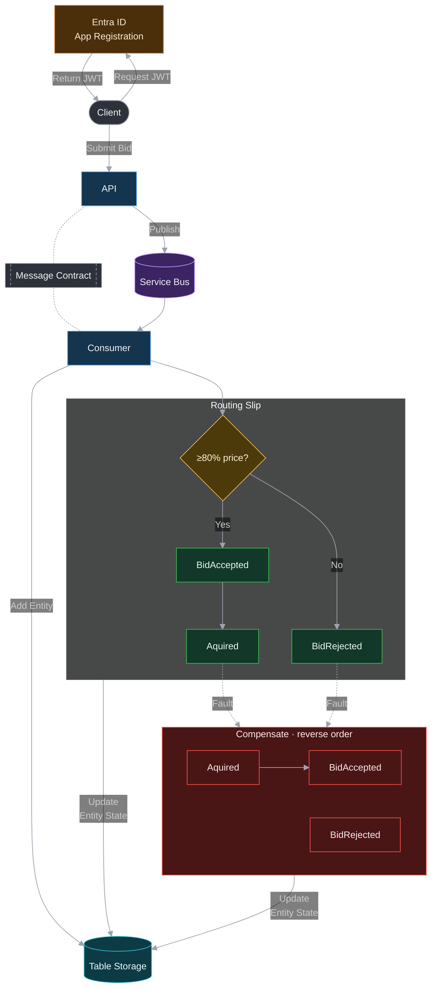
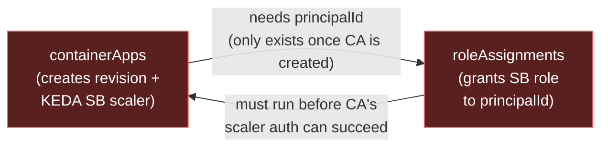
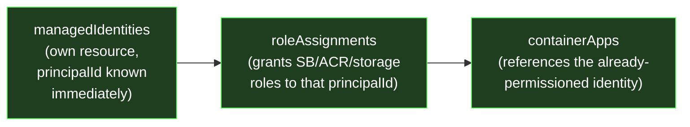

## Flow Diagram

 `ArtAuction.API` accepts a bid and publishes `ArtWorkBid` onto Service Bus. `ArtAuction.Consumer` consumes it, records the bid in Table Storage, then drives a MassTransit routing slip through courier activities to accept or reject the bid. If a later activity in the slip faults, MassTransit walks back through the already-executed activities' `Compensate` methods and update the state of the entity on Table Storage.



## Architecture Choice
I was planning to deploy resources with private endpoint in shared virtual network, but service bus premium sku is needed for private networking which is too expensive, but was happy experiment Network security perimeter which acreates logical network boundaries around your platform-as-a-service (PaaS) resources that you deploy outside your virtual networks. With my current profile setting will only fulfil request if resources live in the same subsription.

TODO: Create Azure Infra diagram

## Generate Token from Identity Provider using PowerShell
I'm tired of using postman a bloated ass application that forces me to log in.
```
$body = @{
    grant_type    = "client_credentials"
    client_id     = "345e735e-327c-429b-946b-39d7edaf4c9c"
    client_secret = ""
    scope         = "api://8036976b-35ee-4425-bebf-76ede18b97d0/.default"
}

$response = Invoke-RestMethod -Uri "https://login.microsoftonline.com/3853050a-07fd-4295-9fec-e56ecda64939/oauth2/v2.0/token" -Method Post -Body $body

$response.access_token
```

## Application Registration 

There are three application registration:
- **Art-Auction-Github-Deployment** :  Which acts the deployment identity which has OIDC federated credentials. The identity has `contributor` role on the subscription since it's create RG on the subscription scope level. Also `
Role Based Access Control Administrator` for role assignments of the managed identities.

- **Art-Auction-API**: which represent the API and contains roles needed for role based access.

- **Art-Auction-Api-Client** - Which is used by client along with a secret generate the JWT token and via API permison that I grant can use the role created in Art-Auction-API application registration.


## Container Registry
Allow the container app to pull from the container registry. This now done with bicep, but just to noted if resources are hand cranked.

```bash
az containerapp registry set --name art-auction-api --resource-group MassTransit-Playground --server masstransitcontainerregistry.azurecr.io --identity system
```

## Why Container Apps Use User-Assigned Identities

The Container Apps scale rules needs to have access to the service bus to establish scale rules. I was having difficulty using system assigned identities since this check was happening before the system assigned identity was created. So had to create user defined managed identity ahead of time with the permission on the service and add the association to the container app. The client id of the user defined managed identity is set in the environment variable of the container app in bicep and pick it up from when the app runs.

**Before (system-assigned) — circular, deadlocks forever:**


**After (user-assigned) — straight line, no cycle:**



